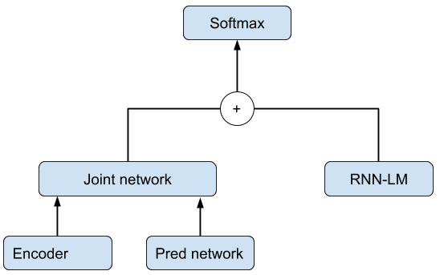
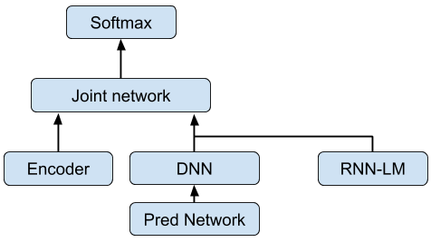
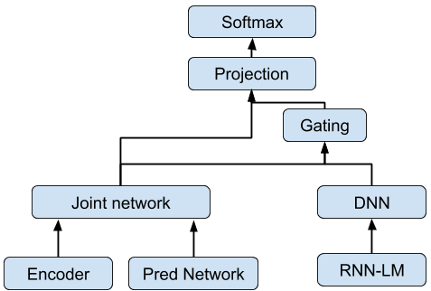
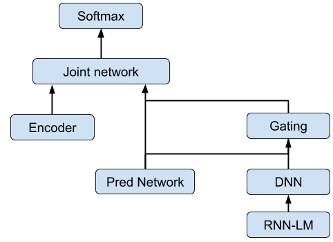

**Source:** *Language model fusion for streaming end to end speech recognition* — [PDF](https://arxiv.org/pdf/2104.04487) · [arXiv](https://arxiv.org/abs/2104.04487)

# Language Model fusion for streaming end to end speech recognition

###### Abstract

Streaming processing of speech audio is required for many contemporary practical speech recognition tasks. Even with the large corpora of manually transcribed speech data available today, it is impossible for such corpora to cover adequately the long tail of linguistic content that’s important for tasks such as open-ended dictation and voice search. We seek to address both the streaming and the tail recognition challenges by using a language model (LM) trained on unpaired text data to enhance the end-to-end (E2E) model. We extend shallow fusion and cold fusion approaches to streaming Recurrent Neural Network Transducer (RNNT), and also propose two new competitive fusion approaches that further enhance the RNNT architecture. Our results on multiple languages with varying training set sizes show that these fusion methods improve streaming RNNT performance through introducing extra linguistic features. Cold fusion works consistently better on streaming RNNT with up to a 8.5% WER improvement.

###### Index Terms: 

shallow fusion, cold fusion, RNNT, end-to-end, ASR 

††address:  {rodrigocabrera,ghodsi,zmatteson,weinstein, anjuli}@google.com, xiaofeng.liu@twosigma.com   
Google Inc.

## 1 Introduction

End-to-end (E2E) models for automatic speech recognition (ASR) tasks have gained popularity because these models predict subword sequences from acoustic features with a single model, unlike classic ASR systems which have separate acoustic, pronunciation, and language model components. The most common E2E architectures are either attention-based (e.g., listen, attention, and spell (LAS) [[1](https://arxiv.org/html/2104.04487#bib.bib1)]) or RNNT [[2](https://arxiv.org/html/2104.04487#bib.bib2)] models (see [[3](https://arxiv.org/html/2104.04487#bib.bib3)] for comparison).

Overall, E2E models show comparable or better word error rate (WER) performance with a simplified system setup. While standard attention-based models must inspect the entire input sequence before generating outputs, streaming-friendly modifications of such models have been proposed, such as MoChA [[4](https://arxiv.org/html/2104.04487#bib.bib4)] and neural transducer [[5](https://arxiv.org/html/2104.04487#bib.bib5)].

While these approaches have shown promise, the RNNT architecture is an alternative E2E model that can natively predict output sequences on the fly (with unidirectional encoders), and thus is a natural choice for streaming applications. RNNT models have also shown extremely strong results., e.g., He et al. [[6](https://arxiv.org/html/2104.04487#bib.bib6)] presented an RNNT based real-time steaming recognizer, which outperformed classic ASR models by a wide margin.

Classic ASR models leverage unpaired text data with a separately trained language model (LM) and second-pass rescoring model [[7](https://arxiv.org/html/2104.04487#bib.bib7)], but unpaired text data cannot be easily utilized when training E2E models. Although E2E models have overall shown strong results, they have been shown to have difficulty accurately modeling tail phenomena such as proper nouns, numerics, and accented speech [[8](https://arxiv.org/html/2104.04487#bib.bib8), [9](https://arxiv.org/html/2104.04487#bib.bib9), [10](https://arxiv.org/html/2104.04487#bib.bib10), [11](https://arxiv.org/html/2104.04487#bib.bib11)], due to the requirement that they be trained on paired (speech-transcript) data.

Recent papers have proposed fusing E2E models with LMs trained with text data (usually referred to this as fusion), including shallow fusion [[12](https://arxiv.org/html/2104.04487#bib.bib12), [13](https://arxiv.org/html/2104.04487#bib.bib13)], deep fusion [[12](https://arxiv.org/html/2104.04487#bib.bib12)], cold fusion [[14](https://arxiv.org/html/2104.04487#bib.bib14)], component fusion [[15](https://arxiv.org/html/2104.04487#bib.bib15)], etc. Most experiments used neural LMs, and some used n-gram fst LMs [[1](https://arxiv.org/html/2104.04487#bib.bib1), [16](https://arxiv.org/html/2104.04487#bib.bib16), [12](https://arxiv.org/html/2104.04487#bib.bib12), [17](https://arxiv.org/html/2104.04487#bib.bib17)]. See [[18](https://arxiv.org/html/2104.04487#bib.bib18)] for comparison of some of these approaches. However, these experiments were performed with standard non-streaming attention models. Fusion approaches with streaming E2E models have been unexplored, and it is unknown whether the observe gains on attention-based models could be translated to streaming models.

In this paper, we explore shallow fusion, cold fusion and two new fusion approaches unique to the streaming RNNT models in section [2](https://arxiv.org/html/2104.04487#S2 "2 Methods ‣ Language Model fusion for streaming end to end speech recognition"), we detail the experimentation across multiple languages of varying sizes of training data in section [3](https://arxiv.org/html/2104.04487#S3 "3 Experiment Setup ‣ Language Model fusion for streaming end to end speech recognition"), and we analyze the results in section [4](https://arxiv.org/html/2104.04487#S4 "4 Results ‣ Language Model fusion for streaming end to end speech recognition"). We show that while shallow fusion worked better than cold fusion for attention-based models, cold fusion outperforms shallow fusion for RNNT models, with a WER reduction of up to 8.5%.

## 2 Methods

### 2.1 RNN Transducer

The RNNT architecture proposed by Graves [[2](https://arxiv.org/html/2104.04487#bib.bib2)] consists of an encoder, a prediction network, and typically a joint network. It directly predicts a sequence of words, subwords [[19](https://arxiv.org/html/2104.04487#bib.bib19)] or graphemes without using an external pronunciation model or language model. Like Connectionist temporal classification (CTC), its target symbol set is augmented with a blank symbol (\(\langle\textit{\ignorespaces blank }\rangle\)) such that the RNNT model does not output a grapheme or subword symbol at every time frame. The RNNT outputs a symbol at each time frame \(t=1,2,\ldots,T\) where \(T\) is the total number of frames, the input of the encoder is the log-mel filterbank energies of dimension \(d\). The input of the prediction network is the last non-\(\langle\textit{\ignorespaces blank }\rangle\) symbol during prediction. The joint network takes as input the output vectors of both encoder and prediction networks and outputs logits which are then passed to the softmax layer to predict subword symbols. In this work, we focus on streaming RNNT wordpiece models, where the encoder and prediction networks both use unidirectional LSTM layers, and the predicted symbols are wordpieces. During decoding, a blank penalty is usually added to adjust the posterior probability of the \(\langle\textit{\ignorespaces blank }\rangle\) symbol, and its value is usually optimized through parameter sweep.

### 2.2 Fusion with RNN-LM

The recurrent neural network (RNN) based LM predicts the probability of a symbol given the context, and is trained with text-only data. It contains an embedding layer followed by a stack of unidirectional RNN layers. For a sequence of wordpieces \({w}_{1}^{T}\), the RNN-LM computes a probability:

\[\begin{aligned}
 & P({w}_{1}^{T})=\prod_{i=1}^{T}P(w_{i}|w_{1},w_{2},\ldots,w_{i-1}). &  & \text{(1)}
\end{aligned}\]

 

One big difference between attention-based models and RNNT models is the existence of the \(\langle\textit{\ignorespaces blank }\rangle\) symbol in RNNT models, and that symbols needs to be handled correctly during fusion. While the RNN-LMs are trained without knowledge of the \(\langle\textit{\ignorespaces blank }\rangle\) symbol, the LM probability of \(\langle\textit{\ignorespaces blank }\rangle\) must be defined during inference time. In this work we make the language model’s probability of \(\langle\textit{\ignorespaces blank }\rangle\) be equal to the RNNT probability,i.e.,\(\log P_{lm}(\langle\textit{\ignorespaces blank }\rangle)=\log P_{rnnt}(\langle\textit{\ignorespaces blank }\rangle)\), where \(\log P_{lm}\) and \(\log P_{rnnt}\) are the probability of LM and RNNT, respectively. This means that when the RNNT model outputs \(\langle\textit{\ignorespaces blank }\rangle\), the RNN-LM is not updated and that the probability for the \(\langle\textit{\ignorespaces blank }\rangle\) symbol after fusion remains unchanged.

### 2.3 Shallow Fusion

 (a) Shallow fusion

 (b) Early shallow fusion

 (c) Cold fusion

 (d) Early cold fusion

Figure 1: Illustrations of our different fusion styles.

Shallow fusion (SF), first proposed by Gulchere, et al. [[12](https://arxiv.org/html/2104.04487#bib.bib12)], integrates an external LM with the RNNT only during inference time, as shown in Fig [1(a)](https://arxiv.org/html/2104.04487#S2.F1.sf1 "In Figure 1 ‣ 2.3 Shallow Fusion ‣ 2 Methods ‣ Language Model fusion for streaming end to end speech recognition"). The scores of RNNT and RNN-LM are log-linearly combined before the softmax layer.

\[\begin{aligned}
 & \displaystyle\begin{gathered}\log P(y_{t})=\log P_{rnnt}(y_{t})+\beta\log P_{lm}(y_{t}),\end{gathered} &  & \text{(2)}
\end{aligned}\]

 

where \(\beta\) is the LM weight, and \(y_{t}\) is the output symbol at time frame \(t\).

In SF, the RNNT and the LM are trained independently with different training data, and thus the approach is very modular and it is easy to integrate the LM during inference time. Note that shallow fusion performance is sensitive to the LM weight \(\beta\) and to the RNNT’s blank penalty, and these values usually need to be optimized through sweeping when using the LM.

### 2.4 Early Shallow Fusion

One popular hypothesis [[3](https://arxiv.org/html/2104.04487#bib.bib3)] about the RNNT architecture is that the prediction network is analogous to an LM. Inspired by this hypothesis we propose the early shallow fusion (ESF) approach as illustrated in Fig. [1(b)](https://arxiv.org/html/2104.04487#S2.F1.sf2 "In Figure 1 ‣ 2.3 Shallow Fusion ‣ 2 Methods ‣ Language Model fusion for streaming end to end speech recognition") It fuses the outputs of the pretrained LM with the RNNT prediction network using log-linear interpolation before feeding to the joint network, i.e.,

\[\begin{aligned}
 & \displaystyle\begin{gathered}l_{t}^{Pred}=DNN(h_{t}^{Pred})\\
h_{t}^{ESF}=l_{t}^{Pred}+\beta l_{t}^{LM}\end{gathered} &  & \text{(3)}
\end{aligned}\]

 

Where \(h_{t}^{Pred}\) is projected to have a logit output and \(l_{t}^{LM}\) is the logit output of the external LM at time frame \(t\), \(\beta\) is the LM weight, and \(h_{t}^{ESF}\) is the interpolated vector that is fed to the joint network. Similar to SF, the LM is used only during inference time and not for RNNT training. It’s possible to fine tune the RNNT model by further training it for extra steps with the fused LM on supervised data.

### 2.5 Cold Fusion

In cold fusion (CF) [[20](https://arxiv.org/html/2104.04487#bib.bib20)], the model is trained using a pre-trained LM that remains fixed when training the rest of the model. A fine-grained gating approach is applied on the LM logit instead of the hidden state to allow for flexible swapping and to improve performance on out-of-domain scenarios as in component fusion [[15](https://arxiv.org/html/2104.04487#bib.bib15)]. The model architecture is illustrated in Fig. [1(c)](https://arxiv.org/html/2104.04487#S2.F1.sf3 "In Figure 1 ‣ 2.3 Shallow Fusion ‣ 2 Methods ‣ Language Model fusion for streaming end to end speech recognition"), defined as:

\[\begin{aligned}
 & \displaystyle\begin{gathered}h_{t}^{LM}=DNN(l_{t}^{LM})\\
g_{t}=\sigma(W[s_{t}^{jn};h_{t}^{LM}]+b)\\
s_{t}^{CF}=[s_{t}^{jn};g_{t}\dot{h}_{t}^{LM}]\\
r_{t}^{CF}=DNN(s_{t}^{CF})\\
\hat{P}(y_{t}|x,y_{<t})=softmax(r_{t}^{CF})\end{gathered} &  & \text{(4)}
\end{aligned}\]

 

Where \(l_{t}^{LM}\) is the logit output of the language model, \(g_{t}\) is the fine-grained gate output parametrized by \(W\), which controls the importance of the contribution of the hidden state of the LM. \(s_{t}^{jn}\) is the state of the joint network, \(s_{t}^{CF}\) is the final fused state, and \(DNN\) is a feedforward neural network. In our experiments we have been using a single layer of fully connected network.

Training the \(DNN\) and sigmoid functions help the model learn to use the LM when predicting a non-\(\langle\textit{\ignorespaces blank }\rangle\) symbol, and only use the RNNT when predicting the \(\langle\textit{\ignorespaces blank }\rangle\) symbol. In the CF approach, sweeping for LM weight and blank penalty is not needed.

### 2.6 Early Cold Fusion

We propose the early cold fusion (ECF) approach as illustrated in Fig. [1(d)](https://arxiv.org/html/2104.04487#S2.F1.sf4 "In Figure 1 ‣ 2.3 Shallow Fusion ‣ 2 Methods ‣ Language Model fusion for streaming end to end speech recognition"). ECF is inspired by cold fusion and fuses the LM by passing its logits through a \(DNN\) layer, the \(DNN\) output is concatenated with the hidden states of the prediction network and fed into a gating layer before sending to the joint network. The LM is used during training and inference.

\[\begin{aligned}
 & \displaystyle\begin{gathered}h_{t}^{LM}=DNN(l_{t}^{LM})\\
g_{t}=\sigma(W[h_{t}^{Pred};h_{t}^{LM}]+b)\\
h_{t}^{ECF}=[h_{t}^{Pred};g_{t}\dot{h}_{t}^{LM}]\\
\end{gathered} &  & \text{(5)}
\end{aligned}\]

 

## 3 Experiment Setup

### 3.1 Model Architecture

The RNNT models and LMs in all experiments shared the same architectures. For RNNT, the encoder network consists of 8 unidirectional LSTM layers, where each layer has 2048 hidden units followed by a 640-dimensional projection layer. A stacking layer is inserted after the second layer, which stacks the outputs of two neighboring frames with a stride of 2 for speed improvement. The prediction network contains 2 unidirectional LSTM layers, where each layer has 2048 hidden units and followed by a 640-dimensional projection layer. The outputs of the encoder and prediction networks were fed into the joint network. The joint network is a feed-forward network with 640 hidden units, which accepts input from both the encoder and the prediction networks. The overall RNNT model has 120 million parameters.

The RNN-LM model has 2 unidirectional LSTM layers, each with 2048 units, with an embedding layer of 128 dimensions. This model has 60 million parameters. Both the RNNT and LM models were trained with using wordpieces and a vocabulary size of 4096.

### 3.2 Data

We performed experiments on three languages: Greek, Norwegian, and Sinhala. The training sets consisted of 6,700, 3,500, and 160 hours of utterances respectively, which were anonymized and hand-transcribed, and are representative of Google’s voice search traffic. These languages covered the cases with low to high amount of training data. During training, the utterances were artificially noisified using a room simulator; the noise and reverberation had an average signal-to-noise ratio of 12dB [[21](https://arxiv.org/html/2104.04487#bib.bib21)]. The noise sources came from YouTube or noisy environmental recordings.

For the RNN-LM, during training the data were randomly drawn from a mix of text sources with different weights: 0.6 for the same hand-transcribed data used in RNNT training, and 0.1 for each of YouTube search logs, Google search queries, Maps search queries and crawled web documents. This in total accounted for over 200 million text sentences for Sinhala and over a billion sentences for Greek and Norwegian. The RNN-LMs are trained by minimizing the log perplexity over a held out set. For all the languages, the fused models were tested on anonymized voice search testsets, which were drawn from Google’s speech traffic and were not used while training the model. For shallow fusion models, the LM weight and blank penalty were also optimized by sweeping using these testsets.

## 4 Results

Table 1: Log perplexity of the LMs over the VS testset.

.  Log Perplexity Norwegian 6.64 Greek 6.75 Sinhala 11.92

For each of the three languages, the LM was trained once with the text-only data, and applied in all the experiments. Table [1](https://arxiv.org/html/2104.04487#S4.T1 "Table 1 ‣ 4 Results ‣ Language Model fusion for streaming end to end speech recognition") shows the perplexities of the pretrained LMs when predicting the test sets. It can be seen that it was much higher for Sinhala than Greek or Norwegian. This is expected because the Sinhala LM training data were dominated by the non-transcribed text sources which might be more different from the test sets.

### 4.1 Shallow fusion and cold fusion

Table 2: Shallow fusion and cold fusion results. 

Model |  #params |  Norweigian |  Greek |  Sinhala  
---|---|---|---|---  
Baseline |  120M |  24.5 |  14.5 |  69.4  
LPN |  191M |  24.4 (-0.40%) |  N/A |  70.0 (+0.86%)  
SF |  180M |  24.2 (-1.22%) |  14.4 (-0.68%) |  69.3 (-0.14%)  
CF |  200M |  22.4 (-8.57%) |  14.0 (-3.44%) |  69.0 (-0.57%)

 

Table [2](https://arxiv.org/html/2104.04487#S4.T2 "Table 2 ‣ 4.1 Shallow fusion and cold fusion ‣ 4 Results ‣ Language Model fusion for streaming end to end speech recognition") shows the performance in terms of WER on the testsets for the baseline model, a modified RNNT model with larger prediction network (LPN), shallow fusion (SF), and cold fusion (CF). The LPN was identical to the baseline model except its prediction network had 6 LSTM layers instead of 2, such that the number of parameters was similar to the CF model. The LPN model on Norweigian showed slight improvement over the baseline model, suggesting that just increasing RNNT model size is not effective for lower resource languages. Overall, cold fusion performed significantly better than shallow fusion. This is surprising as it’s the opposite pattern than what was seen with LAS models [[18](https://arxiv.org/html/2104.04487#bib.bib18)]. Shallow fusion gave a small gain (1.2%) for Norweigian, but had no significant improvement for Greek and Sinhala, while cold fusion improved on all three languages. This could be because the handling of \(\langle\textit{\ignorespaces blank }\rangle\) probability in SF was not ideal, while CF can benefit from the extra parameters and the co-training of the RNNT model with the LM where the RNNT model learned to adapt to the fused LM.

Notably for Norwegian, cold fusion showed 8.57% gains, which was much larger than that for Greek (3.44%). This could be because the RNNT model for Greek was trained with a much larger data set than Norwegian. The large train set covers more linguistic features compared to the coverage in Norwegian, and as a result the gain brought by extra text-data was smaller. For Sinhala, both methods didn’t show significant improvement. Our hypothesis is that the training set for Sinhala was too small, causing the model to overfit quickly during training; and that the linguistic features of the trained LM are too different from the test sets as manifested in the LM perplexity shown in Table [1](https://arxiv.org/html/2104.04487#S4.T1 "Table 1 ‣ 4 Results ‣ Language Model fusion for streaming end to end speech recognition"). These results impliy that the amount of training data is critical for RNNT performance.

Table 3: Examples of the top hypothesis generated by the baseline and the cold fused RNNT models for Greek. 

|  Example 1 |  Example 2  
---|---|---  
Baseline |  philakes ipsous tis Afstralias andrianoupolis |  etsi re spor pou anevainis skalopatia  
Cold fused RNNT |  philakes ipsistis asphalias ( 

 ) andrianoupolis |  Range Rover sport ( 

 ) pou anevainis skalopatia  
English Translation |  highest security ( 

 ) prisons in Andrianopolis |  Range Rover sport ( 

 ) that climbs stairs

 

Table [3](https://arxiv.org/html/2104.04487#S4.T3 "Table 3 ‣ 4.1 Shallow fusion and cold fusion ‣ 4 Results ‣ Language Model fusion for streaming end to end speech recognition") shows two examples of the top hypothesis generated by the baseline RNNT model and cold fusion in Greek. The hypotheses were transliterated to Latin for better understanding, and the differences between the hypotheses of the two models were highlighted. The last row shows the English translations of the transcript truth. The fused model correctly recognized the utterances while the baseline model failed to produce hypotheses that makes sense. This was likely because these mistaken words were seen in the text-only data used in LM training while not in the transcribed speech-text data used in the RNNT training. This example illustrates how fusion cat help a streaming E2E model perform better on “tail” phenomena such as proper nouns. Fusion with the LM helped the RNNT model to obtain a richer lattice and surface better hypotheses, and thus resulted in correct inference.

### 4.2 Early shallow fusion and early cold fusion

Table 4: Early shallow fusion and early cold fusion results. 

Model |  #params |  Norweigian |  Greek |  Sinhala  
---|---|---|---|---  
Baseline |  120M |  24.5 |  14.5 |  69.4  
ESF |  180M |  24.4 (-0.40%) |  14.5 (0.00%) |  69.3 (-0.14%)  
ECF |  200M |  22.7 (-7.34%) |  14.2 (-2.06%) |  68.1 (-1.87%)

 

Table [4](https://arxiv.org/html/2104.04487#S4.T4 "Table 4 ‣ 4.2 Early shallow fusion and early cold fusion ‣ 4 Results ‣ Language Model fusion for streaming end to end speech recognition") shows the results of early shallow fusion and early cold fusion, where the LMs were fused before the joint network. It’s worth noting that ESF models needed fine-tuning to get improvements. Similar to the results in Table [2](https://arxiv.org/html/2104.04487#S4.T2 "Table 2 ‣ 4.1 Shallow fusion and cold fusion ‣ 4 Results ‣ Language Model fusion for streaming end to end speech recognition"), Sinhala had the least WER gain while Norweigian had the most gain because of the same reasons. For Norweigian and Greek, both early fusion approaches showed significant gains in WER, but slightly less than SF and CF. This suggests that fusing the LM before or after the joint network produces similar results. This result is valuable in that it shows us that if we choose to modify the topology of the RNNT model [[22](https://arxiv.org/html/2104.04487#bib.bib22)] we can be flexible with the placement of the fusion point while maintaining the superior quality afforded by fusing a text-trained LM.

## 5 Discussion

In this work we explored several existing fusion approaches as well as new methods that fuse a pre-trained language model at an earlier stage to improve RNNT performance for medium and low resource languages in a streaming setting. Among all the approaches, cold fusion performed best, with WER reduction up to 8.5% compared to the baseline. The language model brings additional linguistic features and helps the RNNT to produce richer lattices and obtain better hypotheses. Additionally, we showed that the fusion point can be placed either before or after the joint network while maintaining the quality gains.

## References

  * [1] W. Chan, N. Jaitly, Q. Le, and O. Vinyals,  “Listen, attend and spell: A neural network for large vocabulary conversational speech recognition,”  in ICASSP, 2016, pp. 4960–4964. 
  * [2] Alex Graves,  “Sequence transduction with recurrent neural networks,”  ArXiv, vol. abs/1211.3711, 2012. 
  * [3] R. Prabhavalkar, K. Rao, T. Sainath, B. Li, L. Johnson, and N. Jaitly,  “A comparison of sequence-to-sequence models for speech recognition,”  in InterSpeech, 2017. 
  * [4] Chung-Cheng Chiu and Colin Raffel,  “Monotonic chunkwise attention,”  CoRR, vol. abs/1712.05382, 2017. 
  * [5] Navdeep Jaitly, Quoc V Le, Oriol Vinyals, Ilya Sutskever, David Sussillo, and Samy Bengio,  “An online sequence-to-sequence model using partial conditioning,”  in Advances in Neural Information Processing Systems 29, D. D. Lee, M. Sugiyama, U. V. Luxburg, I. Guyon, and R. Garnett, Eds., pp. 5067–5075. Curran Associates, Inc., 2016. 
  * [6] Y. He, T. N. Sainath, R. Prabhavalkar, I. McGraw, R. Alvarez, D. Zhao, D. Rybach, A. Kannan, Y. Wu, R. Pang, Q. Liang, D. Bhatia, Y. Shangguan, B. Li, G. Pundak, K. C. Sim, T. Bagby, S. Chang, K. Rao, and A. Gruenstein,  “Streaming end-to-end speech recognition for mobile devices,”  in ICASSP, 2019, pp. 6381–6385. 
  * [7] F. Biadsy, M. Ghodsi, , and D. Caseiro,  “Effectively building tera scale maxent language models incorporating non-linguistic signals,”  in InterSpeech, 2017. 
  * [8] Tanja Schultz and Alex Waibel,  “Multilingual and crosslingual speech recognition,”  in Proceedings of the DARPA Broadcast News Workshop 1998, 1998. 
  * [9] Ngoc Thang Vu, Yuanfan Wang, Marten Klose, Zlatka Mihaylova, and Tanja Schultz,  “Improving asr performance on non-native speech using multilingual and crosslingual information,”  in INTERSPEECH, 2014. 
  * [10] Cal Peyser, Hao Zhang, Tara N. Sainath, and Zelin Wu,  “Improving performance of end-to-end asr on numeric sequences,”  in INTERSPEECH, 2019. 
  * [11] Cal Peyser, Tara N. Sainath, and Golan Pundak,  “Improving proper noun recognition in end-to-end asr by customization of the mwer loss criterion,”  in 2020 IEEE International Conference on Acoustics, Speech and Signal Processing, ICASSP 2020, Barcelona, Spain, May 4-8, 2020. 2020, pp. 7789–7793, IEEE. 
  * [12] Çaglar Gülçehre, Orhan Firat, Kelvin Xu, Kyunghyun Cho, Loïc Barrault, Huei-Chi Lin, Fethi Bougares, Holger Schwenk, and Yoshua Bengio,  “On using monolingual corpora in neural machine translation,”  ArXiv, vol. abs/1503.03535, 2015. 
  * [13] Kannan A, Y. Wu, P. Nguyen, T. N. Sainath, Z. Chen, and R. Prabhavalkar,  “An analysis of incorporating an external language model into a sequence-to-sequence model,”  in ICASSP. IEEE, 2018. 
  * [14] A. Sriram, H. Jun, S. Satheesh, and A. Coates,  “Cold fusion: Training seq2seq models together with language models,”  ArXiv, vol. abs/1503.03535, 2015. 
  * [15] C. Shan, C. Weng, G. Wang, D. Su, M. Luo, D. Yu, and L. Xie,  “Component fusion: Learning replaceable language model component for end-to-end speech recognition system,”  in ICASSP, 2019, pp. 5361–5635. 
  * [16] D. Bahdanau, J. Chorowski, D. Serdyuk, P. Brakel, and Y. Bengio,  “End-to-end attention-based large vocabulary speech recognition,”  in ICASSP. IEEE, 2016. 
  * [17] J. K. Chorowski and N. Jaitly,  “Towards better decoding and language model integration in sequence to sequence models,”  in InterSpeech, 2017. 
  * [18] S. Toshniwal, A. Kannan, C. Chiu, Y. Wu, T. N. Sainath, and K. Livescu,  “A comparison of techniques for language model integration in encoder-decoder speech recognition,”  2018 IEEE Spoken Language Technology Workshop (SLT), pp. 369–375, 2018. 
  * [19] M. Schuster and K. Nakajima,  “Japanese and Korean voice search,”  in Proc. ICASSP, 2012. 
  * [20] Anuroop Sriram, Heewoo Jun, Sanjeev Satheesh, and Adam Coates,  “Cold fusion: Training seq2seq models together with language models,”  2017\. 
  * [21] C. Kim, A. Misra, K. Chin, T. Hughes, A. Narayanan, T. N. Sainath, and M. Bacchiani,  “Generated of large-scale simulated utterances in virtual rooms to train deep-neural networks for far-field speech recognition in Google Home,”  in Proc. Interspeech, 2017. 
  * [22] M. Ghodsi, X. Liu, J. Apfel, R. Cabrera, and E. Weinstein,  “Rnn-transducer with stateless prediction network,”  in ICASSP 2020 - 2020 IEEE International Conference on Acoustics, Speech and Signal Processing (ICASSP), 2020, pp. 7049–7053. 

