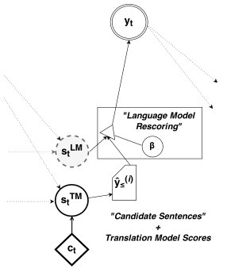
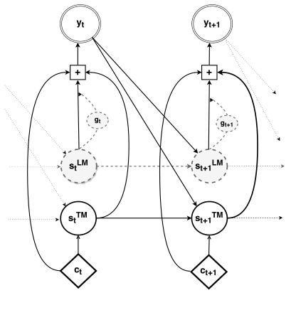

**Source:** *On Using Monolingual Corpora in Neural Machine Translation* — [PDF](https://arxiv.org/pdf/1503.03535) · [arXiv](https://arxiv.org/abs/1503.03535)

# On Using Monolingual Corpora in Neural Machine Translation

Caglar Gulcehre⋆Université de Montréal  Orhan FiratMiddle East Technical University  Kelvin XuUniversité de Montréal  Kyunghyun ChoUniversité de Montréal  Loïc BarraultUniversité du Maine  Huei-Chi LinUniversité du Maine  Fethi BougaresUniversité du Maine  Holger SchwenkUniversité du Maine  Yoshua BengioUniversité de MontréalCIFAR Senior Fellow 

###### Abstract

Recent work on end-to-end neural network-based architectures for machine translation has shown promising results for En-Fr and En-De translation. Arguably, one of the major factors behind this success has been the availability of high quality parallel corpora. In this work, we investigate how to leverage abundant monolingual corpora for neural machine translation. Compared to a phrase-based and hierarchical baseline, we obtain up to \(1.96\) BLEU improvement on the low-resource language pair Turkish-English, and \(1.59\) BLEU on the focused domain task of Chinese-English chat messages. While our method was initially targeted toward such tasks with less parallel data, we show that it also extends to high resource languages such as Cs-En and De-En where we obtain an improvement of \(0.39\) and \(0.47\) BLEU scores over the neural machine translation baselines, respectively.

†† ⋆ Equal contribution. Order has been determined with a coin flip.†† † Work done while author was at Université de Montréal

## 1 Introduction

Neural machine translation (NMT) is a novel approach to machine translation that has shown promising results [[\citenameKalchbrenner and Blunsom2013](https://arxiv.org/html/1503.03535#bib.bibx11), [\citenameSutskever et al.2014](https://arxiv.org/html/1503.03535#bib.bibx25), [\citenameCho et al.2014](https://arxiv.org/html/1503.03535#bib.bibx4), [\citenameBahdanau et al.2014](https://arxiv.org/html/1503.03535#bib.bibx1)]. Until recently, the application of neural networks to machine translation was restricted to extending standard machine translation tools for rescoring translation hypotheses or re-ranking n-best lists (see, e.g., [[\citenameSchwenk2012](https://arxiv.org/html/1503.03535#bib.bibx23), [\citenameSchwenk2007a](https://arxiv.org/html/1503.03535#bib.bibx21)]. In contrast, it has been shown that, it is possible to build a competitive translation system for English-French and English-German using an end-to-end neural network architecture [[\citenameSutskever et al.2014](https://arxiv.org/html/1503.03535#bib.bibx25), [\citenameJean et al.2014](https://arxiv.org/html/1503.03535#bib.bibx10)] (also see Sec. [2](https://arxiv.org/html/1503.03535#S2 "2 Background: Neural Machine Translation ‣ On Using Monolingual Corpora in Neural Machine Translation")).

Arguably, a large part of the recent success of these methods has been due to the availability of large amounts of high quality, sentence aligned corpora. In the case of low resource language pairs or in a task with heavy domain restrictions, there can be a lack of such sentence aligned corpora. In contrast, monolingual corpora is almost always universally available. Despite being “unlabeled”, monolingual corpora still exhibit rich linguistic structure that may be useful for translation tasks. This presents an opportunity to leverage such corpora to give hints to an NMT system.

In this work, we present a way to effectively integrate a language model (LM) trained only on monolingual data (target language) into an NMT system. We provide experimental results that incorporating monolingual corpora can improve a translation system on a low-resource language pair (Turkish-English) and a domain restricted translation problem (Chinese-English SMS chat). In addition, we show that these methods improve the performance on the relatively high-resource German-English (De-En) and Czech-English (Cs-En) translation tasks.

In the following section (Sec. [2](https://arxiv.org/html/1503.03535#S2 "2 Background: Neural Machine Translation ‣ On Using Monolingual Corpora in Neural Machine Translation")), we review recent work in neural machine translation. We present our basic model architecture in Sec. [3](https://arxiv.org/html/1503.03535#S3 "3 Model Description ‣ On Using Monolingual Corpora in Neural Machine Translation") and describe our shallow and deep fusion approaches in Sec. [4](https://arxiv.org/html/1503.03535#S4 "4 Integrating Language Model into the Decoder ‣ On Using Monolingual Corpora in Neural Machine Translation"). Next, we describe our datasets in Sec. [5](https://arxiv.org/html/1503.03535#S5 "5 Datasets ‣ On Using Monolingual Corpora in Neural Machine Translation"). Finally, we describe our main experimental results in Sec. [6](https://arxiv.org/html/1503.03535#S6 "6 Settings ‣ On Using Monolingual Corpora in Neural Machine Translation").

## 2 Background: Neural Machine Translation

Statistical machine translation (SMT) systems maximize the conditional probability \(p(\mathbf{y}\mid\mathbf{x})\) of a correct target translation \(\mathbf{y}\) given a source sentence \(\mathbf{x}\). This is done by maximizing separately a language model \(p(\mathbf{y})\) and the (inverse) translation model \(p(\mathbf{x}\mid\mathbf{y})\) component by using Bayes’ rule:

\[\begin{aligned}
 & \displaystyle p(\mathbf{y}\mid\mathbf{x})\propto p(\mathbf{x}\mid\mathbf{y})p(\mathbf{y}). & 
\end{aligned}\]

 

This decomposition into a language model and translation model is meant to make full use of available corpora: monolingual corpora for fitting the language model and parallel corpora for the translation model. In reality, however, SMT systems tend to model \(\log p(\mathbf{y}\mid\mathbf{x})\) directly by linearly combining multiple features by using a so-called log-linear model:

\[\begin{aligned}
 & \displaystyle\log p(\mathbf{y}\mid\mathbf{x})=\sum_{j}f_{j}(\mathbf{x},\mathbf{y})+C, &  & \text{(1)}
\end{aligned}\]

 

where \(f_{j}\) is the \(j\)-th feature based on both or either of the source and target sentences, and \(C\) is a normalization constant which is often ignored. These features include, for instance, pair-wise statistics between two sentences/phrases. The log-linear model is fitted to data, in most cases, by maximizing an automatic evaluation metric other than an actual conditional probability, such as BLEU.

Neural machine translation, on the other hand, aims at directly optimizing \(\log p(\mathbf{y}\mid\mathbf{x})\) including the feature extraction as well as the normalization constant by a single neural network. This is typically done under the encoder-decoder framework [[\citenameKalchbrenner and Blunsom2013](https://arxiv.org/html/1503.03535#bib.bibx11), [\citenameCho et al.2014](https://arxiv.org/html/1503.03535#bib.bibx4), [\citenameSutskever et al.2014](https://arxiv.org/html/1503.03535#bib.bibx25)] consisting of neural networks. The first network encodes the source sentence \(\mathbf{x}\) into a continuous-space representation from which the decoder produces the target translation sentence. By using RNN architectures equipped to learn long term dependencies such as Gated Recurrent Units (GRU) or Long Short-Term Memory (LSTM), the whole system can be trained end-to-end [[\citenameCho et al.2014](https://arxiv.org/html/1503.03535#bib.bibx4), [\citenameSutskever et al.2014](https://arxiv.org/html/1503.03535#bib.bibx25)].

Once the model learns the conditional distribution or translation model, given a source sentence we can find a translation that approximately maximizes the conditional probability using, for instance, a beam search algorithm.

## 3 Model Description

We use the model recently proposed by [[\citenameBahdanau et al.2014](https://arxiv.org/html/1503.03535#bib.bibx1)] that learns to jointly (soft-)align and translate as the baseline neural machine translation system in this paper. Here we describe in detail this model to which we refer as “NMT”.

The encoder of the NMT is a bidirectional RNN which consists of forward and backward RNNs [[\citenameSchuster and Paliwal1997](https://arxiv.org/html/1503.03535#bib.bibx20)]. The forward RNN reads the input sequence/sentence \(\mathbf{x}=(x_{1},\dots,x_{T})\) in a forward direction, resulting in a sequence of hidden states \((\overrightarrow{\mathbf{h}}_{1},\dots,\overrightarrow{\mathbf{h}}_{T})\). The backward RNN reads \(\mathbf{x}\) in an opposite direction and outputs \((\overleftarrow{\mathbf{h}}_{1},\dots,\overleftarrow{\mathbf{h}}_{T})\). We concatenate a pair of hidden states at each time step to build a sequence of annotation vectors \((\mathbf{h}_{1},\dots,\mathbf{h}_{T})\), where

\[\begin{aligned}
 & \mathbf{h}_{j}^{\top}=\left[\overleftarrow{\mathbf{h}}_{j}^{\top};\overrightarrow{\mathbf{h}}_{j}^{\top}\right]. & 
\end{aligned}\]

 

Each annotation vector \(\mathbf{h}_{j}\) encodes information about the \(j\)-th word with respect to all the other surrounding words in the sentence.

In our decoder, which we construct with a single layer RNN, at each timestep \(t\) a soft-alignment mechanism first decides on which annotation vectors are most relevant. The relevance weight \(\alpha_{tj}\) of the \(j\)-th annotation vector for the \(t\)-th target word is computed by a feedforward neural network f that takes as input \(\mathbf{h}_{j}\), the previous decoder’s hidden state \(\mathbf{s}_{t-1}\) and the previous output \(\mathbf{y}_{t-1}\):

\[\begin{aligned}
 & \displaystyle e_{tj}=\text{f}(\mathbf{s}_{t-1},\mathbf{h}_{j},\mathbf{y}_{t-1}). & 
\end{aligned}\]

 

The outputs \(e_{tj}\) are normalized over the sequence of the annotation vectors so that the they sum to \(1\):

\[\begin{aligned}
 & \alpha_{tj}=\frac{\text{exp}(e_{tj})}{\sum_{k=1}^{T}\text{exp}(e_{tk})}, &  & \text{(2)}
\end{aligned}\]

 

and we call \(\alpha_{tj}\) a relevance score, or an alignment weight, of the \(j\)-th annotation vector.

The relevance scores are used to get the context vector \(\mathbf{c}_{t}\) of the \(t\)-th word in the translation:

\[\begin{aligned}
 & \displaystyle\mathbf{c}_{t}=\sum_{j=1}^{T}\alpha_{tj}\mathbf{h}_{j}~, & 
\end{aligned}\]

 

Then, the decoder’s hidden state \(\mathbf{s}_{t}^{\text{TM}}\) at time \(t\) is computed based on the previous hidden state \(\mathbf{s}_{t-1}^{\text{TM}}\), the context vector \(\mathbf{c}_{t}\) and the previously translated word \(\mathbf{y}_{t-1}\):

\[\begin{aligned}
 & \mathbf{s}_{t}^{\text{TM}}=\text{f}_{r}(\mathbf{s}_{t-1}^{\text{TM}},\mathbf{y}_{t-1},\mathbf{c}_{t}), &  & \text{(3)}
\end{aligned}\]

 

where \(\text{f}_{r}\) is the gated recurrent unit [[\citenameCho et al.2014](https://arxiv.org/html/1503.03535#bib.bibx4)].

We use a deep output layer [[\citenamePascanu et al.2014](https://arxiv.org/html/1503.03535#bib.bibx18)] to compute the conditional distribution over words:

\[\begin{aligned}
 & \begin{split}p(&\mathbf{y}_{t}|\mathbf{y}_{<t},\mathbf{x})\propto\\
&\exp(\mathbf{y}_{t}^{\top}(\mathbf{W}_{o}\text{f}_{o}(\mathbf{s}_{t}^{\text{TM}},\mathbf{y}_{t-1},\mathbf{c}_{t})+\mathbf{b}_{o})),\end{split} &  & \text{(4)}
\end{aligned}\]

 

where \(\mathbf{y}_{t}\) is a one-hot encoded vector indicating one of the words in the target vocabulary. \(\mathbf{W}_{o}\) is a learned weight matrix and \(\mathbf{b}_{o}\) is a bias. \(\text{f}_{o}\) is a single-layer feedforward neural network with a two-way maxout non-linearity [[\citenameGoodfellow et al.2013](https://arxiv.org/html/1503.03535#bib.bibx6)].

The whole model, including both the encoder and decoder, is jointly trained to maximize the (conditional) log-likelihood of the bilingual training corpus:

\[\begin{aligned}
 & \displaystyle\max_{\boldsymbol{\theta}}\frac{1}{N}\sum_{n=1}^{N}\log p_{\theta}(\mathbf{y}^{(n)}|\mathbf{x}^{(n)}), & 
\end{aligned}\]

 

where the training corpus is a set of \((\mathbf{x}^{(n)},\mathbf{y}^{(n)})\)’s, and \(\boldsymbol{\theta}\) denotes a set of all the tunable parameters.

## 4 Integrating Language Model into the Decoder

In this paper, we propose two alternatives to integrating a language model into a neural machine translation system which we refer as shallow fusion (Sec. [4.1](https://arxiv.org/html/1503.03535#S4.SS1 "4.1 Shallow Fusion ‣ 4 Integrating Language Model into the Decoder ‣ On Using Monolingual Corpora in Neural Machine Translation")) and deep fusion (Sec. [4.2](https://arxiv.org/html/1503.03535#S4.SS2 "4.2 Deep Fusion ‣ 4 Integrating Language Model into the Decoder ‣ On Using Monolingual Corpora in Neural Machine Translation")). Without loss of generality, we use a language model based on recurrent neural networks (RNNLM, [[\citenameMikolov et al.2011](https://arxiv.org/html/1503.03535#bib.bibx16)]) which is equivalent to the decoder described in the previous section except that it is not biased by a context vector (i.e., \(\mathbf{c}_{t}=0\) in Eqs. ([3](https://arxiv.org/html/1503.03535#S3.E3 "In 3 Model Description ‣ On Using Monolingual Corpora in Neural Machine Translation"))–([4](https://arxiv.org/html/1503.03535#S3.E4 "In 3 Model Description ‣ On Using Monolingual Corpora in Neural Machine Translation"))).

In the sections that follow, we assume that both an NMT model (on parallel corpora) as well as a recurrent neural network language model (RNNLM, on larger monolingual corpora) have been pre-trained separately before being integrated. We denoted the hidden state at time \(t\) of the RNNLM with \(\mathbf{s}_{t}^{\text{LM}}\).

### 4.1 Shallow Fusion

Shallow fusion is analogous to how language models are used in the decoder of a usual SMT system [[\citenameKoehn2010](https://arxiv.org/html/1503.03535#bib.bibx14)]. At each time step, the translation model proposes a set of candidate words. The candidates are then scored according to the weighted sum of the scores given by the translation model and the language model.

More specifically, at each time step \(t\), the translation model (in this case, the NMT) computes the score of every possible next word for each hypothesis all of hypotheses \(\left\{\mathbf{y}_{\leq t-1}^{(i)}\right\}\). Each score is the summation of the score of the hypothesis and the score given by the NMT to the next word. All these new hypotheses (a hypothesis from the previous timestep with a next word appended at the end) are then sorted according to their respective scores, and the top \(K\) ones are selected as candidates \(\left\{\hat{\mathbf{y}}^{(i)}_{\leq t}\right\}_{i=1,\dots,K}\).

We then rescore these hypotheses with the weighted sum of the scores by the NMT and RNNLM, where we only need to recompute the score of the “new word” at the end of each candidate hypothesis. The score of the new word is computed by

\[\begin{aligned}
 & \begin{split}\log p(\mathbf{y}_{t}=k)&=\log p_{\text{TM}}(\mathbf{y}_{t}=k)\\
&+\beta\log p_{\text{LM}}(\mathbf{y}_{t}=k),\end{split} &  & \text{(5)}
\end{aligned}\]

 

where \(\beta\) is a hyper-parameter that needs to be tuned to maximize the translation performance on a development set.

See Fig. [1](https://arxiv.org/html/1503.03535#S4.F1 "Figure 1 ‣ 4.1 Shallow Fusion ‣ 4 Integrating Language Model into the Decoder ‣ On Using Monolingual Corpora in Neural Machine Translation") (a) for illustration.

 

 

(a) Shallow Fusion (Sec. [4.1](https://arxiv.org/html/1503.03535#S4.SS1 "4.1 Shallow Fusion ‣ 4 Integrating Language Model into the Decoder ‣ On Using Monolingual Corpora in Neural Machine Translation"))

(b) Deep Fusion (Sec. [4.2](https://arxiv.org/html/1503.03535#S4.SS2 "4.2 Deep Fusion ‣ 4 Integrating Language Model into the Decoder ‣ On Using Monolingual Corpora in Neural Machine Translation"))

Figure 1: Graphical illustrations of the proposed fusion methods.

### 4.2 Deep Fusion

In deep fusion, we integrate the RNNLM and the decoder of the NMT by concatenating their hidden states next to each other (see Fig. [1](https://arxiv.org/html/1503.03535#S4.F1 "Figure 1 ‣ 4.1 Shallow Fusion ‣ 4 Integrating Language Model into the Decoder ‣ On Using Monolingual Corpora in Neural Machine Translation") (b)). The model is then finetuned to use the hidden states from both of these models when computing the output probability of the next word (see Eq. ([4](https://arxiv.org/html/1503.03535#S3.E4 "In 3 Model Description ‣ On Using Monolingual Corpora in Neural Machine Translation"))). Unlike the vanilla NMT (without any language model component), the hidden layer of the deep output takes as input the hidden state of the RNNLM in addition to that of the NMT, the previous word and the context such that

\[\begin{aligned}
 & \begin{split}p(&\mathbf{y}_{t}|\mathbf{y}_{<t},\mathbf{x})\propto\\
&\exp(\mathbf{y}_{t}^{\top}(\mathbf{W}_{o}\text{f}_{o}(\mathbf{s}_{t}^{\text{LM}},\mathbf{s}_{t}^{\text{TM}},\mathbf{y}_{t-1},\mathbf{c}_{t})+\mathbf{b}_{o})),\end{split} &  & \text{(6)}
\end{aligned}\]

 

where again we use the superscripts \({}^{\text{LM}}\) and \({}^{\text{TM}}\) to denote the hidden states of the RNNLM and NMT respectively.

During the finetuning of the model, we tune only the parameters that were used to parameterize the output ([6](https://arxiv.org/html/1503.03535#S4.E6 "In 4.2 Deep Fusion ‣ 4 Integrating Language Model into the Decoder ‣ On Using Monolingual Corpora in Neural Machine Translation")). This is to ensure that the structure learned by the LM from monolingual corpora is not overwritten. It is possible to use monolingual corpora as well while finetuning all the parameters, but in this paper, we alter only the output parameters in the stage of finetuning.

#### 4.2.1 Balancing the LM and TM

In order for the decoder to flexibly balance the input from the LM and TM, we augment the decoder with a “controller” mechanism. The need to flexibly balance the signals arises depending on the work being translated. For instance, in the case of Zh-En, there are no Chinese words that correspond to articles in English, in which case the LM may be more informative. On the other hand, if a noun is to be translated, it may be better to ignore any signal from the LM, as it may prevent the decoder from choosing the correct translation. Intuitively, this mechanism helps the model dynamically weight the different models depending on the word being translated.

The controller mechanism is implemented as a function taking the hidden state of the LM as input and computing

\[\begin{aligned}
 & \displaystyle g_{t}=\sigma\left(\mathbf{v}^{\top}_{g}\mathbf{s}^{\text{LM}}_{t}+b_{g}\right), &  & \text{(7)}
\end{aligned}\]

 

where \(\sigma\) is a logistic sigmoid function. \(\mathbf{v}_{g}\) and \(b_{g}\) are learned parameters.

The output of the controller is then multiplied with the hidden state of the LM. This lets the decoder use the signal from the TM fully, while the controller controls the magnitude of the LM signal.

In our experiments, we empirically found that it was better to initialize the bias \(\mathbf{b}_{g}\) to a small, negative number. This allows the decoder to decide the importance of the LM only when it is deemed necessary. †† In all our experiments, we set \(\mathbf{b}_{g}=-1\) to ensure that \(\mathbf{g}_{t}\) is initially \(0.26\) on average.

## 5 Datasets

We evaluate the proposed approaches on four diverse tasks: Chinese to English (Zh-En), Turkish to English (Tr-En), German to English (De-En) and Czech to English (Cs-En). We describe each of these datasets in more detail below.

### 5.1 Parallel Corpora

#### 5.1.1 Zh-En: OpenMT’15

We use the parallel corpora made available as a part of the NIST OpenMT’15 Challenge. Sentence-aligned pairs from three domains are combined to form a training set: (1) SMS/CHAT and (2) conversational telephone speech (CTS) from DARPA BOLT Project, and (3) newsgroups/weblogs from DARPA GALE Project. In total, the training set consists of 430K sentence pairs (see Table [1](https://arxiv.org/html/1503.03535#S5.T1 "Table 1 ‣ 5.1.1 Zh-En: OpenMT’15 ‣ 5.1 Parallel Corpora ‣ 5 Datasets ‣ On Using Monolingual Corpora in Neural Machine Translation") for the detailed statistics). We train models with this training set and the development set (the concatenation of the provided development and tune sets from the challenge), and evaluate them on the test set. The domain of the development and test sets is restricted to CTS.

<table id="S5.T1.1.1" class="ltx_tabular ltx_centering ltx_guessed_headers ltx_align_middle">
<thead class="ltx_thead">
<tr id="S5.T1.1.1.1" class="ltx_tr">
<th id="S5.T1.1.1.1.1" class="ltx_td ltx_th ltx_th_column ltx_th_row ltx_border_r"></th>
<th id="S5.T1.1.1.1.2" class="ltx_td ltx_align_center ltx_th ltx_th_column">Chinese</th>
<th id="S5.T1.1.1.1.3" class="ltx_td ltx_align_center ltx_th ltx_th_column">English</th></tr>
</thead>
<tbody class="ltx_tbody">
<tr id="S5.T1.1.1.2" class="ltx_tr">
<th id="S5.T1.1.1.2.1" class="ltx_td ltx_align_center ltx_th ltx_th_row ltx_border_r ltx_border_tt"># of Sentences</th>
<td id="S5.T1.1.1.2.2" class="ltx_td ltx_align_center ltx_border_tt" colspan="2">436K</td></tr>
<tr id="S5.T1.1.1.3" class="ltx_tr">
<th id="S5.T1.1.1.3.1" class="ltx_td ltx_align_center ltx_th ltx_th_row ltx_border_r ltx_border_t"># of Unique Words</th>
<td id="S5.T1.1.1.3.2" class="ltx_td ltx_align_center ltx_border_t">21K</td>
<td id="S5.T1.1.1.3.3" class="ltx_td ltx_align_center ltx_border_t">150K</td></tr>
<tr id="S5.T1.1.1.4" class="ltx_tr">
<th id="S5.T1.1.1.4.1" class="ltx_td ltx_align_center ltx_th ltx_th_row ltx_border_r ltx_border_t"># of Total Words</th>
<td id="S5.T1.1.1.4.2" class="ltx_td ltx_align_center ltx_border_t">8.4M</td>
<td id="S5.T1.1.1.4.3" class="ltx_td ltx_align_center ltx_border_t">5.9M</td></tr>
<tr id="S5.T1.1.1.5" class="ltx_tr">
<th id="S5.T1.1.1.5.1" class="ltx_td ltx_align_center ltx_th ltx_th_row ltx_border_r ltx_border_t">Avg. Length</th>
<td id="S5.T1.1.1.5.2" class="ltx_td ltx_align_center ltx_border_t">19.3</td>
<td id="S5.T1.1.1.5.3" class="ltx_td ltx_align_center ltx_border_t">13.5</td></tr>
</tbody>
</table>

 

(a) Zh-En

<table id="S5.T1.2.1" class="ltx_tabular ltx_centering ltx_guessed_headers ltx_align_middle">
<thead class="ltx_thead">
<tr id="S5.T1.2.1.1" class="ltx_tr">
<th id="S5.T1.2.1.1.1" class="ltx_td ltx_th ltx_th_column ltx_th_row ltx_border_r"></th>
<th id="S5.T1.2.1.1.2" class="ltx_td ltx_align_center ltx_th ltx_th_column">Turkish</th>
<th id="S5.T1.2.1.1.3" class="ltx_td ltx_align_center ltx_th ltx_th_column">English</th></tr>
</thead>
<tbody class="ltx_tbody">
<tr id="S5.T1.2.1.2" class="ltx_tr">
<th id="S5.T1.2.1.2.1" class="ltx_td ltx_align_center ltx_th ltx_th_row ltx_border_r ltx_border_tt"># of Sentences</th>
<td id="S5.T1.2.1.2.2" class="ltx_td ltx_align_center ltx_border_tt" colspan="2">160K</td></tr>
<tr id="S5.T1.2.1.3" class="ltx_tr">
<th id="S5.T1.2.1.3.1" class="ltx_td ltx_align_center ltx_th ltx_th_row ltx_border_r ltx_border_t"># of Unique Words</th>
<td id="S5.T1.2.1.3.2" class="ltx_td ltx_align_center ltx_border_t">96K⋆</td>
<td id="S5.T1.2.1.3.3" class="ltx_td ltx_align_center ltx_border_t">95K</td></tr>
<tr id="S5.T1.2.1.4" class="ltx_tr">
<th id="S5.T1.2.1.4.1" class="ltx_td ltx_align_center ltx_th ltx_th_row ltx_border_r ltx_border_t"># of Total Words</th>
<td id="S5.T1.2.1.4.2" class="ltx_td ltx_align_center ltx_border_t">11.4M⋆</td>
<td id="S5.T1.2.1.4.3" class="ltx_td ltx_align_center ltx_border_t">8.1M</td></tr>
<tr id="S5.T1.2.1.5" class="ltx_tr">
<th id="S5.T1.2.1.5.1" class="ltx_td ltx_align_center ltx_th ltx_th_row ltx_border_r ltx_border_t">Avg. Length</th>
<td id="S5.T1.2.1.5.2" class="ltx_td ltx_align_center ltx_border_t">31.6</td>
<td id="S5.T1.2.1.5.3" class="ltx_td ltx_align_center ltx_border_t">22.6</td></tr>
</tbody>
</table>

 

(b) Tr-En

<table id="S5.T1.3.1" class="ltx_tabular ltx_centering ltx_guessed_headers ltx_align_middle">
<thead class="ltx_thead">
<tr id="S5.T1.3.1.1" class="ltx_tr">
<th id="S5.T1.3.1.1.1" class="ltx_td ltx_th ltx_th_column ltx_th_row ltx_border_r"></th>
<th id="S5.T1.3.1.1.2" class="ltx_td ltx_align_center ltx_th ltx_th_column">Czech</th>
<th id="S5.T1.3.1.1.3" class="ltx_td ltx_align_center ltx_th ltx_th_column">English</th></tr>
</thead>
<tbody class="ltx_tbody">
<tr id="S5.T1.3.1.2" class="ltx_tr">
<th id="S5.T1.3.1.2.1" class="ltx_td ltx_align_center ltx_th ltx_th_row ltx_border_r ltx_border_tt"># of Sentences</th>
<td id="S5.T1.3.1.2.2" class="ltx_td ltx_align_center ltx_border_tt" colspan="2">12.1M</td></tr>
<tr id="S5.T1.3.1.3" class="ltx_tr">
<th id="S5.T1.3.1.3.1" class="ltx_td ltx_align_center ltx_th ltx_th_row ltx_border_r ltx_border_t"># of Unique Words</th>
<td id="S5.T1.3.1.3.2" class="ltx_td ltx_align_center ltx_border_t">1.5M</td>
<td id="S5.T1.3.1.3.3" class="ltx_td ltx_align_center ltx_border_t">911K</td></tr>
<tr id="S5.T1.3.1.4" class="ltx_tr">
<th id="S5.T1.3.1.4.1" class="ltx_td ltx_align_center ltx_th ltx_th_row ltx_border_r ltx_border_t"># of Total Words</th>
<td id="S5.T1.3.1.4.2" class="ltx_td ltx_align_center ltx_border_t">151M</td>
<td id="S5.T1.3.1.4.3" class="ltx_td ltx_align_center ltx_border_t">172M</td></tr>
<tr id="S5.T1.3.1.5" class="ltx_tr">
<th id="S5.T1.3.1.5.1" class="ltx_td ltx_align_center ltx_th ltx_th_row ltx_border_r ltx_border_t">Avg. Length</th>
<td id="S5.T1.3.1.5.2" class="ltx_td ltx_align_center ltx_border_t">12.5</td>
<td id="S5.T1.3.1.5.3" class="ltx_td ltx_align_center ltx_border_t">14.2</td></tr>
</tbody>
</table>

 

(c) Cs-En

<table id="S5.T1.4.1" class="ltx_tabular ltx_centering ltx_guessed_headers ltx_align_middle">
<thead class="ltx_thead">
<tr id="S5.T1.4.1.1" class="ltx_tr">
<th id="S5.T1.4.1.1.1" class="ltx_td ltx_th ltx_th_column ltx_th_row ltx_border_r"></th>
<th id="S5.T1.4.1.1.2" class="ltx_td ltx_align_center ltx_th ltx_th_column">German</th>
<th id="S5.T1.4.1.1.3" class="ltx_td ltx_align_center ltx_th ltx_th_column">English</th></tr>
</thead>
<tbody class="ltx_tbody">
<tr id="S5.T1.4.1.2" class="ltx_tr">
<th id="S5.T1.4.1.2.1" class="ltx_td ltx_align_center ltx_th ltx_th_row ltx_border_r ltx_border_tt"># of Sentences</th>
<td id="S5.T1.4.1.2.2" class="ltx_td ltx_align_center ltx_border_tt" colspan="2">4.1M</td></tr>
<tr id="S5.T1.4.1.3" class="ltx_tr">
<th id="S5.T1.4.1.3.1" class="ltx_td ltx_align_center ltx_th ltx_th_row ltx_border_r ltx_border_t"># of Unique Words</th>
<td id="S5.T1.4.1.3.2" class="ltx_td ltx_align_center ltx_border_t">1.16M†</td>
<td id="S5.T1.4.1.3.3" class="ltx_td ltx_align_center ltx_border_t">742K</td></tr>
<tr id="S5.T1.4.1.4" class="ltx_tr">
<th id="S5.T1.4.1.4.1" class="ltx_td ltx_align_center ltx_th ltx_th_row ltx_border_r ltx_border_t"># of Total Words</th>
<td id="S5.T1.4.1.4.2" class="ltx_td ltx_align_center ltx_border_t">11.4M†</td>
<td id="S5.T1.4.1.4.3" class="ltx_td ltx_align_center ltx_border_t">8.1M</td></tr>
<tr id="S5.T1.4.1.5" class="ltx_tr">
<th id="S5.T1.4.1.5.1" class="ltx_td ltx_align_center ltx_th ltx_th_row ltx_border_r ltx_border_t">Avg. Length</th>
<td id="S5.T1.4.1.5.2" class="ltx_td ltx_align_center ltx_border_t">24.2</td>
<td id="S5.T1.4.1.5.3" class="ltx_td ltx_align_center ltx_border_t">25.1</td></tr>
</tbody>
</table>

 

(d) De-En

Table 1: Statistics of the Parallel Corpora. \(\star\): After segmentation, \(\dagger\): After compound splitting.

##### Preprocessing

Importantly, we did “not segment” the Chinese sentences and considered each character as a symbol, unlike other approaches which use a separate segmentation tool to segment the Chinese characters into words [[\citenameDevlin et al.2014](https://arxiv.org/html/1503.03535#bib.bibx5)]. Any consecutive non-Chinese characters such as Latin alphabets were, however, considered as an individual word. Lastly, we removed any HTML/XML tags from the corpus, chose only the intended meaning word if both intended and literal translations are available, and ignored any indicator of, e.g., typos. The only preprocessing we did on the English side of the corpus was a simple tokenization using the tokenizer from Moses. †† https://github.com/moses-smt/mosesdecoder/blob/master/scripts/tokenizer/tokenizer.perl.

#### 5.1.2 Tr-En: IWSLT’14

We used the WIT parallel corpus [[\citenameCettolo et al.2012](https://arxiv.org/html/1503.03535#bib.bibx2)] and SETimes parallel corpus made available as a part of IWSLT’14 (machine translation track). The corpus consists of the sentence-aligned subtitles of TED and TEDx talks, and we concatenated dev2010 and tst2010 to form a development set, and tst2011, tst2012, tst2013 and tst2014 to form a test set. See Table [1](https://arxiv.org/html/1503.03535#S5.T1 "Table 1 ‣ 5.1.1 Zh-En: OpenMT’15 ‣ 5.1 Parallel Corpora ‣ 5 Datasets ‣ On Using Monolingual Corpora in Neural Machine Translation") for the detailed statistics of the parallel corpora.

##### Preprocessing

As done with the case of Zh-En, initially we removed all special symbols from the corpora and tokenized the Turkish side with the tokenizer provided by Moses. To overcome the exploding vocabulary due to the rich inflections and derivations in Turkish, we segmented each Turkish sentence into a sequence of sub-word units using Zemberek†† https://github.com/ahmetaa/zemberek-nlp followed by morphological disambiguation on the morphological analysis [[\citenameSak et al.2007](https://arxiv.org/html/1503.03535#bib.bibx19)]. We removed any non-surface morphemes corresponding to, for instance, part-of-speech tags.

### 5.2 Cs-En and De-En: WMT’15

For the training of our models, we used all the available training data provided for Cs-En and De-En in the WMT’15 competition. We used newstest2013 as a development set and newstest2014 for a test set. The detailed statistics of the parallel corpora is provided in Table [1](https://arxiv.org/html/1503.03535#S5.T1 "Table 1 ‣ 5.1.1 Zh-En: OpenMT’15 ‣ 5.1 Parallel Corpora ‣ 5 Datasets ‣ On Using Monolingual Corpora in Neural Machine Translation").

##### Preprocessing

We tokenized the datasets with Moses tokenizer first. Sentences longer than eighty words and those that have large mismatch between lengths of the source and target sentences were removed from the training set. Then, we filtered the training data by removing sentence pairs in which one sentence (or both) was written in the wrong language by using a language detection toolkit [[\citenameShuyo2010](https://arxiv.org/html/1503.03535#bib.bibx24)], unless the sentence had 5 words or less. For De-En, we also split the compounds in the German side by using Moses. Finally we shuffled the training corpora seven times and concatenated its outputs.

### 5.3 Monolingual Corpora

The English Gigaword corpus by the Linguistic Data Consortium (LDC), which mainly consists of newswire documents, was allowed in both OpenMT’15 and IWSLT-15 challenges for language modelling. We used the tokenized Gigaword corpus without any other preprocessing step to train three different RNNLM’s to fuse into NMT for Zh-En, Tr-En and the WMT’15 translation tasks (De-En and Cs-En.)

## 6 Settings

### 6.1 Training Procedure

#### 6.1.1 Neural Machine Translation

The input and output of the network were sequences of one-hot vectors whose dimensionality correspond to the sizes of the source and target vocabularies, respectively. We constructed the vocabularies with the most common words in the parallel corpora. The sizes of the vocabularies for Chinese, Turkish and English were 10K, 30K and 40K, respectively, for the Tr-En and Zh-En tasks. Each word was projected into the continuous space of \(620\)-dimensional Euclidean space first to reduce the dimensionality, on both the encoder and the decoder. We chose the size of the recurrent units for Zh-En and Tr-En to be \(1,200\) and \(1,000\) respectively.

In Cs-En and De-En experiments, we were able to use larger vocabularies. We trained our NMT model for Cs-En and De-En with large vocabularies using the importance sampling based technique introduced in [[\citenameJean et al.2014](https://arxiv.org/html/1503.03535#bib.bibx10)] and with this technique we were able to use large vocabulary of size \(200k\).

Each model was optimized using Adadelta [[\citenameZeiler2012](https://arxiv.org/html/1503.03535#bib.bibx28)] with minibatches of \(80\) sentence pairs. At each update, we normalized the gradient such that if the \(L_{2}\) norm of the gradient exceeds \(5\), gradient is renormalized back to \(5\) [[\citenamePascanu et al.2013](https://arxiv.org/html/1503.03535#bib.bibx17)]. For the non-recurrent layers (see Eq. ([4](https://arxiv.org/html/1503.03535#S3.E4 "In 3 Model Description ‣ On Using Monolingual Corpora in Neural Machine Translation"))), we used dropout [[\citenameHinton et al.2012](https://arxiv.org/html/1503.03535#bib.bibx8)] and additive Gaussian noise (mean \(0\) and std. dev. \(0.001\)) on each parameter to prevent overfitting [[\citenameGraves2011](https://arxiv.org/html/1503.03535#bib.bibx7)]. Training was early-stopped to maximize the performance on the development set measured by BLEU. †† We compute the BLEU score using the multi-blue.perl script from Moses on tokenized sentence pairs. We initialized all recurrent weight matrices as random orthonormal matrices.

#### 6.1.2 Language Model

We trained three RNNLM’s with \(2,400\) long short-term memory (LSTM) [[\citenameHochreiter and Schmidhuber1997](https://arxiv.org/html/1503.03535#bib.bibx9)] units on English Gigaword Corpus using respectively the vocabularies constructed separately from the English sides of Zh-En and Tr-En corpora. The third language model was trained using \(2,000\) LSTM units on the English Gigaword Corpus again but with a vocabulary constructed from the intersection the English sides of Cs-En and De-En. The parameters of the former two language models were optimized using RMSProp [[\citenameTieleman and Hinton2012](https://arxiv.org/html/1503.03535#bib.bibx26)], and Adam optimizer [[\citenameKingma and Ba2014](https://arxiv.org/html/1503.03535#bib.bibx12)] was used for the latter one. Any sentence with more than ten percent of its words out of vocabulary was discarded from the training set. We did early-stopping using the perplexity of development set.

### 6.2 Shallow and Deep Fusion

#### 6.2.1 Shallow Fusion

The hyperparameter \(\beta\) in Eq. ([5](https://arxiv.org/html/1503.03535#S4.E5 "In 4.1 Shallow Fusion ‣ 4 Integrating Language Model into the Decoder ‣ On Using Monolingual Corpora in Neural Machine Translation")) was selected to maximize the translation performance on the development set, from the range \(0.001\) and \(0.1\). In preliminary experiments, we found it important to renormalize the softmax of the LM without the end-of-sequence and out-of-vocabulary symbols (\(\beta=0\) in Eq. ([5](https://arxiv.org/html/1503.03535#S4.E5 "In 4.1 Shallow Fusion ‣ 4 Integrating Language Model into the Decoder ‣ On Using Monolingual Corpora in Neural Machine Translation"))). This may be due to the difference in the domains of TM and LM.

#### 6.2.2 Deep Fusion

We finetuned the parameters of the deep output layer (Eq. ([6](https://arxiv.org/html/1503.03535#S4.E6 "In 4.2 Deep Fusion ‣ 4 Integrating Language Model into the Decoder ‣ On Using Monolingual Corpora in Neural Machine Translation"))) as well as the controller (see Eq. ([7](https://arxiv.org/html/1503.03535#S4.E7 "In 4.2.1 Balancing the LM and TM ‣ 4.2 Deep Fusion ‣ 4 Integrating Language Model into the Decoder ‣ On Using Monolingual Corpora in Neural Machine Translation")) using the Adam optimizer for Zh-En, and RMSProp with momentum for Tr-En. During the finetuning, the dropout probability and the standard deviation of the weight noise were set to \(0.56\) and \(0.005\), respectively. Based on our preliminary experiments, we reduced the level of regularization after the first \(10K\) updates. In Cs-En and De-En tasks with large vocabularies, the model parameters were finetuned using Adadelta while scaling down the magnitude of the update steps by \(0.01\).

#### 6.2.3 Handling Rare Words

On the De-En and Cs-En translation tasks, we replaced the unknown words generated by the NMT with the words the NMT assigned to which the highest score in the source sentence (Eq. ([2](https://arxiv.org/html/1503.03535#S3.E2 "In 3 Model Description ‣ On Using Monolingual Corpora in Neural Machine Translation"))). We copied the selected source word in the place of the corresponding unknown token in the target sentence. This method is similar to the technique proposed by [[\citenameLuong et al.2014](https://arxiv.org/html/1503.03535#bib.bibx15)] for addressing rare words. But instead of relying on an external alignment tool, we used the attention mechanism of the NMT model to extract alignments. This method consistently improved the results by approximately \(1.0\) BLEU score.

## 7 Results and Analysis

### 7.1 Zh-En: OpenMT’15

In addition to NMT-based systems, we also trained a phrase-based as well as hierarchical phrase-based SMT systems [[\citenameKoehn et al.2003](https://arxiv.org/html/1503.03535#bib.bibx13), [\citenameChiang2005](https://arxiv.org/html/1503.03535#bib.bibx3)] with/without re-scoring by an external neural language model (CSLM) [[\citenameSchwenk2007b](https://arxiv.org/html/1503.03535#bib.bibx22)]. We present the results in Table [2](https://arxiv.org/html/1503.03535#S7.T2 "Table 2 ‣ 7.1 Zh-En: OpenMT’15 ‣ 7 Results and Analysis ‣ On Using Monolingual Corpora in Neural Machine Translation").

We observed that integrating an additional LM by deep fusion (see Sec. [4.2](https://arxiv.org/html/1503.03535#S4.SS2 "4.2 Deep Fusion ‣ 4 Integrating Language Model into the Decoder ‣ On Using Monolingual Corpora in Neural Machine Translation")) helped the models achieving better performance in general, except in the case of the CTS task. We noticed that the NMT-based models, regardless of whether the LM was integrated or not, outperformed the more traditional phrase-based SMT systems.

<table id="S7.T2.1" class="ltx_tabular ltx_centering ltx_guessed_headers ltx_align_middle">
<tbody class="ltx_tbody">
<tr id="S7.T2.1.1" class="ltx_tr">
<th id="S7.T2.1.1.1" class="ltx_td ltx_th ltx_th_row ltx_border_r"></th>
<td id="S7.T2.1.1.2" class="ltx_td ltx_align_center ltx_border_r" colspan="2">SMS/CHAT</td>
<td id="S7.T2.1.1.3" class="ltx_td ltx_align_center" colspan="2">CTS</td></tr>
<tr id="S7.T2.1.2" class="ltx_tr">
<th id="S7.T2.1.2.1" class="ltx_td ltx_th ltx_th_row ltx_border_r"></th>
<td id="S7.T2.1.2.2" class="ltx_td ltx_align_center">Dev</td>
<td id="S7.T2.1.2.3" class="ltx_td ltx_align_center ltx_border_r">Test</td>
<td id="S7.T2.1.2.4" class="ltx_td ltx_align_center">Dev</td>
<td id="S7.T2.1.2.5" class="ltx_td ltx_align_center">Test</td></tr>
<tr id="S7.T2.1.3" class="ltx_tr">
<th id="S7.T2.1.3.1" class="ltx_td ltx_align_left ltx_th ltx_th_row ltx_border_r ltx_border_tt">PB</th>
<td id="S7.T2.1.3.2" class="ltx_td ltx_align_center ltx_border_tt">15.5</td>
<td id="S7.T2.1.3.3" class="ltx_td ltx_align_center ltx_border_r ltx_border_tt">14.73</td>
<td id="S7.T2.1.3.4" class="ltx_td ltx_align_center ltx_border_tt">21.94</td>
<td id="S7.T2.1.3.5" class="ltx_td ltx_align_center ltx_border_tt">21.68</td></tr>
<tr id="S7.T2.1.4" class="ltx_tr">
<th id="S7.T2.1.4.1" class="ltx_td ltx_align_left ltx_th ltx_th_row ltx_border_r">+ CSLM</th>
<td id="S7.T2.1.4.2" class="ltx_td ltx_align_center">16.02</td>
<td id="S7.T2.1.4.3" class="ltx_td ltx_align_center ltx_border_r">15.25</td>
<td id="S7.T2.1.4.4" class="ltx_td ltx_align_center">23.05</td>
<td id="S7.T2.1.4.5" class="ltx_td ltx_align_center">22.79</td></tr>
<tr id="S7.T2.1.5" class="ltx_tr">
<th id="S7.T2.1.5.1" class="ltx_td ltx_align_left ltx_th ltx_th_row ltx_border_r ltx_border_t">HPB</th>
<td id="S7.T2.1.5.2" class="ltx_td ltx_align_center ltx_border_t">15.33</td>
<td id="S7.T2.1.5.3" class="ltx_td ltx_align_center ltx_border_r ltx_border_t">14.71</td>
<td id="S7.T2.1.5.4" class="ltx_td ltx_align_center ltx_border_t">21.45</td>
<td id="S7.T2.1.5.5" class="ltx_td ltx_align_center ltx_border_t">21.43</td></tr>
<tr id="S7.T2.1.6" class="ltx_tr">
<th id="S7.T2.1.6.1" class="ltx_td ltx_align_left ltx_th ltx_th_row ltx_border_r">+ CSLM</th>
<td id="S7.T2.1.6.2" class="ltx_td ltx_align_center">15.93</td>
<td id="S7.T2.1.6.3" class="ltx_td ltx_align_center ltx_border_r">15.8</td>
<td id="S7.T2.1.6.4" class="ltx_td ltx_align_center">22.61</td>
<td id="S7.T2.1.6.5" class="ltx_td ltx_align_center">22.17</td></tr>
<tr id="S7.T2.1.7" class="ltx_tr">
<th id="S7.T2.1.7.1" class="ltx_td ltx_align_left ltx_th ltx_th_row ltx_border_r ltx_border_tt">NMT</th>
<td id="S7.T2.1.7.2" class="ltx_td ltx_align_center ltx_border_tt">17.32</td>
<td id="S7.T2.1.7.3" class="ltx_td ltx_align_center ltx_border_r ltx_border_tt">17.36</td>
<td id="S7.T2.1.7.4" class="ltx_td ltx_align_center ltx_border_tt">23.4</td>
<td id="S7.T2.1.7.5" class="ltx_td ltx_align_center ltx_border_tt">23.59</td></tr>
<tr id="S7.T2.1.8" class="ltx_tr">
<th id="S7.T2.1.8.1" class="ltx_td ltx_align_left ltx_th ltx_th_row ltx_border_r">Shallow</th>
<td id="S7.T2.1.8.2" class="ltx_td ltx_align_center">16.59</td>
<td id="S7.T2.1.8.3" class="ltx_td ltx_align_center ltx_border_r">16.42</td>
<td id="S7.T2.1.8.4" class="ltx_td ltx_align_center">22.7</td>
<td id="S7.T2.1.8.5" class="ltx_td ltx_align_center">22.83</td></tr>
<tr id="S7.T2.1.9" class="ltx_tr">
<th id="S7.T2.1.9.1" class="ltx_td ltx_align_left ltx_th ltx_th_row ltx_border_r">Deep</th>
<td id="S7.T2.1.9.2" class="ltx_td ltx_align_center">17.58</td>
<td id="S7.T2.1.9.3" class="ltx_td ltx_align_center ltx_border_r">17.64</td>
<td id="S7.T2.1.9.4" class="ltx_td ltx_align_center">23.78</td>
<td id="S7.T2.1.9.5" class="ltx_td ltx_align_center">23.5</td></tr>
</tbody>
</table>

 Table 2: Results on the task of Zh-En. PB and HPB stand for the phrase-based and hierarchical phrase-based SMT systems, respectively. 

<table id="S7.T3.1" class="ltx_tabular ltx_centering ltx_guessed_headers ltx_align_middle">
<tbody class="ltx_tbody">
<tr id="S7.T3.1.1" class="ltx_tr">
<th id="S7.T3.1.1.1" class="ltx_td ltx_th ltx_th_row ltx_border_rr"></th>
<td id="S7.T3.1.1.2" class="ltx_td ltx_align_center ltx_border_r" colspan="2">Development Set</td>
<td id="S7.T3.1.1.3" class="ltx_td ltx_align_center" colspan="4">Test Set</td></tr>
<tr id="S7.T3.1.2" class="ltx_tr">
<th id="S7.T3.1.2.1" class="ltx_td ltx_th ltx_th_row ltx_border_rr"></th>
<td id="S7.T3.1.2.2" class="ltx_td ltx_align_center">dev2010</td>
<td id="S7.T3.1.2.3" class="ltx_td ltx_align_center ltx_border_r">tst2010</td>
<td id="S7.T3.1.2.4" class="ltx_td ltx_align_center">tst2011</td>
<td id="S7.T3.1.2.5" class="ltx_td ltx_align_center">tst2012</td>
<td id="S7.T3.1.2.6" class="ltx_td ltx_align_center">tst2013</td>
<td id="S7.T3.1.2.7" class="ltx_td ltx_align_center">Test 2014</td></tr>
<tr id="S7.T3.1.3" class="ltx_tr">
<th id="S7.T3.1.3.1" class="ltx_td ltx_align_left ltx_th ltx_th_row ltx_border_rr ltx_border_tt">Previous Best (Single)</th>
<td id="S7.T3.1.3.2" class="ltx_td ltx_align_center ltx_border_tt">15.33</td>
<td id="S7.T3.1.3.3" class="ltx_td ltx_align_center ltx_border_r ltx_border_tt">17.14</td>
<td id="S7.T3.1.3.4" class="ltx_td ltx_align_center ltx_border_tt">18.77</td>
<td id="S7.T3.1.3.5" class="ltx_td ltx_align_center ltx_border_tt">18.62</td>
<td id="S7.T3.1.3.6" class="ltx_td ltx_align_center ltx_border_tt">18.88</td>
<td id="S7.T3.1.3.7" class="ltx_td ltx_align_center ltx_border_tt">-</td></tr>
<tr id="S7.T3.1.4" class="ltx_tr">
<th id="S7.T3.1.4.1" class="ltx_td ltx_align_left ltx_th ltx_th_row ltx_border_rr">Previous Best (Combination)</th>
<td id="S7.T3.1.4.2" class="ltx_td ltx_align_center">-</td>
<td id="S7.T3.1.4.3" class="ltx_td ltx_align_center ltx_border_r">17.34</td>
<td id="S7.T3.1.4.4" class="ltx_td ltx_align_center">18.83</td>
<td id="S7.T3.1.4.5" class="ltx_td ltx_align_center">18.93</td>
<td id="S7.T3.1.4.6" class="ltx_td ltx_align_center">18.70</td>
<td id="S7.T3.1.4.7" class="ltx_td ltx_align_center">-</td></tr>
<tr id="S7.T3.1.5" class="ltx_tr">
<th id="S7.T3.1.5.1" class="ltx_td ltx_align_left ltx_th ltx_th_row ltx_border_rr ltx_border_t">NMT</th>
<td id="S7.T3.1.5.2" class="ltx_td ltx_align_center ltx_border_t">14.50</td>
<td id="S7.T3.1.5.3" class="ltx_td ltx_align_center ltx_border_r ltx_border_t">18.01</td>
<td id="S7.T3.1.5.4" class="ltx_td ltx_align_center ltx_border_t">18.40</td>
<td id="S7.T3.1.5.5" class="ltx_td ltx_align_center ltx_border_t">18.77</td>
<td id="S7.T3.1.5.6" class="ltx_td ltx_align_center ltx_border_t">19.86</td>
<td id="S7.T3.1.5.7" class="ltx_td ltx_align_center ltx_border_t">18.64</td></tr>
<tr id="S7.T3.1.6" class="ltx_tr">
<th id="S7.T3.1.6.1" class="ltx_td ltx_align_left ltx_th ltx_th_row ltx_border_rr">NMT+LM (Shallow)</th>
<td id="S7.T3.1.6.2" class="ltx_td ltx_align_center">14.44</td>
<td id="S7.T3.1.6.3" class="ltx_td ltx_align_center ltx_border_r">17.99</td>
<td id="S7.T3.1.6.4" class="ltx_td ltx_align_center">18.48</td>
<td id="S7.T3.1.6.5" class="ltx_td ltx_align_center">18.80</td>
<td id="S7.T3.1.6.6" class="ltx_td ltx_align_center">19.87</td>
<td id="S7.T3.1.6.7" class="ltx_td ltx_align_center">18.66</td></tr>
<tr id="S7.T3.1.7" class="ltx_tr">
<th id="S7.T3.1.7.1" class="ltx_td ltx_align_left ltx_th ltx_th_row ltx_border_rr">NMT+LM (Deep)</th>
<td id="S7.T3.1.7.2" class="ltx_td ltx_align_center">15.69</td>
<td id="S7.T3.1.7.3" class="ltx_td ltx_align_center ltx_border_r">19.34</td>
<td id="S7.T3.1.7.4" class="ltx_td ltx_align_center">20.17</td>
<td id="S7.T3.1.7.5" class="ltx_td ltx_align_center">20.23</td>
<td id="S7.T3.1.7.6" class="ltx_td ltx_align_center">21.34</td>
<td id="S7.T3.1.7.7" class="ltx_td ltx_align_center">20.56</td></tr>
</tbody>
</table>

 Table 3: Results on Tr-En. We show for each set separately to make it easier to compare to previously reported scores. 

<table id="S7.T4.1" class="ltx_tabular ltx_centering ltx_guessed_headers ltx_align_middle">
<tbody class="ltx_tbody">
<tr id="S7.T4.1.1" class="ltx_tr">
<th id="S7.T4.1.1.1" class="ltx_td ltx_th ltx_th_row ltx_border_r"></th>
<td id="S7.T4.1.1.2" class="ltx_td ltx_align_center ltx_border_r" colspan="2">De-En</td>
<td id="S7.T4.1.1.3" class="ltx_td ltx_align_center" colspan="2">Cs-En</td></tr>
<tr id="S7.T4.1.2" class="ltx_tr">
<th id="S7.T4.1.2.1" class="ltx_td ltx_th ltx_th_row ltx_border_r"></th>
<td id="S7.T4.1.2.2" class="ltx_td ltx_align_center">Dev</td>
<td id="S7.T4.1.2.3" class="ltx_td ltx_align_center ltx_border_r">Test</td>
<td id="S7.T4.1.2.4" class="ltx_td ltx_align_center">Dev</td>
<td id="S7.T4.1.2.5" class="ltx_td ltx_align_center">Test</td></tr>
<tr id="S7.T4.1.3" class="ltx_tr">
<th id="S7.T4.1.3.1" class="ltx_td ltx_align_left ltx_th ltx_th_row ltx_border_r ltx_border_tt">NMT Baseline</th>
<td id="S7.T4.1.3.2" class="ltx_td ltx_align_center ltx_border_tt">25.51</td>
<td id="S7.T4.1.3.3" class="ltx_td ltx_align_center ltx_border_r ltx_border_tt">23.61</td>
<td id="S7.T4.1.3.4" class="ltx_td ltx_align_center ltx_border_tt">21.47</td>
<td id="S7.T4.1.3.5" class="ltx_td ltx_align_center ltx_border_tt">21.89</td></tr>
<tr id="S7.T4.1.4" class="ltx_tr">
<th id="S7.T4.1.4.1" class="ltx_td ltx_align_left ltx_th ltx_th_row ltx_border_r ltx_border_t">Shallow Fusion</th>
<td id="S7.T4.1.4.2" class="ltx_td ltx_align_center ltx_border_t">25.53</td>
<td id="S7.T4.1.4.3" class="ltx_td ltx_align_center ltx_border_r ltx_border_t">23.69</td>
<td id="S7.T4.1.4.4" class="ltx_td ltx_align_center ltx_border_t">21.95</td>
<td id="S7.T4.1.4.5" class="ltx_td ltx_align_center ltx_border_t">22.18</td></tr>
<tr id="S7.T4.1.5" class="ltx_tr">
<th id="S7.T4.1.5.1" class="ltx_td ltx_align_left ltx_th ltx_th_row ltx_border_r">Deep Fusion</th>
<td id="S7.T4.1.5.2" class="ltx_td ltx_align_center">25.88</td>
<td id="S7.T4.1.5.3" class="ltx_td ltx_align_center ltx_border_r">24.00</td>
<td id="S7.T4.1.5.4" class="ltx_td ltx_align_center">22.49</td>
<td id="S7.T4.1.5.5" class="ltx_td ltx_align_center">22.36</td></tr>
</tbody>
</table>

 Table 4: Results for De-En and Cs-En translation tasks on WMT’15 dataset.

### 7.2 Tr-En: IWSLT’14

In Table [3](https://arxiv.org/html/1503.03535#S7.T3 "Table 3 ‣ 7.1 Zh-En: OpenMT’15 ‣ 7 Results and Analysis ‣ On Using Monolingual Corpora in Neural Machine Translation"), we present our results on Tr-En. Compared to Zh-En, we saw a greater performance improvement up to +1.19 BLEU points from the basic NMT to the NMT integrated with the LM under the proposed method of deep fusion. Furthermore, by incorporating the LM using deep fusion, the NMT systems were able to outperform the best previously reported result [[\citenameYılmaz et al.2013](https://arxiv.org/html/1503.03535#bib.bibx27)] by up to \(+1.96\) BLEU points on all of the separate test sets.

### 7.3 Cs-En and De-En: WMT-15

We provide the results of Cs-En and De-En on Table [4](https://arxiv.org/html/1503.03535#S7.T4 "Table 4 ‣ 7.1 Zh-En: OpenMT’15 ‣ 7 Results and Analysis ‣ On Using Monolingual Corpora in Neural Machine Translation"). Shallow fusion achieved \(0.09\) and \(0.29\) BLEU score improvements respectively on De-En and Cs-En over the baseline NMT model. With deep fusion the improvements of \(0.39\) and \(0.47\) BLEU score were observed again over the NMT baseline.

### 7.4 Analysis: Effect of Language Model

The performance improvements we report in this paper reflect a heavy dependency on the degree of similarity between the domain of monolingual corpora and the target domain of translation.

In the case of Zh-En, intuitively, we can tell that the style of writing in both SMS/CHAT as well as the conversational speech will be different from that of news articles (which constitutes the majority of the English Gigaword corpus). Empirically, this is supported by the high perplexity on the development set with our LM (see the column Zh-En of Table [5](https://arxiv.org/html/1503.03535#S7.T5 "Table 5 ‣ 7.4 Analysis: Effect of Language Model ‣ 7 Results and Analysis ‣ On Using Monolingual Corpora in Neural Machine Translation")). This explains the marginal improvement we observed in Sec. [7.1](https://arxiv.org/html/1503.03535#S7.SS1 "7.1 Zh-En: OpenMT’15 ‣ 7 Results and Analysis ‣ On Using Monolingual Corpora in Neural Machine Translation").

On the other hand, in the case of Tr-En, the similarity between the domains of the monolingual corpus and parallel corpora is higher (see the column Tr-En of Table [5](https://arxiv.org/html/1503.03535#S7.T5 "Table 5 ‣ 7.4 Analysis: Effect of Language Model ‣ 7 Results and Analysis ‣ On Using Monolingual Corpora in Neural Machine Translation")). This led to a significantly larger improvement in translation performance by integrating the external language model than the case of Zh-En. Similarly, we observed the improvement by both shallow and deep fusion in the case of De-En and Cs-En, where the perplexity on the development set was much lower.

Unlike shallow fusion, deep fusion allows a model to selectively incorporate the information from the additional LM by the controller mechanism from Sec. [4.2.1](https://arxiv.org/html/1503.03535#S4.SS2.SSS1 "4.2.1 Balancing the LM and TM ‣ 4.2 Deep Fusion ‣ 4 Integrating Language Model into the Decoder ‣ On Using Monolingual Corpora in Neural Machine Translation"). Although this controller mechanism works on per-word basis, it can be expected that if the additional LM models the target domain better, the controller mechanism will be more frequently active on average, i.e., \(\mathbb{E}[g_{t}]\gg 0\). From Table [5](https://arxiv.org/html/1503.03535#S7.T5 "Table 5 ‣ 7.4 Analysis: Effect of Language Model ‣ 7 Results and Analysis ‣ On Using Monolingual Corpora in Neural Machine Translation"), we can see that, on average, the controller mechanism is most active with De-En and Cs-En, where the additional LM was able to model the target sentences best. This effectively means that deep fusion allows the model to be more robust to the domain mismatch between the TM and LM, thus suggests why deep fusion was more successful than shallow fusion in the experiments.

| Zh-En | Tr-En | De-En | Cs-En  
---|---|---|---|---  
Perplexity | 223.68 | 163.73 | 78.20 | 78.20  
Average \(g\) | 0.23 | 0.12 | 0.28 | 0.31  
Std Dev \(g\) | 0.0009 | 0.02 | 0.003 | 0.008

 Table 5: Perplexity of RNNLM’s on development sets and the statistics of the controller gating mechanism \(g\).

## 8 Conclusion and Future Work

In this paper, we propose and compare two methods for incorporating monolingual corpora into an existing NMT system. We empirically evaluate these approaches (shallow fusion and deep fusion) on low-resource En-Tr (TED/TEDx Subtitles), focused domain for En-Zh (SMS/Chat and conversational speech) and two high-resource language pairs: Cs-En and De-En. We show that with our approach on the Tr-En and Zh-En language pairs, the NMT models trained with deep fusion were able to achieve better results than the existing phrase-based statistical machine translation systems (up to a \(+1.96\) BLEU points on En-Tr). We also observed up to a \(0.47\) BLEU score improvement for high resource language pairs such as De-En and Cs-En on the datasets provided in WMT’15 competition over our NMT baseline. This provides an evidence that our method can also improve the translation performance regardless of the amount of available parallel corpora.

Our analysis also revealed that the performance improvement from incorporating an external LM was highly dependent on the domain similarity between the monolingual corpus and the target task. In the case where the domain of the bilingual and monolingual corpora were similar (De-En, Cs-En), we observed improvement with both deep and shallow fusion methods. In the case where they were dissimilar (Zh-En), the improvement using shallow fusion were much smaller. This trend might also explain why deep fusion, which implements an adaptive mechanism for modulating information from the integrated LM, works better than shallow fusion. This analysis also suggests that future work on domain adaption of the language model may further improve translations.

## References

  * [Bahdanau et al.2014]  Dzmitry Bahdanau, Kyunghyun Cho, and Yoshua Bengio.  2014\.  Neural machine translation by jointly learning to align and translate.  arXiv preprint arXiv:1409.0473. 
  * [Cettolo et al.2012]  Mauro Cettolo, Christian Girardi, and Marcello Federico.  2012\.  Wit3: Web inventory of transcribed and translated talks.  Proceedings of the 16th Conference of the European Association for Machine Translation (EAMT), pages 261–268. 
  * [Chiang2005]  David Chiang.  2005\.  A hierarchical phrase-based model for statistical machine translation.  In Proceedings of the 43rd Annual Meeting on Association for Computational Linguistics, pages 263–270. Association for Computational Linguistics. 
  * [Cho et al.2014]  Kyunghyun Cho, Bart van Merrienboer, Caglar Gulcehre, Fethi Bougares, Holger Schwenk, and Yoshua Bengio.  2014\.  Learning phrase representations using RNN encoder-decoder for statistical machine translation.  In Proceedings of the Empiricial Methods in Natural Language Processing (EMNLP 2014), October.  to appear. 
  * [Devlin et al.2014]  Jacob Devlin, Rabih Zbib, Zhongqiang Huang, Thomas Lamar, Richard Schwartz, and John Makhoul.  2014\.  Fast and robust neural network joint models for statistical machine translation.  In Association for Computational Linguistics. 
  * [Goodfellow et al.2013]  Ian Goodfellow, David Warde-Farley, Mehdi Mirza, Aaron Courville, and Yoshua Bengio.  2013\.  Maxout networks.  In Proceedings of The 30th International Conference on Machine Learning, pages 1319–1327. 
  * [Graves2011]  Alex Graves.  2011\.  Practical variational inference for neural networks.  In Advances in Neural Information Processing Systems, pages 2348–2356. 
  * [Hinton et al.2012]  Geoffrey E Hinton, Nitish Srivastava, Alex Krizhevsky, Ilya Sutskever, and Ruslan R Salakhutdinov.  2012\.  Improving neural networks by preventing co-adaptation of feature detectors.  arXiv preprint arXiv:1207.0580. 
  * [Hochreiter and Schmidhuber1997]  Sepp Hochreiter and Jürgen Schmidhuber.  1997\.  Long short-term memory.  Neural computation, 9(8):1735–1780. 
  * [Jean et al.2014]  Sébastien Jean, Kyunghyun Cho, Roland Memisevic, and Yoshua Bengio.  2014\.  On using very large target vocabulary for neural machine translation.  arXiv preprint arXiv:1412.2007. 
  * [Kalchbrenner and Blunsom2013]  Nal Kalchbrenner and Phil Blunsom.  2013\.  Recurrent continuous translation models.  In Proceedings of the ACL Conference on Empirical Methods in Natural Language Processing (EMNLP), pages 1700–1709. Association for Computational Linguistics. 
  * [Kingma and Ba2014]  Diederik P. Kingma and Jimmy Ba.  2014\.  Adam: A Method for Stochastic Optimization.  arXiv:1412.6980 [cs.LG], December. 
  * [Koehn et al.2003]  Philipp Koehn, Franz Josef Och, and Daniel Marcu.  2003\.  Statistical phrase-based translation.  In Proceedings of the 2003 Conference of the North American Chapter of the Association for Computational Linguistics on Human Language Technology-Volume 1, pages 48–54. Association for Computational Linguistics. 
  * [Koehn2010]  Philipp Koehn.  2010\.  Statistical Machine Translation.  Cambridge University Press, New York, NY, USA. 
  * [Luong et al.2014]  Thang Luong, Ilya Sutskever, Quoc V Le, Oriol Vinyals, and Wojciech Zaremba.  2014\.  Addressing the rare word problem in neural machine translation.  arXiv preprint arXiv:1410.8206. 
  * [Mikolov et al.2011]  Tomas Mikolov, Stefan Kombrink, Anoop Deoras, Lukar Burget, and Jan Cernocky.  2011\.  Rnnlm-recurrent neural network language modeling toolkit.  In Proc. of the 2011 ASRU Workshop, pages 196–201. 
  * [Pascanu et al.2013]  Razvan Pascanu, Tomas Mikolov, and Yoshua Bengio.  2013\.  On the difficulty of training recurrent neural networks.  In Proceedings of the 30th International Conference on Machine Learning (ICML 2013). 
  * [Pascanu et al.2014]  R. Pascanu, C. Gulcehre, K. Cho, and Y. Bengio.  2014\.  How to construct deep recurrent neural networks.  In Proceedings of the Second International Conference on Learning Representations (ICLR 2014), April. 
  * [Sak et al.2007]  Haşim Sak, Tunga Güngör, and Murat Saraçlar.  2007\.  Morphological disambiguation of turkish text with perceptron algorithm.  In Computational Linguistics and Intelligent Text Processing, pages 107–118. Springer. 
  * [Schuster and Paliwal1997]  Mike Schuster and Kuldip K Paliwal.  1997\.  Bidirectional recurrent neural networks.  Signal Processing, IEEE Transactions on, 45(11):2673–2681. 
  * [Schwenk2007a]  Holger Schwenk.  2007a.  Continuous space language models.  Comput. Speech Lang., 21(3):492–518, July. 
  * [Schwenk2007b]  Holger Schwenk.  2007b.  Continuous space language models.  Computer Speech & Language, 21(3):492–518. 
  * [Schwenk2012]  Holger Schwenk.  2012\.  Continuous space translation models for phrase-based statistical machine translation.  In Martin Kay and Christian Boitet, editors, Proceedings of the 24th International Conference on Computational Linguistics (COLIN), pages 1071–1080. Indian Institute of Technology Bombay. 
  * [Shuyo2010]  Nakatani Shuyo.  2010\.  Language detection library for java. 
  * [Sutskever et al.2014]  Ilya Sutskever, Oriol Vinyals, and Quoc Le.  2014\.  Sequence to sequence learning with neural networks.  In Advances in Neural Information Processing Systems (NIPS 2014), December. 
  * [Tieleman and Hinton2012]  Tijmen Tieleman and Geoffrey Hinton.  2012\.  Lecture 6.5-rmsprop: Divide the gradient by a running average of its recent magnitude.  COURSERA: Neural Networks for Machine Learning, 4. 
  * [Yılmaz et al.2013]  Ertugrul Yılmaz, Ilknur Durgar El-Kahlout, Burak Aydın, Zisan Sıla Ozil, and Coskun Mermer.  2013\.  Tubitak turkish-english submissions for iwslt 2013.  Proceedings of the 10th International Workshop on Spoken Language Translation (IWSLT), pages 152–159. 
  * [Zeiler2012]  Matthew D Zeiler.  2012\.  ADADELTA: An adaptive learning rate method.  arXiv:1212.5701 [cs.LG]. 

