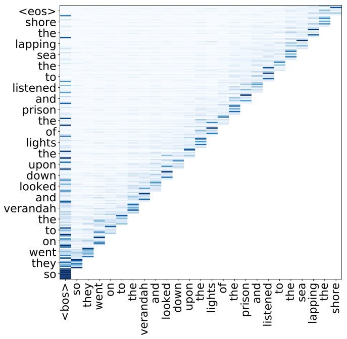
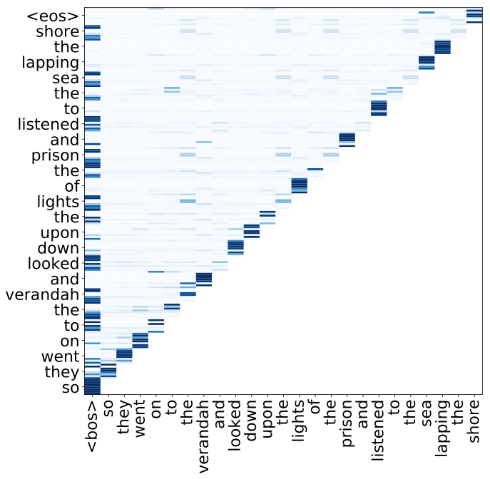
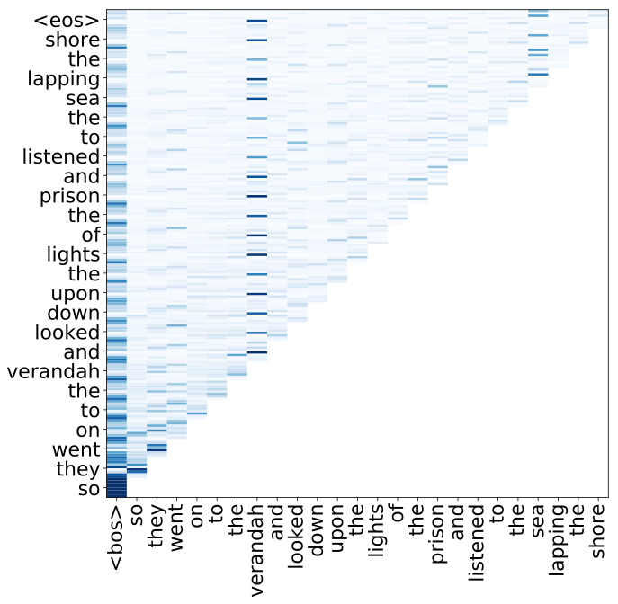
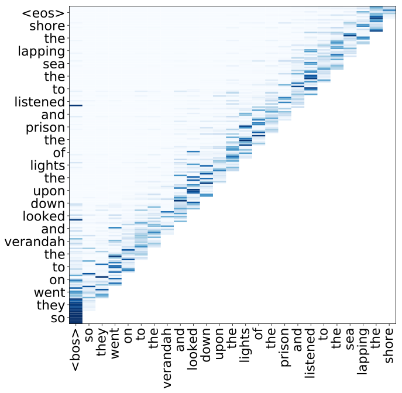
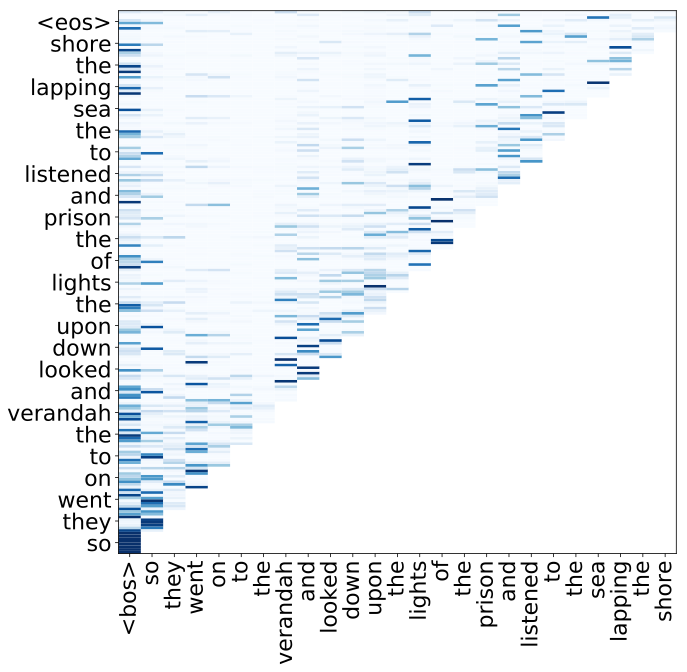

**Source:** *Language Modeling with Deep Transformers* — [PDF](https://arxiv.org/pdf/1905.04226) · [arXiv](https://arxiv.org/abs/1905.04226)

# Language Modeling with Deep Transformers

###### Abstract

We explore deep autoregressive Transformer models in language modeling for speech recognition. We focus on two aspects. First, we revisit Transformer model configurations specifically for language modeling. We show that well configured Transformer models outperform our baseline models based on the shallow stack of LSTM recurrent neural network layers. We carry out experiments on the open-source LibriSpeech 960hr task, for both 200K vocabulary word-level and 10K byte-pair encoding subword-level language modeling. We apply our word-level models to conventional hybrid speech recognition by lattice rescoring, and the subword-level models to attention based encoder-decoder models by shallow fusion. Second, we show that deep Transformer language models do not require positional encoding. The positional encoding is an essential augmentation for the self-attention mechanism which is invariant to sequence ordering. However, in autoregressive setup, as is the case for language modeling, the amount of information increases along the position dimension, which is a positional signal by its own. The analysis of attention weights shows that deep autoregressive self-attention models can automatically make use of such positional information. We find that removing the positional encoding even slightly improves the performance of these models.

Kazuki Irie1, Albert Zeyer1,2, Ralf Schlüter1, Hermann Ney1,2   

1Human Language Technology and Pattern Recognition Group, Computer Science Department   
RWTH Aachen University, 52074 Aachen, Germany   
2AppTek GmbH, 52062 Aachen, Germany   

{irie, zeyer, schlueter, ney}@cs.rwth-aachen.de

Index Terms: language modeling, self-attention, Transformer, speech recognition

## 1 Introduction

Transformer encoder-decoder models [[1](https://arxiv.org/html/1905.04226#bib.bib1)] have become popular in natural language processing. The Transformer architecture allows to successfully train a deep stack of self-attention layers [[2](https://arxiv.org/html/1905.04226#bib.bib2), [3](https://arxiv.org/html/1905.04226#bib.bib3), [4](https://arxiv.org/html/1905.04226#bib.bib4)] via residual connections [[5](https://arxiv.org/html/1905.04226#bib.bib5)] and layer normalization [[6](https://arxiv.org/html/1905.04226#bib.bib6)]. The positional encodings [[1](https://arxiv.org/html/1905.04226#bib.bib1), [7](https://arxiv.org/html/1905.04226#bib.bib7)], typically based on sinusoidal functions, are used to provide the self-attention with the sequence order information. Across various applications, systematic improvements have been reported over the standard, multi-layer long short-term memory (LSTM) [[8](https://arxiv.org/html/1905.04226#bib.bib8)] recurrent neural network based models. While originally designed as an encoder-decoder architecture in machine translation, the encoder (e.g., [[9](https://arxiv.org/html/1905.04226#bib.bib9)]) and the decoder (e.g., [[10](https://arxiv.org/html/1905.04226#bib.bib10)]) components are also separately used in corresponding problems depending on whether the problem disposes the whole sequence for prediction or not.

A number of recent works have also shown impressive performance in language modeling using the Transformer decoder component [[10](https://arxiv.org/html/1905.04226#bib.bib10), [11](https://arxiv.org/html/1905.04226#bib.bib11), [12](https://arxiv.org/html/1905.04226#bib.bib12), [13](https://arxiv.org/html/1905.04226#bib.bib13), [14](https://arxiv.org/html/1905.04226#bib.bib14), [15](https://arxiv.org/html/1905.04226#bib.bib15)]. The earliest example can be found in [[10](https://arxiv.org/html/1905.04226#bib.bib10)] where such models are investigated for text generation. Recent works on training larger and deeper models [[12](https://arxiv.org/html/1905.04226#bib.bib12), [14](https://arxiv.org/html/1905.04226#bib.bib14), [15](https://arxiv.org/html/1905.04226#bib.bib15)] have shown further potential of the Transformer in language modeling. On the other hand, an obvious limitation of the Transformers is that their memory requirement linearly increases in terms of number of tokens in the sequence, which requires to work with a limited context window (basically a \(n\)-gram model where the typical number for \(n\) is 512) for tasks dealing with long sequences such as character-level language modeling [[12](https://arxiv.org/html/1905.04226#bib.bib12)]. Dai et al. [[11](https://arxiv.org/html/1905.04226#bib.bib11)] has introduced a segment-level recurrence and relative positional encoding in the Transformer language model to be able to potentially handle unlimited context.

In this work, we investigate deep autoregressive Transformers for language modeling in speech recognition. To be specific, we focus on two aspects. First, we revisit the parameter configurations of Transformers, originally engineered for the sequence-to-sequence problem [[1](https://arxiv.org/html/1905.04226#bib.bib1)], specifically for language modeling. We conduct experiments on the LibriSpeech automatic speech recognition (ASR) task [[16](https://arxiv.org/html/1905.04226#bib.bib16)] for both word-level conventional speech recognition and byte-pair encoding (BPE) [[17](https://arxiv.org/html/1905.04226#bib.bib17)] level end-to-end speech recognition [[18](https://arxiv.org/html/1905.04226#bib.bib18), [19](https://arxiv.org/html/1905.04226#bib.bib19)]. We apply our word-level models to hybrid speech recognition by lattice rescoring [[20](https://arxiv.org/html/1905.04226#bib.bib20)], and the BPE-level models to end-to-end models by _shallow fusion_ [[21](https://arxiv.org/html/1905.04226#bib.bib21), [22](https://arxiv.org/html/1905.04226#bib.bib22)]. We show that well configured Transformer language models outperform models based on the simple stack of LSTM RNN layers in terms of both perplexity and word error rate (WER).

Second, we experimentally show that the positional encoding is not needed for multi-layer autoregressive self-attention models. The visualization of the attention weights shows that when the sinusoidal positional encoding is provided with the input, the first layer of the Transformers learns to extract \(n\)-gram features (therefore making use of positional information). However, in the autoregressive problem where a new token is provided to the model at each time step, the amount of information the model has access to strictly increases from left to right at the lowest level of the network, which should provide some positional information by its own. We observe that deep Transformer language models without positional encoding automatically make use of such information, and even give slight improvements over models with positional encodings.

## 2 Related Work

The first part of our work follows the spirits of Al-Rfou et al.’s work [[12](https://arxiv.org/html/1905.04226#bib.bib12)] and Radford et al.’s work [[14](https://arxiv.org/html/1905.04226#bib.bib14), [15](https://arxiv.org/html/1905.04226#bib.bib15)] in investigating larger and deeper Transformers for language modeling. We show that deep Transformer language models can be successfully applied to speech recognition and give good performance. The second part of this work concerns the positional encoding, which is a crucial component in the original Transformer. A number of previous work investigated positional encoding variants to improve self-attention (e.g., [[23](https://arxiv.org/html/1905.04226#bib.bib23), [24](https://arxiv.org/html/1905.04226#bib.bib24), [25](https://arxiv.org/html/1905.04226#bib.bib25), [11](https://arxiv.org/html/1905.04226#bib.bib11)]). Previous works in Transformer language models systematically use positional encoding, either jointly learned one or the sinusoidal one (both cases are reported to give similar performance in [[12](https://arxiv.org/html/1905.04226#bib.bib12)]). We show that the deep autoregressive self-attention models do not require any explicit model for encoding positions to give the best performance.

## 3 Autoregressive Self-Attention

The language model we consider is based on the decoder component of the Transformer architecture [[1](https://arxiv.org/html/1905.04226#bib.bib1)]. Similar to previous work [[10](https://arxiv.org/html/1905.04226#bib.bib10), [14](https://arxiv.org/html/1905.04226#bib.bib14), [13](https://arxiv.org/html/1905.04226#bib.bib13), [12](https://arxiv.org/html/1905.04226#bib.bib12), [11](https://arxiv.org/html/1905.04226#bib.bib11), [15](https://arxiv.org/html/1905.04226#bib.bib15)], we define layer as a stack of two components: self-attention and feed-forward11 1 Typically called position-wise feed-forward module [[1](https://arxiv.org/html/1905.04226#bib.bib1)]. Here we omit position-wise as it is obvious for autoregressive models. modules.

The autoregressive self-attention module in the \(l\)-th layer transforms the input \(z_{t}^{(l-1)}\) at position \(t\) as follows:

\[\begin{aligned}
 & \displaystyle x_{t}^{(l)} & \displaystyle= & \displaystyle\LayerNorm(z_{t}^{(l-1)}) &  \\
 & \displaystyle q_{t}^{(l)},k_{t}^{(l)},v_{t}^{(l)} & \displaystyle= & \displaystyle Qx_{t}^{(l)},Kx_{t}^{(l)},Vx_{t}^{(l)} &  \\
 & \displaystyle h_{t}^{(l)} & \displaystyle= & \displaystyle\big(h_{t-1}^{(l)},(k_{t}^{(l)},v_{t}^{(l)})\big) &  \\
 & \displaystyle y_{t}^{(l)} & \displaystyle= & \displaystyle z_{t}^{(l-1)}+W_{0}\SelfAttention(h_{t}^{(l)},q_{t}^{(l)}) & 
\end{aligned}\]

 

where \(Q\), \(K\), \(V\), respectively denote query, key, value projection matrices, \(\LayerNorm\) denotes layer normalization [[6](https://arxiv.org/html/1905.04226#bib.bib6)], \(\SelfAttention\) denotes the scaled multi-head dot product self-attention [[1](https://arxiv.org/html/1905.04226#bib.bib1)], and \(W_{0}\) denotes the projection matrix for the residual connection [[5](https://arxiv.org/html/1905.04226#bib.bib5)].

The output \(y_{t}^{(l)}\) is then fed to the feed-forward module:

\[\begin{aligned}
 & \displaystyle m_{t}^{(l)} & \displaystyle= & \displaystyle\LayerNorm(y_{t}^{(l)}) &  \\
 & \displaystyle z_{t}^{(l)} & \displaystyle= & \displaystyle y_{t}^{(l)}+W_{2}\Activation(W_{1}m_{t}^{(l)}) & 
\end{aligned}\]

 

where \(\Activation\) is rectifier [[26](https://arxiv.org/html/1905.04226#bib.bib26)], Gaussian error linear unit (GELU) [[27](https://arxiv.org/html/1905.04226#bib.bib27), [15](https://arxiv.org/html/1905.04226#bib.bib15)], or gated linear unit (GLU) [[28](https://arxiv.org/html/1905.04226#bib.bib28)] in this work. The final model is build by stacking these layers multiple times.

The input of the network consists of the sum of the token embedding (word or BPE in this work) and the sinusoidal positional encoding as specified in [[1](https://arxiv.org/html/1905.04226#bib.bib1)]. The output softmax layer gives the probability distribution for the next token. As shown in the equations above, \(h_{t}^{(l)}\) can be seen as states of the Transformer model22 2 In principle, we could also consider an autoregressive self-attention model which updates states at all predecessor positions for each new input, which would be then much more computationally inefficient. (whose size, as opposed to the RNN states, linearly grows along the position dimension). During inference, these states are stored to avoid redundant computation. During training, the computation along the position dimension is parallelized for speed-up.

## 4 LibriSpeech Dataset

### 4.1 Language Modeling Data Descriptions

The LibriSpeech datasets [[16](https://arxiv.org/html/1905.04226#bib.bib16)] for language modeling consists of 800M-word text only data and 960hr of audio transcriptions which corresponds to 10M-word text data. Based on analysis of count model perplexities, we observe that the audio transcription part does not contain special domain signal which matches the development set. Therefore, we simply merge the two datasets to form a single dataset for language model training. The average sentence length in the resulting training data is 21 words with the maximum length of 600 words. The development and test sets respectively have two parts[[16](https://arxiv.org/html/1905.04226#bib.bib16)]: dev-clean, dev-other, test-clean, and test-other. This separation is based on the audio-level characteristics, therefore it has no special meaning for language modeling. In the experimental section, we denote by ”Dev” and ”Test” the concatenation of clean and other parts of the respective data. Both datasets consist of about 110K running words with average of 20 words per sentence. The word-level vocabulary contains 200K words. We report all perplexities without making use of contexts beyond the sentence boundary.

### 4.2 4-gram count and LSTM-RNN Baselines

We use the official 4-gram count language model provided with the LibriSpeech dataset [[16](https://arxiv.org/html/1905.04226#bib.bib16)]. No improvement in perplexity is observed when going up to 5-grams. For LSTM-RNN language models [[29](https://arxiv.org/html/1905.04226#bib.bib29)], we first train our base configuration; the model has 2 LSTM-RNN layers with 2048 nodes and the input projection layer of 128, where the dropout with a rate of 0.2 is applied between each layer. Since we observe that this model underfits the LibriSpeech training set, we remove the dropout and further increase the model size, which effectively give better perplexities as shown in Table [1](https://arxiv.org/html/1905.04226#S4.T1 "Table 1 ‣ 4.2 4-gram count and LSTM-RNN Baselines ‣ 4 LibriSpeech Dataset ‣ Language Modeling with Deep Transformers"). We find that improvements from simply stacking layers saturate at 4 layers even without overfitting. Introducing a small linear bottleneck layer (size 512 here) before the output layer can make the models compact but with a loss in performance. The best model we obtain has 2 layers with 4096 nodes. Relative improvements greater than 58% are obtained by the LSTM over the 4-gram language model.

Table 1:  Perplexities of the baseline models. 

<table id="S4.T1.10" class="ltx_tabular ltx_centering ltx_align_middle">
<tbody class="ltx_tbody">
<tr id="S4.T1.10.1" class="ltx_tr">
<td id="S4.T1.10.1.1" class="ltx_td ltx_align_left ltx_border_l ltx_border_r ltx_border_t" style="padding-left:2.8pt;padding-right:2.8pt;" rowspan="2">Model</td>
<td id="S4.T1.10.1.2" class="ltx_td ltx_align_center ltx_border_r ltx_border_t" style="padding-left:2.8pt;padding-right:2.8pt;">Drop-</td>
<td id="S4.T1.10.1.3" class="ltx_td ltx_align_center ltx_border_rr ltx_border_t" style="padding-left:2.8pt;padding-right:2.8pt;">Bottle-</td>
<td id="S4.T1.10.1.4" class="ltx_td ltx_align_center ltx_border_r ltx_border_t" style="padding-left:2.8pt;padding-right:2.8pt;">Num.</td>
<td id="S4.T1.10.1.5" class="ltx_td ltx_align_center ltx_border_r ltx_border_t" style="padding-left:2.8pt;padding-right:2.8pt;">Num.</td>
<td id="S4.T1.10.1.6" class="ltx_td ltx_align_center ltx_border_rr ltx_border_t" style="padding-left:2.8pt;padding-right:2.8pt;">Params</td>
<td id="S4.T1.10.1.7" class="ltx_td ltx_align_right ltx_border_r ltx_border_t" style="padding-left:2.8pt;padding-right:2.8pt;" rowspan="2">Dev</td>
<td id="S4.T1.10.1.8" class="ltx_td ltx_align_right ltx_border_r ltx_border_t" style="padding-left:2.8pt;padding-right:2.8pt;" rowspan="2">Test</td></tr>
<tr id="S4.T1.10.2" class="ltx_tr">
<td id="S4.T1.10.2.1" class="ltx_td ltx_align_center ltx_border_r" style="padding-left:2.8pt;padding-right:2.8pt;">out</td>
<td id="S4.T1.10.2.2" class="ltx_td ltx_align_center ltx_border_rr" style="padding-left:2.8pt;padding-right:2.8pt;">beck</td>
<td id="S4.T1.10.2.3" class="ltx_td ltx_align_center ltx_border_r" style="padding-left:2.8pt;padding-right:2.8pt;">units</td>
<td id="S4.T1.10.2.4" class="ltx_td ltx_align_center ltx_border_r" style="padding-left:2.8pt;padding-right:2.8pt;">layers</td>
<td id="S4.T1.10.2.5" class="ltx_td ltx_align_center ltx_border_rr" style="padding-left:2.8pt;padding-right:2.8pt;">in M</td></tr>
<tr id="S4.T1.10.3" class="ltx_tr">
<td id="S4.T1.10.3.1" class="ltx_td ltx_align_left ltx_border_l ltx_border_r ltx_border_t" style="padding-left:2.8pt;padding-right:2.8pt;">4-gram</td>
<td id="S4.T1.10.3.2" class="ltx_td ltx_align_center ltx_border_r ltx_border_t" style="padding-left:2.8pt;padding-right:2.8pt;">-</td>
<td id="S4.T1.10.3.3" class="ltx_td ltx_align_center ltx_border_rr ltx_border_t" style="padding-left:2.8pt;padding-right:2.8pt;">-</td>
<td id="S4.T1.10.3.4" class="ltx_td ltx_align_center ltx_border_r ltx_border_t" style="padding-left:2.8pt;padding-right:2.8pt;">-</td>
<td id="S4.T1.10.3.5" class="ltx_td ltx_align_center ltx_border_r ltx_border_t" style="padding-left:2.8pt;padding-right:2.8pt;">-</td>
<td id="S4.T1.10.3.6" class="ltx_td ltx_align_center ltx_border_rr ltx_border_t" style="padding-left:2.8pt;padding-right:2.8pt;">230</td>
<td id="S4.T1.10.3.7" class="ltx_td ltx_align_right ltx_border_r ltx_border_t" style="padding-left:2.8pt;padding-right:2.8pt;">146.2</td>
<td id="S4.T1.10.3.8" class="ltx_td ltx_align_right ltx_border_r ltx_border_t" style="padding-left:2.8pt;padding-right:2.8pt;">151.8</td></tr>
<tr id="S4.T1.10.4" class="ltx_tr">
<td id="S4.T1.10.4.1" class="ltx_td ltx_align_left ltx_border_b ltx_border_l ltx_border_r ltx_border_t" style="padding-left:2.8pt;padding-right:2.8pt;" rowspan="10">LSTM</td>
<td id="S4.T1.10.4.2" class="ltx_td ltx_align_center ltx_border_r ltx_border_t" style="padding-left:2.8pt;padding-right:2.8pt;">0.2</td>
<td id="S4.T1.10.4.3" class="ltx_td ltx_align_center ltx_border_rr ltx_border_t" style="padding-left:2.8pt;padding-right:2.8pt;" rowspan="8">None</td>
<td id="S4.T1.10.4.4" class="ltx_td ltx_align_center ltx_border_r ltx_border_t" style="padding-left:2.8pt;padding-right:2.8pt;" rowspan="7">2048</td>
<td id="S4.T1.10.4.5" class="ltx_td ltx_align_center ltx_border_r ltx_border_t" style="padding-left:2.8pt;padding-right:2.8pt;" rowspan="2">2</td>
<td id="S4.T1.10.4.6" class="ltx_td ltx_align_center ltx_border_rr ltx_border_t" style="padding-left:2.8pt;padding-right:2.8pt;" rowspan="2">487</td>
<td id="S4.T1.10.4.7" class="ltx_td ltx_align_right ltx_border_r ltx_border_t" style="padding-left:2.8pt;padding-right:2.8pt;">71.3</td>
<td id="S4.T1.10.4.8" class="ltx_td ltx_align_right ltx_border_r ltx_border_t" style="padding-left:2.8pt;padding-right:2.8pt;">74.8</td></tr>
<tr id="S4.T1.10.5" class="ltx_tr">
<td id="S4.T1.10.5.1" class="ltx_td ltx_align_center ltx_border_b ltx_border_r ltx_border_t" style="padding-left:2.8pt;padding-right:2.8pt;" rowspan="9">0.0</td>
<td id="S4.T1.10.5.2" class="ltx_td ltx_align_right ltx_border_r ltx_border_t" style="padding-left:2.8pt;padding-right:2.8pt;">66.6</td>
<td id="S4.T1.10.5.3" class="ltx_td ltx_align_right ltx_border_r ltx_border_t" style="padding-left:2.8pt;padding-right:2.8pt;">69.9</td></tr>
<tr id="S4.T1.10.6" class="ltx_tr">
<td id="S4.T1.10.6.1" class="ltx_td ltx_align_center ltx_border_r ltx_border_t" style="padding-left:2.8pt;padding-right:2.8pt;">3</td>
<td id="S4.T1.10.6.2" class="ltx_td ltx_align_center ltx_border_rr ltx_border_t" style="padding-left:2.8pt;padding-right:2.8pt;">520</td>
<td id="S4.T1.10.6.3" class="ltx_td ltx_align_right ltx_border_r" style="padding-left:2.8pt;padding-right:2.8pt;">64.0</td>
<td id="S4.T1.10.6.4" class="ltx_td ltx_align_right ltx_border_r" style="padding-left:2.8pt;padding-right:2.8pt;">67.2</td></tr>
<tr id="S4.T1.10.7" class="ltx_tr">
<td id="S4.T1.10.7.1" class="ltx_td ltx_align_center ltx_border_r ltx_border_t" style="padding-left:2.8pt;padding-right:2.8pt;">4</td>
<td id="S4.T1.10.7.2" class="ltx_td ltx_align_center ltx_border_rr ltx_border_t" style="padding-left:2.8pt;padding-right:2.8pt;">554</td>
<td id="S4.T1.10.7.3" class="ltx_td ltx_align_right ltx_border_r" style="padding-left:2.8pt;padding-right:2.8pt;">61.9</td>
<td id="S4.T1.10.7.4" class="ltx_td ltx_align_right ltx_border_r" style="padding-left:2.8pt;padding-right:2.8pt;">64.9</td></tr>
<tr id="S4.T1.10.8" class="ltx_tr">
<td id="S4.T1.10.8.1" class="ltx_td ltx_align_center ltx_border_r ltx_border_t" style="padding-left:2.8pt;padding-right:2.8pt;">5</td>
<td id="S4.T1.10.8.2" class="ltx_td ltx_align_center ltx_border_rr ltx_border_t" style="padding-left:2.8pt;padding-right:2.8pt;">587</td>
<td id="S4.T1.10.8.3" class="ltx_td ltx_align_right ltx_border_r" style="padding-left:2.8pt;padding-right:2.8pt;">62.7</td>
<td id="S4.T1.10.8.4" class="ltx_td ltx_align_right ltx_border_r" style="padding-left:2.8pt;padding-right:2.8pt;">65.9</td></tr>
<tr id="S4.T1.10.9" class="ltx_tr">
<td id="S4.T1.10.9.1" class="ltx_td ltx_align_center ltx_border_r ltx_border_t" style="padding-left:2.8pt;padding-right:2.8pt;">6</td>
<td id="S4.T1.10.9.2" class="ltx_td ltx_align_center ltx_border_rr ltx_border_t" style="padding-left:2.8pt;padding-right:2.8pt;">621</td>
<td id="S4.T1.10.9.3" class="ltx_td ltx_align_right ltx_border_r" style="padding-left:2.8pt;padding-right:2.8pt;">64.5</td>
<td id="S4.T1.10.9.4" class="ltx_td ltx_align_right ltx_border_r" style="padding-left:2.8pt;padding-right:2.8pt;">67.5</td></tr>
<tr id="S4.T1.10.10" class="ltx_tr">
<td id="S4.T1.10.10.1" class="ltx_td ltx_align_center ltx_border_r ltx_border_t" style="padding-left:2.8pt;padding-right:2.8pt;">8</td>
<td id="S4.T1.10.10.2" class="ltx_td ltx_align_center ltx_border_rr ltx_border_t" style="padding-left:2.8pt;padding-right:2.8pt;">688</td>
<td id="S4.T1.10.10.3" class="ltx_td ltx_align_right ltx_border_r" style="padding-left:2.8pt;padding-right:2.8pt;">67.2</td>
<td id="S4.T1.10.10.4" class="ltx_td ltx_align_right ltx_border_r" style="padding-left:2.8pt;padding-right:2.8pt;">70.3</td></tr>
<tr id="S4.T1.10.11" class="ltx_tr">
<td id="S4.T1.10.11.1" class="ltx_td ltx_align_center ltx_border_r ltx_border_t" style="padding-left:2.8pt;padding-right:2.8pt;" rowspan="2">4096</td>
<td id="S4.T1.10.11.2" class="ltx_td ltx_align_center ltx_border_r ltx_border_t" style="padding-left:2.8pt;padding-right:2.8pt;" rowspan="2">2</td>
<td id="S4.T1.10.11.3" class="ltx_td ltx_align_center ltx_border_rr ltx_border_t" style="padding-left:2.8pt;padding-right:2.8pt;">1048</td>
<td id="S4.T1.10.11.4" class="ltx_td ltx_align_right ltx_border_r ltx_border_t" style="padding-left:2.8pt;padding-right:2.8pt;">60.2</td>
<td id="S4.T1.10.11.5" class="ltx_td ltx_align_right ltx_border_r ltx_border_t" style="padding-left:2.8pt;padding-right:2.8pt;">63.2</td></tr>
<tr id="S4.T1.10.12" class="ltx_tr">
<td id="S4.T1.10.12.1" class="ltx_td ltx_align_center ltx_border_b ltx_border_rr ltx_border_t" style="padding-left:2.8pt;padding-right:2.8pt;" rowspan="2">512</td>
<td id="S4.T1.10.12.2" class="ltx_td ltx_align_center ltx_border_rr ltx_border_t" style="padding-left:2.8pt;padding-right:2.8pt;">334</td>
<td id="S4.T1.10.12.3" class="ltx_td ltx_align_right ltx_border_r ltx_border_t" style="padding-left:2.8pt;padding-right:2.8pt;">63.1</td>
<td id="S4.T1.10.12.4" class="ltx_td ltx_align_right ltx_border_r ltx_border_t" style="padding-left:2.8pt;padding-right:2.8pt;">66.3</td></tr>
<tr id="S4.T1.10.13" class="ltx_tr">
<td id="S4.T1.10.13.1" class="ltx_td ltx_align_center ltx_border_b ltx_border_r ltx_border_t" style="padding-left:2.8pt;padding-right:2.8pt;">2048</td>
<td id="S4.T1.10.13.2" class="ltx_td ltx_align_center ltx_border_b ltx_border_r ltx_border_t" style="padding-left:2.8pt;padding-right:2.8pt;">4</td>
<td id="S4.T1.10.13.3" class="ltx_td ltx_align_center ltx_border_b ltx_border_rr ltx_border_t" style="padding-left:2.8pt;padding-right:2.8pt;">248</td>
<td id="S4.T1.10.13.4" class="ltx_td ltx_align_right ltx_border_b ltx_border_r" style="padding-left:2.8pt;padding-right:2.8pt;">64.5</td>
<td id="S4.T1.10.13.5" class="ltx_td ltx_align_right ltx_border_b ltx_border_r" style="padding-left:2.8pt;padding-right:2.8pt;">67.7</td></tr>
</tbody>
</table>

 

## 5 Text based Experiments

We carry out experiments for both word-level and BPE-level language modeling. We first focus on the word-level one.

### 5.1 Hyper-parameters in Transformers

The Transformer architecture is a new search space Odyssey [[30](https://arxiv.org/html/1905.04226#bib.bib30)]. The exhaustive model hyper-parameters for Transformer language models specified by the equations in Sec. [3](https://arxiv.org/html/1905.04226#S3 "3 Autoregressive Self-Attention ‣ Language Modeling with Deep Transformers") are the input token embedding size, the number of layers, the dimension of the residual connection, and for each layer the number of attention heads, the dimension of the key and query, the dimension of the value, and the dimension of the feed-forward layer.

In our experiments, we use the same dimension for key, query and value, as well as the residual connection. We use the same dimensionality across all layers. Therefore, our models can be fully specified by the tuple (number of layers \(L\), feed-forward dimension \(d_{ff}\), residual dimension \(d_{res}\), number of heads \(H\)). We do not apply any regularization method including dropout. We train all models using the plain stochastic gradient descent and new-bob learning rate tuning on a single GPU. We define our training sub-epoch (for new-bob) as the 10th of the full training data. All our implementations are based on the Tensorflow [[31](https://arxiv.org/html/1905.04226#bib.bib31)] based open-source toolkit RETURNN [[32](https://arxiv.org/html/1905.04226#bib.bib32)]33 3 Training configuration files and trained models are available at <https://github.com/rwth-i6/returnn-experiments/tree/master/2019-lm-transformers>..

### 5.2 Hyper-parameter Tuning

Given the amount of LibriSpeech training data (810M words), it is unreasonable to train all model variants until full convergence. The earlier stage of the training already consistently indicates the potential performance of the models. Therefore, we first carry out comparisons between models with different configuration at the equal, large enough, but reasonable number of updates.

The first set of comparison investigates the effect of depth and width. The perplexity results can be found in Table [2](https://arxiv.org/html/1905.04226#S5.T2 "Table 2 ‣ 5.2 Hyper-parameter Tuning ‣ 5 Text based Experiments ‣ Language Modeling with Deep Transformers"). All models in the table use 8 attention heads. Other parameters are specified in the table. The table is organized in three parts. The upper part of Table [2](https://arxiv.org/html/1905.04226#S5.T2 "Table 2 ‣ 5.2 Hyper-parameter Tuning ‣ 5 Text based Experiments ‣ Language Modeling with Deep Transformers") shows the effect of number of layers; we observe that increasing number of layers (therefore the number of parameters) from 1 to 42 gradually improves the perplexity. In the middle part of Table [2](https://arxiv.org/html/1905.04226#S5.T2 "Table 2 ‣ 5.2 Hyper-parameter Tuning ‣ 5 Text based Experiments ‣ Language Modeling with Deep Transformers") , we vary both the number of layers, feed-forward dimension, and the residual dimension. First of all, the 12-layer \((12,4096,512,8)\) model outperforms the 6-layer \((6,8192,512,8)\) model, while having similar number of parameters, which seems to indicate that the depth effectively benefits Transformer language models. We also train an extreme model which has only 2 layers with wide dimensions \((2,8192,2048,8)\). The number of parameters in fact blows up because of the large value of \(d_{res}\) which results in a large matrix in the output softmax layer with 200K vocabulary44 4 We note that this is also the reason why the number of parameters of our baseline LSTM language models in Table [1](https://arxiv.org/html/1905.04226#S4.T1 "Table 1 ‣ 4.2 4-gram count and LSTM-RNN Baselines ‣ 4 LibriSpeech Dataset ‣ Language Modeling with Deep Transformers") is relatively high.. We observe that such wide but shallow models do not perform well55 5 Since the softmax bottleneck dimension typically needs to be large for the best performance ([[33](https://arxiv.org/html/1905.04226#bib.bib33)]; Table [1](https://arxiv.org/html/1905.04226#S4.T1 "Table 1 ‣ 4.2 4-gram count and LSTM-RNN Baselines ‣ 4 LibriSpeech Dataset ‣ Language Modeling with Deep Transformers")), we also train a (12, 2048, 512, 8) model where we insert an additional projection layer with a large dimension (2048) before the output layer; no improvement was obtained. . Finally, the lower part of Table [2](https://arxiv.org/html/1905.04226#S5.T2 "Table 2 ‣ 5.2 Hyper-parameter Tuning ‣ 5 Text based Experiments ‣ Language Modeling with Deep Transformers") shows deeper models with a smaller input dimension.

Table 2:  Perplexity after 2.5 epoch (25 sub-epochs in our setup; 6.5M updates). The number of heads \(H\) is 8 for all models below. 

<table id="S5.T2.11" class="ltx_tabular ltx_centering ltx_align_middle">
<tbody class="ltx_tbody">
<tr id="S5.T2.11.1" class="ltx_tr">
<td id="S5.T2.11.1.1" class="ltx_td ltx_align_center ltx_border_l ltx_border_r ltx_border_t" style="padding-left:2.8pt;padding-right:2.8pt;">Input</td>
<td id="S5.T2.11.1.2" class="ltx_td ltx_align_center ltx_border_r ltx_border_t" style="padding-left:2.8pt;padding-right:2.8pt;" rowspan="2"><math id="S5.T2.m3" class="ltx_Math" alttext="L" display="inline" intent=":literal"><semantics><mi>L</mi><annotation encoding="application/x-tex">L</annotation></semantics></math></td>
<td id="S5.T2.11.1.3" class="ltx_td ltx_align_center ltx_border_r ltx_border_t" style="padding-left:2.8pt;padding-right:2.8pt;" rowspan="2"><math id="S5.T2.m4" class="ltx_Math" alttext="d_{ff}" display="inline" intent=":literal"><semantics><msub><mi>d</mi><mrow><mi>f</mi><mo lspace="0em" rspace="0em">​</mo><mi>f</mi></mrow></msub><annotation encoding="application/x-tex">d_{ff}</annotation></semantics></math></td>
<td id="S5.T2.11.1.4" class="ltx_td ltx_align_center ltx_border_r ltx_border_t" style="padding-left:2.8pt;padding-right:2.8pt;" rowspan="2"><math id="S5.T2.m5" class="ltx_Math" alttext="d_{res}" display="inline" intent=":literal"><semantics><msub><mi>d</mi><mrow><mi>r</mi><mo lspace="0em" rspace="0em">​</mo><mi>e</mi><mo lspace="0em" rspace="0em">​</mo><mi>s</mi></mrow></msub><annotation encoding="application/x-tex">d_{res}</annotation></semantics></math></td>
<td id="S5.T2.11.1.5" class="ltx_td ltx_align_center ltx_border_rr ltx_border_t" style="padding-left:2.8pt;padding-right:2.8pt;">Params.</td>
<td id="S5.T2.11.1.6" class="ltx_td ltx_align_center ltx_border_r ltx_border_t" style="padding-left:2.8pt;padding-right:2.8pt;" colspan="2">Perplexity</td></tr>
<tr id="S5.T2.11.2" class="ltx_tr">
<td id="S5.T2.11.2.1" class="ltx_td ltx_align_center ltx_border_l ltx_border_r" style="padding-left:2.8pt;padding-right:2.8pt;">emb.</td>
<td id="S5.T2.11.2.2" class="ltx_td ltx_align_center ltx_border_rr" style="padding-left:2.8pt;padding-right:2.8pt;">in M</td>
<td id="S5.T2.11.2.3" class="ltx_td ltx_align_right ltx_border_r ltx_border_t" style="padding-left:2.8pt;padding-right:2.8pt;">Train</td>
<td id="S5.T2.11.2.4" class="ltx_td ltx_align_center ltx_border_l ltx_border_r ltx_border_t" style="padding-left:2.8pt;padding-right:2.8pt;">Dev</td></tr>
<tr id="S5.T2.11.3" class="ltx_tr">
<td id="S5.T2.11.3.1" class="ltx_td ltx_align_center ltx_border_l ltx_border_r ltx_border_tt" style="padding-left:2.8pt;padding-right:2.8pt;" rowspan="6">512</td>
<td id="S5.T2.11.3.2" class="ltx_td ltx_align_center ltx_border_r ltx_border_tt" style="padding-left:2.8pt;padding-right:2.8pt;">1</td>
<td id="S5.T2.11.3.3" class="ltx_td ltx_align_center ltx_border_r ltx_border_tt" style="padding-left:2.8pt;padding-right:2.8pt;" rowspan="6">2048</td>
<td id="S5.T2.11.3.4" class="ltx_td ltx_align_center ltx_border_r ltx_border_tt" style="padding-left:2.8pt;padding-right:2.8pt;" rowspan="6">512</td>
<td id="S5.T2.11.3.5" class="ltx_td ltx_align_center ltx_border_rr ltx_border_tt" style="padding-left:2.8pt;padding-right:2.8pt;">208</td>
<td id="S5.T2.11.3.6" class="ltx_td ltx_align_right ltx_border_r ltx_border_tt" style="padding-left:2.8pt;padding-right:2.8pt;">108.3</td>
<td id="S5.T2.11.3.7" class="ltx_td ltx_align_right ltx_border_r ltx_border_tt" style="padding-left:2.8pt;padding-right:2.8pt;">104.9</td></tr>
<tr id="S5.T2.11.4" class="ltx_tr">
<td id="S5.T2.11.4.1" class="ltx_td ltx_align_center ltx_border_r" style="padding-left:2.8pt;padding-right:2.8pt;">6</td>
<td id="S5.T2.11.4.2" class="ltx_td ltx_align_center ltx_border_rr" style="padding-left:2.8pt;padding-right:2.8pt;">224</td>
<td id="S5.T2.11.4.3" class="ltx_td ltx_align_right ltx_border_r" style="padding-left:2.8pt;padding-right:2.8pt;">75.7</td>
<td id="S5.T2.11.4.4" class="ltx_td ltx_align_right ltx_border_r" style="padding-left:2.8pt;padding-right:2.8pt;">74.3</td></tr>
<tr id="S5.T2.11.5" class="ltx_tr">
<td id="S5.T2.11.5.1" class="ltx_td ltx_align_center ltx_border_r" style="padding-left:2.8pt;padding-right:2.8pt;">12</td>
<td id="S5.T2.11.5.2" class="ltx_td ltx_align_center ltx_border_rr" style="padding-left:2.8pt;padding-right:2.8pt;">243</td>
<td id="S5.T2.11.5.3" class="ltx_td ltx_align_right ltx_border_r" style="padding-left:2.8pt;padding-right:2.8pt;">67.6</td>
<td id="S5.T2.11.5.4" class="ltx_td ltx_align_right ltx_border_r" style="padding-left:2.8pt;padding-right:2.8pt;">67.1</td></tr>
<tr id="S5.T2.11.6" class="ltx_tr">
<td id="S5.T2.11.6.1" class="ltx_td ltx_align_center ltx_border_r" style="padding-left:2.8pt;padding-right:2.8pt;">24</td>
<td id="S5.T2.11.6.2" class="ltx_td ltx_align_center ltx_border_rr" style="padding-left:2.8pt;padding-right:2.8pt;">281</td>
<td id="S5.T2.11.6.3" class="ltx_td ltx_align_right ltx_border_r" style="padding-left:2.8pt;padding-right:2.8pt;">62.2</td>
<td id="S5.T2.11.6.4" class="ltx_td ltx_align_right ltx_border_r" style="padding-left:2.8pt;padding-right:2.8pt;">62.3</td></tr>
<tr id="S5.T2.11.7" class="ltx_tr">
<td id="S5.T2.11.7.1" class="ltx_td ltx_align_center ltx_border_r" style="padding-left:2.8pt;padding-right:2.8pt;">32</td>
<td id="S5.T2.11.7.2" class="ltx_td ltx_align_center ltx_border_rr" style="padding-left:2.8pt;padding-right:2.8pt;">306</td>
<td id="S5.T2.11.7.3" class="ltx_td ltx_align_right ltx_border_r" style="padding-left:2.8pt;padding-right:2.8pt;">60.1</td>
<td id="S5.T2.11.7.4" class="ltx_td ltx_align_right ltx_border_r" style="padding-left:2.8pt;padding-right:2.8pt;">60.6</td></tr>
<tr id="S5.T2.11.8" class="ltx_tr">
<td id="S5.T2.11.8.1" class="ltx_td ltx_align_center ltx_border_r" style="padding-left:2.8pt;padding-right:2.8pt;">42</td>
<td id="S5.T2.11.8.2" class="ltx_td ltx_align_center ltx_border_rr" style="padding-left:2.8pt;padding-right:2.8pt;">338</td>
<td id="S5.T2.11.8.3" class="ltx_td ltx_align_right ltx_border_r" style="padding-left:2.8pt;padding-right:2.8pt;">59.0</td>
<td id="S5.T2.11.8.4" class="ltx_td ltx_align_right ltx_border_r" style="padding-left:2.8pt;padding-right:2.8pt;">59.6</td></tr>
<tr id="S5.T2.11.9" class="ltx_tr">
<td id="S5.T2.11.9.1" class="ltx_td ltx_align_center ltx_border_l ltx_border_r ltx_border_tt" style="padding-left:2.8pt;padding-right:2.8pt;" rowspan="5">512</td>
<td id="S5.T2.11.9.2" class="ltx_td ltx_align_center ltx_border_r ltx_border_tt" style="padding-left:2.8pt;padding-right:2.8pt;">2</td>
<td id="S5.T2.11.9.3" class="ltx_td ltx_align_center ltx_border_r ltx_border_tt" style="padding-left:2.8pt;padding-right:2.8pt;" rowspan="2">8192</td>
<td id="S5.T2.11.9.4" class="ltx_td ltx_align_center ltx_border_r ltx_border_tt" style="padding-left:2.8pt;padding-right:2.8pt;">2048</td>
<td id="S5.T2.11.9.5" class="ltx_td ltx_align_center ltx_border_rr ltx_border_tt" style="padding-left:2.8pt;padding-right:2.8pt;">536</td>
<td id="S5.T2.11.9.6" class="ltx_td ltx_align_right ltx_border_r ltx_border_tt" style="padding-left:2.8pt;padding-right:2.8pt;">73.1</td>
<td id="S5.T2.11.9.7" class="ltx_td ltx_align_right ltx_border_r ltx_border_tt" style="padding-left:2.8pt;padding-right:2.8pt;">73.8</td></tr>
<tr id="S5.T2.11.10" class="ltx_tr">
<td id="S5.T2.11.10.1" class="ltx_td ltx_align_center ltx_border_r" style="padding-left:2.8pt;padding-right:2.8pt;">6</td>
<td id="S5.T2.11.10.2" class="ltx_td ltx_align_center ltx_border_r ltx_border_t" style="padding-left:2.8pt;padding-right:2.8pt;" rowspan="4">512</td>
<td id="S5.T2.11.10.3" class="ltx_td ltx_align_center ltx_border_rr" style="padding-left:2.8pt;padding-right:2.8pt;">262</td>
<td id="S5.T2.11.10.4" class="ltx_td ltx_align_right ltx_border_r" style="padding-left:2.8pt;padding-right:2.8pt;">66.7</td>
<td id="S5.T2.11.10.5" class="ltx_td ltx_align_right ltx_border_r" style="padding-left:2.8pt;padding-right:2.8pt;">66.7</td></tr>
<tr id="S5.T2.11.11" class="ltx_tr">
<td id="S5.T2.11.11.1" class="ltx_td ltx_align_center ltx_border_r" style="padding-left:2.8pt;padding-right:2.8pt;">12</td>
<td id="S5.T2.11.11.2" class="ltx_td ltx_align_center ltx_border_r ltx_border_t" style="padding-left:2.8pt;padding-right:2.8pt;">4096</td>
<td id="S5.T2.11.11.3" class="ltx_td ltx_align_center ltx_border_rr" style="padding-left:2.8pt;padding-right:2.8pt;">268</td>
<td id="S5.T2.11.11.4" class="ltx_td ltx_align_right ltx_border_r" style="padding-left:2.8pt;padding-right:2.8pt;">63.5</td>
<td id="S5.T2.11.11.5" class="ltx_td ltx_align_right ltx_border_r" style="padding-left:2.8pt;padding-right:2.8pt;">63.8</td></tr>
<tr id="S5.T2.11.12" class="ltx_tr">
<td id="S5.T2.11.12.1" class="ltx_td ltx_align_center ltx_border_r ltx_border_t" style="padding-left:2.8pt;padding-right:2.8pt;" rowspan="2">4</td>
<td id="S5.T2.11.12.2" class="ltx_td ltx_align_center ltx_border_r ltx_border_t" style="padding-left:2.8pt;padding-right:2.8pt;">16384</td>
<td id="S5.T2.11.12.3" class="ltx_td ltx_align_center ltx_border_rr" style="padding-left:2.8pt;padding-right:2.8pt;">277</td>
<td id="S5.T2.11.12.4" class="ltx_td ltx_align_right ltx_border_r" style="padding-left:2.8pt;padding-right:2.8pt;">67.6</td>
<td id="S5.T2.11.12.5" class="ltx_td ltx_align_right ltx_border_r" style="padding-left:2.8pt;padding-right:2.8pt;">67.4</td></tr>
<tr id="S5.T2.11.13" class="ltx_tr">
<td id="S5.T2.11.13.1" class="ltx_td ltx_align_center ltx_border_r ltx_border_t" style="padding-left:2.8pt;padding-right:2.8pt;">32768</td>
<td id="S5.T2.11.13.2" class="ltx_td ltx_align_center ltx_border_rr" style="padding-left:2.8pt;padding-right:2.8pt;">344</td>
<td id="S5.T2.11.13.3" class="ltx_td ltx_align_right ltx_border_r" style="padding-left:2.8pt;padding-right:2.8pt;">65.4</td>
<td id="S5.T2.11.13.4" class="ltx_td ltx_align_right ltx_border_r" style="padding-left:2.8pt;padding-right:2.8pt;">68.4</td></tr>
<tr id="S5.T2.11.14" class="ltx_tr">
<td id="S5.T2.11.14.1" class="ltx_td ltx_align_center ltx_border_b ltx_border_l ltx_border_r ltx_border_tt" style="padding-left:2.8pt;padding-right:2.8pt;" rowspan="4">128</td>
<td id="S5.T2.11.14.2" class="ltx_td ltx_align_center ltx_border_r ltx_border_tt" style="padding-left:2.8pt;padding-right:2.8pt;">64</td>
<td id="S5.T2.11.14.3" class="ltx_td ltx_align_center ltx_border_b ltx_border_r ltx_border_tt" style="padding-left:2.8pt;padding-right:2.8pt;" rowspan="4">2048</td>
<td id="S5.T2.11.14.4" class="ltx_td ltx_align_center ltx_border_b ltx_border_r ltx_border_tt" style="padding-left:2.8pt;padding-right:2.8pt;" rowspan="4">512</td>
<td id="S5.T2.11.14.5" class="ltx_td ltx_align_center ltx_border_rr ltx_border_tt" style="padding-left:2.8pt;padding-right:2.8pt;">330</td>
<td id="S5.T2.11.14.6" class="ltx_td ltx_align_right ltx_border_r ltx_border_tt" style="padding-left:2.8pt;padding-right:2.8pt;">56.3</td>
<td id="S5.T2.11.14.7" class="ltx_td ltx_align_right ltx_border_r ltx_border_tt" style="padding-left:2.8pt;padding-right:2.8pt;">57.6</td></tr>
<tr id="S5.T2.11.15" class="ltx_tr">
<td id="S5.T2.11.15.1" class="ltx_td ltx_align_center ltx_border_r" style="padding-left:2.8pt;padding-right:2.8pt;">80</td>
<td id="S5.T2.11.15.2" class="ltx_td ltx_align_center ltx_border_rr" style="padding-left:2.8pt;padding-right:2.8pt;">380</td>
<td id="S5.T2.11.15.3" class="ltx_td ltx_align_right ltx_border_r" style="padding-left:2.8pt;padding-right:2.8pt;">53.1</td>
<td id="S5.T2.11.15.4" class="ltx_td ltx_align_right ltx_border_r" style="padding-left:2.8pt;padding-right:2.8pt;">55.5</td></tr>
<tr id="S5.T2.11.16" class="ltx_tr">
<td id="S5.T2.11.16.1" class="ltx_td ltx_align_center ltx_border_r" style="padding-left:2.8pt;padding-right:2.8pt;">96</td>
<td id="S5.T2.11.16.2" class="ltx_td ltx_align_center ltx_border_rr" style="padding-left:2.8pt;padding-right:2.8pt;">431</td>
<td id="S5.T2.11.16.3" class="ltx_td ltx_align_right ltx_border_r" style="padding-left:2.8pt;padding-right:2.8pt;">51.9</td>
<td id="S5.T2.11.16.4" class="ltx_td ltx_align_right ltx_border_r" style="padding-left:2.8pt;padding-right:2.8pt;">54.9</td></tr>
<tr id="S5.T2.11.17" class="ltx_tr">
<td id="S5.T2.11.17.1" class="ltx_td ltx_align_center ltx_border_b ltx_border_r" style="padding-left:2.8pt;padding-right:2.8pt;">112</td>
<td id="S5.T2.11.17.2" class="ltx_td ltx_align_center ltx_border_b ltx_border_rr" style="padding-left:2.8pt;padding-right:2.8pt;">481</td>
<td id="S5.T2.11.17.3" class="ltx_td ltx_align_right ltx_border_b ltx_border_r" style="padding-left:2.8pt;padding-right:2.8pt;">51.5</td>
<td id="S5.T2.11.17.4" class="ltx_td ltx_align_right ltx_border_b ltx_border_r" style="padding-left:2.8pt;padding-right:2.8pt;">54.5</td></tr>
</tbody>
</table>

 

Table [4](https://arxiv.org/html/1905.04226#S5.T4 "Table 4 ‣ 5.2 Hyper-parameter Tuning ‣ 5 Text based Experiments ‣ Language Modeling with Deep Transformers") shows the effect of number of attention heads. 16 heads which is the largest number we try in this setup give the best performance. In addition, we examine the type of activation function (Table [4](https://arxiv.org/html/1905.04226#S5.T4 "Table 4 ‣ 5.2 Hyper-parameter Tuning ‣ 5 Text based Experiments ‣ Language Modeling with Deep Transformers")). As opposed to previous work on feed-forward language models using GLUs [[28](https://arxiv.org/html/1905.04226#bib.bib28), [34](https://arxiv.org/html/1905.04226#bib.bib34)], we do not observe faster convergence. As we observe that the impact of choice of activation functions on the perplexity is overall limited, all our other models use the standard ReLU. As reported in the original Transformer, we confirm that both layer normalization and residual connections are needed for these models for stable training66 6 We tried to train multiple models without either residual connections or layer normalization. Also, following [[15](https://arxiv.org/html/1905.04226#bib.bib15)], we tried reorganizing the feed-forward module to insert one additional pre-activation layer normalization [[35](https://arxiv.org/html/1905.04226#bib.bib35)] and one more activation function. However, we did not observe any improvement. The original Transformers anyway do not have any activation on the residual path throughout the whole network..

Finally, we train models with the best configurations for longer. Table [5](https://arxiv.org/html/1905.04226#S5.T5 "Table 5 ‣ 5.2 Hyper-parameter Tuning ‣ 5 Text based Experiments ‣ Language Modeling with Deep Transformers") shows the perplexities which are better than those obtained by our LSTM based models (Table [1](https://arxiv.org/html/1905.04226#S4.T1 "Table 1 ‣ 4.2 4-gram count and LSTM-RNN Baselines ‣ 4 LibriSpeech Dataset ‣ Language Modeling with Deep Transformers")).

Table 3:  Effect of number of heads. Perplexity after 2.5 epoch for (12, 2048, 512, \(H\)).

<table id="S5.T4.fig1.9.1" class="ltx_tabular ltx_guessed_headers ltx_align_middle">
<thead class="ltx_thead">
<tr id="S5.T4.fig1.9.1.1" class="ltx_tr">
<th id="S5.T4.fig1.9.1.1.1" class="ltx_td ltx_align_center ltx_th ltx_th_column ltx_th_row ltx_border_l ltx_border_r ltx_border_t" rowspan="2"><math id="S5.T4.m3" class="ltx_Math" alttext="H" display="inline" intent=":literal"><semantics><mi>H</mi><annotation encoding="application/x-tex">H</annotation></semantics></math></th>
<th id="S5.T4.fig1.9.1.1.2" class="ltx_td ltx_align_center ltx_th ltx_th_column ltx_th_row ltx_border_rr ltx_border_t">Params.</th>
<th id="S5.T4.fig1.9.1.1.3" class="ltx_td ltx_align_center ltx_th ltx_th_column ltx_border_r ltx_border_t" colspan="2">Perplexity</th></tr>
<tr id="S5.T4.fig1.9.1.2" class="ltx_tr">
<th id="S5.T4.fig1.9.1.2.1" class="ltx_td ltx_align_center ltx_th ltx_th_column ltx_th_row ltx_border_rr">in M</th>
<th id="S5.T4.fig1.9.1.2.2" class="ltx_td ltx_align_right ltx_th ltx_th_column ltx_border_r ltx_border_t">Train</th>
<th id="S5.T4.fig1.9.1.2.3" class="ltx_td ltx_align_center ltx_th ltx_th_column ltx_border_l ltx_border_r ltx_border_t">Dev</th></tr>
</thead>
<tbody class="ltx_tbody">
<tr id="S5.T4.fig1.9.1.3" class="ltx_tr">
<th id="S5.T4.fig1.9.1.3.1" class="ltx_td ltx_align_center ltx_th ltx_th_row ltx_border_l ltx_border_r ltx_border_t">1</th>
<th id="S5.T4.fig1.9.1.3.2" class="ltx_td ltx_align_center ltx_th ltx_th_row ltx_border_b ltx_border_rr ltx_border_t" rowspan="4">243</th>
<td id="S5.T4.fig1.9.1.3.3" class="ltx_td ltx_align_right ltx_border_r ltx_border_t">71.9</td>
<td id="S5.T4.fig1.9.1.3.4" class="ltx_td ltx_align_right ltx_border_r ltx_border_t">70.8</td></tr>
<tr id="S5.T4.fig1.9.1.4" class="ltx_tr">
<th id="S5.T4.fig1.9.1.4.1" class="ltx_td ltx_align_center ltx_th ltx_th_row ltx_border_l ltx_border_r">4</th>
<td id="S5.T4.fig1.9.1.4.2" class="ltx_td ltx_align_right ltx_border_r">69.1</td>
<td id="S5.T4.fig1.9.1.4.3" class="ltx_td ltx_align_right ltx_border_r">68.6</td></tr>
<tr id="S5.T4.fig1.9.1.5" class="ltx_tr">
<th id="S5.T4.fig1.9.1.5.1" class="ltx_td ltx_align_center ltx_th ltx_th_row ltx_border_l ltx_border_r">8</th>
<td id="S5.T4.fig1.9.1.5.2" class="ltx_td ltx_align_right ltx_border_r">67.6</td>
<td id="S5.T4.fig1.9.1.5.3" class="ltx_td ltx_align_right ltx_border_r">67.1</td></tr>
<tr id="S5.T4.fig1.9.1.6" class="ltx_tr">
<th id="S5.T4.fig1.9.1.6.1" class="ltx_td ltx_align_center ltx_th ltx_th_row ltx_border_b ltx_border_l ltx_border_r">16</th>
<td id="S5.T4.fig1.9.1.6.2" class="ltx_td ltx_align_right ltx_border_b ltx_border_r">66.9</td>
<td id="S5.T4.fig1.9.1.6.3" class="ltx_td ltx_align_right ltx_border_b ltx_border_r">66.6</td></tr>
</tbody>
</table>

 

Table 4:  Effect of activation functions. Perplexity after 1 epoch (10 sub-epochs in our setup) for (24, 2048, 512, 8).

<table id="S5.T4.fig2.9.1" class="ltx_tabular ltx_guessed_headers ltx_align_middle">
<thead class="ltx_thead">
<tr id="S5.T4.fig2.9.1.1" class="ltx_tr">
<th id="S5.T4.fig2.9.1.1.1" class="ltx_td ltx_align_left ltx_th ltx_th_column ltx_th_row ltx_border_l ltx_border_r ltx_border_t" rowspan="2"><math id="S5.T4.m4" class="ltx_Math" alttext="\Activation" display="inline" intent=":literal"><semantics><mi mathsize="0.890em">Activation</mi><annotation encoding="application/x-tex">\Activation</annotation></semantics></math></th>
<th id="S5.T4.fig2.9.1.1.2" class="ltx_td ltx_align_center ltx_th ltx_th_column ltx_border_r ltx_border_t" colspan="2">Perplexity</th></tr>
<tr id="S5.T4.fig2.9.1.2" class="ltx_tr">
<th id="S5.T4.fig2.9.1.2.1" class="ltx_td ltx_align_right ltx_th ltx_th_column ltx_border_r ltx_border_t">Train</th>
<th id="S5.T4.fig2.9.1.2.2" class="ltx_td ltx_align_center ltx_th ltx_th_column ltx_border_l ltx_border_r ltx_border_t">Dev</th></tr>
</thead>
<tbody class="ltx_tbody">
<tr id="S5.T4.fig2.9.1.3" class="ltx_tr">
<th id="S5.T4.fig2.9.1.3.1" class="ltx_td ltx_align_left ltx_th ltx_th_row ltx_border_l ltx_border_r ltx_border_t">ReLU <cite class="ltx_cite ltx_citemacro_cite">[<a href="https://arxiv.org/html/1905.04226#bib.bib26" title="" class="ltx_ref">26</a>, <a href="https://arxiv.org/html/1905.04226#bib.bib1" title="" class="ltx_ref">1</a>]</cite></th>
<td id="S5.T4.fig2.9.1.3.2" class="ltx_td ltx_align_right ltx_border_r ltx_border_t">76.4</td>
<td id="S5.T4.fig2.9.1.3.3" class="ltx_td ltx_align_right ltx_border_r ltx_border_t">72.5</td></tr>
<tr id="S5.T4.fig2.9.1.4" class="ltx_tr">
<th id="S5.T4.fig2.9.1.4.1" class="ltx_td ltx_align_left ltx_th ltx_th_row ltx_border_l ltx_border_r">GLU <cite class="ltx_cite ltx_citemacro_cite">[<a href="https://arxiv.org/html/1905.04226#bib.bib28" title="" class="ltx_ref">28</a>]</cite></th>
<td id="S5.T4.fig2.9.1.4.2" class="ltx_td ltx_align_right ltx_border_r">76.5</td>
<td id="S5.T4.fig2.9.1.4.3" class="ltx_td ltx_align_right ltx_border_r">72.8</td></tr>
<tr id="S5.T4.fig2.9.1.5" class="ltx_tr">
<th id="S5.T4.fig2.9.1.5.1" class="ltx_td ltx_align_left ltx_th ltx_th_row ltx_border_b ltx_border_l ltx_border_r">GELU <cite class="ltx_cite ltx_citemacro_cite">[<a href="https://arxiv.org/html/1905.04226#bib.bib27" title="" class="ltx_ref">27</a>, <a href="https://arxiv.org/html/1905.04226#bib.bib15" title="" class="ltx_ref">15</a>]</cite></th>
<td id="S5.T4.fig2.9.1.5.2" class="ltx_td ltx_align_right ltx_border_b ltx_border_r">75.7</td>
<td id="S5.T4.fig2.9.1.5.3" class="ltx_td ltx_align_right ltx_border_b ltx_border_r">72.2</td></tr>
</tbody>
</table>

 

Table 5:  Perplexities after longer training. 

<table id="S5.T5.10" class="ltx_tabular ltx_centering ltx_align_middle">
<tbody class="ltx_tbody">
<tr id="S5.T5.10.1" class="ltx_tr">
<td id="S5.T5.10.1.1" class="ltx_td ltx_align_center ltx_border_l ltx_border_r ltx_border_t" style="padding-left:3.2pt;padding-right:3.2pt;">Max.</td>
<td id="S5.T5.10.1.2" class="ltx_td ltx_align_center ltx_border_rr ltx_border_t" style="padding-left:3.2pt;padding-right:3.2pt;">Conv-</td>
<td id="S5.T5.10.1.3" class="ltx_td ltx_align_center ltx_border_r ltx_border_t" style="padding-left:3.2pt;padding-right:3.2pt;" rowspan="2"><math id="S5.T5.m1" class="ltx_Math" alttext="L" display="inline" intent=":literal"><semantics><mi>L</mi><annotation encoding="application/x-tex">L</annotation></semantics></math></td>
<td id="S5.T5.10.1.4" class="ltx_td ltx_align_center ltx_border_r ltx_border_t" style="padding-left:3.2pt;padding-right:3.2pt;" rowspan="2"><math id="S5.T5.m2" class="ltx_Math" alttext="d_{ff}" display="inline" intent=":literal"><semantics><msub><mi>d</mi><mrow><mi>f</mi><mo lspace="0em" rspace="0em">​</mo><mi>f</mi></mrow></msub><annotation encoding="application/x-tex">d_{ff}</annotation></semantics></math></td>
<td id="S5.T5.10.1.5" class="ltx_td ltx_align_center ltx_border_r ltx_border_t" style="padding-left:3.2pt;padding-right:3.2pt;" rowspan="2"><math id="S5.T5.m3" class="ltx_Math" alttext="d_{res}" display="inline" intent=":literal"><semantics><msub><mi>d</mi><mrow><mi>r</mi><mo lspace="0em" rspace="0em">​</mo><mi>e</mi><mo lspace="0em" rspace="0em">​</mo><mi>s</mi></mrow></msub><annotation encoding="application/x-tex">d_{res}</annotation></semantics></math></td>
<td id="S5.T5.10.1.6" class="ltx_td ltx_align_center ltx_border_rr ltx_border_t" style="padding-left:3.2pt;padding-right:3.2pt;">Params.</td>
<td id="S5.T5.10.1.7" class="ltx_td ltx_align_center ltx_border_r ltx_border_t" style="padding-left:3.2pt;padding-right:3.2pt;" colspan="3">Perplexity</td></tr>
<tr id="S5.T5.10.2" class="ltx_tr">
<td id="S5.T5.10.2.1" class="ltx_td ltx_align_center ltx_border_l ltx_border_r" style="padding-left:3.2pt;padding-right:3.2pt;">Epoch</td>
<td id="S5.T5.10.2.2" class="ltx_td ltx_align_center ltx_border_rr" style="padding-left:3.2pt;padding-right:3.2pt;">erged</td>
<td id="S5.T5.10.2.3" class="ltx_td ltx_align_center ltx_border_rr" style="padding-left:3.2pt;padding-right:3.2pt;">in M</td>
<td id="S5.T5.10.2.4" class="ltx_td ltx_align_right ltx_border_r ltx_border_t" style="padding-left:3.2pt;padding-right:3.2pt;">Train</td>
<td id="S5.T5.10.2.5" class="ltx_td ltx_align_right ltx_border_r ltx_border_t" style="padding-left:3.2pt;padding-right:3.2pt;">Dev</td>
<td id="S5.T5.10.2.6" class="ltx_td ltx_align_right ltx_border_r ltx_border_t" style="padding-left:3.2pt;padding-right:3.2pt;">Test</td></tr>
<tr id="S5.T5.10.3" class="ltx_tr">
<td id="S5.T5.10.3.1" class="ltx_td ltx_align_center ltx_border_l ltx_border_r ltx_border_tt" style="padding-left:3.2pt;padding-right:3.2pt;">5.5</td>
<td id="S5.T5.10.3.2" class="ltx_td ltx_align_center ltx_border_rr ltx_border_tt" style="padding-left:3.2pt;padding-right:3.2pt;" rowspan="4">Yes</td>
<td id="S5.T5.10.3.3" class="ltx_td ltx_align_center ltx_border_r ltx_border_tt" style="padding-left:3.2pt;padding-right:3.2pt;">12</td>
<td id="S5.T5.10.3.4" class="ltx_td ltx_align_center ltx_border_r ltx_border_tt" style="padding-left:3.2pt;padding-right:3.2pt;">4096</td>
<td id="S5.T5.10.3.5" class="ltx_td ltx_align_center ltx_border_r ltx_border_tt" style="padding-left:3.2pt;padding-right:3.2pt;" rowspan="4">512</td>
<td id="S5.T5.10.3.6" class="ltx_td ltx_align_center ltx_border_rr ltx_border_tt" style="padding-left:3.2pt;padding-right:3.2pt;">268</td>
<td id="S5.T5.10.3.7" class="ltx_td ltx_align_right ltx_border_r ltx_border_tt" style="padding-left:3.2pt;padding-right:3.2pt;">57.3</td>
<td id="S5.T5.10.3.8" class="ltx_td ltx_align_right ltx_border_r ltx_border_tt" style="padding-left:3.2pt;padding-right:3.2pt;">59.9</td>
<td id="S5.T5.10.3.9" class="ltx_td ltx_align_right ltx_border_r ltx_border_tt" style="padding-left:3.2pt;padding-right:3.2pt;">62.3</td></tr>
<tr id="S5.T5.10.4" class="ltx_tr">
<td id="S5.T5.10.4.1" class="ltx_td ltx_align_center ltx_border_l ltx_border_r ltx_border_t" style="padding-left:3.2pt;padding-right:3.2pt;" rowspan="3">5</td>
<td id="S5.T5.10.4.2" class="ltx_td ltx_align_center ltx_border_r ltx_border_t" style="padding-left:3.2pt;padding-right:3.2pt;">24</td>
<td id="S5.T5.10.4.3" class="ltx_td ltx_align_center ltx_border_r ltx_border_t" style="padding-left:3.2pt;padding-right:3.2pt;" rowspan="3">2048</td>
<td id="S5.T5.10.4.4" class="ltx_td ltx_align_center ltx_border_rr" style="padding-left:3.2pt;padding-right:3.2pt;">281</td>
<td id="S5.T5.10.4.5" class="ltx_td ltx_align_right ltx_border_r" style="padding-left:3.2pt;padding-right:3.2pt;">55.6</td>
<td id="S5.T5.10.4.6" class="ltx_td ltx_align_right ltx_border_r" style="padding-left:3.2pt;padding-right:3.2pt;">58.0</td>
<td id="S5.T5.10.4.7" class="ltx_td ltx_align_right ltx_border_r" style="padding-left:3.2pt;padding-right:3.2pt;">60.7</td></tr>
<tr id="S5.T5.10.5" class="ltx_tr">
<td id="S5.T5.10.5.1" class="ltx_td ltx_align_center ltx_border_r" style="padding-left:3.2pt;padding-right:3.2pt;">32</td>
<td id="S5.T5.10.5.2" class="ltx_td ltx_align_center ltx_border_rr" style="padding-left:3.2pt;padding-right:3.2pt;">306</td>
<td id="S5.T5.10.5.3" class="ltx_td ltx_align_right ltx_border_r" style="padding-left:3.2pt;padding-right:3.2pt;">53.4</td>
<td id="S5.T5.10.5.4" class="ltx_td ltx_align_right ltx_border_r" style="padding-left:3.2pt;padding-right:3.2pt;">56.6</td>
<td id="S5.T5.10.5.5" class="ltx_td ltx_align_right ltx_border_r" style="padding-left:3.2pt;padding-right:3.2pt;">59.5</td></tr>
<tr id="S5.T5.10.6" class="ltx_tr">
<td id="S5.T5.10.6.1" class="ltx_td ltx_align_center ltx_border_r" style="padding-left:3.2pt;padding-right:3.2pt;">42</td>
<td id="S5.T5.10.6.2" class="ltx_td ltx_align_center ltx_border_rr" style="padding-left:3.2pt;padding-right:3.2pt;">338</td>
<td id="S5.T5.10.6.3" class="ltx_td ltx_align_right ltx_border_r" style="padding-left:3.2pt;padding-right:3.2pt;">51.2</td>
<td id="S5.T5.10.6.4" class="ltx_td ltx_align_right ltx_border_r" style="padding-left:3.2pt;padding-right:3.2pt;">55.0</td>
<td id="S5.T5.10.6.5" class="ltx_td ltx_align_right ltx_border_r" style="padding-left:3.2pt;padding-right:3.2pt;">57.7</td></tr>
<tr id="S5.T5.10.7" class="ltx_tr">
<td id="S5.T5.10.7.1" class="ltx_td ltx_align_center ltx_border_b ltx_border_l ltx_border_r ltx_border_tt" style="padding-left:3.2pt;padding-right:3.2pt;" rowspan="2">3</td>
<td id="S5.T5.10.7.2" class="ltx_td ltx_align_center ltx_border_b ltx_border_rr ltx_border_tt" style="padding-left:3.2pt;padding-right:3.2pt;" rowspan="2">No</td>
<td id="S5.T5.10.7.3" class="ltx_td ltx_align_center ltx_border_r ltx_border_tt" style="padding-left:3.2pt;padding-right:3.2pt;">80</td>
<td id="S5.T5.10.7.4" class="ltx_td ltx_align_center ltx_border_b ltx_border_r ltx_border_tt" style="padding-left:3.2pt;padding-right:3.2pt;" rowspan="2">2048</td>
<td id="S5.T5.10.7.5" class="ltx_td ltx_align_center ltx_border_b ltx_border_r ltx_border_tt" style="padding-left:3.2pt;padding-right:3.2pt;" rowspan="2">512</td>
<td id="S5.T5.10.7.6" class="ltx_td ltx_align_center ltx_border_rr ltx_border_tt" style="padding-left:3.2pt;padding-right:3.2pt;">380</td>
<td id="S5.T5.10.7.7" class="ltx_td ltx_align_right ltx_border_r ltx_border_tt" style="padding-left:3.2pt;padding-right:3.2pt;">51.9</td>
<td id="S5.T5.10.7.8" class="ltx_td ltx_align_right ltx_border_r ltx_border_tt" style="padding-left:3.2pt;padding-right:3.2pt;">54.3</td>
<td id="S5.T5.10.7.9" class="ltx_td ltx_align_right ltx_border_r ltx_border_tt" style="padding-left:3.2pt;padding-right:3.2pt;">56.9</td></tr>
<tr id="S5.T5.10.8" class="ltx_tr">
<td id="S5.T5.10.8.1" class="ltx_td ltx_align_center ltx_border_b ltx_border_r" style="padding-left:3.2pt;padding-right:3.2pt;">96</td>
<td id="S5.T5.10.8.2" class="ltx_td ltx_align_center ltx_border_b ltx_border_rr" style="padding-left:3.2pt;padding-right:3.2pt;">431</td>
<td id="S5.T5.10.8.3" class="ltx_td ltx_align_right ltx_border_b ltx_border_r" style="padding-left:3.2pt;padding-right:3.2pt;">50.9</td>
<td id="S5.T5.10.8.4" class="ltx_td ltx_align_right ltx_border_b ltx_border_r" style="padding-left:3.2pt;padding-right:3.2pt;">53.7</td>
<td id="S5.T5.10.8.5" class="ltx_td ltx_align_right ltx_border_b ltx_border_r" style="padding-left:3.2pt;padding-right:3.2pt;">56.3</td></tr>
</tbody>
</table>

 

### 5.3 Parameter Tying

Dehghani et al. [[36](https://arxiv.org/html/1905.04226#bib.bib36)] reports Universal Transformers to perform particularly well for language modeling. This motivates us to experiment with parameter sharing across layers. For such models to have comparable number of parameters with the standard deep Transformers, the dimensions in each layer must be increased, which results in slower training; here we simply investigate the effect of number of recurrence. Table [6](https://arxiv.org/html/1905.04226#S5.T6 "Table 6 ‣ 5.3 Parameter Tying ‣ 5 Text based Experiments ‣ Language Modeling with Deep Transformers") shows the perplexity results. First of all, we observe that the model performance is behind that of the standard Transformer77 7 We note that here the direct comparison is not as straightforward as between the standard Transformers. In fact, we observe that the training hyperparameters tuned for the standard Transformers can not be directly applied to Universal Transformers; specifically, we find it crucial to reduce the gradient norm clipping threshold from 1 to 0.1, which is potentially slowing down the convergence. (Table [2](https://arxiv.org/html/1905.04226#S5.T2 "Table 2 ‣ 5.2 Hyper-parameter Tuning ‣ 5 Text based Experiments ‣ Language Modeling with Deep Transformers")). However, we clearly observe that increasing the number of layers from 3 to 12 consistently improves the perplexity. This improvement without additional parameters motivates future work to investigate further parameter sharing strategies for Transformers.

Table 6:  Perplexity after 2.5 epoch for (\(L\), 8192, 1024, 16) models with shared parameters across all layers. 

<table id="S5.T6.10" class="ltx_tabular ltx_centering ltx_guessed_headers ltx_align_middle">
<thead class="ltx_thead">
<tr id="S5.T6.10.1" class="ltx_tr">
<th id="S5.T6.10.1.1" class="ltx_td ltx_align_center ltx_th ltx_th_column ltx_th_row ltx_border_l ltx_border_r ltx_border_t" rowspan="2"><math id="S5.T6.m3" class="ltx_Math" alttext="L" display="inline" intent=":literal"><semantics><mi>L</mi><annotation encoding="application/x-tex">L</annotation></semantics></math></th>
<th id="S5.T6.10.1.2" class="ltx_td ltx_align_center ltx_th ltx_th_column ltx_th_row ltx_border_rr ltx_border_t">Params.</th>
<th id="S5.T6.10.1.3" class="ltx_td ltx_align_center ltx_th ltx_th_column ltx_border_r ltx_border_t" colspan="2">Perplexity</th></tr>
<tr id="S5.T6.10.2" class="ltx_tr">
<th id="S5.T6.10.2.1" class="ltx_td ltx_align_center ltx_th ltx_th_column ltx_th_row ltx_border_rr">in M</th>
<th id="S5.T6.10.2.2" class="ltx_td ltx_align_right ltx_th ltx_th_column ltx_border_r ltx_border_t">Train</th>
<th id="S5.T6.10.2.3" class="ltx_td ltx_align_right ltx_th ltx_th_column ltx_border_r ltx_border_t">Dev</th></tr>
</thead>
<tbody class="ltx_tbody">
<tr id="S5.T6.10.3" class="ltx_tr">
<th id="S5.T6.10.3.1" class="ltx_td ltx_align_center ltx_th ltx_th_row ltx_border_l ltx_border_r ltx_border_t">3</th>
<th id="S5.T6.10.3.2" class="ltx_td ltx_align_center ltx_th ltx_th_row ltx_border_b ltx_border_rr ltx_border_t" rowspan="3">329</th>
<td id="S5.T6.10.3.3" class="ltx_td ltx_align_right ltx_border_r ltx_border_t">82.6</td>
<td id="S5.T6.10.3.4" class="ltx_td ltx_align_right ltx_border_r ltx_border_t">79.9</td></tr>
<tr id="S5.T6.10.4" class="ltx_tr">
<th id="S5.T6.10.4.1" class="ltx_td ltx_align_center ltx_th ltx_th_row ltx_border_l ltx_border_r">6</th>
<td id="S5.T6.10.4.2" class="ltx_td ltx_align_right ltx_border_r">76.7</td>
<td id="S5.T6.10.4.3" class="ltx_td ltx_align_right ltx_border_r">74.6</td></tr>
<tr id="S5.T6.10.5" class="ltx_tr">
<th id="S5.T6.10.5.1" class="ltx_td ltx_align_center ltx_th ltx_th_row ltx_border_b ltx_border_l ltx_border_r">12</th>
<td id="S5.T6.10.5.2" class="ltx_td ltx_align_right ltx_border_b ltx_border_r">74.2</td>
<td id="S5.T6.10.5.3" class="ltx_td ltx_align_right ltx_border_b ltx_border_r">72.1</td></tr>
</tbody>
</table>

 

 (a) First layer with PE

 (b) First layer without PE

 (c) ”Blur” layer

 (d) ”Window” layer

 (e) ”Structured” layer

Figure 1: Layer categories in word-level 24-layer Transformer language models. The x-axis corresponds to the input words. The y-axis shows the target words; each target word position has 8 sub-rows corresponding to 8 heads. ”PE” denotes positional encoding.

## 6 ASR Experiments

### 6.1 Lattice Rescoring Results

We apply our word-level Transformer language models to conventional hybrid speech recognition by lattice rescoring. The standard push-forward lattice rescoring algorithm [[20](https://arxiv.org/html/1905.04226#bib.bib20)] for long-span language models can be directly applied to self-attention based models. The only modifications from the RNN version is to define the ”state” as all hidden states (\(h_{t}^{(l)}\) in Sec.[3](https://arxiv.org/html/1905.04226#S3 "3 Autoregressive Self-Attention ‣ Language Modeling with Deep Transformers")) in all layers from all predecessor positions and the current position (\(t\); for position encoding). Table [7](https://arxiv.org/html/1905.04226#S6.T7 "Table 7 ‣ 6.1 Lattice Rescoring Results ‣ 6 ASR Experiments ‣ Language Modeling with Deep Transformers") shows the WERs and perplexities (PPL). Our baseline acoustic model is based on multi-layer bi-directional LSTM [[37](https://arxiv.org/html/1905.04226#bib.bib37)]. Further descriptions of our baseline acoustic model can be found in [[38](https://arxiv.org/html/1905.04226#bib.bib38)]. We obtain consistent improvements in terms of WER over the LSTM baselines.

Table 7: WERs (%) for hybrid systems on the LibriSpeech 960hr. 4-gram model is used in the first pass to generates lattices for rescoring. The row ”Lattice” shows oracle WERs of the lattices. 

<table id="S6.T7.13" class="ltx_tabular ltx_centering ltx_guessed_headers ltx_align_middle">
<tbody class="ltx_tbody">
<tr id="S6.T7.13.1" class="ltx_tr">
<th id="S6.T7.13.1.1" class="ltx_td ltx_nopad_l ltx_nopad_r ltx_align_left ltx_th ltx_th_row ltx_border_l ltx_border_r ltx_border_t" style="padding-left:0.9pt;padding-right:0.9pt;" rowspan="3">LM</th>
<th id="S6.T7.13.1.2" class="ltx_td ltx_nopad_l ltx_nopad_r ltx_align_center ltx_th ltx_th_row ltx_border_r ltx_border_t" style="padding-left:0.9pt;padding-right:0.9pt;" rowspan="3"><math id="S6.T7.m1" class="ltx_Math" alttext="L" display="inline" intent=":literal"><semantics><mi>L</mi><annotation encoding="application/x-tex">L</annotation></semantics></math></th>
<th id="S6.T7.13.1.3" class="ltx_td ltx_nopad_l ltx_nopad_r ltx_align_center ltx_th ltx_th_row ltx_border_rr ltx_border_t" style="padding-left:0.9pt;padding-right:0.9pt;">Para.</th>
<td id="S6.T7.13.1.4" class="ltx_td ltx_nopad_l ltx_nopad_r ltx_align_center ltx_border_l ltx_border_r ltx_border_t" style="padding-left:0.9pt;padding-right:0.9pt;" colspan="4">dev</td>
<td id="S6.T7.13.1.5" class="ltx_td ltx_nopad_l ltx_nopad_r ltx_align_center ltx_border_l ltx_border_r ltx_border_t" style="padding-left:0.9pt;padding-right:0.9pt;" colspan="4">test</td></tr>
<tr id="S6.T7.13.2" class="ltx_tr">
<th id="S6.T7.13.2.1" class="ltx_td ltx_nopad_l ltx_nopad_r ltx_align_center ltx_th ltx_th_row ltx_border_rr" style="padding-left:0.9pt;padding-right:0.9pt;" rowspan="2">in M</th>
<td id="S6.T7.13.2.2" class="ltx_td ltx_nopad_l ltx_nopad_r ltx_align_center ltx_border_l ltx_border_r ltx_border_t" style="padding-left:0.9pt;padding-right:0.9pt;" colspan="2">clean</td>
<td id="S6.T7.13.2.3" class="ltx_td ltx_nopad_l ltx_nopad_r ltx_align_center ltx_border_l ltx_border_r ltx_border_t" style="padding-left:0.9pt;padding-right:0.9pt;" colspan="2">other</td>
<td id="S6.T7.13.2.4" class="ltx_td ltx_nopad_l ltx_nopad_r ltx_align_center ltx_border_l ltx_border_r ltx_border_t" style="padding-left:0.9pt;padding-right:0.9pt;" colspan="2">clean</td>
<td id="S6.T7.13.2.5" class="ltx_td ltx_nopad_l ltx_nopad_r ltx_align_center ltx_border_l ltx_border_r ltx_border_t" style="padding-left:0.9pt;padding-right:0.9pt;" colspan="2">other</td></tr>
<tr id="S6.T7.13.3" class="ltx_tr">
<td id="S6.T7.13.3.1" class="ltx_td ltx_nopad_l ltx_nopad_r ltx_align_right ltx_border_r ltx_border_t" style="padding-left:0.9pt;padding-right:0.9pt;">PPL</td>
<td id="S6.T7.13.3.2" class="ltx_td ltx_nopad_l ltx_nopad_r ltx_align_right ltx_border_r ltx_border_t" style="padding-left:0.9pt;padding-right:0.9pt;">WER</td>
<td id="S6.T7.13.3.3" class="ltx_td ltx_nopad_l ltx_nopad_r ltx_align_right ltx_border_r ltx_border_t" style="padding-left:0.9pt;padding-right:0.9pt;">PPL</td>
<td id="S6.T7.13.3.4" class="ltx_td ltx_nopad_l ltx_nopad_r ltx_align_right ltx_border_r ltx_border_t" style="padding-left:0.9pt;padding-right:0.9pt;">WER</td>
<td id="S6.T7.13.3.5" class="ltx_td ltx_nopad_l ltx_nopad_r ltx_align_right ltx_border_r ltx_border_t" style="padding-left:0.9pt;padding-right:0.9pt;">PPL</td>
<td id="S6.T7.13.3.6" class="ltx_td ltx_nopad_l ltx_nopad_r ltx_align_right ltx_border_r ltx_border_t" style="padding-left:0.9pt;padding-right:0.9pt;">WER</td>
<td id="S6.T7.13.3.7" class="ltx_td ltx_nopad_l ltx_nopad_r ltx_align_right ltx_border_r ltx_border_t" style="padding-left:0.9pt;padding-right:0.9pt;">PPL</td>
<td id="S6.T7.13.3.8" class="ltx_td ltx_nopad_l ltx_nopad_r ltx_align_right ltx_border_r ltx_border_t" style="padding-left:0.9pt;padding-right:0.9pt;">WER</td></tr>
<tr id="S6.T7.13.4" class="ltx_tr">
<th id="S6.T7.13.4.1" class="ltx_td ltx_nopad_l ltx_nopad_r ltx_align_left ltx_th ltx_th_row ltx_border_l ltx_border_r ltx_border_t" style="padding-left:0.9pt;padding-right:0.9pt;">4-gram</th>
<th id="S6.T7.13.4.2" class="ltx_td ltx_nopad_l ltx_nopad_r ltx_align_center ltx_th ltx_th_row ltx_border_r ltx_border_t" style="padding-left:0.9pt;padding-right:0.9pt;">-</th>
<th id="S6.T7.13.4.3" class="ltx_td ltx_nopad_l ltx_nopad_r ltx_align_center ltx_th ltx_th_row ltx_border_rr ltx_border_t" style="padding-left:0.9pt;padding-right:0.9pt;">230</th>
<td id="S6.T7.13.4.4" class="ltx_td ltx_nopad_l ltx_nopad_r ltx_align_right ltx_border_r ltx_border_t" style="padding-left:0.9pt;padding-right:0.9pt;">151.7</td>
<td id="S6.T7.13.4.5" class="ltx_td ltx_nopad_l ltx_nopad_r ltx_align_right ltx_border_r ltx_border_t" style="padding-left:0.9pt;padding-right:0.9pt;">3.4</td>
<td id="S6.T7.13.4.6" class="ltx_td ltx_nopad_l ltx_nopad_r ltx_align_right ltx_border_r ltx_border_t" style="padding-left:0.9pt;padding-right:0.9pt;">140.6</td>
<td id="S6.T7.13.4.7" class="ltx_td ltx_nopad_l ltx_nopad_r ltx_align_right ltx_border_r ltx_border_t" style="padding-left:0.9pt;padding-right:0.9pt;">8.3</td>
<td id="S6.T7.13.4.8" class="ltx_td ltx_nopad_l ltx_nopad_r ltx_align_right ltx_border_r ltx_border_t" style="padding-left:0.9pt;padding-right:0.9pt;">158.1</td>
<td id="S6.T7.13.4.9" class="ltx_td ltx_nopad_l ltx_nopad_r ltx_align_right ltx_border_r ltx_border_t" style="padding-left:0.9pt;padding-right:0.9pt;">3.8</td>
<td id="S6.T7.13.4.10" class="ltx_td ltx_nopad_l ltx_nopad_r ltx_align_right ltx_border_r ltx_border_t" style="padding-left:0.9pt;padding-right:0.9pt;">145.7</td>
<td id="S6.T7.13.4.11" class="ltx_td ltx_nopad_l ltx_nopad_r ltx_align_right ltx_border_r ltx_border_t" style="padding-left:0.9pt;padding-right:0.9pt;">8.8</td></tr>
<tr id="S6.T7.13.5" class="ltx_tr">
<th id="S6.T7.13.5.1" class="ltx_td ltx_nopad_l ltx_nopad_r ltx_align_left ltx_th ltx_th_row ltx_border_l ltx_border_r" style="padding-left:0.9pt;padding-right:0.9pt;">Lattice</th>
<th id="S6.T7.13.5.2" class="ltx_td ltx_nopad_l ltx_nopad_r ltx_align_center ltx_th ltx_th_row ltx_border_r" style="padding-left:0.9pt;padding-right:0.9pt;">-</th>
<th id="S6.T7.13.5.3" class="ltx_td ltx_nopad_l ltx_nopad_r ltx_align_center ltx_th ltx_th_row ltx_border_rr" style="padding-left:0.9pt;padding-right:0.9pt;">-</th>
<td id="S6.T7.13.5.4" class="ltx_td ltx_nopad_l ltx_nopad_r ltx_align_right ltx_border_r" style="padding-left:0.9pt;padding-right:0.9pt;">-</td>
<td id="S6.T7.13.5.5" class="ltx_td ltx_nopad_l ltx_nopad_r ltx_align_right ltx_border_r" style="padding-left:0.9pt;padding-right:0.9pt;">1.0</td>
<td id="S6.T7.13.5.6" class="ltx_td ltx_nopad_l ltx_nopad_r ltx_align_right ltx_border_r" style="padding-left:0.9pt;padding-right:0.9pt;">-</td>
<td id="S6.T7.13.5.7" class="ltx_td ltx_nopad_l ltx_nopad_r ltx_align_right ltx_border_r" style="padding-left:0.9pt;padding-right:0.9pt;">2.3</td>
<td id="S6.T7.13.5.8" class="ltx_td ltx_nopad_l ltx_nopad_r ltx_align_right ltx_border_r" style="padding-left:0.9pt;padding-right:0.9pt;">-</td>
<td id="S6.T7.13.5.9" class="ltx_td ltx_nopad_l ltx_nopad_r ltx_align_right ltx_border_r" style="padding-left:0.9pt;padding-right:0.9pt;">1.3</td>
<td id="S6.T7.13.5.10" class="ltx_td ltx_nopad_l ltx_nopad_r ltx_align_right ltx_border_r" style="padding-left:0.9pt;padding-right:0.9pt;">-</td>
<td id="S6.T7.13.5.11" class="ltx_td ltx_nopad_l ltx_nopad_r ltx_align_right ltx_border_r" style="padding-left:0.9pt;padding-right:0.9pt;">2.6</td></tr>
<tr id="S6.T7.13.6" class="ltx_tr">
<th id="S6.T7.13.6.1" class="ltx_td ltx_nopad_l ltx_nopad_r ltx_align_left ltx_th ltx_th_row ltx_border_l ltx_border_r ltx_border_t" style="padding-left:0.9pt;padding-right:0.9pt;">LSTM</th>
<th id="S6.T7.13.6.2" class="ltx_td ltx_nopad_l ltx_nopad_r ltx_align_center ltx_th ltx_th_row ltx_border_r ltx_border_t" style="padding-left:0.9pt;padding-right:0.9pt;">2</th>
<th id="S6.T7.13.6.3" class="ltx_td ltx_nopad_l ltx_nopad_r ltx_align_center ltx_th ltx_th_row ltx_border_rr ltx_border_t" style="padding-left:0.9pt;padding-right:0.9pt;">1048</th>
<td id="S6.T7.13.6.4" class="ltx_td ltx_nopad_l ltx_nopad_r ltx_align_right ltx_border_r ltx_border_t" style="padding-left:0.9pt;padding-right:0.9pt;">60.2</td>
<td id="S6.T7.13.6.5" class="ltx_td ltx_nopad_l ltx_nopad_r ltx_align_right ltx_border_r ltx_border_t" style="padding-left:0.9pt;padding-right:0.9pt;">2.3</td>
<td id="S6.T7.13.6.6" class="ltx_td ltx_nopad_l ltx_nopad_r ltx_align_right ltx_border_r ltx_border_t" style="padding-left:0.9pt;padding-right:0.9pt;">60.2</td>
<td id="S6.T7.13.6.7" class="ltx_td ltx_nopad_l ltx_nopad_r ltx_align_right ltx_border_r ltx_border_t" style="padding-left:0.9pt;padding-right:0.9pt;">5.4</td>
<td id="S6.T7.13.6.8" class="ltx_td ltx_nopad_l ltx_nopad_r ltx_align_right ltx_border_r ltx_border_t" style="padding-left:0.9pt;padding-right:0.9pt;">64.8</td>
<td id="S6.T7.13.6.9" class="ltx_td ltx_nopad_l ltx_nopad_r ltx_align_right ltx_border_r ltx_border_t" style="padding-left:0.9pt;padding-right:0.9pt;">2.6</td>
<td id="S6.T7.13.6.10" class="ltx_td ltx_nopad_l ltx_nopad_r ltx_align_right ltx_border_r ltx_border_t" style="padding-left:0.9pt;padding-right:0.9pt;">61.7</td>
<td id="S6.T7.13.6.11" class="ltx_td ltx_nopad_l ltx_nopad_r ltx_align_right ltx_border_r ltx_border_t" style="padding-left:0.9pt;padding-right:0.9pt;">5.9</td></tr>
<tr id="S6.T7.13.7" class="ltx_tr">
<th id="S6.T7.13.7.1" class="ltx_td ltx_nopad_l ltx_nopad_r ltx_align_left ltx_th ltx_th_row ltx_border_l ltx_border_r ltx_border_t" style="padding-left:0.9pt;padding-right:0.9pt;">Trans-</th>
<th id="S6.T7.13.7.2" class="ltx_td ltx_nopad_l ltx_nopad_r ltx_align_center ltx_th ltx_th_row ltx_border_r ltx_border_t" style="padding-left:0.9pt;padding-right:0.9pt;">24</th>
<th id="S6.T7.13.7.3" class="ltx_td ltx_nopad_l ltx_nopad_r ltx_align_center ltx_th ltx_th_row ltx_border_rr ltx_border_t" style="padding-left:0.9pt;padding-right:0.9pt;">281</th>
<td id="S6.T7.13.7.4" class="ltx_td ltx_nopad_l ltx_nopad_r ltx_align_right ltx_border_r ltx_border_t" style="padding-left:0.9pt;padding-right:0.9pt;">57.8</td>
<td id="S6.T7.13.7.5" class="ltx_td ltx_nopad_l ltx_nopad_r ltx_align_right ltx_border_r ltx_border_t" style="padding-left:0.9pt;padding-right:0.9pt;">2.2</td>
<td id="S6.T7.13.7.6" class="ltx_td ltx_nopad_l ltx_nopad_r ltx_align_right ltx_border_r ltx_border_t" style="padding-left:0.9pt;padding-right:0.9pt;">58.3</td>
<td id="S6.T7.13.7.7" class="ltx_td ltx_nopad_l ltx_nopad_r ltx_align_right ltx_border_r ltx_border_t" style="padding-left:0.9pt;padding-right:0.9pt;">5.2</td>
<td id="S6.T7.13.7.8" class="ltx_td ltx_nopad_l ltx_nopad_r ltx_align_right ltx_border_r ltx_border_t" style="padding-left:0.9pt;padding-right:0.9pt;">62.2</td>
<td id="S6.T7.13.7.9" class="ltx_td ltx_nopad_l ltx_nopad_r ltx_align_right ltx_border_r ltx_border_t" style="padding-left:0.9pt;padding-right:0.9pt;">2.5</td>
<td id="S6.T7.13.7.10" class="ltx_td ltx_nopad_l ltx_nopad_r ltx_align_right ltx_border_r ltx_border_t" style="padding-left:0.9pt;padding-right:0.9pt;">59.4</td>
<td id="S6.T7.13.7.11" class="ltx_td ltx_nopad_l ltx_nopad_r ltx_align_right ltx_border_r ltx_border_t" style="padding-left:0.9pt;padding-right:0.9pt;">5.7</td></tr>
<tr id="S6.T7.13.8" class="ltx_tr">
<th id="S6.T7.13.8.1" class="ltx_td ltx_nopad_l ltx_nopad_r ltx_align_left ltx_th ltx_th_row ltx_border_b ltx_border_l ltx_border_r" style="padding-left:0.9pt;padding-right:0.9pt;" rowspan="2">former</th>
<th id="S6.T7.13.8.2" class="ltx_td ltx_nopad_l ltx_nopad_r ltx_align_center ltx_th ltx_th_row ltx_border_r" style="padding-left:0.9pt;padding-right:0.9pt;">42</th>
<th id="S6.T7.13.8.3" class="ltx_td ltx_nopad_l ltx_nopad_r ltx_align_center ltx_th ltx_th_row ltx_border_rr" style="padding-left:0.9pt;padding-right:0.9pt;">338</th>
<td id="S6.T7.13.8.4" class="ltx_td ltx_nopad_l ltx_nopad_r ltx_align_right ltx_border_r" style="padding-left:0.9pt;padding-right:0.9pt;">54.5</td>
<td id="S6.T7.13.8.5" class="ltx_td ltx_nopad_l ltx_nopad_r ltx_align_right ltx_border_r" style="padding-left:0.9pt;padding-right:0.9pt;">2.1</td>
<td id="S6.T7.13.8.6" class="ltx_td ltx_nopad_l ltx_nopad_r ltx_align_right ltx_border_r" style="padding-left:0.9pt;padding-right:0.9pt;">55.5</td>
<td id="S6.T7.13.8.7" class="ltx_td ltx_nopad_l ltx_nopad_r ltx_align_right ltx_border_r" style="padding-left:0.9pt;padding-right:0.9pt;">5.2</td>
<td id="S6.T7.13.8.8" class="ltx_td ltx_nopad_l ltx_nopad_r ltx_align_right ltx_border_r" style="padding-left:0.9pt;padding-right:0.9pt;">59.1</td>
<td id="S6.T7.13.8.9" class="ltx_td ltx_nopad_l ltx_nopad_r ltx_align_right ltx_border_r" style="padding-left:0.9pt;padding-right:0.9pt;">2.5</td>
<td id="S6.T7.13.8.10" class="ltx_td ltx_nopad_l ltx_nopad_r ltx_align_right ltx_border_r" style="padding-left:0.9pt;padding-right:0.9pt;">56.4</td>
<td id="S6.T7.13.8.11" class="ltx_td ltx_nopad_l ltx_nopad_r ltx_align_right ltx_border_r" style="padding-left:0.9pt;padding-right:0.9pt;">5.7</td></tr>
<tr id="S6.T7.13.9" class="ltx_tr">
<th id="S6.T7.13.9.1" class="ltx_td ltx_nopad_l ltx_nopad_r ltx_align_center ltx_th ltx_th_row ltx_border_b ltx_border_r" style="padding-left:0.9pt;padding-right:0.9pt;">96</th>
<th id="S6.T7.13.9.2" class="ltx_td ltx_nopad_l ltx_nopad_r ltx_align_center ltx_th ltx_th_row ltx_border_b ltx_border_rr" style="padding-left:0.9pt;padding-right:0.9pt;">431</th>
<td id="S6.T7.13.9.3" class="ltx_td ltx_nopad_l ltx_nopad_r ltx_align_right ltx_border_b ltx_border_r" style="padding-left:0.9pt;padding-right:0.9pt;">53.2</td>
<td id="S6.T7.13.9.4" class="ltx_td ltx_nopad_l ltx_nopad_r ltx_align_right ltx_border_b ltx_border_r" style="padding-left:0.9pt;padding-right:0.9pt;">2.1</td>
<td id="S6.T7.13.9.5" class="ltx_td ltx_nopad_l ltx_nopad_r ltx_align_right ltx_border_b ltx_border_r" style="padding-left:0.9pt;padding-right:0.9pt;">54.2</td>
<td id="S6.T7.13.9.6" class="ltx_td ltx_nopad_l ltx_nopad_r ltx_align_right ltx_border_b ltx_border_r" style="padding-left:0.9pt;padding-right:0.9pt;">5.2</td>
<td id="S6.T7.13.9.7" class="ltx_td ltx_nopad_l ltx_nopad_r ltx_align_right ltx_border_b ltx_border_r" style="padding-left:0.9pt;padding-right:0.9pt;">57.6</td>
<td id="S6.T7.13.9.8" class="ltx_td ltx_nopad_l ltx_nopad_r ltx_align_right ltx_border_b ltx_border_r" style="padding-left:0.9pt;padding-right:0.9pt;">2.5</td>
<td id="S6.T7.13.9.9" class="ltx_td ltx_nopad_l ltx_nopad_r ltx_align_right ltx_border_b ltx_border_r" style="padding-left:0.9pt;padding-right:0.9pt;">55.0</td>
<td id="S6.T7.13.9.10" class="ltx_td ltx_nopad_l ltx_nopad_r ltx_align_right ltx_border_b ltx_border_r" style="padding-left:0.9pt;padding-right:0.9pt;">5.6</td></tr>
</tbody>
</table>

 

### 6.2 End-to-End ASR Shallow Fusion Results

We train 10K BPE-level Transformer language models to be combined with an attention-based encoder-decoder speech model by shallow fusion [[21](https://arxiv.org/html/1905.04226#bib.bib21), [22](https://arxiv.org/html/1905.04226#bib.bib22)]. The 10K BPE level training data has a longer average length of 24 tokens per sentence with the longest sentence length of 1343, which is still manageable without any truncation for self-attention. We use the Transformer architecture of (24, 4096, 1024, 8). The LSTM model has 4 layers with 2048 nodes. We refer to our previous work [[19](https://arxiv.org/html/1905.04226#bib.bib19)] for the description of the baseline attention model; the baseline WERs better than our previous work [[19](https://arxiv.org/html/1905.04226#bib.bib19)] are obtained by improved curriculum learning and longer training. Table [8](https://arxiv.org/html/1905.04226#S6.T8 "Table 8 ‣ 6.2 End-to-End ASR Shallow Fusion Results ‣ 6 ASR Experiments ‣ Language Modeling with Deep Transformers") shows both perplexities and WERs. Following [[39](https://arxiv.org/html/1905.04226#bib.bib39)], we introduce an end-of-sentence penalty in shallow fusion to benefit from a large beam size of 64. Again, we obtain consistent improvements over the LSTM baseline. These results are better than previously reported WERs [[39](https://arxiv.org/html/1905.04226#bib.bib39), [40](https://arxiv.org/html/1905.04226#bib.bib40), [41](https://arxiv.org/html/1905.04226#bib.bib41)] for end-to-end models without data augmentation [[42](https://arxiv.org/html/1905.04226#bib.bib42)].

Table 8: WERs (%) for attention-based models on LibriSpeech 960hr dataset. Perplexities are on the 10K BPE level. 

<table id="S6.T8.13" class="ltx_tabular ltx_centering ltx_guessed_headers ltx_align_middle">
<tbody class="ltx_tbody">
<tr id="S6.T8.13.1" class="ltx_tr">
<th id="S6.T8.13.1.1" class="ltx_td ltx_align_left ltx_th ltx_th_row ltx_border_l ltx_border_r ltx_border_t" style="padding-left:2.8pt;padding-right:2.8pt;" rowspan="3">LM</th>
<th id="S6.T8.13.1.2" class="ltx_td ltx_align_left ltx_th ltx_th_row ltx_border_r ltx_border_t" style="padding-left:2.8pt;padding-right:2.8pt;" rowspan="3">

Beam

</th>
<td id="S6.T8.13.1.3" class="ltx_td ltx_align_center ltx_border_l ltx_border_r ltx_border_t" style="padding-left:2.8pt;padding-right:2.8pt;" colspan="4">dev</td>
<td id="S6.T8.13.1.4" class="ltx_td ltx_align_center ltx_border_l ltx_border_r ltx_border_t" style="padding-left:2.8pt;padding-right:2.8pt;" colspan="4">test</td></tr>
<tr id="S6.T8.13.2" class="ltx_tr">
<td id="S6.T8.13.2.1" class="ltx_td ltx_align_center ltx_border_l ltx_border_r ltx_border_t" style="padding-left:2.8pt;padding-right:2.8pt;" colspan="2">clean</td>
<td id="S6.T8.13.2.2" class="ltx_td ltx_align_center ltx_border_l ltx_border_r ltx_border_t" style="padding-left:2.8pt;padding-right:2.8pt;" colspan="2">other</td>
<td id="S6.T8.13.2.3" class="ltx_td ltx_align_center ltx_border_l ltx_border_r ltx_border_t" style="padding-left:2.8pt;padding-right:2.8pt;" colspan="2">clean</td>
<td id="S6.T8.13.2.4" class="ltx_td ltx_align_center ltx_border_l ltx_border_r ltx_border_t" style="padding-left:2.8pt;padding-right:2.8pt;" colspan="2">other</td></tr>
<tr id="S6.T8.13.3" class="ltx_tr">
<td id="S6.T8.13.3.1" class="ltx_td ltx_align_right ltx_border_r ltx_border_t" style="padding-left:2.8pt;padding-right:2.8pt;">PPL</td>
<td id="S6.T8.13.3.2" class="ltx_td ltx_align_right ltx_border_r ltx_border_t" style="padding-left:2.8pt;padding-right:2.8pt;">WER</td>
<td id="S6.T8.13.3.3" class="ltx_td ltx_align_right ltx_border_r ltx_border_t" style="padding-left:2.8pt;padding-right:2.8pt;">PPL</td>
<td id="S6.T8.13.3.4" class="ltx_td ltx_align_right ltx_border_r ltx_border_t" style="padding-left:2.8pt;padding-right:2.8pt;">WER</td>
<td id="S6.T8.13.3.5" class="ltx_td ltx_align_right ltx_border_r ltx_border_t" style="padding-left:2.8pt;padding-right:2.8pt;">PPL</td>
<td id="S6.T8.13.3.6" class="ltx_td ltx_align_right ltx_border_r ltx_border_t" style="padding-left:2.8pt;padding-right:2.8pt;">WER</td>
<td id="S6.T8.13.3.7" class="ltx_td ltx_align_right ltx_border_r ltx_border_t" style="padding-left:2.8pt;padding-right:2.8pt;">PPL</td>
<td id="S6.T8.13.3.8" class="ltx_td ltx_align_right ltx_border_r ltx_border_t" style="padding-left:2.8pt;padding-right:2.8pt;">WER</td></tr>
<tr id="S6.T8.13.4" class="ltx_tr">
<th id="S6.T8.13.4.1" class="ltx_td ltx_align_left ltx_th ltx_th_row ltx_border_l ltx_border_r ltx_border_t" style="padding-left:2.8pt;padding-right:2.8pt;">None</th>
<th id="S6.T8.13.4.2" class="ltx_td ltx_align_left ltx_th ltx_th_row ltx_border_r ltx_border_t" style="padding-left:2.8pt;padding-right:2.8pt;">12</th>
<td id="S6.T8.13.4.3" class="ltx_td ltx_align_right ltx_border_r ltx_border_t" style="padding-left:2.8pt;padding-right:2.8pt;">-</td>
<td id="S6.T8.13.4.4" class="ltx_td ltx_align_right ltx_border_r ltx_border_t" style="padding-left:2.8pt;padding-right:2.8pt;">4.3</td>
<td id="S6.T8.13.4.5" class="ltx_td ltx_align_right ltx_border_r ltx_border_t" style="padding-left:2.8pt;padding-right:2.8pt;">-</td>
<td id="S6.T8.13.4.6" class="ltx_td ltx_align_right ltx_border_r ltx_border_t" style="padding-left:2.8pt;padding-right:2.8pt;">12.9</td>
<td id="S6.T8.13.4.7" class="ltx_td ltx_align_right ltx_border_r ltx_border_t" style="padding-left:2.8pt;padding-right:2.8pt;">-</td>
<td id="S6.T8.13.4.8" class="ltx_td ltx_align_right ltx_border_r ltx_border_t" style="padding-left:2.8pt;padding-right:2.8pt;">4.4</td>
<td id="S6.T8.13.4.9" class="ltx_td ltx_align_right ltx_border_r ltx_border_t" style="padding-left:2.8pt;padding-right:2.8pt;">-</td>
<td id="S6.T8.13.4.10" class="ltx_td ltx_align_right ltx_border_r ltx_border_t" style="padding-left:2.8pt;padding-right:2.8pt;">13.5</td></tr>
<tr id="S6.T8.13.5" class="ltx_tr">
<th id="S6.T8.13.5.1" class="ltx_td ltx_align_left ltx_th ltx_th_row ltx_border_l ltx_border_r ltx_border_t" style="padding-left:2.8pt;padding-right:2.8pt;">LSTM</th>
<th id="S6.T8.13.5.2" class="ltx_td ltx_align_left ltx_th ltx_th_row ltx_border_b ltx_border_r ltx_border_t" style="padding-left:2.8pt;padding-right:2.8pt;" rowspan="2">64</th>
<td id="S6.T8.13.5.3" class="ltx_td ltx_align_right ltx_border_r ltx_border_t" style="padding-left:2.8pt;padding-right:2.8pt;">43.7</td>
<td id="S6.T8.13.5.4" class="ltx_td ltx_align_right ltx_border_r ltx_border_t" style="padding-left:2.8pt;padding-right:2.8pt;">2.9</td>
<td id="S6.T8.13.5.5" class="ltx_td ltx_align_right ltx_border_r ltx_border_t" style="padding-left:2.8pt;padding-right:2.8pt;">46.4</td>
<td id="S6.T8.13.5.6" class="ltx_td ltx_align_right ltx_border_r ltx_border_t" style="padding-left:2.8pt;padding-right:2.8pt;">8.9</td>
<td id="S6.T8.13.5.7" class="ltx_td ltx_align_right ltx_border_r ltx_border_t" style="padding-left:2.8pt;padding-right:2.8pt;">47.1</td>
<td id="S6.T8.13.5.8" class="ltx_td ltx_align_right ltx_border_r ltx_border_t" style="padding-left:2.8pt;padding-right:2.8pt;">3.2</td>
<td id="S6.T8.13.5.9" class="ltx_td ltx_align_right ltx_border_r ltx_border_t" style="padding-left:2.8pt;padding-right:2.8pt;">47.2</td>
<td id="S6.T8.13.5.10" class="ltx_td ltx_align_right ltx_border_r ltx_border_t" style="padding-left:2.8pt;padding-right:2.8pt;">9.9</td></tr>
<tr id="S6.T8.13.6" class="ltx_tr">
<th id="S6.T8.13.6.1" class="ltx_td ltx_align_left ltx_th ltx_th_row ltx_border_b ltx_border_l ltx_border_r" style="padding-left:2.8pt;padding-right:2.8pt;">Transfo.</th>
<td id="S6.T8.13.6.2" class="ltx_td ltx_align_right ltx_border_b ltx_border_r" style="padding-left:2.8pt;padding-right:2.8pt;">35.9</td>
<td id="S6.T8.13.6.3" class="ltx_td ltx_align_right ltx_border_b ltx_border_r" style="padding-left:2.8pt;padding-right:2.8pt;">2.6</td>
<td id="S6.T8.13.6.4" class="ltx_td ltx_align_right ltx_border_b ltx_border_r" style="padding-left:2.8pt;padding-right:2.8pt;">38.9</td>
<td id="S6.T8.13.6.5" class="ltx_td ltx_align_right ltx_border_b ltx_border_r" style="padding-left:2.8pt;padding-right:2.8pt;">8.4</td>
<td id="S6.T8.13.6.6" class="ltx_td ltx_align_right ltx_border_b ltx_border_r" style="padding-left:2.8pt;padding-right:2.8pt;">38.8</td>
<td id="S6.T8.13.6.7" class="ltx_td ltx_align_right ltx_border_b ltx_border_r" style="padding-left:2.8pt;padding-right:2.8pt;">2.8</td>
<td id="S6.T8.13.6.8" class="ltx_td ltx_align_right ltx_border_b ltx_border_r" style="padding-left:2.8pt;padding-right:2.8pt;">39.0</td>
<td id="S6.T8.13.6.9" class="ltx_td ltx_align_right ltx_border_b ltx_border_r" style="padding-left:2.8pt;padding-right:2.8pt;">9.3</td></tr>
</tbody>
</table>

 

## 7 Analysis

Compared with hidden states in RNNs, attention weights are easier to be visualized, which gives opportunity for analysis. In particular, we focus on the comparison of the Transformer language models with and without positional encoding.

### 7.1 Transformer LM without positional encoding

In the autoregressive problem where a new token is provided to the model at each time step, the amount of information the model has access to strictly increases from left to right at the lowest level of the network; the deeper layers should be able to recognize this structure which should provide the model with some positional information by its own. To check this hypothesis, we train models without any positional encoding. First, we observe that they give better perplexities than the models with sinusoidal positional encoding (Table [9](https://arxiv.org/html/1905.04226#S7.T9 "Table 9 ‣ 7.1 Transformer LM without positional encoding ‣ 7 Analysis ‣ Language Modeling with Deep Transformers")).

Table 9:  Effect of sinusoidal positional encoding. Perplexity after 5 epochs (13M updates) for (\(L\), 2048, 512, 8) models. 

<table id="S7.T9.10" class="ltx_tabular ltx_centering ltx_guessed_headers ltx_align_middle">
<tbody class="ltx_tbody">
<tr id="S7.T9.10.1" class="ltx_tr">
<th id="S7.T9.10.1.1" class="ltx_td ltx_align_center ltx_th ltx_th_row ltx_border_l ltx_border_r ltx_border_t" rowspan="2"><math id="S7.T9.m3" class="ltx_Math" alttext="L" display="inline" intent=":literal"><semantics><mi>L</mi><annotation encoding="application/x-tex">L</annotation></semantics></math></th>
<th id="S7.T9.10.1.2" class="ltx_td ltx_align_center ltx_th ltx_th_row ltx_border_r ltx_border_t">Position.</th>
<th id="S7.T9.10.1.3" class="ltx_td ltx_align_center ltx_th ltx_th_row ltx_border_rr ltx_border_t">Params.</th>
<td id="S7.T9.10.1.4" class="ltx_td ltx_align_center ltx_border_r ltx_border_t" colspan="3">Perplexity</td></tr>
<tr id="S7.T9.10.2" class="ltx_tr">
<th id="S7.T9.10.2.1" class="ltx_td ltx_align_center ltx_th ltx_th_row ltx_border_r">encoding</th>
<th id="S7.T9.10.2.2" class="ltx_td ltx_align_center ltx_th ltx_th_row ltx_border_rr">in M.</th>
<td id="S7.T9.10.2.3" class="ltx_td ltx_align_right ltx_border_r ltx_border_t">Train</td>
<td id="S7.T9.10.2.4" class="ltx_td ltx_align_right ltx_border_r ltx_border_t">Dev</td>
<td id="S7.T9.10.2.5" class="ltx_td ltx_align_right ltx_border_r ltx_border_t">Test</td></tr>
<tr id="S7.T9.10.3" class="ltx_tr">
<th id="S7.T9.10.3.1" class="ltx_td ltx_align_center ltx_th ltx_th_row ltx_border_l ltx_border_r ltx_border_t" rowspan="2">12</th>
<th id="S7.T9.10.3.2" class="ltx_td ltx_align_center ltx_th ltx_th_row ltx_border_r ltx_border_t">Sinusoidal</th>
<th id="S7.T9.10.3.3" class="ltx_td ltx_align_center ltx_th ltx_th_row ltx_border_rr ltx_border_t" rowspan="2">243</th>
<td id="S7.T9.10.3.4" class="ltx_td ltx_align_right ltx_border_r ltx_border_t">61.8</td>
<td id="S7.T9.10.3.5" class="ltx_td ltx_align_right ltx_border_r ltx_border_t">63.1</td>
<td id="S7.T9.10.3.6" class="ltx_td ltx_align_right ltx_border_r ltx_border_t">66.1</td></tr>
<tr id="S7.T9.10.4" class="ltx_tr">
<th id="S7.T9.10.4.1" class="ltx_td ltx_align_center ltx_th ltx_th_row ltx_border_r">None</th>
<td id="S7.T9.10.4.2" class="ltx_td ltx_align_right ltx_border_r">58.0</td>
<td id="S7.T9.10.4.3" class="ltx_td ltx_align_right ltx_border_r">60.5</td>
<td id="S7.T9.10.4.4" class="ltx_td ltx_align_right ltx_border_r">63.4</td></tr>
<tr id="S7.T9.10.5" class="ltx_tr">
<th id="S7.T9.10.5.1" class="ltx_td ltx_align_center ltx_th ltx_th_row ltx_border_l ltx_border_r ltx_border_t" rowspan="2">24</th>
<th id="S7.T9.10.5.2" class="ltx_td ltx_align_center ltx_th ltx_th_row ltx_border_r ltx_border_t">Sinusoidal</th>
<th id="S7.T9.10.5.3" class="ltx_td ltx_align_center ltx_th ltx_th_row ltx_border_rr ltx_border_t" rowspan="2">281</th>
<td id="S7.T9.10.5.4" class="ltx_td ltx_align_right ltx_border_r ltx_border_t">55.6</td>
<td id="S7.T9.10.5.5" class="ltx_td ltx_align_right ltx_border_r ltx_border_t">58.0</td>
<td id="S7.T9.10.5.6" class="ltx_td ltx_align_right ltx_border_r ltx_border_t">60.8</td></tr>
<tr id="S7.T9.10.6" class="ltx_tr">
<th id="S7.T9.10.6.1" class="ltx_td ltx_align_center ltx_th ltx_th_row ltx_border_r">None</th>
<td id="S7.T9.10.6.2" class="ltx_td ltx_align_right ltx_border_r">52.7</td>
<td id="S7.T9.10.6.3" class="ltx_td ltx_align_right ltx_border_r">56.6</td>
<td id="S7.T9.10.6.4" class="ltx_td ltx_align_right ltx_border_r">59.2</td></tr>
<tr id="S7.T9.10.7" class="ltx_tr">
<th id="S7.T9.10.7.1" class="ltx_td ltx_align_center ltx_th ltx_th_row ltx_border_b ltx_border_l ltx_border_r ltx_border_t" rowspan="2">42</th>
<th id="S7.T9.10.7.2" class="ltx_td ltx_align_center ltx_th ltx_th_row ltx_border_r ltx_border_t">Sinusoidal</th>
<th id="S7.T9.10.7.3" class="ltx_td ltx_align_center ltx_th ltx_th_row ltx_border_b ltx_border_rr ltx_border_t" rowspan="2">338</th>
<td id="S7.T9.10.7.4" class="ltx_td ltx_align_right ltx_border_r ltx_border_t">51.2</td>
<td id="S7.T9.10.7.5" class="ltx_td ltx_align_right ltx_border_r ltx_border_t">55.0</td>
<td id="S7.T9.10.7.6" class="ltx_td ltx_align_right ltx_border_r ltx_border_t">57.7</td></tr>
<tr id="S7.T9.10.8" class="ltx_tr">
<th id="S7.T9.10.8.1" class="ltx_td ltx_align_center ltx_th ltx_th_row ltx_border_b ltx_border_r">None</th>
<td id="S7.T9.10.8.2" class="ltx_td ltx_align_right ltx_border_b ltx_border_r">50.5</td>
<td id="S7.T9.10.8.3" class="ltx_td ltx_align_right ltx_border_b ltx_border_r">54.2</td>
<td id="S7.T9.10.8.4" class="ltx_td ltx_align_right ltx_border_b ltx_border_r">56.8</td></tr>
</tbody>
</table>

 

### 7.2 First layer

The attention in the first layer is the most straightforward for interpretation because the feature at each position exactly corresponds to the word at the position (while deeper layers can potentially shuffle the feature content). The attention weights in the first layer of 24-layer Transformer language models with and without positional encodings are visualized in Figure [1](https://arxiv.org/html/1905.04226#S5.F1 "Figure 1 ‣ 5.3 Parameter Tying ‣ 5 Text based Experiments ‣ Language Modeling with Deep Transformers"). We observe that the first layer of the model with positional encoding (Figure [1](https://arxiv.org/html/1905.04226#S5.F1 "Figure 1 ‣ 5.3 Parameter Tying ‣ 5 Text based Experiments ‣ Language Modeling with Deep Transformers")(a)) learns to create n-gram features (roughly 2 or 3-gram), which indicates that the positional information is directly used. In contrast, the first layer of the model without positional encoding learns to focus on the new input token as can be seen as the diagonal in Figure [1](https://arxiv.org/html/1905.04226#S5.F1 "Figure 1 ‣ 5.3 Parameter Tying ‣ 5 Text based Experiments ‣ Language Modeling with Deep Transformers")(b) (interestingly, we also see that it ignores some functional words such as ”the”, ”and”, ”to” which might be modeled by some off-set values, therefore attending to the beginning of sentence token instead), which demonstrates that the model is aware of the position of the new input.

### 7.3 Other layers

We observe that the behavior of other layers are rather similar for both Transformer models with and without positional encoding. We find 3 categories of layers in the other 23 layers; the second and third layers are ”blur” layers as shown in Figure [1](https://arxiv.org/html/1905.04226#S5.F1 "Figure 1 ‣ 5.3 Parameter Tying ‣ 5 Text based Experiments ‣ Language Modeling with Deep Transformers")(c), which seems to roughly average over all positions (while we can also see that some heads focus on difficult words, here ”verandah”). Layer 4 to 9 are window layers which focus on the local n-gram. A representative example is show in Figure [1](https://arxiv.org/html/1905.04226#S5.F1 "Figure 1 ‣ 5.3 Parameter Tying ‣ 5 Text based Experiments ‣ Language Modeling with Deep Transformers")(d). Finally, we find the top layers 10 to 24 to be more structured, attending to some specific patterns; an example is shown in Figure [1](https://arxiv.org/html/1905.04226#S5.F1 "Figure 1 ‣ 5.3 Parameter Tying ‣ 5 Text based Experiments ‣ Language Modeling with Deep Transformers")(e).

## 8 Conclusion

We apply deep Transformer language models for speech recognition. We show that such models outperform the shallow stack of LSTM-RNNs on both word-level and BPE-level modeling. Future work investigates application of crucial components of deep Transformers (such as layer normalization) to deeper LSTM models; e.g., the RNMT+ decoder architecture [[43](https://arxiv.org/html/1905.04226#bib.bib43)] for language modeling. Furthermore, we do not apply any regularization on models for the LibriSpeech task, as no overfitting is observed in the range of model sizes we experimented with (for the word-level models). We can possibly still improve our models simply by scaling up their size and using regularization.

Acknowledgements

This work has received funding from the European Research Council (ERC) under the European Union’s Horizon 2020 research and innovation programme (grant agreement No 694537, project ”SEQCLAS”) and from a Google Focused Award. The work reflects only the authors’ views and none of the funding parties is responsible for any use that may be made of the information it contains. We thanks Liuhui Deng for contributing to our lattice rescoring code, Arne Nix and Julian Schamper for sharing their base Transformer configs, as well as Eugen Beck, Christoph Lüscher and Wei Zhou for help with generating lattices. Experiments were partially performed with computing resources granted by RWTH Aachen University under project nova0003.

## References

  * [1] A. Vaswani, N. Shazeer, N. Parmar, J. Uszkoreit, L. Jones, A. N. Gomez, Ł. Kaiser, and I. Polosukhin, “Attention is all you need,” in _Proc. NIPS_ , Long Beach, CA, USA, Dec. 2017, pp. 5998–6008. 
  * [2] J. Cheng, L. Dong, and M. Lapata, “Long short-term memory-networks for machine reading,” in _Proc. EMNLP_ , Austin, TX, USA, Nov. 2016, pp. 551–561. 
  * [3] Z. Lin, M. Feng, C. N. d. Santos, M. Yu, B. Xiang, B. Zhou, and Y. Bengio, “A structured self-attentive sentence embedding,” _Int. Conf. on Learning Representations (ICLR)_ , Apr. 2017. 
  * [4] A. P. Parikh, O. Täckström, D. Das, and J. Uszkoreit, “A decomposable attention model for natural language inference,” in _Proc. EMNLP_ , Austin, TX, USA, Nov. 2016, pp. 2249–2255. 
  * [5] K. He, X. Zhang, S. Ren, and J. Sun, “Deep residual learning for image recognition,” in _IEEE Conf. on Computer Vision and Patt. Recog. (CVPR)_ , Las Vegas, NV, USA, Jun. 2016, pp. 770–778. 
  * [6] J. L. Ba, J. R. Kiros, and G. E. Hinton, “Layer normalization,” _arXiv preprint arXiv:1607.06450_ , 2016. 
  * [7] J. Gehring, M. Auli, D. Grangier, D. Yarats, and Y. N. Dauphin, “Convolutional sequence to sequence learning,” in _Proc. ICML_ , Sydney, Australia, Aug. 2017, pp. 1243–1252. 
  * [8] S. Hochreiter and J. Schmidhuber, “Long short-term memory,” _Neural computation_ , vol. 9, no. 8, pp. 1735–1780, 1997. 
  * [9] J. Devlin, M.-W. Chang, K. Lee, and K. Toutanova, “BERT: Pre-training of deep bidirectional transformers for language understanding,” in _Proc. NAACL_ , Minneapolis, USA, Jun. 2019. 
  * [10] P. J. Liu, M. Saleh, E. Pot, B. Goodrich, R. Sepassi, Ł. Kaiser, and N. Shazeer, “Generating wikipedia by summarizing long sequences,” in _ICLR_ , Vancouver, Canada, Apr. 2018. 
  * [11] Z. Dai, Z. Yang, Y. Yang, W. W. Cohen, J. Carbonell, Q. V. Le, and R. Salakhutdinov, “Transformer-XL: Attentive language models beyond a fixed-length context,” in _ACL_ , Florence, Italy, Jul. 2019. 
  * [12] R. Al-Rfou, D. Choe, N. Constant, M. Guo, and L. Jones, “Character-level language modeling with deeper self-attention,” in _Proc. AAAI Conf. on Artif. Int._ , Honolulu, HI, USA, Jan. 2019. 
  * [13] A. Baevski and M. Auli, “Adaptive input representations for neural language modeling,” in _ICLR_ , New Orleans, LA, USA, May 2019. 
  * [14] A. Radford, K. Narasimhan, T. Salimans, and I. Sutskever, “Improving language understanding by generative pre-training,” [Online]. : https://blog.openai.com/language-unsupervised/, 2018. 
  * [15] A. Radford, J. Wu, R. Child, D. Luan, D. Amodei, and I. Sutskever, “Language models are unsupervised multitask learners,” [Online]. : https://blog.openai.com/better-language-models/, 2019. 
  * [16] V. Panayotov, G. Chen, D. Povey, and S. Khudanpur, “LibriSpeech: an ASR corpus based on public domain audio books,” in _ICASSP_ , South Brisbane, Queensland, Australia, Apr. 2015, pp. 5206–5210. 
  * [17] R. Sennrich, B. Haddow, and A. Birch, “Neural machine translation of rare words with subword units,” in _Proc. ACL_ , Berlin, Germany, August 2016, pp. 1715–1725. 
  * [18] W. Chan, N. Jaitly, Q. Le, and O. Vinyals, “Listen, attend and spell: a neural network for large vocabulary conversational speech recognition,” in _Proc. ICASSP_ , Shanghai, China, Mar. 2016, pp. 4960–4964. 
  * [19] A. Zeyer, K. Irie, R. Schlüter, and H. Ney, “Improved training of end-to-end attention models for speech recognition,” in _Proc. Interspeech_ , Hyderabad, India, Sep. 2018, pp. 7–11. 
  * [20] M. Sundermeyer, Z. Tüske, R. Schlüter, and H. Ney, “Lattice decoding and rescoring with long-span neural network language models,” in _Interspeech_ , Singapore, Sep. 2014, pp. 661–665. 
  * [21] Ç. Gülçehre, O. Firat, K. Xu, K. Cho, L. Barrault, H.-C. Lin, F. Bougares, H. Schwenk, and Y. Bengio, “On using monolingual corpora in neural machine translation,” _Computer Speech & Language_, vol. 45, pp. 137–148, Sep. 2017. 
  * [22] S. Toshniwal, A. Kannan, C.-C. Chiu, Y. Wu, T. N. Sainath, and K. Livescu, “A comparison of techniques for language model integration in encoder-decoder speech recognition,” in _Proc. SLT_ , Athens, Greece, Dec. 2018. 
  * [23] P. Shaw, J. Uszkoreit, and A. Vaswani, “Self-attention with relative position representations,” in _Proc. NAACL_ , New Orleans, LA, USA, Jun. 2018, pp. 464–468. 
  * [24] M. Sperber, J. Niehues, G. Neubig, S. Stüker, and A. Waibel, “Self-attentional acoustic models,” in _Proc. Interspeech_ , Hyderabad, India, Sep. 2018, pp. 3723–3727. 
  * [25] J. Salazar, K. Kirchhoff, and Z. Huang, “Self-attention networks for connectionist temporal classification in speech recognition,” in _Proc. ICASSP_ , Brighton, UK, May 2019, pp. 7115–7119. 
  * [26] V. Nair and G. E. Hinton, “Rectified linear units improve restricted Boltzmann machines,” in _Proc. Int. Conf. on Machine Learning (ICML)_ , Haifa, Israel, Jun. 2010, pp. 807–814. 
  * [27] D. Hendrycks and K. Gimpel, “Gaussian error linear units (GELUs),” arXiv preprint arXiv:1606.08415, 2018. 
  * [28] Y. N. Dauphin, A. Fan, M. Auli, and D. Grangier, “Language modeling with gated convolutional networks,” in _Proc. ICML_ , Sydney, Australia, Aug. 2017, pp. 933–941. 
  * [29] M. Sundermeyer, R. Schlüter, and H. Ney, “LSTM neural networks for language modeling.” in _Proc. Interspeech_ , Portland, OR, USA, Sep. 2012, pp. 194–197. 
  * [30] K. Greff, R. K. Srivastava, J. Koutník, B. R. Steunebrink, and J. Schmidhuber, “LSTM: A search space odyssey,” _IEEE Trans. Neural Netw. Learn. Syst._ , vol. 28, no. 10, pp. 2222–2232, 2017. 
  * [31] M. Abadi _et al._ , “Tensorflow: A system for large-scale machine learning,” in _Proc. USENIX Sympo. on Operating Sys. Design and Impl. (OSDI 16)_ , Savannah, GA, USA, Nov. 2016, pp. 265–283. 
  * [32] A. Zeyer, T. Alkhouli, and H. Ney, “RETURNN as a generic flexible neural toolkit with application to translation and speech recognition,” in _Proc. ACL_ , Melbourne, Australia, Jul. 2018. 
  * [33] Z. Yang, Z. Dai, R. Salakhutdinov, and W. W. Cohen, “Breaking the softmax bottleneck: A high-rank RNN language model,” in _ICLR_ , Vancouver, Canada, Apr. 2018. 
  * [34] K. Irie, Z. Lei, R. Schlüter, and H. Ney, “Prediction of LSTM-RNN full context states as a subtask for N-gram feedforward language models,” in _ICASSP_ , Calgary, Canada, Apr. 2018, pp. 6104–6108. 
  * [35] K. He, X. Zhang, S. Ren, and J. Sun, “Identity mappings in deep residual networks,” in _Proc. European Conf. on Computer Vision (ECCV)_ , Amsterdam, Netherlands, Oct. 2016, pp. 630–645. 
  * [36] M. Dehghani, S. Gouws, O. Vinyals, J. Uszkoreit, and Ł. Kaiser, “Universal Transformers,” in _Int. Conf. on Learning Representations (ICLR)_ , New Orleans, LA, USA, May 2019. 
  * [37] A. Zeyer, P. Doetsch, P. Voigtlaender, R. Schlüter, and H. Ney, “A comprehensive study of deep bidirectional lstm rnns for acoustic modeling in speech recognition,” in _Proc. ICASSP_ , New Orleans, LA, USA, Mar. 2017, pp. 2462–2466. 
  * [38] C. Lüscher, E. Beck, K. Irie, M. Kitza, W. Michel, A. Zeyer, R. Schlüter, and H. Ney, “RWTH ASR systems for LibriSpeech: Hybrid vs Attention,” in _Interspeech_ , Graz, Austria, Sep. 2019. 
  * [39] A. Hannun, A. Lee, Q. Xu, and R. Collobert, “Sequence-to-sequence speech recognition with time-depth separable convolutions,” _arXiv preprint arXiv:1904.02619_ , 2019. 
  * [40] N. Zeghidour, Q. Xu, V. Liptchinsky, N. Usunier, G. Synnaeve, and R. Collobert, “Fully convolutional speech recognition,” _arXiv preprint arXiv:1812.06864_ , 2018. 
  * [41] K. Irie, R. Prabhavalkar, A. Kannan, A. Bruguier, D. Rybach, and P. Nguyen, “Model unit exploration for sequence-to-sequence speech recognition,” _preprint arXiv:1902.01955_ , 2019. 
  * [42] D. S. Park, W. Chan, Y. Zhang, C.-C. Chiu, B. Zoph, E. D. Cubuk, and Q. V. Le, “SpecAugment: A simple data augmentation method for automatic speech recognition,” _arXiv preprint arXiv:1904.08779_ , 2019. 
  * [43] M. X. Chen, O. Firat, A. Bapna, M. Johnson, W. Macherey, G. Foster, L. Jones, M. Schuster, N. Shazeer, N. Parmar, A. Vaswani, J. Uszkoreit, L. Kaiser, Z. Chen, Y. Wu, and M. Hughes, “The best of both worlds: Combining recent advances in neural machine translation,” in _ACL_ , Melbourne, Australia, Jul. 2018, pp. 76–86. 

