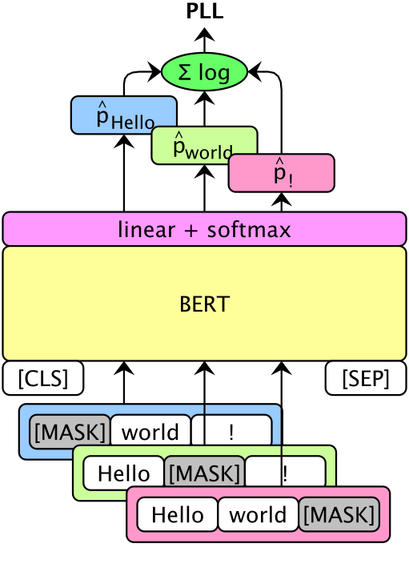
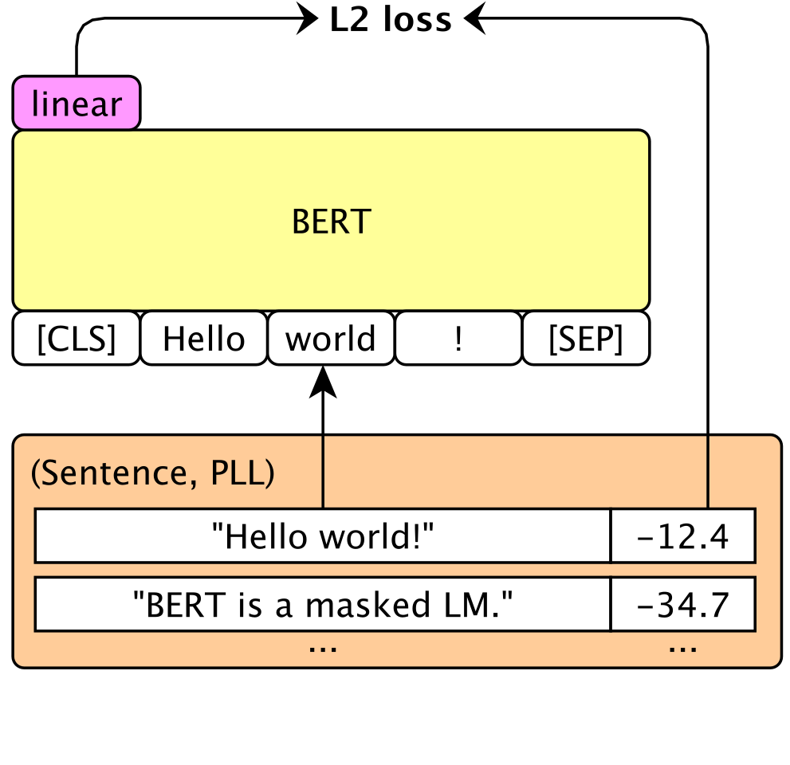
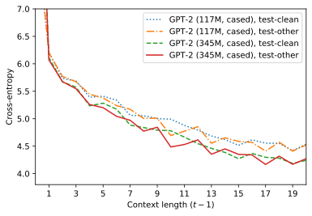
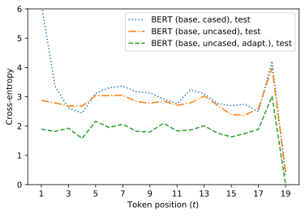
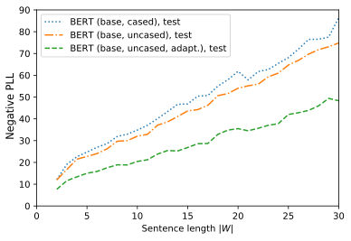

**Source:** *Masked Language Model Scoring* — [PDF](https://arxiv.org/pdf/1910.14659) · [arXiv](https://arxiv.org/abs/1910.14659)

# Masked Language Model Scoring

Julian Salazar  Affiliation:  Amazon AWS AI, USA  Davis Liang  Affiliation:  Amazon AWS AI, USA  Toan Q. Nguyen ††thanks:  Work done during an internship at Amazon AWS AI. Affiliation:  University of Notre Dame, USA{julsal,liadavis,katrinki}@amazon.com, tnguye28@nd.edu Katrin Kirchhoff  Affiliation:  Amazon AWS AI, USA 

###### Abstract

Pretrained masked language models (MLMs) require finetuning for most NLP tasks. Instead, we evaluate MLMs out of the box via their pseudo-log-likelihood scores (PLLs), which are computed by masking tokens one by one. We show that PLLs outperform scores from autoregressive language models like GPT-2 in a variety of tasks. By rescoring ASR and NMT hypotheses, RoBERTa reduces an end-to-end LibriSpeech model’s WER by 30% relative and adds up to +1.7 BLEU on state-of-the-art baselines for low-resource translation pairs, with further gains from domain adaptation. We attribute this success to PLL’s unsupervised expression of linguistic acceptability without a left-to-right bias, greatly improving on scores from GPT-2 (+10 points on island effects, NPI licensing in BLiMP). One can finetune MLMs to give scores without masking, enabling computation in a single inference pass. In all, PLLs and their associated pseudo-perplexities (PPPLs) enable plug-and-play use of the growing number of pretrained MLMs; e.g., we use a single cross-lingual model to rescore translations in multiple languages. We release our library for language model scoring at <https://github.com/awslabs/mlm-scoring>.

## 1 Introduction

BERT [Devlin et al. (2019)](https://arxiv.org/html/1910.14659#bib.bib12) and its improvements to natural language understanding have spurred a rapid succession of contextual language representations ([Yang et al., 2019](https://arxiv.org/html/1910.14659#bib.bib55); [Liu et al., 2019](https://arxiv.org/html/1910.14659#bib.bib22); inter alia) which use larger datasets and more involved training schemes. Their success is attributed to their use of bidirectional context, often via their masked language model (MLM) objectives. Here, a token \({\bm{w}}_{t}\) is replaced with [MASK] and predicted using all past and future tokens \({\bm{W}}_{\backslash t}:=({\bm{w}}_{1},\dotsc,{\bm{w}}_{t-1},{\bm{w}}_{t+1},\dotsc,{\bm{w}}_{\lvert{\bm{W}}\rvert})\).

 Figure 1: To score a sentence, one creates copies with each token masked out. The log probability for each missing token is summed over copies to give the pseudo-log-likelihood score (PLL). One can adapt to the target domain to improve performance, or finetune to score without masks to improve memory usage.

In contrast, conventional language models (LMs) predict \({\bm{w}}_{t}\) using only past tokens \({\bm{W}}_{<t}:=({\bm{w}}_{1},\dotsc,{\bm{w}}_{t-1})\). However, this allows LMs to estimate log probabilities for a sentence \({\bm{W}}\) via the chain rule (\(\log P_{\text{LM}}({\bm{W}})=\sum_{t=1}^{\lvert{\bm{W}}\rvert}\log P_{\text{LM}}({\bm{w}}_{t}\mid{\bm{W}}_{<t})\)), which can be used out of the box to rescore hypotheses in end-to-end speech recognition and machine translation [Chan et al. (2016)](https://arxiv.org/html/1910.14659#bib.bib6); [Gulcehre et al. (2015)](https://arxiv.org/html/1910.14659#bib.bib14), and to evaluate sentences for linguistic acceptability [Lau et al. (2017)](https://arxiv.org/html/1910.14659#bib.bib20).

Our work studies the corresponding pseudo-log-likelihood scores (PLLs) from MLMs [Wang and Cho (2019)](https://arxiv.org/html/1910.14659#bib.bib45), given by summing the conditional log probabilities \(\log P_{\text{MLM}}({\bm{w}}_{t}\mid{\bm{W}}_{\backslash t})\) of each sentence token [Shin et al. (2019)](https://arxiv.org/html/1910.14659#bib.bib37). These are induced in BERT by replacing \({\bm{w}}_{t}\) with [MASK] ([Figure 1](https://arxiv.org/html/1910.14659#S1.F1 "In 1 Introduction ‣ Masked Language Model Scoring")). Let \(\Theta\) denote our model’s parameters. Our score is

\[\begin{aligned}
 & \displaystyle\text{PLL}({\bm{W}}):=\sum_{t=1}^{\lvert{\bm{W}}\rvert}\log P_{\text{MLM}}({\bm{w}}_{t}\mid{\bm{W}}_{\backslash t};\Theta). & 
\end{aligned}\]

 

PLLs and their corresponding pseudo-perplexities (PPPLs) ([Section 2.3](https://arxiv.org/html/1910.14659#S2.SS3 "2.3 Pseudo-perplexity ‣ 2 Background ‣ Masked Language Model Scoring")) are intrinsic values one can assign to sentences and corpora, allowing us to use MLMs in applications previously restricted to conventional LM scores. Furthermore, we show that one can finetune BERT to compute PLLs in a single, non-recurrent inference pass ([Section 2.2](https://arxiv.org/html/1910.14659#S2.SS2 "2.2 \[MASK\]less scoring ‣ 2 Background ‣ Masked Language Model Scoring")).

Existing uses of pretrained MLMs in sequence-to-sequence models for automatic speech recognition (ASR) or neural machine translation (NMT) involve integrating their weights [Clinchant et al. (2019)](https://arxiv.org/html/1910.14659#bib.bib9) or representations [Zhu et al. (2020)](https://arxiv.org/html/1910.14659#bib.bib57) into the encoder and/or decoder during training. In contrast, we train a sequence model independently, then rescore its \(n\)-best outputs with an existing MLM. For acceptability judgments, one finetunes MLMs for classification using a training set [Warstadt et al. (2019)](https://arxiv.org/html/1910.14659#bib.bib49); [Devlin et al. (2019)](https://arxiv.org/html/1910.14659#bib.bib12); instead, PLLs give unsupervised, relative judgements directly.

In [Section 3](https://arxiv.org/html/1910.14659#S3 "3 Sequence-to-sequence rescoring ‣ Masked Language Model Scoring"), we show that scores from BERT compete with or even outperform GPT-2 [Radford et al. (2019)](https://arxiv.org/html/1910.14659#bib.bib31), a conventional language model of similar size but trained on more data. Gains scale with dataset and model size: RoBERTa large [Liu et al. (2019)](https://arxiv.org/html/1910.14659#bib.bib22) improves an end-to-end ASR model with relative WER reductions of 30%, 18% on LibriSpeech test-clean, test-other respectively (with further gains from domain adaptation), and improves state-of-the-art NMT baselines by up to +1.7 BLEU on low-resource pairs from standard TED Talks corpora. In the multilingual case, we find that the pretrained 15-language XLM [Conneau and Lample (2019)](https://arxiv.org/html/1910.14659#bib.bib10) can concurrently improve NMT systems in different target languages.

In [Section 4](https://arxiv.org/html/1910.14659#S4 "4 Analysis ‣ Masked Language Model Scoring"), we analyze PLLs and propose them as a basis for other ranking/scoring schemes. Unlike log probabilities, PLL’s summands are more uniform across an utterance’s length (no left-to-right bias), helping differentiate fluency from likeliness. We use PLLs to perform unsupervised acceptability judgments on the BLiMP minimal pairs set ([Warstadt et al., 2020](https://arxiv.org/html/1910.14659#bib.bib48)); BERT and RoBERTa models improve the state of the art (GPT-2 probabilities) by up to 3.9% absolute, with +10% on island effects and NPI licensing phenomena. Hence, PLLs can be used to assess the linguistic competence of MLMs in a supervision-free manner.

## 2 Background

### 2.1 Pseudolikelihood estimation

Bidirectional contextual representations like BERT come at the expense of being “true” language models \(P_{\text{LM}}({\bm{W}})\), as there may appear no way to generate text (sampling) or produce sentence probabilities (density estimation) from these models. This handicapped their use in generative tasks, where they at best served to bootstrap encoder-decoder models [Clinchant et al. (2019)](https://arxiv.org/html/1910.14659#bib.bib9); [Zhu et al. (2020)](https://arxiv.org/html/1910.14659#bib.bib57) or unidirectional LMs [Wang et al. (2019)](https://arxiv.org/html/1910.14659#bib.bib46).

However, BERT’s MLM objective can be viewed as stochastic maximum pseudolikelihood estimation (MPLE) [Wang and Cho (2019)](https://arxiv.org/html/1910.14659#bib.bib45); [Besag (1975)](https://arxiv.org/html/1910.14659#bib.bib3) on a training set \({\mathbb{W}}\), where \(\{{\mathbf{w}}_{t}\}_{t=1}^{\lvert{\bm{W}}\rvert}\) are random variables in a fully-connected graph. This approximates conventional MLE, with MLM training asymptotically maximizing the objective:

\[\begin{aligned}
 & \displaystyle\mathcal{J}_{\text{PL}}(\Theta;{\mathbb{W}})=\frac{1}{\lvert{\mathbb{W}}\rvert}\sum_{{\bm{W}}\in{\mathbb{W}}}\text{PLL}({\bm{W}};\Theta). & 
\end{aligned}\]

 

In this way, MLMs learn an underlying joint distribution whose conditional distributions \({\mathbf{w}}_{t}\mid{\bm{W}}_{\backslash t}\) are modeled by masking at position \(t\). We include a further discussion in [Appendix B](https://arxiv.org/html/1910.14659#A2 "Appendix B BERT as a generative model ‣ Masked Language Model Scoring").

This enabled text generation with BERT via Gibbs sampling, leading to the proposal (but not evaluation) of a related quantity, the sum of logits, for sentence ranking ([Wang and Cho, 2019](https://arxiv.org/html/1910.14659#bib.bib45)). More recent work ([Shin et al., 2019](https://arxiv.org/html/1910.14659#bib.bib37)) extended past research on future-conditional LMs in ASR ([Section 5](https://arxiv.org/html/1910.14659#S5 "5 Related work ‣ Masked Language Model Scoring")) with deeply-bidirectional self-attentive language models (bi-SANLMs). They trained shallow models from scratch with the [MASK] scoring method, but did not relate their work to pseudolikelihood and fluency, which provide a framework to explain their success and observed behaviors.

Experimentally, we extend both works by evaluating pretrained models, domain adaptation, and usage in NMT and multilingual settings ([Section 3](https://arxiv.org/html/1910.14659#S3 "3 Sequence-to-sequence rescoring ‣ Masked Language Model Scoring")), along with acceptability judgements and PLL’s intrinsic numerical properties ([Section 4](https://arxiv.org/html/1910.14659#S4 "4 Analysis ‣ Masked Language Model Scoring")).

### 2.2 [MASK]less scoring

A practical point unaddressed in both works is that computing PLLs from an MLM requires a sentence copy for each position, making the number of inference passes dependent on length (though these can be parallelized). The cost of a softmax is also incurred, which is dependent on vocabulary size \(V\); together this gives \(\mathcal{O}(\lvert{\bm{W}}\rvert\cdot V)\). We propose reducing this to \(\mathcal{O}(1)\) by training a network \(q\) with parameters \(\Theta_{S}\) to match BERT’s PLLs without [MASK] tokens:

\[\begin{aligned}
 & \lvert\text{PLL}({\bm{W}})-q({\bm{W}};\Theta_{S})\rvert^{2}. & 
\end{aligned}\]

 

We propose finetuning \(q\) from the pretrained MLM directly (i.e., initializing \(\Theta_{S}\) with \(\Theta\)), via regression over the [CLS] token ([Figure 2](https://arxiv.org/html/1910.14659#S2.F2 "In 2.2 \[MASK\]less scoring ‣ 2 Background ‣ Masked Language Model Scoring")):

 Figure 2: We learn a linear map after the [CLS] token, supervised by the PLLs from the pretrained MLM.

More generally, one could use any student model \(q\), as in knowledge distillation [Hinton et al. (2014)](https://arxiv.org/html/1910.14659#bib.bib16). Here, the teacher gives individual token probabilities (\(\lvert{\bm{W}}\rvert\) inference passes) while the student approximates their sum (one inference pass). This is reminiscent of distilling an autoregressive teacher to a parallel student, as in the case of WaveNet [Oord et al. (2018)](https://arxiv.org/html/1910.14659#bib.bib28). Other [MASK]less bidirectional models like XLNet [Yang et al. (2019)](https://arxiv.org/html/1910.14659#bib.bib55) can also give PLLs; we leave this to future work.

### 2.3 Pseudo-perplexity

Analogous to conventional LMs, we propose the pseudo-perplexity (PPPL) of an MLM as an intrinsic measure of how well it models a corpus of sentences \(\mathbb{W}\). Let \(N\) denote the number of tokens in the corpus. Then a model’s PPPL on \(\mathbb{W}\) is

\[\begin{aligned}
 & \displaystyle\text{PPPL}(\mathbb{W}):=\exp\left(-\frac{1}{N}\sum_{{\bm{W}}\in\mathbb{W}}\text{PLL}({\bm{W}})\right). & 
\end{aligned}\]

 

Past work ([Chen et al., 2017](https://arxiv.org/html/1910.14659#bib.bib7)) also computed this quantity with bi-RNNLMs for ASR, although such models are not deeply bidirectional like self-attentive MLMs (see [Section 5](https://arxiv.org/html/1910.14659#S5 "5 Related work ‣ Masked Language Model Scoring")).

These PPPLs can be used in lieu of perplexities. For example, during domain adaptation, one can perform early stopping with respect to development PPPL. This is in contrast to MLM accuracy, which is not a continuous loss and is often stochastic (e.g., when performing dynamic masking as in RoBERTa). In [Section 4.1](https://arxiv.org/html/1910.14659#S4.SS1 "4.1 Relative linguistic acceptability ‣ 4 Analysis ‣ Masked Language Model Scoring"), we see that PPPLs naturally separate out sets of acceptable and unacceptable sentences.

Unlike previous works ([Chen et al., 2017](https://arxiv.org/html/1910.14659#bib.bib7); [Shin et al., 2019](https://arxiv.org/html/1910.14659#bib.bib37)) we use pretrained BERTs, which are open-vocabulary (subword) bidirectional LMs. However, PPPLs are only comparable under the same subword vocabulary, which differs between e.g., BERT and RoBERTa. Normalizing with \(N\) as the number of words mitigates this. In [Appendix C](https://arxiv.org/html/1910.14659#A3 "Appendix C Pseudo-perplexity and rescoring ‣ Masked Language Model Scoring"), we show that word-normalized PPPLs correlate with domain adaptation, and with downstream metrics like ASR and BLEU after rescoring.

## 3 Sequence-to-sequence rescoring

Let \({\bm{X}}\) denote audio features or source text tokens, and let \({\bm{W}}=({\bm{w}}_{1},\dotsc,{\bm{w}}_{\lvert{\bm{W}}\rvert})\) denote target text tokens. For non-end-to-end ASR and MT systems, having separate acoustic/translation models \(P_{\text{AM}/\text{TM}}({\bm{X}}\mid{\bm{W}})\) and language models \(P_{\text{LM}}({\bm{W}})\) is motivated by the Bayes rule decomposition used to select the best hypothesis \(\hat{{\bm{W}}}\) [Jelinek et al. (1975)](https://arxiv.org/html/1910.14659#bib.bib18); [Brown et al. (1993)](https://arxiv.org/html/1910.14659#bib.bib4):

\[\begin{aligned}
 & \displaystyle\hat{{\bm{W}}} & \displaystyle=\argmax_{\bm{W}}[P({\bm{W}}\mid{\bm{X}})] &  \\
 &  & \displaystyle=\argmax_{\mathbf{W}}[P_{\text{AM}/\text{TM}}({\bm{X}}\mid{\bm{W}})P_{\text{LM}}({\bm{W}})]. & 
\end{aligned}\]

 

### 3.1 The log-linear model

End-to-end ASR and NMT use encoder-decoder architectures that are trained discriminatively. Though less principled, many still adopt a log-linear model

\[\begin{aligned}
 & \displaystyle\hat{{\bm{W}}} & \displaystyle=\argmax_{\bm{W}}\left[\log P({\bm{W}}\mid{\bm{X}})\right] &  \\
 &  & \displaystyle\approx\argmax_{\bm{W}}\left[\log f({\bm{W}},{\bm{X}})+\lambda\log g({\bm{W}})\right] & 
\end{aligned}\]

 

with learned functions \(f,g\) and a hyperparameter \(\lambda\), to good effect [Sutskever et al. (2014)](https://arxiv.org/html/1910.14659#bib.bib40); [Chan et al. (2016)](https://arxiv.org/html/1910.14659#bib.bib6). One often takes \(f=P_{\text{S2S}}({\bm{W}}\mid{\bm{X}})\) as the sequence-to-sequence model and \(g=P_{\text{LM}}({\bm{W}})\) as the language model. Since the sequence-level \(\argmax\) is intractable, one can do fusion, which decomposes \(f=\prod f_{t}\) and \(g=\prod g_{t}\) over time [Gulcehre et al. (2015)](https://arxiv.org/html/1910.14659#bib.bib14), restricting to the top \(N\) intermediate candidates at each step (beam search). Instead, our work considers \(N\)-best rescoring, which computes \(f({\bm{W}},{\bm{X}})\) first, still using beam search to maintain the top \(N\) candidates and scores. Then, \(g({\bm{W}})\) is computed for the resulting hypotheses and interpolated with these scores, giving a new top-1 hypothesis. The sequence model is now solely responsible for “capturing” the best hypothesis \(\hat{{\bm{W}}}\) in its beam. However, there are two advantages to \(N\)-best rescoring, which motivate PLLs as well as our maskless finetuning approach, respectively:

#### Decoupling of scale.

Fusion requires correspondence between \(f_{t}\) and \(g_{t}\) at every \(t\). This requires the sequence model and LM to be autoregressive and share tokenizations. In rescoring, \(f=P_{\text{S2S}}\) does not require \(g\) to decompose over time or to be a true probability at all, though \(g\) should scale with \(f\) so that \(\lambda\) remains valid for all lengths \(\lvert{\bm{W}}\rvert\); e.g., taking \(g({\bm{W}})\) to be a “relevance score” between 0 and 1 would not satisfy this property. The choice of log-linear is relevant here ([Appendix B](https://arxiv.org/html/1910.14659#A2 "Appendix B BERT as a generative model ‣ Masked Language Model Scoring")).

#### Length-independent inference.

If \(g\) is non-recurrent, then \(g({\bm{W}})\) may be computed in a single inference pass. This difference manifests with self-attentive LMs like SANLMs and Transformer-XL [Dai et al. (2019)](https://arxiv.org/html/1910.14659#bib.bib11), as recently explored for \(N\)-best rescoring in ASR [Li et al. (2019)](https://arxiv.org/html/1910.14659#bib.bib21); [Shin et al. (2019)](https://arxiv.org/html/1910.14659#bib.bib37).

### 3.2 Experimental setup

Further implementation and experimental details can be found in [Appendix A](https://arxiv.org/html/1910.14659#A1 "Appendix A Experiment details ‣ Masked Language Model Scoring") and our code release:

#### LMs.

We rescore sequence-to-sequence hypotheses as in [Section 3.1](https://arxiv.org/html/1910.14659#S3.SS1 "3.1 The log-linear model ‣ 3 Sequence-to-sequence rescoring ‣ Masked Language Model Scoring"). Each hypothesis is assigned its log probability (uni-SANLM, GPT-2) or pseudo-log-likelihood score (bi-SANLM, BERT, M-BERT, RoBERTa, XLM). We tune the LM weight \(\lambda\) on the development set to minimize word error rate (WER) for ASR or maximize tokenized BLEU for NMT. We then evaluate on the test set.

#### ASR.

Our 100-best hypotheses are from an end-to-end, 5-layer BLSTMP model ([Shin et al., 2019](https://arxiv.org/html/1910.14659#bib.bib37)) from ESPnet [Watanabe et al. (2018)](https://arxiv.org/html/1910.14659#bib.bib50) on the 960-hour LibriSpeech corpus [Panayotov et al. (2015)](https://arxiv.org/html/1910.14659#bib.bib29). Though this baseline is not state-of-the-art, we use their lists to enable direct comparison in [Table 5](https://arxiv.org/html/1910.14659#S3.T5 "In 3.5 Domain adaptation ‣ 3 Sequence-to-sequence rescoring ‣ Masked Language Model Scoring").

#### NMT.

Our 100-best hypotheses are from strong Transformer baselines with BPE subwords. One was pretrained for WMT 2014 English-German [Vaswani et al. (2017)](https://arxiv.org/html/1910.14659#bib.bib44); the others are state-of-the-art low-resource models we trained for five pairs from the TED Talks corpus [Qi et al. (2018)](https://arxiv.org/html/1910.14659#bib.bib30) and for IWSLT 2015 English-Vietnamese [Cettolo et al. (2015)](https://arxiv.org/html/1910.14659#bib.bib5), which we also describe in a dedicated, concurrent work [Nguyen and Salazar (2019)](https://arxiv.org/html/1910.14659#bib.bib26). For the low-resource models we scored tokenized hypotheses (though with HTML entities unescaped, e.g., &quot; \(\mapsto\) "). Length normalization [Wu et al. (2016)](https://arxiv.org/html/1910.14659#bib.bib52) is applied to NMT (\(\alpha=0.6\)) and LM (\(\alpha=1.0\)) scores ([Section 4.3](https://arxiv.org/html/1910.14659#S4.SS3 "4.3 Numerical properties of PLL ‣ 4 Analysis ‣ Masked Language Model Scoring")).

Corpus | Source → target language | # pairs  
---|---|---  
TED Talks | Galician (gl) → English (en) | 10k  
TED Talks | Slovakian (sk) → English (en) | 61k  
IWSLT 2015 | English (en) → Vietnamese (vi) | 133k  
TED Talks | English (en) → German (de) | 167k  
TED Talks | Arabic (ar) → English (en) | 214k  
TED Talks | English (en) → Arabic (ar) | 214k  
WMT 2014 | English (en) → German (de) | 4.5M

 Table 1: Sizes of translation datasets used in this paper.

### 3.3 Out-of-the-box (monolingual)

We consider BERT [Devlin et al. (2019)](https://arxiv.org/html/1910.14659#bib.bib12), GPT-2 [Radford et al. (2019)](https://arxiv.org/html/1910.14659#bib.bib31), and RoBERTa [Liu et al. (2019)](https://arxiv.org/html/1910.14659#bib.bib22), which are trained on 17GB, 40GB, and 160GB of written text respectively. Each model comes in similarly-sized 6-layer (117M / base) and 12-layer (345M / large) versions. GPT-2 is autoregressive, while BERT and RoBERTa are MLMs. We begin by rescoring ASR outputs in [Table 2](https://arxiv.org/html/1910.14659#S3.T2 "In 3.3 Out-of-the-box \(monolingual\) ‣ 3 Sequence-to-sequence rescoring ‣ Masked Language Model Scoring"):

<table id="S3.T2.2" class="ltx_tabular ltx_centering ltx_guessed_headers ltx_minipage ltx_align_middle" style="width:455.2pt;">
<tbody class="ltx_tbody">
<tr id="S3.T2.2.1" class="ltx_tr">
<th id="S3.T2.2.1.1" class="ltx_td ltx_align_left ltx_th ltx_th_row ltx_border_tt" rowspan="2">Model</th>
<td id="S3.T2.2.1.2" class="ltx_td ltx_align_center ltx_border_tt" colspan="2">dev</td>
<td id="S3.T2.2.1.3" class="ltx_td ltx_align_center ltx_border_tt" colspan="2">test</td></tr>
<tr id="S3.T2.2.2" class="ltx_tr">
<td id="S3.T2.2.2.1" class="ltx_td ltx_align_center">clean</td>
<td id="S3.T2.2.2.2" class="ltx_td ltx_align_center">other</td>
<td id="S3.T2.2.2.3" class="ltx_td ltx_align_center">clean</td>
<td id="S3.T2.2.2.4" class="ltx_td ltx_nopad_r ltx_align_center">other</td></tr>
<tr id="S3.T2.2.3" class="ltx_tr">
<th id="S3.T2.2.3.1" class="ltx_td ltx_align_left ltx_th ltx_th_row ltx_border_t">baseline (100-best)</th>
<td id="S3.T2.2.3.2" class="ltx_td ltx_align_center ltx_border_t">7.17</td>
<td id="S3.T2.2.3.3" class="ltx_td ltx_align_center ltx_border_t">19.79</td>
<td id="S3.T2.2.3.4" class="ltx_td ltx_align_center ltx_border_t">7.26</td>
<td id="S3.T2.2.3.5" class="ltx_td ltx_nopad_r ltx_align_center ltx_border_t">20.37</td></tr>
<tr id="S3.T2.2.4" class="ltx_tr">
<th id="S3.T2.2.4.1" class="ltx_td ltx_align_left ltx_th ltx_th_row ltx_border_t">GPT-2 (117M, cased)</th>
<td id="S3.T2.2.4.2" class="ltx_td ltx_align_center ltx_border_t">5.39</td>
<td id="S3.T2.2.4.3" class="ltx_td ltx_align_center ltx_border_t">16.81</td>
<td id="S3.T2.2.4.4" class="ltx_td ltx_align_center ltx_border_t">5.64</td>
<td id="S3.T2.2.4.5" class="ltx_td ltx_nopad_r ltx_align_center ltx_border_t">17.60</td></tr>
<tr id="S3.T2.2.5" class="ltx_tr">
<th id="S3.T2.2.5.1" class="ltx_td ltx_align_left ltx_th ltx_th_row">BERT (base, cased)</th>
<td id="S3.T2.2.5.2" class="ltx_td ltx_align_center">5.17</td>
<td id="S3.T2.2.5.3" class="ltx_td ltx_align_center">16.44</td>
<td id="S3.T2.2.5.4" class="ltx_td ltx_align_center">5.41</td>
<td id="S3.T2.2.5.5" class="ltx_td ltx_nopad_r ltx_align_center">17.41</td></tr>
<tr id="S3.T2.2.6" class="ltx_tr">
<th id="S3.T2.2.6.1" class="ltx_td ltx_align_left ltx_th ltx_th_row">RoBERTa (base, cased)</th>
<td id="S3.T2.2.6.2" class="ltx_td ltx_align_center">5.03</td>
<td id="S3.T2.2.6.3" class="ltx_td ltx_align_center">16.16</td>
<td id="S3.T2.2.6.4" class="ltx_td ltx_align_center">5.25</td>
<td id="S3.T2.2.6.5" class="ltx_td ltx_nopad_r ltx_align_center">17.18</td></tr>
<tr id="S3.T2.2.7" class="ltx_tr">
<th id="S3.T2.2.7.1" class="ltx_td ltx_align_left ltx_th ltx_th_row ltx_border_t">GPT-2 (345M, cased)</th>
<td id="S3.T2.2.7.2" class="ltx_td ltx_align_center ltx_border_t">5.15</td>
<td id="S3.T2.2.7.3" class="ltx_td ltx_align_center ltx_border_t">16.48</td>
<td id="S3.T2.2.7.4" class="ltx_td ltx_align_center ltx_border_t">5.30</td>
<td id="S3.T2.2.7.5" class="ltx_td ltx_nopad_r ltx_align_center ltx_border_t">17.26</td></tr>
<tr id="S3.T2.2.8" class="ltx_tr">
<th id="S3.T2.2.8.1" class="ltx_td ltx_align_left ltx_th ltx_th_row">BERT (large, cased)</th>
<td id="S3.T2.2.8.2" class="ltx_td ltx_align_center">4.96</td>
<td id="S3.T2.2.8.3" class="ltx_td ltx_align_center">16.26</td>
<td id="S3.T2.2.8.4" class="ltx_td ltx_align_center">5.25</td>
<td id="S3.T2.2.8.5" class="ltx_td ltx_nopad_r ltx_align_center">16.97</td></tr>
<tr id="S3.T2.2.9" class="ltx_tr">
<th id="S3.T2.2.9.1" class="ltx_td ltx_align_left ltx_th ltx_th_row">RoBERTa (large, cased)</th>
<td id="S3.T2.2.9.2" class="ltx_td ltx_align_center">4.75</td>
<td id="S3.T2.2.9.3" class="ltx_td ltx_align_center">15.81</td>
<td id="S3.T2.2.9.4" class="ltx_td ltx_align_center">5.05</td>
<td id="S3.T2.2.9.5" class="ltx_td ltx_nopad_r ltx_align_center">16.79</td></tr>
<tr id="S3.T2.2.10" class="ltx_tr">
<th id="S3.T2.2.10.1" class="ltx_td ltx_align_left ltx_th ltx_th_row ltx_border_bb ltx_border_t">oracle (100-best)</th>
<td id="S3.T2.2.10.2" class="ltx_td ltx_align_center ltx_border_bb ltx_border_t">2.85</td>
<td id="S3.T2.2.10.3" class="ltx_td ltx_align_center ltx_border_bb ltx_border_t">12.21</td>
<td id="S3.T2.2.10.4" class="ltx_td ltx_align_center ltx_border_bb ltx_border_t">2.81</td>
<td id="S3.T2.2.10.5" class="ltx_td ltx_nopad_r ltx_align_center ltx_border_bb ltx_border_t">12.85</td></tr>
</tbody>
</table>

 Table 2: WERs on LibriSpeech after rescoring. Baseline lists and oracle scores are from [Shin et al. (2019)](https://arxiv.org/html/1910.14659#bib.bib37).

As GPT-2 is trained on cased, punctuated data while the ASR model is not, we use cased MLMs and append “.” to hypotheses to compare out-of-the-box performance. BERT outperforms its corresponding GPT-2 models despite being trained on less data. RoBERTa reduces WERs by 30% relative on LibriSpeech test-clean and 18% on test-other.

We repeat the same on English-target NMT in [Table 3](https://arxiv.org/html/1910.14659#S3.T3 "In 3.3 Out-of-the-box \(monolingual\) ‣ 3 Sequence-to-sequence rescoring ‣ Masked Language Model Scoring"). As 100-best can be worse than 4-best due to the beam search curse [Yang et al. (2018)](https://arxiv.org/html/1910.14659#bib.bib54); [Murray and Chiang (2018)](https://arxiv.org/html/1910.14659#bib.bib23), we first decode both beam sizes to ensure no systematic degradation in our models. Hypothesis rescoring with BERT (base) gives up to +1.1 BLEU over our strong 100-best baselines, remaining competitive with GPT-2. Using RoBERTa (large) gives up to +1.7 BLEU over the baseline. Incidentally, we have demonstrated conclusive improvements on Transformers via LM rescoring for the first time, despite only using \(N\)-best lists; the most recent fusion work [Stahlberg et al. (2018)](https://arxiv.org/html/1910.14659#bib.bib39) only used LSTM-based models.

<table id="S3.T3.2" class="ltx_tabular ltx_centering ltx_guessed_headers ltx_minipage ltx_align_middle" style="width:455.2pt;">
<tbody class="ltx_tbody">
<tr id="S3.T3.2.1" class="ltx_tr">
<th id="S3.T3.2.1.1" class="ltx_td ltx_align_left ltx_th ltx_th_row ltx_border_tt" rowspan="2">Model</th>
<td id="S3.T3.2.1.2" class="ltx_td ltx_align_center ltx_border_tt" colspan="3">TED Talks</td></tr>
<tr id="S3.T3.2.2" class="ltx_tr">
<td id="S3.T3.2.2.1" class="ltx_td ltx_align_center">gl→en</td>
<td id="S3.T3.2.2.2" class="ltx_td ltx_align_center">sk→en</td>
<td id="S3.T3.2.2.3" class="ltx_td ltx_nopad_r ltx_align_center">ar→en</td></tr>
<tr id="S3.T3.2.3" class="ltx_tr">
<th id="S3.T3.2.3.1" class="ltx_td ltx_align_left ltx_th ltx_th_row ltx_border_t"><cite class="ltx_cite ltx_citemacro_citet"><a href="https://arxiv.org/html/1910.14659#bib.bib24" title="" class="ltx_ref">Neubig and Hu (2018)</a></cite></th>
<td id="S3.T3.2.3.2" class="ltx_td ltx_align_center ltx_border_t">16.2</td>
<td id="S3.T3.2.3.3" class="ltx_td ltx_align_center ltx_border_t">24.0</td>
<td id="S3.T3.2.3.4" class="ltx_td ltx_nopad_r ltx_align_center ltx_border_t">–</td></tr>
<tr id="S3.T3.2.4" class="ltx_tr">
<th id="S3.T3.2.4.1" class="ltx_td ltx_align_left ltx_th ltx_th_row"><cite class="ltx_cite ltx_citemacro_citet"><a href="https://arxiv.org/html/1910.14659#bib.bib1" title="" class="ltx_ref">Aharoni et al. (2019)</a></cite></th>
<td id="S3.T3.2.4.2" class="ltx_td ltx_align_center">–</td>
<td id="S3.T3.2.4.3" class="ltx_td ltx_align_center">–</td>
<td id="S3.T3.2.4.4" class="ltx_td ltx_nopad_r ltx_align_center">27.84</td></tr>
<tr id="S3.T3.2.5" class="ltx_tr">
<th id="S3.T3.2.5.1" class="ltx_td ltx_align_left ltx_th ltx_th_row">our baseline (4-best)</th>
<td id="S3.T3.2.5.2" class="ltx_td ltx_align_center">18.47</td>
<td id="S3.T3.2.5.3" class="ltx_td ltx_align_center">29.37</td>
<td id="S3.T3.2.5.4" class="ltx_td ltx_nopad_r ltx_align_center">33.39</td></tr>
<tr id="S3.T3.2.6" class="ltx_tr">
<th id="S3.T3.2.6.1" class="ltx_td ltx_align_left ltx_th ltx_th_row">our baseline (100-best)</th>
<td id="S3.T3.2.6.2" class="ltx_td ltx_align_center">18.55</td>
<td id="S3.T3.2.6.3" class="ltx_td ltx_align_center">29.20</td>
<td id="S3.T3.2.6.4" class="ltx_td ltx_nopad_r ltx_align_center">33.40</td></tr>
<tr id="S3.T3.2.7" class="ltx_tr">
<th id="S3.T3.2.7.1" class="ltx_td ltx_align_left ltx_th ltx_th_row ltx_border_t">GPT-2 (117M, cased)</th>
<td id="S3.T3.2.7.2" class="ltx_td ltx_align_center ltx_border_t">19.24</td>
<td id="S3.T3.2.7.3" class="ltx_td ltx_align_center ltx_border_t">30.38</td>
<td id="S3.T3.2.7.4" class="ltx_td ltx_nopad_r ltx_align_center ltx_border_t">34.41</td></tr>
<tr id="S3.T3.2.8" class="ltx_tr">
<th id="S3.T3.2.8.1" class="ltx_td ltx_align_left ltx_th ltx_th_row">BERT (base, cased)</th>
<td id="S3.T3.2.8.2" class="ltx_td ltx_align_center">19.09</td>
<td id="S3.T3.2.8.3" class="ltx_td ltx_align_center">30.27</td>
<td id="S3.T3.2.8.4" class="ltx_td ltx_nopad_r ltx_align_center">34.32</td></tr>
<tr id="S3.T3.2.9" class="ltx_tr">
<th id="S3.T3.2.9.1" class="ltx_td ltx_align_left ltx_th ltx_th_row">RoBERTa (base, cased)</th>
<td id="S3.T3.2.9.2" class="ltx_td ltx_align_center">19.22</td>
<td id="S3.T3.2.9.3" class="ltx_td ltx_align_center">30.80</td>
<td id="S3.T3.2.9.4" class="ltx_td ltx_nopad_r ltx_align_center">34.45</td></tr>
<tr id="S3.T3.2.10" class="ltx_tr">
<th id="S3.T3.2.10.1" class="ltx_td ltx_align_left ltx_th ltx_th_row ltx_border_t">GPT-2 (345M, cased)</th>
<td id="S3.T3.2.10.2" class="ltx_td ltx_align_center ltx_border_t">19.16</td>
<td id="S3.T3.2.10.3" class="ltx_td ltx_align_center ltx_border_t">30.76</td>
<td id="S3.T3.2.10.4" class="ltx_td ltx_nopad_r ltx_align_center ltx_border_t">34.62</td></tr>
<tr id="S3.T3.2.11" class="ltx_tr">
<th id="S3.T3.2.11.1" class="ltx_td ltx_align_left ltx_th ltx_th_row">BERT (large, cased)</th>
<td id="S3.T3.2.11.2" class="ltx_td ltx_align_center">19.30</td>
<td id="S3.T3.2.11.3" class="ltx_td ltx_align_center">30.31</td>
<td id="S3.T3.2.11.4" class="ltx_td ltx_nopad_r ltx_align_center">34.47</td></tr>
<tr id="S3.T3.2.12" class="ltx_tr">
<th id="S3.T3.2.12.1" class="ltx_td ltx_align_left ltx_th ltx_th_row ltx_border_bb">RoBERTa (large, cased)</th>
<td id="S3.T3.2.12.2" class="ltx_td ltx_align_center ltx_border_bb">19.36</td>
<td id="S3.T3.2.12.3" class="ltx_td ltx_align_center ltx_border_bb">30.87</td>
<td id="S3.T3.2.12.4" class="ltx_td ltx_nopad_r ltx_align_center ltx_border_bb">34.73</td></tr>
</tbody>
</table>

 Table 3: Test BLEU scores on English-target language pairs from the TED Talks corpus, after rescoring.

We also consider a non-English, higher-resource target by rescoring a pre-existing WMT 2014 English-German system (trained on 4.5M sentence pairs) with German BERT (base) models11 1 <https://github.com/dbmdz/german-bert> trained on 16GB of text, similar to English BERT. From 27.3 BLEU we get +0.5, +0.3 from uncased, cased; a diminished but present effect that can be improved as in [Table 3](https://arxiv.org/html/1910.14659#S3.T3 "In 3.3 Out-of-the-box \(monolingual\) ‣ 3 Sequence-to-sequence rescoring ‣ Masked Language Model Scoring") with more pretraining, a larger model, or domain adaptation ([Section 3.5](https://arxiv.org/html/1910.14659#S3.SS5 "3.5 Domain adaptation ‣ 3 Sequence-to-sequence rescoring ‣ Masked Language Model Scoring")).

### 3.4 Out-of-the-box (multilingual)

To assess the limits of our modular approach, we ask whether a shared multilingual MLM can improve translation into different target languages. We use the 100+ language M-BERT models, and the 15-language XLM models ([Conneau and Lample, 2019](https://arxiv.org/html/1910.14659#bib.bib10)) optionally trained with a crosslingual translation LM objective (TLM). Monolingual training was done on Wikipedia, which gives e.g., 6GB of German text; see [Table 4](https://arxiv.org/html/1910.14659#S3.T4 "In 3.4 Out-of-the-box \(multilingual\) ‣ 3 Sequence-to-sequence rescoring ‣ Masked Language Model Scoring").

<table id="S3.T4.2" class="ltx_tabular ltx_centering ltx_guessed_headers ltx_minipage ltx_align_middle" style="width:455.2pt;">
<tbody class="ltx_tbody">
<tr id="S3.T4.2.1" class="ltx_tr">
<th id="S3.T4.2.1.1" class="ltx_td ltx_align_left ltx_th ltx_th_row ltx_border_tt" rowspan="2">Model</th>
<td id="S3.T4.2.1.2" class="ltx_td ltx_align_center ltx_border_tt">IWSLT '15</td>
<td id="S3.T4.2.1.3" class="ltx_td ltx_align_center ltx_border_tt" colspan="2">TED Talks</td></tr>
<tr id="S3.T4.2.2" class="ltx_tr">
<td id="S3.T4.2.2.1" class="ltx_td ltx_align_center">en→vi</td>
<td id="S3.T4.2.2.2" class="ltx_td ltx_align_center">en→de</td>
<td id="S3.T4.2.2.3" class="ltx_td ltx_nopad_r ltx_align_center">en→ar</td></tr>
<tr id="S3.T4.2.3" class="ltx_tr">
<th id="S3.T4.2.3.1" class="ltx_td ltx_align_left ltx_th ltx_th_row ltx_border_t"><cite class="ltx_cite ltx_citemacro_citet"><a href="https://arxiv.org/html/1910.14659#bib.bib47" title="" class="ltx_ref">Wang et al. (2018)</a></cite></th>
<td id="S3.T4.2.3.2" class="ltx_td ltx_align_center ltx_border_t">29.09</td>
<td id="S3.T4.2.3.3" class="ltx_td ltx_align_center ltx_border_t">–</td>
<td id="S3.T4.2.3.4" class="ltx_td ltx_nopad_r ltx_align_center ltx_border_t">–</td></tr>
<tr id="S3.T4.2.4" class="ltx_tr">
<th id="S3.T4.2.4.1" class="ltx_td ltx_align_left ltx_th ltx_th_row"><cite class="ltx_cite ltx_citemacro_citet"><a href="https://arxiv.org/html/1910.14659#bib.bib1" title="" class="ltx_ref">Aharoni et al. (2019)</a></cite></th>
<td id="S3.T4.2.4.2" class="ltx_td ltx_align_center">–</td>
<td id="S3.T4.2.4.3" class="ltx_td ltx_align_center">23.31</td>
<td id="S3.T4.2.4.4" class="ltx_td ltx_nopad_r ltx_align_center">12.95</td></tr>
<tr id="S3.T4.2.5" class="ltx_tr">
<th id="S3.T4.2.5.1" class="ltx_td ltx_align_left ltx_th ltx_th_row">our baseline (4-best)</th>
<td id="S3.T4.2.5.2" class="ltx_td ltx_align_center">31.94</td>
<td id="S3.T4.2.5.3" class="ltx_td ltx_align_center">30.50</td>
<td id="S3.T4.2.5.4" class="ltx_td ltx_nopad_r ltx_align_center">13.95</td></tr>
<tr id="S3.T4.2.6" class="ltx_tr">
<th id="S3.T4.2.6.1" class="ltx_td ltx_align_left ltx_th ltx_th_row">our baseline (100-best)</th>
<td id="S3.T4.2.6.2" class="ltx_td ltx_align_center">31.84</td>
<td id="S3.T4.2.6.3" class="ltx_td ltx_align_center">30.44</td>
<td id="S3.T4.2.6.4" class="ltx_td ltx_nopad_r ltx_align_center">13.94</td></tr>
<tr id="S3.T4.2.7" class="ltx_tr">
<th id="S3.T4.2.7.1" class="ltx_td ltx_align_left ltx_th ltx_th_row ltx_border_t">M-BERT (base, uncased)</th>
<td id="S3.T4.2.7.2" class="ltx_td ltx_align_center ltx_border_t">32.12</td>
<td id="S3.T4.2.7.3" class="ltx_td ltx_align_center ltx_border_t">30.48</td>
<td id="S3.T4.2.7.4" class="ltx_td ltx_nopad_r ltx_align_center ltx_border_t">13.98</td></tr>
<tr id="S3.T4.2.8" class="ltx_tr">
<th id="S3.T4.2.8.1" class="ltx_td ltx_align_left ltx_th ltx_th_row">M-BERT (base, cased)</th>
<td id="S3.T4.2.8.2" class="ltx_td ltx_align_center">32.07</td>
<td id="S3.T4.2.8.3" class="ltx_td ltx_align_center">30.45</td>
<td id="S3.T4.2.8.4" class="ltx_td ltx_nopad_r ltx_align_center">13.94</td></tr>
<tr id="S3.T4.2.9" class="ltx_tr">
<th id="S3.T4.2.9.1" class="ltx_td ltx_align_left ltx_th ltx_th_row">XLM (base*, uncased)</th>
<td id="S3.T4.2.9.2" class="ltx_td ltx_align_center">32.27</td>
<td id="S3.T4.2.9.3" class="ltx_td ltx_align_center">30.61</td>
<td id="S3.T4.2.9.4" class="ltx_td ltx_nopad_r ltx_align_center">14.13</td></tr>
<tr id="S3.T4.2.10" class="ltx_tr">
<th id="S3.T4.2.10.1" class="ltx_td ltx_align_left ltx_th ltx_th_row">+ TLM objective</th>
<td id="S3.T4.2.10.2" class="ltx_td ltx_align_center">32.26</td>
<td id="S3.T4.2.10.3" class="ltx_td ltx_align_center">30.62</td>
<td id="S3.T4.2.10.4" class="ltx_td ltx_nopad_r ltx_align_center">14.10</td></tr>
<tr id="S3.T4.2.11" class="ltx_tr">
<th id="S3.T4.2.11.1" class="ltx_td ltx_align_left ltx_th ltx_th_row ltx_border_t">de-BERT (base, uncased)</th>
<td id="S3.T4.2.11.2" class="ltx_td ltx_align_center ltx_border_t">–</td>
<td id="S3.T4.2.11.3" class="ltx_td ltx_align_center ltx_border_t">31.27</td>
<td id="S3.T4.2.11.4" class="ltx_td ltx_nopad_r ltx_align_center ltx_border_t">–</td></tr>
<tr id="S3.T4.2.12" class="ltx_tr">
<th id="S3.T4.2.12.1" class="ltx_td ltx_align_left ltx_th ltx_th_row ltx_border_bb">de-BERT (base, cased)</th>
<td id="S3.T4.2.12.2" class="ltx_td ltx_align_center ltx_border_bb">–</td>
<td id="S3.T4.2.12.3" class="ltx_td ltx_align_center ltx_border_bb">31.22</td>
<td id="S3.T4.2.12.4" class="ltx_td ltx_nopad_r ltx_align_center ltx_border_bb">–</td></tr>
</tbody>
</table>

 Table 4: Test BLEU scores for language pairs with non-English targets, after hypothesis rescoring. Base* uses 1024 hidden dimensions but only 8 heads instead.

The 100-language M-BERT models gave no consistent improvement. The 15-language XLMs fared better, giving +0.2-0.4 BLEU, perhaps from their use of language tokens and fewer languages. Our German BERT results suggest an out-of-the-box upper bound of +0.8 BLEU, as we found with English BERT on similar resources. We expect that increasing training data and model size will boost XLM performance, as in [Section 3.3](https://arxiv.org/html/1910.14659#S3.SS3 "3.3 Out-of-the-box \(monolingual\) ‣ 3 Sequence-to-sequence rescoring ‣ Masked Language Model Scoring").

### 3.5 Domain adaptation

Out-of-the-box rescoring may be hindered by how closely our models match the downstream text. For example, our uncased multilingual models strip accents, exacerbating their domain mismatch with the cased, accented gold translation. We examine this effect in the setting of LibriSpeech, which has its own 4GB text corpus and is fully uncased and unpunctuated, unlike the cased MLMs in [Section 3.3](https://arxiv.org/html/1910.14659#S3.SS3 "3.3 Out-of-the-box \(monolingual\) ‣ 3 Sequence-to-sequence rescoring ‣ Masked Language Model Scoring"). We rescore using in-domain models in [Table 5](https://arxiv.org/html/1910.14659#S3.T5 "In 3.5 Domain adaptation ‣ 3 Sequence-to-sequence rescoring ‣ Masked Language Model Scoring"):

<table id="S3.T5.2" class="ltx_tabular ltx_centering ltx_guessed_headers ltx_minipage ltx_align_middle" style="width:455.2pt;">
<tbody class="ltx_tbody">
<tr id="S3.T5.2.1" class="ltx_tr">
<th id="S3.T5.2.1.1" class="ltx_td ltx_align_left ltx_th ltx_th_row ltx_border_tt" rowspan="2">Model</th>
<td id="S3.T5.2.1.2" class="ltx_td ltx_align_center ltx_border_tt" colspan="2">dev</td>
<td id="S3.T5.2.1.3" class="ltx_td ltx_align_center ltx_border_tt" colspan="2">test</td></tr>
<tr id="S3.T5.2.2" class="ltx_tr">
<td id="S3.T5.2.2.1" class="ltx_td ltx_align_center">clean</td>
<td id="S3.T5.2.2.2" class="ltx_td ltx_align_center">other</td>
<td id="S3.T5.2.2.3" class="ltx_td ltx_align_center">clean</td>
<td id="S3.T5.2.2.4" class="ltx_td ltx_nopad_r ltx_align_center">other</td></tr>
<tr id="S3.T5.2.3" class="ltx_tr">
<th id="S3.T5.2.3.1" class="ltx_td ltx_align_left ltx_th ltx_th_row ltx_border_t">baseline (100-best)</th>
<td id="S3.T5.2.3.2" class="ltx_td ltx_align_center ltx_border_t">7.17</td>
<td id="S3.T5.2.3.3" class="ltx_td ltx_align_center ltx_border_t">19.79</td>
<td id="S3.T5.2.3.4" class="ltx_td ltx_align_center ltx_border_t">7.26</td>
<td id="S3.T5.2.3.5" class="ltx_td ltx_nopad_r ltx_align_center ltx_border_t">20.37</td></tr>
<tr id="S3.T5.2.4" class="ltx_tr">
<th id="S3.T5.2.4.1" class="ltx_td ltx_align_left ltx_th ltx_th_row ltx_border_t">uni-SANLM</th>
<td id="S3.T5.2.4.2" class="ltx_td ltx_align_center ltx_border_t">6.08</td>
<td id="S3.T5.2.4.3" class="ltx_td ltx_align_center ltx_border_t">17.32</td>
<td id="S3.T5.2.4.4" class="ltx_td ltx_align_center ltx_border_t">6.11</td>
<td id="S3.T5.2.4.5" class="ltx_td ltx_nopad_r ltx_align_center ltx_border_t">18.13</td></tr>
<tr id="S3.T5.2.5" class="ltx_tr">
<th id="S3.T5.2.5.1" class="ltx_td ltx_align_left ltx_th ltx_th_row">bi-SANLM</th>
<td id="S3.T5.2.5.2" class="ltx_td ltx_align_center">5.52</td>
<td id="S3.T5.2.5.3" class="ltx_td ltx_align_center">16.61</td>
<td id="S3.T5.2.5.4" class="ltx_td ltx_align_center">5.65</td>
<td id="S3.T5.2.5.5" class="ltx_td ltx_nopad_r ltx_align_center">17.44</td></tr>
<tr id="S3.T5.2.6" class="ltx_tr">
<th id="S3.T5.2.6.1" class="ltx_td ltx_align_left ltx_th ltx_th_row">BERT (base, Libri. only)</th>
<td id="S3.T5.2.6.2" class="ltx_td ltx_align_center">4.63</td>
<td id="S3.T5.2.6.3" class="ltx_td ltx_align_center">15.56</td>
<td id="S3.T5.2.6.4" class="ltx_td ltx_align_center">4.79</td>
<td id="S3.T5.2.6.5" class="ltx_td ltx_nopad_r ltx_align_center">16.50</td></tr>
<tr id="S3.T5.2.7" class="ltx_tr">
<th id="S3.T5.2.7.1" class="ltx_td ltx_align_left ltx_th ltx_th_row ltx_border_t">BERT (base, cased)</th>
<td id="S3.T5.2.7.2" class="ltx_td ltx_align_center ltx_border_t">5.17</td>
<td id="S3.T5.2.7.3" class="ltx_td ltx_align_center ltx_border_t">16.44</td>
<td id="S3.T5.2.7.4" class="ltx_td ltx_align_center ltx_border_t">5.41</td>
<td id="S3.T5.2.7.5" class="ltx_td ltx_nopad_r ltx_align_center ltx_border_t">17.41</td></tr>
<tr id="S3.T5.2.8" class="ltx_tr">
<th id="S3.T5.2.8.1" class="ltx_td ltx_align_left ltx_th ltx_th_row">BERT (base, uncased)</th>
<td id="S3.T5.2.8.2" class="ltx_td ltx_align_center">5.02</td>
<td id="S3.T5.2.8.3" class="ltx_td ltx_align_center">16.07</td>
<td id="S3.T5.2.8.4" class="ltx_td ltx_align_center">5.14</td>
<td id="S3.T5.2.8.5" class="ltx_td ltx_nopad_r ltx_align_center">16.97</td></tr>
<tr id="S3.T5.2.9" class="ltx_tr">
<th id="S3.T5.2.9.1" class="ltx_td ltx_align_left ltx_th ltx_th_row">+ adaptation, 380k steps</th>
<td id="S3.T5.2.9.2" class="ltx_td ltx_align_center">4.37</td>
<td id="S3.T5.2.9.3" class="ltx_td ltx_align_center">15.17</td>
<td id="S3.T5.2.9.4" class="ltx_td ltx_align_center">4.58</td>
<td id="S3.T5.2.9.5" class="ltx_td ltx_nopad_r ltx_align_center">15.96</td></tr>
<tr id="S3.T5.2.10" class="ltx_tr">
<th id="S3.T5.2.10.1" class="ltx_td ltx_align_left ltx_th ltx_th_row ltx_border_bb ltx_border_t">oracle (100-best)</th>
<td id="S3.T5.2.10.2" class="ltx_td ltx_align_center ltx_border_bb ltx_border_t">2.85</td>
<td id="S3.T5.2.10.3" class="ltx_td ltx_align_center ltx_border_bb ltx_border_t">12.21</td>
<td id="S3.T5.2.10.4" class="ltx_td ltx_align_center ltx_border_bb ltx_border_t">2.81</td>
<td id="S3.T5.2.10.5" class="ltx_td ltx_nopad_r ltx_align_center ltx_border_bb ltx_border_t">12.85</td></tr>
</tbody>
</table>

 Table 5: WERs on LibriSpeech after hypothesis rescoring. Baseline, SANLM, and oracle numbers are from [Shin et al. (2019)](https://arxiv.org/html/1910.14659#bib.bib37).

Using a BERT model trained only on the text corpus outperforms RoBERTa ([Table 2](https://arxiv.org/html/1910.14659#S3.T2 "In 3.3 Out-of-the-box \(monolingual\) ‣ 3 Sequence-to-sequence rescoring ‣ Masked Language Model Scoring")) which is trained on far more data, underscoring the tradeoff between in-domain modeling and out-of-the-box integration. Even minor differences like casing gives +0.3-0.4 WER at test time. In [Section 4.3](https://arxiv.org/html/1910.14659#S4.SS3 "4.3 Numerical properties of PLL ‣ 4 Analysis ‣ Masked Language Model Scoring") we see that these domain shifts can be visibly observed from the positionwise scores \(\log P_{\text{MLM}}({\bm{w}}_{t}\mid{\bm{W}}_{\backslash t})\).

The best results (“adaptation”) still come from adapting a pretrained model to the target corpus. We proceed as in BERT, i.e., performing MLM on sequences of concatenated sentences (more details in [Appendix A](https://arxiv.org/html/1910.14659#A1 "Appendix A Experiment details ‣ Masked Language Model Scoring")). In contrast, the 3-layer SANLMs ([Shin et al., 2019](https://arxiv.org/html/1910.14659#bib.bib37)) do per-utterance training, which is slower but may reduce mismatch even further.

Finally, we show in [Appendix C](https://arxiv.org/html/1910.14659#A3 "Appendix C Pseudo-perplexity and rescoring ‣ Masked Language Model Scoring") that even before evaluating WER or BLEU, one can anticipate improvements in the downstream metric by looking at improvements in word-normalized PPPL on the target corpus. The domain-adapted MLM has lower PPPLs than the pretrained models, and RoBERTa has lower PPPLs than BERT.

### 3.6 Finetuning without masking

We finetune BERT to produce scores without [MASK] tokens. For LibriSpeech we take the normalized text corpus and keep sentences with length \(\lvert{\bm{W}}\rvert\leq\) 384, score them with our adapted BERT (base), then do sentence-level regression ([Section 2.2](https://arxiv.org/html/1910.14659#S2.SS2 "2.2 \[MASK\]less scoring ‣ 2 Background ‣ Masked Language Model Scoring")). We train using Adam with a learning rate of \(10^{-5}\) for 10 epochs ([Table 6](https://arxiv.org/html/1910.14659#S3.T6 "In 3.6 Finetuning without masking ‣ 3 Sequence-to-sequence rescoring ‣ Masked Language Model Scoring")):

<table id="S3.T6.2" class="ltx_tabular ltx_centering ltx_guessed_headers ltx_minipage ltx_align_middle" style="width:455.2pt;">
<thead class="ltx_thead">
<tr id="S3.T6.2.1" class="ltx_tr">
<th id="S3.T6.2.1.1" class="ltx_td ltx_align_left ltx_th ltx_th_column ltx_th_row ltx_border_tt" rowspan="2">Model</th>
<th id="S3.T6.2.1.2" class="ltx_td ltx_align_center ltx_th ltx_th_column ltx_border_tt" colspan="2">dev</th></tr>
<tr id="S3.T6.2.2" class="ltx_tr">
<th id="S3.T6.2.2.1" class="ltx_td ltx_align_center ltx_th ltx_th_column">clean</th>
<th id="S3.T6.2.2.2" class="ltx_td ltx_nopad_r ltx_align_center ltx_th ltx_th_column">other</th></tr>
<tr id="S3.T6.2.3" class="ltx_tr">
<th id="S3.T6.2.3.1" class="ltx_td ltx_align_left ltx_th ltx_th_column ltx_th_row ltx_border_t">baseline (100-best)</th>
<th id="S3.T6.2.3.2" class="ltx_td ltx_align_center ltx_th ltx_th_column ltx_border_t">7.17</th>
<th id="S3.T6.2.3.3" class="ltx_td ltx_nopad_r ltx_align_center ltx_th ltx_th_column ltx_border_t">19.79</th></tr>
</thead>
<tbody class="ltx_tbody">
<tr id="S3.T6.2.4" class="ltx_tr">
<th id="S3.T6.2.4.1" class="ltx_td ltx_align_left ltx_th ltx_th_row ltx_border_t">GPT-2 (117M, cased)</th>
<td id="S3.T6.2.4.2" class="ltx_td ltx_align_center ltx_border_t">5.39</td>
<td id="S3.T6.2.4.3" class="ltx_td ltx_nopad_r ltx_align_center ltx_border_t">16.81</td></tr>
<tr id="S3.T6.2.5" class="ltx_tr">
<th id="S3.T6.2.5.1" class="ltx_td ltx_align_left ltx_th ltx_th_row">BERT (base, uncased, adapted)</th>
<td id="S3.T6.2.5.2" class="ltx_td ltx_align_center">4.37</td>
<td id="S3.T6.2.5.3" class="ltx_td ltx_nopad_r ltx_align_center">15.17</td></tr>
<tr id="S3.T6.2.6" class="ltx_tr">
<th id="S3.T6.2.6.1" class="ltx_td ltx_align_left ltx_th ltx_th_row">+ no masking</th>
<td id="S3.T6.2.6.2" class="ltx_td ltx_align_center">5.79</td>
<td id="S3.T6.2.6.3" class="ltx_td ltx_nopad_r ltx_align_center">18.07</td></tr>
<tr id="S3.T6.2.7" class="ltx_tr">
<th id="S3.T6.2.7.1" class="ltx_td ltx_align_left ltx_th ltx_th_row ltx_border_bb">+ sentence-level finetuning</th>
<td id="S3.T6.2.7.2" class="ltx_td ltx_align_center ltx_border_bb">4.61</td>
<td id="S3.T6.2.7.3" class="ltx_td ltx_nopad_r ltx_align_center ltx_border_bb">15.53</td></tr>
</tbody>
</table>

 Table 6: WERs on LibriSpeech upon rescoring, showing the effects of single-copy, maskless scoring.

Sentence-level finetuning degrades performance by +0.2-0.4 WER, leaving room for future improvement. This still outperforms GPT-2 (117M, cased), though this gap may be closed by adaptation. For now, maskless finetuning could be reserved for cases where only a masked language model is available, or when latency is essential.

Remarkably, we found that out-of-the-box scoring without [MASK] still significantly improves the baseline. This is likely from the 20% of the time BERT does not train on [MASK], but instead inputs a random word or the same word [Devlin et al. (2019)](https://arxiv.org/html/1910.14659#bib.bib12). Future work could explore finetuning to positionwise distributions, as in word-level knowledge distillation [Kim and Rush (2016)](https://arxiv.org/html/1910.14659#bib.bib19), for which our results are a naïve performance bound.

## 4 Analysis

We recall the log-linear model from [Section 3.1](https://arxiv.org/html/1910.14659#S3.SS1 "3.1 The log-linear model ‣ 3 Sequence-to-sequence rescoring ‣ Masked Language Model Scoring"):

\[\begin{aligned}
 & \displaystyle\hat{{\bm{W}}} & \displaystyle\approx\argmax_{\bm{W}}\left[\log f({\bm{W}},{\bm{X}})+\lambda\log g({\bm{W}})\right] & 
\end{aligned}\]

 

Although end-to-end models \(f=P_{\text{S2S}}({\bm{W}}|{\bm{X}})\) predict \({\bm{W}}\) directly from \({\bm{X}}\), interpolation with the unconditional \(g=P_{\text{LM}}({\bm{W}})\) remains helpful ([Toshniwal et al., 2018](https://arxiv.org/html/1910.14659#bib.bib42)). One explanation comes from cold and simple fusion ([Sriram et al., 2018](https://arxiv.org/html/1910.14659#bib.bib38); [Stahlberg et al., 2018](https://arxiv.org/html/1910.14659#bib.bib39)), which further improve on shallow fusion ([Section 3.1](https://arxiv.org/html/1910.14659#S3.SS1 "3.1 The log-linear model ‣ 3 Sequence-to-sequence rescoring ‣ Masked Language Model Scoring")) by learning \(g({\bm{W}})\) first. They argue \(g\) expresses fluency; fixing \(g\) early allows \(f({\bm{W}},{\bm{X}})\) to focus its capacity on adequacy in encoding the source, and thus specializing the two models. With this perspective in mind, we compare \(\log P_{\text{LM}}\) and PLL as candidates for \(\log g\).

### 4.1 Relative linguistic acceptability

Model (cased) |  Overall |  Ana. agr |  Arg. str |  Binding |  Ctrl. rais. |  D-n agr |  Ellipsis |  Filler gap |  Irregular |  Island |  NPI |  Quantifiers |  S-v agr |  Unacc. PPPL |  Acc. PPPL |  Ratio  
---|---|---|---|---|---|---|---|---|---|---|---|---|---|---|---|---  
GPT-2 (345M) | 82.6 | 99.4 | 83.4 | 77.8 | 83.0 | 96.3 | 86.3 | 81.3 | 94.9 | 71.7 | 74.7 | 74.1 | 88.3 | – | – | –  
BERT (base) | 84.2* | 97.0 | 80.0 | 82.3* | 79.6 | 97.6* | 89.4* | 83.1* | 96.5* | 73.6* | 84.7* | 71.2 | 92.4* | 111.2 | 59.2 | 1.88  
BERT (large) | 84.8* | 97.2 | 80.7 | 82.0* | 82.7 | 97.6* | 86.4 | 84.3* | 92.8 | 77.0* | 83.4* | 72.8 | 91.9* | 128.1 | 63.6 | 2.02  
RoBERTa (base) | 85.4* | 97.3 | 83.5 | 77.8 | 81.9 | 97.0 | 91.4* | 90.1* | 96.2* | 80.7* | 81.0* | 69.8 | 91.9* | 213.5 | 87.9 | 2.42  
RoBERTa (large) | 86.5* | 97.8 | 84.6* | 79.1* | 84.1* | 96.8 | 90.8* | 88.9* | 96.8* | 83.4* | 85.5* | 70.2 | 91.4* | 194.0 | 77.9 | 2.49  
Human | 88.6 | 97.5 | 90.0 | 87.3 | 83.9 | 92.2 | 85.0 | 86.9 | 97.0 | 84.9 | 88.1 | 86.6 | 90.9 | – | – | –

 Table 7: Unsupervised performance (forced choice accuracy) on BLiMP using log probabilities (GPT-2) or PLLs. Human scores from [Warstadt et al. (2020)](https://arxiv.org/html/1910.14659#bib.bib48). Values with * denote improvements over GPT-2 of \(\geq\)1% absolute.

In this work we interpret fluency as linguistic acceptability ([Chomsky, 1957](https://arxiv.org/html/1910.14659#bib.bib8)); informally, the syntactic and semantic validity of a sentence according to human judgments ([Schütze, 1996](https://arxiv.org/html/1910.14659#bib.bib35)). Its graded form is well-proxied by neural language model scores (\(\log P_{\text{LM}}\)) once length and lexical frequency are accounted for [Lau et al. (2017)](https://arxiv.org/html/1910.14659#bib.bib20). This can be seen in a controlled setting using minimal pairs and GPT-2 (345M) scores:

\[\begin{aligned}
 &  & \text{Raymond is selling this sketch.} & \displaystyle-40.0, &  \\
 &  & \text{Raymond is selling this sketches.} & \displaystyle-45.2. & 
\end{aligned}\]

 

This example is from the Benchmark of Linguistic Minimal Pairs (BLiMP) ([Warstadt et al., 2020](https://arxiv.org/html/1910.14659#bib.bib48)), a challenge set of 67k pairs which isolate contrasts in syntax, morphology, and semantics (in this example, determiner-noun agreement). While its predecessor, the Corpus of Linguistic Acceptability (CoLA), has a training set and asks to label sentences as “acceptable” or not in isolation ([Warstadt et al., 2019](https://arxiv.org/html/1910.14659#bib.bib49)), BLiMP provides an unsupervised setting: language models are evaluated on how often they give the acceptable sentence a higher (i.e., less negative) score. This is equivalent to 2-best rescoring without sequence model scores (\(\log f=0\)). Since most minimal pairs only differ by a single word, the effect of length on log probabilities and PLLs (discussed in [Section 4.3](https://arxiv.org/html/1910.14659#S4.SS3 "4.3 Numerical properties of PLL ‣ 4 Analysis ‣ Masked Language Model Scoring")) is mitigated.

We compute PLLs on the sentences of each pair using cased BERT and RoBERTa, then choose the sentence with the highest score. Our results are in [Table 7](https://arxiv.org/html/1910.14659#S4.T7 "In 4.1 Relative linguistic acceptability ‣ 4 Analysis ‣ Masked Language Model Scoring"). Despite using less than half the data and a third of the capacity, BERT (base) already outperforms the previous state of the art (GPT-2) by 1.6% absolute, increasing to 3.9% with RoBERTa (large). There are 4 of 12 categories where all four PLLs outperform log probabilities by \(\geq\)1% absolute (values marked by *), and 7 where three or more PLLs outperform by this margin. Interestingly, PLLs do consistently worse on quantifiers, though all are relatively bad against the human baseline. The ratio of token-level PPPLs between unacceptable and acceptable sentences overall increases with performance, separating the two sentence sets.

RoBERTa improves by around 10% on filler-gap dependencies, island effects, and negative polarity items (NPIs), largely closing the human gap. This suggests that the difficulty of these BLiMP categories was due to \(P_{\text{LM}}\) decomposing autoregressively, and not intrinsic to unsupervised language model training, as the original results may suggest ([Warstadt et al., 2020](https://arxiv.org/html/1910.14659#bib.bib48)). For some intuition, we include examples in [Table 8](https://arxiv.org/html/1910.14659#S4.T8 "In 4.2 Interpolation with direct models ‣ 4 Analysis ‣ Masked Language Model Scoring"). In the subject-verb agreement example, BERT sees The pamphlets and resembled those photographs when scoring have vs. has, whereas GPT-2 only sees The pamphlets, which may not be enough to counter the misleading adjacent entity Winston Churchill at scoring time.

### 4.2 Interpolation with direct models

<table id="S4.T8.2" class="ltx_tabular ltx_centering ltx_align_middle">
<tbody class="ltx_tbody">
<tr id="S4.T8.2.1" class="ltx_tr">
<td id="S4.T8.2.1.1" class="ltx_td ltx_align_left ltx_border_tt">System</td>
<td id="S4.T8.2.1.2" class="ltx_td ltx_align_left ltx_border_tt">Model</td>
<td id="S4.T8.2.1.3" class="ltx_td ltx_nopad_r ltx_align_left ltx_align_top ltx_border_tt">

Output sentence
</td></tr>
<tr id="S4.T8.2.2" class="ltx_tr">
<td id="S4.T8.2.2.1" class="ltx_td ltx_align_left ltx_border_t" rowspan="2">BLiMP (S-V agreement)</td>
<td id="S4.T8.2.2.2" class="ltx_td ltx_align_left ltx_border_t">BERT</td>
<td id="S4.T8.2.2.3" class="ltx_td ltx_nopad_r ltx_align_left ltx_align_top ltx_border_t">

The pamphlets about Winston Churchill have resembled those photographs.
</td></tr>
<tr id="S4.T8.2.3" class="ltx_tr">
<td id="S4.T8.2.3.1" class="ltx_td ltx_align_left">GPT-2</td>
<td id="S4.T8.2.3.2" class="ltx_td ltx_nopad_r ltx_align_left ltx_align_top">

The pamphlets about Winston Churchill has resembled those photographs.
</td></tr>
<tr id="S4.T8.2.4" class="ltx_tr">
<td id="S4.T8.2.4.1" class="ltx_td ltx_align_left ltx_border_t" rowspan="2">BLiMP (island)</td>
<td id="S4.T8.2.4.2" class="ltx_td ltx_align_left ltx_border_t">BERT</td>
<td id="S4.T8.2.4.3" class="ltx_td ltx_nopad_r ltx_align_left ltx_align_top ltx_border_t">

Who does Amanda find while thinking about Lucille?
</td></tr>
<tr id="S4.T8.2.5" class="ltx_tr">
<td id="S4.T8.2.5.1" class="ltx_td ltx_align_left">GPT-2</td>
<td id="S4.T8.2.5.2" class="ltx_td ltx_nopad_r ltx_align_left ltx_align_top">

Who does Amanda find Lucille while thinking about?
</td></tr>
<tr id="S4.T8.2.6" class="ltx_tr">
<td id="S4.T8.2.6.1" class="ltx_td ltx_align_left ltx_border_t" rowspan="4">LibriSpeech (dev-other)</td>
<td id="S4.T8.2.6.2" class="ltx_td ltx_align_left ltx_border_t">Baseline</td>
<td id="S4.T8.2.6.3" class="ltx_td ltx_nopad_r ltx_align_left ltx_align_top ltx_border_t">

clasping truth and jail ya in the mouth of the student is that building up or tearing down
</td></tr>
<tr id="S4.T8.2.7" class="ltx_tr">
<td id="S4.T8.2.7.1" class="ltx_td ltx_align_left">GPT-2</td>
<td id="S4.T8.2.7.2" class="ltx_td ltx_nopad_r ltx_align_left ltx_align_top">

class in truth and jail ya in the mouth of the student is that building up or tearing down
</td></tr>
<tr id="S4.T8.2.8" class="ltx_tr">
<td id="S4.T8.2.8.1" class="ltx_td ltx_align_left">BERT (adapted)</td>
<td id="S4.T8.2.8.2" class="ltx_td ltx_nopad_r ltx_align_left ltx_align_top">

clasping truth in jail gagging the mouth of the student is that building up or tearing down
</td></tr>
<tr id="S4.T8.2.9" class="ltx_tr">
<td id="S4.T8.2.9.1" class="ltx_td ltx_align_left">Target</td>
<td id="S4.T8.2.9.2" class="ltx_td ltx_nopad_r ltx_align_left ltx_align_top">

clapping truth into jail gagging the mouth of the student is that building up or tearing down
</td></tr>
<tr id="S4.T8.2.10" class="ltx_tr">
<td id="S4.T8.2.10.1" class="ltx_td ltx_align_left ltx_border_bb ltx_border_t" rowspan="5">gl→en (test)</td>
<td id="S4.T8.2.10.2" class="ltx_td ltx_align_left ltx_border_t">Source (gl)</td>
<td id="S4.T8.2.10.3" class="ltx_td ltx_nopad_r ltx_align_left ltx_align_top ltx_border_t">

Traballaba de asesora científica na ACLU , a Unión polas Liberdades Civís .
</td></tr>
<tr id="S4.T8.2.11" class="ltx_tr">
<td id="S4.T8.2.11.1" class="ltx_td ltx_align_left">Baseline</td>
<td id="S4.T8.2.11.2" class="ltx_td ltx_nopad_r ltx_align_left ltx_align_top">

I worked on a scientific status on the ACL, the Union by the Union Sivities .
</td></tr>
<tr id="S4.T8.2.12" class="ltx_tr">
<td id="S4.T8.2.12.1" class="ltx_td ltx_align_left">GPT-2</td>
<td id="S4.T8.2.12.2" class="ltx_td ltx_nopad_r ltx_align_left ltx_align_top">

I worked on a scientific status on the ACL, the Union by the Union by the Union Civities .
</td></tr>
<tr id="S4.T8.2.13" class="ltx_tr">
<td id="S4.T8.2.13.1" class="ltx_td ltx_align_left">BERT</td>
<td id="S4.T8.2.13.2" class="ltx_td ltx_nopad_r ltx_align_left ltx_align_top">

I worked on a scientific status on the ACL, the Union by the Union of LiberCivities .
</td></tr>
<tr id="S4.T8.2.14" class="ltx_tr">
<td id="S4.T8.2.14.1" class="ltx_td ltx_align_left ltx_border_bb">Target (en)</td>
<td id="S4.T8.2.14.2" class="ltx_td ltx_nopad_r ltx_align_left ltx_align_top ltx_border_bb">

I was working at the ACLU as the organization ’s science advisor .
</td></tr>
</tbody>
</table>

 Table 8: Examples of different top-1 hypotheses after ranking the minimal pairs or rescoring hypotheses from 4-best models, with differences highlighted. GPT-2 and BERT both promote fluency, but GPT-2’s left-to-right biased scores appear to cause it to overweigh common word sequences at the expense of adequacy.

We observed that \(\log g=\text{PLL}({\bm{W}})\) is not unduly affected by unconditional token frequencies; this mitigates degradation in adequacy upon interpolation with \(P_{\text{S2S}}\). Consider a two-word proper noun, e.g., \({\bm{W}}=\text{``San Francisco''}\):

\[\begin{aligned}
 &  & \displaystyle\log P_{\text{LM}}({\bm{W}}) &  \\
 &  & \displaystyle=\log P_{\text{LM}}(\text{San})+\log P_{\text{LM}}(\text{Francisco}\mid\text{San}) &  \\
 &  & \displaystyle\ll\log P_{\text{MLM}}(\text{San}\mid\text{Francisco}) &  \\
 &  & \displaystyle\quad\quad+\log P_{\text{MLM}}(\text{Francisco}\mid\text{San}) &  \\
 &  & \displaystyle=\text{PLL}({\bm{W}}). & 
\end{aligned}\]

 

It is a highly-fluent but low-probability bigram and thus gets penalized by \(\log P_{\text{LM}}({\bm{W}})\). Informally, \(\text{PLL}({\bm{W}})\) expresses how likely each token is given other tokens (self-consistency), while \(\log P_{\text{LM}}({\bm{W}})\) expresses the unconditional probability of a sentence, beginning with the costly unconditional term \(P_{\text{LM}}(\text{San})\). We see this in practice when we take LM to be GPT-2 (345M) and MLM to be RoBERTa (large). Substituting in the actual scores:

\[\begin{aligned}
 & \displaystyle\log P_{\text{GPT-2}}({\bm{W}}) & \displaystyle=-8.693 &  \\
 &  & \displaystyle=(-7.749)+(-0.944) &  \\
 &  & \displaystyle\ll(-0.006)+(-1.000) &  \\
 &  & \displaystyle=-1.006=\text{PLL}_{\text{RoBERTa}}({\bm{W}}). & 
\end{aligned}\]

 

Both give similar probabilities \(P(\text{Francisco}\mid\text{San})\) \(\approx\) \(e^{-1.0}\) \(\approx\) 37%, but differ in the first summand.

We examine the interplay of this bias with our sequence models, in cases where the baseline, GPT-2, and BERT gave different top-1 hypotheses ([Table 8](https://arxiv.org/html/1910.14659#S4.T8 "In 4.2 Interpolation with direct models ‣ 4 Analysis ‣ Masked Language Model Scoring")). In our examples, GPT-2 restores fluency using common and repeated words, at the cost of adequacy:

\[\begin{aligned}
 &  & \displaystyle\text{{clasping truth and}}\mapsto\text{{class in truth and}}, &  \\
 &  & \displaystyle\text{{Union by the Union Sivities}}\mapsto &  \\
 &  & \displaystyle\quad\text{{Union by the Union by the Union Civities}}. & 
\end{aligned}\]

 

One can view these as exacerbations of the rare word problem due to overconfident logits ([Nguyen and Chiang, 2018](https://arxiv.org/html/1910.14659#bib.bib25)), and of over-translation [Tu et al. (2016)](https://arxiv.org/html/1910.14659#bib.bib43). Meanwhile, BERT rewards self-consistency, which lets rarer but still-fluent words with better acoustic or translation scores to persist:

\[\begin{aligned}
 &  & \displaystyle\text{{clasping truth and}}\mapsto\text{{clasping truth in}}, &  \\
 &  & \displaystyle\text{{Union by the Union Sivities}}\mapsto &  \\
 &  & \displaystyle\quad\text{{Union by the Union of LiberCivities}}, & 
\end{aligned}\]

 

which preserves the p sound in the ground truth (clapping) for ASR, and promotes the more globally-fluent Union by the Union of LiberCivities. We also see the under-translation (i.e., omission) of Liber being corrected, without being discouraged by the rare sequence LiberCivities.

Given the differences between PLLs and log probabilities, we explore whether ensembling both improves performance in [Appendix D](https://arxiv.org/html/1910.14659#A4 "Appendix D Combining MLMs and GPT-2 ‣ Masked Language Model Scoring"). Similar to the largely-dominant results of MLMs on BLiMP over GPT-2 ([Section 4.1](https://arxiv.org/html/1910.14659#S4.SS1 "4.1 Relative linguistic acceptability ‣ 4 Analysis ‣ Masked Language Model Scoring")), we find that as the MLM gets stronger, adding GPT-2 scores has negligible effect, suggesting that their roles overlap.

### 4.3 Numerical properties of PLL

PLL’s numerical properties make it an ideal foundation for future ranking or scoring schemes. For example, given fixed \(\lvert{\bm{W}}\rvert\) one expects \(-\log P_{\text{MLM}}({\bm{w}}_{t}\mid{\bm{W}}_{\backslash t})\) to be in the same range for all \(t\). Meanwhile \(-\log P_{\text{LM}}({\bm{w}}_{t}\mid{\bm{W}}_{<t})\) decreases as \(t\to\lvert{\bm{W}}\rvert\), the rate of which was studied in recurrent language models ([Takahashi and Tanaka-Ishii, 2018](https://arxiv.org/html/1910.14659#bib.bib41)). We validate this with GPT-2 ([Figure 3](https://arxiv.org/html/1910.14659#S4.F3 "In 4.3 Numerical properties of PLL ‣ 4 Analysis ‣ Masked Language Model Scoring")) and BERT ([Figure 4](https://arxiv.org/html/1910.14659#S4.F4 "In 4.3 Numerical properties of PLL ‣ 4 Analysis ‣ Masked Language Model Scoring")). In particular, we see the outsized cost of the unconditional first unigram in [Figure 3](https://arxiv.org/html/1910.14659#S4.F3 "In 4.3 Numerical properties of PLL ‣ 4 Analysis ‣ Masked Language Model Scoring"). This also explains why bi-SANLM was more robust than uni-SANLM at shorter and earlier positions ([Shin et al., 2019](https://arxiv.org/html/1910.14659#bib.bib37)); the difference is intrinsic to log probabilities versus PLLs, and is not due to model or data size.

 Figure 3: Cross-entropy (natural base) of \({\mathbf{w}}_{t}\mid{\bm{W}}_{<t}\) versus context length (\(t-1\)) from GPT-2 models, averaged over LibriSpeech’s test utterances. 

 Figure 4: Cross-entropy (natural base) of \({\mathbf{w}}_{t}\mid{\bm{W}}_{\backslash t}\) versus \(t\) from BERT, averaged over LibriSpeech’s 189 test utterances of length \(\lvert{\bm{W}}\rvert=19\) (including “.”).

[Figure 4](https://arxiv.org/html/1910.14659#S4.F4 "In 4.3 Numerical properties of PLL ‣ 4 Analysis ‣ Masked Language Model Scoring") also shows that domain adaptation ([Section 3.5](https://arxiv.org/html/1910.14659#S3.SS5 "3.5 Domain adaptation ‣ 3 Sequence-to-sequence rescoring ‣ Masked Language Model Scoring")) affects PLL’s positionwise cross-entropies. Cased BERT spikes at position 1, as it observes a lowercase word where a capitalized word is expected. All MLMs spike at the final token of an utterance, before our appended period “.”. Terminal words are difficult to predict in general, but here more so as the BERT+LibriSpeech text corpora and the LibriSpeech test set are mismatched; the latter’s ground-truth utterances were segmented by voice activity and not punctuation ([Panayotov et al., 2015](https://arxiv.org/html/1910.14659#bib.bib29)). Otherwise, the averaged cross-entropies are flat. This, plus our success on BLiMP, suggest positionwise scores as a way of detecting “disfluencies” (at least, those in the form of domain mismatches) by observing spikes in cross-entropy; with \(\log P_{\text{LM}}\), spikes are confounded by the curve in [Figure 3](https://arxiv.org/html/1910.14659#S4.F3 "In 4.3 Numerical properties of PLL ‣ 4 Analysis ‣ Masked Language Model Scoring").

In [Appendix C](https://arxiv.org/html/1910.14659#A3 "Appendix C Pseudo-perplexity and rescoring ‣ Masked Language Model Scoring"), we plot sentence-level PLLs versus \(\lvert{\bm{W}}\rvert\) and observe linearity as \(\lvert{\bm{W}}\rvert\to\infty\), with spikes from the last word and lowercase first word smoothing out. This behavior motivates our choice of \(\alpha=1.0\) when applying the Google NMT-style length penalty ([Wu et al., 2016](https://arxiv.org/html/1910.14659#bib.bib52)) to PLLs, which corresponds to the asymptotically-linear \(\text{LP}_{\text{MLM}}=(5+\lvert{\bm{W}}\rvert)/(5+1)\). In contrast, autoregressive scores like \(P_{\text{LM}}({\bm{W}})\) integrate over the inverse power-law curve in [Figure 3](https://arxiv.org/html/1910.14659#S4.F3 "In 4.3 Numerical properties of PLL ‣ 4 Analysis ‣ Masked Language Model Scoring"). We speculate that this explains the effectiveness of their hyperparameter \(\alpha=0.6\), widely used in NMT baselines like ours, as there exists \(C\) such that

\[\begin{aligned}
 & \displaystyle\text{LP}_{\text{S2S}}({\bm{W}})=\frac{(5+\lvert{\bm{W}}\rvert)^{0.6}}{(5+1)^{0.6}}\!\approx\!\int_{0}^{\lvert{\bm{W}}\rvert}\!\!\!\!\frac{C}{(5+x)^{0.4}}\;\textrm{d}x. & 
\end{aligned}\]

 

## 5 Related work

Our work extends the closest previous works ([Wang and Cho, 2019](https://arxiv.org/html/1910.14659#bib.bib45); [Shin et al., 2019](https://arxiv.org/html/1910.14659#bib.bib37)) with regards to experiments and tasks, as outlined in [Section 2.1](https://arxiv.org/html/1910.14659#S2.SS1 "2.1 Pseudolikelihood estimation ‣ 2 Background ‣ Masked Language Model Scoring"). Furthermore, neither work considers the inference cost of masked rescoring, which we address with our maskless scoring approach, or analyze PLL’s numerical properties.

#### Future context.

Log probabilities conditioned on past and future context have been used in MT ([Finch and Sumita, 2009](https://arxiv.org/html/1910.14659#bib.bib13); [Xiong et al., 2011](https://arxiv.org/html/1910.14659#bib.bib53)) and perennially in ASR ([Shi et al., 2013](https://arxiv.org/html/1910.14659#bib.bib36); [Arisoy et al., 2015](https://arxiv.org/html/1910.14659#bib.bib2); [Chen et al., 2017](https://arxiv.org/html/1910.14659#bib.bib7)) to positive effect. However, these are not “deep bidirectional” as they model interactions between \({\bm{W}}_{<t}\) and \({\bm{W}}_{>t}\) via the forward and backward context vectors, while MLMs model all pairwise interactions \({\bm{w}}_{s}\) and \({\bm{w}}_{s^{\prime}}\) via dot-product attention (compare ELMo versus BERT). Their PLLs would have different properties from ours (e.g., their cross-entropies in [Figure 4](https://arxiv.org/html/1910.14659#S4.F4 "In 4.3 Numerical properties of PLL ‣ 4 Analysis ‣ Masked Language Model Scoring") may be convex instead of flat).

#### Discriminative language modeling.

Previous works ([Roark et al., 2004](https://arxiv.org/html/1910.14659#bib.bib34); [Huang et al., 2018](https://arxiv.org/html/1910.14659#bib.bib17)) have explored training language models that directly optimize for a downstream metric (WER, BLEU). While we also eschew using log probabilities from conventional LMs, our approach remains generative. Log probabilities model the joint distribution; PLL does so as well, albeit implicitly ([Appendix B](https://arxiv.org/html/1910.14659#A2 "Appendix B BERT as a generative model ‣ Masked Language Model Scoring")). PLL’s summands (conditional probabilities) remain accessible for Gibbs sampling and are not tailored to any metric. The two approaches are complementary; for example, one could use PLL as a “prior” or regularizer for scores given by discriminatively-finetuned BERT models in tasks like passage re-ranking ([Nogueira and Cho, 2019](https://arxiv.org/html/1910.14659#bib.bib27)).

#### Language model integration.

Beyond finetuning pretrained LMs and MLMs, monolingual pretraining has also improved NMT performance ([Ramachandran et al., 2017](https://arxiv.org/html/1910.14659#bib.bib33); [Conneau and Lample, 2019](https://arxiv.org/html/1910.14659#bib.bib10)). However, modular integration of language representation models remains prevalent for various pragmatic reasons, similar to fusion in ASR. Contemporary examples are the use of finetuned BERT scores in a question-answering pipeline ([Nogueira and Cho, 2019](https://arxiv.org/html/1910.14659#bib.bib27)), or “as-is” cosine similarity scores from BERT to evaluate generated text ([Zhang et al., 2020](https://arxiv.org/html/1910.14659#bib.bib56)). For example, one might have no pretrained multilingual LMs for decoder initialization or fusion, as such models are difficult to train [Ragni et al. (2016)](https://arxiv.org/html/1910.14659#bib.bib32). However, one may have an M-BERT or XLM for the target language/domain. Finally, \(N\)-best rescoring and pretraining are not mutually exclusive, though pretraining may already go partway to improve fluency.

## 6 Conclusion

We studied scoring with MLM pseudo-log-likelihood scores in a variety of settings. We showed the effectiveness of \(N\)-best rescoring with PLLs from pretrained MLMs in modern sequence-to-sequence models, for both ASR and low- to medium-resource NMT. We found rescoring with PLLs can match or outperform comparable scores from large unidirectional language models (GPT-2). We attributed this to PLL’s promotion of fluency via self-consistency, as demonstrated by improvement on unsupervised acceptability judgements and by qualitative analysis. We examined the numerical properties of PLLs, proposed maskless scoring for speed, and proposed pseudo-perplexities for intrinsic evaluation of MLMs, releasing a codebase implementing our work. Future work could find additional modular uses of MLMs, simplify maskless PLL computations, and use PLLs to devise better sentence- or document-level scoring metrics.

## Acknowledgments

We thank Phillip Keung and Chris Varano for their thoughtful suggestions on this work.

## References

  * Aharoni et al. (2019) Roee Aharoni, Melvin Johnson, and Orhan Firat. 2019.  Massively multilingual neural machine translation.  In _NAACL-HLT_. 
  * Arisoy et al. (2015) Ebru Arisoy, Abhinav Sethy, Bhuvana Ramabhadran, and Stanley Chen. 2015.  Bidirectional recurrent neural network language models for automatic speech recognition.  In _ICASSP_. 
  * Besag (1975) Julian Besag. 1975.  Statistical analysis of non-lattice data.  _The Statistician_ , 24(3):179–195. 
  * Brown et al. (1993) Peter F Brown, Vincent J Della Pietra, Stephen A Della Pietra, and Robert L Mercer. 1993.  The mathematics of statistical machine translation: Parameter estimation.  _Computational Linguistics_ , 19(2):263–311. 
  * Cettolo et al. (2015) Mauro Cettolo, Jan Niehues, Sebastian Stüker, Luisa Bentivogli, R Cattoni, and Marcello Federico. 2015.  The IWSLT 2015 evaluation campaign.  Technical report, FBK and KIT. 
  * Chan et al. (2016) William Chan, Navdeep Jaitly, Quoc Le, and Oriol Vinyals. 2016.  Listen, attend and spell: A neural network for large vocabulary conversational speech recognition.  In _ICASSP_. 
  * Chen et al. (2017) Xie Chen, Anton Ragni, Xunying Liu, and Mark JF Gales. 2017.  Investigating bidirectional recurrent neural network language models for speech recognition.  In _INTERSPEECH_. 
  * Chomsky (1957) Noam Chomsky. 1957.  _Syntactic structures_.  Mouton. 
  * Clinchant et al. (2019) Stephane Clinchant, Kweon Woo Jung, and Vassilina Nikoulina. 2019.  On the use of BERT for neural machine translation.  In _WNGT_. 
  * Conneau and Lample (2019) Alexis Conneau and Guillaume Lample. 2019.  Cross-lingual language model pretraining.  In _NeurIPS_. 
  * Dai et al. (2019) Zihang Dai, Zhilin Yang, Yiming Yang, Jaime Carbonell, Quoc V Le, and Ruslan Salakhutdinov. 2019.  Transformer-XL: Attentive language models beyond a fixed-length context.  In _ACL_. 
  * Devlin et al. (2019) Jacob Devlin, Ming-Wei Chang, Kenton Lee, and Kristina Toutanova. 2019.  BERT: Pre-training of deep bidirectional transformers for language understanding.  In _NAACL-HLT_. 
  * Finch and Sumita (2009) Andrew Finch and Eiichiro Sumita. 2009.  Bidirectional phrase-based statistical machine translation.  In _EMNLP_. 
  * Gulcehre et al. (2015) Caglar Gulcehre, Orhan Firat, Kelvin Xu, Kyunghyun Cho, Loic Barrault, Huei-Chi Lin, Fethi Bougares, Holger Schwenk, and Yoshua Bengio. 2015.  On using monolingual corpora in neural machine translation.  _arXiv preprint arXiv:1503.03535_. 
  * Guo et al. (2020) Jian Guo, He He, Tong He, Leonard Lausen, Mu Li, Haibin Lin, Xingjian Shi, Chenguang Wang, Junyuan Xie, Sheng Zha, et al. 2020.  GluonCV and GluonNLP: Deep learning in computer vision and natural language processing.  _JMLR_ , 21(23):1–7. 
  * Hinton et al. (2014) Geoffrey Hinton, Oriol Vinyals, and Jeff Dean. 2014.  Distilling the knowledge in a neural network.  _Deep Learning Workshop, NeurIPS_. 
  * Huang et al. (2018) Jiaji Huang, Yi Li, Wei Ping, and Liang Huang. 2018.  Large margin neural language model.  In _EMNLP_. 
  * Jelinek et al. (1975) Frederick Jelinek, Lalit Bahl, and Robert Mercer. 1975.  Design of a linguistic statistical decoder for the recognition of continuous speech.  _IEEE Trans. Inf. Theory_ , 21(3):250–256. 
  * Kim and Rush (2016) Yoon Kim and Alexander M Rush. 2016.  Sequence-level knowledge distillation.  In _EMNLP_. 
  * Lau et al. (2017) Jey Han Lau, Alexander Clark, and Shalom Lappin. 2017.  Grammaticality, acceptability, and probability: A probabilistic view of linguistic knowledge.  _Cognitive Science_ , 41(5):1202–1241. 
  * Li et al. (2019) Jason Li, Vitaly Lavrukhin, Boris Ginsburg, Ryan Leary, Oleksii Kuchaiev, Jonathan M Cohen, Huyen Nguyen, and Ravi Teja Gadde. 2019.  Jasper: An end-to-end convolutional neural acoustic model.  In _INTERSPEECH_. 
  * Liu et al. (2019) Yinhan Liu, Myle Ott, Naman Goyal, Jingfei Du, Mandar Joshi, Danqi Chen, Omer Levy, Mike Lewis, Luke Zettlemoyer, and Veselin Stoyanov. 2019.  RoBERTa: A robustly optimized BERT pretraining approach.  _arXiv preprint arXiv:1907.11692_. 
  * Murray and Chiang (2018) Kenton Murray and David Chiang. 2018.  Correcting length bias in neural machine translation.  In _WMT_. 
  * Neubig and Hu (2018) Graham Neubig and Junjie Hu. 2018.  Rapid adaptation of neural machine translation to new languages.  In _EMNLP_. 
  * Nguyen and Chiang (2018) Toan Q Nguyen and David Chiang. 2018.  Improving lexical choice in neural machine translation.  In _NAACL-HLT_. 
  * Nguyen and Salazar (2019) Toan Q Nguyen and Julian Salazar. 2019.  Transformers without tears: Improving the normalization of self-attention.  In _IWSLT_. 
  * Nogueira and Cho (2019) Rodrigo Nogueira and Kyunghyun Cho. 2019.  Passage re-ranking with BERT.  _arXiv preprint arXiv:1901.04085_. 
  * Oord et al. (2018) Aaron van den Oord, Yazhe Li, Igor Babuschkin, Karen Simonyan, Oriol Vinyals, Koray Kavukcuoglu, George van den Driessche, Edward Lockhart, Luis C Cobo, Florian Stimberg, et al. 2018.  Parallel WaveNet: Fast high-fidelity speech synthesis.  In _ICML_. 
  * Panayotov et al. (2015) Vassil Panayotov, Guoguo Chen, Daniel Povey, and Sanjeev Khudanpur. 2015.  LibriSpeech: An ASR corpus based on public domain audio books.  In _ICASSP_. 
  * Qi et al. (2018) Ye Qi, Devendra Singh Sachan, Matthieu Felix, Sarguna Janani Padmanabhan, and Graham Neubig. 2018.  When and why are pre-trained word embeddings useful for neural machine translation?  In _NAACL-HLT_. 
  * Radford et al. (2019) Alec Radford, Jeffrey Wu, Rewon Child, David Luan, Dario Amodei, and Ilya Sutskever. 2019.  Language models are unsupervised multitask learners.  Technical report, OpenAI. 
  * Ragni et al. (2016) Anton Ragni, Edgar Dakin, Xie Chen, Mark JF Gales, and Kate M Knill. 2016.  Multi-language neural network language models.  In _INTERSPEECH_. 
  * Ramachandran et al. (2017) Prajit Ramachandran, Peter J Liu, and Quoc V Le. 2017.  Unsupervised pretraining for sequence to sequence learning.  In _EMNLP_. 
  * Roark et al. (2004) Brian Roark, Murat Saraclar, Michael Collins, and Mark Johnson. 2004.  Discriminative language modeling with conditional random fields and the perceptron algorithm.  In _ACL_. 
  * Schütze (1996) Carson T Schütze. 1996.  _The empirical base of linguistics: Grammaticality judgments and linguistic methodology_.  Language Science Press. 
  * Shi et al. (2013) Yangyang Shi, Martha Larson, Pascal Wiggers, and Catholijn M Jonker. 2013.  Exploiting the succeeding words in recurrent neural network language models.  In _INTERSPEECH_. 
  * Shin et al. (2019) Joongbo Shin, Yoonhyung Lee, and Kyomin Jung. 2019.  Effective sentence scoring method using BERT for speech recognition.  In _ACML_. 
  * Sriram et al. (2018) Anuroop Sriram, Heewoo Jun, Sanjeev Satheesh, and Adam Coates. 2018.  Cold fusion: Training seq2seq models together with language models.  In _INTERSPEECH_. 
  * Stahlberg et al. (2018) Felix Stahlberg, James Cross, and Veselin Stoyanov. 2018.  Simple fusion: Return of the language model.  In _WMT_. 
  * Sutskever et al. (2014) Ilya Sutskever, Oriol Vinyals, and Quoc V Le. 2014.  Sequence to sequence learning with neural networks.  In _NeurIPS_. 
  * Takahashi and Tanaka-Ishii (2018) Shuntaro Takahashi and Kumiko Tanaka-Ishii. 2018.  Cross entropy of neural language models at infinity–a new bound of the entropy rate.  _Entropy_ , 20(11):839. 
  * Toshniwal et al. (2018) Shubham Toshniwal, Anjuli Kannan, Chung-Cheng Chiu, Yonghui Wu, Tara N Sainath, and Karen Livescu. 2018.  A comparison of techniques for language model integration in encoder-decoder speech recognition.  In _SLT_. 
  * Tu et al. (2016) Zhaopeng Tu, Zhengdong Lu, Yang Liu, Xiaohua Liu, and Hang Li. 2016.  Modeling coverage for neural machine translation.  In _ACL_. 
  * Vaswani et al. (2017) Ashish Vaswani, Noam Shazeer, Niki Parmar, Jakob Uszkoreit, Llion Jones, Aidan N Gomez, Łukasz Kaiser, and Illia Polosukhin. 2017.  Attention is all you need.  In _NeurIPS_. 
  * Wang and Cho (2019) Alex Wang and Kyunghyun Cho. 2019.  BERT has a mouth, and it must speak: BERT as a Markov random field language model.  In _NeuralGen_. 
  * Wang et al. (2019) Chenguang Wang, Mu Li, and Alexander J Smola. 2019.  Language models with transformers.  _arXiv preprint arXiv:1904.09408_. 
  * Wang et al. (2018) Xinyi Wang, Hieu Pham, Zihang Dai, and Graham Neubig. 2018.  SwitchOut: An efficient data augmentation algorithm for neural machine translation.  In _EMNLP_. 
  * Warstadt et al. (2020) Alex Warstadt, Alicia Parrish, Haokun Liu, Anhad Mohananey, Wei Peng, Sheng-Fu Wang, and Samuel R Bowman. 2020.  BLiMP: The benchmark of linguistic minimal pairs for English.  _TACL_. 
  * Warstadt et al. (2019) Alex Warstadt, Amanpreet Singh, and Samuel R Bowman. 2019.  Neural network acceptability judgments.  _TACL_ , 7:625–641. 
  * Watanabe et al. (2018) Shinji Watanabe, Takaaki Hori, Shigeki Karita, Tomoki Hayashi, Jiro Nishitoba, Yuya Unno, Nelson Enrique Yalta Soplin, Jahn Heymann, Matthew Wiesner, Nanxin Chen, et al. 2018.  ESPnet: End-to-end speech processing toolkit.  In _INTERSPEECH_. 
  * Wolf et al. (2019) Thomas Wolf, L Debut, V Sanh, J Chaumond, C Delangue, A Moi, P Cistac, T Rault, R Louf, M Funtowicz, et al. 2019.  HuggingFace’s transformers: State-of-the-art natural language processing.  _arXiv preprint arXiv:1910.03771_. 
  * Wu et al. (2016) Yonghui Wu, Mike Schuster, Zhifeng Chen, Quoc V Le, Mohammad Norouzi, Wolfgang Macherey, Maxim Krikun, Yuan Cao, Qin Gao, Klaus Macherey, et al. 2016.  Google’s neural machine translation system: Bridging the gap between human and machine translation.  _arXiv preprint arXiv:1609.08144_. 
  * Xiong et al. (2011) Deyi Xiong, Min Zhang, and Haizhou Li. 2011.  Enhancing language models in statistical machine translation with backward n-grams and mutual information triggers.  In _ACL_. 
  * Yang et al. (2018) Yilin Yang, Liang Huang, and Mingbo Ma. 2018.  Breaking the beam search curse: A study of (re-) scoring methods and stopping criteria for neural machine translation.  In _EMNLP_. 
  * Yang et al. (2019) Zhilin Yang, Zihang Dai, Yiming Yang, Jaime Carbonell, Russ R Salakhutdinov, and Quoc V Le. 2019.  XLNet: Generalized autoregressive pretraining for language understanding.  In _NeurIPS_. 
  * Zhang et al. (2020) Tianyi Zhang, Varsha Kishore, Felix Wu, Kilian Q Weinberger, and Yoav Artzi. 2020\.  BERTScore: Evaluating text generation with BERT.  In _ICLR_. 
  * Zhu et al. (2020) Jinhua Zhu, Yingce Xia, Lijun Wu, Di He, Tao Qin, Wengang Zhou, Houqiang Li, and Tie-Yan Liu. 2020.  Incorporating BERT into neural machine translation.  In _ICLR_. 

## Appendix A Experiment details

### A.1 Language models

#### Implementation.

English BERT, M-BERT, GPT-2, and RoBERTa models were served, adapted, and finetuned via the GluonNLP toolkit ([Guo et al., 2020](https://arxiv.org/html/1910.14659#bib.bib15)). German BERT and XLM models were served via HuggingFace’s Transformers toolkit ([Wolf et al., 2019](https://arxiv.org/html/1910.14659#bib.bib51)). We release a reference implementation (a language model scoring package) for our work at <https://github.com/awslabs/mlm-scoring>.

#### Training.

When adapting to a corpus we continue the training scheme for BERT, i.e., MLM + next-sentence prediction ([Devlin et al., 2019](https://arxiv.org/html/1910.14659#bib.bib12)), on the new dataset only, until the training loss converges. We still perform warmup at adaptation time (ratio of 0.01), but continue to use batches of 256 sequences of contiguous sentences, each with length up to 512.

#### Scoring.

For BERT, M-BERT, and RoBERTa we prepend and append [CLS], [SEP] tokens. For GPT-2 we prepend and append <|endoftext|>, the default tokens for unconditional generation, as we found this outperformed other initial conditions (e.g., a preceding “.”). For XLM we prepend and append </s> (prepending <s> is more proper, but this is due to a bug in HuggingFace Transformer’s XLMTokenizer that we will fix; changes in results should be negligible). When computing (pseudo-)perplexity ([Section 2.3](https://arxiv.org/html/1910.14659#S2.SS3 "2.3 Pseudo-perplexity ‣ 2 Background ‣ Masked Language Model Scoring")), these special tokens’ conditional probabilities are not included, nor are they counted for token or word counts during length normalization.

#### \(N\)-best rescoring.

We follow the log-linear model in [Section 3.1](https://arxiv.org/html/1910.14659#S3.SS1 "3.1 The log-linear model ‣ 3 Sequence-to-sequence rescoring ‣ Masked Language Model Scoring") with its hyperparameter \(\lambda\), i.e., weighted addition of (M)LM scores with sequence-to-sequence scores. When interpolating MLMs with GPT-2 there is also a hyperparamter \(\gamma\) ([Appendix D](https://arxiv.org/html/1910.14659#A4 "Appendix D Combining MLMs and GPT-2 ‣ Masked Language Model Scoring")). We do grid search on \((\lambda,\gamma)\) with increments (0.05, 0.1) for the best weights on the development set for downstream WER or BLEU, then evaluate on the corresponding test set. In the case of ties, we choose the largest \(\lambda\), \(\gamma\).

### A.2 Automatic speech recognition

We use the LibriSpeech corpus ([Panayotov et al., 2015](https://arxiv.org/html/1910.14659#bib.bib29)) for our experiments. To adapt BERT we use the provided 800M-word text-only data, processed using Kaldi to match the normalized, downloadable corpus22 2 <https://www.openslr.org/resources/11/librispeech-lm-norm.txt.gz> but with sentences in their original order (instead of alphabetically as in Kaldi’s recipe), to match the long-context training regime of our language models. Our LibriSpeech-only BERT (base) model was trained on this corpus using GluonNLP’s recipe, for 1.5M steps.

We take pre-existing 100-best lists shared via e-mail communication ([Shin et al., 2019](https://arxiv.org/html/1910.14659#bib.bib37)), which were produced by ESPnet ([Watanabe et al., 2018](https://arxiv.org/html/1910.14659#bib.bib50)) on LibriSpeech’s dev and test sets. The ESPnet model was the sequence-to-sequence BLSTMP model in the librispeech/asr1 recipe, except with 5 layers and a beam size of 100.

For speech corpora, to alleviate some of the domain shift from BERT’s original written corpora, we appended “.” at the end of utterances during adaptation, and appended “.” to all hypotheses before subword tokenization, masking, and token/word counting.

### A.3 Neural machine translation

Our pretrained model33 3 <http://apache-mxnet.s3-accelerate.dualstack.amazonaws.com/gluon/models/transformer_en_de_512_WMT2014-e25287c5.zip> is the base Transformer on WMT 2014 English-German ([Vaswani et al., 2017](https://arxiv.org/html/1910.14659#bib.bib44)) trained using GluonNLP’s [scripts/machine_translation](https://scripts/machine_translation). Evaluation and \(N\)-best rescoring was on the 3003-sentence test set via \--full --bleu 13a --beam_size 100.

We consider 5 low-resource directions from the TED Talks dataset ([Qi et al., 2018](https://arxiv.org/html/1910.14659#bib.bib30)): Arabic (ar), Galician (gl), and Slovak (sk) to English; and English to Arabic, German (de), languages which were considered in [Aharoni et al. (2019)](https://arxiv.org/html/1910.14659#bib.bib1). We also include a more popular benchmark, English to Vietnamese (vi) from the IWSLT '15 evaluation campaign44 4 <https://nlp.stanford.edu/projects/nmt/> ([Cettolo et al., 2015](https://arxiv.org/html/1910.14659#bib.bib5)). These give a breadth of English-source and English-target pairs and include a right-to-left language; more importantly, the three non-English targets are covered by the 15-language XLMs [Conneau and Lample (2019)](https://arxiv.org/html/1910.14659#bib.bib10).

Our models are also described as baselines in a dedicated work ([Nguyen and Salazar, 2019](https://arxiv.org/html/1910.14659#bib.bib26)). They are base Transformers with 6 layers, 8 heads, an 8k BPE vocabulary, and dropout of 0.3, except for gl→en where we use 4 layers, 4 heads, 3k BPE, and a dropout of 0.4 due to its significantly smaller size. We use a warmup of 8k steps and the default hyperparameters ([Vaswani et al., 2017](https://arxiv.org/html/1910.14659#bib.bib44)). We apply GNMT length normalization [Wu et al. (2016)](https://arxiv.org/html/1910.14659#bib.bib52) with \(\alpha=0.6\) to the sequence-to-sequence log probabilities, and \(\alpha=1.0\) to the PLLs (motivation is given in [Section 4.3](https://arxiv.org/html/1910.14659#S4.SS3 "4.3 Numerical properties of PLL ‣ 4 Analysis ‣ Masked Language Model Scoring")), with respect to their chosen tokenization’s lengths. We compute tokenized BLEU via multi-bleu.perl from Moses55 5 <https://statmt.org> to compare with past works on these datasets.

## Appendix B BERT as a generative model

In their published version ([Wang and Cho, 2019](https://arxiv.org/html/1910.14659#bib.bib45)), the authors claimed that BERT is a Markov random field language model (MRF-LM) where \(\{{\mathbf{w}}_{t}\}_{t=1}^{\lvert{\bm{W}}\rvert}\) are categorical random variables (over the vocabulary) in a fully-connected graph \({\mathcal{G}}\). They define a potential over cliques of \({\mathcal{G}}\) such that all partial-graph potentials are \(\exp(0)=1\) and the full-graph potential is \(\exp\sum_{t=1}^{\lvert{\bm{W}}\rvert}\log\phi_{t}({\mathcal{G}})\), where \(\log\phi_{t}({\mathcal{G}})\) is the logit corresponding to \(\log P_{\text{MLM}}({\bm{w}}_{t}\mid{\bm{W}}_{\backslash t})\) (although in their formulation, one could include the softmax into the feature function \(f_{\theta}\) and take \(\log\phi_{t}({\mathcal{G}})=\text{PLL}({\mathcal{G}})\) exactly).

Abusing notation, we write \({\bm{W}}\) interchangeably with its graph \({\mathcal{G}}\). An MRF defined this way would give the joint distribution:

\[\begin{aligned}
 & \displaystyle P_{\text{MLM}}({\bm{W}})=\frac{1}{Z}\prod_{t=1}^{\lvert{\bm{W}}\rvert}\phi_{t}({\bm{W}})=\frac{1}{Z}\exp\text{PLL}({\bm{W}}), & 
\end{aligned}\]

 

where \(Z\) is the partition function

\[\begin{aligned}
 & \displaystyle Z=\sum_{{\bm{W}}^{\prime}\in{\mathbb{S}}}\prod_{t=1}^{\lvert{\bm{W}}^{\prime}\rvert}\phi_{t}({\bm{W}}^{\prime})=\sum_{{\bm{W}}^{\prime}\in{\mathbb{S}}}\!\!\exp\text{PLL}({\bm{W}}^{\prime}), & 
\end{aligned}\]

 

making this a valid distribution by normalizing over all sequences of the same length \(\lvert{\bm{W}}\rvert\), the set denoted by \({\mathbb{S}}\).

One then hopes to say that \(\log P_{\text{MLM}}({\bm{w}}_{t}\mid{\bm{W}}_{\backslash t})\) is the conditional distribution of this MRF. However, their erratum66 6 [“BERT has a Mouth and must Speak, but it is not an MRF”](https://sites.google.com/site/deepernn/home/blog/amistakeinwangchoberthasamouthanditmustspeakbertasamarkovrandomfieldlanguagemodel) from <https://sites.google.com/site/deepernn/home/blog> notes this is not the case, as \({\mathbf{w}}_{t}\) would be affected by other log potentials as well.

In practice, one could instead a priori make the modeling assumption

\[\begin{aligned}
 & \displaystyle g({\bm{W}})=P_{\text{MLM}}({\bm{W}}):=\frac{1}{Z}\exp\text{PLL}({\bm{W}}), & 
\end{aligned}\]

 

as done in the work on bi-RNNLMs ([Chen et al., 2017](https://arxiv.org/html/1910.14659#bib.bib7)). They choose to model the distribution of sentences as a product-of-experts \({\mathbf{w}}_{t}\mid{\bm{W}}_{\backslash t}\), whose parameters are shared via the underlying bi-RNN.

Suppose one had access to this “normalized MLM probability”. In the log-linear setting ([Section 3.1](https://arxiv.org/html/1910.14659#S3.SS1 "3.1 The log-linear model ‣ 3 Sequence-to-sequence rescoring ‣ Masked Language Model Scoring")), we get

\[\begin{aligned}
 & \displaystyle\log\; & \displaystyle P_{\text{S2S}}({\bm{W}}\mid{\bm{X}})+\lambda\log P_{\text{MLM}}({\bm{W}}) &  \\
 &  & \displaystyle=\dotsb+\lambda\log\left(\frac{1}{Z}\exp\text{PLL}({\bm{W}})\right) &  \\
 &  & \displaystyle=\dotsb+\lambda\;\text{PLL}({\bm{W}})-\lambda\log Z. & 
\end{aligned}\]

 

For fixed \(\lambda\) and \(Z\) (which is intrinsic to the MLM), we see that \(\lambda\log Z\) does not affect rank-ordering when taking \(\argmax\) to get the best hypothesis \(\hat{{\bm{W}}}\). Hence, the heuristic interpolation enacted by \(\lambda\) is “the same” for normalized \(\log P_{\text{LM}}\), unnormalized PLL, and our hypothetical \(\log P_{\text{MLM}}\). The remaining issue is whether \(\lambda\) has the same effect for all lengths \(\lvert{\bm{W}}\rvert\), which one mitigates by applying the correct length penalties to \(f\) and \(g\) ([Section 4.3](https://arxiv.org/html/1910.14659#S4.SS3 "4.3 Numerical properties of PLL ‣ 4 Analysis ‣ Masked Language Model Scoring")).

## Appendix C Pseudo-perplexity and rescoring

We briefly examine the relationship between PPPL ([Section 2.3](https://arxiv.org/html/1910.14659#S2.SS3 "2.3 Pseudo-perplexity ‣ 2 Background ‣ Masked Language Model Scoring")) and metrics post-rescoring. We plot negative PLLs versus \(\lvert{\bm{W}}\rvert\) and observe linearity, helping justify our simple average over length:

 Figure 5: Negative pseudo-log-likelihood scores versus sentence length (in tokens) from BERT, averaged over LibriSpeech’s test utterances of each length.

Note that in this section, we consider PPPLs normalized by number of words (PPPL\({}_{\text{w}}\)) to improve comparability between different subword vocabularies. We see a good correspondence between PPPL\({}_{\text{w}}\) improvements and post-rescoring WER in [Table 9](https://arxiv.org/html/1910.14659#A3.T9 "In Appendix C Pseudo-perplexity and rescoring ‣ Masked Language Model Scoring"), and post-rescoring BLEU in [Table 10](https://arxiv.org/html/1910.14659#A3.T10 "In Appendix C Pseudo-perplexity and rescoring ‣ Masked Language Model Scoring").

<table id="A3.T9.2" class="ltx_tabular ltx_centering ltx_guessed_headers ltx_minipage ltx_align_middle" style="width:455.2pt;">
<thead class="ltx_thead">
<tr id="A3.T9.2.1" class="ltx_tr">
<th id="A3.T9.2.1.1" class="ltx_td ltx_align_left ltx_th ltx_th_column ltx_th_row ltx_border_tt" style="padding-left:4.0pt;padding-right:4.0pt;" rowspan="3">Model</th>
<th id="A3.T9.2.1.2" class="ltx_td ltx_align_center ltx_th ltx_th_column ltx_border_tt" style="padding-left:4.0pt;padding-right:4.0pt;" colspan="4">test</th></tr>
<tr id="A3.T9.2.2" class="ltx_tr">
<th id="A3.T9.2.2.1" class="ltx_td ltx_align_center ltx_th ltx_th_column" style="padding-left:4.0pt;padding-right:4.0pt;" colspan="2">clean</th>
<th id="A3.T9.2.2.2" class="ltx_td ltx_align_center ltx_th ltx_th_column" style="padding-left:4.0pt;padding-right:4.0pt;" colspan="2">other</th></tr>
<tr id="A3.T9.2.3" class="ltx_tr">
<th id="A3.T9.2.3.1" class="ltx_td ltx_align_center ltx_th ltx_th_column" style="padding-left:4.0pt;padding-right:4.0pt;">PPPL<math id="A3.T9.m1" class="ltx_Math" alttext="{}_{\text{w}}" display="inline" intent=":literal"><semantics><msub><mrow></mrow><mtext>w</mtext></msub><annotation encoding="application/x-tex">{}_{\text{w}}</annotation></semantics></math></th>
<th id="A3.T9.2.3.2" class="ltx_td ltx_align_center ltx_th ltx_th_column" style="padding-left:4.0pt;padding-right:4.0pt;">WER</th>
<th id="A3.T9.2.3.3" class="ltx_td ltx_align_center ltx_th ltx_th_column" style="padding-left:4.0pt;padding-right:4.0pt;">PPPL<math id="A3.T9.m2" class="ltx_Math" alttext="{}_{\text{w}}" display="inline" intent=":literal"><semantics><msub><mrow></mrow><mtext>w</mtext></msub><annotation encoding="application/x-tex">{}_{\text{w}}</annotation></semantics></math></th>
<th id="A3.T9.2.3.4" class="ltx_td ltx_nopad_r ltx_align_center ltx_th ltx_th_column" style="padding-left:4.0pt;padding-right:4.0pt;">WER</th></tr>
</thead>
<tbody class="ltx_tbody">
<tr id="A3.T9.2.4" class="ltx_tr">
<th id="A3.T9.2.4.1" class="ltx_td ltx_align_left ltx_th ltx_th_row ltx_border_t" style="padding-left:4.0pt;padding-right:4.0pt;">BERT (base, cased)</th>
<td id="A3.T9.2.4.2" class="ltx_td ltx_align_center ltx_border_t" style="padding-left:4.0pt;padding-right:4.0pt;">24.18</td>
<td id="A3.T9.2.4.3" class="ltx_td ltx_align_center ltx_border_t" style="padding-left:4.0pt;padding-right:4.0pt;">5.41</td>
<td id="A3.T9.2.4.4" class="ltx_td ltx_align_center ltx_border_t" style="padding-left:4.0pt;padding-right:4.0pt;">27.47</td>
<td id="A3.T9.2.4.5" class="ltx_td ltx_nopad_r ltx_align_center ltx_border_t" style="padding-left:4.0pt;padding-right:4.0pt;">17.41</td></tr>
<tr id="A3.T9.2.5" class="ltx_tr">
<th id="A3.T9.2.5.1" class="ltx_td ltx_align_left ltx_th ltx_th_row" style="padding-left:4.0pt;padding-right:4.0pt;">RoBERTa (base, cased)</th>
<td id="A3.T9.2.5.2" class="ltx_td ltx_align_center" style="padding-left:4.0pt;padding-right:4.0pt;">21.85</td>
<td id="A3.T9.2.5.3" class="ltx_td ltx_align_center" style="padding-left:4.0pt;padding-right:4.0pt;">5.25</td>
<td id="A3.T9.2.5.4" class="ltx_td ltx_align_center" style="padding-left:4.0pt;padding-right:4.0pt;">24.54</td>
<td id="A3.T9.2.5.5" class="ltx_td ltx_nopad_r ltx_align_center" style="padding-left:4.0pt;padding-right:4.0pt;">17.18</td></tr>
<tr id="A3.T9.2.6" class="ltx_tr">
<th id="A3.T9.2.6.1" class="ltx_td ltx_align_left ltx_th ltx_th_row" style="padding-left:4.0pt;padding-right:4.0pt;">BERT (large, cased)</th>
<td id="A3.T9.2.6.2" class="ltx_td ltx_align_center" style="padding-left:4.0pt;padding-right:4.0pt;">17.49</td>
<td id="A3.T9.2.6.3" class="ltx_td ltx_align_center" style="padding-left:4.0pt;padding-right:4.0pt;">5.25</td>
<td id="A3.T9.2.6.4" class="ltx_td ltx_align_center" style="padding-left:4.0pt;padding-right:4.0pt;">19.59</td>
<td id="A3.T9.2.6.5" class="ltx_td ltx_nopad_r ltx_align_center" style="padding-left:4.0pt;padding-right:4.0pt;">16.97</td></tr>
<tr id="A3.T9.2.7" class="ltx_tr">
<th id="A3.T9.2.7.1" class="ltx_td ltx_align_left ltx_th ltx_th_row" style="padding-left:4.0pt;padding-right:4.0pt;">BERT (base, uncased)</th>
<td id="A3.T9.2.7.2" class="ltx_td ltx_align_center" style="padding-left:4.0pt;padding-right:4.0pt;">17.49</td>
<td id="A3.T9.2.7.3" class="ltx_td ltx_align_center" style="padding-left:4.0pt;padding-right:4.0pt;">5.14</td>
<td id="A3.T9.2.7.4" class="ltx_td ltx_align_center" style="padding-left:4.0pt;padding-right:4.0pt;">19.24</td>
<td id="A3.T9.2.7.5" class="ltx_td ltx_nopad_r ltx_align_center" style="padding-left:4.0pt;padding-right:4.0pt;">16.97</td></tr>
<tr id="A3.T9.2.8" class="ltx_tr">
<th id="A3.T9.2.8.1" class="ltx_td ltx_align_left ltx_th ltx_th_row" style="padding-left:4.0pt;padding-right:4.0pt;">RoBERTa (large, cased)</th>
<td id="A3.T9.2.8.2" class="ltx_td ltx_align_center" style="padding-left:4.0pt;padding-right:4.0pt;">14.78</td>
<td id="A3.T9.2.8.3" class="ltx_td ltx_align_center" style="padding-left:4.0pt;padding-right:4.0pt;">5.05</td>
<td id="A3.T9.2.8.4" class="ltx_td ltx_align_center" style="padding-left:4.0pt;padding-right:4.0pt;">16.23</td>
<td id="A3.T9.2.8.5" class="ltx_td ltx_nopad_r ltx_align_center" style="padding-left:4.0pt;padding-right:4.0pt;">16.79</td></tr>
<tr id="A3.T9.2.9" class="ltx_tr">
<th id="A3.T9.2.9.1" class="ltx_td ltx_align_left ltx_th ltx_th_row" style="padding-left:4.0pt;padding-right:4.0pt;">BERT (base, Libri. only)</th>
<td id="A3.T9.2.9.2" class="ltx_td ltx_align_center" style="padding-left:4.0pt;padding-right:4.0pt;">9.86</td>
<td id="A3.T9.2.9.3" class="ltx_td ltx_align_center" style="padding-left:4.0pt;padding-right:4.0pt;">4.79</td>
<td id="A3.T9.2.9.4" class="ltx_td ltx_align_center" style="padding-left:4.0pt;padding-right:4.0pt;">10.55</td>
<td id="A3.T9.2.9.5" class="ltx_td ltx_nopad_r ltx_align_center" style="padding-left:4.0pt;padding-right:4.0pt;">16.50</td></tr>
<tr id="A3.T9.2.10" class="ltx_tr">
<th id="A3.T9.2.10.1" class="ltx_td ltx_align_left ltx_th ltx_th_row ltx_border_bb" style="padding-left:4.0pt;padding-right:4.0pt;">BERT (base, unc., adapt.)</th>
<td id="A3.T9.2.10.2" class="ltx_td ltx_align_center ltx_border_bb" style="padding-left:4.0pt;padding-right:4.0pt;">6.63</td>
<td id="A3.T9.2.10.3" class="ltx_td ltx_align_center ltx_border_bb" style="padding-left:4.0pt;padding-right:4.0pt;">4.58</td>
<td id="A3.T9.2.10.4" class="ltx_td ltx_align_center ltx_border_bb" style="padding-left:4.0pt;padding-right:4.0pt;">6.56</td>
<td id="A3.T9.2.10.5" class="ltx_td ltx_nopad_r ltx_align_center ltx_border_bb" style="padding-left:4.0pt;padding-right:4.0pt;">15.96</td></tr>
</tbody>
</table>

 Table 9: Word-normalized PPPL vs. WER on LibriSpeech after rescoring, for models with different token vocabularies. WERs are from [Table 2](https://arxiv.org/html/1910.14659#S3.T2 "In 3.3 Out-of-the-box \(monolingual\) ‣ 3 Sequence-to-sequence rescoring ‣ Masked Language Model Scoring") and [Table 5](https://arxiv.org/html/1910.14659#S3.T5 "In 3.5 Domain adaptation ‣ 3 Sequence-to-sequence rescoring ‣ Masked Language Model Scoring"). 

<table id="A3.T10.2" class="ltx_tabular ltx_centering ltx_guessed_headers ltx_minipage ltx_align_middle" style="width:455.2pt;">
<thead class="ltx_thead">
<tr id="A3.T10.2.1" class="ltx_tr">
<th id="A3.T10.2.1.1" class="ltx_td ltx_align_left ltx_th ltx_th_column ltx_th_row ltx_border_tt" style="padding-left:3.5pt;padding-right:3.5pt;" rowspan="3">Model</th>
<th id="A3.T10.2.1.2" class="ltx_td ltx_align_center ltx_th ltx_th_column ltx_border_tt" style="padding-left:3.5pt;padding-right:3.5pt;" colspan="6">dev</th></tr>
<tr id="A3.T10.2.2" class="ltx_tr">
<th id="A3.T10.2.2.1" class="ltx_td ltx_align_center ltx_th ltx_th_column" style="padding-left:3.5pt;padding-right:3.5pt;" colspan="2">ar→en</th>
<th id="A3.T10.2.2.2" class="ltx_td ltx_align_center ltx_th ltx_th_column" style="padding-left:3.5pt;padding-right:3.5pt;" colspan="2">gl→en</th>
<th id="A3.T10.2.2.3" class="ltx_td ltx_align_center ltx_th ltx_th_column" style="padding-left:3.5pt;padding-right:3.5pt;" colspan="2">sk→en</th></tr>
<tr id="A3.T10.2.3" class="ltx_tr">
<th id="A3.T10.2.3.1" class="ltx_td ltx_align_center ltx_th ltx_th_column" style="padding-left:3.5pt;padding-right:3.5pt;">PPPL<math id="A3.T10.m1" class="ltx_Math" alttext="{}_{\text{w}}" display="inline" intent=":literal"><semantics><msub><mrow></mrow><mtext>w</mtext></msub><annotation encoding="application/x-tex">{}_{\text{w}}</annotation></semantics></math></th>
<th id="A3.T10.2.3.2" class="ltx_td ltx_align_center ltx_th ltx_th_column" style="padding-left:3.5pt;padding-right:3.5pt;">BLEU</th>
<th id="A3.T10.2.3.3" class="ltx_td ltx_align_center ltx_th ltx_th_column" style="padding-left:3.5pt;padding-right:3.5pt;">PPPL<math id="A3.T10.m2" class="ltx_Math" alttext="{}_{\text{w}}" display="inline" intent=":literal"><semantics><msub><mrow></mrow><mtext>w</mtext></msub><annotation encoding="application/x-tex">{}_{\text{w}}</annotation></semantics></math></th>
<th id="A3.T10.2.3.4" class="ltx_td ltx_align_center ltx_th ltx_th_column" style="padding-left:3.5pt;padding-right:3.5pt;">BLEU</th>
<th id="A3.T10.2.3.5" class="ltx_td ltx_align_center ltx_th ltx_th_column" style="padding-left:3.5pt;padding-right:3.5pt;">PPPL<math id="A3.T10.m3" class="ltx_Math" alttext="{}_{\text{w}}" display="inline" intent=":literal"><semantics><msub><mrow></mrow><mtext>w</mtext></msub><annotation encoding="application/x-tex">{}_{\text{w}}</annotation></semantics></math></th>
<th id="A3.T10.2.3.6" class="ltx_td ltx_nopad_r ltx_align_center ltx_th ltx_th_column" style="padding-left:3.5pt;padding-right:3.5pt;">BLEU</th></tr>
</thead>
<tbody class="ltx_tbody">
<tr id="A3.T10.2.4" class="ltx_tr">
<th id="A3.T10.2.4.1" class="ltx_td ltx_align_left ltx_th ltx_th_row ltx_border_t" style="padding-left:3.5pt;padding-right:3.5pt;">B-base</th>
<td id="A3.T10.2.4.2" class="ltx_td ltx_align_center ltx_border_t" style="padding-left:3.5pt;padding-right:3.5pt;">13.08</td>
<td id="A3.T10.2.4.3" class="ltx_td ltx_align_center ltx_border_t" style="padding-left:3.5pt;padding-right:3.5pt;">35.71</td>
<td id="A3.T10.2.4.4" class="ltx_td ltx_align_center ltx_border_t" style="padding-left:3.5pt;padding-right:3.5pt;">11.86</td>
<td id="A3.T10.2.4.5" class="ltx_td ltx_align_center ltx_border_t" style="padding-left:3.5pt;padding-right:3.5pt;">20.25</td>
<td id="A3.T10.2.4.6" class="ltx_td ltx_align_center ltx_border_t" style="padding-left:3.5pt;padding-right:3.5pt;">13.20</td>
<td id="A3.T10.2.4.7" class="ltx_td ltx_nopad_r ltx_align_center ltx_border_t" style="padding-left:3.5pt;padding-right:3.5pt;">29.74</td></tr>
<tr id="A3.T10.2.5" class="ltx_tr">
<th id="A3.T10.2.5.1" class="ltx_td ltx_align_left ltx_th ltx_th_row" style="padding-left:3.5pt;padding-right:3.5pt;">B-large</th>
<td id="A3.T10.2.5.2" class="ltx_td ltx_align_center" style="padding-left:3.5pt;padding-right:3.5pt;">10.17</td>
<td id="A3.T10.2.5.3" class="ltx_td ltx_align_center" style="padding-left:3.5pt;padding-right:3.5pt;">35.79</td>
<td id="A3.T10.2.5.4" class="ltx_td ltx_align_center" style="padding-left:3.5pt;padding-right:3.5pt;">9.48</td>
<td id="A3.T10.2.5.5" class="ltx_td ltx_align_center" style="padding-left:3.5pt;padding-right:3.5pt;">20.21</td>
<td id="A3.T10.2.5.6" class="ltx_td ltx_align_center" style="padding-left:3.5pt;padding-right:3.5pt;">10.43</td>
<td id="A3.T10.2.5.7" class="ltx_td ltx_nopad_r ltx_align_center" style="padding-left:3.5pt;padding-right:3.5pt;">29.79</td></tr>
<tr id="A3.T10.2.6" class="ltx_tr">
<th id="A3.T10.2.6.1" class="ltx_td ltx_align_left ltx_th ltx_th_row" style="padding-left:3.5pt;padding-right:3.5pt;">R-base</th>
<td id="A3.T10.2.6.2" class="ltx_td ltx_align_center" style="padding-left:3.5pt;padding-right:3.5pt;">9.77</td>
<td id="A3.T10.2.6.3" class="ltx_td ltx_align_center" style="padding-left:3.5pt;padding-right:3.5pt;">35.86</td>
<td id="A3.T10.2.6.4" class="ltx_td ltx_align_center" style="padding-left:3.5pt;padding-right:3.5pt;">9.36</td>
<td id="A3.T10.2.6.5" class="ltx_td ltx_align_center" style="padding-left:3.5pt;padding-right:3.5pt;">20.21</td>
<td id="A3.T10.2.6.6" class="ltx_td ltx_align_center" style="padding-left:3.5pt;padding-right:3.5pt;">9.75</td>
<td id="A3.T10.2.6.7" class="ltx_td ltx_nopad_r ltx_align_center" style="padding-left:3.5pt;padding-right:3.5pt;">29.79</td></tr>
<tr id="A3.T10.2.7" class="ltx_tr">
<th id="A3.T10.2.7.1" class="ltx_td ltx_align_left ltx_th ltx_th_row ltx_border_bb" style="padding-left:3.5pt;padding-right:3.5pt;">R-large</th>
<td id="A3.T10.2.7.2" class="ltx_td ltx_align_center ltx_border_bb" style="padding-left:3.5pt;padding-right:3.5pt;">6.26</td>
<td id="A3.T10.2.7.3" class="ltx_td ltx_align_center ltx_border_bb" style="padding-left:3.5pt;padding-right:3.5pt;">36.02</td>
<td id="A3.T10.2.7.4" class="ltx_td ltx_align_center ltx_border_bb" style="padding-left:3.5pt;padding-right:3.5pt;">6.08</td>
<td id="A3.T10.2.7.5" class="ltx_td ltx_align_center ltx_border_bb" style="padding-left:3.5pt;padding-right:3.5pt;">20.44</td>
<td id="A3.T10.2.7.6" class="ltx_td ltx_align_center ltx_border_bb" style="padding-left:3.5pt;padding-right:3.5pt;">6.29</td>
<td id="A3.T10.2.7.7" class="ltx_td ltx_nopad_r ltx_align_center ltx_border_bb" style="padding-left:3.5pt;padding-right:3.5pt;">30.05</td></tr>
</tbody>
</table>

 Table 10: Word-normalized PPPL vs. BLEU of cased BERT (B) and RoBERTa (R) on English gold sentences in the TED Talks corpus.

Thus, one could compute a new pretrained model’s word-normalized PPPL on a small target-domain sample to quickly assess whether rescoring with it could improve on the previous model.

## Appendix D Combining MLMs and GPT-2

We ask whether scores from a unidirectional LM are complementary with a masked LM for rescoring. When interpolating, we introduce \(\gamma\) such that:

\[\begin{aligned}
 & \displaystyle\log g({\bm{W}})=(1-\gamma)\log P_{\text{LM}}({\bm{W}})+\gamma\;\text{PLL}({\bm{W}}). & 
\end{aligned}\]

 

Our results are in [Table 11](https://arxiv.org/html/1910.14659#A4.T11 "In Appendix D Combining MLMs and GPT-2 ‣ Masked Language Model Scoring"):

<table id="A4.T11.2" class="ltx_tabular ltx_centering ltx_guessed_headers ltx_minipage ltx_align_middle" style="width:455.2pt;">
<thead class="ltx_thead">
<tr id="A4.T11.2.1" class="ltx_tr">
<th id="A4.T11.2.1.1" class="ltx_td ltx_align_left ltx_th ltx_th_column ltx_th_row ltx_border_tt" rowspan="2">Model</th>
<th id="A4.T11.2.1.2" class="ltx_td ltx_align_center ltx_th ltx_th_column ltx_border_tt" colspan="2">test</th>
<th id="A4.T11.2.1.3" class="ltx_td ltx_align_center ltx_th ltx_th_column ltx_border_tt" colspan="2">+ GPT-2</th></tr>
<tr id="A4.T11.2.2" class="ltx_tr">
<th id="A4.T11.2.2.1" class="ltx_td ltx_align_center ltx_th ltx_th_column">clean</th>
<th id="A4.T11.2.2.2" class="ltx_td ltx_align_center ltx_th ltx_th_column">other</th>
<th id="A4.T11.2.2.3" class="ltx_td ltx_align_center ltx_th ltx_th_column">clean</th>
<th id="A4.T11.2.2.4" class="ltx_td ltx_nopad_r ltx_align_center ltx_th ltx_th_column">other</th></tr>
</thead>
<tbody class="ltx_tbody">
<tr id="A4.T11.2.3" class="ltx_tr">
<th id="A4.T11.2.3.1" class="ltx_td ltx_align_left ltx_th ltx_th_row ltx_border_t">baseline (100-best)</th>
<td id="A4.T11.2.3.2" class="ltx_td ltx_align_center ltx_border_t">7.26</td>
<td id="A4.T11.2.3.3" class="ltx_td ltx_align_center ltx_border_t">20.37</td>
<td id="A4.T11.2.3.4" class="ltx_td ltx_align_center ltx_border_t">5.30</td>
<td id="A4.T11.2.3.5" class="ltx_td ltx_nopad_r ltx_align_center ltx_border_t">17.26</td></tr>
<tr id="A4.T11.2.4" class="ltx_tr">
<th id="A4.T11.2.4.1" class="ltx_td ltx_align_left ltx_th ltx_th_row">BERT (large, cased)</th>
<td id="A4.T11.2.4.2" class="ltx_td ltx_align_center">5.25</td>
<td id="A4.T11.2.4.3" class="ltx_td ltx_align_center">16.97</td>
<td id="A4.T11.2.4.4" class="ltx_td ltx_align_center">5.03</td>
<td id="A4.T11.2.4.5" class="ltx_td ltx_nopad_r ltx_align_center">16.80</td></tr>
<tr id="A4.T11.2.5" class="ltx_tr">
<th id="A4.T11.2.5.1" class="ltx_td ltx_align_left ltx_th ltx_th_row">RoBERTa (large, cased)</th>
<td id="A4.T11.2.5.2" class="ltx_td ltx_align_center">5.05</td>
<td id="A4.T11.2.5.3" class="ltx_td ltx_align_center">16.79</td>
<td id="A4.T11.2.5.4" class="ltx_td ltx_align_center">4.93</td>
<td id="A4.T11.2.5.5" class="ltx_td ltx_nopad_r ltx_align_center">16.71</td></tr>
<tr id="A4.T11.2.6" class="ltx_tr">
<th id="A4.T11.2.6.1" class="ltx_td ltx_align_left ltx_th ltx_th_row ltx_border_bb">BERT (base, unc., adapt.)</th>
<td id="A4.T11.2.6.2" class="ltx_td ltx_align_center ltx_border_bb">4.58</td>
<td id="A4.T11.2.6.3" class="ltx_td ltx_align_center ltx_border_bb">15.96</td>
<td id="A4.T11.2.6.4" class="ltx_td ltx_align_center ltx_border_bb">4.50</td>
<td id="A4.T11.2.6.5" class="ltx_td ltx_nopad_r ltx_align_center ltx_border_bb">15.92</td></tr>
</tbody>
</table>

 Table 11: WERs on LibriSpeech after hypothesis rescoring, with and without interpolating with GPT-2 (345M, cased).

As the MLM gets stronger, the improvement from adding scores from GPT-2 goes to zero, suggesting that their roles overlap at the limit. However, unlike recent work ([Shin et al., 2019](https://arxiv.org/html/1910.14659#bib.bib37)) but like previous work ([Chen et al., 2017](https://arxiv.org/html/1910.14659#bib.bib7)), we found that interpolating with a unidirectional LM remained optimal, though our models are trained on different datasets and may have an ensembling effect.
