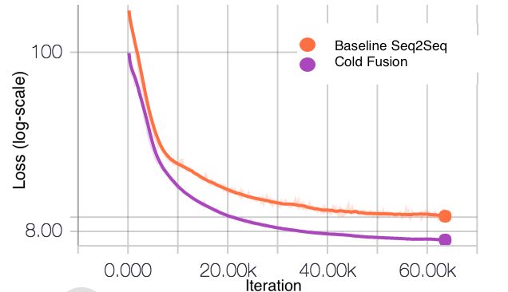

**Source:** *Cold Fusion: Training Seq2Seq Models Together with Language Models* — [PDF](https://arxiv.org/pdf/1708.06426) · [arXiv](https://arxiv.org/abs/1708.06426)

# Cold Fusion: Training Seq2Seq Models Together with Language Models

Anuroop Sriram  Affiliation: Baidu Research, Sunnyvale, CA, USA  Correspondence to: [sriramanuroop@baidu.com](mailto:sriramanuroop@baidu.com) Heewoo Jun  Affiliation: Baidu Research, Sunnyvale, CA, USA  Sanjeev Satheesh  Affiliation: Baidu Research, Sunnyvale, CA, USA  Adam Coates  Affiliation: Baidu Research, Sunnyvale, CA, USA 

###### Abstract

Sequence-to-sequence (Seq2Seq) models with attention have excelled at tasks which involve generating natural language sentences such as machine translation, image captioning and speech recognition. Performance has further been improved by leveraging unlabeled data, often in the form of a language model. In this work, we present the Cold Fusion method, which leverages a pre-trained language model during training, and show its effectiveness on the speech recognition task. We show that Seq2Seq models with Cold Fusion are able to better utilize language information enjoying i) faster convergence and better generalization, and ii) almost complete transfer to a new domain while using less than 10% of the labeled training data.

###### Keywords: 

asr,speech recognition,semisupervised learning,domain adaptation,attention,seq2seq,fusion,deep learning,ICML 

## 1 Introduction

Sequence-to-sequence (Seq2Seq) ([Bahdanau et al., 2015](https://arxiv.org/html/1708.06426#bib.bib2)) models have achieved state-of-the-art results on many natural language processing problems including automatic speech recognition ([Bahdanau et al., 2016](https://arxiv.org/html/1708.06426#bib.bib3); [Chan et al., 2015](https://arxiv.org/html/1708.06426#bib.bib5)), neural machine translation ([Wu et al., 2016](https://arxiv.org/html/1708.06426#bib.bib22)), conversational modeling ([Vinyals & Le, 2015](https://arxiv.org/html/1708.06426#bib.bib21)) and many more. These models learn to generate a variable-length sequence of tokens (e.g. texts) from a variable-length sequence of input data (e.g. speech or the same texts in another language). With a sufficiently large labeled dataset, vanilla Seq2Seq can model sequential mapping well, but it is often augmented with a language model to further improve the fluency of the generated text.

Because language models can be trained from abundantly available unsupervised text corpora which can have as many as one billion tokens ([Jozefowicz et al., 2016](https://arxiv.org/html/1708.06426#bib.bib13); [Shazeer et al., 2017](https://arxiv.org/html/1708.06426#bib.bib18)), leveraging the rich linguistic information of the label domain can considerably improve Seq2Seq’s performance. A standard way to integrate language models is to linearly combine the score of the task-specific Seq2Seq model with that of an auxiliary langauge model to guide beam search ([Chorowski & Jaitly, 2016](https://arxiv.org/html/1708.06426#bib.bib6); [Sutskever et al., 2014a](https://arxiv.org/html/1708.06426#bib.bib19)). [Gulcehre et al. (2015)](https://arxiv.org/html/1708.06426#bib.bib10) proposed an improved algorithm called _Deep Fusion_ that learns to fuse the hidden states of the Seq2Seq decoder and a neural language model with a gating mechanism, after the two models are trained independently.

While this approach has been shown to improve performance over the baseline, it has a few limitations. First, because the Seq2Seq model is trained to output complete label sequences without a language model, its decoder learns an implicit language model from the training labels, taking up a significant portion of the decoder capacity to learn redundant information. Second, the residual language model baked into the Seq2Seq decoder is biased towards the training labels of the parallel corpus. For example, if a Seq2Seq model fully trained on legal documents is later fused with a medical language model, the decoder still has an inherent tendency to follow the linguistic structure found in legal text. Thus, in order to adapt to novel domains, Deep Fusion must first learn to discount the implicit knowledge of the language.

In this work, we introduce _Cold Fusion_ to overcome both these limitations. Cold Fusion encourages the Seq2Seq decoder to learn to use the external language model during training. This means that Seq2Seq can naturally leverage potentially limitless unsupervised text data, making it particularly proficient at adapting to a new domain. The latter is especially important in practice as the domain from which the model is trained can be different from the real world use case for which it is deployed. In our experiments, Cold Fusion can almost completely transfer to a new domain for the speech recognition task with 10 times less data. Additionally, the decoder only needs to learn task relevant information, and thus trains faster.

The paper is organized as follows: Section [2](https://arxiv.org/html/1708.06426#S2 "2 Background and Related work ‣ Cold Fusion: Training Seq2Seq Models Together with Language Models") outlines the background and related work. Section [3](https://arxiv.org/html/1708.06426#S3 "3 Cold Fusion ‣ Cold Fusion: Training Seq2Seq Models Together with Language Models") presents the Cold Fusion method. Section [4](https://arxiv.org/html/1708.06426#S4 "4 Experiments ‣ Cold Fusion: Training Seq2Seq Models Together with Language Models") details experiments on the speech recognition task that demonstrate Cold Fusion’s generalization and domain adaptation capabilities.

## 2 Background and Related work

### 2.1 Sequence-to-Sequence Models

A basic Seq2Seq model comprises an encoder that maps an input sequence \(\mathbf{x}=(x_{1},\dots,x_{T})\) into an intermediate representation h, and a decoder that in turn generates an output sequence \(\mathbf{y}=(y_{1},\dots,y_{K})\) from h ([Sutskever et al., 2014b](https://arxiv.org/html/1708.06426#bib.bib20)). The decoder can also attend to a certain part of the encoder states with an attention mechanism. The attention mechanism is called hybrid attention ([Chorowski et al., 2015b](https://arxiv.org/html/1708.06426#bib.bib8)), if it uses both the content and the previous context to compute the next context. It is soft if it computes the expectation over the encoder states ([Bahdanau et al., 2015](https://arxiv.org/html/1708.06426#bib.bib2)) as opposed to selecting a slice out of the encoder states.

For the automatic speech recognition (ASR) task, the Seq2Seq model is called an _acoustic model_ (AM) and maps a sequence of spectrogram features extracted from a speech signal to characters.

### 2.2 Inference and Language Model Integration

During inference, we aim to compute the most likely sequence \(\mathbf{\hat{y}}\):

\[\begin{aligned}
 & \mathbf{\hat{y}}=\underset{\mathbf{y}}{\argmax}\log p(\mathbf{y}|\mathbf{x}). &  & \text{(1)}
\end{aligned}\]

 

Here, \(p(\mathbf{y}|\mathbf{x})\) is the probability that the task-specific Seq2Seq model assigns to sequence \(\mathbf{y}\) given input sequence \(\mathbf{x}\). The \(\argmax\) operation is intractable in practice so we use a left-to-right beam search algorithm similar to the one presented in ([Sutskever et al., 2014a](https://arxiv.org/html/1708.06426#bib.bib19)). We maintain a beam of \(K\) partial hypothesis starting with the start symbol \(\langle s\rangle\). At each time-step, the beam is extended by one additional character and only the top \(K\) hypotheses are kept. Decoding continues until the stop symbol \(\langle/s\rangle\) is emitted, at which point the hypothesis is added to the set of completed hypotheses.

A standard way to integrate the language model with the Seq2Seq decoder is to change the inference task to:

\[\begin{aligned}
 & \mathbf{\hat{y}}=\underset{\mathbf{y}}{\argmax}\log p(\mathbf{y}|\mathbf{x})+\lambda\log p_{\LM}(\mathbf{y}), &  & \text{(2)}
\end{aligned}\]

 

where \(p_{\LM}(\mathbf{y})\) is the language model probability assigned to the label sequence \(\mathbf{y}\). ([Chorowski & Jaitly, 2016](https://arxiv.org/html/1708.06426#bib.bib6); [Wu et al., 2016](https://arxiv.org/html/1708.06426#bib.bib22)) describe several heuristics that can be used to improve this basic algorithm. We refer to all of these methods collectively as _Shallow Fusion_ , since \(p_{\LM}\) is only used during inference.

([Gulcehre et al., 2015](https://arxiv.org/html/1708.06426#bib.bib10)) proposed _Deep Fusion_ for machine translation that tightens the connection between the decoder and the language model by combining their states with a parametric gating:

\[\begin{aligned}
 \\
 & \displaystyle g_{t} & \displaystyle=\sigma(v^{\top}s_{t}^{\LM}+b) &  & \text{(3a)} \\
 & \displaystyle s_{t}^{\DF} & \displaystyle=[s_{t};g_{t}s_{t}^{\LM}] &  & \text{(3b)} \\
 & \displaystyle y_{t} & \displaystyle=\softmax(\DNN(s_{t}^{\DF})), &  & \text{(3c)}
\end{aligned}\]

 

where \(s_{t}\), \(s_{t}^{\LM}\) and \(s_{t}^{\DF}\) are the states of the task specific Seq2Seq model, language model and the overall deep fusion model. In ([3c](https://arxiv.org/html/1708.06426#S2.E3.3 "In 3 ‣ 2.2 Inference and Language Model Integration ‣ 2 Background and Related work ‣ Cold Fusion: Training Seq2Seq Models Together with Language Models")), \(\DNN\) can be a deep neural network with any number of layers. \([a;b]\) is the concatenation of vectors \(a\) and \(b\).

In Deep Fusion, the Seq2Seq model and the language model are first trained independently and later combined as in Equation ([3](https://arxiv.org/html/1708.06426#S2.E3 "In 2.2 Inference and Language Model Integration ‣ 2 Background and Related work ‣ Cold Fusion: Training Seq2Seq Models Together with Language Models")). The parameters \(v\) and \(b\) are trained on a small amount of data keeping the rest of the model fixed, and allow the gate to decide how important each of the models are for the current time step.

The biggest disadvantage with Deep Fusion is that the task-specific model is trained independently from the language model. This means that the Seq2Seq decoder needs to learn a language model from the training data labels, which can be rather parsimonious compared to the large text corpora available for language model training. So, the fused output layer of ([3](https://arxiv.org/html/1708.06426#S2.E3 "In 2.2 Inference and Language Model Integration ‣ 2 Background and Related work ‣ Cold Fusion: Training Seq2Seq Models Together with Language Models")) should learn to overcome this bias in order to incorporate the new language information. This also means that a considerable portion of the decoder capacity is wasted.

### 2.3 Semi-supervised Learning in Seq2Seq Models

A few methods have been proposed for leveraging unlabeled text corpora in the target domain, for both better generalization and domain transfer.

[Sennrich et al. (2015)](https://arxiv.org/html/1708.06426#bib.bib17) proposed _backtranslation_ as a way of using unlabeled data for machine translation. Backtranslation improves the BLEU score by increasing the parallel training corpus of the neural machine translation model by automatically translating the unlabeled target domain text. However, this technique does not apply well to other tasks where backtranslation is infeasible or of very low quality (like image captioning or speech recogntion).

[Ramachandran et al. (2016)](https://arxiv.org/html/1708.06426#bib.bib16) proposed warm starting the Seq2Seq model from language models trained on source and target domains separately. _Unsupervised pre-training_ shows improvements in the BLEU scores. ([Ramachandran et al., 2016](https://arxiv.org/html/1708.06426#bib.bib16)) also show that this improvement is from improved generalization, and not only better optimization. While this is a promising approach, the method is potentially difficult to leverage for the transfer task since training on the parallel corpus could end up effectively erasing the knowledge of the language models. Both back-translation and unsupervised pre-training are simple methods that require no change in the architecture.

Model | Prediction  
---|---  
Ground Truth | where’s the sport in that greer snorts and leaps greer hits the dirt hard and rolls  
Plain Seq2Seq | where is the sport and that through snorks and leaps clear its the dirt card and rules  
Deep Fusion | where is the sport and that there is north some beliefs through its the dirt card and rules  
Cold Fusion | where’s the sport in that greer snorts and leaps greer hits the dirt hard and rolls  
Cold Fusion (Fine-tuned) | where’s the sport in that greer snorts and leaps greer hits the dirt hard and rolls  
Ground Truth | jack sniffs the air and speaks in a low voice  
Plain Seq2Seq | jacksonice the air and speech in a logos  
Deep Fusion | jacksonice the air and speech in a logos  
Cold Fusion | jack sniffs the air and speaks in a low voice  
Cold Fusion (Fine-tuned) | jack sniffs the air and speaks in a low voice  
Ground Truth | skipper leads her to the dance floor he hesitates looking deeply into her eyes  
Plain Seq2Seq | skip er leadure to the dance floor he is it takes looking deeply into her eyes  
Deep Fusion | skip er leadure to the dance floor he has it takes looking deeply into her eyes  
Cold Fusion | skipper leads you to the dance floor he has a tates looking deeply into her eyes  
Cold Fusion (Fine-tuned) | skipper leads her to the dance floor he hesitates looking deeply into her eyes

 Table 1: Some examples of predictions by the Deep Fusion and Cold Fusion models. 

## 3 Cold Fusion

Our proposed Cold Fusion method is largely motivated from the Deep Fusion idea but with some important differences. The biggest difference is that in Cold Fusion, the Seq2Seq model is trained from scratch together with a fixed pre-trained language model.

Because the Seq2Seq model is aware of the language model throughout training, it learns to use the language model for language specific information and capture only the relevant information conducive to mapping from the source to the target sequence. This disentanglement can increase the effective capacity of the model significantly. This effect is demonstrated empirically in Section [4](https://arxiv.org/html/1708.06426#S4 "4 Experiments ‣ Cold Fusion: Training Seq2Seq Models Together with Language Models") where Cold Fusion models perform well even with a very small decoder.

We also improve on some of the modeling choices of the fusion mechanism.

  1. First, both the Seq2Seq hidden state \(s_{t}\) and the language model hidden state \(s_{t}^{\LM}\) can be used as inputs to the gate computation. The task-specific model’s embedding contains information about the encoder states which allows the fused layer to decide its reliance on the language model in case of input uncertainty. For example, when the input speech is noisy or a token unseen by the Seq2Seq model is presented, the fusion mechanism learns to pay more attention to the language model. 
  2. Second, we employ fine-grained (FG) gating mechanism as introduced in ([Yang et al., 2016](https://arxiv.org/html/1708.06426#bib.bib23)). By using a different gate value for each hidden node of the language model’s state, we allow for greater flexibility in integrating the language model because the fusion algorithm can choose which aspects of the language model it needs to emphasize more at each time step. 
  3. Third, we replace the language model’s hidden state with the language model probability. The distribution and dynamics of \(s_{t}^{\LM}\) can vary considerably across different language models and data. As a concrete example, any fusion mechanism that uses the LM state is not invariant to the permutation of state hidden nodes. This limits the ability to generalize to new LMs. By projecting the token distribution onto a common embedding space, LMs that model novel uses of the language can still be integrated without state discrepancy issues. This also means that we can train with or swap on \(n\)-gram LMs during inference. 

The _Cold Fusion_ layer works as follows:

\[\begin{aligned}
 \\
 & \displaystyle h_{t}^{\LM} & \displaystyle=\DNN(\ell_{t}^{\LM}) &  & \text{(4a)} \\
 & \displaystyle g_{t} & \displaystyle=\sigma(W[s_{t};h_{t}^{\LM}]+b) &  & \text{(4b)} \\
 & \displaystyle s_{t}^{\CF} & \displaystyle=[s_{t};g_{t}\circ h_{t}^{\LM}] &  & \text{(4c)} \\
 & \displaystyle r_{t}^{\CF} & \displaystyle=\DNN(s_{t}^{\CF}) &  & \text{(4d)} \\
 & \displaystyle\hat{P}(y_{t}|x,y_{<t}) & \displaystyle=\softmax(r_{t}^{\CF}) &  & \text{(4e)}
\end{aligned}\]

 

\(\ell_{t}^{\LM}\) is the logit output of the language model, \(s_{t}\) is the state of the task specific model, and \(s_{t}^{\CF}\) is the final fused state used to generate the output. Since logits can have arbitrary offsets, the maximum value is subtracted off before feeding into the layer. In ([4a](https://arxiv.org/html/1708.06426#S3.E4.1 "In 4 ‣ 3 Cold Fusion ‣ Cold Fusion: Training Seq2Seq Models Together with Language Models")), ([4d](https://arxiv.org/html/1708.06426#S3.E4.4 "In 4 ‣ 3 Cold Fusion ‣ Cold Fusion: Training Seq2Seq Models Together with Language Models")), the DNN can be a deep neural network with any number of layers. In our experiments, we found a single affine layer, with ReLU activation prior to softmax, to be helpful.

Figure 1: Cross-entropy loss on the dev set for the baseline model (orange) and the proposed model (purple) as a function of training iteration. Training with a language model speeds up convergence considerably.  

 

## 4 Experiments

### 4.1 Setup

For our experiments, we tested the Cold Fusion method on the speech recognition task. The results are compared using the character error rate (CER) and word error rate (WER) on the evaluation sets. For all models which were trained on the source domain, the source CER and WER indicate in-domain performance and the target CER and WER indicate out-of-domain performance.

We collected two data sets: one based on search queries which served as our _source_ domain, and another based on movie transcripts which served as our _target_ domain. For each dataset, we used Amazon Mechanical Turk to collect audio recordings of speakers reading out the text. We gave identical instructions to all the turkers in order to ensure that the two datasets only differed in the text domain. The source dataset contains 411,000 utterances (about 650 hours of audio), and the target dataset contains 345,000 utterances (about 676 hours of audio). We held out 2048 utterances from each domain for evaluation.

The text of the two datasets differ significantly. Table [2](https://arxiv.org/html/1708.06426#S4.T2 "Table 2 ‣ 4.1 Setup ‣ 4 Experiments ‣ Cold Fusion: Training Seq2Seq Models Together with Language Models") shows results of training character-based recurrent neural network language models ([Mikolov, 2012](https://arxiv.org/html/1708.06426#bib.bib15)) on each of the datasets and evaluating on both datasets. Language models very easily overfit the training distribution, so models trained on one corpus will perform poorly on a different distribution. We see this effect in Table [2](https://arxiv.org/html/1708.06426#S4.T2 "Table 2 ‣ 4.1 Setup ‣ 4 Experiments ‣ Cold Fusion: Training Seq2Seq Models Together with Language Models") that models optimized for the source domain have worse perplexity on the target distribution.

Table 2: Dev set perplexities for character RNN language models trained on different datasets on source and target domain. Note that i) the model trained on source domain does poorly on target domain and vice-versa indicating that the two domains are very different, and ii) the best model on both domains is a larger model trained on a superset of both corpuses. We use the model trained on the full dataset (which contains the source and target datasets along with some additional text) for all of the LM integration experiments. 

<table id="S4.T2.2" class="ltx_tabular ltx_centering ltx_guessed_headers ltx_align_middle">
<thead class="ltx_thead">
<tr id="S4.T2.2.1" class="ltx_tr">
<th id="S4.T2.2.1.1" class="ltx_td ltx_align_center ltx_th ltx_th_column ltx_border_r ltx_border_tt">Model</th>
<th id="S4.T2.2.1.2" class="ltx_td ltx_align_center ltx_th ltx_th_column ltx_border_r ltx_border_tt">Domain</th>
<th id="S4.T2.2.1.3" class="ltx_td ltx_align_center ltx_th ltx_th_column ltx_border_r ltx_border_tt">Word</th>
<th id="S4.T2.2.1.4" class="ltx_td ltx_align_center ltx_th ltx_th_column ltx_border_tt" colspan="2">Perplexity</th></tr>
<tr id="S4.T2.2.2" class="ltx_tr">
<th id="S4.T2.2.2.1" class="ltx_td ltx_th ltx_th_column ltx_border_r"></th>
<th id="S4.T2.2.2.2" class="ltx_td ltx_th ltx_th_column ltx_border_r"></th>
<th id="S4.T2.2.2.3" class="ltx_td ltx_align_center ltx_th ltx_th_column ltx_border_r">Count</th>
<th id="S4.T2.2.2.4" class="ltx_td ltx_align_center ltx_th ltx_th_column">Source</th>
<th id="S4.T2.2.2.5" class="ltx_td ltx_align_center ltx_th ltx_th_column">Target</th></tr>
</thead>
<tbody class="ltx_tbody">
<tr id="S4.T2.2.3" class="ltx_tr">
<td id="S4.T2.2.3.1" class="ltx_td ltx_align_center ltx_border_r ltx_border_t">GRU (<math id="S4.T2.m1" class="ltx_Math" alttext="3\times 512" display="inline" intent=":literal"><semantics><mrow><mn>3</mn><mo lspace="0.222em" rspace="0.222em">×</mo><mn>512</mn></mrow><annotation encoding="application/x-tex">3\times 512</annotation></semantics></math>)</td>
<td id="S4.T2.2.3.2" class="ltx_td ltx_align_center ltx_border_r ltx_border_t">Source</td>
<td id="S4.T2.2.3.3" class="ltx_td ltx_align_center ltx_border_r ltx_border_t">5.73M</td>
<td id="S4.T2.2.3.4" class="ltx_td ltx_align_center ltx_border_t">2.670</td>
<td id="S4.T2.2.3.5" class="ltx_td ltx_align_center ltx_border_t">4.463</td></tr>
<tr id="S4.T2.2.4" class="ltx_tr">
<td id="S4.T2.2.4.1" class="ltx_td ltx_align_center ltx_border_r">GRU (<math id="S4.T2.m2" class="ltx_Math" alttext="3\times 512" display="inline" intent=":literal"><semantics><mrow><mn>3</mn><mo lspace="0.222em" rspace="0.222em">×</mo><mn>512</mn></mrow><annotation encoding="application/x-tex">3\times 512</annotation></semantics></math>)</td>
<td id="S4.T2.2.4.2" class="ltx_td ltx_align_center ltx_border_r">Target</td>
<td id="S4.T2.2.4.3" class="ltx_td ltx_align_center ltx_border_r">5.46M</td>
<td id="S4.T2.2.4.4" class="ltx_td ltx_align_center">3.717</td>
<td id="S4.T2.2.4.5" class="ltx_td ltx_align_center">2.794</td></tr>
<tr id="S4.T2.2.5" class="ltx_tr">
<td id="S4.T2.2.5.1" class="ltx_td ltx_align_center ltx_border_bb ltx_border_r">GRU (<math id="S4.T2.m3" class="ltx_Math" alttext="3\times 1024" display="inline" intent=":literal"><semantics><mrow><mn>3</mn><mo lspace="0.222em" rspace="0.222em">×</mo><mn>1024</mn></mrow><annotation encoding="application/x-tex">3\times 1024</annotation></semantics></math>)</td>
<td id="S4.T2.2.5.2" class="ltx_td ltx_align_center ltx_border_bb ltx_border_r">Full</td>
<td id="S4.T2.2.5.3" class="ltx_td ltx_align_center ltx_border_bb ltx_border_r">25.16M</td>
<td id="S4.T2.2.5.4" class="ltx_td ltx_align_center ltx_border_bb">2.491</td>
<td id="S4.T2.2.5.5" class="ltx_td ltx_align_center ltx_border_bb">2.325</td></tr>
</tbody>
</table>

 

### 4.2 Neural Network Architectures

The language model described in the final row of Table [2](https://arxiv.org/html/1708.06426#S4.T2 "Table 2 ‣ 4.1 Setup ‣ 4 Experiments ‣ Cold Fusion: Training Seq2Seq Models Together with Language Models") was trained on about 25 million words. This model contains three layers of gated recurrent units (GRU) ([Chung et al., 2014](https://arxiv.org/html/1708.06426#bib.bib9)) with a hidden state dimension of 1024. The model was trained to minimize the cross-entropy of predicting the next character given the previous characters. We used the Adam optimizer ([Kingma & Ba, 2014](https://arxiv.org/html/1708.06426#bib.bib14)) with a batch size of 512. The model gets a perplexity of 2.49 on the source data and 2.325 on the target data.

Table 3: Speech recognition results for the various models discussed in the paper.  

<table id="S4.T3.2" class="ltx_tabular ltx_centering ltx_align_middle">
<tbody class="ltx_tbody">
<tr id="S4.T3.2.1" class="ltx_tr">
<td id="S4.T3.2.1.1" class="ltx_td ltx_align_left ltx_border_r ltx_border_tt">Model</td>
<td id="S4.T3.2.1.2" class="ltx_td ltx_align_center ltx_border_r ltx_border_tt">Train Domain</td>
<td id="S4.T3.2.1.3" class="ltx_td ltx_align_center ltx_border_r ltx_border_tt" colspan="2">Test on Source</td>
<td id="S4.T3.2.1.4" class="ltx_td ltx_align_center ltx_border_tt" colspan="3">Test on Target</td></tr>
<tr id="S4.T3.2.2" class="ltx_tr">
<td id="S4.T3.2.2.1" class="ltx_td ltx_border_r"></td>
<td id="S4.T3.2.2.2" class="ltx_td ltx_border_r"></td>
<td id="S4.T3.2.2.3" class="ltx_td ltx_align_center">CER</td>
<td id="S4.T3.2.2.4" class="ltx_td ltx_align_center ltx_border_r">WER</td>
<td id="S4.T3.2.2.5" class="ltx_td ltx_align_center">CER</td>
<td id="S4.T3.2.2.6" class="ltx_td ltx_align_center">WER</td>
<td id="S4.T3.2.2.7" class="ltx_td ltx_align_center">Domain Gap</td></tr>
<tr id="S4.T3.2.3" class="ltx_tr">
<td id="S4.T3.2.3.1" class="ltx_td ltx_align_left ltx_border_r ltx_border_t">Baseline Attention Model</td>
<td id="S4.T3.2.3.2" class="ltx_td ltx_align_center ltx_border_r ltx_border_t">Source</td>
<td id="S4.T3.2.3.3" class="ltx_td ltx_align_center ltx_border_t">7.54%</td>
<td id="S4.T3.2.3.4" class="ltx_td ltx_align_center ltx_border_r ltx_border_t">14.68%</td>
<td id="S4.T3.2.3.5" class="ltx_td ltx_align_center ltx_border_t">23.02%</td>
<td id="S4.T3.2.3.6" class="ltx_td ltx_align_center ltx_border_t">43.52%</td>
<td id="S4.T3.2.3.7" class="ltx_td ltx_align_center ltx_border_t">100%</td></tr>
<tr id="S4.T3.2.4" class="ltx_tr">
<td id="S4.T3.2.4.1" class="ltx_td ltx_align_left ltx_border_r">Baseline Attention Model</td>
<td id="S4.T3.2.4.2" class="ltx_td ltx_align_center ltx_border_r">Target</td>
<td id="S4.T3.2.4.3" class="ltx_td"></td>
<td id="S4.T3.2.4.4" class="ltx_td ltx_border_r"></td>
<td id="S4.T3.2.4.5" class="ltx_td ltx_align_center">8.84%</td>
<td id="S4.T3.2.4.6" class="ltx_td ltx_align_center">17.61%</td>
<td id="S4.T3.2.4.7" class="ltx_td ltx_align_center">0%</td></tr>
<tr id="S4.T3.2.5" class="ltx_tr">
<td id="S4.T3.2.5.1" class="ltx_td ltx_align_left ltx_border_r ltx_border_t">Baseline + Deep Fusion</td>
<td id="S4.T3.2.5.2" class="ltx_td ltx_align_center ltx_border_r ltx_border_t">Source</td>
<td id="S4.T3.2.5.3" class="ltx_td ltx_align_center ltx_border_t">7.64%</td>
<td id="S4.T3.2.5.4" class="ltx_td ltx_align_center ltx_border_r ltx_border_t">13.92%</td>
<td id="S4.T3.2.5.5" class="ltx_td ltx_align_center ltx_border_t">22.14%</td>
<td id="S4.T3.2.5.6" class="ltx_td ltx_align_center ltx_border_t">37.45%</td>
<td id="S4.T3.2.5.7" class="ltx_td ltx_align_center ltx_border_t">76.57%</td></tr>
<tr id="S4.T3.2.6" class="ltx_tr">
<td id="S4.T3.2.6.1" class="ltx_td ltx_align_left ltx_border_r">     + <math id="S4.T3.m1" class="ltx_Math" alttext="s^{\AM}" display="inline" intent=":literal"><semantics><msup><mi>s</mi><mi>AM</mi></msup><annotation encoding="application/x-tex">s^{\AM}</annotation></semantics></math> in gate</td>
<td id="S4.T3.2.6.2" class="ltx_td ltx_align_center ltx_border_r">Source</td>
<td id="S4.T3.2.6.3" class="ltx_td ltx_align_center">7.61%</td>
<td id="S4.T3.2.6.4" class="ltx_td ltx_align_center ltx_border_r">13.92%</td>
<td id="S4.T3.2.6.5" class="ltx_td ltx_align_center">21.07%</td>
<td id="S4.T3.2.6.6" class="ltx_td ltx_align_center">37.9%</td>
<td id="S4.T3.2.6.7" class="ltx_td ltx_align_center">78.31%</td></tr>
<tr id="S4.T3.2.7" class="ltx_tr">
<td id="S4.T3.2.7.1" class="ltx_td ltx_align_left ltx_border_r">     + Fine-Grained Gating</td>
<td id="S4.T3.2.7.2" class="ltx_td ltx_align_center ltx_border_r">Source</td>
<td id="S4.T3.2.7.3" class="ltx_td ltx_align_center">7.47%</td>
<td id="S4.T3.2.7.4" class="ltx_td ltx_align_center ltx_border_r">13.61%</td>
<td id="S4.T3.2.7.5" class="ltx_td ltx_align_center">20.29%</td>
<td id="S4.T3.2.7.6" class="ltx_td ltx_align_center">36.69%</td>
<td id="S4.T3.2.7.7" class="ltx_td ltx_align_center">73.64%</td></tr>
<tr id="S4.T3.2.8" class="ltx_tr">
<td id="S4.T3.2.8.1" class="ltx_td ltx_align_left ltx_border_r">     + ReLU layer</td>
<td id="S4.T3.2.8.2" class="ltx_td ltx_align_center ltx_border_r">Source</td>
<td id="S4.T3.2.8.3" class="ltx_td ltx_align_center">7.50%</td>
<td id="S4.T3.2.8.4" class="ltx_td ltx_align_center ltx_border_r">13.54%</td>
<td id="S4.T3.2.8.5" class="ltx_td ltx_align_center">21.18%</td>
<td id="S4.T3.2.8.6" class="ltx_td ltx_align_center">38.00%</td>
<td id="S4.T3.2.8.7" class="ltx_td ltx_align_center">78.70%</td></tr>
<tr id="S4.T3.2.9" class="ltx_tr">
<td id="S4.T3.2.9.1" class="ltx_td ltx_align_left ltx_border_r ltx_border_t">Baseline + Cold Fusion</td>
<td id="S4.T3.2.9.2" class="ltx_td ltx_border_r ltx_border_t"></td>
<td id="S4.T3.2.9.3" class="ltx_td ltx_border_t"></td>
<td id="S4.T3.2.9.4" class="ltx_td ltx_border_r ltx_border_t"></td>
<td id="S4.T3.2.9.5" class="ltx_td ltx_border_t"></td>
<td id="S4.T3.2.9.6" class="ltx_td ltx_border_t"></td>
<td id="S4.T3.2.9.7" class="ltx_td ltx_border_t"></td></tr>
<tr id="S4.T3.2.10" class="ltx_tr">
<td id="S4.T3.2.10.1" class="ltx_td ltx_align_left ltx_border_r">     + <math id="S4.T3.m2" class="ltx_Math" alttext="s^{\AM}" display="inline" intent=":literal"><semantics><msup><mi>s</mi><mi>AM</mi></msup><annotation encoding="application/x-tex">s^{\AM}</annotation></semantics></math> in gate</td>
<td id="S4.T3.2.10.2" class="ltx_td ltx_align_center ltx_border_r">Source</td>
<td id="S4.T3.2.10.3" class="ltx_td ltx_align_center">7.25%</td>
<td id="S4.T3.2.10.4" class="ltx_td ltx_align_center ltx_border_r">13.88%</td>
<td id="S4.T3.2.10.5" class="ltx_td ltx_align_center">15.63%</td>
<td id="S4.T3.2.10.6" class="ltx_td ltx_align_center">30.71%</td>
<td id="S4.T3.2.10.7" class="ltx_td ltx_align_center">50.56%</td></tr>
<tr id="S4.T3.2.11" class="ltx_tr">
<td id="S4.T3.2.11.1" class="ltx_td ltx_align_left ltx_border_r">     + Fine-Grained Gating</td>
<td id="S4.T3.2.11.2" class="ltx_td ltx_align_center ltx_border_r">Source</td>
<td id="S4.T3.2.11.3" class="ltx_td ltx_align_center">6.14%</td>
<td id="S4.T3.2.11.4" class="ltx_td ltx_align_center ltx_border_r">12.08%</td>
<td id="S4.T3.2.11.5" class="ltx_td ltx_align_center">14.79%</td>
<td id="S4.T3.2.11.6" class="ltx_td ltx_align_center">30.00%</td>
<td id="S4.T3.2.11.7" class="ltx_td ltx_align_center">47.82%</td></tr>
<tr id="S4.T3.2.12" class="ltx_tr">
<td id="S4.T3.2.12.1" class="ltx_td ltx_align_left ltx_border_r">     + ReLU layer</td>
<td id="S4.T3.2.12.2" class="ltx_td ltx_align_center ltx_border_r">Source</td>
<td id="S4.T3.2.12.3" class="ltx_td ltx_align_center">5.82%</td>
<td id="S4.T3.2.12.4" class="ltx_td ltx_align_center ltx_border_r">11.52%</td>
<td id="S4.T3.2.12.5" class="ltx_td ltx_align_center">14.89%</td>
<td id="S4.T3.2.12.6" class="ltx_td ltx_align_center">30.15%</td>
<td id="S4.T3.2.12.7" class="ltx_td ltx_align_center">48.40%</td></tr>
<tr id="S4.T3.2.13" class="ltx_tr">
<td id="S4.T3.2.13.1" class="ltx_td ltx_align_left ltx_border_bb ltx_border_r">     + Probability Projection</td>
<td id="S4.T3.2.13.2" class="ltx_td ltx_align_center ltx_border_bb ltx_border_r">Source</td>
<td id="S4.T3.2.13.3" class="ltx_td ltx_align_center ltx_border_bb">5.94%</td>
<td id="S4.T3.2.13.4" class="ltx_td ltx_align_center ltx_border_bb ltx_border_r">11.87%</td>
<td id="S4.T3.2.13.5" class="ltx_td ltx_align_center ltx_border_bb">13.72%</td>
<td id="S4.T3.2.13.6" class="ltx_td ltx_align_center ltx_border_bb">27.50%</td>
<td id="S4.T3.2.13.7" class="ltx_td ltx_align_center ltx_border_bb">38.17%</td></tr>
</tbody>
</table>

 

For the acoustic models, we used the Seq2Seq architecture with soft attention based on ([Bahdanau et al., 2016](https://arxiv.org/html/1708.06426#bib.bib3)). The encoder consists of 6 bidirectional LSTM (BLSTM) ([Hochreiter & Schmidhuber, 1997](https://arxiv.org/html/1708.06426#bib.bib12)) layers each with a dimension of 480. We also use max pooling layers with a stride of 2 along the time dimension after the first two BLSTM layers, and add residual connections ([He et al., 2015](https://arxiv.org/html/1708.06426#bib.bib11)) for each of the BLSTM layers to help speed up the training process. The decoder consisted of a single layer of 960 dimensional Gated Recurrent Unit (GRU) with a hybrid attention ([Chorowski et al., 2015b](https://arxiv.org/html/1708.06426#bib.bib8)).

The final Cold Fusion mechanism had one dense layer of 256 units followed by ReLU before softmax.

### 4.3 Training

The input sequence consisted of 40 mel-scale filter bank features. We expanded the datasets with noise augmentation; a random background noise is added with a 40% probability at a uniform random SNR between 0 and 15 dB. We did not use any other form of regularization.

We trained the entire system end-to-end with Adam ([Kingma & Ba, 2014](https://arxiv.org/html/1708.06426#bib.bib14)) with a batch size of 64. The learning rates were tuned separately for each model using random search. To stabilize training early on, the training examples were sorted by increasing input sequence length in the first epoch ([Amodei et al., 2015](https://arxiv.org/html/1708.06426#bib.bib1)). During inference, we used beam search with a fixed beam size of 128 for all of our experiments.

We also used scheduled sampling ([Bengio et al., 2015](https://arxiv.org/html/1708.06426#bib.bib4)) with a sampling rate of 0.2 which was kept fixed throughout training. Scheduled sampling helped reduce the effect of exposure bias due to the difference in the training and inference mechanisms.

### 4.4 Improved Generalization

Table 4: Effect of decoder dimension on the model’s performance. The performance of cold fusion models degrades more slowly as the decoder size decreases. This corroborates the fact that the decoder only needs to learn the task not label generation. Its effective task capacity is much larger than without fusion.  

<table id="S4.T4.2" class="ltx_tabular ltx_centering ltx_guessed_headers ltx_align_middle">
<tbody class="ltx_tbody">
<tr id="S4.T4.2.1" class="ltx_tr">
<th id="S4.T4.2.1.1" class="ltx_td ltx_align_left ltx_th ltx_th_row ltx_border_r ltx_border_tt">Model</th>
<th id="S4.T4.2.1.2" class="ltx_td ltx_align_center ltx_th ltx_th_row ltx_border_r ltx_border_tt">Decoder size</th>
<td id="S4.T4.2.1.3" class="ltx_td ltx_align_center ltx_border_tt" colspan="2">Source</td></tr>
<tr id="S4.T4.2.2" class="ltx_tr">
<th id="S4.T4.2.2.1" class="ltx_td ltx_th ltx_th_row ltx_border_r"></th>
<th id="S4.T4.2.2.2" class="ltx_td ltx_th ltx_th_row ltx_border_r"></th>
<td id="S4.T4.2.2.3" class="ltx_td ltx_align_center">CER</td>
<td id="S4.T4.2.2.4" class="ltx_td ltx_align_center">WER</td></tr>
<tr id="S4.T4.2.3" class="ltx_tr">
<th id="S4.T4.2.3.1" class="ltx_td ltx_align_left ltx_th ltx_th_row ltx_border_r ltx_border_t">Attention</th>
<th id="S4.T4.2.3.2" class="ltx_td ltx_align_center ltx_th ltx_th_row ltx_border_r ltx_border_t">64</th>
<td id="S4.T4.2.3.3" class="ltx_td ltx_align_center ltx_border_t">16.33%</td>
<td id="S4.T4.2.3.4" class="ltx_td ltx_align_center ltx_border_t">33.98%</td></tr>
<tr id="S4.T4.2.4" class="ltx_tr">
<th id="S4.T4.2.4.1" class="ltx_td ltx_th ltx_th_row ltx_border_r"></th>
<th id="S4.T4.2.4.2" class="ltx_td ltx_align_center ltx_th ltx_th_row ltx_border_r">128</th>
<td id="S4.T4.2.4.3" class="ltx_td ltx_align_center">11.14%</td>
<td id="S4.T4.2.4.4" class="ltx_td ltx_align_center">24.35%</td></tr>
<tr id="S4.T4.2.5" class="ltx_tr">
<th id="S4.T4.2.5.1" class="ltx_td ltx_th ltx_th_row ltx_border_r"></th>
<th id="S4.T4.2.5.2" class="ltx_td ltx_align_center ltx_th ltx_th_row ltx_border_r">256</th>
<td id="S4.T4.2.5.3" class="ltx_td ltx_align_center">8.89%</td>
<td id="S4.T4.2.5.4" class="ltx_td ltx_align_center">18.74%</td></tr>
<tr id="S4.T4.2.6" class="ltx_tr">
<th id="S4.T4.2.6.1" class="ltx_td ltx_th ltx_th_row ltx_border_r"></th>
<th id="S4.T4.2.6.2" class="ltx_td ltx_align_center ltx_th ltx_th_row ltx_border_r">960</th>
<td id="S4.T4.2.6.3" class="ltx_td ltx_align_center">7.54%</td>
<td id="S4.T4.2.6.4" class="ltx_td ltx_align_center">14.68%</td></tr>
<tr id="S4.T4.2.7" class="ltx_tr">
<th id="S4.T4.2.7.1" class="ltx_td ltx_align_left ltx_th ltx_th_row ltx_border_r ltx_border_t">Cold Fusion</th>
<th id="S4.T4.2.7.2" class="ltx_td ltx_align_center ltx_th ltx_th_row ltx_border_r ltx_border_t">64</th>
<td id="S4.T4.2.7.3" class="ltx_td ltx_align_center ltx_border_t">9.47%</td>
<td id="S4.T4.2.7.4" class="ltx_td ltx_align_center ltx_border_t">17.42%</td></tr>
<tr id="S4.T4.2.8" class="ltx_tr">
<th id="S4.T4.2.8.1" class="ltx_td ltx_th ltx_th_row ltx_border_r"></th>
<th id="S4.T4.2.8.2" class="ltx_td ltx_align_center ltx_th ltx_th_row ltx_border_r">128</th>
<td id="S4.T4.2.8.3" class="ltx_td ltx_align_center">7.96%</td>
<td id="S4.T4.2.8.4" class="ltx_td ltx_align_center">15.15%</td></tr>
<tr id="S4.T4.2.9" class="ltx_tr">
<th id="S4.T4.2.9.1" class="ltx_td ltx_th ltx_th_row ltx_border_r"></th>
<th id="S4.T4.2.9.2" class="ltx_td ltx_align_center ltx_th ltx_th_row ltx_border_r">256</th>
<td id="S4.T4.2.9.3" class="ltx_td ltx_align_center">6.71%</td>
<td id="S4.T4.2.9.4" class="ltx_td ltx_align_center">13.19%</td></tr>
<tr id="S4.T4.2.10" class="ltx_tr">
<th id="S4.T4.2.10.1" class="ltx_td ltx_th ltx_th_row ltx_border_bb ltx_border_r"></th>
<th id="S4.T4.2.10.2" class="ltx_td ltx_align_center ltx_th ltx_th_row ltx_border_bb ltx_border_r">960</th>
<td id="S4.T4.2.10.3" class="ltx_td ltx_align_center ltx_border_bb">5.82%</td>
<td id="S4.T4.2.10.4" class="ltx_td ltx_align_center ltx_border_bb">11.52%</td></tr>
</tbody>
</table>

 

Leveraging a language model that has a better perplexity on the distribution of interest should directly mean an improved WER for the ASR task. In this section, we compare how the different fusion methods fare in achieving this effect.

Swapping the language model is not possible with Deep Fusion because of the state discrepancy issue motivated in Section [3](https://arxiv.org/html/1708.06426#S3 "3 Cold Fusion ‣ Cold Fusion: Training Seq2Seq Models Together with Language Models"). All fusion models were therefore trained and evaluated with the same language model that achieved a low perplexity on both the source and target domains (See Table [2](https://arxiv.org/html/1708.06426#S4.T2 "Table 2 ‣ 4.1 Setup ‣ 4 Experiments ‣ Cold Fusion: Training Seq2Seq Models Together with Language Models")). This way, we can measure improvements in transfer capability over Deep Fusion due to the training and architectural changes.

Table [3](https://arxiv.org/html/1708.06426#S4.T3 "Table 3 ‣ 4.2 Neural Network Architectures ‣ 4 Experiments ‣ Cold Fusion: Training Seq2Seq Models Together with Language Models") compares the performance of Deep Fusion and Cold Fusion on the source and target held-out sets. Clearly, Cold Fusion consistently outperforms on both metrics on both domains than the baselines. For the task of predicting in-domain, the baseline model gets a word error of 14.68%, while our best model gets a relative improvement of more than 21% over that number. Even compared to the recently proposed Deep Fusion model ([Gulcehre et al., 2015](https://arxiv.org/html/1708.06426#bib.bib10)), the best Cold Fusion model gets a relative improvement of 15%.

We get even bigger improvements in out-of-domain results. The baseline attention model, when trained on the source domain but evaluated on the target domain gets, 43.5% WER. This is significantly worse than the 17.6% that we can get by training the same model on the target dataset. The goal of domain adaptation is to bridge the gap between these numbers. The final column in Table [3](https://arxiv.org/html/1708.06426#S4.T3 "Table 3 ‣ 4.2 Neural Network Architectures ‣ 4 Experiments ‣ Cold Fusion: Training Seq2Seq Models Together with Language Models") shows the remaining gap as a fraction of the difference for each model.

The Deep Fusion models can only narrow the domain gap to 76.57% while Cold Fusion methods can reduce it to 38.17%. The same table also shows the incremental effects of the three architectural changes we have made to the Cold Fusion method. Note that applying the same changes to the Deep Fusion method does not yield much improvements, indicating the need for cold starting Seq2Seq training with language models. The use of probability projection instead of the language model state in the fusion layer substantially helps with generalization. Intuitively, the character probability space shares the same structure across different language models unlike the hidden state space.

### 4.5 Decoder Efficiency

We test whether cold fusion does indeed relieve the decoder of learning a language model. We do so by checking how a decrease in the decoder capacity affected the error rates. As evidenced in Table [4](https://arxiv.org/html/1708.06426#S4.T4 "Table 4 ‣ 4.4 Improved Generalization ‣ 4 Experiments ‣ Cold Fusion: Training Seq2Seq Models Together with Language Models"), the performance of the Cold Fusion models degrades gradually as the decoder cell size is decreased whereas the performance of the attention models deteriorates abruptly beyond a point. It is remarkable that the Cold Fusion decoder still outperforms the full attentional decoder with 4\(\times\) fewer number of parameters.

Table 5: Results for fine tuning the acoustic model (final row from Table [3](https://arxiv.org/html/1708.06426#S4.T3 "Table 3 ‣ 4.2 Neural Network Architectures ‣ 4 Experiments ‣ Cold Fusion: Training Seq2Seq Models Together with Language Models")) on subsets of the target training data. ∗The final row represents an attention model that was trained on all of the target domain data. 

<table id="S4.T5.4" class="ltx_tabular ltx_centering ltx_guessed_headers ltx_align_middle">
<thead class="ltx_thead">
<tr id="S4.T5.4.1" class="ltx_tr">
<th id="S4.T5.4.1.1" class="ltx_td ltx_align_left ltx_th ltx_th_column ltx_th_row ltx_border_r ltx_border_tt">Model</th>
<th id="S4.T5.4.1.2" class="ltx_td ltx_align_center ltx_th ltx_th_column ltx_th_row ltx_border_r ltx_border_tt">Target</th>
<th id="S4.T5.4.1.3" class="ltx_td ltx_align_center ltx_th ltx_th_column ltx_border_tt" colspan="3">Target</th></tr>
<tr id="S4.T5.4.2" class="ltx_tr">
<th id="S4.T5.4.2.1" class="ltx_td ltx_th ltx_th_column ltx_th_row ltx_border_r"></th>
<th id="S4.T5.4.2.2" class="ltx_td ltx_align_center ltx_th ltx_th_column ltx_th_row ltx_border_r">Data</th>
<th id="S4.T5.4.2.3" class="ltx_td ltx_align_center ltx_th ltx_th_column">CER</th>
<th id="S4.T5.4.2.4" class="ltx_td ltx_align_center ltx_th ltx_th_column">WER</th>
<th id="S4.T5.4.2.5" class="ltx_td ltx_align_center ltx_th ltx_th_column">Domain Gap</th></tr>
<tr id="S4.T5.4.3" class="ltx_tr">
<th id="S4.T5.4.3.1" class="ltx_td ltx_align_left ltx_th ltx_th_column ltx_th_row ltx_border_r ltx_border_t">Cold Fusion</th>
<th id="S4.T5.4.3.2" class="ltx_td ltx_align_center ltx_th ltx_th_column ltx_th_row ltx_border_r ltx_border_t">0%</th>
<th id="S4.T5.4.3.3" class="ltx_td ltx_align_center ltx_th ltx_th_column ltx_border_t">13.72%</th>
<th id="S4.T5.4.3.4" class="ltx_td ltx_align_center ltx_th ltx_th_column ltx_border_t">27.50%</th>
<th id="S4.T5.4.3.5" class="ltx_td ltx_align_center ltx_th ltx_th_column ltx_border_t">38.17%</th></tr>
</thead>
<tbody class="ltx_tbody">
<tr id="S4.T5.4.4" class="ltx_tr">
<th id="S4.T5.4.4.1" class="ltx_td ltx_align_left ltx_th ltx_th_row ltx_border_r ltx_border_t">Cold Fusion</th>
<th id="S4.T5.4.4.2" class="ltx_td ltx_align_center ltx_th ltx_th_row ltx_border_r ltx_border_t">0.6%</th>
<td id="S4.T5.4.4.3" class="ltx_td ltx_align_center ltx_border_t">11.98%</td>
<td id="S4.T5.4.4.4" class="ltx_td ltx_align_center ltx_border_t">23.13%</td>
<td id="S4.T5.4.4.5" class="ltx_td ltx_align_center ltx_border_t">21.30%</td></tr>
<tr id="S4.T5.4.5" class="ltx_tr">
<th id="S4.T5.4.5.1" class="ltx_td ltx_align_left ltx_th ltx_th_row ltx_border_r">+ finetuning</th>
<th id="S4.T5.4.5.2" class="ltx_td ltx_align_center ltx_th ltx_th_row ltx_border_r">1.2%</th>
<td id="S4.T5.4.5.3" class="ltx_td ltx_align_center">11.62%</td>
<td id="S4.T5.4.5.4" class="ltx_td ltx_align_center">22.40%</td>
<td id="S4.T5.4.5.5" class="ltx_td ltx_align_center">18.49%</td></tr>
<tr id="S4.T5.4.6" class="ltx_tr">
<th id="S4.T5.4.6.1" class="ltx_td ltx_th ltx_th_row ltx_border_r"></th>
<th id="S4.T5.4.6.2" class="ltx_td ltx_align_center ltx_th ltx_th_row ltx_border_r">2.4%</th>
<td id="S4.T5.4.6.3" class="ltx_td ltx_align_center">10.79%</td>
<td id="S4.T5.4.6.4" class="ltx_td ltx_align_center">21.05%</td>
<td id="S4.T5.4.6.5" class="ltx_td ltx_align_center">13.28%</td></tr>
<tr id="S4.T5.4.7" class="ltx_tr">
<th id="S4.T5.4.7.1" class="ltx_td ltx_th ltx_th_row ltx_border_r"></th>
<th id="S4.T5.4.7.2" class="ltx_td ltx_align_center ltx_th ltx_th_row ltx_border_r">4.8%</th>
<td id="S4.T5.4.7.3" class="ltx_td ltx_align_center">10.46%</td>
<td id="S4.T5.4.7.4" class="ltx_td ltx_align_center">20.46%</td>
<td id="S4.T5.4.7.5" class="ltx_td ltx_align_center">11.00%</td></tr>
<tr id="S4.T5.4.8" class="ltx_tr">
<th id="S4.T5.4.8.1" class="ltx_td ltx_th ltx_th_row ltx_border_r"></th>
<th id="S4.T5.4.8.2" class="ltx_td ltx_align_center ltx_th ltx_th_row ltx_border_r">9.5%</th>
<td id="S4.T5.4.8.3" class="ltx_td ltx_align_center">10.11%</td>
<td id="S4.T5.4.8.4" class="ltx_td ltx_align_center">19.68%</td>
<td id="S4.T5.4.8.5" class="ltx_td ltx_align_center">7.99%</td></tr>
<tr id="S4.T5.4.9" class="ltx_tr">
<th id="S4.T5.4.9.1" class="ltx_td ltx_align_left ltx_th ltx_th_row ltx_border_bb ltx_border_r ltx_border_t">Attention∗</th>
<th id="S4.T5.4.9.2" class="ltx_td ltx_align_center ltx_th ltx_th_row ltx_border_bb ltx_border_r ltx_border_t">100%</th>
<td id="S4.T5.4.9.3" class="ltx_td ltx_align_center ltx_border_bb ltx_border_t">8.84%</td>
<td id="S4.T5.4.9.4" class="ltx_td ltx_align_center ltx_border_bb ltx_border_t">17.61%</td>
<td id="S4.T5.4.9.5" class="ltx_td ltx_align_center ltx_border_bb ltx_border_t">0.00 %</td></tr>
</tbody>
</table>

 

Also, we find that training is accelerated by a factor of 3 (see Figure [1](https://arxiv.org/html/1708.06426#S3.F1 "Figure 1 ‣ 3 Cold Fusion ‣ Cold Fusion: Training Seq2Seq Models Together with Language Models")). Attention models typically need hundreds of thousands of iterations to converge ([Chorowski et al., 2015a](https://arxiv.org/html/1708.06426#bib.bib7)). Most of the training time is spent in learning the attention mechanism. One can observe this behavior by plotting the attention context over time and seeing that the diagonal alignment pattern emerges in later iterations. Because the pretrained, fixed language model infuses the model with lower level language features like the likely spelling of a word, error signals propagate more directly into the attention context.

### 4.6 Fine-tuning for Domain Adaptation

In the presence of limited data from the target distribution, fine tuning a model for domain transfer is often a promising approach. We test how much labeled data from the target distribution is required for Cold Fusion models to effectively close the domain adaptation gap.

The same language model from Section [4.4](https://arxiv.org/html/1708.06426#S4.SS4 "4.4 Improved Generalization ‣ 4 Experiments ‣ Cold Fusion: Training Seq2Seq Models Together with Language Models") trained on both the source and target domains was used for all fine-tuning experiments. The learning rate was restored to its initial value. Then, we fine-tuned only the fusion mechanism of the best Cold Fusion model from Table [3](https://arxiv.org/html/1708.06426#S4.T3 "Table 3 ‣ 4.2 Neural Network Architectures ‣ 4 Experiments ‣ Cold Fusion: Training Seq2Seq Models Together with Language Models") on various amounts of the labeled target dataset.

Results are presented in Table [5](https://arxiv.org/html/1708.06426#S4.T5 "Table 5 ‣ 4.5 Decoder Efficiency ‣ 4 Experiments ‣ Cold Fusion: Training Seq2Seq Models Together with Language Models"). With just 0.6% of labeled data, the domain gap decreases from 38.2% to 21.3%. With less than 10% of the data, this gap is down to only 8%. Note that because we keep the Seq2Seq parameters fixed during the fine-tuning stage, all of the improvements from fine-tuning come from combining the acoustic and the language model better. It’s possible that we can see bigger gains by fine-tuning all the parameters. We do not do this in our experiments because we are only interested in studying the effects of language model fusion in the Seq2Seq decoder.

Some examples are presented in Table [1](https://arxiv.org/html/1708.06426#S2.T1 "Table 1 ‣ 2.3 Semi-supervised Learning in Seq2Seq Models ‣ 2 Background and Related work ‣ Cold Fusion: Training Seq2Seq Models Together with Language Models"). Recall that all models are trained on the source domain consisting of the read speech of search queries and evaluated on the read speech of movie scripts to measure out-of-domain performance. Because search queries tend to be sentence fragments, we see that the main mode of error for vanilla attention and Deep Fusion is due to weak grammar knowledge. Cold Fusion on the other hand demonstrates a better grasp of grammar and is able to complete sentences.

## 5 Conclusion

In this work, we presented a new general Seq2Seq model architecture where the decoder is trained together with a pre-trained language model. We study and identify architectural changes that are vital for the model to fully leverage information from the language model, and use this to generalize better; by leveraging the RNN language model, Cold Fusion reduces word error rates by up to 18% compared to Deep Fusion. Additionally, we show that Cold Fusion models can transfer more easily to new domains, and with only 10% of labeled data nearly fully transfer to the new domain.

## References

  * Amodei et al. (2015) Amodei, Dario, Anubhai, Rishita, Battenberg, Eric, Case, Carl, Casper, Jared, Catanzaro, Bryan, Chen, Jingdong, Chrzanowski, Mike, Coates, Adam, Diamos, Greg, et al.  Deep speech 2: End-to-end speech recognition in english and mandarin.  _arXiv preprint arXiv:1512.02595_ , 2015. 
  * Bahdanau et al. (2015) Bahdanau, Dzmitry, Cho, Kyunghyun, and Bengio, Yoshua.  Neural machine translation by jointly learning to align and translate.  In _ICLR_ , 2015. 
  * Bahdanau et al. (2016) Bahdanau, Dzmitry, Chorowski, Jan, Serdyuk, Dmitriy, Brakel, Philemon, and Bengio, Yoshua.  End-to-end attention-based large vocabulary speech recognition.  In _Acoustics, Speech and Signal Processing (ICASSP), 2016 IEEE International Conference on_ , pp. 4945–4949. IEEE, 2016. 
  * Bengio et al. (2015) Bengio, Samy, Vinyals, Oriol, Jaitly, Navdeep, and Shazeer, Noam.  Scheduled sampling for sequence prediction with recurrent neural networks.  In _Advances in Neural Information Processing Systems_ , pp. 1171–1179, 2015. 
  * Chan et al. (2015) Chan, William, Jaitly, Navdeep, Le, Quoc V, and Vinyals, Oriol.  Listen, attend and spell.  _arXiv preprint arXiv:1508.01211_ , 2015. 
  * Chorowski & Jaitly (2016) Chorowski, Jan and Jaitly, Navdeep.  Towards better decoding and language model integration in sequence to sequence models.  _arXiv preprint arXiv:1612.02695_ , 2016. 
  * Chorowski et al. (2015a) Chorowski, Jan, Bahdanau, Dzmitry, Serdyuk, Dmitry, Cho, Kyunghyun, and Bengio, Yoshua.  Attention-based models for speech recognition.  abs/1506.07503, 2015a.  http://arxiv.org/abs/1506.07503. 
  * Chorowski et al. (2015b) Chorowski, Jan K, Bahdanau, Dzmitry, Serdyuk, Dmitriy, Cho, Kyunghyun, and Bengio, Yoshua.  Attention-based models for speech recognition.  In _Advances in Neural Information Processing Systems_ , pp. 577–585, 2015b. 
  * Chung et al. (2014) Chung, Junyoung, Gulcehre, Caglar, Cho, KyungHyun, and Bengio, Yoshua.  Empirical evaluation of gated recurrent neural networks on sequence modeling.  _arXiv preprint arXiv:1412.3555_ , 2014. 
  * Gulcehre et al. (2015) Gulcehre, Caglar, Firat, Orhan, Xu, Kelvin, Cho, Kyunghyun, Barrault, Loic, Lin, Huei-Chi, Bougares, Fethi, Schwenk, Holger, and Bengio, Yoshua.  On using monolingual corpora in neural machine translation.  _arXiv preprint arXiv:1503.03535_ , 2015. 
  * He et al. (2015) He, Kaiming, Zhang, Xiangyu, Ren, Shaoqing, and Sun, Jian.  Deep residual learning for image recognition.  _CoRR_ , abs/1512.03385, 2015.  URL <http://arxiv.org/abs/1512.03385>. 
  * Hochreiter & Schmidhuber (1997) Hochreiter, Sepp and Schmidhuber, Jürgen.  Long short-term memory.  _Neural Computation_ , 9(8):1735—1780, 1997\. 
  * Jozefowicz et al. (2016) Jozefowicz, Rafal, Vinyals, Oriol, Schuster, Mike, Shazeer, Noam, and Wu, Yonghui.  Exploring the limits of language modeling.  _arXiv preprint arXiv:1602.02410_ , 2016. 
  * Kingma & Ba (2014) Kingma, Diederik and Ba, Jimmy.  Adam: A method for stochastic optimization.  _arXiv preprint arXiv:1412.6980_ , 2014. 
  * Mikolov (2012) Mikolov, T.  _Statistical Language Models Based on Neural Networks_.  PhD thesis, Brno University of Technology, 2012. 
  * Ramachandran et al. (2016) Ramachandran, Prajit, Liu, Peter J, and Le, Quoc V.  Unsupervised pretraining for sequence to sequence learning.  _arXiv preprint arXiv:1611.02683_ , 2016. 
  * Sennrich et al. (2015) Sennrich, Rico, Haddow, Barry, and Birch, Alexandra.  Improving neural machine translation models with monolingual data.  In _Proceedings of the 54th Annual Meeting of the Association for Computational Linguistics_ , pp. 86–96, 2015. 
  * Shazeer et al. (2017) Shazeer, Noam, Mirhoseini, Azalia, Maziarz, Krzysztof, Davis, Andy, Le, Quoc, Hinton, Geoffrey, and Dean, Jeff.  Outrageously large neural networks: The sparsely-gated mixture-of-experts layer.  _arXiv preprint arXiv:1701.06538_ , 2017. 
  * Sutskever et al. (2014a) Sutskever, Ilya, Vinyals, Oriol, and Le, Quoc V.  Sequence to sequence learning with neural networks.  In _Proceedings of the 27th International Conference on Neural Information Processing Systems_ , NIPS’14, pp. 3104–3112, Cambridge, MA, USA, 2014a. MIT Press.  URL <http://dl.acm.org/citation.cfm?id=2969033.2969173>. 
  * Sutskever et al. (2014b) Sutskever, Ilya, Vinyals, Oriol, and Le, Quoc V.  Sequence to sequence learning with neural networks.  2014b.  http://arxiv.org/abs/1409.3215. 
  * Vinyals & Le (2015) Vinyals, Oriol and Le, Quoc V.  A neural conversational model.  _CoRR_ , abs/1506.05869, 2015.  URL <http://arxiv.org/abs/1506.05869>. 
  * Wu et al. (2016) Wu, Yonghui, Schuster, Mike, Chen, Zhifeng, Le, Quoc V, Norouzi, Mohammad, Macherey, Wolfgang, Krikun, Maxim, Cao, Yuan, Gao, Qin, Macherey, Klaus, et al.  Google’s neural machine translation system: Bridging the gap between human and machine translation.  _arXiv preprint arXiv:1609.08144_ , 2016. 
  * Yang et al. (2016) Yang, Zhilin, Dhingra, Bhuwan, Yuan, Ye, Hu, Junjie, Cohen, William W, and Salakhutdinov, Ruslan.  Words or characters? fine-grained gating for reading comprehension.  _arXiv preprint arXiv:1611.01724_ , 2016. 

