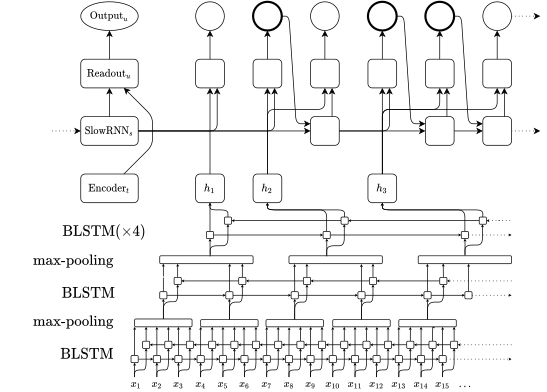
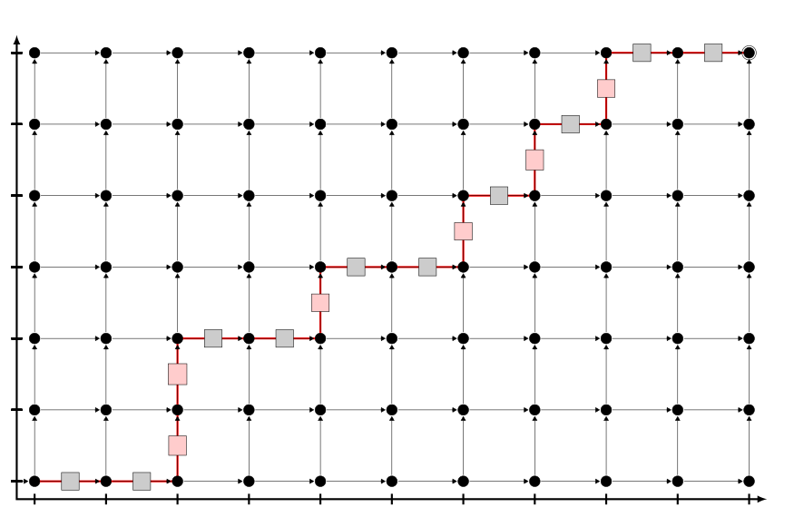
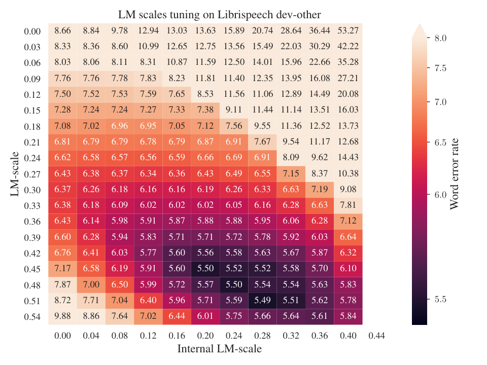

**Source:** *Librispeech Transducer Model with Internal Language Model Prior Correction* — [PDF](https://arxiv.org/pdf/2104.03006) · [arXiv](https://arxiv.org/abs/2104.03006)

\DeclareMathOperator

*\argmaxarg max \DeclareMathOperator*\argminarg min \captionsetup[table]skip=5pt minus 2pt \captionsetup[figure]skip=5pt minus 2pt

# Librispeech Transducer Model with Internal Language Model Prior Correction

Albert Zeyer  André Merboldt  Wilfried Michel  Ralf Schlüter  Hermann Ney 

###### Abstract

We present our transducer model on Librispeech. We study variants to include an external language model (LM) with shallow fusion and subtract an estimated internal LM. This is justified by a Bayesian interpretation where the transducer model prior is given by the estimated internal LM. The subtraction of the internal LM gives us over 14% relative improvement over normal shallow fusion. Our transducer has a separate probability distribution for the non-blank labels which allows for easier combination with the external LM, and easier estimation of the internal LM. We additionally take care of including the end-of-sentence (EOS) probability of the external LM in the last blank probability which further improves the performance. All our code and setups are published.

††address:  1Human Language Technology and Pattern Recognition, Computer Science Department,   
RWTH Aachen University, 52062 Aachen, Germany,   
2AppTek GmbH, 52062 Aachen, Germany††email: {zeyer, michel, schlueter, ney}@cs.rwth-aachen.de, andre.merboldt@rwth-aachen.de

Index Terms: transducer, language model integration, speech recognition

## 1 Introduction & Related Work

The recurrent neural network transducer (RNN-T) model [[1](https://arxiv.org/html/2104.03006#bib.bib1), [2](https://arxiv.org/html/2104.03006#bib.bib2)] is an end-to-end model which allows for time-synchronous decoding, which a more natural fit for many applications such as online recognition. Thus RNN-T and many variations has recently gained interest [[3](https://arxiv.org/html/2104.03006#bib.bib3), [4](https://arxiv.org/html/2104.03006#bib.bib4), [5](https://arxiv.org/html/2104.03006#bib.bib5), [6](https://arxiv.org/html/2104.03006#bib.bib6), [7](https://arxiv.org/html/2104.03006#bib.bib7), [8](https://arxiv.org/html/2104.03006#bib.bib8)].

In a Bayesian interpretation, a discriminative acoustic model \(p_{\mathrm{AM}}(y\mid x)\) can be combined with an external language model \(p_{\mathrm{LM}}(y)\) by

\[\begin{aligned}
 & p(y\mid x)=\frac{p_{\mathrm{AM}}(y\mid x)}{p_{\mathrm{AM}}(y)}\cdot p_{\mathrm{AM}}(x)\cdot p_{\mathrm{LM}}(y)\cdot\frac{1}{p(x)}. & 
\end{aligned}\]

 

In recognition, when searching for \(\argmax_{y}p(y\mid x)\), we can omit \(p(x)\) and \(p_{\mathrm{AM}}(x)\). In shallow fusion, \(p_{\mathrm{AM}}(y)\) is omitted as well. In the density ratio approach [[9](https://arxiv.org/html/2104.03006#bib.bib9)], \(p_{\mathrm{AM}}(y)\) is estimated by a separate language model trained on just the acoustic training transcriptions. In the hybrid autoregressive transducer (HAT) [[6](https://arxiv.org/html/2104.03006#bib.bib6)], \(p_{\mathrm{AM}}(y)\) is estimated directly based on the implicit internal LM (ILM) of \(p_{\mathrm{AM}}(y\mid x)\). The HAT model has a particular simple architecture which was designed such that there is a simple approximation for this ILM estimation by setting the encoder input to 0. We follow up on the ILM estimation approach and try some variations of the estimation. Using 0 as encoder input also works but we found some other variations to be better.

## 2 Model

We follow a transducer variant as defined in [[7](https://arxiv.org/html/2104.03006#bib.bib7)]. The whole model can be seen in [Figure 1](https://arxiv.org/html/2104.03006#S2.F1 "In 2 Model ‣ Librispeech Transducer Model with Internal Language Model Prior Correction"). Let \(x_{1}^{T^{\prime}}\) be the acoustic input features (MFCC in our case) of length \(T^{\prime}\), and \(y_{1}^{S}\) some label sequence of length \(S\) over labels \(\Sigma\) (excluding blank \(\epsilon\)). We use _byte pair encoding (BPE)_ -based _subword units_ [[10](https://arxiv.org/html/2104.03006#bib.bib10), [11](https://arxiv.org/html/2104.03006#bib.bib11)] with a vocabulary size of about 1000 labels11 1 In earlier work on attention-based encoder decoder models, we used 10k BPE labels for Librispeech. However, because of computation time and memory constraints, we reduced it to 1k for the transducer model..

 

Figure 1: Our transducer model with all dependencies. The decoder is unrolled over the alignment axis \(u\). Compare to [[7](https://arxiv.org/html/2104.03006#bib.bib7)].

We have a multi-layer bidirectional LSTM [[12](https://arxiv.org/html/2104.03006#bib.bib12)] _encoder_ model with interchanged max-pooling in time to downscale the input to length \(T\) with factor 6. This results in

\[\begin{aligned}
 & h_{1}^{T}:=\operatorname{Encoder}(x_{1}^{T^{\prime}}). & 
\end{aligned}\]

 

We define the probability for the label sequence \(y_{1}^{S}\) as {align*} p(y_1^S ∣x_1^T’ ) := ∑_α_1^U : y_1^S p(α_1^U ∣x_1^T),   
p(α_1^U ∣x_1^T) := ∏_u=1^U p_u(α_u ∣α_1^u-1, x_1^T), with alignment label \(\alpha_{u}\in\Sigma^{\prime}:=\Sigma\cup\{\epsilon\}\), and where \(\alpha_{1}^{U}:y_{1}^{S}\) is defined by the label topology \(\mathcal{A}\). Specifically, we use alignment length \(U=T+S\) and allow all alignment label sequences \(\alpha_{1}^{U}\) which match the sequence \(y_{1}^{S}\) after removing all blanks \(\epsilon\), also notated as \(\mathcal{A}(\alpha_{1}^{U})=y_{1}^{S}\). This defines an alignment between \(h\) and \(y\) as can be seen in [Figure 2](https://arxiv.org/html/2104.03006#S2.F2 "In 2 Model ‣ Librispeech Transducer Model with Internal Language Model Prior Correction").

 

Figure 2: Unrolled label topology with allowed vertical transitions, with a highlighted path for the sequence \(\mathcal{A}(\text{``$\epsilon$$\epsilon${}th$\epsilon$$\epsilon$e$\epsilon$$\epsilon$s$\epsilon$i$\epsilon$s$\epsilon$$\epsilon$''})=\text{``thesis''}\). The terminal node is marked in the top-right corner.

Our _decoder_ model defines the probability distribution over labels \(\alpha_{u}\) as {align*} p_u(α_u ∣…) := { p _u(Δt_u = 1 ∣…), α_u = \(\epsilon\),   
p_u(Δt_u = 0 ∣…) ⋅q_u(α_u ∣…) , α_u ∈Σ   
p_u( Δt_u ∣…) := { σ (-\operatornameFF_\operatornameemit( z_u^\operatornamefast )), Δt_u = 1   
σ(-\operatornameFF_\operatornameemit(z_u^\operatornamefast)), Δt_u = 0   
q_u(α_u ∣…) := \operatornamesoftmax_Σ ( \operatornameFF_Σ( z^fast_u )), α_u ∈Σ   
z^fast_u := \operatornameReadout(h_t_u, z^slow_s_u)   
z^slow_s_u := \operatornameSlowRNN (y_1^s_u - 1) where \(\sigma\) is the sigmoid function and \(\Delta t\in\{0,1\}\), where \(\Delta t_{u}=0\) means that we emit a new non-blank label (\(\Delta s_{u}=1\)) and \(\Delta t_{u}=1\) means that we proceed forward in the time dimension without emitting a non-blank label (\(\Delta s_{u}=0\)). Thus \(\Delta t_{u}=1\) can be understand as a reinterpretation of the blank label \(\epsilon\). Then we have a separate probability distribution \(q\) over the labels \(\Sigma\) (excluding \(\epsilon\)). \(\operatorname{FF}_{\operatorname{emit}}\), \(\operatorname{FF}_{\Sigma}\) are linear transformations, \(\operatorname{Readout}\) is a linear transformation with maxout activation, and \(\operatorname{SlowRNN}\) is an LSTM.

## 3 Training

The loss is defined as

\[\begin{aligned}
 & L:=-\log p(y_{1}^{S}\mid x_{1}^{T^{\prime}})=-\log\sum_{\alpha_{1}^{U}:y_{1}^{S}}p(\alpha_{1}^{U}\mid x_{1}^{T}). & 
\end{aligned}\]

 

As we use the simplified transducer model where \(\operatorname{Readout}\) does not depend on \(\alpha_{u-1}\), we can efficiently calculate the exact full sum over all alignments \(\alpha_{1}^{U}:y_{1}^{S}\) and do not need the maximum approximation [[7](https://arxiv.org/html/2104.03006#bib.bib7)].

We use zoneout [[13](https://arxiv.org/html/2104.03006#bib.bib13)] for the \(\operatorname{SlowRNN}\) and optionally recurrent weight dropout [[14](https://arxiv.org/html/2104.03006#bib.bib14)] for the encoder BLSTMs.

We use the Adam optimizer [[15](https://arxiv.org/html/2104.03006#bib.bib15)] with learning rate scheduling based on cross validation scores. Additionally, we reset the learning rate back to the initial value after a larger number of epochs, after the model already converged, and start over with the learning rate scheduling. We train for 128 epochs. The long amount of training had a huge effect on the overall performance.

### 3.1 Pretraining

We use a pretraining scheme where we schedule multiple aspects of the training:

  * We grow the encoder from 3 layers with 500 dim. up to 6 layers with 1000 dimensions [[16](https://arxiv.org/html/2104.03006#bib.bib16)]. 
  * We increase the dropout rates. 
  * We use curriculum learning and start with shorter sequences initially. 
  * We use linear learning rate warmup from \(0.0001\) to \(0.001\). 
  * We use a higher initial time reduction factor 20 in the encoder and reduce it to the final factor 6. 

### 3.2 Distributed Multi-GPU Training

Our distributed training implementation uses independent trainer (worker) instances per GPU. Each worker independently loads the dataset. To make sure that every worker uses a different part of the dataset, it is common to use striding. Striding has the disadvantage that it is very IO intensive in this setting where every worker loads the dataset independently and often becomes the bottleneck. So we came up with the idea to use a different random seed for the shuffling of the dataset for every worker, to replace the striding. This greatly improved the IO in our case and made the training much faster.

Additionally, every worker independently trains an own copy of the model for multiple update steps, until the models get synchronized by averaging the parameters over all workers. We made the further improvement that we do not synchronize after a fixed number of steps, but instead after a fixed time interval. A fixed number of steps implies that the training is always as slow as the slowest worker, and variations in the runtime often lead to some workers being slower than others even on same hardware. Synchronizing after a fixed time interval does not have this problem, while being more stochastic.

We synchronize only after 100 seconds to reduce the communication between workers. The workers can potentially be on different computing nodes and might need to communicate over network, which can result in 1-2 seconds for the synchronization. We train on either 8 or 16 GPUs.

## 4 Decoding & Language Model Combination

Our beam search decoding tries to find the sequence \(\hat{y}_{1}^{\hat{S}}\) given \(x_{1}^{T^{\prime}}\) which maximizes the probability, i.e. specifically {align*} x_1^T’ ↦ ^ S , ^ y _1^ ^ S := \argmax_S, y_1^S logp(y_1^S ∣x_1^T’)   
≈A ∘\argmax_U, α_1^U logp(α_1^U ∣x_1^T’) We perform alignment-synchronous decoding, i.e. all hypotheses are in the same alignment step \(u\) when being pruned [[7](https://arxiv.org/html/2104.03006#bib.bib7), [17](https://arxiv.org/html/2104.03006#bib.bib17)]. We merge hypotheses by summing their scores when they correspond to the same word sequence after BPE-merging.

The training recipe for our BPE-10K LSTM LM [[18](https://arxiv.org/html/2104.03006#bib.bib18)] has been adapted for the new BPE-1k label set but otherwise no changes have been made. _Shallow fusion_ (SF) [[19](https://arxiv.org/html/2104.03006#bib.bib19)] is a log-linear combination of the \(\log\)-scores of external LM and ASR model scores during the recognition process, with scale \(\beta\) for the LM and scale \(\lambda\) for the acoustic (non-blank) label probability \(q\), while we do not add an own scale for \(p(\Delta t)\). Specifically, we use the score {align*} logp^SF_u(α_u ∣…) := { log p_u(Δt_u = 1 ∣…), α_u = \(\epsilon\),   
logp_u(Δt_u = 0 ∣…)   
x \+ \(\lambda\)⋅logq_u (α_u ∣…)   
x \+ \(\beta\)⋅logp_\operatornameLM( α_u ∣…) , α_u ∈Σ . We experimented with fixing the label scale at \(\lambda=1\) or \(\lambda=1-\beta\).

Inspired by [[9](https://arxiv.org/html/2104.03006#bib.bib9), [6](https://arxiv.org/html/2104.03006#bib.bib6), [20](https://arxiv.org/html/2104.03006#bib.bib20)] we also tried to _subtract the internal LM_ log score. It assumes that we can factorize our model into a language and acoustic model. Although our model is not directly formulated as such, we can approximate the internal language model. For that we used the estimated score \(\log p_{\operatorname{\small ILM}}\) as shown in [Section 4.1](https://arxiv.org/html/2104.03006#S4.SS1 "4.1 Internal LM Estimation ‣ 4 Decoding & Language Model Combination ‣ Librispeech Transducer Model with Internal Language Model Prior Correction"), where we use the average of encoder features in the time dimension. {align*} logp^SF-ILM_u(α_u ∣…) := { log p_u(Δt_u = 1 ∣…), α_u = \(\epsilon\),   
logp_u(Δt_u = 0 ∣…)   
. \+ \(\lambda\)⋅logq_u (α_u ∣…)   
. \+ \(\beta\)⋅logp_\operatornameLM( α_u ∣…)   
. \- \(\gamma\)⋅logp_\operatornameILM( α_u ∣…) , α_u ∈Σ

### 4.1 Internal LM Estimation

The transducer is trained on audio-text pairs but learns an implicit prior model on the text. This is explicitly given by the context dependency on previous labels. In this transducer case, the \(\operatorname{SlowRNN}\) is also explicitly modeled such that it models the most important part of this prior as it operates only on the text-only part and runs label-synchronous. This prior is an implicit internal LM in our acoustic model

\[\begin{aligned}
 & p_{\mathrm{prior}}(y)=\sum_{x}p_{\mathrm{AM}}(y\mid x)\cdot p(x) & 
\end{aligned}\]

 

which can not be calculated efficiently in general. To approximate the internal LM, we replace the encoder input to the rest of the model (\(\operatorname{Readout}\)). We either use a \(0\) vector or the encoder mean (\(\operatorname{avg}\)). The mean is computed over the time dimension for each sequence separately.22 2 We also tested several other variants but got mixed inconclusive results. In another work [[21](https://arxiv.org/html/2104.03006#bib.bib21)], we investigate variants on the ILM estimation in more detail for attention-based encoder-decoder models.

We evaluate the estimated internal LM on text-only data. In [Table 1](https://arxiv.org/html/2104.03006#S4.T1 "In 4.1 Internal LM Estimation ‣ 4 Decoding & Language Model Combination ‣ Librispeech Transducer Model with Internal Language Model Prior Correction"), the BPE-level perplexities (PPL) are shown and compared against the LSTM LM which was trained only on text data, but without any overlap to the audio transcriptions [[22](https://arxiv.org/html/2104.03006#bib.bib22)].

Table 1: Perplexity and WER measurements on Librispeech dev-other of a transducer model. Note that the BPE-level (1k units) perplexity is evaluated without the EOS token, since the transducer has no explicit end-of-sequence symbol. Compared are both setting the encoder (\(h\)) to \(0\) and to the mean over the time-dimension (\(\operatorname{avg}\)). The LSTM and Trafo-LM are trained on text-only data without overlap to the audio transcriptions [[22](https://arxiv.org/html/2104.03006#bib.bib22)].  

<table id="S4.T1.2" class="ltx_tabular ltx_centering ltx_guessed_headers ltx_align_middle">
<thead class="ltx_thead">
<tr id="S4.T1.2.1" class="ltx_tr">
<th id="S4.T1.2.1.1" class="ltx_td ltx_align_center ltx_th ltx_th_column ltx_border_l ltx_border_r ltx_border_t" rowspan="2">Model</th>
<th id="S4.T1.2.1.2" class="ltx_td ltx_align_center ltx_th ltx_th_column ltx_border_r ltx_border_t" rowspan="2">Epochs</th>
<th id="S4.T1.2.1.3" class="ltx_td ltx_align_center ltx_th ltx_th_column ltx_border_r ltx_border_t" colspan="2">Perplexity</th>
<th id="S4.T1.2.1.4" class="ltx_td ltx_align_center ltx_th ltx_th_column ltx_border_r ltx_border_t">WER</th></tr>
<tr id="S4.T1.2.2" class="ltx_tr">
<th id="S4.T1.2.2.1" class="ltx_td ltx_align_center ltx_th ltx_th_column ltx_border_r"><math id="S4.T1.m4" class="ltx_Math" alttext="h=0" display="inline" intent=":literal"><semantics><mrow><mi>h</mi><mo>=</mo><mn>0</mn></mrow><annotation encoding="application/x-tex">h=0</annotation></semantics></math></th>
<th id="S4.T1.2.2.2" class="ltx_td ltx_align_center ltx_th ltx_th_column ltx_border_r"><math id="S4.T1.m5" class="ltx_Math" alttext="\operatorname{avg}" display="inline" intent=":literal"><semantics><mrow><mtext class="undefined">\operatorname</mtext><mo lspace="0em" rspace="0em">​</mo><mi>a</mi><mo lspace="0em" rspace="0em">​</mo><mi>v</mi><mo lspace="0em" rspace="0em">​</mo><mi>g</mi></mrow><annotation encoding="application/x-tex">\operatorname{avg}</annotation></semantics></math></th>
<th id="S4.T1.2.2.3" class="ltx_td ltx_align_center ltx_th ltx_th_column ltx_border_r">[%]</th></tr>
</thead>
<tbody class="ltx_tbody">
<tr id="S4.T1.2.3" class="ltx_tr">
<td id="S4.T1.2.3.1" class="ltx_td ltx_align_center ltx_border_l ltx_border_r ltx_border_tt" rowspan="5">Transducer BPE-1K</td>
<td id="S4.T1.2.3.2" class="ltx_td ltx_align_center ltx_border_r ltx_border_tt">8</td>
<td id="S4.T1.2.3.3" class="ltx_td ltx_align_center ltx_border_r ltx_border_tt">82.76</td>
<td id="S4.T1.2.3.4" class="ltx_td ltx_align_center ltx_border_r ltx_border_tt">67.47</td>
<td id="S4.T1.2.3.5" class="ltx_td ltx_align_center ltx_border_r ltx_border_tt">36.41</td></tr>
<tr id="S4.T1.2.4" class="ltx_tr">
<td id="S4.T1.2.4.1" class="ltx_td ltx_align_center ltx_border_r ltx_border_t">16</td>
<td id="S4.T1.2.4.2" class="ltx_td ltx_align_center ltx_border_r ltx_border_t">49.32</td>
<td id="S4.T1.2.4.3" class="ltx_td ltx_align_center ltx_border_r ltx_border_t">38.89</td>
<td id="S4.T1.2.4.4" class="ltx_td ltx_align_center ltx_border_r ltx_border_t">17.16</td></tr>
<tr id="S4.T1.2.5" class="ltx_tr">
<td id="S4.T1.2.5.1" class="ltx_td ltx_align_center ltx_border_r ltx_border_t">32</td>
<td id="S4.T1.2.5.2" class="ltx_td ltx_align_center ltx_border_r ltx_border_t">45.13</td>
<td id="S4.T1.2.5.3" class="ltx_td ltx_align_center ltx_border_r ltx_border_t">32.86</td>
<td id="S4.T1.2.5.4" class="ltx_td ltx_align_center ltx_border_r ltx_border_t">11.85</td></tr>
<tr id="S4.T1.2.6" class="ltx_tr">
<td id="S4.T1.2.6.1" class="ltx_td ltx_align_center ltx_border_r ltx_border_t">64</td>
<td id="S4.T1.2.6.2" class="ltx_td ltx_align_center ltx_border_r ltx_border_t">46.53</td>
<td id="S4.T1.2.6.3" class="ltx_td ltx_align_center ltx_border_r ltx_border_t">31.94</td>
<td id="S4.T1.2.6.4" class="ltx_td ltx_align_center ltx_border_r ltx_border_t">09.69</td></tr>
<tr id="S4.T1.2.7" class="ltx_tr">
<td id="S4.T1.2.7.1" class="ltx_td ltx_align_center ltx_border_r ltx_border_t">133</td>
<td id="S4.T1.2.7.2" class="ltx_td ltx_align_center ltx_border_r ltx_border_t">47.05</td>
<td id="S4.T1.2.7.3" class="ltx_td ltx_align_center ltx_border_r ltx_border_t">31.37</td>
<td id="S4.T1.2.7.4" class="ltx_td ltx_align_center ltx_border_r ltx_border_t">08.92</td></tr>
<tr id="S4.T1.2.8" class="ltx_tr">
<td id="S4.T1.2.8.1" class="ltx_td ltx_align_center ltx_border_l ltx_border_r ltx_border_t">LSTM LM</td>
<td id="S4.T1.2.8.2" class="ltx_td ltx_align_center ltx_border_r ltx_border_t">20</td>
<td id="S4.T1.2.8.3" class="ltx_td ltx_align_center ltx_border_r ltx_border_t" colspan="2">15.40</td>
<td id="S4.T1.2.8.4" class="ltx_td ltx_align_center ltx_border_r ltx_border_t"><math id="S4.T1.m6" class="ltx_Math" alttext="-" display="inline" intent=":literal"><semantics><mo>−</mo><annotation encoding="application/x-tex">-</annotation></semantics></math></td></tr>
<tr id="S4.T1.2.9" class="ltx_tr">
<td id="S4.T1.2.9.1" class="ltx_td ltx_align_center ltx_border_b ltx_border_l ltx_border_r ltx_border_t">Trafo LM</td>
<td id="S4.T1.2.9.2" class="ltx_td ltx_align_center ltx_border_b ltx_border_r ltx_border_t">39</td>
<td id="S4.T1.2.9.3" class="ltx_td ltx_align_center ltx_border_b ltx_border_r ltx_border_t" colspan="2">14.44</td>
<td id="S4.T1.2.9.4" class="ltx_td ltx_align_center ltx_border_b ltx_border_r ltx_border_t"><math id="S4.T1.m7" class="ltx_Math" alttext="-" display="inline" intent=":literal"><semantics><mo>−</mo><annotation encoding="application/x-tex">-</annotation></semantics></math></td></tr>
</tbody>
</table>

 

### 4.2 EOS Modelling

In contrast to language models or attention models, transducers and models with explicit time modeling do not have to model the end-of-sentence/sequence explicitly with an additional token (denoted as \(\langle\operatorname{eos}\rangle\)). Instead the search ends when all input frames have been consumed. However, for LM integration, when only considering actual output symbols, the information about when the sequence should end is not considered. This additional information is usually ignored in the literature, however it provides valuable information to the search process.

Our approach is to combine the LM EOS probability with \(p_{u}(\Delta t{=}1)\) (\(\epsilon\)) in the last time frame (\(t_{u}=T\)) because that determines the EOS in the transducer. {align*} logp^SF-ILM+EOS_u(α_u ∣…)   
x := { log \(p_{u}(\Delta t{=}1\mid\makebox[8.00003pt][c]{...})\), \(\alpha_{u}\)= \(\epsilon\), t_\(u\)-1 ¡ T   
\({\delta}_{\langle\operatorname{eos}\rangle}\)log\(p_{u}(\Delta t{=}1\mid\makebox[8.00003pt][c]{...})\)   
x \+ \({\beta}_{\langle\operatorname{eos}\rangle}\)logp_\operatornameLM(\(\langle\operatorname{eos}\rangle\)∣…), \(\alpha_{u}\)= \(\epsilon\), t_\(u\)-1 = T   
log\(p_{u}(\Delta t{=}0\mid\makebox[8.00003pt][c]{...})\)   
x \+ \(\lambda\)⋅logq_u (α_u ∣…)   
x \+ \(\beta\)⋅logp_\operatornameLM( α_u ∣…)   
x \- \(\gamma\)⋅logp_\operatornameILM( α_u ∣…) , \(\alpha_{u}\)∈Σ Usually \({\delta}_{\langle\operatorname{eos}\rangle}={\beta}_{\langle\operatorname{eos}\rangle}=0.5\) yielded good performance, although it was not tuned properly.

## 5 Experiments

We perform experiments on LibriSpeech [[22](https://arxiv.org/html/2104.03006#bib.bib22)]. Our model training and decoding is implemented in RETURNN [[23](https://arxiv.org/html/2104.03006#bib.bib23)], based on TensorFlow [[24](https://arxiv.org/html/2104.03006#bib.bib24)]. The distributed multi-GPU training is implemented with Horovod [[25](https://arxiv.org/html/2104.03006#bib.bib25)]. We make use of Mingkun Huang’s warp-transducer loss implementation33 3 <https://github.com/HawkAaron/warp-transducer>. Our decoder uses the builtin RETURNN features for stochastic variables and searches over \(\alpha_{u}\). This uses GPU-based batched one-pass decoding with the external LM and internal LM subtraction. We publish all the configuration files needed to reproduce the experiments44 4 <https://github.com/rwth-i6/returnn-experiments/tree/master/2021-transducer>.

We have a variety of different exponent scales for our log-linear modeling, as well as additional parameters for EOS-modeling. Label scale \(\lambda\) which is set to either \(\lambda=1\) or \(\lambda=1-\beta\), the emission model scale \(\delta\), and the scales for external and internal LM \(\beta\), \(\gamma\), respectively. Additionally for EOS-modeling \({\delta}_{\langle\operatorname{eos}\rangle}\) and \({\beta}_{\langle\operatorname{eos}\rangle}\) is used, although it was fixed to \({\delta}_{\langle\operatorname{eos}\rangle}={\beta}_{\langle\operatorname{eos}\rangle}=0.5\). The scaling factors \(\beta\) and \(\gamma\) have to be tuned jointly on a held-out dataset, as can be seen in [Fig. 3](https://arxiv.org/html/2104.03006#S5.F3 "In 5 Experiments ‣ Librispeech Transducer Model with Internal Language Model Prior Correction"), with \(\lambda=1-\beta\). They were tuned separately for each subset dev-clean and dev-other. Results for LM integration are presented in [Table 2](https://arxiv.org/html/2104.03006#S5.T2 "In 5 Experiments ‣ Librispeech Transducer Model with Internal Language Model Prior Correction") and in [Table 3](https://arxiv.org/html/2104.03006#S5.T3 "In 5 Experiments ‣ Librispeech Transducer Model with Internal Language Model Prior Correction") with additional EOS-modeling. With shallow fusion of just the LM we already see a significant WER improvement by over 22% relative. When additionally subtracting the internal LM, a further significant improvement is observed by over 14% relative over the shallow fusion. The \(\operatorname{avg}\)ILM estimation seems to be better than \(0\)except on test-other. The effect of EOS gives us 7% relative improvement. We also test a stronger Transformer LM in [Table 3](https://arxiv.org/html/2104.03006#S5.T3 "In 5 Experiments ‣ Librispeech Transducer Model with Internal Language Model Prior Correction") (perplexities in [Table 1](https://arxiv.org/html/2104.03006#S4.T1 "In 4.1 Internal LM Estimation ‣ 4 Decoding & Language Model Combination ‣ Librispeech Transducer Model with Internal Language Model Prior Correction")) and see further improvement.

 Figure 3: Tuning of LM scales of a transducer with EOS-modeling. The baseline without an external LM has \(8.66\)% WER on dev-other with a beam size of 24. \(\lambda=1-\beta\).  Table 2:  We investigate the effect of LM integration for the model with either shallow fusion (SF) or additional internal LM (ILM) subtraction. All experiments were conducted with a fixed beam-size 24 and without EOS-modeling, the LSTM-LM has a BPE-1K level perplexity of \(15.4\) on dev-other. 

<table id="S5.T2.4" class="ltx_tabular ltx_centering ltx_guessed_headers ltx_align_middle">
<thead class="ltx_thead">
<tr id="S5.T2.4.1" class="ltx_tr">
<th id="S5.T2.4.1.1" class="ltx_td ltx_align_center ltx_th ltx_th_column ltx_border_l ltx_border_r ltx_border_t" style="padding-left:2.5pt;padding-right:2.5pt;" rowspan="3">LM</th>
<th id="S5.T2.4.1.2" class="ltx_td ltx_align_center ltx_th ltx_th_column ltx_border_r ltx_border_t" style="padding-left:2.5pt;padding-right:2.5pt;" rowspan="3">

LM
Integration
Method
</th>
<th id="S5.T2.4.1.3" class="ltx_td ltx_align_center ltx_th ltx_th_column ltx_border_r ltx_border_t" style="padding-left:2.5pt;padding-right:2.5pt;" rowspan="3">

Label scale
<math id="S5.T2.m2" class="ltx_Math" alttext="\lambda" display="inline" intent=":literal"><semantics><mi>λ</mi><annotation encoding="application/x-tex">\lambda</annotation></semantics></math>
</th>
<th id="S5.T2.4.1.4" class="ltx_td ltx_align_center ltx_th ltx_th_column ltx_border_r ltx_border_t" style="padding-left:2.5pt;padding-right:2.5pt;" colspan="4">WER [%]</th></tr>
<tr id="S5.T2.4.2" class="ltx_tr">
<th id="S5.T2.4.2.1" class="ltx_td ltx_align_center ltx_th ltx_th_column ltx_border_r" style="padding-left:2.5pt;padding-right:2.5pt;" colspan="2">dev</th>
<th id="S5.T2.4.2.2" class="ltx_td ltx_align_center ltx_th ltx_th_column ltx_border_r" style="padding-left:2.5pt;padding-right:2.5pt;" colspan="2">test</th></tr>
<tr id="S5.T2.4.3" class="ltx_tr">
<th id="S5.T2.4.3.1" class="ltx_td ltx_align_center ltx_th ltx_th_column ltx_border_r" style="padding-left:2.5pt;padding-right:2.5pt;">clean</th>
<th id="S5.T2.4.3.2" class="ltx_td ltx_align_center ltx_th ltx_th_column ltx_border_r" style="padding-left:2.5pt;padding-right:2.5pt;">other</th>
<th id="S5.T2.4.3.3" class="ltx_td ltx_align_center ltx_th ltx_th_column ltx_border_r" style="padding-left:2.5pt;padding-right:2.5pt;">clean</th>
<th id="S5.T2.4.3.4" class="ltx_td ltx_align_center ltx_th ltx_th_column ltx_border_r" style="padding-left:2.5pt;padding-right:2.5pt;">other</th></tr>
</thead>
<tbody class="ltx_tbody">
<tr id="S5.T2.4.4" class="ltx_tr">
<td id="S5.T2.4.4.1" class="ltx_td ltx_align_center ltx_border_l ltx_border_r ltx_border_tt" style="padding-left:2.5pt;padding-right:2.5pt;">—</td>
<td id="S5.T2.4.4.2" class="ltx_td ltx_align_center ltx_border_r ltx_border_tt" style="padding-left:2.5pt;padding-right:2.5pt;">—</td>
<td id="S5.T2.4.4.3" class="ltx_td ltx_align_center ltx_border_r ltx_border_tt" style="padding-left:2.5pt;padding-right:2.5pt;" rowspan="2"><math id="S5.T2.m3" class="ltx_Math" alttext="\lambda=1\phantom{{}-\beta}" display="inline" intent=":literal"><semantics><mrow><mi>λ</mi><mo>=</mo><mn>1</mn></mrow><annotation encoding="application/x-tex">\lambda=1\phantom{{}-\beta}</annotation></semantics></math></td>
<td id="S5.T2.4.4.4" class="ltx_td ltx_align_center ltx_border_r ltx_border_tt" style="padding-left:2.5pt;padding-right:2.5pt;">3.22</td>
<td id="S5.T2.4.4.5" class="ltx_td ltx_align_center ltx_border_r ltx_border_tt" style="padding-left:2.5pt;padding-right:2.5pt;">8.76</td>
<td id="S5.T2.4.4.6" class="ltx_td ltx_align_center ltx_border_r ltx_border_tt" style="padding-left:2.5pt;padding-right:2.5pt;">3.30</td>
<td id="S5.T2.4.4.7" class="ltx_td ltx_align_center ltx_border_r ltx_border_tt" style="padding-left:2.5pt;padding-right:2.5pt;">8.70</td></tr>
<tr id="S5.T2.4.5" class="ltx_tr">
<td id="S5.T2.4.5.1" class="ltx_td ltx_align_center ltx_border_b ltx_border_l ltx_border_r ltx_border_t" style="padding-left:2.5pt;padding-right:2.5pt;" rowspan="3">LSTM</td>
<td id="S5.T2.4.5.2" class="ltx_td ltx_align_center ltx_border_r ltx_border_t" style="padding-left:2.5pt;padding-right:2.5pt;" rowspan="2">SF</td>
<td id="S5.T2.4.5.3" class="ltx_td ltx_align_center ltx_border_r ltx_border_t" style="padding-left:2.5pt;padding-right:2.5pt;">2.53</td>
<td id="S5.T2.4.5.4" class="ltx_td ltx_align_center ltx_border_r ltx_border_t" style="padding-left:2.5pt;padding-right:2.5pt;">6.79</td>
<td id="S5.T2.4.5.5" class="ltx_td ltx_align_center ltx_border_r ltx_border_t" style="padding-left:2.5pt;padding-right:2.5pt;">2.66</td>
<td id="S5.T2.4.5.6" class="ltx_td ltx_align_center ltx_border_r ltx_border_t" style="padding-left:2.5pt;padding-right:2.5pt;">6.99</td></tr>
<tr id="S5.T2.4.6" class="ltx_tr">
<td id="S5.T2.4.6.1" class="ltx_td ltx_align_center ltx_border_b ltx_border_r ltx_border_t" style="padding-left:2.5pt;padding-right:2.5pt;" rowspan="2"><math id="S5.T2.m4" class="ltx_Math" alttext="\lambda=1-\beta" display="inline" intent=":literal"><semantics><mrow><mi>λ</mi><mo>=</mo><mrow><mn>1</mn><mo>−</mo><mi>β</mi></mrow></mrow><annotation encoding="application/x-tex">\lambda=1-\beta</annotation></semantics></math></td>
<td id="S5.T2.4.6.2" class="ltx_td ltx_align_center ltx_border_r ltx_border_t" style="padding-left:2.5pt;padding-right:2.5pt;">2.47</td>
<td id="S5.T2.4.6.3" class="ltx_td ltx_align_center ltx_border_r ltx_border_t" style="padding-left:2.5pt;padding-right:2.5pt;">6.50</td>
<td id="S5.T2.4.6.4" class="ltx_td ltx_align_center ltx_border_r ltx_border_t" style="padding-left:2.5pt;padding-right:2.5pt;">2.57</td>
<td id="S5.T2.4.6.5" class="ltx_td ltx_align_center ltx_border_r ltx_border_t" style="padding-left:2.5pt;padding-right:2.5pt;">6.70</td></tr>
<tr id="S5.T2.4.7" class="ltx_tr">
<td id="S5.T2.4.7.1" class="ltx_td ltx_align_center ltx_border_b ltx_border_r ltx_border_t" style="padding-left:2.5pt;padding-right:2.5pt;">SF-ILM(<math id="S5.T2.m5" class="ltx_Math" alttext="\operatorname{avg}" display="inline" intent=":literal"><semantics><mrow><mtext class="undefined">\operatorname</mtext><mo lspace="0em" rspace="0em">​</mo><mi>a</mi><mo lspace="0em" rspace="0em">​</mo><mi>v</mi><mo lspace="0em" rspace="0em">​</mo><mi>g</mi></mrow><annotation encoding="application/x-tex">\operatorname{avg}</annotation></semantics></math>)</td>
<td id="S5.T2.4.7.2" class="ltx_td ltx_align_center ltx_border_b ltx_border_r ltx_border_t" style="padding-left:2.5pt;padding-right:2.5pt;">2.29</td>
<td id="S5.T2.4.7.3" class="ltx_td ltx_align_center ltx_border_b ltx_border_r ltx_border_t" style="padding-left:2.5pt;padding-right:2.5pt;">5.63</td>
<td id="S5.T2.4.7.4" class="ltx_td ltx_align_center ltx_border_b ltx_border_r ltx_border_t" style="padding-left:2.5pt;padding-right:2.5pt;">2.36</td>
<td id="S5.T2.4.7.5" class="ltx_td ltx_align_center ltx_border_b ltx_border_r ltx_border_t" style="padding-left:2.5pt;padding-right:2.5pt;">6.39</td></tr>
</tbody>
</table>

  Table 3:  We investigate the effect of LM integration for the model with either shallow fusion (SF) or additional internal LM (ILM) subtraction. All experiments were conducted with a fixed beam-size 24 and EOS-modeling (last blank frame), the LSTM-LM has a BPE-1K level perplexity of \(15.4\) on dev-other. In [Fig. 3](https://arxiv.org/html/2104.03006#S5.F3 "In 5 Experiments ‣ Librispeech Transducer Model with Internal Language Model Prior Correction") the heat map for the joint tuning over \({\beta}_{\textsc{other}}\) and \({\gamma}_{\textsc{other}}\). \({\delta}_{\langle\operatorname{eos}\rangle}={\beta}_{\langle\operatorname{eos}\rangle}=0.5\).  

<table id="S5.T3.4" class="ltx_tabular ltx_centering ltx_align_middle">
<tbody class="ltx_tbody">
<tr id="S5.T3.4.1" class="ltx_tr">
<td id="S5.T3.4.1.1" class="ltx_td ltx_align_center ltx_border_l ltx_border_r ltx_border_t" style="padding-left:2.5pt;padding-right:2.5pt;" rowspan="3">LM</td>
<td id="S5.T3.4.1.2" class="ltx_td ltx_align_center ltx_border_r ltx_border_t" style="padding-left:2.5pt;padding-right:2.5pt;" rowspan="3">

LM
Integration
Method
</td>
<td id="S5.T3.4.1.3" class="ltx_td ltx_align_center ltx_border_r ltx_border_t" style="padding-left:2.5pt;padding-right:2.5pt;" rowspan="3">

Label scale
<math id="S5.T3.m5" class="ltx_Math" alttext="\lambda" display="inline" intent=":literal"><semantics><mi>λ</mi><annotation encoding="application/x-tex">\lambda</annotation></semantics></math>
</td>
<td id="S5.T3.4.1.4" class="ltx_td ltx_align_center ltx_border_r ltx_border_t" style="padding-left:2.5pt;padding-right:2.5pt;" colspan="4">WER [%]</td></tr>
<tr id="S5.T3.4.2" class="ltx_tr">
<td id="S5.T3.4.2.1" class="ltx_td ltx_align_center ltx_border_r" style="padding-left:2.5pt;padding-right:2.5pt;" colspan="2">dev</td>
<td id="S5.T3.4.2.2" class="ltx_td ltx_align_center ltx_border_r" style="padding-left:2.5pt;padding-right:2.5pt;" colspan="2">test</td></tr>
<tr id="S5.T3.4.3" class="ltx_tr">
<td id="S5.T3.4.3.1" class="ltx_td ltx_align_center ltx_border_r" style="padding-left:2.5pt;padding-right:2.5pt;">clean</td>
<td id="S5.T3.4.3.2" class="ltx_td ltx_align_center ltx_border_r" style="padding-left:2.5pt;padding-right:2.5pt;">other</td>
<td id="S5.T3.4.3.3" class="ltx_td ltx_align_center ltx_border_r" style="padding-left:2.5pt;padding-right:2.5pt;">clean</td>
<td id="S5.T3.4.3.4" class="ltx_td ltx_align_center ltx_border_r" style="padding-left:2.5pt;padding-right:2.5pt;">other</td></tr>
<tr id="S5.T3.4.4" class="ltx_tr">
<td id="S5.T3.4.4.1" class="ltx_td ltx_align_center ltx_border_l ltx_border_r ltx_border_tt" style="padding-left:2.5pt;padding-right:2.5pt;">—</td>
<td id="S5.T3.4.4.2" class="ltx_td ltx_align_center ltx_border_r ltx_border_tt" style="padding-left:2.5pt;padding-right:2.5pt;">—</td>
<td id="S5.T3.4.4.3" class="ltx_td ltx_align_center ltx_border_r ltx_border_tt" style="padding-left:2.5pt;padding-right:2.5pt;"><math id="S5.T3.m6" class="ltx_Math" alttext="\lambda=1\phantom{{}-\beta}" display="inline" intent=":literal"><semantics><mrow><mi>λ</mi><mo>=</mo><mn>1</mn></mrow><annotation encoding="application/x-tex">\lambda=1\phantom{{}-\beta}</annotation></semantics></math></td>
<td id="S5.T3.4.4.4" class="ltx_td ltx_align_center ltx_border_r ltx_border_tt" style="padding-left:2.5pt;padding-right:2.5pt;">3.20</td>
<td id="S5.T3.4.4.5" class="ltx_td ltx_align_center ltx_border_r ltx_border_tt" style="padding-left:2.5pt;padding-right:2.5pt;">8.66</td>
<td id="S5.T3.4.4.6" class="ltx_td ltx_align_center ltx_border_r ltx_border_tt" style="padding-left:2.5pt;padding-right:2.5pt;">3.28</td>
<td id="S5.T3.4.4.7" class="ltx_td ltx_align_center ltx_border_r ltx_border_tt" style="padding-left:2.5pt;padding-right:2.5pt;">8.60</td></tr>
<tr id="S5.T3.4.5" class="ltx_tr">
<td id="S5.T3.4.5.1" class="ltx_td ltx_align_center ltx_border_l ltx_border_r ltx_border_tt" style="padding-left:2.5pt;padding-right:2.5pt;" rowspan="3">LSTM</td>
<td id="S5.T3.4.5.2" class="ltx_td ltx_align_center ltx_border_r ltx_border_tt" style="padding-left:2.5pt;padding-right:2.5pt;" rowspan="2">SF</td>
<td id="S5.T3.4.5.3" class="ltx_td ltx_align_center ltx_border_r ltx_border_tt" style="padding-left:2.5pt;padding-right:2.5pt;"><math id="S5.T3.m7" class="ltx_Math" alttext="\lambda=1\phantom{{}-\beta}" display="inline" intent=":literal"><semantics><mrow><mi>λ</mi><mo>=</mo><mn>1</mn></mrow><annotation encoding="application/x-tex">\lambda=1\phantom{{}-\beta}</annotation></semantics></math></td>
<td id="S5.T3.4.5.4" class="ltx_td ltx_align_center ltx_border_r ltx_border_tt" style="padding-left:2.5pt;padding-right:2.5pt;">2.52</td>
<td id="S5.T3.4.5.5" class="ltx_td ltx_align_center ltx_border_r ltx_border_tt" style="padding-left:2.5pt;padding-right:2.5pt;">6.69</td>
<td id="S5.T3.4.5.6" class="ltx_td ltx_align_center ltx_border_r ltx_border_tt" style="padding-left:2.5pt;padding-right:2.5pt;">2.65</td>
<td id="S5.T3.4.5.7" class="ltx_td ltx_align_center ltx_border_r ltx_border_tt" style="padding-left:2.5pt;padding-right:2.5pt;">6.85</td></tr>
<tr id="S5.T3.4.6" class="ltx_tr">
<td id="S5.T3.4.6.1" class="ltx_td ltx_align_center ltx_border_r ltx_border_t" style="padding-left:2.5pt;padding-right:2.5pt;" rowspan="2"><math id="S5.T3.m8" class="ltx_Math" alttext="\lambda=1-\beta" display="inline" intent=":literal"><semantics><mrow><mi>λ</mi><mo>=</mo><mrow><mn>1</mn><mo>−</mo><mi>β</mi></mrow></mrow><annotation encoding="application/x-tex">\lambda=1-\beta</annotation></semantics></math></td>
<td id="S5.T3.4.6.2" class="ltx_td ltx_align_center ltx_border_r ltx_border_t" style="padding-left:2.5pt;padding-right:2.5pt;">2.45</td>
<td id="S5.T3.4.6.3" class="ltx_td ltx_align_center ltx_border_r ltx_border_t" style="padding-left:2.5pt;padding-right:2.5pt;">6.35</td>
<td id="S5.T3.4.6.4" class="ltx_td ltx_align_center ltx_border_r ltx_border_t" style="padding-left:2.5pt;padding-right:2.5pt;">2.55</td>
<td id="S5.T3.4.6.5" class="ltx_td ltx_align_center ltx_border_r ltx_border_t" style="padding-left:2.5pt;padding-right:2.5pt;">6.68</td></tr>
<tr id="S5.T3.4.7" class="ltx_tr">
<td id="S5.T3.4.7.1" class="ltx_td ltx_align_center ltx_border_r ltx_border_t" style="padding-left:2.5pt;padding-right:2.5pt;">SF-ILM(<math id="S5.T3.m9" class="ltx_Math" alttext="\operatorname{avg}" display="inline" intent=":literal"><semantics><mrow><mtext class="undefined">\operatorname</mtext><mo lspace="0em" rspace="0em">​</mo><mi>a</mi><mo lspace="0em" rspace="0em">​</mo><mi>v</mi><mo lspace="0em" rspace="0em">​</mo><mi>g</mi></mrow><annotation encoding="application/x-tex">\operatorname{avg}</annotation></semantics></math>)</td>
<td id="S5.T3.4.7.2" class="ltx_td ltx_align_center ltx_border_r ltx_border_t" style="padding-left:2.5pt;padding-right:2.5pt;">2.26</td>
<td id="S5.T3.4.7.3" class="ltx_td ltx_align_center ltx_border_r ltx_border_t" style="padding-left:2.5pt;padding-right:2.5pt;">5.49</td>
<td id="S5.T3.4.7.4" class="ltx_td ltx_align_center ltx_border_r ltx_border_t" style="padding-left:2.5pt;padding-right:2.5pt;">2.42</td>
<td id="S5.T3.4.7.5" class="ltx_td ltx_align_center ltx_border_r ltx_border_t" style="padding-left:2.5pt;padding-right:2.5pt;">5.91</td></tr>
<tr id="S5.T3.4.8" class="ltx_tr">
<td id="S5.T3.4.8.1" class="ltx_td ltx_align_center ltx_border_b ltx_border_l ltx_border_r ltx_border_tt" style="padding-left:2.5pt;padding-right:2.5pt;" rowspan="3">Trafo</td>
<td id="S5.T3.4.8.2" class="ltx_td ltx_align_center ltx_border_r ltx_border_tt" style="padding-left:2.5pt;padding-right:2.5pt;">SF</td>
<td id="S5.T3.4.8.3" class="ltx_td ltx_align_center ltx_border_b ltx_border_r ltx_border_tt" style="padding-left:2.5pt;padding-right:2.5pt;" rowspan="3"><math id="S5.T3.m10" class="ltx_Math" alttext="\lambda=1-\beta" display="inline" intent=":literal"><semantics><mrow><mi>λ</mi><mo>=</mo><mrow><mn>1</mn><mo>−</mo><mi>β</mi></mrow></mrow><annotation encoding="application/x-tex">\lambda=1-\beta</annotation></semantics></math></td>
<td id="S5.T3.4.8.4" class="ltx_td ltx_align_center ltx_border_r ltx_border_tt" style="padding-left:2.5pt;padding-right:2.5pt;">2.41</td>
<td id="S5.T3.4.8.5" class="ltx_td ltx_align_center ltx_border_r ltx_border_tt" style="padding-left:2.5pt;padding-right:2.5pt;">6.29</td>
<td id="S5.T3.4.8.6" class="ltx_td ltx_align_center ltx_border_r ltx_border_tt" style="padding-left:2.5pt;padding-right:2.5pt;">2.52</td>
<td id="S5.T3.4.8.7" class="ltx_td ltx_align_center ltx_border_r ltx_border_tt" style="padding-left:2.5pt;padding-right:2.5pt;">6.56</td></tr>
<tr id="S5.T3.4.9" class="ltx_tr">
<td id="S5.T3.4.9.1" class="ltx_td ltx_align_center ltx_border_r ltx_border_t" style="padding-left:2.5pt;padding-right:2.5pt;">SF-ILM(<math id="S5.T3.m11" class="ltx_Math" alttext="\operatorname{avg}" display="inline" intent=":literal"><semantics><mrow><mtext class="undefined">\operatorname</mtext><mo lspace="0em" rspace="0em">​</mo><mi>a</mi><mo lspace="0em" rspace="0em">​</mo><mi>v</mi><mo lspace="0em" rspace="0em">​</mo><mi>g</mi></mrow><annotation encoding="application/x-tex">\operatorname{avg}</annotation></semantics></math>)</td>
<td id="S5.T3.4.9.2" class="ltx_td ltx_align_center ltx_border_r ltx_border_t" style="padding-left:2.5pt;padding-right:2.5pt;">2.17</td>
<td id="S5.T3.4.9.3" class="ltx_td ltx_align_center ltx_border_r ltx_border_t" style="padding-left:2.5pt;padding-right:2.5pt;">5.28</td>
<td id="S5.T3.4.9.4" class="ltx_td ltx_align_center ltx_border_r ltx_border_t" style="padding-left:2.5pt;padding-right:2.5pt;">2.23</td>
<td id="S5.T3.4.9.5" class="ltx_td ltx_align_center ltx_border_r ltx_border_t" style="padding-left:2.5pt;padding-right:2.5pt;">5.74</td></tr>
<tr id="S5.T3.4.10" class="ltx_tr">
<td id="S5.T3.4.10.1" class="ltx_td ltx_align_center ltx_border_b ltx_border_r ltx_border_t" style="padding-left:2.5pt;padding-right:2.5pt;">SF-ILM(<math id="S5.T3.m12" class="ltx_Math" alttext="0" display="inline" intent=":literal"><semantics><mn>0</mn><annotation encoding="application/x-tex">0</annotation></semantics></math>)</td>
<td id="S5.T3.4.10.2" class="ltx_td ltx_align_center ltx_border_b ltx_border_r ltx_border_t" style="padding-left:2.5pt;padding-right:2.5pt;">2.22</td>
<td id="S5.T3.4.10.3" class="ltx_td ltx_align_center ltx_border_b ltx_border_r ltx_border_t" style="padding-left:2.5pt;padding-right:2.5pt;">5.32</td>
<td id="S5.T3.4.10.4" class="ltx_td ltx_align_center ltx_border_b ltx_border_r ltx_border_t" style="padding-left:2.5pt;padding-right:2.5pt;">2.25</td>
<td id="S5.T3.4.10.5" class="ltx_td ltx_align_center ltx_border_b ltx_border_r ltx_border_t" style="padding-left:2.5pt;padding-right:2.5pt;">5.60</td></tr>
</tbody>
</table>

 

### 5.1 Error Analysis

One of the sources of errors when looking at an entire system are errors the model made when its prediction was wrong. We look at the percentages of substitution, deletion, and insertion errors of the word error rate (WER). Especially interesting is the comparison between different models and their respective LM integration. Also of interest are how long the hypothesized sentences are, relative to the reference transcription. The transducer seems to model the hypothesis length better than hybrid (without rescoring) and attention-based models, although adding an external LM seems to help the attention model. Overall we can see that introducing the external LM helps with substitutions and insertion errors, while the deletions actually increase. In comparison to the attention-based model, the transducer model has significantly less insertion errors, but more deletion errors, relative to the overall WER.

Table 4: We investigate the different type of word errors on various models. Hybrid [[26](https://arxiv.org/html/2104.03006#bib.bib26)], Attention [[27](https://arxiv.org/html/2104.03006#bib.bib27)], and Transducer (ours). With either shallow fusion (SF) or additional internal LM (ILM) subtraction. For log-linear combination in the transducer case, \(\lambda=1-\beta\). 

<table id="S5.T4.2" class="ltx_tabular ltx_centering ltx_align_middle">
<tbody class="ltx_tbody">
<tr id="S5.T4.2.1" class="ltx_tr">
<td id="S5.T4.2.1.1" class="ltx_td ltx_nopad_l ltx_nopad_r ltx_align_center ltx_border_l ltx_border_r ltx_border_t" style="padding-left:2.0pt;padding-right:2.0pt;" rowspan="2">Model</td>
<td id="S5.T4.2.1.2" class="ltx_td ltx_nopad_l ltx_nopad_r ltx_align_center ltx_border_r ltx_border_t" style="padding-left:2.0pt;padding-right:2.0pt;" rowspan="2">LM</td>
<td id="S5.T4.2.1.3" class="ltx_td ltx_nopad_l ltx_nopad_r ltx_align_center ltx_border_r ltx_border_t" style="padding-left:2.0pt;padding-right:2.0pt;" rowspan="2">

LM
integration
</td>
<td id="S5.T4.2.1.4" class="ltx_td ltx_nopad_l ltx_nopad_r ltx_align_center ltx_border_r ltx_border_t" style="padding-left:2.0pt;padding-right:2.0pt;" colspan="3">Edit operations [%]</td>
<td id="S5.T4.2.1.5" class="ltx_td ltx_nopad_l ltx_nopad_r ltx_align_center ltx_border_r ltx_border_t" style="padding-left:2.0pt;padding-right:2.0pt;">WER</td></tr>
<tr id="S5.T4.2.2" class="ltx_tr">
<td id="S5.T4.2.2.1" class="ltx_td ltx_nopad_l ltx_nopad_r ltx_align_left ltx_border_r" style="padding-left:2.0pt;padding-right:2.0pt;">Sub.</td>
<td id="S5.T4.2.2.2" class="ltx_td ltx_nopad_l ltx_nopad_r ltx_align_left ltx_border_r" style="padding-left:2.0pt;padding-right:2.0pt;">Del.</td>
<td id="S5.T4.2.2.3" class="ltx_td ltx_nopad_l ltx_nopad_r ltx_align_left ltx_border_r" style="padding-left:2.0pt;padding-right:2.0pt;">Ins.</td>
<td id="S5.T4.2.2.4" class="ltx_td ltx_nopad_l ltx_nopad_r ltx_align_center ltx_border_r" style="padding-left:2.0pt;padding-right:2.0pt;">[%]</td></tr>
<tr id="S5.T4.2.3" class="ltx_tr">
<td id="S5.T4.2.3.1" class="ltx_td ltx_nopad_l ltx_nopad_r ltx_align_center ltx_border_l ltx_border_r ltx_border_tt" style="padding-left:2.0pt;padding-right:2.0pt;">Attention</td>
<td id="S5.T4.2.3.2" class="ltx_td ltx_nopad_l ltx_nopad_r ltx_align_center ltx_border_r ltx_border_tt" style="padding-left:2.0pt;padding-right:2.0pt;">None</td>
<td id="S5.T4.2.3.3" class="ltx_td ltx_nopad_l ltx_nopad_r ltx_align_center ltx_border_r ltx_border_tt" style="padding-left:2.0pt;padding-right:2.0pt;">—</td>
<td id="S5.T4.2.3.4" class="ltx_td ltx_nopad_l ltx_nopad_r ltx_align_left ltx_border_r ltx_border_tt" style="padding-left:2.0pt;padding-right:2.0pt;"><math id="S5.T4.m3" class="ltx_Math" alttext="80.40" display="inline" intent=":literal"><semantics><mn>80.40</mn><annotation encoding="application/x-tex">80.40</annotation></semantics></math></td>
<td id="S5.T4.2.3.5" class="ltx_td ltx_nopad_l ltx_nopad_r ltx_align_left ltx_border_r ltx_border_tt" style="padding-left:2.0pt;padding-right:2.0pt;"><math id="S5.T4.m4" class="ltx_Math" alttext="6.96" display="inline" intent=":literal"><semantics><mn>6.96</mn><annotation encoding="application/x-tex">6.96</annotation></semantics></math></td>
<td id="S5.T4.2.3.6" class="ltx_td ltx_nopad_l ltx_nopad_r ltx_align_left ltx_border_r ltx_border_tt" style="padding-left:2.0pt;padding-right:2.0pt;"><math id="S5.T4.m5" class="ltx_Math" alttext="12.65" display="inline" intent=":literal"><semantics><mn>12.65</mn><annotation encoding="application/x-tex">12.65</annotation></semantics></math></td>
<td id="S5.T4.2.3.7" class="ltx_td ltx_nopad_l ltx_nopad_r ltx_align_center ltx_border_r ltx_border_tt" style="padding-left:2.0pt;padding-right:2.0pt;">9.93</td></tr>
<tr id="S5.T4.2.4" class="ltx_tr">
<td id="S5.T4.2.4.1" class="ltx_td ltx_nopad_r ltx_border_l ltx_border_r" style="padding-left:2.0pt;padding-right:2.0pt;"></td>
<td id="S5.T4.2.4.2" class="ltx_td ltx_nopad_l ltx_nopad_r ltx_align_center ltx_border_r ltx_border_t" style="padding-left:2.0pt;padding-right:2.0pt;">LSTM</td>
<td id="S5.T4.2.4.3" class="ltx_td ltx_nopad_l ltx_nopad_r ltx_align_center ltx_border_r ltx_border_t" style="padding-left:2.0pt;padding-right:2.0pt;">SF</td>
<td id="S5.T4.2.4.4" class="ltx_td ltx_nopad_l ltx_nopad_r ltx_align_left ltx_border_r ltx_border_t" style="padding-left:2.0pt;padding-right:2.0pt;"><math id="S5.T4.m6" class="ltx_Math" alttext="79.42" display="inline" intent=":literal"><semantics><mn>79.42</mn><annotation encoding="application/x-tex">79.42</annotation></semantics></math></td>
<td id="S5.T4.2.4.5" class="ltx_td ltx_nopad_l ltx_nopad_r ltx_align_left ltx_border_r ltx_border_t" style="padding-left:2.0pt;padding-right:2.0pt;"><math id="S5.T4.m7" class="ltx_Math" alttext="5.68" display="inline" intent=":literal"><semantics><mn>5.68</mn><annotation encoding="application/x-tex">5.68</annotation></semantics></math></td>
<td id="S5.T4.2.4.6" class="ltx_td ltx_nopad_l ltx_nopad_r ltx_align_left ltx_border_r ltx_border_t" style="padding-left:2.0pt;padding-right:2.0pt;"><math id="S5.T4.m8" class="ltx_Math" alttext="14.90" display="inline" intent=":literal"><semantics><mn>14.90</mn><annotation encoding="application/x-tex">14.90</annotation></semantics></math></td>
<td id="S5.T4.2.4.7" class="ltx_td ltx_nopad_l ltx_nopad_r ltx_align_center ltx_border_r ltx_border_t" style="padding-left:2.0pt;padding-right:2.0pt;">7.50</td></tr>
<tr id="S5.T4.2.5" class="ltx_tr">
<td id="S5.T4.2.5.1" class="ltx_td ltx_nopad_l ltx_nopad_r ltx_align_center ltx_border_l ltx_border_r ltx_border_tt" style="padding-left:2.0pt;padding-right:2.0pt;">Hybrid</td>
<td id="S5.T4.2.5.2" class="ltx_td ltx_nopad_l ltx_nopad_r ltx_align_center ltx_border_r ltx_border_tt" style="padding-left:2.0pt;padding-right:2.0pt;">4-gr.</td>
<td id="S5.T4.2.5.3" class="ltx_td ltx_nopad_l ltx_nopad_r ltx_align_center ltx_border_r ltx_border_tt" style="padding-left:2.0pt;padding-right:2.0pt;">SF</td>
<td id="S5.T4.2.5.4" class="ltx_td ltx_nopad_l ltx_nopad_r ltx_align_left ltx_border_r ltx_border_tt" style="padding-left:2.0pt;padding-right:2.0pt;"><math id="S5.T4.m9" class="ltx_Math" alttext="75.75" display="inline" intent=":literal"><semantics><mn>75.75</mn><annotation encoding="application/x-tex">75.75</annotation></semantics></math></td>
<td id="S5.T4.2.5.5" class="ltx_td ltx_nopad_l ltx_nopad_r ltx_align_left ltx_border_r ltx_border_tt" style="padding-left:2.0pt;padding-right:2.0pt;"><math id="S5.T4.m10" class="ltx_Math" alttext="12.98" display="inline" intent=":literal"><semantics><mn>12.98</mn><annotation encoding="application/x-tex">12.98</annotation></semantics></math></td>
<td id="S5.T4.2.5.6" class="ltx_td ltx_nopad_l ltx_nopad_r ltx_align_left ltx_border_r ltx_border_tt" style="padding-left:2.0pt;padding-right:2.0pt;"><math id="S5.T4.m11" class="ltx_Math" alttext="11.27" display="inline" intent=":literal"><semantics><mn>11.27</mn><annotation encoding="application/x-tex">11.27</annotation></semantics></math></td>
<td id="S5.T4.2.5.7" class="ltx_td ltx_nopad_l ltx_nopad_r ltx_align_center ltx_border_r ltx_border_tt" style="padding-left:2.0pt;padding-right:2.0pt;">9.37</td></tr>
<tr id="S5.T4.2.6" class="ltx_tr">
<td id="S5.T4.2.6.1" class="ltx_td ltx_nopad_l ltx_nopad_r ltx_align_center ltx_border_b ltx_border_l ltx_border_r ltx_border_tt" style="padding-left:2.0pt;padding-right:2.0pt;" rowspan="5">Transd.</td>
<td id="S5.T4.2.6.2" class="ltx_td ltx_nopad_l ltx_nopad_r ltx_align_center ltx_border_r ltx_border_tt" style="padding-left:2.0pt;padding-right:2.0pt;">None</td>
<td id="S5.T4.2.6.3" class="ltx_td ltx_nopad_l ltx_nopad_r ltx_align_center ltx_border_r ltx_border_tt" style="padding-left:2.0pt;padding-right:2.0pt;">—</td>
<td id="S5.T4.2.6.4" class="ltx_td ltx_nopad_l ltx_nopad_r ltx_align_left ltx_border_r ltx_border_tt" style="padding-left:2.0pt;padding-right:2.0pt;"><math id="S5.T4.m12" class="ltx_Math" alttext="82.52" display="inline" intent=":literal"><semantics><mn>82.52</mn><annotation encoding="application/x-tex">82.52</annotation></semantics></math></td>
<td id="S5.T4.2.6.5" class="ltx_td ltx_nopad_l ltx_nopad_r ltx_align_left ltx_border_r ltx_border_tt" style="padding-left:2.0pt;padding-right:2.0pt;"><math id="S5.T4.m13" class="ltx_Math" alttext="7.55" display="inline" intent=":literal"><semantics><mn>7.55</mn><annotation encoding="application/x-tex">7.55</annotation></semantics></math></td>
<td id="S5.T4.2.6.6" class="ltx_td ltx_nopad_l ltx_nopad_r ltx_align_left ltx_border_r ltx_border_tt" style="padding-left:2.0pt;padding-right:2.0pt;"><math id="S5.T4.m14" class="ltx_Math" alttext="9.93" display="inline" intent=":literal"><semantics><mn>9.93</mn><annotation encoding="application/x-tex">9.93</annotation></semantics></math></td>
<td id="S5.T4.2.6.7" class="ltx_td ltx_nopad_l ltx_nopad_r ltx_align_center ltx_border_r ltx_border_tt" style="padding-left:2.0pt;padding-right:2.0pt;">8.76</td></tr>
<tr id="S5.T4.2.7" class="ltx_tr">
<td id="S5.T4.2.7.1" class="ltx_td ltx_nopad_l ltx_nopad_r ltx_align_center ltx_border_r ltx_border_t" style="padding-left:2.0pt;padding-right:2.0pt;" rowspan="3">LSTM</td>
<td id="S5.T4.2.7.2" class="ltx_td ltx_nopad_l ltx_nopad_r ltx_align_center ltx_border_r ltx_border_t" style="padding-left:2.0pt;padding-right:2.0pt;">SF</td>
<td id="S5.T4.2.7.3" class="ltx_td ltx_nopad_l ltx_nopad_r ltx_align_left ltx_border_r ltx_border_t" style="padding-left:2.0pt;padding-right:2.0pt;"><math id="S5.T4.m15" class="ltx_Math" alttext="79.10" display="inline" intent=":literal"><semantics><mn>79.10</mn><annotation encoding="application/x-tex">79.10</annotation></semantics></math></td>
<td id="S5.T4.2.7.4" class="ltx_td ltx_nopad_l ltx_nopad_r ltx_align_left ltx_border_r ltx_border_t" style="padding-left:2.0pt;padding-right:2.0pt;"><math id="S5.T4.m16" class="ltx_Math" alttext="10.93" display="inline" intent=":literal"><semantics><mn>10.93</mn><annotation encoding="application/x-tex">10.93</annotation></semantics></math></td>
<td id="S5.T4.2.7.5" class="ltx_td ltx_nopad_l ltx_nopad_r ltx_align_left ltx_border_r ltx_border_t" style="padding-left:2.0pt;padding-right:2.0pt;"><math id="S5.T4.m17" class="ltx_Math" alttext="9.97" display="inline" intent=":literal"><semantics><mn>9.97</mn><annotation encoding="application/x-tex">9.97</annotation></semantics></math></td>
<td id="S5.T4.2.7.6" class="ltx_td ltx_nopad_l ltx_nopad_r ltx_align_center ltx_border_r ltx_border_t" style="padding-left:2.0pt;padding-right:2.0pt;">6.50</td></tr>
<tr id="S5.T4.2.8" class="ltx_tr">
<td id="S5.T4.2.8.1" class="ltx_td ltx_nopad_l ltx_nopad_r ltx_align_center ltx_border_r ltx_border_t" style="padding-left:2.0pt;padding-right:2.0pt;">SF-ILM(<math id="S5.T4.m18" class="ltx_Math" alttext="\operatorname{avg}" display="inline" intent=":literal"><semantics><mrow><mtext class="undefined">\operatorname</mtext><mo lspace="0em" rspace="0em">​</mo><mi>a</mi><mo lspace="0em" rspace="0em">​</mo><mi>v</mi><mo lspace="0em" rspace="0em">​</mo><mi>g</mi></mrow><annotation encoding="application/x-tex">\operatorname{avg}</annotation></semantics></math>)</td>
<td id="S5.T4.2.8.2" class="ltx_td ltx_nopad_l ltx_nopad_r ltx_align_left ltx_border_r ltx_border_t" style="padding-left:2.0pt;padding-right:2.0pt;"><math id="S5.T4.m19" class="ltx_Math" alttext="80.90" display="inline" intent=":literal"><semantics><mn>80.90</mn><annotation encoding="application/x-tex">80.90</annotation></semantics></math></td>
<td id="S5.T4.2.8.3" class="ltx_td ltx_nopad_l ltx_nopad_r ltx_align_left ltx_border_r ltx_border_t" style="padding-left:2.0pt;padding-right:2.0pt;"><math id="S5.T4.m20" class="ltx_Math" alttext="9.06" display="inline" intent=":literal"><semantics><mn>9.06</mn><annotation encoding="application/x-tex">9.06</annotation></semantics></math></td>
<td id="S5.T4.2.8.4" class="ltx_td ltx_nopad_l ltx_nopad_r ltx_align_left ltx_border_r ltx_border_t" style="padding-left:2.0pt;padding-right:2.0pt;"><math id="S5.T4.m21" class="ltx_Math" alttext="10.04" display="inline" intent=":literal"><semantics><mn>10.04</mn><annotation encoding="application/x-tex">10.04</annotation></semantics></math></td>
<td id="S5.T4.2.8.5" class="ltx_td ltx_nopad_l ltx_nopad_r ltx_align_center ltx_border_r ltx_border_t" style="padding-left:2.0pt;padding-right:2.0pt;">5.63</td></tr>
<tr id="S5.T4.2.9" class="ltx_tr">
<td id="S5.T4.2.9.1" class="ltx_td ltx_nopad_l ltx_nopad_r ltx_align_center ltx_border_b ltx_border_r ltx_border_t" style="padding-left:2.0pt;padding-right:2.0pt;" rowspan="2">

SF-ILM(<math id="S5.T4.m22" class="ltx_Math" alttext="\operatorname{avg}" display="inline" intent=":literal"><semantics><mrow><mtext class="undefined">\operatorname</mtext><mo lspace="0em" rspace="0em">​</mo><mi>a</mi><mo lspace="0em" rspace="0em">​</mo><mi>v</mi><mo lspace="0em" rspace="0em">​</mo><mi>g</mi></mrow><annotation encoding="application/x-tex">\operatorname{avg}</annotation></semantics></math>)
+EOS
</td>
<td id="S5.T4.2.9.2" class="ltx_td ltx_nopad_l ltx_nopad_r ltx_align_left ltx_border_r ltx_border_t" style="padding-left:2.0pt;padding-right:2.0pt;"><math id="S5.T4.m23" class="ltx_Math" alttext="79.81" display="inline" intent=":literal"><semantics><mn>79.81</mn><annotation encoding="application/x-tex">79.81</annotation></semantics></math></td>
<td id="S5.T4.2.9.3" class="ltx_td ltx_nopad_l ltx_nopad_r ltx_align_left ltx_border_r ltx_border_t" style="padding-left:2.0pt;padding-right:2.0pt;"><math id="S5.T4.m24" class="ltx_Math" alttext="10.15" display="inline" intent=":literal"><semantics><mn>10.15</mn><annotation encoding="application/x-tex">10.15</annotation></semantics></math></td>
<td id="S5.T4.2.9.4" class="ltx_td ltx_nopad_l ltx_nopad_r ltx_align_left ltx_border_r ltx_border_t" style="padding-left:2.0pt;padding-right:2.0pt;"><math id="S5.T4.m25" class="ltx_Math" alttext="10.04" display="inline" intent=":literal"><semantics><mn>10.04</mn><annotation encoding="application/x-tex">10.04</annotation></semantics></math></td>
<td id="S5.T4.2.9.5" class="ltx_td ltx_nopad_l ltx_nopad_r ltx_align_center ltx_border_r ltx_border_t" style="padding-left:2.0pt;padding-right:2.0pt;">5.49</td></tr>
<tr id="S5.T4.2.10" class="ltx_tr">
<td id="S5.T4.2.10.1" class="ltx_td ltx_nopad_l ltx_nopad_r ltx_align_center ltx_border_b ltx_border_r ltx_border_t" style="padding-left:2.0pt;padding-right:2.0pt;">Trafo</td>
<td id="S5.T4.2.10.2" class="ltx_td ltx_nopad_l ltx_nopad_r ltx_align_left ltx_border_b ltx_border_r ltx_border_t" style="padding-left:2.0pt;padding-right:2.0pt;"><math id="S5.T4.m26" class="ltx_Math" alttext="80.45" display="inline" intent=":literal"><semantics><mn>80.45</mn><annotation encoding="application/x-tex">80.45</annotation></semantics></math></td>
<td id="S5.T4.2.10.3" class="ltx_td ltx_nopad_l ltx_nopad_r ltx_align_left ltx_border_b ltx_border_r ltx_border_t" style="padding-left:2.0pt;padding-right:2.0pt;"><math id="S5.T4.m27" class="ltx_Math" alttext="9.55" display="inline" intent=":literal"><semantics><mn>9.55</mn><annotation encoding="application/x-tex">9.55</annotation></semantics></math></td>
<td id="S5.T4.2.10.4" class="ltx_td ltx_nopad_l ltx_nopad_r ltx_align_left ltx_border_b ltx_border_r ltx_border_t" style="padding-left:2.0pt;padding-right:2.0pt;"><math id="S5.T4.m28" class="ltx_Math" alttext="10.00" display="inline" intent=":literal"><semantics><mn>10.00</mn><annotation encoding="application/x-tex">10.00</annotation></semantics></math></td>
<td id="S5.T4.2.10.5" class="ltx_td ltx_nopad_l ltx_nopad_r ltx_align_center ltx_border_b ltx_border_r ltx_border_t" style="padding-left:2.0pt;padding-right:2.0pt;">5.28</td></tr>
</tbody>
</table>

 

## 6 Conclusions & Future Work

The subtraction of the ILM helped to improve the model by a lot (over 14% relative) over the already strong shallow fusion. The EOS modeling also helped (7% relative). We noticed that all recognition experiments are very sensitive to the LM/ILM scales. The long training time also had a huge effect on the final performance.

As future work, we plan to study the effect of the label unit and to test simple characters and other subword variations, similar to [[28](https://arxiv.org/html/2104.03006#bib.bib28)]. The encoder model might get improvements by more recent advancements [[5](https://arxiv.org/html/2104.03006#bib.bib5)]. The decoder can be extended as well [[7](https://arxiv.org/html/2104.03006#bib.bib7)]. We also can potentially improve the ILM estimation. Finally, we expect to get improvements by min. WER training.

## 7 Acknowledgements

We thank Yingbo Gao for providing us with the Transformer LM on our BPE-1k label set. This project has received funding from the European Research Council (ERC) under the European Union’s Horizon 2020 research and innovation programme (grant agreement no 694537, project ”SEQCLAS”). The work reflects only the authors’ views and the European Research Council Executive Agency (ERCEA) is not responsible for any use that may be made of the information it contains. This work was partly funded by the Google Focused Award ”Pushing the Frontiers of ASR: Training Criteria and Semi-Supervised Learning”.

## References

  * [1] A. Graves, “Sequence transduction with recurrent neural networks,” Preprint arXiv:1211.3711, 2012. 
  * [2] A. Graves, A.-r. Mohamed, and G. Hinton, “Speech recognition with deep recurrent neural networks,” in _ICASSP_ , 2013. 
  * [3] Q. Zhang, H. Lu, H. Sak, A. Tripathi, E. McDermott, S. Koo, and S. Kumar, “Transformer transducer: A streamable speech recognition model with Transformer encoders and RNN-T loss,” in _ICASSP_. IEEE, 2020, pp. 7829–7833. 
  * [4] W. Han, Z. Zhang, Y. Zhang, J. Yu, C.-C. Chiu, J. Qin, A. Gulati, R. Pang, and Y. Wu, “ContextNet: Improving convolutional neural networks for automatic speech recognition with global context,” Preprint arXiv:2005.03191, 2020. 
  * [5] A. Gulati, J. Qin, C.-C. Chiu, N. Parmar, Y. Zhang, J. Yu, W. Han, S. Wang, Z. Zhang, Y. Wu, and R. Pang, “Conformer: Convolution-augmented Transformer for speech recognition,” Preprint arXiv:2005.08100, 2020. 
  * [6] E. Variani, D. Rybach, C. Allauzen, and M. Riley, “Hybrid autoregressive transducer (HAT),” in _ICASSP_ , 2020. 
  * [7] A. Zeyer, A. Merboldt, R. Schlüter, and H. Ney, “A new training pipeline for an improved neural transducer,” in _Interspeech_ , Shanghai, China, Oct. 2020\. 
  * [8] W. Zhou, S. Berger, R. Schlüter, and H. Ney, “Phoneme based neural transducer for large vocabulary speech recognition,” in _IEEE International Conference on Acoustics, Speech, and Signal Processing_ , May 2021, submitted to. 
  * [9] E. McDermott, H. Sak, and E. Variani, “A density ratio approach to language model fusion in end-to-end automatic speech recognition,” in _ASRU_ , 2019, pp. 434–441. 
  * [10] R. Sennrich, B. Haddow, and A. Birch, “Neural machine translation of rare words with subword units,” Preprint arXiv:1508.07909, 2015. 
  * [11] A. Zeyer, K. Irie, R. Schlüter, and H. Ney, “Improved training of end-to-end attention models for speech recognition,” in _Interspeech_ , Hyderabad, India, Sep. 2018. 
  * [12] S. Hochreiter and J. Schmidhuber, “Long short-term memory,” _Neural computation_ , vol. 9, no. 8, pp. 1735–1780, 1997. 
  * [13] D. Krueger, T. Maharaj, J. Kramár, M. Pezeshki, N. Ballas, N. R. Ke, A. Goyal, Y. Bengio, A. Courville, and C. Pal, “Zoneout: Regularizing RNNs by randomly preserving hidden activations,” in _ICLR_ , 2017. 
  * [14] L. Wan, M. Zeiler, S. Zhang, Y. L. Cun, and R. Fergus, “Regularization of neural networks using dropconnect,” in _Proceedings of the 30th International Conference on Machine Learning_ , ser. Proceedings of Machine Learning Research, vol. 28, no. 3. Atlanta, Georgia, USA: PMLR, 17–19 Jun 2013, pp. 1058–1066. [Online]. Available: <http://proceedings.mlr.press/v28/wan13.html>
  * [15] D. P. Kingma and J. Ba, “Adam: A method for stochastic optimization,” in _Proceedings of the International Conference on Learning Representations (ICLR)_ , San Diego, CA, 2015. 
  * [16] A. Zeyer, A. Merboldt, R. Schlüter, and H. Ney, “A comprehensive analysis on attention models,” in _Interpretability and Robustness in Audio, Speech, and Language (IRASL) Workshop, NeurIPS_ , Montreal, Canada, Dec. 2018. 
  * [17] G. Saon, Z. Tüske, and K. Audhkhasi, “Alignment-length synchronous decoding for RNN transducer,” in _ICASSP_ , 2020, pp. 7804–7808. 
  * [18] K. Irie, “Advancing neural language modeling in automatic speech recognition,” Ph.D. dissertation, RWTH Aachen University, Computer Science Department, RWTH Aachen University, Aachen, Germany, May 2020. [Online]. Available: <http://publications.rwth-aachen.de/record/789081>
  * [19] Ç. Gülçehre, O. Firat, K. Xu, K. Cho, L. Barrault, H.-C. Lin, F. Bougares, H. Schwenk, and Y. Bengio, “On using monolingual corpora in neural machine translation,” _Computer Speech & Language_, vol. 45, pp. 137–148, Sep. 2017. 
  * [20] Z. Meng, S. Parthasarathy, E. Sun, Y. Gaur, N. Kanda, L. Lu, X. Chen, R. Zhao, J. Li, and Y. Gong, “Internal language model estimation for domain-adaptive end-to-end speech recognition,” in _2021 IEEE Spoken Language Technology Workshop (SLT)_. IEEE, 2021, pp. 243–250. 
  * [21] M. Zeineldeen, A. Glushko, W. Michel, A. Zeyer, R. Schlüter, and H. Ney, “Investigating methods to improve language model integration for attention-based encoder-decoder ASR models,” submitted to Interspeech 2021, 2021. 
  * [22] V. Panayotov, G. Chen, D. Povey, and S. Khudanpur, “LibriSpeech: an ASR corpus based on public domain audio books,” in _ICASSP_. IEEE, 2015, pp. 5206–5210. 
  * [23] A. Zeyer, T. Alkhouli, and H. Ney, “RETURNN as a generic flexible neural toolkit with application to translation and speech recognition,” in _Annual Meeting of the Assoc. for Computational Linguistics_ , Melbourne, Australia, Jul. 2018. 
  * [24] TensorFlow Development Team, “TensorFlow: Large-scale machine learning on heterogeneous systems,” 2015, software available from tensorflow.org. [Online]. Available: <https://www.tensorflow.org/>
  * [25] A. Sergeev and M. Del Balso, “Horovod: fast and easy distributed deep learning in TensorFlow,” Preprint arXiv:1802.05799, 2018. 
  * [26] C. Lüscher, E. Beck, K. Irie, M. Kitza, W. Michel, A. Zeyer, R. Schlüter, and H. Ney, “RWTH ASR systems for LibriSpeech: Hybrid vs attention,” in _Interspeech_ , Graz, Austria, Sep. 2019, pp. 231–235. 
  * [27] A. Zeyer, P. Bahar, K. Irie, R. Schlüter, and H. Ney, “A comparison of Transformer and LSTM encoder decoder models for ASR,” in _ASRU_ , Sentosa, Singapore, Dec. 2019, pp. 8–15. 
  * [28] M. Zeineldeen, A. Zeyer, W. Zhou, T. Ng, R. Schlüter, and H. Ney, “A systematic comparison of grapheme-based vs. phoneme-based label units for encoder-decoder-attention models,” Preprint arXiv:2005.09336, submitted to ICASSP 2021, Nov. 2020. [Online]. Available: <http://arxiv.org/abs/2005.09336>

