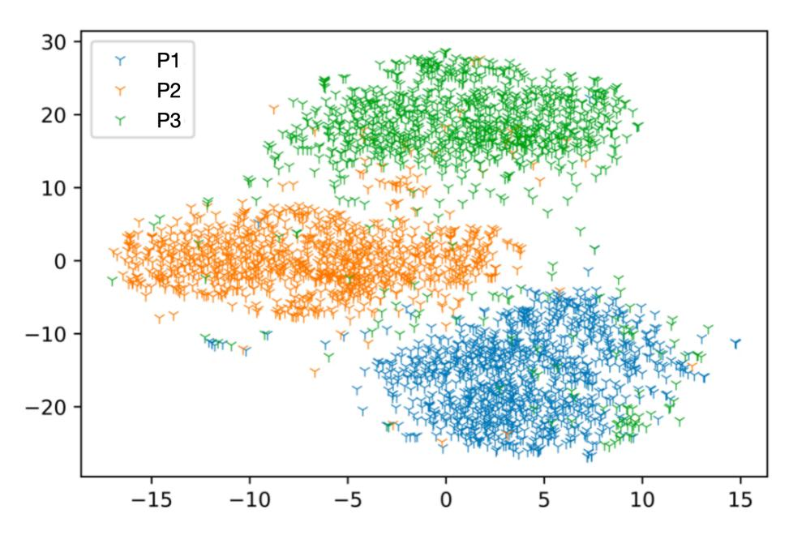
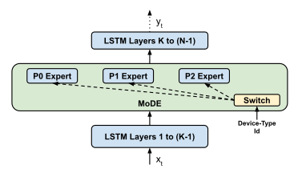
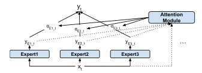

**Source:** *Unified modeling of multi-domain multi-device ASR systems* — [PDF](https://cdn.amazon.science/ba/d7/679a60ab4bcdb9a8b57f34a5dc45/unified-modeling-of-multi-domain-multi-device-asr-systems.pdf)

# Unified Modeling of Multi-Domain Multi-Device ASR Systems

Soumyajit Mitra⋆ , Swayambhu Nath Ray⋆ , Bharat Padi, Raghavendra Bilgi, Harish Arsikere, Shalini Ghosh, Ajay Srinivasamurthy, and Sri Garimella

Amazon Alexa

{ssomit,swayar}@amazon.com

Abstract. Modern Automatic Speech Recognition (ASR) technology is typically fine-tuned for a targeted domain or application to obtain the best recognition results. This requires training and maintaining a dedicated ASR model for each domain, which increases the overall cost. Moreover, fine-tuned model might not be the most optimal way of sharing knowledge across domains. To address this, we propose a novel unified RNN-T based ASR technology that leverages domain embeddings and attention based mixture of experts architecture. Further, the proposed unified neural architecture allows for sharing of data and parameters seamlessly across domains. Our experiments show that the proposed approach outperforms a carefully fine-tuned domain-specific ASR model, yielding up to 10% relative word error rate (WER) improvement and 30% reduction in overall training cost.

Keywords: End-to-end speech recognition, multi-domain ASR models, mixture of experts, DAT, RNN-T.

## 1 Introduction

Commercial ASR systems often have to support multiple domains and a variety of acoustic conditions. For example, a conversational assistant like Alexa has to run on different devices such as Echo devices, FireTV remotes and mobile phones.

Type of queries provided by users to the assistant can vary across devices as well, e.g. shopping queries on the shopping assistant on mobile phones can be different from content-only queries related to movies on the video assistant. To handle variations in usage patterns and acoustic conditions better, a dedicated ASR system is often trained and deployed for each device-type corresponding to a particular *domain*. Such a domainspecific ASR model is typically obtained by first training a general ASR model on data from all devices and then fine-tuning it on data from targeted domain.

Although the per-domain ASR model improves speech recognition accuracy for the relevant subset of user queries, it becomes cumbersome to maintain multiple perdomain models as each change (technology advancement, bug-fix, etc.) needs to be deployed to all the device-types. Further, the two stage training mechanism of the perdomain models turns out be costly in terms of compute requirement. Therefore, there is renewed interest in unifying per-domain models without regressing on accuracy.

⋆ Equal Contribution

In this paper, we explore variety of novel approaches to address the challenge of *unifying multiple per-domain ASR models*, for the RNN-T [6] model architecture. We start with a simple approach of using domain embedding to bias the unified ASR model during run-time. Our next approach explores the use of the *mixture-of-experts* (MOE) architecture [15], where each domain is represented by an expert. We also aim to combine the knowledge from multiple experts, without constraining any single expert to capture domain-specific knowledge. Accordingly, we developed a variant of the MOE framework by introducing an *attention* formulation into the model [17].

We show that our proposed unified model outperforms the individual domain-specific fine-tuned models by 10%. We also establish that our model performs 6% better than standard domain adaptation technique of Domain Adversarial Training (DAT).

# 2 Related Work

Domain specific models have been used to improve ASR performance in previous work [11]. Recent approaches have studied how domain knowledge can be incorporated as context in universal contextual model [2, 10, 19] and language model [7]. Another aspect of unified modeling has explored combining language-specific models into a unified multilingual model [5], using semi-supervised learning [1] or code switching [20] approaches. Adapter [8] and attention [18, 12] modeling have also been studied in different contexts earlier, specifically in the domain of natural language processing. Our proposed approach (attentive mixture of experts) of unifying domain-specific ASR models into a universal model is novel and significantly outperforms the per-domain models. Similar techniques of model unification, having such significant gains over per-domain models, to best of our knowledge have not been tried earlier in ASR systems.

## 3 Multi-device Unification

In this section, we present the motivation and different approaches explored for unifying RNN-T ASR model. In an ASR system, we use device-types to address domain-specific models – so *for the rest of the paper, we will use the terms domain and device-type interchangeably*. For our experiments we consider three device-types, based on three distinct acoustic and domain variations in the data. Far-field device-type (P1) caters to multiple top domains e.g. music, home-automation, knowledge, shopping. The pushto-talk device-type (P2) primarily caters to video and music domains, while close-talk device-type (P3) primarily caters to the shopping domain.

#### 3.1 Baseline Model Analysis

We begin with training a pooled RNN-T ASR model where we use data from all devicetypes. To get some idea about how the encoder tries to capture the device specific characteristics in pooled training, we generated t-SNE plot of the final representation of encoder by randomly selecting 1000 utterances from each device-types.

Fig. 1: t-SNE plot of Baseline Pooled model.

Fig. 1 shows that the RNN-T encoder try to segregate features across device-types which form loose clusters in space, while still having some overlap among them. The overlap is due to the limited device specific representation capacity of LSTM based encoder. We hypothesise that reducing the overlap or having tight-knit device-specific clusters should provide better recognition across devices for a pooled model. Based on the above analysis we outline our RNN-T ASR model unification strategies in the following sections.

#### 3.2 Device-type Embedding

In this approach, each device-type is encoded as a one-hot vector and provided as input to the model to learn device specific bias component. We experimented with introducing the device-type embedding to different layers of RNN-T encoder and decoder, results of which are discussed in Section 5.

#### 3.3 Mixture of Device Experts (MoDE)

The standard approach to train a device-specific model is to first pool data from multiple devices, followed by fine-tuning using device-specific data to help it adapt and match the device characteristics, thereby improving the model performance. We are proposing to capture the essence of this approach in the universal model by introducing a *Mixture of Device Experts* (MoDE) during pooled model training. Each device-type has its own expert, the parameters of which are learned only using device-specific data.

Fig. 2 shows an encoder layer with expert blocks introduced between layers of the network. We use adapter modules [8] as device experts, which helps to limit the increase in parameters. MoDE uses a hard-gating mechanism, where only one device expert block (corresponding to the device-type of the corresponding utterance) is active during run-time for an utterance.

Fig. 2: Schematic diagram of Mixture of Device Experts.

We experimented with having unique device experts per layers of encoder and decoder of RNN-T and also with sharing the device experts across multiple layers (details in Section 5). It is important to note that experts are not shared across devices – they are only shared across layers.

### 3.4 Attentive Mixture of Experts (AMoE)

MoDE, discussed in Section 3.3, restricts the experts to learn device specific characteristics only and doesn't enable sharing of information across the experts which might not be ideal. Motivated by this, we propose to remove the restriction on the experts and let each expert get trained with all device data and then introduce an attention module to learn the optimal contribution from each expert on the fly. This module is trained along with the rest of the model in an end-to-end fashion. We call this the Attentive Mixture of Experts (AMoE) approach, where we learn attention weights over experts, trained using data from all device-types.

Figure 3 outlines the details of AMoE . The attention weights in AMoE regulate the gradients while learning the expert parameters – this facilitates sharing of information across experts. The attention variables α in AMoE model are computed as:

Fig. 3: Attentive Mixture of Experts

$$\alpha_{Ei\_t} = \text{Softmax}(A_{Ei\_t}), \forall i \in 1, 2, 3 \tag{1}$$

where, 
$$A_{Ei\_t} = W_a(sigmoid(W_b[x_t : y_{Ei\_t}])),$$
 (2)

$$W_b \in \mathbf{R}^{m*n}, W_a \in \mathbf{R}^{n*1}, \tag{3}$$

$$m = len(x_t) + len(y_{Ei\_t}). (4)$$

Wa and Wb are trainable parameters which are trained along with RNN-T.

# 4 Data and Experimental Setup

### 4.1 Datasets

For our experiments, we used de-identified speech data collected from queries to voicecontrolled devices. We used 15K hours of human labelled data and 45K hours of machine transcribed data for model training. The data consists of Indian-English queries to a voice-controlled device. The distribution of training data per device is 2:1:1 for P1:P2:P3 (defined in Section 3). The evaluation set consists of 58 hours, 7 hours and 4 hours of de-identified data corresponding to devices P1, P2 and P3 respectively.

#### 4.2 Experimental Setup

Baselines: Our RNN-T baseline model consists of 40.6M parameters – 5 unidirectional LSTM encoder layers and 2 unidirectional LSTM decoder layers, each with 832 hidden units followed by a final 512 dimensional output projection layer. The joint network is a feed forward network of 512 hidden units and output dimension of 4001, which corresponds to the number of subword tokens [16]. The feature front end and optimizer used is similar to the one used in [14, 13].

We also set up a stronger second baseline to compare with our proposed method. We used one of the state-of-the-art domain adaptation techniques: domain adversarial training (DAT) [4, 9, 3] to learn device agnostic encoder representations by reversing

6

the gradients from a device-type prediction task. We used gradient reversal co-efficient of 0.03 and shared first 2 layers out of 5 layers of encoder with the device classifier (decided through hyper-parameter tuning). The device classifier is a single LSTM layer (128 units), output of which is combined through attention and passed through a softmax layer to perform utterance level classification.

**Proposed Models:** In case of device-type embedding, a 3 dimensional one hot vector is used to represent device information. For MoDE, we used adapter as device experts and restricted the projection size to 256 to keep the parameter increase to minimum. In case of MoDE, the device id information for a particular utterance is used as a switch to allow forward-pass and gradient back-propagation only through the corresponding device expert. We also experimented extensively with the position of the experts across different layers of encoder and decoder. For AMoE we used 64 dimensional learn-able attention weights, i.e. n in Equation 3 is 64.

Table 1: WERR(%) for all devices with our experimental models with respect to individually finetuned device specific baselines. Encoder and Decoder One-Hot refers to the encoder and decoder layers to which device-type-embedding has been added as input. Encoder and decoder layers after which device experts have been added is indicated by the Encoder and Decoder Experts column All results are obtained after averaging checkpoints from last 5 epochs.

| Exp.        | Device  | Encoder   | Decoder | Device  | Attentive | Encoder   | Decoder | CI I   | Dataset |      |      | Model  |
|-------------|---------|-----------|---------|---------|-----------|-----------|---------|--------|---------|------|------|--------|
|             | One-Hot | One-Hot   | One-Hot | Experts | Experts   | Experts   | Experts | Shared | P1      | P2   | P3   | Params |
| Baseline    | No      | N/A       | N/A     | No      | No        | N/A       | N/A     | N/A    | -       | -    | -    | 40.6M  |
| DAT         | No      | N/A       | N/A     | No      | No        | N/A       | N/A     | N/A    | 3.9     | 2.5  | 1.4  | +0M    |
| L. Baseline | No      | N/A       | N/A     | No      | No        | N/A       | N/A     | N/A    | 3.8     | 3.1  | 3.5  | +5.55M |
|             | Yes     | 0         | 0       | No      | No        | N/A       | N/A     | N/A    | 2.4     | 0.7  | -0.5 | +0.02M |
| Device-type | Yes     | 0,1,2,3,4 | None    | No      | No        | N/A       | N/A     | N/A    | 2.5     | -1.1 | 0.1  | +0.05M |
| Embedding   | Yes     | None      | 0,1     | No      | No        | N/A       | N/A     | N/A    | -0.5    | -3.7 | -2.1 | +0.02M |
|             | Yes     | 0,1,2,3,4 | 0,1     | No      | No        | N/A       | N/A     | N/A    | 3.6     | 0.8  | -0.6 | +0.09M |
| MoDE        | No      | N/A       | N/A     | Yes     | No        | 0,1,2,3,4 | 0,1     | No     | 5.4     | 1.5  | 2.2  | +2.97M |
|             | No      | N/A       | N/A     | Yes     | No        | 2,3,4     | 0,1     | No     | 7.6     | 5.0  | 5.7  | +2.14M |
|             | No      | N/A       | N/A     | Yes     | No        | 2,3,4     | None    | No     | 6.0     | 3.6  | 5.0  | +1.28M |
|             | No      | N/A       | N/A     | Yes     | No        | 2,3,4     | 0,1     | Yes    | 7.9     | 4.2  | 2.9  | +0.85M |
|             | Yes     | 0,1,2,3,4 | 0,1     | Yes     | No        | 2,3,4     | 0,1     | Yes    | 5.8     | 2.2  | 2.4  | +0.88M |
| AMoE        | Yes     | 0,1,2,3,4 | 0,1     | No      | Yes       | 2,3,4     | 0,1     | Yes    | 10.3    | 5.8  | 4.5  | +2.86M |
|             | Yes     | 0,1,2,3,4 | 0.1     | No      | Yes       | 2,3,4     | 0.1     | No     | 10.0    | 5.7  | 7.3  | +7.03M |

### 5 Results and Analysis

In Table 1 we list results on baseline and experimental models. Our first baseline model is three individual fine-tuned models for the three devices. Our second baseline model (DAT) is a single unified RNN-T model trained with pooled data from all devices but trained in device adversarial setup. All our experimental models only has a single stage of pooled training, similar to DAT baseline. This provides us with a single unified model

that can serve all three devices without any two-stage training process. The WER improvements shown for all other experiments are relative to the first baseline model. *Due to company policy, we are not able to report the absolute WER numbers. However, the baseline is a competitive state-of-the-art model.*

Large Baseline: We also trained a Large Baseline model wherein an additional encoder layer is added resulting in 5.55M additional parameters over the Baseline model. From Table 1 we see that, Large Baseline model in-spite of having 2x-5x additional model parameters compared to some of the experimental candidates, doesn't perform as well as the respective candidates.

Device Embedding: In this setup, we get the best results when we append the embedding to all encoder and decoder layers, where we saw some gains over Baseline for P1 and P2 but for P3 we observed some regression.

Mixture of Device Experts: With MoDE, we saw consistent improvements across all the devices for all the candidates. The results from Table 1 show that device experts were more helpful in the top half of the encoder compared to all the layers (Row 1 vs Row 2 of MoDE section in Table 1). From this observation, all other experiments were tried out only with experts in the top half of the encoder. Moreover, we saw that – experts in encoder are more effective than in decoder. However, when combined together, it delivered additional incremental gain in performance for all devices (Row 2 & Row 3). We also performed an experiment where we shared the experts across layers in both encoder and decoder instead of having unique expert in each layer which resulted in 67% less additional trainable model parameters. Although we saw some regression for P3, we were still able to get similar results for P1 and P2 (Row 4) as compared to having unique experts. Also, since we had device specific experts in this setup, providing device embedding to encoder and decoder (Row 5 in MoDE block) didn't boost the performance.

Attentive Mixture of Experts: Unlike MoDE, in AMoE, we enabled sharing of information across experts through attention. From the results we see that this gives much superior performance compared to MoDE across devices. Also, similar to MoDE, we see that even in AMoE, sharing of expert block across layers gives similar performance as compared to having unique experts.

Cost Savings: The baseline model has two stages of training - pooled training followed by three device specific fine-tuning. Contrary to this, our proposed model has a single stage of pooled training, which reduces the number of epochs of model training by 30%, thereby reducing overall training time and compute cost. Thus, our proposed unified model, in addition to providing better performance, has significantly less carbon footprint and uses 30% less compute resources.

Encoder analysis: In order to visualise the representation learned by encoder, we generated t-SNE plots using encoder features from last layer and using the same setup mentioned in Section 3.1. In case of DAT (Figure 4a), since we are enforcing the model to learn device agnostic characteristics, we see that the learned features across devices are more distributed. For MoDE model (Figure 4b), we observe an interesting fact that, even though the encoder LSTM layers are shared, each expert learns features in such a way that the final encoder features from different devices form distinct tight-knit clusters that are disjoint and distant from each other. In case of AMoE (Figure 4c), even

Fig. 4: t-SNE plots for different models

though we did not impose any restriction on the experts to be device specific, the experts learned to segregate the utterances across device-types implicitly.

Decoder Analysis: To understand the role of the experts in the decoder, we analyzed

Fig. 5: Attention weights for AMoE across word pieces

the attention weights given to each expert across word pieces in an utterance, for the AMoE model. We observed an interesting trend wherein we saw that one of the expert is mostly active during decoding of the head word-pieces and the other experts pitch in only during the recognition of slot content and rare words. Since P2 and P3 are dominated by slot contents, the experts catering to slot content recognition remains mostly active for these devices. Hence the experts in the decoder also captured some device specific characteristics without any explicit device information. We picked one example to demonstrate the above phenomenon in Figure 5. In this particular utterance, while decoding frequent word pieces like 'play', 'song', 'from' - the expert 1 is mostly active and only while decoding the artist name 'balasubrahmanyam', the expert 3 gets more weight.

## 6 Conclusion

This paper proposed to build a unified RNN-T based ASR model that generalized for various domains and acoustic conditions. The paper conducted a detailed ablation study involving domain embedding, mixture of experts, and attention to identify an optimal unified neural ASR architecture, which gave up to 10% relative WER reduction over simple fine-tuning approach. In addition, we simplified the overall training process and kept the number of model parameters in check compared to baseline, which resulted in up to 30% savings in compute cost. Both MoDE and AMoE yielded significant WER improvements, and offered options to trade-off WER and latency to cater to various applications.

## References

- 1. Biswas, A., Yilmaz, E., de Wet, F., van der Westhuizen, E., Niesler, T.: Semi-supervised acoustic model training for five-lingual code-switched ASR. CoRR abs/1906.08647 (2019), http://arxiv.org/abs/1906.08647
- 2. Chen, Z., Jain, M., Wang, Y., Seltzer, M.L., Fuegen, C.: Joint grapheme and phoneme embeddings for contextual end-to-end asr. (2019)
- 3. Ganin, Y., Lempitsky, V.S.: Unsupervised domain adaptation by backpropagation. ArXiv abs/1409.7495 (2015)
- 4. Ganin, Y., Ustinova, E., Ajakan, H., Germain, P., Larochelle, H., Laviolette, F., Marchand, M., Lempitsky, V.: Domain-adversarial training of neural networks (2016)
- 5. Gaur, N., Farris, B., Haghani, P., Leal, I., Moreno, P.J., Prasad, M., Ramabhadran, B., Zhu, Y.: Mixture of informed experts for multilingual speech recognition. In: ICASSP 2021 - 2021 IEEE International Conference on Acoustics, Speech and Signal Processing (ICASSP). pp. 6234–6238 (2021). https://doi.org/10.1109/ICASSP39728.2021.9414379
- 6. Graves, A.: Sequence transduction with recurrent neural networks. CoRR abs/1211.3711 (2012), http://arxiv.org/abs/1211.3711
- 7. Gururangan, S., Lewis, M., Holtzman, A., Smith, N.A., Zettlemoyer, L.: Demix layers: Disentangling domains for modular language modeling. CoRR abs/2108.05036 (2021), https://arxiv.org/abs/2108.05036
- 8. Houlsby, N., Giurgiu, A., Jastrzebski, S., Morrone, B., de Laroussilhe, Q., Gesmundo, A., Attariyan, M., Gelly, S.: Parameter-efficient transfer learning for NLP. CoRR abs/1902.00751 (2019), http://arxiv.org/abs/1902.00751
- 9. Hu, H., Yang, X., Raeesy, Z., Guo, J., Keskin, G., Arsikere, H., Rastrow, A., Stolcke, A., Maas, R.: Redat: Accent-invariant representation for end-to-end asr by domain adversarial training with relabeling. In: ICASSP 2021 - 2021 IEEE International Conference on Acoustics, Speech and Signal Processing (ICASSP). pp. 6408–6412 (2021). https://doi.org/10.1109/ICASSP39728.2021.9414291

- 10. Jain, M., Keren, G., Mahadeokar, J., Zweig, G., Metze, F., Saraf, Y.: Contextual rnn-t for open domain asr. arXiv preprint arXiv:2006.03411 (2020)
- 11. Kim, K., Lee, K., Gowda, D., Park, J., Kim, S., Jin, S., Lee, Y.Y., Yeo, J., Kim, D., Jung, S., et al.: Attention based on-device streaming speech recognition with large speech corpus. In: 2019 IEEE Automatic Speech Recognition and Understanding Workshop (ASRU). pp. 956–963. IEEE (2019)
- 12. Ray, S.N., Dasgupta, S.S., Talukdar, P.P.: AD3: attentive deep document dater. CoRR abs/1902.02161 (2019), http://arxiv.org/abs/1902.02161
- 13. Ray, S.N., Mitra, S., Bilgi, R., Garimella, S.: Improving rnn-t asr performance with datetime and location awareness. In: International Conference on Text, Speech, and Dialogue. pp. 394–404. Springer (2021)
- 14. Ray, S.N., Wu, M., Raju, A., Ghahremani, P., Bilgi, R., Rao, M., Arsikere, H., Rastrow, A., Stolcke, A., Droppo, J.: Listen with intent: Improving speech recognition with audio-tointent front-end. arXiv preprint arXiv:2105.07071 (2021)
- 15. Shazeer, N., Mirhoseini, A., Maziarz, K., Davis, A., Le, Q.V., Hinton, G.E., Dean, J.: Outrageously large neural networks: The sparsely-gated mixture-of-experts layer. CoRR abs/1701.06538 (2017), http://arxiv.org/abs/1701.06538
- 16. Shibata, Y., Kida, T., Fukamachi, S., Takeda, M., Shinohara, A., Shinohara, T., Arikawa, S.: Byte pair encoding: A text compression scheme that accelerates pattern matching (199)
- 17. Singh, V.P., Rath, S.P., Pandey, A.: A mixture of expert based deep neural network for improved asr. arXiv preprint arXiv:2112.01025 (2021)
- 18. Vaswani, A., Shazeer, N., Parmar, N., Uszkoreit, J., Jones, L., Gomez, A.N., Kaiser, L., Polosukhin, I.: Attention is all you need. CoRR abs/1706.03762 (2017), http://arxiv. org/abs/1706.03762
- 19. Wu, Z., Li, B., Zhang, Y., Aleksic, P.S., Sainath, T.N.: Multistate encoding with end-to-end speech rnn transducer network. In: ICASSP 2020. pp. 7819–7823 (2020)
- 20. Yilmaz, E., Biswas, A., van der Westhuizen, E., de Wet, F., Niesler, T.: Building a unified code-switching ASR system for south african languages. CoRR abs/1807.10949 (2018), http://arxiv.org/abs/1807.10949