**Source:** *The third CHiME speech separation and recognition challenge: Analysis and outcomes* — [PDF](https://eprints.whiterose.ac.uk/110977/1/barker_csl.pdf)

**Universities of Leeds, Sheffield and York**

Deposited via The University of Sheffield.

White Rose Research Online URL for this paper: <https://eprints.whiterose.ac.uk/id/eprint/110977/>

Version: Accepted Version

# **Article:**

Barker, J., Marxer, R., Vincent, E. et al. (2016) The third 'CHiME' speech separation and recognition challenge: Analysis and outcomes. Computer Speech and Language. ISSN: 0885-2308

<https://doi.org/10.1016/j.csl.2016.10.005>

Article available under the terms of the CC-BY-NC-ND licence (https://creativecommons.org/licenses/by-nc-nd/4.0/)

## **Reuse**

This article is distributed under the terms of the Creative Commons Attribution-NonCommercial-NoDerivs (CC BY-NC-ND) licence. This licence only allows you to download this work and share it with others as long as you credit the authors, but you can't change the article in any way or use it commercially. More information and the full terms of the licence here: https://creativecommons.org/licenses/

## **Takedown**

If you consider content in White Rose Research Online to be in breach of UK law, please notify us by emailing eprints@whiterose.ac.uk including the URL of the record and the reason for the withdrawal request.

# The Third 'CHIME' Speech Separation and Recognition Challenge: Analysis and Outcomes

Jon Barkera,, Ricard Marxera , Emmanuel Vincentb , Shinji Watanabec

aDepartment of Computer Science, University of Sheffield, Sheffield S1 4DP, UK Inria, 54600 Villers-l`es-Nancy, France

## Abstract

This paper presents the design and outcomes of the CHiME-3 challenge, the first open speech recognition evaluation designed to target the increasingly relevant multichannel, mobile-device speech recognition scenario. The paper serves two purposes. First, it provides a definitive reference for the challenge, including full descriptions of the task design, data capture and baseline systems along with a description and evaluation of the 26 systems that were submitted. The best systems re-engineered every stage of the baseline resulting in reductions in word error rate from 33.4% to as low as 5.8%. By comparing across systems, techniques that are essential for strong performance are identified. Second, the paper considers the problem of drawing conclusions from evaluations that use speech directly recorded in noisy environments. The degree of challenge presented by the resulting material is hard to control and hard to fully characterise. We attempt to dissect the various 'axes of difficulty' by correlating various estimated signal properties with typical system performance on a per session and per utterance basis. We find strong evidence of a dependence on signal-to-noise ratio and channel quality. Systems are less sensitive to variations in the degree of speaker motion. The paper concludes by discussing the outcomes of CHiME-3 in relation to the design of future mobile speech recognition evaluations.

*Keywords:* Noise-robust ASR, microphone array, 'CHiME' challenge

## 1. Introduction

The performance of automatic speech recognition (ASR) has been steadily improving over a period of more than forty years. Progress has been driven by the regular publication of standard speech recognition datasets around which evaluation campaigns have been organised. Designing effective evaluations is a challenge in its own right as many criteria need to be satisfied: tasks need to be compact so that evaluation is efficient; tasks need to be sufficiently realistic that

Email address: j.p.barker@sheffield.ac.uk (Jon Barker)

cMitsubishi Electric Research Laboratories, Cambridge, MA 02139-1955, USA

they are not open to 'toy' solutions; and, ideally, tasks need to capture some unsolved or untested part of some real ASR scenario. The need for evaluations to keep up with the rapidly advancing technology has led to a rapid evolution in evaluation task design.

Over the last twenty years, noise-robustness has become the main focus of ASR evaluation. The most influential early noise-robust evaluations, (e.g. Aurora 2 (Hirsch and Pearce, 2000) and Aurora 4 (Parihar et al., 2004)) have employed artificial mixing to control the signal to noise ratio (SNR). These tasks provide extremely challenging SNRs but are unsuitable for testing the current state-of-the-art technology in a number of respects: they employ instantaneous speech and noise mixtures that do not capture the channel variability of real acoustic mixing; the maskers are taken from short segments of a noise sample that does not capture the variability of everyday sounds; the utterances are provided in isolation with no opportunity to model the noise context.

More recent evaluations have attempted to carefully capture the acoustics of real applications. These have typically focussed on genuine distant microphone speech recognition scenarios but ones that feature relatively benign environments where high SNRs can be expected, e.g., meeting rooms (Renals et al., 2008; RWCP, 2001) and lecture halls (Mostefa et al., 2007). These evaluations have featured multichannel signal recordings and have led to the development of highly effective microphone array processing strategies that can be used as part of the speech recognition tool chain.

The need for a new style of evaluation has now emerged. Recently, the infrastructure necessary for performing computation remotely, 'in the cloud,' has opened the door for truly ubiquitous speech recognition: remote recognition can be performed on signals captured by cheap domestic appliances and mobile devices. This has led to a growing demand for effective distant microphone speech recognition technology capable of working reliably in uncontrolled, everyday environments. For example, target applications now include speech-driven interfaces for entertainment systems and personal digital assistants; speech recognition on mobile devices that are expected to work equally well both indoors and outdoors and regardless of the proximity of competing sound sources; social robotics with speech-driven human-robot communication that can function at distances that are comfortable for inter-personal communication.

There have been very few evaluations suitable for measuring performance in modern ubiquitous speech recognition scenarios. In particular, mobile speech recognition features many novel sources of difficulty: microphone arrays that are no longer fixed relative to the environment or the speaker; a wide variety of acoustic environments with characteristics that can evolve over multiple timescales; moving sound sources that can be hard to cancel using microphone array processing; an increased chance of channel interference or intermittent failure (e.g., clipping or drop-out); a broader range of speaking styles, from quiet near-whispered speech in locations where talkers worry about being overhead, to stressed speech or Lombard-style speech in very noisy environments where talkers struggle to communicate.

This paper presents the design and outcomes of the CHiME-3 challenge,

an evaluation that specifically targets mobile speech recognition. The CHiME-3 scenario concerns speech recognition being performed with a multi-channel, mobile tablet computing device being used in noisy, everyday environments. Like the previous CHiME-1 (Barker et al., 2013) and CHiME-2 (Vincent et al., 2013a,b) challenges, CHiME-3 maintains a focus on the problems presented by *real* noise environments containing multiple unknown sound sources, however, whereas the previous CHiME challenges employed artificially mixed speech and noise, CHiME-3 advances the level of realism by capturing speech data directly in the noisy setting.

One of the difficulties of building evaluations using realistic data is that there is no longer a single, well-controlled axis of difficulty such as SNR or degree of reverberation. Instead, the intrinsic difficulty of recognising an utterance is contingent on many factors, most of which are impossible to control and hard to estimate. This paper attempts to characterise the signals in terms of some of these factors, and then – by analysing the performance of the systems submitted to the challenge – to measure which factors have the greatest impact on ASR performance. By reaching a better understanding of what makes real-world recognition tasks difficult, we can better prioritise future research directions and better understand how to design future evaluations.

The remainder of this paper is structured as follows. Section 2 will describe the CHiME-3 datasets and recognition task design. Section 3 will describe techniques for characterising the talkers and noise environments with a focus on factors that may be useful in predicting the achievable recognition performance. Section 4 will provide a brief review of the systems submitted to the challenge, with a focus on techniques for dealing with the dimensions of difficulty identified in Section 3. Section 5 presents an extended analysis of the performance of the submitted systems. We extend the presentation made in Barker et al. (2015) by re-evaluating systems on refined subsets of the data and analysing patterns of performance with respect to the characteristics of the data presented in Section 3. The paper concludes with a general discussion in which we draw implications for future distant microphone ASR research and for the design of future evaluations.

# 2. An overview of the CHiME-3 datasets and task

The CHiME-3 challenge has considered speech recognition on a multimicrophone tablet device being used in noisy everyday environments. The ASR task is based on the speaker-independent, medium (5k) vocabulary subset of the Wall Street Journal (WSJ0) corpus (Garofalo et al., 2007). Two types of data have been provided: real data, i.e., speech that has been recorded directly in the noisy environment, and simulated data, i.e., noisy utterances that have been created by mixing clean speech with background noise.

## *2.1. The CHiME-3 datasets*

Data is divided into three sets: training, development and test. Each set consists of utterances recorded from four different native US speakers (2 male and 2 female). Each speaker is recorded in four separate noise environments and in an acoustic booth. For the training data, for each speaker-environment combination, 100 sentences are sampled (without replacement) from the 7138 sentences of the official WSJ0 training set, i.e., leading to the recording of 1600 (4 × 4 × 100) unique utterances in total. A further 7138 simulated noisy training utterances were constructed by mixing the original WSJ0 training set with CHiME backgrounds. To construct development (dev) and test sets, the official WSJ0 410 dev and 330 test sentences were split into four subsets and in each environment, each subset was read by a different speaker, resulting in 1320 (330 × 4) test utterances and 1640 (410 × 4) development utterances (see Table 1) An equivalent set of noisy test and development utterances were made using simulated mixing. Performance of systems on the simulated test data is reported in Barker et al. (2015) but is not discussed further in this paper.

## *2.2. Data Capture*

A Samsung Galaxy tablet computer was used to deliver prompts from the Wall Street Journal. The tablet was fitted into a custom-made frame that was designed to be held in landscape orientation and which allowed six Audiotechnica ATR3350 omnidirectional lavalier electret microphones to be fitted around the device: three along the top edge and three along the bottom edge. Microphones all faced forward expect for the top-central microphone which was mounted facing to the rear of the device (see Fig. 1). It was considered that participants may be able to use the rear facing microphone (facing away from the talker) in order to better estimate the noise background, e.g., for background subtraction or spectro-temporal mask estimation.

Recordings were made using a pair of battery-powered TASCAM DR-680 digital 6-track recorders. One unit captured the six channels from the tablet, sample-synchronously. The second unit was used to record the signal from a Beyerdynamic condenser headset close-talking microphone (CTM) worn by the talker. The units were daisy-chained together so that they could be started and stopped through a common interface. There was a variable delay of up to around 20 ms between the two units. All signals were recorded at 48 kHz in 16 bit resolution and signals were later downsampled to 16 kHz for distribution.

For each talker, an initial block of 100 utterances was recorded in an IAC single-walled acoustically-isolated booth. This provided some opportunity for talkers to practice the task without distraction. Subsequently, each of the 4 pre-selected recording locations was visited in turn. Within each recording session, the tablet delivered a prompt which the talker then read. Talkers were instructed to re-read sentences if they made mistakes or if there had been significant disfluencies. Some speakers required several attempts in order to produce satisfactory utterances. After each utterance the talker advanced to the next prompt. After each 10 utterances the interface encouraged them to make some change to their posture, e.g., rotating in their chair, or moving the tablet from being held to resting on a table, etc.

After recording, all the utterances were hand-endpointed. The correct rendition of each utterance was selected. Transcribers then listened to each utter-

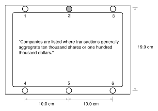

Figure 1: A schematic of the CHiME-4 recording device showing the microphone array geometry. All microphones face forward except for microphone 2. The microphones surround a tablet computer which is used to present each WSJ sentence to the reader.

ance and compared it to the prompt text. Where inadvertent reading errors had been made, the transcripts were edited to match what had actually been spoken–usually simple word transpositions or isolated word insertions/deletions. These errors occurred in 59 of the 4560 total utterances recorded.

In addition to the utterance recordings, separate background noise recordings were made for each environment. For each environment, four new locations were selected and 30 minutes of data was recorded at each, resulting in 8 hours of background in total. During the recordings, the tablet was held as if it were being used but no utterances were spoken.

## *2.3. Task design*

The task was to build a speech recognition system designed to accept the six channel tablet recordings as input. Systems were to be scored and ranked according to their average WER measured over the 1320 utterance test set.

For training, participants were required to use only the 1600 utterances of real data and the 7138 simulated noisy utterances. The simulated noisy training data did not capture all effects of real speech-in-noise, however, participants were free to produce their own simulations if they so wished. The only constraint was that remixing kept the same association between the WSJ utterances and the segment of background noise that was used in the baseline simulation. Similarly, no artificial constraint was placed on the language model: any language model was allowed as long as it was trained using only the official WSJ language model training data.

Table 1: Overview of the utterances in the CHiME-3 dataset counting unique setences, speaker, environments and utterances in each partition.

|              | Sentences | Speakers | Env. | Utterances |
|--------------|-----------|----------|------|------------|
| Train (Real) | 1600      | 4        | 4    | 1600       |
| Train (Sim)  | 7138      | 83       | 4    | 7138       |
| Dev          | 410       | 4        | 4    | 1640       |
| Test         | 330       | 4        | 4    | 1320       |

For testing, endpointed and segmented utterances were provided. In addition, participants were provided with the continuous recordings from which the test utterances had been extracted, and with annotated endpoints. They were allowed to use this data to examine the audio context prior to the utterance. They were told that they could use at most 5 seconds of context.

Participants were allowed to make use of the speaker ID but not the sound environment label. The development test data was released along with the training data but the final test set was recorded later and released shortly prior to the submission deadline. Participants were told that they should tune only on the development data and use the same system settings when running evaluations on the final test data.

## *2.4. Baseline System*

A baseline system was provided composed of three components: training data simulation; multichannel speech enhancement and a speech recognition backend.

# *2.4.1. Simulation*

The simulated training data was constructed by using time-varying impulse responses to add utterances from the WSJ0 corpus into the 6-channel CHiME background recordings in a manner that attempted to match the microphone responses, signal-to-noise ratios (SNRs) and effects of speaker movement observed in the real recordings.

The SNR at each microphone was estimated by considering the close talking microphone to be clean, and then computing an STFT-domain impulse response (IR) between the close-talking microphone and each tablet microphone. The STFT IR was estimated in the least-squares sense in each frequency bin for a 250 ms block of frames. The STFT employed half-overlapping sine windows of 256 samples.

Motion was simulated using a time-varying filter modelling direct sound between the speaker and the microphones. This was estimated by tracking the spatial position of the speaker from peaks in the non-linear Steered Response Power with the Phase Transform (SRP-PHAT) pseudo-spectrum (Loesch and Yang, 2010; DiBiase et al., 2001). Utterances from the WSJ training set are then convolved with a microphone equalisation filter, and then with a time-varying motion filter estimated from a CHiME training data recording of similar length and from the same environment as the target background. The microphone equalisation filters were constructed from the ratio of the average power spectrum of the booth data for each channel and the average power spectrum of the WSJ training data.

## *2.4.2. Enhancement*

The baseline system provided an enhancement component that could take the 6-channel recordings and convert them into an enhanced single-channel output suitable for input into the ASR component. The speech signal is estimated using time-varying minimum variance distortionless response (MVDR) beamforming with diagonal loading (Mestre and Lagunas, 2003). This requires the time-varying estimate of speaker location described in the previous section and a multichannel noise covariance matrix which was estimated from 400 ms to 800 ms of context prior to the start of the utterance. The decision was taken not to use the full 5 seconds of context allowed by the CHiME-3 rules in order to avoid capturing the end of the previous utterance in the recording session.

## *2.4.3. Speech recognition*

The baseline speech recognition system was built using Kaldi (Povey et al., 2011). The system is based on the Kaldi DNN-system recipe for Track 2 of the 2nd CHiME challenge (Barker et al., 2013; Vincent et al., 2013a). Feature vectors are constructed from concatenating 7 frames of 13 dimensional Mel-frequency cepstral coefficients (MFCCs) then compressing to 40 dimensions using LDA with one of 2500 tied tri-phone HMM states as the class. The deep neural network (DNN) has 7 layers, each with 2048 units and it employs 5 frames of left and right context in the input frame (i.e., 11 × 40 = 440 units). It is trained using standard restricted Boltzmann machine pre-training, cross entropy training and sequence discriminative training using the state-level minimum Bayes' risk criterion (Vesel´y et al., 2013).

## 3. Characterising the CHiME-3 audio

Characterising the difficulty of a naturally recorded speech-in-noise ASR task is problematic. In traditional robust speech recognition evaluations, using simulated mixing, an arbitrary gain can be used to set the SNR independently of the level of the masking noise. Although unnatural, this makes it easy to control the level of difficulty and it allows system performance to be conveniently presented as a function of SNR. This tradition has led to SNR becoming the main metric that is reported alongside WERs as a single dimensional proxy for difficulty. However, when considering speech in real environments, SNR alone is likely to be a less useful measure. The variability of SNR between environments is likely to be less important than other factors, e.g., the spectro-temporal properties of the noise, the behaviour of the speaker in the environment, etc.

In this section we attempt to measure some of the properties of the CHiME-3 signals that might influence the difficulty of the recognition task. This includes properties of the recording environments (Section 3.1), properties of the recording channels (Section 3.2), properties of the talkers (Section 3.3) and finally interactions between the speech and environmental noise (Section 3.4). In Section 5, signal properties will be correlated with system word-error rates in order to gain some understanding of the factors which have greatest impact on system performance.

## *3.1. Characterising the CHiME-3 environments*

Four diverse recording environments were selected: bus, caf´e, street and pedestrian area. Each was considered to be a situation in which a mobile tablet device might be used, but in which there would also typically be sustained high levels of background noise of a complex multi-source nature. The environments can be broadly described as follows.

- Bus (BUS) Travelling on bus routes through the city centre. Recordings were made on single and double-decker buses, on a variety of bus routes, with the talker located on either deck and at various positions. The talker was always seated with the tablet being held over her/his lap. Major sound sources include speech from fellow passengers, engine noise, rattling from windows and bus fittings. There was often a considerable degree of vibration and shaking caused by uneven road surfaces.
- Caf´e (CAF) Commercial caf´es on the University campus and in the city centre. The talker was seated at a table and the tablet was either held or rested on a table top. Major sources of background noise included speech babble, music and noise from kitchens and espresso machines. Tables were selected that provided a high noise level, but in locations that would avoid the intelligible capture of individual conversations of other customers.
- Pedestrian (PED) Large pedestrian areas. These were selected to be busy pedestrian areas away from traffic noise. They included a mixture of outdoor areas (e.g., pedestrianised shopping zones, recreational areas) and large reverberant indoor spaces (e.g., atria of public buildings, train station ticket halls). Talkers were either standing or seated. Noise sources were varied but typically included speech babble, background music and pedestrian footfalls.
- Street (STR) On a pavement beside a busy street intersection. Locations were selected beside major roads where there was continual traffic. In most situations, traffic light control led to a stop-start traffic pattern. The talkers were mostly standing but in some cases were seated on roadside benches or in bus shelters. Major sources of noise were engine, brake and tire noise from a variety of vehicles including cars, buses and heavy goods vehicles.

There are two main considerations when assessing the likely impact of noise on speech recognition performance. First, noise will energetically mask the speech signal leading to uncertainty in the speech signal parameters. The degree of masking is a function of the overall signal-to-noise level and the relative spectral shape of the sources. Second, a noise background that is rapidly varying and unpredictable (i.e., that is non-stationary) will be harder to effectively discount. For each noise environment these effects have been considered separately.

## *3.1.1. Masking potential*

Analysis has been performed using the 8 hours of background recordings. Recordings from channel 6 have been used as a reference (The same channel was used for speech signal analysis in Section 3.3). For each environment the recordings have been divided into 1 minute segments and for each segment the average level and the long term average spectra have been computed. Levels have been computed with a dBA weighting in order to better reflect the perceived loudness of the environments (Fletcher and Manson, 1933). Spectra were computed using a 16,000 sample Hann window and 1/6 octave smoothing. The recorder is uncalibrated so the level with respect to the dB SPL scale is unknown, but recorder settings remained fixed throughout all CHiME speech and background recording stages so that relative levels can be meaningfully compared.

Figure 2 (left) shows a standard Tukey box plot (Frigge et al., 1989) of the distribution of the 1 minute segment levels, showing the median and interquartile range of the samples. The levels vary over a range of approximately 22 decibel but with most of the data concentrated in a range of 10 decibel across environments and 5 dB within environments. The BUS stands out as being significantly quieter than the other environments. The STR environment has the largest spread and can produce the extreme 1 minute segments with a level 10 decibel greater than the median.

Figure 2 (right) displays the long term average spectra measurements. Variability about the mean is indicated by the background shading (1 standard error). The lower level of BUS can again be seen, but now it is also apparent that the BUS environment has a greater spectral tilt with more energy concentrated below 1 kHz. CAF and PED have very comparable profiles but with CAF having more energy above 4 kHz. The similarity of CAF and PED acoustics is not surprising as the pedestrian areas included indoor public spaces, often with open plan caf´e and restaurant areas. STR can be seen to have a significant energy component below 500 Hz similar in profile to the spectrum of BUS.

## *3.1.2. Background stationarity*

Noise that is hard to predict over the duration of an utterance is hard to account for during recognition. To estimate the predictability of the noise for the different environments, we consider the constraints imposed on the task that the ASR systems have to perform. In particular, participants are only allowed 5 seconds of context prior to the utterance from which to form an estimate of the noise. Therefore, we divide the CHiME-3 background data into segments of 20 seconds, allowing the first 5 seconds to train a noise model followed by a period

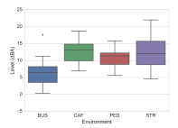

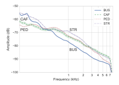

Figure 2: Left: Tukey box plot of the distribution of the average dBA level of one minute segments of background noise shown separately for each environment. Right: The long term average spectra for each noise background. Shading shows 1 standard error about the mean.

of 15 seconds, roughly matching the length of the longest utterance. For each segment, we train a Gaussian mixture model (GMM) from MFCCs estimated from frames of the first 5 seconds. The MFCCs are calculated in the same way as in the baseline system, with a window shift of 10 ms and a window length of 25 ms. We then compute the log-likelihood of all the frames with respect to the trained model. This results in a sequence of log-likelihood values of the noise frames over time. The average log-likelihood of the frames used for training (i.e., the first 5 seconds) is subtracted from the sequence to obtain comparable sequences of normalised log-likelihood values which are then averaged across segments (roughly 300 per environment)

The number of components of the GMMs is optimised for each environment independently using a held out set of 70 segments per environment. The optimal number of components is selected by maximizing the average log-likelihood of all the frames. Analysis is performed using audio from channel 1 as it was judged to be the least affected by microphone errors (see Section 4).

The same experiment was also conducted on the background noise data from the 1st and 2nd 'CHiME' challenges (Barker et al., 2013), consisting of recordings from a distant microphone in a family home, containing noise from televisions and radios, children playing, vacuum cleaners, and outdoors noises from open windows.

Figure 3 shows the evolution of the average log-likelihood of the unseen frames over time. The shading represents one standard error around the mean. The time it takes for the likelihood to decrease provides a measure of stationarity. PED and CAF are seen to be the most stationary environments and show no significant difference in behaviour. BUS is less stationary and similar in behaviour to the domestic setting from CHiME 1 and 2. The statistics of the STR environment migrate the most rapidly with likelihood decreasing rapidly over the first 6 seconds (the average duration of a CHiME utterance) and then plateauing. This is consistent with the nature of the STR recordings: the noise

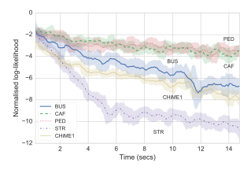

Figure 3: A measure of background stationarity: The log-likelihood of the background data measured as a function of the time since observing a segment of training data. For more stationary backgrounds the likelihood decreases more slowly.

is typically dominated by the vehicle passing closest to the talker meaning that the noise level fluctuates over long utterance length periods.

This analysis would suggest that the pedestrian and caf´e environments, being the most statistically stationary (under the assumptions of the simple GMM model) are perhaps therefore the easiest for an ASR system to handle. Some caution is needed when making this claim. The GMM used to estimate the likelihoods is treating frames independently with no model of sequence. It is therefore quite limited in its ability to describe the true predictability of the noise. For example, the street noise might be very non-stationary in the sense that an approaching car might change the noise level considerably during the duration of an utterance, however, this change is smooth and predictable. On the other hand, although the ambient sound in a caf´e might stay fairly constant over long periods, there will often be distinct acoustic events occurring during an utterances that were not observed in the preceding five seconds and are therefore very hard to account for.

## *3.2. Characterising the recording channels*

The tablet recorder employed six electret microphones each powered by a 5v battery and connected to the TASCAM via 3.5 mm to 1/4 inch jack plug adaptors. The optimality of the channels for speech recognition is influenced by two main factors. First, the frequency response of the channel, which can potentially vary considerably due to the positioning of the microphone on the tablets and variability in the manufacture of the microphones themselves. Second, the propensity of the channel to failure. Failure can be caused by various means. The microphones towards the corners (1, 4, 5 and 6) may be occluded by handling; the rear facing microphone (2) is occluded when the tablet is laid flat upon a table. Further, recording 'in the field' over a number of weeks puts considerable stresses on the equipment and failures in connections can occur leading to complete signal loss or intermittent drop outs. These failures are more likely in the more extreme environments, e.g., BUS (vibration) and STR (outdoors)

## *3.2.1. Channel frequency response*

An analysis of the CHiME-3 microphone frequency responses is presented in Vincent et al. (submitted). In brief, the frequency responses were estimated relative to each other by averaging differences in the long term amplitude spectra computed over all 8 hours of background noise recording. It was found that the responses were all within a range of 4 dB over the range 100 Hz to 8 kHz. The shape of the responses formed two clusters: top row microphones and bottom row microphones. Channel 6 appeared to have a 3 dB gain relative to channels 4 and 5. Overall, the differences are surprisingly small and are insignificant compared with other sources of spectral variation (e.g., talker characteristics).

## *3.2.2. Channel failure*

Microphone failures have been characterised by measuring cross-channel correlations in the segmented training, development and test data on a per utterance basis. It is assumed that microphone failure in a channel will be independent of failure in other channels. It is also assumed that failure will effect the time varying energy of the signal. For each utterance, a time varying energy (TVE) signal was constructed by computing root mean squared signal energy in successive 10 ms windows. For each microphone, the correlation of the TVE was measured against that of the other five channels and the highest value was recorded. The distribution of these correlation values for the forward facing microphones was examined. It was observed that the scores are highly concentrated over 0.9. Errors were predicted to have occurred when the correlation fell below a threshold value. Specifically, two thresholds were then defined: correlations less than 0.8 (mild error); correlations less than 0.5 (severe error). The rear-facing microphone is naturally less correlated with the other channels and the correlations scores are more spread, thus making errors hard to detect with any confidence. This microphone has been excluded from the analysis of results.

Figure 4 (top-left) shows the counts of utterances classified as mild and severe errors across each recording channel. Most errors are concentrated in channels 3, 4 and 5. The top-right panel presents errors per environment. The most 'controlled' environments (booth and caf´e) are free of errors. In these environments the talker was seated and the recording equipment could be carefully set up for each session. The severe errors are evenly distributed across the BUS, PED and STR environments. The bottom-left panel shows errors per speaker. Surprisingly, recording errors are not evenly spread across speakers. For example the quality of the F02 recording is poorer than other training set speakers. In general, there is a higher frequency of error in the test set – which was recorded later – than in the training and development set. The signal drop-out errors were largely due to poor connections in the battery units of the microphone, and the switches on the TASCAM units, that were sensitive to vibration. The increased errors are likely due to damage caused by vibration and general 'wear and tear' that accumulated over time. In general, as seen in the bottom-right, the frequency of channel failures is highly dependent on the recording session (i.e., speaker/environment combination).

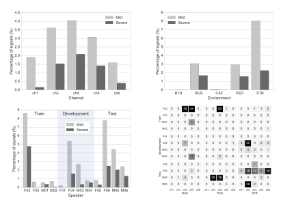

Figure 4: Microphone error frequencies per channel (top-left), per environment (top-right) and per speaker (bottom-left). The table shows how error are distributed over recording sessions. Cells are shaded according to frequency of failure.

## *3.3. Characterising the CHiME-3 talkers*

In total 12 US English talkers have been recorded, six male (M01 to M06) and six female (F01 to F06). Four speakers – two male and two female – are assigned to the training, development and test sets.

For each speaker, the speech rate, speech level and long-term average spectrum (LTAS) have been measured. For consistency with the environment analysis (Section 3.1), measurements have been made using tablet channel 6. The LTAS was measured on each segmented utterance and averaged. The speech levels were measured by computing the root mean squared amplitude of the signal after filtering to apply a dBA weighting. The analyses were performed using the recording made in the acoustic booth in order to minimise the effect of background noise. Speech rate is measured in syllables per second with syllable counts taken from the International Speech Lexicon (Hasegawa-Johnson and Fleck, 2007) and sentence duration according to the utterance endpointing provided with the data.

Figure 5 shows Tukey box plots for the distribution of utterance speech levels (left) and speech rates (right) for each talker. It can be seen that there is a surprising degree of variability in the speech level with the median varying over a range of almost 10 dB across speakers but a spread of around 2 dB within a speaker. Some of this will be due to variation in vocal effort and some due to the average distance of the speaker to the tablet (depending partly on body size). The spread of average speech rate is considerably less with most speakers producing utterances at rates with 3.5 to 4.5 syllables per second. However, speaker F05 is a clear outlier with rates ranging from 4.5 to 5.5.

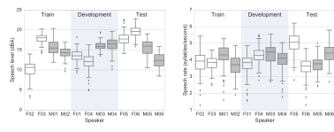

Figure 5: Tukey box plots showing distribution of speech level in dBA (left) and of speech rate (right) for all 12 CHiME-3 talkers.

Figure 6 compares the long term average spectra of the noise background (left) and the four talkers in the final test set (right). The speech spectra have different spectral tilts with, as expected, the female speakers carrying more high frequency energy. The analysis would predict that M06 will be heavily masked in the 1 kHz to 3 kHz region and M05 in the 3 kHz to 5 kHz region. Given that the octave band around 2 kHz is the most important for intelligibity it might be anticipated that speaker M06 is most affected by noise.

## *3.4. Characterising the speech in noise*

The environment and speaker measurements, reported in the previous two sections may be used to make approximate prior estimates of the recording session intelligibilities. For example, it might be predicted that fast, quiet speakers

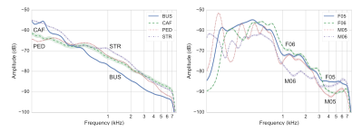

Figure 6: Comparison of the long term average spectra of the environments (left) and the test set speakers (right). Shading around each line represents 1 standard error.

(and utterances) will be less easily recognised than slow, loud ones. Environments with higher overall noise level and less predictability will be more challenging. The separate speaker and environment measures can be used to estimate average A-weighted SNR of a particular speaker in a particular environment, etc. However, this analysis would be at best approximate as it neglects the fact that talkers react to the environment that they are speaking in and adjust their behaviour, for example, raising their vocal effort and adopting a Lombard speech style when background noise levels become raised. It is this interaction between speaker and environment that motivated using real live-recorded data in the first place.

In order to get a more realistic characterisation of the speech recorded in situ, it is necessary to directly analyse the noisy signals. Although this may lead to better predictions of difficulty, it is complicated by the lack of exact knowledge of the separate speech and background signals. Instead analysis must start from estimates of the speech and noise component of the mixed signal arriving at the tablet microphones. For most of the analyses in this section, these reference signals have been estimated by exploiting the close-talking microphone channel and using the techniques described in the baseline simulation system described in Section 2.4.1, i.e., assuming the close-talking microphone to be clean speech and then estimating a close-talking to tablet microphone filter in the complex STFT domain in the least-squares sense.

## *3.4.1. SNR estimation*

SNRs were estimated for each CHiME-3 utterance using either the estimated speech and noise signals directly or after first applying and A-weighting filters. The channel failure analysis of Section 4 was used to remove any utterance for which any channel was observed to have a mild error. Then, for remaining utterances, SNRs were averaged over all forward facing microphones.

Figure 7 (left) shows the SNR estimates averaged over speakers for each environment. Without the A-weighting the SNRs in the BUS and STR appear lower than those of CAF and PED. However, when A-weighting is applied, the SNR in BUS and STR increases and the environments become more equally matched. This is unsurprising given the large amounts of low frequency energy in BUS and STR. Previously it was seen that the noise level in the BUS was typically significantly lower than that in the other environments. Further, the level was seen to vary by around 10 dB across background noise segments. This pattern has not translated into a similar pattern in the SNRs. This is likely to be due to interaction between the speakers and the environments: i) speakers raising their vocal effort when the background becomes raised (particularly in the STR environment), ii) speakers talking in a quieter 'confidential' style on the BUS where it was often quiet and other passengers were sitting in close proximity. This demonstrates the danger of making assumptions based on isolated speech and background recordings. A second possibility, is that there can be a considerable amount of background noise energy captured by the close-talking microphone which breaks the assumptions of the speech and noise separation technique. Noise contaminating the speech estimate would lead to SNRs being systematically overestimated in noisy environments and a consequent reduction in the estimated spread. Further study is needed to distinguish between these two possibilities.

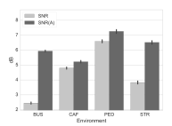

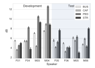

Figure 7: SNR and A-weighted SNR measures per environment (left) and A-weighted SNR per speaker-environment session (right). Errors bars indicate two standard errors.

Figure 7 (right) displays the A-weighted SNRs on a per speaker-environment basis with error bars indicating two standard errors (error bars have the same interpretation for all bar plots in the paper). It can be seen that there is considerable variability (up to 10 dB) between sessions. SNRs in the test set in general appear lower than those in the development set. This is possibly a major cause of the poor performance seen in the test data compared to the development data – as discussed in detail in Section 5.

## *3.4.2. Objective Intelligibility Measures*

It is well known from human communication sciences that, when comparing across backgrounds with different properties, SNR is a poor predictor of the degree to which noise impacts on human ability to understand speech signals. There have been many proposed objective intelligibility measures (OIMs) designed to perform better than SNR. Although these measures are designed to model human hearing, many of the most successful ones are based on principles that apply equally well to machine speech recognition. For example, in recent years, a simple algorithm known as the Short-Time Objective Intelligibility (STOI) measure has been shown to be a good predictor of intelligibility in a wide range of applications including time-frequency weighted noisy speech (Taal et al., 2011). The STOI measure is based on the sum of the correlation between the envelopes of the clean speech signal and the corrupted speech measured with 15 1/3-octave frequency bands starting at 150 Hz. More recently, using the same frequency bands, it has been shown that a mutual information-based measure can perform better than STOI (Taghia and Martin, 2014).

The SNR analysis was repeated using STOI and Taghia et al's mutual information-based measure (MI). The averages over environments and speakers are shown in Figure 8. The pattern of the averages is broadly similar to the unweighted SNR estimates. We will return to this data in Section 5 where we investigate correlation with machine recognition performance.

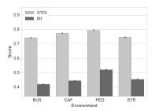

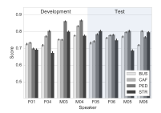

Figure 8: Left: The STOI and MI intelligibility averaged over each utterance per environment. Right: The STOI measure averaged over utterance in each speaker/environment recording session. Error bars indicated two standard errors.

#### 3.4.3. Speaker movement

CHiME-3 ASR system employs sophisticated multi-channel processing in the front end in order to try and isolate the target speech signal from the background. This task becomes considerably harder if the speaker is moving rapidly or unpredictably with respect to the microphone array. As both the speaker and the tablet may be moving in relation to the environment, the degree of apparent speaker motion can be surprisingly large. It is also likely to be highly speaker and environment dependent.

There is no readily available ground truth for the speaker motion, but estimates can be obtained using the SRP-PHAT pseudo-spectrum peak tracking

algorithm that was employed in the simulation and enhancement baseline described in Section 2.4. Using this technique, speaker location was estimated in the horizontal and vertical direction on a plane parallel to the tablet on a grid of resolution of 1 cm at 32 ms intervals. For the direction perpendicular to the tablet, distance could not be estimated accurately and so a single value was estimated per utterance. From these speaker tracks two separate measurements were made per utterance: i) the average speed of speaker movement; ii) the spread of the speaker location as presented by the trace of the two-by-two covariance matrix computed from the sequence of 2-D position locations.

Figure 9 displays the estimated average degree of movement for each environment and each speaker. The scale indicates the speed in units of cm/s. The spread measure has been linearly scaled to have the same mean value for presentational purposes. Considering the environments, it can be seen that motion is greatest in the STR setting – in which the talker was often standing – and lowest in the CAF and PED environments. The BUS condition is somewhere in between and has a relatively high speed compared to the spread of locations. This would be consistent with rapid vibrations caused by the motion of the bus. Note however that some caution needs to be applied when interpreting these results: outliers in the speaker location estimation can lead to an overestimate of the degree of motion, and it is possible that the degree of location estimation error is itself environment-dependent.

Variability across speakers is considerably higher than across environments with the average speed varying by a factor of around three between the most stationary speaker F06 and the most mobile. Speakers with the most movement appear to be concentrated in the training set. There is unlikely to be any underlying cause for this: it illustrates the difficulty in trying to design balanced data sets when having a small number of talkers with very different individual characteristics. There are also considerable differences in the ratio of the two measurement metrics across speakers, with talker F03 appearing to have significantly different behaviour than the others. The error bars (two standard errors) show that there is also considerable within-class variability for some speakers. In particular speaker F02 has a large spread of measurements.

# 4. Overview of submitted systems

The challenge attracted the participation of 26 teams from Asia, Europe and North America, representing both academia and industry. The most successful teams were large collaborations across research groups or across institutions that had expertise in both signal processing and statistical modelling.

Teams either re-engineered components of the baseline or built complete, independent systems. The best performances came from systems that employed multiple strategies to achieve incremental performance gains at each stage of the processing pipeline. The strategies employed are summarised in Table 5 and discussed in the sections that follow under three broad headings: target enhancement, feature design and statistical modelling. Systems also differed with respect to how they handled mismatch between simulated training and

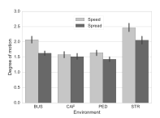

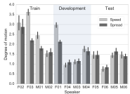

Figure 9: Left: Estimated degree of movement per environment averaged over all utterances. Speed is measured in cm/sec; the spread measure has been scaled for presentation purposes. Right: Degree of motion within each speaker/environment session. Error bars indicate two standard errors.

real test data. This aspect of the challenge is outside the scope of this paper but is discussed in detail in Vincent et al. (submitted).

#### 4.1. Target enhancement

In the previous two-channel CHiME challenges (Barker et al., 2013; Vincent et al., 2013a) target enhancement has been achieved using mixed strategies exploiting both spatial and spectral diversity. However, the CHiME-3 scenario, with 5-forward facing microphones, a relatively fixed speaker location and wide, open environments lends itself strongly to multichannel beamforming approaches. All teams have paid close attention to the front-end signal processing.

Some teams have kept the MVDR framework but made substantial enhancements over the implementation provided in the baseline. For example, Yoshioka et al. (2015) apply a time-frequency mask when estimating the steering vector. Heymann et al. (2015) employ a DNN to perform the necessary speech and noise covariance estimates. Other teams have employed a conventional delay and sum beamformer (e.g., Sivasankaran et al., 2015; Hori et al., 2015; Prudnikov et al., 2015). Of these, several reported that the freely available BeamformIt tool developed by Anguera et al. (2007) worked very effectively. A major consideration is the robustness of the beamforming to channel errors. The baseline system used a simple energy level-based metric to exclude bad channels, which is not robust to the intermittent drop that affects several of the recording sessions.

Beamformers have been combined with post-filtering stages. For example, Barfuss et al. (2015) and Zhao et al. (2015) employ a spatial coherence post filter; El-Desoky Mousa et al. (2015) and Yoshioka et al. (2015) employ postfiltering to reduce the effect of reverberation. Yoshioka et al. (2015) report that dereverberation is particularly effective in the BUS environment, the only test set recordings that took place in small, enclosed spaces.

Purely single-channel enhancement strategies – decoupled from the beamforming – have been employed by few teams and have not shown consistent performance improvements. Vu et al. (2015) and Baby et al. (2015) employ non-negative matrix factorisation approaches that exploit spectral diversity of speech and noise. Bagchi et al. (2015) employ a DNN-based denoising autoencoder and El-Desoky Mousa et al. (2015) perform feature denoising using a bidirectional Long Short-Term Memory (BLSTM). Yoshioka et al. (2015) compare applying spectral masks directly to the recogniser input features and using them to better estimate the steering vector of the MVDR beamformer and find the latter gives far better performance. They argue that as MVDR is a linear filter, it is less prone to producing artefacts than spectral masking.

## *4.2. Feature design*

The baseline DNN system was trained using consecutive frames of filterbank energies compressed using LDA. 16 of the 26 submitted systems, and all the best performing ones, have used different features.

A few teams have attempted to achieve better noise robustness by using auditory-like representations to augment or replace the reference Mel-filterbank. Examples include, Ma et al. (2015) and Du et al. (2015) that use a Gammatone filterbank that has broader filter tails and has been shown to perform well in previous robust ASR evaluations. Four systems used amplitude modulationbased features either by applying a discrete cosine transform (DCT) on the filterbank envelopes (Castro Martinez and Meyer, 2015); employing a 2D Gabor filter bank (Moritz et al., 2015); or tracking amplitude modulation (AM) in filterbands using a non-linear Teager energy operator (Hori et al., 2015).

In Fujita et al. (2015) and Zhao et al. (2015), DNN filterbank features have been supplemented by delta and delta-delta features. Zhao et al. (2015) show that this provides a significant improvement over using the 11 frames of filterbank features alone. It is not clear whether this is because the delta and delta-delta effectively extend the context (i.e., being computed from features outside the 11 frame window), or because they present the DNN with a useful representation directly that it would otherwise have to learn. It is possible that longer context windows are generally useful in speech-in-noise scenarios as the additional context provides opportunities to better factor out the effect of noise.

In place of filterbank features, Tran et al. (unpublished) claim better performance using MFCC-based features, and Zhuang et al. (2015) and Sivasankaran et al. (2015) employ perceptual linear prediction (PLP)-based features. Unfortunately, there are no experiments making a direct comparison. More typically, where alternative features have been used they have been combined with filterbank features either at the feature-level, (e.g., Du et al., 2015) or, more commonly, after decoding using lattice combination approaches.

In general, feature design does not emerge as a strong driver of CHiME-3 system performance. For example, Bagchi et al. (2015) report equivocal results when supplementing system input with robust features such as PNCC (Kim and Stern, 2012) and RASTA-PLP (Hermansky and Morgan, 1994), despite these same features having proved highly beneficial in the previous artificially mixed CHiME-2 challenge.

The DNN back-end is able to afford good performance with a wide variety of features, however, it appears that explicit techniques are required to deal with speaker and environment variability. The simplest approach has been to apply utterance-based feature mean and variance normalization (Zhao et al., 2015; Fujita et al., 2015; Du et al., 2015; Wang et al., 2015). However, the two most effective techniques are transforming the DNN features using feature-space maximum likelihood linear regression (fMLLR) (Hori et al., 2015; Moritz et al., 2015; Vu et al., 2015; Sivasankaran et al., 2015; Tran et al., unpublished) or augmentation of the DNN features using either i-vectors, (e.g., Moritz et al., 2015; Zhuang et al., 2015), pitch-based features (Ma et al., 2015; Wang et al., 2015; Du et al., 2015) or bottleneck features (Tachioka et al., 2015), i.e., extracted from bottleneck layers in speaker classification DNNs. Where i-vectors have been used they may be either per-speaker (e.g., Prudnikov et al., 2015) or per-speaker-environment, (e.g. Ma et al., 2015). Many teams have used both fMLLR and i-vectors/bottleneck features (Zhuang et al., 2015; Pang and Zhu, 2015; Prudnikov et al., 2015; Tachioka et al., 2015). It should be noted that all these techniques will also be normalizing environment variation to some extent. The importance of normalisation is clearly illustrated by the pattern of ticks in the 'Feature Transform' column of Table 5. Note, although the top scoring system (Yoshioka et al., 2015) appears exceptional in not applying an explicit feature normalisation, it uses several neural networks and a cross-adaptation strategy that achieves similar ends.

## *4.3. Statistical modelling*

Nearly all top-performing systems have made significant changes to the baseline system ASR backend, either replacing the baseline language model or experimenting with different deep learning architectures for the acoustic model.

Alternatives to the baseline DNN have included convolutional neural networkss (CNNs), (e.g., Yoshioka et al., 2015; Wang et al., 2015; Zhuang et al., 2015; Ma et al., 2015; Baby et al., 2015) and forms of Long Short Time Memory (LSTM) networks, (e.g., Du et al., 2015; Wang et al., 2015; Zhuang et al., 2015; Baby et al., 2015; Misbullah and Chien, unpublished; Pang and Zhu, 2015). Misbullah and Chien (unpublished) uniquely employ deep networks built from alternating LSTM and feedfoward layers. The best performing system, Yoshioka et al. (2015), employ a convolutional network scheme known as 'network in network' (NIN) adopted from the vision community (Lin et al., 2014). NIN alternates convolutional layers with fully-connected feed forward layers allowing gradual integration of local information. Yoshioka et al. (2015) demonstrated that this approach produced 10% and 4% relative gains compared to the best DNN and CNN, respectively. Several teams have combined multiple architectures (Yoshioka et al., 2015; Du et al., 2015; Zhuang et al., 2015). Performance benefits of the various architectures remain unclear, however it is notable that some of the best scoring systems including Hori et al. (2015), Sivasankaran et al. (2015) and Moritz et al. (2015), have used the baseline DNN configuration.

Participants have generally experimented with a range of enhancement, feature extraction and statistical modelling techniques. Many teams have then successfully combined systems at the hypothesis level by rescoring lattices or N-best lists to leverage the complementarity of a diverse set of approaches. For example, the 2nd placed system, uses minimum Bayes risk decoding to rescore an N-best list merged from four diverse approaches, reducing WER from 10.9% (the best single approach) to 9.1%. System combination is particularly useful given the heterogeneous set of recording environments, i.e., it is unlikely that a single multi-channel processing approach, (e.g., MVDR; delay and sum), is optimal across all recording sessions.

Nearly all top scoring teams have paid close attention to language modelling. Consistent gains have been made by rescoring hypotheses using either a DNN-LM (Vu et al., 2015), LSTM-LM (El-Desoky Mousa et al., 2015) or, most commonly, a conventional recurrent neural network language model (RNN-LM; Mikolov et al., 2010) (Tachioka et al., 2015; Yoshioka et al., 2015; Sivasankaran et al., 2015; Pfeifenberger et al., 2015). A few teams using RNN-LM rescoring have also increased the context of the baseline 3-gram model, replacing it with a 4-gram (Jalalvand et al., 2015; Pang and Zhu, 2015) or 5-gram (Hori et al., 2015). Some teams have trained the recurrent neural network language model (RNN-LM) on carefully selected subsets of the complete WSJ training data, (e.g., Yoshioka et al., 2015). Jalalvand et al. (2015) select training material fitted to the transcripts produced by the first pass 3-gram decoding.

## 5. Characterising system performance

The performance of all 26 submitted CHiME-3 systems is presented in Table 5. All systems improved on the performance of the baseline system with most systems more than halving the WER. The top scoring system (Yoshioka et al., 2015) achieved a WER of 5.8%, significantly better than the 9.1% scored by 2nd placed system (Hori et al., 2015).

The table clearly illustrates that no single technique is sufficient for success. Generally, there are more ticks at the top of the table, i.e. each improved component has led to some incremental performance boost. Likewise, systems that have focused on one or two components have performed poorly. The most consistent gains appear to arise from optimizing the multichannel enhancement. However, the top systems are distinct in that they have also added feature normalization to the DNN stage and employed some form of language model rescoring. ROVER-style system combination is used by the 2nd, 3rd and 4th placed teams, but does not seem necessary for top performance: system combination through good engineering is perhaps preferable. The overall best system Yoshioka et al. (2015) has combined classifiers using a sophisticated cross-adaptation approach.

For all systems, performance was considerably poorer on the final test set than on the development data, with test set WERs typically being double those of the development set. This is likely to be due to genuine differences in the

Table 2: Overview of the 26 systems submitted to the CHiME-3 Challenge ranked according to WER achieved on the test set. The table summarizes the key features of each system as discussed under the headings target enhancement, feature design and statistical modelling in Sections 4.1, 4.2 and 4.3 respectively. Ticks indicate where the system components differ significantly from the baseline DNN system that was provided. System performances are shown for both the development and test set.

| System                 | Enh. Ch. Mult. | Enh. Ch. Sing. | Extract. Feature | Trans. Feature | Model Acoust. | Model Lang. | mb. Co m Syste | Dev  | Test |
|------------------------|----------------------|----------------------|---------------------|-------------------|------------------|----------------|-------------------------|------|------|
| Yoshioka et al.        | ✦                    |                      | ✦                   |                   | ✦                | ✦              |                         | 3.5  | 5.8  |
| Hori et al.            | ✦                    | ✦                    | ✦                   | ✦                 |                  | ✦              | ✦                       | 4.6  | 9.1  |
| Du et al.              | ✦                    |                      | ✦                   | ✦                 | ✦                |                | ✦                       | 6.7  | 10.6 |
| Sivasankaran et al.    | ✦                    |                      | ✦                   | ✦                 |                  | ✦              |                         | 5.6  | 11.3 |
| Moritz et al.          |                      |                      | ✦                   | ✦                 |                  | ✦              |                         | 7.8  | 11.7 |
| Fujita et al.          | ✦                    | ✦                    | ✦                   | ✦                 |                  |                | ✦                       | 7.0  | 11.8 |
| Zhao et al.            | ✦                    |                      | ✦                   | ✦                 |                  |                |                         | 7.4  | 11.9 |
| Vu et al.              | ✦                    | ✦                    |                     | ✦                 |                  | ✦              |                         | 8.1  | 11.9 |
| Tran et al.            | ✦                    |                      | ✦                   | ✦                 |                  | ✦              |                         | 6.5  | 12.1 |
| Heymann et al.         | ✦                    |                      |                     |                   |                  | ✦              |                         | 7.4  | 12.3 |
| Wang et al.            | ✦                    |                      | ✦                   | ✦                 | ✦                | ✦              | ✦                       | 7.3  | 13.2 |
| Jalalvand et al.       | ✦                    |                      |                     |                   |                  | ✦              | ✦                       | 7.3  | 13.5 |
| Zhuang et al.          |                      |                      | ✦                   | ✦                 | ✦                |                | ✦                       | 7.2  | 13.8 |
| Tachioka et al.        | ✦                    |                      | ✦                   | ✦                 |                  | ✦              | ✦                       | 6.7  | 14.2 |
| Pang and Zhu           | ✦                    |                      | ✦                   | ✦                 | ✦                | ✦              | ✦                       | 7.1  | 14.3 |
| Prudnikov et al.       | ✦                    |                      | ✦                   | ✦                 |                  |                |                         | 7.3  | 14.3 |
| Bagchi et al.          | ✦                    | ✦                    |                     |                   |                  |                |                         | 9.0  | 16.3 |
| Ma et al.              | ✦                    |                      | ✦                   |                   | ✦                |                |                         | 5.5  | 18.6 |
| Pertila et al.         | ✦                    |                      |                     |                   |                  |                |                         | 10.5 | 21.1 |
| Castro Martinez et al. |                      |                      | ✦                   |                   |                  |                |                         | 13.2 | 22.0 |
| Pfeifenberger et al.   | ✦                    |                      | ✦                   |                   |                  | ✦              |                         | 14.4 | 22.1 |
| Baby et al.            |                      | ✦                    |                     |                   | ✦                |                |                         | 12.9 | 23.1 |
| Mousa et al.           |                      | ✦                    |                     |                   |                  | ✦              |                         | 13.7 | 24.4 |
| Barfuss et al.         | ✦                    |                      |                     |                   |                  |                |                         | -    | 28.7 |
| Misbullah et al.       |                      |                      |                     |                   | ✦                |                |                         | 16.3 | 29.3 |
| DNN Baseline           |                      |                      |                     |                   |                  |                |                         | 17.7 | 33.4 |

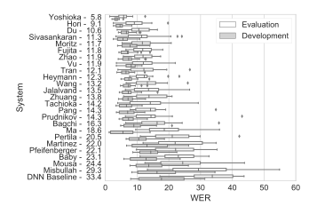

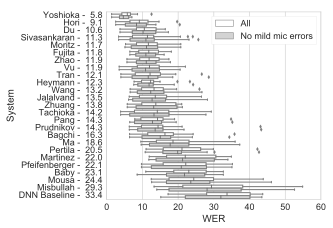

Figure 10: Performance of the 26 submitted systems ordered by overall WER on the final test set. The box plot illustrates the spread of WER over the 16 speaker/environment sessions. The top panel shows the effect of filtering out utterances that were affected by channel failures. The lower panel compares system performance on the development data and the final test set.

difficulty of the final test set data arising from differences in the speaker characteristics discussed in Section 3.3 – in particular the fast speaking rate of speaker F05 and the lower average SNRs. Some part of the difference is likely to be due to the increased frequency of channel errors.

Most systems show a large spread of performance across recording sessions (Figure 10). In particular, Hori et al. (2015), Sivasankaran et al. (2015), Tran et al. (unpublished) and Heymann et al. (2015), have overall WERs in the 9- 12% range, but have WERs of 20-30% on at least one session. It is possible that these bad session scores are due to a lack of robustness to the microphone errors, given that channel errors have themselves been shown to be concentrated within sessions. To test this, the systems were rescored on the subset of signals that showed no evidence of recording failure (Figure 10, lower panel). Filtering out these signals improves the WERs for nearly all systems, but does not consistently explain the outlying sessions. Note, however, that for the best system (Yoshioka et al., 2015), a large proportion of the errors appear concentrated in a single outlying session scoring around 12% WER, which does indeed appear to be due to channel errors. After poor signals are removed, the system performs consistently across all sessions and overall WER falls from from 5.8% to 4.7%.

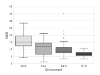

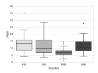

Figure 11: The spread of system performances for each recording environment (left) and for each test set speaker (right).

Figure 11 shows box plots of the spread of performance of the best 15 systems averaged over each environment (left) and each test set speaker (right). The average WERs achieved in CAF and PED are similar but with a greater spread in system performance for CAF; WERs on BUS are generally higher and those in STR are consistently lower with most systems operating in a narrow range of 6–8% WER. The difficulty of the BUS environment is hard to account for and cannot be simply explained by SNR, speaker motion or recording failures. One possible explanation is the reverberation caused by recording in a confined space with nearby hard reflective surfaces. The ease of the STR environment is also surprising given that it was characterised by a high degree of speaker movement and had the least stationary background noise. Although it is notable that for two of the four test set speakers, the estimated STR SNRs are around 3 dB higher than the SNRs of the other environments, the performance in the STR

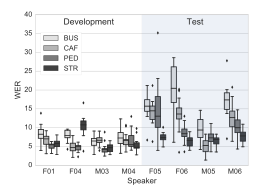

Figure 12: The spread of WERs across the 15 best systems for each development and test set session.

environment appears to be consistently high across all talkers (see Figure 12).

In order to better understand the factors influencing system performance, correlations were computed between signal characteristics and WERs measured on a per utterance basis across the complete 1640 utterance development and 1320 utterance test sets. The utterance WERs were either taken from the best system, the average over the top 15 systems or the average over all systems. The signal characteristics were taken from the analysis presented in Section 3 and included channel quality, speaker motion, SNR, intelligibility and speech rate. Results are presented in Table 3. For the motion, SNR and intelligibility measures, utterances that had channels marked as mild failure were filtered out before correlations were computed.

Given the complexity of the speech recognition task, no one single signal characteristic can be expected to strongly predict average WER, so correlations are not high. However, with the large number of utterances analysed even small correlations can be significant. The bold values in the table indicate where there is evidence of correlation at the 95% confidence interval. The pattern is complicated with different factors appearing in the development and test data and differences between the best system and the 15-best. Lack of correlation in the development data for the best system is likely to be a 'ceiling effect,' i.e. the system was achieving 0% WER for a large proportion of the utterances regardless of small variations in the signal measures. Likewise there are stronger correlations in the test set where there is a bigger spread across WER.

Looking at the individual characteristics: All systems are sensitive to the effects of noise, and when looking at the average across systems it appears that the intelligibility models STOI and MI are better predictors of performance than SNR, with STOI consistently producing the strongest correlations. The speaker

Table 3: Correlations between signal properties and utterance WERs for WERs reported by the best system, averaged over the top 15 systems or averaged over all systems.

|          |         | Best system |       | 15 best systems |       | All systems |       |
|----------|---------|-------------|-------|-----------------|-------|-------------|-------|
| Property |         | Dev         | Test  | Dev             | Test  | Dev         | Test  |
| Channel  | Quality | -0.12       | -0.14 | -0.22           | -0.04 | -0.25       | -0.04 |
| Motion   | Speed   | +0.01       | +0.12 | +0.02           | +0.03 | +0.04       | +0.01 |
|          | Spread  | -0.02       | +0.07 | -0.01           | +0.01 | +0.01       | -0.01 |
| Noise    | SNR     | -0.04       | -0.12 | -0.16           | -0.19 | -0.21       | -0.23 |
|          | SNR(A)  | -0.03       | -0.06 | -0.16           | -0.19 | -0.23       | -0.24 |
|          | STOI    | -0.05       | -0.12 | -0.17           | -0.25 | -0.23       | -0.30 |
|          | MI      | -0.04       | -0.10 | -0.15           | -0.21 | -0.21       | -0.26 |
| Speech   | Rate    | +0.04       | -0.02 | +0.06           | +0.05 | +0.03       | +0.06 |
|          | # words | +0.02       | -0.14 | -0.02           | -0.16 | -0.03       | -0.16 |

motion characteristics, by contrast, are not strongly correlated with performance when averaging across systems, but there is some evidence of a weak effect on the best system. Speech rate has no consistent effect on performance. However, it does appear that for the test set, errors are more concentrated in the utterances with more words. This is perhaps an effect of language modelling whereby errors early in an utterance can derail the decoding leading to further errors. Surprisingly, this effect is not seen in the development set. Channel quality has been quantified as the average of the correlation scores described in Section 3.2.2. Increases in channel quality predict decreases in WER for the best system and when averaging WER across systems for the development set. However, channel quality does not seem to have been a driver of performance in the final test set for typical systems.

## 6. Conclusions

CHiME-3 has been the first speech recognition evaluation to target a multimicrophone mobile application using speech recorded in real environments. Live recording has allowed the full complexity of acoustic mixing and active talking effects to be captured. However, it has meant that the evaluation task cannot be controlled in the same manner as for a simulated task. Instead, this paper has tried to draw conclusions by performing a post-hoc analysis of the recorded data, and then correlating independent signal characteristics with the performance of the submitted systems. In this way axes of difficulty can be determined.

Analysis of the data has shown there to be a lot of variability across environments, not just in terms of the background noise but also in terms of speaker behaviour in the environment (motion and vocal effort). Good recognition performance in the face of this variability has required complex and carefully crafted solutions. The best system has achieved a final WER of just 5.8%, representing a huge improvement over the baseline score of 33.4%. This improvement has not been due to any one special technique but rather has been earned by

many small incremental gains at each stage in the processing pipeline. Steps that have been essential include: re-engineering the microphone array processing with care taken to introduce better robustness to channel failure; introducing techniques for normalising against speaker and environment variability, either by introducing a normalising transform such as FMLLR, by augmenting feature vectors with speaker features (e.g., i-vectors), or both; system combination to take advantage of multiple, complementary front-ends, features and statistical models; rescoring system output with sophisticated neural-network based language models.

For all systems, there is a large spread in performance across speakers, environments, and across individual recording sessions. WERs for the poorest sessions are typically two or three times the average WER. Interestingly, there are some large differences among top systems in the ranking of session difficulty. This is perhaps not surprising given the heterogeneous nature of the data and the significant differences between the architectures of the systems. It suggests that a meta-system combination across top CHiME-3 systems could produce even lower WERs.

An attempt was made to try and ascertain which signal characteristics were the main determinants of recognition performance. With only 16 sessions, and a lot of variability across systems, it was not possible to find significant relations between average session properties, however an utterance-level analysis proved more fruitful. Several properties were considered that could be presumed to behave roughly independently. First, there is a small correlation between WER and estimated channel quality. Note, channel errors only affect a small fraction of the signals and the redundancy of having 6 microphones meant that good systems engineered around the failures. Second, there is a correlation between WER and estimated utterance-level SNR. However, stronger correlations were found when replacing SNR with intelligibility models such as STOI that appropriately scale frequency and amplitude when considering effects of noise on speech. Third, somewhat surprisingly, there was no strong evidence that speaker motion affected recognition performance. This is possibly because speakers generally remained quite stationary within an utterance and the variation in degree across environments and speakers was quite low.

Notwithstanding the enormous engineering effort required, the very low WERs achieved by the best system suggest that the specific CHiME-3 scenario – six-channel tablets with a small vocabulary, read speech target – is essentially a 'solved task'. New evaluations are now needed to further advance the state-of-the-art. Keeping with the mobile ASR scenario, there is little scope for decreasing the SNR or increasing the microphone distance (higher background noise levels or longer distances to the tablet would not be realistic), instead, future challenges in this domain could proceed along other dimensions. There are many possible goals: increasing the complexity of the speech material, extending the set of target speakers and providing less opportunity of speaker adaptation, reducing the number of channels to reduce the reliance on standard multichannel processing front-ends. Alternatively, new distant microphone scenarios could be sought that provide both background noise, complex speech and greater microphone distances. The recent developments in home automation (e.g., the Amazon Echo and Google Home devices) provide on obvious direction for future evaluations.

## References

- Anguera, X., Wooters, C., Hernando, J., 2007. Acoustic beamforming for speaker diarization of meetings. Audio, Speech, and Language Processing, IEEE Transactions on 15 (7), 2011–2022.
- Baby, D., Virtanen, T., Van Hamme, H., Sep. 2015. Coupled dictionarybased speech enhancement for CHiME-3 challenge. Tech. Rep. KUL/ESAT/PSI/1503, KU Leuven, ESAT, Leuven, Belgium.
- Bagchi, D., Mandel, M. I., Wang, Z., He, Y., Plummer, A., Fosler-Lussier, E., 2015. Combining spectral feature mapping and multi-channel modelbased source separation for noise-robust automatic speech recognition. In: 2015 IEEE Workshop on Automatic Speech Recognition and Understanding, ASRU 2015, Scottsdale, AZ, USA, December 13-17, 2015. pp. 496–503.
- Barfuss, H., Huemmer, C., Schwarz, A., Kellermann, W., 2015. Robust coherence-based spectral enhancement for distant speech recognition. ArXiv:1509.06882.
- Barker, J., Marxer, R., Vincent, E., Watanabe, S., 2015. The third 'CHiME' speech separation and recognition challenge: Dataset, task and baselines. In: 2015 IEEE Workshop on Automatic Speech Recognition and Understanding, ASRU 2015, Scottsdale, AZ, USA, December 13-17, 2015. pp. 504–511.
- Barker, J., Vincent, E., Ma, N., Christensen, H., Green, P., May 2013. The PAS-CAL CHiME speech separation and recognition challenge. Computer Speech and Language 27 (3), 621–633.
- Castro Martinez, A., Meyer, B., 2015. Mutual benefits of auditory spectrotemporal Gabor features and deep learning for the 3rd CHiME challenge. Tech. Rep. Techncial Report 2509, University of Oldenburg, Germany, url:http://oops.uni-oldenburg.de/2509.
- DiBiase, J. H., Silverman, H. F., Brandstein, M. S., 2001. Robust localization in reverberent rooms. In: Microphone Arrays: Techniques and Applications. Spring-Verlag, pp. 157–180.
- Du, J., Wang, Q., Tu, Y.-H., Bao, X., Dai, L.-R., Lee, C.-H., 2015. An information fusion approach to recognizing microphone array speech in the CHiME-3 challenge based on a deep learning framework. In: 2015 IEEE Workshop on Automatic Speech Recognition and Understanding, ASRU 2015, Scottsdale, AZ, USA, December 13-17, 2015. pp. 430–435.

- El-Desoky Mousa, A., Marchi, E., Schuller, B., 2015. The ICSTM+TUM+UP approach to the 3rd CHiME challenge: Single-channel LSTM speech enhancement with multi-channel correlation shaping dereverberation and LSTM language models. ArXiv:1510.00268.
- Fletcher, H., Manson, W. A., May 1933. Loudness, its definition, measurement and calculation. Journal of the Acoustical Society of America 82 (5), 82–108.
- Frigge, M., Hoaglin, D. C., Iglewicz, B., 1989. Some implementations of the boxplot. The American Statistician 43 (1), 50–54.
- Fujita, Y., Takashima, R., Homma, T., Ikeshita, R., Kawaguchi, Y., Sumiyoshi, T., Endo, T., Togami, M., 2015. Unified ASR system using LGM-based source separation, noise-robust feature extraction, and word hypothesis selection. In: 2015 IEEE Workshop on Automatic Speech Recognition and Understanding, ASRU 2015, Scottsdale, AZ, USA, December 13-17, 2015. pp. 416–422.
- Garofalo, J., Graff, D., Paul, D., Pallett, D., 2007. CSR-I (WSJ0) Complete, Linguistic Data Consortium, Philadelphia.
- Hasegawa-Johnson, M., Fleck, M., 2007. The Internatoinal Speech LEXicon. http://www.isle.illinois.edu/sst/data/g2ps, accessed April 2016.
- Hermansky, H., Morgan, N., 1994. RASTA processing of speech. Speech and Audio Processing, IEEE Transactions on 2 (4), 578–589.
- Heymann, J., Drude, L., Chinaev, A., Haeb-Umbach, R., 2015. BLSTM supported GEV beamformer front-end for the 3rd CHiME challenge. In: 2015 IEEE Workshop on Automatic Speech Recognition and Understanding, ASRU 2015, Scottsdale, AZ, USA, December 13-17, 2015. pp. 444–451.
- Hirsch, H.-G., Pearce, D., 2000. The Aurora experimental framework for the performance evaluation of speech recognition systems under noisy conditions. In: Proceedings of the 6th International Conference on Spoken Language Processing (ICSLP). Vol. 4. pp. 29–32.
- Hori, T., Chen, Z., Erdogan, H., Hershey, J. R., Le Roux, J., Mitra, V., Watanabe, S., 2015. The MERL/SRI system for the 3rd CHiME challenge using beamforming, robust feature extraction, and advanced speech recognition. In: 2015 IEEE Workshop on Automatic Speech Recognition and Understanding, ASRU 2015, Scottsdale, AZ, USA, December 13-17, 2015. pp. 475–481.
- Jalalvand, S., Falavigna, D., Matassoni, M., Svaizer, P., Omologo, M., 2015. Boosted acoustic model learning and hypotheses rescoring on the CHiME3 task. In: 2015 IEEE Workshop on Automatic Speech Recognition and Understanding, ASRU 2015, Scottsdale, AZ, USA, December 13-17, 2015. pp. 409–415.

- Kim, C., Stern, R. M., 2012. Power-normalized cepstral coefficients (PNCC) for robust speech recognition. In: Acoustics, Speech and Signal Processing (ICASSP), 2012 IEEE International Conference on. IEEE, pp. 4101–4104.
- Lin, M., Q., C., Yan, S., 2014. Network in network. ArXiv:1312.4400v3.
- Loesch, B., Yang, B., 2010. Adaptive segmentation and separation of determined convolutive mixtures under dynamic conditions. In: Proceedings of the 9th International Conference on Latent Variable Analysis and Signal Separation (LVA/ICA). pp. 41–48.
- Ma, N., Marxer, R., Barker, J., Brown, G. J., 2015. Exploiting synchrony spectra and deep neural networks for noise-robust automatic speech recognition. In: 2015 IEEE Workshop on Automatic Speech Recognition and Understanding, ASRU 2015, Scottsdale, AZ, USA, December 13-17, 2015. pp. 490–495.
- Mestre, X., Lagunas, M. A., 2003. On diagonal loading for minimum variance beamformers. In: Proceedings of the 3rd IEEE International Symposium on Signal Processing and Information Technology (ISSPIT). pp. 459–462.
- Mikolov, T., Karafi´at, M., Burget, L., Cernock`y, J., Khudanpur, S., 2010. Recurrent neural network based language model. In: Proceedings of the 11th Annual Conference of the International Speech Communication Association (INTERSPEECH 2010). Vol. 2. pp. 1045–1048.
- Misbullah, A., Chien, J.-T., unpublished. Deep feedforward and recurrent neural networks for speech recognition, unpublished technical report.
- Moritz, N., Gerlach, S., Adiloglu, K., Anem¨uller, J., Kollmeier, B., Goetze, S., 2015. A CHiME-3 challenge system: Long-term acoustic features for noise robust automatic speech recognition. In: 2015 IEEE Workshop on Automatic Speech Recognition and Understanding, ASRU 2015, Scottsdale, AZ, USA, December 13-17, 2015. pp. 468–474.
- Mostefa, D., Moreau, N., Choukri, K., Potamianos, G., Chu, S. M., Tyagi, A., Casas, J. R., Turmo, J., Cristoforetti, L., Tobia, F., Pnevmatikakis, A., Mylonakis, V., Talantzis, F., Burger, S., Stiefelhagen, R., Bernardin, K., Rochet, C., 2007. The CHIL audiovisual corpus for lecture and meeting analysis inside smart rooms. Language Resources and Evaluation 41 (3-4), 389–407.
- Pang, Z., Zhu, F., 2015. Noise-robust ASR for the third 'CHiME' challenge exploiting time-frequency masking based multi-channel speech enhancement and recurrent neural network. ArXiv:1509.07211.
- Parihar, N., Picone, J., Pearce, D., Hirsch, H. G., 2004. Performance analysis of the Aurora large vocabulary baseline system. In: Proceedings of the 2004 European Signal Processing Conference (EUSIPCO). Vienna, Austria, pp. 553—556.

- Pfeifenberger, L., Schrank, T., Z¨ohrer, M., Hagm¨uller, M., Pernkopf, F., 2015. Multi-channel speech processing architectures for noise robust speech recognition: 3rd CHiME challenge results. In: 2015 IEEE Workshop on Automatic Speech Recognition and Understanding, ASRU 2015, Scottsdale, AZ, USA, December 13-17, 2015. pp. 452–459.
- Povey, D., Ghoshal, A., Boulianne, G., Burget, L., Glembek, O., Goel, N., Hannemann, M., Motlicek, P., Qian, Y., Schwarz, P., Silovsky, J., Stemmer, G., Vesely, K., Dec. 2011. The Kaldi Speech Recognition Toolkit. In: IEEE 2011 Workshop on Automatic Speech Recognition and Understanding. IEEE Signal Processing Society, IEEE Catalog No.: CFP11SRW-USB.
- Prudnikov, A., Korenevsky, M., Aleinik, S., 2015. Adaptive beamforming and adaptive training of DNN acoustic models for enhanced multichannel noisy speech recognition. In: 2015 IEEE Workshop on Automatic Speech Recognition and Understanding, ASRU 2015, Scottsdale, AZ, USA, December 13-17, 2015. pp. 401–408.
- Renals, S., Hain, T., Bourlard, H., 2008. Interpretation of multiparty meetings: The AMI and AMIDA projects. In: Proceedings of the 2nd Joint Workshop on Hands-free Speech Communication and Microphone Arrays (HSCMA). pp. 115–118.
- RWCP, 2001. RWCP meeting speech corpus (RWCP-SP01). URL http://research.nii.ac.jp/src/en/RWCP-SP01.html
- Sivasankaran, S., Nugraha, A. A., Vincent, E., Morales-Cordovilla, J. A., Dalmia, S., Illina, I., 2015. Robust ASR using neural network based speech enhancement and feature simulation. In: 2015 IEEE Workshop on Automatic Speech Recognition and Understanding, ASRU 2015, Scottsdale, AZ, USA, December 13-17, 2015. pp. 482–489.
- Taal, C. H., Hendriks, R. C., Heusdens, R., Jensen, J., 2011. An algorithm for intelligibility prediction of time–frequency weighted noisy speech. Audio, Speech, and Language Processing, IEEE Transactions on 19 (7), 2125–2136.
- Tachioka, Y., Kanagawa, H., Ishii, J., 2015. The overview of the MELCO ASR system for the third CHiME challenge. Tech. Rep. SVAN154551, Mitsubishi Electric.
- Taghia, J., Martin, R., 2014. Objective intelligibility measures based on mutual information for speech subjected to speech enhancement processing. Audio, Speech, and Language Processing, IEEE/ACM Transactions on 22 (1), 6–16.
- Tran, H. D., Dennis, J., Yiren, L., unpublished. A comparative study of multichannel processing methods for noisy automatic speech recognition on the third CHiME challenge.

- Vesel´y, K., Ghoshal, A., Burget, L., Povey, D., 2013. Sequence-discriminative training of deep neural networks. In: Proceedings of the 14th Annual Conference of the International Speech Communication Association (INTER-SPEECH 2013). pp. 2345–2349.
- Vincent, E., Barker, J., Watanabe, S., Le Roux, J., Nesta, F., Matassoni, M., 2013a. The second 'CHiME' speech separation and recognition challenge: an overview of challenge systems and outcomes. In: Proceedings of the 2013 IEEE Workshop on Automatic Speech Recognition and Understanding (ASRU). pp. 162–167.
- Vincent, E., Barker, J., Watanabe, S., Le Roux, J., Nesta, F., Matassoni, M., 2013b. The second CHiME speech separation and recognition challenge: Datasets, tasks and baselines. In: Acoustics, Speech and Signal Processing (ICASSP), 2013 IEEE International Conference on. IEEE, pp. 126–130.
- Vincent, E., Watanabe, S., Nugraha, A., Barker, J., Marxer, R., submitted. An analysis of environment, microphone and data simulation mismatches in robust speech recognition. Computer Speech and Language.
- Vu, T. T., Bigot, B., Chng, E. S., 2015. Speech enhancement using beamforming and non negative matrix factorization for robust speech recognition in the CHiME-3 challenge. In: 2015 IEEE Workshop on Automatic Speech Recognition and Understanding, ASRU 2015, Scottsdale, AZ, USA, December 13-17, 2015. pp. 423–429.
- Wang, X., Wu, C., Zhang, P., Wang, Z., Liu, Y., Li, X., Fu, Q., Yan, Y., 2015. Noise robust IOA/CAS speech separation and recognition system for the third 'CHIME' challenge. ArXiv:1509.06103.
- Yoshioka, T., Ito, N., Delcroix, M., Ogawa, A., Kinoshita, K., Fujimoto, M., Yu, C., Fabian, W. J., Espi, M., Higuchi, T., Araki, S., Nakatani, T., 2015. The NTT CHiME-3 system: Advances in speech enhancement and recognition for mobile multi-microphone devices. In: 2015 IEEE Workshop on Automatic Speech Recognition and Understanding, ASRU 2015, Scottsdale, AZ, USA, December 13-17, 2015. pp. 436–443.
- Zhao, S., Xiao, X., Zhang, Z., Nguyen, T. N. T., Zhong, X., Ren, B., Wang, L., Jones, D. L., Chng, E. S., Li, H., 2015. Robust speech recognition using beamforming with adaptive microphone gains and multichannel noise reduction. In: 2015 IEEE Workshop on Automatic Speech Recognition and Understanding, ASRU 2015, Scottsdale, AZ, USA, December 13-17, 2015. pp. 460–467.
- Zhuang, Y., You, Y., Tan, T., Bi, M., Bu, S., Deng, W., Qian, Y., Yin, M., Yu, K., 2015. System combination for multi-channel noise robust ASR. Tech. Rep. SJTU SpeechLab Technical Report, SP2015-07, Department of Computer Science and Engineering, Shanghai Jiao Tong University, Shanghai, China.