**Source:** *ReDimNet2+: Multi-Corpus Data Scaling for Robust Speaker Verification* — [PDF](https://arxiv.org/pdf/2609.37014) · [arXiv](https://arxiv.org/abs/2609.37014)

# REDIMNET2+: MULTI-CORPUS DATA SCALING FOR ROBUST SPEAKER VERIFICATION

Kirill Borodin  Vasilii Kudryavtsev  Maxim Maslov  Grach Mkrtchian 

###### Abstract

Automatic speaker verification must remain reliable across devices, rooms, and compression pipelines. We present ReDimNet2+, which scales training of the compact ReDimNet2 backbone across seven public corpora (63,934 speakers, about 8,675 hours). Analysis of a VoxBlink2 subset reveals a shift in predicted spectral coloration, motivating codec and waveform augmentation alongside this multi-corpus training, large-margin fine-tuning (LMFT), and graph-based retrieval reranking. With random 4-second evaluation windows for all models, ReDimNet2+ LMFT reduces pooled VoxCeleb1 EER from 2.42% to 0.82% and a 26-condition robustness stress-test EER from 7.21% to 1.99%. Under this shared local protocol, it reaches 0.35% EER on VoxCeleb1-O versus 0.787% for the best evaluated WeSpeaker checkpoint. On a VoxBlink2 retrieval subset, reranking improves the final model’s Pr@\(k\) from 0.7413 to 0.7687.

###### Index Terms: 

Speaker verification, domain shift, codec augmentation, large-margin fine-tuning, graph reranking 

††address: 1lab260, Yerevan, Armenia 2BitmanagerAI, Dubai, UAE 3MTUCI, Moscow, Russia   
kborodin.research@gmail.com

## 1 Introduction

Automatic speaker verification (ASV) maps a speech segment to a representation that should retain speaker identity while discarding nuisance factors such as microphone response, room acoustics, noise, compression, language, and duration. Modern systems reach low error rates on clean benchmarks such as VoxCeleb1 [[16](https://arxiv.org/html/2609.37014#biba.bib13), [3](https://arxiv.org/html/2609.37014#biba.bib20)], yet degrade under unseen channels, aggressive compression, short fragments, or retrieval-style open-set evaluation. Large public corpora such as VoxBlink2 [[13](https://arxiv.org/html/2609.37014#biba.bib11)], 3D-Speaker [[30](https://arxiv.org/html/2609.37014#biba.bib17)], CN-Celeb [[6](https://arxiv.org/html/2609.37014#biba.bib12), [10](https://arxiv.org/html/2609.37014#biba.bib16)], TidyVoice [[7](https://arxiv.org/html/2609.37014#biba.bib14)], and KeSpeech [[22](https://arxiv.org/html/2609.37014#biba.bib15)] add speaker and condition diversity, but data alone does not guarantee robustness if the target degradation mechanisms are absent from training.

Robustness has been pursued through noise, reverberation, and metric learning [[20](https://arxiv.org/html/2609.37014#biba.bib3), [14](https://arxiv.org/html/2609.37014#biba.bib6), [19](https://arxiv.org/html/2609.37014#biba.bib26), [9](https://arxiv.org/html/2609.37014#biba.bib25)], feature-level regularization [[17](https://arxiv.org/html/2609.37014#biba.bib19), [29](https://arxiv.org/html/2609.37014#biba.bib18)], margin objectives [[8](https://arxiv.org/html/2609.37014#biba.bib7), [12](https://arxiv.org/html/2609.37014#biba.bib27)], and large self-supervised encoders [[2](https://arxiv.org/html/2609.37014#biba.bib21), [1](https://arxiv.org/html/2609.37014#biba.bib2), [11](https://arxiv.org/html/2609.37014#biba.bib8)] whose cost often requires distillation. Open-set identification additionally depends on nearest-neighbor ranking, which reciprocal-neighbor reranking [[31](https://arxiv.org/html/2609.37014#biba.bib22)] and hubness correction [[21](https://arxiv.org/html/2609.37014#biba.bib23)] address in other domains.

This paper studies robust ASV around ReDimNet2, a compact backbone based on time-pooled dimension reshaping that is competitive with much larger self-supervised front ends [[28](https://arxiv.org/html/2609.37014#biba.bib1)]. Its public checkpoint, however, is not adapted to the channel and codec mismatch observed in our target setting. We keep the backbone architecture fixed and ask how far robustness can be improved through data, augmentation, optimization schedule, and scoring alone.11 1 Code: <https://github.com/lab260ru/redimnet2-plus>. Pretrained weights: <https://huggingface.co/lab260/redimnet2-plus>. Our contributions are:

  * a data-driven analysis of a VoxBlink2 subset identifying a shift in predicted coloration that motivates channel and codec augmentation (Sec. [2](https://arxiv.org/html/2609.37014#S2 "2 Data and Domain Mismatch ‣ REDIMNET2+: MULTI-CORPUS DATA SCALING FOR ROBUST SPEAKER VERIFICATION")); 
  * an efficient pipeline with random-window decoding, explicit codec simulation, waveform and feature augmentation, and a staged multi-corpus recipe with large-margin fine-tuning (LMFT) that reduces pooled VoxCeleb1 EER from 2.42% to 0.824%; 
  * a lightweight graph-based reranking stage for open-set retrieval exploiting local neighborhood consistency and hubness penalties; 
  * a reproducible local comparison against open WeSpeaker checkpoints on VoxCeleb1-O/E/H, using a shared 4-second evaluation window and distinguishing locally reproduced results from published full-utterance ReDimNet2 results. 

## 2 Data and Domain Mismatch

Training corpora. The final training pool combines seven corpora with 63,934 speakers, about 4.6M utterances, and about 8,675 hours in total: VoxBlink2 [[13](https://arxiv.org/html/2609.37014#biba.bib11)] and VoxCeleb2 [[3](https://arxiv.org/html/2609.37014#biba.bib20)] provide large in-the-wild YouTube speech; 3D-Speaker [[30](https://arxiv.org/html/2609.37014#biba.bib17)] adds device, distance, and dialect variation; CN-Celeb and CN-Celeb2 [[6](https://arxiv.org/html/2609.37014#biba.bib12), [10](https://arxiv.org/html/2609.37014#biba.bib16)] add multi-genre Chinese web speech; TidyVoice [[7](https://arxiv.org/html/2609.37014#biba.bib14)] contributes read speech in 62 languages derived from Common Voice; and KeSpeech [[22](https://arxiv.org/html/2609.37014#biba.bib15)] contributes Mandarin and subdialect read speech. Checkpoints are selected on the VoxCeleb1 development set. VoxCeleb1 is used for verification and retrieval evaluation. Per-corpus statistics are given in appendix Table [5](https://arxiv.org/html/2609.37014#S10.T5 "Table 5 ‣ 10.1 Training Corpora ‣ 10 Data ‣ REDIMNET2+: MULTI-CORPUS DATA SCALING FOR ROBUST SPEAKER VERIFICATION").

VoxBlink2 subset analysis. The exploratory analysis used a VoxBlink2 subset: 673,277 training FLAC files from 11,053 speakers (\(\approx\)1,458 h) and an evaluation subset of 134,697 files (\(\approx\)345 h) used for our speaker-retrieval evaluation (Pr@\(k\)), all 16 kHz mono. Speaker counts are strongly imbalanced (69 speakers with one recording, 4,870 with 76–100). Training utterances are shorter: 22.7% are below 3 s, whereas the evaluation subset contains more 5–20 s clips (appendix Table [6](https://arxiv.org/html/2609.37014#S10.T6 "Table 6 ‣ 10.3 Duration Mismatch ‣ 10 Data ‣ REDIMNET2+: MULTI-CORPUS DATA SCALING FOR ROBUST SPEAKER VERIFICATION")). Early stages therefore use 2–3 s random crops, and LMFT uses 6 s windows.

Coloration and byte-rate shift. Median FLAC byte rate drops from 21,040 bytes/s in train to 14,021 bytes/s in the evaluation subset, and the fifth percentile from 16,283 to 8,989 bytes/s. We treat byte rate as a heuristic indicator of signal compressibility, not a direct bandwidth measurement: it also depends on encoding settings, silence, and acoustic content. NISQA coloration (COL) predictions [[15](https://arxiv.org/html/2609.37014#biba.bib9)] provide complementary evidence: 6.2% of training files have COL below 2.0, versus 41.4% of evaluation files. Detailed statistics appear in appendix Table [7](https://arxiv.org/html/2609.37014#S10.T7 "Table 7 ‣ 10.4 Coloration and Byte-Rate Shift ‣ 10 Data ‣ REDIMNET2+: MULTI-CORPUS DATA SCALING FOR ROBUST SPEAKER VERIFICATION"). For 884 speakers with at least five recordings, the median within-speaker standard deviation of bytes/s is 1,753; 41% exceed 2,000 bytes/s. These observations are consistent with heterogeneous recording conditions, although byte-rate variation alone does not establish channel distortion. The analysis motivates testing codec simulation and filtering alongside noise and reverberation augmentation.

## 3 ReDimNet2+

### 3.1 Training pipeline and augmentation

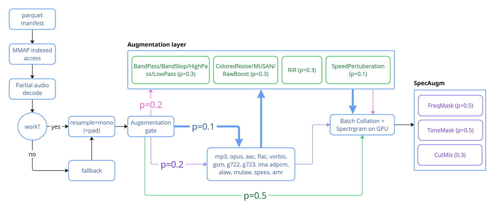

 Figure 1: Training-time data pipeline. Audio is indexed through Parquet metadata, decoded as a random window, augmented at waveform and codec level, batched as waveforms, and converted to spectrogram features on the GPU.

 (a) clean

 (b) AAC 16 kHz

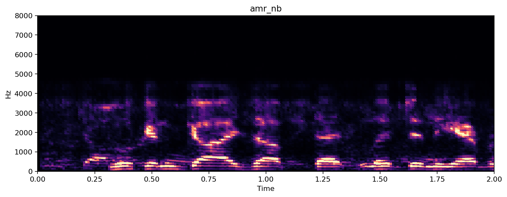

 (c) AMR-NB

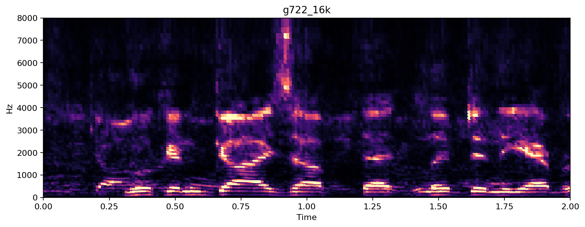

 (d) G.722

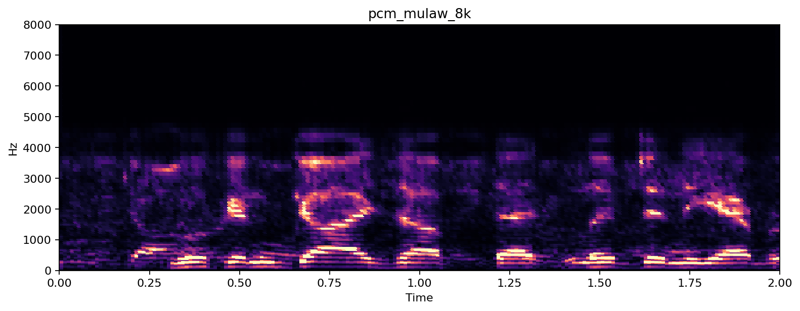

 (e) \(\mu\)-law 8 kHz

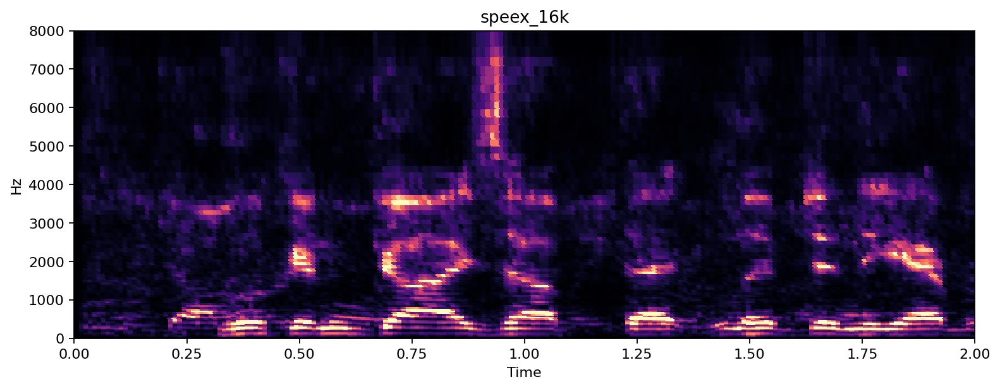

 (f) Speex 16 kHz

Figure 2: Examples of codec transformations used to model spectral coloration and bandwidth limitation: the same utterance after different codec presets.

Fig. [1](https://arxiv.org/html/2609.37014#S3.F1 "Figure 1 ‣ 3.1 Training pipeline and augmentation ‣ 3 ReDimNet2+ ‣ REDIMNET2+: MULTI-CORPUS DATA SCALING FOR ROBUST SPEAKER VERIFICATION") shows the pipeline. Training reads a Parquet manifest and decodes only a random fixed-length window of each file, which is 2.6\(\times\) faster than full decoding followed by cropping; on a decode failure the loader falls back to a neighboring example so that isolated corrupt files do not interrupt multi-day runs on crawled corpora. All audio is mono 16 kHz, and short segments are repeat-padded, which preserves speech content and avoids artificial silence tails at the long LMFT window. Speed perturbation is restricted to ten fixed resampling factors in \([0.9,1.1]\) for kernel reuse, codec augmentation calls FFmpeg directly rather than through a Python wrapper, and spectrogram computation is moved from the CPU collator to the GPU training step, which improved throughput by 1.53\(\times\) with four loader workers (appendix Table [8](https://arxiv.org/html/2609.37014#S11.T8 "Table 8 ‣ 11.2 Pipeline Speed ‣ 11 Training Pipeline ‣ REDIMNET2+: MULTI-CORPUS DATA SCALING FOR ROBUST SPEAKER VERIFICATION")).

Each example is assigned to one of four modes with probabilities 0.5/0.2/0.2/0.1: keep, codec only, waveform augmentation only, or codec plus waveform. The waveform branch contains filters (band-pass, band-stop, high-pass, low-pass), additive noise (colored noise, MUSAN [[19](https://arxiv.org/html/2609.37014#biba.bib26)], RawBoost-style corruption), simulated room impulse responses [[9](https://arxiv.org/html/2609.37014#biba.bib25)], and speed perturbation, each applied with probability 0.3/0.3/0.3/0.1. The codec branch simulates compression and telephony channels with MP3, Opus, AAC, FLAC, Vorbis, G.723.1, IMA ADPCM, G.722, A-law, \(\mu\)-law, Speex, and AMR-NB presets, several at both 8 and 16 kHz (Fig. [2](https://arxiv.org/html/2609.37014#S3.F2 "Figure 2 ‣ 3.1 Training pipeline and augmentation ‣ 3 ReDimNet2+ ‣ REDIMNET2+: MULTI-CORPUS DATA SCALING FOR ROBUST SPEAKER VERIFICATION")); it is directly motivated by the coloration shift of Sec. [2](https://arxiv.org/html/2609.37014#S2 "2 Data and Domain Mismatch ‣ REDIMNET2+: MULTI-CORPUS DATA SCALING FOR ROBUST SPEAKER VERIFICATION"). SpecAugment and CutMix [[17](https://arxiv.org/html/2609.37014#biba.bib19), [29](https://arxiv.org/html/2609.37014#biba.bib18)] are applied after GPU spectrogram extraction with probability 0.2. FLAC is lossless and is not itself a source of codec distortion. The full policy and waveform-level examples are given in appendix Table [9](https://arxiv.org/html/2609.37014#S11.T9 "Table 9 ‣ 11.3 Waveform and Codec Augmentation ‣ 11 Training Pipeline ‣ REDIMNET2+: MULTI-CORPUS DATA SCALING FOR ROBUST SPEAKER VERIFICATION") and Fig. [3](https://arxiv.org/html/2609.37014#S11.F3 "Figure 3 ‣ 11.3 Waveform and Codec Augmentation ‣ 11 Training Pipeline ‣ REDIMNET2+: MULTI-CORPUS DATA SCALING FOR ROBUST SPEAKER VERIFICATION").

### 3.2 Staged fine-tuning and LMFT

We initialize ReDimNet2 from its public checkpoint [[28](https://arxiv.org/html/2609.37014#biba.bib1)]. Training uses a SphereFace2 head [[8](https://arxiv.org/html/2609.37014#biba.bib7)] with one-versus-all binary classification objectives for normalized speaker embeddings and class weights. We follow the cited formulation and vary the margin during adaptation. At evaluation, L2-normalized embeddings are scored by cosine similarity.

Every adaptation run in Table [1](https://arxiv.org/html/2609.37014#S4.T1 "Table 1 ‣ 4 Experiments ‣ REDIMNET2+: MULTI-CORPUS DATA SCALING FOR ROBUST SPEAKER VERIFICATION") starts independently from the public checkpoint, except the final ReDimNet2+ LMFT run. ReDimNet2+ pretrained adapts that checkpoint on all seven training corpora; the final LMFT run continues from this adapted model. The _LMFT only_ control applies LMFT directly to the public checkpoint. Checkpoints are selected on the VoxCeleb1 development set. Across the independent adaptation runs, training windows increase from 32,200 to 48,300 samples and the data pool broadens. LMFT uses a fixed margin of 0.3 and 96,000-sample (6 s) training windows. Because learning rates and training duration also vary, these runs characterize the combined recipe rather than isolate individual factors. All runs use Accelerate with FSDP on six GPUs, BFloat16, AdamW, gradient clipping at 20, and seed 42. Per-run hyperparameters are listed in appendix Table [10](https://arxiv.org/html/2609.37014#S12.T10 "Table 10 ‣ 12.4 Hyperparameters ‣ 12 Model and Optimization ‣ REDIMNET2+: MULTI-CORPUS DATA SCALING FOR ROBUST SPEAKER VERIFICATION").

### 3.3 Retrieval reranking

Let \(k\) denote the retrieval evaluation cutoff and \(K\) the graph neighborhood size. A model with low EER may still suffer from hubness or local ranking errors in a large gallery: a few “universal” embeddings enter the top-\(k\) lists of many queries, and recordings of one speaker under different channels form sub-clusters that cosine distance ranks inconsistently. We therefore apply two lightweight reranking stages on the L2-normalized embeddings; both operate on cached embeddings and neighbor lists, need no retraining, and leave verification scores untouched.

Mean-chain reranking. For query \(e_{i}\), an initial candidate pool \(P(i)\) of size \(M>K\) is selected by cosine similarity. Instead of taking the \(K\) nearest candidates independently, the stage follows a locally consistent chain. Starting from the probe \(p_{i}^{(0)}=e_{i}\), step \(t\) picks the unused candidate closest to the current probe,

\[\begin{aligned}
 & j_{t}=\arg\max_{j\in P(i)\setminus\{j_{1},\ldots,j_{t-1}\}}e_{j}^{T}p_{i}^{(t-1)}, &  & \text{(1)}
\end{aligned}\]

 

and moves the probe to the normalized mean of the query and the selected neighbor,

\[\begin{aligned}
 & p_{i}^{(t)}=(e_{i}+e_{j_{t}})/\|e_{i}+e_{j_{t}}\|_{2}. &  & \text{(2)}
\end{aligned}\]

 

Anchoring the probe to \(e_{i}\) prevents drift away from the query, while the neighbor term lets the ordering follow the local structure of the speaker cluster. After \(K\) selections, the chain order forms the neighbor list \(N(i)\) passed to the next stage. The original query remains in every probe update; the update averages it with the most recently selected neighbor, rather than with all previously selected neighbors.

Graph reranking. The second stage uses neighbor-list structure without speaker labels. It builds a \(K\)-NN graph from the neighbor lists and rescores, for each query, the candidates among its neighbors and their neighbors,

\[\begin{aligned}
 & P_{\mathrm{graph}}(i)=N(i)\cup\bigcup_{u\in N(i)}N(u),\qquad i\notin P_{\mathrm{graph}}(i), &  & \text{(3)}
\end{aligned}\]

 

and each candidate receives

\[\begin{aligned}
 & S(i,j)=w_{r}R(i,j)+w_{q}Q(i,j)+w_{c}C(i,j)-w_{h}H(j), &  & \text{(4)}
\end{aligned}\]

 

where \(R\) rewards a high rank of \(j\) in \(N(i)\), \(Q\) rewards reciprocal support (\(i\in N(j)\)) in the spirit of \(k\)-reciprocal reranking [[31](https://arxiv.org/html/2609.37014#biba.bib22)], and \(C\) rewards common-neighbor support, i.e. candidates whose neighborhood overlaps with that of \(i\). The hubness term

\[\begin{aligned}
 & H(j)=\max\!\left(0,\log\frac{\mathrm{deg}_{in}(j)}{K}\right) &  & \text{(5)}
\end{aligned}\]

 

penalizes candidates whose in-degree exceeds \(K\), the average in-degree of a \(K\)-NN graph, a degree-based counterpart of hubness correction [[21](https://arxiv.org/html/2609.37014#biba.bib23)]. Candidates are reordered by \(S(i,j)\), the top-\(K\) become the new \(N(i)\), and the graph is rebuilt; the final recipe uses \(w_{r}{=}1.0\), \(w_{q}{=}1.5\), \(w_{c}{=}2.0\), \(w_{h}{=}0.3\) and three such iterations.

## 4 Experiments

Table 1: Main ReDimNet2+ development path on VoxCeleb1 (4-second evaluation windows; EER, %). EERp pools O/E/H scores; EERph is the 26-condition codec/waveform stress test; Pr@\(k\) is the VoxBlink2-subset retrieval metric before reranking. 

System | EERo | EERe | EERh | EERp | EERph | Pr@\(k\)  
---|---|---|---|---|---|---  
ReDimNet2 baseline | 1.601 | 1.725 | 3.039 | 2.420 | 7.214 | 0.5978  
ReDimNet2 (FT) | 2.414 | 2.337 | 4.260 | 3.408 | 5.599 | 0.4890  
ReDimNet2 (cosine margin schedule) | 2.143 | 2.236 | 4.122 | 3.271 | 5.502 | 0.4813  
ReDimNet2 (VC2, 6 epochs) | 1.734 | 1.645 | 3.010 | 2.404 | 4.624 | 0.6770  
ReDimNet2 (multi-domain, 6 epochs) | 1.095 | 1.067 | 1.997 | 1.587 | 3.702 | 0.6906  
ReDimNet2 (TidyVoice added) | 0.989 | 1.022 | 1.934 | 1.537 | 3.628 | 0.6936  
ReDimNet2 (KeSpeech added, 6 epochs) | 0.936 | 1.034 | 1.958 | 1.559 | 3.522 | 0.6986  
ReDimNet2 (multi-domain, 10 epochs) | 0.872 | 0.958 | 1.833 | 1.458 | 3.303 | 0.7005  
ReDimNet2+ pretrained | 0.792 | 0.956 | 1.811 | 1.424 | 3.229 | 0.7024  
ReDimNet2 (LMFT only) | 0.436 | 0.589 | 1.118 | 0.885 | 2.281 | 0.7221  
ReDimNet2+ LMFT | 0.351 | 0.523 | 1.055 | 0.824 | 1.991 | 0.7413

 

### 4.1 Metrics and protocol

All models are evaluated using randomly selected 4-second input windows and cosine similarity of L2-normalized embeddings. Checkpoints are selected on the VoxCeleb1 development set. We report EER on VoxCeleb1-O, -E, and -H, and pooled EERp over the union of the three score lists. As a robustness stress test we use EERph: 26 degraded variants of the VoxCeleb1-O utterances are generated with the waveform and codec transformations of Sec. [3.1](https://arxiv.org/html/2609.37014#S3.SS1 "3.1 Training pipeline and augmentation ‣ 3 ReDimNet2+ ‣ REDIMNET2+: MULTI-CORPUS DATA SCALING FOR ROBUST SPEAKER VERIFICATION"), and a single EER is computed over the concatenated scores. By construction the metric is severe: it asks whether speaker separation survives many channel transformations observed simultaneously through one verification protocol. For retrieval, Pr@\(k\) is the fraction of same-speaker items among the first \(k\) results, averaged over queries. We evaluate two datasets: VoxCeleb1 (Pr@1/10/45, reported in percent) and a VoxBlink2 subset (Pr@\(k\), reported as a fraction). The latter is our subset retrieval protocol, distinct from the published VoxBlink2 open-set identification benchmark.

For the external comparison, the WeSpeaker [[24](https://arxiv.org/html/2609.37014#biba.bib28)] ResNet34-LM, ECAPA512-LM, and CAM++ ONNX checkpoints [[27](https://arxiv.org/html/2609.37014#biba.bib29), [25](https://arxiv.org/html/2609.37014#biba.bib30), [26](https://arxiv.org/html/2609.37014#biba.bib31)] and the public ReDimNet2 checkpoint were evaluated on the same local VoxCeleb1 trial files (37,611 / 579,818 / 550,894 pairs for O/E/H). Each unique utterance embedding is extracted once and cached, with VoxCeleb1-H reusing the VoxCeleb1-E cache; ONNX models run through ONNX Runtime with the CUDA execution provider. The benchmark stores checksums, embeddings, per-trial scores, aggregate tables, and an environment snapshot, and is covered by unit tests for trial parsing, EER computation, and cache reuse (appendix Sec. [13](https://arxiv.org/html/2609.37014#S13 "13 External Benchmark Protocol ‣ REDIMNET2+: MULTI-CORPUS DATA SCALING FOR ROBUST SPEAKER VERIFICATION"), [17](https://arxiv.org/html/2609.37014#S17 "17 Reproducibility ‣ REDIMNET2+: MULTI-CORPUS DATA SCALING FOR ROBUST SPEAKER VERIFICATION")).

### 4.2 Verification results

Table [1](https://arxiv.org/html/2609.37014#S4.T1 "Table 1 ‣ 4 Experiments ‣ REDIMNET2+: MULTI-CORPUS DATA SCALING FOR ROBUST SPEAKER VERIFICATION") reports the development path from the public ReDimNet2 checkpoint (1.601% EERo, 2.42% EERp under our protocol). Direct fine-tuning on VoxBlink2 alone improves EERph but is worse on clean VoxCeleb1, suggesting a difficult adaptation stage; the cosine-scheduled margin run also remains below the clean baseline. The first clear improvement appears when the training data is expanded and the input window is lengthened: adding VoxCeleb2, the backbone’s pretraining corpus, approximately recovers the baseline pooled EER, and the multi-domain pool with 3D-Speaker, CN-Celeb, and CN-Celeb2 reduces EERp to 1.587% and EERph to 3.702%. TidyVoice, KeSpeech, and longer training bring the best pre-LMFT checkpoint to 0.792% EERo and 1.424% EERp. Applying LMFT directly to the public checkpoint gives 0.436% EERo and 0.885% EERp. Starting LMFT from ReDimNet2+ pretrained further reduces EERo to 0.351%, EERh to 1.055%, EERp to 0.824%, EERph from the baseline’s 7.214% to 1.991%, and raises Pr@\(k\) from 0.5978 to 0.7413. A power-law fit of EER against training speakers and utterances is monotonic on VoxCeleb1-O but less so on E/H, so the domain and quality of added data matter beyond raw scale (appendix Fig. [4](https://arxiv.org/html/2609.37014#S15.F4 "Figure 4 ‣ 15.3 Data Scaling ‣ 15 Results ‣ REDIMNET2+: MULTI-CORPUS DATA SCALING FOR ROBUST SPEAKER VERIFICATION")). A separate runtime comparison uses fixed 6-second segments (appendix Table [13](https://arxiv.org/html/2609.37014#S15.T13 "Table 13 ‣ 15.6 Inference ‣ 15 Results ‣ REDIMNET2+: MULTI-CORPUS DATA SCALING FOR ROBUST SPEAKER VERIFICATION")); those measurements use a different window length from the 4-second verification evaluation.

### 4.3 Comparison with other models

Table 2: VoxCeleb1-O/E/H EER (%) comparison with other models. “Published” values use their source protocols (VoxCeleb2-dev training); “local, 4 s” values use our shared 4-second window (Sec. [4.1](https://arxiv.org/html/2609.37014#S4.SS1 "4.1 Metrics and protocol ‣ 4 Experiments ‣ REDIMNET2+: MULTI-CORPUS DATA SCALING FOR ROBUST SPEAKER VERIFICATION")). Bold: best local value among the systems in this table. 

System | Source | Params | EERo | EERe | EERh  
---|---|---|---|---|---  
ECAPA-TDNN C=512 [[5](https://arxiv.org/html/2609.37014#biba.bib4)] | published | 6.2M | 1.01 | 1.24 | 2.32  
ECAPA-TDNN C=1024 [[5](https://arxiv.org/html/2609.37014#biba.bib4)] | published | 14.7M | 0.87 | 1.12 | 2.12  
CAM++ [[28](https://arxiv.org/html/2609.37014#biba.bib1)] | published | 7.2M | 0.71 | 0.85 | 1.66  
ECAPA2 [[23](https://arxiv.org/html/2609.37014#biba.bib5)] | published | 27.0M | 0.34 | 0.52 | 0.99  
WavLM [[28](https://arxiv.org/html/2609.37014#biba.bib1)] | published | 324M | 0.52 | 0.63 | 1.34  
W2V-BERT 2.0 [[28](https://arxiv.org/html/2609.37014#biba.bib1)] | published | 587M | 0.38 | 0.51 | 1.06  
ReDimNet2-B6 [[28](https://arxiv.org/html/2609.37014#biba.bib1)] (full utterance) | published | 12.3M | 0.29 | 0.52 | 0.99  
ReDimNet2-B6 [[28](https://arxiv.org/html/2609.37014#biba.bib1)] (public ckpt.) | local, 4 s | 12.3M | 1.601 | 1.725 | 3.039  
WeSpeaker CAM++ [[24](https://arxiv.org/html/2609.37014#biba.bib28), [26](https://arxiv.org/html/2609.37014#biba.bib31)] | local, 4 s | 7.2M | 0.787 | 0.928 | 1.824  
WeSpeaker ResNet34-LM [[27](https://arxiv.org/html/2609.37014#biba.bib29)] | local, 4 s | 6.6M | 0.814 | 0.933 | 1.679  
WeSpeaker ECAPA512-LM [[25](https://arxiv.org/html/2609.37014#biba.bib30)] | local, 4 s | 6.2M | 0.877 | 1.071 | 1.968  
ReDimNet2+ LMFT (ours) | local, 4 s | 12.3M | 0.351 | 0.523 | 1.055

 

Table [2](https://arxiv.org/html/2609.37014#S4.T2 "Table 2 ‣ 4.3 Comparison with other models ‣ 4 Experiments ‣ REDIMNET2+: MULTI-CORPUS DATA SCALING FOR ROBUST SPEAKER VERIFICATION") distinguishes published results from our local 4-second comparison. The published ReDimNet2-B6 result is 0.29 / 0.52 / 0.99% EER on O/E/H using full utterances [[28](https://arxiv.org/html/2609.37014#biba.bib1)]; the same model family evaluated locally with 4-second windows gives 1.601 / 1.725 / 3.039%. Restricting the input limits the available speaker evidence, so these protocols are not directly comparable. The window difference is a relevant source of the discrepancy, but its contribution is not isolated by these results. Under the shared 4-second protocol, ReDimNet2+ LMFT reaches 0.351 / 0.523 / 1.055%, improving on the local starting checkpoint and all three evaluated WeSpeaker checkpoints. External systems differ in training corpora and budgets; this is a comparison of final systems under a shared evaluation protocol, not an equal-data architecture comparison.

### 4.4 Retrieval reranking

Table 3: Reranking ablation on ReDimNet2+ pretrained embeddings on two retrieval datasets. Pr@1/10/45 are measured on VoxCeleb1 (%); VB2 is Pr@\(k\) on the VoxBlink2 subset (fraction). Bold: best per column. 

Method | Pr@1 | Pr@10 | Pr@45 | VB2  
---|---|---|---|---  
Baseline | 99.9577 | 99.8611 | 99.2404 | 0.7024  
Mean chain | 99.9577 | 99.9075 | 99.5299 | 0.7220  
Graph rerank | 99.9492 | 99.8798 | 99.5671 | 0.7369  
Mean chain + graph | 99.9511 | 99.9003 | 99.6992 | 0.7391

  Table 4: VoxBlink2-subset retrieval Pr@\(k\) before and after the full reranking pipeline (mean chain + graph, same settings) for three embedding models. 

Embedding model | Before | After | \(\Delta\)  
---|---|---|---  
ReDimNet2 baseline | 0.5978 | 0.6906 | +0.0928  
ReDimNet2+ pretrained | 0.7024 | 0.7391 | +0.0367  
ReDimNet2+ LMFT | 0.7413 | 0.7687 | +0.0274

 

Table [3](https://arxiv.org/html/2609.37014#S4.T3 "Table 3 ‣ 4.4 Retrieval reranking ‣ 4 Experiments ‣ REDIMNET2+: MULTI-CORPUS DATA SCALING FOR ROBUST SPEAKER VERIFICATION") shows the reranking ablation on ReDimNet2+ pretrained embeddings across two datasets. On VoxCeleb1, Pr@1 is saturated at 99.95–99.96% for every variant, so the remaining errors lie deeper in the list, where the two stages act: Pr@45 rises from 99.2404% to 99.6992%, i.e. the miss rate at \(k{=}45\) falls from 0.76% to 0.30%, while on the VoxBlink2 subset Pr@\(k\) rises from 0.7024 to 0.7391. Mean-chain reranking is conservative: it leaves Pr@1 unchanged, gives the best Pr@10 (99.9075%), and raises VoxBlink2 Pr@\(k\) to 0.7220. Graph reranking alone is more aggressive: it reaches a higher VoxBlink2 Pr@\(k\) (0.7369) and Pr@45 (99.5671%) but gives up a little Pr@1 and Pr@10, since the neighborhood terms can promote a candidate over the nearest one. The combination recovers most of that loss (99.9511% and 99.9003%) while giving the best Pr@45 and VoxBlink2 Pr@\(k\), suggesting that the mean chain supplies cleaner neighbor lists to the graph stage.

Table [4](https://arxiv.org/html/2609.37014#S4.T4 "Table 4 ‣ 4.4 Retrieval reranking ‣ 4 Experiments ‣ REDIMNET2+: MULTI-CORPUS DATA SCALING FOR ROBUST SPEAKER VERIFICATION") applies the full pipeline with unchanged settings to three embedding models on the VoxBlink2 subset. The gain is largest for the weakest embedding (+0.093 for the public ReDimNet2 checkpoint) and smallest for the strongest (+0.027 after LMFT), as a better embedding leaves fewer ranking errors to repair. Reranking does not replace representation quality, however: the reranked baseline (0.6906) stays below the un-reranked ReDimNet2+ pretrained model (0.7024), and the LMFT gain (0.7024\(\to\)0.7413) and the reranking gain add up to the final 0.7687. Verification and retrieval thus need separate treatment: EER measures threshold behavior on labeled pairs, whereas Pr@\(k\) measures ranking quality in a large gallery, and the graph stage improves the latter with structure invisible to pairwise scoring.

## 5 Discussion and Conclusion

ReDimNet2+ combines multi-corpus adaptation, waveform and codec augmentation, longer training windows, and LMFT. The development sequence improves verification under the shared 4-second evaluation protocol, while reranking improves retrieval on both VoxCeleb1 and a VoxBlink2 subset. Because several training factors change across runs, the development sequence does not isolate their individual effects. The predicted coloration shift motivates explicit codec and filtering augmentation; it does not establish that these transformations are necessary for every target domain. Failures remain under hard impostors and explicit degradation: EERh is about twice EERe, and EERph stays above the clean metrics after LMFT.

Limitations: external checkpoints are not controlled for training data, so the local comparison is shared-protocol rather than equal-data; EERph uses synthetic degradations; and sub-1% VoxCeleb1 EER alone does not prove in-the-wild robustness. Future work should target real telephone and VoIP data, calibration under degraded channels, and more out-of-domain benchmarks. Appendix [17](https://arxiv.org/html/2609.37014#S17 "17 Reproducibility ‣ REDIMNET2+: MULTI-CORPUS DATA SCALING FOR ROBUST SPEAKER VERIFICATION") describes the recorded configurations, checksums, embeddings, scores, and environment snapshots.

## 6 Compliance with Ethical Standards

This research study was conducted retrospectively using human subject speech data made available in open access by the VoxCeleb1, VoxCeleb2, VoxBlink2, 3D-Speaker, CN-Celeb, CN-Celeb2, TidyVoice (Common Voice), and KeSpeech corpora, and using publicly released pretrained speaker embedding checkpoints. No new recordings of human subjects were collected for this work.

No funding was received for conducting this study. The authors have no relevant financial or nonfinancial interests to disclose.

## 7 Acknowledgments

Claude Fable 5 (Anthropic) was used only for polishing the text of this manuscript. All ideas, methods, and experiments are the authors’ own.

## References

  * [1] A. Babu et al. (2022) A massively multilingual self-supervised speech model.  In Proceedings of the International Conference on Machine Learning (ICML),  pp. 1473–1483.  Cited by: [§1](https://arxiv.org/html/2609.37014#S1.p2.1 "1 Introduction ‣ REDIMNET2+: MULTI-CORPUS DATA SCALING FOR ROBUST SPEAKER VERIFICATION"), [§8.1](https://arxiv.org/html/2609.37014#S8.SS1.p1.1 "8.1 Speaker Embedding Backbones ‣ 8 Related Work ‣ REDIMNET2+: MULTI-CORPUS DATA SCALING FOR ROBUST SPEAKER VERIFICATION"). 
  * [2] S. Chen et al. (2022) WavLM: large-scale self-supervised pre-training for full stack speech processing.  IEEE Journal of Selected Topics in Signal Processing 16 (6), pp. 1505–1518.  External Links: [Document](https://dx.doi.org/10.1109/JSTSP.2022.3188113) Cited by: [§1](https://arxiv.org/html/2609.37014#S1.p2.1 "1 Introduction ‣ REDIMNET2+: MULTI-CORPUS DATA SCALING FOR ROBUST SPEAKER VERIFICATION"), [§8.1](https://arxiv.org/html/2609.37014#S8.SS1.p1.1 "8.1 Speaker Embedding Backbones ‣ 8 Related Work ‣ REDIMNET2+: MULTI-CORPUS DATA SCALING FOR ROBUST SPEAKER VERIFICATION"). 
  * [3] J. S. Chung, A. Nagrani, and A. Zisserman (2018) VoxCeleb2: Deep Speaker Recognition.  In Interspeech 2018,  pp. 1086–1090.  External Links: [Document](https://dx.doi.org/10.21437/Interspeech.2018-1929), ISSN 2958-1796 Cited by: [§1](https://arxiv.org/html/2609.37014#S1.p1.1 "1 Introduction ‣ REDIMNET2+: MULTI-CORPUS DATA SCALING FOR ROBUST SPEAKER VERIFICATION"), [Table 5](https://arxiv.org/html/2609.37014#S10.T5.2.3.1.1 "In 10.1 Training Corpora ‣ 10 Data ‣ REDIMNET2+: MULTI-CORPUS DATA SCALING FOR ROBUST SPEAKER VERIFICATION"), [§2](https://arxiv.org/html/2609.37014#S2.p1.1 "2 Data and Domain Mismatch ‣ REDIMNET2+: MULTI-CORPUS DATA SCALING FOR ROBUST SPEAKER VERIFICATION"). 
  * [4] A. Conneau, A. Baevski, R. Collobert, A. Mohamed, and M. Auli (2021) Unsupervised Cross-Lingual Representation Learning for Speech Recognition.  In Interspeech 2021,  pp. 2426–2430.  External Links: [Document](https://dx.doi.org/10.21437/Interspeech.2021-329), ISSN 2958-1796 Cited by: [§8.1](https://arxiv.org/html/2609.37014#S8.SS1.p1.1 "8.1 Speaker Embedding Backbones ‣ 8 Related Work ‣ REDIMNET2+: MULTI-CORPUS DATA SCALING FOR ROBUST SPEAKER VERIFICATION"). 
  * [5] B. Desplanques, J. Thienpondt, and K. Demuynck (2020) ECAPA-TDNN: Emphasized Channel Attention, Propagation and Aggregation in TDNN Based Speaker Verification.  In Interspeech 2020,  pp. 3830–3834.  External Links: [Document](https://dx.doi.org/10.21437/Interspeech.2020-2650), [Link](https://arxiv.org/abs/2005.07143) Cited by: [Table 11](https://arxiv.org/html/2609.37014#S15.T11.2.2.1.1 "In 15.2 Published VoxCeleb1 Baselines ‣ 15 Results ‣ REDIMNET2+: MULTI-CORPUS DATA SCALING FOR ROBUST SPEAKER VERIFICATION"), [Table 11](https://arxiv.org/html/2609.37014#S15.T11.2.3.1.1 "In 15.2 Published VoxCeleb1 Baselines ‣ 15 Results ‣ REDIMNET2+: MULTI-CORPUS DATA SCALING FOR ROBUST SPEAKER VERIFICATION"), [Table 2](https://arxiv.org/html/2609.37014#S4.T2.2.2.1.1 "In 4.3 Comparison with other models ‣ 4 Experiments ‣ REDIMNET2+: MULTI-CORPUS DATA SCALING FOR ROBUST SPEAKER VERIFICATION"), [Table 2](https://arxiv.org/html/2609.37014#S4.T2.2.3.1.1 "In 4.3 Comparison with other models ‣ 4 Experiments ‣ REDIMNET2+: MULTI-CORPUS DATA SCALING FOR ROBUST SPEAKER VERIFICATION"). 
  * [6] Y. Fan et al. (2020) CN-celeb: a challenging chinese speaker recognition dataset.  In ICASSP 2020 - 2020 IEEE International Conference on Acoustics, Speech and Signal Processing (ICASSP),  Vol. , pp. 7604–7608.  External Links: [Document](https://dx.doi.org/10.1109/ICASSP40776.2020.9054017) Cited by: [§1](https://arxiv.org/html/2609.37014#S1.p1.1 "1 Introduction ‣ REDIMNET2+: MULTI-CORPUS DATA SCALING FOR ROBUST SPEAKER VERIFICATION"), [Table 5](https://arxiv.org/html/2609.37014#S10.T5.2.5.1.1 "In 10.1 Training Corpora ‣ 10 Data ‣ REDIMNET2+: MULTI-CORPUS DATA SCALING FOR ROBUST SPEAKER VERIFICATION"), [§2](https://arxiv.org/html/2609.37014#S2.p1.1 "2 Data and Domain Mismatch ‣ REDIMNET2+: MULTI-CORPUS DATA SCALING FOR ROBUST SPEAKER VERIFICATION"). 
  * [7] A. Farhadipour, J. Marquenie, S. Madikeri, and E. Chodroff (2026) TidyVoice: a curated multilingual dataset for speaker verification derived from common voice.  Note: arXiv:2601.16358 External Links: 2601.16358, [Link](https://arxiv.org/abs/2601.16358) Cited by: [§1](https://arxiv.org/html/2609.37014#S1.p1.1 "1 Introduction ‣ REDIMNET2+: MULTI-CORPUS DATA SCALING FOR ROBUST SPEAKER VERIFICATION"), [Table 5](https://arxiv.org/html/2609.37014#S10.T5.2.7.1.1 "In 10.1 Training Corpora ‣ 10 Data ‣ REDIMNET2+: MULTI-CORPUS DATA SCALING FOR ROBUST SPEAKER VERIFICATION"), [§2](https://arxiv.org/html/2609.37014#S2.p1.1 "2 Data and Domain Mismatch ‣ REDIMNET2+: MULTI-CORPUS DATA SCALING FOR ROBUST SPEAKER VERIFICATION"). 
  * [8] B. Han, Z. Chen, and Y. Qian (2023) Exploring binary classification loss for speaker verification.  Note: arXiv:2307.08205 External Links: 2307.08205, [Link](https://arxiv.org/abs/2307.08205) Cited by: [§1](https://arxiv.org/html/2609.37014#S1.p2.1 "1 Introduction ‣ REDIMNET2+: MULTI-CORPUS DATA SCALING FOR ROBUST SPEAKER VERIFICATION"), [§12.3](https://arxiv.org/html/2609.37014#S12.SS3.p1.1 "12.3 Speaker Classification Objective ‣ 12 Model and Optimization ‣ REDIMNET2+: MULTI-CORPUS DATA SCALING FOR ROBUST SPEAKER VERIFICATION"), [§3.2](https://arxiv.org/html/2609.37014#S3.SS2.p1.1 "3.2 Staged fine-tuning and LMFT ‣ 3 ReDimNet2+ ‣ REDIMNET2+: MULTI-CORPUS DATA SCALING FOR ROBUST SPEAKER VERIFICATION"), [§8.3](https://arxiv.org/html/2609.37014#S8.SS3.p1.1 "8.3 Margin-Based Optimization ‣ 8 Related Work ‣ REDIMNET2+: MULTI-CORPUS DATA SCALING FOR ROBUST SPEAKER VERIFICATION"). 
  * [9] T. Ko, V. Peddinti, D. Povey, M. L. Seltzer, and S. Khudanpur (2017) A study on data augmentation of reverberant speech for robust speech recognition.  In 2017 IEEE International Conference on Acoustics, Speech and Signal Processing (ICASSP),  Vol. , pp. 5220–5224.  External Links: [Document](https://dx.doi.org/10.1109/ICASSP.2017.7953152) Cited by: [§1](https://arxiv.org/html/2609.37014#S1.p2.1 "1 Introduction ‣ REDIMNET2+: MULTI-CORPUS DATA SCALING FOR ROBUST SPEAKER VERIFICATION"), [§11.3](https://arxiv.org/html/2609.37014#S11.SS3.p2.1 "11.3 Waveform and Codec Augmentation ‣ 11 Training Pipeline ‣ REDIMNET2+: MULTI-CORPUS DATA SCALING FOR ROBUST SPEAKER VERIFICATION"), [§3.1](https://arxiv.org/html/2609.37014#S3.SS1.p2.1 "3.1 Training pipeline and augmentation ‣ 3 ReDimNet2+ ‣ REDIMNET2+: MULTI-CORPUS DATA SCALING FOR ROBUST SPEAKER VERIFICATION"), [§8.2](https://arxiv.org/html/2609.37014#S8.SS2.p1.1 "8.2 Robustness and Augmentation ‣ 8 Related Work ‣ REDIMNET2+: MULTI-CORPUS DATA SCALING FOR ROBUST SPEAKER VERIFICATION"). 
  * [10] L. Li et al. (2022) CN-celeb: multi-genre speaker recognition.  Speech Commun. 137 (C), pp. 77–91.  External Links: ISSN 0167-6393, [Link](https://doi.org/10.1016/j.specom.2022.01.002), [Document](https://dx.doi.org/10.1016/j.specom.2022.01.002) Cited by: [§1](https://arxiv.org/html/2609.37014#S1.p1.1 "1 Introduction ‣ REDIMNET2+: MULTI-CORPUS DATA SCALING FOR ROBUST SPEAKER VERIFICATION"), [Table 5](https://arxiv.org/html/2609.37014#S10.T5.2.6.1.1 "In 10.1 Training Corpora ‣ 10 Data ‣ REDIMNET2+: MULTI-CORPUS DATA SCALING FOR ROBUST SPEAKER VERIFICATION"), [§2](https://arxiv.org/html/2609.37014#S2.p1.1 "2 Data and Domain Mismatch ‣ REDIMNET2+: MULTI-CORPUS DATA SCALING FOR ROBUST SPEAKER VERIFICATION"). 
  * [11] Z. Li, M. Cheng, and M. Li (2026) Enhancing speaker verification with w2v-bert 2.0 and knowledge distillation guided structured pruning.  Note: arXiv:2510.04213 External Links: 2510.04213, [Link](https://arxiv.org/abs/2510.04213) Cited by: [§1](https://arxiv.org/html/2609.37014#S1.p2.1 "1 Introduction ‣ REDIMNET2+: MULTI-CORPUS DATA SCALING FOR ROBUST SPEAKER VERIFICATION"), [§8.1](https://arxiv.org/html/2609.37014#S8.SS1.p1.1 "8.1 Speaker Embedding Backbones ‣ 8 Related Work ‣ REDIMNET2+: MULTI-CORPUS DATA SCALING FOR ROBUST SPEAKER VERIFICATION"). 
  * [12] Z. Li, X. Miao, J. Liu, and M. Li (2026) Language-invariant multilingual speaker verification for the tidyvoice 2026 challenge.  Note: arXiv:2603.08092 External Links: 2603.08092, [Link](https://arxiv.org/abs/2603.08092) Cited by: [§1](https://arxiv.org/html/2609.37014#S1.p2.1 "1 Introduction ‣ REDIMNET2+: MULTI-CORPUS DATA SCALING FOR ROBUST SPEAKER VERIFICATION"), [§8.3](https://arxiv.org/html/2609.37014#S8.SS3.p1.1 "8.3 Margin-Based Optimization ‣ 8 Related Work ‣ REDIMNET2+: MULTI-CORPUS DATA SCALING FOR ROBUST SPEAKER VERIFICATION"). 
  * [13] Y. Lin, M. Cheng, F. Zhang, Y. Gao, S. Zhang, and M. Li (2024) VoxBlink2: A 100K+ Speaker Recognition Corpus and the Open-Set Speaker-Identification Benchmark.  In Interspeech 2024,  pp. 4263–4267.  External Links: [Document](https://dx.doi.org/10.21437/Interspeech.2024-1490), ISSN 2958-1796 Cited by: [§1](https://arxiv.org/html/2609.37014#S1.p1.1 "1 Introduction ‣ REDIMNET2+: MULTI-CORPUS DATA SCALING FOR ROBUST SPEAKER VERIFICATION"), [Table 5](https://arxiv.org/html/2609.37014#S10.T5.2.2.1.1 "In 10.1 Training Corpora ‣ 10 Data ‣ REDIMNET2+: MULTI-CORPUS DATA SCALING FOR ROBUST SPEAKER VERIFICATION"), [§2](https://arxiv.org/html/2609.37014#S2.p1.1 "2 Data and Domain Mismatch ‣ REDIMNET2+: MULTI-CORPUS DATA SCALING FOR ROBUST SPEAKER VERIFICATION"), [§9.3](https://arxiv.org/html/2609.37014#S9.SS3.p1.1 "9.3 Speaker Retrieval ‣ 9 Task and Metrics ‣ REDIMNET2+: MULTI-CORPUS DATA SCALING FOR ROBUST SPEAKER VERIFICATION"). 
  * [14] H. Mao, Y. Shi, Y. Liu, L. Wei, Y. Li, and Y. Long (2020) Short-time speaker verification with different speaking style utterances.  PLOS ONE 15 (11), pp. e0241809.  External Links: [Document](https://dx.doi.org/10.1371/journal.pone.0241809), [Link](https://doi.org/10.1371/journal.pone.0241809) Cited by: [§1](https://arxiv.org/html/2609.37014#S1.p2.1 "1 Introduction ‣ REDIMNET2+: MULTI-CORPUS DATA SCALING FOR ROBUST SPEAKER VERIFICATION"), [§8.2](https://arxiv.org/html/2609.37014#S8.SS2.p1.1 "8.2 Robustness and Augmentation ‣ 8 Related Work ‣ REDIMNET2+: MULTI-CORPUS DATA SCALING FOR ROBUST SPEAKER VERIFICATION"). 
  * [15] G. Mittag, B. Naderi, A. Chehadi, and S. Möller (2021) NISQA: A Deep CNN-Self-Attention Model for Multidimensional Speech Quality Prediction with Crowdsourced Datasets.  In Interspeech 2021,  pp. 2127–2131.  External Links: [Document](https://dx.doi.org/10.21437/Interspeech.2021-299), ISSN 2958-1796 Cited by: [§10.4](https://arxiv.org/html/2609.37014#S10.SS4.p2.1 "10.4 Coloration and Byte-Rate Shift ‣ 10 Data ‣ REDIMNET2+: MULTI-CORPUS DATA SCALING FOR ROBUST SPEAKER VERIFICATION"), [§2](https://arxiv.org/html/2609.37014#S2.p3.1 "2 Data and Domain Mismatch ‣ REDIMNET2+: MULTI-CORPUS DATA SCALING FOR ROBUST SPEAKER VERIFICATION"). 
  * [16] A. Nagrani, J. S. Chung, and A. Zisserman (2017) VoxCeleb: A Large-Scale Speaker Identification Dataset.  In Interspeech 2017,  pp. 2616–2620.  External Links: [Document](https://dx.doi.org/10.21437/Interspeech.2017-950), ISSN 2958-1796 Cited by: [§1](https://arxiv.org/html/2609.37014#S1.p1.1 "1 Introduction ‣ REDIMNET2+: MULTI-CORPUS DATA SCALING FOR ROBUST SPEAKER VERIFICATION"). 
  * [17] D. S. Park et al. (2019) SpecAugment: A Simple Data Augmentation Method for Automatic Speech Recognition.  In Interspeech 2019,  pp. 2613–2617.  External Links: [Document](https://dx.doi.org/10.21437/Interspeech.2019-2680), ISSN 2958-1796 Cited by: [§1](https://arxiv.org/html/2609.37014#S1.p2.1 "1 Introduction ‣ REDIMNET2+: MULTI-CORPUS DATA SCALING FOR ROBUST SPEAKER VERIFICATION"), [§11.3](https://arxiv.org/html/2609.37014#S11.SS3.p3.1 "11.3 Waveform and Codec Augmentation ‣ 11 Training Pipeline ‣ REDIMNET2+: MULTI-CORPUS DATA SCALING FOR ROBUST SPEAKER VERIFICATION"), [§3.1](https://arxiv.org/html/2609.37014#S3.SS1.p2.1 "3.1 Training pipeline and augmentation ‣ 3 ReDimNet2+ ‣ REDIMNET2+: MULTI-CORPUS DATA SCALING FOR ROBUST SPEAKER VERIFICATION"), [§8.2](https://arxiv.org/html/2609.37014#S8.SS2.p1.1 "8.2 Robustness and Augmentation ‣ 8 Related Work ‣ REDIMNET2+: MULTI-CORPUS DATA SCALING FOR ROBUST SPEAKER VERIFICATION"). 
  * [18] X. Qin, N. Li, C. Weng, D. Su, and M. Li (2022) Simple attention module based speaker verification with iterative noisy label detection.  In ICASSP 2022 - 2022 IEEE International Conference on Acoustics, Speech and Signal Processing (ICASSP),  Vol. , pp. 6722–6726.  External Links: [Document](https://dx.doi.org/10.1109/ICASSP43922.2022.9746294) Cited by: [Table 11](https://arxiv.org/html/2609.37014#S15.T11.2.9.1.1 "In 15.2 Published VoxCeleb1 Baselines ‣ 15 Results ‣ REDIMNET2+: MULTI-CORPUS DATA SCALING FOR ROBUST SPEAKER VERIFICATION"), [§8.1](https://arxiv.org/html/2609.37014#S8.SS1.p1.1 "8.1 Speaker Embedding Backbones ‣ 8 Related Work ‣ REDIMNET2+: MULTI-CORPUS DATA SCALING FOR ROBUST SPEAKER VERIFICATION"). 
  * [19] D. Snyder, G. Chen, and D. Povey (2015) MUSAN: A Music, Speech, and Noise Corpus.  Note: arXiv:1510.08484v1 External Links: 1510.08484 Cited by: [§1](https://arxiv.org/html/2609.37014#S1.p2.1 "1 Introduction ‣ REDIMNET2+: MULTI-CORPUS DATA SCALING FOR ROBUST SPEAKER VERIFICATION"), [§11.3](https://arxiv.org/html/2609.37014#S11.SS3.p2.1 "11.3 Waveform and Codec Augmentation ‣ 11 Training Pipeline ‣ REDIMNET2+: MULTI-CORPUS DATA SCALING FOR ROBUST SPEAKER VERIFICATION"), [§3.1](https://arxiv.org/html/2609.37014#S3.SS1.p2.1 "3.1 Training pipeline and augmentation ‣ 3 ReDimNet2+ ‣ REDIMNET2+: MULTI-CORPUS DATA SCALING FOR ROBUST SPEAKER VERIFICATION"), [§8.2](https://arxiv.org/html/2609.37014#S8.SS2.p1.1 "8.2 Robustness and Augmentation ‣ 8 Related Work ‣ REDIMNET2+: MULTI-CORPUS DATA SCALING FOR ROBUST SPEAKER VERIFICATION"). 
  * [20] Y. Sun, H. Zhang, L. Wang, K. A. Lee, M. Liu, and J. Dang (2023) Noise-disentanglement metric learning for robust speaker verification.  In ICASSP 2023 - 2023 IEEE International Conference on Acoustics, Speech and Signal Processing (ICASSP),  Vol. , pp. 1–5.  External Links: [Document](https://dx.doi.org/10.1109/ICASSP49357.2023.10096848) Cited by: [§1](https://arxiv.org/html/2609.37014#S1.p2.1 "1 Introduction ‣ REDIMNET2+: MULTI-CORPUS DATA SCALING FOR ROBUST SPEAKER VERIFICATION"), [§8.2](https://arxiv.org/html/2609.37014#S8.SS2.p1.1 "8.2 Robustness and Augmentation ‣ 8 Related Work ‣ REDIMNET2+: MULTI-CORPUS DATA SCALING FOR ROBUST SPEAKER VERIFICATION"). 
  * [21] I. Suzuki, K. Hara, M. Shimbo, M. Saerens, and K. Fukumizu (2013) Centering similarity measures to reduce hubs.  In Proceedings of the 2013 Conference on Empirical Methods in Natural Language Processing,  pp. 613–623.  Cited by: [§1](https://arxiv.org/html/2609.37014#S1.p2.1 "1 Introduction ‣ REDIMNET2+: MULTI-CORPUS DATA SCALING FOR ROBUST SPEAKER VERIFICATION"), [§3.3](https://arxiv.org/html/2609.37014#S3.SS3.p3.4 "3.3 Retrieval reranking ‣ 3 ReDimNet2+ ‣ REDIMNET2+: MULTI-CORPUS DATA SCALING FOR ROBUST SPEAKER VERIFICATION"), [§8.4](https://arxiv.org/html/2609.37014#S8.SS4.p1.1 "8.4 Retrieval Reranking ‣ 8 Related Work ‣ REDIMNET2+: MULTI-CORPUS DATA SCALING FOR ROBUST SPEAKER VERIFICATION"). 
  * [22] Z. Tang et al. (2021) KeSpeech: an open source speech dataset of mandarin and its eight subdialects.  In NeurIPS 2021 Datasets and Benchmarks Track,  External Links: [Link](https://datasets-benchmarks-proceedings.neurips.cc/paper/2021/hash/0336dcbab05b9d5ad24f4333c7658a0e-Abstract-round2.html) Cited by: [§1](https://arxiv.org/html/2609.37014#S1.p1.1 "1 Introduction ‣ REDIMNET2+: MULTI-CORPUS DATA SCALING FOR ROBUST SPEAKER VERIFICATION"), [Table 5](https://arxiv.org/html/2609.37014#S10.T5.2.8.1.1 "In 10.1 Training Corpora ‣ 10 Data ‣ REDIMNET2+: MULTI-CORPUS DATA SCALING FOR ROBUST SPEAKER VERIFICATION"), [§2](https://arxiv.org/html/2609.37014#S2.p1.1 "2 Data and Domain Mismatch ‣ REDIMNET2+: MULTI-CORPUS DATA SCALING FOR ROBUST SPEAKER VERIFICATION"). 
  * [23] J. Thienpondt and K. Demuynck (2024) ECAPA2: A Hybrid Neural Network Architecture and Training Strategy for Robust Speaker Embeddings.  Note: arXiv:2401.08342 External Links: 2401.08342, [Link](https://arxiv.org/abs/2401.08342) Cited by: [Table 11](https://arxiv.org/html/2609.37014#S15.T11.2.5.1.1 "In 15.2 Published VoxCeleb1 Baselines ‣ 15 Results ‣ REDIMNET2+: MULTI-CORPUS DATA SCALING FOR ROBUST SPEAKER VERIFICATION"), [Table 2](https://arxiv.org/html/2609.37014#S4.T2.2.5.1.1 "In 4.3 Comparison with other models ‣ 4 Experiments ‣ REDIMNET2+: MULTI-CORPUS DATA SCALING FOR ROBUST SPEAKER VERIFICATION"). 
  * [24] H. Wang et al. (2022) Wespeaker: a research and production oriented speaker embedding learning toolkit.  Note: arXiv:2210.17016 External Links: 2210.17016, [Link](https://arxiv.org/abs/2210.17016) Cited by: [§13.1](https://arxiv.org/html/2609.37014#S13.SS1.p1.1 "13.1 Model Selection ‣ 13 External Benchmark Protocol ‣ REDIMNET2+: MULTI-CORPUS DATA SCALING FOR ROBUST SPEAKER VERIFICATION"), [§4.1](https://arxiv.org/html/2609.37014#S4.SS1.p2.1 "4.1 Metrics and protocol ‣ 4 Experiments ‣ REDIMNET2+: MULTI-CORPUS DATA SCALING FOR ROBUST SPEAKER VERIFICATION"), [Table 2](https://arxiv.org/html/2609.37014#S4.T2.2.10.1.1 "In 4.3 Comparison with other models ‣ 4 Experiments ‣ REDIMNET2+: MULTI-CORPUS DATA SCALING FOR ROBUST SPEAKER VERIFICATION"). 
  * [25] Wespeaker (2024) Wespeaker/wespeaker-ecapa-tdnn512-LM.  Note: Hugging Face model card External Links: [Link](https://huggingface.co/Wespeaker/wespeaker-ecapa-tdnn512-LM) Cited by: [§13.1](https://arxiv.org/html/2609.37014#S13.SS1.p1.1 "13.1 Model Selection ‣ 13 External Benchmark Protocol ‣ REDIMNET2+: MULTI-CORPUS DATA SCALING FOR ROBUST SPEAKER VERIFICATION"), [§4.1](https://arxiv.org/html/2609.37014#S4.SS1.p2.1 "4.1 Metrics and protocol ‣ 4 Experiments ‣ REDIMNET2+: MULTI-CORPUS DATA SCALING FOR ROBUST SPEAKER VERIFICATION"), [Table 2](https://arxiv.org/html/2609.37014#S4.T2.2.12.1.1 "In 4.3 Comparison with other models ‣ 4 Experiments ‣ REDIMNET2+: MULTI-CORPUS DATA SCALING FOR ROBUST SPEAKER VERIFICATION"). 
  * [26] Wespeaker (2024) Wespeaker/wespeaker-voxceleb-campplus.  Note: Hugging Face model card External Links: [Link](https://huggingface.co/Wespeaker/wespeaker-voxceleb-campplus) Cited by: [§13.1](https://arxiv.org/html/2609.37014#S13.SS1.p1.1 "13.1 Model Selection ‣ 13 External Benchmark Protocol ‣ REDIMNET2+: MULTI-CORPUS DATA SCALING FOR ROBUST SPEAKER VERIFICATION"), [§4.1](https://arxiv.org/html/2609.37014#S4.SS1.p2.1 "4.1 Metrics and protocol ‣ 4 Experiments ‣ REDIMNET2+: MULTI-CORPUS DATA SCALING FOR ROBUST SPEAKER VERIFICATION"), [Table 2](https://arxiv.org/html/2609.37014#S4.T2.2.10.1.1 "In 4.3 Comparison with other models ‣ 4 Experiments ‣ REDIMNET2+: MULTI-CORPUS DATA SCALING FOR ROBUST SPEAKER VERIFICATION"). 
  * [27] Wespeaker (2024) Wespeaker/wespeaker-voxceleb-resnet34-LM.  Note: Hugging Face model card External Links: [Link](https://huggingface.co/Wespeaker/wespeaker-voxceleb-resnet34-LM) Cited by: [§13.1](https://arxiv.org/html/2609.37014#S13.SS1.p1.1 "13.1 Model Selection ‣ 13 External Benchmark Protocol ‣ REDIMNET2+: MULTI-CORPUS DATA SCALING FOR ROBUST SPEAKER VERIFICATION"), [§4.1](https://arxiv.org/html/2609.37014#S4.SS1.p2.1 "4.1 Metrics and protocol ‣ 4 Experiments ‣ REDIMNET2+: MULTI-CORPUS DATA SCALING FOR ROBUST SPEAKER VERIFICATION"), [Table 2](https://arxiv.org/html/2609.37014#S4.T2.2.11.1.1 "In 4.3 Comparison with other models ‣ 4 Experiments ‣ REDIMNET2+: MULTI-CORPUS DATA SCALING FOR ROBUST SPEAKER VERIFICATION"). 
  * [28] I. Yakovlev and A. Okhotnikov (2026) ReDimNet2: scaling speaker verification via time-pooled dimension reshaping.  Note: arXiv:2603.11841 External Links: 2603.11841, [Link](https://arxiv.org/abs/2603.11841) Cited by: [§1](https://arxiv.org/html/2609.37014#S1.p3.1 "1 Introduction ‣ REDIMNET2+: MULTI-CORPUS DATA SCALING FOR ROBUST SPEAKER VERIFICATION"), [§12.1](https://arxiv.org/html/2609.37014#S12.SS1.p1.1 "12.1 Backbone ‣ 12 Model and Optimization ‣ REDIMNET2+: MULTI-CORPUS DATA SCALING FOR ROBUST SPEAKER VERIFICATION"), [§13.2](https://arxiv.org/html/2609.37014#S13.SS2.p1.1 "13.2 Local VoxCeleb1 Setup ‣ 13 External Benchmark Protocol ‣ REDIMNET2+: MULTI-CORPUS DATA SCALING FOR ROBUST SPEAKER VERIFICATION"), [§15.2](https://arxiv.org/html/2609.37014#S15.SS2.p1.1 "15.2 Published VoxCeleb1 Baselines ‣ 15 Results ‣ REDIMNET2+: MULTI-CORPUS DATA SCALING FOR ROBUST SPEAKER VERIFICATION"), [Table 11](https://arxiv.org/html/2609.37014#S15.T11.2.10.1.1 "In 15.2 Published VoxCeleb1 Baselines ‣ 15 Results ‣ REDIMNET2+: MULTI-CORPUS DATA SCALING FOR ROBUST SPEAKER VERIFICATION"), [Table 11](https://arxiv.org/html/2609.37014#S15.T11.2.4.1.1 "In 15.2 Published VoxCeleb1 Baselines ‣ 15 Results ‣ REDIMNET2+: MULTI-CORPUS DATA SCALING FOR ROBUST SPEAKER VERIFICATION"), [Table 11](https://arxiv.org/html/2609.37014#S15.T11.2.6.1.1 "In 15.2 Published VoxCeleb1 Baselines ‣ 15 Results ‣ REDIMNET2+: MULTI-CORPUS DATA SCALING FOR ROBUST SPEAKER VERIFICATION"), [Table 11](https://arxiv.org/html/2609.37014#S15.T11.2.7.1.1 "In 15.2 Published VoxCeleb1 Baselines ‣ 15 Results ‣ REDIMNET2+: MULTI-CORPUS DATA SCALING FOR ROBUST SPEAKER VERIFICATION"), [Table 11](https://arxiv.org/html/2609.37014#S15.T11.2.8.1.1 "In 15.2 Published VoxCeleb1 Baselines ‣ 15 Results ‣ REDIMNET2+: MULTI-CORPUS DATA SCALING FOR ROBUST SPEAKER VERIFICATION"), [Table 11](https://arxiv.org/html/2609.37014#S15.T11.2.9.1.1 "In 15.2 Published VoxCeleb1 Baselines ‣ 15 Results ‣ REDIMNET2+: MULTI-CORPUS DATA SCALING FOR ROBUST SPEAKER VERIFICATION"), [§3.2](https://arxiv.org/html/2609.37014#S3.SS2.p1.1 "3.2 Staged fine-tuning and LMFT ‣ 3 ReDimNet2+ ‣ REDIMNET2+: MULTI-CORPUS DATA SCALING FOR ROBUST SPEAKER VERIFICATION"), [§4.3](https://arxiv.org/html/2609.37014#S4.SS3.p1.1 "4.3 Comparison with other models ‣ 4 Experiments ‣ REDIMNET2+: MULTI-CORPUS DATA SCALING FOR ROBUST SPEAKER VERIFICATION"), [Table 2](https://arxiv.org/html/2609.37014#S4.T2.2.4.1.1 "In 4.3 Comparison with other models ‣ 4 Experiments ‣ REDIMNET2+: MULTI-CORPUS DATA SCALING FOR ROBUST SPEAKER VERIFICATION"), [Table 2](https://arxiv.org/html/2609.37014#S4.T2.2.6.1.1 "In 4.3 Comparison with other models ‣ 4 Experiments ‣ REDIMNET2+: MULTI-CORPUS DATA SCALING FOR ROBUST SPEAKER VERIFICATION"), [Table 2](https://arxiv.org/html/2609.37014#S4.T2.2.7.1.1 "In 4.3 Comparison with other models ‣ 4 Experiments ‣ REDIMNET2+: MULTI-CORPUS DATA SCALING FOR ROBUST SPEAKER VERIFICATION"), [Table 2](https://arxiv.org/html/2609.37014#S4.T2.2.8.1.1 "In 4.3 Comparison with other models ‣ 4 Experiments ‣ REDIMNET2+: MULTI-CORPUS DATA SCALING FOR ROBUST SPEAKER VERIFICATION"), [Table 2](https://arxiv.org/html/2609.37014#S4.T2.2.9.1.1 "In 4.3 Comparison with other models ‣ 4 Experiments ‣ REDIMNET2+: MULTI-CORPUS DATA SCALING FOR ROBUST SPEAKER VERIFICATION"), [§8.1](https://arxiv.org/html/2609.37014#S8.SS1.p1.1 "8.1 Speaker Embedding Backbones ‣ 8 Related Work ‣ REDIMNET2+: MULTI-CORPUS DATA SCALING FOR ROBUST SPEAKER VERIFICATION"), [§8.3](https://arxiv.org/html/2609.37014#S8.SS3.p1.1 "8.3 Margin-Based Optimization ‣ 8 Related Work ‣ REDIMNET2+: MULTI-CORPUS DATA SCALING FOR ROBUST SPEAKER VERIFICATION"). 
  * [29] S. Yun, D. Han, S. J. Oh, S. Chun, J. Choe, and Y. Yoo (2019) CutMix: regularization strategy to train strong classifiers with localizable features.  In The IEEE International Conference on Computer Vision (ICCV),  External Links: [Link](https://openaccess.thecvf.com/content\\_ICCV\\_2019/papers/Yun\\_CutMix\\_Regularization\\_Strategy\\_to\\_Train\\_Strong\\_Classifiers\\_With\\_Localizable\\_Features\\_ICCV\\_2019\\_paper.pdf) Cited by: [§1](https://arxiv.org/html/2609.37014#S1.p2.1 "1 Introduction ‣ REDIMNET2+: MULTI-CORPUS DATA SCALING FOR ROBUST SPEAKER VERIFICATION"), [§11.3](https://arxiv.org/html/2609.37014#S11.SS3.p3.1 "11.3 Waveform and Codec Augmentation ‣ 11 Training Pipeline ‣ REDIMNET2+: MULTI-CORPUS DATA SCALING FOR ROBUST SPEAKER VERIFICATION"), [§3.1](https://arxiv.org/html/2609.37014#S3.SS1.p2.1 "3.1 Training pipeline and augmentation ‣ 3 ReDimNet2+ ‣ REDIMNET2+: MULTI-CORPUS DATA SCALING FOR ROBUST SPEAKER VERIFICATION"), [§8.2](https://arxiv.org/html/2609.37014#S8.SS2.p1.1 "8.2 Robustness and Augmentation ‣ 8 Related Work ‣ REDIMNET2+: MULTI-CORPUS DATA SCALING FOR ROBUST SPEAKER VERIFICATION"). 
  * [30] S. Zheng, L. Cheng, Y. Chen, H. Wang, and Q. Chen (2023) 3D-speaker: a large-scale multi-device, multi-distance, and multi-dialect corpus for speech representation disentanglement.  Note: arXiv:2306.15354 External Links: 2306.15354, [Link](https://arxiv.org/abs/2306.15354) Cited by: [§1](https://arxiv.org/html/2609.37014#S1.p1.1 "1 Introduction ‣ REDIMNET2+: MULTI-CORPUS DATA SCALING FOR ROBUST SPEAKER VERIFICATION"), [Table 5](https://arxiv.org/html/2609.37014#S10.T5.2.4.1.1 "In 10.1 Training Corpora ‣ 10 Data ‣ REDIMNET2+: MULTI-CORPUS DATA SCALING FOR ROBUST SPEAKER VERIFICATION"), [§2](https://arxiv.org/html/2609.37014#S2.p1.1 "2 Data and Domain Mismatch ‣ REDIMNET2+: MULTI-CORPUS DATA SCALING FOR ROBUST SPEAKER VERIFICATION"). 
  * [31] Z. Zhong, L. Zheng, D. Cao, and S. Li (2017) Re-ranking person re-identification with k-reciprocal encoding.  In Proceedings of the IEEE Conference on Computer Vision and Pattern Recognition (CVPR),  pp. 1318–1327.  Cited by: [§1](https://arxiv.org/html/2609.37014#S1.p2.1 "1 Introduction ‣ REDIMNET2+: MULTI-CORPUS DATA SCALING FOR ROBUST SPEAKER VERIFICATION"), [§3.3](https://arxiv.org/html/2609.37014#S3.SS3.p3.3 "3.3 Retrieval reranking ‣ 3 ReDimNet2+ ‣ REDIMNET2+: MULTI-CORPUS DATA SCALING FOR ROBUST SPEAKER VERIFICATION"), [§8.4](https://arxiv.org/html/2609.37014#S8.SS4.p1.1 "8.4 Retrieval Reranking ‣ 8 Related Work ‣ REDIMNET2+: MULTI-CORPUS DATA SCALING FOR ROBUST SPEAKER VERIFICATION"). 

SUPPLEMENTARY MATERIAL (NOT PART OF THE ICASSP SUBMISSION)   
Extended sections, tables, and figures from the journal-length version of this manuscript.

## 8 Related Work

### 8.1 Speaker Embedding Backbones

Speaker verification systems have evolved from i-vector style pipelines to deep neural embeddings trained with metric or classification losses. Recent architectures combine convolutional front ends, temporal pooling, attention, and margin-based objectives to obtain compact speaker representations. ReDimNet2 follows this line by reshaping dimensions over time and pooling speaker evidence efficiently [[28](https://arxiv.org/html/2609.37014#biba.bib1)]. SimAM-ResNet and related attention-based systems show that carefully designed convolutional backbones remain competitive for ASV [[18](https://arxiv.org/html/2609.37014#biba.bib10)]. Larger self-supervised speech encoders such as WavLM and w2v-BERT provide general-purpose representations [[2](https://arxiv.org/html/2609.37014#biba.bib21), [1](https://arxiv.org/html/2609.37014#biba.bib2), [4](https://arxiv.org/html/2609.37014#biba.bib24)] at substantially higher inference cost, and often require distillation or pruning for efficient deployment [[11](https://arxiv.org/html/2609.37014#biba.bib8)]. Our work keeps the ReDimNet2 backbone architecture fixed and asks to what extent robustness can be improved through data, augmentation, and fine-tuning alone.

### 8.2 Robustness and Augmentation

Channel and noise robustness have been studied through additive noise, reverberation, data augmentation, and metric learning [[20](https://arxiv.org/html/2609.37014#biba.bib3), [14](https://arxiv.org/html/2609.37014#biba.bib6)]. MUSAN and simulated room impulse responses are common ingredients for speaker and speech robustness recipes [[19](https://arxiv.org/html/2609.37014#biba.bib26), [9](https://arxiv.org/html/2609.37014#biba.bib25)]. SpecAugment and CutMix provide feature-level regularization [[17](https://arxiv.org/html/2609.37014#biba.bib19), [29](https://arxiv.org/html/2609.37014#biba.bib18)]. In our setting, a shift in predicted coloration motivates codec simulation and filtering alongside standard noise and reverberation augmentation.

### 8.3 Margin-Based Optimization

Modern ASV systems commonly use angular or additive-margin objectives to increase inter-speaker separation. ReDimNet2 and SphereFace-style losses motivate the use of margins for speaker verification [[28](https://arxiv.org/html/2609.37014#biba.bib1), [8](https://arxiv.org/html/2609.37014#biba.bib7)]. Recent multilingual speaker verification systems also use staged training and margin schedules to stabilize adaptation over heterogeneous data [[12](https://arxiv.org/html/2609.37014#biba.bib27)]. In our development sequence, direct fine-tuning with a high fixed margin degrades clean verification, while broad adaptation followed by LMFT improves it. Other training settings also change, so the sequence does not isolate margin scheduling.

### 8.4 Retrieval Reranking

Verification metrics evaluate binary trial decisions, but open-set identification depends on nearest-neighbor ranking. Reranking can improve retrieval by using local graph structure rather than independent pairwise scores. Reciprocal-neighbor reranking has been effective in person re-identification [[31](https://arxiv.org/html/2609.37014#biba.bib22)], and hubness-aware similarity correction addresses the tendency of some points to appear spuriously close to many queries [[21](https://arxiv.org/html/2609.37014#biba.bib23)]. We adapt these ideas to speaker embeddings through a lightweight graph reranking stage.

## 9 Task and Metrics

### 9.1 Verification

All models use randomly selected 4-second input windows for the reported verification evaluation. Checkpoints are selected on the VoxCeleb1 development set. Let \(x_{i}\) be an input window and \(f_{\theta}(x_{i})\in\mathbb{R}^{d}\) be the speaker embedding extracted by a model. We L2-normalize embeddings and score a trial pair \((i,j)\) by cosine similarity:

\[\begin{aligned}
 & s(i,j)=\frac{f_{\theta}(x_{i})^{T}f_{\theta}(x_{j})}{\|f_{\theta}(x_{i})\|_{2}\|f_{\theta}(x_{j})\|_{2}}. &  & \text{(6)}
\end{aligned}\]

 

Given labels \(y(i,j)\in\{0,1\}\), the decision threshold controls false acceptance rate (FAR) and false rejection rate (FRR). Equal error rate (EER) is the operating point where FAR and FRR are equal or closest under the discrete score set. We report EER on VoxCeleb1-O, VoxCeleb1-E, and VoxCeleb1-H, as well as pooled EER, denoted EERp, over the union of O/E/H scores.

### 9.2 Robustness Stress Test

Standard VoxCeleb1 protocols are useful but do not isolate robustness to channel and codec distortion. We therefore use an additional stress-test metric, EERph. Starting from the VoxCeleb1-O trial protocol, we generate 26 degraded variants of the same utterances using waveform and codec transformations. Scores from all degraded variants are concatenated and a single EER is computed over the resulting pooled list. By construction, the metric is severe: it measures whether a system maintains speaker separation when the same verification protocol is observed through many channel transformations simultaneously.

### 9.3 Speaker Retrieval

Speaker retrieval is evaluated separately on VoxCeleb1 and a VoxBlink2 subset using Precision@\(k\). For a query embedding \(e_{i}\), a gallery is ranked by cosine similarity and the metric is the fraction of relevant items among the first \(k\) positions, averaged over queries. The Pr@1, Pr@10, and Pr@45 columns of Table [3](https://arxiv.org/html/2609.37014#S4.T3 "Table 3 ‣ 4.4 Retrieval reranking ‣ 4 Experiments ‣ REDIMNET2+: MULTI-CORPUS DATA SCALING FOR ROBUST SPEAKER VERIFICATION") are measured on VoxCeleb1 and expressed in percent. Its VB2 column and Table [4](https://arxiv.org/html/2609.37014#S4.T4 "Table 4 ‣ 4.4 Retrieval reranking ‣ 4 Experiments ‣ REDIMNET2+: MULTI-CORPUS DATA SCALING FOR ROBUST SPEAKER VERIFICATION") report VoxBlink2-subset Pr@\(k\) as a fraction. Thus values near 99.9% and 0.7 describe different evaluation datasets. This VoxBlink2-subset retrieval experiment is distinct from the published open-set identification benchmark [[13](https://arxiv.org/html/2609.37014#biba.bib11)]. Verification and retrieval are related but not identical: a model may produce low EER on balanced trial pairs yet still suffer from hubness or local-ranking errors in a large gallery. For this reason, we evaluate reranking separately from verification.

## 10 Data

### 10.1 Training Corpora

The final training pool combines seven corpora. Table [5](https://arxiv.org/html/2609.37014#S10.T5 "Table 5 ‣ 10.1 Training Corpora ‣ 10 Data ‣ REDIMNET2+: MULTI-CORPUS DATA SCALING FOR ROBUST SPEAKER VERIFICATION") summarizes the scale. VoxBlink2 and VoxCeleb2 provide large in-the-wild YouTube speech; 3D-Speaker adds device, distance, and dialect variation; CN-Celeb and CN-Celeb2 add multi-genre web speech; TidyVoice contributes multilingual read speech derived from Common Voice; and KeSpeech contributes Mandarin and subdialect recordings. Checkpoints are selected on the VoxCeleb1 development set. VoxCeleb1 is used for verification and retrieval evaluation.

Table 5: Training Corpora Used by ReDimNet2+ 

Corpus | Speakers | Languages | Utterances | Hours | Main domain  
---|---|---|---|---|---  
VoxBlink2 [[13](https://arxiv.org/html/2609.37014#biba.bib11)] | 11,053 | \(\sim\)18 | 673,277 | 1,457.77 | YouTube / in-the-wild  
VoxCeleb2 [[3](https://arxiv.org/html/2609.37014#biba.bib20)] | 5,994 | Multi | 1,092,009 | 2,442.00 | YouTube / interviews  
3D-Speaker [[30](https://arxiv.org/html/2609.37014#biba.bib17)] | 10,000 | Mandarin dialects | 579,013 | 1,124.52 | Multi-device, multi-distance  
CN-Celeb [[6](https://arxiv.org/html/2609.37014#biba.bib12)] | 997 | Mandarin | 130,109 | 273.73 | Multi-genre web video  
CN-Celeb2 [[10](https://arxiv.org/html/2609.37014#biba.bib16)] | 1,996 | Mandarin | 529,485 | 1,090.00 | Web-crawled speech  
TidyVoice [[7](https://arxiv.org/html/2609.37014#biba.bib14)] | 6,657 | 62 | 527,484 | 744.60 | Read multilingual speech  
KeSpeech [[22](https://arxiv.org/html/2609.37014#biba.bib15)] | 27,237 | Mandarin + 8 subdialects | 976,064 | 1,542.00 | Read speech  
Total | 63,934 | \(\sim\)77 | 4,607,441 | 8,674.62 | Mixed

 

### 10.2 VoxBlink2 Subset Overview

The exploratory analysis was performed on a VoxBlink2 subset. The training split contains 673,277 FLAC files from 11,053 speakers (approximately 1,458 hours); the evaluation subset, selected for testing the model on our speaker-retrieval task (Pr@\(k\)), contains 134,697 FLAC files (approximately 345 hours). All files are 16 kHz mono, so the training and evaluation audio interface is fixed to that format throughout.

Speaker counts are imbalanced. In the training split, 69 speakers have exactly one recording, 411 have two to five recordings, and 4,870 have between 76 and 100 recordings. This imbalance affects both training and analysis: heavily represented speakers can dominate batches unless sampling is controlled, and lightly represented speakers provide little evidence for estimating robustness. We therefore treat balanced trial metrics and retrieval metrics as complementary diagnostics.

### 10.3 Duration Mismatch

Table [6](https://arxiv.org/html/2609.37014#S10.T6 "Table 6 ‣ 10.3 Duration Mismatch ‣ 10 Data ‣ REDIMNET2+: MULTI-CORPUS DATA SCALING FOR ROBUST SPEAKER VERIFICATION") reports duration buckets. Training utterances are shorter on average: 11.0% are shorter than 2 seconds and 22.7% are shorter than 3 seconds. The evaluation subset contains more 5–20 second clips. We use short 2–3 second windows during early training because they cover most training examples and increase sample diversity through random crops from long files. During LMFT, we increase the input length to 96,000 samples, corresponding to 6 seconds at 16 kHz, and use repeat padding for short files so the model observes more speaker evidence per embedding.

Table 6: Duration Distribution in the VoxBlink2 Subset 

Duration bucket | Train | Evaluation  
---|---|---  
\(<2\) s | 11.0% | 2.5%  
2–3 s | 11.7% | 7.2%  
3–5 s | 22.4% | 21.2%  
5–10 s | 31.7% | 39.4%  
10–20 s | 16.7% | 21.8%  
20–30 s | 3.9% | 5.0%  
30–60 s | 2.4% | 2.8%

 

### 10.4 Coloration and Byte-Rate Shift

We use FLAC bytes per second as a heuristic indicator of signal compressibility. It is not a direct measurement of bandwidth or codec degradation: encoding settings, bit depth, silence, and acoustic content also affect file size. Table [7](https://arxiv.org/html/2609.37014#S10.T7 "Table 7 ‣ 10.4 Coloration and Byte-Rate Shift ‣ 10 Data ‣ REDIMNET2+: MULTI-CORPUS DATA SCALING FOR ROBUST SPEAKER VERIFICATION") shows a large shift: the median byte rate drops from 21,040 bytes/s in train to 14,021 bytes/s in the evaluation subset, and the fifth percentile drops from 16,283 to 8,989 bytes/s.

We also computed NISQA quality dimensions [[15](https://arxiv.org/html/2609.37014#biba.bib9)]. The coloration (COL) predictions provide complementary evidence of a quality shift associated with spectral distortion, bandwidth limitation, and codec artifacts. Only 6.2% of train files have COL below 2.0, compared with 41.4% of evaluation files. This observation motivates including filtering and codec simulation alongside noise and reverberation in the augmentation recipe of Appendix [11](https://arxiv.org/html/2609.37014#S11 "11 Training Pipeline ‣ REDIMNET2+: MULTI-CORPUS DATA SCALING FOR ROBUST SPEAKER VERIFICATION"). It does not establish a unique physical cause for the shift or the necessity of a particular augmentation.

Table 7: Byte-Rate and Coloration Shift Between Train and the Pr@\(k\) Evaluation Subset 

<table id="S10.T7.2" class="ltx_tabular ltx_centering ltx_guessed_headers ltx_align_middle">
<tbody class="ltx_tbody">
<tr id="S10.T7.2.1" class="ltx_tr">
<th id="S10.T7.2.1.1" class="ltx_td ltx_align_left ltx_th ltx_th_row ltx_border_tt">Statistic</th>
<td id="S10.T7.2.1.2" class="ltx_td ltx_align_right ltx_border_tt">Train</td>
<td id="S10.T7.2.1.3" class="ltx_td ltx_align_right ltx_border_tt">Evaluation</td></tr>
<tr id="S10.T7.2.2" class="ltx_tr">
<th id="S10.T7.2.2.1" class="ltx_td ltx_align_left ltx_th ltx_th_row ltx_border_t">Median bytes/s</th>
<td id="S10.T7.2.2.2" class="ltx_td ltx_align_right ltx_border_t">21,040</td>
<td id="S10.T7.2.2.3" class="ltx_td ltx_align_right ltx_border_t">14,021</td></tr>
<tr id="S10.T7.2.3" class="ltx_tr">
<th id="S10.T7.2.3.1" class="ltx_td ltx_align_left ltx_th ltx_th_row">p05 bytes/s</th>
<td id="S10.T7.2.3.2" class="ltx_td ltx_align_right">16,283</td>
<td id="S10.T7.2.3.3" class="ltx_td ltx_align_right">8,989</td></tr>
<tr id="S10.T7.2.4" class="ltx_tr">
<th id="S10.T7.2.4.1" class="ltx_td ltx_align_left ltx_th ltx_th_row">p95 bytes/s</th>
<td id="S10.T7.2.4.2" class="ltx_td ltx_align_right">26,860</td>
<td id="S10.T7.2.4.3" class="ltx_td ltx_align_right">20,831</td></tr>
<tr id="S10.T7.2.5" class="ltx_tr">
<th id="S10.T7.2.5.1" class="ltx_td ltx_align_left ltx_th ltx_th_row">Files with COL <math id="S10.T7.m3" class="ltx_Math" alttext="&lt;2.0" display="inline" intent=":literal"><semantics><mrow><mphantom></mphantom><mo>&lt;</mo><mn>2.0</mn></mrow><annotation encoding="application/x-tex">&lt;2.0</annotation></semantics></math></th>
<td id="S10.T7.2.5.2" class="ltx_td ltx_align_right">41,599 (6.2%)</td>
<td id="S10.T7.2.5.3" class="ltx_td ltx_align_right">55,820 (41.4%)</td></tr>
<tr id="S10.T7.2.6" class="ltx_tr">
<th id="S10.T7.2.6.1" class="ltx_td ltx_align_left ltx_th ltx_th_row ltx_border_bb">Median COL gap</th>
<td id="S10.T7.2.6.2" class="ltx_td ltx_align_center ltx_border_bb" colspan="2"><math id="S10.T7.m4" class="ltx_Math" alttext="-0.977" display="inline" intent=":literal"><semantics><mrow><mo mathsize="0.800em">−</mo><mn mathsize="0.800em">0.977</mn></mrow><annotation encoding="application/x-tex">-0.977</annotation></semantics></math></td></tr>
</tbody>
</table>

 

### 10.5 Within-Speaker Channel Variation

For 884 speakers with at least five recordings, the median within-speaker standard deviation of bytes/s is 1,753. Only 16 speakers, or 1.8%, have within-speaker standard deviation below 500 bytes/s, while 364 speakers, or 41%, exceed 2,000 bytes/s. The variability is consistent with heterogeneous recording conditions within a speaker, although byte rate alone cannot establish channel variation or positive-pair difficulty. This motivates training representations that remain compact across recording conditions.

## 11 Training Pipeline

### 11.1 Manifest and Random-Window Decoding

The pipeline begins with a Parquet manifest that stores audio metadata. At initialization, the loader builds an index over rows and a speaker-to-label mapping. During training, a sample is selected, a fixed-length time window is chosen, and only that range is decoded; on a decode failure, the loader falls back to a neighboring valid example rather than aborting the run. This behavior matters for large crawled corpora, where isolated problematic files should not interrupt multi-day training.

All audio is converted to mono 16 kHz. Short segments are repeat-padded to the requested number of samples; repeat padding preserves speech content and avoids long artificial silence tails during LMFT, which would otherwise distort the embedding distribution at long input lengths.

### 11.2 Pipeline Speed

Table [8](https://arxiv.org/html/2609.37014#S11.T8 "Table 8 ‣ 11.2 Pipeline Speed ‣ 11 Training Pipeline ‣ REDIMNET2+: MULTI-CORPUS DATA SCALING FOR ROBUST SPEAKER VERIFICATION") summarizes key preprocessing benchmarks. Range decoding is 2.6\(\times\) faster than decoding the full file and cropping afterward. Speed perturbation was optimized by restricting it to a fixed set of ten resampling factors in \([0.9,1.1]\), which allows kernel reuse and reduces per-sample overhead. Codec augmentation calls FFmpeg directly rather than through a higher-level Python wrapper. Finally, spectrogram computation was moved from the CPU collator to the GPU training step, which improved throughput when using multiple data-loader workers.

Table 8: Preprocessing and Feature-Extraction Speedups 

Component | Baseline | Optimized | Speedup  
---|---|---|---  
Random audio window | 5.38 ms | 2.06 ms | 2.6\(\times\)  
Speed perturbation | 455 ms | 0.16 ms | \(>2800\times\)  
PCM A-law codec | 14.33 ms | 8.77 ms | 1.63\(\times\)  
G.722 codec | 14.74 ms | 9.52 ms | 1.55\(\times\)  
MP3 8 kHz codec | 16.39 ms | 10.69 ms | 1.53\(\times\)  
Spectrograms, 4 workers | 1029 samp/s | 1570 samp/s | 1.53\(\times\)

 

### 11.3 Waveform and Codec Augmentation

Each training example is assigned to one of four top-level modes: keep, codec only, waveform augmentation only, or codec plus waveform augmentation. The probabilities used in the main recipe are 0.5, 0.2, 0.2, and 0.1, respectively. This mix preserves enough clean speech for stable classification while forcing the model to see codec and channel shifts frequently.

Waveform augmentation is organized by levels. Filters include band-pass, band-stop, high-pass, and low-pass transformations. Additive noise includes colored noise, background samples from MUSAN [[19](https://arxiv.org/html/2609.37014#biba.bib26)], and RawBoost-style corruption. RIR augmentation uses simulated room impulse responses [[9](https://arxiv.org/html/2609.37014#biba.bib25)]. Speed perturbation samples a factor between 0.9 and 1.1. Table [9](https://arxiv.org/html/2609.37014#S11.T9 "Table 9 ‣ 11.3 Waveform and Codec Augmentation ‣ 11 Training Pipeline ‣ REDIMNET2+: MULTI-CORPUS DATA SCALING FOR ROBUST SPEAKER VERIFICATION") gives the high-level policy.

Table 9: Augmentation Policy Used During Training 

Stage | Probability |  Transform family  
---|---|---  
Top-level keep | 0.5 |  No waveform corruption  
Top-level codec | 0.2 |  Codec branch only  
Top-level augment | 0.2 |  Waveform branch only  
Top-level codec+augment | 0.1 |  Both branches  
Filters | 0.3 |  Band-pass, band-stop, high-pass, low-pass  
Additive noise | 0.3 |  Colored noise, MUSAN, RawBoost  
RIR | 0.3 |  Room impulse response  
Perturb | 0.1 |  Speed perturbation, 0.9–1.1  
Feature aug. | 0.2 |  Frequency mask, time mask, CutMix

 

Codec augmentation simulates compression and telephony-like channels. The preset set includes MP3, Opus, AAC, FLAC, Vorbis, G.723.1, IMA ADPCM WAV, G.722, A-law, \(\mu\)-law, Speex, and AMR-NB. Several presets are applied at both 8 and 16 kHz. This branch is directly motivated by the coloration shift in Appendix [10](https://arxiv.org/html/2609.37014#S10 "10 Data ‣ REDIMNET2+: MULTI-CORPUS DATA SCALING FOR ROBUST SPEAKER VERIFICATION"). Feature-level augmentation is applied after GPU spectrogram computation and includes SpecAugment and CutMix [[17](https://arxiv.org/html/2609.37014#biba.bib19), [29](https://arxiv.org/html/2609.37014#biba.bib18)].

 (a) 

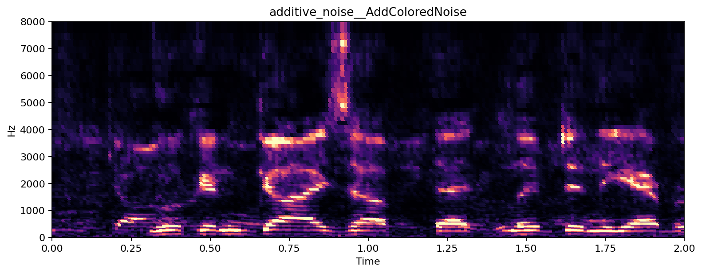

 (b) 

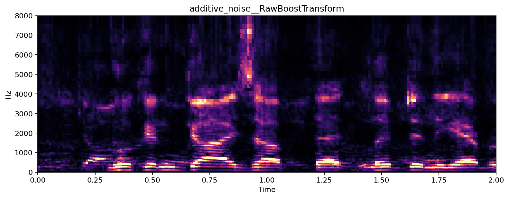

 (c) 

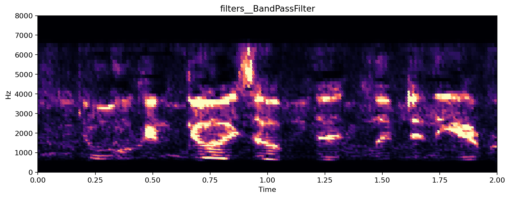

 (d) 

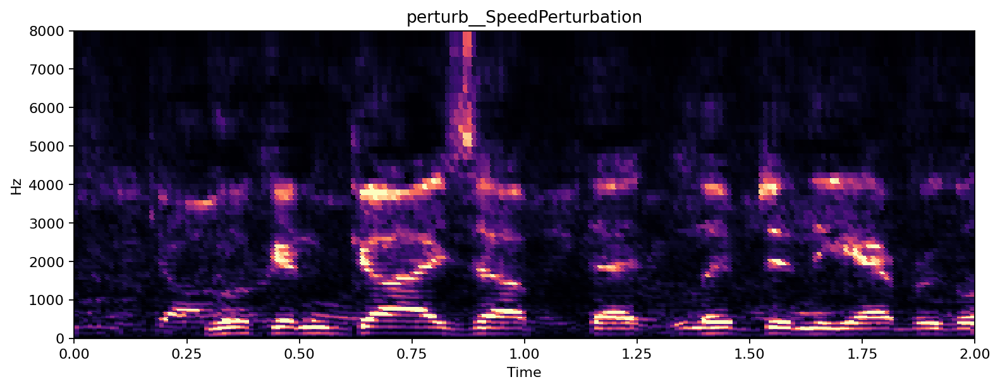

 (e) 

Figure 3: Examples of waveform-level transformations: clean mel reference, colored noise, RawBoost, band-pass filtering, and speed perturbation.

## 12 Model and Optimization

### 12.1 Backbone

ReDimNet2 is a speaker representation network that alternates local aggregation and dimensional reshaping, allowing the model to capture time-frequency structure with moderate compute [[28](https://arxiv.org/html/2609.37014#biba.bib1)]. We use the pretrained ReDimNet2 checkpoint as the starting point. The model operates over spectrogram features and outputs a fixed-dimensional embedding for each utterance. During scoring, embeddings are L2-normalized and compared by cosine similarity.

### 12.2 Fine-Tuning Stages

The baseline is the unmodified public ReDimNet2 checkpoint. Every adaptation run in Table [1](https://arxiv.org/html/2609.37014#S4.T1 "Table 1 ‣ 4 Experiments ‣ REDIMNET2+: MULTI-CORPUS DATA SCALING FOR ROBUST SPEAKER VERIFICATION") starts independently from that checkpoint, except the final ReDimNet2+ LMFT run. Thus adjacent rows are not successive checkpoints from one continuous run. The rows with added corpora describe independent fine-tuning experiments with expanded training pools.

ReDimNet2+ pretrained is obtained by fine-tuning the public checkpoint on all seven training corpora. The _ReDimNet2 (LMFT only)_ control applies LMFT directly to the public checkpoint. In contrast, ReDimNet2+ LMFT starts from ReDimNet2+ pretrained and applies LMFT after multi-corpus adaptation. Checkpoints are selected on the VoxCeleb1 development set.

The direct fine-tuning run uses a learning rate of \(5\times 10^{-5}\), whereas the cosine-margin run uses \(10^{-4}\) and a margin schedule from 0.0 to 0.2. Since training duration and learning rate also differ, their results do not isolate margin scheduling. Final LMFT uses a fixed margin of 0.3 and 6-second training windows.

### 12.3 Speaker Classification Objective

We use a SphereFace2 classification head [[8](https://arxiv.org/html/2609.37014#biba.bib7)], which trains one-versus-all binary classifiers for normalized embeddings and normalized speaker-class weights. The objective follows the cited binary-classification formulation, rather than multiclass softmax normalization. Early experiments used either a fixed margin or a cosine schedule from 0.0 to 0.2. The final LMFT stage uses a fixed margin of 0.3 and 6-second training segments. All models use randomly selected 4-second windows for evaluation.

### 12.4 Hyperparameters

Table [10](https://arxiv.org/html/2609.37014#S12.T10 "Table 10 ‣ 12.4 Hyperparameters ‣ 12 Model and Optimization ‣ REDIMNET2+: MULTI-CORPUS DATA SCALING FOR ROBUST SPEAKER VERIFICATION") summarizes the main training runs. Training used distributed execution with Accelerate and FSDP, BFloat16 precision, AdamW, gradient clipping at 20, fixed seed 42, and checkpointed recovery. Batch size is reported per GPU; accumulation denotes gradient accumulation steps. Early runs used 32,200-sample windows. Later runs increased to 48,300 samples, and LMFT used 96,000 samples.

Table 10: Training Hyperparameters for the Main Runs 

Run | Batch/GPU | GPUs | Accum. | Epochs | LR | Samples  
---|---|---|---|---|---|---  
ReDimNet2 (FT) | 64 | 6 | 4 | 22 | \(5\cdot 10^{-5}\) | 32,200  
ReDimNet2 (cosine margin schedule) | 64 | 6 | 4 | 10 | \(10^{-4}\) | 32,200  
ReDimNet2 (VC2, 6 epochs) | 64 | 6 | 4 | 6 | \(9\cdot 10^{-5}\) | 32,200  
ReDimNet2 (multi-domain, 6 epochs) | 48 | 6 | 5 | 6 | \(9\cdot 10^{-5}\) | 48,300  
ReDimNet2 (multi-domain, 10 epochs) | 48 | 6 | 5 | 10 | \(9\cdot 10^{-5}\) | 48,300  
ReDimNet2 (TidyVoice added) | 48 | 6 | 5 | 6 | \(9\cdot 10^{-5}\) | 48,300  
ReDimNet2 (KeSpeech added) | 48 | 6 | 5 | 6 | \(9\cdot 10^{-5}\) | 48,300  
ReDimNet2+ pretrained | 48 | 6 | 5 | 10 | \(9\cdot 10^{-5}\) | 48,300  
ReDimNet2+ LMFT | 24 | 6 | 10 | 6 | \(10^{-4}\)–\(3\cdot 10^{-5}\) | 96,000

 

## 13 External Benchmark Protocol

### 13.1 Model Selection

We selected external baselines that are public, widely usable, and easy to run locally. WeSpeaker provides a research and production speaker embedding toolkit [[24](https://arxiv.org/html/2609.37014#biba.bib28)] and public ONNX checkpoints. We evaluated WeSpeaker ResNet34-LM [[27](https://arxiv.org/html/2609.37014#biba.bib29)], WeSpeaker ECAPA512-LM [[25](https://arxiv.org/html/2609.37014#biba.bib30)], and WeSpeaker CAM++ [[26](https://arxiv.org/html/2609.37014#biba.bib31)]. These models cover different open-source speaker embedding families while keeping inference practical on the local GPU.

### 13.2 Local VoxCeleb1 Setup

All reported local systems were evaluated with randomly selected 4-second input windows on the same local VoxCeleb1 trial files. Checkpoints were selected on the VoxCeleb1 development set. The published ReDimNet2-B6 reference instead uses full utterances and cosine scoring without score normalization [[28](https://arxiv.org/html/2609.37014#biba.bib1)]. A fixed window limits speaker evidence and makes our local numbers protocol-specific; the available results do not isolate how much of the published-to-local gap is due to duration. VoxCeleb1-O contains 37,611 trial pairs and references 4,708 unique utterances. VoxCeleb1-E contains 579,818 trial pairs and references 145,160 unique utterances. VoxCeleb1-H contains 550,894 trial pairs and references 137,924 unique utterances. The utterance set of VoxCeleb1-H is a subset of VoxCeleb1-E, so the benchmark extracts embeddings once for VoxCeleb1-E and reuses that embedding cache when scoring VoxCeleb1-H. Missing VoxCeleb1 test-speaker audio was filled from the Hugging Face VoxCeleb mirror. The downloaded test zip checksum was verified and all trial references resolved before scoring.

The benchmark script extracts each unique utterance embedding once, stores compressed embeddings, computes all trial cosine scores, writes a score CSV, and writes a JSON metric file. For WeSpeaker ONNX models, ONNX Runtime was configured with CUDA execution provider and CPU fallback. The experiment directory stores model files, checksums, logs, pip freeze, GPU snapshot, environment metadata, embeddings, scores, and aggregate tables.

## 14 Reranking

### 14.1 Mean-Chain Reranking

Let \(k\) denote the evaluation cutoff, \(K\) the graph neighborhood size, and \(M>K\) the initial candidate-pool size. The first reranking stage works inside this candidate pool. For query embedding \(e_{i}\), all embeddings are L2-normalized and an initial pool \(P(i)\) is selected by cosine similarity. The probe vector starts as

\[\begin{aligned}
 & p_{i}^{(0)}=e_{i}. &  & \text{(7)}
\end{aligned}\]

 

At step \(t\), the algorithm selects the unused candidate with highest similarity to the current probe:

\[\begin{aligned}
 & j_{t}=\arg\max_{j\in P(i)\setminus\{j_{1},\ldots,j_{t-1}\}}e_{j}^{T}p_{i}^{(t-1)}. &  & \text{(8)}
\end{aligned}\]

 

The probe is then updated as the normalized mean of the original query and the last selected neighbor:

\[\begin{aligned}
 & p_{i}^{(t)}=\frac{e_{i}+e_{j_{t}}}{\|e_{i}+e_{j_{t}}\|_{2}}. &  & \text{(9)}
\end{aligned}\]

 

After \(K\) selections, the chain order defines the neighbor list \(N(i)\). Each probe averages the original query with only the most recently selected neighbor; it is not a cumulative mean. Anchoring the probe to the query limits drift while allowing the order to follow local embedding structure.

### 14.2 Graph Reranking

The second stage builds a \(K\)-nearest-neighbor graph and uses its structure without speaker labels. For query \(i\), the local candidate set contains current neighbors and neighbors of those neighbors:

\[\begin{aligned}
 & P_{\mathrm{graph}}(i)=N(i)\cup\bigcup_{u\in N(i)}N(u),\quad i\notin P_{\mathrm{graph}}(i). &  & \text{(10)}
\end{aligned}\]

 

Each candidate is scored by rank support, reciprocal support, common-neighbor support, and a hubness penalty:

\[\begin{aligned}
 & S(i,j)=w_{r}R(i,j)+w_{q}Q(i,j)+w_{c}C(i,j)-w_{h}H(j), &  & \text{(11)}
\end{aligned}\]

 

where the final recipe uses \(w_{r}=1.0\), \(w_{q}=1.5\), \(w_{c}=2.0\), and \(w_{h}=0.3\). The rank term rewards candidates already high in \(N(i)\). The reciprocal term rewards candidates whose own neighbor list contains \(i\). The common-neighbor term rewards candidates sharing local context with \(i\). The hubness term penalizes embeddings with excessive in-degree:

\[\begin{aligned}
 & H(j)=\max\left(0,\log\frac{\mathrm{deg}_{in}(j)}{K}\right). &  & \text{(12)}
\end{aligned}\]

 

Here \(\mathrm{deg}_{in}(j)\) counts the lists that contain candidate \(j\). With \(K\) outgoing neighbors per graph node, the mean in-degree is \(K\); the penalty is zero up to that value and increases logarithmically above it. After rescoring, each list is replaced by its top-\(K\) candidates and the graph is rebuilt. The final experiments use three iterations and unchanged weights across embedding models. Evaluation reads the requested top-\(k\) positions from the resulting ranking.

## 15 Results

### 15.1 Main Verification Results

Table [1](https://arxiv.org/html/2609.37014#S4.T1 "Table 1 ‣ 4 Experiments ‣ REDIMNET2+: MULTI-CORPUS DATA SCALING FOR ROBUST SPEAKER VERIFICATION") reports the main ReDimNet2+ development path under a shared 4-second evaluation protocol. The baseline ReDimNet2 checkpoint obtains 1.601% EER on VoxCeleb1-O and 2.42% pooled EER. The first direct fine-tuning run is worse on clean VoxCeleb1, which supports the hypothesis that a high fixed margin is too aggressive at the beginning of adaptation. Cosine-scheduled margin training is still not sufficient. The first clear improvement appears when the training data is expanded and the model receives more input samples. The best pre-LMFT checkpoint reaches 0.792% EERo and 1.424% EERp. The LMFT-only control starts from the public checkpoint and reaches 0.436% EERo and 0.885% EERp. Applying LMFT to ReDimNet2+ pretrained further reduces EERo to 0.351%, EERh to 1.055%, EERp to 0.824%, and EERph to 1.991%.

### 15.2 Published VoxCeleb1 Baselines

Table [11](https://arxiv.org/html/2609.37014#S15.T11 "Table 11 ‣ 15.2 Published VoxCeleb1 Baselines ‣ 15 Results ‣ REDIMNET2+: MULTI-CORPUS DATA SCALING FOR ROBUST SPEAKER VERIFICATION") situates the result among published VoxCeleb1 numbers. Systems differ in training corpora, model scale, calibration, and implementation details, so the comparison is indicative rather than equal-budget. ReDimNet2+ is competitive with strong VoxCeleb2-dev systems and trails the extended-data W2V-BERT 2.0 result reported in [[28](https://arxiv.org/html/2609.37014#biba.bib1)]. The controlled contribution of this paper is the reproducible local comparison in Table [12](https://arxiv.org/html/2609.37014#S15.T12 "Table 12 ‣ 15.4 External Baselines ‣ 15 Results ‣ REDIMNET2+: MULTI-CORPUS DATA SCALING FOR ROBUST SPEAKER VERIFICATION") rather than a universal state-of-the-art claim.

Table 11: Published VoxCeleb1 results under their source protocols. ReDimNet2-B6 uses full utterances; our results use 4-second windows. The local checkpoint comparison is given in Table [2](https://arxiv.org/html/2609.37014#S4.T2 "Table 2 ‣ 4.3 Comparison with other models ‣ 4 Experiments ‣ REDIMNET2+: MULTI-CORPUS DATA SCALING FOR ROBUST SPEAKER VERIFICATION"). 

System | Training data | Params | EERo | EERe | EERh  
---|---|---|---|---|---  
ECAPA-TDNN C=512 [[5](https://arxiv.org/html/2609.37014#biba.bib4)] | VoxCeleb2-dev | 6.2M | 1.01 | 1.24 | 2.32  
ECAPA-TDNN C=1024 [[5](https://arxiv.org/html/2609.37014#biba.bib4)] | VoxCeleb2-dev | 14.7M | 0.87 | 1.12 | 2.12  
CAM++ [[28](https://arxiv.org/html/2609.37014#biba.bib1)] | VoxCeleb2-dev | 7.2M | 0.71 | 0.85 | 1.66  
ECAPA2 [[23](https://arxiv.org/html/2609.37014#biba.bib5)] | VoxCeleb2-dev | 27.0M | 0.34 | 0.52 | 0.99  
WavLM [[28](https://arxiv.org/html/2609.37014#biba.bib1)] | VoxCeleb2-dev | 324M | 0.52 | 0.63 | 1.34  
W2V-BERT 2.0 [[28](https://arxiv.org/html/2609.37014#biba.bib1)] | VoxCeleb2-dev | 587M | 0.38 | 0.51 | 1.06  
ReDimNet2-B6 [[28](https://arxiv.org/html/2609.37014#biba.bib1)] (full utterance) | VoxCeleb2-dev | 12.3M | 0.29 | 0.52 | 0.99  
SimAM-ResNet100 [[28](https://arxiv.org/html/2609.37014#biba.bib1), [18](https://arxiv.org/html/2609.37014#biba.bib10)] | VoxBlink2+VoxCeleb2 | 50.2M | 0.23 | 0.46 | 0.87  
W2V-BERT 2.0 [[28](https://arxiv.org/html/2609.37014#biba.bib1)] | VoxBlink2+VoxCeleb2 | 587M | 0.14 | 0.31 | 0.73  
ReDimNet2+ LMFT (ours, 4 s) | Mixed corpora | 12.3M | 0.351 | 0.523 | 1.055

 

### 15.3 Data Scaling

Fig. [4](https://arxiv.org/html/2609.37014#S15.F4 "Figure 4 ‣ 15.3 Data Scaling ‣ 15 Results ‣ REDIMNET2+: MULTI-CORPUS DATA SCALING FOR ROBUST SPEAKER VERIFICATION") shows EER trends as the number of training speakers and utterances increases. We fit a power law in log–log space. VoxCeleb1-O follows the most stable monotonic trend, while VoxCeleb1-E and VoxCeleb1-H become less monotonic at the largest settings. This indicates that raw scale helps but is not the only variable: the domain and quality of added data influence the extended and hard protocols.

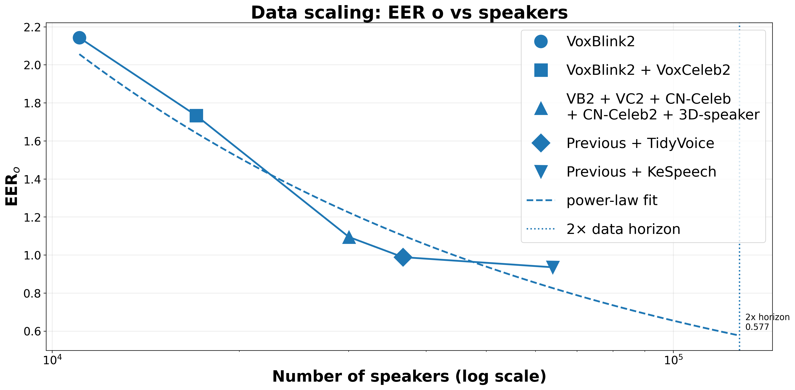

 (a) 

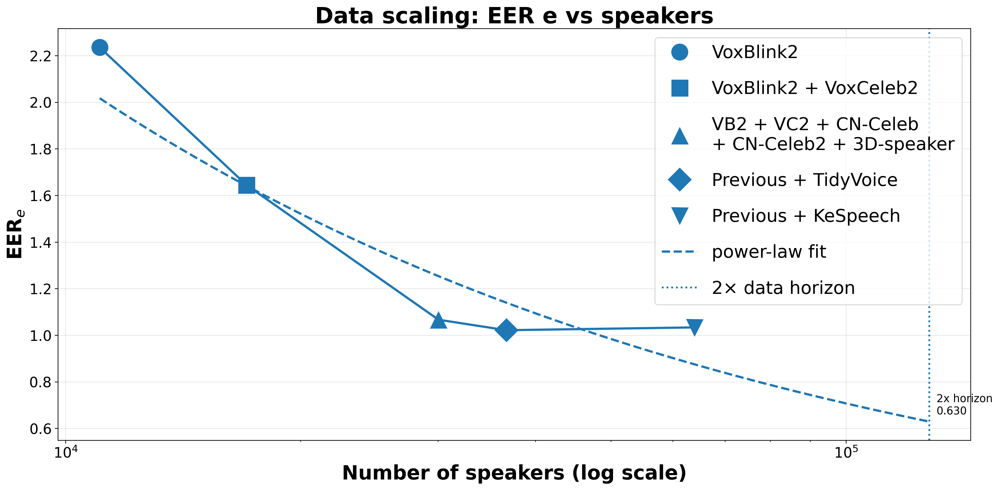

 (b) 

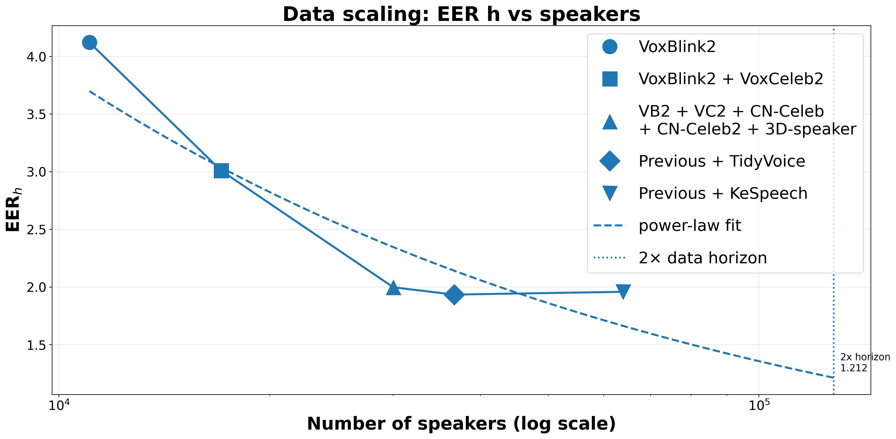

 (c) 

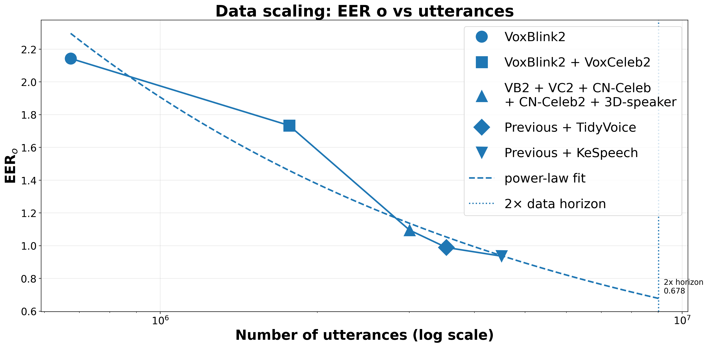

 (d) 

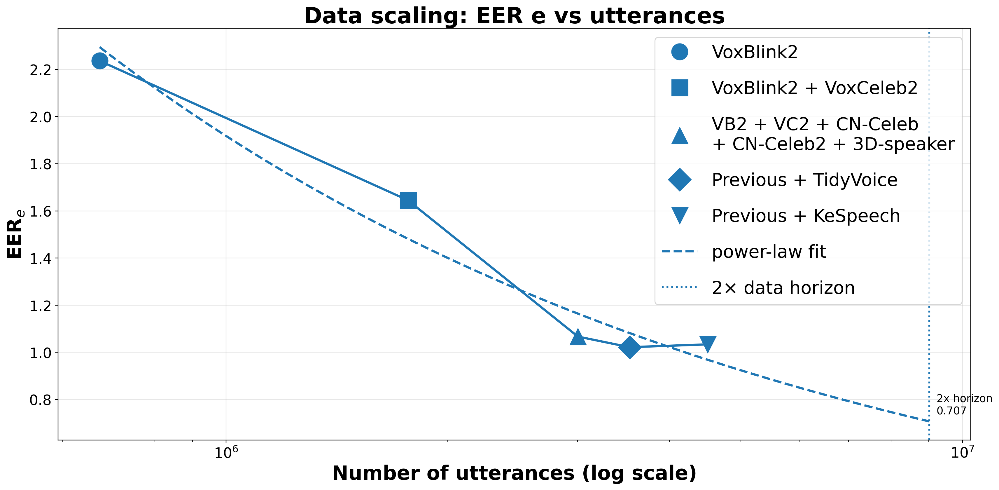

 (e) 

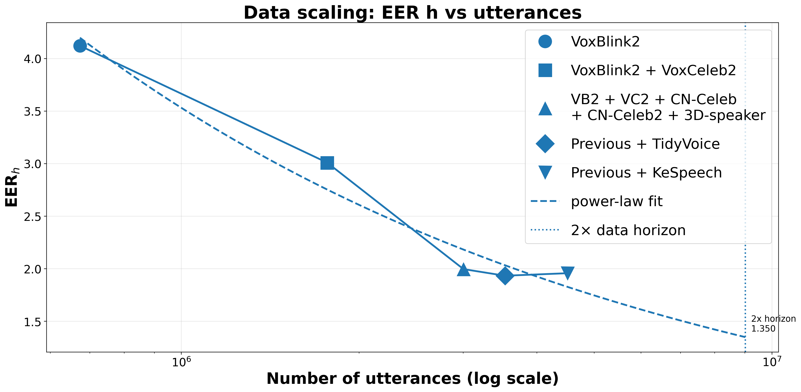

 (f) 

Figure 4: Data scaling trends for VoxCeleb1-O, VoxCeleb1-E, and VoxCeleb1-H as a function of training speakers and training utterances.

### 15.4 External Baselines

Table [12](https://arxiv.org/html/2609.37014#S15.T12 "Table 12 ‣ 15.4 External Baselines ‣ 15 Results ‣ REDIMNET2+: MULTI-CORPUS DATA SCALING FOR ROBUST SPEAKER VERIFICATION") reports the local VoxCeleb1-O/E/H comparison with 4-second windows for every model. ReDimNet2+ LMFT reaches 0.351 / 0.523 / 1.055% EER and is lower than all three reported WeSpeaker ONNX checkpoints on every protocol. Training budgets and corpora differ, so this comparison evaluates final systems under a shared local protocol rather than matched training data.

Table 12: Local VoxCeleb1-O/E/H Comparison with 4-Second Windows 

System | Runtime | EERo (%) | EERe (%) | EERh (%)  
---|---|---|---|---  
ReDimNet2+ LMFT | Torch | 0.351 | 0.523 | 1.055  
WeSpeaker CAM++ | ONNX/CUDA | 0.787 | 0.928 | 1.824  
WeSpeaker ResNet34-LM | ONNX/CUDA | 0.814 | 0.933 | 1.679  
WeSpeaker ECAPA512-LM | ONNX/CUDA | 0.877 | 1.071 | 1.968

 

### 15.5 Reranking Results

Table [3](https://arxiv.org/html/2609.37014#S4.T3 "Table 3 ‣ 4.4 Retrieval reranking ‣ 4 Experiments ‣ REDIMNET2+: MULTI-CORPUS DATA SCALING FOR ROBUST SPEAKER VERIFICATION") shows the reranking ablation on the ReDimNet2+ pretrained setup: Pr@1/10/45 are measured on VoxCeleb1, while the VB2 column is measured on the VoxBlink2 subset. On VoxBlink2, mean-chain reranking raises Pr@\(k\) from 0.7024 to 0.7220. Graph reranking alone reaches 0.7369. The combined mean-chain plus graph variant reaches 0.7391. Applied to the final LMFT system, the same reranking pipeline reaches 0.7687 Pr@\(k\), compared with 0.6906 for the baseline ReDimNet2 after the same reranking.

### 15.6 Inference

Table [13](https://arxiv.org/html/2609.37014#S15.T13 "Table 13 ‣ 15.6 Inference ‣ 15 Results ‣ REDIMNET2+: MULTI-CORPUS DATA SCALING FOR ROBUST SPEAKER VERIFICATION") reports a separate inference-runtime comparison on fixed 6-second segments. TensorRT FP16 reaches 230.66\(\times\) real time, with EER close to Torch FP32 in the same 6-second setup. Here xRTF is processed audio duration divided by elapsed processing time, rather than utterances per second. These accuracy figures are separate from the main 4-second evaluation.

Table 13: Inference Speed and Quality on Fixed 6-Second Segments. xRTF is audio duration divided by processing time; higher is faster 

Implementation | xRTF | Batch | Workers | EERo | EERp | EERph  
---|---|---|---|---|---|---  
Baseline ONNX FP32 | 707.61 | 32 | 4 | 14.647 | 17.197 | 41.634  
Ours Torch FP32 | 59.09 | 32 | 4 | 0.489 | 1.076 | 8.995  
Ours Torch BF16 | 82.53 | 32 | 4 | 0.484 | 1.072 | 8.968  
Ours ONNX FP32 | 61.87 | 32 | 4 | 0.489 | 1.075 | 9.000  
Ours ONNX FP16 | 113.66 | 32 | 4 | 0.489 | 1.076 | 8.984  
Ours TensorRT FP32 | 116.43 | 32 | 4 | 0.489 | 1.076 | 9.000  
Ours TensorRT BF16 | 117.04 | 32 | 4 | 0.489 | 1.075 | 8.968  
Ours TensorRT FP16 | 230.66 | 32 | 4 | 0.484 | 1.075 | 8.989

 

## 16 Discussion

### 16.1 Main Sources of Improvement

The development sequence combines broader training data, longer training windows, and LMFT. Adding device, distance, genre, and language diversity accompanies improvements in verification and retrieval. Increasing the training window may provide more speaker evidence for longer recordings, while LMFT combines 6-second training segments with a stronger margin. The evaluation window remains 4 seconds. Because multiple factors change between runs, the sequence supports the combined recipe but does not isolate each intervention’s causal effect.

### 16.2 Motivation for Codec Augmentation

The exploratory analysis reveals a shift in predicted coloration and FLAC compressibility. These observations motivate codec simulation and filtering alongside additive noise and reverberation. The transformations expose training to bandwidth changes and compression artifacts, but the observed shift does not prove that codec augmentation is necessary for every target domain. FLAC encoding itself is lossless and should not be interpreted as lossy-codec corruption.

### 16.3 Verification Versus Retrieval

The results also show that verification and retrieval need separate treatment. EER measures threshold behavior on labeled pairs, while Pr@\(k\) measures ranking quality in a gallery. The graph reranking stage improves the latter by using structure that is invisible to pairwise scoring alone: reciprocal neighbors, shared neighbors, and hubness. This matters when many embeddings are close to each other and a few universal embeddings appear in many top-\(k\) lists.

### 16.4 Remaining Failure Modes

The largest remaining gaps appear when the evaluation protocol concentrates difficult impostor pairs or applies explicit signal degradation. For the final model, EERh is about twice EERe, indicating that the hard protocol still exposes confusions among speakers with more similar metadata or acoustic conditions. EERph remains higher than the clean VoxCeleb1 metrics even after LMFT, which means that the codec and waveform stress suite still contains transformations that are not fully absorbed by the embedding space. These observations suggest that future work should focus on real telephone/VoIP data, more systematic codec curriculum design, and calibration under degraded-channel score distributions.

### 16.5 Limitations

This work has several limitations. First, the final ReDimNet2+ numbers are produced by a staged recipe with multiple corpora, so external open checkpoints are not controlled for training data; the local comparison is informative under a shared protocol but is not an equal-data architecture comparison. Second, EERph uses synthetic degradations; it measures robustness to a chosen transformation set and need not cover all real-world channel failures. Third, the separate runtime benchmark uses 6-second inputs, so its accuracy figures should not be conflated with the main 4-second evaluation. Fourth, a major remaining challenge is out-of-domain generalization on difficult open-set targets; sub-1% VoxCeleb1 EER alone is not sufficient evidence of robustness for arbitrary in-the-wild deployments.

## 17 Reproducibility

Code: [github.com/lab260ru/redimnet2-plus](https://github.com/lab260ru/redimnet2-plus).   
Weights: [huggingface.co/lab260/redimnet2-plus](https://huggingface.co/lab260/redimnet2-plus).

All experiments use a fixed seed of 42, BFloat16 mixed precision, AdamW with gradient clipping at 20, and distributed execution with Accelerate and FSDP. The recorded ReDimNet2+ artifacts include the model code, per-stage configuration files for the backbone, loss, augmentation, and data pipelines, and the run-level hyperparameters reported in Table [10](https://arxiv.org/html/2609.37014#S12.T10 "Table 10 ‣ 12.4 Hyperparameters ‣ 12 Model and Optimization ‣ REDIMNET2+: MULTI-CORPUS DATA SCALING FOR ROBUST SPEAKER VERIFICATION").

For the external comparison, we record model and ONNX checkpoint checksums, the trial files, per-utterance embeddings, per-trial scores, aggregate metric tables, and an environment snapshot containing a pip freeze, GPU and driver information, and kernel metadata. The three reported WeSpeaker systems were benchmarked on an NVIDIA GeForce RTX 4080 SUPER under a single Python environment. The benchmark code is covered by nine unit tests for trial parsing, utterance collection, EER computation, score formation, audio-path resolution, PCM-scale audio loading, shard partitioning, O/E/H aggregation, and reuse of a superset embedding cache when scoring VoxCeleb1-H from VoxCeleb1-E embeddings.

## Appendix References

  * [1] A. Babu et al. (2022) A massively multilingual self-supervised speech model.  In Proceedings of the International Conference on Machine Learning (ICML),  pp. 1473–1483.  Cited by: [§1](https://arxiv.org/html/2609.37014#S1.p2.1 "1 Introduction ‣ REDIMNET2+: MULTI-CORPUS DATA SCALING FOR ROBUST SPEAKER VERIFICATION"), [§8.1](https://arxiv.org/html/2609.37014#S8.SS1.p1.1 "8.1 Speaker Embedding Backbones ‣ 8 Related Work ‣ REDIMNET2+: MULTI-CORPUS DATA SCALING FOR ROBUST SPEAKER VERIFICATION"). 
  * [2] S. Chen et al. (2022) WavLM: large-scale self-supervised pre-training for full stack speech processing.  IEEE Journal of Selected Topics in Signal Processing 16 (6), pp. 1505–1518.  External Links: [Document](https://dx.doi.org/10.1109/JSTSP.2022.3188113) Cited by: [§1](https://arxiv.org/html/2609.37014#S1.p2.1 "1 Introduction ‣ REDIMNET2+: MULTI-CORPUS DATA SCALING FOR ROBUST SPEAKER VERIFICATION"), [§8.1](https://arxiv.org/html/2609.37014#S8.SS1.p1.1 "8.1 Speaker Embedding Backbones ‣ 8 Related Work ‣ REDIMNET2+: MULTI-CORPUS DATA SCALING FOR ROBUST SPEAKER VERIFICATION"). 
  * [3] J. S. Chung, A. Nagrani, and A. Zisserman (2018) VoxCeleb2: Deep Speaker Recognition.  In Interspeech 2018,  pp. 1086–1090.  External Links: [Document](https://dx.doi.org/10.21437/Interspeech.2018-1929), ISSN 2958-1796 Cited by: [§1](https://arxiv.org/html/2609.37014#S1.p1.1 "1 Introduction ‣ REDIMNET2+: MULTI-CORPUS DATA SCALING FOR ROBUST SPEAKER VERIFICATION"), [Table 5](https://arxiv.org/html/2609.37014#S10.T5.2.3.1.1 "In 10.1 Training Corpora ‣ 10 Data ‣ REDIMNET2+: MULTI-CORPUS DATA SCALING FOR ROBUST SPEAKER VERIFICATION"), [§2](https://arxiv.org/html/2609.37014#S2.p1.1 "2 Data and Domain Mismatch ‣ REDIMNET2+: MULTI-CORPUS DATA SCALING FOR ROBUST SPEAKER VERIFICATION"). 
  * [4] A. Conneau, A. Baevski, R. Collobert, A. Mohamed, and M. Auli (2021) Unsupervised Cross-Lingual Representation Learning for Speech Recognition.  In Interspeech 2021,  pp. 2426–2430.  External Links: [Document](https://dx.doi.org/10.21437/Interspeech.2021-329), ISSN 2958-1796 Cited by: [§8.1](https://arxiv.org/html/2609.37014#S8.SS1.p1.1 "8.1 Speaker Embedding Backbones ‣ 8 Related Work ‣ REDIMNET2+: MULTI-CORPUS DATA SCALING FOR ROBUST SPEAKER VERIFICATION"). 
  * [5] B. Desplanques, J. Thienpondt, and K. Demuynck (2020) ECAPA-TDNN: Emphasized Channel Attention, Propagation and Aggregation in TDNN Based Speaker Verification.  In Interspeech 2020,  pp. 3830–3834.  External Links: [Document](https://dx.doi.org/10.21437/Interspeech.2020-2650), [Link](https://arxiv.org/abs/2005.07143) Cited by: [Table 11](https://arxiv.org/html/2609.37014#S15.T11.2.2.1.1 "In 15.2 Published VoxCeleb1 Baselines ‣ 15 Results ‣ REDIMNET2+: MULTI-CORPUS DATA SCALING FOR ROBUST SPEAKER VERIFICATION"), [Table 11](https://arxiv.org/html/2609.37014#S15.T11.2.3.1.1 "In 15.2 Published VoxCeleb1 Baselines ‣ 15 Results ‣ REDIMNET2+: MULTI-CORPUS DATA SCALING FOR ROBUST SPEAKER VERIFICATION"), [Table 2](https://arxiv.org/html/2609.37014#S4.T2.2.2.1.1 "In 4.3 Comparison with other models ‣ 4 Experiments ‣ REDIMNET2+: MULTI-CORPUS DATA SCALING FOR ROBUST SPEAKER VERIFICATION"), [Table 2](https://arxiv.org/html/2609.37014#S4.T2.2.3.1.1 "In 4.3 Comparison with other models ‣ 4 Experiments ‣ REDIMNET2+: MULTI-CORPUS DATA SCALING FOR ROBUST SPEAKER VERIFICATION"). 
  * [6] Y. Fan et al. (2020) CN-celeb: a challenging chinese speaker recognition dataset.  In ICASSP 2020 - 2020 IEEE International Conference on Acoustics, Speech and Signal Processing (ICASSP),  Vol. , pp. 7604–7608.  External Links: [Document](https://dx.doi.org/10.1109/ICASSP40776.2020.9054017) Cited by: [§1](https://arxiv.org/html/2609.37014#S1.p1.1 "1 Introduction ‣ REDIMNET2+: MULTI-CORPUS DATA SCALING FOR ROBUST SPEAKER VERIFICATION"), [Table 5](https://arxiv.org/html/2609.37014#S10.T5.2.5.1.1 "In 10.1 Training Corpora ‣ 10 Data ‣ REDIMNET2+: MULTI-CORPUS DATA SCALING FOR ROBUST SPEAKER VERIFICATION"), [§2](https://arxiv.org/html/2609.37014#S2.p1.1 "2 Data and Domain Mismatch ‣ REDIMNET2+: MULTI-CORPUS DATA SCALING FOR ROBUST SPEAKER VERIFICATION"). 
  * [7] A. Farhadipour, J. Marquenie, S. Madikeri, and E. Chodroff (2026) TidyVoice: a curated multilingual dataset for speaker verification derived from common voice.  Note: arXiv:2601.16358 External Links: 2601.16358, [Link](https://arxiv.org/abs/2601.16358) Cited by: [§1](https://arxiv.org/html/2609.37014#S1.p1.1 "1 Introduction ‣ REDIMNET2+: MULTI-CORPUS DATA SCALING FOR ROBUST SPEAKER VERIFICATION"), [Table 5](https://arxiv.org/html/2609.37014#S10.T5.2.7.1.1 "In 10.1 Training Corpora ‣ 10 Data ‣ REDIMNET2+: MULTI-CORPUS DATA SCALING FOR ROBUST SPEAKER VERIFICATION"), [§2](https://arxiv.org/html/2609.37014#S2.p1.1 "2 Data and Domain Mismatch ‣ REDIMNET2+: MULTI-CORPUS DATA SCALING FOR ROBUST SPEAKER VERIFICATION"). 
  * [8] B. Han, Z. Chen, and Y. Qian (2023) Exploring binary classification loss for speaker verification.  Note: arXiv:2307.08205 External Links: 2307.08205, [Link](https://arxiv.org/abs/2307.08205) Cited by: [§1](https://arxiv.org/html/2609.37014#S1.p2.1 "1 Introduction ‣ REDIMNET2+: MULTI-CORPUS DATA SCALING FOR ROBUST SPEAKER VERIFICATION"), [§12.3](https://arxiv.org/html/2609.37014#S12.SS3.p1.1 "12.3 Speaker Classification Objective ‣ 12 Model and Optimization ‣ REDIMNET2+: MULTI-CORPUS DATA SCALING FOR ROBUST SPEAKER VERIFICATION"), [§3.2](https://arxiv.org/html/2609.37014#S3.SS2.p1.1 "3.2 Staged fine-tuning and LMFT ‣ 3 ReDimNet2+ ‣ REDIMNET2+: MULTI-CORPUS DATA SCALING FOR ROBUST SPEAKER VERIFICATION"), [§8.3](https://arxiv.org/html/2609.37014#S8.SS3.p1.1 "8.3 Margin-Based Optimization ‣ 8 Related Work ‣ REDIMNET2+: MULTI-CORPUS DATA SCALING FOR ROBUST SPEAKER VERIFICATION"). 
  * [9] T. Ko, V. Peddinti, D. Povey, M. L. Seltzer, and S. Khudanpur (2017) A study on data augmentation of reverberant speech for robust speech recognition.  In 2017 IEEE International Conference on Acoustics, Speech and Signal Processing (ICASSP),  Vol. , pp. 5220–5224.  External Links: [Document](https://dx.doi.org/10.1109/ICASSP.2017.7953152) Cited by: [§1](https://arxiv.org/html/2609.37014#S1.p2.1 "1 Introduction ‣ REDIMNET2+: MULTI-CORPUS DATA SCALING FOR ROBUST SPEAKER VERIFICATION"), [§11.3](https://arxiv.org/html/2609.37014#S11.SS3.p2.1 "11.3 Waveform and Codec Augmentation ‣ 11 Training Pipeline ‣ REDIMNET2+: MULTI-CORPUS DATA SCALING FOR ROBUST SPEAKER VERIFICATION"), [§3.1](https://arxiv.org/html/2609.37014#S3.SS1.p2.1 "3.1 Training pipeline and augmentation ‣ 3 ReDimNet2+ ‣ REDIMNET2+: MULTI-CORPUS DATA SCALING FOR ROBUST SPEAKER VERIFICATION"), [§8.2](https://arxiv.org/html/2609.37014#S8.SS2.p1.1 "8.2 Robustness and Augmentation ‣ 8 Related Work ‣ REDIMNET2+: MULTI-CORPUS DATA SCALING FOR ROBUST SPEAKER VERIFICATION"). 
  * [10] L. Li et al. (2022) CN-celeb: multi-genre speaker recognition.  Speech Commun. 137 (C), pp. 77–91.  External Links: ISSN 0167-6393, [Link](https://doi.org/10.1016/j.specom.2022.01.002), [Document](https://dx.doi.org/10.1016/j.specom.2022.01.002) Cited by: [§1](https://arxiv.org/html/2609.37014#S1.p1.1 "1 Introduction ‣ REDIMNET2+: MULTI-CORPUS DATA SCALING FOR ROBUST SPEAKER VERIFICATION"), [Table 5](https://arxiv.org/html/2609.37014#S10.T5.2.6.1.1 "In 10.1 Training Corpora ‣ 10 Data ‣ REDIMNET2+: MULTI-CORPUS DATA SCALING FOR ROBUST SPEAKER VERIFICATION"), [§2](https://arxiv.org/html/2609.37014#S2.p1.1 "2 Data and Domain Mismatch ‣ REDIMNET2+: MULTI-CORPUS DATA SCALING FOR ROBUST SPEAKER VERIFICATION"). 
  * [11] Z. Li, M. Cheng, and M. Li (2026) Enhancing speaker verification with w2v-bert 2.0 and knowledge distillation guided structured pruning.  Note: arXiv:2510.04213 External Links: 2510.04213, [Link](https://arxiv.org/abs/2510.04213) Cited by: [§1](https://arxiv.org/html/2609.37014#S1.p2.1 "1 Introduction ‣ REDIMNET2+: MULTI-CORPUS DATA SCALING FOR ROBUST SPEAKER VERIFICATION"), [§8.1](https://arxiv.org/html/2609.37014#S8.SS1.p1.1 "8.1 Speaker Embedding Backbones ‣ 8 Related Work ‣ REDIMNET2+: MULTI-CORPUS DATA SCALING FOR ROBUST SPEAKER VERIFICATION"). 
  * [12] Z. Li, X. Miao, J. Liu, and M. Li (2026) Language-invariant multilingual speaker verification for the tidyvoice 2026 challenge.  Note: arXiv:2603.08092 External Links: 2603.08092, [Link](https://arxiv.org/abs/2603.08092) Cited by: [§1](https://arxiv.org/html/2609.37014#S1.p2.1 "1 Introduction ‣ REDIMNET2+: MULTI-CORPUS DATA SCALING FOR ROBUST SPEAKER VERIFICATION"), [§8.3](https://arxiv.org/html/2609.37014#S8.SS3.p1.1 "8.3 Margin-Based Optimization ‣ 8 Related Work ‣ REDIMNET2+: MULTI-CORPUS DATA SCALING FOR ROBUST SPEAKER VERIFICATION"). 
  * [13] Y. Lin, M. Cheng, F. Zhang, Y. Gao, S. Zhang, and M. Li (2024) VoxBlink2: A 100K+ Speaker Recognition Corpus and the Open-Set Speaker-Identification Benchmark.  In Interspeech 2024,  pp. 4263–4267.  External Links: [Document](https://dx.doi.org/10.21437/Interspeech.2024-1490), ISSN 2958-1796 Cited by: [§1](https://arxiv.org/html/2609.37014#S1.p1.1 "1 Introduction ‣ REDIMNET2+: MULTI-CORPUS DATA SCALING FOR ROBUST SPEAKER VERIFICATION"), [Table 5](https://arxiv.org/html/2609.37014#S10.T5.2.2.1.1 "In 10.1 Training Corpora ‣ 10 Data ‣ REDIMNET2+: MULTI-CORPUS DATA SCALING FOR ROBUST SPEAKER VERIFICATION"), [§2](https://arxiv.org/html/2609.37014#S2.p1.1 "2 Data and Domain Mismatch ‣ REDIMNET2+: MULTI-CORPUS DATA SCALING FOR ROBUST SPEAKER VERIFICATION"), [§9.3](https://arxiv.org/html/2609.37014#S9.SS3.p1.1 "9.3 Speaker Retrieval ‣ 9 Task and Metrics ‣ REDIMNET2+: MULTI-CORPUS DATA SCALING FOR ROBUST SPEAKER VERIFICATION"). 
  * [14] H. Mao, Y. Shi, Y. Liu, L. Wei, Y. Li, and Y. Long (2020) Short-time speaker verification with different speaking style utterances.  PLOS ONE 15 (11), pp. e0241809.  External Links: [Document](https://dx.doi.org/10.1371/journal.pone.0241809), [Link](https://doi.org/10.1371/journal.pone.0241809) Cited by: [§1](https://arxiv.org/html/2609.37014#S1.p2.1 "1 Introduction ‣ REDIMNET2+: MULTI-CORPUS DATA SCALING FOR ROBUST SPEAKER VERIFICATION"), [§8.2](https://arxiv.org/html/2609.37014#S8.SS2.p1.1 "8.2 Robustness and Augmentation ‣ 8 Related Work ‣ REDIMNET2+: MULTI-CORPUS DATA SCALING FOR ROBUST SPEAKER VERIFICATION"). 
  * [15] G. Mittag, B. Naderi, A. Chehadi, and S. Möller (2021) NISQA: A Deep CNN-Self-Attention Model for Multidimensional Speech Quality Prediction with Crowdsourced Datasets.  In Interspeech 2021,  pp. 2127–2131.  External Links: [Document](https://dx.doi.org/10.21437/Interspeech.2021-299), ISSN 2958-1796 Cited by: [§10.4](https://arxiv.org/html/2609.37014#S10.SS4.p2.1 "10.4 Coloration and Byte-Rate Shift ‣ 10 Data ‣ REDIMNET2+: MULTI-CORPUS DATA SCALING FOR ROBUST SPEAKER VERIFICATION"), [§2](https://arxiv.org/html/2609.37014#S2.p3.1 "2 Data and Domain Mismatch ‣ REDIMNET2+: MULTI-CORPUS DATA SCALING FOR ROBUST SPEAKER VERIFICATION"). 
  * [16] A. Nagrani, J. S. Chung, and A. Zisserman (2017) VoxCeleb: A Large-Scale Speaker Identification Dataset.  In Interspeech 2017,  pp. 2616–2620.  External Links: [Document](https://dx.doi.org/10.21437/Interspeech.2017-950), ISSN 2958-1796 Cited by: [§1](https://arxiv.org/html/2609.37014#S1.p1.1 "1 Introduction ‣ REDIMNET2+: MULTI-CORPUS DATA SCALING FOR ROBUST SPEAKER VERIFICATION"). 
  * [17] D. S. Park et al. (2019) SpecAugment: A Simple Data Augmentation Method for Automatic Speech Recognition.  In Interspeech 2019,  pp. 2613–2617.  External Links: [Document](https://dx.doi.org/10.21437/Interspeech.2019-2680), ISSN 2958-1796 Cited by: [§1](https://arxiv.org/html/2609.37014#S1.p2.1 "1 Introduction ‣ REDIMNET2+: MULTI-CORPUS DATA SCALING FOR ROBUST SPEAKER VERIFICATION"), [§11.3](https://arxiv.org/html/2609.37014#S11.SS3.p3.1 "11.3 Waveform and Codec Augmentation ‣ 11 Training Pipeline ‣ REDIMNET2+: MULTI-CORPUS DATA SCALING FOR ROBUST SPEAKER VERIFICATION"), [§3.1](https://arxiv.org/html/2609.37014#S3.SS1.p2.1 "3.1 Training pipeline and augmentation ‣ 3 ReDimNet2+ ‣ REDIMNET2+: MULTI-CORPUS DATA SCALING FOR ROBUST SPEAKER VERIFICATION"), [§8.2](https://arxiv.org/html/2609.37014#S8.SS2.p1.1 "8.2 Robustness and Augmentation ‣ 8 Related Work ‣ REDIMNET2+: MULTI-CORPUS DATA SCALING FOR ROBUST SPEAKER VERIFICATION"). 
  * [18] X. Qin, N. Li, C. Weng, D. Su, and M. Li (2022) Simple attention module based speaker verification with iterative noisy label detection.  In ICASSP 2022 - 2022 IEEE International Conference on Acoustics, Speech and Signal Processing (ICASSP),  Vol. , pp. 6722–6726.  External Links: [Document](https://dx.doi.org/10.1109/ICASSP43922.2022.9746294) Cited by: [Table 11](https://arxiv.org/html/2609.37014#S15.T11.2.9.1.1 "In 15.2 Published VoxCeleb1 Baselines ‣ 15 Results ‣ REDIMNET2+: MULTI-CORPUS DATA SCALING FOR ROBUST SPEAKER VERIFICATION"), [§8.1](https://arxiv.org/html/2609.37014#S8.SS1.p1.1 "8.1 Speaker Embedding Backbones ‣ 8 Related Work ‣ REDIMNET2+: MULTI-CORPUS DATA SCALING FOR ROBUST SPEAKER VERIFICATION"). 
  * [19] D. Snyder, G. Chen, and D. Povey (2015) MUSAN: A Music, Speech, and Noise Corpus.  Note: arXiv:1510.08484v1 External Links: 1510.08484 Cited by: [§1](https://arxiv.org/html/2609.37014#S1.p2.1 "1 Introduction ‣ REDIMNET2+: MULTI-CORPUS DATA SCALING FOR ROBUST SPEAKER VERIFICATION"), [§11.3](https://arxiv.org/html/2609.37014#S11.SS3.p2.1 "11.3 Waveform and Codec Augmentation ‣ 11 Training Pipeline ‣ REDIMNET2+: MULTI-CORPUS DATA SCALING FOR ROBUST SPEAKER VERIFICATION"), [§3.1](https://arxiv.org/html/2609.37014#S3.SS1.p2.1 "3.1 Training pipeline and augmentation ‣ 3 ReDimNet2+ ‣ REDIMNET2+: MULTI-CORPUS DATA SCALING FOR ROBUST SPEAKER VERIFICATION"), [§8.2](https://arxiv.org/html/2609.37014#S8.SS2.p1.1 "8.2 Robustness and Augmentation ‣ 8 Related Work ‣ REDIMNET2+: MULTI-CORPUS DATA SCALING FOR ROBUST SPEAKER VERIFICATION"). 
  * [20] Y. Sun, H. Zhang, L. Wang, K. A. Lee, M. Liu, and J. Dang (2023) Noise-disentanglement metric learning for robust speaker verification.  In ICASSP 2023 - 2023 IEEE International Conference on Acoustics, Speech and Signal Processing (ICASSP),  Vol. , pp. 1–5.  External Links: [Document](https://dx.doi.org/10.1109/ICASSP49357.2023.10096848) Cited by: [§1](https://arxiv.org/html/2609.37014#S1.p2.1 "1 Introduction ‣ REDIMNET2+: MULTI-CORPUS DATA SCALING FOR ROBUST SPEAKER VERIFICATION"), [§8.2](https://arxiv.org/html/2609.37014#S8.SS2.p1.1 "8.2 Robustness and Augmentation ‣ 8 Related Work ‣ REDIMNET2+: MULTI-CORPUS DATA SCALING FOR ROBUST SPEAKER VERIFICATION"). 
  * [21] I. Suzuki, K. Hara, M. Shimbo, M. Saerens, and K. Fukumizu (2013) Centering similarity measures to reduce hubs.  In Proceedings of the 2013 Conference on Empirical Methods in Natural Language Processing,  pp. 613–623.  Cited by: [§1](https://arxiv.org/html/2609.37014#S1.p2.1 "1 Introduction ‣ REDIMNET2+: MULTI-CORPUS DATA SCALING FOR ROBUST SPEAKER VERIFICATION"), [§3.3](https://arxiv.org/html/2609.37014#S3.SS3.p3.4 "3.3 Retrieval reranking ‣ 3 ReDimNet2+ ‣ REDIMNET2+: MULTI-CORPUS DATA SCALING FOR ROBUST SPEAKER VERIFICATION"), [§8.4](https://arxiv.org/html/2609.37014#S8.SS4.p1.1 "8.4 Retrieval Reranking ‣ 8 Related Work ‣ REDIMNET2+: MULTI-CORPUS DATA SCALING FOR ROBUST SPEAKER VERIFICATION"). 
  * [22] Z. Tang et al. (2021) KeSpeech: an open source speech dataset of mandarin and its eight subdialects.  In NeurIPS 2021 Datasets and Benchmarks Track,  External Links: [Link](https://datasets-benchmarks-proceedings.neurips.cc/paper/2021/hash/0336dcbab05b9d5ad24f4333c7658a0e-Abstract-round2.html) Cited by: [§1](https://arxiv.org/html/2609.37014#S1.p1.1 "1 Introduction ‣ REDIMNET2+: MULTI-CORPUS DATA SCALING FOR ROBUST SPEAKER VERIFICATION"), [Table 5](https://arxiv.org/html/2609.37014#S10.T5.2.8.1.1 "In 10.1 Training Corpora ‣ 10 Data ‣ REDIMNET2+: MULTI-CORPUS DATA SCALING FOR ROBUST SPEAKER VERIFICATION"), [§2](https://arxiv.org/html/2609.37014#S2.p1.1 "2 Data and Domain Mismatch ‣ REDIMNET2+: MULTI-CORPUS DATA SCALING FOR ROBUST SPEAKER VERIFICATION"). 
  * [23] J. Thienpondt and K. Demuynck (2024) ECAPA2: A Hybrid Neural Network Architecture and Training Strategy for Robust Speaker Embeddings.  Note: arXiv:2401.08342 External Links: 2401.08342, [Link](https://arxiv.org/abs/2401.08342) Cited by: [Table 11](https://arxiv.org/html/2609.37014#S15.T11.2.5.1.1 "In 15.2 Published VoxCeleb1 Baselines ‣ 15 Results ‣ REDIMNET2+: MULTI-CORPUS DATA SCALING FOR ROBUST SPEAKER VERIFICATION"), [Table 2](https://arxiv.org/html/2609.37014#S4.T2.2.5.1.1 "In 4.3 Comparison with other models ‣ 4 Experiments ‣ REDIMNET2+: MULTI-CORPUS DATA SCALING FOR ROBUST SPEAKER VERIFICATION"). 
  * [24] H. Wang et al. (2022) Wespeaker: a research and production oriented speaker embedding learning toolkit.  Note: arXiv:2210.17016 External Links: 2210.17016, [Link](https://arxiv.org/abs/2210.17016) Cited by: [§13.1](https://arxiv.org/html/2609.37014#S13.SS1.p1.1 "13.1 Model Selection ‣ 13 External Benchmark Protocol ‣ REDIMNET2+: MULTI-CORPUS DATA SCALING FOR ROBUST SPEAKER VERIFICATION"), [§4.1](https://arxiv.org/html/2609.37014#S4.SS1.p2.1 "4.1 Metrics and protocol ‣ 4 Experiments ‣ REDIMNET2+: MULTI-CORPUS DATA SCALING FOR ROBUST SPEAKER VERIFICATION"), [Table 2](https://arxiv.org/html/2609.37014#S4.T2.2.10.1.1 "In 4.3 Comparison with other models ‣ 4 Experiments ‣ REDIMNET2+: MULTI-CORPUS DATA SCALING FOR ROBUST SPEAKER VERIFICATION"). 
  * [25] Wespeaker (2024) Wespeaker/wespeaker-ecapa-tdnn512-LM.  Note: Hugging Face model card External Links: [Link](https://huggingface.co/Wespeaker/wespeaker-ecapa-tdnn512-LM) Cited by: [§13.1](https://arxiv.org/html/2609.37014#S13.SS1.p1.1 "13.1 Model Selection ‣ 13 External Benchmark Protocol ‣ REDIMNET2+: MULTI-CORPUS DATA SCALING FOR ROBUST SPEAKER VERIFICATION"), [§4.1](https://arxiv.org/html/2609.37014#S4.SS1.p2.1 "4.1 Metrics and protocol ‣ 4 Experiments ‣ REDIMNET2+: MULTI-CORPUS DATA SCALING FOR ROBUST SPEAKER VERIFICATION"), [Table 2](https://arxiv.org/html/2609.37014#S4.T2.2.12.1.1 "In 4.3 Comparison with other models ‣ 4 Experiments ‣ REDIMNET2+: MULTI-CORPUS DATA SCALING FOR ROBUST SPEAKER VERIFICATION"). 
  * [26] Wespeaker (2024) Wespeaker/wespeaker-voxceleb-campplus.  Note: Hugging Face model card External Links: [Link](https://huggingface.co/Wespeaker/wespeaker-voxceleb-campplus) Cited by: [§13.1](https://arxiv.org/html/2609.37014#S13.SS1.p1.1 "13.1 Model Selection ‣ 13 External Benchmark Protocol ‣ REDIMNET2+: MULTI-CORPUS DATA SCALING FOR ROBUST SPEAKER VERIFICATION"), [§4.1](https://arxiv.org/html/2609.37014#S4.SS1.p2.1 "4.1 Metrics and protocol ‣ 4 Experiments ‣ REDIMNET2+: MULTI-CORPUS DATA SCALING FOR ROBUST SPEAKER VERIFICATION"), [Table 2](https://arxiv.org/html/2609.37014#S4.T2.2.10.1.1 "In 4.3 Comparison with other models ‣ 4 Experiments ‣ REDIMNET2+: MULTI-CORPUS DATA SCALING FOR ROBUST SPEAKER VERIFICATION"). 
  * [27] Wespeaker (2024) Wespeaker/wespeaker-voxceleb-resnet34-LM.  Note: Hugging Face model card External Links: [Link](https://huggingface.co/Wespeaker/wespeaker-voxceleb-resnet34-LM) Cited by: [§13.1](https://arxiv.org/html/2609.37014#S13.SS1.p1.1 "13.1 Model Selection ‣ 13 External Benchmark Protocol ‣ REDIMNET2+: MULTI-CORPUS DATA SCALING FOR ROBUST SPEAKER VERIFICATION"), [§4.1](https://arxiv.org/html/2609.37014#S4.SS1.p2.1 "4.1 Metrics and protocol ‣ 4 Experiments ‣ REDIMNET2+: MULTI-CORPUS DATA SCALING FOR ROBUST SPEAKER VERIFICATION"), [Table 2](https://arxiv.org/html/2609.37014#S4.T2.2.11.1.1 "In 4.3 Comparison with other models ‣ 4 Experiments ‣ REDIMNET2+: MULTI-CORPUS DATA SCALING FOR ROBUST SPEAKER VERIFICATION"). 
  * [28] I. Yakovlev and A. Okhotnikov (2026) ReDimNet2: scaling speaker verification via time-pooled dimension reshaping.  Note: arXiv:2603.11841 External Links: 2603.11841, [Link](https://arxiv.org/abs/2603.11841) Cited by: [§1](https://arxiv.org/html/2609.37014#S1.p3.1 "1 Introduction ‣ REDIMNET2+: MULTI-CORPUS DATA SCALING FOR ROBUST SPEAKER VERIFICATION"), [§12.1](https://arxiv.org/html/2609.37014#S12.SS1.p1.1 "12.1 Backbone ‣ 12 Model and Optimization ‣ REDIMNET2+: MULTI-CORPUS DATA SCALING FOR ROBUST SPEAKER VERIFICATION"), [§13.2](https://arxiv.org/html/2609.37014#S13.SS2.p1.1 "13.2 Local VoxCeleb1 Setup ‣ 13 External Benchmark Protocol ‣ REDIMNET2+: MULTI-CORPUS DATA SCALING FOR ROBUST SPEAKER VERIFICATION"), [§15.2](https://arxiv.org/html/2609.37014#S15.SS2.p1.1 "15.2 Published VoxCeleb1 Baselines ‣ 15 Results ‣ REDIMNET2+: MULTI-CORPUS DATA SCALING FOR ROBUST SPEAKER VERIFICATION"), [Table 11](https://arxiv.org/html/2609.37014#S15.T11.2.10.1.1 "In 15.2 Published VoxCeleb1 Baselines ‣ 15 Results ‣ REDIMNET2+: MULTI-CORPUS DATA SCALING FOR ROBUST SPEAKER VERIFICATION"), [Table 11](https://arxiv.org/html/2609.37014#S15.T11.2.4.1.1 "In 15.2 Published VoxCeleb1 Baselines ‣ 15 Results ‣ REDIMNET2+: MULTI-CORPUS DATA SCALING FOR ROBUST SPEAKER VERIFICATION"), [Table 11](https://arxiv.org/html/2609.37014#S15.T11.2.6.1.1 "In 15.2 Published VoxCeleb1 Baselines ‣ 15 Results ‣ REDIMNET2+: MULTI-CORPUS DATA SCALING FOR ROBUST SPEAKER VERIFICATION"), [Table 11](https://arxiv.org/html/2609.37014#S15.T11.2.7.1.1 "In 15.2 Published VoxCeleb1 Baselines ‣ 15 Results ‣ REDIMNET2+: MULTI-CORPUS DATA SCALING FOR ROBUST SPEAKER VERIFICATION"), [Table 11](https://arxiv.org/html/2609.37014#S15.T11.2.8.1.1 "In 15.2 Published VoxCeleb1 Baselines ‣ 15 Results ‣ REDIMNET2+: MULTI-CORPUS DATA SCALING FOR ROBUST SPEAKER VERIFICATION"), [Table 11](https://arxiv.org/html/2609.37014#S15.T11.2.9.1.1 "In 15.2 Published VoxCeleb1 Baselines ‣ 15 Results ‣ REDIMNET2+: MULTI-CORPUS DATA SCALING FOR ROBUST SPEAKER VERIFICATION"), [§3.2](https://arxiv.org/html/2609.37014#S3.SS2.p1.1 "3.2 Staged fine-tuning and LMFT ‣ 3 ReDimNet2+ ‣ REDIMNET2+: MULTI-CORPUS DATA SCALING FOR ROBUST SPEAKER VERIFICATION"), [§4.3](https://arxiv.org/html/2609.37014#S4.SS3.p1.1 "4.3 Comparison with other models ‣ 4 Experiments ‣ REDIMNET2+: MULTI-CORPUS DATA SCALING FOR ROBUST SPEAKER VERIFICATION"), [Table 2](https://arxiv.org/html/2609.37014#S4.T2.2.4.1.1 "In 4.3 Comparison with other models ‣ 4 Experiments ‣ REDIMNET2+: MULTI-CORPUS DATA SCALING FOR ROBUST SPEAKER VERIFICATION"), [Table 2](https://arxiv.org/html/2609.37014#S4.T2.2.6.1.1 "In 4.3 Comparison with other models ‣ 4 Experiments ‣ REDIMNET2+: MULTI-CORPUS DATA SCALING FOR ROBUST SPEAKER VERIFICATION"), [Table 2](https://arxiv.org/html/2609.37014#S4.T2.2.7.1.1 "In 4.3 Comparison with other models ‣ 4 Experiments ‣ REDIMNET2+: MULTI-CORPUS DATA SCALING FOR ROBUST SPEAKER VERIFICATION"), [Table 2](https://arxiv.org/html/2609.37014#S4.T2.2.8.1.1 "In 4.3 Comparison with other models ‣ 4 Experiments ‣ REDIMNET2+: MULTI-CORPUS DATA SCALING FOR ROBUST SPEAKER VERIFICATION"), [Table 2](https://arxiv.org/html/2609.37014#S4.T2.2.9.1.1 "In 4.3 Comparison with other models ‣ 4 Experiments ‣ REDIMNET2+: MULTI-CORPUS DATA SCALING FOR ROBUST SPEAKER VERIFICATION"), [§8.1](https://arxiv.org/html/2609.37014#S8.SS1.p1.1 "8.1 Speaker Embedding Backbones ‣ 8 Related Work ‣ REDIMNET2+: MULTI-CORPUS DATA SCALING FOR ROBUST SPEAKER VERIFICATION"), [§8.3](https://arxiv.org/html/2609.37014#S8.SS3.p1.1 "8.3 Margin-Based Optimization ‣ 8 Related Work ‣ REDIMNET2+: MULTI-CORPUS DATA SCALING FOR ROBUST SPEAKER VERIFICATION"). 
  * [29] S. Yun, D. Han, S. J. Oh, S. Chun, J. Choe, and Y. Yoo (2019) CutMix: regularization strategy to train strong classifiers with localizable features.  In The IEEE International Conference on Computer Vision (ICCV),  External Links: [Link](https://openaccess.thecvf.com/content\\_ICCV\\_2019/papers/Yun\\_CutMix\\_Regularization\\_Strategy\\_to\\_Train\\_Strong\\_Classifiers\\_With\\_Localizable\\_Features\\_ICCV\\_2019\\_paper.pdf) Cited by: [§1](https://arxiv.org/html/2609.37014#S1.p2.1 "1 Introduction ‣ REDIMNET2+: MULTI-CORPUS DATA SCALING FOR ROBUST SPEAKER VERIFICATION"), [§11.3](https://arxiv.org/html/2609.37014#S11.SS3.p3.1 "11.3 Waveform and Codec Augmentation ‣ 11 Training Pipeline ‣ REDIMNET2+: MULTI-CORPUS DATA SCALING FOR ROBUST SPEAKER VERIFICATION"), [§3.1](https://arxiv.org/html/2609.37014#S3.SS1.p2.1 "3.1 Training pipeline and augmentation ‣ 3 ReDimNet2+ ‣ REDIMNET2+: MULTI-CORPUS DATA SCALING FOR ROBUST SPEAKER VERIFICATION"), [§8.2](https://arxiv.org/html/2609.37014#S8.SS2.p1.1 "8.2 Robustness and Augmentation ‣ 8 Related Work ‣ REDIMNET2+: MULTI-CORPUS DATA SCALING FOR ROBUST SPEAKER VERIFICATION"). 
  * [30] S. Zheng, L. Cheng, Y. Chen, H. Wang, and Q. Chen (2023) 3D-speaker: a large-scale multi-device, multi-distance, and multi-dialect corpus for speech representation disentanglement.  Note: arXiv:2306.15354 External Links: 2306.15354, [Link](https://arxiv.org/abs/2306.15354) Cited by: [§1](https://arxiv.org/html/2609.37014#S1.p1.1 "1 Introduction ‣ REDIMNET2+: MULTI-CORPUS DATA SCALING FOR ROBUST SPEAKER VERIFICATION"), [Table 5](https://arxiv.org/html/2609.37014#S10.T5.2.4.1.1 "In 10.1 Training Corpora ‣ 10 Data ‣ REDIMNET2+: MULTI-CORPUS DATA SCALING FOR ROBUST SPEAKER VERIFICATION"), [§2](https://arxiv.org/html/2609.37014#S2.p1.1 "2 Data and Domain Mismatch ‣ REDIMNET2+: MULTI-CORPUS DATA SCALING FOR ROBUST SPEAKER VERIFICATION"). 
  * [31] Z. Zhong, L. Zheng, D. Cao, and S. Li (2017) Re-ranking person re-identification with k-reciprocal encoding.  In Proceedings of the IEEE Conference on Computer Vision and Pattern Recognition (CVPR),  pp. 1318–1327.  Cited by: [§1](https://arxiv.org/html/2609.37014#S1.p2.1 "1 Introduction ‣ REDIMNET2+: MULTI-CORPUS DATA SCALING FOR ROBUST SPEAKER VERIFICATION"), [§3.3](https://arxiv.org/html/2609.37014#S3.SS3.p3.3 "3.3 Retrieval reranking ‣ 3 ReDimNet2+ ‣ REDIMNET2+: MULTI-CORPUS DATA SCALING FOR ROBUST SPEAKER VERIFICATION"), [§8.4](https://arxiv.org/html/2609.37014#S8.SS4.p1.1 "8.4 Retrieval Reranking ‣ 8 Related Work ‣ REDIMNET2+: MULTI-CORPUS DATA SCALING FOR ROBUST SPEAKER VERIFICATION"). 

