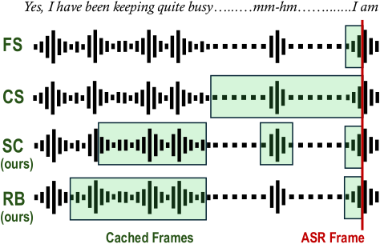
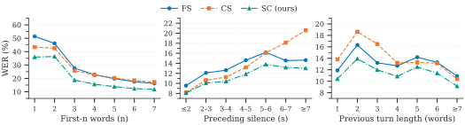
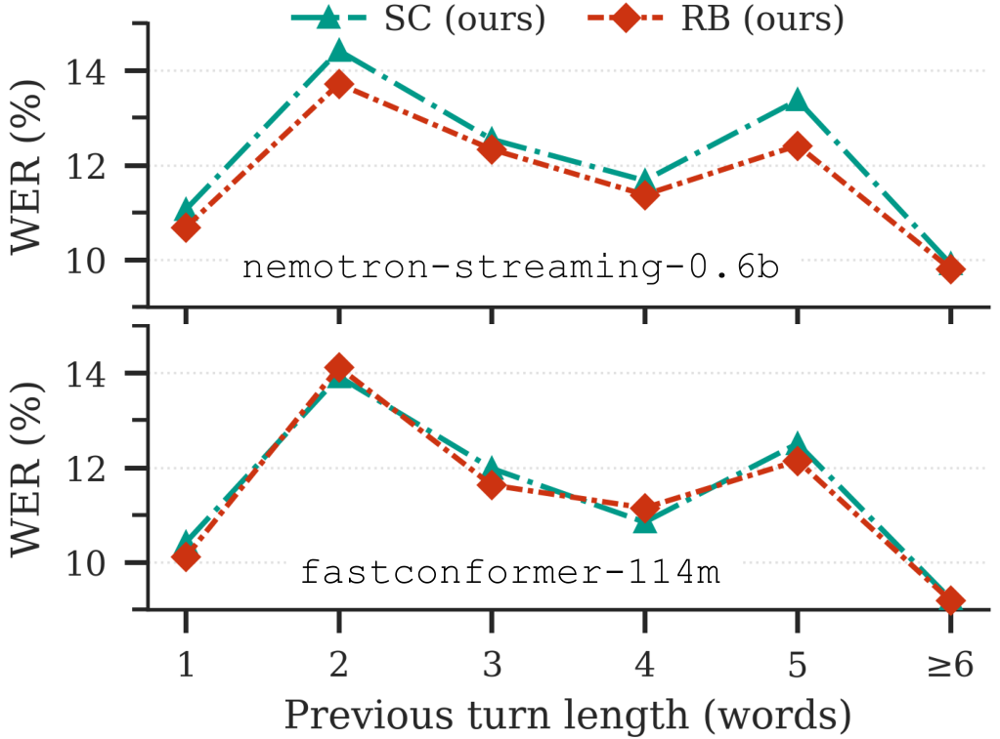

**Source:** *Beyond Fresh Starts: Stateful Inference for Streaming ASR in Conversational Voice Agents* — [PDF](https://arxiv.org/pdf/2608.22101) · [arXiv](https://arxiv.org/abs/2608.22101)

# Beyond Fresh Starts: Stateful Inference for Streaming ASR in Conversational Voice Agents

Sameep Chattopadhyay Alexander Erdmann Mari Ostendorf  Affiliation:  University of Washington SRI Internationalsameepch@uw.edu alex.erdmann@sri.com ostendor@uw.edu

###### Abstract

Modern voice-agent systems rely on streaming speech recognition models that operate under stringent latency constraints. This study shows that, due to the limited memory constraints of real-time processing, these systems are adversely impacted by conversational phenomena such as long silences and backchannels. While many agentic pipelines mitigate this by resetting state at each turn, this approach discards vital context and impairs performance at turn onsets. We propose two state-management strategies that preserve cross-utterance context to reduce onset errors. In experiments with two state-of-the-art streaming models on two spoken dialogue benchmarks, our best method yields an average of 15–21% relative WER reduction at utterance onsets.

## 1 Introduction

The past few years have seen a rapid expansion in conversational voice agents. In 2026, the vast majority of deployed voice agents follow a cascaded speech-to-text, language model, and text-to-speech pipeline [10](https://arxiv.org/html/2608.22101#bib.bib16). To mimic human turn-taking dynamics, these systems have to operate under tight latency budgets, with response delays below 500 ms [23](https://arxiv.org/html/2608.22101#bib.bib14). Industry benchmarks suggest that ASR alone should contribute no more than 200 ms to the overall pipeline [10](https://arxiv.org/html/2608.22101#bib.bib16), thus requiring streaming ASR, i.e., models that transcribe concurrently as the speaker talks.

Unlike offline systems that can utilize bidirectional global contexts, streaming ASR models must operate with very limited acoustic memory, often in the range of a few seconds [20](https://arxiv.org/html/2608.22101#bib.bib1); [4](https://arxiv.org/html/2608.22101#bib.bib4) to support real-time processing. The long silences and frequent backchannels (_e.g._ , “mm-hm”, “uh-huh”) in conversational speech pose a challenge to such low-latency models, by displacing crucial acoustic information from the prior utterance with more recent but task-irrelevant content [12](https://arxiv.org/html/2608.22101#bib.bib6).

 Figure 1: Stateful inference. Cached acoustic memory state for streaming ASR models under the different state-management strategies defined in Section [3.3](https://arxiv.org/html/2608.22101#S3.SS3 "3.3 State Management ‣ 3 Study Design ‣ Beyond Fresh Starts: Stateful Inference for Streaming ASR in Conversational Voice Agents").

Most agentic pipelines handle this by simply resetting the state at each utterance turn, giving the model a fresh start. Useful prior context is then lost, sometimes causing the ASR model to falter on tokens at the beginning of a turn. Such errors may also affect downstream language-model components, as prior work suggests that LLMs often place disproportionate weight on early input tokens during inference [24](https://arxiv.org/html/2608.22101#bib.bib21).

In this work, we focus on the FastConformer RNN-Transducer (RNNT) architecture [17](https://arxiv.org/html/2608.22101#bib.bib2), a widely adopted architecture for low-latency streaming ASR. We first show that these models are susceptible to performance degradation caused by long pauses, backchannels, and state resets at turn boundaries. We then propose a set of simple state-management strategies11 1 Code: <https://github.com/Sameep-c/stateful-streaming-asr.git> to mitigate these effects while preserving prior utterance context across turns. Evaluating on two of the best-performing low-latency streaming ASR models across two telephonic dialogue datasets, we achieve a 15–21% relative WER reduction at turn onsets over the standard state-resetting baselines.

## 2 Streaming ASR

Deployed streaming ASR systems broadly fall into two inference paradigms. Live captioning and real-time transcription services generally process audio as a continuous stream from start to finish, relying on the model’s memory to carry context across the entire recording [14](https://arxiv.org/html/2608.22101#bib.bib19); [19](https://arxiv.org/html/2608.22101#bib.bib12). In contrast, conversational voice agents used in dialogue settings pair streaming ASR with voice activity detection (VAD) or turn detection and decode each turn independently. In other words, the model state is reset at every utterance boundary [13](https://arxiv.org/html/2608.22101#bib.bib13); [16](https://arxiv.org/html/2608.22101#bib.bib15).

The two frameworks have distinct failure modes for conversational speech. Continuous streaming accumulates information across the entire recording, including extended silences and non-lexical backchannels, thereby corrupting acoustic representations of subsequent speech [12](https://arxiv.org/html/2608.22101#bib.bib6); [3](https://arxiv.org/html/2608.22101#bib.bib10). Dialogue agents avoid this problem by restarting the model at each turn, but at the cost of lost acoustic and linguistic context established in earlier turns. Previous work has shown that this particularly degrades performance in long-form RNN-T decoding [16](https://arxiv.org/html/2608.22101#bib.bib15); [15](https://arxiv.org/html/2608.22101#bib.bib17); [11](https://arxiv.org/html/2608.22101#bib.bib11).

Approaches for utilizing prior context have primarily focused on injecting text-based dialogue history into the prediction network [11](https://arxiv.org/html/2608.22101#bib.bib11) or using audio context from prior segments to train the encoder [8](https://arxiv.org/html/2608.22101#bib.bib18); [21](https://arxiv.org/html/2608.22101#bib.bib5). The closest work to ours is [16](https://arxiv.org/html/2608.22101#bib.bib15), who show that carrying LSTM encoder states across utterances during training helps models generalize to long-form speech, serving as a workaround for the practical constraint of training on short utterances. In contrast, our methods do not require any training or fine-tuning. Instead, we approach state management as an inference-time decision problem, using streaming models already trained on long-form audio.

Among open-source streaming ASR models, the cache-aware FastConformer-RNNT [17](https://arxiv.org/html/2608.22101#bib.bib2) has become the go-to architecture for sub-500 ms latency applications. Streaming is enabled via cache-aware attention, where each encoder frame attends to a fixed left-context window of \(L\) frames. These key-value (KV) pairs are stored in a rolling cache alongside a configurable right-context of \(R\) lookahead frames. In addition, each encoder layer maintains a localized convolution cache to mitigate potential artifacts at chunk boundaries. The decoder follows the RNN-Transducer formulation ([9](https://arxiv.org/html/2608.22101#bib.bib3)), wherein the prediction network is a single-layer LSTM operating over the sequence of previously emitted non-blank tokens with its hidden and cell states acting as the decoder’s linguistic memory [17](https://arxiv.org/html/2608.22101#bib.bib2).

## 3 Study Design

This section presents the experimental setup, including the streaming ASR models, datasets, and evaluation protocol. It also formalizes the proposed state-management strategies, State Carry-over and State Rollback, along with the baseline methods used for comparison.

### 3.1 Models

We evaluate the following pre-trained streaming ASR models: fastconformer-114m [17](https://arxiv.org/html/2608.22101#bib.bib2) and nemotron-streaming-0.6b [18](https://arxiv.org/html/2608.22101#bib.bib20). Both models share a common cache-aware FastConformer-RNNT architecture, with model state given by a set of six components distributed between the encoder and the decoder. The FastConformer state comprises the encoder attention KV cache, a per-layer convolution cache, and the corresponding valid cache length. Similarly, the RNNT state consists of the accumulated decoder hypothesis, the last predicted token, and the number of tokens emitted. Further architectural details are provided in Appendix [A.2](https://arxiv.org/html/2608.22101#A1.SS2 "A.2 Architecture Details ‣ Appendix A Appendix ‣ Beyond Fresh Starts: Stateful Inference for Streaming ASR in Conversational Voice Agents").

### 3.2 Datasets

We evaluate our framework on the test sets of two standard telephonic dialogue benchmarks: CallHome [2](https://arxiv.org/html/2608.22101#bib.bib9) and Switchboard [7](https://arxiv.org/html/2608.22101#bib.bib8); [5](https://arxiv.org/html/2608.22101#bib.bib7) (test split as in [1](https://arxiv.org/html/2608.22101#bib.bib23)). For both datasets, we use individual (unmixed) channels, which contain backchannels, extended periods of silence, and occasional crosstalk. The datasets provide utterance-level timestamps for each speaker. Consecutive utterances from the same speaker separated by less than 1 s of silence are treated as a single turn, consistent with end-of-turn detection heuristics employed by commercial voice agents [10](https://arxiv.org/html/2608.22101#bib.bib16). Both models are pre-trained on the Switchboard training set and have not been exposed to CallHome during training [17](https://arxiv.org/html/2608.22101#bib.bib2); [18](https://arxiv.org/html/2608.22101#bib.bib20). Additional dataset details are provided in Appendix [A.3](https://arxiv.org/html/2608.22101#A1.SS3 "A.3 Dataset Statistics ‣ Appendix A Appendix ‣ Beyond Fresh Starts: Stateful Inference for Streaming ASR in Conversational Voice Agents").

### 3.3 State Management

We implement and compare the four state management strategies visualized in Figure [1](https://arxiv.org/html/2608.22101#S1.F1 "Figure 1 ‣ 1 Introduction ‣ Beyond Fresh Starts: Stateful Inference for Streaming ASR in Conversational Voice Agents"):

  * Fresh Start (FS): The model’s internal state is fully reset at the start of each turn, causing each utterance to be decoded independently. 
  * Continuous State (CS): Streaming proceeds continuously without any manipulation. The acoustic memory always consists of the last \(L\) frames from the speaker channel, regardless of content. 
  * State Carry-over (SC): The state at the end of a turn is utilized as the starting state for the next one, allowing the model to retain context from previous turns while bypassing long silences. 
  * State Rollback (RB): An extension of state carry-over in which the model rolls back to the state saved at the end of the last substantial turn when the previous turn is too short ( \(<k\) tokens) in order to drop backchannel context. 

Algorithm [1](https://arxiv.org/html/2608.22101#alg1 "Algorithm 1 ‣ 3.3 State Management ‣ 3 Study Design ‣ Beyond Fresh Starts: Stateful Inference for Streaming ASR in Conversational Voice Agents") formalizes the three state management strategies (FS, SC, RB) as a single state-update rule over speaker turns. CS, which streams continuously through inter-turn silence without any manipulation, is excluded from the algorithm.

Algorithm 1 State Management Strategies for Streaming ASR

1: Audio stream with turns \(\{u_{1},\dots,u_{T}\}\); mode \(m\in\{FS,SC,RB\}\); threshold \(k\) (for RB) 

2: Hypotheses \(\{h_{1},\dots,h_{T}\}\), where \(h_{i}\) is the decoded token sequence for turn \(u_{i}\) and \(|h_{i}|\) is its token length 

3: \(S\leftarrow\varnothing\) \(\triangleright\) Model state 

4: \(S^{*}\leftarrow\varnothing\) \(\triangleright\) Last substantial-turn state (RB) 

5: for \(i=1\) to \(T\) do

6: \(h_{i},S_{i}\leftarrow\textsc{Infer}(u_{i},S)\) 

7: if \(m=FS\) then

8: \(S\leftarrow\varnothing\) \(\triangleright\) State reset 

9: else if \(m=SC\) then

10: \(S\leftarrow S_{i}\) \(\triangleright\) State carry-over 

11: else if \(m=RB\) then

12: if \(|h_{i}|\geq k\) then

13: \(S\leftarrow S_{i}\) 

14: \(S^{*}\leftarrow S_{i}\) 

15: else

16: \(S\leftarrow S^{*}\) \(\triangleright\) State rollback 

17: end if

18: end if

19: end for

20: return \(\{h_{1},\dots,h_{T}\}\) 

Most commercially deployed voice agents operate in a manner similar to FS, while for other streaming ASR applications, like live meeting captioning, streaming happens without any state manipulation like CS. As described in Section [2](https://arxiv.org/html/2608.22101#S2 "2 Streaming ASR ‣ Beyond Fresh Starts: Stateful Inference for Streaming ASR in Conversational Voice Agents"), both FS and CS have shortcomings, which the SC and RB strategies are designed to address.

 Figure 2: Word Error Rates for different state-management strategies with fastconformer-114m on Switchboard. 

<table id="S3.T1.2" class="ltx_tabular ltx_centering ltx_guessed_headers ltx_align_middle">
<thead class="ltx_thead">
<tr id="S3.T1.2.1" class="ltx_tr">
<th id="S3.T1.2.1.1" class="ltx_td ltx_align_left ltx_th ltx_th_column ltx_th_row ltx_border_tt" rowspan="2">Model</th>
<th id="S3.T1.2.1.2" class="ltx_td ltx_align_left ltx_th ltx_th_column ltx_th_row ltx_border_tt" rowspan="2">Category</th>
<th id="S3.T1.2.1.3" class="ltx_td ltx_align_center ltx_th ltx_th_column ltx_border_tt" colspan="4">CallHome</th>
<th id="S3.T1.2.1.4" class="ltx_td ltx_align_center ltx_th ltx_th_column ltx_border_tt" colspan="4">Switchboard</th></tr>
<tr id="S3.T1.2.2" class="ltx_tr">
<th id="S3.T1.2.2.1" class="ltx_td ltx_align_center ltx_th ltx_th_column ltx_border_t">fs</th>
<th id="S3.T1.2.2.2" class="ltx_td ltx_align_center ltx_th ltx_th_column ltx_border_t">cs</th>
<th id="S3.T1.2.2.3" class="ltx_td ltx_align_center ltx_th ltx_th_column ltx_border_t">sc</th>
<th id="S3.T1.2.2.4" class="ltx_td ltx_align_center ltx_th ltx_th_column ltx_border_t">rb</th>
<th id="S3.T1.2.2.5" class="ltx_td ltx_align_center ltx_th ltx_th_column ltx_border_t">fs</th>
<th id="S3.T1.2.2.6" class="ltx_td ltx_align_center ltx_th ltx_th_column ltx_border_t">cs</th>
<th id="S3.T1.2.2.7" class="ltx_td ltx_align_center ltx_th ltx_th_column ltx_border_t">sc</th>
<th id="S3.T1.2.2.8" class="ltx_td ltx_align_center ltx_th ltx_th_column ltx_border_t">rb</th></tr>
</thead>
<tbody class="ltx_tbody">
<tr id="S3.T1.2.3" class="ltx_tr">
<th id="S3.T1.2.3.1" class="ltx_td ltx_align_left ltx_th ltx_th_row ltx_border_t" rowspan="4">fastconformer-114m</th>
<th id="S3.T1.2.3.2" class="ltx_td ltx_align_left ltx_th ltx_th_row ltx_border_t">Overall</th>
<td id="S3.T1.2.3.3" class="ltx_td ltx_align_center ltx_border_t">15.43</td>
<td id="S3.T1.2.3.4" class="ltx_td ltx_align_center ltx_border_t">15.18</td>
<td id="S3.T1.2.3.5" class="ltx_td ltx_align_center ltx_border_t">14.02</td>
<td id="S3.T1.2.3.6" class="ltx_td ltx_align_center ltx_border_t">13.83</td>
<td id="S3.T1.2.3.7" class="ltx_td ltx_align_center ltx_border_t">11.97</td>
<td id="S3.T1.2.3.8" class="ltx_td ltx_align_center ltx_border_t">12.36</td>
<td id="S3.T1.2.3.9" class="ltx_td ltx_align_center ltx_border_t">10.26</td>
<td id="S3.T1.2.3.10" class="ltx_td ltx_align_center ltx_border_t">10.20</td></tr>
<tr id="S3.T1.2.4" class="ltx_tr">
<th id="S3.T1.2.4.1" class="ltx_td ltx_align_left ltx_th ltx_th_row">First Word</th>
<td id="S3.T1.2.4.2" class="ltx_td ltx_align_center">48.10</td>
<td id="S3.T1.2.4.3" class="ltx_td ltx_align_center">41.40</td>
<td id="S3.T1.2.4.4" class="ltx_td ltx_align_center">36.24</td>
<td id="S3.T1.2.4.5" class="ltx_td ltx_align_center">35.03</td>
<td id="S3.T1.2.4.6" class="ltx_td ltx_align_center">51.44</td>
<td id="S3.T1.2.4.7" class="ltx_td ltx_align_center">44.32</td>
<td id="S3.T1.2.4.8" class="ltx_td ltx_align_center">35.92</td>
<td id="S3.T1.2.4.9" class="ltx_td ltx_align_center">34.78</td></tr>
<tr id="S3.T1.2.5" class="ltx_tr">
<th id="S3.T1.2.5.1" class="ltx_td ltx_align_left ltx_th ltx_th_row">After Long Pause</th>
<td id="S3.T1.2.5.2" class="ltx_td ltx_align_center">17.17</td>
<td id="S3.T1.2.5.3" class="ltx_td ltx_align_center">20.66</td>
<td id="S3.T1.2.5.4" class="ltx_td ltx_align_center">16.15</td>
<td id="S3.T1.2.5.5" class="ltx_td ltx_align_center">15.70</td>
<td id="S3.T1.2.5.6" class="ltx_td ltx_align_center">14.73</td>
<td id="S3.T1.2.5.7" class="ltx_td ltx_align_center">20.06</td>
<td id="S3.T1.2.5.8" class="ltx_td ltx_align_center">13.08</td>
<td id="S3.T1.2.5.9" class="ltx_td ltx_align_center">12.99</td></tr>
<tr id="S3.T1.2.6" class="ltx_tr">
<th id="S3.T1.2.6.1" class="ltx_td ltx_align_left ltx_th ltx_th_row">After Short Turn</th>
<td id="S3.T1.2.6.2" class="ltx_td ltx_align_center">18.52</td>
<td id="S3.T1.2.6.3" class="ltx_td ltx_align_center">20.20</td>
<td id="S3.T1.2.6.4" class="ltx_td ltx_align_center">17.17</td>
<td id="S3.T1.2.6.5" class="ltx_td ltx_align_center">16.61</td>
<td id="S3.T1.2.6.6" class="ltx_td ltx_align_center">13.93</td>
<td id="S3.T1.2.6.7" class="ltx_td ltx_align_center">15.94</td>
<td id="S3.T1.2.6.8" class="ltx_td ltx_align_center">12.03</td>
<td id="S3.T1.2.6.9" class="ltx_td ltx_align_center">11.94</td></tr>
<tr id="S3.T1.2.7" class="ltx_tr">
<th id="S3.T1.2.7.1" class="ltx_td ltx_align_left ltx_th ltx_th_row ltx_border_bb ltx_border_t" rowspan="4">nemotron-streaming-0.6b</th>
<th id="S3.T1.2.7.2" class="ltx_td ltx_align_left ltx_th ltx_th_row ltx_border_t">Overall</th>
<td id="S3.T1.2.7.3" class="ltx_td ltx_align_center ltx_border_t">13.82</td>
<td id="S3.T1.2.7.4" class="ltx_td ltx_align_center ltx_border_t">14.29</td>
<td id="S3.T1.2.7.5" class="ltx_td ltx_align_center ltx_border_t">13.86</td>
<td id="S3.T1.2.7.6" class="ltx_td ltx_align_center ltx_border_t">13.52</td>
<td id="S3.T1.2.7.7" class="ltx_td ltx_align_center ltx_border_t">10.90</td>
<td id="S3.T1.2.7.8" class="ltx_td ltx_align_center ltx_border_t">11.40</td>
<td id="S3.T1.2.7.9" class="ltx_td ltx_align_center ltx_border_t">10.85</td>
<td id="S3.T1.2.7.10" class="ltx_td ltx_align_center ltx_border_t">10.62</td></tr>
<tr id="S3.T1.2.8" class="ltx_tr">
<th id="S3.T1.2.8.1" class="ltx_td ltx_align_left ltx_th ltx_th_row">First Word</th>
<td id="S3.T1.2.8.2" class="ltx_td ltx_align_center">32.28</td>
<td id="S3.T1.2.8.3" class="ltx_td ltx_align_center">32.61</td>
<td id="S3.T1.2.8.4" class="ltx_td ltx_align_center">32.36</td>
<td id="S3.T1.2.8.5" class="ltx_td ltx_align_center">27.85</td>
<td id="S3.T1.2.8.6" class="ltx_td ltx_align_center">32.50</td>
<td id="S3.T1.2.8.7" class="ltx_td ltx_align_center">34.40</td>
<td id="S3.T1.2.8.8" class="ltx_td ltx_align_center">31.69</td>
<td id="S3.T1.2.8.9" class="ltx_td ltx_align_center">29.46</td></tr>
<tr id="S3.T1.2.9" class="ltx_tr">
<th id="S3.T1.2.9.1" class="ltx_td ltx_align_left ltx_th ltx_th_row">After Long Pause</th>
<td id="S3.T1.2.9.2" class="ltx_td ltx_align_center">14.79</td>
<td id="S3.T1.2.9.3" class="ltx_td ltx_align_center">16.64</td>
<td id="S3.T1.2.9.4" class="ltx_td ltx_align_center">15.62</td>
<td id="S3.T1.2.9.5" class="ltx_td ltx_align_center">14.68</td>
<td id="S3.T1.2.9.6" class="ltx_td ltx_align_center">13.25</td>
<td id="S3.T1.2.9.7" class="ltx_td ltx_align_center">14.37</td>
<td id="S3.T1.2.9.8" class="ltx_td ltx_align_center">13.11</td>
<td id="S3.T1.2.9.9" class="ltx_td ltx_align_center">12.83</td></tr>
<tr id="S3.T1.2.10" class="ltx_tr">
<th id="S3.T1.2.10.1" class="ltx_td ltx_align_left ltx_th ltx_th_row ltx_border_bb">After Short Turn</th>
<td id="S3.T1.2.10.2" class="ltx_td ltx_align_center ltx_border_bb">16.64</td>
<td id="S3.T1.2.10.3" class="ltx_td ltx_align_center ltx_border_bb">18.31</td>
<td id="S3.T1.2.10.4" class="ltx_td ltx_align_center ltx_border_bb">17.05</td>
<td id="S3.T1.2.10.5" class="ltx_td ltx_align_center ltx_border_bb">15.66</td>
<td id="S3.T1.2.10.6" class="ltx_td ltx_align_center ltx_border_bb">12.51</td>
<td id="S3.T1.2.10.7" class="ltx_td ltx_align_center ltx_border_bb">13.62</td>
<td id="S3.T1.2.10.8" class="ltx_td ltx_align_center ltx_border_bb">12.62</td>
<td id="S3.T1.2.10.9" class="ltx_td ltx_align_center ltx_border_bb">12.15</td></tr>
</tbody>
</table>

 Table 1: Detailed WER (%) analysis. First Word refers to the WER of the initial word in a turn; “Long Pause” denotes silences exceeding the acoustic memory length of 5.6 s; “Short Turn” denotes turns shorter than 3 words.

### 3.4 Evaluation

We evaluate our state-management strategies using the standard Word Error Rate (WER) measure. For all experiments, the models perform greedy decoding with a batch size of 1, operating with a left-context window of \(L=70\) frames (5.6 s of history) and a right-context of \(R=1\) frame (160 ms latency), following the configuration described in [17](https://arxiv.org/html/2608.22101#bib.bib2). This places the models within the latency requirements of real-time voice agents. For RB, we experiment with token thresholds \(k\in\{1,5,10\}\), and present results using the hyperparameters that achieve the best validation-set performance: \(k=5\) for fastconformer-114m and \(k=10\) for nemotron-streaming-0.6b.

For the key experiments reported in Section [4](https://arxiv.org/html/2608.22101#S4 "4 Results and Analysis ‣ Beyond Fresh Starts: Stateful Inference for Streaming ASR in Conversational Voice Agents"), we use the ground-truth timestamps provided by each dataset to identify spoken regions and filter out tokens generated outside these intervals, such as those arising from crosstalk. To accommodate late token emissions that may occur past the utterance boundary, we extend each spoken region by 500 ms beyond the annotated end time for all our experiments. We further evaluate our strategies in a more realistic deployment setting using turn boundaries generated by Silero-VAD [22](https://arxiv.org/html/2608.22101#bib.bib22), a voice activity detection model widely used in commercial voice agents [10](https://arxiv.org/html/2608.22101#bib.bib16). Implementation details including VAD hyperparameters are provided in Appendix [A.7](https://arxiv.org/html/2608.22101#A1.SS7 "A.7 VAD-derived Turn Boundaries ‣ Appendix A Appendix ‣ Beyond Fresh Starts: Stateful Inference for Streaming ASR in Conversational Voice Agents").

### 3.5 Memory Overhead

As described in Algorithm [1](https://arxiv.org/html/2608.22101#alg1 "Algorithm 1 ‣ 3.3 State Management ‣ 3 Study Design ‣ Beyond Fresh Starts: Stateful Inference for Streaming ASR in Conversational Voice Agents"), SC incurs no additional memory overhead beyond standard streaming inference, as it simply carries forward the model state produced at the end of the previous turn. In contrast, RB needs to store an additional state \((S^{*})\) from the last substantial turn. For the default configuration described above, this amounts to approximately 2.6 MB for fastconformer-114m and 7.32 MB for nemotron-streaming-0.6b (see Appendix [A.2](https://arxiv.org/html/2608.22101#A1.SS2 "A.2 Architecture Details ‣ Appendix A Appendix ‣ Beyond Fresh Starts: Stateful Inference for Streaming ASR in Conversational Voice Agents")). This corresponds to just 0.6% and 0.3% of the respective model sizes, making the additional memory overhead of RB negligible.

## 4 Results and Analysis

We first conduct a set of experiments to characterize the failure modes of different state-management strategies under varying conversational conditions. Specifically, we measure WER as a function of (i) the first \(n\) words in the turn (for turns with \(\geq n\) words); (ii) the duration of silence preceding the turn; and (iii) the length of the preceding turn. The first analysis evaluates performance at turn onsets, while the latter two assess the robustness of the strategies to conversational noise.

Figure [2](https://arxiv.org/html/2608.22101#S3.F2 "Figure 2 ‣ 3.3 State Management ‣ 3 Study Design ‣ Beyond Fresh Starts: Stateful Inference for Streaming ASR in Conversational Voice Agents") illustrates the performance of the FS, CS, and SC strategies for these failure modes using fastconformer-114m on Switchboard. The first plot highlights that resetting the state results in significant performance degradation in the absence of any prior context for the first few words. The second plot shows how the preceding silence can degrade the state. While CS is generally better than FS for turns following shorter silences, CS performance degrades when the silence length exceeds the acoustic memory length of 5.6 s. The third plot suggests that short preceding turns, which often correspond to backchannels, degrade CS performance on the subsequent utterance relative to FS. In all contexts, the proposed SC approach outperforms existing baselines, demonstrating how state management through SC can effectively preserve relevant cross-utterance context.

Figure [3](https://arxiv.org/html/2608.22101#S4.F3 "Figure 3 ‣ 4 Results and Analysis ‣ Beyond Fresh Starts: Stateful Inference for Streaming ASR in Conversational Voice Agents") shows the WER of SC compared to RB for utterances after turns of different lengths, for both models on Switchboard. For fastconformer-114m, RB and SC perform similarly. However, RB provides noticeably larger improvements for nemotron-streaming-0.6b, suggesting that its model state is more sensitive to shorter turns and backchannels.

All four strategies are compared in Table [1](https://arxiv.org/html/2608.22101#S3.T1 "Table 1 ‣ 3.3 State Management ‣ 3 Study Design ‣ Beyond Fresh Starts: Stateful Inference for Streaming ASR in Conversational Voice Agents") for all model and dataset pairs. The key findings from the plots in Figure [2](https://arxiv.org/html/2608.22101#S3.F2 "Figure 2 ‣ 3.3 State Management ‣ 3 Study Design ‣ Beyond Fresh Starts: Stateful Inference for Streaming ASR in Conversational Voice Agents") are captured in the following WER metrics: i) Overall: the primary WER. ii) First Word: WER comparing the first word in the reference turn and the ASR hypothesis. iii) After Long Pause: WER of turns preceded by pauses \(\geq 5.6\) s. iv) After Short Turn: WER of utterances following short turns with \(\leq 2\) words (note that the vast majority of these short turns are backchannels).

Table [1](https://arxiv.org/html/2608.22101#S3.T1 "Table 1 ‣ 3.3 State Management ‣ 3 Study Design ‣ Beyond Fresh Starts: Stateful Inference for Streaming ASR in Conversational Voice Agents") shows that RB achieves the lowest overall WER across all models and datasets, demonstrating the benefits of selectively preserving cross-utterance context. In contrast, naive CS performs worst in three of four settings, largely due to errors following long pauses and backchannels. While FS mitigates these effects by resetting state at each turn, it incurs a substantial turn-onset penalty, particularly for fastconformer-114m, where first-word WER degrades despite improvements in overall WER. Preserving prior context via SC provides clear gains for fastconformer-114m, but not for nemotron-streaming-0.6b, where utterances following backchannels often suffer degradation. RB addresses this issue by selectively discarding harmful context, consistently outperforming both FS and SC across all evaluated metrics.

 Figure 3: Comparison of SC and RB for Switchboard.

#### Statistical significance.

To verify that the improvements from our methods are statistically significant, we compute “Overall WERs” for FS and RB and compare them using the MAPSSWE test, following standard practice in the ASR literature [6](https://arxiv.org/html/2608.22101#bib.bib24). Our analysis reveals that, across all four model-dataset combinations, RB’s improvement over FS is statistically significant, with \(p<10^{-3}\) for three setups and \(p<0.05\) for the remaining one (Appendix [A.4](https://arxiv.org/html/2608.22101#A1.SS4 "A.4 Statistical Significance Testing ‣ Appendix A Appendix ‣ Beyond Fresh Starts: Stateful Inference for Streaming ASR in Conversational Voice Agents")). While the overall gains appear modest, this is expected: the benefits from our strategies are concentrated in the first few tokens of each turn and are averaged out over the complete utterances. The first-word WER results in Table [1](https://arxiv.org/html/2608.22101#S3.T1 "Table 1 ‣ 3.3 State Management ‣ 3 Study Design ‣ Beyond Fresh Starts: Stateful Inference for Streaming ASR in Conversational Voice Agents") directly capture this effect.

#### Rollback threshold.

We experiment with coarse thresholds \(k\in\{1,5,10\}\) for RB, and present results with the best hyperparameters, i.e., \(k=5\) for fastconformer-114m and \(k=10\) for nemotron-streaming-0.6b in Table [1](https://arxiv.org/html/2608.22101#S3.T1 "Table 1 ‣ 3.3 State Management ‣ 3 Study Design ‣ Beyond Fresh Starts: Stateful Inference for Streaming ASR in Conversational Voice Agents"). Additional results with the other thresholds are provided in Appendix [A.5](https://arxiv.org/html/2608.22101#A1.SS5 "A.5 Rollback Threshold ‣ Appendix A Appendix ‣ Beyond Fresh Starts: Stateful Inference for Streaming ASR in Conversational Voice Agents"). Based on these results, we observe that RB consistently outperforms SC across all tested values of \(k\).

#### Variable latency.

The performance trends of the state-management strategies remain largely unchanged even with different latencies, with RB consistently achieving the best results at all supported latencies below 250 ms (Appendix [A.6](https://arxiv.org/html/2608.22101#A1.SS6 "A.6 Latency Analysis ‣ Appendix A Appendix ‣ Beyond Fresh Starts: Stateful Inference for Streaming ASR in Conversational Voice Agents")). Reducing latency from 560 ms to 160 ms to satisfy voice-agent requirements results in only a modest degradation in performance. For fastconformer-114m, RB at 160 ms achieves a lower WER than FS at 560 ms. With RB, across both models, the WER increase relative to the best-performing strategy at 560 ms remains below 6%.

#### Without ground-truth timings.

Finally, we evaluate our methods using turn boundaries generated by Silero-VAD [22](https://arxiv.org/html/2608.22101#bib.bib22), to better approximate real-world deployment conditions. The results (Appendix [A.7](https://arxiv.org/html/2608.22101#A1.SS7 "A.7 VAD-derived Turn Boundaries ‣ Appendix A Appendix ‣ Beyond Fresh Starts: Stateful Inference for Streaming ASR in Conversational Voice Agents")) show that our strategies continue to outperform existing approaches without access to ground-truth timings, with the improvements being statistically significant. At 160 ms latency, RB achieves a 20.6% relative reduction in first-word WER over FS using VAD-obtained boundaries for Switchboard, closely matching the 20.9% reduction observed in Table [1](https://arxiv.org/html/2608.22101#S3.T1 "Table 1 ‣ 3.3 State Management ‣ 3 Study Design ‣ Beyond Fresh Starts: Stateful Inference for Streaming ASR in Conversational Voice Agents"). This analysis is restricted to the Switchboard dataset, as it requires word-level timing annotations for turn attribution, which are not available in CallHome.

To summarize, our analysis yields the following key findings:

  * Although FS outperforms CS in most contexts, it consistently incurs a substantial penalty on the initial words at each turn. 
  * CS performance degrades as the preceding silence duration increases. 
  * SC substantially outperforms CS on both models and benchmarks. The gains from SC over FS are mainly for fastconformer-114m. 
  * RB is the best-performing state-management strategy across all evaluated models and datasets. 
  * These trends are consistent across all latencies below 250 ms and hold even with VAD-obtained turn boundaries for Switchboard. 

## 5 Conclusions

This work provides a detailed empirical analysis of how long silences and backchannels degrade low-latency streaming ASR. We demonstrate that the state-resetting approach used by most voice agents discards useful cross-utterance context, causing disproportionate performance degradation at utterance onsets where errors are most costly for the downstream language model. To address this, we propose two simple state-management strategies, State Carry-over (SC) and State Rollback (RB), that preserve prior context across turns while remaining robust to conversational noise. Experiments across two streaming ASR models and two conversational benchmarks confirm that our strategies improve overall recognition accuracy, especially at turn onsets. These improvements can be particularly important for subsequent downstream processing by voice agents, since early ASR errors can propagate to and compound in downstream components.

## 6 Limitations

Our experiments are limited to benchmarks consisting primarily of American English telephonic conversations; whether the observed trends generalize to other languages and conversational settings remains an open question. The proposed rollback strategy relies on an empirically tuned threshold. While we demonstrate consistent gains across varied settings, adapting this threshold dynamically to conversational context may yield further improvements. Furthermore, this work focuses on a specific set of conversational failure modes: state resets, long pauses, and backchannels. It would be useful to extend the analysis to additional challenges, such as noisy acoustic conditions, code-switching, and multi-speaker settings. Finally, this work focuses on improving ASR performance rather than evaluating downstream voice-agent behavior. Although improved recognition may benefit subsequent language-model components, we do not directly measure its impact on downstream tasks such as intent prediction, dialogue quality, or task success. Investigating ASR error propagation in LLM-based voice-agent pipelines remains an important direction for future work.

## Acknowledgments

This work was supported by the Intelligence Advanced Research Projects Activity (IARPA) via Department of Interior/Interior Business Center (DOI/IBC) contract number 140D0424C0070. The United States Government is authorized to reproduce and distribute reprints for governmental purposes, notwithstanding any copyright annotation thereon. Disclaimer: The views and conclusions contained herein are those of the authors and should not be interpreted as necessarily representing the official policies or endorsements, either expressed or implied, of IARPA, DOI/IBC, or the U.S. Government.

## References

  * Amrit Romana (2023) E. M. P. Amrit Romana Automatic disfluency detection from untranscribed speech.  Cited by: [§A.3](https://arxiv.org/html/2608.22101#A1.SS3.p2.1 "A.3 Dataset Statistics ‣ Appendix A Appendix ‣ Beyond Fresh Starts: Stateful Inference for Streaming ASR in Conversational Voice Agents"), [§3.2](https://arxiv.org/html/2608.22101#S3.SS2.p1.1 "3.2 Datasets ‣ 3 Study Design ‣ Beyond Fresh Starts: Stateful Inference for Streaming ASR in Conversational Voice Agents"). 
  * Canavan et al. (1997) A. Canavan, D. Graff, and G. Zipperlen CALLHOME american english speech.  Note: Linguistic Data Consortium, PhiladelphiaLDC97S42 External Links: [Link](https://catalog.ldc.upenn.edu/LDC97S42) Cited by: [§A.3](https://arxiv.org/html/2608.22101#A1.SS3.p1.1 "A.3 Dataset Statistics ‣ Appendix A Appendix ‣ Beyond Fresh Starts: Stateful Inference for Streaming ASR in Conversational Voice Agents"), [§A.7](https://arxiv.org/html/2608.22101#A1.SS7.p3.1 "A.7 VAD-derived Turn Boundaries ‣ Appendix A Appendix ‣ Beyond Fresh Starts: Stateful Inference for Streaming ASR in Conversational Voice Agents"), [§3.2](https://arxiv.org/html/2608.22101#S3.SS2.p1.1 "3.2 Datasets ‣ 3 Study Design ‣ Beyond Fresh Starts: Stateful Inference for Streaming ASR in Conversational Voice Agents"). 
  * Choi et al. (2024) Y. Choi, J. Bang, and S. H. Kim Joint streaming model for backchannel prediction and automatic speech recognition.  ETRI Journal 46 (1), pp. 118–126.  External Links: [Document](https://dx.doi.org/10.4218/etrij.2023-0358) Cited by: [§2](https://arxiv.org/html/2608.22101#S2.p2.1 "2 Streaming ASR ‣ Beyond Fresh Starts: Stateful Inference for Streaming ASR in Conversational Voice Agents"). 
  * Défossez et al. (2024) A. Défossez, L. Mazaré, M. Orsini, A. Royer, P. Pérez, H. Jégou, E. Grave, and N. Zeghidour Moshi: a speech-text foundation model for real-time dialogue.  Technical report External Links: 2410.00037, [Link](https://arxiv.org/abs/2410.00037) Cited by: [§1](https://arxiv.org/html/2608.22101#S1.p2.1 "1 Introduction ‣ Beyond Fresh Starts: Stateful Inference for Streaming ASR in Conversational Voice Agents"). 
  * Deshmukh et al. (1998) N. Deshmukh, A. Ganapathiraju, A. Gleeson, J. Hamaker, and J. W. Picone Resegmentation of switchboard.  5th International Conference on Spoken Language Processing (ICSLP 1998).  External Links: [Link](https://api.semanticscholar.org/CorpusID:17232323) Cited by: [§A.3](https://arxiv.org/html/2608.22101#A1.SS3.p1.1 "A.3 Dataset Statistics ‣ Appendix A Appendix ‣ Beyond Fresh Starts: Stateful Inference for Streaming ASR in Conversational Voice Agents"), [§3.2](https://arxiv.org/html/2608.22101#S3.SS2.p1.1 "3.2 Datasets ‣ 3 Study Design ‣ Beyond Fresh Starts: Stateful Inference for Streaming ASR in Conversational Voice Agents"). 
  * Gillick and Cox (1989) L. Gillick and S. J. Cox Some statistical issues in the comparison of speech recognition algorithms.  In International Conference on Acoustics, Speech, and Signal Processing (ICASSP),  Vol. 1, Glasgow, Scotland, pp. 532–535.  External Links: [Document](https://dx.doi.org/10.1109/ICASSP.1989.266481) Cited by: [§A.4](https://arxiv.org/html/2608.22101#A1.SS4.p1.1 "A.4 Statistical Significance Testing ‣ Appendix A Appendix ‣ Beyond Fresh Starts: Stateful Inference for Streaming ASR in Conversational Voice Agents"), [§4](https://arxiv.org/html/2608.22101#S4.SS0.SSS0.Px1.p1.1 "Statistical significance. ‣ 4 Results and Analysis ‣ Beyond Fresh Starts: Stateful Inference for Streaming ASR in Conversational Voice Agents"). 
  * Godfrey et al. (1992) J. J. Godfrey, E. C. Holliman, and J. McDaniel SWITCHBOARD: telephone speech corpus for research and development.  In Proceedings of the 1992 IEEE International Conference on Acoustics, Speech and Signal Processing - Volume 1,  ICASSP’92, USA, pp. 517–520.  External Links: ISBN 0780305329 Cited by: [§A.3](https://arxiv.org/html/2608.22101#A1.SS3.p1.1 "A.3 Dataset Statistics ‣ Appendix A Appendix ‣ Beyond Fresh Starts: Stateful Inference for Streaming ASR in Conversational Voice Agents"), [§3.2](https://arxiv.org/html/2608.22101#S3.SS2.p1.1 "3.2 Datasets ‣ 3 Study Design ‣ Beyond Fresh Starts: Stateful Inference for Streaming ASR in Conversational Voice Agents"). 
  * Gómez Alanís et al. (2022) A. Gómez Alanís, L. Drude, A. Schwarz, R. V. Swaminathan, and S. Wiesler Contextual-utterance training for automatic speech recognition.  In Proceedings of the IberSPEECH Conference,  pp. 26–30.  External Links: 2210.16238 Cited by: [§2](https://arxiv.org/html/2608.22101#S2.p3.1 "2 Streaming ASR ‣ Beyond Fresh Starts: Stateful Inference for Streaming ASR in Conversational Voice Agents"). 
  * Graves (2012) A. Graves Sequence transduction with recurrent neural networks.  arXiv preprint arXiv:1211.3711.  External Links: 1211.3711, [Document](https://dx.doi.org/10.48550/arXiv.1211.3711) Cited by: [§2](https://arxiv.org/html/2608.22101#S2.p4.1 "2 Streaming ASR ‣ Beyond Fresh Starts: Stateful Inference for Streaming ASR in Conversational Voice Agents"). 
  * Hamming AI (2026) Hamming AI Voice AI Latency: What’s Fast, What’s Slow, and How to Fix It.  Note: <https://hamming.ai/resources/voice-ai-latency-whats-fast-whats-slow-how-to-fix-it>Accessed: 2026 Cited by: [§A.3](https://arxiv.org/html/2608.22101#A1.SS3.p2.1 "A.3 Dataset Statistics ‣ Appendix A Appendix ‣ Beyond Fresh Starts: Stateful Inference for Streaming ASR in Conversational Voice Agents"), [§A.6](https://arxiv.org/html/2608.22101#A1.SS6.p1.1 "A.6 Latency Analysis ‣ Appendix A Appendix ‣ Beyond Fresh Starts: Stateful Inference for Streaming ASR in Conversational Voice Agents"), [§1](https://arxiv.org/html/2608.22101#S1.p1.1 "1 Introduction ‣ Beyond Fresh Starts: Stateful Inference for Streaming ASR in Conversational Voice Agents"), [§3.2](https://arxiv.org/html/2608.22101#S3.SS2.p1.1 "3.2 Datasets ‣ 3 Study Design ‣ Beyond Fresh Starts: Stateful Inference for Streaming ASR in Conversational Voice Agents"), [§3.4](https://arxiv.org/html/2608.22101#S3.SS4.p2.1 "3.4 Evaluation ‣ 3 Study Design ‣ Beyond Fresh Starts: Stateful Inference for Streaming ASR in Conversational Voice Agents"). 
  * Hou et al. (2022) J. Hou, J. Chen, W. Li, Y. Tang, J. Zhang, and Z. Ma Bring dialogue-context into RNN-T for streaming ASR.  In Proc. Interspeech,  pp. 2048–2052.  External Links: [Document](https://dx.doi.org/10.21437/Interspeech.2022-697) Cited by: [§2](https://arxiv.org/html/2608.22101#S2.p2.1 "2 Streaming ASR ‣ Beyond Fresh Starts: Stateful Inference for Streaming ASR in Conversational Voice Agents"), [§2](https://arxiv.org/html/2608.22101#S2.p3.1 "2 Streaming ASR ‣ Beyond Fresh Starts: Stateful Inference for Streaming ASR in Conversational Voice Agents"). 
  * Hsiao et al. (2020) R. Hsiao, D. Can, T. Ng, R. Travadi, and A. Ghoshal Online automatic speech recognition with listen, attend and spell model.  IEEE Signal Processing Letters 27, pp. 1889–1893.  External Links: [Document](https://dx.doi.org/10.1109/LSP.2020.3031480) Cited by: [§1](https://arxiv.org/html/2608.22101#S1.p2.1 "1 Introduction ‣ Beyond Fresh Starts: Stateful Inference for Streaming ASR in Conversational Voice Agents"), [§2](https://arxiv.org/html/2608.22101#S2.p2.1 "2 Streaming ASR ‣ Beyond Fresh Starts: Stateful Inference for Streaming ASR in Conversational Voice Agents"). 
  * Huang et al. (2022) W. R. Huang, S. Chang, D. Rybach, R. Prabhavalkar, T. N. Sainath, C. Allauzen, C. Peyser, and Z. Lu E2E segmenter: joint segmenting and decoding for long-form ASR.  In Proc. Interspeech,  pp. 4995–4999.  External Links: [Document](https://dx.doi.org/10.21437/Interspeech.2022-38) Cited by: [§2](https://arxiv.org/html/2608.22101#S2.p1.1 "2 Streaming ASR ‣ Beyond Fresh Starts: Stateful Inference for Streaming ASR in Conversational Voice Agents"). 
  * Macháček et al. (2023) D. Macháček, R. Dabre, and O. Bojar Turning whisper into real-time transcription system.  In Proceedings of the 13th International Joint Conference on Natural Language Processing and the 3rd Conference of the Asia-Pacific Chapter of the Association for Computational Linguistics: System Demonstrations, S. Saha and H. Sujaini (Eds.),  Bali, Indonesia, pp. 17–24.  External Links: [Link](https://aclanthology.org/2023.ijcnlp-demo.3/), [Document](https://dx.doi.org/10.18653/v1/2023.ijcnlp-demo.3) Cited by: [§2](https://arxiv.org/html/2608.22101#S2.p1.1 "2 Streaming ASR ‣ Beyond Fresh Starts: Stateful Inference for Streaming ASR in Conversational Voice Agents"). 
  * Ming et al. (2023) Y. Ming, B. Lyu, and Z. Li CAST: context-association architecture with simulated long-utterance training for mandarin speech recognition.  Speech Communication 155, pp. 102985.  External Links: ISSN 0167-6393, [Document](https://dx.doi.org/https%3A//doi.org/10.1016/j.specom.2023.102985), [Link](https://www.sciencedirect.com/science/article/pii/S016763932300119X) Cited by: [§2](https://arxiv.org/html/2608.22101#S2.p2.1 "2 Streaming ASR ‣ Beyond Fresh Starts: Stateful Inference for Streaming ASR in Conversational Voice Agents"). 
  * Narayanan et al. (2019) A. Narayanan, R. Prabhavalkar, C. Chiu, D. Rybach, T. N. Sainath, and T. Strohman Recognizing long-form speech using streaming end-to-end models.  pp. 920–927.  External Links: [Document](https://dx.doi.org/DOI%3A10.1109/ASRU46091.2019.9003913) Cited by: [§2](https://arxiv.org/html/2608.22101#S2.p1.1 "2 Streaming ASR ‣ Beyond Fresh Starts: Stateful Inference for Streaming ASR in Conversational Voice Agents"), [§2](https://arxiv.org/html/2608.22101#S2.p2.1 "2 Streaming ASR ‣ Beyond Fresh Starts: Stateful Inference for Streaming ASR in Conversational Voice Agents"), [§2](https://arxiv.org/html/2608.22101#S2.p3.1 "2 Streaming ASR ‣ Beyond Fresh Starts: Stateful Inference for Streaming ASR in Conversational Voice Agents"). 
  * Noroozi et al. (2023) V. Noroozi, S. Majumdar, A. Kumar, J. Balam, and B. Ginsburg Stateful conformer with cache-based inference for streaming automatic speech recognition.  pp. 12041–12045.  External Links: [Document](https://dx.doi.org/10.1109/ICASSP48485.2024.10446861) Cited by: [§A.2](https://arxiv.org/html/2608.22101#A1.SS2.p1.1 "A.2 Architecture Details ‣ Appendix A Appendix ‣ Beyond Fresh Starts: Stateful Inference for Streaming ASR in Conversational Voice Agents"), [§1](https://arxiv.org/html/2608.22101#S1.p4.1 "1 Introduction ‣ Beyond Fresh Starts: Stateful Inference for Streaming ASR in Conversational Voice Agents"), [§2](https://arxiv.org/html/2608.22101#S2.p4.1 "2 Streaming ASR ‣ Beyond Fresh Starts: Stateful Inference for Streaming ASR in Conversational Voice Agents"), [§3.1](https://arxiv.org/html/2608.22101#S3.SS1.p1.1 "3.1 Models ‣ 3 Study Design ‣ Beyond Fresh Starts: Stateful Inference for Streaming ASR in Conversational Voice Agents"), [§3.2](https://arxiv.org/html/2608.22101#S3.SS2.p1.1 "3.2 Datasets ‣ 3 Study Design ‣ Beyond Fresh Starts: Stateful Inference for Streaming ASR in Conversational Voice Agents"), [§3.4](https://arxiv.org/html/2608.22101#S3.SS4.p1.1 "3.4 Evaluation ‣ 3 Study Design ‣ Beyond Fresh Starts: Stateful Inference for Streaming ASR in Conversational Voice Agents"). 
  * NVIDIA (2024) NVIDIA Nemotron-Speech Streaming EN 0.6B.  Hugging Face.  Note: <https://huggingface.co/nvidia/nemotron-speech-streaming-en-0.6b>Accessed: 2026-05-20 Cited by: [§A.2](https://arxiv.org/html/2608.22101#A1.SS2.p1.1 "A.2 Architecture Details ‣ Appendix A Appendix ‣ Beyond Fresh Starts: Stateful Inference for Streaming ASR in Conversational Voice Agents"), [§A.6](https://arxiv.org/html/2608.22101#A1.SS6.p1.1 "A.6 Latency Analysis ‣ Appendix A Appendix ‣ Beyond Fresh Starts: Stateful Inference for Streaming ASR in Conversational Voice Agents"), [§3.1](https://arxiv.org/html/2608.22101#S3.SS1.p1.1 "3.1 Models ‣ 3 Study Design ‣ Beyond Fresh Starts: Stateful Inference for Streaming ASR in Conversational Voice Agents"), [§3.2](https://arxiv.org/html/2608.22101#S3.SS2.p1.1 "3.2 Datasets ‣ 3 Study Design ‣ Beyond Fresh Starts: Stateful Inference for Streaming ASR in Conversational Voice Agents"). 
  * Raj et al. (2022) D. Raj, L. Lu, Z. Chen, Y. Gaur, and J. Li Continuous streaming multi-talker asr with dual-path transducers.  In ICASSP 2022 - 2022 IEEE International Conference on Acoustics, Speech and Signal Processing (ICASSP),  Vol. , pp. 7317–7321.  External Links: [Document](https://dx.doi.org/10.1109/ICASSP43922.2022.9746574) Cited by: [§2](https://arxiv.org/html/2608.22101#S2.p1.1 "2 Streaming ASR ‣ Beyond Fresh Starts: Stateful Inference for Streaming ASR in Conversational Voice Agents"). 
  * Rekesh et al. (2023) D. Rekesh, N. R. Koluguri, S. Kriman, S. Majumdar, V. Noroozi, H. Huang, O. Hrinchuk, K. Puvvada, A. Kumar, J. Balam, and B. Ginsburg Fast Conformer with linearly scalable attention for efficient speech recognition.  In 2023 IEEE Automatic Speech Recognition and Understanding Workshop (ASRU),  pp. 1–8.  External Links: [Document](https://dx.doi.org/10.1109/ASRU57964.2023.10389701), 2305.05084 Cited by: [§1](https://arxiv.org/html/2608.22101#S1.p2.1 "1 Introduction ‣ Beyond Fresh Starts: Stateful Inference for Streaming ASR in Conversational Voice Agents"). 
  * Schwarz et al. (2021) A. Schwarz, I. Sklyar, and S. Wiesler Improving rnn-t asr accuracy using context audio.  In Proc. Interspeech 2021,  pp. 1792–1796.  External Links: [Document](https://dx.doi.org/10.21437/Interspeech.2021-542) Cited by: [§2](https://arxiv.org/html/2608.22101#S2.p3.1 "2 Streaming ASR ‣ Beyond Fresh Starts: Stateful Inference for Streaming ASR in Conversational Voice Agents"). 
  * Silero Team (2021) Silero Team Silero VAD: pre-trained enterprise-grade voice activity detector, number detector and language classifier.  GitHub.  Note: <https://github.com/snakers4/silero-vad> Cited by: [§A.7](https://arxiv.org/html/2608.22101#A1.SS7.p1.1 "A.7 VAD-derived Turn Boundaries ‣ Appendix A Appendix ‣ Beyond Fresh Starts: Stateful Inference for Streaming ASR in Conversational Voice Agents"), [§3.4](https://arxiv.org/html/2608.22101#S3.SS4.p2.1 "3.4 Evaluation ‣ 3 Study Design ‣ Beyond Fresh Starts: Stateful Inference for Streaming ASR in Conversational Voice Agents"), [§4](https://arxiv.org/html/2608.22101#S4.SS0.SSS0.Px4.p1.1 "Without ground-truth timings. ‣ 4 Results and Analysis ‣ Beyond Fresh Starts: Stateful Inference for Streaming ASR in Conversational Voice Agents"). 
  * Stivers et al. (2009) T. Stivers, N. J. Enfield, P. Brown, C. Englert, M. Hayashi, T. Heinemann, G. Hoymann, F. Rossano, J. P. de Ruiter, K. Yoon, and S. C. Levinson Universals and cultural variation in turn-taking in conversation.  Proceedings of the National Academy of Sciences 106 (26), pp. 10587–10592.  External Links: [Document](https://dx.doi.org/10.1073/pnas.0903616106) Cited by: [§1](https://arxiv.org/html/2608.22101#S1.p1.1 "1 Introduction ‣ Beyond Fresh Starts: Stateful Inference for Streaming ASR in Conversational Voice Agents"). 
  * Xiao et al. (2024) G. Xiao, Y. Tian, B. Chen, S. Han, and M. Lewis Efficient streaming language models with attention sinks.  In Proceedings ICLR,  External Links: [Link](https://arxiv.org/pdf/2309.17453) Cited by: [§1](https://arxiv.org/html/2608.22101#S1.p3.1 "1 Introduction ‣ Beyond Fresh Starts: Stateful Inference for Streaming ASR in Conversational Voice Agents"). 

<table id="A0.T2.2" class="ltx_tabular ltx_centering ltx_align_middle">
<tbody class="ltx_tbody">
<tr id="A0.T2.2.1" class="ltx_tr">
<td id="A0.T2.2.1.1" class="ltx_td ltx_border_tt" style="padding-top:0.5pt;padding-bottom:0.5pt;"></td>
<td id="A0.T2.2.1.2" class="ltx_td ltx_border_tt" style="padding-top:0.5pt;padding-bottom:0.5pt;"></td>
<td id="A0.T2.2.1.3" class="ltx_td ltx_border_tt" style="padding-top:0.5pt;padding-bottom:0.5pt;"></td>
<td id="A0.T2.2.1.4" class="ltx_td ltx_align_center ltx_border_tt" style="padding-top:0.5pt;padding-bottom:0.5pt;" colspan="2">fastconformer-114m</td>
<td id="A0.T2.2.1.5" class="ltx_td ltx_align_center ltx_border_tt" style="padding-top:0.5pt;padding-bottom:0.5pt;" colspan="2">nemotron-streaming-0.6b</td></tr>
<tr id="A0.T2.2.2" class="ltx_tr">
<td id="A0.T2.2.2.1" class="ltx_td" style="padding-top:0.5pt;padding-bottom:0.5pt;"></td>
<td id="A0.T2.2.2.2" class="ltx_td" style="padding-top:0.5pt;padding-bottom:0.5pt;"></td>
<td id="A0.T2.2.2.3" class="ltx_td" style="padding-top:0.5pt;padding-bottom:0.5pt;"></td>
<td id="A0.T2.2.2.4" class="ltx_td ltx_align_center ltx_border_t" style="padding-top:0.5pt;padding-bottom:0.5pt;">Shape</td>
<td id="A0.T2.2.2.5" class="ltx_td ltx_align_center ltx_border_t" style="padding-top:0.5pt;padding-bottom:0.5pt;">Memory</td>
<td id="A0.T2.2.2.6" class="ltx_td ltx_align_center ltx_border_t" style="padding-top:0.5pt;padding-bottom:0.5pt;">Shape</td>
<td id="A0.T2.2.2.7" class="ltx_td ltx_align_center ltx_border_t" style="padding-top:0.5pt;padding-bottom:0.5pt;">Memory</td></tr>
<tr id="A0.T2.2.3" class="ltx_tr">
<td id="A0.T2.2.3.1" class="ltx_td ltx_align_left ltx_border_t" style="padding-top:0.5pt;padding-bottom:0.5pt;" rowspan="3">Encoder State</td>
<td id="A0.T2.2.3.2" class="ltx_td ltx_align_left ltx_border_t" style="padding-top:0.5pt;padding-bottom:0.5pt;" colspan="2">Attention KV Cache</td>
<td id="A0.T2.2.3.3" class="ltx_td ltx_align_center ltx_border_t" style="padding-top:0.5pt;padding-bottom:0.5pt;"><math id="A0.T2.m1" class="ltx_Math" alttext="(17,1,70,512)" display="inline" intent=":literal"><semantics><mrow><mo stretchy="false">(</mo><mn>17</mn><mo>,</mo><mn>1</mn><mo>,</mo><mn>70</mn><mo>,</mo><mn>512</mn><mo stretchy="false">)</mo></mrow><annotation encoding="application/x-tex">(17,1,70,512)</annotation></semantics></math></td>
<td id="A0.T2.2.3.4" class="ltx_td ltx_align_center ltx_border_t" style="padding-top:0.5pt;padding-bottom:0.5pt;">2.32 MB</td>
<td id="A0.T2.2.3.5" class="ltx_td ltx_align_center ltx_border_t" style="padding-top:0.5pt;padding-bottom:0.5pt;"><math id="A0.T2.m2" class="ltx_Math" alttext="(24,1,70,1024)" display="inline" intent=":literal"><semantics><mrow><mo stretchy="false">(</mo><mn>24</mn><mo>,</mo><mn>1</mn><mo>,</mo><mn>70</mn><mo>,</mo><mn>1024</mn><mo stretchy="false">)</mo></mrow><annotation encoding="application/x-tex">(24,1,70,1024)</annotation></semantics></math></td>
<td id="A0.T2.2.3.6" class="ltx_td ltx_align_center ltx_border_t" style="padding-top:0.5pt;padding-bottom:0.5pt;">6.56 MB</td></tr>
<tr id="A0.T2.2.4" class="ltx_tr">
<td id="A0.T2.2.4.1" class="ltx_td ltx_align_left" style="padding-top:0.5pt;padding-bottom:0.5pt;" colspan="2">Convolution Cache</td>
<td id="A0.T2.2.4.2" class="ltx_td ltx_align_center" style="padding-top:0.5pt;padding-bottom:0.5pt;"><math id="A0.T2.m3" class="ltx_Math" alttext="(17,1,512,8)" display="inline" intent=":literal"><semantics><mrow><mo stretchy="false">(</mo><mn>17</mn><mo>,</mo><mn>1</mn><mo>,</mo><mn>512</mn><mo>,</mo><mn>8</mn><mo stretchy="false">)</mo></mrow><annotation encoding="application/x-tex">(17,1,512,8)</annotation></semantics></math></td>
<td id="A0.T2.2.4.3" class="ltx_td ltx_align_center" style="padding-top:0.5pt;padding-bottom:0.5pt;">0.27 MB</td>
<td id="A0.T2.2.4.4" class="ltx_td ltx_align_center" style="padding-top:0.5pt;padding-bottom:0.5pt;"><math id="A0.T2.m4" class="ltx_Math" alttext="(24,1,1024,8)" display="inline" intent=":literal"><semantics><mrow><mo stretchy="false">(</mo><mn>24</mn><mo>,</mo><mn>1</mn><mo>,</mo><mn>1024</mn><mo>,</mo><mn>8</mn><mo stretchy="false">)</mo></mrow><annotation encoding="application/x-tex">(24,1,1024,8)</annotation></semantics></math></td>
<td id="A0.T2.2.4.5" class="ltx_td ltx_align_center" style="padding-top:0.5pt;padding-bottom:0.5pt;">0.75 MB</td></tr>
<tr id="A0.T2.2.5" class="ltx_tr">
<td id="A0.T2.2.5.1" class="ltx_td ltx_align_left" style="padding-top:0.5pt;padding-bottom:0.5pt;" colspan="2">Valid Cache Length</td>
<td id="A0.T2.2.5.2" class="ltx_td ltx_align_center" style="padding-top:0.5pt;padding-bottom:0.5pt;"><math id="A0.T2.m5" class="ltx_math_unparsed" alttext="(1,)" display="inline" intent=":literal"><semantics><mrow><mo stretchy="false">(</mo><mn>1</mn><mo>,</mo><mo stretchy="false">)</mo></mrow><annotation encoding="application/x-tex">(1,)</annotation></semantics></math></td>
<td id="A0.T2.2.5.3" class="ltx_td ltx_align_center" style="padding-top:0.5pt;padding-bottom:0.5pt;">8 B</td>
<td id="A0.T2.2.5.4" class="ltx_td ltx_align_center" style="padding-top:0.5pt;padding-bottom:0.5pt;"><math id="A0.T2.m6" class="ltx_math_unparsed" alttext="(1,)" display="inline" intent=":literal"><semantics><mrow><mo stretchy="false">(</mo><mn>1</mn><mo>,</mo><mo stretchy="false">)</mo></mrow><annotation encoding="application/x-tex">(1,)</annotation></semantics></math></td>
<td id="A0.T2.2.5.5" class="ltx_td ltx_align_center" style="padding-top:0.5pt;padding-bottom:0.5pt;">8 B</td></tr>
<tr id="A0.T2.2.6" class="ltx_tr">
<td id="A0.T2.2.6.1" class="ltx_td ltx_align_left ltx_border_t" style="padding-top:0.5pt;padding-bottom:0.5pt;" rowspan="3">Decoder State</td>
<td id="A0.T2.2.6.2" class="ltx_td ltx_align_left ltx_border_t" style="padding-top:0.5pt;padding-bottom:0.5pt;" colspan="2">LSTM Recurrent State</td>
<td id="A0.T2.2.6.3" class="ltx_td ltx_align_center ltx_border_t" style="padding-top:0.5pt;padding-bottom:0.5pt;"><math id="A0.T2.m7" class="ltx_Math" alttext="(3,640)" display="inline" intent=":literal"><semantics><mrow><mo stretchy="false">(</mo><mn>3,640</mn><mo stretchy="false">)</mo></mrow><annotation encoding="application/x-tex">(3,640)</annotation></semantics></math></td>
<td id="A0.T2.2.6.4" class="ltx_td ltx_align_center ltx_border_t" style="padding-top:0.5pt;padding-bottom:0.5pt;">7.5 KB</td>
<td id="A0.T2.2.6.5" class="ltx_td ltx_align_center ltx_border_t" style="padding-top:0.5pt;padding-bottom:0.5pt;"><math id="A0.T2.m8" class="ltx_Math" alttext="(10,640)" display="inline" intent=":literal"><semantics><mrow><mo stretchy="false">(</mo><mn>10,640</mn><mo stretchy="false">)</mo></mrow><annotation encoding="application/x-tex">(10,640)</annotation></semantics></math></td>
<td id="A0.T2.2.6.6" class="ltx_td ltx_align_center ltx_border_t" style="padding-top:0.5pt;padding-bottom:0.5pt;">25 KB</td></tr>
<tr id="A0.T2.2.7" class="ltx_tr">
<td id="A0.T2.2.7.1" class="ltx_td ltx_align_left" style="padding-top:0.5pt;padding-bottom:0.5pt;" colspan="2">Last Token</td>
<td id="A0.T2.2.7.2" class="ltx_td ltx_align_center" style="padding-top:0.5pt;padding-bottom:0.5pt;">scalar</td>
<td id="A0.T2.2.7.3" class="ltx_td ltx_align_center" style="padding-top:0.5pt;padding-bottom:0.5pt;">8 B</td>
<td id="A0.T2.2.7.4" class="ltx_td ltx_align_center" style="padding-top:0.5pt;padding-bottom:0.5pt;">scalar</td>
<td id="A0.T2.2.7.5" class="ltx_td ltx_align_center" style="padding-top:0.5pt;padding-bottom:0.5pt;">8 B</td></tr>
<tr id="A0.T2.2.8" class="ltx_tr">
<td id="A0.T2.2.8.1" class="ltx_td ltx_align_left" style="padding-top:0.5pt;padding-bottom:0.5pt;" colspan="2">Decoded Length</td>
<td id="A0.T2.2.8.2" class="ltx_td ltx_align_center" style="padding-top:0.5pt;padding-bottom:0.5pt;">scalar</td>
<td id="A0.T2.2.8.3" class="ltx_td ltx_align_center" style="padding-top:0.5pt;padding-bottom:0.5pt;">8 B</td>
<td id="A0.T2.2.8.4" class="ltx_td ltx_align_center" style="padding-top:0.5pt;padding-bottom:0.5pt;">scalar</td>
<td id="A0.T2.2.8.5" class="ltx_td ltx_align_center" style="padding-top:0.5pt;padding-bottom:0.5pt;">8 B</td></tr>
<tr id="A0.T2.2.9" class="ltx_tr">
<td id="A0.T2.2.9.1" class="ltx_td ltx_align_left ltx_border_bb ltx_border_t" style="padding-top:0.5pt;padding-bottom:0.5pt;">Total</td>
<td id="A0.T2.2.9.2" class="ltx_td ltx_border_bb ltx_border_t" style="padding-top:0.5pt;padding-bottom:0.5pt;"></td>
<td id="A0.T2.2.9.3" class="ltx_td ltx_border_bb ltx_border_t" style="padding-top:0.5pt;padding-bottom:0.5pt;"></td>
<td id="A0.T2.2.9.4" class="ltx_td ltx_border_bb ltx_border_t" style="padding-top:0.5pt;padding-bottom:0.5pt;"></td>
<td id="A0.T2.2.9.5" class="ltx_td ltx_align_center ltx_border_bb ltx_border_t" style="padding-top:0.5pt;padding-bottom:0.5pt;">2.59 MB</td>
<td id="A0.T2.2.9.6" class="ltx_td ltx_border_bb ltx_border_t" style="padding-top:0.5pt;padding-bottom:0.5pt;"></td>
<td id="A0.T2.2.9.7" class="ltx_td ltx_align_center ltx_border_bb ltx_border_t" style="padding-top:0.5pt;padding-bottom:0.5pt;">7.32 MB</td></tr>
</tbody>
</table>

 Table 2: Model state components with the corresponding tensor shapes and memory footprint. 

<table id="A0.T3.2" class="ltx_tabular ltx_centering ltx_guessed_headers ltx_align_middle">
<thead class="ltx_thead">
<tr id="A0.T3.2.1" class="ltx_tr">
<th id="A0.T3.2.1.1" class="ltx_td ltx_align_left ltx_th ltx_th_column ltx_border_tt" style="padding-top:0.5pt;padding-bottom:0.5pt;">Dataset</th>
<th id="A0.T3.2.1.2" class="ltx_td ltx_align_left ltx_th ltx_th_column ltx_border_tt" style="padding-top:0.5pt;padding-bottom:0.5pt;">Model</th>
<th id="A0.T3.2.1.3" class="ltx_td ltx_align_center ltx_th ltx_th_column ltx_border_tt" style="padding-top:0.5pt;padding-bottom:0.5pt;"><math id="A0.T3.m1" class="ltx_Math" alttext="\Delta" display="inline" intent=":literal"><semantics><mi mathvariant="normal">Δ</mi><annotation encoding="application/x-tex">\Delta</annotation></semantics></math>% (FS <math id="A0.T3.m2" class="ltx_Math" alttext="\to" display="inline" intent=":literal"><semantics><mo stretchy="false">→</mo><annotation encoding="application/x-tex">\to</annotation></semantics></math> RB)</th>
<th id="A0.T3.2.1.4" class="ltx_td ltx_align_center ltx_th ltx_th_column ltx_border_tt" style="padding-top:0.5pt;padding-bottom:0.5pt;">MAPSSWE</th>
<th id="A0.T3.2.1.5" class="ltx_td ltx_align_center ltx_th ltx_th_column ltx_border_tt" style="padding-top:0.5pt;padding-bottom:0.5pt;">Wilcoxon</th></tr>
</thead>
<tbody class="ltx_tbody">
<tr id="A0.T3.2.2" class="ltx_tr">
<td id="A0.T3.2.2.1" class="ltx_td ltx_align_left ltx_border_t" style="padding-top:0.5pt;padding-bottom:0.5pt;" rowspan="2">Switchboard</td>
<td id="A0.T3.2.2.2" class="ltx_td ltx_align_left ltx_border_t" style="padding-top:0.5pt;padding-bottom:0.5pt;">nemotron-streaming-0.6b</td>
<td id="A0.T3.2.2.3" class="ltx_td ltx_align_center ltx_border_t" style="padding-top:0.5pt;padding-bottom:0.5pt;">2.47</td>
<td id="A0.T3.2.2.4" class="ltx_td ltx_align_center ltx_border_t" style="padding-top:0.5pt;padding-bottom:0.5pt;">∗∗</td>
<td id="A0.T3.2.2.5" class="ltx_td ltx_align_center ltx_border_t" style="padding-top:0.5pt;padding-bottom:0.5pt;">∗∗</td></tr>
<tr id="A0.T3.2.3" class="ltx_tr">
<td id="A0.T3.2.3.1" class="ltx_td ltx_align_left" style="padding-top:0.5pt;padding-bottom:0.5pt;">fastconformer-114m</td>
<td id="A0.T3.2.3.2" class="ltx_td ltx_align_center" style="padding-top:0.5pt;padding-bottom:0.5pt;">14.36</td>
<td id="A0.T3.2.3.3" class="ltx_td ltx_align_center" style="padding-top:0.5pt;padding-bottom:0.5pt;">∗∗</td>
<td id="A0.T3.2.3.4" class="ltx_td ltx_align_center" style="padding-top:0.5pt;padding-bottom:0.5pt;">∗∗</td></tr>
<tr id="A0.T3.2.4" class="ltx_tr">
<td id="A0.T3.2.4.1" class="ltx_td ltx_align_left ltx_border_bb ltx_border_t" style="padding-top:0.5pt;padding-bottom:0.5pt;" rowspan="2">CallHome</td>
<td id="A0.T3.2.4.2" class="ltx_td ltx_align_left ltx_border_t" style="padding-top:0.5pt;padding-bottom:0.5pt;">nemotron-streaming-0.6b</td>
<td id="A0.T3.2.4.3" class="ltx_td ltx_align_center ltx_border_t" style="padding-top:0.5pt;padding-bottom:0.5pt;">2.17</td>
<td id="A0.T3.2.4.4" class="ltx_td ltx_align_center ltx_border_t" style="padding-top:0.5pt;padding-bottom:0.5pt;">∗</td>
<td id="A0.T3.2.4.5" class="ltx_td ltx_align_center ltx_border_t" style="padding-top:0.5pt;padding-bottom:0.5pt;">∗∗</td></tr>
<tr id="A0.T3.2.5" class="ltx_tr">
<td id="A0.T3.2.5.1" class="ltx_td ltx_align_left ltx_border_bb" style="padding-top:0.5pt;padding-bottom:0.5pt;">fastconformer-114m</td>
<td id="A0.T3.2.5.2" class="ltx_td ltx_align_center ltx_border_bb" style="padding-top:0.5pt;padding-bottom:0.5pt;">9.91</td>
<td id="A0.T3.2.5.3" class="ltx_td ltx_align_center ltx_border_bb" style="padding-top:0.5pt;padding-bottom:0.5pt;">∗∗</td>
<td id="A0.T3.2.5.4" class="ltx_td ltx_align_center ltx_border_bb" style="padding-top:0.5pt;padding-bottom:0.5pt;">∗∗</td></tr>
</tbody>
</table>

 Table 3: Relative WER reduction (%) from FS to RB; statistical significance is assessed using the MAPSSWE and per-utterance Wilcoxon signed-rank tests. ∗ indicates \(p<0.05\) and ∗∗ indicates \(p<0.001\). 

<table id="A0.T4.2" class="ltx_tabular ltx_centering ltx_guessed_headers ltx_align_middle">
<thead class="ltx_thead">
<tr id="A0.T4.2.1" class="ltx_tr">
<th id="A0.T4.2.1.1" class="ltx_td ltx_align_left ltx_th ltx_th_column ltx_th_row ltx_border_tt">Model</th>
<th id="A0.T4.2.1.2" class="ltx_td ltx_align_left ltx_th ltx_th_column ltx_th_row ltx_border_tt">Dataset</th>
<th id="A0.T4.2.1.3" class="ltx_td ltx_align_center ltx_th ltx_th_column ltx_border_tt">SC</th>
<th id="A0.T4.2.1.4" class="ltx_td ltx_align_center ltx_th ltx_th_column ltx_border_tt">RB (<math id="A0.T4.m1" class="ltx_Math" alttext="k=1" display="inline" intent=":literal"><semantics><mrow><mi>k</mi><mo>=</mo><mn>1</mn></mrow><annotation encoding="application/x-tex">k=1</annotation></semantics></math>)</th>
<th id="A0.T4.2.1.5" class="ltx_td ltx_align_center ltx_th ltx_th_column ltx_border_tt">RB (<math id="A0.T4.m2" class="ltx_Math" alttext="k=5" display="inline" intent=":literal"><semantics><mrow><mi>k</mi><mo>=</mo><mn>5</mn></mrow><annotation encoding="application/x-tex">k=5</annotation></semantics></math>)</th>
<th id="A0.T4.2.1.6" class="ltx_td ltx_align_center ltx_th ltx_th_column ltx_border_tt">RB (<math id="A0.T4.m3" class="ltx_Math" alttext="k=10" display="inline" intent=":literal"><semantics><mrow><mi>k</mi><mo>=</mo><mn>10</mn></mrow><annotation encoding="application/x-tex">k=10</annotation></semantics></math>)</th></tr>
</thead>
<tbody class="ltx_tbody">
<tr id="A0.T4.2.2" class="ltx_tr">
<th id="A0.T4.2.2.1" class="ltx_td ltx_align_left ltx_th ltx_th_row ltx_border_t" rowspan="4">fastconformer-114m</th>
<th id="A0.T4.2.2.2" class="ltx_td ltx_align_left ltx_th ltx_th_row ltx_border_t">CallHome (val)</th>
<td id="A0.T4.2.2.3" class="ltx_td ltx_align_center ltx_border_t">13.94</td>
<td id="A0.T4.2.2.4" class="ltx_td ltx_align_center ltx_border_t">13.82</td>
<td id="A0.T4.2.2.5" class="ltx_td ltx_align_center ltx_border_t">13.70</td>
<td id="A0.T4.2.2.6" class="ltx_td ltx_align_center ltx_border_t">13.74</td></tr>
<tr id="A0.T4.2.3" class="ltx_tr">
<th id="A0.T4.2.3.1" class="ltx_td ltx_align_left ltx_th ltx_th_row">Switchboard (val)</th>
<td id="A0.T4.2.3.2" class="ltx_td ltx_align_center">9.95</td>
<td id="A0.T4.2.3.3" class="ltx_td ltx_align_center">9.90</td>
<td id="A0.T4.2.3.4" class="ltx_td ltx_align_center">9.87</td>
<td id="A0.T4.2.3.5" class="ltx_td ltx_align_center">9.91</td></tr>
<tr id="A0.T4.2.4" class="ltx_tr">
<th id="A0.T4.2.4.1" class="ltx_td ltx_align_left ltx_th ltx_th_row">CallHome (test)</th>
<td id="A0.T4.2.4.2" class="ltx_td ltx_align_center">14.02</td>
<td id="A0.T4.2.4.3" class="ltx_td ltx_align_center">13.92</td>
<td id="A0.T4.2.4.4" class="ltx_td ltx_align_center">13.83</td>
<td id="A0.T4.2.4.5" class="ltx_td ltx_align_center">13.90</td></tr>
<tr id="A0.T4.2.5" class="ltx_tr">
<th id="A0.T4.2.5.1" class="ltx_td ltx_align_left ltx_th ltx_th_row">Switchboard (test)</th>
<td id="A0.T4.2.5.2" class="ltx_td ltx_align_center">10.26</td>
<td id="A0.T4.2.5.3" class="ltx_td ltx_align_center">10.21</td>
<td id="A0.T4.2.5.4" class="ltx_td ltx_align_center">10.20</td>
<td id="A0.T4.2.5.5" class="ltx_td ltx_align_center">10.25</td></tr>
<tr id="A0.T4.2.6" class="ltx_tr">
<th id="A0.T4.2.6.1" class="ltx_td ltx_align_left ltx_th ltx_th_row ltx_border_t" rowspan="2">nemotron-streaming-0.6b</th>
<th id="A0.T4.2.6.2" class="ltx_td ltx_align_left ltx_th ltx_th_row ltx_border_t">CallHome (val)</th>
<td id="A0.T4.2.6.3" class="ltx_td ltx_align_center ltx_border_t">13.83</td>
<td id="A0.T4.2.6.4" class="ltx_td ltx_align_center ltx_border_t">13.75</td>
<td id="A0.T4.2.6.5" class="ltx_td ltx_align_center ltx_border_t">13.66</td>
<td id="A0.T4.2.6.6" class="ltx_td ltx_align_center ltx_border_t">13.57</td></tr>
<tr id="A0.T4.2.7" class="ltx_tr">
<th id="A0.T4.2.7.1" class="ltx_td ltx_align_left ltx_th ltx_th_row">Switchboard (val)</th>
<td id="A0.T4.2.7.2" class="ltx_td ltx_align_center">10.37</td>
<td id="A0.T4.2.7.3" class="ltx_td ltx_align_center">10.30</td>
<td id="A0.T4.2.7.4" class="ltx_td ltx_align_center">10.05</td>
<td id="A0.T4.2.7.5" class="ltx_td ltx_align_center">10.02</td></tr>
<tr id="A0.T4.2.8" class="ltx_tr">
<th id="A0.T4.2.8.1" class="ltx_td ltx_th ltx_th_row"></th>
<th id="A0.T4.2.8.2" class="ltx_td ltx_align_left ltx_th ltx_th_row">CallHome (test)</th>
<td id="A0.T4.2.8.3" class="ltx_td ltx_align_center">13.86</td>
<td id="A0.T4.2.8.4" class="ltx_td ltx_align_center">13.71</td>
<td id="A0.T4.2.8.5" class="ltx_td ltx_align_center">13.62</td>
<td id="A0.T4.2.8.6" class="ltx_td ltx_align_center">13.52</td></tr>
<tr id="A0.T4.2.9" class="ltx_tr">
<th id="A0.T4.2.9.1" class="ltx_td ltx_th ltx_th_row ltx_border_bb"></th>
<th id="A0.T4.2.9.2" class="ltx_td ltx_align_left ltx_th ltx_th_row ltx_border_bb">Switchboard (test)</th>
<td id="A0.T4.2.9.3" class="ltx_td ltx_align_center ltx_border_bb">10.85</td>
<td id="A0.T4.2.9.4" class="ltx_td ltx_align_center ltx_border_bb">10.80</td>
<td id="A0.T4.2.9.5" class="ltx_td ltx_align_center ltx_border_bb">10.68</td>
<td id="A0.T4.2.9.6" class="ltx_td ltx_align_center ltx_border_bb">10.62</td></tr>
</tbody>
</table>

 Table 4: Comparison of overall WER (%) across different token thresholds for RB. 

<table id="A0.T5.2" class="ltx_tabular ltx_centering ltx_guessed_headers ltx_align_middle">
<tbody class="ltx_tbody">
<tr id="A0.T5.2.1" class="ltx_tr">
<th id="A0.T5.2.1.1" class="ltx_td ltx_align_left ltx_th ltx_th_row ltx_border_tt" style="padding-top:0.5pt;padding-bottom:0.5pt;" rowspan="2">Model</th>
<th id="A0.T5.2.1.2" class="ltx_td ltx_align_left ltx_th ltx_th_row ltx_border_tt" style="padding-top:0.5pt;padding-bottom:0.5pt;" rowspan="2">Latency</th>
<td id="A0.T5.2.1.3" class="ltx_td ltx_align_center ltx_border_tt" style="padding-top:0.5pt;padding-bottom:0.5pt;" colspan="4">CallHome</td>
<td id="A0.T5.2.1.4" class="ltx_td ltx_align_center ltx_border_tt" style="padding-top:0.5pt;padding-bottom:0.5pt;" colspan="4">Switchboard</td></tr>
<tr id="A0.T5.2.2" class="ltx_tr">
<td id="A0.T5.2.2.1" class="ltx_td ltx_align_center ltx_border_t" style="padding-top:0.5pt;padding-bottom:0.5pt;">fs</td>
<td id="A0.T5.2.2.2" class="ltx_td ltx_align_center ltx_border_t" style="padding-top:0.5pt;padding-bottom:0.5pt;">cs</td>
<td id="A0.T5.2.2.3" class="ltx_td ltx_align_center ltx_border_t" style="padding-top:0.5pt;padding-bottom:0.5pt;">sc</td>
<td id="A0.T5.2.2.4" class="ltx_td ltx_align_center ltx_border_t" style="padding-top:0.5pt;padding-bottom:0.5pt;">rb</td>
<td id="A0.T5.2.2.5" class="ltx_td ltx_align_center ltx_border_t" style="padding-top:0.5pt;padding-bottom:0.5pt;">fs</td>
<td id="A0.T5.2.2.6" class="ltx_td ltx_align_center ltx_border_t" style="padding-top:0.5pt;padding-bottom:0.5pt;">cs</td>
<td id="A0.T5.2.2.7" class="ltx_td ltx_align_center ltx_border_t" style="padding-top:0.5pt;padding-bottom:0.5pt;">sc</td>
<td id="A0.T5.2.2.8" class="ltx_td ltx_align_center ltx_border_t" style="padding-top:0.5pt;padding-bottom:0.5pt;">rb</td></tr>
<tr id="A0.T5.2.3" class="ltx_tr">
<th id="A0.T5.2.3.1" class="ltx_td ltx_align_left ltx_th ltx_th_row ltx_border_t" style="padding-top:0.5pt;padding-bottom:0.5pt;" rowspan="4">fastconformer-114m</th>
<th id="A0.T5.2.3.2" class="ltx_td ltx_align_left ltx_th ltx_th_row ltx_border_t" style="padding-top:0.5pt;padding-bottom:0.5pt;">80 ms</th>
<td id="A0.T5.2.3.3" class="ltx_td ltx_align_center ltx_border_t" style="padding-top:0.5pt;padding-bottom:0.5pt;">15.52</td>
<td id="A0.T5.2.3.4" class="ltx_td ltx_align_center ltx_border_t" style="padding-top:0.5pt;padding-bottom:0.5pt;">15.64</td>
<td id="A0.T5.2.3.5" class="ltx_td ltx_align_center ltx_border_t" style="padding-top:0.5pt;padding-bottom:0.5pt;">14.47</td>
<td id="A0.T5.2.3.6" class="ltx_td ltx_align_center ltx_border_t" style="padding-top:0.5pt;padding-bottom:0.5pt;">14.19</td>
<td id="A0.T5.2.3.7" class="ltx_td ltx_align_center ltx_border_t" style="padding-top:0.5pt;padding-bottom:0.5pt;">12.21</td>
<td id="A0.T5.2.3.8" class="ltx_td ltx_align_center ltx_border_t" style="padding-top:0.5pt;padding-bottom:0.5pt;">12.81</td>
<td id="A0.T5.2.3.9" class="ltx_td ltx_align_center ltx_border_t" style="padding-top:0.5pt;padding-bottom:0.5pt;">10.57</td>
<td id="A0.T5.2.3.10" class="ltx_td ltx_align_center ltx_border_t" style="padding-top:0.5pt;padding-bottom:0.5pt;">10.49</td></tr>
<tr id="A0.T5.2.4" class="ltx_tr">
<th id="A0.T5.2.4.1" class="ltx_td ltx_align_left ltx_th ltx_th_row" style="padding-top:0.5pt;padding-bottom:0.5pt;">160 ms</th>
<td id="A0.T5.2.4.2" class="ltx_td ltx_align_center" style="padding-top:0.5pt;padding-bottom:0.5pt;">15.43</td>
<td id="A0.T5.2.4.3" class="ltx_td ltx_align_center" style="padding-top:0.5pt;padding-bottom:0.5pt;">15.18</td>
<td id="A0.T5.2.4.4" class="ltx_td ltx_align_center" style="padding-top:0.5pt;padding-bottom:0.5pt;">14.02</td>
<td id="A0.T5.2.4.5" class="ltx_td ltx_align_center" style="padding-top:0.5pt;padding-bottom:0.5pt;">13.83</td>
<td id="A0.T5.2.4.6" class="ltx_td ltx_align_center" style="padding-top:0.5pt;padding-bottom:0.5pt;">11.97</td>
<td id="A0.T5.2.4.7" class="ltx_td ltx_align_center" style="padding-top:0.5pt;padding-bottom:0.5pt;">12.36</td>
<td id="A0.T5.2.4.8" class="ltx_td ltx_align_center" style="padding-top:0.5pt;padding-bottom:0.5pt;">10.26</td>
<td id="A0.T5.2.4.9" class="ltx_td ltx_align_center" style="padding-top:0.5pt;padding-bottom:0.5pt;">10.20</td></tr>
<tr id="A0.T5.2.5" class="ltx_tr">
<th id="A0.T5.2.5.1" class="ltx_td ltx_align_left ltx_th ltx_th_row" style="padding-top:0.5pt;padding-bottom:0.5pt;">240 ms</th>
<td id="A0.T5.2.5.2" class="ltx_td ltx_align_center" style="padding-top:0.5pt;padding-bottom:0.5pt;">15.45</td>
<td id="A0.T5.2.5.3" class="ltx_td ltx_align_center" style="padding-top:0.5pt;padding-bottom:0.5pt;">15.37</td>
<td id="A0.T5.2.5.4" class="ltx_td ltx_align_center" style="padding-top:0.5pt;padding-bottom:0.5pt;">14.06</td>
<td id="A0.T5.2.5.5" class="ltx_td ltx_align_center" style="padding-top:0.5pt;padding-bottom:0.5pt;">13.98</td>
<td id="A0.T5.2.5.6" class="ltx_td ltx_align_center" style="padding-top:0.5pt;padding-bottom:0.5pt;">12.04</td>
<td id="A0.T5.2.5.7" class="ltx_td ltx_align_center" style="padding-top:0.5pt;padding-bottom:0.5pt;">12.66</td>
<td id="A0.T5.2.5.8" class="ltx_td ltx_align_center" style="padding-top:0.5pt;padding-bottom:0.5pt;">10.28</td>
<td id="A0.T5.2.5.9" class="ltx_td ltx_align_center" style="padding-top:0.5pt;padding-bottom:0.5pt;">10.27</td></tr>
<tr id="A0.T5.2.6" class="ltx_tr">
<th id="A0.T5.2.6.1" class="ltx_td ltx_align_left ltx_th ltx_th_row" style="padding-top:0.5pt;padding-bottom:0.5pt;">560 ms</th>
<td id="A0.T5.2.6.2" class="ltx_td ltx_align_center ltx_border_t" style="padding-top:0.5pt;padding-bottom:0.5pt;">14.75</td>
<td id="A0.T5.2.6.3" class="ltx_td ltx_align_center ltx_border_t" style="padding-top:0.5pt;padding-bottom:0.5pt;">15.04</td>
<td id="A0.T5.2.6.4" class="ltx_td ltx_align_center ltx_border_t" style="padding-top:0.5pt;padding-bottom:0.5pt;">13.49</td>
<td id="A0.T5.2.6.5" class="ltx_td ltx_align_center ltx_border_t" style="padding-top:0.5pt;padding-bottom:0.5pt;">13.44</td>
<td id="A0.T5.2.6.6" class="ltx_td ltx_align_center ltx_border_t" style="padding-top:0.5pt;padding-bottom:0.5pt;">11.44</td>
<td id="A0.T5.2.6.7" class="ltx_td ltx_align_center ltx_border_t" style="padding-top:0.5pt;padding-bottom:0.5pt;">12.06</td>
<td id="A0.T5.2.6.8" class="ltx_td ltx_align_center ltx_border_t" style="padding-top:0.5pt;padding-bottom:0.5pt;">10.04</td>
<td id="A0.T5.2.6.9" class="ltx_td ltx_align_center ltx_border_t" style="padding-top:0.5pt;padding-bottom:0.5pt;">10.04</td></tr>
<tr id="A0.T5.2.7" class="ltx_tr">
<th id="A0.T5.2.7.1" class="ltx_td ltx_align_left ltx_th ltx_th_row ltx_border_bbb ltx_border_tt" style="padding-top:0.5pt;padding-bottom:0.5pt;" rowspan="4">nemotron-streaming-0.6b</th>
<th id="A0.T5.2.7.2" class="ltx_td ltx_align_left ltx_th ltx_th_row ltx_border_tt" style="padding-top:0.5pt;padding-bottom:0.5pt;">80 ms</th>
<td id="A0.T5.2.7.3" class="ltx_td ltx_align_center ltx_border_tt" style="padding-top:0.5pt;padding-bottom:0.5pt;">14.51</td>
<td id="A0.T5.2.7.4" class="ltx_td ltx_align_center ltx_border_tt" style="padding-top:0.5pt;padding-bottom:0.5pt;">14.86</td>
<td id="A0.T5.2.7.5" class="ltx_td ltx_align_center ltx_border_tt" style="padding-top:0.5pt;padding-bottom:0.5pt;">14.35</td>
<td id="A0.T5.2.7.6" class="ltx_td ltx_align_center ltx_border_tt" style="padding-top:0.5pt;padding-bottom:0.5pt;">14.16</td>
<td id="A0.T5.2.7.7" class="ltx_td ltx_align_center ltx_border_tt" style="padding-top:0.5pt;padding-bottom:0.5pt;">11.44</td>
<td id="A0.T5.2.7.8" class="ltx_td ltx_align_center ltx_border_tt" style="padding-top:0.5pt;padding-bottom:0.5pt;">11.88</td>
<td id="A0.T5.2.7.9" class="ltx_td ltx_align_center ltx_border_tt" style="padding-top:0.5pt;padding-bottom:0.5pt;">11.5</td>
<td id="A0.T5.2.7.10" class="ltx_td ltx_align_center ltx_border_tt" style="padding-top:0.5pt;padding-bottom:0.5pt;">11.17</td></tr>
<tr id="A0.T5.2.8" class="ltx_tr">
<th id="A0.T5.2.8.1" class="ltx_td ltx_align_left ltx_th ltx_th_row" style="padding-top:0.5pt;padding-bottom:0.5pt;">160 ms</th>
<td id="A0.T5.2.8.2" class="ltx_td ltx_align_center" style="padding-top:0.5pt;padding-bottom:0.5pt;">13.82</td>
<td id="A0.T5.2.8.3" class="ltx_td ltx_align_center" style="padding-top:0.5pt;padding-bottom:0.5pt;">14.29</td>
<td id="A0.T5.2.8.4" class="ltx_td ltx_align_center" style="padding-top:0.5pt;padding-bottom:0.5pt;">13.86</td>
<td id="A0.T5.2.8.5" class="ltx_td ltx_align_center" style="padding-top:0.5pt;padding-bottom:0.5pt;">13.52</td>
<td id="A0.T5.2.8.6" class="ltx_td ltx_align_center" style="padding-top:0.5pt;padding-bottom:0.5pt;">10.90</td>
<td id="A0.T5.2.8.7" class="ltx_td ltx_align_center" style="padding-top:0.5pt;padding-bottom:0.5pt;">11.40</td>
<td id="A0.T5.2.8.8" class="ltx_td ltx_align_center" style="padding-top:0.5pt;padding-bottom:0.5pt;">10.85</td>
<td id="A0.T5.2.8.9" class="ltx_td ltx_align_center" style="padding-top:0.5pt;padding-bottom:0.5pt;">10.62</td></tr>
<tr id="A0.T5.2.9" class="ltx_tr">
<th id="A0.T5.2.9.1" class="ltx_td ltx_align_left ltx_th ltx_th_row" style="padding-top:0.5pt;padding-bottom:0.5pt;">240 ms</th>
<td id="A0.T5.2.9.2" class="ltx_td ltx_align_center" style="padding-top:0.5pt;padding-bottom:0.5pt;">13.97</td>
<td id="A0.T5.2.9.3" class="ltx_td ltx_align_center" style="padding-top:0.5pt;padding-bottom:0.5pt;">14.67</td>
<td id="A0.T5.2.9.4" class="ltx_td ltx_align_center" style="padding-top:0.5pt;padding-bottom:0.5pt;">13.83</td>
<td id="A0.T5.2.9.5" class="ltx_td ltx_align_center" style="padding-top:0.5pt;padding-bottom:0.5pt;">13.47</td>
<td id="A0.T5.2.9.6" class="ltx_td ltx_align_center" style="padding-top:0.5pt;padding-bottom:0.5pt;">10.97</td>
<td id="A0.T5.2.9.7" class="ltx_td ltx_align_center" style="padding-top:0.5pt;padding-bottom:0.5pt;">11.61</td>
<td id="A0.T5.2.9.8" class="ltx_td ltx_align_center" style="padding-top:0.5pt;padding-bottom:0.5pt;">11.01</td>
<td id="A0.T5.2.9.9" class="ltx_td ltx_align_center" style="padding-top:0.5pt;padding-bottom:0.5pt;">10.73</td></tr>
<tr id="A0.T5.2.10" class="ltx_tr">
<th id="A0.T5.2.10.1" class="ltx_td ltx_align_left ltx_th ltx_th_row ltx_border_bbb" style="padding-top:0.5pt;padding-bottom:0.5pt;">560 ms</th>
<td id="A0.T5.2.10.2" class="ltx_td ltx_align_center ltx_border_bbb ltx_border_t" style="padding-top:0.5pt;padding-bottom:0.5pt;">12.82</td>
<td id="A0.T5.2.10.3" class="ltx_td ltx_align_center ltx_border_bbb ltx_border_t" style="padding-top:0.5pt;padding-bottom:0.5pt;">14.15</td>
<td id="A0.T5.2.10.4" class="ltx_td ltx_align_center ltx_border_bbb ltx_border_t" style="padding-top:0.5pt;padding-bottom:0.5pt;">13.77</td>
<td id="A0.T5.2.10.5" class="ltx_td ltx_align_center ltx_border_bbb ltx_border_t" style="padding-top:0.5pt;padding-bottom:0.5pt;">13.33</td>
<td id="A0.T5.2.10.6" class="ltx_td ltx_align_center ltx_border_bbb ltx_border_t" style="padding-top:0.5pt;padding-bottom:0.5pt;">10.08</td>
<td id="A0.T5.2.10.7" class="ltx_td ltx_align_center ltx_border_bbb ltx_border_t" style="padding-top:0.5pt;padding-bottom:0.5pt;">11.19</td>
<td id="A0.T5.2.10.8" class="ltx_td ltx_align_center ltx_border_bbb ltx_border_t" style="padding-top:0.5pt;padding-bottom:0.5pt;">10.86</td>
<td id="A0.T5.2.10.9" class="ltx_td ltx_align_center ltx_border_bbb ltx_border_t" style="padding-top:0.5pt;padding-bottom:0.5pt;">10.67</td></tr>
</tbody>
</table>

 Table 5: Comparison of overall WER (%) across different state-management strategies and latency settings.

## Appendix A Appendix

### A.1 Inference Setup

All experiments were conducted using Python 3.10.19 and the NeMo ASR toolkit version 2.7.0, with all model checkpoints obtained from Hugging Face. Inference was performed on NVIDIA L40 GPUs. To emulate real-world streaming deployment conditions, all evaluations were carried out independently with a batch size of 1. Both streaming ASR models employ deterministic greedy decoding during inference; consequently, all reported results are obtained from a single run.

### A.2 Architecture Details

Both models operate on 16 kHz audio and produce subword token sequences. The smaller fastconformer-114m model consists of a 17-layer FastConformer encoder with a hidden dimension of 512, resulting in approximately 114M parameters and a model size of 435 MB. The model is trained using a hybrid RNNT-CTC objective on the datasets described in [17](https://arxiv.org/html/2608.22101#bib.bib2); throughout our experiments, we use the RNNT decoder for inference. The nemotron-streaming-0.6b model employs a larger 24-layer FastConformer encoder with a hidden dimension of 1024, yielding approximately 0.6B parameters across the encoder and decoder and a memory footprint of approximately 2.25 GB. Unlike fastconformer-114m, it is trained exclusively with an RNNT objective on the data described in [18](https://arxiv.org/html/2608.22101#bib.bib20).

#### Model state.

For both the streaming models, the model state consists of a tuple of six components, which can be further divided into two groups: encoder (FastConformer) state components and decoder (RNNT) state components. The encoder state comprises two continuous cache tensors: (i) the attention KV cache (shape: [n_layers, batch_size, left_context_len, hidden_dim]) and (ii) the convolution cache (shape: [n_layers, batch_size, hidden_dim, conv_subsample]) for cache-aware streaming, plus (iii) a small counter tracking valid cache length. The decoder state holds (iv) the RNNT predictor’s recurrent LSTM states, (v) its last output token, and (vi) the decoded length for the token sequence emitted so far. Table [2](https://arxiv.org/html/2608.22101#A0.T2 "Table 2 ‣ Beyond Fresh Starts: Stateful Inference for Streaming ASR in Conversational Voice Agents") provides the shapes and memory footprint for each of the state components for both the streaming models.

### A.3 Dataset Statistics

Switchboard [7](https://arxiv.org/html/2608.22101#bib.bib8); [5](https://arxiv.org/html/2608.22101#bib.bib7) and CallHome [2](https://arxiv.org/html/2608.22101#bib.bib9) are two of the most commonly used telephonic dialogue benchmarks. Switchboard consists of telephone conversations between strangers discussing assigned topics, resulting in relatively structured dialogues with clearer turn-taking behavior. In contrast, CallHome contains conversations between friends and family members, making the speech more spontaneous, informal, and conversationally dense, with more frequent backchannels, interruptions, and topic shifts. Consequently, CallHome is generally considered the more challenging benchmark for ASR systems and provides a useful testbed for evaluating robustness to natural conversational phenomena.

To approximate the end-of-turn detection behavior employed in commercial voice agents [10](https://arxiv.org/html/2608.22101#bib.bib16), we combine consecutive utterances from the same speaker separated by less than 1 s of silence and treat them as a single conversational turn. The CallHome test set comprises 40 channels containing 1,335 turns, whereas the Switchboard test set [1](https://arxiv.org/html/2608.22101#bib.bib23) contains 214 channels and 5,822 turns; each channel corresponds to approximately 5 minutes of conversational audio. The average turn length is 14.2 words for the CallHome corpus and 16.5 words for the Switchboard corpus.

<table id="A1.T6.2" class="ltx_tabular ltx_centering ltx_guessed_headers ltx_align_middle">
<thead class="ltx_thead">
<tr id="A1.T6.2.1" class="ltx_tr">
<th id="A1.T6.2.1.1" class="ltx_td ltx_align_left ltx_th ltx_th_column ltx_border_tt">Model</th>
<th id="A1.T6.2.1.2" class="ltx_td ltx_align_left ltx_th ltx_th_column ltx_border_tt">Category</th>
<th id="A1.T6.2.1.3" class="ltx_td ltx_align_center ltx_th ltx_th_column ltx_border_tt">FS</th>
<th id="A1.T6.2.1.4" class="ltx_td ltx_align_center ltx_th ltx_th_column ltx_border_tt">CS</th>
<th id="A1.T6.2.1.5" class="ltx_td ltx_align_center ltx_th ltx_th_column ltx_border_tt">SC</th>
<th id="A1.T6.2.1.6" class="ltx_td ltx_align_center ltx_th ltx_th_column ltx_border_tt">RB</th></tr>
</thead>
<tbody class="ltx_tbody">
<tr id="A1.T6.2.2" class="ltx_tr">
<td id="A1.T6.2.2.1" class="ltx_td ltx_align_left ltx_border_t" rowspan="4">fastconformer-114m</td>
<td id="A1.T6.2.2.2" class="ltx_td ltx_align_left ltx_border_t">Overall</td>
<td id="A1.T6.2.2.3" class="ltx_td ltx_align_center ltx_border_t">14.71</td>
<td id="A1.T6.2.2.4" class="ltx_td ltx_align_center ltx_border_t">15.98</td>
<td id="A1.T6.2.2.5" class="ltx_td ltx_align_center ltx_border_t">13.84</td>
<td id="A1.T6.2.2.6" class="ltx_td ltx_align_center ltx_border_t">13.59</td></tr>
<tr id="A1.T6.2.3" class="ltx_tr">
<td id="A1.T6.2.3.1" class="ltx_td ltx_align_left">First Word</td>
<td id="A1.T6.2.3.2" class="ltx_td ltx_align_center">49.15</td>
<td id="A1.T6.2.3.3" class="ltx_td ltx_align_center">45.92</td>
<td id="A1.T6.2.3.4" class="ltx_td ltx_align_center">35.05</td>
<td id="A1.T6.2.3.5" class="ltx_td ltx_align_center">32.50</td></tr>
<tr id="A1.T6.2.4" class="ltx_tr">
<td id="A1.T6.2.4.1" class="ltx_td ltx_align_left">After Long Pause</td>
<td id="A1.T6.2.4.2" class="ltx_td ltx_align_center">18.17</td>
<td id="A1.T6.2.4.3" class="ltx_td ltx_align_center">23.33</td>
<td id="A1.T6.2.4.4" class="ltx_td ltx_align_center">17.13</td>
<td id="A1.T6.2.4.5" class="ltx_td ltx_align_center">16.97</td></tr>
<tr id="A1.T6.2.5" class="ltx_tr">
<td id="A1.T6.2.5.1" class="ltx_td ltx_align_left">After Short Turn</td>
<td id="A1.T6.2.5.2" class="ltx_td ltx_align_center">16.61</td>
<td id="A1.T6.2.5.3" class="ltx_td ltx_align_center">19.41</td>
<td id="A1.T6.2.5.4" class="ltx_td ltx_align_center">15.63</td>
<td id="A1.T6.2.5.5" class="ltx_td ltx_align_center">15.39</td></tr>
<tr id="A1.T6.2.6" class="ltx_tr">
<td id="A1.T6.2.6.1" class="ltx_td ltx_align_left ltx_border_bb ltx_border_t" rowspan="4">nemotron-streaming-0.6b</td>
<td id="A1.T6.2.6.2" class="ltx_td ltx_align_left ltx_border_t">Overall</td>
<td id="A1.T6.2.6.3" class="ltx_td ltx_align_center ltx_border_t">14.79</td>
<td id="A1.T6.2.6.4" class="ltx_td ltx_align_center ltx_border_t">15.74</td>
<td id="A1.T6.2.6.5" class="ltx_td ltx_align_center ltx_border_t">14.66</td>
<td id="A1.T6.2.6.6" class="ltx_td ltx_align_center ltx_border_t">14.28</td></tr>
<tr id="A1.T6.2.7" class="ltx_tr">
<td id="A1.T6.2.7.1" class="ltx_td ltx_align_left">First Word</td>
<td id="A1.T6.2.7.2" class="ltx_td ltx_align_center">33.15</td>
<td id="A1.T6.2.7.3" class="ltx_td ltx_align_center">37.72</td>
<td id="A1.T6.2.7.4" class="ltx_td ltx_align_center">32.95</td>
<td id="A1.T6.2.7.5" class="ltx_td ltx_align_center">30.72</td></tr>
<tr id="A1.T6.2.8" class="ltx_tr">
<td id="A1.T6.2.8.1" class="ltx_td ltx_align_left">After Long Pause</td>
<td id="A1.T6.2.8.2" class="ltx_td ltx_align_center">17.71</td>
<td id="A1.T6.2.8.3" class="ltx_td ltx_align_center">19.68</td>
<td id="A1.T6.2.8.4" class="ltx_td ltx_align_center">17.75</td>
<td id="A1.T6.2.8.5" class="ltx_td ltx_align_center">17.19</td></tr>
<tr id="A1.T6.2.9" class="ltx_tr">
<td id="A1.T6.2.9.1" class="ltx_td ltx_align_left ltx_border_bb">After Short Turn</td>
<td id="A1.T6.2.9.2" class="ltx_td ltx_align_center ltx_border_bb">16.58</td>
<td id="A1.T6.2.9.3" class="ltx_td ltx_align_center ltx_border_bb">18.71</td>
<td id="A1.T6.2.9.4" class="ltx_td ltx_align_center ltx_border_bb">16.92</td>
<td id="A1.T6.2.9.5" class="ltx_td ltx_align_center ltx_border_bb">16.01</td></tr>
</tbody>
</table>

 Table 6: Performance comparison of different state-management strategies on Switchboard with 160 ms latency when turn boundaries are derived from Silero-VAD. Metric definitions are identical to those used in Table [1](https://arxiv.org/html/2608.22101#S3.T1 "Table 1 ‣ 3.3 State Management ‣ 3 Study Design ‣ Beyond Fresh Starts: Stateful Inference for Streaming ASR in Conversational Voice Agents").

### A.4 Statistical Significance Testing

We assess the statistical significance of the difference between FS and RB in Overall WER using the Matched-Pair Sentence-Segment Word Error (MAPSSWE) test, with the Wilcoxon signed-rank test on utterance-level WER differences serving as an additional confirmation [6](https://arxiv.org/html/2608.22101#bib.bib24). MAPSSWE pools error counts across all segments, with utterances weighted by their number of reference words. In contrast, the Wilcoxon test ranks signed per-utterance WER differences, assigning equal weight to each turn. As shown in Table [3](https://arxiv.org/html/2608.22101#A0.T3 "Table 3 ‣ Beyond Fresh Starts: Stateful Inference for Streaming ASR in Conversational Voice Agents"), improvements from our methods are statistically significant under both tests, with \(p<10^{-3}\) for all but one result. The results for nemotron-streaming-0.6b with the CallHome dataset are statistically significant with \(p<0.05\) for the MAPSSWE test and \(p<10^{-3}\) for the per-utterance Wilcoxon test. Notably, the Wilcoxon test, which considers individual utterance-level WER improvements, consistently yields higher statistical significance than the MAPSSWE test.

Finally, our primary contribution is improving recognition at turn onsets rather than overall utterance-level WER. We therefore view these significance tests as secondary evidence that our state-management strategies improve, rather than degrade, overall transcription quality, while the turn-onset analyses presented in Section [4](https://arxiv.org/html/2608.22101#S4 "4 Results and Analysis ‣ Beyond Fresh Starts: Stateful Inference for Streaming ASR in Conversational Voice Agents") provide the primary evidence for our contribution.

### A.5 Rollback Threshold

The State Rollback (RB) strategy described in Section [3.3](https://arxiv.org/html/2608.22101#S3.SS3 "3.3 State Management ‣ 3 Study Design ‣ Beyond Fresh Starts: Stateful Inference for Streaming ASR in Conversational Voice Agents") uses an empirically tuned threshold \(k\). Specifically, if the preceding turn contains less than \(k\) tokens, the model rolls back to the state saved after the most recent substantial utterance, defined as one for which the ASR model emitted at least \(k\) tokens. This allows RB to discard context from short turns, such as backchannels, while preserving context from longer utterances. In this study, we evaluate coarse thresholds \(k\in\{1,5,10\}\) and select the configuration with the best overall validation WER for the results presented in Section [4](https://arxiv.org/html/2608.22101#S4 "4 Results and Analysis ‣ Beyond Fresh Starts: Stateful Inference for Streaming ASR in Conversational Voice Agents"). As shown in Table [4](https://arxiv.org/html/2608.22101#A0.T4 "Table 4 ‣ Beyond Fresh Starts: Stateful Inference for Streaming ASR in Conversational Voice Agents"), this corresponds to \(k=5\) for fastconformer-114m and \(k=10\) for nemotron-streaming-0.6b. The same optimal thresholds are observed across both datasets and their respective validation and test splits, suggesting that an appropriate value of \(k\) can be selected through validation-set tuning for real-world deployment. These results are consistent with our earlier observation that nemotron-streaming-0.6b is more sensitive to performance degradation following short turns and backchannels under SC, motivating a higher rollback threshold. Finally, we observe that RB consistently outperforms SC across all settings for all the evaluated thresholds.

### A.6 Latency Analysis

Both streaming ASR models are trained with a left-context window of \(L=70\) frames, corresponding to 5.6 s of acoustic memory, and lookahead values of \(R\in\{0,1,6,13\}\), corresponding to latencies of 80 ms, 160 ms, 560 ms, and 1120 ms, respectively [18](https://arxiv.org/html/2608.22101#bib.bib20). Although inference is possible with arbitrary positive values of \(\{L,R\}\), we observe the best performance when using the configurations seen during training. All the results mentioned in Section [4](https://arxiv.org/html/2608.22101#S4 "4 Results and Analysis ‣ Beyond Fresh Starts: Stateful Inference for Streaming ASR in Conversational Voice Agents") use \(L=70,R=1\), which is the best-performing model training configuration for conversational voice agent applications that need to transcribe with a latency budget below 250 ms [10](https://arxiv.org/html/2608.22101#bib.bib16). To evaluate the robustness of our state-management strategies to latency constraints, we test them at target latencies of 80 ms and 240 ms. Table [5](https://arxiv.org/html/2608.22101#A0.T5 "Table 5 ‣ Beyond Fresh Starts: Stateful Inference for Streaming ASR in Conversational Voice Agents") reports the performance of all strategies across latency settings for both models with ground-truth timings. We additionally include results at 560 ms, a latency setting used during model training. While unsuitable for real-time voice agents, this setting serves as a useful reference for understanding the impact of increased lookahead on performance.

The results in Table [5](https://arxiv.org/html/2608.22101#A0.T5 "Table 5 ‣ Beyond Fresh Starts: Stateful Inference for Streaming ASR in Conversational Voice Agents") show that the trends observed at 160 ms latency remain consistent across other latency settings, with RB consistently outperforming the alternative strategies across all models, datasets, and voice-agent-compatible latencies. Comparison with the reference reveals that reducing the latency from 560 ms to 160 ms results in less than a 6% increase in overall WER for both models under RB. For fastconformer-114m, overall WER for RB with a latency budget of 160 ms is actually lower than that of FS with 560 ms latency for both datasets. The larger context window available at 560 ms latency reduces the need for prior-turn contextual information, allowing FS to outperform the other state-management strategies for nemotron-streaming-0.6b.

### A.7 VAD-derived Turn Boundaries

To mimic realistic deployment settings, we use Silero-VAD to detect the turn onsets and ends. Consistent with the ground-truth timing setup, the VAD uses a minimum pause threshold of 1 s and extends the turn ends by 500 ms to accommodate delayed token emissions. Any tokens produced outside the resulting speech regions are excluded from evaluation. Most Silero-VAD parameters were kept at their default settings [22](https://arxiv.org/html/2608.22101#bib.bib22), with some modification: the minimum turn length was reduced to 100 ms to better capture short turns.

To reduce crosstalk in the VAD-derived speech regions, we compare speech segments across opposite channels and remove long overlapping regions (>500 ms) from the channel with lower signal energy. This heuristic effectively filters out crosstalk while preserving short backchannels and genuine overlaps. With these settings, VAD detects speech activity covering approximately 98.8% of the words in Switchboard. We further observe that the VAD-derived boundaries are slightly more permissive than the ground-truth annotations, increasing the average detected speech duration from 139 s to 147 s per channel, potentially exposing the ASR model to residual crosstalk and telephony-channel noise despite our filtering procedure.

Under this setup, each VAD-detected speech segment is treated as a separate turn. Each reference word is attributed to the turn containing its temporal midpoint, with words falling outside all detected segments assigned to the nearest turn. For WER calculation, we consider only turns containing at least one attributed reference word. This analysis is limited to Switchboard, as CallHome does not provide the word-level timing annotations required for turn attribution [2](https://arxiv.org/html/2608.22101#bib.bib9).

The results for Switchboard with VAD timings for a setup with 160 ms latency are provided in Table [6](https://arxiv.org/html/2608.22101#A1.T6 "Table 6 ‣ A.3 Dataset Statistics ‣ Appendix A Appendix ‣ Beyond Fresh Starts: Stateful Inference for Streaming ASR in Conversational Voice Agents"). The overall WER with VAD-derived timings is consistently higher than with ground-truth timings. This degradation is likely caused by a combination of residual crosstalk leakage as well as missed words and speech segments resulting from imperfect VAD detection. The overall trends are quite similar to the experiments using ground-truth timings, with our strategies outperforming the existing methods for both the models.

### A.8 Use of Existing Artifacts

This work exclusively uses publicly available datasets and open-source models. The artifacts were employed in a manner consistent with their intended use. To support reproducibility, we have released the software and implementation details associated with this work.

### A.9 AI Assistant Usage

The authors used generative AI tools to assist with grammar correction and improving the readability of the manuscript. The AI tools were not used to generate research ideas, conduct experiments, analyze results, or draw scientific conclusions. All technical content and final manuscript revisions were reviewed and approved by the authors.
