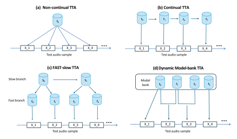
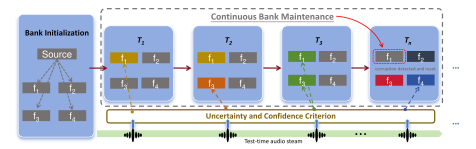
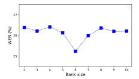

**Source:** *Dynamic Model-Bank Test-Time Adaptation for Automatic Speech Recognition* — [PDF](https://aclanthology.org/2025.emnlp-main.1107.pdf)

# <span id="page-0-0"></span>Dynamic Model-bank Test-time Adaptation for Automatic Speech Recognition

Yanshuo Wang1,2, Yanghao Zhou<sup>3</sup> , Yukang Lin<sup>4</sup> , Haoxing Chen<sup>5</sup> , Jin Zhang<sup>6</sup> , Wentao Zhu<sup>2</sup> , Jie Hong[\\*](#page-0-0)<sup>7</sup> , Xuesong Li\*8,9 ,

<sup>1</sup>Hong Kong Polytechnic University, <sup>2</sup>Eastern Institute for Advanced Study <sup>3</sup>Beijing Institute of Technology, <sup>4</sup>Tsinghua University, <sup>5</sup>Ant Group, <sup>6</sup>Shenzhen University <sup>7</sup>The University of Hong Kong, <sup>8</sup>Australian National University, <sup>9</sup>CSIRO

## Abstract

End-to-end automatic speech recognition (ASR) based on deep learning has achieved impressive progress in recent years. However, the performance of ASR foundation model often degrades significantly on out-of-domain data due to real-world domain shifts. Test-Time Adaptation (TTA) methods aim to mitigate this issue by adapting models during inference without access to source data. Despite recent progress, existing ASR TTA methods often struggle with instability under continual and long-term distribution shifts. To alleviate the risk of performance collapse due to error accumulation, we propose Dynamic Model-bank Single-Utterance Test-time Adaptation (DM-SUTA), a sustainable continual TTA framework based on adaptive ASR model ensembling. DMSUTA maintains a dynamic model bank, from which a subset of checkpoints is selected for each test sample based on confidence and uncertainty criteria. To preserve both model plasticity and long-term stability, DMSUTA actively manages the bank by filtering out potentially collapsed models. This design allows DMSUTA to continually adapt to evolving domain shifts in ASR test-time scenarios. Experiments on diverse, continuously shifting ASR TTA benchmarks show that DM-SUTA consistently outperforms existing continual TTA baselines, demonstrating superior robustness to domain shifts in ASR.

## 1 Introduction

In recent years, end-to-end automatic speech recognition has made substantial progress, achieving strong performance in in-domain settings where training and test data follow similar distributions [\(Baevski et al.,](#page-9-0) [2020;](#page-9-0) [Hsu et al.,](#page-9-1) [2021;](#page-9-1) [Radford](#page-10-0) [et al.,](#page-10-0) [2023\)](#page-10-0). However, in real-world scenarios, ASR systems frequently encounter out-of-domain conditions, where data distributions shift due to factors such as background noise, varying recording

\*Corresponding author

devices, or unseen acoustic environments [\(Radford](#page-10-0) [et al.,](#page-10-0) [2023;](#page-10-0) [Chen et al.,](#page-9-2) [2022a\)](#page-9-2). These domain shifts often lead to significant performance degradation, rendering ASR systems unreliable in practice. This challenge becomes even more severe when distribution shifts occur continuously over time, as is common in real-world deployment.

To address this issue, it is essential to develop ASR systems that can dynamically adapt to changing input conditions and maintain robustness across diverse environments. Recent work has explored test-time adaptation to mitigate domain shifts during inference, primarily through objectives such as entropy minimization [\(Lin et al.,](#page-9-3) [2022\)](#page-9-3) and logit sequence entropy regularization [\(Kim et al.,](#page-9-4) [2023\)](#page-9-4). These methods have shown effectiveness on out-ofdomain noisy speech data. However, they typically assume a fixed target domain, limiting their applicability in scenarios involving continuous and dynamic distribution shifts.

To handle such realistic conditions, recent studies like AWMC [\(Lee et al.,](#page-9-5) [2023\)](#page-9-5) and DSUTA [\(Lin](#page-9-6) [et al.,](#page-9-6) [2024\)](#page-9-6) have proposed continual test-time adaptation (CTTA) methods for ASR. AWMC adopts a pseudo-labeling strategy within a mean teacher framework to mitigate model collapse, while DSUTA introduces a fast-slow adaptation scheme with full model resets to maintain stability under domain drift. Although both methods represent significant progress, they also face key limitations: AWMC is evaluated only on a singledomain setup and is susceptible to error accumulation, whereas DSUTA's reset mechanism impairs long-term knowledge retention, potentially causing forgetting during adaptation.

Moreover, both approaches process each test sample independently using a single model state, which restricts their ability to exploit temporal cues from evolving input streams. To address these limitations, we propose a model-bank-based CTTA framework named Dynamic Model-bank SingleUtterance Test-time Adaptation (DMSUTA) that dynamically selects reliable model checkpoints from a diverse model bank, enabling robust and adaptive predictions for each incoming audio sample. We evaluate DMSUTA on ASR CTTA benchmarks [\(Lin et al.,](#page-9-6) [2024\)](#page-9-6), encompassing a wide range of acoustic variations that simulate realistic, continuously shifting environments. Experimental results demonstrate that DMSUTA consistently outperforms the prior work, highlighting its superior ability to robustly adapt to non-stationary test distributions in ASR.

Our main contributions can be summarized as:

- We propose a dynamic model-bank TTA framework for ASR that exploits relevant data distribution information while minimizing the risk of model collapse in adaptation.
- We introduce dual-criterion with active bank maintenance to stabilize the content of the model bank across different domains and long test data streams.
- We achieve noticeable performance boosts relative to both non-continual and continual baselines in scenarios involving single-domain and time-varying domains.

## 2 Related Works

#### 2.1 Continual Test Time Adaptation

CTTA requires continuous model updates for target domain data streams, with the core challenge being how to avoid catastrophic forgetting during the adaptation process. The online version of Tent [\(Wang et al.,](#page-10-1) [2020\)](#page-10-1) offers a feasible approach by minimizing prediction entropy, but it assumes ideal online learning conditions and lacks stability in continual test-time settings. To address this, CoTTA[\(Wang et al.,](#page-10-2) [2022a\)](#page-10-2) was proposed as a method specifically designed for online continual test-time adaptation. It incorporates a teacher-student framework with a weighted augmentation-averaged mean teacher strategy to enhance model stability. Meanwhile, EATA[\(Niu et al.,](#page-9-7) [2022\)](#page-9-7) addresses catastrophic forgetting through a sample selection strategy that filters reliable and non-redundant samples.

Building on these foundations, several recent works have further advanced CTTA by improving stability, efficiency, and sample selection mechanisms. ViDA [\(Liu et al.\)](#page-9-8) introduces a homeostatic

adaptation strategy that constrains feature space dynamics to enhance robustness under domain shifts. DSS [\(Wang et al.,](#page-10-3) [2024c\)](#page-10-3) proposes a confidencebased filtering mechanism to reduce error propagation during continual updates. EcoTTA [\(Song et al.,](#page-10-4) [2023\)](#page-10-4) improves memory efficiency through selfdistilled regularization, maintaining model plasticity without relying on large memory buffers. Additionally, RMT [\(Döbler et al.,](#page-9-9) [2023\)](#page-9-9) extends consistency-based learning to gradual and continual adaptation scenarios by employing a teacherstudent paradigm to stabilize updates. While these approaches offer various advantages, they often require careful trade-offs between domain adaptation and model forgetting or introduce additional training complexity. In contrast, our method employs a dynamic framework that leverages multiple dynamically updated checkpoints, selected based on confidence and uncertainty metrics, to achieve robust adaptation without relying on frequent resets.

### 2.2 Test Time Adaptation on ASR

Recent advancements in speech foundation models have led to significant improvements in ASR, particularly within the distribution of in-domain training data [\(Hsu et al.,](#page-9-1) [2021;](#page-9-1) [Chen et al.,](#page-9-10) [2022b;](#page-9-10) [Baevski et al.,](#page-9-0) [2020;](#page-9-0) [Döbler et al.,](#page-9-9) [2023;](#page-9-9) [Ao](#page-9-11) [et al.,](#page-9-11) [2022\)](#page-9-11). However, during edge-side deployment, models frequently encounter diverse and non-stationary acoustic conditions, resulting in degraded performance in real-world applications. Although joint training [\(Zhang et al.,](#page-10-5) [2021;](#page-10-5) [Wang and](#page-10-6) [Wang,](#page-10-6) [2016;](#page-10-6) [Fan et al.,](#page-9-12) [2020;](#page-9-12) [Jain et al.,](#page-9-13) [2018\)](#page-9-13), fine-tuning [\(Wang et al.,](#page-10-7) [2022b;](#page-10-7) [Gong et al.,](#page-9-14) [2023;](#page-9-14) [Wang et al.,](#page-10-8) [2024a\)](#page-10-8), and domain adaptation [\(Lei](#page-9-15) [et al.,](#page-9-15) [2024;](#page-9-15) [Sim et al.,](#page-10-9) [2024;](#page-10-9) [Fu et al.,](#page-9-16) [2025;](#page-9-16) [Tran](#page-10-10) [et al.,](#page-10-10) [2025;](#page-10-10) [Sun et al.,](#page-10-11) [2017;](#page-10-11) [Wang et al.,](#page-10-12) [2024b;](#page-10-12) [Xiong et al.,](#page-10-13) [2020;](#page-10-13) [Ghorbani and Hansen,](#page-9-17) [2022\)](#page-9-17) methods have shown strong performance in adapting ASR models to target domains, they are often computationally expensive and typically require access to test label or source domain data. In practice, ASR models deployed on edge devices are often restricted to streaming test data due to privacy and storage constraints, limiting the applicability of these methods.

In this context, TTA has emerged as a promising direction, as it enables ASR models to adapt to target domains directly during inference and without requiring any training data and test labels. Recent studies such as SUTA [\(Lin et al.,](#page-9-3) [2022\)](#page-9-3) have applied entropy minimization and minimal class con-

<span id="page-2-0"></span>

Figure 1: Method comparison between our dynamic TTA framework, DMSUTA, and existing methods. (a) The common ASR test-time adaptation approach is where the model adapts the incoming sample independently. (b) The continual adaptation of test time, where the model is continuously updated in a sequence as the test sample comes. (c) The fast-slow approach, where there are two separate branches responsible for local and meta adaptation. (d) Our method, DMSUTA, provides a model bank to perform adaptation. For each test sample, the prediction is an output from a carefully selected bank of members.

fusion techniques to achieve non-autoregressive instance-level adaptation. SGEM [\(Kim et al.,](#page-9-4) [2023\)](#page-9-4), in contrast, proposes generalized entropy minimization at the sequence level, adapting autoregressive ASR models by minimizing logit sequence entropy. Recent methods also try to incorporate the use of confidence and uncertainty for stable adaptation in ASR [\(Yoon et al.,](#page-10-14) [2024;](#page-10-14) [Lee et al.,](#page-9-18) [2024;](#page-9-18) [Liu et al.,](#page-9-19) [2024\)](#page-9-19).

However, these TTA methods largely assume static test distributions and do not account for the continuous adaptation required in realworld streaming scenarios. Addressing this gap, AWMC [\(Lee et al.,](#page-9-5) [2023\)](#page-9-5) introduces pseudolabel refinement and anchor model merging to improve model reliability under continuous adaptation. DSUTA [\(Lin et al.,](#page-9-6) [2024\)](#page-9-6) proposes a dynamic reset strategy based on a fast-slow TTA framework, enabling stable CTTA across multiple domains and long-duration test streams.

Despite these advances, existing ASR continual test-time adaptation methods still face challenges such as error accumulation and catastrophic forgetting, especially in complex, noisy environments. To tackle this, our work proposes a dynamic model ensembling strategy tailored to evolving acoustic conditions, aiming to enhance the robustness of ASR models in real-world, out-of-domain scenarios.

### 3 Methodology

The proposed dynamic model-bank TTA framework for ASR, DMSUTA, is proposed in this section. We first compare DMSUTA with existing methods, then we explain the details of the selection strategy and bank operations in DMSUTA.

#### 3.1 TTA Methods for ASR

As shown in Figure [1,](#page-2-0) the most straightforward approach for adaptation in ASR is non-continual TTA, where the model adapts to test data separately each time. In this case, the original model is reused for every new test sample. However, this limits the generalizability of the adaptation process, as knowledge learned from past samples is not carried forward. On the other hand, continual adaptation does not reset to the pre-trained model each time; instead, it continuously adapts throughout the process. However, this increases the risk of model collapse due to error accumulation over time. Recently, Fast-Slow TTA [\(Lin et al.,](#page-9-6) [2024\)](#page-9-6) has been proposed, utilizing two branches to leverage advantages from both non-continual and continual TTA. The slow branch is updated periodically to gain the meta knowledge. In contrast, the fast branch is initialized from the current slow branch model and updated based on the latest samples to generate predictions. However, for the slow branch to update, test samples from previous intervals must be stored and processed in batches. This imposes strict constraints on test-time adaptation, requiring access to past test samples. In addition, it also employs a dynamic reset strategy to mitigate model collapse during adaptation, which also relies on collecting many past test samples. Those additional data usage may not be ideal for real-world test-time adaptation, as access to previous samples is often restricted due to security concerns.

In this paper, we propose a CTTA strategy in ASR, named DMSUTA, which is built upon an adaptive framework that maintains a dynamic bank of model checkpoints to generate robust predictions tailored to continuously evolving input conditions. By leveraging multiple reliable historical checkpoints from this bank, DMSUTA dynamically selects and updates the most relevant ones for each test instance, while preserving the rest to retain prior knowledge. To manage the checkpoint bank effectively, we design a three-stage mechanism: selection, appending, and pruning. The selection stage identifies relevant checkpoints based on a combination of prediction confidence and uncertainty estimation, where uncertainty is measured by the variance of the output probabilities across multiple augmented views of the same input. The selected subset is then optimized on the current test sample, and when performance improves, the updated model may be added to the bank. To prevent redundancy and model collapse, we remove outdated or degraded checkpoints using historical performance trends and divergence scores. Our motivation is to exploit useful information from the model's historical states to mitigate error accumulation and reduce catastrophic forgetting, both of which are persistent challenges in continual testtime adaptation.

## 3.2 Dynamic Model-bank SUTA for ASR

As shown in Figure [2,](#page-4-0) we present the overall framework of our unified test-time adaptation (TTA)

framework for speech recognition. Unlike prior TTA approaches for speech recognition that typically rely on a single model to adapt to all incoming samples, our framework continuously maintains a bank of diverse teacher models for prediction. The process begins by initializing a model bank {f1, f2, . . . , fm} with size m, where each member is initialized from the original pretrained checkpoint. Upon the arrival of a test-time sample x, it is forwarded to the most relevant models in the bank that meet the uncertainty and confidence criteria for inference. The final prediction is then generated by the overall mean of the selected members' predictions. After making the prediction, the selected models are updated to better adapt to the current data distribution. Noted that our method also builds upon the SUTA [\(Lin et al.,](#page-9-3) [2022\)](#page-9-3) framework. It adapts the model parameters fpre for fixed number of steps on each test sample x<sup>t</sup> by optimizing the combined loss of entropy minimization Lem and minimum class confusion Lcc. Entropy minimization loss encourages confident predictions by reducing uncertainty, while the other reduces overlap between different class predictions.

Moreover, to enable the model bank to better accumulate meta-knowledge over time, we also employ an exponential moving average (EMA) strategy during bank updates:

<span id="page-3-0"></span>
$$\mathbf{W}_{t+1} = (1 - \alpha)\hat{\mathbf{W}}_t + \alpha \mathbf{W}_t \tag{1}$$

where W<sup>t</sup> denotes the updated model weights, and Wˆ <sup>t</sup> denotes the current update value. In general, the overall update mechanism allows multiple models to adapt simultaneously when appropriate, enabling the model bank to accumulate more diverse and reliable knowledge over time. As a result, the framework is more robust to distribution shifts and better suited to diverse test-time conditions. The algorithm is described in Algorithm [1.](#page-6-0)

### 3.3 Selection Strategy

To determine which checkpoints are suitable for given test-time samples, we design a selection strategy that jointly considers prediction confidence and uncertainty. This dual-criteria approach helps identify reliable models for inference and update, while effectively filtering out unstable and overfit ones. High confidence typically indicates that the model is likely to produce a correct prediction. Therefore, we select only models from the bank with high confidence values. The selection process is formalized

<span id="page-4-0"></span>

Figure 2: Overall framework for our method. We begin by initializing a model bank composed of pretrained source checkpoints. Since all models are initially unadapted, we avoid activating all of them at the beginning. Instead, we only activate one of them for update, and when no existing checkpoint is found suitable for the coming test samples, a new checkpoint is then activated and adapted. During the adaptation process, if suitable updates are available for activated checkpoints, they are applied to the corresponding ones. We also continuously monitor the status of each model in the bank. If a model remains inactive or exceeds its update threshold, it is pruned and replaced with a fresh source checkpoint to prevent potential collapse.

as follows:

$$S_c(x) = \{ f_i \mid \operatorname{Conf}_i(x) \ge \gamma_c \}$$
 (2)

where  $Conf_i(x)$  is the confidence score of model  $f_i$  on input sample x, and  $\gamma_c$  represents the confidence threshold score among all models. However, in practice, models can sometimes become overconfident, especially when facing out-of-distribution samples, leading to unreliable predictions despite high confidence scores. To mitigate this issue, we introduce an additional criterion based on uncertainty, which is measured by the variance of predictions across multiple augmentations of the input. We apply n random augmentations to the audio sample x, and compute the variance of the model's predictions across these augmented versions. If the prediction variance is relatively low, the model is considered reliable. On the other hand, the model may be uncertain and unstable if the variance is high, and thus, we exclude such models from contributing to the final prediction. The selection criterion for uncertainty is defined as:

<span id="page-4-1"></span>
$$S_v(x) = \{ f_i \mid \operatorname{Var}_i(x) \le \tau_v \} \tag{3}$$

where  $\mathrm{Var}_i(x)$  is the variance of the model predictions in the n augmented versions of the input x, and  $\tau_v$  represents the lowest variance allowed threshold for all models. Finally, the overall selection criterion is defined as follows:

$$S(x) = S_c(x) \cap S_v(x) \tag{4}$$

where S(x) represents the full selection criterion, formed by combining the confidence-based and

variance-based components through intersection, which allows only sufficiently certain predictions to be selected.

#### 3.4 Bank Maintenance

It has been observed that the TTA methods are prone to collapse, a phenomenon in which the model gradually diverges from its original knowledge due to accumulated errors during self-supervised updates. This typically occurs when the model repeatedly adapts to unlabeled samples via self-learning, leading to degraded performance or even complete failure. Previous work (Lin et al., 2024) addresses this by completely resetting the adapted model once a distribution shift is detected. However, such full resets result in a complete loss of the model's learned knowledge.

To mitigate this issue, we introduce a novel dropout mechanism for checkpoint management within a model bank. Specifically, we design a population-based reset strategy that monitors each model using two criteria: the number of updates it has undergone and how long it has been inactive. If a model exceeds a threshold for update count or becomes inactive over time, we consider it unreliable and reinitialize it from the original pretrained checkpoint.

<span id="page-4-2"></span>
$$\mathcal{F}_{\text{reset}} = \{ f_i \mid C(f_i) \} > \epsilon_c \lor A(f_i) \} < \epsilon_a \} \quad (5)$$

where  $C(f_i)$  denotes the count number of updates applied to model  $f_i$ , and  $A(f_i)$  indicates its recent activity level (how long it has not been updated).

<span id="page-5-0"></span>

| Method                      | AA   | AC   | BA   | CM   | GS   | MU   | NB    | SD   | TP   | VC   |
|-----------------------------|------|------|------|------|------|------|-------|------|------|------|
| Source model                | 40.6 | 27.7 | 66.9 | 49.7 | 75.6 | 51.4 | 120.1 | 19.4 | 25.8 | 49.7 |
| Non-continual               |      |      |      |      |      |      |       |      |      |      |
| SGEM (Kim et al.,<br>2023)  | 30.9 | 17.8 | 54.5 | 39.2 | 56.3 | 39.2 | 113.0 | 14.9 | 17.5 | 40.3 |
| SUTA (Lin et al.,<br>2022)  | 30.6 | 17.4 | 53.7 | 38.7 | 54.5 | 39.0 | 112.3 | 15.0 | 17.4 | 39.3 |
| Continual                   |      |      |      |      |      |      |       |      |      |      |
| SUTA (Lin et al.,<br>2022)  | 39.8 | 22.6 | 63.4 | 53.4 | 58.4 | 54.7 | 68.1  | 23.2 | 23.0 | 50.9 |
| AWMC (Lee et al.,<br>2023)  | 31.6 | 18.0 | 61.6 | 37.7 | 48.5 | 36.2 | 131.9 | 17.0 | 18.0 | 36.1 |
| Fast-slow                   |      |      |      |      |      |      |       |      |      |      |
| DSUTA (Lin et al.,<br>2024) | 25.9 | 15.4 | 33.2 | 33.5 | 37.0 | 28.4 | 36.3  | 15.5 | 15.6 | 29.9 |
| Dynamic Model-bank          |      |      |      |      |      |      |       |      |      |      |
| DMSUTA (Ours)               | 25.2 | 14.9 | 34.1 | 32.5 | 35.8 | 28.3 | 35.8  | 14.6 | 15.3 | 29.8 |

Table 1: Word Error Rate (WER) of different ASR TTA methods on LS-C with 10 distinct domains. Reported WER is averaged per noise type.

The thresholds ϵ<sup>c</sup> and ϵ<sup>a</sup> control the maximum tolerated update count and minimum acceptable activity, respectively. As a result, our model bank remains robust and healthy over time. In addition, there is also a possibility that no checkpoints satisfy the selection criterion. In such cases, we replace the most updated models with newly initialized ones to maintain the diversity and adaptability of the model bank. By periodically refreshing these models, we can better handle distribution shifts and improve overall performance during test-time adaptation.

### 4 Experiments

## 4.1 Benchmark

In this work, we follow the test-time adaptation setup proposed in [\(Lin et al.,](#page-9-6) [2024\)](#page-9-6) and evaluate our method on two types of benchmarks based on the LibriSpeech test set [\(Panayotov et al.,](#page-9-20) [2015\)](#page-9-20).

#### Single-domain Simulated Noisy Data.

Following [\(Kim et al.,](#page-9-4) [2023\)](#page-9-4), we utilize the Corrupted LibriSpeech (LS-C) Dataset, which is created by adding background noises from the MS-SNSD dataset [\(Reddy et al.,](#page-10-15) [2019\)](#page-10-15) to the original LibriSpeech test set. Specifically, background noises are added to the test set to simulate challenging acoustic environments. The added noise types

include air conditioner (AC), airport announcement (AA), babble (BA), copy machine (CM), munching (MU), neighbors (NB), shutting door (SD), typing (TP), vacuum cleaner (VC), and Gaussian noise (GS) noise—resulting in a total of ten different noise types. The Signal-to–Noise Ratio (SNR) is set to 5 dB to ensure a consistent level of corruption across samples.

Multi-domain Time-varying Data. Following [\(Lin et al.,](#page-9-6) [2024\)](#page-9-6), we also utilize three streams created by concatenating samples with different noise types to evaluate our method.

- MD-Easy: Contains 2,500 samples with relatively easy noise types. The noise order is: AC → CM → TP → AA → SD.
- MD-Hard: Contains 2,500 samples with relatively challenging noise types. The noise order is: GS → MU → VC → BA → NB.
- MD-Long: A long sequence of 10,000 samples generated by randomly sampling from the 10 available noise types. Each sampled segment has a random length between 20 and 500 samples, and sampling continues until the full length is reached.

```
Algorithm 1 Dynamic Model-bank Test-Time
Adaptation
Input: Data stream \{x_t\}_{t=1}^T, model bank \mathcal{F} =
\{f_1,\ldots,f_m\}, thresholds \gamma_c,\,\tau_v, update limit \epsilon_c,
inactivity limit \epsilon_a
Output: Predictions \{\hat{y}_t\}_{t=1}^T
  1: Initialize each f_i \in \mathcal{F} with pretrained weights
 2: for t = 1 to T do
 3:
          compute confidence Conf_i(x_t);
 4:
          compute variance Var_i(x_t) for each f_i;
          check selection criterion in Equation (3);
 5:
 6:
          for f_i \in \mathcal{S}(x_t) do
              adapt parameters w.r.t. \mathcal{L}_{em} + \mathcal{L}_{cc};
 7:
              compute checkpoint prediction \hat{y}_{t_i}^T;
 8:
 9:
              EMA update in Equation (1);
 10:
          compute ensemble prediction \{\hat{y}_t\}_{t=1}^T
11:
          for f_i \in \mathcal{F} do
12:
              check maintenance in Equation (5);
13:
14.
              for f_i \in \mathcal{F}_{\text{reset}} do
15:
                   apply reset operation;
              end for
16:
          end for
17
```

#### 4.2 Implementations

19: **return**  $\{\hat{y}_t\}_{t=1}^T$ 

18: **end for** 

For all benchmarks, we use the pretrained wav2vec 2.0 Base model (Baevski et al., 2020), fine-tuned on the 960 hours LibriSpeech training set, as the source ASR model, consistent with prior work (Lin et al., 2024). We adopt SUTA (Lin et al., 2022) as the adaptation base and follow the continual adaptation framework proposed in DSUTA (Lin et al., 2024). All baseline implementations and hyperparameter settings follow the continual ASR TTA benchmark (Lin et al., 2024). We compare our method with several baselines, including continual, non-continual, and fast-slow adaptation approaches. Specifically, we evaluate against AWMC (Lee et al., 2023), SGEM (Kim et al., 2023), SUTA (Lin et al., 2022), and DSUTA (Lin et al., 2024). To support the selection mechanism based on prediction variance, we apply data augmentation to each test utterance. The augmentations include volume perturbation, light time-stretching, time shift, pitch shift, and waveform distortion. These augmentations help estimate the variance uncertainty of model predictions, which is used to guide reliable checkpoint selection during adaptation. The expo-

<span id="page-6-1"></span>

| Method             | Easy | Hard | Long  |
|--------------------|------|------|-------|
| Source model       | 32.7 | 74.6 | 61.0  |
| Non-continual      |      |      |       |
| SUTA               | 24.0 | 60.4 | 53.3  |
| SGEM               | 25.0 | 61.0 | 53.4  |
| Continual          |      |      |       |
| SUTA               | 37.3 | 83.6 | 100.3 |
| AWMC               | 25.8 | 66.1 | 60.6  |
| Fast-slow          |      |      |       |
| DSUTA              | 24.0 | 45.6 | 43.2  |
| - Dynamic reset    | 22.7 | 39.8 | 35.8  |
| - Fixed reset      | 22.8 | 49.4 | 45.2  |
| Dynamic Model-bank |      |      |       |
| DMSUTA (Ours)      | 22.0 | 39.2 | 35.0  |

<span id="page-6-2"></span>Table 2: WER comparison across MD-Easy, MD-Hard, and MD-Long benchmarks for different baselines.

| Method   | Easy | Hard | Long |
|----------|------|------|------|
| w/o conf | 22.4 | 39.6 | 36.0 |
| w/o var  | 22.3 | 41.4 | 40.5 |
| w both   | 22.0 | 39.2 | 35.0 |

Table 3: Performance comparison (WER) on multidomain benchmarks with different update criteria.

nential moving average is set to 0.94. The variance and confidence thresholds are adaptively set to 6 and 2 multiples of the source model confidence and variance.

#### 4.3 Results

Table 1 shows a comparison of word error rates (WER) across various test-time adaptation (TTA) methods on the LS-C dataset, which encompasses 10 distinct noise types. The results highlight significant variability in model robustness across different audio domains. Specifically, continual learning approaches such as SUTA and AWMC exhibit performance degradation over time, likely due to the accumulation of errors during adaptation. In contrast, non-continual methods like the original SUTA minimize the effect of model collapse but demonstrate limited adaptability in challenging domains since there is no leverage learned from past samples. For instance, in the NB domain, the noncontinual SUTA shows a notably high error rate compared to its continual version.

The fast-slow method, DSUTA, integrates the

<span id="page-7-2"></span>

| Method  | Easy | Hard | Long |
|---------|------|------|------|
| w/o PM  | 22.3 | 42.5 | 44.5 |
| with PM | 22.0 | 39.2 | 35.0 |

Table 4: Performance comparison (WER) on multidomain benchmarks with and without bank maintenance.

strengths of both continual and non-continual approaches by employing dual adaptation branches and a dynamic reset strategy. This design enhances robustness against domain shifts. However, its dynamic strategy depends on our proposed method, further advancing this by leveraging a diverse model bank, resulting in superior performance. Notably, in the NB domain, where previous methods struggled with high error rates, our approach achieves a 1% absolute improvement over SUTA and matches DSUTA's performance. Even in domains like SD, characterized by lower WERs, our method consistently outperforms both the original SUTA and DSUTA, underscoring the efficacy of a diversified model in enhancing adaptability and resilience across varying audio domains. Moreover, Table [2](#page-6-1) further shows that our method achieve a more stable adaption in a series of more complicated cases where domains are mixed .

## 4.4 Ablation

#### 4.4.1 Selection Strategy

Here, we investigate why both confidence and variance are adopted as dual criteria for guiding model updates. As shown in Table [3,](#page-6-2) removing either the confidence or the variance threshold results in certain performance degradation. Without the confidence threshold, the selected checkpoints may yield low-confidence predictions for the test sample, which are less suitable and potentially noisy for adaptation.

Meanwhile, although confidence-based selection helps reduce pseudo-label error rates, the poor calibration of neural networks can still produce incorrect predictions with deceptively high confidence. By introducing a variance threshold, we further filter out unreliable samples, ensuring that only stable and trustworthy predictions contribute to the adaptation process.

## 4.4.2 Selection threshold

The introduced hyperparameters, confidence and variance, are set based on the original confidence

and variance levels. Instead of using fixed values, we take the source confidence and variance of each test utterance as reference points to avoid relying on static thresholds, since the model may face vastly different adaptation difficulties across domains. The original confidence and variance effectively reflect this variation, and we leverage them to determine the thresholds dynamically. As shown in the table [5](#page-7-0) and table [6,](#page-7-1) both the confidence and variance thresholds are not highly sensitive.

<span id="page-7-0"></span>

| Confidence threshold | AA    |
|----------------------|-------|
| γc<br>> 1.0          | 25.35 |
| γc<br>> 1.05         | 25.32 |
| γc<br>> 1.1          | 25.25 |
| γc<br>> 1.15         | 25.31 |
| γc<br>> 1.2          | 25.22 |
| γc<br>> 1.25         | 25.33 |
| γc<br>> 1.3          | 25.38 |

<span id="page-7-1"></span>Table 5: Performance under different confidence thresholds in AA domain

| Variance threshold | AA    |
|--------------------|-------|
| τv<br>< 2.0        | 25.41 |
| τv<br>< 3.0        | 25.35 |
| τv<br>< 4.0        | 25.32 |
| τv<br>< 5.0        | 25.24 |
| τv<br>< 6.0        | 25.22 |
| τv<br>< 7.0        | 25.66 |

Table 6: Performance under different variance thresholds in AA domain

## 4.4.3 Model Bank Size

We also investigate the impact of the model bank size used in our method, as shown in Figure [3.](#page-8-0) The experiments are conducted on the LS-C dataset within the AA domain, where the bank size ranges from 2 to 10. We observe that the error rate slightly decreases as the bank size increases. When the bank size reaches 6, the model achieves the lowest word error rate. This trend is expected—larger bank sizes generally lead to lower error rates. However, increasing the bank size beyond 6 does not yield further improvements. This is likely because the AA domain represents a relatively simple and homogeneous acoustic environment. In such cases, the diversity of test samples is limited, and a small number of well-adapted models is sufficient to

<span id="page-8-0"></span>

Figure 3: WER (%) performance within the AA domain of the LS-C dataset, with respect to varying bank size.

<span id="page-8-1"></span>

| Method |          | AA (LS-C) | ASR-SCEChilSC |         |  |
|--------|----------|-----------|---------------|---------|--|
|        | Time (s) | WER (%)   | Time (s)      | WER (%) |  |
| Source | 115      | 40.6      | 76            | 60.1    |  |
| SUTA   | 803      | 30.9      | 582           | 53.3    |  |
| CSUTA  | 142      | 39.8      | 135           | 197.5   |  |
| DSUTA  | 610      | 25.9      | 502           | 49.3    |  |
| DMSUTA | 735      | 25.2      | 560           | 48.4    |  |

Table 7: Comparison of adaptation time (T) and WER (W) on AA (LS-C) and ASR-SCEChilSC benchmarks.

cover the variation within the domain. Adding more checkpoints may lead to redundancy rather than complementary benefits.

## 4.4.4 Bank Maintenance

Here, we illustrate the effectiveness of bank maintenance. As shown in Table [4,](#page-7-2) under multi-domain conditions where the difficulty level is either hard or long, there is a noticeable performance drop when bank maintenance is not applied. Even in cases such as MD-easy, where model collapse is less severe, applying the maintenance module still leads to slight improvements.

## 4.4.5 Complexity

Table [7](#page-8-1) presents the inference time of DMSUTA compared to other SUTA methods on the ASR-SCEChilSC dataset (2266 utterances) and the AA domain of corrupted LibriSpeech (2893 utterances). From the table, we observe that our DMSUTA is actually faster than the baseline SUTA and only slightly slower than DSUTA. Specifically, SUTA requires reloading the source model for predictions at every step, as it is a type of non-continual TTA, leading to significantly longer loading times. In contrast, our method caches the model after the initial load and reloads it only when necessary, significantly reducing loading time and avoiding

unnecessary computational overhead. The clear margin of improvement in accuracy achieved by DMSUTA provides justification for the slightly increased complexity.

## 5 Conclusion

In this paper, we propose the adaptive dynamic TTA, a novel test-time adaptation strategy for ASR that improves adaptability without relying on past test samples. Our method introduces a dynamic model bank, which adaptively selects and updates a subset of reliable checkpoints for each incoming sample. By leveraging the confidence and variance of predictions, our method identifies suitable models for adaptation while filtering out unreliable cases. DMSUTA also supports continuous bank maintenance, enabling the bank to evolve over time to handle distribution shifts without incurring model collapse. Extensive experiments across multiple benchmarks validate the effectiveness and robustness of our approach over prior non-continual, continual, and fast-slow TTA methods.

### 6 Limitation

The primary limitations of this paper are as follows: Realistic Domain Shifts. In this study, we evaluate our framework using synthetic domain shifts created by adding background noise to clean speech. While this setup enables controlled experimentation and reproducibility, it does not fully reflect the complexity and unpredictability of real-world acoustic environments. Realistic domain shifts—such as those caused by spontaneous speech, overlapping speakers, real-world background noise, reverberation, and recording artifacts—remain unexplored in our current experiments. We leave the evaluation of our method on real noisy datasets and in-the-wild test conditions as an important direction for future research.

Model Generalization across Backbones. Our current study focuses on a specific end-to-end ASR backbone: Wav2vec 2.0 [\(Baevski et al.,](#page-9-0) [2020\)](#page-9-0). However, modern ASR systems are increasingly built on diverse foundation models, including encoder-decoder architectures, transducer-based models, and large-scale pretrained speech-language models. The generalizability of our method across different ASR architectures remains unexplored. Extending and validating the proposed framework on a broader range of speech foundation models is a promising direction for future work.

## References

- <span id="page-9-11"></span>Junyi Ao, Rui Wang, Long Zhou, Chengyi Wang, Shuo Ren, Yu Wu, Shujie Liu, Tom Ko, Qing Li, Yu Zhang, et al. 2022. Speecht5: Unified-modal encoder-decoder pre-training for spoken language processing. In *Proceedings of the 60th Annual Meeting of the Association for Computational Linguistics (Volume 1: Long Papers)*, pages 5723–5738.
- <span id="page-9-0"></span>Alexei Baevski, Yuhao Zhou, Abdelrahman Mohamed, and Michael Auli. 2020. wav2vec 2.0: A framework for self-supervised learning of speech representations. *Advances in neural information processing systems*, 33:12449–12460.
- <span id="page-9-2"></span>Chen Chen, Nana Hou, Yuchen Hu, Shashank Shirol, and Eng Siong Chng. 2022a. Noise-robust speech recognition with 10 minutes unparalleled in-domain data. In *ICASSP 2022-2022 IEEE International Conference on Acoustics, Speech and Signal Processing (ICASSP)*, pages 4298–4302. IEEE.
- <span id="page-9-10"></span>Sanyuan Chen, Chengyi Wang, Zhengyang Chen, Yu Wu, Shujie Liu, Zhuo Chen, Jinyu Li, Naoyuki Kanda, Takuya Yoshioka, Xiong Xiao, et al. 2022b. Wavlm: Large-scale self-supervised pre-training for full stack speech processing. *IEEE Journal of Selected Topics in Signal Processing*, 16(6):1505–1518.
- <span id="page-9-9"></span>Mario Döbler, Robert A Marsden, and Bin Yang. 2023. Robust mean teacher for continual and gradual testtime adaptation. In *Proceedings of the IEEE/CVF Conference on Computer Vision and Pattern Recognition*, pages 7704–7714.
- <span id="page-9-12"></span>Cunhang Fan, Jiangyan Yi, Jianhua Tao, Zhengkun Tian, Bin Liu, and Zhengqi Wen. 2020. Gated recurrent fusion with joint training framework for robust endto-end speech recognition. *IEEE/ACM Transactions on Audio, Speech, and Language Processing*, 29:198– 209.
- <span id="page-9-16"></span>Li Fu, Shanyong Yu, Siqi Li, Lu Fan, Youzheng Wu, and Xiaodong He. 2025. Ume: Upcycling mixtureof-experts for scalable and efficient automatic speech recognition. In *ICASSP 2025-2025 IEEE International Conference on Acoustics, Speech and Signal Processing (ICASSP)*, pages 1–5. IEEE.
- <span id="page-9-17"></span>Shahram Ghorbani and John HL Hansen. 2022. Domain expansion for end-to-end speech recognition: Applications for accent/dialect speech. *IEEE/ACM Transactions on Audio, Speech, and Language Processing*, 31:762–774.
- <span id="page-9-14"></span>Yuan Gong, Sameer Khurana, Leonid Karlinsky, and James Glass. 2023. Whisper-at: Noise-robust automatic speech recognizers are also strong general audio event taggers. In *Proc. Interspeech 2023*, pages 2798–2802.
- <span id="page-9-1"></span>Wei-Ning Hsu, Benjamin Bolte, Yao-Hung Hubert Tsai, Kushal Lakhotia, Ruslan Salakhutdinov, and Abdelrahman Mohamed. 2021. Hubert: Self-supervised speech representation learning by masked prediction

- of hidden units. *IEEE/ACM transactions on audio, speech, and language processing*, 29:3451–3460.
- <span id="page-9-13"></span>Abhinav Jain, Minali Upreti, and Preethi Jyothi. 2018. Improved accented speech recognition using accent embeddings and multi-task learning. In *Interspeech*, pages 2454–2458.
- <span id="page-9-4"></span>Changhun Kim, Joonhyung Park, Hajin Shim, and Eunho Yang. 2023. Sgem: Test-time adaptation for automatic speech recognition via sequential-level generalized entropy minimization. In *Proceedings of the Annual Conference of the International Speech Communication Association, INTERSPEECH*, volume 2023, pages 3367–3371.
- <span id="page-9-5"></span>Jae-Hong Lee, Do-Hee Kim, and Joon-Hyuk Chang. 2023. Awmc: Online test-time adaptation without mode collapse for continual adaptation. In *2023 IEEE Automatic Speech Recognition and Understanding Workshop (ASRU)*, pages 1–8. IEEE.
- <span id="page-9-18"></span>Jae-Hong Lee, Sang-Eon Lee, Dong-Hyun Kim, DoHee Kim, and Joon-Hyuk Chang. 2024. Online subloop search via uncertainty quantization for efficient testtime adaptation. In *Proc. Interspeech 2024*, pages 2880–2884.
- <span id="page-9-15"></span>Chengxi Lei, Satwinder Dr Singh, Feng Hou, and Ruili Wang. 2024. Mix-fine-tune: An alternate fine-tuning strategy for domain adaptation and generalization of low-resource asr. In *Proceedings of the 6th ACM International Conference on Multimedia in Asia*, pages 1–7.
- <span id="page-9-6"></span>Guan-Ting Lin, Wei-Ping Huang, and Hung-yi Lee. 2024. Continual test-time adaptation for end-to-end speech recognition on noisy speech. *arXiv preprint arXiv:2406.11064*.
- <span id="page-9-3"></span>Guan-Ting Lin, Shang-Wen Li, and Hung-yi Lee. 2022. Listen, adapt, better wer: Source-free singleutterance test-time adaptation for automatic speech recognition. *arXiv preprint arXiv:2203.14222*.
- <span id="page-9-19"></span>Hongfu Liu, Hengguan Huang, and Ye Wang. 2024. Advancing test-time adaptation in wild acoustic test settings. In *Proceedings of the 2024 Conference on Empirical Methods in Natural Language Processing*, pages 7138–7155.
- <span id="page-9-8"></span>Jiaming Liu, Senqiao Yang, Peidong Jia, Renrui Zhang, Ming Lu, Yandong Guo, Wei Xue, and Shanghang Zhang. Vida: Homeostatic visual domain adapter for continual test time adaptation. In *The Twelfth International Conference on Learning Representations*.
- <span id="page-9-7"></span>Shuaicheng Niu, Jiaxiang Wu, Yifan Zhang, Yaofo Chen, Shijian Zheng, Peilin Zhao, and Mingkui Tan. 2022. Efficient test-time model adaptation without forgetting. In *International conference on machine learning*, pages 16888–16905. PMLR.
- <span id="page-9-20"></span>Vassil Panayotov, Guoguo Chen, Daniel Povey, and Sanjeev Khudanpur. 2015. Librispeech: an asr corpus based on public domain audio books. In *2015*

- *IEEE international conference on acoustics, speech and signal processing (ICASSP)*, pages 5206–5210. IEEE.
- <span id="page-10-0"></span>Alec Radford, Jong Wook Kim, Tao Xu, Greg Brockman, Christine McLeavey, and Ilya Sutskever. 2023. Robust speech recognition via large-scale weak supervision. In *International conference on machine learning*, pages 28492–28518. PMLR.
- <span id="page-10-15"></span>Chandan KA Reddy, Ebrahim Beyrami, Jamie Pool, Ross Cutler, Sriram Srinivasan, and Johannes Gehrke. 2019. A scalable noisy speech dataset and online subjective test framework. In *Proc. Interspeech 2019*, pages 1816–1820.
- <span id="page-10-9"></span>Khe Chai Sim, Zhouyuan Huo, Tsendsuren Munkhdalai, Nikhil Siddhartha, Adam Stooke, Zhong Meng, Bo Li, and Tara Sainath. 2024. A comparison of parameter-efficient asr domain adaptation methods for universal speech and language models. In *ICASSP 2024-2024 IEEE International Conference on Acoustics, Speech and Signal Processing (ICASSP)*, pages 6900–6904. IEEE.
- <span id="page-10-4"></span>Junha Song, Jungsoo Lee, In So Kweon, and Sungha Choi. 2023. Ecotta: Memory-efficient continual testtime adaptation via self-distilled regularization. In *Proceedings of the IEEE/CVF Conference on Computer Vision and Pattern Recognition*, pages 11920– 11929.
- <span id="page-10-11"></span>Sining Sun, Binbin Zhang, Lei Xie, and Yanning Zhang. 2017. An unsupervised deep domain adaptation approach for robust speech recognition. *Neurocomputing*, 257:79–87.
- <span id="page-10-10"></span>Minh Tran, Yutong Pang, Debjyoti Paul, Laxmi Pandey, Kevin Jiang, Jinxi Guo, Ke Li, Shun Zhang, Xuedong Zhang, and Xin Lei. 2025. A domain adaptation framework for speech recognition systems with only synthetic data. *arXiv preprint arXiv:2501.12501*.
- <span id="page-10-1"></span>Dequan Wang, Evan Shelhamer, Shaoteng Liu, Bruno Olshausen, and Trevor Darrell. 2020. Tent: Fully test-time adaptation by entropy minimization. *arXiv preprint arXiv:2006.10726*.
- <span id="page-10-8"></span>Huimeng Wang, Zengrui Jin, Mengzhe Geng, Shujie Hu, Guinan Li, Tianzi Wang, Haoning Xu, and Xunying Liu. 2024a. Enhancing pre-trained asr system fine-tuning for dysarthric speech recognition using adversarial data augmentation. In *ICASSP 2024-2024 IEEE International Conference on Acoustics, Speech and Signal Processing (ICASSP)*, pages 12311–12315. IEEE.
- <span id="page-10-2"></span>Qin Wang, Olga Fink, Luc Van Gool, and Dengxin Dai. 2022a. Continual test-time domain adaptation. In *Proceedings of the IEEE/CVF Conference on Computer Vision and Pattern Recognition*, pages 7201– 7211.
- <span id="page-10-12"></span>Yanshuo Wang, Ali Cheraghian, Zeeshan Hayder, Jie Hong, Sameera Ramasinghe, Shafin Rahman, David Ahmedt-Aristizabal, Xuesong Li, Lars Petersson, and

- Mehrtash Harandi. 2024b. Backpropagation-free network for 3d test-time adaptation. In *Proceedings of the IEEE/CVF Conference on Computer Vision and Pattern Recognition*, pages 23231–23241.
- <span id="page-10-3"></span>Yanshuo Wang, Jie Hong, Ali Cheraghian, Shafin Rahman, David Ahmedt-Aristizabal, Lars Petersson, and Mehrtash Harandi. 2024c. Continual test-time domain adaptation via dynamic sample selection. In *Proceedings of the IEEE/CVF Winter Conference on Applications of Computer Vision*, pages 1701–1710.
- <span id="page-10-7"></span>Yiming Wang, Jinyu Li, Heming Wang, Yao Qian, Chengyi Wang, and Yu Wu. 2022b. Wav2vec-switch: Contrastive learning from original-noisy speech pairs for robust speech recognition. In *ICASSP 2022-2022 IEEE International Conference on Acoustics, Speech and Signal Processing (ICASSP)*, pages 7097–7101. IEEE.
- <span id="page-10-6"></span>Zhong-Qiu Wang and DeLiang Wang. 2016. A joint training framework for robust automatic speech recognition. *IEEE/ACM Transactions on Audio, Speech, and Language Processing*, 24(4):796–806.
- <span id="page-10-13"></span>Feifei Xiong, Jon Barker, Zhengjun Yue, and Heidi Christensen. 2020. Source domain data selection for improved transfer learning targeting dysarthric speech recognition. In *ICASSP 2020-2020 IEEE International Conference on Acoustics, Speech and Signal Processing (ICASSP)*, pages 7424–7428. IEEE.
- <span id="page-10-14"></span>Eunseop Yoon, Hee Suk Yoon, John Harvill, Mark Hasegawa-Johnson, and Chang D Yoo. 2024. Litta: Language informed test-time adaptation for automatic speech recognition. *arXiv preprint arXiv:2408.05769*.
- <span id="page-10-5"></span>Jicheng Zhang, Yizhou Peng, Van Tung Pham, Haihua Xu, Hao Huang, and Eng Siong Chng. 2021. E2ebased multi-task learning approach to joint speech and accent recognition. In *Proc. Interspeech 2021*, pages 1519–1523.