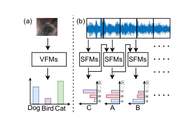
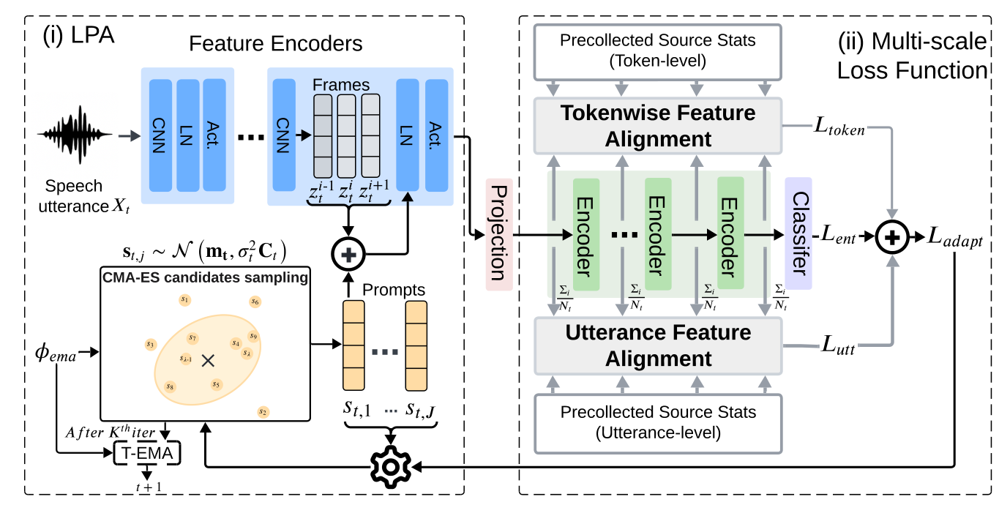
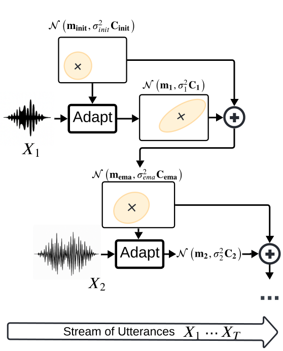
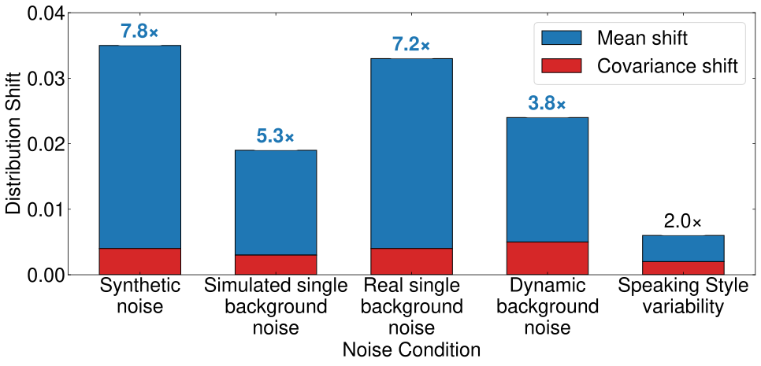
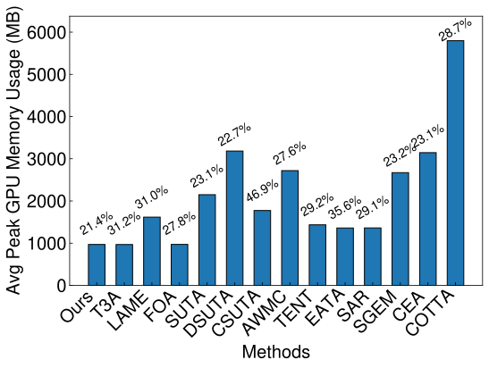
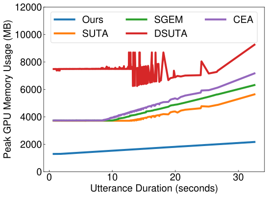
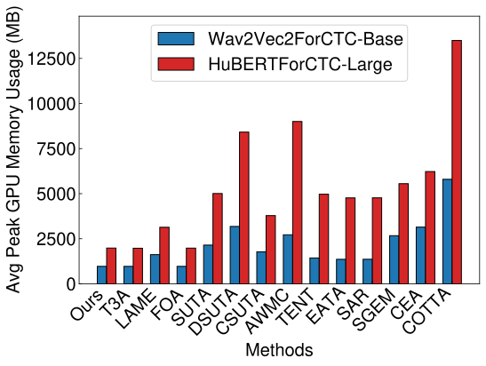

**Source:** *E-BATS: Efficient Backpropagation-Free Test-Time Adaptation for Speech Foundation Models* — [PDF](https://arxiv.org/pdf/2506.07078) · [arXiv](https://arxiv.org/abs/2506.07078)

# E-BATS: Efficient Backpropagation-Free Test-Time Adaptation for Speech Foundation Models

Jiaheng Dong   
The University of Melbourne jiaheng.dong@student.unimelb.edu.au Hong Jia   
University of Auckland hong.jia@auckland.ac.nz Soumyajit Chatterjee   
Nokia Bell Labs, UK soumyajit.chatterjee@nokia-bell-labs.com Abhirup Ghosh   
University of Birmingham a.ghosh.1@bham.ac.uk James Bailey   
The University of Melbourne baileyj@unimelb.edu.au Ting Dang   
The University of Melbourne Ting.Dang@unimelb.edu.au

###### Abstract

Speech Foundation Models encounter significant performance degradation when deployed in real-world scenarios involving acoustic domain shifts, such as background noise and speaker accents. Test-time adaptation (TTA) has recently emerged as a viable strategy to address such domain shifts at inference time without requiring access to source data or labels. However, existing TTA approaches, particularly those relying on backpropagation, are memory-intensive, limiting their applicability in speech tasks and resource-constrained settings. Although backpropagation-free methods offer improved efficiency, existing ones exhibit poor accuracy. This is because they are predominantly developed for vision tasks, which fundamentally differ from speech task formulations, noise characteristics, and model architecture, posing unique transferability challenges. In this paper, we introduce E-BATS, the _first_ Efficient BAckpropagation-free TTA framework designed explicitly for speech foundation models. E-BATS achieves a balance between adaptation effectiveness and memory efficiency through three key components: (i) lightweight prompt adaptation for a forward-pass-based feature alignment, (ii) a multi-scale loss to capture both global (utterance-level) and local distribution shifts (token-level) and (iii) a test-time exponential moving average mechanism for stable adaptation across utterances. Experiments conducted on four noisy speech datasets spanning sixteen acoustic conditions demonstrate consistent improvements, with \(4.1\%\)–\(13.5\%\) accuracy gains over backpropagation-free baselines and 2.0\(\times\)–6.4\(\times\) GPU memory savings compared to backpropagation-based methods. By enabling scalable and robust adaptation under acoustic variability, this work paves the way for developing more efficient adaptation approaches for practical speech processing systems in real-world environments. Code is available at: https://github.com/JiahengDong/E-BATS

## 1 Introduction

Speech foundation models (SFM), large-scale pre-trained models that learn generalized representations from vast amounts of unlabeled speech data, have shown strong performance for a wide range of applications including voice assistants [Kepuska and Bohouta (2018)](https://arxiv.org/html/2506.07078#bib.bib4), transcription services [Gaur et al. (2016)](https://arxiv.org/html/2506.07078#bib.bib5), and accessibility tools [Saz Torralba et al. (2011)](https://arxiv.org/html/2506.07078#bib.bib6). These systems generally rely on the assumption that the training and test data follow the same distributions. In practice, this assumption is often violated, leading to significant performance drops under domain shifts caused by real-world acoustic variations such as background noise, speaker accents, and microphone characteristics [Li et al. (2014a)](https://arxiv.org/html/2506.07078#bib.bib3). While domain adaptation [Ajith and Gopakumar (2023)](https://arxiv.org/html/2506.07078#bib.bib29); [Li et al. (2023)](https://arxiv.org/html/2506.07078#bib.bib36); [Alanov et al. (2022)](https://arxiv.org/html/2506.07078#bib.bib37); [Long et al. (2018)](https://arxiv.org/html/2506.07078#bib.bib38) and domain generalization [Zhou et al. (2022)](https://arxiv.org/html/2506.07078#bib.bib28); [Ding et al. (2022)](https://arxiv.org/html/2506.07078#bib.bib39); [Cha et al. (2021)](https://arxiv.org/html/2506.07078#bib.bib40); [Zhao et al. (2020)](https://arxiv.org/html/2506.07078#bib.bib41) have been extensively studied to address distributional shifts, they often require access to labeled target domain data or continuous availability of raw source data. These requirements are seldom feasible in real-world scenarios following model deployment. Recently, Test-Time Adaptation (TTA) has emerged as an attractive solution, adapting pre-trained models to new domains during inference using only unlabeled test data.

Existing TTA methods can be broadly categorized into backpropagation-based (BP) and backpropagation-free (BP-free) approaches. While the former achieved state-of-the-art (SOTA) performance using entropy minimization [Wang et al. (2020)](https://arxiv.org/html/2506.07078#bib.bib7); [Niu et al. (2022)](https://arxiv.org/html/2506.07078#bib.bib8); [Niu et al. (2023)](https://arxiv.org/html/2506.07078#bib.bib9); [Lin et al. (2022)](https://arxiv.org/html/2506.07078#bib.bib15); [Lin et al. (2024)](https://arxiv.org/html/2506.07078#bib.bib18); [Kim et al. (2023)](https://arxiv.org/html/2506.07078#bib.bib17); [Liu et al. (2023)](https://arxiv.org/html/2506.07078#bib.bib20) or pseudo-labeling techniques [Wang et al. (2022)](https://arxiv.org/html/2506.07078#bib.bib16); [Lee et al. (2023)](https://arxiv.org/html/2506.07078#bib.bib19), they have a large memory overhead, mainly due to gradient computation. Even when updates are limited to a small subset of model parameters, such as batch normalization layers [Wang et al. (2020)](https://arxiv.org/html/2506.07078#bib.bib7); [Niu et al. (2022)](https://arxiv.org/html/2506.07078#bib.bib8); [Niu et al. (2023)](https://arxiv.org/html/2506.07078#bib.bib9) or early exits [Jia et al. (2024)](https://arxiv.org/html/2506.07078#bib.bib44), these methods still require high GPU memory due to automatic differentiation frameworks. This significantly limits their practical use in continuous inference scenarios and on resource-constrained devices. In contrast, BP-free TTA methods eliminate the need for gradient computation, making them more efficient and computationally lightweight. These methods either modify the model parameters during the forward pass [Mirza et al. (2022)](https://arxiv.org/html/2506.07078#bib.bib11); [Zhao et al. (2023)](https://arxiv.org/html/2506.07078#bib.bib12); [Schneider et al. (2020)](https://arxiv.org/html/2506.07078#bib.bib13); [Su et al. (2024)](https://arxiv.org/html/2506.07078#bib.bib14); [Iwasawa and Matsuo (2021)](https://arxiv.org/html/2506.07078#bib.bib22) or learn a new input prompt, a vector integrated with the partially processed input samples at an intermediate layer of the model [Niu et al. (2024)](https://arxiv.org/html/2506.07078#bib.bib10).

 Figure 1: The main difference between (a) Vision Foundation Models and (b) Speech Foundation Models (SFMs) is the sequential pipeline in SFMs that processes a fixed-length frame of an utterance as an input and maps to a distribution over \(|\mathcal{V}|\) token classes. 

Despite the promise of TTA, they are largely tailored to models that depend on Batch Normalization (BN), while SFMs use Layer Normalization (LN), limiting the applicability of BN-based TTA [Lin et al. (2022)](https://arxiv.org/html/2506.07078#bib.bib15). Additionally, SFMs include both CNN-based feature encoders extracting localized spectral features and transformer encoders processing global context. This is unlike models in other modalities like vision, which are either CNN-based (e.g., ResNet [He et al. (2016)](https://arxiv.org/html/2506.07078#bib.bib30)) or transformer-based (Vision Transformer [Dosovitskiy et al. (2020)](https://arxiv.org/html/2506.07078#bib.bib31)). Such architectural difference presents a fundamental challenge for BP-free feature adaptation. Furthermore, downstream tasks and noise characteristics differ significantly between vision and speech tasks. As shown in Figure [1](https://arxiv.org/html/2506.07078#S1.F1 "Figure 1 ‣ 1 Introduction ‣ E-BATS: Efficient Backpropagation-Free Test-Time Adaptation for Speech Foundation Models"), vision models are commonly used for image classification, a one-to-one mapping task where noise typically appears as spatial perturbations of pixels [Hendrycks and Dietterich (2019)](https://arxiv.org/html/2506.07078#bib.bib32). In contrast, speech recognition involves sequence-to-sequence mapping and must handle dynamic, temporally varying noise across frames [Li et al. (2014b)](https://arxiv.org/html/2506.07078#bib.bib33). This requires more dynamic, multi-scale adaptation. Lastly, TTA methods often depend on large batch sizes for reliable adaptation, whereas TTA in speech tasks needs to process one utterance at a time (batch size of \(1\)) due to the high variability across speech utterances [Lin et al. (2022)](https://arxiv.org/html/2506.07078#bib.bib15); [Kim et al. (2023)](https://arxiv.org/html/2506.07078#bib.bib17). Despite recent developments in TTA for SFMs [Lin et al. (2022)](https://arxiv.org/html/2506.07078#bib.bib15); [Liu et al. (2023)](https://arxiv.org/html/2506.07078#bib.bib20); [Kim et al. (2023)](https://arxiv.org/html/2506.07078#bib.bib17); [Lin et al. (2024)](https://arxiv.org/html/2506.07078#bib.bib18); [Lee et al. (2023)](https://arxiv.org/html/2506.07078#bib.bib19), they still heavily rely on the BP-based TTA methods with high computational overhead, and overlook the unique requirements of multi-scale adaptation.

To address these challenges, we propose _the first Efficient BAckpropagation-free single-utterance TTA framework for SFMs_, E-BATS, which achieves SOTA accuracy with memory efficiency. Here we focus on one of the most popular tasks on speech data – speech recognition. E-BATS consists of three novel modules: i) A lightweight, prompt-based tuning mechanism tailored for SFMs which directly adapts latent feature distribution using forward pass only; ii) a custom multi-scale loss function that captures both global (utterance-level) and local (token-level) latent embeddings distribution shifts; and iii) a test-time Exponential Moving Average (T-EMA) module that stabilizes prompt updates across dynamic utterances. The main contributions are threefold:

  * We introduce the first backpropagation-free TTA approach tailored explicitly for SFMs that achieves high accuracy and low memory consumption. 
  * We propose a novel framework E-BATS, consisting of three novel modules to effectively address the multi-scale domain shifts and stable adaptation across the dynamic speech streams. 
  * We validate E-BATS across four noisy datasets, sixteen acoustic environments, and two model architectures have demonstrated significant improvements in both accuracy and memory, particularly \(2\)\(\times\) to \(6.4\)\(\times\) reduction in peak GPU memory usage over SOTA baselines. 

## 2 Related Works

Memory-Intensive BP TTA Methods. Traditional backpropagation-based TTA methods are generally memory-intensive, as they rely on gradient-based updates of model parameters, typically guided by entropy minimization or pseudo-labeling. TENT [Wang et al. (2020)](https://arxiv.org/html/2506.07078#bib.bib7) was the first to adapt the affine parameters of the BN layers using entropy minimization. SAR [Niu et al. (2023)](https://arxiv.org/html/2506.07078#bib.bib9) and EATA [Niu et al. (2022)](https://arxiv.org/html/2506.07078#bib.bib8) are variants of TENT, which further filter out a small portion of data samples that are unreliable and redundant. Although they only update a small portion of the overall parameters, the computation is still overhead due to backpropagation and the large batch size required for reliable adaptation [Niu et al. (2023)](https://arxiv.org/html/2506.07078#bib.bib9). More advanced methods, like CoTTA [Wang et al. (2022)](https://arxiv.org/html/2506.07078#bib.bib16), employ additional networks (e.g., teacher-student models) for adaptation, but at the cost of significantly increased computational and memory overhead.

TTA for SFMs. A few recent TTA approaches have been tailored for SFMs, which typically extend memory-intensive BP TTA methods with speech-specific mechanisms [Lin et al. (2022)](https://arxiv.org/html/2506.07078#bib.bib15); [Kim et al. (2023)](https://arxiv.org/html/2506.07078#bib.bib17); [Liu et al. (2023)](https://arxiv.org/html/2506.07078#bib.bib20). SUTA [Lin et al. (2022)](https://arxiv.org/html/2506.07078#bib.bib15) built upon TENT by updating CNN-based feature encoder layers alongside normalization parameters, incorporating techniques like temperature smoothing and Minimum Class Confusion loss. SGEM [Kim et al. (2023)](https://arxiv.org/html/2506.07078#bib.bib17) and CEA [Liu et al. (2023)](https://arxiv.org/html/2506.07078#bib.bib20) further improved upon this with advanced loss design for audio tasks, such as sequence-level entropy minimization or uncertainty-driven frame prioritization. DSUTA [Lin et al. (2024)](https://arxiv.org/html/2506.07078#bib.bib18) and AWMC [Lee et al. (2023)](https://arxiv.org/html/2506.07078#bib.bib19) introduced additional subnetworks (e.g., fast-slow models and anchor-chaser-leader models) to enhance cross-utterance knowledge transfer. However, these methods still heavily rely on backpropagation, leading to significant memory overhead and scalability challenges as more layers are updated beyond normalization.

BP-free TTA Methods. BP-free TTA methods offer an efficient alternative by updating the model solely via forward pass to achieve computational efficiency. These methods generally fall into three categories: (i) analytical adjustment of batch normalization statistics [Mirza et al. (2022)](https://arxiv.org/html/2506.07078#bib.bib11); [Zhao et al. (2023)](https://arxiv.org/html/2506.07078#bib.bib12); [Schneider et al. (2020)](https://arxiv.org/html/2506.07078#bib.bib13); [Su et al. (2024)](https://arxiv.org/html/2506.07078#bib.bib14), (ii) adaptation of the classifier using class prototypes [Iwasawa and Matsuo (2021)](https://arxiv.org/html/2506.07078#bib.bib22) or output probabilities [Boudiaf et al. (2022)](https://arxiv.org/html/2506.07078#bib.bib23), and (iii) optimization via evolutionary algorithms that circumvent gradient-based updates [Niu et al. (2024)](https://arxiv.org/html/2506.07078#bib.bib10). However, they typically offer lower adaptation accuracy compared to memory-intensive BP TTA methods [Wang et al. (2020)](https://arxiv.org/html/2506.07078#bib.bib7); [Wang et al. (2022)](https://arxiv.org/html/2506.07078#bib.bib16); [Niu et al. (2022)](https://arxiv.org/html/2506.07078#bib.bib8); [Niu et al. (2023)](https://arxiv.org/html/2506.07078#bib.bib9). Currently, _BP-free TTA for speech foundation models remains unexplored_ , primarily due to the unique challenges posed by sequence-to-sequence learning, single-utterance adaptation rather than batches, and differences in model structures, particularly in normalization layers and feature encoders.

## 3 Methodology

### 3.1 Overview

We consider a _covariate shift_ between the source and a target domain, such that the marginal distributions of speech differ, \(P_{\mathrm{src}}(\bm{X})\neq P_{\mathrm{tgt}}(\bm{X})\), while the class prior \(P_{\mathrm{src}}(y)=P_{\mathrm{tgt}}(y)\) and the conditional distribution \(P_{\mathrm{src}}(y\mid\bm{X})=P_{\mathrm{tgt}}(y\mid\bm{X})\) are preserved. We adapt an SFM \(\Theta_{\mathrm{src}}\), pre-trained on a source speech dataset \(D_{\mathrm{src}}\), to improve transcription accuracy while maintaining the low peak memory usage on an unlabeled target speech dataset \(D_{\mathrm{tgt}}\). A target stream \(D_{\mathrm{tgt}}=\{\bm{X}_{1},\dots,\bm{X}_{T}\}\) consists of \(T\) utterances arriving sequentially, each is processed under an online, single-utterance setting with a batch size of one. Each utterance \(\bm{X}_{t}\) is composed of a variable number of frames \(N_{t}\) and is represented as a sequence of frame-level feature vectors, where each frame represents a short, fixed-duration segment of the audio signal: \(\bm{X}_{t}=\left[\bm{x}_{t}^{1},\bm{x}_{t}^{2},\dots,\bm{x}_{t}^{N_{t}}\right],\quad\bm{x}_{t}^{i}\in\mathbb{R}^{d_{\text{in}}}\). The model \(\Theta_{\mathrm{src}}\) is composed of two components, \(\Theta=g\circ h\), where: (a) \(h\) is a convolutional encoder that maps each input frame to a latent embedding: \(\bm{x}_{t}^{i}\mapsto\bm{z}_{t}^{i}\in\mathbb{R}^{d}\). (b) \(g\) consists of a stack of transformer layers and a Connectionist Temporal Classification (CTC) classifier head, producing frame-level posterior distributions over CTC token classes \(v\in\mathcal{V}\), where \(\mathcal{V}\) consists of twenty-six alphabet token classes (a–z) and six special token classes (apostrophe, blank, etc.): \(g(\bm{Z}_{t})=\left\{P(y_{t}^{i}\mid\bm{z}_{t}^{1:N_{t}})\right\}_{i=1}^{N_{t}}.\) These posteriors are further decoded to produce each utterance’s final transcription \(\hat{y}_{t}\).

##### System Overview.

As shown in Figure [2](https://arxiv.org/html/2506.07078#S3.F2 "Figure 2 ‣ System Overview. ‣ 3.1 Overview ‣ 3 Methodology ‣ E-BATS: Efficient Backpropagation-Free Test-Time Adaptation for Speech Foundation Models"), for a test-time utterance \(\bm{X}_{t}\), the model first employs a Lightweight Prompt Adaptation (LPA) module, which directly modifies the CNN encoder features \(\bm{Z}_{t}\) by incorporating \(J\) learnable prompt vectors \(\bm{s}_{t,j}\). These prompts are sampled using the derivative-free Covariance Matrix Adaptation Evolution Strategy (CMA-ES), guided by a multi-scale adaptation loss \(L_{\text{adapt}}\). The prompt that results in the lowest loss is selected for adaptation. The loss comprises three components: entropy minimization (\(L_{\text{ent}}\)), utterance-level (\(L_{\text{utt}}\)), and token-level latent embeddings alignment (\(L_{\text{token}}\)). To promote stable adaptation across consecutive utterances, a Test-time Exponential Moving Average (T-EMA) module (Figure [2](https://arxiv.org/html/2506.07078#S3.F2 "Figure 2 ‣ System Overview. ‣ 3.1 Overview ‣ 3 Methodology ‣ E-BATS: Efficient Backpropagation-Free Test-Time Adaptation for Speech Foundation Models")(b)) incrementally updates the CMA-ES search distribution, enabling smoother evolution of the prompt vector \(\bm{s}_{t,j}\) over time.

 (a) Single-utterance Backpropagation-free Adaptation

 (b) T-EMA across utterances 

Figure 2: Overall framework of E-BATS. For an utterance \(\bm{X}_{t}\): (i) Lightweight Prompt Adaptation (LPA): CNN-extracted latent features \(\bm{Z}_{t}\) are adapted using a set of \(\bm{J}\) candidate prompts \(\bm{s}_{t,j}\) generated by CMA-ES in parallel, leading to \(\bm{J}\) adapted representations. (ii) The adapted representations \(\mathbf{J}\) are evaluated, and their corresponding prompts are ranked using a multi-scale loss (entropy loss, utterance-level and token-level feature alignment). This ranking guides the iterative update of CMA-ES parameters over \(\mathbf{K}\) iterations until the loss converges, at which point the best prompt is selected for adaptation. The CMA-ES parameters are smoothed using T-EMA for next utterance adaption. (b) Test-time Exponential Moving Average (T-EMA): T-EMA stabilizes adaptation by smoothing the CMA-ES search trajectory across a stream of utterances, facilitating robust prompt learning.

### 3.2 Lightweight Prompt Adaptation (LPA)

To ensure memory efficiency, E-BATS adopts prompt tuning [Lester et al. (2021)](https://arxiv.org/html/2506.07078#bib.bib34). This technique introduces a small set of learnable parameters, called _prompts_ , to guide the behavior of a pre-trained model on a downstream task while keeping the original model weights fixed. While conventional prompt tuning approaches have primarily been developed for transformer-only architectures [Dosovitskiy et al. (2020)](https://arxiv.org/html/2506.07078#bib.bib31), typically by concatenating prompts with the model’s inputs, we propose a novel LPA module (Figure [2(a)](https://arxiv.org/html/2506.07078#S3.F2.sf1 "In Figure 2 ‣ System Overview. ‣ 3.1 Overview ‣ 3 Methodology ‣ E-BATS: Efficient Backpropagation-Free Test-Time Adaptation for Speech Foundation Models")) designed specifically for SFMs that include convolutional components. The LPA integrates adaptive prompts directly into the convolutional layers, leveraging their effectiveness in extracting acoustic features [Lin et al. (2022)](https://arxiv.org/html/2506.07078#bib.bib15). Furthermore, rather than common strategy of concatenating prompts with input features [Niu et al. (2024)](https://arxiv.org/html/2506.07078#bib.bib10), our approach examines latent feature distribution shifts and leverages shifting patterns to guide adaptation.

##### Characterizing Distribution Shifts.

 Figure 3:  Comparing the source and target latent spaces across different acoustic conditions (same sample size for source and target domain within each condition). Blue and red bars indicate the mean and covariance shifts.

To understand differences in speech distribution, we first characterize the shift between the embedding vectors produced by source \(P(Z_{\mathrm{src}})\) and a target domain \(P(Z_{\mathrm{tgt}})\). We study the two most natural ways, covering both first and second order statistics: \(a)\) comparing shift in the centroid of the point clouds, and \(b)\) comparing the spread of the point clouds using their covariances. Incidentally, the popular distance measure between distributions, Fréchet Inception Distance, is a linear combination of these two factors, justifying our choice. Figure [3](https://arxiv.org/html/2506.07078#S3.F3 "Figure 3 ‣ Characterizing Distribution Shifts. ‣ 3.2 Lightweight Prompt Adaptation \(LPA\) ‣ 3 Methodology ‣ E-BATS: Efficient Backpropagation-Free Test-Time Adaptation for Speech Foundation Models") shows that, under various real-world noise and variability conditions, the shift in the mean accounts for up to \(7.8\times\) of the shift in the covariance (we make sure they are in comparable scale, explained in Appendix [A](https://arxiv.org/html/2506.07078#A1 "Appendix A FID score of detailed domain shifts ‣ E-BATS: Efficient Backpropagation-Free Test-Time Adaptation for Speech Foundation Models")).

From this observation, we hypothesize that the shift between \(D_{\mathrm{src}}\) and \(D_{\mathrm{tgt}}\) can be explained by a simple geometric translation operation in the latent space; therefore, an adequate shift of target embeddings, \(Z_{t}\) would align the latent target vectors to the ones from the source, essentially mitigating the problem of domain shift. It is important to note that, despite the potential for a translation operation, this remains a non-trivial problem. In real-world scenarios, noise is not consistently introduced into clean samples, making it impossible to derive a simple solution based on an analyzable shifting vector. Therefore, adaptively learning the prompt becomes necessary.

##### Learning Prompt to Adapt.

Following the above observation, we propose to add the embeddings \(\bm{Z}_{t}\) and the prompt vector \(\bm{s}_{t}\) over all frames (Figure [2(a)](https://arxiv.org/html/2506.07078#S3.F2.sf1 "In Figure 2 ‣ System Overview. ‣ 3.1 Overview ‣ 3 Methodology ‣ E-BATS: Efficient Backpropagation-Free Test-Time Adaptation for Speech Foundation Models")) as:

\[\begin{aligned}
 & \hat{\bm{Z}}_{t}=\bm{Z}_{t}+\bm{s}_{t}\cdot\bm{1}_{N}^{\top}, &  & \text{(1)}
\end{aligned}\]

 

where \(\bm{Z}_{t}=\left[\bm{z}_{t}^{1},\,\dots,\,\bm{z}_{t}^{N_{t}}\right],\;\bm{s}_{t}\in\mathbb{R}^{d}\text{ is the prompt vector for }\bm{X}_{t}.\) We exclusively optimize the prompt vector for each utterance while the rest of the model parameters remain frozen.

##### Prompt Optimization with CMA-ES.

To identify the optimal prompt vector in a backpropagation-free manner, we adopt the CMA-ES [Hansen (2016)](https://arxiv.org/html/2506.07078#bib.bib21). For each test-time utterance \(\bm{X}_{t}\), CMA-ES samples \(J\) candidate prompt vectors \(\bm{s}_{t,j}\) from a multivariate normal distribution \(\mathcal{N}(.)\), which are parameterized by a mean vector \(\mathbf{m}_{t}\in\mathbb{R}^{d}\), a covariance matrix \(\mathbf{C}_{t}\in\mathbb{R}^{d\times d}\), and a step size \(\sigma_{t}\in\mathbb{R}_{>0}\). The performances of these candidates are then ranked based on a loss function (explained in Section [3.3](https://arxiv.org/html/2506.07078#S3.SS3 "3.3 Multi-scale Loss Function ‣ 3 Methodology ‣ E-BATS: Efficient Backpropagation-Free Test-Time Adaptation for Speech Foundation Models")), which informs the update of the distribution parameters \(\bm{m}_{t}^{(k)},\bm{C}_{t}^{(k)},\sigma_{t}^{(k)}\) for the next iteration \(k\). The step size scales the covariance and thus controls the spread of candidate samples drawn from the distribution in the next iteration. The iteration continues until the loss convergences. The final prompt vector \(\bm{s}_{t}\) is selected as the candidate that minimizes the loss for adaptation (Appendix [D](https://arxiv.org/html/2506.07078#A4 "Appendix D Algorithms ‣ E-BATS: Efficient Backpropagation-Free Test-Time Adaptation for Speech Foundation Models")):

\[\begin{aligned}
 & \bm{s}_{t}=\arg\min_{\bm{s}_{t,j}\in\mathbb{R}^{d}}L_{adapt}(\bm{X}_{t},\bm{s}_{t,j}). &  & \text{(2)}
\end{aligned}\]

 

### 3.3 Multi-scale Loss Function

The loss function \(L_{adapt}\) that effectively guides the prompt optimization is proposed to integrate entropy minimization (\(L_{ent}\)) with feature alignment to the source domain latent embedding distributions at multiple scales, i.e., utterance-level (\(L_{utt}\)) and tokenwise (\(L_{token}\)). We optimize a weighted average using \(L_{adapt}=\alpha L_{ent}+\beta L_{utt}+cL_{token}\) where \(\alpha\) and \(\beta\) are hyperparameters, and \(c\) is chosen algorithmically based on the confidence in the prediction.

##### Entropy Minimization Loss with Blank Token Exclusion (\(L_{ent}\)).

Entropy minimization aims to improve prediction confidence, which is further improved with blank token exclusion for SFMs. SFMs for speech recognition include a special ‘blank’ token class \(\varnothing\), which is primarily designed in CTC to address the alignment mismatch between input frames and output labels [Graves et al. (2006)](https://arxiv.org/html/2506.07078#bib.bib42) with different lengths. In recent studies, it often indicates frames where no alphabetic character can be assigned, helping to eliminate the need to identify ambiguous sound boundaries [Graves et al. (2006)](https://arxiv.org/html/2506.07078#bib.bib42) and highlighting silent periods [Shahin et al. (2025)](https://arxiv.org/html/2506.07078#bib.bib43). In practice, predictions for a large proportion of the frames often belong to this blank class, which introduces class imbalance [Lin et al. (2022)](https://arxiv.org/html/2506.07078#bib.bib15). We address this by defining the entropy loss only considering the set of frames \(\tilde{{\bm{X}_{t}}}\) that do not predict blanks. Formally, we use Shanon’s entropy as \(L_{ent}=-\frac{1}{|\tilde{{\bm{X}_{t}}}|}\sum_{x_{t}^{i}\in\tilde{{\bm{X}_{t}}}}\mathcal{H}(\Theta(x_{t}^{i}))\).

Despite its effectiveness, minimizing only \(L_{ent}\) has a trivial solution of predicting the blank token class for each frame (as highlighted in Section [5.5](https://arxiv.org/html/2506.07078#S5.SS5 "5.5 Ablation Study ‣ 5 Results and Discussion ‣ E-BATS: Efficient Backpropagation-Free Test-Time Adaptation for Speech Foundation Models")). Thus, we introduce an utterance-level latent embeddings alignment loss to guide optimization towards the source domain embeddings correctly.

##### Utterance-level Latent Embeddings Alignment (\(L_{\mathrm{utt}}\)).

Utterance-level latent embeddings alignment aims to align the _global latent embedding distributions_ between the source domain and the target domain to avoid trivial solutions. At each transformer encoder layer, \(l\), we compute the squared Euclidean distance between the source-domain centroid and the target-domain centroid of utterance-level latent embeddings (Figure [2(a)](https://arxiv.org/html/2506.07078#S3.F2.sf1 "In Figure 2 ‣ System Overview. ‣ 3.1 Overview ‣ 3 Methodology ‣ E-BATS: Efficient Backpropagation-Free Test-Time Adaptation for Speech Foundation Models")(ii)). Each utterance-level embedding is obtained by averaging the embeddings across all frames within that utterance. Effectively, we compute and store the centroids, \(\bm{\mu}_{\mathrm{src}}\) using \(D_{\mathrm{src}}\) and \(\Theta_{\mathrm{src}}\) and compare against the centroids, \(\bm{\mu}_{\mathrm{tgt}}\), computed from the current target utterance. This gives us the following loss component: \(L_{\mathrm{utt}}=\frac{1}{L}\sum_{\ell=0}^{L}\|\bm{\mu}_{\mathrm{tgt}}^{l}-\bm{\mu}_{\mathrm{src}}^{l}\|_{2}^{2}\), where \(L\) is the number of transformer layers in \(\Theta\). Note that \(\bm{\mu}_{\mathrm{src}}\) requires a small storage size, in the order of \(L\times d\), and as this does not correspond to an individual source sample, it is privacy preserving.

##### Adaptive Confidence Tokenwise Latent Embeddings Alignment (\(L_{token}\)).

The tokens within a single utterance may not comprehensively represent all possible tokens. Aligning the centroids of the source and target utterance-level embeddings could lead to bias towards the majority tokens. To address this, we minimize the distance between the source and target latent distributions corresponding to token classes, where target token classes are estimated using pseudo-labels. To prevent unreliable pseudo-labels from distorting adaptation, we introduce adaptive confidence coefficients for the token-level loss. Specifically, when overall distribution shifts are substantial or entropy is high, this indicates less reliable posterior probabilities and a higher risk of inaccurate token pseudo-labels. In such cases, the confidence for token-level loss is reduced to minimize the impact of misleading token predictions. Conversely, if the shifts are minor or entropy is low, stronger alignment of token-level distributions can be applied with greater confidence.

Formally, we represent the mean \(\bm{\mu^{v,l}}\) and the standard deviation \(\bm{\sigma^{v,l}}\) of the distribution for each token class \(v\in\mathcal{V}\) in a \(d\)-dimensional space at transformer layer \(l\). Then we define the loss as the average distance between distributions as:

\[\begin{aligned}
 & L_{token}=\frac{1}{L}\frac{1}{|\mathcal{V}|}\sum_{l=0}^{L}\sum_{v\in\mathcal{V}}\left(\left\|\bm{\mu}^{v,l}_{tgt}-\bm{\mu}^{v,l}_{src}\right\|_{2}^{2}+\left\|\bm{\sigma}^{v,l}_{tgt}-\bm{\sigma}^{v,l}_{src}\right\|_{2}^{2}\right). &  & \text{(3)}
\end{aligned}\]

 

Note that the storage cost for \(\bm{\mu}^{v,l}_{src}\) and \(\bm{\sigma^{v,l}_{src}}\) is small and in the asymptotic order of \(2\times L\times 32\times d\). This is privacy-preserving as the distribution parameters are sample-agnostic.

We further introduce an adaptive confidence \(c\in[0,1]\) to adjust the trustworthiness of token-level predictions. We propose using the inverse of the combined loss \(H=L_{ent}+L_{utt}\) as the confidence-based coefficient, where high \(H\) means lower confidence. We define the normalized coefficient using min-max normalization with predefined bounds \(H_{\min}\), \(H_{\max}\) and \(c_{max}\) as: \(c=c_{max}-\frac{H-H_{\min}}{H_{\max}-H_{\min}+\epsilon}\), where \(\epsilon\) is a small constant to prevent division by zero. This adaptive confidence-aware scaling strengthens token-wise control via prediction reliability and domain shift.

##### Optimizing through CMA-ES.

The CMA-ES parameters are optimized using \(L_{adapt}\), driving the prompt optimization. By iteratively minimizing \(L_{adapt}\) for candidate prompt vectors within each utterance, CMA-ES could be updated to effectively generate prompts that robustly mitigate both global (utterance-level) and local (token-level) acoustic domain shifts.

### 3.4 T-EMA across Utterances

To stabilize adaptation across the utterance streams, we propose T-EMA that updates the CMA-ES parameters incrementally, ensuring a smoother and more consistent search space for the prompt (Figure [2(b)](https://arxiv.org/html/2506.07078#S3.F2.sf2 "In Figure 2 ‣ System Overview. ‣ 3.1 Overview ‣ 3 Methodology ‣ E-BATS: Efficient Backpropagation-Free Test-Time Adaptation for Speech Foundation Models")). It leverages the knowledge from past utterances to initialize each new search more robustly, thereby reducing overfitting and mitigating model drift. This serves as the first smoother adaptation strategy for BP-free TTA in SFMs.

CMA-ES statistics parameters are carried over between utterances using the following weighted average scheme. We introduce EMA statistics, e.g., \(\mathbf{m}_{ema}\), that are updated using a hyperparameter \(\gamma\in[0,1)\) to weight the past and current statistics values. Such an update happens when all \(K\) iterations have finished for an utterance. For example, at the end of processing \(t\)-th utterance, the mean of the distribution is updated as \(\mathbf{m}_{ema}=\gamma\,\mathbf{m}_{ema}+(1-\gamma)\,\mathbf{m}_{t}^{(K)}\), where the \(\mathbf{m}_{ema}\) is initialized with \(\mathbf{m}_{0}\) when \(t=0\). Then, \(\mathbf{m}_{t+1}\) is set to \(\mathbf{m}_{ema}\) from the previous round for next utterance prompt learning. The other statistics, covariance and step size are updated in the same way.

## 4 Experiments

##### Datasets.

We evaluate the proposed method on four datasets across sixteen acoustic conditions to assess its effectiveness under varying domain shifts. The test sets encompass three categories of acoustic variability: synthetic noise, single-domain distributional shifts, and multi-domain distributional shifts, reflecting the range of conditions encountered in real-world deployment. Following [Lin et al. (2022)](https://arxiv.org/html/2506.07078#bib.bib15); [Liu et al. (2023)](https://arxiv.org/html/2506.07078#bib.bib20), we introduce synthetic noise to the LibriSpeech test-other split [Panayotov et al. (2015)](https://arxiv.org/html/2506.07078#bib.bib24) with additive Gaussian noise with zero mean and varying standard deviations (\(\sigma\in\{0.0,0.005,0.01,0.015,0.02\}\)) to simulate covariate shifts. We use the CHiME-3 dataset [Barker et al. (2017)](https://arxiv.org/html/2506.07078#bib.bib25) representing single domain shift in a sample, including four acoustic environments: bus, café, pedestrian area, and street junction. We further use CHiME-3-Mix that creates a dynamic stream by concatenating CHiME-3 environments to emulate non-stationary acoustic shifts [Lin et al. (2024)](https://arxiv.org/html/2506.07078#bib.bib18). CommonVoice (CV) [Ardila et al. (2019)](https://arxiv.org/html/2506.07078#bib.bib26) introduces variability in speaker accents, recording devices, and environments and TEDLIUM-v2 (TED) [Hernandez et al. (2018)](https://arxiv.org/html/2506.07078#bib.bib27) comprises oratory speech from TED talks with diverse accents, speaking styles, and syntactic structures.

##### Baseline Methods.

We compare E-BATS against 13 SOTA TTA baselines. The  BP methods include general approaches of Episodic TENT [Wang et al. (2020)](https://arxiv.org/html/2506.07078#bib.bib7), SAR [Niu et al. (2023)](https://arxiv.org/html/2506.07078#bib.bib9), EATA [Niu et al. (2022)](https://arxiv.org/html/2506.07078#bib.bib8), and CoTTA [Wang et al. (2022)](https://arxiv.org/html/2506.07078#bib.bib16), as well as speech-specific methods: SUTA [Lin et al. (2022)](https://arxiv.org/html/2506.07078#bib.bib15), CEA [Liu et al. (2023)](https://arxiv.org/html/2506.07078#bib.bib20), SGEM [Kim et al. (2023)](https://arxiv.org/html/2506.07078#bib.bib17), DSUTA [Lin et al. (2024)](https://arxiv.org/html/2506.07078#bib.bib18), CSUTA [Lin et al. (2024)](https://arxiv.org/html/2506.07078#bib.bib18), and AWMC [Lee et al. (2023)](https://arxiv.org/html/2506.07078#bib.bib19). The BP-free methods include LAME [Boudiaf et al. (2022)](https://arxiv.org/html/2506.07078#bib.bib23), T3A [Iwasawa and Matsuo (2021)](https://arxiv.org/html/2506.07078#bib.bib22), and FOA [Niu et al. (2024)](https://arxiv.org/html/2506.07078#bib.bib10). Dataset and baseline details are provided in Appendix [B](https://arxiv.org/html/2506.07078#A2 "Appendix B Experiments ‣ E-BATS: Efficient Backpropagation-Free Test-Time Adaptation for Speech Foundation Models").

##### Implementation Details.

All TTA baselines are configured for per-utterance adaptation with batch size of 1. For E-BATS, we set the CMA-ES population size \(J=50\). The loss function coefficients are \(\alpha=1.0\) and \(\beta=2.0\). We use \(\text{H}_{\min}=0.0\), \(\text{H}_{\max}=5.0\) in calculating the confidence-weighted coefficient \(c\) with \(c_{\max}=2.0\) optimized over \(\{1.0,\,1.5,\,2.0,\,2.5,\,3.0,\,3.5,\,4.0\}\). Evaluation is performed using two commonly used SFMs, Wav2Vec2ForCTC-Base [Baevski et al. (2020)](https://arxiv.org/html/2506.07078#bib.bib1) and HuBERTForCTC-Large [Hsu et al. (2021)](https://arxiv.org/html/2506.07078#bib.bib2); both models are fine-tuned on LibriSpeech and then are adapted in our experiments. The pre-collected statistics are sourced from clean LibriSpeech data samples. For T-EMA, we select \(\gamma=0.9\) for Wav2Vec2 and \(\gamma=0.8\) for HuBERT after tuning over \(\{0.7,\,0.8,\,0.9,\,0.95,\,0.99\}\). We use Word Error Rate (WER) [Pallett (1985)](https://arxiv.org/html/2506.07078#bib.bib35) as the evaluation metric, which measures the fraction of incorrectly predicted words in the dataset. A lower WER indicates better performance. We further conducted sensitivity analyses on key hyperparameters in Appendix [C.3](https://arxiv.org/html/2506.07078#A3.SS3 "C.3 Sensitive Analysis ‣ Appendix C Detailed Experiment results ‣ E-BATS: Efficient Backpropagation-Free Test-Time Adaptation for Speech Foundation Models"), including the CMA-ES population size (\(J\)), the number of iteration steps (\(N\)), the loss component weights (\(\alpha,\beta\)), and the T-EMA decay factor (\(\gamma\)), confirming that the chosen settings yield stable and robust performance across diverse configurations. All experiments are conducted on a single NVIDIA A100 GPU. Implementation details are provided in Appendix [B](https://arxiv.org/html/2506.07078#A2 "Appendix B Experiments ‣ E-BATS: Efficient Backpropagation-Free Test-Time Adaptation for Speech Foundation Models").

## 5 Results and Discussion

Table 1: Word Error Rate (WER) on various noisy conditions using Wav2Vec2ForCTC-Base. Lower value means better adaptation performance. Bold represents the best performance for BP-free TTA, while underlined means the best for both BP-based and BP-free TTA. 

<table id="S5.T1.6" class="ltx_tabular ltx_centering ltx_guessed_headers ltx_align_middle">
<tbody class="ltx_tbody">
<tr id="S5.T1.6.1" class="ltx_tr">
<th id="S5.T1.6.1.1" class="ltx_td ltx_align_left ltx_th ltx_th_row ltx_border_tt" style="padding-left:4.0pt;padding-right:4.0pt;">Method</th>
<td id="S5.T1.6.1.2" class="ltx_td ltx_align_center ltx_border_tt" style="padding-left:4.0pt;padding-right:4.0pt;">BP-</td>
<td id="S5.T1.6.1.3" class="ltx_td ltx_align_center ltx_border_tt" style="padding-left:4.0pt;padding-right:4.0pt;" colspan="6">Gaussian noise</td>
<td id="S5.T1.6.1.4" class="ltx_td ltx_align_center ltx_border_tt" style="padding-left:4.0pt;padding-right:4.0pt;">CHiME3</td>
<td id="S5.T1.6.1.5" class="ltx_td ltx_align_center ltx_border_tt" style="padding-left:4.0pt;padding-right:4.0pt;">CHiME3</td>
<td id="S5.T1.6.1.6" class="ltx_td ltx_align_center ltx_border_tt" style="padding-left:4.0pt;padding-right:4.0pt;">TED</td>
<td id="S5.T1.6.1.7" class="ltx_td ltx_align_center ltx_border_tt" style="padding-left:4.0pt;padding-right:4.0pt;">Common</td></tr>
<tr id="S5.T1.6.2" class="ltx_tr">
<th id="S5.T1.6.2.1" class="ltx_td ltx_th ltx_th_row" style="padding-left:4.0pt;padding-right:4.0pt;"></th>
<td id="S5.T1.6.2.2" class="ltx_td ltx_align_center" style="padding-left:4.0pt;padding-right:4.0pt;">free</td>
<td id="S5.T1.6.2.3" class="ltx_td ltx_align_center" style="padding-left:4.0pt;padding-right:4.0pt;">0.0</td>
<td id="S5.T1.6.2.4" class="ltx_td ltx_align_center" style="padding-left:4.0pt;padding-right:4.0pt;">0.005</td>
<td id="S5.T1.6.2.5" class="ltx_td ltx_align_center" style="padding-left:4.0pt;padding-right:4.0pt;">0.01</td>
<td id="S5.T1.6.2.6" class="ltx_td ltx_align_center" style="padding-left:4.0pt;padding-right:4.0pt;">0.015</td>
<td id="S5.T1.6.2.7" class="ltx_td ltx_align_center" style="padding-left:4.0pt;padding-right:4.0pt;">0.02</td>
<td id="S5.T1.6.2.8" class="ltx_td ltx_align_center" style="padding-left:4.0pt;padding-right:4.0pt;">Avg</td>
<td id="S5.T1.6.2.9" class="ltx_td ltx_align_center" style="padding-left:4.0pt;padding-right:4.0pt;">(Single)</td>
<td id="S5.T1.6.2.10" class="ltx_td ltx_align_center" style="padding-left:4.0pt;padding-right:4.0pt;">(Mixed)</td>
<td id="S5.T1.6.2.11" class="ltx_td" style="padding-left:4.0pt;padding-right:4.0pt;"></td>
<td id="S5.T1.6.2.12" class="ltx_td ltx_align_center" style="padding-left:4.0pt;padding-right:4.0pt;">Voice</td></tr>
<tr id="S5.T1.6.3" class="ltx_tr">
<th id="S5.T1.6.3.1" class="ltx_td ltx_align_left ltx_th ltx_th_row ltx_border_t" style="padding-left:4.0pt;padding-right:4.0pt;">Source</th>
<td id="S5.T1.6.3.2" class="ltx_td ltx_align_center ltx_border_t" style="padding-left:4.0pt;padding-right:4.0pt;">—</td>
<td id="S5.T1.6.3.3" class="ltx_td ltx_align_center ltx_border_t" style="padding-left:4.0pt;padding-right:4.0pt;">8.6</td>
<td id="S5.T1.6.3.4" class="ltx_td ltx_align_center ltx_border_t" style="padding-left:4.0pt;padding-right:4.0pt;">13.9</td>
<td id="S5.T1.6.3.5" class="ltx_td ltx_align_center ltx_border_t" style="padding-left:4.0pt;padding-right:4.0pt;">24.4</td>
<td id="S5.T1.6.3.6" class="ltx_td ltx_align_center ltx_border_t" style="padding-left:4.0pt;padding-right:4.0pt;">39.5</td>
<td id="S5.T1.6.3.7" class="ltx_td ltx_align_center ltx_border_t" style="padding-left:4.0pt;padding-right:4.0pt;">54.5</td>
<td id="S5.T1.6.3.8" class="ltx_td ltx_align_center ltx_border_t" style="padding-left:4.0pt;padding-right:4.0pt;">28.2</td>
<td id="S5.T1.6.3.9" class="ltx_td ltx_align_center ltx_border_t" style="padding-left:4.0pt;padding-right:4.0pt;">34.2</td>
<td id="S5.T1.6.3.10" class="ltx_td ltx_align_center ltx_border_t" style="padding-left:4.0pt;padding-right:4.0pt;">34.2</td>
<td id="S5.T1.6.3.11" class="ltx_td ltx_align_center ltx_border_t" style="padding-left:4.0pt;padding-right:4.0pt;">13.2</td>
<td id="S5.T1.6.3.12" class="ltx_td ltx_align_center ltx_border_t" style="padding-left:4.0pt;padding-right:4.0pt;">36.8</td></tr>
<tr id="S5.T1.6.4" class="ltx_tr">
<th id="S5.T1.6.4.1" class="ltx_td ltx_align_left ltx_th ltx_th_row" style="padding-left:4.0pt;padding-right:4.0pt;">TENT</th>
<td id="S5.T1.6.4.2" class="ltx_td ltx_align_center" style="padding-left:4.0pt;padding-right:4.0pt;">✗</td>
<td id="S5.T1.6.4.3" class="ltx_td ltx_align_center" style="padding-left:4.0pt;padding-right:4.0pt;">8.5</td>
<td id="S5.T1.6.4.4" class="ltx_td ltx_align_center" style="padding-left:4.0pt;padding-right:4.0pt;">14.0</td>
<td id="S5.T1.6.4.5" class="ltx_td ltx_align_center" style="padding-left:4.0pt;padding-right:4.0pt;">24.1</td>
<td id="S5.T1.6.4.6" class="ltx_td ltx_align_center" style="padding-left:4.0pt;padding-right:4.0pt;">39.2</td>
<td id="S5.T1.6.4.7" class="ltx_td ltx_align_center" style="padding-left:4.0pt;padding-right:4.0pt;">54.3</td>
<td id="S5.T1.6.4.8" class="ltx_td ltx_align_center" style="padding-left:4.0pt;padding-right:4.0pt;">28.0</td>
<td id="S5.T1.6.4.9" class="ltx_td ltx_align_center" style="padding-left:4.0pt;padding-right:4.0pt;">34.1</td>
<td id="S5.T1.6.4.10" class="ltx_td ltx_align_center" style="padding-left:4.0pt;padding-right:4.0pt;">34.1</td>
<td id="S5.T1.6.4.11" class="ltx_td ltx_align_center" style="padding-left:4.0pt;padding-right:4.0pt;">13.1</td>
<td id="S5.T1.6.4.12" class="ltx_td ltx_align_center" style="padding-left:4.0pt;padding-right:4.0pt;">36.8</td></tr>
<tr id="S5.T1.6.5" class="ltx_tr">
<th id="S5.T1.6.5.1" class="ltx_td ltx_align_left ltx_th ltx_th_row" style="padding-left:4.0pt;padding-right:4.0pt;">EATA</th>
<td id="S5.T1.6.5.2" class="ltx_td ltx_align_center" style="padding-left:4.0pt;padding-right:4.0pt;">✗</td>
<td id="S5.T1.6.5.3" class="ltx_td ltx_align_center" style="padding-left:4.0pt;padding-right:4.0pt;">14.1</td>
<td id="S5.T1.6.5.4" class="ltx_td ltx_align_center" style="padding-left:4.0pt;padding-right:4.0pt;">18.1</td>
<td id="S5.T1.6.5.5" class="ltx_td ltx_align_center" style="padding-left:4.0pt;padding-right:4.0pt;">27.0</td>
<td id="S5.T1.6.5.6" class="ltx_td ltx_align_center" style="padding-left:4.0pt;padding-right:4.0pt;">37.9</td>
<td id="S5.T1.6.5.7" class="ltx_td ltx_align_center" style="padding-left:4.0pt;padding-right:4.0pt;">51.3</td>
<td id="S5.T1.6.5.8" class="ltx_td ltx_align_center" style="padding-left:4.0pt;padding-right:4.0pt;">29.7</td>
<td id="S5.T1.6.5.9" class="ltx_td ltx_align_center" style="padding-left:4.0pt;padding-right:4.0pt;">33.1</td>
<td id="S5.T1.6.5.10" class="ltx_td ltx_align_center" style="padding-left:4.0pt;padding-right:4.0pt;">39.9</td>
<td id="S5.T1.6.5.11" class="ltx_td ltx_align_center" style="padding-left:4.0pt;padding-right:4.0pt;">14.1</td>
<td id="S5.T1.6.5.12" class="ltx_td ltx_align_center" style="padding-left:4.0pt;padding-right:4.0pt;">61.3</td></tr>
<tr id="S5.T1.6.6" class="ltx_tr">
<th id="S5.T1.6.6.1" class="ltx_td ltx_align_left ltx_th ltx_th_row" style="padding-left:4.0pt;padding-right:4.0pt;">SAR</th>
<td id="S5.T1.6.6.2" class="ltx_td ltx_align_center" style="padding-left:4.0pt;padding-right:4.0pt;">✗</td>
<td id="S5.T1.6.6.3" class="ltx_td ltx_align_center" style="padding-left:4.0pt;padding-right:4.0pt;">8.4</td>
<td id="S5.T1.6.6.4" class="ltx_td ltx_align_center" style="padding-left:4.0pt;padding-right:4.0pt;">13.6</td>
<td id="S5.T1.6.6.5" class="ltx_td ltx_align_center" style="padding-left:4.0pt;padding-right:4.0pt;">22.9</td>
<td id="S5.T1.6.6.6" class="ltx_td ltx_align_center" style="padding-left:4.0pt;padding-right:4.0pt;">36.0</td>
<td id="S5.T1.6.6.7" class="ltx_td ltx_align_center" style="padding-left:4.0pt;padding-right:4.0pt;">49.9</td>
<td id="S5.T1.6.6.8" class="ltx_td ltx_align_center" style="padding-left:4.0pt;padding-right:4.0pt;">26.2</td>
<td id="S5.T1.6.6.9" class="ltx_td ltx_align_center" style="padding-left:4.0pt;padding-right:4.0pt;">33.6</td>
<td id="S5.T1.6.6.10" class="ltx_td ltx_align_center" style="padding-left:4.0pt;padding-right:4.0pt;">34.7</td>
<td id="S5.T1.6.6.11" class="ltx_td ltx_align_center" style="padding-left:4.0pt;padding-right:4.0pt;">13.0</td>
<td id="S5.T1.6.6.12" class="ltx_td ltx_align_center" style="padding-left:4.0pt;padding-right:4.0pt;">38.2</td></tr>
<tr id="S5.T1.6.7" class="ltx_tr">
<th id="S5.T1.6.7.1" class="ltx_td ltx_align_left ltx_th ltx_th_row" style="padding-left:4.0pt;padding-right:4.0pt;">CoTTA</th>
<td id="S5.T1.6.7.2" class="ltx_td ltx_align_center" style="padding-left:4.0pt;padding-right:4.0pt;">✗</td>
<td id="S5.T1.6.7.3" class="ltx_td ltx_align_center" style="padding-left:4.0pt;padding-right:4.0pt;">9.2</td>
<td id="S5.T1.6.7.4" class="ltx_td ltx_align_center" style="padding-left:4.0pt;padding-right:4.0pt;">12.6</td>
<td id="S5.T1.6.7.5" class="ltx_td ltx_align_center" style="padding-left:4.0pt;padding-right:4.0pt;">18.1</td>
<td id="S5.T1.6.7.6" class="ltx_td ltx_align_center" style="padding-left:4.0pt;padding-right:4.0pt;">39.3</td>
<td id="S5.T1.6.7.7" class="ltx_td ltx_align_center" style="padding-left:4.0pt;padding-right:4.0pt;">54.5</td>
<td id="S5.T1.6.7.8" class="ltx_td ltx_align_center" style="padding-left:4.0pt;padding-right:4.0pt;">26.7</td>
<td id="S5.T1.6.7.9" class="ltx_td ltx_align_center" style="padding-left:4.0pt;padding-right:4.0pt;">32.9</td>
<td id="S5.T1.6.7.10" class="ltx_td ltx_align_center" style="padding-left:4.0pt;padding-right:4.0pt;">34.3</td>
<td id="S5.T1.6.7.11" class="ltx_td ltx_align_center" style="padding-left:4.0pt;padding-right:4.0pt;">12.8</td>
<td id="S5.T1.6.7.12" class="ltx_td ltx_align_center" style="padding-left:4.0pt;padding-right:4.0pt;">36.9</td></tr>
<tr id="S5.T1.6.8" class="ltx_tr">
<th id="S5.T1.6.8.1" class="ltx_td ltx_align_left ltx_th ltx_th_row" style="padding-left:4.0pt;padding-right:4.0pt;">CEA</th>
<td id="S5.T1.6.8.2" class="ltx_td ltx_align_center" style="padding-left:4.0pt;padding-right:4.0pt;">✗</td>
<td id="S5.T1.6.8.3" class="ltx_td ltx_align_center" style="padding-left:4.0pt;padding-right:4.0pt;">7.5</td>
<td id="S5.T1.6.8.4" class="ltx_td ltx_align_center" style="padding-left:4.0pt;padding-right:4.0pt;">11.1</td>
<td id="S5.T1.6.8.5" class="ltx_td ltx_align_center" style="padding-left:4.0pt;padding-right:4.0pt;">16.4</td>
<td id="S5.T1.6.8.6" class="ltx_td ltx_align_center" style="padding-left:4.0pt;padding-right:4.0pt;">23.8</td>
<td id="S5.T1.6.8.7" class="ltx_td ltx_align_center" style="padding-left:4.0pt;padding-right:4.0pt;">33.6</td>
<td id="S5.T1.6.8.8" class="ltx_td ltx_align_center" style="padding-left:4.0pt;padding-right:4.0pt;">18.5</td>
<td id="S5.T1.6.8.9" class="ltx_td ltx_align_center" style="padding-left:4.0pt;padding-right:4.0pt;">26.8</td>
<td id="S5.T1.6.8.10" class="ltx_td ltx_align_center" style="padding-left:4.0pt;padding-right:4.0pt;">26.8</td>
<td id="S5.T1.6.8.11" class="ltx_td ltx_align_center" style="padding-left:4.0pt;padding-right:4.0pt;">12.0</td>
<td id="S5.T1.6.8.12" class="ltx_td ltx_align_center" style="padding-left:4.0pt;padding-right:4.0pt;">31.5</td></tr>
<tr id="S5.T1.6.9" class="ltx_tr">
<th id="S5.T1.6.9.1" class="ltx_td ltx_align_left ltx_th ltx_th_row" style="padding-left:4.0pt;padding-right:4.0pt;">SGEM</th>
<td id="S5.T1.6.9.2" class="ltx_td ltx_align_center" style="padding-left:4.0pt;padding-right:4.0pt;">✗</td>
<td id="S5.T1.6.9.3" class="ltx_td ltx_align_center" style="padding-left:4.0pt;padding-right:4.0pt;">7.3</td>
<td id="S5.T1.6.9.4" class="ltx_td ltx_align_center" style="padding-left:4.0pt;padding-right:4.0pt;">10.9</td>
<td id="S5.T1.6.9.5" class="ltx_td ltx_align_center" style="padding-left:4.0pt;padding-right:4.0pt;">16.4</td>
<td id="S5.T1.6.9.6" class="ltx_td ltx_align_center" style="padding-left:4.0pt;padding-right:4.0pt;">23.8</td>
<td id="S5.T1.6.9.7" class="ltx_td ltx_align_center" style="padding-left:4.0pt;padding-right:4.0pt;">33.9</td>
<td id="S5.T1.6.9.8" class="ltx_td ltx_align_center" style="padding-left:4.0pt;padding-right:4.0pt;">18.5</td>
<td id="S5.T1.6.9.9" class="ltx_td ltx_align_center" style="padding-left:4.0pt;padding-right:4.0pt;">27.2</td>
<td id="S5.T1.6.9.10" class="ltx_td ltx_align_center" style="padding-left:4.0pt;padding-right:4.0pt;">27.1</td>
<td id="S5.T1.6.9.11" class="ltx_td ltx_align_center" style="padding-left:4.0pt;padding-right:4.0pt;">11.9</td>
<td id="S5.T1.6.9.12" class="ltx_td ltx_align_center" style="padding-left:4.0pt;padding-right:4.0pt;">31.2</td></tr>
<tr id="S5.T1.6.10" class="ltx_tr">
<th id="S5.T1.6.10.1" class="ltx_td ltx_align_left ltx_th ltx_th_row" style="padding-left:4.0pt;padding-right:4.0pt;">AWMC</th>
<td id="S5.T1.6.10.2" class="ltx_td ltx_align_center" style="padding-left:4.0pt;padding-right:4.0pt;">✗</td>
<td id="S5.T1.6.10.3" class="ltx_td ltx_align_center" style="padding-left:4.0pt;padding-right:4.0pt;">9.5</td>
<td id="S5.T1.6.10.4" class="ltx_td ltx_align_center" style="padding-left:4.0pt;padding-right:4.0pt;">11.7</td>
<td id="S5.T1.6.10.5" class="ltx_td ltx_align_center" style="padding-left:4.0pt;padding-right:4.0pt;">16.6</td>
<td id="S5.T1.6.10.6" class="ltx_td ltx_align_center" style="padding-left:4.0pt;padding-right:4.0pt;">23.9</td>
<td id="S5.T1.6.10.7" class="ltx_td ltx_align_center" style="padding-left:4.0pt;padding-right:4.0pt;">31.8</td>
<td id="S5.T1.6.10.8" class="ltx_td ltx_align_center" style="padding-left:4.0pt;padding-right:4.0pt;">18.7</td>
<td id="S5.T1.6.10.9" class="ltx_td ltx_align_center" style="padding-left:4.0pt;padding-right:4.0pt;">34.0</td>
<td id="S5.T1.6.10.10" class="ltx_td ltx_align_center" style="padding-left:4.0pt;padding-right:4.0pt;">33.9</td>
<td id="S5.T1.6.10.11" class="ltx_td ltx_align_center" style="padding-left:4.0pt;padding-right:4.0pt;">13.6</td>
<td id="S5.T1.6.10.12" class="ltx_td ltx_align_center" style="padding-left:4.0pt;padding-right:4.0pt;">37.9</td></tr>
<tr id="S5.T1.6.11" class="ltx_tr">
<th id="S5.T1.6.11.1" class="ltx_td ltx_align_left ltx_th ltx_th_row" style="padding-left:4.0pt;padding-right:4.0pt;">SUTA</th>
<td id="S5.T1.6.11.2" class="ltx_td ltx_align_center" style="padding-left:4.0pt;padding-right:4.0pt;">✗</td>
<td id="S5.T1.6.11.3" class="ltx_td ltx_align_center" style="padding-left:4.0pt;padding-right:4.0pt;">7.3</td>
<td id="S5.T1.6.11.4" class="ltx_td ltx_align_center" style="padding-left:4.0pt;padding-right:4.0pt;">10.9</td>
<td id="S5.T1.6.11.5" class="ltx_td ltx_align_center" style="padding-left:4.0pt;padding-right:4.0pt;">16.5</td>
<td id="S5.T1.6.11.6" class="ltx_td ltx_align_center" style="padding-left:4.0pt;padding-right:4.0pt;">24.1</td>
<td id="S5.T1.6.11.7" class="ltx_td ltx_align_center" style="padding-left:4.0pt;padding-right:4.0pt;">34.1</td>
<td id="S5.T1.6.11.8" class="ltx_td ltx_align_center" style="padding-left:4.0pt;padding-right:4.0pt;">18.6</td>
<td id="S5.T1.6.11.9" class="ltx_td ltx_align_center" style="padding-left:4.0pt;padding-right:4.0pt;">26.8</td>
<td id="S5.T1.6.11.10" class="ltx_td ltx_align_center" style="padding-left:4.0pt;padding-right:4.0pt;">26.8</td>
<td id="S5.T1.6.11.11" class="ltx_td ltx_align_center" style="padding-left:4.0pt;padding-right:4.0pt;">11.9</td>
<td id="S5.T1.6.11.12" class="ltx_td ltx_align_center" style="padding-left:4.0pt;padding-right:4.0pt;">31.5</td></tr>
<tr id="S5.T1.6.12" class="ltx_tr">
<th id="S5.T1.6.12.1" class="ltx_td ltx_align_left ltx_th ltx_th_row" style="padding-left:4.0pt;padding-right:4.0pt;">CSUTA</th>
<td id="S5.T1.6.12.2" class="ltx_td ltx_align_center" style="padding-left:4.0pt;padding-right:4.0pt;">✗</td>
<td id="S5.T1.6.12.3" class="ltx_td ltx_align_center" style="padding-left:4.0pt;padding-right:4.0pt;">13.1</td>
<td id="S5.T1.6.12.4" class="ltx_td ltx_align_center" style="padding-left:4.0pt;padding-right:4.0pt;">17.5</td>
<td id="S5.T1.6.12.5" class="ltx_td ltx_align_center" style="padding-left:4.0pt;padding-right:4.0pt;">24.5</td>
<td id="S5.T1.6.12.6" class="ltx_td ltx_align_center" style="padding-left:4.0pt;padding-right:4.0pt;">31.4</td>
<td id="S5.T1.6.12.7" class="ltx_td ltx_align_center" style="padding-left:4.0pt;padding-right:4.0pt;">37.0</td>
<td id="S5.T1.6.12.8" class="ltx_td ltx_align_center" style="padding-left:4.0pt;padding-right:4.0pt;">24.7</td>
<td id="S5.T1.6.12.9" class="ltx_td ltx_align_center" style="padding-left:4.0pt;padding-right:4.0pt;">26.5</td>
<td id="S5.T1.6.12.10" class="ltx_td ltx_align_center" style="padding-left:4.0pt;padding-right:4.0pt;">32.6</td>
<td id="S5.T1.6.12.11" class="ltx_td ltx_align_center" style="padding-left:4.0pt;padding-right:4.0pt;">15.6</td>
<td id="S5.T1.6.12.12" class="ltx_td ltx_align_center" style="padding-left:4.0pt;padding-right:4.0pt;">135.0</td></tr>
<tr id="S5.T1.6.13" class="ltx_tr">
<th id="S5.T1.6.13.1" class="ltx_td ltx_align_left ltx_th ltx_th_row" style="padding-left:4.0pt;padding-right:4.0pt;">DSUTA</th>
<td id="S5.T1.6.13.2" class="ltx_td ltx_align_center" style="padding-left:4.0pt;padding-right:4.0pt;">✗</td>
<td id="S5.T1.6.13.3" class="ltx_td ltx_align_center" style="padding-left:4.0pt;padding-right:4.0pt;">9.0</td>
<td id="S5.T1.6.13.4" class="ltx_td ltx_align_center" style="padding-left:4.0pt;padding-right:4.0pt;">11.7</td>
<td id="S5.T1.6.13.5" class="ltx_td ltx_align_center" style="padding-left:4.0pt;padding-right:4.0pt;">16.1</td>
<td id="S5.T1.6.13.6" class="ltx_td ltx_align_center" style="padding-left:4.0pt;padding-right:4.0pt;">21.1</td>
<td id="S5.T1.6.13.7" class="ltx_td ltx_align_center" style="padding-left:4.0pt;padding-right:4.0pt;">24.1</td>
<td id="S5.T1.6.13.8" class="ltx_td ltx_align_center" style="padding-left:4.0pt;padding-right:4.0pt;">16.4</td>
<td id="S5.T1.6.13.9" class="ltx_td ltx_align_center" style="padding-left:4.0pt;padding-right:4.0pt;">24.0</td>
<td id="S5.T1.6.13.10" class="ltx_td ltx_align_center" style="padding-left:4.0pt;padding-right:4.0pt;">24.1</td>
<td id="S5.T1.6.13.11" class="ltx_td ltx_align_center" style="padding-left:4.0pt;padding-right:4.0pt;">12.7</td>
<td id="S5.T1.6.13.12" class="ltx_td ltx_align_center" style="padding-left:4.0pt;padding-right:4.0pt;">36.1</td></tr>
<tr id="S5.T1.6.14" class="ltx_tr">
<th id="S5.T1.6.14.1" class="ltx_td ltx_align_left ltx_th ltx_th_row ltx_border_t" style="padding-left:4.0pt;padding-right:4.0pt;">T3A</th>
<td id="S5.T1.6.14.2" class="ltx_td ltx_align_center ltx_border_t" style="padding-left:4.0pt;padding-right:4.0pt;">✓</td>
<td id="S5.T1.6.14.3" class="ltx_td ltx_align_center ltx_border_t" style="padding-left:4.0pt;padding-right:4.0pt;">10.0</td>
<td id="S5.T1.6.14.4" class="ltx_td ltx_align_center ltx_border_t" style="padding-left:4.0pt;padding-right:4.0pt;">15.9</td>
<td id="S5.T1.6.14.5" class="ltx_td ltx_align_center ltx_border_t" style="padding-left:4.0pt;padding-right:4.0pt;">26.8</td>
<td id="S5.T1.6.14.6" class="ltx_td ltx_align_center ltx_border_t" style="padding-left:4.0pt;padding-right:4.0pt;">42.7</td>
<td id="S5.T1.6.14.7" class="ltx_td ltx_align_center ltx_border_t" style="padding-left:4.0pt;padding-right:4.0pt;">58.6</td>
<td id="S5.T1.6.14.8" class="ltx_td ltx_align_center ltx_border_t" style="padding-left:4.0pt;padding-right:4.0pt;">30.8</td>
<td id="S5.T1.6.14.9" class="ltx_td ltx_align_center ltx_border_t" style="padding-left:4.0pt;padding-right:4.0pt;">35.9</td>
<td id="S5.T1.6.14.10" class="ltx_td ltx_align_center ltx_border_t" style="padding-left:4.0pt;padding-right:4.0pt;">35.8</td>
<td id="S5.T1.6.14.11" class="ltx_td ltx_align_center ltx_border_t" style="padding-left:4.0pt;padding-right:4.0pt;">14.6</td>
<td id="S5.T1.6.14.12" class="ltx_td ltx_align_center ltx_border_t" style="padding-left:4.0pt;padding-right:4.0pt;">38.8</td></tr>
<tr id="S5.T1.6.15" class="ltx_tr">
<th id="S5.T1.6.15.1" class="ltx_td ltx_align_left ltx_th ltx_th_row" style="padding-left:4.0pt;padding-right:4.0pt;">LAME</th>
<td id="S5.T1.6.15.2" class="ltx_td ltx_align_center" style="padding-left:4.0pt;padding-right:4.0pt;">✓</td>
<td id="S5.T1.6.15.3" class="ltx_td ltx_align_center" style="padding-left:4.0pt;padding-right:4.0pt;">9.1</td>
<td id="S5.T1.6.15.4" class="ltx_td ltx_align_center" style="padding-left:4.0pt;padding-right:4.0pt;">15.0</td>
<td id="S5.T1.6.15.5" class="ltx_td ltx_align_center" style="padding-left:4.0pt;padding-right:4.0pt;">26.0</td>
<td id="S5.T1.6.15.6" class="ltx_td ltx_align_center" style="padding-left:4.0pt;padding-right:4.0pt;">42.4</td>
<td id="S5.T1.6.15.7" class="ltx_td ltx_align_center" style="padding-left:4.0pt;padding-right:4.0pt;">58.2</td>
<td id="S5.T1.6.15.8" class="ltx_td ltx_align_center" style="padding-left:4.0pt;padding-right:4.0pt;">30.1</td>
<td id="S5.T1.6.15.9" class="ltx_td ltx_align_center" style="padding-left:4.0pt;padding-right:4.0pt;">36.0</td>
<td id="S5.T1.6.15.10" class="ltx_td ltx_align_center" style="padding-left:4.0pt;padding-right:4.0pt;">36.0</td>
<td id="S5.T1.6.15.11" class="ltx_td ltx_align_center" style="padding-left:4.0pt;padding-right:4.0pt;">14.0</td>
<td id="S5.T1.6.15.12" class="ltx_td ltx_align_center" style="padding-left:4.0pt;padding-right:4.0pt;">38.8</td></tr>
<tr id="S5.T1.6.16" class="ltx_tr">
<th id="S5.T1.6.16.1" class="ltx_td ltx_align_left ltx_th ltx_th_row" style="padding-left:4.0pt;padding-right:4.0pt;">FOA</th>
<td id="S5.T1.6.16.2" class="ltx_td ltx_align_center" style="padding-left:4.0pt;padding-right:4.0pt;">✓</td>
<td id="S5.T1.6.16.3" class="ltx_td ltx_align_center" style="padding-left:4.0pt;padding-right:4.0pt;">8.7</td>
<td id="S5.T1.6.16.4" class="ltx_td ltx_align_center" style="padding-left:4.0pt;padding-right:4.0pt;">13.9</td>
<td id="S5.T1.6.16.5" class="ltx_td ltx_align_center" style="padding-left:4.0pt;padding-right:4.0pt;">22.7</td>
<td id="S5.T1.6.16.6" class="ltx_td ltx_align_center" style="padding-left:4.0pt;padding-right:4.0pt;">33.3</td>
<td id="S5.T1.6.16.7" class="ltx_td ltx_align_center" style="padding-left:4.0pt;padding-right:4.0pt;">45.3</td>
<td id="S5.T1.6.16.8" class="ltx_td ltx_align_center" style="padding-left:4.0pt;padding-right:4.0pt;">24.8</td>
<td id="S5.T1.6.16.9" class="ltx_td ltx_align_center" style="padding-left:4.0pt;padding-right:4.0pt;">31.7</td>
<td id="S5.T1.6.16.10" class="ltx_td ltx_align_center" style="padding-left:4.0pt;padding-right:4.0pt;">31.1</td>
<td id="S5.T1.6.16.11" class="ltx_td ltx_align_center" style="padding-left:4.0pt;padding-right:4.0pt;">13.3</td>
<td id="S5.T1.6.16.12" class="ltx_td ltx_align_center" style="padding-left:4.0pt;padding-right:4.0pt;">38.2</td></tr>
<tr id="S5.T1.6.17" class="ltx_tr" style="--ltx-bg-color:#E6E6E6;">
<th id="S5.T1.6.17.1" class="ltx_td ltx_align_left ltx_th ltx_th_row ltx_border_bb" style="padding-left:4.0pt;padding-right:4.0pt;">Ours</th>
<td id="S5.T1.6.17.2" class="ltx_td ltx_align_center ltx_border_bb" style="padding-left:4.0pt;padding-right:4.0pt;">✓</td>
<td id="S5.T1.6.17.3" class="ltx_td ltx_align_center ltx_border_bb" style="padding-left:4.0pt;padding-right:4.0pt;">7.7</td>
<td id="S5.T1.6.17.4" class="ltx_td ltx_align_center ltx_border_bb" style="padding-left:4.0pt;padding-right:4.0pt;">10.5</td>
<td id="S5.T1.6.17.5" class="ltx_td ltx_align_center ltx_border_bb" style="padding-left:4.0pt;padding-right:4.0pt;">14.8</td>
<td id="S5.T1.6.17.6" class="ltx_td ltx_align_center ltx_border_bb" style="padding-left:4.0pt;padding-right:4.0pt;">19.9</td>
<td id="S5.T1.6.17.7" class="ltx_td ltx_align_center ltx_border_bb" style="padding-left:4.0pt;padding-right:4.0pt;">25.3</td>
<td id="S5.T1.6.17.8" class="ltx_td ltx_align_center ltx_border_bb" style="padding-left:4.0pt;padding-right:4.0pt;">15.6</td>
<td id="S5.T1.6.17.9" class="ltx_td ltx_align_center ltx_border_bb" style="padding-left:4.0pt;padding-right:4.0pt;">24.0</td>
<td id="S5.T1.6.17.10" class="ltx_td ltx_align_center ltx_border_bb" style="padding-left:4.0pt;padding-right:4.0pt;">24.3</td>
<td id="S5.T1.6.17.11" class="ltx_td ltx_align_center ltx_border_bb" style="padding-left:4.0pt;padding-right:4.0pt;">12.5</td>
<td id="S5.T1.6.17.12" class="ltx_td ltx_align_center ltx_border_bb" style="padding-left:4.0pt;padding-right:4.0pt;">30.6</td></tr>
</tbody>
</table>

 

### 5.1 Comparing accuracy to SOTA

Experiments using Wav2Vec2ForCTC-Base (Table [1](https://arxiv.org/html/2506.07078#S5.T1 "Table 1 ‣ 5 Results and Discussion ‣ E-BATS: Efficient Backpropagation-Free Test-Time Adaptation for Speech Foundation Models")) show that E-BATS consistently outperforms all BP-free TTA baselines across datasets, with WER reductions ranging from 0.8% to 20.0% over the strongest alternative. Its performance gains increase with noise severity, achieving at least 3.4% improvement at \(\sigma=0.005\) and 20.0% at \(\sigma=0.02\), highlighting robust adaptation under challenging conditions. T3A and LAME degrade the source model, indicating that updating only the final classifier is insufficient. FOA, which also uses prompt tuning, performs better but remains less effective than E-BATS, likely due to difficulties in adapting transformer layers for acoustic shifts (Section [5.5](https://arxiv.org/html/2506.07078#S5.SS5 "5.5 Ablation Study ‣ 5 Results and Discussion ‣ E-BATS: Efficient Backpropagation-Free Test-Time Adaptation for Speech Foundation Models")).

Compared to BP-based methods, E-BATS achieves the lowest WER in 3 out of 5 datasets, with up to 30.7% relative improvement, and remains competitive. Methods such as EATA and CoTTA, which depend on larger batch sizes or vision-specific strategies, perform poorly across the board. While TENT and SAR are more resilient with small batches, they still underperform relative to E-BATS, showing that adapting only normalization layers is inadequate. On the other hand, the performance limitations of SGEM, SUTA, and CEA stem from their utterance-level reset strategy. This prevents them from transferring the already learned knowledge for adapting further utterances as model weights are reinitialized every time. Notably, DSUTA, despite continuous adaptation, performs 5.5% worse than E-BATS on CommonVoice, the most diverse test condition. This suggests that frequent parameter updates may lead to catastrophic forgetting. In contrast, E-BATS updates only prompt vectors, preserving the pre-trained model and enabling effective, stable adaptation across varied domains. Additional results across different fine-grained noise conditions are in Appendix [C](https://arxiv.org/html/2506.07078#A3 "Appendix C Detailed Experiment results ‣ E-BATS: Efficient Backpropagation-Free Test-Time Adaptation for Speech Foundation Models").

### 5.2 Memory Efficiency

Beyond accuracy, E-BATS demonstrates substantial memory efficiency across all evaluated methods, as shown in Figure [4](https://arxiv.org/html/2506.07078#S5.F4 "Figure 4 ‣ 5.2 Memory Efficiency ‣ 5 Results and Discussion ‣ E-BATS: Efficient Backpropagation-Free Test-Time Adaptation for Speech Foundation Models"). Compared to BP-based TTA methods, it reduces peak GPU memory usage by 1.5\(\times\) to 5.9\(\times\). Specifically, relative to DSUTA, CEA, and SGEM, E-BATS achieves memory savings of 3.3\(\times\), 3.2\(\times\), and 2.8\(\times\), respectively, while outperforming them in WER. This efficiency is attributed to lightweight prompt tuning and the T-EMA mechanism, which avoids gradient-based updates. Compared to BP-free baselines, E-BATS maintains comparable or lower memory usage while achieving a lower WER, indicating a favorable balance between efficiency and performance.

 Figure 4: Balance between Average Peak GPU memory usage (bar) and average WER (percentages \(\%\)) for different TTA methods across all datasets.

### 5.3 Performance with Different Backbone Models

Table 2: WER on various noisy conditions using HuBERTForCTC-Large. Lower is better. Bold: best among BP-free; underlined: best overall. 

<table id="S5.T2.6" class="ltx_tabular ltx_centering ltx_guessed_headers ltx_align_middle">
<tbody class="ltx_tbody">
<tr id="S5.T2.6.1" class="ltx_tr">
<th id="S5.T2.6.1.1" class="ltx_td ltx_align_left ltx_th ltx_th_row ltx_border_tt" style="padding-left:4.0pt;padding-right:4.0pt;">Method</th>
<td id="S5.T2.6.1.2" class="ltx_td ltx_align_center ltx_border_tt" style="padding-left:4.0pt;padding-right:4.0pt;">BP-</td>
<td id="S5.T2.6.1.3" class="ltx_td ltx_align_center ltx_border_tt" style="padding-left:4.0pt;padding-right:4.0pt;" colspan="6">Gaussian noise</td>
<td id="S5.T2.6.1.4" class="ltx_td ltx_align_center ltx_border_tt" style="padding-left:4.0pt;padding-right:4.0pt;">CHiME3</td>
<td id="S5.T2.6.1.5" class="ltx_td ltx_align_center ltx_border_tt" style="padding-left:4.0pt;padding-right:4.0pt;">CHiME3</td>
<td id="S5.T2.6.1.6" class="ltx_td ltx_align_center ltx_border_tt" style="padding-left:4.0pt;padding-right:4.0pt;">TED</td>
<td id="S5.T2.6.1.7" class="ltx_td ltx_align_center ltx_border_tt" style="padding-left:4.0pt;padding-right:4.0pt;">Common</td></tr>
<tr id="S5.T2.6.2" class="ltx_tr">
<th id="S5.T2.6.2.1" class="ltx_td ltx_th ltx_th_row" style="padding-left:4.0pt;padding-right:4.0pt;"></th>
<td id="S5.T2.6.2.2" class="ltx_td ltx_align_center" style="padding-left:4.0pt;padding-right:4.0pt;">free</td>
<td id="S5.T2.6.2.3" class="ltx_td ltx_align_center" style="padding-left:4.0pt;padding-right:4.0pt;">0.0</td>
<td id="S5.T2.6.2.4" class="ltx_td ltx_align_center" style="padding-left:4.0pt;padding-right:4.0pt;">0.005</td>
<td id="S5.T2.6.2.5" class="ltx_td ltx_align_center" style="padding-left:4.0pt;padding-right:4.0pt;">0.01</td>
<td id="S5.T2.6.2.6" class="ltx_td ltx_align_center" style="padding-left:4.0pt;padding-right:4.0pt;">0.015</td>
<td id="S5.T2.6.2.7" class="ltx_td ltx_align_center" style="padding-left:4.0pt;padding-right:4.0pt;">0.02</td>
<td id="S5.T2.6.2.8" class="ltx_td ltx_align_center" style="padding-left:4.0pt;padding-right:4.0pt;">Avg</td>
<td id="S5.T2.6.2.9" class="ltx_td ltx_align_center" style="padding-left:4.0pt;padding-right:4.0pt;">(Single)</td>
<td id="S5.T2.6.2.10" class="ltx_td ltx_align_center" style="padding-left:4.0pt;padding-right:4.0pt;">(Mixed)</td>
<td id="S5.T2.6.2.11" class="ltx_td" style="padding-left:4.0pt;padding-right:4.0pt;"></td>
<td id="S5.T2.6.2.12" class="ltx_td ltx_align_center" style="padding-left:4.0pt;padding-right:4.0pt;">Voice</td></tr>
<tr id="S5.T2.6.3" class="ltx_tr">
<th id="S5.T2.6.3.1" class="ltx_td ltx_align_left ltx_th ltx_th_row ltx_border_t" style="padding-left:4.0pt;padding-right:4.0pt;">Source</th>
<td id="S5.T2.6.3.2" class="ltx_td ltx_align_center ltx_border_t" style="padding-left:4.0pt;padding-right:4.0pt;">—</td>
<td id="S5.T2.6.3.3" class="ltx_td ltx_align_center ltx_border_t" style="padding-left:4.0pt;padding-right:4.0pt;">4.2</td>
<td id="S5.T2.6.3.4" class="ltx_td ltx_align_center ltx_border_t" style="padding-left:4.0pt;padding-right:4.0pt;">5.0</td>
<td id="S5.T2.6.3.5" class="ltx_td ltx_align_center ltx_border_t" style="padding-left:4.0pt;padding-right:4.0pt;">6.4</td>
<td id="S5.T2.6.3.6" class="ltx_td ltx_align_center ltx_border_t" style="padding-left:4.0pt;padding-right:4.0pt;">9.0</td>
<td id="S5.T2.6.3.7" class="ltx_td ltx_align_center ltx_border_t" style="padding-left:4.0pt;padding-right:4.0pt;">12.8</td>
<td id="S5.T2.6.3.8" class="ltx_td ltx_align_center ltx_border_t" style="padding-left:4.0pt;padding-right:4.0pt;">7.5</td>
<td id="S5.T2.6.3.9" class="ltx_td ltx_align_center ltx_border_t" style="padding-left:4.0pt;padding-right:4.0pt;">16.5</td>
<td id="S5.T2.6.3.10" class="ltx_td ltx_align_center ltx_border_t" style="padding-left:4.0pt;padding-right:4.0pt;">16.5</td>
<td id="S5.T2.6.3.11" class="ltx_td ltx_align_center ltx_border_t" style="padding-left:4.0pt;padding-right:4.0pt;">9.1</td>
<td id="S5.T2.6.3.12" class="ltx_td ltx_align_center ltx_border_t" style="padding-left:4.0pt;padding-right:4.0pt;">21.4</td></tr>
<tr id="S5.T2.6.4" class="ltx_tr">
<th id="S5.T2.6.4.1" class="ltx_td ltx_align_left ltx_th ltx_th_row" style="padding-left:4.0pt;padding-right:4.0pt;">TENT</th>
<td id="S5.T2.6.4.2" class="ltx_td ltx_align_center" style="padding-left:4.0pt;padding-right:4.0pt;">✗</td>
<td id="S5.T2.6.4.3" class="ltx_td ltx_align_center" style="padding-left:4.0pt;padding-right:4.0pt;">4.2</td>
<td id="S5.T2.6.4.4" class="ltx_td ltx_align_center" style="padding-left:4.0pt;padding-right:4.0pt;">4.9</td>
<td id="S5.T2.6.4.5" class="ltx_td ltx_align_center" style="padding-left:4.0pt;padding-right:4.0pt;">6.3</td>
<td id="S5.T2.6.4.6" class="ltx_td ltx_align_center" style="padding-left:4.0pt;padding-right:4.0pt;">8.8</td>
<td id="S5.T2.6.4.7" class="ltx_td ltx_align_center" style="padding-left:4.0pt;padding-right:4.0pt;">12.5</td>
<td id="S5.T2.6.4.8" class="ltx_td ltx_align_center" style="padding-left:4.0pt;padding-right:4.0pt;">7.3</td>
<td id="S5.T2.6.4.9" class="ltx_td ltx_align_center" style="padding-left:4.0pt;padding-right:4.0pt;">16.4</td>
<td id="S5.T2.6.4.10" class="ltx_td ltx_align_center" style="padding-left:4.0pt;padding-right:4.0pt;">16.4</td>
<td id="S5.T2.6.4.11" class="ltx_td ltx_align_center" style="padding-left:4.0pt;padding-right:4.0pt;">9.0</td>
<td id="S5.T2.6.4.12" class="ltx_td ltx_align_center" style="padding-left:4.0pt;padding-right:4.0pt;">27.5</td></tr>
<tr id="S5.T2.6.5" class="ltx_tr">
<th id="S5.T2.6.5.1" class="ltx_td ltx_align_left ltx_th ltx_th_row" style="padding-left:4.0pt;padding-right:4.0pt;">EATA</th>
<td id="S5.T2.6.5.2" class="ltx_td ltx_align_center" style="padding-left:4.0pt;padding-right:4.0pt;">✗</td>
<td id="S5.T2.6.5.3" class="ltx_td ltx_align_center" style="padding-left:4.0pt;padding-right:4.0pt;">7.4</td>
<td id="S5.T2.6.5.4" class="ltx_td ltx_align_center" style="padding-left:4.0pt;padding-right:4.0pt;">8.4</td>
<td id="S5.T2.6.5.5" class="ltx_td ltx_align_center" style="padding-left:4.0pt;padding-right:4.0pt;">9.5</td>
<td id="S5.T2.6.5.6" class="ltx_td ltx_align_center" style="padding-left:4.0pt;padding-right:4.0pt;">11.3</td>
<td id="S5.T2.6.5.7" class="ltx_td ltx_align_center" style="padding-left:4.0pt;padding-right:4.0pt;">13.7</td>
<td id="S5.T2.6.5.8" class="ltx_td ltx_align_center" style="padding-left:4.0pt;padding-right:4.0pt;">10.1</td>
<td id="S5.T2.6.5.9" class="ltx_td ltx_align_center" style="padding-left:4.0pt;padding-right:4.0pt;">16.2</td>
<td id="S5.T2.6.5.10" class="ltx_td ltx_align_center" style="padding-left:4.0pt;padding-right:4.0pt;">18.9</td>
<td id="S5.T2.6.5.11" class="ltx_td ltx_align_center" style="padding-left:4.0pt;padding-right:4.0pt;">9.7</td>
<td id="S5.T2.6.5.12" class="ltx_td ltx_align_center" style="padding-left:4.0pt;padding-right:4.0pt;">34.4</td></tr>
<tr id="S5.T2.6.6" class="ltx_tr">
<th id="S5.T2.6.6.1" class="ltx_td ltx_align_left ltx_th ltx_th_row" style="padding-left:4.0pt;padding-right:4.0pt;">SAR</th>
<td id="S5.T2.6.6.2" class="ltx_td ltx_align_center" style="padding-left:4.0pt;padding-right:4.0pt;">✗</td>
<td id="S5.T2.6.6.3" class="ltx_td ltx_align_center" style="padding-left:4.0pt;padding-right:4.0pt;">4.0</td>
<td id="S5.T2.6.6.4" class="ltx_td ltx_align_center" style="padding-left:4.0pt;padding-right:4.0pt;">4.7</td>
<td id="S5.T2.6.6.5" class="ltx_td ltx_align_center" style="padding-left:4.0pt;padding-right:4.0pt;">6.3</td>
<td id="S5.T2.6.6.6" class="ltx_td ltx_align_center" style="padding-left:4.0pt;padding-right:4.0pt;">8.6</td>
<td id="S5.T2.6.6.7" class="ltx_td ltx_align_center" style="padding-left:4.0pt;padding-right:4.0pt;">12.2</td>
<td id="S5.T2.6.6.8" class="ltx_td ltx_align_center" style="padding-left:4.0pt;padding-right:4.0pt;">7.2</td>
<td id="S5.T2.6.6.9" class="ltx_td ltx_align_center" style="padding-left:4.0pt;padding-right:4.0pt;">16.4</td>
<td id="S5.T2.6.6.10" class="ltx_td ltx_align_center" style="padding-left:4.0pt;padding-right:4.0pt;">17.3</td>
<td id="S5.T2.6.6.11" class="ltx_td ltx_align_center" style="padding-left:4.0pt;padding-right:4.0pt;">9.0</td>
<td id="S5.T2.6.6.12" class="ltx_td ltx_align_center" style="padding-left:4.0pt;padding-right:4.0pt;">21.7</td></tr>
<tr id="S5.T2.6.7" class="ltx_tr">
<th id="S5.T2.6.7.1" class="ltx_td ltx_align_left ltx_th ltx_th_row" style="padding-left:4.0pt;padding-right:4.0pt;">CoTTA</th>
<td id="S5.T2.6.7.2" class="ltx_td ltx_align_center" style="padding-left:4.0pt;padding-right:4.0pt;">✗</td>
<td id="S5.T2.6.7.3" class="ltx_td ltx_align_center" style="padding-left:4.0pt;padding-right:4.0pt;">4.4</td>
<td id="S5.T2.6.7.4" class="ltx_td ltx_align_center" style="padding-left:4.0pt;padding-right:4.0pt;">5.1</td>
<td id="S5.T2.6.7.5" class="ltx_td ltx_align_center" style="padding-left:4.0pt;padding-right:4.0pt;">6.3</td>
<td id="S5.T2.6.7.6" class="ltx_td ltx_align_center" style="padding-left:4.0pt;padding-right:4.0pt;">8.3</td>
<td id="S5.T2.6.7.7" class="ltx_td ltx_align_center" style="padding-left:4.0pt;padding-right:4.0pt;">11.0</td>
<td id="S5.T2.6.7.8" class="ltx_td ltx_align_center" style="padding-left:4.0pt;padding-right:4.0pt;">7.0</td>
<td id="S5.T2.6.7.9" class="ltx_td ltx_align_center" style="padding-left:4.0pt;padding-right:4.0pt;">16.2</td>
<td id="S5.T2.6.7.10" class="ltx_td ltx_align_center" style="padding-left:4.0pt;padding-right:4.0pt;">15.3</td>
<td id="S5.T2.6.7.11" class="ltx_td ltx_align_center" style="padding-left:4.0pt;padding-right:4.0pt;">9.0</td>
<td id="S5.T2.6.7.12" class="ltx_td ltx_align_center" style="padding-left:4.0pt;padding-right:4.0pt;">25.8</td></tr>
<tr id="S5.T2.6.8" class="ltx_tr">
<th id="S5.T2.6.8.1" class="ltx_td ltx_align_left ltx_th ltx_th_row" style="padding-left:4.0pt;padding-right:4.0pt;">CEA</th>
<td id="S5.T2.6.8.2" class="ltx_td ltx_align_center" style="padding-left:4.0pt;padding-right:4.0pt;">✗</td>
<td id="S5.T2.6.8.3" class="ltx_td ltx_align_center" style="padding-left:4.0pt;padding-right:4.0pt;">3.8</td>
<td id="S5.T2.6.8.4" class="ltx_td ltx_align_center" style="padding-left:4.0pt;padding-right:4.0pt;">4.2</td>
<td id="S5.T2.6.8.5" class="ltx_td ltx_align_center" style="padding-left:4.0pt;padding-right:4.0pt;">5.1</td>
<td id="S5.T2.6.8.6" class="ltx_td ltx_align_center" style="padding-left:4.0pt;padding-right:4.0pt;">6.7</td>
<td id="S5.T2.6.8.7" class="ltx_td ltx_align_center" style="padding-left:4.0pt;padding-right:4.0pt;">9.1</td>
<td id="S5.T2.6.8.8" class="ltx_td ltx_align_center" style="padding-left:4.0pt;padding-right:4.0pt;">5.8</td>
<td id="S5.T2.6.8.9" class="ltx_td ltx_align_center" style="padding-left:4.0pt;padding-right:4.0pt;">14.2</td>
<td id="S5.T2.6.8.10" class="ltx_td ltx_align_center" style="padding-left:4.0pt;padding-right:4.0pt;">14.1</td>
<td id="S5.T2.6.8.11" class="ltx_td ltx_align_center" style="padding-left:4.0pt;padding-right:4.0pt;">8.1</td>
<td id="S5.T2.6.8.12" class="ltx_td ltx_align_center" style="padding-left:4.0pt;padding-right:4.0pt;">18.3</td></tr>
<tr id="S5.T2.6.9" class="ltx_tr">
<th id="S5.T2.6.9.1" class="ltx_td ltx_align_left ltx_th ltx_th_row" style="padding-left:4.0pt;padding-right:4.0pt;">SGEM</th>
<td id="S5.T2.6.9.2" class="ltx_td ltx_align_center" style="padding-left:4.0pt;padding-right:4.0pt;">✗</td>
<td id="S5.T2.6.9.3" class="ltx_td ltx_align_center" style="padding-left:4.0pt;padding-right:4.0pt;">3.7</td>
<td id="S5.T2.6.9.4" class="ltx_td ltx_align_center" style="padding-left:4.0pt;padding-right:4.0pt;">5.3</td>
<td id="S5.T2.6.9.5" class="ltx_td ltx_align_center" style="padding-left:4.0pt;padding-right:4.0pt;">5.3</td>
<td id="S5.T2.6.9.6" class="ltx_td ltx_align_center" style="padding-left:4.0pt;padding-right:4.0pt;">6.9</td>
<td id="S5.T2.6.9.7" class="ltx_td ltx_align_center" style="padding-left:4.0pt;padding-right:4.0pt;">9.3</td>
<td id="S5.T2.6.9.8" class="ltx_td ltx_align_center" style="padding-left:4.0pt;padding-right:4.0pt;">6.1</td>
<td id="S5.T2.6.9.9" class="ltx_td ltx_align_center" style="padding-left:4.0pt;padding-right:4.0pt;">14.2</td>
<td id="S5.T2.6.9.10" class="ltx_td ltx_align_center" style="padding-left:4.0pt;padding-right:4.0pt;">14.2</td>
<td id="S5.T2.6.9.11" class="ltx_td ltx_align_center" style="padding-left:4.0pt;padding-right:4.0pt;">8.3</td>
<td id="S5.T2.6.9.12" class="ltx_td ltx_align_center" style="padding-left:4.0pt;padding-right:4.0pt;">18.4</td></tr>
<tr id="S5.T2.6.10" class="ltx_tr">
<th id="S5.T2.6.10.1" class="ltx_td ltx_align_left ltx_th ltx_th_row" style="padding-left:4.0pt;padding-right:4.0pt;">AWMC</th>
<td id="S5.T2.6.10.2" class="ltx_td ltx_align_center" style="padding-left:4.0pt;padding-right:4.0pt;">✗</td>
<td id="S5.T2.6.10.3" class="ltx_td ltx_align_center" style="padding-left:4.0pt;padding-right:4.0pt;">5.5</td>
<td id="S5.T2.6.10.4" class="ltx_td ltx_align_center" style="padding-left:4.0pt;padding-right:4.0pt;">6.4</td>
<td id="S5.T2.6.10.5" class="ltx_td ltx_align_center" style="padding-left:4.0pt;padding-right:4.0pt;">8.2</td>
<td id="S5.T2.6.10.6" class="ltx_td ltx_align_center" style="padding-left:4.0pt;padding-right:4.0pt;">10.7</td>
<td id="S5.T2.6.10.7" class="ltx_td ltx_align_center" style="padding-left:4.0pt;padding-right:4.0pt;">14.3</td>
<td id="S5.T2.6.10.8" class="ltx_td ltx_align_center" style="padding-left:4.0pt;padding-right:4.0pt;">9.0</td>
<td id="S5.T2.6.10.9" class="ltx_td ltx_align_center" style="padding-left:4.0pt;padding-right:4.0pt;">15.9</td>
<td id="S5.T2.6.10.10" class="ltx_td ltx_align_center" style="padding-left:4.0pt;padding-right:4.0pt;">17.2</td>
<td id="S5.T2.6.10.11" class="ltx_td ltx_align_center" style="padding-left:4.0pt;padding-right:4.0pt;">9.9</td>
<td id="S5.T2.6.10.12" class="ltx_td ltx_align_center" style="padding-left:4.0pt;padding-right:4.0pt;">21.9</td></tr>
<tr id="S5.T2.6.11" class="ltx_tr">
<th id="S5.T2.6.11.1" class="ltx_td ltx_align_left ltx_th ltx_th_row" style="padding-left:4.0pt;padding-right:4.0pt;">SUTA</th>
<td id="S5.T2.6.11.2" class="ltx_td ltx_align_center" style="padding-left:4.0pt;padding-right:4.0pt;">✗</td>
<td id="S5.T2.6.11.3" class="ltx_td ltx_align_center" style="padding-left:4.0pt;padding-right:4.0pt;">3.8</td>
<td id="S5.T2.6.11.4" class="ltx_td ltx_align_center" style="padding-left:4.0pt;padding-right:4.0pt;">4.2</td>
<td id="S5.T2.6.11.5" class="ltx_td ltx_align_center" style="padding-left:4.0pt;padding-right:4.0pt;">5.1</td>
<td id="S5.T2.6.11.6" class="ltx_td ltx_align_center" style="padding-left:4.0pt;padding-right:4.0pt;">6.8</td>
<td id="S5.T2.6.11.7" class="ltx_td ltx_align_center" style="padding-left:4.0pt;padding-right:4.0pt;">9.2</td>
<td id="S5.T2.6.11.8" class="ltx_td ltx_align_center" style="padding-left:4.0pt;padding-right:4.0pt;">5.8</td>
<td id="S5.T2.6.11.9" class="ltx_td ltx_align_center" style="padding-left:4.0pt;padding-right:4.0pt;">14.2</td>
<td id="S5.T2.6.11.10" class="ltx_td ltx_align_center" style="padding-left:4.0pt;padding-right:4.0pt;">14.2</td>
<td id="S5.T2.6.11.11" class="ltx_td ltx_align_center" style="padding-left:4.0pt;padding-right:4.0pt;">8.2</td>
<td id="S5.T2.6.11.12" class="ltx_td ltx_align_center" style="padding-left:4.0pt;padding-right:4.0pt;">18.4</td></tr>
<tr id="S5.T2.6.12" class="ltx_tr">
<th id="S5.T2.6.12.1" class="ltx_td ltx_align_left ltx_th ltx_th_row" style="padding-left:4.0pt;padding-right:4.0pt;">CSUTA</th>
<td id="S5.T2.6.12.2" class="ltx_td ltx_align_center" style="padding-left:4.0pt;padding-right:4.0pt;">✗</td>
<td id="S5.T2.6.12.3" class="ltx_td ltx_align_center" style="padding-left:4.0pt;padding-right:4.0pt;">6.0</td>
<td id="S5.T2.6.12.4" class="ltx_td ltx_align_center" style="padding-left:4.0pt;padding-right:4.0pt;">6.8</td>
<td id="S5.T2.6.12.5" class="ltx_td ltx_align_center" style="padding-left:4.0pt;padding-right:4.0pt;">7.9</td>
<td id="S5.T2.6.12.6" class="ltx_td ltx_align_center" style="padding-left:4.0pt;padding-right:4.0pt;">9.5</td>
<td id="S5.T2.6.12.7" class="ltx_td ltx_align_center" style="padding-left:4.0pt;padding-right:4.0pt;">11.9</td>
<td id="S5.T2.6.12.8" class="ltx_td ltx_align_center" style="padding-left:4.0pt;padding-right:4.0pt;">8.4</td>
<td id="S5.T2.6.12.9" class="ltx_td ltx_align_center" style="padding-left:4.0pt;padding-right:4.0pt;">14.7</td>
<td id="S5.T2.6.12.10" class="ltx_td ltx_align_center" style="padding-left:4.0pt;padding-right:4.0pt;">16.2</td>
<td id="S5.T2.6.12.11" class="ltx_td ltx_align_center" style="padding-left:4.0pt;padding-right:4.0pt;">10.2</td>
<td id="S5.T2.6.12.12" class="ltx_td ltx_align_center" style="padding-left:4.0pt;padding-right:4.0pt;">90.0</td></tr>
<tr id="S5.T2.6.13" class="ltx_tr">
<th id="S5.T2.6.13.1" class="ltx_td ltx_align_left ltx_th ltx_th_row" style="padding-left:4.0pt;padding-right:4.0pt;">DSUTA</th>
<td id="S5.T2.6.13.2" class="ltx_td ltx_align_center" style="padding-left:4.0pt;padding-right:4.0pt;">✗</td>
<td id="S5.T2.6.13.3" class="ltx_td ltx_align_center" style="padding-left:4.0pt;padding-right:4.0pt;">4.6</td>
<td id="S5.T2.6.13.4" class="ltx_td ltx_align_center" style="padding-left:4.0pt;padding-right:4.0pt;">5.0</td>
<td id="S5.T2.6.13.5" class="ltx_td ltx_align_center" style="padding-left:4.0pt;padding-right:4.0pt;">6.0</td>
<td id="S5.T2.6.13.6" class="ltx_td ltx_align_center" style="padding-left:4.0pt;padding-right:4.0pt;">7.1</td>
<td id="S5.T2.6.13.7" class="ltx_td ltx_align_center" style="padding-left:4.0pt;padding-right:4.0pt;">8.8</td>
<td id="S5.T2.6.13.8" class="ltx_td ltx_align_center" style="padding-left:4.0pt;padding-right:4.0pt;">6.3</td>
<td id="S5.T2.6.13.9" class="ltx_td ltx_align_center" style="padding-left:4.0pt;padding-right:4.0pt;">13.3</td>
<td id="S5.T2.6.13.10" class="ltx_td ltx_align_center" style="padding-left:4.0pt;padding-right:4.0pt;">13.5</td>
<td id="S5.T2.6.13.11" class="ltx_td ltx_align_center" style="padding-left:4.0pt;padding-right:4.0pt;">8.7</td>
<td id="S5.T2.6.13.12" class="ltx_td ltx_align_center" style="padding-left:4.0pt;padding-right:4.0pt;">27.4</td></tr>
<tr id="S5.T2.6.14" class="ltx_tr">
<th id="S5.T2.6.14.1" class="ltx_td ltx_align_left ltx_th ltx_th_row ltx_border_t" style="padding-left:4.0pt;padding-right:4.0pt;">T3A</th>
<td id="S5.T2.6.14.2" class="ltx_td ltx_align_center ltx_border_t" style="padding-left:4.0pt;padding-right:4.0pt;">✓</td>
<td id="S5.T2.6.14.3" class="ltx_td ltx_align_center ltx_border_t" style="padding-left:4.0pt;padding-right:4.0pt;">14.4</td>
<td id="S5.T2.6.14.4" class="ltx_td ltx_align_center ltx_border_t" style="padding-left:4.0pt;padding-right:4.0pt;">15.8</td>
<td id="S5.T2.6.14.5" class="ltx_td ltx_align_center ltx_border_t" style="padding-left:4.0pt;padding-right:4.0pt;">18.9</td>
<td id="S5.T2.6.14.6" class="ltx_td ltx_align_center ltx_border_t" style="padding-left:4.0pt;padding-right:4.0pt;">24.2</td>
<td id="S5.T2.6.14.7" class="ltx_td ltx_align_center ltx_border_t" style="padding-left:4.0pt;padding-right:4.0pt;">30.2</td>
<td id="S5.T2.6.14.8" class="ltx_td ltx_align_center ltx_border_t" style="padding-left:4.0pt;padding-right:4.0pt;">20.7</td>
<td id="S5.T2.6.14.9" class="ltx_td ltx_align_center ltx_border_t" style="padding-left:4.0pt;padding-right:4.0pt;">27.9</td>
<td id="S5.T2.6.14.10" class="ltx_td ltx_align_center ltx_border_t" style="padding-left:4.0pt;padding-right:4.0pt;">32.3</td>
<td id="S5.T2.6.14.11" class="ltx_td ltx_align_center ltx_border_t" style="padding-left:4.0pt;padding-right:4.0pt;">22.5</td>
<td id="S5.T2.6.14.12" class="ltx_td ltx_align_center ltx_border_t" style="padding-left:4.0pt;padding-right:4.0pt;">46.2</td></tr>
<tr id="S5.T2.6.15" class="ltx_tr">
<th id="S5.T2.6.15.1" class="ltx_td ltx_align_left ltx_th ltx_th_row" style="padding-left:4.0pt;padding-right:4.0pt;">LAME</th>
<td id="S5.T2.6.15.2" class="ltx_td ltx_align_center" style="padding-left:4.0pt;padding-right:4.0pt;">✓</td>
<td id="S5.T2.6.15.3" class="ltx_td ltx_align_center" style="padding-left:4.0pt;padding-right:4.0pt;">4.5</td>
<td id="S5.T2.6.15.4" class="ltx_td ltx_align_center" style="padding-left:4.0pt;padding-right:4.0pt;">5.3</td>
<td id="S5.T2.6.15.5" class="ltx_td ltx_align_center" style="padding-left:4.0pt;padding-right:4.0pt;">6.9</td>
<td id="S5.T2.6.15.6" class="ltx_td ltx_align_center" style="padding-left:4.0pt;padding-right:4.0pt;">9.8</td>
<td id="S5.T2.6.15.7" class="ltx_td ltx_align_center" style="padding-left:4.0pt;padding-right:4.0pt;">13.9</td>
<td id="S5.T2.6.15.8" class="ltx_td ltx_align_center" style="padding-left:4.0pt;padding-right:4.0pt;">8.1</td>
<td id="S5.T2.6.15.9" class="ltx_td ltx_align_center" style="padding-left:4.0pt;padding-right:4.0pt;">17.5</td>
<td id="S5.T2.6.15.10" class="ltx_td ltx_align_center" style="padding-left:4.0pt;padding-right:4.0pt;">17.5</td>
<td id="S5.T2.6.15.11" class="ltx_td ltx_align_center" style="padding-left:4.0pt;padding-right:4.0pt;">9.7</td>
<td id="S5.T2.6.15.12" class="ltx_td ltx_align_center" style="padding-left:4.0pt;padding-right:4.0pt;">22.6</td></tr>
<tr id="S5.T2.6.16" class="ltx_tr">
<th id="S5.T2.6.16.1" class="ltx_td ltx_align_left ltx_th ltx_th_row" style="padding-left:4.0pt;padding-right:4.0pt;">FOA</th>
<td id="S5.T2.6.16.2" class="ltx_td ltx_align_center" style="padding-left:4.0pt;padding-right:4.0pt;">✓</td>
<td id="S5.T2.6.16.3" class="ltx_td ltx_align_center" style="padding-left:4.0pt;padding-right:4.0pt;">4.5</td>
<td id="S5.T2.6.16.4" class="ltx_td ltx_align_center" style="padding-left:4.0pt;padding-right:4.0pt;">5.3</td>
<td id="S5.T2.6.16.5" class="ltx_td ltx_align_center" style="padding-left:4.0pt;padding-right:4.0pt;">6.8</td>
<td id="S5.T2.6.16.6" class="ltx_td ltx_align_center" style="padding-left:4.0pt;padding-right:4.0pt;">9.2</td>
<td id="S5.T2.6.16.7" class="ltx_td ltx_align_center" style="padding-left:4.0pt;padding-right:4.0pt;">12.9</td>
<td id="S5.T2.6.16.8" class="ltx_td ltx_align_center" style="padding-left:4.0pt;padding-right:4.0pt;">7.7</td>
<td id="S5.T2.6.16.9" class="ltx_td ltx_align_center" style="padding-left:4.0pt;padding-right:4.0pt;">16.4</td>
<td id="S5.T2.6.16.10" class="ltx_td ltx_align_center" style="padding-left:4.0pt;padding-right:4.0pt;">16.7</td>
<td id="S5.T2.6.16.11" class="ltx_td ltx_align_center" style="padding-left:4.0pt;padding-right:4.0pt;">9.3</td>
<td id="S5.T2.6.16.12" class="ltx_td ltx_align_center" style="padding-left:4.0pt;padding-right:4.0pt;">22.8</td></tr>
<tr id="S5.T2.6.17" class="ltx_tr" style="--ltx-bg-color:#E6E6E6;">
<th id="S5.T2.6.17.1" class="ltx_td ltx_align_left ltx_th ltx_th_row ltx_border_bb" style="padding-left:4.0pt;padding-right:4.0pt;">Ours</th>
<td id="S5.T2.6.17.2" class="ltx_td ltx_align_center ltx_border_bb" style="padding-left:4.0pt;padding-right:4.0pt;">✓</td>
<td id="S5.T2.6.17.3" class="ltx_td ltx_align_center ltx_border_bb" style="padding-left:4.0pt;padding-right:4.0pt;">4.3</td>
<td id="S5.T2.6.17.4" class="ltx_td ltx_align_center ltx_border_bb" style="padding-left:4.0pt;padding-right:4.0pt;">4.9</td>
<td id="S5.T2.6.17.5" class="ltx_td ltx_align_center ltx_border_bb" style="padding-left:4.0pt;padding-right:4.0pt;">5.9</td>
<td id="S5.T2.6.17.6" class="ltx_td ltx_align_center ltx_border_bb" style="padding-left:4.0pt;padding-right:4.0pt;">7.5</td>
<td id="S5.T2.6.17.7" class="ltx_td ltx_align_center ltx_border_bb" style="padding-left:4.0pt;padding-right:4.0pt;">9.5</td>
<td id="S5.T2.6.17.8" class="ltx_td ltx_align_center ltx_border_bb" style="padding-left:4.0pt;padding-right:4.0pt;">6.4</td>
<td id="S5.T2.6.17.9" class="ltx_td ltx_align_center ltx_border_bb" style="padding-left:4.0pt;padding-right:4.0pt;">14.0</td>
<td id="S5.T2.6.17.10" class="ltx_td ltx_align_center ltx_border_bb" style="padding-left:4.0pt;padding-right:4.0pt;">14.0</td>
<td id="S5.T2.6.17.11" class="ltx_td ltx_align_center ltx_border_bb" style="padding-left:4.0pt;padding-right:4.0pt;">9.3</td>
<td id="S5.T2.6.17.12" class="ltx_td ltx_align_center ltx_border_bb" style="padding-left:4.0pt;padding-right:4.0pt;">20.1</td></tr>
</tbody>
</table>

 

When using HuBERTForCTC-Large backbone, a larger SFM than Wav2Vec2ForCTC-Base, E-BATS continues to outperform all BP-free and most BP-based TTA methods across datasets, as summarized in Table [2](https://arxiv.org/html/2506.07078#S5.T2 "Table 2 ‣ 5.3 Performance with Different Backbone Models ‣ 5 Results and Discussion ‣ E-BATS: Efficient Backpropagation-Free Test-Time Adaptation for Speech Foundation Models"). On average, it achieves \(1.8\%\) to \(17.1\%\) lower WER than BP-free baselines. While performance is comparable to BP-based methods under certain conditions, E-BATS surpasses them in challenging scenarios such as CHiME-3 single-domain and mixed-domain settings. More notably, E-BATS offers substantially better memory efficiency at larger model scale, with \(2.4\)\(\times\) to \(6.8\)\(\times\) lower GPU memory usage compared to BP-based approaches (detailed in Appendix [C](https://arxiv.org/html/2506.07078#A3 "Appendix C Detailed Experiment results ‣ E-BATS: Efficient Backpropagation-Free Test-Time Adaptation for Speech Foundation Models") and Figure [6](https://arxiv.org/html/2506.07078#A3.F6 "Figure 6 ‣ C.6 Memory Usage ‣ Appendix C Detailed Experiment results ‣ E-BATS: Efficient Backpropagation-Free Test-Time Adaptation for Speech Foundation Models")). As model size increases, memory usage grows for all TTA methods; however, E-BATS scales more gracefully, exhibiting only a moderate increase in memory demand. This makes it particularly suitable for on-device or resource-constrained environments where backpropagation is infeasible.

### 5.4 Memory Efficiency Across Utterance Lengths

 Figure 5: Peak GPU memory of TTA on TED as audio duration increases.

Figure [5](https://arxiv.org/html/2506.07078#S5.F5 "Figure 5 ‣ 5.4 Memory Efficiency Across Utterance Lengths ‣ 5 Results and Discussion ‣ E-BATS: Efficient Backpropagation-Free Test-Time Adaptation for Speech Foundation Models") shows the peak GPU memory usage as utterance duration increases on the TED dataset using the HuBERTForCTC-Large model. TED is selected due to its wide range of utterance lengths. We compare E-BATS against four top-performing BP-based TTA methods. These baselines exhibit rapidly growing memory consumption with increasing utterance duration, reaching \(6\)–\(12\) GB for \(30\)-second clips. In contrast, E-BATS displays a near-linear memory profile, increasing from \(\sim 1.1\) GB at 1 second to just over \(1.9\) GB at 35 seconds, particularly suitable for deployment scenarios with strict or varying memory constraints.

### 5.5 Ablation Study

We investigate the effectiveness of three key components in E-BATS.

Table 3: Ablation study on three key components. 

<table id="S5.T3.4.1" class="ltx_tabular ltx_align_middle">
<tbody class="ltx_tbody">
<tr id="S5.T3.4.1.1" class="ltx_tr">
<td id="S5.T3.4.1.1.1" class="ltx_td ltx_align_center ltx_border_r ltx_border_tt" style="padding:1pt 4.0pt;" colspan="3">Prompt Adaptation</td>
<td id="S5.T3.4.1.1.2" class="ltx_td ltx_align_center ltx_border_r ltx_border_tt" style="padding:1pt 4.0pt;" colspan="4">Loss Function (w/ T-EMA)</td>
<td id="S5.T3.4.1.1.3" class="ltx_td ltx_align_center ltx_border_r ltx_border_tt" style="padding:1pt 4.0pt;" colspan="4">Loss Function (w/o T-EMA)</td>
<td id="S5.T3.4.1.1.4" class="ltx_td ltx_align_center ltx_border_tt" style="padding:1pt 4.0pt;" colspan="3">T-EMA Mechanism</td></tr>
<tr id="S5.T3.4.1.2" class="ltx_tr">
<td id="S5.T3.4.1.2.1" class="ltx_td ltx_align_center ltx_border_r ltx_border_t" style="padding:1pt 4.0pt;">Feat</td>
<td id="S5.T3.4.1.2.2" class="ltx_td ltx_align_center ltx_border_r ltx_border_t" style="padding:1pt 4.0pt;">Trans</td>
<td id="S5.T3.4.1.2.3" class="ltx_td ltx_align_center ltx_border_r ltx_border_t" style="padding:1pt 4.0pt;">WER</td>
<td id="S5.T3.4.1.2.4" class="ltx_td ltx_align_center ltx_border_r ltx_border_t" style="padding:1pt 4.0pt;"><math id="S5.T3.m1" class="ltx_Math" alttext="L_{ent}" display="inline" intent=":literal"><semantics><msub><mi>L</mi><mrow><mi>e</mi><mo lspace="0em" rspace="0em">​</mo><mi>n</mi><mo lspace="0em" rspace="0em">​</mo><mi>t</mi></mrow></msub><annotation encoding="application/x-tex">L_{ent}</annotation></semantics></math></td>
<td id="S5.T3.4.1.2.5" class="ltx_td ltx_align_center ltx_border_r ltx_border_t" style="padding:1pt 4.0pt;"><math id="S5.T3.m2" class="ltx_Math" alttext="L_{utt}" display="inline" intent=":literal"><semantics><msub><mi>L</mi><mrow><mi>u</mi><mo lspace="0em" rspace="0em">​</mo><mi>t</mi><mo lspace="0em" rspace="0em">​</mo><mi>t</mi></mrow></msub><annotation encoding="application/x-tex">L_{utt}</annotation></semantics></math></td>
<td id="S5.T3.4.1.2.6" class="ltx_td ltx_align_center ltx_border_r ltx_border_t" style="padding:1pt 4.0pt;"><math id="S5.T3.m3" class="ltx_Math" alttext="L_{token}" display="inline" intent=":literal"><semantics><msub><mi>L</mi><mrow><mi>t</mi><mo lspace="0em" rspace="0em">​</mo><mi>o</mi><mo lspace="0em" rspace="0em">​</mo><mi>k</mi><mo lspace="0em" rspace="0em">​</mo><mi>e</mi><mo lspace="0em" rspace="0em">​</mo><mi>n</mi></mrow></msub><annotation encoding="application/x-tex">L_{token}</annotation></semantics></math></td>
<td id="S5.T3.4.1.2.7" class="ltx_td ltx_align_center ltx_border_r ltx_border_t" style="padding:1pt 4.0pt;">WER</td>
<td id="S5.T3.4.1.2.8" class="ltx_td ltx_align_center ltx_border_r ltx_border_t" style="padding:1pt 4.0pt;"><math id="S5.T3.m4" class="ltx_Math" alttext="L_{ent}" display="inline" intent=":literal"><semantics><msub><mi>L</mi><mrow><mi>e</mi><mo lspace="0em" rspace="0em">​</mo><mi>n</mi><mo lspace="0em" rspace="0em">​</mo><mi>t</mi></mrow></msub><annotation encoding="application/x-tex">L_{ent}</annotation></semantics></math></td>
<td id="S5.T3.4.1.2.9" class="ltx_td ltx_align_center ltx_border_r ltx_border_t" style="padding:1pt 4.0pt;"><math id="S5.T3.m5" class="ltx_Math" alttext="L_{utt}" display="inline" intent=":literal"><semantics><msub><mi>L</mi><mrow><mi>u</mi><mo lspace="0em" rspace="0em">​</mo><mi>t</mi><mo lspace="0em" rspace="0em">​</mo><mi>t</mi></mrow></msub><annotation encoding="application/x-tex">L_{utt}</annotation></semantics></math></td>
<td id="S5.T3.4.1.2.10" class="ltx_td ltx_align_center ltx_border_r ltx_border_t" style="padding:1pt 4.0pt;"><math id="S5.T3.m6" class="ltx_Math" alttext="L_{token}" display="inline" intent=":literal"><semantics><msub><mi>L</mi><mrow><mi>t</mi><mo lspace="0em" rspace="0em">​</mo><mi>o</mi><mo lspace="0em" rspace="0em">​</mo><mi>k</mi><mo lspace="0em" rspace="0em">​</mo><mi>e</mi><mo lspace="0em" rspace="0em">​</mo><mi>n</mi></mrow></msub><annotation encoding="application/x-tex">L_{token}</annotation></semantics></math></td>
<td id="S5.T3.4.1.2.11" class="ltx_td ltx_align_center ltx_border_r ltx_border_t" style="padding:1pt 4.0pt;">WER</td>
<td id="S5.T3.4.1.2.12" class="ltx_td ltx_align_center ltx_border_r ltx_border_t" style="padding:1pt 4.0pt;">T-EMA</td>
<td id="S5.T3.4.1.2.13" class="ltx_td ltx_align_center ltx_border_r ltx_border_t" style="padding:1pt 4.0pt;">Reset</td>
<td id="S5.T3.4.1.2.14" class="ltx_td ltx_align_center ltx_border_t" style="padding:1pt 4.0pt;">WER</td></tr>
<tr id="S5.T3.4.1.3" class="ltx_tr">
<td id="S5.T3.4.1.3.1" class="ltx_td ltx_align_center ltx_border_r ltx_border_t" style="padding:1pt 4.0pt;">✓</td>
<td id="S5.T3.4.1.3.2" class="ltx_td ltx_align_center ltx_border_r ltx_border_t" style="padding:1pt 4.0pt;">—</td>
<td id="S5.T3.4.1.3.3" class="ltx_td ltx_align_center ltx_border_r ltx_border_t" style="padding:1pt 4.0pt;">24.0</td>
<td id="S5.T3.4.1.3.4" class="ltx_td ltx_align_center ltx_border_r ltx_border_t" style="padding:1pt 4.0pt;">✓</td>
<td id="S5.T3.4.1.3.5" class="ltx_td ltx_align_center ltx_border_r ltx_border_t" style="padding:1pt 4.0pt;">✓</td>
<td id="S5.T3.4.1.3.6" class="ltx_td ltx_align_center ltx_border_r ltx_border_t" style="padding:1pt 4.0pt;">✓</td>
<td id="S5.T3.4.1.3.7" class="ltx_td ltx_align_center ltx_border_r ltx_border_t" style="padding:1pt 4.0pt;">24.0</td>
<td id="S5.T3.4.1.3.8" class="ltx_td ltx_align_center ltx_border_r ltx_border_t" style="padding:1pt 4.0pt;">✓</td>
<td id="S5.T3.4.1.3.9" class="ltx_td ltx_align_center ltx_border_r ltx_border_t" style="padding:1pt 4.0pt;">✓</td>
<td id="S5.T3.4.1.3.10" class="ltx_td ltx_align_center ltx_border_r ltx_border_t" style="padding:1pt 4.0pt;">✓</td>
<td id="S5.T3.4.1.3.11" class="ltx_td ltx_align_center ltx_border_r ltx_border_t" style="padding:1pt 4.0pt;">25.4</td>
<td id="S5.T3.4.1.3.12" class="ltx_td ltx_align_center ltx_border_r ltx_border_t" style="padding:1pt 4.0pt;">✓</td>
<td id="S5.T3.4.1.3.13" class="ltx_td ltx_align_center ltx_border_r ltx_border_t" style="padding:1pt 4.0pt;">—</td>
<td id="S5.T3.4.1.3.14" class="ltx_td ltx_align_center ltx_border_t" style="padding:1pt 4.0pt;">24.3</td></tr>
<tr id="S5.T3.4.1.4" class="ltx_tr">
<td id="S5.T3.4.1.4.1" class="ltx_td ltx_align_center ltx_border_r" style="padding:1pt 4.0pt;">—</td>
<td id="S5.T3.4.1.4.2" class="ltx_td ltx_align_center ltx_border_r" style="padding:1pt 4.0pt;">✓</td>
<td id="S5.T3.4.1.4.3" class="ltx_td ltx_align_center ltx_border_r" style="padding:1pt 4.0pt;">34.2</td>
<td id="S5.T3.4.1.4.4" class="ltx_td ltx_align_center ltx_border_r" style="padding:1pt 4.0pt;">✓</td>
<td id="S5.T3.4.1.4.5" class="ltx_td ltx_align_center ltx_border_r" style="padding:1pt 4.0pt;">✓</td>
<td id="S5.T3.4.1.4.6" class="ltx_td ltx_align_center ltx_border_r" style="padding:1pt 4.0pt;">—</td>
<td id="S5.T3.4.1.4.7" class="ltx_td ltx_align_center ltx_border_r" style="padding:1pt 4.0pt;">24.3</td>
<td id="S5.T3.4.1.4.8" class="ltx_td ltx_align_center ltx_border_r" style="padding:1pt 4.0pt;">✓</td>
<td id="S5.T3.4.1.4.9" class="ltx_td ltx_align_center ltx_border_r" style="padding:1pt 4.0pt;">✓</td>
<td id="S5.T3.4.1.4.10" class="ltx_td ltx_align_center ltx_border_r" style="padding:1pt 4.0pt;">—</td>
<td id="S5.T3.4.1.4.11" class="ltx_td ltx_align_center ltx_border_r" style="padding:1pt 4.0pt;">25.5</td>
<td id="S5.T3.4.1.4.12" class="ltx_td ltx_align_center ltx_border_r" style="padding:1pt 4.0pt;">—</td>
<td id="S5.T3.4.1.4.13" class="ltx_td ltx_align_center ltx_border_r" style="padding:1pt 4.0pt;">✓</td>
<td id="S5.T3.4.1.4.14" class="ltx_td ltx_align_center" style="padding:1pt 4.0pt;">26.5</td></tr>
<tr id="S5.T3.4.1.5" class="ltx_tr">
<td id="S5.T3.4.1.5.1" class="ltx_td ltx_align_center ltx_border_bb ltx_border_r" style="padding:1pt 4.0pt;">—</td>
<td id="S5.T3.4.1.5.2" class="ltx_td ltx_align_center ltx_border_bb ltx_border_r" style="padding:1pt 4.0pt;">—</td>
<td id="S5.T3.4.1.5.3" class="ltx_td ltx_align_center ltx_border_bb ltx_border_r" style="padding:1pt 4.0pt;">—</td>
<td id="S5.T3.4.1.5.4" class="ltx_td ltx_align_center ltx_border_bb ltx_border_r" style="padding:1pt 4.0pt;">✓</td>
<td id="S5.T3.4.1.5.5" class="ltx_td ltx_align_center ltx_border_bb ltx_border_r" style="padding:1pt 4.0pt;">—</td>
<td id="S5.T3.4.1.5.6" class="ltx_td ltx_align_center ltx_border_bb ltx_border_r" style="padding:1pt 4.0pt;">—</td>
<td id="S5.T3.4.1.5.7" class="ltx_td ltx_align_center ltx_border_bb ltx_border_r" style="padding:1pt 4.0pt;">24.5</td>
<td id="S5.T3.4.1.5.8" class="ltx_td ltx_align_center ltx_border_bb ltx_border_r" style="padding:1pt 4.0pt;">✓</td>
<td id="S5.T3.4.1.5.9" class="ltx_td ltx_align_center ltx_border_bb ltx_border_r" style="padding:1pt 4.0pt;">—</td>
<td id="S5.T3.4.1.5.10" class="ltx_td ltx_align_center ltx_border_bb ltx_border_r" style="padding:1pt 4.0pt;">—</td>
<td id="S5.T3.4.1.5.11" class="ltx_td ltx_align_center ltx_border_bb ltx_border_r" style="padding:1pt 4.0pt;">49.6</td>
<td id="S5.T3.4.1.5.12" class="ltx_td ltx_align_center ltx_border_bb ltx_border_r" style="padding:1pt 4.0pt;">—</td>
<td id="S5.T3.4.1.5.13" class="ltx_td ltx_align_center ltx_border_bb ltx_border_r" style="padding:1pt 4.0pt;">—</td>
<td id="S5.T3.4.1.5.14" class="ltx_td ltx_align_center ltx_border_bb" style="padding:1pt 4.0pt;">25.4</td></tr>
</tbody>
</table>

 

##### Prompt Adaptation. 

We compare our proposed method, which injects prompts into \(\mathbf{Z}_{t}\) to adapt the CNN latent feature representations directly, with a variant that concatenates prompts with \(\mathbf{Z}_{t}\) at the input to the transformer encoder, following conventional prompt-tuning approaches. As shown in Table [3](https://arxiv.org/html/2506.07078#S5.T3 "Table 3 ‣ 5.5 Ablation Study ‣ 5 Results and Discussion ‣ E-BATS: Efficient Backpropagation-Free Test-Time Adaptation for Speech Foundation Models"), adapting within the CNN-based feature encoder yields better performance (24.0 vs. 34.2 WER) on CHiME3 (single). This advantage comes from CNNs’ ability to capture localized spectral features (e.g., pitch, formants), which are crucial for handling acoustic domain shifts. In contrast, transformer encoders focus on global contextual dependencies (e.g., sentence-level semantics), making them less effective at modeling fine-grained acoustic variations under domain mismatch.

##### Loss Function Components.

We evaluated each component of the loss function under two settings: (1) CHiME-3-Single with (w/) T-EMA, representing a stable and consistent distribution shift, and (2) CHiME-3-Mix without (w/o) T-EMA, reflecting more diverse shifts. For the single-domain shift with T-EMA, we observed that each loss component contributed to overall performance (24.0 WER), with the token-level loss providing additional improvements (from 24.3). In contrast, for the mixed distributional shifts, adaptation relied heavily on utterance-level alignment (from 49.6 to 25.5), as expected due to the increased shifts. Compared with only using \(L_{ent}\), combining \(L_{utt}\) effectively prevents trivial solutions caused by entropy minimization of predicting all frames to the blank token class or collapsing into a single character. This is further explained and analyzed in Appendix [C.4](https://arxiv.org/html/2506.07078#A3.SS4 "C.4 Impact of Utterance-level Loss on Trivial Predictions ‣ Appendix C Detailed Experiment results ‣ E-BATS: Efficient Backpropagation-Free Test-Time Adaptation for Speech Foundation Models"). Moreover, the adaptive weighting mechanism of the token-level loss ensured its reduced confidence, facilitating more reliable adaptation under this setting (25.4). These findings not only underscore the importance of all loss components across different scenarios but also highlight the critical role of confidence-based adaptive weighting, allowing the loss to emphasize the most reliable signals under varying conditions.

##### T-EMA and Reset Strategy.

We evaluate the effectiveness of the T-EMA under dynamic domain shifts (CHiME3-Mix) by comparing it against two alternatives: (i) a _reset_ variant that reinitializes CMA-ES parameters at the start of each utterance, and (ii) a variant that performs continuous adaptation without any resetting mechanism. As shown in Table [3](https://arxiv.org/html/2506.07078#S5.T3 "Table 3 ‣ 5.5 Ablation Study ‣ 5 Results and Discussion ‣ E-BATS: Efficient Backpropagation-Free Test-Time Adaptation for Speech Foundation Models"), T-EMA consistently achieves lower WER than both variants. The _reset_ variant yields the worst performance (26.5), indicating that discarding adaptation history prevents the accumulation of knowledge. Conversely, omitting reset entirely leads to sub-optimal results (25.4), suggesting that preserving historical information is important but needs to be regulated to avoid overfitting. T-EMA provides a principled balance between stability and adaptability across utterances. The effectiveness of T-EMA is further analyzed with an increasing number of target domain samples in Appendix [C.5](https://arxiv.org/html/2506.07078#A3.SS5 "C.5 Effectiveness of Continual Adaptation with T-EMA ‣ Appendix C Detailed Experiment results ‣ E-BATS: Efficient Backpropagation-Free Test-Time Adaptation for Speech Foundation Models").

## 6 Conclusions and Discussion

##### Conclusions.

In this paper, we propose E-BATS, the first backpropagation-free test-time adaptation method for Speech Foundation Models that effectively balances adaptation accuracy and memory efficiency. E-BATS introduces a lightweight prompt adaptation module that directly adapts CNN-based feature encoders to mitigate acoustic domain shifts. A novel multi-scale loss function combining entropy minimization with utterance-level and token-wise feature alignment ensures fine-grained control over speech feature adaptation. Additionally, the test-time Exponential Moving Average mechanism stabilizes continuous adaptation in dynamic speech streams. Experimental results across four noisy datasets and diverse acoustic conditions demonstrate its superior performance, particularly in memory efficiency as the model size increases significantly.

##### Limitations.

Although E-BATS is more theoretically efficient than other baseline methods through computation complexity comparision, which is reported in Appendix [C.9](https://arxiv.org/html/2506.07078#A3.SS9 "C.9 Adaptation Speed and Computation Complexity ‣ Appendix C Detailed Experiment results ‣ E-BATS: Efficient Backpropagation-Free Test-Time Adaptation for Speech Foundation Models"), the iterative CMA-ES optimization introduces additional adaptation latency in practical environments. Specifically, the current implementation of CMA-ES does not fully exploit GPU parallelization, leading to sequential computation steps per utterance. While this latency is acceptable for scenarios without strict real-time requirements, it might pose challenges for latency-sensitive applications.

## Acknowledgments and Disclosure of Funding

This research was supported by The University of Melbourne’s Research Computing Services and the Petascale Campus Initiative.

## References

  * [1] V. Kepuska and G. Bohouta (2018) Next-generation of virtual personal assistants (microsoft cortana, apple siri, amazon alexa and google home).  In 2018 IEEE 8th annual computing and communication workshop and conference (CCWC),  pp. 99–103.  Cited by: [§1](https://arxiv.org/html/2506.07078#S1.p1.1 "1 Introduction ‣ E-BATS: Efficient Backpropagation-Free Test-Time Adaptation for Speech Foundation Models"). 
  * [2] Y. Gaur, W. S. Lasecki, F. Metze, and J. P. Bigham (2016) The effects of automatic speech recognition quality on human transcription latency.  In Proceedings of the 13th International Web for All Conference,  pp. 1–8.  Cited by: [§1](https://arxiv.org/html/2506.07078#S1.p1.1 "1 Introduction ‣ E-BATS: Efficient Backpropagation-Free Test-Time Adaptation for Speech Foundation Models"). 
  * [3] O. Saz Torralba, W. R. Rodríguez Dueñas, and E. Lleida Solano (2011) Development of voice-based tools for accessibility to computer services.  Computación y Sistemas 15 (1), pp. 7–15.  Cited by: [§1](https://arxiv.org/html/2506.07078#S1.p1.1 "1 Introduction ‣ E-BATS: Efficient Backpropagation-Free Test-Time Adaptation for Speech Foundation Models"). 
  * [4] J. Li, L. Deng, Y. Gong, and R. Haeb-Umbach (2014) An overview of noise-robust automatic speech recognition.  IEEE/ACM Transactions on Audio, Speech, and Language Processing 22 (4), pp. 745–777.  Cited by: [§1](https://arxiv.org/html/2506.07078#S1.p1.1 "1 Introduction ‣ E-BATS: Efficient Backpropagation-Free Test-Time Adaptation for Speech Foundation Models"). 
  * [5] A. Ajith and G. Gopakumar (2023) Domain adaptation: a survey.  In Computer Vision and Machine Intelligence: Proceedings of CVMI 2022,  pp. 591–602.  Cited by: [§1](https://arxiv.org/html/2506.07078#S1.p1.1 "1 Introduction ‣ E-BATS: Efficient Backpropagation-Free Test-Time Adaptation for Speech Foundation Models"). 
  * [6] Z. Li, R. Cai, G. Chen, B. Sun, Z. Hao, and K. Zhang (2023) Subspace identification for multi-source domain adaptation.  Advances in Neural Information Processing Systems 36, pp. 34504–34518.  Cited by: [§1](https://arxiv.org/html/2506.07078#S1.p1.1 "1 Introduction ‣ E-BATS: Efficient Backpropagation-Free Test-Time Adaptation for Speech Foundation Models"). 
  * [7] A. Alanov, V. Titov, and D. P. Vetrov (2022) Hyperdomainnet: universal domain adaptation for generative adversarial networks.  Advances in Neural Information Processing Systems 35, pp. 29414–29426.  Cited by: [§1](https://arxiv.org/html/2506.07078#S1.p1.1 "1 Introduction ‣ E-BATS: Efficient Backpropagation-Free Test-Time Adaptation for Speech Foundation Models"). 
  * [8] M. Long, Z. Cao, J. Wang, and M. I. Jordan (2018) Conditional adversarial domain adaptation.  Advances in neural information processing systems 31.  Cited by: [§1](https://arxiv.org/html/2506.07078#S1.p1.1 "1 Introduction ‣ E-BATS: Efficient Backpropagation-Free Test-Time Adaptation for Speech Foundation Models"). 
  * [9] K. Zhou, Z. Liu, Y. Qiao, T. Xiang, and C. C. Loy (2022) Domain generalization: a survey.  IEEE transactions on pattern analysis and machine intelligence 45 (4), pp. 4396–4415.  Cited by: [§1](https://arxiv.org/html/2506.07078#S1.p1.1 "1 Introduction ‣ E-BATS: Efficient Backpropagation-Free Test-Time Adaptation for Speech Foundation Models"). 
  * [10] Y. Ding, L. Wang, B. Liang, S. Liang, Y. Wang, and F. Chen (2022) Domain generalization by learning and removing domain-specific features.  Advances in Neural Information Processing Systems 35, pp. 24226–24239.  Cited by: [§1](https://arxiv.org/html/2506.07078#S1.p1.1 "1 Introduction ‣ E-BATS: Efficient Backpropagation-Free Test-Time Adaptation for Speech Foundation Models"). 
  * [11] J. Cha, S. Chun, K. Lee, H. Cho, S. Park, Y. Lee, and S. Park (2021) Swad: domain generalization by seeking flat minima.  Advances in Neural Information Processing Systems 34, pp. 22405–22418.  Cited by: [§1](https://arxiv.org/html/2506.07078#S1.p1.1 "1 Introduction ‣ E-BATS: Efficient Backpropagation-Free Test-Time Adaptation for Speech Foundation Models"). 
  * [12] S. Zhao, M. Gong, T. Liu, H. Fu, and D. Tao (2020) Domain generalization via entropy regularization.  Advances in neural information processing systems 33, pp. 16096–16107.  Cited by: [§1](https://arxiv.org/html/2506.07078#S1.p1.1 "1 Introduction ‣ E-BATS: Efficient Backpropagation-Free Test-Time Adaptation for Speech Foundation Models"). 
  * [13] D. Wang, E. Shelhamer, S. Liu, B. Olshausen, and T. Darrell (2020) Tent: fully test-time adaptation by entropy minimization.  arXiv preprint arXiv:2006.10726.  Cited by: [1st item](https://arxiv.org/html/2506.07078#A2.I2.i1.p1.1 "In BP TTAs: ‣ B.2 Baseline methods ‣ Appendix B Experiments ‣ E-BATS: Efficient Backpropagation-Free Test-Time Adaptation for Speech Foundation Models"), [§1](https://arxiv.org/html/2506.07078#S1.p2.1 "1 Introduction ‣ E-BATS: Efficient Backpropagation-Free Test-Time Adaptation for Speech Foundation Models"), [§2](https://arxiv.org/html/2506.07078#S2.p1.1 "2 Related Works ‣ E-BATS: Efficient Backpropagation-Free Test-Time Adaptation for Speech Foundation Models"), [§2](https://arxiv.org/html/2506.07078#S2.p3.1 "2 Related Works ‣ E-BATS: Efficient Backpropagation-Free Test-Time Adaptation for Speech Foundation Models"), [§4](https://arxiv.org/html/2506.07078#S4.SS0.SSS0.Px2.p1.1 "Baseline Methods. ‣ 4 Experiments ‣ E-BATS: Efficient Backpropagation-Free Test-Time Adaptation for Speech Foundation Models"). 
  * [14] S. Niu, J. Wu, Y. Zhang, Y. Chen, S. Zheng, P. Zhao, and M. Tan (2022) Efficient test-time model adaptation without forgetting.  In International conference on machine learning,  pp. 16888–16905.  Cited by: [3rd item](https://arxiv.org/html/2506.07078#A2.I2.i3.p1.1.1 "In BP TTAs: ‣ B.2 Baseline methods ‣ Appendix B Experiments ‣ E-BATS: Efficient Backpropagation-Free Test-Time Adaptation for Speech Foundation Models"), [§B.3](https://arxiv.org/html/2506.07078#A2.SS3.SSS0.Px1.p2.1 "BP TTA baslines ‣ B.3 Baseline methods hyperparameter setting ‣ Appendix B Experiments ‣ E-BATS: Efficient Backpropagation-Free Test-Time Adaptation for Speech Foundation Models"), [§1](https://arxiv.org/html/2506.07078#S1.p2.1 "1 Introduction ‣ E-BATS: Efficient Backpropagation-Free Test-Time Adaptation for Speech Foundation Models"), [§2](https://arxiv.org/html/2506.07078#S2.p1.1 "2 Related Works ‣ E-BATS: Efficient Backpropagation-Free Test-Time Adaptation for Speech Foundation Models"), [§2](https://arxiv.org/html/2506.07078#S2.p3.1 "2 Related Works ‣ E-BATS: Efficient Backpropagation-Free Test-Time Adaptation for Speech Foundation Models"), [§4](https://arxiv.org/html/2506.07078#S4.SS0.SSS0.Px2.p1.1 "Baseline Methods. ‣ 4 Experiments ‣ E-BATS: Efficient Backpropagation-Free Test-Time Adaptation for Speech Foundation Models"). 
  * [15] S. Niu, J. Wu, Y. Zhang, Z. Wen, Y. Chen, P. Zhao, and M. Tan (2023) Towards stable test-time adaptation in dynamic wild world.  arXiv preprint arXiv:2302.12400.  Cited by: [2nd item](https://arxiv.org/html/2506.07078#A2.I2.i2.p1.1.1 "In BP TTAs: ‣ B.2 Baseline methods ‣ Appendix B Experiments ‣ E-BATS: Efficient Backpropagation-Free Test-Time Adaptation for Speech Foundation Models"), [§B.3](https://arxiv.org/html/2506.07078#A2.SS3.SSS0.Px1.p2.1 "BP TTA baslines ‣ B.3 Baseline methods hyperparameter setting ‣ Appendix B Experiments ‣ E-BATS: Efficient Backpropagation-Free Test-Time Adaptation for Speech Foundation Models"), [§1](https://arxiv.org/html/2506.07078#S1.p2.1 "1 Introduction ‣ E-BATS: Efficient Backpropagation-Free Test-Time Adaptation for Speech Foundation Models"), [§2](https://arxiv.org/html/2506.07078#S2.p1.1 "2 Related Works ‣ E-BATS: Efficient Backpropagation-Free Test-Time Adaptation for Speech Foundation Models"), [§2](https://arxiv.org/html/2506.07078#S2.p3.1 "2 Related Works ‣ E-BATS: Efficient Backpropagation-Free Test-Time Adaptation for Speech Foundation Models"), [§4](https://arxiv.org/html/2506.07078#S4.SS0.SSS0.Px2.p1.1 "Baseline Methods. ‣ 4 Experiments ‣ E-BATS: Efficient Backpropagation-Free Test-Time Adaptation for Speech Foundation Models"). 
  * [16] G. Lin, S. Li, and H. Lee (2022) Listen, adapt, better wer: source-free single-utterance test-time adaptation for automatic speech recognition.  arXiv preprint arXiv:2203.14222.  Cited by: [1st item](https://arxiv.org/html/2506.07078#A2.I1.i1.p1.1 "In B.1 Datasets ‣ Appendix B Experiments ‣ E-BATS: Efficient Backpropagation-Free Test-Time Adaptation for Speech Foundation Models"), [3rd item](https://arxiv.org/html/2506.07078#A2.I1.i3.I1.i3.p1.1 "In 3rd item ‣ B.1 Datasets ‣ Appendix B Experiments ‣ E-BATS: Efficient Backpropagation-Free Test-Time Adaptation for Speech Foundation Models"), [5th item](https://arxiv.org/html/2506.07078#A2.I2.i5.p1.1.1 "In BP TTAs: ‣ B.2 Baseline methods ‣ Appendix B Experiments ‣ E-BATS: Efficient Backpropagation-Free Test-Time Adaptation for Speech Foundation Models"), [§B.3](https://arxiv.org/html/2506.07078#A2.SS3.SSS0.Px1.p1.1 "BP TTA baslines ‣ B.3 Baseline methods hyperparameter setting ‣ Appendix B Experiments ‣ E-BATS: Efficient Backpropagation-Free Test-Time Adaptation for Speech Foundation Models"), [§B.3](https://arxiv.org/html/2506.07078#A2.SS3.SSS0.Px1.p2.1 "BP TTA baslines ‣ B.3 Baseline methods hyperparameter setting ‣ Appendix B Experiments ‣ E-BATS: Efficient Backpropagation-Free Test-Time Adaptation for Speech Foundation Models"), [§1](https://arxiv.org/html/2506.07078#S1.p2.1 "1 Introduction ‣ E-BATS: Efficient Backpropagation-Free Test-Time Adaptation for Speech Foundation Models"), [§1](https://arxiv.org/html/2506.07078#S1.p3.1 "1 Introduction ‣ E-BATS: Efficient Backpropagation-Free Test-Time Adaptation for Speech Foundation Models"), [§2](https://arxiv.org/html/2506.07078#S2.p2.1 "2 Related Works ‣ E-BATS: Efficient Backpropagation-Free Test-Time Adaptation for Speech Foundation Models"), [§3.2](https://arxiv.org/html/2506.07078#S3.SS2.p1.1 "3.2 Lightweight Prompt Adaptation \(LPA\) ‣ 3 Methodology ‣ E-BATS: Efficient Backpropagation-Free Test-Time Adaptation for Speech Foundation Models"), [§3.3](https://arxiv.org/html/2506.07078#S3.SS3.SSS0.Px1.p1.1 "Entropy Minimization Loss with Blank Token Exclusion \(𝐿_{𝑒⁢𝑛⁢𝑡}\). ‣ 3.3 Multi-scale Loss Function ‣ 3 Methodology ‣ E-BATS: Efficient Backpropagation-Free Test-Time Adaptation for Speech Foundation Models"), [§4](https://arxiv.org/html/2506.07078#S4.SS0.SSS0.Px1.p1.1 "Datasets. ‣ 4 Experiments ‣ E-BATS: Efficient Backpropagation-Free Test-Time Adaptation for Speech Foundation Models"), [§4](https://arxiv.org/html/2506.07078#S4.SS0.SSS0.Px2.p1.1 "Baseline Methods. ‣ 4 Experiments ‣ E-BATS: Efficient Backpropagation-Free Test-Time Adaptation for Speech Foundation Models"). 
  * [17] G. Lin, W. Huang, and H. Lee (2024) Continual test-time adaptation for end-to-end speech recognition on noisy speech.  arXiv preprint arXiv:2406.11064.  Cited by: [1st item](https://arxiv.org/html/2506.07078#A2.I1.i3.I1.i1.p1.1 "In 3rd item ‣ B.1 Datasets ‣ Appendix B Experiments ‣ E-BATS: Efficient Backpropagation-Free Test-Time Adaptation for Speech Foundation Models"), [6th item](https://arxiv.org/html/2506.07078#A2.I2.i6.p1.1 "In BP TTAs: ‣ B.2 Baseline methods ‣ Appendix B Experiments ‣ E-BATS: Efficient Backpropagation-Free Test-Time Adaptation for Speech Foundation Models"), [7th item](https://arxiv.org/html/2506.07078#A2.I2.i7.p1.1.1 "In BP TTAs: ‣ B.2 Baseline methods ‣ Appendix B Experiments ‣ E-BATS: Efficient Backpropagation-Free Test-Time Adaptation for Speech Foundation Models"), [§B.3](https://arxiv.org/html/2506.07078#A2.SS3.SSS0.Px1.p1.1 "BP TTA baslines ‣ B.3 Baseline methods hyperparameter setting ‣ Appendix B Experiments ‣ E-BATS: Efficient Backpropagation-Free Test-Time Adaptation for Speech Foundation Models"), [§1](https://arxiv.org/html/2506.07078#S1.p2.1 "1 Introduction ‣ E-BATS: Efficient Backpropagation-Free Test-Time Adaptation for Speech Foundation Models"), [§1](https://arxiv.org/html/2506.07078#S1.p3.1 "1 Introduction ‣ E-BATS: Efficient Backpropagation-Free Test-Time Adaptation for Speech Foundation Models"), [§2](https://arxiv.org/html/2506.07078#S2.p2.1 "2 Related Works ‣ E-BATS: Efficient Backpropagation-Free Test-Time Adaptation for Speech Foundation Models"), [§4](https://arxiv.org/html/2506.07078#S4.SS0.SSS0.Px1.p1.1 "Datasets. ‣ 4 Experiments ‣ E-BATS: Efficient Backpropagation-Free Test-Time Adaptation for Speech Foundation Models"), [§4](https://arxiv.org/html/2506.07078#S4.SS0.SSS0.Px2.p1.1 "Baseline Methods. ‣ 4 Experiments ‣ E-BATS: Efficient Backpropagation-Free Test-Time Adaptation for Speech Foundation Models"). 
  * [18] C. Kim, J. Park, H. Shim, and E. Yang (2023) Sgem: test-time adaptation for automatic speech recognition via sequential-level generalized entropy minimization.  arXiv preprint arXiv:2306.01981.  Cited by: [9th item](https://arxiv.org/html/2506.07078#A2.I2.i9.p1.1.1 "In BP TTAs: ‣ B.2 Baseline methods ‣ Appendix B Experiments ‣ E-BATS: Efficient Backpropagation-Free Test-Time Adaptation for Speech Foundation Models"), [§B.3](https://arxiv.org/html/2506.07078#A2.SS3.SSS0.Px1.p1.1 "BP TTA baslines ‣ B.3 Baseline methods hyperparameter setting ‣ Appendix B Experiments ‣ E-BATS: Efficient Backpropagation-Free Test-Time Adaptation for Speech Foundation Models"), [§1](https://arxiv.org/html/2506.07078#S1.p2.1 "1 Introduction ‣ E-BATS: Efficient Backpropagation-Free Test-Time Adaptation for Speech Foundation Models"), [§1](https://arxiv.org/html/2506.07078#S1.p3.1 "1 Introduction ‣ E-BATS: Efficient Backpropagation-Free Test-Time Adaptation for Speech Foundation Models"), [§2](https://arxiv.org/html/2506.07078#S2.p2.1 "2 Related Works ‣ E-BATS: Efficient Backpropagation-Free Test-Time Adaptation for Speech Foundation Models"), [§4](https://arxiv.org/html/2506.07078#S4.SS0.SSS0.Px2.p1.1 "Baseline Methods. ‣ 4 Experiments ‣ E-BATS: Efficient Backpropagation-Free Test-Time Adaptation for Speech Foundation Models"). 
  * [19] H. Liu, H. Huang, and Y. Wang (2023) Advancing test-time adaptation in wild acoustic test settings.  arXiv preprint arXiv:2310.09505.  Cited by: [1st item](https://arxiv.org/html/2506.07078#A2.I1.i1.p1.1 "In B.1 Datasets ‣ Appendix B Experiments ‣ E-BATS: Efficient Backpropagation-Free Test-Time Adaptation for Speech Foundation Models"), [8th item](https://arxiv.org/html/2506.07078#A2.I2.i8.p1.1.1 "In BP TTAs: ‣ B.2 Baseline methods ‣ Appendix B Experiments ‣ E-BATS: Efficient Backpropagation-Free Test-Time Adaptation for Speech Foundation Models"), [§B.3](https://arxiv.org/html/2506.07078#A2.SS3.SSS0.Px1.p1.1 "BP TTA baslines ‣ B.3 Baseline methods hyperparameter setting ‣ Appendix B Experiments ‣ E-BATS: Efficient Backpropagation-Free Test-Time Adaptation for Speech Foundation Models"), [§B.3](https://arxiv.org/html/2506.07078#A2.SS3.SSS0.Px1.p2.1 "BP TTA baslines ‣ B.3 Baseline methods hyperparameter setting ‣ Appendix B Experiments ‣ E-BATS: Efficient Backpropagation-Free Test-Time Adaptation for Speech Foundation Models"), [§1](https://arxiv.org/html/2506.07078#S1.p2.1 "1 Introduction ‣ E-BATS: Efficient Backpropagation-Free Test-Time Adaptation for Speech Foundation Models"), [§1](https://arxiv.org/html/2506.07078#S1.p3.1 "1 Introduction ‣ E-BATS: Efficient Backpropagation-Free Test-Time Adaptation for Speech Foundation Models"), [§2](https://arxiv.org/html/2506.07078#S2.p2.1 "2 Related Works ‣ E-BATS: Efficient Backpropagation-Free Test-Time Adaptation for Speech Foundation Models"), [§4](https://arxiv.org/html/2506.07078#S4.SS0.SSS0.Px1.p1.1 "Datasets. ‣ 4 Experiments ‣ E-BATS: Efficient Backpropagation-Free Test-Time Adaptation for Speech Foundation Models"), [§4](https://arxiv.org/html/2506.07078#S4.SS0.SSS0.Px2.p1.1 "Baseline Methods. ‣ 4 Experiments ‣ E-BATS: Efficient Backpropagation-Free Test-Time Adaptation for Speech Foundation Models"). 
  * [20] Q. Wang, O. Fink, L. V. Gool, and et al. (2022) Continual test-time domain adaptation.  In Proceedings of the IEEE/CVF Conference on Computer Vision and Pattern Recognition,  pp. 7201–7211.  Cited by: [4th item](https://arxiv.org/html/2506.07078#A2.I2.i4.p1.1.1 "In BP TTAs: ‣ B.2 Baseline methods ‣ Appendix B Experiments ‣ E-BATS: Efficient Backpropagation-Free Test-Time Adaptation for Speech Foundation Models"), [§B.3](https://arxiv.org/html/2506.07078#A2.SS3.SSS0.Px1.p2.1 "BP TTA baslines ‣ B.3 Baseline methods hyperparameter setting ‣ Appendix B Experiments ‣ E-BATS: Efficient Backpropagation-Free Test-Time Adaptation for Speech Foundation Models"), [§1](https://arxiv.org/html/2506.07078#S1.p2.1 "1 Introduction ‣ E-BATS: Efficient Backpropagation-Free Test-Time Adaptation for Speech Foundation Models"), [§2](https://arxiv.org/html/2506.07078#S2.p1.1 "2 Related Works ‣ E-BATS: Efficient Backpropagation-Free Test-Time Adaptation for Speech Foundation Models"), [§2](https://arxiv.org/html/2506.07078#S2.p3.1 "2 Related Works ‣ E-BATS: Efficient Backpropagation-Free Test-Time Adaptation for Speech Foundation Models"), [§4](https://arxiv.org/html/2506.07078#S4.SS0.SSS0.Px2.p1.1 "Baseline Methods. ‣ 4 Experiments ‣ E-BATS: Efficient Backpropagation-Free Test-Time Adaptation for Speech Foundation Models"). 
  * [21] J. Lee, D. Kim, and J. Chang (2023) Awmc: online test-time adaptation without mode collapse for continual adaptation.  In 2023 IEEE Automatic Speech Recognition and Understanding Workshop (ASRU),  pp. 1–8.  Cited by: [10th item](https://arxiv.org/html/2506.07078#A2.I2.i10.p1.1.1 "In BP TTAs: ‣ B.2 Baseline methods ‣ Appendix B Experiments ‣ E-BATS: Efficient Backpropagation-Free Test-Time Adaptation for Speech Foundation Models"), [§B.3](https://arxiv.org/html/2506.07078#A2.SS3.SSS0.Px1.p1.1 "BP TTA baslines ‣ B.3 Baseline methods hyperparameter setting ‣ Appendix B Experiments ‣ E-BATS: Efficient Backpropagation-Free Test-Time Adaptation for Speech Foundation Models"), [§1](https://arxiv.org/html/2506.07078#S1.p2.1 "1 Introduction ‣ E-BATS: Efficient Backpropagation-Free Test-Time Adaptation for Speech Foundation Models"), [§1](https://arxiv.org/html/2506.07078#S1.p3.1 "1 Introduction ‣ E-BATS: Efficient Backpropagation-Free Test-Time Adaptation for Speech Foundation Models"), [§2](https://arxiv.org/html/2506.07078#S2.p2.1 "2 Related Works ‣ E-BATS: Efficient Backpropagation-Free Test-Time Adaptation for Speech Foundation Models"), [§4](https://arxiv.org/html/2506.07078#S4.SS0.SSS0.Px2.p1.1 "Baseline Methods. ‣ 4 Experiments ‣ E-BATS: Efficient Backpropagation-Free Test-Time Adaptation for Speech Foundation Models"). 
  * [22] H. Jia, Y. Kwon, A. Orsino, T. Dang, D. Talia, and C. Mascolo (2024) TinyTTA: efficient test-time adaptation via early-exit ensembles on edge devices.  Advances in Neural Information Processing Systems 37, pp. 43274–43299.  Cited by: [§1](https://arxiv.org/html/2506.07078#S1.p2.1 "1 Introduction ‣ E-BATS: Efficient Backpropagation-Free Test-Time Adaptation for Speech Foundation Models"). 
  * [23] M. J. Mirza, J. Micorek, H. Possegger, and H. Bischof (2022) The norm must go on: dynamic unsupervised domain adaptation by normalization.  In Proceedings of the IEEE/CVF conference on computer vision and pattern recognition,  pp. 14765–14775.  Cited by: [§1](https://arxiv.org/html/2506.07078#S1.p2.1 "1 Introduction ‣ E-BATS: Efficient Backpropagation-Free Test-Time Adaptation for Speech Foundation Models"), [§2](https://arxiv.org/html/2506.07078#S2.p3.1 "2 Related Works ‣ E-BATS: Efficient Backpropagation-Free Test-Time Adaptation for Speech Foundation Models"). 
  * [24] B. Zhao, C. Chen, and S. Xia (2023) Delta: degradation-free fully test-time adaptation.  arXiv preprint arXiv:2301.13018.  Cited by: [§1](https://arxiv.org/html/2506.07078#S1.p2.1 "1 Introduction ‣ E-BATS: Efficient Backpropagation-Free Test-Time Adaptation for Speech Foundation Models"), [§2](https://arxiv.org/html/2506.07078#S2.p3.1 "2 Related Works ‣ E-BATS: Efficient Backpropagation-Free Test-Time Adaptation for Speech Foundation Models"). 
  * [25] S. Schneider, E. Rusak, L. Eck, O. Bringmann, W. Brendel, and M. Bethge (2020) Improving robustness against common corruptions by covariate shift adaptation.  Advances in neural information processing systems 33, pp. 11539–11551.  Cited by: [§1](https://arxiv.org/html/2506.07078#S1.p2.1 "1 Introduction ‣ E-BATS: Efficient Backpropagation-Free Test-Time Adaptation for Speech Foundation Models"), [§2](https://arxiv.org/html/2506.07078#S2.p3.1 "2 Related Works ‣ E-BATS: Efficient Backpropagation-Free Test-Time Adaptation for Speech Foundation Models"). 
  * [26] Z. Su, J. Guo, K. Yao, X. Yang, Q. Wang, and K. Huang (2024) Unraveling batch normalization for realistic test-time adaptation.  In Proceedings of the AAAI Conference on Artificial Intelligence,  Vol. 38, pp. 15136–15144.  Cited by: [§1](https://arxiv.org/html/2506.07078#S1.p2.1 "1 Introduction ‣ E-BATS: Efficient Backpropagation-Free Test-Time Adaptation for Speech Foundation Models"), [§2](https://arxiv.org/html/2506.07078#S2.p3.1 "2 Related Works ‣ E-BATS: Efficient Backpropagation-Free Test-Time Adaptation for Speech Foundation Models"). 
  * [27] Y. Iwasawa and Y. Matsuo (2021) Test-time classifier adjustment module for model-agnostic domain generalization.  Advances in Neural Information Processing Systems 34, pp. 2427–2440.  Cited by: [2nd item](https://arxiv.org/html/2506.07078#A2.I3.i2.p1.1.1 "In BP-free TTAs: ‣ B.2 Baseline methods ‣ Appendix B Experiments ‣ E-BATS: Efficient Backpropagation-Free Test-Time Adaptation for Speech Foundation Models"), [§B.3](https://arxiv.org/html/2506.07078#A2.SS3.SSS0.Px2.p1.1 "BP-free TTA baselines ‣ B.3 Baseline methods hyperparameter setting ‣ Appendix B Experiments ‣ E-BATS: Efficient Backpropagation-Free Test-Time Adaptation for Speech Foundation Models"), [§1](https://arxiv.org/html/2506.07078#S1.p2.1 "1 Introduction ‣ E-BATS: Efficient Backpropagation-Free Test-Time Adaptation for Speech Foundation Models"), [§2](https://arxiv.org/html/2506.07078#S2.p3.1 "2 Related Works ‣ E-BATS: Efficient Backpropagation-Free Test-Time Adaptation for Speech Foundation Models"), [§4](https://arxiv.org/html/2506.07078#S4.SS0.SSS0.Px2.p1.1 "Baseline Methods. ‣ 4 Experiments ‣ E-BATS: Efficient Backpropagation-Free Test-Time Adaptation for Speech Foundation Models"). 
  * [28] S. Niu, C. Miao, G. Chen, P. Wu, and P. Zhao (2024) Test-time model adaptation with only forward passes.  arXiv preprint arXiv:2404.01650.  Cited by: [3rd item](https://arxiv.org/html/2506.07078#A2.I3.i3.p1.1.1 "In BP-free TTAs: ‣ B.2 Baseline methods ‣ Appendix B Experiments ‣ E-BATS: Efficient Backpropagation-Free Test-Time Adaptation for Speech Foundation Models"), [§B.3](https://arxiv.org/html/2506.07078#A2.SS3.SSS0.Px1.p2.1 "BP TTA baslines ‣ B.3 Baseline methods hyperparameter setting ‣ Appendix B Experiments ‣ E-BATS: Efficient Backpropagation-Free Test-Time Adaptation for Speech Foundation Models"), [§1](https://arxiv.org/html/2506.07078#S1.p2.1 "1 Introduction ‣ E-BATS: Efficient Backpropagation-Free Test-Time Adaptation for Speech Foundation Models"), [§2](https://arxiv.org/html/2506.07078#S2.p3.1 "2 Related Works ‣ E-BATS: Efficient Backpropagation-Free Test-Time Adaptation for Speech Foundation Models"), [§3.2](https://arxiv.org/html/2506.07078#S3.SS2.p1.1 "3.2 Lightweight Prompt Adaptation \(LPA\) ‣ 3 Methodology ‣ E-BATS: Efficient Backpropagation-Free Test-Time Adaptation for Speech Foundation Models"), [§4](https://arxiv.org/html/2506.07078#S4.SS0.SSS0.Px2.p1.1 "Baseline Methods. ‣ 4 Experiments ‣ E-BATS: Efficient Backpropagation-Free Test-Time Adaptation for Speech Foundation Models"). 
  * [29] K. He, X. Zhang, S. Ren, and J. Sun (2016) Deep residual learning for image recognition.  In Proceedings of the IEEE conference on computer vision and pattern recognition,  pp. 770–778.  Cited by: [§1](https://arxiv.org/html/2506.07078#S1.p3.1 "1 Introduction ‣ E-BATS: Efficient Backpropagation-Free Test-Time Adaptation for Speech Foundation Models"). 
  * [30] A. Dosovitskiy, L. Beyer, A. Kolesnikov, D. Weissenborn, X. Zhai, T. Unterthiner, M. Dehghani, M. Minderer, G. Heigold, S. Gelly, et al. (2020) An image is worth 16x16 words: transformers for image recognition at scale.  arXiv preprint arXiv:2010.11929.  Cited by: [§1](https://arxiv.org/html/2506.07078#S1.p3.1 "1 Introduction ‣ E-BATS: Efficient Backpropagation-Free Test-Time Adaptation for Speech Foundation Models"), [§3.2](https://arxiv.org/html/2506.07078#S3.SS2.p1.1 "3.2 Lightweight Prompt Adaptation \(LPA\) ‣ 3 Methodology ‣ E-BATS: Efficient Backpropagation-Free Test-Time Adaptation for Speech Foundation Models"). 
  * [31] D. Hendrycks and T. Dietterich (2019) Benchmarking neural network robustness to common corruptions and perturbations.  arXiv preprint arXiv:1903.12261.  Cited by: [§1](https://arxiv.org/html/2506.07078#S1.p3.1 "1 Introduction ‣ E-BATS: Efficient Backpropagation-Free Test-Time Adaptation for Speech Foundation Models"). 
  * [32] J. Li, L. Deng, Y. Gong, and R. Haeb-Umbach (2014) An overview of noise-robust automatic speech recognition.  IEEE/ACM Transactions on Audio, Speech, and Language Processing 22 (4), pp. 745–777.  Cited by: [§1](https://arxiv.org/html/2506.07078#S1.p3.1 "1 Introduction ‣ E-BATS: Efficient Backpropagation-Free Test-Time Adaptation for Speech Foundation Models"). 
  * [33] M. Boudiaf, R. Mueller, I. Ben Ayed, and L. Bertinetto (2022) Parameter-free online test-time adaptation.  In Proceedings of the IEEE/CVF Conference on Computer Vision and Pattern Recognition,  pp. 8344–8353.  Cited by: [1st item](https://arxiv.org/html/2506.07078#A2.I3.i1.p1.1.1 "In BP-free TTAs: ‣ B.2 Baseline methods ‣ Appendix B Experiments ‣ E-BATS: Efficient Backpropagation-Free Test-Time Adaptation for Speech Foundation Models"), [§B.3](https://arxiv.org/html/2506.07078#A2.SS3.SSS0.Px2.p1.1 "BP-free TTA baselines ‣ B.3 Baseline methods hyperparameter setting ‣ Appendix B Experiments ‣ E-BATS: Efficient Backpropagation-Free Test-Time Adaptation for Speech Foundation Models"), [§2](https://arxiv.org/html/2506.07078#S2.p3.1 "2 Related Works ‣ E-BATS: Efficient Backpropagation-Free Test-Time Adaptation for Speech Foundation Models"), [§4](https://arxiv.org/html/2506.07078#S4.SS0.SSS0.Px2.p1.1 "Baseline Methods. ‣ 4 Experiments ‣ E-BATS: Efficient Backpropagation-Free Test-Time Adaptation for Speech Foundation Models"). 
  * [34] B. Lester, R. Al-Rfou, and N. Constant (2021) The power of scale for parameter-efficient prompt tuning.  arXiv preprint arXiv:2104.08691.  Cited by: [§3.2](https://arxiv.org/html/2506.07078#S3.SS2.p1.1 "3.2 Lightweight Prompt Adaptation \(LPA\) ‣ 3 Methodology ‣ E-BATS: Efficient Backpropagation-Free Test-Time Adaptation for Speech Foundation Models"). 
  * [35] N. Hansen (2016) The cma evolution strategy: a tutorial.  arXiv preprint arXiv:1604.00772.  Cited by: [§3.2](https://arxiv.org/html/2506.07078#S3.SS2.SSS0.Px3.p1.1 "Prompt Optimization with CMA-ES. ‣ 3.2 Lightweight Prompt Adaptation \(LPA\) ‣ 3 Methodology ‣ E-BATS: Efficient Backpropagation-Free Test-Time Adaptation for Speech Foundation Models"). 
  * [36] A. Graves, S. Fernández, F. Gomez, and J. Schmidhuber (2006) Connectionist temporal classification: labelling unsegmented sequence data with recurrent neural networks.  In Proceedings of the 23rd international conference on Machine learning,  pp. 369–376.  Cited by: [§3.3](https://arxiv.org/html/2506.07078#S3.SS3.SSS0.Px1.p1.1 "Entropy Minimization Loss with Blank Token Exclusion \(𝐿_{𝑒⁢𝑛⁢𝑡}\). ‣ 3.3 Multi-scale Loss Function ‣ 3 Methodology ‣ E-BATS: Efficient Backpropagation-Free Test-Time Adaptation for Speech Foundation Models"). 
  * [37] M. Shahin, J. Epps, and B. Ahmed (2025) Phonological level wav2vec2-based mispronunciation detection and diagnosis method.  Speech Communication, pp. 103249.  Cited by: [§3.3](https://arxiv.org/html/2506.07078#S3.SS3.SSS0.Px1.p1.1 "Entropy Minimization Loss with Blank Token Exclusion \(𝐿_{𝑒⁢𝑛⁢𝑡}\). ‣ 3.3 Multi-scale Loss Function ‣ 3 Methodology ‣ E-BATS: Efficient Backpropagation-Free Test-Time Adaptation for Speech Foundation Models"). 
  * [38] V. Panayotov, G. Chen, D. Povey, and S. Khudanpur (2015) Librispeech: an asr corpus based on public domain audio books.  In 2015 IEEE international conference on acoustics, speech and signal processing (ICASSP),  pp. 5206–5210.  Cited by: [1st item](https://arxiv.org/html/2506.07078#A2.I1.i1.p1.1 "In B.1 Datasets ‣ Appendix B Experiments ‣ E-BATS: Efficient Backpropagation-Free Test-Time Adaptation for Speech Foundation Models"), [§4](https://arxiv.org/html/2506.07078#S4.SS0.SSS0.Px1.p1.1 "Datasets. ‣ 4 Experiments ‣ E-BATS: Efficient Backpropagation-Free Test-Time Adaptation for Speech Foundation Models"). 
  * [39] J. Barker, R. Marxer, E. Vincent, and S. Watanabe (2017) The third ‘chime’speech separation and recognition challenge: analysis and outcomes.  Computer Speech & Language 46, pp. 605–626.  Cited by: [1st item](https://arxiv.org/html/2506.07078#A2.I1.i2.I1.i1.p1.1 "In 2nd item ‣ B.1 Datasets ‣ Appendix B Experiments ‣ E-BATS: Efficient Backpropagation-Free Test-Time Adaptation for Speech Foundation Models"), [§4](https://arxiv.org/html/2506.07078#S4.SS0.SSS0.Px1.p1.1 "Datasets. ‣ 4 Experiments ‣ E-BATS: Efficient Backpropagation-Free Test-Time Adaptation for Speech Foundation Models"). 
  * [40] R. Ardila, M. Branson, K. Davis, M. Henretty, M. Kohler, J. Meyer, R. Morais, L. Saunders, F. M. Tyers, and G. Weber (2019) Common voice: a massively-multilingual speech corpus.  arXiv preprint arXiv:1912.06670.  Cited by: [2nd item](https://arxiv.org/html/2506.07078#A2.I1.i3.I1.i2.p1.1.1 "In 3rd item ‣ B.1 Datasets ‣ Appendix B Experiments ‣ E-BATS: Efficient Backpropagation-Free Test-Time Adaptation for Speech Foundation Models"), [§4](https://arxiv.org/html/2506.07078#S4.SS0.SSS0.Px1.p1.1 "Datasets. ‣ 4 Experiments ‣ E-BATS: Efficient Backpropagation-Free Test-Time Adaptation for Speech Foundation Models"). 
  * [41] F. Hernandez, V. Nguyen, S. Ghannay, N. Tomashenko, and Y. Esteve (2018) TED-lium 3: twice as much data and corpus repartition for experiments on speaker adaptation.  In Speech and Computer: 20th International Conference, SPECOM 2018, Leipzig, Germany, September 18–22, 2018, Proceedings 20,  pp. 198–208.  Cited by: [§4](https://arxiv.org/html/2506.07078#S4.SS0.SSS0.Px1.p1.1 "Datasets. ‣ 4 Experiments ‣ E-BATS: Efficient Backpropagation-Free Test-Time Adaptation for Speech Foundation Models"). 
  * [42] A. Baevski, Y. Zhou, A. Mohamed, and M. Auli (2020) Wav2vec 2.0: a framework for self-supervised learning of speech representations.  Advances in neural information processing systems 33, pp. 12449–12460.  Cited by: [§B.4](https://arxiv.org/html/2506.07078#A2.SS4.p1.1 "B.4 Backbone models ‣ Appendix B Experiments ‣ E-BATS: Efficient Backpropagation-Free Test-Time Adaptation for Speech Foundation Models"), [§4](https://arxiv.org/html/2506.07078#S4.SS0.SSS0.Px3.p1.1 "Implementation Details. ‣ 4 Experiments ‣ E-BATS: Efficient Backpropagation-Free Test-Time Adaptation for Speech Foundation Models"). 
  * [43] W. Hsu, B. Bolte, Y. H. Tsai, K. Lakhotia, R. Salakhutdinov, and A. Mohamed (2021) Hubert: self-supervised speech representation learning by masked prediction of hidden units.  IEEE/ACM transactions on audio, speech, and language processing 29, pp. 3451–3460.  Cited by: [§B.4](https://arxiv.org/html/2506.07078#A2.SS4.p1.1 "B.4 Backbone models ‣ Appendix B Experiments ‣ E-BATS: Efficient Backpropagation-Free Test-Time Adaptation for Speech Foundation Models"), [§4](https://arxiv.org/html/2506.07078#S4.SS0.SSS0.Px3.p1.1 "Implementation Details. ‣ 4 Experiments ‣ E-BATS: Efficient Backpropagation-Free Test-Time Adaptation for Speech Foundation Models"). 
  * [44] D. S. Pallett (1985) Performance assessment of automatic speech recognizers.  Journal of Research of the National Bureau of Standards 90 (5), pp. 371.  Cited by: [§4](https://arxiv.org/html/2506.07078#S4.SS0.SSS0.Px3.p1.1 "Implementation Details. ‣ 4 Experiments ‣ E-BATS: Efficient Backpropagation-Free Test-Time Adaptation for Speech Foundation Models"). 

## Appendix A FID score of detailed domain shifts

To accurately quantify distributional shifts between the source and target domains, we employ the Fréchet Inception Distance (FID), a metric effective in capturing differences in both mean and covariance statistics of feature embeddings. Specifically, given the CNN-extracted latent embeddings \(Z_{t}=[z_{t}^{1},z_{t}^{2},\dots,z_{t}^{N_{t}}]\) for each utterance \(X_{t}\), we first average these embeddings across all frames to obtain the utterance-level representation as \(\frac{1}{N_{t}}\sum_{i=1}^{N_{t}}z_{t}^{i}\in\mathbb{R}^{d}\) due to the variable length of each utterance.

Considering the utterance-level embeddings from the source dataset \(D_{\text{src}}\) and the target dataset \(D_{\text{tgt}}\), we calculate their empirical mean vectors and covariance matrices as:

\[\begin{aligned}
 & \bm{\mu}_{\text{src}}=\frac{1}{|D_{\text{src}}|}\sum_{X_{t}\in D_{\text{src}}}\frac{1}{N_{t}}\sum_{i=1}^{N_{t}}z_{t}^{i},\quad\bm{\mu}_{\text{tgt}}=\frac{1}{|D_{\text{tgt}}|}\sum_{X_{t}\in D_{\text{tgt}}}\frac{1}{N_{t}}\sum_{i=1}^{N_{t}}z_{t}^{i}, & 
\end{aligned}\]

 

\[\begin{aligned}
 & \Sigma_{\text{src}}=\frac{1}{|D_{\text{src}}|-1}\sum_{X_{t}\in D_{\text{src}}}\left(\frac{1}{N_{t}}\sum_{i=1}^{N_{t}}z_{t}^{i}-\bm{\mu}_{\text{src}}\right)\left(\frac{1}{N_{t}}\sum_{i=1}^{N_{t}}z_{t}^{i}-\bm{\mu}_{\text{src}}\right)^{\top}+\varepsilon I, & 
\end{aligned}\]

 

\[\begin{aligned}
 & \Sigma_{\text{tgt}}=\frac{1}{|D_{\text{tgt}}|-1}\sum_{X_{t}\in D_{\text{tgt}}}\left(\frac{1}{N_{t}}\sum_{i=1}^{N_{t}}z_{t}^{i}-\bm{\mu}_{\text{tgt}}\right)\left(\frac{1}{N_{t}}\sum_{i=1}^{N_{t}}z_{t}^{i}-\bm{\mu}_{\text{tgt}}\right)^{\top}+\varepsilon I, & 
\end{aligned}\]

 

where \(\varepsilon>0\) is added to ensure numerical stability.

The final FID between the source and target domains is computed as:

\[\begin{aligned}
 & \mathrm{FID}(Overall)=\|\bm{\mu}_{\text{src}}-\bm{\mu}_{\text{tgt}}\|_{2}^{2}+\mathrm{Tr}\left(\Sigma_{\text{src}}+\Sigma_{\text{tgt}}-2(\Sigma_{\text{src}}\Sigma_{\text{tgt}})^{\frac{1}{2}}\right), & 
\end{aligned}\]

 

where the first part is the Mean shift, and the second part is the Covariance shift. Mean Covariance shift Ratio will be calculated as \(\frac{Mean\ shift}{Covariance\ shift}\).

Table 4: FID Scores and Mean Shift Ratios for Various Noisy Conditions 

Noisy Condition |  Mean shift |  Covariance shift |  Mean/Covariance shift Ratio(\(\times\))  
---|---|---|---  
Gaussian noise |  0.031 |  0.004 |  7.8  
Single-domain environment noise (simulated) |  0.016 |  0.003 |  5.3  
Single-domain environment noise (real) |  0.029 |  0.004 |  7.3  
Mixed-domain environment noise |  0.019 |  0.005 |  3.8  
Speaking Style variability |  0.004 |  0.002 |  2.0

  Table 5: FID Scores and Mean Shift Ratios for detailed Gaussian noise and single-domain environment noise 

Noisy Condition |  Mean shift |  Covaraince shift |  Mean/Covariance shift Ratio (\(\times\))  
---|---|---|---  
Gaussian noise \(\sigma=0.005\) |  0.017 |  0.003 |  5.7  
Gaussian noise \(\sigma=0.01\) |  0.028 |  0.003 |  9.3  
Gaussian noise \(\sigma=0.015\) |  0.036 |  0.004 |  9.0  
Gaussian noise \(\sigma=0.02\) |  0.042 |  0.004 |  10.5  
Cafe-real |  0.031 |  0.003 |  10.3  
Bus-real |  0.031 |  0.003 |  10.3  
Pedestain-real |  0.031 |  0.004 |  7.8  
Street-real |  0.022 |  0.004 |  5.5  
Cafe-simu |  0.021 |  0.003 |  7.0  
Bus-simu |  0.011 |  0.003 |  3.7  
Pedestain-simu |  0.017 |  0.004 |  4.3  
Street-simu |  0.015 |  0.003 |  5.0

 

## Appendix B Experiments

### B.1 Datasets

  * Gaussian Noise Data. Following [[16](https://arxiv.org/html/2506.07078#bib.bib15), [19](https://arxiv.org/html/2506.07078#bib.bib20)], we corrupt the LibriSpeech [[38](https://arxiv.org/html/2506.07078#bib.bib24)] test-other split with zero-mean additive Gaussian noise to provide covariate shifts at different amplitudes (\(\sigma\in\{0.0,0.005,0.01,0.015,0.02\}\)). This setting provides a controlled evaluation of robustness to incremental noise severity. 
  * Single-Domain Background Noise Data.
    * CHiME-3-single: It is a noisy version of WSJ corpus with artificial and real-world environmental noises at 16 kHz. We utilize the official _simulated_ and _real_ enhanced evaluation sets from CHiME3 [[39](https://arxiv.org/html/2506.07078#bib.bib25)], which cover four challenging acoustic environments: bus, cafe, pedestrian area, and street junction. This setting simulates domain-specific, scene-consistent background conditions. 
  * Multi-Domain and Wild Real-World Data.
    * CHiME-3-Mix: All CHiME-3 scenarios are combined into a dynamic stream to simulate continuously shifting acoustic environments, similar to setups in continual test-time adaptation [[17](https://arxiv.org/html/2506.07078#bib.bib18)]. 
    * CommonVoice (CV) [[40](https://arxiv.org/html/2506.07078#bib.bib26)]: A crowdsourced project where volunteers contribute by reading Wikipedia sentences to produce 48 kHz audio samples. To align with the source ASR models’ training conditions, we resampled these recordings to 16 kHz. The test set from the _en-June-22nd-2020_ release was used to evaluate robustness against different speaking styles, accent variability, and crowd-sourced audio quality issues. 
    * TEDLIUM-v2 (TED): Consists of oratory speech from TED conference videos with high quality stored at 16 kHz. We use the official test set for experiments, which introduces mismatches in recording quality and presentation style speech, diverging from the read speech in LibriSpeech or CommonVoice, and thus providing a natural domain shift. Following [[16](https://arxiv.org/html/2506.07078#bib.bib15)], transcripts across all datasets are converted to uppercase and stripped of punctuation, retaining only apostrophes. 

### B.2 Baseline methods

The baseline methods include both BP TTA and BP-free TTAs.

##### BP TTAs:

  * TENT [[13](https://arxiv.org/html/2506.07078#bib.bib7)]. A fully test-time adaptation method that minimizes entropy by updating BatchNorm affine parameters online. We use it in episodic version since the batch size is small. 
  * SAR [[15](https://arxiv.org/html/2506.07078#bib.bib9)]. A sharpness-aware and reliable entropy minimization method that selectively filters samples with large gradients and encourages the model weights to converge to a flat minimum, improving stability under wild domain shifts. 
  * EATA [[14](https://arxiv.org/html/2506.07078#bib.bib8)]. An efficient TTA framework that selectively adapts on samples with lower uncertainty to reduce gradient noise and also mitigates catastrophic forgetting through a Fisher regularizer. 
  * CoTTA [[20](https://arxiv.org/html/2506.07078#bib.bib16)]. A continuous TTA method that maintains a teacher-student adaptation strategy with stochastically restoring certain model parameters. 
  * SUTA [[16](https://arxiv.org/html/2506.07078#bib.bib15)]. A single-utterance test-time adaptation method based on entropy minimization and minimum class confusion, adapted for CTC-based ASR. 
  * CSUTA. A continous version of SUTA with iteration step of 1, which is examined as one baseline in the work of [[17](https://arxiv.org/html/2506.07078#bib.bib18)]. 
  * DSUTA [[17](https://arxiv.org/html/2506.07078#bib.bib18)]. A dynamic variant of SUTA that adaptively resets or retains model updates based on domain shift detection with fast-slow adaptation strategy. 
  * CEA [[19](https://arxiv.org/html/2506.07078#bib.bib20)]. Confidence-enhanced frame-level adaptation with short-term consistency regularization, proposed for wild acoustic test conditions. 
  * SGEM [[18](https://arxiv.org/html/2506.07078#bib.bib17)]. A method leveraging beam-search logits and generalized entropy minimization for autoregressive ASR adaptation at sequence-level granularity. 
  * AWMC [[21](https://arxiv.org/html/2506.07078#bib.bib19)]. A pseudo-labeling-based continual TTA algorithm for ASR that employs an anchor model, leader model and chaser model to achive stabel continous adaptation wihout forgetting. 

##### BP-free TTAs:

  * LAME [[33](https://arxiv.org/html/2506.07078#bib.bib23)]. A training-free approach that corrects model outputs probabilities by estimating distribution drift in feature space. 
  * T3A [[27](https://arxiv.org/html/2506.07078#bib.bib22)]. A TTA technique that adjusts classifier via pseudo-prototypes without requiring backward passes. 
  * FOA [[28](https://arxiv.org/html/2506.07078#bib.bib10)]. A forward-only approach that optimizing learnable prompts with activation shifts to avoid forgetting issue and trivial solutions. 

### B.3 Baseline methods hyperparameter setting

The detailed baseline settings and the hyperparameter tuning are presented for both BP TTA and BP-free TTA.

##### BP TTA baslines

The hyperparameter settings for TTA methods are organized as follows: For Speech Foundation Models (SFMs), we follow the configurations specified in the original papers for SUTA [[16](https://arxiv.org/html/2506.07078#bib.bib15)], DSUTA [[17](https://arxiv.org/html/2506.07078#bib.bib18)], CEA [[19](https://arxiv.org/html/2506.07078#bib.bib20)], and SGEM [[18](https://arxiv.org/html/2506.07078#bib.bib17)]. For CSUTA [[17](https://arxiv.org/html/2506.07078#bib.bib18)] and AWMC [[21](https://arxiv.org/html/2506.07078#bib.bib19)], which do not have released code, we adhere to the hyperparameters outlined in their official papers and the implementations from [[17](https://arxiv.org/html/2506.07078#bib.bib18)]. Additionally, we set the model to evaluation mode to maintain consistency.

For Visual Foundation Models (VFMs), to adapt the methods for SFMs with a batch size of 1 (BS=1), we follow the guidelines presented in [[16](https://arxiv.org/html/2506.07078#bib.bib15), [19](https://arxiv.org/html/2506.07078#bib.bib20), [28](https://arxiv.org/html/2506.07078#bib.bib10)]. All optimizers are configured to use the AdamW optimizer with the same learning rate as the TTA baseline methods for SFMs. Episodic methods are set with 10 iteration steps, while continuous methods use a single step. Minor adjustments are made for specific methods: for EATA [[14](https://arxiv.org/html/2506.07078#bib.bib8)], we use \(e\_margin=0.4\times\ln(32)\) and \(d\_margin=1.0\); for SAR [[15](https://arxiv.org/html/2506.07078#bib.bib9)], \(e\_margin=0.4\times\ln(32)\) and \(reset\_constant=0.3\); and for CoTTA [[20](https://arxiv.org/html/2506.07078#bib.bib16)], the augmentation threshold is set to 0.2, with augmentation limited to adding Gaussian noise.

##### BP-free TTA baselines

We follow the original hyperparameter settings for LAME [[33](https://arxiv.org/html/2506.07078#bib.bib23)] and T3A [[27](https://arxiv.org/html/2506.07078#bib.bib22)] as specified in their official papers. For FOA, the parameters are set as follows: \(\sigma=0.1\) (CMA-ES), \(\alpha=0.05\), and \(\gamma=0.1\).

In our approach, adaptation for each utterance is terminated early if the best fitness across iterations does not improve by at least 0.001 for three consecutive steps.

### B.4 Backbone models

Wav2Vec2ForCTC-Base [[42](https://arxiv.org/html/2506.07078#bib.bib1)] model employs a 12-layer Transformer encoder with a CNN-based feature extractor, representing lightweight ASR architectures optimized for fast inference. HuBERTForCTC-Large [[43](https://arxiv.org/html/2506.07078#bib.bib2)] model features a deeper 24-layer Transformer stack with a similar CNN front-end, offering a more powerful and robust ASR framework.

Table 6: Comparison of TTA methods across CHiME3-single (cafe, bus, pedestrian, street) by using Wav2vec2ForCTC-base model. WER in bold is the best performance within BP-free TTA methods, and the underlined WER is the best within both BP and BP-free TTA methods.

<table id="A2.T6.4.1" class="ltx_tabular ltx_guessed_headers ltx_align_middle">
<tbody class="ltx_tbody">
<tr id="A2.T6.4.1.1" class="ltx_tr">
<th id="A2.T6.4.1.1.1" class="ltx_td ltx_align_left ltx_th ltx_th_row ltx_border_tt" style="padding:1pt 5.0pt;" rowspan="2">Method</th>
<td id="A2.T6.4.1.1.2" class="ltx_td ltx_align_center ltx_border_tt" style="padding:1pt 5.0pt;" colspan="2">Cafe</td>
<td id="A2.T6.4.1.1.3" class="ltx_td ltx_align_center ltx_border_tt" style="padding:1pt 5.0pt;" colspan="2">Bus</td>
<td id="A2.T6.4.1.1.4" class="ltx_td ltx_align_center ltx_border_tt" style="padding:1pt 5.0pt;" colspan="2">Pedestrian</td>
<td id="A2.T6.4.1.1.5" class="ltx_td ltx_align_center ltx_border_tt" style="padding:1pt 5.0pt;" colspan="2">Street</td>
<td id="A2.T6.4.1.1.6" class="ltx_td ltx_align_center ltx_border_tt" style="padding:1pt 5.0pt;" colspan="3">Average</td></tr>
<tr id="A2.T6.4.1.2" class="ltx_tr">
<td id="A2.T6.4.1.2.1" class="ltx_td ltx_align_center" style="padding:1pt 5.0pt;">Simu</td>
<td id="A2.T6.4.1.2.2" class="ltx_td ltx_align_center" style="padding:1pt 5.0pt;">Real</td>
<td id="A2.T6.4.1.2.3" class="ltx_td ltx_align_center" style="padding:1pt 5.0pt;">Simu</td>
<td id="A2.T6.4.1.2.4" class="ltx_td ltx_align_center" style="padding:1pt 5.0pt;">Real</td>
<td id="A2.T6.4.1.2.5" class="ltx_td ltx_align_center" style="padding:1pt 5.0pt;">Simu</td>
<td id="A2.T6.4.1.2.6" class="ltx_td ltx_align_center" style="padding:1pt 5.0pt;">Real</td>
<td id="A2.T6.4.1.2.7" class="ltx_td ltx_align_center" style="padding:1pt 5.0pt;">Simu</td>
<td id="A2.T6.4.1.2.8" class="ltx_td ltx_align_center" style="padding:1pt 5.0pt;">Real</td>
<td id="A2.T6.4.1.2.9" class="ltx_td ltx_align_center" style="padding:1pt 5.0pt;">Simu</td>
<td id="A2.T6.4.1.2.10" class="ltx_td ltx_align_center" style="padding:1pt 5.0pt;">Real</td>
<td id="A2.T6.4.1.2.11" class="ltx_td ltx_align_center" style="padding:1pt 5.0pt;">Overall</td></tr>
<tr id="A2.T6.4.1.3" class="ltx_tr">
<th id="A2.T6.4.1.3.1" class="ltx_td ltx_align_left ltx_th ltx_th_row ltx_border_t" style="padding:1pt 5.0pt;">Source</th>
<td id="A2.T6.4.1.3.2" class="ltx_td ltx_align_center ltx_border_t" style="padding:1pt 5.0pt;">20.1</td>
<td id="A2.T6.4.1.3.3" class="ltx_td ltx_align_center ltx_border_t" style="padding:1pt 5.0pt;">58.7</td>
<td id="A2.T6.4.1.3.4" class="ltx_td ltx_align_center ltx_border_t" style="padding:1pt 5.0pt;">14.6</td>
<td id="A2.T6.4.1.3.5" class="ltx_td ltx_align_center ltx_border_t" style="padding:1pt 5.0pt;">56.2</td>
<td id="A2.T6.4.1.3.6" class="ltx_td ltx_align_center ltx_border_t" style="padding:1pt 5.0pt;">17.9</td>
<td id="A2.T6.4.1.3.7" class="ltx_td ltx_align_center ltx_border_t" style="padding:1pt 5.0pt;">55.5</td>
<td id="A2.T6.4.1.3.8" class="ltx_td ltx_align_center ltx_border_t" style="padding:1pt 5.0pt;">18.7</td>
<td id="A2.T6.4.1.3.9" class="ltx_td ltx_align_center ltx_border_t" style="padding:1pt 5.0pt;">32.2</td>
<td id="A2.T6.4.1.3.10" class="ltx_td ltx_align_center ltx_border_t" style="padding:1pt 5.0pt;">17.8</td>
<td id="A2.T6.4.1.3.11" class="ltx_td ltx_align_center ltx_border_t" style="padding:1pt 5.0pt;">50.7</td>
<td id="A2.T6.4.1.3.12" class="ltx_td ltx_align_center ltx_border_t" style="padding:1pt 5.0pt;">34.2</td></tr>
<tr id="A2.T6.4.1.4" class="ltx_tr">
<th id="A2.T6.4.1.4.1" class="ltx_td ltx_align_left ltx_th ltx_th_row ltx_border_t" style="padding:1pt 5.0pt;" colspan="12">BP adaptation</th></tr>
<tr id="A2.T6.4.1.5" class="ltx_tr">
<th id="A2.T6.4.1.5.1" class="ltx_td ltx_align_left ltx_th ltx_th_row" style="padding:1pt 5.0pt;">TENT (episodic)</th>
<td id="A2.T6.4.1.5.2" class="ltx_td ltx_align_center" style="padding:1pt 5.0pt;">20.0</td>
<td id="A2.T6.4.1.5.3" class="ltx_td ltx_align_center" style="padding:1pt 5.0pt;">58.4</td>
<td id="A2.T6.4.1.5.4" class="ltx_td ltx_align_center" style="padding:1pt 5.0pt;">14.5</td>
<td id="A2.T6.4.1.5.5" class="ltx_td ltx_align_center" style="padding:1pt 5.0pt;">55.9</td>
<td id="A2.T6.4.1.5.6" class="ltx_td ltx_align_center" style="padding:1pt 5.0pt;">17.8</td>
<td id="A2.T6.4.1.5.7" class="ltx_td ltx_align_center" style="padding:1pt 5.0pt;">55.2</td>
<td id="A2.T6.4.1.5.8" class="ltx_td ltx_align_center" style="padding:1pt 5.0pt;">18.7</td>
<td id="A2.T6.4.1.5.9" class="ltx_td ltx_align_center" style="padding:1pt 5.0pt;">32.0</td>
<td id="A2.T6.4.1.5.10" class="ltx_td ltx_align_center" style="padding:1pt 5.0pt;">17.8</td>
<td id="A2.T6.4.1.5.11" class="ltx_td ltx_align_center" style="padding:1pt 5.0pt;">50.4</td>
<td id="A2.T6.4.1.5.12" class="ltx_td ltx_align_center" style="padding:1pt 5.0pt;">34.1</td></tr>
<tr id="A2.T6.4.1.6" class="ltx_tr">
<th id="A2.T6.4.1.6.1" class="ltx_td ltx_align_left ltx_th ltx_th_row" style="padding:1pt 5.0pt;">EATA</th>
<td id="A2.T6.4.1.6.2" class="ltx_td ltx_align_center" style="padding:1pt 5.0pt;">20.0</td>
<td id="A2.T6.4.1.6.3" class="ltx_td ltx_align_center" style="padding:1pt 5.0pt;">55.3</td>
<td id="A2.T6.4.1.6.4" class="ltx_td ltx_align_center" style="padding:1pt 5.0pt;">14.9</td>
<td id="A2.T6.4.1.6.5" class="ltx_td ltx_align_center" style="padding:1pt 5.0pt;">54.1</td>
<td id="A2.T6.4.1.6.6" class="ltx_td ltx_align_center" style="padding:1pt 5.0pt;">18.3</td>
<td id="A2.T6.4.1.6.7" class="ltx_td ltx_align_center" style="padding:1pt 5.0pt;">51.6</td>
<td id="A2.T6.4.1.6.8" class="ltx_td ltx_align_center" style="padding:1pt 5.0pt;">18.9</td>
<td id="A2.T6.4.1.6.9" class="ltx_td ltx_align_center" style="padding:1pt 5.0pt;">31.4</td>
<td id="A2.T6.4.1.6.10" class="ltx_td ltx_align_center" style="padding:1pt 5.0pt;">18.0</td>
<td id="A2.T6.4.1.6.11" class="ltx_td ltx_align_center" style="padding:1pt 5.0pt;">48.1</td>
<td id="A2.T6.4.1.6.12" class="ltx_td ltx_align_center" style="padding:1pt 5.0pt;">33.1</td></tr>
<tr id="A2.T6.4.1.7" class="ltx_tr">
<th id="A2.T6.4.1.7.1" class="ltx_td ltx_align_left ltx_th ltx_th_row" style="padding:1pt 5.0pt;">SAR</th>
<td id="A2.T6.4.1.7.2" class="ltx_td ltx_align_center" style="padding:1pt 5.0pt;">19.6</td>
<td id="A2.T6.4.1.7.3" class="ltx_td ltx_align_center" style="padding:1pt 5.0pt;">56.2</td>
<td id="A2.T6.4.1.7.4" class="ltx_td ltx_align_center" style="padding:1pt 5.0pt;">14.4</td>
<td id="A2.T6.4.1.7.5" class="ltx_td ltx_align_center" style="padding:1pt 5.0pt;">56.5</td>
<td id="A2.T6.4.1.7.6" class="ltx_td ltx_align_center" style="padding:1pt 5.0pt;">17.8</td>
<td id="A2.T6.4.1.7.7" class="ltx_td ltx_align_center" style="padding:1pt 5.0pt;">52.8</td>
<td id="A2.T6.4.1.7.8" class="ltx_td ltx_align_center" style="padding:1pt 5.0pt;">18.7</td>
<td id="A2.T6.4.1.7.9" class="ltx_td ltx_align_center" style="padding:1pt 5.0pt;">33.0</td>
<td id="A2.T6.4.1.7.10" class="ltx_td ltx_align_center" style="padding:1pt 5.0pt;">17.6</td>
<td id="A2.T6.4.1.7.11" class="ltx_td ltx_align_center" style="padding:1pt 5.0pt;">49.6</td>
<td id="A2.T6.4.1.7.12" class="ltx_td ltx_align_center" style="padding:1pt 5.0pt;">33.6</td></tr>
<tr id="A2.T6.4.1.8" class="ltx_tr">
<th id="A2.T6.4.1.8.1" class="ltx_td ltx_align_left ltx_th ltx_th_row" style="padding:1pt 5.0pt;">CoTTA</th>
<td id="A2.T6.4.1.8.2" class="ltx_td ltx_align_center" style="padding:1pt 5.0pt;">19.2</td>
<td id="A2.T6.4.1.8.3" class="ltx_td ltx_align_center" style="padding:1pt 5.0pt;">58.6</td>
<td id="A2.T6.4.1.8.4" class="ltx_td ltx_align_center" style="padding:1pt 5.0pt;">14.2</td>
<td id="A2.T6.4.1.8.5" class="ltx_td ltx_align_center" style="padding:1pt 5.0pt;">49.2</td>
<td id="A2.T6.4.1.8.6" class="ltx_td ltx_align_center" style="padding:1pt 5.0pt;">16.8</td>
<td id="A2.T6.4.1.8.7" class="ltx_td ltx_align_center" style="padding:1pt 5.0pt;">55.4</td>
<td id="A2.T6.4.1.8.8" class="ltx_td ltx_align_center" style="padding:1pt 5.0pt;">17.8</td>
<td id="A2.T6.4.1.8.9" class="ltx_td ltx_align_center" style="padding:1pt 5.0pt;">32.1</td>
<td id="A2.T6.4.1.8.10" class="ltx_td ltx_align_center" style="padding:1pt 5.0pt;">17.0</td>
<td id="A2.T6.4.1.8.11" class="ltx_td ltx_align_center" style="padding:1pt 5.0pt;">48.8</td>
<td id="A2.T6.4.1.8.12" class="ltx_td ltx_align_center" style="padding:1pt 5.0pt;">16.2</td></tr>
<tr id="A2.T6.4.1.9" class="ltx_tr">
<th id="A2.T6.4.1.9.1" class="ltx_td ltx_align_left ltx_th ltx_th_row" style="padding:1pt 5.0pt;">CEA</th>
<td id="A2.T6.4.1.9.2" class="ltx_td ltx_align_center" style="padding:1pt 5.0pt;">17.3</td>
<td id="A2.T6.4.1.9.3" class="ltx_td ltx_align_center" style="padding:1pt 5.0pt;">45.8</td>
<td id="A2.T6.4.1.9.4" class="ltx_td ltx_align_center" style="padding:1pt 5.0pt;">13.1</td>
<td id="A2.T6.4.1.9.5" class="ltx_td ltx_align_center" style="padding:1pt 5.0pt;">41.8</td>
<td id="A2.T6.4.1.9.6" class="ltx_td ltx_align_center" style="padding:1pt 5.0pt;">16.1</td>
<td id="A2.T6.4.1.9.7" class="ltx_td ltx_align_center" style="padding:1pt 5.0pt;">38.0</td>
<td id="A2.T6.4.1.9.8" class="ltx_td ltx_align_center" style="padding:1pt 5.0pt;">17.1</td>
<td id="A2.T6.4.1.9.9" class="ltx_td ltx_align_center" style="padding:1pt 5.0pt;">25.2</td>
<td id="A2.T6.4.1.9.10" class="ltx_td ltx_align_center" style="padding:1pt 5.0pt;">15.9</td>
<td id="A2.T6.4.1.9.11" class="ltx_td ltx_align_center" style="padding:1pt 5.0pt;">37.7</td>
<td id="A2.T6.4.1.9.12" class="ltx_td ltx_align_center" style="padding:1pt 5.0pt;">26.8</td></tr>
<tr id="A2.T6.4.1.10" class="ltx_tr">
<th id="A2.T6.4.1.10.1" class="ltx_td ltx_align_left ltx_th ltx_th_row" style="padding:1pt 5.0pt;">SGEM</th>
<td id="A2.T6.4.1.10.2" class="ltx_td ltx_align_center" style="padding:1pt 5.0pt;">17.4</td>
<td id="A2.T6.4.1.10.3" class="ltx_td ltx_align_center" style="padding:1pt 5.0pt;">45.5</td>
<td id="A2.T6.4.1.10.4" class="ltx_td ltx_align_center" style="padding:1pt 5.0pt;">13.0</td>
<td id="A2.T6.4.1.10.5" class="ltx_td ltx_align_center" style="padding:1pt 5.0pt;">43.1</td>
<td id="A2.T6.4.1.10.6" class="ltx_td ltx_align_center" style="padding:1pt 5.0pt;">15.8</td>
<td id="A2.T6.4.1.10.7" class="ltx_td ltx_align_center" style="padding:1pt 5.0pt;">38.8</td>
<td id="A2.T6.4.1.10.8" class="ltx_td ltx_align_center" style="padding:1pt 5.0pt;">17.1</td>
<td id="A2.T6.4.1.10.9" class="ltx_td ltx_align_center" style="padding:1pt 5.0pt;">25.6</td>
<td id="A2.T6.4.1.10.10" class="ltx_td ltx_align_center" style="padding:1pt 5.0pt;">15.8</td>
<td id="A2.T6.4.1.10.11" class="ltx_td ltx_align_center" style="padding:1pt 5.0pt;">38.5</td>
<td id="A2.T6.4.1.10.12" class="ltx_td ltx_align_center" style="padding:1pt 5.0pt;">27.2</td></tr>
<tr id="A2.T6.4.1.11" class="ltx_tr">
<th id="A2.T6.4.1.11.1" class="ltx_td ltx_align_left ltx_th ltx_th_row" style="padding:1pt 5.0pt;">AWMC</th>
<td id="A2.T6.4.1.11.2" class="ltx_td ltx_align_center" style="padding:1pt 5.0pt;">19.5</td>
<td id="A2.T6.4.1.11.3" class="ltx_td ltx_align_center" style="padding:1pt 5.0pt;">62.9</td>
<td id="A2.T6.4.1.11.4" class="ltx_td ltx_align_center" style="padding:1pt 5.0pt;">14.5</td>
<td id="A2.T6.4.1.11.5" class="ltx_td ltx_align_center" style="padding:1pt 5.0pt;">54.6</td>
<td id="A2.T6.4.1.11.6" class="ltx_td ltx_align_center" style="padding:1pt 5.0pt;">17.4</td>
<td id="A2.T6.4.1.11.7" class="ltx_td ltx_align_center" style="padding:1pt 5.0pt;">39.0</td>
<td id="A2.T6.4.1.11.8" class="ltx_td ltx_align_center" style="padding:1pt 5.0pt;">18.5</td>
<td id="A2.T6.4.1.11.9" class="ltx_td ltx_align_center" style="padding:1pt 5.0pt;">31.9</td>
<td id="A2.T6.4.1.11.10" class="ltx_td ltx_align_center" style="padding:1pt 5.0pt;">17.5</td>
<td id="A2.T6.4.1.11.11" class="ltx_td ltx_align_center" style="padding:1pt 5.0pt;">50.6</td>
<td id="A2.T6.4.1.11.12" class="ltx_td ltx_align_center" style="padding:1pt 5.0pt;">34.0</td></tr>
<tr id="A2.T6.4.1.12" class="ltx_tr">
<th id="A2.T6.4.1.12.1" class="ltx_td ltx_align_left ltx_th ltx_th_row" style="padding:1pt 5.0pt;">SUTA</th>
<td id="A2.T6.4.1.12.2" class="ltx_td ltx_align_center" style="padding:1pt 5.0pt;">17.1</td>
<td id="A2.T6.4.1.12.3" class="ltx_td ltx_align_center" style="padding:1pt 5.0pt;">45.1</td>
<td id="A2.T6.4.1.12.4" class="ltx_td ltx_align_center" style="padding:1pt 5.0pt;">13.0</td>
<td id="A2.T6.4.1.12.5" class="ltx_td ltx_align_center" style="padding:1pt 5.0pt;">42.5</td>
<td id="A2.T6.4.1.12.6" class="ltx_td ltx_align_center" style="padding:1pt 5.0pt;">16.2</td>
<td id="A2.T6.4.1.12.7" class="ltx_td ltx_align_center" style="padding:1pt 5.0pt;">38.1</td>
<td id="A2.T6.4.1.12.8" class="ltx_td ltx_align_center" style="padding:1pt 5.0pt;">17.5</td>
<td id="A2.T6.4.1.12.9" class="ltx_td ltx_align_center" style="padding:1pt 5.0pt;">25.3</td>
<td id="A2.T6.4.1.12.10" class="ltx_td ltx_align_center" style="padding:1pt 5.0pt;">16.0</td>
<td id="A2.T6.4.1.12.11" class="ltx_td ltx_align_center" style="padding:1pt 5.0pt;">37.8</td>
<td id="A2.T6.4.1.12.12" class="ltx_td ltx_align_center" style="padding:1pt 5.0pt;">26.8</td></tr>
<tr id="A2.T6.4.1.13" class="ltx_tr">
<th id="A2.T6.4.1.13.1" class="ltx_td ltx_align_left ltx_th ltx_th_row" style="padding:1pt 5.0pt;">CSUTA (1 step)</th>
<td id="A2.T6.4.1.13.2" class="ltx_td ltx_align_center" style="padding:1pt 5.0pt;">17.7</td>
<td id="A2.T6.4.1.13.3" class="ltx_td ltx_align_center" style="padding:1pt 5.0pt;">40.3</td>
<td id="A2.T6.4.1.13.4" class="ltx_td ltx_align_center" style="padding:1pt 5.0pt;">14.8</td>
<td id="A2.T6.4.1.13.5" class="ltx_td ltx_align_center" style="padding:1pt 5.0pt;">41.1</td>
<td id="A2.T6.4.1.13.6" class="ltx_td ltx_align_center" style="padding:1pt 5.0pt;">16.8</td>
<td id="A2.T6.4.1.13.7" class="ltx_td ltx_align_center" style="padding:1pt 5.0pt;">36.4</td>
<td id="A2.T6.4.1.13.8" class="ltx_td ltx_align_center" style="padding:1pt 5.0pt;">18.7</td>
<td id="A2.T6.4.1.13.9" class="ltx_td ltx_align_center" style="padding:1pt 5.0pt;">26.0</td>
<td id="A2.T6.4.1.13.10" class="ltx_td ltx_align_center" style="padding:1pt 5.0pt;">17</td>
<td id="A2.T6.4.1.13.11" class="ltx_td ltx_align_center" style="padding:1pt 5.0pt;">36.0</td>
<td id="A2.T6.4.1.13.12" class="ltx_td ltx_align_center" style="padding:1pt 5.0pt;">26.5</td></tr>
<tr id="A2.T6.4.1.14" class="ltx_tr">
<th id="A2.T6.4.1.14.1" class="ltx_td ltx_align_left ltx_th ltx_th_row" style="padding:1pt 5.0pt;">DSUTA</th>
<td id="A2.T6.4.1.14.2" class="ltx_td ltx_align_center" style="padding:1pt 5.0pt;">16.4</td>
<td id="A2.T6.4.1.14.3" class="ltx_td ltx_align_center" style="padding:1pt 5.0pt;">36.3</td>
<td id="A2.T6.4.1.14.4" class="ltx_td ltx_align_center" style="padding:1pt 5.0pt;">13.0</td>
<td id="A2.T6.4.1.14.5" class="ltx_td ltx_align_center" style="padding:1pt 5.0pt;">39.6</td>
<td id="A2.T6.4.1.14.6" class="ltx_td ltx_align_center" style="padding:1pt 5.0pt;">15.2</td>
<td id="A2.T6.4.1.14.7" class="ltx_td ltx_align_center" style="padding:1pt 5.0pt;">32.8</td>
<td id="A2.T6.4.1.14.8" class="ltx_td ltx_align_center" style="padding:1pt 5.0pt;">15.6</td>
<td id="A2.T6.4.1.14.9" class="ltx_td ltx_align_center" style="padding:1pt 5.0pt;">22.4</td>
<td id="A2.T6.4.1.14.10" class="ltx_td ltx_align_center" style="padding:1pt 5.0pt;">15.1</td>
<td id="A2.T6.4.1.14.11" class="ltx_td ltx_align_center" style="padding:1pt 5.0pt;">32.8</td>
<td id="A2.T6.4.1.14.12" class="ltx_td ltx_align_center" style="padding:1pt 5.0pt;">24.0</td></tr>
<tr id="A2.T6.4.1.15" class="ltx_tr">
<th id="A2.T6.4.1.15.1" class="ltx_td ltx_align_left ltx_th ltx_th_row ltx_border_t" style="padding:1pt 5.0pt;" colspan="12">BP-free adaptation</th></tr>
<tr id="A2.T6.4.1.16" class="ltx_tr">
<th id="A2.T6.4.1.16.1" class="ltx_td ltx_align_left ltx_th ltx_th_row" style="padding:1pt 5.0pt;">T3A</th>
<td id="A2.T6.4.1.16.2" class="ltx_td ltx_align_center" style="padding:1pt 5.0pt;">20.9</td>
<td id="A2.T6.4.1.16.3" class="ltx_td ltx_align_center" style="padding:1pt 5.0pt;">61.3</td>
<td id="A2.T6.4.1.16.4" class="ltx_td ltx_align_center" style="padding:1pt 5.0pt;">15.3</td>
<td id="A2.T6.4.1.16.5" class="ltx_td ltx_align_center" style="padding:1pt 5.0pt;">59.0</td>
<td id="A2.T6.4.1.16.6" class="ltx_td ltx_align_center" style="padding:1pt 5.0pt;">18.5</td>
<td id="A2.T6.4.1.16.7" class="ltx_td ltx_align_center" style="padding:1pt 5.0pt;">58.4</td>
<td id="A2.T6.4.1.16.8" class="ltx_td ltx_align_center" style="padding:1pt 5.0pt;">19.6</td>
<td id="A2.T6.4.1.16.9" class="ltx_td ltx_align_center" style="padding:1pt 5.0pt;">33.6</td>
<td id="A2.T6.4.1.16.10" class="ltx_td ltx_align_center" style="padding:1pt 5.0pt;">18.6</td>
<td id="A2.T6.4.1.16.11" class="ltx_td ltx_align_center" style="padding:1pt 5.0pt;">53.1</td>
<td id="A2.T6.4.1.16.12" class="ltx_td ltx_align_center" style="padding:1pt 5.0pt;">35.9</td></tr>
<tr id="A2.T6.4.1.17" class="ltx_tr">
<th id="A2.T6.4.1.17.1" class="ltx_td ltx_align_left ltx_th ltx_th_row" style="padding:1pt 5.0pt;">LAME</th>
<td id="A2.T6.4.1.17.2" class="ltx_td ltx_align_center" style="padding:1pt 5.0pt;">20.9</td>
<td id="A2.T6.4.1.17.3" class="ltx_td ltx_align_center" style="padding:1pt 5.0pt;">61.6</td>
<td id="A2.T6.4.1.17.4" class="ltx_td ltx_align_center" style="padding:1pt 5.0pt;">15.2</td>
<td id="A2.T6.4.1.17.5" class="ltx_td ltx_align_center" style="padding:1pt 5.0pt;">58.9</td>
<td id="A2.T6.4.1.17.6" class="ltx_td ltx_align_center" style="padding:1pt 5.0pt;">18.6</td>
<td id="A2.T6.4.1.17.7" class="ltx_td ltx_align_center" style="padding:1pt 5.0pt;">58.9</td>
<td id="A2.T6.4.1.17.8" class="ltx_td ltx_align_center" style="padding:1pt 5.0pt;">19.8</td>
<td id="A2.T6.4.1.17.9" class="ltx_td ltx_align_center" style="padding:1pt 5.0pt;">33.9</td>
<td id="A2.T6.4.1.17.10" class="ltx_td ltx_align_center" style="padding:1pt 5.0pt;">18.6</td>
<td id="A2.T6.4.1.17.11" class="ltx_td ltx_align_center" style="padding:1pt 5.0pt;">53.3</td>
<td id="A2.T6.4.1.17.12" class="ltx_td ltx_align_center" style="padding:1pt 5.0pt;">36.0</td></tr>
<tr id="A2.T6.4.1.18" class="ltx_tr">
<th id="A2.T6.4.1.18.1" class="ltx_td ltx_align_left ltx_th ltx_th_row" style="padding:1pt 5.0pt;">FOA</th>
<td id="A2.T6.4.1.18.2" class="ltx_td ltx_align_center" style="padding:1pt 5.0pt;">19.9</td>
<td id="A2.T6.4.1.18.3" class="ltx_td ltx_align_center" style="padding:1pt 5.0pt;">52.5</td>
<td id="A2.T6.4.1.18.4" class="ltx_td ltx_align_center" style="padding:1pt 5.0pt;">14.6</td>
<td id="A2.T6.4.1.18.5" class="ltx_td ltx_align_center" style="padding:1pt 5.0pt;">50.5</td>
<td id="A2.T6.4.1.18.6" class="ltx_td ltx_align_center" style="padding:1pt 5.0pt;">18.0</td>
<td id="A2.T6.4.1.18.7" class="ltx_td ltx_align_center" style="padding:1pt 5.0pt;">48.1</td>
<td id="A2.T6.4.1.18.8" class="ltx_td ltx_align_center" style="padding:1pt 5.0pt;">18.6</td>
<td id="A2.T6.4.1.18.9" class="ltx_td ltx_align_center" style="padding:1pt 5.0pt;">31.0</td>
<td id="A2.T6.4.1.18.10" class="ltx_td ltx_align_center" style="padding:1pt 5.0pt;">17.8</td>
<td id="A2.T6.4.1.18.11" class="ltx_td ltx_align_center" style="padding:1pt 5.0pt;">45.5</td>
<td id="A2.T6.4.1.18.12" class="ltx_td ltx_align_center" style="padding:1pt 5.0pt;">31.7</td></tr>
<tr id="A2.T6.4.1.19" class="ltx_tr">
<th id="A2.T6.4.1.19.1" class="ltx_td ltx_align_left ltx_th ltx_th_row ltx_border_bb" style="padding:1pt 5.0pt;">Ours</th>
<td id="A2.T6.4.1.19.2" class="ltx_td ltx_align_center ltx_border_bb" style="padding:1pt 5.0pt;">16.1</td>
<td id="A2.T6.4.1.19.3" class="ltx_td ltx_align_center ltx_border_bb" style="padding:1pt 5.0pt;">37.9</td>
<td id="A2.T6.4.1.19.4" class="ltx_td ltx_align_center ltx_border_bb" style="padding:1pt 5.0pt;">13.1</td>
<td id="A2.T6.4.1.19.5" class="ltx_td ltx_align_center ltx_border_bb" style="padding:1pt 5.0pt;">37.4</td>
<td id="A2.T6.4.1.19.6" class="ltx_td ltx_align_center ltx_border_bb" style="padding:1pt 5.0pt;">15.1</td>
<td id="A2.T6.4.1.19.7" class="ltx_td ltx_align_center ltx_border_bb" style="padding:1pt 5.0pt;">33.1</td>
<td id="A2.T6.4.1.19.8" class="ltx_td ltx_align_center ltx_border_bb" style="padding:1pt 5.0pt;">15.4</td>
<td id="A2.T6.4.1.19.9" class="ltx_td ltx_align_center ltx_border_bb" style="padding:1pt 5.0pt;">24.0</td>
<td id="A2.T6.4.1.19.10" class="ltx_td ltx_align_center ltx_border_bb" style="padding:1pt 5.0pt;">14.9</td>
<td id="A2.T6.4.1.19.11" class="ltx_td ltx_align_center ltx_border_bb" style="padding:1pt 5.0pt;">33.1</td>
<td id="A2.T6.4.1.19.12" class="ltx_td ltx_align_center ltx_border_bb" style="padding:1pt 5.0pt;">24.0</td></tr>
</tbody>
</table>

 

## Appendix C Detailed Experiment results

### C.1 CHiME3

The detailed performance on CHiME3 dataset using Wav2Vec2ForCTC-Base and HuBERTForCTC-large are shown in Tables [6](https://arxiv.org/html/2506.07078#A2.T6 "Table 6 ‣ B.4 Backbone models ‣ Appendix B Experiments ‣ E-BATS: Efficient Backpropagation-Free Test-Time Adaptation for Speech Foundation Models") and [7](https://arxiv.org/html/2506.07078#A3.T7 "Table 7 ‣ C.1 CHiME3 ‣ Appendix C Detailed Experiment results ‣ E-BATS: Efficient Backpropagation-Free Test-Time Adaptation for Speech Foundation Models") respectively. It presents the performance comparison across four different acoustic environments, including cafe, bus, pedestrian, and street. For each acoustic condition, we also include the simulated and real-world noise conditions. The performance also demonstrated the superior performance of our approach over all BP-free TTA and most of BP-based TTA.

Table 7: Comparison of TTA methods across CHiME3-single (cafe, bus, pedestrian, street) by using HuBERTForCTC-large. WER in bold is the best performance within BP-free TTA methods, and the underlined WER is the best within both BP and BP-free TTA methods.

<table id="A3.T7.4.1" class="ltx_tabular ltx_guessed_headers ltx_align_middle">
<tbody class="ltx_tbody">
<tr id="A3.T7.4.1.1" class="ltx_tr">
<th id="A3.T7.4.1.1.1" class="ltx_td ltx_align_left ltx_th ltx_th_row ltx_border_tt" style="padding:1pt 5.0pt;" rowspan="2">Method</th>
<td id="A3.T7.4.1.1.2" class="ltx_td ltx_align_center ltx_border_tt" style="padding:1pt 5.0pt;" colspan="2">Cafe</td>
<td id="A3.T7.4.1.1.3" class="ltx_td ltx_align_center ltx_border_tt" style="padding:1pt 5.0pt;" colspan="2">Bus</td>
<td id="A3.T7.4.1.1.4" class="ltx_td ltx_align_center ltx_border_tt" style="padding:1pt 5.0pt;" colspan="2">Pedestrian</td>
<td id="A3.T7.4.1.1.5" class="ltx_td ltx_align_center ltx_border_tt" style="padding:1pt 5.0pt;" colspan="2">Street</td>
<td id="A3.T7.4.1.1.6" class="ltx_td ltx_align_center ltx_border_tt" style="padding:1pt 5.0pt;" colspan="3">Average</td></tr>
<tr id="A3.T7.4.1.2" class="ltx_tr">
<td id="A3.T7.4.1.2.1" class="ltx_td ltx_align_center" style="padding:1pt 5.0pt;">Simu</td>
<td id="A3.T7.4.1.2.2" class="ltx_td ltx_align_center" style="padding:1pt 5.0pt;">Real</td>
<td id="A3.T7.4.1.2.3" class="ltx_td ltx_align_center" style="padding:1pt 5.0pt;">Simu</td>
<td id="A3.T7.4.1.2.4" class="ltx_td ltx_align_center" style="padding:1pt 5.0pt;">Real</td>
<td id="A3.T7.4.1.2.5" class="ltx_td ltx_align_center" style="padding:1pt 5.0pt;">Simu</td>
<td id="A3.T7.4.1.2.6" class="ltx_td ltx_align_center" style="padding:1pt 5.0pt;">Real</td>
<td id="A3.T7.4.1.2.7" class="ltx_td ltx_align_center" style="padding:1pt 5.0pt;">Simu</td>
<td id="A3.T7.4.1.2.8" class="ltx_td ltx_align_center" style="padding:1pt 5.0pt;">Real</td>
<td id="A3.T7.4.1.2.9" class="ltx_td ltx_align_center" style="padding:1pt 5.0pt;">Simu</td>
<td id="A3.T7.4.1.2.10" class="ltx_td ltx_align_center" style="padding:1pt 5.0pt;">Real</td>
<td id="A3.T7.4.1.2.11" class="ltx_td ltx_align_center" style="padding:1pt 5.0pt;">Overall</td></tr>
<tr id="A3.T7.4.1.3" class="ltx_tr">
<th id="A3.T7.4.1.3.1" class="ltx_td ltx_align_left ltx_th ltx_th_row ltx_border_t" style="padding:1pt 5.0pt;">Source</th>
<td id="A3.T7.4.1.3.2" class="ltx_td ltx_align_center ltx_border_t" style="padding:1pt 5.0pt;">9.2</td>
<td id="A3.T7.4.1.3.3" class="ltx_td ltx_align_center ltx_border_t" style="padding:1pt 5.0pt;">27.9</td>
<td id="A3.T7.4.1.3.4" class="ltx_td ltx_align_center ltx_border_t" style="padding:1pt 5.0pt;">8.5</td>
<td id="A3.T7.4.1.3.5" class="ltx_td ltx_align_center ltx_border_t" style="padding:1pt 5.0pt;">26.2</td>
<td id="A3.T7.4.1.3.6" class="ltx_td ltx_align_center ltx_border_t" style="padding:1pt 5.0pt;">9.2</td>
<td id="A3.T7.4.1.3.7" class="ltx_td ltx_align_center ltx_border_t" style="padding:1pt 5.0pt;">24.3</td>
<td id="A3.T7.4.1.3.8" class="ltx_td ltx_align_center ltx_border_t" style="padding:1pt 5.0pt;">10.1</td>
<td id="A3.T7.4.1.3.9" class="ltx_td ltx_align_center ltx_border_t" style="padding:1pt 5.0pt;">16.6</td>
<td id="A3.T7.4.1.3.10" class="ltx_td ltx_align_center ltx_border_t" style="padding:1pt 5.0pt;">9.3</td>
<td id="A3.T7.4.1.3.11" class="ltx_td ltx_align_center ltx_border_t" style="padding:1pt 5.0pt;">23.8</td>
<td id="A3.T7.4.1.3.12" class="ltx_td ltx_align_center ltx_border_t" style="padding:1pt 5.0pt;">16.6</td></tr>
<tr id="A3.T7.4.1.4" class="ltx_tr">
<th id="A3.T7.4.1.4.1" class="ltx_td ltx_align_left ltx_th ltx_th_row ltx_border_t" style="padding:1pt 5.0pt;" colspan="12">BP adaptation</th></tr>
<tr id="A3.T7.4.1.5" class="ltx_tr">
<th id="A3.T7.4.1.5.1" class="ltx_td ltx_align_left ltx_th ltx_th_row" style="padding:1pt 5.0pt;">TENT (episodic)</th>
<td id="A3.T7.4.1.5.2" class="ltx_td ltx_align_center" style="padding:1pt 5.0pt;">9.2</td>
<td id="A3.T7.4.1.5.3" class="ltx_td ltx_align_center" style="padding:1pt 5.0pt;">27.5</td>
<td id="A3.T7.4.1.5.4" class="ltx_td ltx_align_center" style="padding:1pt 5.0pt;">8.5</td>
<td id="A3.T7.4.1.5.5" class="ltx_td ltx_align_center" style="padding:1pt 5.0pt;">25.8</td>
<td id="A3.T7.4.1.5.6" class="ltx_td ltx_align_center" style="padding:1pt 5.0pt;">9.2</td>
<td id="A3.T7.4.1.5.7" class="ltx_td ltx_align_center" style="padding:1pt 5.0pt;">24.0</td>
<td id="A3.T7.4.1.5.8" class="ltx_td ltx_align_center" style="padding:1pt 5.0pt;">10.0</td>
<td id="A3.T7.4.1.5.9" class="ltx_td ltx_align_center" style="padding:1pt 5.0pt;">16.5</td>
<td id="A3.T7.4.1.5.10" class="ltx_td ltx_align_center" style="padding:1pt 5.0pt;">9.2</td>
<td id="A3.T7.4.1.5.11" class="ltx_td ltx_align_center" style="padding:1pt 5.0pt;">23.5</td>
<td id="A3.T7.4.1.5.12" class="ltx_td ltx_align_center" style="padding:1pt 5.0pt;">16.4</td></tr>
<tr id="A3.T7.4.1.6" class="ltx_tr">
<th id="A3.T7.4.1.6.1" class="ltx_td ltx_align_left ltx_th ltx_th_row" style="padding:1pt 5.0pt;">EATA</th>
<td id="A3.T7.4.1.6.2" class="ltx_td ltx_align_center" style="padding:1pt 5.0pt;">9.2</td>
<td id="A3.T7.4.1.6.3" class="ltx_td ltx_align_center" style="padding:1pt 5.0pt;">27.0</td>
<td id="A3.T7.4.1.6.4" class="ltx_td ltx_align_center" style="padding:1pt 5.0pt;">8.7</td>
<td id="A3.T7.4.1.6.5" class="ltx_td ltx_align_center" style="padding:1pt 5.0pt;">25.8</td>
<td id="A3.T7.4.1.6.6" class="ltx_td ltx_align_center" style="padding:1pt 5.0pt;">9.2</td>
<td id="A3.T7.4.1.6.7" class="ltx_td ltx_align_center" style="padding:1pt 5.0pt;">23.2</td>
<td id="A3.T7.4.1.6.8" class="ltx_td ltx_align_center" style="padding:1pt 5.0pt;">9.9</td>
<td id="A3.T7.4.1.6.9" class="ltx_td ltx_align_center" style="padding:1pt 5.0pt;">16.4</td>
<td id="A3.T7.4.1.6.10" class="ltx_td ltx_align_center" style="padding:1pt 5.0pt;">9.3</td>
<td id="A3.T7.4.1.6.11" class="ltx_td ltx_align_center" style="padding:1pt 5.0pt;">23.1</td>
<td id="A3.T7.4.1.6.12" class="ltx_td ltx_align_center" style="padding:1pt 5.0pt;">16.2</td></tr>
<tr id="A3.T7.4.1.7" class="ltx_tr">
<th id="A3.T7.4.1.7.1" class="ltx_td ltx_align_left ltx_th ltx_th_row" style="padding:1pt 5.0pt;">SAR</th>
<td id="A3.T7.4.1.7.2" class="ltx_td ltx_align_center" style="padding:1pt 5.0pt;">9.1</td>
<td id="A3.T7.4.1.7.3" class="ltx_td ltx_align_center" style="padding:1pt 5.0pt;">28.0</td>
<td id="A3.T7.4.1.7.4" class="ltx_td ltx_align_center" style="padding:1pt 5.0pt;">8.4</td>
<td id="A3.T7.4.1.7.5" class="ltx_td ltx_align_center" style="padding:1pt 5.0pt;">26.1</td>
<td id="A3.T7.4.1.7.6" class="ltx_td ltx_align_center" style="padding:1pt 5.0pt;">9.1</td>
<td id="A3.T7.4.1.7.7" class="ltx_td ltx_align_center" style="padding:1pt 5.0pt;">23.2</td>
<td id="A3.T7.4.1.7.8" class="ltx_td ltx_align_center" style="padding:1pt 5.0pt;">9.9</td>
<td id="A3.T7.4.1.7.9" class="ltx_td ltx_align_center" style="padding:1pt 5.0pt;">17.3</td>
<td id="A3.T7.4.1.7.10" class="ltx_td ltx_align_center" style="padding:1pt 5.0pt;">9.1</td>
<td id="A3.T7.4.1.7.11" class="ltx_td ltx_align_center" style="padding:1pt 5.0pt;">23.7</td>
<td id="A3.T7.4.1.7.12" class="ltx_td ltx_align_center" style="padding:1pt 5.0pt;">16.4</td></tr>
<tr id="A3.T7.4.1.8" class="ltx_tr">
<th id="A3.T7.4.1.8.1" class="ltx_td ltx_align_left ltx_th ltx_th_row" style="padding:1pt 5.0pt;">CoTTA</th>
<td id="A3.T7.4.1.8.2" class="ltx_td ltx_align_center" style="padding:1pt 5.0pt;">9.3</td>
<td id="A3.T7.4.1.8.3" class="ltx_td ltx_align_center" style="padding:1pt 5.0pt;">26.8</td>
<td id="A3.T7.4.1.8.4" class="ltx_td ltx_align_center" style="padding:1pt 5.0pt;">8.5</td>
<td id="A3.T7.4.1.8.5" class="ltx_td ltx_align_center" style="padding:1pt 5.0pt;">25.5</td>
<td id="A3.T7.4.1.8.6" class="ltx_td ltx_align_center" style="padding:1pt 5.0pt;">9.1</td>
<td id="A3.T7.4.1.8.7" class="ltx_td ltx_align_center" style="padding:1pt 5.0pt;">23.9</td>
<td id="A3.T7.4.1.8.8" class="ltx_td ltx_align_center" style="padding:1pt 5.0pt;">9.9</td>
<td id="A3.T7.4.1.8.9" class="ltx_td ltx_align_center" style="padding:1pt 5.0pt;">16.4</td>
<td id="A3.T7.4.1.8.10" class="ltx_td ltx_align_center" style="padding:1pt 5.0pt;">9.2</td>
<td id="A3.T7.4.1.8.11" class="ltx_td ltx_align_center" style="padding:1pt 5.0pt;">23.2</td>
<td id="A3.T7.4.1.8.12" class="ltx_td ltx_align_center" style="padding:1pt 5.0pt;">16.2</td></tr>
<tr id="A3.T7.4.1.9" class="ltx_tr">
<th id="A3.T7.4.1.9.1" class="ltx_td ltx_align_left ltx_th ltx_th_row" style="padding:1pt 5.0pt;">CEA</th>
<td id="A3.T7.4.1.9.2" class="ltx_td ltx_align_center" style="padding:1pt 5.0pt;">8.6</td>
<td id="A3.T7.4.1.9.3" class="ltx_td ltx_align_center" style="padding:1pt 5.0pt;">22.5</td>
<td id="A3.T7.4.1.9.4" class="ltx_td ltx_align_center" style="padding:1pt 5.0pt;">8.1</td>
<td id="A3.T7.4.1.9.5" class="ltx_td ltx_align_center" style="padding:1pt 5.0pt;">22.0</td>
<td id="A3.T7.4.1.9.6" class="ltx_td ltx_align_center" style="padding:1pt 5.0pt;">8.3</td>
<td id="A3.T7.4.1.9.7" class="ltx_td ltx_align_center" style="padding:1pt 5.0pt;">19.6</td>
<td id="A3.T7.4.1.9.8" class="ltx_td ltx_align_center" style="padding:1pt 5.0pt;">9.2</td>
<td id="A3.T7.4.1.9.9" class="ltx_td ltx_align_center" style="padding:1pt 5.0pt;">14.7</td>
<td id="A3.T7.4.1.9.10" class="ltx_td ltx_align_center" style="padding:1pt 5.0pt;">8.6</td>
<td id="A3.T7.4.1.9.11" class="ltx_td ltx_align_center" style="padding:1pt 5.0pt;">19.7</td>
<td id="A3.T7.4.1.9.12" class="ltx_td ltx_align_center" style="padding:1pt 5.0pt;">14.2</td></tr>
<tr id="A3.T7.4.1.10" class="ltx_tr">
<th id="A3.T7.4.1.10.1" class="ltx_td ltx_align_left ltx_th ltx_th_row" style="padding:1pt 5.0pt;">SGEM</th>
<td id="A3.T7.4.1.10.2" class="ltx_td ltx_align_center" style="padding:1pt 5.0pt;">8.7</td>
<td id="A3.T7.4.1.10.3" class="ltx_td ltx_align_center" style="padding:1pt 5.0pt;">22.5</td>
<td id="A3.T7.4.1.10.4" class="ltx_td ltx_align_center" style="padding:1pt 5.0pt;">8.1</td>
<td id="A3.T7.4.1.10.5" class="ltx_td ltx_align_center" style="padding:1pt 5.0pt;">21.8</td>
<td id="A3.T7.4.1.10.6" class="ltx_td ltx_align_center" style="padding:1pt 5.0pt;">8.5</td>
<td id="A3.T7.4.1.10.7" class="ltx_td ltx_align_center" style="padding:1pt 5.0pt;">19.9</td>
<td id="A3.T7.4.1.10.8" class="ltx_td ltx_align_center" style="padding:1pt 5.0pt;">9.5</td>
<td id="A3.T7.4.1.10.9" class="ltx_td ltx_align_center" style="padding:1pt 5.0pt;">14.7</td>
<td id="A3.T7.4.1.10.10" class="ltx_td ltx_align_center" style="padding:1pt 5.0pt;">8.6</td>
<td id="A3.T7.4.1.10.11" class="ltx_td ltx_align_center" style="padding:1pt 5.0pt;">19.7</td>
<td id="A3.T7.4.1.10.12" class="ltx_td ltx_align_center" style="padding:1pt 5.0pt;">14.2</td></tr>
<tr id="A3.T7.4.1.11" class="ltx_tr">
<th id="A3.T7.4.1.11.1" class="ltx_td ltx_align_left ltx_th ltx_th_row" style="padding:1pt 5.0pt;">AWMC</th>
<td id="A3.T7.4.1.11.2" class="ltx_td ltx_align_center" style="padding:1pt 5.0pt;">9.5</td>
<td id="A3.T7.4.1.11.3" class="ltx_td ltx_align_center" style="padding:1pt 5.0pt;">25.5</td>
<td id="A3.T7.4.1.11.4" class="ltx_td ltx_align_center" style="padding:1pt 5.0pt;">8.9</td>
<td id="A3.T7.4.1.11.5" class="ltx_td ltx_align_center" style="padding:1pt 5.0pt;">23.9</td>
<td id="A3.T7.4.1.11.6" class="ltx_td ltx_align_center" style="padding:1pt 5.0pt;">9.4</td>
<td id="A3.T7.4.1.11.7" class="ltx_td ltx_align_center" style="padding:1pt 5.0pt;">22.5</td>
<td id="A3.T7.4.1.11.8" class="ltx_td ltx_align_center" style="padding:1pt 5.0pt;">10.4</td>
<td id="A3.T7.4.1.11.9" class="ltx_td ltx_align_center" style="padding:1pt 5.0pt;">16.5</td>
<td id="A3.T7.4.1.11.10" class="ltx_td ltx_align_center" style="padding:1pt 5.0pt;">9.6</td>
<td id="A3.T7.4.1.11.11" class="ltx_td ltx_align_center" style="padding:1pt 5.0pt;">22.1</td>
<td id="A3.T7.4.1.11.12" class="ltx_td ltx_align_center" style="padding:1pt 5.0pt;">15.9</td></tr>
<tr id="A3.T7.4.1.12" class="ltx_tr">
<th id="A3.T7.4.1.12.1" class="ltx_td ltx_align_left ltx_th ltx_th_row" style="padding:1pt 5.0pt;">SUTA</th>
<td id="A3.T7.4.1.12.2" class="ltx_td ltx_align_center" style="padding:1pt 5.0pt;">8.6</td>
<td id="A3.T7.4.1.12.3" class="ltx_td ltx_align_center" style="padding:1pt 5.0pt;">22.9</td>
<td id="A3.T7.4.1.12.4" class="ltx_td ltx_align_center" style="padding:1pt 5.0pt;">8.1</td>
<td id="A3.T7.4.1.12.5" class="ltx_td ltx_align_center" style="padding:1pt 5.0pt;">22.2</td>
<td id="A3.T7.4.1.12.6" class="ltx_td ltx_align_center" style="padding:1pt 5.0pt;">8.4</td>
<td id="A3.T7.4.1.12.7" class="ltx_td ltx_align_center" style="padding:1pt 5.0pt;">19.6</td>
<td id="A3.T7.4.1.12.8" class="ltx_td ltx_align_center" style="padding:1pt 5.0pt;">9.4</td>
<td id="A3.T7.4.1.12.9" class="ltx_td ltx_align_center" style="padding:1pt 5.0pt;">14.6</td>
<td id="A3.T7.4.1.12.10" class="ltx_td ltx_align_center" style="padding:1pt 5.0pt;">8.6</td>
<td id="A3.T7.4.1.12.11" class="ltx_td ltx_align_center" style="padding:1pt 5.0pt;">19.8</td>
<td id="A3.T7.4.1.12.12" class="ltx_td ltx_align_center" style="padding:1pt 5.0pt;">14.2</td></tr>
<tr id="A3.T7.4.1.13" class="ltx_tr">
<th id="A3.T7.4.1.13.1" class="ltx_td ltx_align_left ltx_th ltx_th_row" style="padding:1pt 5.0pt;">CSUTA (1 step)</th>
<td id="A3.T7.4.1.13.2" class="ltx_td ltx_align_center" style="padding:1pt 5.0pt;">9.3</td>
<td id="A3.T7.4.1.13.3" class="ltx_td ltx_align_center" style="padding:1pt 5.0pt;">22.8</td>
<td id="A3.T7.4.1.13.4" class="ltx_td ltx_align_center" style="padding:1pt 5.0pt;">8.9</td>
<td id="A3.T7.4.1.13.5" class="ltx_td ltx_align_center" style="padding:1pt 5.0pt;">22.2</td>
<td id="A3.T7.4.1.13.6" class="ltx_td ltx_align_center" style="padding:1pt 5.0pt;">9.5</td>
<td id="A3.T7.4.1.13.7" class="ltx_td ltx_align_center" style="padding:1pt 5.0pt;">19.7</td>
<td id="A3.T7.4.1.13.8" class="ltx_td ltx_align_center" style="padding:1pt 5.0pt;">9.9</td>
<td id="A3.T7.4.1.13.9" class="ltx_td ltx_align_center" style="padding:1pt 5.0pt;">14.7</td>
<td id="A3.T7.4.1.13.10" class="ltx_td ltx_align_center" style="padding:1pt 5.0pt;">9.4</td>
<td id="A3.T7.4.1.13.11" class="ltx_td ltx_align_center" style="padding:1pt 5.0pt;">19.9</td>
<td id="A3.T7.4.1.13.12" class="ltx_td ltx_align_center" style="padding:1pt 5.0pt;">14.7</td></tr>
<tr id="A3.T7.4.1.14" class="ltx_tr">
<th id="A3.T7.4.1.14.1" class="ltx_td ltx_align_left ltx_th ltx_th_row" style="padding:1pt 5.0pt;">DSUTA</th>
<td id="A3.T7.4.1.14.2" class="ltx_td ltx_align_center" style="padding:1pt 5.0pt;">8.7</td>
<td id="A3.T7.4.1.14.3" class="ltx_td ltx_align_center" style="padding:1pt 5.0pt;">20.3</td>
<td id="A3.T7.4.1.14.4" class="ltx_td ltx_align_center" style="padding:1pt 5.0pt;">8.3</td>
<td id="A3.T7.4.1.14.5" class="ltx_td ltx_align_center" style="padding:1pt 5.0pt;">20.0</td>
<td id="A3.T7.4.1.14.6" class="ltx_td ltx_align_center" style="padding:1pt 5.0pt;">8.6</td>
<td id="A3.T7.4.1.14.7" class="ltx_td ltx_align_center" style="padding:1pt 5.0pt;">17.5</td>
<td id="A3.T7.4.1.14.8" class="ltx_td ltx_align_center" style="padding:1pt 5.0pt;">9.3</td>
<td id="A3.T7.4.1.14.9" class="ltx_td ltx_align_center" style="padding:1pt 5.0pt;">13.9</td>
<td id="A3.T7.4.1.14.10" class="ltx_td ltx_align_center" style="padding:1pt 5.0pt;">8.7</td>
<td id="A3.T7.4.1.14.11" class="ltx_td ltx_align_center" style="padding:1pt 5.0pt;">17.9</td>
<td id="A3.T7.4.1.14.12" class="ltx_td ltx_align_center" style="padding:1pt 5.0pt;">13.3</td></tr>
<tr id="A3.T7.4.1.15" class="ltx_tr">
<th id="A3.T7.4.1.15.1" class="ltx_td ltx_align_left ltx_th ltx_th_row ltx_border_t" style="padding:1pt 5.0pt;" colspan="12">BP-free adaptation</th></tr>
<tr id="A3.T7.4.1.16" class="ltx_tr">
<th id="A3.T7.4.1.16.1" class="ltx_td ltx_align_left ltx_th ltx_th_row" style="padding:1pt 5.0pt;">T3A</th>
<td id="A3.T7.4.1.16.2" class="ltx_td ltx_align_center" style="padding:1pt 5.0pt;">18.2</td>
<td id="A3.T7.4.1.16.3" class="ltx_td ltx_align_center" style="padding:1pt 5.0pt;">42.1</td>
<td id="A3.T7.4.1.16.4" class="ltx_td ltx_align_center" style="padding:1pt 5.0pt;">18.2</td>
<td id="A3.T7.4.1.16.5" class="ltx_td ltx_align_center" style="padding:1pt 5.0pt;">42.1</td>
<td id="A3.T7.4.1.16.6" class="ltx_td ltx_align_center" style="padding:1pt 5.0pt;">17.3</td>
<td id="A3.T7.4.1.16.7" class="ltx_td ltx_align_center" style="padding:1pt 5.0pt;">37.5</td>
<td id="A3.T7.4.1.16.8" class="ltx_td ltx_align_center" style="padding:1pt 5.0pt;">18.2</td>
<td id="A3.T7.4.1.16.9" class="ltx_td ltx_align_center" style="padding:1pt 5.0pt;">29.0</td>
<td id="A3.T7.4.1.16.10" class="ltx_td ltx_align_center" style="padding:1pt 5.0pt;">18.0</td>
<td id="A3.T7.4.1.16.11" class="ltx_td ltx_align_center" style="padding:1pt 5.0pt;">37.7</td>
<td id="A3.T7.4.1.16.12" class="ltx_td ltx_align_center" style="padding:1pt 5.0pt;">27.9</td></tr>
<tr id="A3.T7.4.1.17" class="ltx_tr">
<th id="A3.T7.4.1.17.1" class="ltx_td ltx_align_left ltx_th ltx_th_row" style="padding:1pt 5.0pt;">LAME</th>
<td id="A3.T7.4.1.17.2" class="ltx_td ltx_align_center" style="padding:1pt 5.0pt;">9.7</td>
<td id="A3.T7.4.1.17.3" class="ltx_td ltx_align_center" style="padding:1pt 5.0pt;">30.2</td>
<td id="A3.T7.4.1.17.4" class="ltx_td ltx_align_center" style="padding:1pt 5.0pt;">8.9</td>
<td id="A3.T7.4.1.17.5" class="ltx_td ltx_align_center" style="padding:1pt 5.0pt;">27.9</td>
<td id="A3.T7.4.1.17.6" class="ltx_td ltx_align_center" style="padding:1pt 5.0pt;">9.6</td>
<td id="A3.T7.4.1.17.7" class="ltx_td ltx_align_center" style="padding:1pt 5.0pt;">25.4</td>
<td id="A3.T7.4.1.17.8" class="ltx_td ltx_align_center" style="padding:1pt 5.0pt;">10.6</td>
<td id="A3.T7.4.1.17.9" class="ltx_td ltx_align_center" style="padding:1pt 5.0pt;">17.8</td>
<td id="A3.T7.4.1.17.10" class="ltx_td ltx_align_center" style="padding:1pt 5.0pt;">9.7</td>
<td id="A3.T7.4.1.17.11" class="ltx_td ltx_align_center" style="padding:1pt 5.0pt;">25.3</td>
<td id="A3.T7.4.1.17.12" class="ltx_td ltx_align_center" style="padding:1pt 5.0pt;">17.5</td></tr>
<tr id="A3.T7.4.1.18" class="ltx_tr">
<th id="A3.T7.4.1.18.1" class="ltx_td ltx_align_left ltx_th ltx_th_row" style="padding:1pt 5.0pt;">FOA</th>
<td id="A3.T7.4.1.18.2" class="ltx_td ltx_align_center" style="padding:1pt 5.0pt;">9.6</td>
<td id="A3.T7.4.1.18.3" class="ltx_td ltx_align_center" style="padding:1pt 5.0pt;">26.9</td>
<td id="A3.T7.4.1.18.4" class="ltx_td ltx_align_center" style="padding:1pt 5.0pt;">8.6</td>
<td id="A3.T7.4.1.18.5" class="ltx_td ltx_align_center" style="padding:1pt 5.0pt;">26.2</td>
<td id="A3.T7.4.1.18.6" class="ltx_td ltx_align_center" style="padding:1pt 5.0pt;">9.3</td>
<td id="A3.T7.4.1.18.7" class="ltx_td ltx_align_center" style="padding:1pt 5.0pt;">23.4</td>
<td id="A3.T7.4.1.18.8" class="ltx_td ltx_align_center" style="padding:1pt 5.0pt;">10.4</td>
<td id="A3.T7.4.1.18.9" class="ltx_td ltx_align_center" style="padding:1pt 5.0pt;">16.4</td>
<td id="A3.T7.4.1.18.10" class="ltx_td ltx_align_center" style="padding:1pt 5.0pt;">9.5</td>
<td id="A3.T7.4.1.18.11" class="ltx_td ltx_align_center" style="padding:1pt 5.0pt;">23.2</td>
<td id="A3.T7.4.1.18.12" class="ltx_td ltx_align_center" style="padding:1pt 5.0pt;">16.4</td></tr>
<tr id="A3.T7.4.1.19" class="ltx_tr">
<th id="A3.T7.4.1.19.1" class="ltx_td ltx_align_left ltx_th ltx_th_row ltx_border_bb" style="padding:1pt 5.0pt;">Ours</th>
<td id="A3.T7.4.1.19.2" class="ltx_td ltx_align_center ltx_border_bb" style="padding:1pt 5.0pt;">9.2</td>
<td id="A3.T7.4.1.19.3" class="ltx_td ltx_align_center ltx_border_bb" style="padding:1pt 5.0pt;">20.7</td>
<td id="A3.T7.4.1.19.4" class="ltx_td ltx_align_center ltx_border_bb" style="padding:1pt 5.0pt;">8.4</td>
<td id="A3.T7.4.1.19.5" class="ltx_td ltx_align_center ltx_border_bb" style="padding:1pt 5.0pt;">21.3</td>
<td id="A3.T7.4.1.19.6" class="ltx_td ltx_align_center ltx_border_bb" style="padding:1pt 5.0pt;">9.2</td>
<td id="A3.T7.4.1.19.7" class="ltx_td ltx_align_center ltx_border_bb" style="padding:1pt 5.0pt;">18.9</td>
<td id="A3.T7.4.1.19.8" class="ltx_td ltx_align_center ltx_border_bb" style="padding:1pt 5.0pt;">10.0</td>
<td id="A3.T7.4.1.19.9" class="ltx_td ltx_align_center ltx_border_bb" style="padding:1pt 5.0pt;">14.2</td>
<td id="A3.T7.4.1.19.10" class="ltx_td ltx_align_center ltx_border_bb" style="padding:1pt 5.0pt;">9.2</td>
<td id="A3.T7.4.1.19.11" class="ltx_td ltx_align_center ltx_border_bb" style="padding:1pt 5.0pt;">18.8</td>
<td id="A3.T7.4.1.19.12" class="ltx_td ltx_align_center ltx_border_bb" style="padding:1pt 5.0pt;">14.0</td></tr>
</tbody>
</table>

 

### C.2 Ablation study with multiple seeds

We repeat each ablation experiment using three different random seeds in Figure [8](https://arxiv.org/html/2506.07078#A3.T8 "Table 8 ‣ C.2 Ablation study with multiple seeds ‣ Appendix C Detailed Experiment results ‣ E-BATS: Efficient Backpropagation-Free Test-Time Adaptation for Speech Foundation Models") to ensure that our results are robust and not the artifact of any single initialization.

Table 8: Ablation study with mean±std WER (%) over 3 seeds

<table id="A3.T8.4.1" class="ltx_tabular ltx_align_middle">
<tbody class="ltx_tbody">
<tr id="A3.T8.4.1.1" class="ltx_tr">
<td id="A3.T8.4.1.1.1" class="ltx_td ltx_align_center ltx_border_r ltx_border_tt" style="padding:1pt 4.0pt;" colspan="3">Prompt Adaptation</td>
<td id="A3.T8.4.1.1.2" class="ltx_td ltx_align_center ltx_border_r ltx_border_tt" style="padding:1pt 4.0pt;" colspan="4">Loss Function (w/ T-EMA)</td>
<td id="A3.T8.4.1.1.3" class="ltx_td ltx_align_center ltx_border_r ltx_border_tt" style="padding:1pt 4.0pt;" colspan="4">Loss Function (w/o T-EMA)</td>
<td id="A3.T8.4.1.1.4" class="ltx_td ltx_align_center ltx_border_tt" style="padding:1pt 4.0pt;" colspan="3">T-EMA Mechanism</td></tr>
<tr id="A3.T8.4.1.2" class="ltx_tr">
<td id="A3.T8.4.1.2.1" class="ltx_td ltx_align_center ltx_border_r ltx_border_t" style="padding:1pt 4.0pt;">Feat</td>
<td id="A3.T8.4.1.2.2" class="ltx_td ltx_align_center ltx_border_r ltx_border_t" style="padding:1pt 4.0pt;">Trans</td>
<td id="A3.T8.4.1.2.3" class="ltx_td ltx_align_center ltx_border_r ltx_border_t" style="padding:1pt 4.0pt;">WER</td>
<td id="A3.T8.4.1.2.4" class="ltx_td ltx_align_center ltx_border_r ltx_border_t" style="padding:1pt 4.0pt;"><math id="A3.T8.m1" class="ltx_Math" alttext="L_{ent}" display="inline" intent=":literal"><semantics><msub><mi>L</mi><mrow><mi>e</mi><mo lspace="0em" rspace="0em">​</mo><mi>n</mi><mo lspace="0em" rspace="0em">​</mo><mi>t</mi></mrow></msub><annotation encoding="application/x-tex">L_{ent}</annotation></semantics></math></td>
<td id="A3.T8.4.1.2.5" class="ltx_td ltx_align_center ltx_border_r ltx_border_t" style="padding:1pt 4.0pt;"><math id="A3.T8.m2" class="ltx_Math" alttext="L_{utt}" display="inline" intent=":literal"><semantics><msub><mi>L</mi><mrow><mi>u</mi><mo lspace="0em" rspace="0em">​</mo><mi>t</mi><mo lspace="0em" rspace="0em">​</mo><mi>t</mi></mrow></msub><annotation encoding="application/x-tex">L_{utt}</annotation></semantics></math></td>
<td id="A3.T8.4.1.2.6" class="ltx_td ltx_align_center ltx_border_r ltx_border_t" style="padding:1pt 4.0pt;"><math id="A3.T8.m3" class="ltx_Math" alttext="L_{token}" display="inline" intent=":literal"><semantics><msub><mi>L</mi><mrow><mi>t</mi><mo lspace="0em" rspace="0em">​</mo><mi>o</mi><mo lspace="0em" rspace="0em">​</mo><mi>k</mi><mo lspace="0em" rspace="0em">​</mo><mi>e</mi><mo lspace="0em" rspace="0em">​</mo><mi>n</mi></mrow></msub><annotation encoding="application/x-tex">L_{token}</annotation></semantics></math></td>
<td id="A3.T8.4.1.2.7" class="ltx_td ltx_align_center ltx_border_r ltx_border_t" style="padding:1pt 4.0pt;">WER</td>
<td id="A3.T8.4.1.2.8" class="ltx_td ltx_align_center ltx_border_r ltx_border_t" style="padding:1pt 4.0pt;"><math id="A3.T8.m4" class="ltx_Math" alttext="L_{ent}" display="inline" intent=":literal"><semantics><msub><mi>L</mi><mrow><mi>e</mi><mo lspace="0em" rspace="0em">​</mo><mi>n</mi><mo lspace="0em" rspace="0em">​</mo><mi>t</mi></mrow></msub><annotation encoding="application/x-tex">L_{ent}</annotation></semantics></math></td>
<td id="A3.T8.4.1.2.9" class="ltx_td ltx_align_center ltx_border_r ltx_border_t" style="padding:1pt 4.0pt;"><math id="A3.T8.m5" class="ltx_Math" alttext="L_{utt}" display="inline" intent=":literal"><semantics><msub><mi>L</mi><mrow><mi>u</mi><mo lspace="0em" rspace="0em">​</mo><mi>t</mi><mo lspace="0em" rspace="0em">​</mo><mi>t</mi></mrow></msub><annotation encoding="application/x-tex">L_{utt}</annotation></semantics></math></td>
<td id="A3.T8.4.1.2.10" class="ltx_td ltx_align_center ltx_border_r ltx_border_t" style="padding:1pt 4.0pt;"><math id="A3.T8.m6" class="ltx_Math" alttext="L_{token}" display="inline" intent=":literal"><semantics><msub><mi>L</mi><mrow><mi>t</mi><mo lspace="0em" rspace="0em">​</mo><mi>o</mi><mo lspace="0em" rspace="0em">​</mo><mi>k</mi><mo lspace="0em" rspace="0em">​</mo><mi>e</mi><mo lspace="0em" rspace="0em">​</mo><mi>n</mi></mrow></msub><annotation encoding="application/x-tex">L_{token}</annotation></semantics></math></td>
<td id="A3.T8.4.1.2.11" class="ltx_td ltx_align_center ltx_border_r ltx_border_t" style="padding:1pt 4.0pt;">WER</td>
<td id="A3.T8.4.1.2.12" class="ltx_td ltx_align_center ltx_border_r ltx_border_t" style="padding:1pt 4.0pt;">T-EMA</td>
<td id="A3.T8.4.1.2.13" class="ltx_td ltx_align_center ltx_border_r ltx_border_t" style="padding:1pt 4.0pt;">Reset</td>
<td id="A3.T8.4.1.2.14" class="ltx_td ltx_align_center ltx_border_t" style="padding:1pt 4.0pt;">WER</td></tr>
<tr id="A3.T8.4.1.3" class="ltx_tr">
<td id="A3.T8.4.1.3.1" class="ltx_td ltx_align_center ltx_border_r ltx_border_t" style="padding:1pt 4.0pt;">✓</td>
<td id="A3.T8.4.1.3.2" class="ltx_td ltx_align_center ltx_border_r ltx_border_t" style="padding:1pt 4.0pt;">—</td>
<td id="A3.T8.4.1.3.3" class="ltx_td ltx_align_center ltx_border_r ltx_border_t" style="padding:1pt 4.0pt;">24.0±0.0</td>
<td id="A3.T8.4.1.3.4" class="ltx_td ltx_align_center ltx_border_r ltx_border_t" style="padding:1pt 4.0pt;">✓</td>
<td id="A3.T8.4.1.3.5" class="ltx_td ltx_align_center ltx_border_r ltx_border_t" style="padding:1pt 4.0pt;">✓</td>
<td id="A3.T8.4.1.3.6" class="ltx_td ltx_align_center ltx_border_r ltx_border_t" style="padding:1pt 4.0pt;">✓</td>
<td id="A3.T8.4.1.3.7" class="ltx_td ltx_align_center ltx_border_r ltx_border_t" style="padding:1pt 4.0pt;">24.0±0.0</td>
<td id="A3.T8.4.1.3.8" class="ltx_td ltx_align_center ltx_border_r ltx_border_t" style="padding:1pt 4.0pt;">✓</td>
<td id="A3.T8.4.1.3.9" class="ltx_td ltx_align_center ltx_border_r ltx_border_t" style="padding:1pt 4.0pt;">✓</td>
<td id="A3.T8.4.1.3.10" class="ltx_td ltx_align_center ltx_border_r ltx_border_t" style="padding:1pt 4.0pt;">✓</td>
<td id="A3.T8.4.1.3.11" class="ltx_td ltx_align_center ltx_border_r ltx_border_t" style="padding:1pt 4.0pt;">25.4±0.0</td>
<td id="A3.T8.4.1.3.12" class="ltx_td ltx_align_center ltx_border_r ltx_border_t" style="padding:1pt 4.0pt;">✓</td>
<td id="A3.T8.4.1.3.13" class="ltx_td ltx_align_center ltx_border_r ltx_border_t" style="padding:1pt 4.0pt;">—</td>
<td id="A3.T8.4.1.3.14" class="ltx_td ltx_align_center ltx_border_t" style="padding:1pt 4.0pt;">24.3±0.0</td></tr>
<tr id="A3.T8.4.1.4" class="ltx_tr">
<td id="A3.T8.4.1.4.1" class="ltx_td ltx_align_center ltx_border_r" style="padding:1pt 4.0pt;">—</td>
<td id="A3.T8.4.1.4.2" class="ltx_td ltx_align_center ltx_border_r" style="padding:1pt 4.0pt;">✓</td>
<td id="A3.T8.4.1.4.3" class="ltx_td ltx_align_center ltx_border_r" style="padding:1pt 4.0pt;">34.1±0.1</td>
<td id="A3.T8.4.1.4.4" class="ltx_td ltx_align_center ltx_border_r" style="padding:1pt 4.0pt;">✓</td>
<td id="A3.T8.4.1.4.5" class="ltx_td ltx_align_center ltx_border_r" style="padding:1pt 4.0pt;">✓</td>
<td id="A3.T8.4.1.4.6" class="ltx_td ltx_align_center ltx_border_r" style="padding:1pt 4.0pt;">—</td>
<td id="A3.T8.4.1.4.7" class="ltx_td ltx_align_center ltx_border_r" style="padding:1pt 4.0pt;">24.2±0.1</td>
<td id="A3.T8.4.1.4.8" class="ltx_td ltx_align_center ltx_border_r" style="padding:1pt 4.0pt;">✓</td>
<td id="A3.T8.4.1.4.9" class="ltx_td ltx_align_center ltx_border_r" style="padding:1pt 4.0pt;">✓</td>
<td id="A3.T8.4.1.4.10" class="ltx_td ltx_align_center ltx_border_r" style="padding:1pt 4.0pt;">—</td>
<td id="A3.T8.4.1.4.11" class="ltx_td ltx_align_center ltx_border_r" style="padding:1pt 4.0pt;">25.5±0.1</td>
<td id="A3.T8.4.1.4.12" class="ltx_td ltx_align_center ltx_border_r" style="padding:1pt 4.0pt;">—</td>
<td id="A3.T8.4.1.4.13" class="ltx_td ltx_align_center ltx_border_r" style="padding:1pt 4.0pt;">✓</td>
<td id="A3.T8.4.1.4.14" class="ltx_td ltx_align_center" style="padding:1pt 4.0pt;">26.5±0.0</td></tr>
<tr id="A3.T8.4.1.5" class="ltx_tr">
<td id="A3.T8.4.1.5.1" class="ltx_td ltx_align_center ltx_border_bb ltx_border_r" style="padding:1pt 4.0pt;">—</td>
<td id="A3.T8.4.1.5.2" class="ltx_td ltx_align_center ltx_border_bb ltx_border_r" style="padding:1pt 4.0pt;">—</td>
<td id="A3.T8.4.1.5.3" class="ltx_td ltx_align_center ltx_border_bb ltx_border_r" style="padding:1pt 4.0pt;">—</td>
<td id="A3.T8.4.1.5.4" class="ltx_td ltx_align_center ltx_border_bb ltx_border_r" style="padding:1pt 4.0pt;">✓</td>
<td id="A3.T8.4.1.5.5" class="ltx_td ltx_align_center ltx_border_bb ltx_border_r" style="padding:1pt 4.0pt;">—</td>
<td id="A3.T8.4.1.5.6" class="ltx_td ltx_align_center ltx_border_bb ltx_border_r" style="padding:1pt 4.0pt;">—</td>
<td id="A3.T8.4.1.5.7" class="ltx_td ltx_align_center ltx_border_bb ltx_border_r" style="padding:1pt 4.0pt;">24.6±0.1</td>
<td id="A3.T8.4.1.5.8" class="ltx_td ltx_align_center ltx_border_bb ltx_border_r" style="padding:1pt 4.0pt;">✓</td>
<td id="A3.T8.4.1.5.9" class="ltx_td ltx_align_center ltx_border_bb ltx_border_r" style="padding:1pt 4.0pt;">—</td>
<td id="A3.T8.4.1.5.10" class="ltx_td ltx_align_center ltx_border_bb ltx_border_r" style="padding:1pt 4.0pt;">—</td>
<td id="A3.T8.4.1.5.11" class="ltx_td ltx_align_center ltx_border_bb ltx_border_r" style="padding:1pt 4.0pt;">64.3±11.5</td>
<td id="A3.T8.4.1.5.12" class="ltx_td ltx_align_center ltx_border_bb ltx_border_r" style="padding:1pt 4.0pt;">—</td>
<td id="A3.T8.4.1.5.13" class="ltx_td ltx_align_center ltx_border_bb ltx_border_r" style="padding:1pt 4.0pt;">—</td>
<td id="A3.T8.4.1.5.14" class="ltx_td ltx_align_center ltx_border_bb" style="padding:1pt 4.0pt;">25.4±0.0</td></tr>
</tbody>
</table>

 

### C.3 Sensitive Analysis

#### C.3.1 Sensitivity of T-EMA Decay Parameter

Table [9](https://arxiv.org/html/2506.07078#A3.T9 "Table 9 ‣ C.3.1 Sensitivity of T-EMA Decay Parameter ‣ C.3 Sensitive Analysis ‣ Appendix C Detailed Experiment results ‣ E-BATS: Efficient Backpropagation-Free Test-Time Adaptation for Speech Foundation Models") below presents our analysis on the EMA parameter \(\gamma\), where we evaluated performance across \(\gamma\in\{0.50,0.60,0.70,0.80,0.90,0.95,0.99\}\) under the caf-real condition. We observed a clear U-shaped WER curve: performance improves up to \(\gamma=0.90\) (best WER 37.9%), and then degrades as \(\gamma\) increases further. This behavior aligns with our expectation and is also observed in other datasets that smaller \(\gamma\) values lead to unstable, overly reactive updates, while larger values result in over-smoothing and hinder adaptation.

Table 9: WER (%) of Wav2Vec2ForCTC on caf-real CHiME-3 for different T-EMA decay \(\gamma\). 

\(\bm{\gamma}\) | 0.50 | 0.60 | 0.70 | 0.80 | 0.90 | 0.95 | 0.99  
---|---|---|---|---|---|---|---  
WER (%) | 39.1 | 39.1 | 38.4 | 38.1 | 37.9 | 38.3 | 39.9

 

#### C.3.2 Sensitivity of Loss Component Weights

To further understand how the relative weighting of loss components affects the CMA-ES optimization process, we conducted a sensitivity analysis of the loss weights \(\alpha\) and \(\beta\) for the entropy loss and utterance-level loss, which in turn leads to changes in the token-level weight \(c\) (Minmax normalization Equation in Section [3.3](https://arxiv.org/html/2506.07078#S3.SS3 "3.3 Multi-scale Loss Function ‣ 3 Methodology ‣ E-BATS: Efficient Backpropagation-Free Test-Time Adaptation for Speech Foundation Models")). The WER results using the caf-real condition of the CHiME3 dataset are shown in Table [10](https://arxiv.org/html/2506.07078#A3.T10 "Table 10 ‣ C.3.2 Sensitivity of Loss Component Weights ‣ C.3 Sensitive Analysis ‣ Appendix C Detailed Experiment results ‣ E-BATS: Efficient Backpropagation-Free Test-Time Adaptation for Speech Foundation Models") below. The results reveal that WER is remarkably stable across a wide range of weight settings. WER stays within a narrow range across different values of \(\alpha\) and \(\beta\), showing a broad area of near-optimal performance instead of a single best point. The results suggest that both components of the loss must be balanced, as extreme values for either can hurt performance. The chosen setting (\(\alpha=1.0\), \(\beta=2.0\)) sits comfortably in this stable region and consistently yields the best performance.

Table 10: WER (%) of Wav2Vec2ForCTC on caf-real CHiME-3 under varying \(\alpha\) (rows) and \(\beta\) (columns), representing varying weights for the token-level loss. 

\(\bm{\alpha\,\backslash\,\beta}\) | 0.5 | 1.0 | 1.5 | 2.0 | 2.5 | 3.0 | 3.5 | 4.0 | 4.5 | 5.0  
---|---|---|---|---|---|---|---|---|---|---  
0.5 | 37.7 | 38.2 | 38.5 | 38.6 | 39.1 | 39.4 | 39.2 | 39.8 | 39.4 | 39.7  
1.0 | 38.1 | 38.1 | 38.0 | 37.9 | 38.4 | 38.3 | 38.4 | 38.8 | 38.7 | 39.6  
1.5 | 38.5 | 38.1 | 38.4 | 38.1 | 38.5 | 38.0 | 38.2 | 37.8 | 38.3 | 38.4  
2.0 | 38.4 | 38.3 | 38.0 | 37.9 | 37.9 | 38.1 | 38.0 | 38.3 | 38.0 | 38.4

 

#### C.3.3 Sensitivity of CMA-ES to Target Domain Complexity

We selected four target domains exhibiting increasing variability, quantified by the covariance shift offered by Fréchet Inception Distance (FID) of the embedding distribution between the source and target. These range from low to high variability: Gaussian noise (\(\sigma=0.01\)), CHiME-3 cafe-simulated, CHiME-3 cafe-real, and CHiME-3 mixed. As shown in Table [11](https://arxiv.org/html/2506.07078#A3.T11 "Table 11 ‣ C.3.3 Sensitivity of CMA-ES to Target Domain Complexity ‣ C.3 Sensitive Analysis ‣ Appendix C Detailed Experiment results ‣ E-BATS: Efficient Backpropagation-Free Test-Time Adaptation for Speech Foundation Models") below, with CMA-ES population size increasing from 10 to 100, the largest gains occur moving from 10 to 40 candidates across all domains. Beyond 50 candidates, performance plateaus. These results show that while more complex domains (cafe-real, mixed) begin at higher absolute WER, they exhibit the same early-saturation behavior as simpler conditions. Therefore, sensitivity to domain complexity may not be directly related to the number of prompt candidates considered.

Table 11: WER (%) across different population sizes on four target domains with varying complexity. 

Candidate Size | 10 | 20 | 30 | 40 | 50 | 60 | 70 | 80 | 90 | 100  
---|---|---|---|---|---|---|---|---|---|---  
Gaussian (\(\bm{\sigma=0.01}\)) | 16.2 | 15.6 | 15.2 | 14.9 | 14.8 | 14.8 | 14.7 | 14.7 | 14.7 | 14.7  
Cafe-simulated | 17.0 | 16.5 | 16.5 | 16.2 | 16.1 | 16.3 | 16.1 | 16.0 | 16.0 | 16.2  
Cafe-real | 41.8 | 39.3 | 38.3 | 38.3 | 37.9 | 38.0 | 37.9 | 37.9 | 38.0 | 37.8  
CHiME3 Mixed | 25.7 | 25.1 | 24.7 | 24.6 | 24.3 | 24.3 | 24.4 | 24.2 | 24.4 | 24.3

 

#### C.3.4 Sensitivity of CMA-ES to Candidate Size and Iteration Steps

We find the expected trade-off between the population size and optimization iterations with word error rate (WER) (Table [12](https://arxiv.org/html/2506.07078#A3.T12 "Table 12 ‣ C.3.4 Sensitivity of CMA-ES to Candidate Size and Iteration Steps ‣ C.3 Sensitive Analysis ‣ Appendix C Detailed Experiment results ‣ E-BATS: Efficient Backpropagation-Free Test-Time Adaptation for Speech Foundation Models") and Table [13](https://arxiv.org/html/2506.07078#A3.T13 "Table 13 ‣ C.3.4 Sensitivity of CMA-ES to Candidate Size and Iteration Steps ‣ C.3 Sensitive Analysis ‣ Appendix C Detailed Experiment results ‣ E-BATS: Efficient Backpropagation-Free Test-Time Adaptation for Speech Foundation Models") below). As shown in Table [12](https://arxiv.org/html/2506.07078#A3.T12 "Table 12 ‣ C.3.4 Sensitivity of CMA-ES to Candidate Size and Iteration Steps ‣ C.3 Sensitive Analysis ‣ Appendix C Detailed Experiment results ‣ E-BATS: Efficient Backpropagation-Free Test-Time Adaptation for Speech Foundation Models") (caf-real condition of CHiME-3 using Wav2Vec2ForCTC), increasing the CMA-ES candidate size from 10 to 40 yields the most significant gains. Table [13](https://arxiv.org/html/2506.07078#A3.T13 "Table 13 ‣ C.3.4 Sensitivity of CMA-ES to Candidate Size and Iteration Steps ‣ C.3 Sensitive Analysis ‣ Appendix C Detailed Experiment results ‣ E-BATS: Efficient Backpropagation-Free Test-Time Adaptation for Speech Foundation Models") demonstrates that moving from 5 to 25 iterations captures most of the benefit. We observe the same early-saturation behavior across other conditions (e.g., bus-real, street-real) and datasets.

Table 12: WER (%) of Wav2Vec2ForCTC on the caf-real condition of CHiME-3 under different CMA-ES population sizes (iteration steps = 25). 

Candidate Size | 10 | 20 | 30 | 40 | 50 | 60 | 70 | 80 | 90 | 100  
---|---|---|---|---|---|---|---|---|---|---  
WER (%) | 41.8 | 39.3 | 38.3 | 38.3 | 37.9 | 38.0 | 37.9 | 37.9 | 38.0 | 37.8

  Table 13: WER (%) of Wav2Vec2ForCTC on the caf-real condition of CHiME-3 under different CMA-ES iteration steps (population size = 50). 

Iteration Steps | 5 | 10 | 15 | 20 | 25 | 30 | 35 | 40 | 45 | 50  
---|---|---|---|---|---|---|---|---|---|---  
WER (%) | 40.8 | 39.9 | 38.6 | 38.0 | 37.9 | 38.0 | 37.9 | 37.6 | 38.4 | 38.0

 

### C.4 Impact of Utterance-level Loss on Trivial Predictions

We analyzed and compared the occurrence of trivial predictions under two conditions: (i) entropy-only and (ii) entropy with utterance-level loss, using the CHiME-3-Mix dataset. As shown in Table [14](https://arxiv.org/html/2506.07078#A3.T14 "Table 14 ‣ C.4 Impact of Utterance-level Loss on Trivial Predictions ‣ Appendix C Detailed Experiment results ‣ E-BATS: Efficient Backpropagation-Free Test-Time Adaptation for Speech Foundation Models"), we observed two types of trivial solutions: blank predictions and single-character predictions (entropy = 0 with only one character predicted). It is evident that the utterance-level loss significantly reduces the incidence of trivial solutions from 37.5% to 0.61%, thereby improving the WER.

Table 14: Trivial solutions on CHiME-3-Mix: number and percentage of trivial predictions among all predictions. 

Configuration | Blank | Single-char | Total problematic | WER (%)  
---|---|---|---|---  
Entropy-only | 42 (1.59%) | 948 (35.91%) | 990 (37.50%) | 49.6  
\(+\) Utterance-level loss | 12 (0.45%) | 4 (0.15%) | 16 (0.61%) | 25.5

 

### C.5 Effectiveness of Continual Adaptation with T-EMA

We reported the WER against the number of process utterances under two variations of the continual adaptation process: (i) T-EMA with resetting, reported in Table [3](https://arxiv.org/html/2506.07078#S5.T3 "Table 3 ‣ 5.5 Ablation Study ‣ 5 Results and Discussion ‣ E-BATS: Efficient Backpropagation-Free Test-Time Adaptation for Speech Foundation Models") in the ablation study; and (ii) T-EMA with exponential averaging (proposed), presented in Table [3](https://arxiv.org/html/2506.07078#S5.T3 "Table 3 ‣ 5.5 Ablation Study ‣ 5 Results and Discussion ‣ E-BATS: Efficient Backpropagation-Free Test-Time Adaptation for Speech Foundation Models") and Section [3.4](https://arxiv.org/html/2506.07078#S3.SS4 "3.4 T-EMA across Utterances ‣ 3 Methodology ‣ E-BATS: Efficient Backpropagation-Free Test-Time Adaptation for Speech Foundation Models"). We evaluated their performance across varying numbers of target samples from 100 to 800 in Table [15](https://arxiv.org/html/2506.07078#A3.T15 "Table 15 ‣ C.5 Effectiveness of Continual Adaptation with T-EMA ‣ Appendix C Detailed Experiment results ‣ E-BATS: Efficient Backpropagation-Free Test-Time Adaptation for Speech Foundation Models") below, using the LibriSpeech dataset with Gaussian noise (\(\sigma=0.015\)). With the resetting approach, performance increases up to 300 samples and then declines with additional samples, suggesting that resetting CMA-ES prevents leveraging prior adaptation. In contrast, the proposed exponential averaging method demonstrates relatively stable performance, indicating that even with a small number of samples, reliable adaptation can be achieved. This is likely due to the T-EMA mechanism accumulating knowledge from earlier utterances and updating CMA-ES in a more favorable region of the search space. The improved performance over the resetting mechanism further demonstrates that our method is robust to the number of samples used for adaptation, and that the proposed T-EMA effectively stabilizes the adaptation process.

Table 15: WER (%) against the number of processed utterances with T-EMA (resetting) and T-EMA (proposed) under the LibriSpeech dataset with Gaussian noise (\(\sigma=0.015\)). 

Method | 100 | 200 | 300 | 400 | 500 | 600 | 700 | 800  
---|---|---|---|---|---|---|---|---  
T-EMA (Resetting) | 20.4 | 19.7 | 19.8 | 20.4 | 20.8 | 20.8 | 21.1 | 21.3  
T-EMA (Proposed) | 17.9 | 17.0 | 17.2 | 17.4 | 17.6 | 17.5 | 17.8 | 17.7  
Performance Gain | 2.5 | 2.7 | 2.6 | 3.0 | 3.2 | 3.3 | 3.3 | 3.6

 

### C.6 Memory Usage

Figure [6](https://arxiv.org/html/2506.07078#A3.F6 "Figure 6 ‣ C.6 Memory Usage ‣ Appendix C Detailed Experiment results ‣ E-BATS: Efficient Backpropagation-Free Test-Time Adaptation for Speech Foundation Models") shows the memory usage comparison between two SFMs: Wav2Vec2ForCTC-Base and HuBERTForCTC-Large. The increasing model size leads to a significant increase in memory usage for adaptation, especially for the BP-based TTA, whereas our method demonstrates only a slight increase in memory usage.

 Figure 6: Comparison of Average Peak GPU memory usage of different TTA methods across all datasets with two different scale backbones.

### C.7 Controlling Prompt Vector Dimensionality for CMA-ES Efficiency

The computational cost of CMA-ES with increasing dimensionality \(d\) may cause concerns. Indeed, the full-rank CMA-ES algorithm has a per-iteration complexity of \(\mathcal{O}(Jd^{2}+d^{3})\), where \(J\) is the number of sampled solutions (i.e., prompts in our case). To mitigate this cost, we design our prompt vector to have a fixed dimensionality of \(512\), aligned with the embedding size commonly used in speech foundation models, ensuring that \(d\) remains tractable in practical scenarios. Furthermore, as shown in Table [16](https://arxiv.org/html/2506.07078#A3.T16 "Table 16 ‣ C.7 Controlling Prompt Vector Dimensionality for CMA-ES Efficiency ‣ Appendix C Detailed Experiment results ‣ E-BATS: Efficient Backpropagation-Free Test-Time Adaptation for Speech Foundation Models"), with our grid search of \(J\), we observe the optimal \(J\) always much smaller than \(d\); in our configuration, we fix \(J=50\), which remains significantly smaller than \(d\). This ensures that the asymptotic complexity does not exceed \(\mathcal{O}(d^{3})\). Thus, while CMA-ES theoretically scales cubically with \(d\), our design choices effectively cap the computational overhead in the context of high-dimensional but fixed-size prompt vectors.

Table 16: WER (%) of Wav2Vec2ForCTC on the caf-real condition of CHiME-3 under different CMA-ES candidate sizes \(J\) (iteration steps = 25). 

\(\bm{J}\) | 10 | 20 | 30 | 40 | 50 | 60 | 70 | 80 | 90 | 100  
---|---|---|---|---|---|---|---|---|---|---  
WER (%) | 41.8 | 39.3 | 38.3 | 38.3 | 37.9 | 38.0 | 37.9 | 37.9 | 38.0 | 37.8

 

### C.8 Adaptation performance on Speech Emotion Recognition Task

To further test the generality of our method beyond ASR with CTC, we applied E-BATS to speech emotion recognition tasks (cross-entropy loss) using the IEMOCAP dataset and the SpeechBrain/emotion-recognition-wav2vec2-IEMOCAP model under additive Gaussian noise (\(\sigma=0.02\)). Adaptation increased emotion prediction accuracy from 38.8% to 43.4%, demonstrating that our E-BATS framework can enhance the performance of other downstream tasks using SFMs.

### C.9 Adaptation Speed and Computation Complexity

We compute the per-utterance time complexity to compare E-BATS with the top-performing backpropagation-based (DSUTA) and backpropagation-free (FOA) methods (see Table [17](https://arxiv.org/html/2506.07078#A3.T17 "Table 17 ‣ C.9 Adaptation Speed and Computation Complexity ‣ Appendix C Detailed Experiment results ‣ E-BATS: Efficient Backpropagation-Free Test-Time Adaptation for Speech Foundation Models")). DSUTA scales with the large number of model parameters via backpropagation (\(P\)), often in hundreds of millions, whereas E-BATS only involves \(\mathcal{O}(d^{2})\) and \(\mathcal{O}(d^{3})\) operations (with \(d=512\)). Since \(P\geq d^{3}\) in most SFM models, E-BATS achieves significant efficiency gains over DSUTA. While both FOA and E-BATS share the same asymptotic complexity of \(\mathcal{O}(d^{3})\) for CMA-ES updates, E-BATS is practically more efficient since FOA requires a \(3^{3}\) multiplicative factor of \(\mathcal{O}(d^{3})\) as it needs three prompts for adaptation. FOA also incurs an additional \(\mathcal{O}(Ld^{2})\) cost (over \(d\)) per prompt for prompt attention with \(L\) transformer layer encoders. Nonetheless, our main focus, as noted in the introduction, is the trade-off between accuracy and memory efficiency, which is more critical for resource-constrained devices.

Table 17: Per-utterance adaptation time complexity (big-\(\mathcal{O}\)) for E-BATS and top TTA baselines. 

Method | Time Complexity per Utterance  
---|---  
DSUTA | \(\mathcal{O}(N\times(F+E+P))\)  
FOA | \(\mathcal{O}(N\times[J(F+E+Ld^{2})+d^{3}])\)  
E-BATS | \(\mathcal{O}(N\times[J(F+E+L+d+L|V|d)+d^{3}])\)

 

where:

  * \(F\): cost of one forward pass 
  * \(E\): cost of entropy loss calculation 
  * \(N\): number of adaptation iteration steps per utterance 
  * \(J\): number of candidate prompts per iteration 
  * \(|V|\): size of the token class 

## Appendix D Algorithms

The algorithm for LPA per utterance and for T-EMA is shown in Algorithm [1](https://arxiv.org/html/2506.07078#alg1 "Algorithm 1 ‣ Appendix D Algorithms ‣ E-BATS: Efficient Backpropagation-Free Test-Time Adaptation for Speech Foundation Models") and Algorithm [2](https://arxiv.org/html/2506.07078#alg2 "Algorithm 2 ‣ Appendix D Algorithms ‣ E-BATS: Efficient Backpropagation-Free Test-Time Adaptation for Speech Foundation Models") respectively.

Algorithm 1 Lightweight Prompt Adaption (Per Utterance) 

0: CMA-ES params \(\bm{\phi}_{t}^{0}\), max steps \(\bm{K}\), Utterance \(\bm{X}_{t}\) 

0: Adapted predictions \(\hat{\bm{y}}\) 

1: best_loss \(\leftarrow\infty\) 

2: for \(\bm{k}=1\) to \(\bm{K}\) do

3: Sample prompts \(S_{t}^{k}=\left[\bm{s}_{t,1}^{k},\,\bm{s}_{t,2}^{k},\,\dots,\,\bm{s}_{t,J}^{k}\right]\) from CMA-ES \(\phi_{t,k-1}\) 

4: Inject \(\bm{s}_{t,j}^{k}\) with \(\bm{Z}_{t}\)and feedforward pass 

5: Compute loss \(\bm{L}_{adapt,all}^{k}=\left[\bm{L}_{adapt,1}^{k},\,\bm{L}_{adapt,2}^{k},\,\dots,\,\bm{L}_{adapt,J}^{k}\right]\) 

6: if \(\min_{j\in\{1,\dots,J\}}\bm{L}_{adapt,j}^{k}<\text{best\_loss}\) then

7: best_loss \(\leftarrow\bm{L}_{adapt,j}^{k}\) 

8: \(\hat{\bm{Y}_{t}}\leftarrow\) decode adapted output with \(\bm{s}_{t,j}^{k}\) 

9: end if

10: \(\bm{\phi}_{t}^{k}\leftarrow\) Update\((\bm{\phi}_{t}^{k-1},\bm{L}_{adapt,all}^{k},\) \(\bm{S}_{t}^{k}\)) 

11: end for

Algorithm 2 T-EMA Updating Strategy 

0: Utterance data \(T\), CMA-ES params \(\phi_{0}^{0}\), Iteration Steps \(K\) 

1: Initialize \(\phi_{ema}=\{C_{ema},\,m_{ema},\,\sigma_{ema}\}\leftarrow\phi_{0}^{0}\) 

2: for each utterance \(t\) in \(T\) do

3: \(\phi_{t}^{0}\leftarrow\phi_{t}^{K}\) Run Algorithm [1](https://arxiv.org/html/2506.07078#alg1 "Algorithm 1 ‣ Appendix D Algorithms ‣ E-BATS: Efficient Backpropagation-Free Test-Time Adaptation for Speech Foundation Models")

4: EMA Update \((\phi_{ema},\phi_{t}^{K})\) 

5: \(\phi_{t+1}^{0}\leftarrow\phi_{ema}\) 

6: end for

## Appendix E Ethical Consideration

Our research fully complies with the NeurIPS Code of Ethics. We exclusively utilize publicly available datasets, pretrained models, baseline methods, and their accompanying code, strictly adhering to their respective licenses and usage protocols. We did not collect any new data, nor do our adaptation methods pose privacy risks or enable misuse. Thus, our work does not introduce broader negative societal impacts, eliminating the need for additional safeguards beyond standard ethical research practices.

Moreover, our method has potential positive societal impacts, including improving the accessibility and reliability of speech recognition technology in noisy real-world environments, thereby benefiting communication technologies, assistive systems, and applications serving diverse and inclusive user populations.
