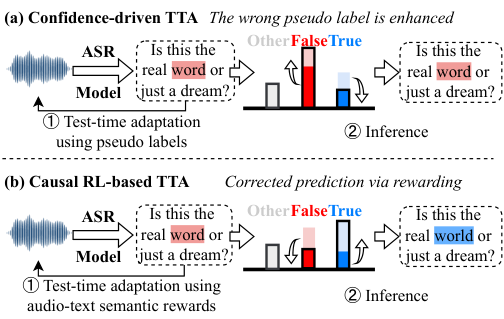
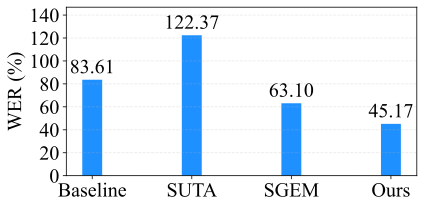
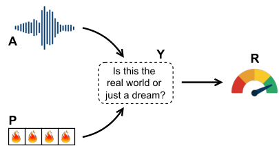
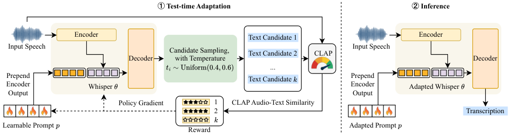

**Source:** *Boosting ASR Robustness via Test-Time Reinforcement Learning with Audio-Text Semantic Rewards* — [PDF](https://arxiv.org/pdf/2603.05231v1) · [arXiv](https://arxiv.org/abs/2603.05231v1)

# Boosting ASR Robustness via Test-Time Reinforcement Learning   
with Audio-Text Semantic Rewards

Linghan Fang  Tianxin Xie  Li Liu ††thanks: Corresponding author.

###### Abstract

Recently, Automatic Speech Recognition (ASR) systems (e.g., Whisper) have achieved remarkable accuracy improvements but remain highly sensitive to real-world unseen data (data with large distribution shifts), including noisy environments and diverse accents. To address this issue, test-time adaptation (TTA) has shown great potential in improving the model adaptability at inference time without ground-truth labels, and existing TTA methods often rely on pseudo-labeling or entropy minimization. However, by treating model confidence as a learning signal, these methods may reinforce high-confidence errors, leading to confirmation bias that undermines adaptation. To overcome these limitations, we present ASR-TRA, a novel Test-time Reinforcement Adaptation framework inspired by causal intervention. More precisely, our method introduces a learnable decoder prompt and utilizes temperature-controlled stochastic decoding to generate diverse transcription candidates. These are scored by a reward model that measures audio-text semantic alignment, and the resulting feedback is used to update both model and prompt parameters via reinforcement learning. Comprehensive experiments on LibriSpeech with synthetic noise and L2 Arctic accented English datasets demonstrate that our method achieves higher accuracy while maintaining lower latency than existing TTA baselines. Ablation studies further confirm the effectiveness of combining audio and language-based rewards, highlighting our method’s enhanced stability and interpretability. Overall, our approach provides a practical and robust solution for deploying ASR systems in challenging real-world conditions.

1The Hong Kong University of Science and Technology (Guangzhou), Guangzhou, China

2Technical University of Munich, Munich, Germany

linghan.fang@tum.de, txie151@connect.hkust-gz.edu.cn, avrillliu@hkust-gz.edu.cn

Code — https://github.com/fangcq/ASR-TRA

## Introduction

Recent advances in automatic speech recognition (ASR) have been driven by breakthroughs in self‑supervised learning and large‑scale weakly supervised training ([Baevski et al. 2020](https://arxiv.org/html/2603.05231v1#bib.bib1); [Hsu et al. 2021](https://arxiv.org/html/2603.05231v1#bib.bib2); [Schneider et al. 2019](https://arxiv.org/html/2603.05231v1#bib.bib3)), which enables models to learn rich acoustic and linguistic representations from vast amounts of unlabeled or loosely labeled speech data. Leveraging these techniques, models such as wav2vec 2.0 ([Baevski et al. 2020](https://arxiv.org/html/2603.05231v1#bib.bib1)) and Whisper ([Radford et al. 2023](https://arxiv.org/html/2603.05231v1#bib.bib4)) have significantly improved transcription accuracy and generalization in various domains.

Despite these improvements, deploying ASR in real‑world applications such as edge devices, online streaming, and resource‑constrained small‑model scenarios remains challenging. In practice, lightweight ASR systems often face severe out‑of‑distribution (OOD) conditions ([Hendrycks and Dietterich 2019](https://arxiv.org/html/2603.05231v1#bib.bib5)), including background noise, heavy accents, and regional dialects, which are under‑represented in training data and lead to significant domain shifts ([Ben-David et al. 2007](https://arxiv.org/html/2603.05231v1#bib.bib8)). Traditional methods to improve robustness typically rely on offline retraining or supervised domain adaptation, such as multi‑condition training or noise augmentation ([Ko et al. 2015](https://arxiv.org/html/2603.05231v1#bib.bib6); [Li et al. 2020](https://arxiv.org/html/2603.05231v1#bib.bib7)), but these approaches are infeasible during test time because labeled data is unavailable.

 Figure 1:  Overview of test-time adaptation strategies under noisy conditions. (a) Confidence-driven adaptation reinforces incorrect but high-probability predictions (e.g., _word_), leading to persistent errors. (b) Our reward-guided adaptation ASR-TRA favors semantically accurate alternatives (e.g., _world_) through reinforcement learning, even when their initial confidence is low.  

 Figure 2: We evaluate WER on the top-100 high-confidence samples from LibriSpeech test-other corrupted with Gaussian noise. While baseline performance from Whisper-Tiny suffers under noise, heuristic methods like SUTA further degrade due to overconfidence. In contrast, ours achieves lower WER. (Lower is better.)

In the literature, test-time adaptation (TTA) has emerged as a promising approach to enhance ASR robustness without requiring additional training or labeled supervision ([Wang et al. 2021](https://arxiv.org/html/2603.05231v1#bib.bib9); [Lin et al. 2022](https://arxiv.org/html/2603.05231v1#bib.bib10); [Kim et al. 2023](https://arxiv.org/html/2603.05231v1#bib.bib11)). By enabling models to adapt dynamically to test-time inputs, TTA helps mitigate the mismatch between training and deployment conditions. However, current TTA methods have the following two main challenges, when directly apply to ASR systems (see Fig. [1](https://arxiv.org/html/2603.05231v1#Sx1.F1 "Figure 1 ‣ Introduction ‣ Boosting ASR Robustness via Test-Time Reinforcement Learningwith Audio-Text Semantic Rewards")). Challenge 1: Although Whisper is a powerful encoder-decoder model, it lacks a Whisper‑specific adaptation mechanism ([Radford et al. 2023](https://arxiv.org/html/2603.05231v1#bib.bib4)). Challenge 2: Many existing approaches rely on heuristic optimization strategies and heavily use self‑generated pseudo‑labels ([Wang et al. 2021](https://arxiv.org/html/2603.05231v1#bib.bib9); [Lin et al. 2022](https://arxiv.org/html/2603.05231v1#bib.bib10); [Lee 2013](https://arxiv.org/html/2603.05231v1#bib.bib12); [Sohn et al. 2020](https://arxiv.org/html/2603.05231v1#bib.bib13)), which can be slow, unstable in acoustically diverse environments, and prone to compounding errors when the model is uncertain. As illustrated in Figure [2](https://arxiv.org/html/2603.05231v1#Sx1.F2 "Figure 2 ‣ Introduction ‣ Boosting ASR Robustness via Test-Time Reinforcement Learningwith Audio-Text Semantic Rewards"), confidence‑based methods such as SUTA ([Lin et al. 2022](https://arxiv.org/html/2603.05231v1#bib.bib10)) can perform even worse on high‑confidence samples under noise, highlighting the misalignment between confidence and true accuracy that motivates our approach (see the Experiments section for details).

To address these challenges, we present a novel method ASR-TRA (ASR with Test-time Reinforcement Adaptation), which adopts a reinforcement learning (RL) ([Williams 1992](https://arxiv.org/html/2603.05231v1#bib.bib16); [Ziegler et al. 2019](https://arxiv.org/html/2603.05231v1#bib.bib17)) perspective and frames TTA as a reward‑driven decision process under uncertainty. ASR-TRA addresses these limitations based on two key ideas. Idea 1: To leverage the structure of encoder-decoder architectures such as Whisper, we introduce a dedicated adaptation pathway through a learnable decoder prompt, enabling efficient and low-overhead test-time optimization tailored to ASR. Idea 2: Instead of relying on fragile heuristics or self-confirming pseudo-labels, we introduce an external semantic reward to guide adaptation more robustly. This avoids compounding errors and allows for more stable updates without ground-truth supervision.

 Figure 3: Structural Causal Model (SCM) schematic. Nodes \(A\), \(P\), \(Y\), and \(R\) denote audio features, learnable prompt, transcription output, and reward, respectively, with causal flow \(A,P\!\rightarrow\!Y\!\rightarrow\!R\) ([Pearl 2009](https://arxiv.org/html/2603.05231v1#bib.bib14)).

To realize these two key ideas, ASR-TRA begins with a structured modeling of the adaptation process using a Structural Causal Model (SCM) ([Pearl 2009](https://arxiv.org/html/2603.05231v1#bib.bib14)), which bridges the motivation with concrete implementation. The SCM comprises four key variables: the encoded audio features \(A\), the learnable decoder prompt \(P\), the generated transcription \(Y\), and the reward \(R\). The directed edges capture the causal dependencies among these components (see Figure [3](https://arxiv.org/html/2603.05231v1#Sx1.F3 "Figure 3 ‣ Introduction ‣ Boosting ASR Robustness via Test-Time Reinforcement Learningwith Audio-Text Semantic Rewards")).

This model not only clarifies how adaptation unfolds in our framework, but also guides the design of three concrete components that operationalize reward-driven learning and prompt-based adaptation at test time: 1) Prompt injection (for Idea1): Insert a learnable vector \(P\) at the beginning of the decoder input sequence, so that \(P\) is processed alongside the token embeddings and directly influences the decoding process as a causal intervention. 2) Candidate generation & evaluation (for Idea2): Adjust the sampling temperature to produce multiple diverse transcription hypotheses. Each candidate is then evaluated using CLAP (Contrastive Language–Audio Pretraining) ([Elizalde et al. 2023](https://arxiv.org/html/2603.05231v1#bib.bib15)), which can compute an audio–text similarity score as a sequence‑level reward to guide adaptation. 3) Parameter update: Apply a policy‑gradient RL algorithm to backpropagate CLAP rewards and jointly update both the prompt parameters \(P\) and the model weights, steering future outputs toward higher reward.

In summary, the proposed ASR-TRA approach offers three main contributions:

  * We formulate TTA as an RL process guided by the audio‑text reward model CLAP, which mitigates error accumulation from heuristic pseudo‑label or confidence‑based methods. 
  * We design a Whisper‑specific Structural Causal Model (SCM) where a learnable decoder prompt modulates the decoding process. Combined with policy‑gradient updates and the CLAP reward, this framework enables a principled and lightweight TTA approach for ASR. 
  * Experiments with noisy and accented speech benchmarks show that it consistently outperforms previous TTA methods in both speed and recognition accuracy. 

## Related Work

#### Automatic Speech Recognition.

Recent progress in automatic speech recognition has been largely driven by the development of large-scale neural network models trained on diverse audio-text corpora. Wav2vec 2.0 ([Baevski et al. 2020](https://arxiv.org/html/2603.05231v1#bib.bib1)) leverages self-supervised contrastive pretraining to learn robust speech representations from unlabeled audio. Whisper ([Radford et al. 2023](https://arxiv.org/html/2603.05231v1#bib.bib4)), built on a transformer encoder-decoder architecture, achieves strong multilingual transcription by training on 680k hours of weakly labeled data. Despite their impressive performance, these models remain sensitive to distribution shifts, such as environmental noise, speaker accents, or spontaneous speech, underscoring the need for adaptive mechanisms ([Hendrycks and Dietterich 2019](https://arxiv.org/html/2603.05231v1#bib.bib5); [Ben-David et al. 2007](https://arxiv.org/html/2603.05231v1#bib.bib8)) that can generalize well to real-world conditions.

#### Causality in Deep Learning.

Causal reasoning offers a principled framework for improving model robustness and interpretability. Classical formulations ([Pearl 2009](https://arxiv.org/html/2603.05231v1#bib.bib14)) define interventions as mechanisms for actively altering model variables to study downstream effects. Recent work has explored causal representation learning ([Schölkopf et al. 2021](https://arxiv.org/html/2603.05231v1#bib.bib18); [Mitrovic et al. 2021](https://arxiv.org/html/2603.05231v1#bib.bib19)), which aims to disentangle generative factors of variation for greater robustness under domain shift. In deep learning, causal interventions can be realized through architectural modifications or controlled sampling schemes and have been shown to help models adapt more reliably to distributional changes.

#### Test-Time Adaptation in ASR.

TTA enables models to adjust during inference using only unlabeled test data. Among early approaches, Tent ([Wang et al. 2021](https://arxiv.org/html/2603.05231v1#bib.bib9)) proposed an _episodic_ TTA framework that adapts the model to each test sample by minimizing entropy while freezing most parameters. This inspired a range of episodic TTA methods that aim for rapid and lightweight domain adaptation. In the ASR domain, SUTA ([Lin et al. 2022](https://arxiv.org/html/2603.05231v1#bib.bib10)) adapts Whisper-style models by generating pseudo-labels from high-confidence predictions, while SGEM ([Kim et al. 2023](https://arxiv.org/html/2603.05231v1#bib.bib11)) minimizes sequence-level entropy to regularize the output distribution. These methods, however, rely heavily on model-internal signals such as entropy or confidence, which can become unreliable under severe distribution shift. Furthermore, they lack a mechanism to incorporate feedback external to the model’s prior beliefs.

#### Reinforcement Learning for TTA.

RL offers a general framework for optimizing decisions based on delayed feedback ([Sutton and Barto 2018](https://arxiv.org/html/2603.05231v1#bib.bib20)), and has been widely applied to robotics ([Levine et al. 2016](https://arxiv.org/html/2603.05231v1#bib.bib21)), dialogue ([Li et al. 2016](https://arxiv.org/html/2603.05231v1#bib.bib22)), and language model alignment ([Ouyang et al. 2022](https://arxiv.org/html/2603.05231v1#bib.bib23); [Ziegler et al. 2019](https://arxiv.org/html/2603.05231v1#bib.bib17)). Recently, RL has also been explored in test-time adaptation. For instance, RLCF ([Zhao et al. 2024](https://arxiv.org/html/2603.05231v1#bib.bib24)) learns reward-driven policies for classifier adaptation. More recent efforts, such as BiTTA ([Lee et al. 2025](https://arxiv.org/html/2603.05231v1#bib.bib25)), leverage binary feedback (correct/incorrect) to guide episodic adaptation. While promising, these methods have been mostly applied to classification or navigation tasks, where the action space and feedback signals are comparatively straightforward. In contrast, their application to structured sequence modeling problems such as ASR remains limited.

#### Positioning of ASR-TRA.

While prior TTA methods in ASR, such as SUTA and SGEM, rely on internal heuristics like confidence and entropy, they often lack robustness under distribution shift and may suffer from pseudo-label feedback loops. Recent RL-based approaches such as BiTTA demonstrate the utility of reward signals, but are designed for classification or navigation tasks and have not been adapted for structured sequence modeling in ASR. ASR-TRA bridges this gap by combining causal interventions with external reward-guided adaptation in a Whisper-based framework. Specifically, we introduce learnable decoder prompts as causal variables and optimize them using semantic feedback ([Elizalde et al. 2023](https://arxiv.org/html/2603.05231v1#bib.bib15)), enabling robust, interpretable, and efficient adaptation without relying on internal certainty estimates.

## Method

We propose a TTA framework, ASR-TRA, for Whisper that integrates causal reasoning with reinforcement learning. The key insight is to treat prompt injection in the Whisper decoder as a causal intervention and the decoding process as a generator of counterfactual hypotheses. We optimize the model at inference time by rewarding generations that better align with CLAP’s predictions, without relying on ground-truth transcripts. This enables dynamic and label-free adaptation to unseen acoustic conditions.

### Whisper Architecture

The input speech signal is first preprocessed and converted into a log Mel‑spectrogram \(s\in\mathbb{R}^{F\times T}\) with \(F\) frequency bins and \(T\) time frames ([Logan 2000](https://arxiv.org/html/2603.05231v1#bib.bib26); [McFee et al. 2015](https://arxiv.org/html/2603.05231v1#bib.bib27)). Whisper is a Transformer‑based encoder–decoder model ([Vaswani et al. 2017](https://arxiv.org/html/2603.05231v1#bib.bib28); [Radford et al. 2023](https://arxiv.org/html/2603.05231v1#bib.bib4)) that follows an autoregressive sequence‑to‑sequence formulation widely used in ASR ([Chan et al. 2016](https://arxiv.org/html/2603.05231v1#bib.bib29)). The audio encoder \(\mathrm{Enc}(\cdot)\) produces a hidden representation:

\[\begin{aligned}
 & h=\mathrm{Enc}(s), &  & \text{(1)}
\end{aligned}\]

 

and the text decoder generates the output sequence \(\hat{y}=(y_{1},y_{2},\ldots,y_{N})\) by modeling the conditional token distribution over output probabilities:

\[\begin{aligned}
 & P(y_{t}\mid y_{<t},h)=\mathrm{Dec}(y_{<t},h), &  & \text{(2)}
\end{aligned}\]

 

where \(y_{<t}\) denotes previously emitted tokens. In practice, the decoding process can be performed using greedy selection, beam search, or stochastic sampling regulated by temperature scaling ([Holtzman et al. 2020](https://arxiv.org/html/2603.05231v1#bib.bib30)).

 Figure 4: Test‑time self‑adaptation for Whisper. A baseline transcript is decoded from the input Mel‑spectrogram; soft‑prompted variants are then sampled at varied temperatures, CLAP scores them all, and the aggregated rewards update the model, achieving on‑the‑fly correction without labels.

### Prompt Injection as Causal Intervention

We introduce a learnable prompt vector \(p\in\mathbb{R}^{L\times d}\), where \(L\) denotes the number of prompt tokens and \(d\) is the decoder embedding dimension. A soft prompt is prepended to the decoder’s input embeddings, directly concatenated before the embedding of the <bos> token. During generation, the decoder attends to both this prompt and the encoder output, allowing the prompt to guide each prediction instead of relying solely on autoregressive decoding from scratch.

Because the prompt is visible to the decoder’s attention at every step, it can directly shape the hidden states and thus influence all subsequent token predictions ([Li and Liang 2021](https://arxiv.org/html/2603.05231v1#bib.bib31); [Lester et al. 2021](https://arxiv.org/html/2603.05231v1#bib.bib32)).

Crucially, we treat \(p\) not merely as an additional condition but as a _causal intervention_ on the generation process. Formally, the decoder prediction can be written as

\[\begin{aligned}
 & y_{t}=\mathrm{Dec}(h,y_{<t},\mathrm{do}(p)), &  & \text{(3)}
\end{aligned}\]

 

where \(\mathrm{do}(p)\) follows Pearl’s do‑calculus ([Pearl 2009](https://arxiv.org/html/2603.05231v1#bib.bib14)) and indicates that \(p\) is set externally rather than inferred from the observed input \(s\). This intervention perturbs the internal generation dynamics without modifying the acoustic input, enabling the model to explore alternative hypotheses under the same observation.

### Counterfactual Sampling and Reward Evaluation

To explore diverse output trajectories under a fixed input and prompt, we adopt stochastic decoding by sampling tokens with a temperature parameter \(T>0\) ([Holtzman et al. 2020](https://arxiv.org/html/2603.05231v1#bib.bib30)):

\[\begin{aligned}
 & P_{T}(y_{t}\mid y_{<t},h,p)\propto\exp\left(\frac{\log P(y_{t}\mid y_{<t},h,p)}{T}\right). &  & \text{(4)}
\end{aligned}\]

 

A higher temperature \(T\) flattens the token distribution and encourages diversity, while \(T\to 0\) approaches greedy decoding. By sampling repeatedly, we obtain \(K\) candidate transcriptions \(\{\hat{y}^{(1)},\ldots,\hat{y}^{(K)}\}\), each representing a _counterfactual hypothesis_ , i.e., a plausible alternative transcription trajectory conditioned on the same audio and prompt.

Each sampled hypothesis is then evaluated using a reward function \(R(\hat{y}^{(i)})\in\mathbb{R}\) that quantifies its semantic alignment with the input. In our implementation, we adopt the CLAP audio–text similarity model ([Elizalde et al. 2023](https://arxiv.org/html/2603.05231v1#bib.bib15)) as the primary reward, which computes the cosine similarity between audio embeddings of input speech and text embeddings of generated transcriptions:

\[\begin{aligned}
 & r^{(i)}=R(\hat{y}^{(i)}). &  & \text{(5)}
\end{aligned}\]

 

We also use the scores from other pretrained language models (LM) ([Ziegler et al. 2019](https://arxiv.org/html/2603.05231v1#bib.bib17); [Ouyang et al. 2022](https://arxiv.org/html/2603.05231v1#bib.bib23)) as a supplementary signal in our ablation study (Table [3](https://arxiv.org/html/2603.05231v1#Sx4.T3 "Table 3 ‣ Accent Robustness. ‣ Comparison to State-of-the-Art Approaches ‣ Experiments ‣ Boosting ASR Robustness via Test-Time Reinforcement Learningwith Audio-Text Semantic Rewards")).

This scalar feedback serves as a proxy for transcription quality and enables label‑free optimization. The resulting rewards are aggregated and used to update both the prompt vector \(p\) and model parameters via a policy‑gradient objective ([Williams 1992](https://arxiv.org/html/2603.05231v1#bib.bib16); [Sutton and Barto 2018](https://arxiv.org/html/2603.05231v1#bib.bib20)), thereby biasing the model towards generations that achieve higher reward under the same conditions.

### Optimization via Reinforcement Learning

To adapt the prompt vector \(p\) and model parameters online, we formulate a reinforcement learning objective that explicitly encourages generations with higher semantic quality as measured by the reward function. We treat the prompt‑conditioned Whisper as a stochastic policy \(\pi_{p}(\hat{y})\) over output sequences \(\hat{y}\) and aim to maximize the expected reward:

\[\begin{aligned}
 & \mathcal{J}(p)=\mathbb{E}_{\hat{y}\sim\pi_{p}}[R(\hat{y})]. &  & \text{(6)}
\end{aligned}\]

 

This setting naturally aligns with policy‑gradient methods ([Sutton and Barto 2018](https://arxiv.org/html/2603.05231v1#bib.bib20)). We apply the classic REINFORCE algorithm ([Williams 1992](https://arxiv.org/html/2603.05231v1#bib.bib16)) to estimate gradients of \(\mathcal{J}(p)\). For a batch of \(N\) sampled hypotheses \(\{\hat{y}^{(i)}\}_{i=1}^{N}\) with corresponding rewards \(r^{(i)}\) and log‑probabilities \(\log P(\hat{y}^{(i)})\), we introduce a baseline to reduce gradient variance. The baseline is simply the mean reward across the batch:

\[\begin{aligned}
 & \bar{r}=\frac{1}{N}\sum_{i=1}^{N}r^{(i)}. &  & \text{(7)}
\end{aligned}\]

 

Using this baseline, the gradient of the RL objective with respect to the learnable prompt \(p\) and Whisper’s parameters \(\theta\) can be estimated as follows:

\[\begin{aligned}
 & \nabla_{\theta,p}\mathcal{L}=-\frac{1}{N}\sum_{i=1}^{N}\nabla_{\theta,p}\log P(\hat{y}^{(i)})\cdot(r^{(i)}-\bar{r}), &  & \text{(8)}
\end{aligned}\]

 

which increases the likelihood of high‑reward generations while penalizing low‑reward alternatives.

During test time, we perform optimization independently for each input sample, using a small number of reward‑evaluated candidates to update the prompt and model parameters. Once the adaptation and prediction for the current sample is completed, the model parameters are restored to their original state before processing the next sample, ensuring that updates do not accumulate across the test set.

### Algorithm Overview

We summarize our TTA method ASR-TRA in Algorithm [1](https://arxiv.org/html/2603.05231v1#alg1 "Algorithm 1 ‣ Algorithm Overview ‣ Method ‣ Boosting ASR Robustness via Test-Time Reinforcement Learningwith Audio-Text Semantic Rewards"), which shows how we integrate prompt intervention, counterfactual sampling, and reinforcement learning updates into a unified online “adaptation-and-prediction” loop.

Algorithm 1 ASR-TRA

0: Input Mel-spectrogram \(s\), Whisper model \(\theta\), CLAP reward model, number of samples \(n\), prompt embedding \(p\) 

1: Initialize Whisper model \(\theta\), set temperature \(t=0\) 

2: Generate deterministic output: \(y_{0}\leftarrow\text{Whisper}(s;\theta,t=0)\) 

3: Compute reward: \(r_{0}\leftarrow\text{CLAP}(y_{0},s)\) 

4: Insert random prompt \(p\) into Whisper decoder 

5: for \(i=1,\dots,n\) do

6: Sample temperature \(t_{i}\sim\text{Uniform}(0.4,0.6)\) 

7: Generate output with intervention:\(y_{i}\leftarrow\text{Whisper}(s;\theta,\mathrm{do}(p),t_{i})\) 

8: Compute reward: \(r_{i}\leftarrow\text{CLAP}(y_{i},s)\) 

9: end for

10: Compute advantages: \(\text{adv}_{i}\leftarrow r_{i}-\text{mean}(\{r_{j}\}_{j=0}^{n})\) 

11: Compute policy gradient loss: \(\mathcal{L}\leftarrow-\sum_{i}\text{adv}_{i}\cdot\log P_{\theta}(y_{i}|s,p)\) 

12: Update model parameters and prompt: \(\theta\leftarrow\theta-\eta_{1}\nabla_{\theta}\mathcal{L},\;p\leftarrow p-\eta_{2}\nabla_{p}\mathcal{L}\) 

13: Generate adapted output: \(y\leftarrow\text{Whisper}(s;\theta,p)\) 

14: Restore Whisper model \(\theta\) and prompt \(p\) to original state 

15: return Adapted transcription \(y\) 

<table id="Sx3.T1.1" class="ltx_tabular ltx_centering ltx_guessed_headers ltx_align_middle">
<thead class="ltx_thead">
<tr id="Sx3.T1.1.1" class="ltx_tr">
<th id="Sx3.T1.1.1.1" class="ltx_td ltx_th ltx_th_column ltx_th_row ltx_border_r ltx_border_tt"></th>
<th id="Sx3.T1.1.1.2" class="ltx_td ltx_align_center ltx_th ltx_th_column ltx_th_row ltx_border_r ltx_border_tt">Baseline</th>
<th id="Sx3.T1.1.1.3" class="ltx_td ltx_align_center ltx_th ltx_th_column ltx_border_r ltx_border_tt" colspan="2">+ SUTA</th>
<th id="Sx3.T1.1.1.4" class="ltx_td ltx_align_center ltx_th ltx_th_column ltx_border_r ltx_border_tt" colspan="2">+ SGEM</th>
<th id="Sx3.T1.1.1.5" class="ltx_td ltx_align_center ltx_th ltx_th_column ltx_border_tt" colspan="2">+ ASR-TRA (Ours)</th></tr>
<tr id="Sx3.T1.1.2" class="ltx_tr">
<th id="Sx3.T1.1.2.1" class="ltx_td ltx_align_center ltx_th ltx_th_column ltx_th_row ltx_border_r">Dataset</th>
<th id="Sx3.T1.1.2.2" class="ltx_td ltx_align_center ltx_th ltx_th_column ltx_th_row ltx_border_r">WER (%) <math id="Sx3.T1.m1" class="ltx_Math" alttext="\downarrow" display="inline" intent=":literal"><semantics><mo stretchy="false">↓</mo><annotation encoding="application/x-tex">\downarrow</annotation></semantics></math></th>
<th id="Sx3.T1.1.2.3" class="ltx_td ltx_align_center ltx_th ltx_th_column">WER (%) <math id="Sx3.T1.m2" class="ltx_Math" alttext="\downarrow" display="inline" intent=":literal"><semantics><mo stretchy="false">↓</mo><annotation encoding="application/x-tex">\downarrow</annotation></semantics></math></th>
<th id="Sx3.T1.1.2.4" class="ltx_td ltx_align_center ltx_th ltx_th_column ltx_border_r">Latency (s)</th>
<th id="Sx3.T1.1.2.5" class="ltx_td ltx_align_center ltx_th ltx_th_column">WER (%) <math id="Sx3.T1.m3" class="ltx_Math" alttext="\downarrow" display="inline" intent=":literal"><semantics><mo stretchy="false">↓</mo><annotation encoding="application/x-tex">\downarrow</annotation></semantics></math></th>
<th id="Sx3.T1.1.2.6" class="ltx_td ltx_align_center ltx_th ltx_th_column ltx_border_r">Latency (s)</th>
<th id="Sx3.T1.1.2.7" class="ltx_td ltx_align_center ltx_th ltx_th_column">WER (%) <math id="Sx3.T1.m4" class="ltx_Math" alttext="\downarrow" display="inline" intent=":literal"><semantics><mo stretchy="false">↓</mo><annotation encoding="application/x-tex">\downarrow</annotation></semantics></math></th>
<th id="Sx3.T1.1.2.8" class="ltx_td ltx_align_center ltx_th ltx_th_column">Latency (s)</th></tr>
</thead>
<tbody class="ltx_tbody">
<tr id="Sx3.T1.1.3" class="ltx_tr">
<th id="Sx3.T1.1.3.1" class="ltx_td ltx_align_center ltx_th ltx_th_row ltx_border_r ltx_border_t">AC</th>
<th id="Sx3.T1.1.3.2" class="ltx_td ltx_align_center ltx_th ltx_th_row ltx_border_r ltx_border_t">26.54</th>
<td id="Sx3.T1.1.3.3" class="ltx_td ltx_align_center ltx_border_t">24.02</td>
<td id="Sx3.T1.1.3.4" class="ltx_td ltx_align_center ltx_border_r ltx_border_t">1.683</td>
<td id="Sx3.T1.1.3.5" class="ltx_td ltx_align_center ltx_border_t">23.76</td>
<td id="Sx3.T1.1.3.6" class="ltx_td ltx_align_center ltx_border_r ltx_border_t">0.730</td>
<td id="Sx3.T1.1.3.7" class="ltx_td ltx_align_center ltx_border_t">22.39</td>
<td id="Sx3.T1.1.3.8" class="ltx_td ltx_align_center ltx_border_t">0.678</td></tr>
<tr id="Sx3.T1.1.4" class="ltx_tr">
<th id="Sx3.T1.1.4.1" class="ltx_td ltx_align_center ltx_th ltx_th_row ltx_border_r">AA</th>
<th id="Sx3.T1.1.4.2" class="ltx_td ltx_align_center ltx_th ltx_th_row ltx_border_r">40.22</th>
<td id="Sx3.T1.1.4.3" class="ltx_td ltx_align_center">37.69</td>
<td id="Sx3.T1.1.4.4" class="ltx_td ltx_align_center ltx_border_r">1.770</td>
<td id="Sx3.T1.1.4.5" class="ltx_td ltx_align_center">36.66</td>
<td id="Sx3.T1.1.4.6" class="ltx_td ltx_align_center ltx_border_r">0.759</td>
<td id="Sx3.T1.1.4.7" class="ltx_td ltx_align_center">35.66</td>
<td id="Sx3.T1.1.4.8" class="ltx_td ltx_align_center">0.670</td></tr>
<tr id="Sx3.T1.1.5" class="ltx_tr">
<th id="Sx3.T1.1.5.1" class="ltx_td ltx_align_center ltx_th ltx_th_row ltx_border_r">BA</th>
<th id="Sx3.T1.1.5.2" class="ltx_td ltx_align_center ltx_th ltx_th_row ltx_border_r">36.85</th>
<td id="Sx3.T1.1.5.3" class="ltx_td ltx_align_center">40.12</td>
<td id="Sx3.T1.1.5.4" class="ltx_td ltx_align_center ltx_border_r">1.643</td>
<td id="Sx3.T1.1.5.5" class="ltx_td ltx_align_center">33.92</td>
<td id="Sx3.T1.1.5.6" class="ltx_td ltx_align_center ltx_border_r">0.710</td>
<td id="Sx3.T1.1.5.7" class="ltx_td ltx_align_center">31.39</td>
<td id="Sx3.T1.1.5.8" class="ltx_td ltx_align_center">0.679</td></tr>
<tr id="Sx3.T1.1.6" class="ltx_tr">
<th id="Sx3.T1.1.6.1" class="ltx_td ltx_align_center ltx_th ltx_th_row ltx_border_r">CM</th>
<th id="Sx3.T1.1.6.2" class="ltx_td ltx_align_center ltx_th ltx_th_row ltx_border_r">39.40</th>
<td id="Sx3.T1.1.6.3" class="ltx_td ltx_align_center">43.52</td>
<td id="Sx3.T1.1.6.4" class="ltx_td ltx_align_center ltx_border_r">1.583</td>
<td id="Sx3.T1.1.6.5" class="ltx_td ltx_align_center">35.02</td>
<td id="Sx3.T1.1.6.6" class="ltx_td ltx_align_center ltx_border_r">0.691</td>
<td id="Sx3.T1.1.6.7" class="ltx_td ltx_align_center">34.72</td>
<td id="Sx3.T1.1.6.8" class="ltx_td ltx_align_center">0.631</td></tr>
<tr id="Sx3.T1.1.7" class="ltx_tr">
<th id="Sx3.T1.1.7.1" class="ltx_td ltx_align_center ltx_th ltx_th_row ltx_border_r">MU</th>
<th id="Sx3.T1.1.7.2" class="ltx_td ltx_align_center ltx_th ltx_th_row ltx_border_r">29.98</th>
<td id="Sx3.T1.1.7.3" class="ltx_td ltx_align_center">34.12</td>
<td id="Sx3.T1.1.7.4" class="ltx_td ltx_align_center ltx_border_r">1.645</td>
<td id="Sx3.T1.1.7.5" class="ltx_td ltx_align_center">34.40</td>
<td id="Sx3.T1.1.7.6" class="ltx_td ltx_align_center ltx_border_r">0.705</td>
<td id="Sx3.T1.1.7.7" class="ltx_td ltx_align_center">25.88</td>
<td id="Sx3.T1.1.7.8" class="ltx_td ltx_align_center">0.584</td></tr>
<tr id="Sx3.T1.1.8" class="ltx_tr">
<th id="Sx3.T1.1.8.1" class="ltx_td ltx_align_center ltx_th ltx_th_row ltx_border_r">NB</th>
<th id="Sx3.T1.1.8.2" class="ltx_td ltx_align_center ltx_th ltx_th_row ltx_border_r">40.77</th>
<td id="Sx3.T1.1.8.3" class="ltx_td ltx_align_center">33.75</td>
<td id="Sx3.T1.1.8.4" class="ltx_td ltx_align_center ltx_border_r">1.847</td>
<td id="Sx3.T1.1.8.5" class="ltx_td ltx_align_center">36.13</td>
<td id="Sx3.T1.1.8.6" class="ltx_td ltx_align_center ltx_border_r">0.756</td>
<td id="Sx3.T1.1.8.7" class="ltx_td ltx_align_center">35.81</td>
<td id="Sx3.T1.1.8.8" class="ltx_td ltx_align_center">0.833</td></tr>
<tr id="Sx3.T1.1.9" class="ltx_tr">
<th id="Sx3.T1.1.9.1" class="ltx_td ltx_align_center ltx_th ltx_th_row ltx_border_r">SD</th>
<th id="Sx3.T1.1.9.2" class="ltx_td ltx_align_center ltx_th ltx_th_row ltx_border_r">23.12</th>
<td id="Sx3.T1.1.9.3" class="ltx_td ltx_align_center">22.91</td>
<td id="Sx3.T1.1.9.4" class="ltx_td ltx_align_center ltx_border_r">1.656</td>
<td id="Sx3.T1.1.9.5" class="ltx_td ltx_align_center">19.50</td>
<td id="Sx3.T1.1.9.6" class="ltx_td ltx_align_center ltx_border_r">0.909</td>
<td id="Sx3.T1.1.9.7" class="ltx_td ltx_align_center">22.34</td>
<td id="Sx3.T1.1.9.8" class="ltx_td ltx_align_center">0.801</td></tr>
<tr id="Sx3.T1.1.10" class="ltx_tr">
<th id="Sx3.T1.1.10.1" class="ltx_td ltx_align_center ltx_th ltx_th_row ltx_border_r">TP</th>
<th id="Sx3.T1.1.10.2" class="ltx_td ltx_align_center ltx_th ltx_th_row ltx_border_r">24.81</th>
<td id="Sx3.T1.1.10.3" class="ltx_td ltx_align_center">22.05</td>
<td id="Sx3.T1.1.10.4" class="ltx_td ltx_align_center ltx_border_r">1.699</td>
<td id="Sx3.T1.1.10.5" class="ltx_td ltx_align_center">22.40</td>
<td id="Sx3.T1.1.10.6" class="ltx_td ltx_align_center ltx_border_r">0.941</td>
<td id="Sx3.T1.1.10.7" class="ltx_td ltx_align_center">20.91</td>
<td id="Sx3.T1.1.10.8" class="ltx_td ltx_align_center">0.886</td></tr>
<tr id="Sx3.T1.1.11" class="ltx_tr">
<th id="Sx3.T1.1.11.1" class="ltx_td ltx_align_center ltx_th ltx_th_row ltx_border_bb ltx_border_r ltx_border_t">Mean</th>
<th id="Sx3.T1.1.11.2" class="ltx_td ltx_align_center ltx_th ltx_th_row ltx_border_bb ltx_border_r ltx_border_t">32.71</th>
<td id="Sx3.T1.1.11.3" class="ltx_td ltx_align_center ltx_border_bb ltx_border_t">32.27</td>
<td id="Sx3.T1.1.11.4" class="ltx_td ltx_align_center ltx_border_bb ltx_border_r ltx_border_t">1.690</td>
<td id="Sx3.T1.1.11.5" class="ltx_td ltx_align_center ltx_border_bb ltx_border_t">30.22</td>
<td id="Sx3.T1.1.11.6" class="ltx_td ltx_align_center ltx_border_bb ltx_border_r ltx_border_t">0.775</td>
<td id="Sx3.T1.1.11.7" class="ltx_td ltx_align_center ltx_border_bb ltx_border_t">28.64</td>
<td id="Sx3.T1.1.11.8" class="ltx_td ltx_align_center ltx_border_bb ltx_border_t">0.720</td></tr>
</tbody>
</table>

 Table 1: WER (%) and inference latency (seconds) on Whisper-Tiny under eight noise conditions from MS-SNSD (SNR = 10 dB). Best values per row are in bold. 

Setting | Baseline | SUTA | SGEM | ASR-TRA (Ours)  
---|---|---|---|---  
Arabic | 32.74 | 35.94 | 35.19 | 22.92  
Mandarin | 28.03 | 27.68 | 28.03 | 25.14  
Hindi | 14.62 | 14.32 | 12.61 | 14.18  
Korean | 13.42 | 13.56 | 12.12 | 13.76  
Spanish | 42.64 | 41.25 | 41.78 | 39.44  
Vietnamese | 61.21 | 62.78 | 58.68 | 53.84  
Mean | 32.11 | 32.59 | 31.40 | 28.21

 Table 2: WER (%) on L2-Arctic for English speech from speakers with different first-language (L1) backgrounds. Best result per row is in bold.

## Experiments

### Experimental Setup

We evaluate ASR-TRA on the lightweight Whisper-Tiny model ([Radford et al. 2023](https://arxiv.org/html/2603.05231v1#bib.bib4)), which contains approximately 39M parameters and is widely adopted in real-world ASR applications due to its low computational cost. Its compact size makes it well-suited for deployment in latency-sensitive or resource-constrained environments, such as on-device transcription or streaming ASR. However, Whisper-Tiny remains highly sensitive to distribution shifts, struggling to maintain performance under acoustic variations.

To enable fast and targeted adaptation, we insert a learnable decoder prompt of length four, introducing only \(4\times d=1{,}536\) additional parameters, where \(d=384\) denotes the decoder embedding dimension. During adaptation, decoder temperatures are randomly sampled from a uniform range \([0.4,0.6]\), with a total of 4 candidates generated in parallel by the Whisper-Tiny to encourage diverse hypotheses. Model parameters are updated using a learning rate \(\eta_{1}\) in the range \(10^{-6}\) to \(10^{-5}\) depending on data complexity, while the prompt parameters are updated with a \(100\times\) larger learning rate \(\eta_{2}\), consistent with findings from prompt-tuning literature ([Li and Liang 2021](https://arxiv.org/html/2603.05231v1#bib.bib31); [Lester et al. 2021](https://arxiv.org/html/2603.05231v1#bib.bib32)). All experiments are conducted on a single NVIDIA RTX 6000 Ada GPU.

### Datasets and Evaluation Metrics

We consider two challenging distribution-shift scenarios that test robustness to both acoustic and linguistic variation:

1) Librispeech test-other with Environmental Noise. To evaluate robustness under acoustic corruption, we augment the LibriSpeech test-other set ([Panayotov et al. 2015](https://arxiv.org/html/2603.05231v1#bib.bib33)) with background noise sampled from the MS-SNSD corpus ([Reddy et al. 2019](https://arxiv.org/html/2603.05231v1#bib.bib34)). Eight additive noise types at 10 dB SNR are used: air conditioner, airport announcement, babble, copy machine, munching, neighbors, door shutting, and typing, following prior robustness benchmarks ([Hendrycks and Dietterich 2019](https://arxiv.org/html/2603.05231v1#bib.bib5); [Kim et al. 2023](https://arxiv.org/html/2603.05231v1#bib.bib11)). Each utterance is augmented with one randomly sampled instance per noise type to approximate real-world environments.

2) L2-Arctic Non-Native Accented Speech. To assess sensitivity to speaker and pronunciation variation, we use the L2-Arctic dataset ([Zhao et al. 2018](https://arxiv.org/html/2603.05231v1#bib.bib35)), which contains English speech from speakers of six different first-language backgrounds. This condition introduces severe accent shifts that Whisper has not encountered during pretraining, thereby posing a strong challenge for evaluating its cross-speaker generalization ability.

These two settings together evaluate the adaptability of our method to acoustic domain shifts, a key challenge for real-world ASR deployment ([Wang et al. 2021](https://arxiv.org/html/2603.05231v1#bib.bib9); [Kim et al. 2023](https://arxiv.org/html/2603.05231v1#bib.bib11)).

#### Evaluation Metrics.

We report Word Error Rate (WER) for all experiments in this paper, following standard practice in test-time adaptation for ASR ([Lin et al. 2022](https://arxiv.org/html/2603.05231v1#bib.bib10); [Kim et al. 2023](https://arxiv.org/html/2603.05231v1#bib.bib11)). WER measures the minimum number of word-level insertions, deletions, and substitutions required to transform the model’s transcription into the ground truth, normalized by the number of words in the reference transcript. Lower WER indicates better transcription accuracy. We also report latency in seconds to quantify the overhead introduced by the proposed TTA process.

### Comparison to State-of-the-Art Approaches

We evaluate our method under two major types of distribution shift: environmental noise and speaker accent variation. Results are summarized in Tables [1](https://arxiv.org/html/2603.05231v1#Sx3.T1 "Table 1 ‣ Algorithm Overview ‣ Method ‣ Boosting ASR Robustness via Test-Time Reinforcement Learningwith Audio-Text Semantic Rewards") and [2](https://arxiv.org/html/2603.05231v1#Sx3.T2 "Table 2 ‣ Algorithm Overview ‣ Method ‣ Boosting ASR Robustness via Test-Time Reinforcement Learningwith Audio-Text Semantic Rewards"), following prior work on test-time adaptation for ASR ([Lin et al. 2022](https://arxiv.org/html/2603.05231v1#bib.bib10); [Kim et al. 2023](https://arxiv.org/html/2603.05231v1#bib.bib11); [Wang et al. 2021](https://arxiv.org/html/2603.05231v1#bib.bib9)).

#### Noise Robustness.

We compare our approach with three baselines: (1) the original Whisper-Tiny model without adaptation (baseline), (2) SUTA ([Lin et al. 2022](https://arxiv.org/html/2603.05231v1#bib.bib10)), and (3) SGEM ([Kim et al. 2023](https://arxiv.org/html/2603.05231v1#bib.bib11)). Table [1](https://arxiv.org/html/2603.05231v1#Sx3.T1 "Table 1 ‣ Algorithm Overview ‣ Method ‣ Boosting ASR Robustness via Test-Time Reinforcement Learningwith Audio-Text Semantic Rewards") reports the word error rate (WER) and inference latency on eight MS-SNSD noise conditions ([Reddy et al. 2019](https://arxiv.org/html/2603.05231v1#bib.bib34)) applied to LibriSpeech test-other ([Panayotov et al. 2015](https://arxiv.org/html/2603.05231v1#bib.bib33)). Our method achieves the lowest average WER (28.64%) and latency (0.720 s), consistently outperforming the baselines. Improvements are particularly pronounced under high-entropy noise such as airport announcement and babble, where acoustic variability is high. While SUTA marginally outperforms our method under the neighbors condition, our method remains significantly faster at inference time. This aligns with findings in reward-guided adaptation literature, where additional diversity helps stabilize learning under heavy perturbations ([Lee et al. 2025](https://arxiv.org/html/2603.05231v1#bib.bib25)).

#### Accent Robustness.

We further evaluate robustness to speaker and pronunciation variation using the L2-Arctic dataset ([Zhao et al. 2018](https://arxiv.org/html/2603.05231v1#bib.bib35)), which contains non-native English speakers from six different first-language (L1) backgrounds. Table [2](https://arxiv.org/html/2603.05231v1#Sx3.T2 "Table 2 ‣ Algorithm Overview ‣ Method ‣ Boosting ASR Robustness via Test-Time Reinforcement Learningwith Audio-Text Semantic Rewards") shows that our method achieves the best mean WER (28.21%), with substantial improvements on more challenging L1 groups such as Arabic and Vietnamese. These results suggest that our adaptation framework generalizes well across diverse phonetic systems, narrowing the gap between native and non-native speech recognition.

Overall, these findings demonstrate that our method enhances Whisper’s robustness to both acoustic and linguistic distribution shifts while maintaining low inference latency. Compared with entropy-minimization-based methods (SUTA, SGEM), our reward-driven adaptation achieves a better balance between accuracy and efficiency, which is crucial for real-world ASR deployment.

<table id="Sx4.T3.1" class="ltx_tabular ltx_centering ltx_guessed_headers ltx_align_middle">
<thead class="ltx_thead">
<tr id="Sx4.T3.1.1" class="ltx_tr">
<th id="Sx4.T3.1.1.1" class="ltx_td ltx_align_center ltx_th ltx_th_column ltx_th_row ltx_border_r ltx_border_tt" style="padding-left:5.0pt;padding-right:5.0pt;" colspan="3">Configuration</th>
<th id="Sx4.T3.1.1.2" class="ltx_td ltx_align_center ltx_th ltx_th_column ltx_border_r ltx_border_tt" style="padding-left:5.0pt;padding-right:5.0pt;" colspan="2">Whisper-Tiny</th>
<th id="Sx4.T3.1.1.3" class="ltx_td ltx_align_center ltx_th ltx_th_column ltx_border_tt" style="padding-left:5.0pt;padding-right:5.0pt;" colspan="2">Whisper-Base</th></tr>
<tr id="Sx4.T3.1.2" class="ltx_tr">
<th id="Sx4.T3.1.2.1" class="ltx_td ltx_align_center ltx_th ltx_th_column ltx_th_row" style="padding-left:5.0pt;padding-right:5.0pt;">Finetune</th>
<th id="Sx4.T3.1.2.2" class="ltx_td ltx_align_center ltx_th ltx_th_column" style="padding-left:5.0pt;padding-right:5.0pt;">Prompt</th>
<th id="Sx4.T3.1.2.3" class="ltx_td ltx_align_center ltx_th ltx_th_column ltx_border_r" style="padding-left:5.0pt;padding-right:5.0pt;">Reward</th>
<th id="Sx4.T3.1.2.4" class="ltx_td ltx_align_center ltx_th ltx_th_column" style="padding-left:5.0pt;padding-right:5.0pt;">WER(%) <math id="Sx4.T3.m1" class="ltx_Math" alttext="\downarrow" display="inline" intent=":literal"><semantics><mo stretchy="false">↓</mo><annotation encoding="application/x-tex">\downarrow</annotation></semantics></math></th>
<th id="Sx4.T3.1.2.5" class="ltx_td ltx_align_center ltx_th ltx_th_column ltx_border_r" style="padding-left:5.0pt;padding-right:5.0pt;">Latency (s)</th>
<th id="Sx4.T3.1.2.6" class="ltx_td ltx_align_center ltx_th ltx_th_column" style="padding-left:5.0pt;padding-right:5.0pt;">WER(%) <math id="Sx4.T3.m2" class="ltx_Math" alttext="\downarrow" display="inline" intent=":literal"><semantics><mo stretchy="false">↓</mo><annotation encoding="application/x-tex">\downarrow</annotation></semantics></math></th>
<th id="Sx4.T3.1.2.7" class="ltx_td ltx_align_center ltx_th ltx_th_column" style="padding-left:5.0pt;padding-right:5.0pt;">Latency (s)</th></tr>
</thead>
<tbody class="ltx_tbody">
<tr id="Sx4.T3.1.3" class="ltx_tr">
<th id="Sx4.T3.1.3.1" class="ltx_td ltx_align_center ltx_th ltx_th_row ltx_border_t" style="padding-left:5.0pt;padding-right:5.0pt;">N</th>
<td id="Sx4.T3.1.3.2" class="ltx_td ltx_align_center ltx_border_t" style="padding-left:5.0pt;padding-right:5.0pt;">N</td>
<td id="Sx4.T3.1.3.3" class="ltx_td ltx_align_center ltx_border_r ltx_border_t" style="padding-left:5.0pt;padding-right:5.0pt;">N</td>
<td id="Sx4.T3.1.3.4" class="ltx_td ltx_align_center ltx_border_t" style="padding-left:5.0pt;padding-right:5.0pt;">45.06</td>
<td id="Sx4.T3.1.3.5" class="ltx_td ltx_align_center ltx_border_r ltx_border_t" style="padding-left:5.0pt;padding-right:5.0pt;">–</td>
<td id="Sx4.T3.1.3.6" class="ltx_td ltx_align_center ltx_border_t" style="padding-left:5.0pt;padding-right:5.0pt;">40.25</td>
<td id="Sx4.T3.1.3.7" class="ltx_td ltx_align_center ltx_border_t" style="padding-left:5.0pt;padding-right:5.0pt;">–</td></tr>
<tr id="Sx4.T3.1.4" class="ltx_tr">
<th id="Sx4.T3.1.4.1" class="ltx_td ltx_align_center ltx_th ltx_th_row" style="padding-left:5.0pt;padding-right:5.0pt;">Y</th>
<td id="Sx4.T3.1.4.2" class="ltx_td ltx_align_center" style="padding-left:5.0pt;padding-right:5.0pt;">N</td>
<td id="Sx4.T3.1.4.3" class="ltx_td ltx_align_center ltx_border_r" style="padding-left:5.0pt;padding-right:5.0pt;">CLAP</td>
<td id="Sx4.T3.1.4.4" class="ltx_td ltx_align_center" style="padding-left:5.0pt;padding-right:5.0pt;">40.49</td>
<td id="Sx4.T3.1.4.5" class="ltx_td ltx_align_center ltx_border_r" style="padding-left:5.0pt;padding-right:5.0pt;">0.486</td>
<td id="Sx4.T3.1.4.6" class="ltx_td ltx_align_center" style="padding-left:5.0pt;padding-right:5.0pt;">35.97</td>
<td id="Sx4.T3.1.4.7" class="ltx_td ltx_align_center" style="padding-left:5.0pt;padding-right:5.0pt;">0.573</td></tr>
<tr id="Sx4.T3.1.5" class="ltx_tr">
<th id="Sx4.T3.1.5.1" class="ltx_td ltx_align_center ltx_th ltx_th_row" style="padding-left:5.0pt;padding-right:5.0pt;">N</th>
<td id="Sx4.T3.1.5.2" class="ltx_td ltx_align_center" style="padding-left:5.0pt;padding-right:5.0pt;">Y</td>
<td id="Sx4.T3.1.5.3" class="ltx_td ltx_align_center ltx_border_r" style="padding-left:5.0pt;padding-right:5.0pt;">CLAP</td>
<td id="Sx4.T3.1.5.4" class="ltx_td ltx_align_center" style="padding-left:5.0pt;padding-right:5.0pt;">42.75</td>
<td id="Sx4.T3.1.5.5" class="ltx_td ltx_align_center ltx_border_r" style="padding-left:5.0pt;padding-right:5.0pt;">0.472</td>
<td id="Sx4.T3.1.5.6" class="ltx_td ltx_align_center" style="padding-left:5.0pt;padding-right:5.0pt;">37.45</td>
<td id="Sx4.T3.1.5.7" class="ltx_td ltx_align_center" style="padding-left:5.0pt;padding-right:5.0pt;">0.552</td></tr>
<tr id="Sx4.T3.1.6" class="ltx_tr">
<th id="Sx4.T3.1.6.1" class="ltx_td ltx_align_center ltx_th ltx_th_row" style="padding-left:5.0pt;padding-right:5.0pt;">Y</th>
<td id="Sx4.T3.1.6.2" class="ltx_td ltx_align_center" style="padding-left:5.0pt;padding-right:5.0pt;">Y</td>
<td id="Sx4.T3.1.6.3" class="ltx_td ltx_align_center ltx_border_r" style="padding-left:5.0pt;padding-right:5.0pt;">CLAP</td>
<td id="Sx4.T3.1.6.4" class="ltx_td ltx_align_center" style="padding-left:5.0pt;padding-right:5.0pt;">36.65</td>
<td id="Sx4.T3.1.6.5" class="ltx_td ltx_align_center ltx_border_r" style="padding-left:5.0pt;padding-right:5.0pt;">0.489</td>
<td id="Sx4.T3.1.6.6" class="ltx_td ltx_align_center" style="padding-left:5.0pt;padding-right:5.0pt;">33.42</td>
<td id="Sx4.T3.1.6.7" class="ltx_td ltx_align_center" style="padding-left:5.0pt;padding-right:5.0pt;">0.580</td></tr>
<tr id="Sx4.T3.1.7" class="ltx_tr">
<th id="Sx4.T3.1.7.1" class="ltx_td ltx_align_center ltx_th ltx_th_row" style="padding-left:5.0pt;padding-right:5.0pt;">Y</th>
<td id="Sx4.T3.1.7.2" class="ltx_td ltx_align_center" style="padding-left:5.0pt;padding-right:5.0pt;">Y</td>
<td id="Sx4.T3.1.7.3" class="ltx_td ltx_align_center ltx_border_r" style="padding-left:5.0pt;padding-right:5.0pt;">LLM</td>
<td id="Sx4.T3.1.7.4" class="ltx_td ltx_align_center" style="padding-left:5.0pt;padding-right:5.0pt;">36.35</td>
<td id="Sx4.T3.1.7.5" class="ltx_td ltx_align_center ltx_border_r" style="padding-left:5.0pt;padding-right:5.0pt;">4.191</td>
<td id="Sx4.T3.1.7.6" class="ltx_td ltx_align_center" style="padding-left:5.0pt;padding-right:5.0pt;">30.24</td>
<td id="Sx4.T3.1.7.7" class="ltx_td ltx_align_center" style="padding-left:5.0pt;padding-right:5.0pt;">4.355</td></tr>
<tr id="Sx4.T3.1.8" class="ltx_tr">
<th id="Sx4.T3.1.8.1" class="ltx_td ltx_align_center ltx_th ltx_th_row ltx_border_bb" style="padding-left:5.0pt;padding-right:5.0pt;">Y</th>
<td id="Sx4.T3.1.8.2" class="ltx_td ltx_align_center ltx_border_bb" style="padding-left:5.0pt;padding-right:5.0pt;">Y</td>
<td id="Sx4.T3.1.8.3" class="ltx_td ltx_align_center ltx_border_bb ltx_border_r" style="padding-left:5.0pt;padding-right:5.0pt;">CLAP + LLM</td>
<td id="Sx4.T3.1.8.4" class="ltx_td ltx_align_center ltx_border_bb" style="padding-left:5.0pt;padding-right:5.0pt;">35.49</td>
<td id="Sx4.T3.1.8.5" class="ltx_td ltx_align_center ltx_border_bb ltx_border_r" style="padding-left:5.0pt;padding-right:5.0pt;">4.365</td>
<td id="Sx4.T3.1.8.6" class="ltx_td ltx_align_center ltx_border_bb" style="padding-left:5.0pt;padding-right:5.0pt;">30.28</td>
<td id="Sx4.T3.1.8.7" class="ltx_td ltx_align_center ltx_border_bb" style="padding-left:5.0pt;padding-right:5.0pt;">4.367</td></tr>
</tbody>
</table>

 Table 3:  Ablation study of accuracy–latency trade-offs under different adaptation configurations on noisy LibriSpeech test-other. Each row enables a combination of prompt tuning, parameter finetuning, and reward feedback (CLAP, LLM, or both). WER (\(\downarrow\)) and average inference latency (s/utterance) are reported for Whisper-Tiny and Whisper-Base. 

### Ablation Study

To better understand the contribution of each component, we conduct an ablation study on the LibriSpeech test-other dataset augmented with Gaussian noise at an SNR of 10 dB. In addition to Whisper-Tiny, we include Whisper-Base (74M vs. 39M parameters) to examine the effect of model size. It offers better recognition under noise while retaining efficient inference. We systematically vary three design dimensions in our adaptation framework:

  * Prompt Tuning: Whether a learnable decoder prompt is injected during decoding. 
  * Model Finetuning: Whether model parameters are updated during test-time adaptation. 
  * Reward Modeling: Whether reward feedback is used, and whether it comes from CLAP (audio-text) or a pretrained LLM (text-text; we use DeepSeek V3 ([Guo et al. 2024](https://arxiv.org/html/2603.05231v1#bib.bib36))), or a combination of both. 

As shown in Table [3](https://arxiv.org/html/2603.05231v1#Sx4.T3 "Table 3 ‣ Accent Robustness. ‣ Comparison to State-of-the-Art Approaches ‣ Experiments ‣ Boosting ASR Robustness via Test-Time Reinforcement Learningwith Audio-Text Semantic Rewards"), all adaptation configurations outperform the unadapted Whisper baseline, highlighting the effectiveness of both prompt tuning and reward feedback. Several key observations emerge:

#### Effectiveness of Prompt Tuning.

Comparing the second row (finetuning only, CLAP reward) and the fourth row (finetuning + prompt tuning, CLAP reward), we observe a notable WER reduction (40.49%\(\rightarrow\)36.65% for Whisper-Tiny) accompanied by only marginal increases in inference latency. This suggests that the decoder prompt provides complementary adaptation capacity to parameter updates, improving alignment with reward signals.

#### Reward Modeling.

Using CLAP as a reward model enables substantial WER improvements at negligible latency cost. Incorporating LLM-based feedback yields further gains (e.g., 0.3342\(\rightarrow\)0.3024 for Whisper-Base) but adds a 7–9\(\times\) latency overhead. The hybrid CLAP+LLM reward achieves the best overall WER. We also find that CLAP scores are negatively correlated with ground-truth WER (Spearman \(\rho=-0.431\)), supporting its reliability as a semantic reward.

#### Efficiency Considerations.

We also explored LoRA-based parameter-efficient adaptation ([Hu et al. 2021](https://arxiv.org/html/2603.05231v1#bib.bib37)) but observed negligible speedup compared to full finetuning, as the majority of runtime is dominated by autoregressive decoding and reward computation. We therefore omit LoRA from further comparisons and instead focus on balancing reward complexity with inference efficiency.

### Subset Evaluation on Confident Samples

We further analyze a subset of the LibriSpeech test-other set ([Panayotov et al. 2015](https://arxiv.org/html/2603.05231v1#bib.bib33)), comprising the 100 samples with the highest model confidence under additive Gaussian noise. Interestingly, the baseline WER on these high-confidence samples is as high as 83.61%, which is worse than the WER on the full test set. This counterintuitive result indicates that Whisper-Tiny is often highly confident in its incorrect predictions, a phenomenon we refer to as blind confidence, where the model’s internal certainty fails to reflect actual transcription accuracy under distribution shift.

As shown in Figure [2](https://arxiv.org/html/2603.05231v1#Sx1.F2 "Figure 2 ‣ Introduction ‣ Boosting ASR Robustness via Test-Time Reinforcement Learningwith Audio-Text Semantic Rewards"), SUTA ([Lin et al. 2022](https://arxiv.org/html/2603.05231v1#bib.bib10)), which strongly depends on confidence-based entropy minimization, dramatically degrades performance to 122.37%, exacerbating the misalignment between confidence and accuracy. SGEM ([Kim et al. 2023](https://arxiv.org/html/2603.05231v1#bib.bib11)), which incorporates sequence-level uncertainty, performs better at 63.00%, but still fails to fully address blind confidence.

Our method ASR-TRA achieves the lowest WER of 45.17% on this challenging subset, reducing errors by nearly half compared to the baseline. This robustness stems from the fact that our adaptation does not rely on model confidence or entropy as internal signals. Instead, it leverages external reward models (e.g., CLAP and LLM) to evaluate transcription quality, enabling it to revise predictions even when the model is falsely confident. By decoupling adaptation decisions from the model’s own uncertainty estimates, our approach mitigates the effects of blind confidence.

These results reveal that internal confidence measures in Whisper-Tiny are not reliable under distribution shift, and that methods relying on confidence may be brittle when confronted with misleading inputs. Reward-guided adaptation provides a more reliable criterion, decoupling the adaptation signal from the model’s own uncertainty estimates.

## Discussion

Our experiments show that integrating causal reasoning with reinforcement learning enables effective test-time adaptation for Whisper-based ASR. Unlike confidence-driven baselines such as entropy minimization ([Wang et al. 2021](https://arxiv.org/html/2603.05231v1#bib.bib9); [Lin et al. 2022](https://arxiv.org/html/2603.05231v1#bib.bib10)) and pseudo-labeling ([Lee 2013](https://arxiv.org/html/2603.05231v1#bib.bib12); [Sohn et al. 2020](https://arxiv.org/html/2603.05231v1#bib.bib13)), our causal intervention framework avoids error amplification from unreliable confidence signals and provides clearer interpretability, as confirmed by confidence-subset analysis where methods like SUTA tended to reinforce mistakes. Moreover, incorporating complementary external rewards further improves robustness to acoustic and linguistic shifts: CLAP offers fast and stable audio guidance, while DeepSeek V3 provides more precise semantic feedback at higher computational cost. Together, these components highlight the benefit of leveraging external cues rather than relying solely on internal confidence estimates for reliable adaptation under distribution shift.

Two limitations remain. First, our reward models have inherent constraints: LLM-based rewards dominate inference latency in hybrid settings, while CLAP currently supports mainly English audio–text similarity, limiting multilingual evaluation. Second, the framework focuses on single-utterance adaptation; extending to streaming or conversational ASR could enable persistent, context-aware robustness in real-world applications. Such a setting also offers the potential for implicit few-shot learning, where temporally accumulated feedback across utterances provides supervision akin to few-shot prompting.

## Conclusion

We presented a causal reinforcement-learning framework, ASR-TRA, that adapts Whisper during inference through three lightweight stages. The adaptation begins by injecting a learnable decoder prompt as an explicit causal intervention on the decoding trajectory. To explore alternatives, the model generates diverse transcriptions via temperature-controlled sampling, which are then scored by CLAP to provide rewards. These rewards drive a policy-gradient update that fine-tunes the prompt and model parameters, gradually steering the model toward semantically improved outputs.

This loop consistently reduces WER on noisy and accented speech while introducing limited additional latency compared with existing test-time adaptation methods. By avoiding reliance on model-internal confidence and instead using an external, modality-aligned reward signal, the approach remains interpretable and robust under distribution shift. More broadly, framing test-time adaptation as a reward-driven causal process provides a promising direction for practical on-device or low-resource ASR, and suggests a natural path toward tighter integration of speech recognition with downstream multimodal or conversational systems.

## Acknowledgments

This work was supported by the National Natural Science Foundation of China (No. 62471420), GuangDong Basic and Applied Basic Research Foundation (2025A1515012296), and 2025 Tencent AI Lab Rhino-Bird Program.

## References

  * Baevski et al. (2020) A. Baevski, Y. Zhou, A. Mohamed, and M. Auli Wav2vec 2.0: a framework for self-supervised learning of speech representations.  Advances in Neural Information Processing Systems 33, pp. 12449–12460.  Cited by: [Introduction](https://arxiv.org/html/2603.05231v1#Sx1.p1.1 "Introduction ‣ Boosting ASR Robustness via Test-Time Reinforcement Learningwith Audio-Text Semantic Rewards"), [Automatic Speech Recognition.](https://arxiv.org/html/2603.05231v1#Sx2.SS0.SSS0.Px1.p1.1 "Automatic Speech Recognition. ‣ Related Work ‣ Boosting ASR Robustness via Test-Time Reinforcement Learningwith Audio-Text Semantic Rewards"). 
  * Ben-David et al. (2007) S. Ben-David, J. Blitzer, K. Crammer, F. Pereira, et al. Analysis of representations for domain adaptation.  In Advances in Neural Information Processing Systems (NeurIPS),  pp. 137–144.  Cited by: [Introduction](https://arxiv.org/html/2603.05231v1#Sx1.p2.1 "Introduction ‣ Boosting ASR Robustness via Test-Time Reinforcement Learningwith Audio-Text Semantic Rewards"), [Automatic Speech Recognition.](https://arxiv.org/html/2603.05231v1#Sx2.SS0.SSS0.Px1.p1.1 "Automatic Speech Recognition. ‣ Related Work ‣ Boosting ASR Robustness via Test-Time Reinforcement Learningwith Audio-Text Semantic Rewards"). 
  * Chan et al. (2016) W. Chan, N. Jaitly, Q. Le, and O. Vinyals Listen, attend and spell.  In Proc. IEEE International Conference on Acoustics, Speech and Signal Processing (ICASSP),  pp. 4960–4964.  Cited by: [Whisper Architecture](https://arxiv.org/html/2603.05231v1#Sx3.SSx1.p1.1 "Whisper Architecture ‣ Method ‣ Boosting ASR Robustness via Test-Time Reinforcement Learningwith Audio-Text Semantic Rewards"). 
  * Elizalde et al. (2023) B. Elizalde, P. Kumar, J. Zhan, H. Shi, et al. CLAP: learning audio-text joint embeddings from large-scale weakly-supervised data.  Proceedings of the IEEE International Conference on Acoustics, Speech and Signal Processing (ICASSP).  Cited by: [Introduction](https://arxiv.org/html/2603.05231v1#Sx1.p6.1 "Introduction ‣ Boosting ASR Robustness via Test-Time Reinforcement Learningwith Audio-Text Semantic Rewards"), [Positioning of ASR-TRA.](https://arxiv.org/html/2603.05231v1#Sx2.SS0.SSS0.Px5.p1.1 "Positioning of ASR-TRA. ‣ Related Work ‣ Boosting ASR Robustness via Test-Time Reinforcement Learningwith Audio-Text Semantic Rewards"), [Counterfactual Sampling and Reward Evaluation](https://arxiv.org/html/2603.05231v1#Sx3.SSx3.p3.1 "Counterfactual Sampling and Reward Evaluation ‣ Method ‣ Boosting ASR Robustness via Test-Time Reinforcement Learningwith Audio-Text Semantic Rewards"). 
  * Guo et al. (2024) Z. Guo, X. Li, H. Wang, L. Zhang, R. Liu, Z. Zhao, Y. Wu, et al. DeepSeek-v3: scaling open-source language models with mixture-of-experts and reinforcement learning.  arXiv preprint arXiv:2401.06066.  Cited by: [3rd item](https://arxiv.org/html/2603.05231v1#Sx4.I2.i3.p1.1 "In Ablation Study ‣ Experiments ‣ Boosting ASR Robustness via Test-Time Reinforcement Learningwith Audio-Text Semantic Rewards"). 
  * Hendrycks and Dietterich (2019) D. Hendrycks and T. Dietterich Benchmarking neural network robustness to common corruptions and perturbations.  In International Conference on Learning Representations (ICLR),  Cited by: [Introduction](https://arxiv.org/html/2603.05231v1#Sx1.p2.1 "Introduction ‣ Boosting ASR Robustness via Test-Time Reinforcement Learningwith Audio-Text Semantic Rewards"), [Automatic Speech Recognition.](https://arxiv.org/html/2603.05231v1#Sx2.SS0.SSS0.Px1.p1.1 "Automatic Speech Recognition. ‣ Related Work ‣ Boosting ASR Robustness via Test-Time Reinforcement Learningwith Audio-Text Semantic Rewards"), [Datasets and Evaluation Metrics](https://arxiv.org/html/2603.05231v1#Sx4.SSx2.p2.1 "Datasets and Evaluation Metrics ‣ Experiments ‣ Boosting ASR Robustness via Test-Time Reinforcement Learningwith Audio-Text Semantic Rewards"). 
  * Holtzman et al. (2020) A. Holtzman, J. Buys, L. Du, M. Forbes, and Y. Choi The curious case of neural text degeneration.  In International Conference on Learning Representations (ICLR),  Cited by: [Whisper Architecture](https://arxiv.org/html/2603.05231v1#Sx3.SSx1.p1.3 "Whisper Architecture ‣ Method ‣ Boosting ASR Robustness via Test-Time Reinforcement Learningwith Audio-Text Semantic Rewards"), [Counterfactual Sampling and Reward Evaluation](https://arxiv.org/html/2603.05231v1#Sx3.SSx3.p1.1 "Counterfactual Sampling and Reward Evaluation ‣ Method ‣ Boosting ASR Robustness via Test-Time Reinforcement Learningwith Audio-Text Semantic Rewards"). 
  * Hsu et al. (2021) W. Hsu, B. Bolte, Y. H. Tsai, K. Lakhotia, R. Salakhutdinov, and A. Mohamed HuBERT: self-supervised speech representation learning by masked prediction of hidden units.  IEEE/ACM Transactions on Audio, Speech, and Language Processing 29, pp. 3451–3460.  Cited by: [Introduction](https://arxiv.org/html/2603.05231v1#Sx1.p1.1 "Introduction ‣ Boosting ASR Robustness via Test-Time Reinforcement Learningwith Audio-Text Semantic Rewards"). 
  * Hu et al. (2021) E. J. Hu, Y. Shen, P. Wallis, Z. Allen-Zhu, Y. Li, L. Wang, L. Wang, and W. Li LoRA: low-rank adaptation of large language models.  arXiv preprint arXiv:2106.09685.  Cited by: [Efficiency Considerations.](https://arxiv.org/html/2603.05231v1#Sx4.SSx4.SSS0.Px3.p1.1 "Efficiency Considerations. ‣ Ablation Study ‣ Experiments ‣ Boosting ASR Robustness via Test-Time Reinforcement Learningwith Audio-Text Semantic Rewards"). 
  * Kim et al. (2023) C. Kim, J. Park, H. Shim, and E. Yang SGEM: test-time adaptation for automatic speech recognition via sequential-level generalized entropy minimization.  arXiv preprint arXiv:2306.01981.  Cited by: [Introduction](https://arxiv.org/html/2603.05231v1#Sx1.p3.1 "Introduction ‣ Boosting ASR Robustness via Test-Time Reinforcement Learningwith Audio-Text Semantic Rewards"), [Test-Time Adaptation in ASR.](https://arxiv.org/html/2603.05231v1#Sx2.SS0.SSS0.Px3.p1.1 "Test-Time Adaptation in ASR. ‣ Related Work ‣ Boosting ASR Robustness via Test-Time Reinforcement Learningwith Audio-Text Semantic Rewards"), [Evaluation Metrics.](https://arxiv.org/html/2603.05231v1#Sx4.SSx2.SSS0.Px1.p1.1 "Evaluation Metrics. ‣ Datasets and Evaluation Metrics ‣ Experiments ‣ Boosting ASR Robustness via Test-Time Reinforcement Learningwith Audio-Text Semantic Rewards"), [Datasets and Evaluation Metrics](https://arxiv.org/html/2603.05231v1#Sx4.SSx2.p2.1 "Datasets and Evaluation Metrics ‣ Experiments ‣ Boosting ASR Robustness via Test-Time Reinforcement Learningwith Audio-Text Semantic Rewards"), [Datasets and Evaluation Metrics](https://arxiv.org/html/2603.05231v1#Sx4.SSx2.p4.1 "Datasets and Evaluation Metrics ‣ Experiments ‣ Boosting ASR Robustness via Test-Time Reinforcement Learningwith Audio-Text Semantic Rewards"), [Noise Robustness.](https://arxiv.org/html/2603.05231v1#Sx4.SSx3.SSS0.Px1.p1.1 "Noise Robustness. ‣ Comparison to State-of-the-Art Approaches ‣ Experiments ‣ Boosting ASR Robustness via Test-Time Reinforcement Learningwith Audio-Text Semantic Rewards"), [Comparison to State-of-the-Art Approaches](https://arxiv.org/html/2603.05231v1#Sx4.SSx3.p1.1 "Comparison to State-of-the-Art Approaches ‣ Experiments ‣ Boosting ASR Robustness via Test-Time Reinforcement Learningwith Audio-Text Semantic Rewards"), [Subset Evaluation on Confident Samples](https://arxiv.org/html/2603.05231v1#Sx4.SSx5.p2.1 "Subset Evaluation on Confident Samples ‣ Experiments ‣ Boosting ASR Robustness via Test-Time Reinforcement Learningwith Audio-Text Semantic Rewards"). 
  * Ko et al. (2015) T. Ko, V. Peddinti, D. Povey, and S. Khudanpur Audio augmentation for speech recognition.  In Proceedings of Interspeech,  pp. 3586–3589.  Cited by: [Introduction](https://arxiv.org/html/2603.05231v1#Sx1.p2.1 "Introduction ‣ Boosting ASR Robustness via Test-Time Reinforcement Learningwith Audio-Text Semantic Rewards"). 
  * Lee (2013) D. Lee Pseudo-label: the simple and efficient semi-supervised learning method for deep neural networks.  In ICML Workshop on Challenges in Representation Learning,  Cited by: [Introduction](https://arxiv.org/html/2603.05231v1#Sx1.p3.1 "Introduction ‣ Boosting ASR Robustness via Test-Time Reinforcement Learningwith Audio-Text Semantic Rewards"), [Discussion](https://arxiv.org/html/2603.05231v1#Sx5.p1.1 "Discussion ‣ Boosting ASR Robustness via Test-Time Reinforcement Learningwith Audio-Text Semantic Rewards"). 
  * Lee et al. (2025) T. Lee, S. Chottananurak, J. Kim, J. Shin, T. Gong, and S. Lee Test‑time adaptation with binary feedback.  arXiv preprint arXiv:2505.18514.  External Links: [Document](https://dx.doi.org/10.48550/arXiv.2505.18514) Cited by: [Reinforcement Learning for TTA.](https://arxiv.org/html/2603.05231v1#Sx2.SS0.SSS0.Px4.p1.1 "Reinforcement Learning for TTA. ‣ Related Work ‣ Boosting ASR Robustness via Test-Time Reinforcement Learningwith Audio-Text Semantic Rewards"), [Noise Robustness.](https://arxiv.org/html/2603.05231v1#Sx4.SSx3.SSS0.Px1.p1.1 "Noise Robustness. ‣ Comparison to State-of-the-Art Approaches ‣ Experiments ‣ Boosting ASR Robustness via Test-Time Reinforcement Learningwith Audio-Text Semantic Rewards"). 
  * Lester et al. (2021) B. Lester, R. Al-Rfou, and N. Constant The power of scale: parameter-efficient adaptation for pretrained language models.  In Proceedings of EMNLP,  Cited by: [Prompt Injection as Causal Intervention](https://arxiv.org/html/2603.05231v1#Sx3.SSx2.p2.1 "Prompt Injection as Causal Intervention ‣ Method ‣ Boosting ASR Robustness via Test-Time Reinforcement Learningwith Audio-Text Semantic Rewards"), [Experimental Setup](https://arxiv.org/html/2603.05231v1#Sx4.SSx1.p2.1 "Experimental Setup ‣ Experiments ‣ Boosting ASR Robustness via Test-Time Reinforcement Learningwith Audio-Text Semantic Rewards"). 
  * Levine et al. (2016) S. Levine, C. Finn, T. Darrell, and P. Abbeel End-to-end training of deep visuomotor policies.  In Journal of Machine Learning Research,  pp. 1334–1373.  Cited by: [Reinforcement Learning for TTA.](https://arxiv.org/html/2603.05231v1#Sx2.SS0.SSS0.Px4.p1.1 "Reinforcement Learning for TTA. ‣ Related Work ‣ Boosting ASR Robustness via Test-Time Reinforcement Learningwith Audio-Text Semantic Rewards"). 
  * Li et al. (2020) J. Li, L. Deng, and Y. Gong Multi-condition training for robust automatic speech recognition.  In Robust Automatic Speech Recognition: A Bridge to Practical Applications,  pp. 43–72.  Cited by: [Introduction](https://arxiv.org/html/2603.05231v1#Sx1.p2.1 "Introduction ‣ Boosting ASR Robustness via Test-Time Reinforcement Learningwith Audio-Text Semantic Rewards"). 
  * Li et al. (2016) J. Li, W. Monroe, A. Ritter, M. Galley, J. Gao, and D. Jurafsky Deep reinforcement learning for dialogue generation.  In EMNLP,  pp. 1192–1202.  Cited by: [Reinforcement Learning for TTA.](https://arxiv.org/html/2603.05231v1#Sx2.SS0.SSS0.Px4.p1.1 "Reinforcement Learning for TTA. ‣ Related Work ‣ Boosting ASR Robustness via Test-Time Reinforcement Learningwith Audio-Text Semantic Rewards"). 
  * Li and Liang (2021) X. L. Li and P. Liang Prefix-tuning: optimizing continuous prompts for generation.  In Proceedings of ACL,  Cited by: [Prompt Injection as Causal Intervention](https://arxiv.org/html/2603.05231v1#Sx3.SSx2.p2.1 "Prompt Injection as Causal Intervention ‣ Method ‣ Boosting ASR Robustness via Test-Time Reinforcement Learningwith Audio-Text Semantic Rewards"), [Experimental Setup](https://arxiv.org/html/2603.05231v1#Sx4.SSx1.p2.1 "Experimental Setup ‣ Experiments ‣ Boosting ASR Robustness via Test-Time Reinforcement Learningwith Audio-Text Semantic Rewards"). 
  * Lin et al. (2022) G. Lin, S. Li, and H. Lee Listen, adapt, better wer: source-free single-utterance test-time adaptation for automatic speech recognition.  arXiv preprint arXiv:2203.14222.  Cited by: [Introduction](https://arxiv.org/html/2603.05231v1#Sx1.p3.1 "Introduction ‣ Boosting ASR Robustness via Test-Time Reinforcement Learningwith Audio-Text Semantic Rewards"), [Test-Time Adaptation in ASR.](https://arxiv.org/html/2603.05231v1#Sx2.SS0.SSS0.Px3.p1.1 "Test-Time Adaptation in ASR. ‣ Related Work ‣ Boosting ASR Robustness via Test-Time Reinforcement Learningwith Audio-Text Semantic Rewards"), [Evaluation Metrics.](https://arxiv.org/html/2603.05231v1#Sx4.SSx2.SSS0.Px1.p1.1 "Evaluation Metrics. ‣ Datasets and Evaluation Metrics ‣ Experiments ‣ Boosting ASR Robustness via Test-Time Reinforcement Learningwith Audio-Text Semantic Rewards"), [Noise Robustness.](https://arxiv.org/html/2603.05231v1#Sx4.SSx3.SSS0.Px1.p1.1 "Noise Robustness. ‣ Comparison to State-of-the-Art Approaches ‣ Experiments ‣ Boosting ASR Robustness via Test-Time Reinforcement Learningwith Audio-Text Semantic Rewards"), [Comparison to State-of-the-Art Approaches](https://arxiv.org/html/2603.05231v1#Sx4.SSx3.p1.1 "Comparison to State-of-the-Art Approaches ‣ Experiments ‣ Boosting ASR Robustness via Test-Time Reinforcement Learningwith Audio-Text Semantic Rewards"), [Subset Evaluation on Confident Samples](https://arxiv.org/html/2603.05231v1#Sx4.SSx5.p2.1 "Subset Evaluation on Confident Samples ‣ Experiments ‣ Boosting ASR Robustness via Test-Time Reinforcement Learningwith Audio-Text Semantic Rewards"), [Discussion](https://arxiv.org/html/2603.05231v1#Sx5.p1.1 "Discussion ‣ Boosting ASR Robustness via Test-Time Reinforcement Learningwith Audio-Text Semantic Rewards"). 
  * Logan (2000) B. Logan Mel frequency cepstral coefficients for speech and speaker recognition.  In Proc. IEEE International Conference on Acoustics, Speech and Signal Processing (ICASSP),  Cited by: [Whisper Architecture](https://arxiv.org/html/2603.05231v1#Sx3.SSx1.p1.1 "Whisper Architecture ‣ Method ‣ Boosting ASR Robustness via Test-Time Reinforcement Learningwith Audio-Text Semantic Rewards"). 
  * McFee et al. (2015) B. McFee, C. Raffel, D. P.W. Liang, D. P.W. Ellis, M. McVicar, E. Battenberg, and O. Nieto Librosa: audio and music signal analysis in python.  In Proc. 14th Python in Science Conference,  pp. 18–25.  Cited by: [Whisper Architecture](https://arxiv.org/html/2603.05231v1#Sx3.SSx1.p1.1 "Whisper Architecture ‣ Method ‣ Boosting ASR Robustness via Test-Time Reinforcement Learningwith Audio-Text Semantic Rewards"). 
  * Mitrovic et al. (2021) J. Mitrovic, B. McWilliams, J. Walker, L. Buesing, and C. Blundell Representation learning via invariant causal mechanisms.  In International Conference on Learning Representations (ICLR),  Cited by: [Causality in Deep Learning.](https://arxiv.org/html/2603.05231v1#Sx2.SS0.SSS0.Px2.p1.1 "Causality in Deep Learning. ‣ Related Work ‣ Boosting ASR Robustness via Test-Time Reinforcement Learningwith Audio-Text Semantic Rewards"). 
  * Ouyang et al. (2022) L. Ouyang, J. Wu, X. Jiang, D. Almeida, et al. Training language models to follow instructions with human feedback.  Advances in Neural Information Processing Systems 35, pp. 27730–27744.  Cited by: [Reinforcement Learning for TTA.](https://arxiv.org/html/2603.05231v1#Sx2.SS0.SSS0.Px4.p1.1 "Reinforcement Learning for TTA. ‣ Related Work ‣ Boosting ASR Robustness via Test-Time Reinforcement Learningwith Audio-Text Semantic Rewards"), [Counterfactual Sampling and Reward Evaluation](https://arxiv.org/html/2603.05231v1#Sx3.SSx3.p3.2 "Counterfactual Sampling and Reward Evaluation ‣ Method ‣ Boosting ASR Robustness via Test-Time Reinforcement Learningwith Audio-Text Semantic Rewards"). 
  * Panayotov et al. (2015) V. Panayotov, G. Chen, D. Povey, and S. Khudanpur Librispeech: an asr corpus based on public domain audio books.  In Proc. IEEE International Conference on Acoustics, Speech and Signal Processing (ICASSP),  pp. 5206–5210.  Cited by: [Datasets and Evaluation Metrics](https://arxiv.org/html/2603.05231v1#Sx4.SSx2.p2.1 "Datasets and Evaluation Metrics ‣ Experiments ‣ Boosting ASR Robustness via Test-Time Reinforcement Learningwith Audio-Text Semantic Rewards"), [Noise Robustness.](https://arxiv.org/html/2603.05231v1#Sx4.SSx3.SSS0.Px1.p1.1 "Noise Robustness. ‣ Comparison to State-of-the-Art Approaches ‣ Experiments ‣ Boosting ASR Robustness via Test-Time Reinforcement Learningwith Audio-Text Semantic Rewards"), [Subset Evaluation on Confident Samples](https://arxiv.org/html/2603.05231v1#Sx4.SSx5.p1.1 "Subset Evaluation on Confident Samples ‣ Experiments ‣ Boosting ASR Robustness via Test-Time Reinforcement Learningwith Audio-Text Semantic Rewards"). 
  * Pearl (2009) J. Pearl Causality: models, reasoning, and inference.  Cambridge University Press.  Cited by: [Figure 3](https://arxiv.org/html/2603.05231v1#Sx1.F3 "In Introduction ‣ Boosting ASR Robustness via Test-Time Reinforcement Learningwith Audio-Text Semantic Rewards"), [Introduction](https://arxiv.org/html/2603.05231v1#Sx1.p5.1 "Introduction ‣ Boosting ASR Robustness via Test-Time Reinforcement Learningwith Audio-Text Semantic Rewards"), [Causality in Deep Learning.](https://arxiv.org/html/2603.05231v1#Sx2.SS0.SSS0.Px2.p1.1 "Causality in Deep Learning. ‣ Related Work ‣ Boosting ASR Robustness via Test-Time Reinforcement Learningwith Audio-Text Semantic Rewards"), [Prompt Injection as Causal Intervention](https://arxiv.org/html/2603.05231v1#Sx3.SSx2.p3.2 "Prompt Injection as Causal Intervention ‣ Method ‣ Boosting ASR Robustness via Test-Time Reinforcement Learningwith Audio-Text Semantic Rewards"). 
  * Radford et al. (2023) A. Radford, J. W. Kim, T. Xu, G. Jeong, et al. Robust speech recognition via large-scale weak supervision.  arXiv preprint arXiv:2212.04356.  Cited by: [Introduction](https://arxiv.org/html/2603.05231v1#Sx1.p1.1 "Introduction ‣ Boosting ASR Robustness via Test-Time Reinforcement Learningwith Audio-Text Semantic Rewards"), [Introduction](https://arxiv.org/html/2603.05231v1#Sx1.p3.1 "Introduction ‣ Boosting ASR Robustness via Test-Time Reinforcement Learningwith Audio-Text Semantic Rewards"), [Automatic Speech Recognition.](https://arxiv.org/html/2603.05231v1#Sx2.SS0.SSS0.Px1.p1.1 "Automatic Speech Recognition. ‣ Related Work ‣ Boosting ASR Robustness via Test-Time Reinforcement Learningwith Audio-Text Semantic Rewards"), [Whisper Architecture](https://arxiv.org/html/2603.05231v1#Sx3.SSx1.p1.1 "Whisper Architecture ‣ Method ‣ Boosting ASR Robustness via Test-Time Reinforcement Learningwith Audio-Text Semantic Rewards"), [Experimental Setup](https://arxiv.org/html/2603.05231v1#Sx4.SSx1.p1.1 "Experimental Setup ‣ Experiments ‣ Boosting ASR Robustness via Test-Time Reinforcement Learningwith Audio-Text Semantic Rewards"). 
  * Reddy et al. (2019) C. K. Reddy, H. Dubey, V. Garg, R. Cheng, R. Cutler, and J. Gehrke The microsoft scalable noisy speech dataset (ms-snsd).  Technical report Microsoft.  Note: Microsoft Technical Report Cited by: [Datasets and Evaluation Metrics](https://arxiv.org/html/2603.05231v1#Sx4.SSx2.p2.1 "Datasets and Evaluation Metrics ‣ Experiments ‣ Boosting ASR Robustness via Test-Time Reinforcement Learningwith Audio-Text Semantic Rewards"), [Noise Robustness.](https://arxiv.org/html/2603.05231v1#Sx4.SSx3.SSS0.Px1.p1.1 "Noise Robustness. ‣ Comparison to State-of-the-Art Approaches ‣ Experiments ‣ Boosting ASR Robustness via Test-Time Reinforcement Learningwith Audio-Text Semantic Rewards"). 
  * Schneider et al. (2019) S. Schneider, A. Baevski, R. Collobert, and M. Auli Wav2vec: unsupervised pre-training for speech recognition.  In Interspeech,  pp. 3465–3469.  Cited by: [Introduction](https://arxiv.org/html/2603.05231v1#Sx1.p1.1 "Introduction ‣ Boosting ASR Robustness via Test-Time Reinforcement Learningwith Audio-Text Semantic Rewards"). 
  * Schölkopf et al. (2021) B. Schölkopf, F. Locatello, S. Bauer, N. R. Ke, N. Kalchbrenner, A. Goyal, and Y. Bengio Toward causal representation learning.  Proceedings of the IEEE 109 (5), pp. 612–634.  Cited by: [Causality in Deep Learning.](https://arxiv.org/html/2603.05231v1#Sx2.SS0.SSS0.Px2.p1.1 "Causality in Deep Learning. ‣ Related Work ‣ Boosting ASR Robustness via Test-Time Reinforcement Learningwith Audio-Text Semantic Rewards"). 
  * Sohn et al. (2020) K. Sohn, D. Berthelot, C. Li, Z. Zhang, N. Carlini, et al. FixMatch: simplifying semi-supervised learning with consistency and confidence.  Advances in Neural Information Processing Systems 33, pp. 596–608.  Cited by: [Introduction](https://arxiv.org/html/2603.05231v1#Sx1.p3.1 "Introduction ‣ Boosting ASR Robustness via Test-Time Reinforcement Learningwith Audio-Text Semantic Rewards"), [Discussion](https://arxiv.org/html/2603.05231v1#Sx5.p1.1 "Discussion ‣ Boosting ASR Robustness via Test-Time Reinforcement Learningwith Audio-Text Semantic Rewards"). 
  * Sutton and Barto (2018) R. S. Sutton and A. G. Barto Reinforcement learning: an introduction.  2 edition, MIT press.  Cited by: [Reinforcement Learning for TTA.](https://arxiv.org/html/2603.05231v1#Sx2.SS0.SSS0.Px4.p1.1 "Reinforcement Learning for TTA. ‣ Related Work ‣ Boosting ASR Robustness via Test-Time Reinforcement Learningwith Audio-Text Semantic Rewards"), [Counterfactual Sampling and Reward Evaluation](https://arxiv.org/html/2603.05231v1#Sx3.SSx3.p4.1 "Counterfactual Sampling and Reward Evaluation ‣ Method ‣ Boosting ASR Robustness via Test-Time Reinforcement Learningwith Audio-Text Semantic Rewards"), [Optimization via Reinforcement Learning](https://arxiv.org/html/2603.05231v1#Sx3.SSx4.p2.1 "Optimization via Reinforcement Learning ‣ Method ‣ Boosting ASR Robustness via Test-Time Reinforcement Learningwith Audio-Text Semantic Rewards"). 
  * Vaswani et al. (2017) A. Vaswani, N. Shazeer, N. Parmar, J. Uszkoreit, L. Jones, A. N. Gomez, Ł. Kaiser, and I. Polosukhin Attention is all you need.  In Advances in Neural Information Processing Systems (NeurIPS),  Cited by: [Whisper Architecture](https://arxiv.org/html/2603.05231v1#Sx3.SSx1.p1.1 "Whisper Architecture ‣ Method ‣ Boosting ASR Robustness via Test-Time Reinforcement Learningwith Audio-Text Semantic Rewards"). 
  * Wang et al. (2021) D. Wang, E. Zhu, X. Yue, and J. E. Gonzalez Tent: fully test-time adaptation by entropy minimization.  In International Conference on Learning Representations (ICLR),  Cited by: [Introduction](https://arxiv.org/html/2603.05231v1#Sx1.p3.1 "Introduction ‣ Boosting ASR Robustness via Test-Time Reinforcement Learningwith Audio-Text Semantic Rewards"), [Test-Time Adaptation in ASR.](https://arxiv.org/html/2603.05231v1#Sx2.SS0.SSS0.Px3.p1.1 "Test-Time Adaptation in ASR. ‣ Related Work ‣ Boosting ASR Robustness via Test-Time Reinforcement Learningwith Audio-Text Semantic Rewards"), [Datasets and Evaluation Metrics](https://arxiv.org/html/2603.05231v1#Sx4.SSx2.p4.1 "Datasets and Evaluation Metrics ‣ Experiments ‣ Boosting ASR Robustness via Test-Time Reinforcement Learningwith Audio-Text Semantic Rewards"), [Comparison to State-of-the-Art Approaches](https://arxiv.org/html/2603.05231v1#Sx4.SSx3.p1.1 "Comparison to State-of-the-Art Approaches ‣ Experiments ‣ Boosting ASR Robustness via Test-Time Reinforcement Learningwith Audio-Text Semantic Rewards"), [Discussion](https://arxiv.org/html/2603.05231v1#Sx5.p1.1 "Discussion ‣ Boosting ASR Robustness via Test-Time Reinforcement Learningwith Audio-Text Semantic Rewards"). 
  * Williams (1992) R. J. Williams Simple statistical gradient-following algorithms for connectionist reinforcement learning.  In Machine Learning,  pp. 229–256.  Cited by: [Introduction](https://arxiv.org/html/2603.05231v1#Sx1.p4.1 "Introduction ‣ Boosting ASR Robustness via Test-Time Reinforcement Learningwith Audio-Text Semantic Rewards"), [Counterfactual Sampling and Reward Evaluation](https://arxiv.org/html/2603.05231v1#Sx3.SSx3.p4.1 "Counterfactual Sampling and Reward Evaluation ‣ Method ‣ Boosting ASR Robustness via Test-Time Reinforcement Learningwith Audio-Text Semantic Rewards"), [Optimization via Reinforcement Learning](https://arxiv.org/html/2603.05231v1#Sx3.SSx4.p2.1 "Optimization via Reinforcement Learning ‣ Method ‣ Boosting ASR Robustness via Test-Time Reinforcement Learningwith Audio-Text Semantic Rewards"). 
  * Zhao et al. (2018) G. Zhao, D. Hirst, D. Povey, and S. Khudanpur L2-arctic: a non-native english speech corpus.  In Proc. IEEE International Conference on Acoustics, Speech and Signal Processing (ICASSP),  pp. 5204–5208.  Cited by: [Datasets and Evaluation Metrics](https://arxiv.org/html/2603.05231v1#Sx4.SSx2.p3.1 "Datasets and Evaluation Metrics ‣ Experiments ‣ Boosting ASR Robustness via Test-Time Reinforcement Learningwith Audio-Text Semantic Rewards"), [Accent Robustness.](https://arxiv.org/html/2603.05231v1#Sx4.SSx3.SSS0.Px2.p1.1 "Accent Robustness. ‣ Comparison to State-of-the-Art Approaches ‣ Experiments ‣ Boosting ASR Robustness via Test-Time Reinforcement Learningwith Audio-Text Semantic Rewards"). 
  * Zhao et al. (2024) S. Zhao, X. Wang, L. Zhu, and Y. Yang Test-time adaptation with clip reward for zero-shot generalization in vision-language models.  In International Conference on Learning Representations (ICLR),  External Links: [Link](https://openreview.net/forum?id=kIP0duasBb) Cited by: [Reinforcement Learning for TTA.](https://arxiv.org/html/2603.05231v1#Sx2.SS0.SSS0.Px4.p1.1 "Reinforcement Learning for TTA. ‣ Related Work ‣ Boosting ASR Robustness via Test-Time Reinforcement Learningwith Audio-Text Semantic Rewards"). 
  * Ziegler et al. (2019) D. M. Ziegler, N. Stiennon, J. Wu, T. Brown, et al. Fine-tuning language models from human preferences.  arXiv preprint arXiv:1909.08593.  Cited by: [Introduction](https://arxiv.org/html/2603.05231v1#Sx1.p4.1 "Introduction ‣ Boosting ASR Robustness via Test-Time Reinforcement Learningwith Audio-Text Semantic Rewards"), [Reinforcement Learning for TTA.](https://arxiv.org/html/2603.05231v1#Sx2.SS0.SSS0.Px4.p1.1 "Reinforcement Learning for TTA. ‣ Related Work ‣ Boosting ASR Robustness via Test-Time Reinforcement Learningwith Audio-Text Semantic Rewards"), [Counterfactual Sampling and Reward Evaluation](https://arxiv.org/html/2603.05231v1#Sx3.SSx3.p3.2 "Counterfactual Sampling and Reward Evaluation ‣ Method ‣ Boosting ASR Robustness via Test-Time Reinforcement Learningwith Audio-Text Semantic Rewards"). 

