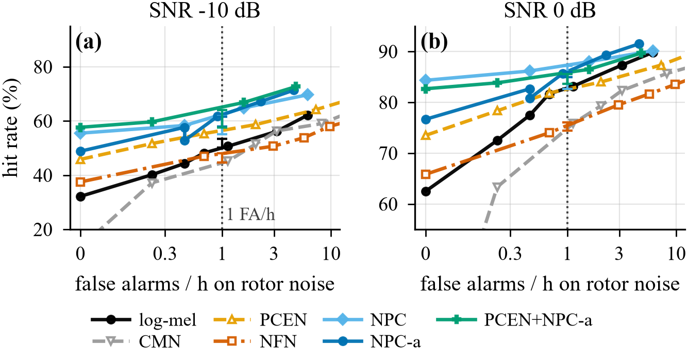
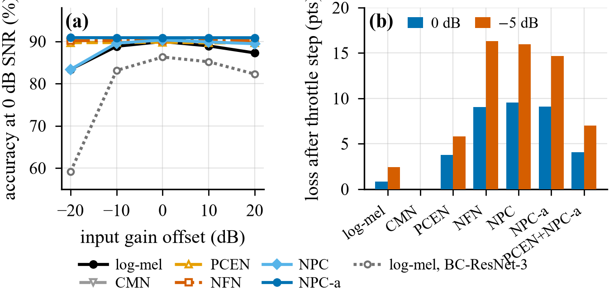

**Source:** *Normalise or condition? Noise-floor front-ends for on-board keyword spotting under UAV rotor ego-noise* — [PDF](https://arxiv.org/pdf/2609.31699) · [arXiv](https://arxiv.org/abs/2609.31699)

# NORMALISE OR CONDITION? NOISE-FLOOR FRONT-ENDS FOR ON-BOARD KEYWORD SPOTTING UNDER UAV ROTOR EGO-NOISE

Yida Lin  Bing Xue  Mengjie Zhang  Affiliation: Victoria University of Wellington  Affiliation: Wellington, New Zealand  Sam Schofield  Richard Green  Affiliation: University of Canterbury  Affiliation: Christchurch, New Zealand 

###### Abstract

A microphone on the airframe of a small multi-rotor UAV is dominated by rotor ego-noise, so spoken flight commands arrive at negative signal-to-noise ratio (SNR). We study small-footprint keyword spotting (KWS) for a ten-word command vocabulary under _real_ ego-noise, training on one quadrotor and testing on another. Besides per-clip accuracy we measure the streaming false-alarm rate on 4.4 h of continuous rotor noise. We compare classical noise-robust front-ends (CMN, PCEN, spectral subtraction), test-time adaptation, and two front-ends that track the per-band ego-noise floor over the two seconds preceding the decision window and either subtract it (_normalisation_) or feed it to the network as a second input channel (_conditioning_). Per clip, all front-ends look alike: \(+\)2–3 points on average, up to \(+\)14 at \(-15\) dB. On continuous rotor noise they differ sharply. Normalising front-ends fire about ten times more often than plain log-mel at the same threshold and end up _below_ it at a budget of one false alarm per hour (\(-\)9 points at 0 dB). Conditioning keeps the baseline’s false-alarm rate and turns its gain into detections (\(+\)8 points at \(-10\) dB over three seeds); on top of PCEN it gives the best per-clip accuracy and false-alarm rate, and a level-anchored variant is also invariant to the microphone gain. Real drone+interferer recordings expose the remaining failure mode, environmental sounds and bystander speech, which training negatives halve. A single script reproduces all on-device numbers on the NVIDIA Jetson Orin NX flight computer, where the complete pipeline costs 3 ms per 100 ms hop on the CPU.

###### Index Terms: 

keyword spotting, ego-noise, unmanned aerial vehicle, voice control, edge deployment 

## 1 Introduction

Small multi-rotor UAVs are increasingly used for close-range vegetation work such as pruning radiata pine, where on-board stereo vision detects and localises the branches to cut [[1](https://arxiv.org/html/2609.31699#bib.bib1), [2](https://arxiv.org/html/2609.31699#bib.bib2)]. The operator’s hands and eyes are busy, so short spoken commands (_up_ , _down_ , _stop_ , …) are a natural supplementary control channel. Recognising them on a ground station adds a radio link, and its latency, to the safety-critical _stop_ ; we therefore spot the commands _on board_ , with one microphone and the airframe’s embedded computer (NVIDIA Jetson Orin).

The difficulty is the acoustic environment. Rotor ego-noise on a hovering multi-rotor is broadband, harmonic, and 20–60 dB louder than a person speaking a few metres away; in DroneAudioset [[3](https://arxiv.org/html/2609.31699#bib.bib3)], human sounds recorded by on-board microphones have SNRs between \(-57\) and \(-2.5\) dB. Classical drone audition attacks this with microphone arrays and beamforming [[4](https://arxiv.org/html/2609.31699#bib.bib4), [5](https://arxiv.org/html/2609.31699#bib.bib5), [6](https://arxiv.org/html/2609.31699#bib.bib6)] or rotor-informed enhancement networks [[7](https://arxiv.org/html/2609.31699#bib.bib7)]. Both need multi-channel hardware or motor telemetry and aim at intelligible speech rather than at spotting a handful of words.

Keyword spotting (KWS) is a closed-set problem on which very small networks excel on Google Speech Commands (GSC) [[8](https://arxiv.org/html/2609.31699#bib.bib8)]: broadcasted residual networks [[9](https://arxiv.org/html/2609.31699#bib.bib9)], keyword transformers [[10](https://arxiv.org/html/2609.31699#bib.bib10)] and state-space models [[11](https://arxiv.org/html/2609.31699#bib.bib11)] reach 97–98 % on the 12-class task with 0.05–0.5 M parameters. Their weakness is _unseen_ noise. The classical answers are input normalisations—cepstral mean normalisation (CMN) [[12](https://arxiv.org/html/2609.31699#bib.bib12)], spectral subtraction [[13](https://arxiv.org/html/2609.31699#bib.bib13)] with a minimum-statistics estimate [[14](https://arxiv.org/html/2609.31699#bib.bib14)], per-channel energy normalisation (PCEN) for far-field KWS [[15](https://arxiv.org/html/2609.31699#bib.bib15)]—and noise-aware training (NAT), which appends a noise estimate to the input [[16](https://arxiv.org/html/2609.31699#bib.bib16)]. Recent KWS work adds self-supervised pre-training [[17](https://arxiv.org/html/2609.31699#bib.bib17)], noise-aware decoding [[18](https://arxiv.org/html/2609.31699#bib.bib18)] and test-time adaptation (TTA) of normalisation statistics [[19](https://arxiv.org/html/2609.31699#bib.bib19), [20](https://arxiv.org/html/2609.31699#bib.bib20), [21](https://arxiv.org/html/2609.31699#bib.bib21)]. Voice-controlled drones, in turn, rely on cloud or laptop speech-to-text pipelines [[22](https://arxiv.org/html/2609.31699#bib.bib22), [23](https://arxiv.org/html/2609.31699#bib.bib23), [24](https://arxiv.org/html/2609.31699#bib.bib24)]. None of this work evaluates KWS under the ego-noise of the microphone that actually flies.

This paper does not claim a new network. Its contributions are: (i) a reproducible benchmark for on-board UAV command spotting: GSC words under _real_ ego-noise of two quadrotors from DroneAudioset [[3](https://arxiv.org/html/2609.31699#bib.bib3)], trained on one drone and tested on the other at \(-15\) to \(20\) dB, scored by per-clip accuracy _and_ by a streaming false-alarms-per-hour evaluation on 4.4 h of rotor noise; (ii) two noise-floor front-ends that revive minimum statistics and NAT for this setting: a per-band floor tracked over the two seconds _preceding_ the decision window is either subtracted in the log domain (normalisation, NFN) or fed as a second, level-anchored input channel (conditioning, NPC/NPC-a), and the same floor is simulated during ego-noise multi-condition training; (iii) a systematic comparison against CMN, PCEN, spectral subtraction, FiLM conditioning, generic-noise/clean training and AdaBN test-time adaptation, with ablations of floor statistic, microphone gain, stale floors, real interferers and model size over three seeds; and (iv) a streaming implementation on the Jetson Orin NX flight computer with measured cost, whose on-device replay reproduces the PC evaluation. Code, models and the on-device script will be released.

## 2 On-board keyword spotting under ego-noise

 

Figure 1: On-board pipeline. Every 100 ms the last second of log-mel frames is combined with the noise-floor profile \(N_{f}\) tracked over the preceding two seconds (blue blocks are the proposed front-end) and classified; smoothed posteriors drive the flight controller over MAVLink.

### 2.1 Task and data

The vocabulary is \(\mathcal{V}=\{\) _up, down, left, right, forward, backward, go, stop, on, off_ \(\}\) plus _unknown_ (any other GSC word) and _silence_ (ego-noise without speech), i.e. 12 classes as in the standard GSC protocol. All words exist in GSC v2 [[8](https://arxiv.org/html/2609.31699#bib.bib8)]; we use the official train/validation/test lists (32.4 k/3.8 k/4.3 k clips after re-balancing _unknown_ and _silence_ to the mean per-word count; the _unknown_ pool is re-sampled every epoch). Ego-noise comes from the _drone-only_ subset of DroneAudioset [[3](https://arxiv.org/html/2609.31699#bib.bib3)]: 8.8 h of 16 kHz recordings of two quadrotors at two microphone distances (25/50 cm from the rotors), two throttle levels and three microphones. Training and validation noise come from _drone2_ (disjoint files); test noise comes exclusively from the unseen _drone1_. Mixtures are created on the fly. The noise is normalised to a fixed RMS, the level the airframe microphone sees, and the speech is scaled so that its _active_ power (frames within 30 dB of the loudest) reaches the target SNR: uniform in \([-10,20]\) dB plus 10 % clean clips for training, \(\{-15,\dots,20\}\) dB and clean for testing. _Silence_ examples are noise-only segments, so their error is the false-alarm rate (FAR) on rotor noise. Speech is added synthetically (no Lombard effect or propeller wash on the talker); Sec. [3.4](https://arxiv.org/html/2609.31699#S3.SS4 "3.4 Beyond rotor noise: real recordings and negatives ‣ 3 Experiments ‣ NORMALISE OR CONDITION? NOISE-FLOOR FRONT-ENDS FOR ON-BOARD KEYWORD SPOTTING UNDER UAV ROTOR EGO-NOISE") adds real drone+loudspeaker recordings.

### 2.2 Front-end: tracking and using the ego-noise floor

Let \(X_{f,t}\) (dB) be the 40-band log-mel spectrogram (30 ms window, 10 ms hop, 98 frames per decision window). Ego-noise changes slowly compared with a command, so its per-band level can be estimated from the audio that _precedes_ the window, during which nobody is (usually) speaking. Following the minimum-statistics idea [[14](https://arxiv.org/html/2609.31699#bib.bib14)] we define the noise-floor profile

\[\begin{aligned}
 & N_{f}=\mathrm{Q}_{20}\big(\{X_{f,\tau}\}_{\tau\in\mathcal{C}}\big), &  & \text{(1)}
\end{aligned}\]

 

the 20th percentile over the \(|\mathcal{C}|=200\) frames (2 s) before the window. A low percentile is insensitive to sporadic speech inside \(\mathcal{C}\); during training a random GSC clip is inserted into the context with probability 0.3. Three ways of using \(N_{f}\) are compared, with fixed constants \((\mu,\sigma)=(-20,25)\) dB:

  * NFN (noise-floor normalisation): input \(\max(X_{f,t}-N_{f},0)/\sigma\), i.e. \(10\log_{10}(1+\mathrm{SNR}_{f,t})\) up to the estimation error. This is log-domain spectral subtraction [[13](https://arxiv.org/html/2609.31699#bib.bib13)], invariant to the noise level and microphone gain. 
  * NPC (noise-profile conditioning): two input channels \([(X_{f,t}-\mu)/\sigma,\ (N_{f}-\mu)/\sigma]\), \(N_{f}\) broadcast over time. The first convolution sees the floor next to the noisy image and learns its own compensation, but it still sees absolute levels. 
  * NPC-a (level-anchored NPC): both channels relative to the overall floor level \(\bar{N}=\frac{1}{F}\sum_{f}N_{f}\), i.e. \([(X_{f,t}-\bar{N})/\sigma,\ (N_{f}-\bar{N})/\sigma]\). A gain change shifts \(X\), \(N_{f}\) and \(\bar{N}\) alike and cancels, so NPC-a combines the invariance of NFN with the conditioning of NPC. 

The network is unchanged except for the number of input channels (\(<\)1 k extra parameters); the baseline (_log-mel_) uses \((X_{f,t}-\mu)/\sigma\).

Relation to prior art and compared front-ends. NFN is spectral subtraction moved to the log-mel domain with a minimum-statistics-like estimate, and NPC is noise-aware training [[16](https://arxiv.org/html/2609.31699#bib.bib16)]. What is new is where the estimate comes from—the two seconds _before_ the window—and that the same statistic is simulated during multi-condition training, with speech in the context, so that the network learns its bias. We compare, under identical training, against _CMN_ [[12](https://arxiv.org/html/2609.31699#bib.bib12)] (\(X_{f,t}-\bar{X}_{f}\) over the window, also gain-invariant), _PCEN_ [[15](https://arxiv.org/html/2609.31699#bib.bib15)] (fixed \(\alpha{=}0.98\), \(\delta{=}2\), \(r{=}0.5\), \(s{=}0.025\), smoother initialised on the 2 s context), linear-domain _spectral subtraction_ \(10\log_{10}\max(P-N,0.01P)\) with the same floor [[13](https://arxiv.org/html/2609.31699#bib.bib13)], FiLM conditioning [[25](https://arxiv.org/html/2609.31699#bib.bib25)] (the floor scales and shifts the first feature maps through a small MLP), and AdaBN [[19](https://arxiv.org/html/2609.31699#bib.bib19)] test-time adaptation, i.e. BatchNorm statistics re-estimated on unlabeled target-drone audio (the first step of AdaKWS [[20](https://arxiv.org/html/2609.31699#bib.bib20)]).

### 2.3 Networks and training

We use three small-footprint back-ends from the public Keyword-Mamba code base [[11](https://arxiv.org/html/2609.31699#bib.bib11)]: BC-ResNet-3/-8 [[9](https://arxiv.org/html/2609.31699#bib.bib9)] (57 k / 349 k parameters) and KWT-1 [[10](https://arxiv.org/html/2609.31699#bib.bib10)] (0.56 M), trained from scratch for 50 epochs with AdamW (lr \(10^{-3}\), weight decay 0.1, 5 warm-up epochs, cosine decay, batch 256), label smoothing 0.1, \(\pm\)100 ms time shift, \(\pm\)6 dB gain and SpecAugment [[26](https://arxiv.org/html/2609.31699#bib.bib26)], keeping the checkpoint with the best validation accuracy over \(\{-10,\dots,10\}\) dB and clean.

### 2.4 Streaming decision logic on the UAV

On the Jetson the microphone is read in 100 ms blocks; log-mel frames, the running profile ([1](https://arxiv.org/html/2609.31699#S2.E1 "In 2.2 Front-end: tracking and using the ego-noise floor ‣ 2 On-board keyword spotting under ego-noise ‣ NORMALISE OR CONDITION? NOISE-FLOOR FRONT-ENDS FOR ON-BOARD KEYWORD SPOTTING UNDER UAV ROTOR EGO-NOISE")) and the network input are computed incrementally in NumPy and the ONNX model is evaluated every hop. Posteriors are averaged over three hops [[27](https://arxiv.org/html/2609.31699#bib.bib27)]; a command fires when the smoothed posterior of a command class exceeds a threshold \(\tau\) (0.7 by default) in two consecutive hops, after which the same word is inhibited for 1 s. Commands become body-frame MAVLink velocity set-points; _stop_ is always accepted, _on_ /_off_ gate motion.

## 3 Experiments

Table 1: BC-ResNet-8 on the 12-class UAV command task, test words mixed with _unseen-drone_ ego-noise: accuracy (%) per SNR, mean over the seven noisy SNRs, and false-alarm rate FAR (%) on noise-only input. Train noise: E = drone2 ego-noise, G = GSC noise, – = clean; \(\pm\) = std over three seeds; bold = best in the E block. 

Front-end | Train | \(-15\) | \(-10\) | \(-5\) | 0 | 5 | 10 | 20 | clean | mean | FAR  
---|---|---|---|---|---|---|---|---|---|---|---  
log-mel | – | 15.8 | 23.3 | 38.9 | 61.2 | 73.2 | 80.0 | 85.6 | 98.0 | 54.0 | 100.0  
log-mel | G | 29.9 | 53.3 | 71.6 | 82.6 | 87.2 | 89.8 | 91.4 | 96.0 | 72.3 | 43.1  
NFN | G | 44.5 | 65.7 | 78.3 | 85.2 | 88.2 | 89.6 | 90.7 | 96.6 | 77.5 | 53.8  
NPC | G | 41.8 | 64.2 | 78.8 | 86.8 | 90.3 | 91.9 | 93.1 | 96.3 | 78.1 | 30.3  
log-mel | E | 42.8 | 69.9 | 83.5 | 89.6 | 92.8 | 94.6 | 95.7 | 96.7 | 81.2 \(\pm\) 0.2 | 3.6 \(\pm\) 2.1  
CMN | E | 55.3 | 73.2 | 84.0 | 89.6 | 92.6 | 94.2 | 95.3 | 97.0 | 83.5 | 7.3  
PCEN | E | 57.2 | 75.2 | 84.8 | 90.2 | 92.4 | 93.7 | 94.8 | 95.2 | 84.0 | 3.9  
spec. sub. | E | 37.0 | 66.9 | 81.1 | 88.6 | 91.9 | 93.3 | 94.9 | 96.4 | 79.1 | 8.7  
NFN | E | 52.3 | 73.1 | 84.5 | 89.7 | 92.5 | 94.1 | 95.0 | 96.7 | 83.2 \(\pm\) 0.3 | 6.9 \(\pm\) 0.7  
NPC | E | 50.7 | 73.6 | 85.2 | 90.2 | 93.0 | 94.6 | 95.6 | 96.7 | 83.1 \(\pm\) 0.1 | 4.9 \(\pm\) 1.7  
NPC-a | E | 51.7 | 74.3 | 85.8 | 91.0 | 93.9 | 95.1 | 96.0 | 96.6 | 83.5 \(\pm\) 0.4 | 2.8 \(\pm\) 1.0  
PCEN+NPC-a | E | 59.1 | 76.9 | 85.7 | 89.9 | 92.4 | 93.7 | 95.2 | 95.4 | 84.5 \(\pm\) 0.2 | 1.5 \(\pm\) 0.1

  

 Figure 2: Streaming operation (BC-ResNet-8, deployed decision logic): hit rate of commands embedded every 3 s in unseen-drone rotor noise vs. false alarms per hour on 4.4 h of speech-free rotor noise; one marker per threshold \(\tau\in[0.5,0.95]\) (“0”: none in 4.4 h), curves for seed 0, error bars: std over three seeds at 1 FA/h. Open markers: normalising. 

 Figure 3: Stress tests (BC-ResNet-8 unless noted). (a) Accuracy at 0 dB SNR with the test input scaled by \(-20\) to \(+20\) dB. (b) Accuracy lost when the floor context comes from the other throttle level of the same drone (mean over both directions). Table 2: Beyond rotor noise (BC-ResNet-8 unless noted, unseen drone, \(\tau{=}0.7\)): per-clip mean accuracy; streaming hit rate at 0 dB under 1 FA/h; false alarms per hour on rotor noise, on _real_ drone+non-speech-interferer and drone+bystander-speech recordings; firings per 100 non-command words. “+ neg.”: ESC-50 events and overlapping non-command words as negatives. 

<table id="S3.T2.4" class="ltx_tabular ltx_centering ltx_guessed_headers ltx_align_middle">
<thead class="ltx_thead">
<tr id="S3.T2.4.1" class="ltx_tr">
<th id="S3.T2.4.1.1" class="ltx_td ltx_th ltx_th_column ltx_border_tt" style="padding-left:2.6pt;padding-right:2.6pt;"></th>
<th id="S3.T2.4.1.2" class="ltx_td ltx_align_center ltx_th ltx_th_column ltx_border_tt" style="padding-left:2.6pt;padding-right:2.6pt;">acc.</th>
<th id="S3.T2.4.1.3" class="ltx_td ltx_align_center ltx_th ltx_th_column ltx_border_r ltx_border_tt" style="padding-left:2.6pt;padding-right:2.6pt;">hit<math id="S3.T2.m3" class="ltx_Math" alttext="{}_{0\,\mathrm{dB}}" display="inline" intent=":literal"><semantics><msub><mrow></mrow><mrow><mn>0</mn><mo lspace="0.170em" rspace="0em">​</mo><mi>dB</mi></mrow></msub><annotation encoding="application/x-tex">{}_{0\,\mathrm{dB}}</annotation></semantics></math></th>
<th id="S3.T2.4.1.4" class="ltx_td ltx_align_center ltx_th ltx_th_column ltx_border_r ltx_border_tt" style="padding-left:2.6pt;padding-right:2.6pt;" colspan="3">FA/h @0.7</th>
<th id="S3.T2.4.1.5" class="ltx_td ltx_align_center ltx_th ltx_th_column ltx_border_tt" style="padding-left:2.6pt;padding-right:2.6pt;">unk.</th></tr>
<tr id="S3.T2.4.2" class="ltx_tr">
<th id="S3.T2.4.2.1" class="ltx_td ltx_align_left ltx_th ltx_th_column" style="padding-left:2.6pt;padding-right:2.6pt;">Front-end</th>
<th id="S3.T2.4.2.2" class="ltx_td ltx_align_center ltx_th ltx_th_column" style="padding-left:2.6pt;padding-right:2.6pt;">mean</th>
<th id="S3.T2.4.2.3" class="ltx_td ltx_align_center ltx_th ltx_th_column ltx_border_r" style="padding-left:2.6pt;padding-right:2.6pt;">1 FA/h</th>
<th id="S3.T2.4.2.4" class="ltx_td ltx_align_center ltx_th ltx_th_column" style="padding-left:2.6pt;padding-right:2.6pt;">rotor</th>
<th id="S3.T2.4.2.5" class="ltx_td ltx_align_center ltx_th ltx_th_column" style="padding-left:2.6pt;padding-right:2.6pt;">non-sp.</th>
<th id="S3.T2.4.2.6" class="ltx_td ltx_align_center ltx_th ltx_th_column ltx_border_r" style="padding-left:2.6pt;padding-right:2.6pt;">speech</th>
<th id="S3.T2.4.2.7" class="ltx_td ltx_align_center ltx_th ltx_th_column" style="padding-left:2.6pt;padding-right:2.6pt;">/100</th></tr>
</thead>
<tbody class="ltx_tbody">
<tr id="S3.T2.4.3" class="ltx_tr">
<td id="S3.T2.4.3.1" class="ltx_td ltx_align_left ltx_border_t" style="padding-left:2.6pt;padding-right:2.6pt;">log-mel</td>
<td id="S3.T2.4.3.2" class="ltx_td ltx_align_center ltx_border_t" style="padding-left:2.6pt;padding-right:2.6pt;">81.3</td>
<td id="S3.T2.4.3.3" class="ltx_td ltx_align_center ltx_border_r ltx_border_t" style="padding-left:2.6pt;padding-right:2.6pt;">82.8</td>
<td id="S3.T2.4.3.4" class="ltx_td ltx_align_center ltx_border_t" style="padding-left:2.6pt;padding-right:2.6pt;">1.1</td>
<td id="S3.T2.4.3.5" class="ltx_td ltx_align_center ltx_border_t" style="padding-left:2.6pt;padding-right:2.6pt;">27</td>
<td id="S3.T2.4.3.6" class="ltx_td ltx_align_center ltx_border_r ltx_border_t" style="padding-left:2.6pt;padding-right:2.6pt;">143</td>
<td id="S3.T2.4.3.7" class="ltx_td ltx_align_center ltx_border_t" style="padding-left:2.6pt;padding-right:2.6pt;">3.8</td></tr>
<tr id="S3.T2.4.4" class="ltx_tr">
<td id="S3.T2.4.4.1" class="ltx_td ltx_align_left" style="padding-left:2.6pt;padding-right:2.6pt;">log-mel + neg.</td>
<td id="S3.T2.4.4.2" class="ltx_td ltx_align_center" style="padding-left:2.6pt;padding-right:2.6pt;">81.6</td>
<td id="S3.T2.4.4.3" class="ltx_td ltx_align_center ltx_border_r" style="padding-left:2.6pt;padding-right:2.6pt;">88.7</td>
<td id="S3.T2.4.4.4" class="ltx_td ltx_align_center" style="padding-left:2.6pt;padding-right:2.6pt;">0.0</td>
<td id="S3.T2.4.4.5" class="ltx_td ltx_align_center" style="padding-left:2.6pt;padding-right:2.6pt;">15</td>
<td id="S3.T2.4.4.6" class="ltx_td ltx_align_center ltx_border_r" style="padding-left:2.6pt;padding-right:2.6pt;">66</td>
<td id="S3.T2.4.4.7" class="ltx_td ltx_align_center" style="padding-left:2.6pt;padding-right:2.6pt;">6.2</td></tr>
<tr id="S3.T2.4.5" class="ltx_tr">
<td id="S3.T2.4.5.1" class="ltx_td ltx_align_left" style="padding-left:2.6pt;padding-right:2.6pt;">NFN</td>
<td id="S3.T2.4.5.2" class="ltx_td ltx_align_center" style="padding-left:2.6pt;padding-right:2.6pt;">83.0</td>
<td id="S3.T2.4.5.3" class="ltx_td ltx_align_center ltx_border_r" style="padding-left:2.6pt;padding-right:2.6pt;">75.4</td>
<td id="S3.T2.4.5.4" class="ltx_td ltx_align_center" style="padding-left:2.6pt;padding-right:2.6pt;">9.8</td>
<td id="S3.T2.4.5.5" class="ltx_td ltx_align_center" style="padding-left:2.6pt;padding-right:2.6pt;">40</td>
<td id="S3.T2.4.5.6" class="ltx_td ltx_align_center ltx_border_r" style="padding-left:2.6pt;padding-right:2.6pt;">124</td>
<td id="S3.T2.4.5.7" class="ltx_td ltx_align_center" style="padding-left:2.6pt;padding-right:2.6pt;">5.2</td></tr>
<tr id="S3.T2.4.6" class="ltx_tr">
<td id="S3.T2.4.6.1" class="ltx_td ltx_align_left" style="padding-left:2.6pt;padding-right:2.6pt;">NFN + neg.</td>
<td id="S3.T2.4.6.2" class="ltx_td ltx_align_center" style="padding-left:2.6pt;padding-right:2.6pt;">82.8</td>
<td id="S3.T2.4.6.3" class="ltx_td ltx_align_center ltx_border_r" style="padding-left:2.6pt;padding-right:2.6pt;">60.7</td>
<td id="S3.T2.4.6.4" class="ltx_td ltx_align_center" style="padding-left:2.6pt;padding-right:2.6pt;">12.5</td>
<td id="S3.T2.4.6.5" class="ltx_td ltx_align_center" style="padding-left:2.6pt;padding-right:2.6pt;">24</td>
<td id="S3.T2.4.6.6" class="ltx_td ltx_align_center ltx_border_r" style="padding-left:2.6pt;padding-right:2.6pt;">93</td>
<td id="S3.T2.4.6.7" class="ltx_td ltx_align_center" style="padding-left:2.6pt;padding-right:2.6pt;">6.2</td></tr>
<tr id="S3.T2.4.7" class="ltx_tr">
<td id="S3.T2.4.7.1" class="ltx_td ltx_align_left" style="padding-left:2.6pt;padding-right:2.6pt;">NPC-a</td>
<td id="S3.T2.4.7.2" class="ltx_td ltx_align_center" style="padding-left:2.6pt;padding-right:2.6pt;">84.0</td>
<td id="S3.T2.4.7.3" class="ltx_td ltx_align_center ltx_border_r" style="padding-left:2.6pt;padding-right:2.6pt;">86.1</td>
<td id="S3.T2.4.7.4" class="ltx_td ltx_align_center" style="padding-left:2.6pt;padding-right:2.6pt;">0.9</td>
<td id="S3.T2.4.7.5" class="ltx_td ltx_align_center" style="padding-left:2.6pt;padding-right:2.6pt;">42</td>
<td id="S3.T2.4.7.6" class="ltx_td ltx_align_center ltx_border_r" style="padding-left:2.6pt;padding-right:2.6pt;">132</td>
<td id="S3.T2.4.7.7" class="ltx_td ltx_align_center" style="padding-left:2.6pt;padding-right:2.6pt;">4.5</td></tr>
<tr id="S3.T2.4.8" class="ltx_tr">
<td id="S3.T2.4.8.1" class="ltx_td ltx_align_left" style="padding-left:2.6pt;padding-right:2.6pt;">NPC-a + neg.</td>
<td id="S3.T2.4.8.2" class="ltx_td ltx_align_center" style="padding-left:2.6pt;padding-right:2.6pt;">83.3</td>
<td id="S3.T2.4.8.3" class="ltx_td ltx_align_center ltx_border_r" style="padding-left:2.6pt;padding-right:2.6pt;">85.2</td>
<td id="S3.T2.4.8.4" class="ltx_td ltx_align_center" style="padding-left:2.6pt;padding-right:2.6pt;">1.1</td>
<td id="S3.T2.4.8.5" class="ltx_td ltx_align_center" style="padding-left:2.6pt;padding-right:2.6pt;">27</td>
<td id="S3.T2.4.8.6" class="ltx_td ltx_align_center ltx_border_r" style="padding-left:2.6pt;padding-right:2.6pt;">98</td>
<td id="S3.T2.4.8.7" class="ltx_td ltx_align_center" style="padding-left:2.6pt;padding-right:2.6pt;">5.0</td></tr>
<tr id="S3.T2.4.9" class="ltx_tr">
<td id="S3.T2.4.9.1" class="ltx_td ltx_align_left" style="padding-left:2.6pt;padding-right:2.6pt;">PCEN+NPC-a</td>
<td id="S3.T2.4.9.2" class="ltx_td ltx_align_center" style="padding-left:2.6pt;padding-right:2.6pt;">84.7</td>
<td id="S3.T2.4.9.3" class="ltx_td ltx_align_center ltx_border_r" style="padding-left:2.6pt;padding-right:2.6pt;">85.9</td>
<td id="S3.T2.4.9.4" class="ltx_td ltx_align_center" style="padding-left:2.6pt;padding-right:2.6pt;">0.2</td>
<td id="S3.T2.4.9.5" class="ltx_td ltx_align_center" style="padding-left:2.6pt;padding-right:2.6pt;">36</td>
<td id="S3.T2.4.9.6" class="ltx_td ltx_align_center ltx_border_r" style="padding-left:2.6pt;padding-right:2.6pt;">123</td>
<td id="S3.T2.4.9.7" class="ltx_td ltx_align_center" style="padding-left:2.6pt;padding-right:2.6pt;">5.0</td></tr>
<tr id="S3.T2.4.10" class="ltx_tr">
<td id="S3.T2.4.10.1" class="ltx_td ltx_align_left" style="padding-left:2.6pt;padding-right:2.6pt;">BC-ResNet-3 NPC-a</td>
<td id="S3.T2.4.10.2" class="ltx_td ltx_align_center" style="padding-left:2.6pt;padding-right:2.6pt;">79.2</td>
<td id="S3.T2.4.10.3" class="ltx_td ltx_align_center ltx_border_r" style="padding-left:2.6pt;padding-right:2.6pt;">85.4</td>
<td id="S3.T2.4.10.4" class="ltx_td ltx_align_center" style="padding-left:2.6pt;padding-right:2.6pt;">0.2</td>
<td id="S3.T2.4.10.5" class="ltx_td ltx_align_center" style="padding-left:2.6pt;padding-right:2.6pt;">29</td>
<td id="S3.T2.4.10.6" class="ltx_td ltx_align_center ltx_border_r" style="padding-left:2.6pt;padding-right:2.6pt;">119</td>
<td id="S3.T2.4.10.7" class="ltx_td ltx_align_center" style="padding-left:2.6pt;padding-right:2.6pt;">6.2</td></tr>
<tr id="S3.T2.4.11" class="ltx_tr">
<td id="S3.T2.4.11.1" class="ltx_td ltx_align_left ltx_border_bb" style="padding-left:2.6pt;padding-right:2.6pt;">BC-ResNet-3 NPC-a + neg.</td>
<td id="S3.T2.4.11.2" class="ltx_td ltx_align_center ltx_border_bb" style="padding-left:2.6pt;padding-right:2.6pt;">78.7</td>
<td id="S3.T2.4.11.3" class="ltx_td ltx_align_center ltx_border_bb ltx_border_r" style="padding-left:2.6pt;padding-right:2.6pt;">78.2</td>
<td id="S3.T2.4.11.4" class="ltx_td ltx_align_center ltx_border_bb" style="padding-left:2.6pt;padding-right:2.6pt;">0.5</td>
<td id="S3.T2.4.11.5" class="ltx_td ltx_align_center ltx_border_bb" style="padding-left:2.6pt;padding-right:2.6pt;">13</td>
<td id="S3.T2.4.11.6" class="ltx_td ltx_align_center ltx_border_bb ltx_border_r" style="padding-left:2.6pt;padding-right:2.6pt;">51</td>
<td id="S3.T2.4.11.7" class="ltx_td ltx_align_center ltx_border_bb" style="padding-left:2.6pt;padding-right:2.6pt;">7.2</td></tr>
</tbody>
</table>

 

### 3.1 Per-clip accuracy: training noise and front-ends

Table [1](https://arxiv.org/html/2609.31699#S3.T1 "Table 1 ‣ 3 Experiments ‣ NORMALISE OR CONDITION? NOISE-FLOOR FRONT-ENDS FOR ON-BOARD KEYWORD SPOTTING UNDER UAV ROTOR EGO-NOISE") reports BC-ResNet-8 on the test words mixed with the _unseen_ drone’s ego-noise. _Training noise matters most._ A model trained on clean speech reaches 98.0 % on clean words, as expected from the literature [[9](https://arxiv.org/html/2609.31699#bib.bib9)], but collapses under rotor noise (61 % at 0 dB, 16 % at \(-15\) dB) and calls _every_ noise-only segment a word (FAR 100 %). Generic GSC noise (G) recovers part of the loss (72.3 %, FAR 43 %). The _other_ drone’s ego-noise (E) is far better (81.2 %, FAR 3.6 %) although the test drone was never seen. _Under E, nearly all noise-aware front-ends look alike._ They add \(+\)1.9 to \(+\)2.8 points on average (NFN 83.2, NPC 83.1, NPC-a 83.5, CMN 83.5, PCEN 84.0 %), mostly below 0 dB (\(+\)14 at \(-15\) dB for PCEN, \(+\)9 for NPC-a), and stay within \(\pm\)1 point above 5 dB. Two exceptions: linear-domain spectral subtraction with the same floor is worse than the baseline (79.1 %), so the non-negative log-domain form of NFN matters, and PCEN’s compression costs 1.5 points on clean speech. _The false-alarm rate separates the families._ CMN and NFN raise the baseline’s FAR (3.6 \(\pm\) 2.1 %) to 7.3/6.9 %; conditioning keeps or lowers it (NPC 4.9, NPC-a 2.8 %). Subtracting the floor removes the level evidence that separates a noise-only window from a faint word, whereas the same floor given as a reference channel makes the “no speech” decision easier. With G as the only training noise, NFN/NPC still gain (77.5/78.1 vs. 72.3 %); on a clean-trained model, NFN _hurts_ (40.2 vs. 54.0 %). No front-end replaces multi-condition training.

Test-time adaptation. AdaBN on unlabeled target-drone audio changes the ego-noise-trained models by \(-\)0.4 to \(-\)1.1 points but helps the G-trained model by \(+\)3.3 (72.4 \(\rightarrow\) 75.7 %), the unseen-noise-_type_ case TTA targets [[20](https://arxiv.org/html/2609.31699#bib.bib20), [21](https://arxiv.org/html/2609.31699#bib.bib21)].

Floor statistic and its limits. For NFN, the 5th percentile under-estimates the floor (81.8 %, FAR 10.4 %). The median (83.8 %) and even the plain context mean (84.2 %, FAR 6.2 %) beat the 20th-percentile default: once the statistic is simulated in training, the minimum-statistics argument is moot and the mean is the cheapest tracker (NPC-a with the mean: 84.2 %, FAR 0.6 %). A 0.5 s context gives 82.7 %. Training without speech in the context keeps accuracy (82.8 %) but raises the FAR to 9.8 %. _Stale floor_ (Fig. [3](https://arxiv.org/html/2609.31699#S3.F3 "Figure 3 ‣ 3 Experiments ‣ NORMALISE OR CONDITION? NOISE-FLOOR FRONT-ENDS FOR ON-BOARD KEYWORD SPOTTING UNDER UAV ROTOR EGO-NOISE")b): if the throttle changes right before a command, the floor-based front-ends lose 9–16 points at 0/\(-\)5 dB until the tracker catches up; log-mel and CMN are unaffected and PCEN loses 4–6. A 2 s memory buys a 2 s blind spot after every throttle step; a reset on level jumps is the remedy.

Microphone-gain mismatch (Fig. [3](https://arxiv.org/html/2609.31699#S3.F3 "Figure 3 ‣ 3 Experiments ‣ NORMALISE OR CONDITION? NOISE-FLOOR FRONT-ENDS FOR ON-BOARD KEYWORD SPOTTING UNDER UAV ROTOR EGO-NOISE")a). Scaling the test input by \(\pm\)20 dB costs plain log-mel, trained with \(\pm\)6 dB gain augmentation, up to 6.6 points at 0 dB SNR, and NPC inherits this. CMN, PCEN, NFN and NPC-a are invariant. For BC-ResNet-3 the log-mel drop grows to 27 points (86.3 \(\rightarrow\) 59.2 %) versus a flat 85.5/87.3 % with NFN/NPC-a.

### 3.2 Streaming operation: hit rate at a fixed false-alarm budget

Per-clip accuracy hides the cost of false alarms, which on a UAV means unwanted manoeuvres. Fig. [2](https://arxiv.org/html/2609.31699#S3.F2 "Figure 2 ‣ 3 Experiments ‣ NORMALISE OR CONDITION? NOISE-FLOOR FRONT-ENDS FOR ON-BOARD KEYWORD SPOTTING UNDER UAV ROTOR EGO-NOISE") therefore runs the complete streaming detector of Sec. [2.4](https://arxiv.org/html/2609.31699#S2.SS4 "2.4 Streaming decision logic on the UAV ‣ 2 On-board keyword spotting under ego-noise ‣ NORMALISE OR CONDITION? NOISE-FLOOR FRONT-ENDS FOR ON-BOARD KEYWORD SPOTTING UNDER UAV ROTOR EGO-NOISE") on continuous audio and plots, for every threshold, the false alarms per hour on 4.4 h of speech-free unseen-drone noise against the hit rate of commands embedded every 3 s into it (whole curves, so no operating point is tuned on test data). The picture changes. At threshold 0.7, plain log-mel fires 0.8 times per hour on rotor noise and NPC/NPC-a 1.0 times, but NFN 7.7 and CMN 8.2 times. At a budget of 1 FA/h the normalising front-ends therefore fall _below_ plain log-mel (0 dB: NFN 75.3, CMN 74.9 vs. 84.2 %): the higher threshold they need costs more hits than the front-end gained. Conditioning keeps the baseline’s false-alarm rate and converts its per-clip gain into detections. NPC-a reaches 59.7 % at \(-\)10 dB (\(+\)8.0 over log-mel, \(+\)13 over NFN) and 85.5/91.1 % at 0/5 dB (\(+\)1.3, within the seed spread), with the smallest seed variance; NPC without level anchoring is similar but noisier. PCEN, the best front-end per clip, lands between the families (56.5/82.6 % at \(-\)10/0 dB). _Conditioning composes with normalisation._ Adding the anchored floor channel to PCEN (PCEN+NPC-a) gives the best per-clip result, 84.5 \(\pm\) 0.2 % with FAR 1.5 \(\pm\) 0.1 %, and 60.8 \(\pm\) 3.2 / 84.6 \(\pm\) 0.9 % at \(-\)10/0 dB under 1 FA/h (\(+\)9 over log-mel at \(-\)10 dB, on par with NPC-a); it also halves the stale-floor loss (Fig. [3](https://arxiv.org/html/2609.31699#S3.F3 "Figure 3 ‣ 3 Experiments ‣ NORMALISE OR CONDITION? NOISE-FLOOR FRONT-ENDS FOR ON-BOARD KEYWORD SPOTTING UNDER UAV ROTOR EGO-NOISE")b) because PCEN’s own smoother adapts within the window. _How_ the floor is injected matters too. FiLM conditioning (per-channel scale/shift of the first feature maps) improves neither per-clip accuracy (81.0 %) nor the streaming gain (55.7 % at \(-\)10 dB), because it cannot express a per-band compensation. We therefore recommend conditioning on the floor as a band-aligned input, on top of a normalisation.

### 3.3 Different back-ends

For the 57 k BC-ResNet-3 the mean accuracy is 75.9 % with log-mel, 78.9 with NFN, 77.7 with NPC and 79.2 with NPC-a (FAR 2.5/5.0/5.0/2.0 %). In streaming mode NFN again pays for its gain with false alarms (72.1 % at 0 dB under 1 FA/h vs. 83.3 for log-mel), whereas NPC-a reaches 55.0/85.4 % at \(-\)10/0 dB (\(+\)8.0/\(+\)2.1) and thus matches the six-times larger BC-ResNet-8 baseline. KWT-1 (558 k) reaches only 74.2/75.1 % (log-mel/NPC-a) even after 120 epochs.

### 3.4 Beyond rotor noise: real recordings and negatives

DroneAudioset also contains recordings in which a loudspeaker plays Librispeech [[28](https://arxiv.org/html/2609.31699#bib.bib28)] speech, crying, human non-vocal sounds (knocks, footsteps) and non-human sounds (alarms, traffic) while the drone runs: real acoustic mixtures with segment annotations. We replay the 2.0 h of _drone1_ recordings through the streaming detector and count firings inside non-speech segments (unambiguous false alarms) and inside speech segments (bystander speech; it contains command words, so this rate is only comparable across systems). Table [2](https://arxiv.org/html/2609.31699#S3.T2 "Table 2 ‣ 3 Experiments ‣ NORMALISE OR CONDITION? NOISE-FLOOR FRONT-ENDS FOR ON-BOARD KEYWORD SPOTTING UNDER UAV ROTOR EGO-NOISE") shows the failure mode that pure-noise testing misses. Every front-end fires 25–50 times per hour on real environmental sounds and \(>\)100 times per hour on nearby speech, although only about once per hour on rotor noise alone: what a model has never seen as a negative it cannot reject, whatever the front-end. Adding negatives to training—ESC-50 [[29](https://arxiv.org/html/2609.31699#bib.bib29)] sound events mixed into the window (label unchanged) and a second, overlapping non-command word on _unknown_ samples—roughly halves these rates (NPC-a: 42 \(\rightarrow\) 27 non-speech and 132 \(\rightarrow\) 98 speech triggers per hour; BC-ResNet-3 NPC-a: 29 \(\rightarrow\) 13 and 119 \(\rightarrow\) 51) at an unchanged rotor-noise false-alarm rate, for 0.5–0.7 points per clip. Non-command _words_ still fire 4–6 times per 100 utterances for every variant; together with the remaining bystander-speech triggers, this argues for a wake word rather than for a better front-end.

### 3.5 Deployment on the Jetson Orin NX

The networks are exported to ONNX. The NumPy front-end reproduces the training features to \(10^{-5}\) dB, and a single script on the flight computer measures the latency of every model per execution provider and replays a bundled test set (5 min of unseen rotor noise, 3\(\times\)100 commands at \(+\)5/0/\(-\)5 dB, real drone+interferer excerpts) through the actual runtime. Table [3](https://arxiv.org/html/2609.31699#S3.T3 "Table 3 ‣ 3.5 Deployment on the Jetson Orin NX ‣ 3 Experiments ‣ NORMALISE OR CONDITION? NOISE-FLOOR FRONT-ENDS FOR ON-BOARD KEYWORD SPOTTING UNDER UAV ROTOR EGO-NOISE") gives the per-hop cost on an NVIDIA Jetson Orin NX 16 GB (JetPack 6.2.1, MAXN, ONNX Runtime 1.24). On two CPU cores the complete BC-ResNet-3 pipeline costs 3.2 ms per 100 ms hop including the front-end (3 % of the hop), leaving the GPU to the branch-detection stack [[1](https://arxiv.org/html/2609.31699#bib.bib1)]; BC-ResNet-8 costs 8.6 ms. TensorRT (FP16) brings every network to 1.2–1.5 ms (p90 up to 5 ms); the plain CUDA provider is _slower_ than the CPU (3.4–6.7 ms) because launch overhead dominates for networks this small, and INT8 quantisation brings nothing. The on-device replay yields decisions identical to the PC evaluation, so Table [1](https://arxiv.org/html/2609.31699#S3.T1 "Table 1 ‣ 3 Experiments ‣ NORMALISE OR CONDITION? NOISE-FLOOR FRONT-ENDS FOR ON-BOARD KEYWORD SPOTTING UNDER UAV ROTOR EGO-NOISE"), Fig. [2](https://arxiv.org/html/2609.31699#S3.F2 "Figure 2 ‣ 3 Experiments ‣ NORMALISE OR CONDITION? NOISE-FLOOR FRONT-ENDS FOR ON-BOARD KEYWORD SPOTTING UNDER UAV ROTOR EGO-NOISE") and Table [2](https://arxiv.org/html/2609.31699#S3.T2 "Table 2 ‣ 3 Experiments ‣ NORMALISE OR CONDITION? NOISE-FLOOR FRONT-ENDS FOR ON-BOARD KEYWORD SPOTTING UNDER UAV ROTOR EGO-NOISE") describe the deployed system. End-to-end latency is set by the decision logic (two agreeing hops, \(\approx\)200 ms), not by the network.

Table 3: Per-hop (100 ms) processing time in ms, batch 1, median over 300–500 runs. PC: Intel i5-14600K, ONNX Runtime CPU, 2 threads. Jetson: Orin NX 16 GB, JetPack 6.2.1, MAXN; ONNX Runtime 1.24 CPU (2 threads) or TensorRT execution provider (FP16). The front-end always runs in NumPy on the CPU. 

Stage / model | Params | PC | Jetson | Jetson  
---|---|---|---|---  
|  | CPU | CPU | TensorRT  
Front-end (log-mel \(+\) \(N_{f}\)) | – | 0.10 | 0.57 | n/a  
BC-ResNet-3 + NPC-a | 57 k | 1.07 | 2.64 | 1.32  
BC-ResNet-8 + NPC-a | 349 k | 2.09 | 8.01 | 1.45  
BC-ResNet-8 + PCEN+NPC-a | 349 k | 2.02 | 8.10 | 1.44  
KWT-1 + NFN | 558 k | 1.56 | 6.61 | 0.75

 

## 4 Conclusion

Spotting flight commands next to the rotors is feasible with a 57–350 k parameter network if it is trained on recorded ego-noise (a 98 %-accurate clean model fires on every second of hovering) and the front-end is chosen with the false-alarm budget in mind. Per clip, all robust front-ends look alike. On continuous rotor noise the normalising ones fire ten times more often than log-mel and fall _below_ it at a fixed false-alarm rate, whereas conditioning the network on the tracked floor keeps the baseline’s rate and turns the gain into detections (\(+\)8–9 points at \(-10\) dB under 1 FA/h, with or without PCEN). Real recordings show what remains: bystander speech and environmental sounds trigger the detector dozens of times per hour, training negatives halve that, and a wake word should absorb the rest; on the Jetson Orin NX the pipeline costs 3 ms per 100 ms hop.

## References

  * [1] Yida Lin, Bing Xue, Mengjie Zhang, Sam Schofield, and Richard Green,  “YOLO and SGBM integration for autonomous tree branch detection and depth estimation in radiata pine pruning applications,”  in Proc. Int. Conf. Image and Vision Computing New Zealand (IVCNZ), 2025. 
  * [2] Yida Lin, Bing Xue, Mengjie Zhang, Sam Schofield, and Richard Green,  “Performance evaluation of deep learning for tree branch segmentation in autonomous forestry systems,”  in Proc. Int. Conf. Image and Vision Computing New Zealand (IVCNZ), 2025. 
  * [3] Chitralekha Gupta, Soundarya Ramesh, Praveen Sasikumar, Kian Peen Yeo, and Suranga Nanayakkara,  “DroneAudioset: An audio dataset for drone-based search and rescue,”  in Advances in Neural Information Processing Systems (NeurIPS), Datasets and Benchmarks Track, 2025. 
  * [4] Yusuke Hioka, Michael Kingan, Gian Schmid, and Karl A. Stol,  “Speech enhancement using a microphone array mounted on an unmanned aerial vehicle,”  in Proc. IEEE IWAENC, 2016, pp. 1–5. 
  * [5] Lin Wang and Andrea Cavallaro,  “Acoustic sensing from a multi-rotor drone,”  IEEE Sensors Journal, vol. 18, no. 11, pp. 4570–4582, 2018. 
  * [6] Martin Strauss, Pol Mordel, Victor Miguet, and Antoine Deleforge,  “DREGON: Dataset and methods for UAV-embedded sound source localization,”  in Proc. IEEE/RSJ IROS, 2018, pp. 1–8. 
  * [7] Andrea Gulli, Federico Fontana, Carlo Drioli, Daniele Salvati, and Giovanni Ferrin,  “Enhancing drone audition with rotor-conditioned deep models,”  EURASIP J. Audio, Speech, and Music Processing, vol. 2025, no. 35, 2025. 
  * [8] Pete Warden,  “Speech commands: A dataset for limited-vocabulary speech recognition,”  arXiv preprint arXiv:1804.03209, 2018. 
  * [9] Byeonggeun Kim, Simyung Chang, Jinkyu Lee, and Dooyong Sung,  “Broadcasted residual learning for efficient keyword spotting,”  in Proc. Interspeech, 2021, pp. 4538–4542. 
  * [10] Axel Berg, Mark O’Connor, and Miguel Tairum Cruz,  “Keyword transformer: A self-attention model for keyword spotting,”  in Proc. Interspeech, 2021, pp. 4249–4253. 
  * [11] Hanyu Ding, Wenlong Dong, and Qirong Mao,  “Keyword Mamba: Spoken keyword spotting with state space models,”  Computer Speech & Language, vol. 99, pp. 101909, 2026. 
  * [12] Olli Viikki and Kari Laurila,  “Cepstral domain segmental feature vector normalization for noise robust speech recognition,”  Speech Communication, vol. 25, no. 1–3, pp. 133–147, 1998. 
  * [13] Steven Boll,  “Suppression of acoustic noise in speech using spectral subtraction,”  IEEE Trans. Acoustics, Speech, and Signal Processing, vol. 27, no. 2, pp. 113–120, 1979. 
  * [14] Rainer Martin,  “Noise power spectral density estimation based on optimal smoothing and minimum statistics,”  IEEE Trans. Speech and Audio Processing, vol. 9, no. 5, pp. 504–512, 2001. 
  * [15] Yuxuan Wang, Pascal Getreuer, Thad Hughes, Richard F. Lyon, and Rif A. Saurous,  “Trainable frontend for robust and far-field keyword spotting,”  in Proc. IEEE ICASSP, 2017, pp. 5670–5674. 
  * [16] Michael L. Seltzer, Dong Yu, and Yongqiang Wang,  “An investigation of deep neural networks for noise robust speech recognition,”  in Proc. IEEE ICASSP, 2013, pp. 7398–7402. 
  * [17] Jacob Mørk, Holger Severin Bovbjerg, Gergely Kiss, and Zheng-Hua Tan,  “Noise-robust keyword spotting through self-supervised pretraining,”  arXiv preprint arXiv:2403.18560, 2024. 
  * [18] Yu Xi, Haoyu Li, Hao Li, Jiaqi Guo, Xu Li, Wen Ding, and Kai Yu,  “NTC-KWS: Noise-aware CTC for robust keyword spotting,”  in Proc. IEEE ICASSP, 2025. 
  * [19] Yanghao Li, Naiyan Wang, Jianping Shi, Xiaodi Hou, and Jiaying Liu,  “Adaptive batch normalization for practical domain adaptation,”  Pattern Recognition, vol. 80, pp. 109–117, 2018. 
  * [20] Yang Xiao, Tianyi Peng, Yanghao Zhou, and Rohan Kumar Das,  “AdaKWS: Towards robust keyword spotting with test-time adaptation,”  in Proc. Interspeech, 2025. 
  * [21] Hanyu Ding, Yang Xiao, Jiaheng Dong, and Ting Dang,  “ImKWS: Test-time adaptation for keyword spotting with class imbalance,”  in Proc. Interspeech, 2026. 
  * [22] Lucca Emmanuel Pineli Simões, Lucas Brandão Rodrigues, Rafaela Mota Silva, and Gustavo Rodrigues da Silva,  “Evaluating voice command pipelines for drone control: From STT and LLM to direct classification and siamese networks,”  arXiv preprint arXiv:2407.08658, 2024. 
  * [23] Jeong-Sik Park and Hyeong-Ju Na,  “Front-end of vehicle-embedded speech recognition for voice-driven multi-UAVs control,”  Applied Sciences, vol. 10, no. 19, pp. 6876, 2020. 
  * [24] Allan Henry, Solange Rossato, Christian Graff, Sylvain Huet, and Jose-Ernesto Gomez-Balderas,  “End-to-end voice intent recognition for spontaneous human-drone interaction with naive users,”  in Proc. IEEE RO-MAN, 2026. 
  * [25] Ethan Perez, Florian Strub, Harm de Vries, Vincent Dumoulin, and Aaron Courville,  “FiLM: Visual reasoning with a general conditioning layer,”  in Proc. AAAI, 2018. 
  * [26] Daniel S. Park, William Chan, Yu Zhang, Chung-Cheng Chiu, Barret Zoph, Ekin D. Cubuk, and Quoc V. Le,  “SpecAugment: A simple data augmentation method for automatic speech recognition,”  in Proc. Interspeech, 2019, pp. 2613–2617. 
  * [27] Guoguo Chen, Carolina Parada, and Georg Heigold,  “Small-footprint keyword spotting using deep neural networks,”  in Proc. IEEE ICASSP, 2014, pp. 4087–4091. 
  * [28] Vassil Panayotov, Guoguo Chen, Daniel Povey, and Sanjeev Khudanpur,  “Librispeech: An ASR corpus based on public domain audio books,”  in Proc. IEEE ICASSP, 2015, pp. 5206–5210. 
  * [29] Karol J. Piczak,  “ESC: Dataset for environmental sound classification,”  in Proc. ACM Multimedia, 2015, pp. 1015–1018. 

