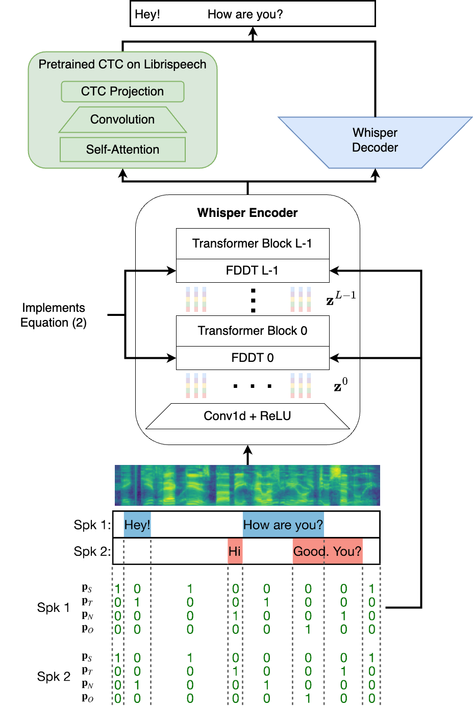

**Source:** *Target Speaker ASR with Whisper* — [PDF](https://arxiv.org/pdf/2409.09543v2) · [arXiv](https://arxiv.org/abs/2409.09543v2)

#  Target Speaker ASR with Whisper   
Thanks: 1These two authors contributed equally.

Alexander Polok12, Dominik Klement124, Matthew Wiesner4, Sanjeev Khudanpur4, Jan Černocký2, Lukáš Burget2 Affiliation: 2Brno University of Technology, Brno, Czech Republic  Affiliation: 4Johns Hopkins University, Baltimore, United States of America 

###### Abstract

We propose a novel approach to enable the use of large, single-speaker ASR models, such as Whisper, for target speaker ASR. The key claim of this method is that it is much easier to model _relative_ differences among speakers by learning to condition on frame-level diarization outputs than to learn the space of all speaker embeddings. We find that adding even a single bias term per diarization output type before the first transformer block can transform single-speaker ASR models into target-speaker ASR models. Our approach also supports speaker-attributed ASR by sequentially generating transcripts for each speaker in a diarization output. This simplified method outperforms baseline speech separation and diarization cascade by 12.9 % absolute ORC-WER on the NOTSOFAR-1 dataset.

###### Index Terms: 

target-speaker ASR, diarization conditioning, multi-speaker ASR, Whisper 

## I Introduction

Self-supervised models [[1](https://arxiv.org/html/2409.09543v2#bib.bib1), [2](https://arxiv.org/html/2409.09543v2#bib.bib2), [3](https://arxiv.org/html/2409.09543v2#bib.bib3)], LLMs [[4](https://arxiv.org/html/2409.09543v2#bib.bib4), [5](https://arxiv.org/html/2409.09543v2#bib.bib5)], and Whisper-style supervised models [[6](https://arxiv.org/html/2409.09543v2#bib.bib6), [7](https://arxiv.org/html/2409.09543v2#bib.bib7)] have demonstrated that scaling up models by using more parameters and extremely large amounts of data can enable the development of accurate automatic speech recognition (ASR) systems, even in relatively challenging environments. However, these models have primarily been used in single-speaker, single-channel ASR systems, whereas most conversations involve multiple speakers and are often recorded by one or more microphones.

Approaches to handling this scenario generally integrate multiple blocks performing source separation, speaker segmentation, overlapped speech detection, post-hoc speaker clustering, and ASR in order to produce speaker-attributed conversation transcripts. Alternatively, there are end-to-end systems transcribing multi-speaker speech directly using special tokens or multiple heads [[8](https://arxiv.org/html/2409.09543v2#bib.bib8), [9](https://arxiv.org/html/2409.09543v2#bib.bib9), [10](https://arxiv.org/html/2409.09543v2#bib.bib10), [11](https://arxiv.org/html/2409.09543v2#bib.bib11)]. Another approach is the use of a semi-end-to-end system, known as target-speaker ASR (TS-ASR) [[12](https://arxiv.org/html/2409.09543v2#bib.bib12), [13](https://arxiv.org/html/2409.09543v2#bib.bib13), [14](https://arxiv.org/html/2409.09543v2#bib.bib14), [15](https://arxiv.org/html/2409.09543v2#bib.bib15), [16](https://arxiv.org/html/2409.09543v2#bib.bib16), [17](https://arxiv.org/html/2409.09543v2#bib.bib17)] processing the original input mixture and transcribing each speaker individually.

The conventional TS-ASR framework extracts speaker embeddings corresponding to the target speakers and uses them as an auxiliary input to the ASR system [[18](https://arxiv.org/html/2409.09543v2#bib.bib18), [16](https://arxiv.org/html/2409.09543v2#bib.bib16)]. While pre-trained speaker embedding extractors [[19](https://arxiv.org/html/2409.09543v2#bib.bib19), [20](https://arxiv.org/html/2409.09543v2#bib.bib20), [21](https://arxiv.org/html/2409.09543v2#bib.bib21)] can guide the ASR system by highlighting relevant information in the input and filtering out irrelevant content, they inherently require the system to learn how to map speaker embeddings to ASR speech embeddings. More recent methods include the use of adaptation layers and soft prompts to modify existing ASR models to incorporate speaker embeddings [[14](https://arxiv.org/html/2409.09543v2#bib.bib14)] or speaker enrollment audios [[17](https://arxiv.org/html/2409.09543v2#bib.bib17)]. However, since these models are often trained on simulated datasets—due to the scarcity of multi-speaker ASR datasets and the need for a large number of speaker identities—they tend to experience significant performance degradation when applied to real-world multi-speaker scenarios [[22](https://arxiv.org/html/2409.09543v2#bib.bib22), [23](https://arxiv.org/html/2409.09543v2#bib.bib23), [24](https://arxiv.org/html/2409.09543v2#bib.bib24)].

 Fig. 1: Proposed Diarization-Conditioned Whisper model: An input audio segment with multiple speakers is conditioned by frame-level diarization outputs \(\begin{bmatrix}p_{\mathcal{S}}^{t}&p_{\mathcal{T}}^{t}&p_{\mathcal{N}}^{t}&p_{\mathcal{O}}^{t}\end{bmatrix}^{T}\) for each STNO class at every frame \(t\). Affine transformations, applied to intermediate input representations \(\mathbf{z}^{l}_{1:T}\), generate new embeddings, where \(l\) is the layer index. The final frame-level embedding is a convex combination of these embeddings for each frame.

In this paper, we propose a semi-end-to-end approach to TS-ASR that uses Whisper in a new way. Unlike previous TS-ASR methods, our system does not rely on speaker embeddings, but instead conditions directly on frame-level diarization outputs. We believe that, compared to the aforementioned embedding-based approaches, only ”relative” differentiation between speakers is needed; the TS-ASR system does not need to adapt to an existing subspace of speaker embeddings. Training our model on labeled examples of both target and non-target speech may also improve speaker discrimination and improve robustness to diarization errors.

To validate our approach, we fine-tune Whisper models on the NOTSOFAR-1 [[22](https://arxiv.org/html/2409.09543v2#bib.bib22)], AMI [[23](https://arxiv.org/html/2409.09543v2#bib.bib23)], and Libri2Mix [[25](https://arxiv.org/html/2409.09543v2#bib.bib25)] datasets using ground truth speaker segmentation. Unless stated otherwise, ground truth segmentation is also used during inference. All experiments follow the NOTSOFAR-1 Challenge guidelines11 1 https://www.chimechallenge.org/challenges/chime8/task2/.

## II Diarization-Conditioned Whisper

This section presents the Diarization-Conditioned Whisper, a model built upon the Whisper architecture, designed to perform TS-ASR by conditioning on frame-level diarization outputs. An overview of the proposed model is shown in Fig. [1](https://arxiv.org/html/2409.09543v2#S1.F1 "Fig. 1 ‣ I Introduction ‣ Target Speaker ASR with Whisper"). We adapt Whisper for TS-ASR by adding Frame-Level Diarization Dependent Transformations (FDDT) modules, described in Section [II-C](https://arxiv.org/html/2409.09543v2#S2.SS3 "II-C Frame-Level Diarization Dependent Transformations ‣ II Diarization-Conditioned Whisper ‣ Target Speaker ASR with Whisper"). These modules transform the model’s internal representations in order to differentiate between the target- and non-target speakers in the audio.

### II-A Silence, Target, Non-Target, and Overlap Masks

Let \(\mathbf{D}\in[0,1]^{S\times T}\), where \(S\) is the number of speakers in the recording, and \(T\) is the number of frames, represent the diarization output, with \(d(s,t)\) denoting the probability that speaker \(s\) is active at time frame \(t\).

The dependency on the number of speakers in \(\mathbf{D}\) can be a limiting factor for easily incorporating this mask into the model. To address this, let \(s_{k}\) represent the target speaker. We define a distribution over the following mutually exclusive events for a frame at time \(t\):

  * \({\mathcal{S}}\): Silence at time \(t\). 
  * \({\mathcal{T}}\): Only the target speaker \(s_{k}\) is active at \(t\). 
  * \({\mathcal{N}}\): Non-target speaker(s) (\(s\neq s_{k}\)) active; target \(s_{k}\) inactive at \(t\). 
  * \({\mathcal{O}}\): Target \(s_{k}\) and at least one non-target (\(s\neq s_{k}\)) active, causing overlap at \(t\). 

The probabilities of these events occurring at time frame \(t\) can be calculated as:

\[\begin{aligned}
 & \displaystyle p_{\mathcal{S}}^{t} & \displaystyle=\prod_{s=1}^{S}(1-d(s,t)),\quad p_{\mathcal{T}}^{t}=d(s_{k},t)\prod_{\begin{subarray}{c}s=1\\
s\neq s_{k}\end{subarray}}^{S}(1-d(s,t)) &  \\
 & \displaystyle p_{\mathcal{N}}^{t} & \displaystyle=\left(1-p_{\mathcal{S}}^{t}\right)-d\left(s_{k},t\right),\quad p_{\mathcal{O}}^{t}=d(s_{k},t)-p_{\mathcal{T}}^{t} &  & \text{(1)}
\end{aligned}\]

 

This definition allows us to use a fixed-sized target-speaker-dependent STNO (Silence, Target, Non-target, Overlap) mask \(\begin{bmatrix}p_{\mathcal{S}}^{t}&p_{\mathcal{T}}^{t}&p_{\mathcal{N}}^{t}&p_{\mathcal{O}}^{t}\end{bmatrix}^{\top}\).

### II-B Input Masking

Having the STNO mask, a straightforward way to perform target speaker ASR is to mask the signal by multiplying each frame by the probability that it is target speech or that it involves overlap with the target speaker. Hence, if the target speaker is not active, the audio signal is set to 0 (i.e., silence). We add \(p_{\mathcal{T}}^{t}\) and \(p_{\mathcal{O}}^{t}\) to ensure that both target speech and overlapping speech are preserved in the masked signal. However, similar to source separation approaches, this method has limitations. It can introduce artifacts because we are creating a modified version of the input signal, and errors in diarization can propagate through the system, potentially affecting the model’s performance.

### II-C Frame-Level Diarization Dependent Transformations

To overcome issues of Input Masking, we designed a soft version called Frame-Level Diarization Dependent Transformations (FDDT). This approach modifies the frame-by-frame model inputs based on the diarization outputs.

Let \(\mathbf{Z}^{l}\in\mathbb{R}^{d_{{m}}\times T}\) represent the frame-by-frame inputs to the \(l\)-th (Transformer) layer. We transform these hidden representations by applying four affine STNO layer- and class-specific transformations: \(\mathbf{W}_{\mathcal{S}}^{l},\mathbf{W}_{\mathcal{T}}^{l},\mathbf{W}_{\mathcal{N}}^{l},\mathbf{W}_{\mathcal{O}}^{l}\in\mathbb{R}^{d_{{m}}\times d_{{m}}}\) together with biases \(\mathbf{b}_{\mathcal{S}}^{l},\mathbf{b}_{\mathcal{T}}^{l},\mathbf{b}_{\mathcal{N}}^{l},\mathbf{b}_{\mathcal{O}}^{l}\in\mathbb{R}^{d_{m}}\) to obtain new speaker-specific hidden representations \(\hat{\mathbf{Z}}^{l}=[\hat{\mathbf{z}}^{l}_{1},\ldots,\hat{\mathbf{z}}^{l}_{T}]\) as

\[\begin{aligned}
 & \displaystyle\hat{\mathbf{z}}^{l}_{t}= & \displaystyle\left(\mathbf{W}_{\mathcal{S}}^{l}\mathbf{z}^{l}_{t}+\mathbf{b}_{\mathcal{S}}^{l}\right)p^{t}_{\mathcal{S}}+\left(\mathbf{W}_{\mathcal{T}}^{l}\mathbf{z}^{l}_{t}+\mathbf{b}_{\mathcal{T}}^{l}\right)p^{t}_{\mathcal{T}} &  \\
 &  & \displaystyle+\left(\mathbf{W}_{\mathcal{N}}^{l}\mathbf{z}^{l}_{t}+\mathbf{b}_{\mathcal{N}}^{l}\right)p^{t}_{\mathcal{N}}+\left(\mathbf{W}_{\mathcal{O}}^{l}\mathbf{z}^{l}_{t}+\mathbf{b}_{\mathcal{O}}^{l}\right)p^{t}_{\mathcal{O}}, &  & \text{(2)}
\end{aligned}\]

 

These transformations generate four distinct representations of the frame-by-frame inputs, each highlighting one of the STNO classes. A target-speaker-specific representation is formed by a convex combination of these terms, with weights derived from the STNO mask. The same transformation is applied to all frames with identical STNO masks.

Fine-tuning the model using randomly initialized FDDT matrices could easily disrupt the internal representations of the model. Therefore, we propose initialization strategies to mitigate this risk:

  * Identity Initialization (Non-Disturbing Init): Here, biases are initialized with zero vectors, and weights are initialized as identity matrices. This method ensures that the model’s internal representations are not altered. 
  * Suppressive Initialization: To bias the model toward masking other speakers, we initialize the \(\mathbf{W}_{\mathcal{S}}^{l},\mathbf{W}_{\mathcal{N}}^{l}\) weights as diagonal matrices with values close to zero, e.g., 0.1. This approach helps the model to distinguish between different types of speech, reinforcing the separation between the STNO classes. 

## III Experiments

We primarily conducted our experiments on the new NOTSOFAR-1 dataset [[22](https://arxiv.org/html/2409.09543v2#bib.bib22)], which includes 280 meetings, each averaging 6 minutes, capturing diverse real-world acoustic conditions and conversational dynamics. To assess generalization and competitiveness, we also evaluated our best models on the synthetic Libri2Mix dataset [[25](https://arxiv.org/html/2409.09543v2#bib.bib25)] and on real-world meeting dataset AMI [[23](https://arxiv.org/html/2409.09543v2#bib.bib23)]. Experiments are divided into two parts: In Section [III-C](https://arxiv.org/html/2409.09543v2#S3.SS3 "III-C Frame-Level Diarization Dependent Transformation ‣ III Experiments ‣ Target Speaker ASR with Whisper"), we analyze the FDDT behavior under different weight structure constraints, initializations, numbers of additional parameters, and provided information. In Section [III-D](https://arxiv.org/html/2409.09543v2#S3.SS4 "III-D Scaling System With More Data And Parameters ‣ III Experiments ‣ Target Speaker ASR with Whisper"), we evaluate the framework’s performance as more parameters and data are added.

Source codes and recipes22 2 https://github.com/BUTSpeechFIT/TS-ASR-Whisper are built on top of the transformers library [[26](https://arxiv.org/html/2409.09543v2#bib.bib26)]. All models are evaluated with the Time-Constrained Optimal Reference Combination Word Error Rate (tcORC WER) [[27](https://arxiv.org/html/2409.09543v2#bib.bib27)], referred to as WER throughout the text.

TABLE I: Comparison of the proposed system built with updated Whisper-large-v3-turbo [[28](https://arxiv.org/html/2409.09543v2#bib.bib28)] alongside various multi-talker ASR systems. The top section includes systems where no additional ground truth information about speaker identity or segmentation is provided. The bottom section features models that directly or indirectly utilize ground truth segmentation information. Results marked with \(\dagger\) are evaluated on utterance groups. Proposed ORC WER results marked with \(\star\) were approximated by increasing the collar for tcORC WER.  

|  AMI-sdm test ORC WER |  NOTSOFAR-1 eval-small tcORC WER |  Libri2Mix test-both ORC WER  
---|---|---|---  
Raj et al. [[8](https://arxiv.org/html/2409.09543v2#bib.bib8)] | \(44.6^{\dagger}\) | \(60.9^{\dagger}\) |   
Vinnikov et al. [[22](https://arxiv.org/html/2409.09543v2#bib.bib22)] |  | \(35.5\) |   
Niu et al. [[29](https://arxiv.org/html/2409.09543v2#bib.bib29)] |  | 17.7 |   
Proposed | \(18.0^{\star}\) | \(22.6\) | 14.9  
Input masking | 79.1 | 76.6 | 56.7  
Ma et al. [[14](https://arxiv.org/html/2409.09543v2#bib.bib14)] |  |  | 26.4  
Zhang et al. [[15](https://arxiv.org/html/2409.09543v2#bib.bib15)] |  |  | 23.5  
Proposed | \(16.5^{\star}\) | \(19.1\) | 10.9

 

### III-A Training details

To enhance Whisper’s performance, we incorporated an additional CTC (Connectionist Temporal Classification) head, following the hybrid CTC-attention-based training scheme proposed in [[30](https://arxiv.org/html/2409.09543v2#bib.bib30)]. Given Whisper’s large 50k vocabulary size and fixed sequence length, adding an extra projection layer poses memory challenges. To overcome this, we added two convolutional layers, each with a subsampling factor of two, along with an additional self-attention layer. Both the CTC head and the decoder are trained with timestamp tokens, and the CTC loss weight is set to 0.3.

For the ablation experiments, we used Whisper-medium.en, while the final model was trained with Whisper-large-v3-turbo. All models are trained with an overall batch size of 64 samples using bf16 precision and the AdamW optimizer [[31](https://arxiv.org/html/2409.09543v2#bib.bib31)]. The learning rate is set to \(2\times 10^{-6}\), with a weight decay of \(1\times 10^{-6}\), a linear decay scheduler, and 2k warm-up steps. The new parameters introduced by FDDT are trained with a learning rate of \(2\times 10^{-4}\). By default, FDDT modules are inserted before all layers of the encoder with the diagonal constraint, meaning that only the diagonal values of the weight matrices are updated during training and can be non-zero. Unless otherwise stated, the CTC head undergoes an initial “CTC preheating” phase, where it is trained on LibriSpeech for 10k steps, with the rest of the model being frozen. Afterwards, FDDT and CTC parameters are trained for a single epoch (FDDT preheating). Finally, the full model is trained for up to 50k steps, with early stopping set to a patience of 5 epochs. Most of the models typically converge within ten epochs. For the final evaluation, we always select the best-performing checkpoint based on the development set WER.

### III-B Comparison to Baselines

Table [I](https://arxiv.org/html/2409.09543v2#S3.T1 "TABLE I ‣ III Experiments ‣ Target Speaker ASR with Whisper") presents a comparison of the proposed method with various end-to-end and modular systems. The top section includes systems where no additional ground truth information about speaker identity or segmentation is provided, and the system must infer this information. For the proposed system, we utilized DiariZen [[32](https://arxiv.org/html/2409.09543v2#bib.bib32)]33 3 https://github.com/BUTSpeechFIT/DiariZen to condition our model. The bottom section features models that directly or indirectly utilize ground truth segmentation information. It can be seen that our approach significantly outperforms the naive input masking baseline across all three datasets, largely due to its fine-tuning capabilities and robust handling of overlapped speech. Although our method does not achieve the top performance on the NOTSOFAR dataset, it surpasses baseline models, including the NOTSOFAR baseline [[22](https://arxiv.org/html/2409.09543v2#bib.bib22)] and the fine-tuned SURT model [[8](https://arxiv.org/html/2409.09543v2#bib.bib8)]. Furthermore, our approach delivers strong results on the AMI and Libri2Mix datasets, underscoring its effectiveness across diverse scenarios.

### III-C Frame-Level Diarization Dependent Transformation

TABLE II: Analysis of different constraints applied to the FDDT parameters and methods used to initialize them evaluated with Whisper-medium.en on NOTSOFAR-1 eval-small. The FDDT parameters column specifies which parameters are used to condition the model. \(\mathbf{W}_{diag}=diag(\mathbf{w})\), where \(diag(\mathbf{w})\) is a diagonal matrix with elements of \(\mathbf{w}\) in the diagonal.  

<table id="S3.T2.1" class="ltx_tabular ltx_centering ltx_guessed_headers ltx_align_middle">
<thead class="ltx_thead">
<tr id="S3.T2.1.1" class="ltx_tr">
<th id="S3.T2.1.1.1" class="ltx_td ltx_th ltx_th_row ltx_border_tt"></th>
<th id="S3.T2.1.1.2" class="ltx_td ltx_align_center ltx_th ltx_th_column ltx_border_tt" colspan="3">Initilization Method</th></tr>
<tr id="S3.T2.1.2" class="ltx_tr">
<th id="S3.T2.1.2.1" class="ltx_td ltx_align_left ltx_th ltx_th_column ltx_th_row">FDDT parameters</th>
<th id="S3.T2.1.2.2" class="ltx_td ltx_align_center ltx_th ltx_th_column">Random</th>
<th id="S3.T2.1.2.3" class="ltx_td ltx_align_center ltx_th ltx_th_column">Identity</th>
<th id="S3.T2.1.2.4" class="ltx_td ltx_align_center ltx_th ltx_th_column">Suppressive</th></tr>
</thead>
<tbody class="ltx_tbody">
<tr id="S3.T2.1.3" class="ltx_tr">
<th id="S3.T2.1.3.1" class="ltx_td ltx_align_left ltx_th ltx_th_row ltx_border_t"><math id="S3.T2.m7" class="ltx_Math" alttext="\mathbf{b}" display="inline" intent=":literal"><semantics><mi>𝐛</mi><annotation encoding="application/x-tex">\mathbf{b}</annotation></semantics></math></th>
<td id="S3.T2.1.3.2" class="ltx_td ltx_align_center ltx_border_t">28.4</td>
<td id="S3.T2.1.3.3" class="ltx_td ltx_align_center ltx_border_t">28.0</td>
<td id="S3.T2.1.3.4" class="ltx_td ltx_align_center ltx_border_t">28.0</td></tr>
<tr id="S3.T2.1.4" class="ltx_tr">
<th id="S3.T2.1.4.1" class="ltx_td ltx_align_left ltx_th ltx_th_row"><math id="S3.T2.m8" class="ltx_Math" alttext="\mathbf{W}_{diag},\mathbf{b}" display="inline" intent=":literal"><semantics><mrow><msub><mi>𝐖</mi><mrow><mi>d</mi><mo lspace="0em" rspace="0em">​</mo><mi>i</mi><mo lspace="0em" rspace="0em">​</mo><mi>a</mi><mo lspace="0em" rspace="0em">​</mo><mi>g</mi></mrow></msub><mo>,</mo><mi>𝐛</mi></mrow><annotation encoding="application/x-tex">\mathbf{W}_{diag},\mathbf{b}</annotation></semantics></math></th>
<td id="S3.T2.1.4.2" class="ltx_td ltx_align_center">129.4</td>
<td id="S3.T2.1.4.3" class="ltx_td ltx_align_center">27.3</td>
<td id="S3.T2.1.4.4" class="ltx_td ltx_align_center">26.7</td></tr>
<tr id="S3.T2.1.5" class="ltx_tr">
<th id="S3.T2.1.5.1" class="ltx_td ltx_align_left ltx_th ltx_th_row ltx_border_bb"><math id="S3.T2.m9" class="ltx_Math" alttext="\mathbf{W},\mathbf{b}" display="inline" intent=":literal"><semantics><mrow><mi>𝐖</mi><mo>,</mo><mi>𝐛</mi></mrow><annotation encoding="application/x-tex">\mathbf{W},\mathbf{b}</annotation></semantics></math></th>
<td id="S3.T2.1.5.2" class="ltx_td ltx_align_center ltx_border_bb">129.0</td>
<td id="S3.T2.1.5.3" class="ltx_td ltx_align_center ltx_border_bb">46.1</td>
<td id="S3.T2.1.5.4" class="ltx_td ltx_align_center ltx_border_bb">44.6</td></tr>
</tbody>
</table>

 

To assess the impact of FDDT, we evaluated whether reducing the number of parameters in the additional modules affects the performance and examined the importance of proper initialization. As shown in Table [II](https://arxiv.org/html/2409.09543v2#S3.T2 "TABLE II ‣ III-C Frame-Level Diarization Dependent Transformation ‣ III Experiments ‣ Target Speaker ASR with Whisper"), using biases alone performs comparably to the combination of diagonal transformation matrices and biases, indicating that biasing frame-by-frame representations is sufficient to effectively focus the model on frames belonging to the same STNO class. The table also highlights that randomly initializing FDDT parameters is suboptimal and can significantly harm model performance, suggesting that suppressive initialization is preferable. Interestingly, using non-restricted weights, meaning full matrices without diagonal constraints leads to noticeable performance degradation.

TABLE III: Effect of increasing the number of encoder layers, where FDDTs are applied on NOTSOFAR-1 eval-small with Whisper-medium.en (24 encoder layers).  

<table id="S3.T3.1" class="ltx_tabular ltx_centering ltx_guessed_headers ltx_align_middle">
<thead class="ltx_thead">
<tr id="S3.T3.1.1" class="ltx_tr">
<th id="S3.T3.1.1.1" class="ltx_td ltx_th ltx_th_row ltx_border_tt"></th>
<th id="S3.T3.1.1.2" class="ltx_td ltx_th ltx_th_column ltx_th_row ltx_border_tt"></th>
<th id="S3.T3.1.1.3" class="ltx_td ltx_align_center ltx_th ltx_th_column ltx_border_tt" colspan="3">Initilization Method</th></tr>
<tr id="S3.T3.1.2" class="ltx_tr">
<th id="S3.T3.1.2.1" class="ltx_td ltx_align_left ltx_th ltx_th_column ltx_th_row">FDDT parameters</th>
<th id="S3.T3.1.2.2" class="ltx_td ltx_align_center ltx_th ltx_th_column ltx_th_row"># layers</th>
<th id="S3.T3.1.2.3" class="ltx_td ltx_align_center ltx_th ltx_th_column">Random</th>
<th id="S3.T3.1.2.4" class="ltx_td ltx_align_center ltx_th ltx_th_column">Identity</th>
<th id="S3.T3.1.2.5" class="ltx_td ltx_align_center ltx_th ltx_th_column">Suppressive</th></tr>
</thead>
<tbody class="ltx_tbody">
<tr id="S3.T3.1.3" class="ltx_tr">
<th id="S3.T3.1.3.1" class="ltx_td ltx_align_left ltx_th ltx_th_row ltx_border_t" rowspan="3"><math id="S3.T3.m1" class="ltx_Math" alttext="\mathbf{b}" display="inline" intent=":literal"><semantics><mi>𝐛</mi><annotation encoding="application/x-tex">\mathbf{b}</annotation></semantics></math></th>
<th id="S3.T3.1.3.2" class="ltx_td ltx_align_center ltx_th ltx_th_row ltx_border_t">1</th>
<td id="S3.T3.1.3.3" class="ltx_td ltx_align_center ltx_border_t">28.7</td>
<td id="S3.T3.1.3.4" class="ltx_td ltx_align_center ltx_border_t">30.9</td>
<td id="S3.T3.1.3.5" class="ltx_td ltx_align_center ltx_border_t">29.3</td></tr>
<tr id="S3.T3.1.4" class="ltx_tr">
<th id="S3.T3.1.4.1" class="ltx_td ltx_align_center ltx_th ltx_th_row">12</th>
<td id="S3.T3.1.4.2" class="ltx_td ltx_align_center">28.7</td>
<td id="S3.T3.1.4.3" class="ltx_td ltx_align_center">27.6</td>
<td id="S3.T3.1.4.4" class="ltx_td ltx_align_center">27.6</td></tr>
<tr id="S3.T3.1.5" class="ltx_tr">
<th id="S3.T3.1.5.1" class="ltx_td ltx_align_center ltx_th ltx_th_row">24</th>
<td id="S3.T3.1.5.2" class="ltx_td ltx_align_center">28.4</td>
<td id="S3.T3.1.5.3" class="ltx_td ltx_align_center">28.0</td>
<td id="S3.T3.1.5.4" class="ltx_td ltx_align_center">28.0</td></tr>
<tr id="S3.T3.1.6" class="ltx_tr">
<th id="S3.T3.1.6.1" class="ltx_td ltx_align_left ltx_th ltx_th_row ltx_border_bb ltx_border_t" rowspan="3"><math id="S3.T3.m2" class="ltx_Math" alttext="\mathbf{W}_{diag},\mathbf{b}" display="inline" intent=":literal"><semantics><mrow><msub><mi>𝐖</mi><mrow><mi>d</mi><mo lspace="0em" rspace="0em">​</mo><mi>i</mi><mo lspace="0em" rspace="0em">​</mo><mi>a</mi><mo lspace="0em" rspace="0em">​</mo><mi>g</mi></mrow></msub><mo>,</mo><mi>𝐛</mi></mrow><annotation encoding="application/x-tex">\mathbf{W}_{diag},\mathbf{b}</annotation></semantics></math></th>
<th id="S3.T3.1.6.2" class="ltx_td ltx_align_center ltx_th ltx_th_row ltx_border_t">1</th>
<td id="S3.T3.1.6.3" class="ltx_td ltx_align_center ltx_border_t">117.7</td>
<td id="S3.T3.1.6.4" class="ltx_td ltx_align_center ltx_border_t">27.8</td>
<td id="S3.T3.1.6.5" class="ltx_td ltx_align_center ltx_border_t">27.0</td></tr>
<tr id="S3.T3.1.7" class="ltx_tr">
<th id="S3.T3.1.7.1" class="ltx_td ltx_align_center ltx_th ltx_th_row">12</th>
<td id="S3.T3.1.7.2" class="ltx_td ltx_align_center">118.9</td>
<td id="S3.T3.1.7.3" class="ltx_td ltx_align_center">27.4</td>
<td id="S3.T3.1.7.4" class="ltx_td ltx_align_center">27.1</td></tr>
<tr id="S3.T3.1.8" class="ltx_tr">
<th id="S3.T3.1.8.1" class="ltx_td ltx_align_center ltx_th ltx_th_row ltx_border_bb">24</th>
<td id="S3.T3.1.8.2" class="ltx_td ltx_align_center ltx_border_bb">129.4</td>
<td id="S3.T3.1.8.3" class="ltx_td ltx_align_center ltx_border_bb">27.3</td>
<td id="S3.T3.1.8.4" class="ltx_td ltx_align_center ltx_border_bb">26.7</td></tr>
</tbody>
</table>

 

Table [III](https://arxiv.org/html/2409.09543v2#S3.T3 "TABLE III ‣ III-C Frame-Level Diarization Dependent Transformation ‣ III Experiments ‣ Target Speaker ASR with Whisper") demonstrates the effect of increasing the number of encoder layers where FDDTs are applied. The number of layers refers to how many layers, starting from the first encoder layer, are modified by FDDT parameters. For example, when only one layer is used, only the input to the Whisper encoder is modified. The results indicate that even a single layer of bias-only parameters can achieve performance comparable to the best diagonal setup. However, using a random initialization with diagonal matrices, even for just the first layer, severely impacts the model’s performance. Notably, the use of a diagonal setup with both \(\mathbf{W}_{diag}\) and \(\mathbf{b}\) across 24 layers yields the best performance, with the suppressive initialization method achieving the lowest WER of 26.7.

TABLE IV: The performance of FDDT given a reduction of information provided from diarization output on NOTSOFAR-1 eval-small with Whisper-medium.en. When employing the STNO mask, all frames are transformed, while with TNO, frames corresponding to the silence are left unchanged.  

STNO | TNO | TN | T  
---|---|---|---  
26.7 | 30.0 | 28.7 | 34.8

 

Table [IV](https://arxiv.org/html/2409.09543v2#S3.T4 "TABLE IV ‣ III-C Frame-Level Diarization Dependent Transformation ‣ III Experiments ‣ Target Speaker ASR with Whisper") presents the performance of the FDDT method under different reductions of diarization information. It demonstrates that while the FDDT model still significantly outperforms input masking, some performance degradation is evident when comparing the STNO and T configurations. Interestingly, using three classes (TNO) results in worse performance than using (TN) classes only, even though the STNO and TNO configurations provide the same amount of information.

TABLE V: Different sizes of training corpora affecting the performance of Whisper-medium.en. Tested on NOTSOFAR-1 Eval Small.  

NOTSOFAR-1 | \+ AMI | \+ Libri2Mix  
---|---|---  
26.7 | 25.6 | 24.8

 

### III-D Scaling System With More Data And Parameters

Table [V](https://arxiv.org/html/2409.09543v2#S3.T5 "TABLE V ‣ III-C Frame-Level Diarization Dependent Transformation ‣ III Experiments ‣ Target Speaker ASR with Whisper") explores the impact of incorporating additional training data on system performance. The results show that adding the AMI dataset improves the performance on the NOTSOFAR-1, highlighting the benefits of more real-world data. Furthermore, incorporating Libri2Mix data provides additional gains, raising the question of whether pretraining on synthetic data could offer even greater performance gains.

Finally, Table [VI](https://arxiv.org/html/2409.09543v2#S3.T6 "TABLE VI ‣ III-D Scaling System With More Data And Parameters ‣ III Experiments ‣ Target Speaker ASR with Whisper") provides a performance analysis across different model sizes, highlighting the improvements from employing an additional CTC head. Notably, incorporating a randomly initialized CTC head does not improve performance and leads to degradation. However, preheating the CTC head provides some improvements, especially for the small and medium models, even without joint decoding. Additionally, an FDDT preheating phase further enhances performance, with the best results observed in the large-v3 model.

TABLE VI: Influence of CTC head and size of the model evaluated on NOTSOFAR-1 eval-small.  

| small.en | medium.en | large-v3  
---|---|---|---  
without CTC | 30.3 | 28.1 | 24.6  
with CTC | 31.0 | 28.9 | 25.8  
\+ CTC Preheating | 29.2 | 26.7 | 25.2  
\+ FDDT Preheating | 30.3 | 27.4 | 24.5

 

## IV Conclusions and Limitations

In this study, we introduced FDDT into the Whisper model, making it a target-speaker ASR (TS-ASR) system conditioned on diarization output. We analyzed factors such as model size, FDDT placement, dataset size, and parameter initialization, evaluating the system on both real and synthetic datasets with consistently strong results. We also examined the impact of incorporating a CTC head, noting some improvements when it was preheated.

While the FDDT-based TS-ASR method performed effectively across diverse datasets, further validation on varied datasets, conditions, and languages is needed. We identified strengths and limitations, particularly regarding robustness against diarization errors, which need further attention for better real-world performance. Finally, the approach is extendable to other pre-trained ASR models, and a comparative analysis across ASR architectures could offer deeper insights into its adaptability and benefits.

## Acknowledgement

The work was supported by Ministry of Education, Youth and Sports of the Czech Republic (MoE) through the OP JAK project ”Linguistics, Artificial Intelligence and Language and Speech Technologies: from Research to Applications” (ID:CZ.02.01.01/00/23_020/0008518) and Brno Ph.D. Talent Scholarship Programme. Computing on IT4I supercomputer was supported by MoE through the e-INFRA CZ (ID:90254).

## References

  * [1] S. Chen, C. Wang, Z. Chen, Y. Wu, S. Liu, Z. Chen, J. Li, N. Kanda, T. Yoshioka, X. Xiao _et al._ , “WavLM: Large-scale self-supervised pre-training for full stack speech processing,” _IEEE Journal of Selected Topics in Signal Processing_ , vol. 16, no. 6, pp. 1505–1518, 2022. 
  * [2] W.-N. Hsu, Y.-H. H. Tsai, B. Bolte, R. Salakhutdinov, and A. Mohamed, “HuBERT: How much can a bad teacher benefit ASR pre-training?” in _ICASSP 2021-2021 IEEE International Conference on Acoustics, Speech and Signal Processing (ICASSP)_. IEEE, 2021, pp. 6533–6537. 
  * [3] V. Pratap, A. Tjandra, B. Shi, P. Tomasello, A. Babu, S. Kundu, A. Elkahky, Z. Ni, A. Vyas, M. Fazel-Zarandi _et al._ , “Scaling speech technology to 1,000+ languages,” _Journal of Machine Learning Research_ , vol. 25, no. 97, pp. 1–52, 2024. 
  * [4] J. Achiam, S. Adler, S. Agarwal, L. Ahmad, I. Akkaya, F. L. Aleman, D. Almeida, J. Altenschmidt, S. Altman, S. Anadkat _et al._ , “GPT-4 technical report,” _arXiv preprint arXiv:2303.08774_ , 2023. 
  * [5] H. Touvron, T. Lavril, G. Izacard, X. Martinet, M.-A. Lachaux, T. Lacroix, B. Rozière, N. Goyal, E. Hambro, F. Azhar _et al._ , “Llama: Open and efficient foundation language models,” _arXiv preprint arXiv:2302.13971_ , 2023. 
  * [6] A. Radford, J. W. Kim, T. Xu, G. Brockman, C. McLeavey, and I. Sutskever, “Robust speech recognition via large-scale weak supervision,” in _International conference on machine learning_. PMLR, 2023, pp. 28 492–28 518. 
  * [7] Y. Peng, J. Tian, B. Yan, D. Berrebbi, X. Chang, X. Li, J. Shi, S. Arora, W. Chen, R. Sharma, W. Zhang, Y. Sudo, M. Shakeel, J.-W. Jung, S. Maiti, and S. Watanabe, “Reproducing Whisper-style training using an open-source toolkit and publicly available data,” in _2023 IEEE Automatic Speech Recognition and Understanding Workshop (ASRU)_ , 2023, pp. 1–8. 
  * [8] D. Raj, D. Povey, and S. Khudanpur, “Surt 2.0: Advances in transducer-based multi-talker speech recognition,” _IEEE/ACM Trans. Audio, Speech and Lang. Proc._ , vol. 31, p. 3800–3813, sep 2023. [Online]. Available: https://doi.org/10.1109/TASLP.2023.3318398
  * [9] C. Li, Y. Qian, Z. Chen, N. Kanda, D. Wang, T. Yoshioka, Y. Qian, and M. Zeng, “Adapting multi-lingual ASR models for handling multiple talkers,” in _Interspeech 2023_ , 2023, pp. 1314–1318. 
  * [10] N. Kanda, Y. Gaur, X. Wang, Z. Meng, and T. Yoshioka, “Serialized output training for end-to-end overlapped speech recognition,” in _Interspeech 2020_ , 2020, pp. 2797–2801. 
  * [11] Y. Qian, X. Chang, and D. Yu, “Single-channel multi-talker speech recognition with permutation invariant training,” _Speech Communication_ , vol. 104, pp. 1–11, 2018. 
  * [12] N. Kanda, S. Horiguchi, R. Takashima, Y. Fujita, K. Nagamatsu, and S. Watanabe, “Auxiliary interference speaker loss for target-speaker speech recognition,” in _Interspeech 2019_ , 2019, pp. 236–240. 
  * [13] Y. Zhang, K. C. Puvvada, V. Lavrukhin, and B. Ginsburg, “Conformer-based target-speaker automatic speech recognition for single-channel audio,” in _ICASSP 2023 - 2023 IEEE International Conference on Acoustics, Speech and Signal Processing (ICASSP)_ , 2023, pp. 1–5. 
  * [14] H. Ma, Z. Peng, M. Shao, J. Li, and J. Liu, “Extending Whisper with prompt tuning to target-speaker ASR,” in _ICASSP 2024-2024 IEEE International Conference on Acoustics, Speech and Signal Processing (ICASSP)_. IEEE, 2024, pp. 12 516–12 520. 
  * [15] W. Zhang and Y. Qian, “Weakly-supervised speech pre-training: A case study on target speech recognition,” in _Interspeech 2023_ , 2023, pp. 3517–3521. 
  * [16] Z. Huang, D. Raj, P. García, and S. Khudanpur, “Adapting self-supervised models to multi-talker speech recognition using speaker embeddings,” in _ICASSP 2023 - 2023 IEEE International Conference on Acoustics, Speech and Signal Processing (ICASSP)_ , 2023, pp. 1–5. 
  * [17] L. Meng, J. Kang, Y. Wang, Z. Jin, X. Wu, X. Liu, and H. Meng, “Empowering Whisper as a joint multi-talker and target-talker speech recognition system,” in _Interspeech 2024_ , 2024, pp. 4653–4657. 
  * [18] M. Karafiát, L. Burget, P. Matějka, O. Glembek, and J. Černockỳ, “iVector-based discriminative adaptation for automatic speech recognition,” in _2011 IEEE Workshop on Automatic Speech Recognition & Understanding_. IEEE, 2011, pp. 152–157. 
  * [19] N. Dehak, P. J. Kenny, R. Dehak, P. Dumouchel, and P. Ouellet, “Front-end factor analysis for speaker verification,” _IEEE Transactions on Audio, Speech, and Language Processing_ , vol. 19, no. 4, pp. 788–798, 2010. 
  * [20] D. Snyder, D. Garcia-Romero, G. Sell, D. Povey, and S. Khudanpur, “X-vectors: Robust DNN embeddings for speaker recognition,” in _2018 IEEE international conference on acoustics, speech and signal processing (ICASSP)_. IEEE, 2018, pp. 5329–5333. 
  * [21] H. Wang, C. Liang, S. Wang, Z. Chen, B. Zhang, X. Xiang, Y. Deng, and Y. Qian, “Wespeaker: A research and production oriented speaker embedding learning toolkit,” in _IEEE International Conference on Acoustics, Speech and Signal Processing (ICASSP)_. IEEE, 2023, pp. 1–5. 
  * [22] A. Vinnikov, A. Ivry, A. Hurvitz, I. Abramovski, S. Koubi, I. Gurvich, S. Peer, X. Xiao, B. M. Elizalde, N. Kanda, X. Wang, S. Shaer, S. Yagev, Y. Asher, S. Sivasankaran, Y. Gong, M. Tang, H. Wang, and E. Krupka, “Notsofar-1 challenge: New datasets, baseline, and tasks for distant meeting transcription,” in _Interspeech 2024_ , 2024, pp. 5003–5007. 
  * [23] I. Mccowan, J. Carletta, W. Kraaij, S. Ashby, S. Bourban, M. Flynn, M. Guillemot, T. Hain, J. Kadlec, V. Karaiskos, M. Kronenthal, G. Lathoud, M. Lincoln, A. Lisowska Masson, W. Post, D. Reidsma, and P. Wellner, “The AMI meeting corpus,” _Int’l. Conf. on Methods and Techniques in Behavioral Research_ , 01 2005. 
  * [24] F. Yu, S. Zhang, Y. Fu, L. Xie, S. Zheng, Z. Du, W. Huang, P. Guo, Z. Yan, B. Ma, X. Xu, and H. Bu, “M2Met: The ICASSP 2022 multi-channel multi-party meeting transcription challenge,” _ICASSP 2022 - 2022 IEEE International Conference on Acoustics, Speech and Signal Processing (ICASSP)_ , pp. 6167–6171, 2021. 
  * [25] J. Cosentino, M. Pariente, S. Cornell, A. Deleforge, and E. Vincent, “LibriMix: An open-source dataset for generalizable speech separation,” 2020. [Online]. Available: https://arxiv.org/abs/2005.11262
  * [26] T. Wolf, L. Debut, V. Sanh, J. Chaumond, C. Delangue, A. Moi, P. Cistac, T. Rault, R. Louf, M. Funtowicz, J. Davison, S. Shleifer, P. von Platen, C. Ma, Y. Jernite, J. Plu, C. Xu, T. L. Scao, S. Gugger, M. Drame, Q. Lhoest, and A. M. Rush, “Transformers: State-of-the-art natural language processing,” in _Proceedings of the 2020 Conference on Empirical Methods in Natural Language Processing: System Demonstrations_. Online: Association for Computational Linguistics, Oct. 2020, pp. 38–45. [Online]. Available: https://www.aclweb.org/anthology/2020.emnlp-demos.6
  * [27] T. v. Neumann, C. B. Boeddeker, M. Delcroix, and R. Haeb-Umbach, “MeetEval: A Toolkit for Computation of Word Error Rates for Meeting Transcription Systems,” in _Proceedings of the 7th International Workshop on Speech Processing in Everyday Environments (CHiME 2023)_ , 2023, pp. 27–32. 
  * [28] A. Polok, D. Klement, M. Kocour, J. Han, F. Landini, B. Yusuf, M. Wiesner, S. Khudanpur, J. Černocký, and L. Burget, “Dicow: Diarization-conditioned whisper for target speaker automatic speech recognition,” 2024, submitted to Computer Speech & Language (CSL) journal special issue on Multi-Speaker, Multi-Microphone, and Multi-Modal Distant Speech Recognition. [Online]. Available: https://arxiv.org/abs/2501.00114
  * [29] S. Niu, R. Wang, J. Du, G. Yang, Y. Tu, S. Wu, S. Qian, H. Wu, H. Xu, X. Zhang, G. Zhong, X. Yu, J. Chen, M. Wang, D. Cai, T. Gao, G. Wan, F. Ma, J. Pan, and J. Gao, “The USTC-NERCSLIP Systems for the CHiME-8 NOTSOFAR-1 Challenge,” in _8th International Workshop on Speech Processing in Everyday Environments (CHiME 2024)_ , 2024, pp. 31–36. 
  * [30] T. Hori, S. Watanabe, and J. Hershey, “Joint CTC/attention decoding for end-to-end speech recognition,” in _Proceedings of the 55th Annual Meeting of the Association for Computational Linguistics (Volume 1: Long Papers)_ , R. Barzilay and M.-Y. Kan, Eds. Vancouver, Canada: Association for Computational Linguistics, Jul. 2017, pp. 518–529. [Online]. Available: https://aclanthology.org/P17-1048
  * [31] I. Loshchilov and F. Hutter, “Decoupled Weight Decay Regularization,” in _International Conference on Learning Representations_ , 2019. [Online]. Available: https://openreview.net/forum?id=Bkg6RiCqY7
  * [32] J. Han, F. Landini, J. Rohdin, A. Silnova, M. Diez, and L. Burget, “Leveraging self-supervised learning for speaker diarization,” in _ICASSP 2025-2025 IEEE International Conference on Acoustics, Speech and Signal Processing (ICASSP)_. IEEE, 2025. 

