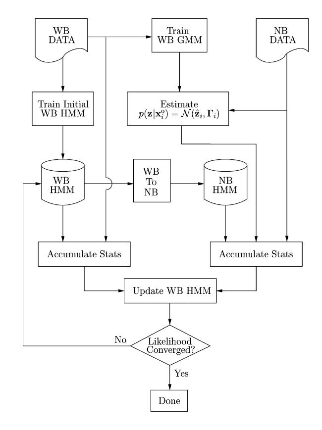
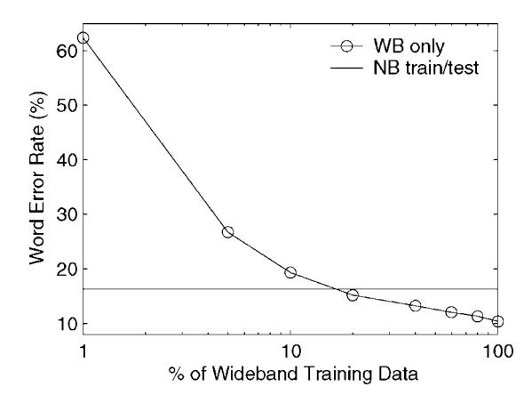
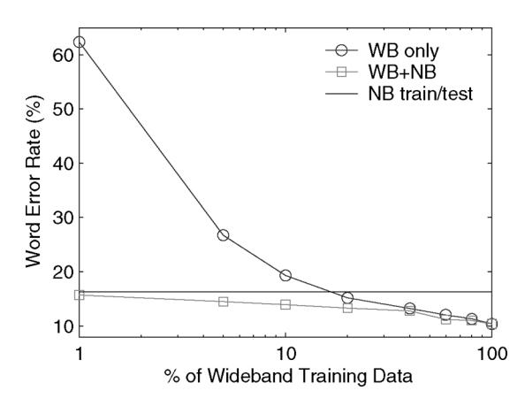
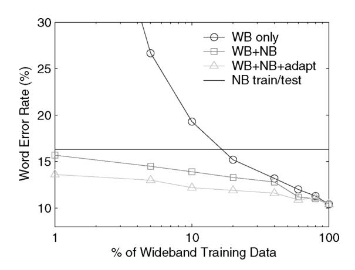
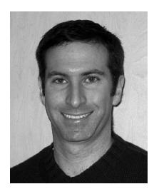

**Source:** *Training wideband acoustic models using mixed-bandwidth training data for speech recognition* — [PDF](https://microsoft.com/en-us/research/wp-content/uploads/2007/01/2007-mseltzer-taslp.pdf)

# Training Wideband Acoustic Models Using Mixed-Bandwidth Training Data for Speech Recognition

Michael L. Seltzer, Member, IEEE, and Alex Acero, Fellow, IEEE

Abstract—One serious difficulty in the deployment of wideband speech recognition systems for new tasks is the expense in both time and cost of obtaining sufficient training data. A more economical approach is to collect telephone speech and then restrict the application to operate at the telephone bandwidth. However, this generally results in suboptimal performance compared to a wideband recognition system. In this paper, we propose a novel expectation-maximization (EM) algorithm in which wideband acoustic models are trained using a small amount of wideband speech and a larger amount of narrowband speech. We show how this algorithm can be incorporated into the existing training schemes of hidden Markov model (HMM) speech recognizers. Experiments performed using wideband speech and telephone speech demonstrate that the proposed mixed-bandwidth training algorithm results in significant improvements in recognition accuracy over conventional training strategies when the amount of wideband data is

Index Terms—Acoustic modeling, bandwidth extension, hidden Markov models (HMMs), speech recognition, telephone speech.

#### I. INTRODUCTION

HE performance of automatic speech recognition (ASR) technology has progressed to the point where commerical systems have been deployed successfully for some small tasks. The success of these systems has led to the desire for more widespread use of speech recognition technology. One serious difficulty in the deployment of ASR systems for new tasks is the expense of obtaining sufficient training data. This is especially true for applications which process wideband speech. For example, training a large-vocabulary desktop dictation system requires a large corpus of wideband training data. However, there are many resource-poor languages for which such a corpus does not exist. A similar lack of training data inevitably occurs when speech recognition is applied to a new task such as automatic meeting transcription, e.g., [1]. Currently, the amount of available wideband training data that matches the spontaneous speaking style frequently used by meeting participants is very limited [2]. In both of these cases, collecting a sufficient amount of wideband training data may be prohibitively expensive and time consuming.

Manuscript received November 30, 2004; revised January 12, 2006. The associate editor coordinating the review of this manuscript and approving it for publication was Dr. Ananth Sankar.

The authors are with Microsoft Research, Redmond, WA 98052 USA (e-mail: mseltzer@microsoft.com; alexac@microsoft.com).

Digital Object Identifier 10.1109/TASL.2006.876774

The cost and time required for data collection can be mitigated by collecting speech over the telephone. Recording speech over the telephone is a relatively economical and efficient way to collect large amounts of data from a wide variety of geographic regions. However, collecting speech data in this manner has the drawback that the speech used to train the recognizer will be narrowband, typically sampled at 8 kHz with a bandwidth of 300–3400 Hz. This means that during decoding, the test speech must be restricted to the same bandwidth. However, all other things being equal, recognition systems that process narrowband speech perform worse than those that process wideband speech, i.e., speech sampled 16 kHz with a bandwidth of 0–8000 Hz [3]. Therefore, the performance obtained by restricting the bandwidth of the speech recognition system to that of telephone speech is suboptimal.

Thus, when creating a new wideband speech recognition application, there are two options for collecting speech data to train the system. The first is to obviously collect enough wideband training data to adequately train the recognition system. This option is expensive in both time and cost, but yields the best performance. The second is to collect training data over the telephone and then restrict the bandwidth of the wideband test speech to match that of the telephone speech. This option is more cost-effective but results in suboptimal recognition accuracy.

In this paper, we propose an alternative approach in which wideband acoustic models are trained using a small amount of wideband speech and a large amount of narrowband speech. We present a principled training algorithm based on the expectation-maximization (EM) algorithm, and show how this approach can be incorporated into the existing training schemes of hidden Markov model (HMM) speech recognizers. In the proposed approach, the wideband model parameters are iteratively updated using training data of mixed bandwidth. By training the recognizer in this way, we can potentially obtain wideband acoustic models that outperform those trained on narrowband speech alone, and still avoid the large costs associated with collecting large amounts of wideband speech.

The methods proposed in this paper are related to previous research in training mixture models from incomplete feature vectors [4]. However, this work is not directly applicable to speech recognition applications because of the idiosyncrasies of the feature extraction process, namely the computation of mel-frequency cepstral coefficients. Missing data techniques have also been used to improve the robustness of ASR systems to additive noise for decoding. In these methods, the low signal-to-noise ratio (SNR) components of the speech spectral vectors

are disregarded, and classification is performed based only on the high SNR components [\[5\], \[6\].](#page-10-0) However, these algorithms require knowledge of which components are most corrupt, a task which in itself has proven difficult in some noise conditions [\[7\]](#page-10-0). In [\[8\]](#page-10-0), the authors proposed a method to train narrowband acoustic models for telephone speech using a high-quality wideband speech corpus, the inverse of the problem addressed in this paper.

Finally, we note that some of the concepts used in this paper are similar in spirit to bandwidth extension for speech enhancement and coding, e.g., [\[9\]–\[11\]](#page-10-0). In this task, the bandwidth of a narrowband speech waveform is extended to obtain a wideband waveform. However, because these algorithms are concerned with speech enhancement, they require that the full spectrum be extended, including the phase. In addition, the success of these methods is measured according to perceptual criteria, while we are concerned strictly with the speech recognition performance.

The remainder of the paper is organized as follows. In Section II, the feature extraction process for speech recognition is briefly reviewed and the missing data paradigm for mixed-bandwidth speech is introduced. In Section III, we show how to train a Gaussian mixture model from log mel spectral features using mixed-bandwidth training data. We then describe the modifications required to generate models of cepstral features, rather than log mel spectra in [Section IV](#page-3-0). We show how the proposed algorithm can be used to train a large-vocabulary HMM-based speech recognition system in [Section V](#page-4-0). [Section VI](#page-6-0) describes a series of experiments that show the efficacy of the proposed method. Finally, we summarize this work and present some conclusions in [Section VII.](#page-8-0)

## II. FEATURE EXTRACTION FOR ASR

In this paper, we assume that mel-frequency cepstral coefficients (MFCCs) are the features used for recognition. For a given utterance, the sequence of MFCC feature vectors is computed by first segmenting the waveform into a series of overlapping frames of speech and deriving a vector of log mel spectra for each frame. This process can be expressed as

$$\mathbf{x}_i = \log\left(\mathbf{M}|DFT(\mathbf{s}_i)|^2\right) \tag{1}$$

where is the th frame of speech, represents the matrix of the weighting coefficients of the mel filterbank, log() is an element-wise operation, and is the resulting vector of log mel spectra. For wideband data sampled at a 16-kHz sampling rate, the mel spectral coefficients represent the energy in a series of overlapping frequency regions which range from approximately 100 Hz to 8 kHz. This log mel spectral vector is then converted to a cepstral vector via a discrete-cosine transform (DCT) as

$$\mathbf{z}_i = \mathbf{C}\mathbf{x}_i \tag{2}$$

where is the MFCC vector for frame and is the DCT matrix. Dimensionality reduction is also usually performed, so the DCT matrix is with . Typically, 13-dimensional cepstra are computed from 20 to 40-dimensional log spectral vectors.

We assume that the narrowband speech has been upsampled to match the sampling rate of the wideband speech. If this speech is then transformed to a sequence of log mel spectral vectors, the components derived from mel filters that cover frequencies outside the original signal bandwidth will contain no information. We refer to these components as *missing*.1 In contrast, the components of the spectral vector that do contain reliable content are considered *observed*. Thus, a log mel spectral vector can be partitioned as

$$\mathbf{x} = \left[\mathbf{x}^{\text{o},T} \ \mathbf{x}^{\text{m},T}\right]^{T} \tag{3}$$

where contains all components of that are observed and contains all components that are missing. For narrowband speech, the observed and missing subvectors roughly correspond to the low- and high-frequency components, respectively. However, for telephone speech, the lowest mel components typically fall outside the telephone passband and are therefore considered missing as well. For wideband speech originally sampled at the target sampling rate, and , i.e., there are no missing components.

In a similar manner, we can express a cepstral vector as the sum of linear transformations of and . Decomposing the DCT matrix into two submatrices, , an matrix, where is the length of and , an matrix, where is the length of , we can write

$$\mathbf{z} = \mathbf{C}\mathbf{x}$$

$$= [\mathbf{C}^{o}\mathbf{x}^{m}][\mathbf{x}^{o,T} \mathbf{x}^{m,T}]^{T}$$

$$= \mathbf{C}^{o}\mathbf{x}^{o} + \mathbf{C}^{m}\mathbf{x}^{m}$$

$$= \mathbf{z}^{o} + \mathbf{z}^{m}$$
(4)

# III. TRAINING A GAUSSIAN MIXTURE MODEL ON MIXED-BANDWIDTH LOG SPECTRA

We are interested in training an HMM-based speech recognizer using cepstral features derived from mixed-bandwidth speech data. However, for tutorial purposes, we begin by first discussing how to train a Gaussian mixture model (GMM) from mixed-bandwidth log mel spectral features. A GMM has the form

$$p(\mathbf{x}) = \sum_{k=1}^{K} p(\mathbf{x}|k)p(k) = \sum_{k=1}^{K} \mathcal{N}(\mathbf{x}; \boldsymbol{\mu}_k, \boldsymbol{\Sigma}_k)p(k)$$
 (6)

where , , and are the mean vector, covariance matrix, and prior probability of the th Gaussian mixture component, respectively.

We seek to train this model using a combination of narrowband and wideband speech data using the EM algorithm [\[12\]](#page-10-0). In conventional GMM training using EM, a hidden variable is used to indicate the Gaussian in the mixture which generated the current observation. In this paper, we use additional hidden

1Note that if *any* of the frequencies spanned by a particular mel filter lie outside the telephone band, that mel component is considered missing.

variables to represent the unseen log mel spectral components in the narrowband training samples. Thus, we start with the following EM auxillary function:

$$Q(\lambda, \hat{\lambda}) = \sum_{i=1}^{N} \sum_{k=1}^{K} \int \log \left( p\left(\mathbf{x}_{i}^{\text{o}}, \mathbf{x}^{\text{m}}, k; \lambda\right) \right) p\left(\mathbf{x}^{\text{m}}, k | \mathbf{x}_{i}^{\text{o}}; \hat{\lambda}\right) d\mathbf{x}^{\text{m}}$$
(7)

where is the frame index, is the hidden state variable indicating the Gaussian index, is the set of model parameters we seek to optimize, i.e., the means, covariances, and prior probabilities for all Gaussians in the mixture, and is the current estimate of these parameters. Throughout this paper, a "hat" above a symbol, e.g., , will be used to denote that it is computed from the current set of model parameters .

Performing the EM on this expression requires the conditional and marginal probability density functions (pdf's) associated with defined in [\(6\).](#page-1-0) Specifically, we need to factorize as

$$p(\mathbf{x}|k) = p(\mathbf{x}^{o}, \mathbf{x}^{m}|k) = p(\mathbf{x}^{m}|\mathbf{x}^{o}, k)p(\mathbf{x}^{o}|k).$$
(8)

To do so, we first sort the means and covariances into observed and missing partitions. We can represent the mean vector as

$$\boldsymbol{\mu}_k = \begin{bmatrix} \boldsymbol{\mu}_k^{\text{o},T} & \boldsymbol{\mu}_k^{\text{m},T} \end{bmatrix}^T \tag{9}$$

the covariance matrix as

$$\Sigma_{k} = \begin{bmatrix} \Sigma_{k}^{\text{oo}} & \Sigma_{k}^{\text{mo}} \\ \Sigma_{k}^{\text{om}} & \Sigma_{k}^{\text{mm}} \end{bmatrix}$$
 (10)

and the inverse covariance (or precision) matrix as

$$\Sigma_k^{-1} = \begin{bmatrix} \Sigma_k^{-1,\text{oo}} & \Sigma_k^{-1,\text{mo}} \\ \Sigma_k^{-1,\text{om}} & \Sigma_k^{-1,\text{mm}} \end{bmatrix}$$
(11)

where .

Using (9) and (10), we can now express the marginal distribution as

$$p(\mathbf{x}^{\mathrm{o}}|k) = \mathcal{N}(\mathbf{x}^{\mathrm{o}}; \boldsymbol{\mu}_{k}^{\mathrm{o}}, \boldsymbol{\Sigma}_{k}^{\mathrm{oo}})$$
 (12)

where and are the mean and covariance of the observed components only. The conditional distribution can be expressed as

$$p(\mathbf{x}^{\mathbf{m}}|\mathbf{x}^{\mathbf{o}},k) = \mathcal{N}\left(\mathbf{x}^{\mathbf{m}}; \boldsymbol{\mu}_{k}^{\mathbf{m}|\mathbf{o}}, \boldsymbol{\Sigma}_{k}^{\mathbf{m}|\mathbf{o}}\right)$$
(13)

where and are the conditional mean and covariance, respectively, computed as

$$\boldsymbol{\mu}_{k}^{\text{m|o}} = \boldsymbol{\mu}_{k}^{\text{m}} + \boldsymbol{\Sigma}_{k}^{\text{mo}} \boldsymbol{\Sigma}_{k}^{\text{oo,-1}} \left( \mathbf{x}^{\text{o}} - \boldsymbol{\mu}_{k}^{\text{o}} \right)$$
 (14)

$$\Sigma_k^{\text{m|o}} = \Sigma_k^{\text{mm}} - \Sigma_k^{\text{mo}} \Sigma_k^{\text{oo,-1}} \Sigma_k^{\text{om}}.$$
 (15)

For a derivation of these expressions, see [\[13\].](#page-10-0)

Using these expressions and following the derivation given in [Appendix I](#page-8-0), we can compute the update equations for the Gaussian parameters. The updated prior probability of the th Gaussian can be expressed as

$$p(k)^{\text{new}} = \frac{1}{N} \sum_{i=1}^{N} p(k|\mathbf{x}_{i}^{\text{o}})$$
(16)

where is the posterior probability of the th Gaussian based only on the observed components of each feature vector. This can be computed from (12) using Bayes rule as

$$p(k|\mathbf{x}_i^{\text{o}}) = \frac{p(\mathbf{x}_i^{\text{o}}|k) p(k)}{\sum_{k'=1}^K p(\mathbf{x}_i^{\text{o}}|k') p(k')}.$$
 (17)

Recall that for wideband speech, because all log spectral components are observed, the posterior probabilities are computed from the full feature vector, i.e., .

To derive the update formulas for and , we first define as

$$\tilde{\mathbf{x}}_{ik} = \left\{ \begin{bmatrix} \mathbf{x}_i, & \text{if frame } i \text{ is wideband} \\ \begin{bmatrix} \mathbf{x}_i^{\text{O}} \\ \hat{\boldsymbol{\mu}}_{ik}^{\text{m|o}} \end{bmatrix}, & \text{if frame } i \text{ is narrowband} \right.$$
 (18)

where is computed from (14) using the current set of model parameters.

Following the derivation in [Appendix I,](#page-8-0) we can express the mean update formula as

$$\boldsymbol{\mu}_{k}^{\text{new}} = \frac{\sum_{i=1}^{N} p\left(k|\mathbf{x}_{i}^{\text{o}}\right) \tilde{\mathbf{x}}_{ik}}{\sum_{i=1}^{N} p\left(k|\mathbf{x}_{i}^{\text{o}}\right)}.$$
(19)

Thus, the mean update expression is similar to that of a conventional GMM, except that the missing vector components of each narrowband frame are replaced by the state-conditional posterior means.

The covariance update is also similar to that of a conventional GMM. We can express the covariance update formula as

$$\Sigma_{k}^{\text{new}} = \frac{\sum_{i=1}^{N} p(k|\mathbf{x}_{i}^{\text{o}}) \left( (\tilde{\mathbf{x}}_{ik} - \boldsymbol{\mu}_{k}) (\tilde{\mathbf{x}}_{ik} - \boldsymbol{\mu}_{k})^{T} + \tilde{\boldsymbol{\Sigma}}_{k}^{\text{m|o}} \right)}{\sum_{i=1}^{N} p(k|\mathbf{x}_{i}^{\text{o}})}$$
(20)

where

$$\tilde{\Sigma}_{k}^{\text{m|o}} = \left\{ \begin{array}{cc} \mathbf{0}, & \text{if frame } i \text{ is wideband} \\ \mathbf{0}^{\text{oo}} & \mathbf{0}^{\text{om}} \\ \mathbf{0}^{\text{om}} & \hat{\Sigma}_{k}^{\text{m|o}} \end{array} \right\}, & \text{if frame } i \text{ is narrowband} \end{cases}$$
(21)

The state-dependent conditional covariance in (21) is computed from the current model parameters using (15). It is padded with appropriately sized zero matrices to create . This additional covariance assigned to the partition of reflects the uncertainty associated with the absence of these components in the narrowband training vectors.

## IV. WORKING WITH CEPSTRAL PARAMETERS

In the previous section, it was assumed that the components of the feature vector could be partitioned into observed and missing subvectors. When working with mixed-bandwidth data, log mel spectral features satisfy this assumption, as we can separate the low- and high-frequency components, as shown in [\(3\).](#page-1-0) This allows us to express as a joint probability of the observed and missing components, and therefore derive the required marginal and conditional pdf's, as shown in [\(8\)](#page-2-0).

However, most speech recognition systems do not operate on log mel spectral features directly, but rather they process *cepstral* features, obtained by performing a truncated DCT on the log mel spectra. Because of the DCT operation, each cepstral coefficient is a linear combination of *all* log mel spectral features. Thus, the cepstral vector cannot be partitioned into observed and missing components. Rather, it is the *sum* of the missing and observed cepstral vectors, as shown in [\(5\)](#page-1-0). Because of this, we cannot marginalize over the missing cepstra, as required by the EM algorithm of the previous section. In this section, we describe the changes that need to be made to the EM algorithm presented in [Section III](#page-1-0) in order to train a cepstral-domain GMM from mixed-bandwidth data.

We assume the cepstral vectors are well-modeled by a mixture of Gaussians with mean and covariance parameters and , respectively, i.e., for . Note that in most speech recognition systems, is a diagonal matrix. Thus, recalling [\(2\)](#page-1-0), we have

$$p(\mathbf{z}|k) = \mathcal{N}(\mathbf{z}; \boldsymbol{\nu}_k, \boldsymbol{\Phi}_k) = \mathcal{N}(\mathbf{C}\mathbf{x}; \boldsymbol{\nu}_k, \boldsymbol{\Phi}_k).$$
 (22)

If we assume that the cepstral vectors have the same dimensionality as the log spectral vectors (and thus, the is a square matrix), then the conversion between cepstral parameters and log mel spectral parameters can be done trivially via an inverse DCT (IDCT). However, because most speech recognition systems perform dimensionality reduction when converting from log mel spectra to cepstra, the DCT matrix is not square. As a result, the log mel spectral covariance matrices obtained from cepstral covariance matrices via an IDCT are rank-deficient. Specifically, if the DCT matrix is with , then the log mel spectral covariance matrix is an matrix with at most rank . This is problematic because the covariance matrix must be full rank in order for it to be invertible and have a nonzero determinant.

One possible solution is to simply train an -dimensional cepstral model using a square DCT, and then truncate the model parameters to dimensions after training is complete. However, this is suboptimal, as the best way to maximize the overall likelihood may be to optimize the higher dimensions of the model, which will be discarded, at the expense of the lower dimensions, which are the ones we are interested in.

We need a solution which ensures that the log mel spectral covariance matrix is full rank but also ensures that the higher dimensions in the cepstral domain do not bias the posterior probability calculations in the EM algorithm. One way to accomplish this is to set the Gaussian parameters in the cepstral domain to be equal for all Gaussians for the dimensions we do not wish to optimize, i.e., dimensions through . By doing so, these components will contribute to the likelihood of each Gaussian equally, and thus not alter the posterior probabilities.

We now define to be the number of discarded dimensions in the truncated DCT. We will use the subscript to denote the last dimensions of a vector or matrix that are discarded by the truncation. We further define as the first columns of the IDCT matrix, and are the last columns of this matrix. Assuming that the cepstral mean vector has -dimensions, we can write the correspoding log spectral mean vector as

$$\boldsymbol{\mu}_{k} = \mathbf{C}^{-1} \boldsymbol{\nu}_{k}$$

$$= \left[ \mathbf{C}_{M}^{-1} \mathbf{C}_{R}^{-1} \right] \begin{bmatrix} \boldsymbol{\nu}_{k,M} \\ \boldsymbol{\nu}_{k,R} \end{bmatrix}$$

$$= \mathbf{C}_{M}^{-1} \boldsymbol{\nu}_{k,M} + \mathbf{C}_{R}^{-1} \boldsymbol{\nu}_{k,R}$$
(23)

where is a vector of the first elements of the -dimensional cepstral mean vector, and represents the last elements of this vector.

We can similarly express the log spectral Gaussian covariance matrix of the th Gaussian as

$$\Sigma_{k} = \mathbf{C}^{-1} \mathbf{\Phi}_{k} \mathbf{C}^{-T} 
= \begin{bmatrix} \mathbf{C}_{M}^{-1} \mathbf{C}_{R}^{-1} \end{bmatrix} \begin{bmatrix} \mathbf{\Phi}_{k,M} & \mathbf{0}^{T} \\ \mathbf{0} & \mathbf{\Phi}_{k,R} \end{bmatrix} \begin{bmatrix} \mathbf{C}_{M}^{-T} \\ \mathbf{C}_{R}^{-T} \end{bmatrix} 
= \mathbf{C}_{M}^{-1} \mathbf{\Phi}_{k,M} \mathbf{C}_{M}^{-T} + \mathbf{C}_{R}^{-1} \mathbf{\Phi}_{k,R} \mathbf{C}_{R}^{-T}$$
(24)

where is a zero matrix. and are assumed to be diagonal, although (24) does not require it.

Both (23) and (24) show that the log mel spectral mean vector and covariance matrix can be decomposed into the sum of the two terms, the first reflecting the contribution of the first dimensions of the cepstral vector and the second the contribution of the last dimensions of the cepstral vector. In order to ensure that any differences in the posterior probabilities of the various Gaussians are due only to the first cepstral coefficients, and yet ensure that is full rank, we set the second additive term to be identical for all Gaussians. To do so, we compute the global mean and covariance of -dimensional cepstral vectors from the wideband training data. We can then compute the following terms:

$$\mathbf{b} = \mathbf{C}_R^{-1} \boldsymbol{\nu}_{G,R} \tag{25}$$

$$\mathbf{A} = \mathbf{C}_R^{-1} \mathbf{\Phi}_{G,R} \mathbf{C}_R^{-T} \tag{26}$$

where is a vector of the last components of the global cepstral mean vector, and is the corresponding (diagonal) partition of the global covariance matrix.

Thus, given truncated -dimensional cepstral Gaussian parameters and , we can now convert these back to the log mel spectral domain as

$$\boldsymbol{\mu}_k = \mathbf{C}_M^{-1} \boldsymbol{\nu}_k + \mathbf{b} \tag{27}$$

$$\Sigma_k = \mathbf{C}_M^{-1} \mathbf{\Phi}_k \mathbf{C}_M^{-T} + \mathbf{A}. \tag{28}$$

Computing the log spectral components in this way ensures that the covariance matrices for all Gaussians have full rank in the -dimensional log mel spectral domain, yet ensures that any discriminability among the Gaussians arises only from the first cepstral dimensions. Incorporating this transformation into the algorithm presented in the previous section results in the complete training procedure for training a cepstral-domain GMM from mixed-bandwidth data, outlined in Algorithm 1.

## **Algorithm 1** Training a cepstral-domain GMM with mixed-bandwidth data using EM

- 1: Compute and from wideband data
- 2: Initialize GMM via EM using only wideband cepstra
- 3: **repeat**
- 4: **for all do**
- 5:
- 6:
- 7: **end for**
- 8: **E-step:** compute
- 9: **M-step:** update
- 10: **for all do**
- 11:
- 12:
- 13: **end for**
- 14: **until** likelihood converges

## V. HMM TRAINING WITH MIXED-BANDWITH DATA

The proposed algorithm for training a GMM using mixed-bandwidth speech data can be readily extended to HMM training. The parameter update formulas for HMM training are the same as the GMM case, except that the posterior probability is replaced by , the posterior probability of the th Gaussian in HMM state given the observation *sequence* . In our case, is defined as

$$\gamma_{ikq} = \frac{\alpha_{ik}\beta_{ik}}{\sum_{k'=1}^{K} \alpha_{ik'}\beta_{ik'}} \frac{p(\mathbf{x}_i^{\text{o}}|k, p) c_{kq}}{\sum_{q'=1}^{Q} p(\mathbf{x}_i^{\text{o}}|k, q') c_{kq'}}$$
(29)

where and are the conventional forward and backward variables used in the Baum–Welch training algorithm [\[14\],](#page-10-0) is the mixture weight of the th Gaussian in state , and , the likelihood of the given Gaussian measured using the observed components only.

While this is mathematically the only change required to apply the proposed mixed-bandwidth training algorithm to HMMs, some practical issues limit its direct application to large-vocabulary speech recognition systems. Specifically, when training a large-vocabulary speech recognizer in practice, there are many HMM states that have low occupancy counts, i.e., there are only few observations which contribute to the sufficient statistics of that state. In such states, the covariance matrix obtained after marginalization is frequently rank-deficient, and thus, cannot be inverted. Because of this, the state posterior and the state-conditional posterior distribution , which both depend on , cannot be computed.

## *A. HMM Training Using Globally Shared Wideband Posterior Distributions*

In cases of data sparseness such as this one, one method of improving the robustness of such calculations is to share data among different HMM states. Such data sharing has been proposed for a variety of applications and can be performed in a variety of ways. In this paper, we assume that the state-conditional posterior distribution of the wideband features can be approximated by a single global distribution that is shared by all states, i.e., we assume . Thus, the posterior distribution is conditioned only on the observation but no longer on the state.

For each frame of narrowband speech , we obtain this distribution using a front-end processing stage. Using a GMM that has been trained on the available wideband cepstra, a single E-step of the training algorithm described in [Sections III](#page-1-0) and [IV](#page-3-0) is performed. This generates the state posterior probability , and the mean and variance of the posterior distribution for each Gaussian . The global distribution is then obtained by computing the first and second moments of and marginalizing over all Gaussians, as

$$E\left[\mathbf{x}^{\mathbf{m}}|\mathbf{x}_{i}^{\mathbf{o}}\right] = \sum_{k} p\left(k|\mathbf{x}_{i}^{\mathbf{o}}\right) \boldsymbol{\mu}_{ik}^{\mathbf{m}|\mathbf{o}}$$
(30)

$$E\left[\mathbf{x}^{\mathbf{m}}\mathbf{x}^{\mathbf{m},T}|\mathbf{x}_{i}^{\mathbf{o}}\right] = \sum_{k} p\left(k|\mathbf{x}_{i}^{\mathbf{o}}\right) \left(\boldsymbol{\Sigma}_{k}^{\mathbf{m}|\mathbf{o}} + \boldsymbol{\mu}_{ik}^{\mathbf{m}|\mathbf{o}}\boldsymbol{\mu}_{ik}^{\mathbf{m}|\mathbf{o},T}\right)$$
(31)

The mean and covariance of the global posterior distribution for frame can then be easily computed from these parameters. Note that because we want to train models in the cepstral domain, we can directly compute the parameters of the *cepstral* posterior distribution as

$$\hat{\mathbf{z}}_{i} = \mathbf{C}^{o} \mathbf{x}_{i}^{o} + \mathbf{C}^{m} \left( E \left[ \mathbf{x}^{m} | \mathbf{x}_{i}^{o} \right] \right)$$

$$\Gamma_{i} = \mathbf{C}^{m} \left( E \left[ \mathbf{x}^{m} \mathbf{x}^{m,T} | \mathbf{x}_{i}^{o} \right] - E \left[ \mathbf{x}^{m} | \mathbf{x}_{i}^{o} \right] E \left[ \mathbf{x}^{m} | \mathbf{x}_{i}^{o} \right]^{T} \right) \mathbf{C}^{m,T}$$
(33)

where we assume that is diagonal.

Notice that whereas the posterior mean for frame was previously a function of both the state and the observation , it is now a function of the observation only. Additionally, the marginalization operation has resulted in a posterior variance which is now strictly a function of the observation, and not the state. This dependence on the observation is apparent from (30) and (31), where we see that the variance is computed from the posterior mean and the state posterior, both of which depend on the . Creating globally shared posterior distributions in this manner requires slight changes to the HMM update formulas. These will be detailed in [Section V-C.](#page-5-0)

## B. Computing the Narrowband State Posteriors in the Cepstral Domain

As (29) shows, the marginalized log spectral distributions  $p(\mathbf{x}_i^{\text{o}}|k,q)$  are required in order to compute  $\gamma_{ikq}$  for the narrowband data. However, as mentioned previously, there are many states for which  $\Sigma_{kq}^{\rm oo}$  is rank-deficient and thus is not invertible. Even in cases where there is sufficient data, performing Gaussian evaluation in the log spectral domain requires significantly more computation than in the cepstral domain where diagonal covariances can be used. For large-vocabulary systems where the size of the training corpus can be in the hundreds or even thousands of hours, this increased computation may be prohibitively expensive.

In order to efficiently and robustly compute the state posteriors, we convert the marginalized log spectral models back to the cepstral domain using a  $M \times L^o$  DCT matrix **D**, where  $L^o$ is the number of observed log spectral components.2 Thus, recalling (27) and (28), the narrowband cepstral model parameters are obtained from the wideband model parameters as

$$c_{qk}^{\text{nb}} = c_{qk} \tag{34}$$

$$\boldsymbol{\nu}_{qk}^{\text{nb}} = \mathbf{DP} \left( \mathbf{C}_{M}^{-1} \boldsymbol{\nu}_{qk} + \mathbf{b} \right) \tag{35}$$

$$\mathbf{\nu}_{qk}^{\text{nb}} = \mathbf{DP} \left( \mathbf{C}_{M}^{-1} \mathbf{\nu}_{qk} + \mathbf{b} \right) \tag{35}$$

$$\mathbf{\Phi}_{qk}^{\text{nb}} = \mathbf{DP} \left( \mathbf{C}_{M}^{-1} \mathbf{\Phi}_{k} \mathbf{C}_{M}^{-T} + \mathbf{A} \right) \mathbf{P}^{T} \mathbf{D}^{T} \tag{36}$$

where **P** is an  $L^{o} \times L$  matrix which selects the observed components. Thus, we can now compute the HMM state posterior probabilities in the cepstral domain for narrowband data. Of course, the narrowband log spectra must be converted to cepstra as  $\mathbf{z}_i^{\text{nb}} = \mathbf{D}\mathbf{x}_i^{\text{o}}$  in order to do so.

#### C. Implementation Details

The training data for the proposed mixed-bandwidth training algorithm now consists of a sequence of wideband cepstra computed from the available wideband speech and a sequence of narrowband cepstra computed from the narrowband speech. Each frame of narrowband speech also has a wideband cepstral posterior distribution  $p(\mathbf{z}|\mathbf{x}_i^{\text{o}}) = \mathcal{N}(\mathbf{z}; \hat{\mathbf{z}}_i, \mathbf{\Gamma}_i)$ . Incorporating this data into the proposed mixed-bandwidth EM algorithm, we can rewrite the HMM update formulas as

$$c_{kq} = \frac{\sum_{i=1}^{N^{\text{wb}}} \gamma_{ikq} + \sum_{j=1}^{N^{\text{nb}}} \gamma_{jkq}^{\text{nb}}}{\sum_{q'=1}^{Q} \sum_{i=1}^{N^{\text{wb}}} \gamma_{ikq'} + \sum_{q'=1}^{Q} \sum_{j=1}^{N^{\text{nb}}} \gamma_{jkq'}^{\text{nb}}}$$
(37)

$$\nu_{kq} = \frac{\sum_{i=1}^{N^{\text{wb}}} \gamma_{ikq} \mathbf{z}_i + \sum_{j=1}^{N^{\text{nb}}} \gamma_{jkq}^{\text{nb}} \hat{\mathbf{z}}_j}{\sum_{i=1}^{N^{\text{wb}}} \gamma_{ikq} + \sum_{j=1}^{N^{\text{nb}}} \gamma_{jkq}^{\text{nb}}}$$
(38)

$$\nu_{kq} = \frac{\sum_{i=1}^{N^{\text{wb}}} \gamma_{ikq} \mathbf{z}_{i} + \sum_{j=1}^{N^{\text{nb}}} \gamma_{jkq}^{\text{nb}} \hat{\mathbf{z}}_{j}}{\sum_{i=1}^{N^{\text{wb}}} \gamma_{ikq} + \sum_{j=1}^{N^{\text{nb}}} \gamma_{jkq}^{\text{nb}}}$$

$$\Phi_{kq} = \frac{\sum_{i=1}^{N^{\text{wb}}} \gamma_{ikq} (\mathbf{z}_{i} - \boldsymbol{\nu}_{kq}) + \sum_{j=1}^{N^{\text{nb}}} \gamma_{jkq}^{\text{nb}} ((\hat{\mathbf{z}}_{j} - \boldsymbol{\nu}_{kq})^{2} + \boldsymbol{\Gamma}_{j})}{\sum_{i=1}^{N^{\text{wb}}} \gamma_{ikq} + \sum_{j=1}^{N^{\text{nb}}} \gamma_{jkq}^{\text{nb}}}$$
(38)

where i indexes the wideband data, j indexes the narrowband data,  $\gamma_{ikq}$  is the posterior probability of a wideband cepstral

2We note that  $\mathbf{D} \neq \mathbf{C}^{\circ}$  in (4) which is a  $M \times L^{\circ}$  partition of an  $M \times L$ DCT matrix, where L > Lo.

Fig. 1. Flowchart of the mixed-bandwidth HMM training procedure.

vector  $\mathbf{z}_i$  computed using the wideband models, and  $\gamma_{jkq}^{\mathrm{nb}}$  is the posterior probability of a narrowband cepstral vector  $\mathbf{z}_{i}^{\text{nb}}$ , computed using the narrowband models obtained using (34)–(36).  $N^{\mathrm{wb}}$  is the total number of wideband observations and  $N^{\mathrm{nb}}$  is the total number of narrowband observations.

Training is performed as follows. Using the wideband cepstra, an initial wideband HMM is trained using the conventional Baum-Welch algorithm. This is typically a small model, e.g., a monophone model with a single Gaussian per state. After the initial model is created, the narrowband data is added to the training procedure. At this point, mixed-bandwidth training proceeds by splitting the accumulation of the sufficient statistics into two parts, one for the wideband data and one for the narrowband data, as implied by (37)–(39). In the first part, the sufficient statistics are accumulated using the wideband models and the wideband cepstra in the usual manner. In the second part, the state posterior probabilities  $\gamma_{jkq}^{\rm nb}$  are computed using the narrowband cepstra and the narrowband models generated from the current wideband models using (34)–(36). Using these state posteriors, the sufficient statistics are accumulated using the wideband posterior means  $\hat{\mathbf{z}}_i$  and variances  $\Gamma_i$ . This process can be thought of as modified version of single-pass retraining (SPR) [15]. Once all the wideband and narrowband data have been processed, the sufficient statistics computed by each part are aggregated to compute the updated wideband model parameters. From this model, a new updated narrowband model is produced and the process is repeated until the convergence. A diagram of this training procedure is shown in Fig. 1.

Fig. 2. WER of the WSJ0 20 k test set set versus the amount of data used to train the recognizer. The left-most data point represents 1% of the total training set (0.12 h) while the right-most datapoint represents the full training set (12.0 h). The figure also shows the WER obtained by a fully trained narrowband recognition system.

## VI. EXPERIMENTAL EVALUATION

In order to evaluate the proposed mixed-bandwidth training algorithm, we performed a series of experiments using the Wall Street Journal (WSJ0) corpus [\[16\]](#page-10-0). In order to perform controlled experiments in which the proportion of wideband to narrowband data is the only variable, we created a parallel telephony training corpus by passing the WSJ0 training set through a telephony filter designed to the G.712 specifications. The useful bandwidth of the telephony speech was assumed to be between 300–3400 Hz.

The HTK speech recognition system [\[17\]](#page-10-0) was used to train three-state context-dependent triphone models with 24 Gaussians per state. The feature vectors used for recognition were 13-dimensional cepstral vectors derived from 40-dimensional log mel spectra, along with their delta and acceleration parameters. Frames were 25 ms in duration with a 10-ms shift between successive frames. Cepstral mean normalization was performed prior to processing. A trigram language model was used for decoding. The speech recognizer was trained using the SI84 training set, which consists of a total of 7200 utterances from 84 speakers. Performance was measured using the WSJ0 20 k test set, which consists of 333 utterances (approximately 42 for each of 8 speakers), and covers a 20 000 word vocabulary.

In the first series of experiments, we evaluated the recognition performance when different amounts of wideband speech were used for training. The complete training set consists of approximately 12 h of speech. Subsets of the training set, ranging from 1%upto80%ofthetotal trainingsetwereselectedatrandom,and used to train the recognizer. Fig. 2 shows the resulting word error rate (WER) as a function of the amount of data used for training. Note that the -axis of the figure is displayed on a logarithmic scale. The leftmost point in the figure represents the performance obtained when only 1% of the training data is used, while the rightmost point is the performance obtained when the entire training set is used. This rightmost WER of 10.4% represents the upper bound on performance in this experimental framework. The figure also shows the WER obtained by a narrowband recognition system trained using the full training set. Not surprisingly, the figure shows that the performance of the wideband system degrades significantly with fewer training data. As the amount of wideband training data falls below 20% (approximately 2.4 h of speech), better performance is obtained from a fully trained narrowband system. We note that this crossover point in performance can be different for different corpora/tasks, e.g., [\[18\]](#page-10-0).

#### *A. Experiments With Telephony Speech*

We will now attempt to improve the performance of wideband speech recognition systems when the wideband data are limited. In these experiments, we assume that only a limited percentage of the wideband training data is available and that the remainder of the training corpus is available as telephone-bandwidth speech. Telephone speech that is upsampled to 16 kHz and converted to 40-dimensional log mel spectral features has 17 out of 40 components that fall outside of the telephone passband. Specifically, the first four and last 13 components of the 40-dimensional log mel spectral vectors are unobserved.

In order to generate the wideband posterior distribution for each frame of telephone speech, a GMM was trained from 39-dimensional cepstral vectors using the available wideband training data. Using this GMM, the posterior mean and variance of the wideband posterior distribution were estimated for each of the narrowband training vectors. In order to mitigate the spectral tilt induced by the telephone channel, mean normalization was performed on both the wideband cepstra used to train the GMM and the telephone-band log mel spectra prior to processing. We assumed that the covariance matrix in the log spectral domain was block-diagonal, so that correlations between static, delta, or acceleration coefficients were assumed to be zero. Furthermore, because of the independence assumptions inherent in GMMs and HMMs, the delta and acceleration coefficients of the posterior mean vector are not typically consistent with the static features of the surrounding frames. As a result, after the posterior distributions were estimated for a particular utterance, the delta and acceleration components of the posterior means were recomputed from the posterior means of the surrounding frames. This ensures that they are consistent with the manner in which the dynamic cepstral parameters are computed for the wideband training data and during decoding.

For a given wideband/narrowband partition of the training utterances, we had a cepstral feature vector for each wideband speech frame, and a narrowband cepstral feature vector and a wideband posterior distribution for each narrowband speech frame. These were then used to train a wideband HMM as follows. A set of monophone HMMs with a single Gaussian per state were trained using the wideband training data only. At this point, the telephony data was added, and the mixed-bandwidth training procedure was performed. Iterative training of the HMMs using the both the wideband and narrowband training data continued until a tied-state triphone acoustic model with 24 Gaussians per state was obtained. All training parameters were held constant for all experiments.

The final wideband HMM was then used to decode the WSJ0 20 k test set. This experiment was performed for partitions of the training set in which the wideband data accounted for between 1% and 80% of the training corpus, with the narrowband data accounting for the rest. In all experiments, the front-end GMM was trained using the available wideband data only. For the case

Fig. 3. WER of the WSJ0 20 k test set using the proposed mixed-bandwidth EM training algorithm as a function of the amount of wideband data available. For comparison, the WERs obtained by a recognizer trained from the limited wideband data only and by a fully trained narrowband recognizer are also shown.

in which only 1% of the training data comes from wideband speech, the GMM consisted of 64 densities, while in all other cases, the GMM had 256 densities.

The performance of the proposed mixed-bandwidth training algorithm is shown in Fig. 3, as a function of the amount of wideband training data used. For comparison, the WERs obtained by a system trained with the limited wideband data only and by a fully trained narrowband system are also shown. As the figure shows, at all percentages, a significant improvement in the WER is obtained over the use of the wideband data alone. Perhaps more importantly, the figure also shows that the proposed mixed-bandwidth training method results in better performance than a fully trained narrowband recognizer in all cases. Of course, we expect that as the amount of wideband training data approaches zero, the narrowband system will outperform the proposed method, as there simply will not be enough wideband data to train a reliable GMM.

## *B. Model Adaptation Using the Wideband Training Data*

The previous experiments demonstrated that the proposed mixed-bandwidth training technique can generate wideband acoustic models that outperform those obtained by training on limited wideband data. However, because the training algorithm sought to maximize the likelihood of the *total* pool of available training data, it may not necessarily be ideally matched to the wideband data. For example, since the wideband posterior distributions were generated using a front-end GMM, rather than from the HMMs themselves, there may be a bias in the model parameter estimates. As a result, we attempted to improve the model performance further by reusing the wideband training data to perform supervised model adaptation on the final wideband acoustic models. This is different from typical model adaptation in that we are not introducing new adaption data, but rather simply reusing the available wideband training data. Mean and variance adaptation was performed using MLLR [\[19\]](#page-10-0) with two regression classes. The results obtained after model adaptation are shown in Fig. 4. As the figure shows, significant improvements are seen at all wideband-narrowband combinations.

Fig. 4. WER of the WSJ0 20 k test set after supervised adaptation of the models obtained from the proposed mixed-bandwidth training. The adaptation was performed by reusing the wideband training data. For comparison, the WERs obtained by three other training methods are also shown: the proposed algorithm prior to model adaptation, a recognizer trained from limited wideband data only, and a fully trained narrowband recognizer.

TABLE I COMPARISON OF THE WER OBTAINED USING FBE AND THE PROPOSED MIXED-BANDWIDTH EM ALGORITHM (MIXBW-EM) ON THE WSJ0 20 k TEST SET FOR DIFFERENT PROPORTIONS OF WIDEBAND AND NARROWBAND TRAINING DATA

| Training Data   | FBE  | MIXBW-EM |
|-----------------|------|----------|
| 20% WB + 80% NB | 13.5 | 13.3     |
| 10% WB + 90% NB | 18.3 | 13.9     |

## *C. Comparison With Feature Bandwidth Extension*

In [\[18\]](#page-10-0), we presented a preliminary algorithm for mixed bandwidth training called Feature Bandwidth Extension (FBE) which was entirely a front-end process and required no changes to the training software. In this algorithm, data imputation was performed on each narrowband log spectral vector in order to generate a point estimate of the wideband feature vector. These estimates of the wideband features were then pooled with the available wideband data and used to train the recognizer using conventional EM. To account for error in the estimation of the wideband features, a scaling factor was used in order to deweight the contribution of the estimated wideband features relative to the actual wideband features in the HMM parameter estimation. The optimal value of this parameter was found using a development set. A comparison of FBE and the mixed-bandwidth EM algorithm proposed in this paper is shown in Table I.

As the table shows, the proposed algorithm significantly outperforms the original FBE algorithm, especially as the amount of wideband data decreases. Because FBE only generates point estimates of the wideband features, they are implicitly assumed to be error-free by the training process. Because there is estimation error, this adversely affects the estimation of both the state posteriors and the model parameters. In contrast, the proposed algorithm computes the state posteriors through marginalization, only using the observed narrowband data, and includes the uncertainty associated with the wideband feature estimates in the model parameter updates. It has the additional advantage that it has no parameters that need to be tuned, and thus, there is no need for a development set. We note that as more and more wideband data is available, the wideband feature estimation can be expected to improve, and thus, the performance of FBE will approach that of the proposed mixed-bandwidth training algorithm.

## VII. CONCLUSION

In this paper, we have proposed a method for training acoustic models for HMM-based speech recognition systems using mixed-bandwidth training data. In this method, a limited amount of wideband training data is augmented with narrowband training data in order to train a speech recognizer for the recognition of wideband speech. We presented an EM algorithm for training with mixed-bandwidth data where the missing spectral components of the narrowband signal are considered additional hidden variables. We also presented a solution to the problems caused by the spectral rotation and dimensionality reduction performed via the DCT operation when computing mel cepstral features from log mel spectra.

Wehighlightedthetwoproblemsthatarisewhenimplementing the proposed algorithm for a large-vocabulary speech recognition task, namely the data sparseness that results in rank deficient covariance matrices, and the increased computational expense incurred by marginalization, i.e., the need for full covarianceGaussianevaluation.Weproposedsolutionsforeachofthese problems. To solve the data sparseness problem, we created globally shared wideband posterior distributions, in which the posterior distributions are generated by a front-end processing stage and then shared across all HMM states. To improve the computational efficiency, we showed how the wideband cepstral model parameters can be converted to narrowband cepstral model parameters, which enables the state posteriors to be evaluated in the cepstral domain using diagonal covariances for both the wideband and the narrowband training data.

Through a series of experiments using parallel corpora of wideband and telephone speech, we demonstrated that the proposed method is able to significantly outperform both a wideband recognizer trained with limited data and a fully trained narrowband recognizer. According to [Fig. 2,](#page-6-0) the best performance using standard training methods is obtained by using a fully trained narrowband system if less than 20% of the wideband data is available, and using a wideband system trained on the limited wideband data if at least 20% of the training set is available. If we consider this to be the baseline performance, and the performance of a fully trained wideband system to be the target, the proposed mixed-bandwidth training algorithm reduces the gap in performance between the baseline and the target systems by an average of 31.2% prior to model adaptation and 55.4% after model adaptation.

Judging from these experiments, it is clear that the proposed method for training acoustic models for wideband speech recognition using mixed-bandwidth data is an effective training method when collecting large amounts of wideband training data is not feasible. Moving forward, we believe the performance of mixed-bandwidth training algorithm can be further improved by exploring alternatives to the global front-end-based data sharing method proposed in this paper, e.g., using regression classes to share data among HMM states. In addition, we intend to evaluate the performance of the proposed algorithm using actual telephone speech, e.g., [\[20\].](#page-10-0) We believe there is a significant opportunity for improved wideband speech recognition performance if we can utilize the vast amounts of publicly available telephone speech data.

#### APPENDIX I

DERIVATION OF THE GMM PARAMETER UPDATE FORMULAS USING MIXED-BANDWIDTH DATA

We start with the following EM auxillary function

$$Q(\lambda, \hat{\lambda}) = \sum_{i=1}^{N} \sum_{k=1}^{K} \int \log(p(\mathbf{x}_{i}^{o}, \mathbf{x}^{m}, k; \lambda)) p(\mathbf{x}^{m}, k | \mathbf{x}_{i}^{o}; \hat{\lambda}) d\mathbf{x}^{m}$$
(40)

where is the frame index, is the hidden state variable indicating the Gaussian index, is the set of model parameters we seek to optimize, i.e., the means, covariances, and prior probabilities for all Gaussians in the mixture, and is the current estimate of these parameters. A "hat" above a symbol, e.g., , denotes that it is computed from the current set of model parameters .

### *A. E-Step*

By applying Bayes' rule to the probability expressions in (40), we can obtain the following more workable form of the function:

$$Q(\lambda, \hat{\lambda}) = \sum_{i=1}^{N} \sum_{k=1}^{K} p(k|\mathbf{x}_{i}^{o}) \left\{ \log (p(k)) + \int \log (p(\mathbf{x}_{i}^{o}, \mathbf{x}^{m}|k; \lambda)) p(\mathbf{x}^{m}|\mathbf{x}_{i}^{o}, k; \hat{\lambda}) d\mathbf{x}^{m} \right\}.$$
(41)

From (41), it is apparent that we need to compute the posterior probability of each Gaussian in the mixture, . We can compute this from Bayes' rule as shown in [\(17\)](#page-2-0). Recall that for wideband speech vectors, , i.e., the posterior probabilities are computed from the complete feature vector, whereas for narrowband speech vectors, the posterior probabilties are computed from the observed narrowband components only.

If we partition the Gaussian mean vectors and inverse covariance matrices according to [\(9\)](#page-2-0) and [\(11\)](#page-2-0) and ignore constant terms, we can rewrite (41) as

$$Q(\lambda, \hat{\lambda}) = \sum_{i=1}^{N} \sum_{k=1}^{K} p(k|\mathbf{x}_{i}^{o})$$

$$\times \left\{ \log(p(k)) - \frac{1}{2} \log|\mathbf{\Sigma}_{k}| - \frac{1}{2} (\mathbf{x}_{i}^{o} - \boldsymbol{\mu}_{k}^{o})^{T} \mathbf{\Sigma}_{k}^{-1,oo} (\mathbf{x}_{i}^{o} - \boldsymbol{\mu}_{k}^{o}) - (\mathbf{x}_{i}^{o} - \boldsymbol{\mu}_{k}^{o})^{T} \mathbf{\Sigma}_{k}^{-1,om} \times \left( \int \mathbf{x}^{m} p(\mathbf{x}^{m}|\mathbf{x}_{i}^{o}, k; \hat{\lambda}) d\mathbf{x}^{m} - \boldsymbol{\mu}_{k}^{m} \right) - \frac{1}{2} \int (\mathbf{x}^{m} - \boldsymbol{\mu}_{k}^{m})^{T} \mathbf{\Sigma}_{k}^{-1,mm} (\mathbf{x}^{m} - \boldsymbol{\mu}_{k}^{m}) \times p(\mathbf{x}^{m}|\mathbf{x}_{i}^{o}, k; \hat{\lambda}) d\mathbf{x}^{m} \right\}.$$

$$(42)$$

Taking the expectations in [\(42\)](#page-8-0) with respect to leads to

$$Q(\lambda, \hat{\lambda}) = \sum_{i=1}^{N} \sum_{k=1}^{K} p(k|\mathbf{x}_{i}^{o})$$

$$\times \left\{ \log(p(k)) - \frac{1}{2} \log|\mathbf{\Sigma}_{k}| \right.$$

$$- \frac{1}{2} (\mathbf{x}_{i}^{o} - \boldsymbol{\mu}_{k}^{o})^{T} \mathbf{\Sigma}_{k}^{-1,oo} (\mathbf{x}_{i}^{o} - \boldsymbol{\mu}_{k}^{o})$$

$$- (\mathbf{x}_{i}^{o} - \boldsymbol{\mu}_{k}^{o})^{T} \mathbf{\Sigma}_{k}^{-1,om} (\hat{\boldsymbol{\mu}}_{ik}^{m|o} - \boldsymbol{\mu}_{k}^{m})$$

$$- \frac{1}{2} (\hat{\boldsymbol{\mu}}_{ik}^{m|o} - \boldsymbol{\mu}_{k}^{m})^{T} \mathbf{\Sigma}_{k}^{-1,mm} (\hat{\boldsymbol{\mu}}_{ik}^{m|o} - \boldsymbol{\mu}_{k}^{m})$$

$$- \frac{1}{2} \text{tr} \left(\mathbf{\Sigma}_{k}^{-1,mm} \hat{\mathbf{\Sigma}}_{k}^{m|o}\right) \right\}$$

$$(43)$$

where and are defined in [\(14\) and \(15\)](#page-2-0) and computed using the current model parameters .3

#### *B. M-Step*

*1) Updating the Prior Probabilities:* Taking the derivative of (43) with respect to , subject to the constraint that leads to the update formula that is identical to that of a conventional GMM, except that the *a posteriori* probabilties are measured with respect to the observed components only. Thus, the update becomes

$$p(k)^{\text{new}} = \frac{1}{N} \sum_{i=1}^{N} p\left(k|\mathbf{x}_{i}^{\text{o}}; \hat{\lambda}\right). \tag{44}$$

*2) Updating the Gaussian Means:* To compute the update formula for the Gaussian means, we take the derivative of the function with respect to and set the result equal to zero. This produces

$$\sum_{i=1}^{N} p(k|\mathbf{x}_{i}^{\text{o}}) \begin{bmatrix} \mathbf{x}_{i}^{\text{o}} \\ \hat{\boldsymbol{\mu}}_{ik}^{\text{m|o}} \end{bmatrix} = \sum_{i=1}^{N} p(k|\mathbf{x}_{i}^{\text{o}}) \begin{bmatrix} \boldsymbol{\mu}_{k}^{\text{o}} \\ \boldsymbol{\mu}_{k}^{\text{m}} \end{bmatrix}. \tag{45}$$

Recalling the definition of in [\(18\),](#page-2-0) we rewrite (45) as

$$\sum_{i=1}^{N} p(k|\mathbf{x}_{i}^{o}) \,\tilde{\mathbf{x}}_{ik} = \sum_{i=1}^{N} p(k|\mathbf{x}_{i}^{o}) \,\boldsymbol{\mu}_{k}$$
 (46)

which can be solved for to obtain the following update formula

$$\boldsymbol{\mu}_{k}^{\text{new}} = \frac{\sum_{i=1}^{N} p\left(k|\mathbf{x}_{i}^{\text{O}}\right) \tilde{\mathbf{x}}_{ik}}{\sum_{i=1}^{N} p\left(k|\mathbf{x}_{i}^{\text{O}}\right)}.$$
(47)

3The second integral in [\(42\)](#page-8-0) was computed using the following identity (x ) (x )N (m; S)dx= (m) (m)+ tr( S).

*3) Updating the Gaussian Covariances:* If we reform the full vectors and matrices from the observed and missing partitions in (43), and ignore terms that are constant with respect to , we can rewrite the expression for as

$$Q(\lambda, \hat{\lambda}) = -\frac{1}{2} \sum_{i=1}^{N} \sum_{k=1}^{K} p(k|\mathbf{x}_{i}^{\text{O}})$$

$$\times \left\{ \log |\mathbf{\Sigma}_{k}| + \begin{bmatrix} \mathbf{x}_{i}^{\text{O}} - \boldsymbol{\mu}_{k}^{\text{O}} \\ \hat{\boldsymbol{\mu}}_{ik}^{\text{mlo}} - \boldsymbol{\mu}_{k}^{\text{m}} \end{bmatrix}^{T} \right.$$

$$\times \begin{bmatrix} \mathbf{\Sigma}_{k}^{-1,\text{oo}} & \mathbf{\Sigma}_{k}^{-1,\text{om}} \\ \mathbf{\Sigma}_{k}^{-1,\text{mo}} & \mathbf{\Sigma}_{k}^{-1,\text{mm}} \end{bmatrix} \begin{bmatrix} \mathbf{x}_{i}^{\text{O}} - \boldsymbol{\mu}_{k}^{\text{O}} \\ \hat{\boldsymbol{\mu}}_{ik}^{\text{mlo}} - \boldsymbol{\mu}_{k}^{\text{m}} \end{bmatrix} + \text{tr} \left( \mathbf{\Sigma}_{k}^{-1,\text{mm}} \hat{\mathbf{\Sigma}}_{k}^{\text{mlo}} \right) \right\}. \tag{48}$$

Using [\(9\), \(11\)](#page-2-0), and [\(18\),](#page-2-0) we can rewrite this simply as

$$Q(\lambda, \hat{\lambda}) = -\frac{1}{2} \sum_{i=1}^{N} \sum_{k=1}^{K} p(k|\mathbf{x}_{i}^{\mathrm{o}}) \left\{ \log |\mathbf{\Sigma}_{k}| + (\tilde{\mathbf{x}}_{ik} - \boldsymbol{\mu}_{k})^{T} - \boldsymbol{\Sigma}_{k}^{-1} (\tilde{\mathbf{x}}_{ik} - \boldsymbol{\mu}_{k}^{\mathrm{m}}) + \operatorname{tr} \left( \boldsymbol{\Sigma}_{k}^{-1, \mathrm{mm}} \hat{\boldsymbol{\Sigma}}_{k}^{\mathrm{m|o}} \right) \right\}.$$
(49)

If we ignore the trace expression in (49), the function we need to differentiate appears identical to that of a conventional GMM with respect to . Therefore, following the derivation in [\[21\]](#page-10-0), we differentiate (49) with respect to in order to obtain the following update expression for the covariance matrix:

$$\Sigma_k^{\text{new}} = \frac{\sum_{i=1}^N p(k|\mathbf{x}_i^{\text{o}}) (\tilde{\mathbf{x}}_{ik} - \boldsymbol{\mu}_k) (\tilde{\mathbf{x}}_{ik} - \boldsymbol{\mu}_k)^T}{\sum_{i=1}^N p(k|\mathbf{x}_i^{\text{o}})}.$$
 (50)

However, we still need to account for the trace expression in (43). The derivative of the trace term with respect to can be expressed as

$$\frac{\partial \operatorname{tr}\left(\boldsymbol{\Sigma}_{k}^{-1,\operatorname{mm}}\hat{\boldsymbol{\Sigma}}_{k}^{\operatorname{m|o}}\right)}{\partial \boldsymbol{\Sigma}_{k}^{-1,\operatorname{mm}}} = \hat{\boldsymbol{\Sigma}}_{k}^{\operatorname{m|o},T} = \hat{\boldsymbol{\Sigma}}_{k}^{\operatorname{m|o}}.$$
 (51)

Since only affects the partition of corresponding to the missing components of the narrowband data, we create the zero-padded matrix as

$$\tilde{\Sigma}_{k}^{\text{m|o}} = \begin{bmatrix} 0^{\text{oo}} & 0^{\text{om}} \\ 0^{\text{mo}} & \Sigma_{k}^{\text{m|o}} \end{bmatrix}$$
 (52)

where , , and are appropriately sized zero matrices. Incorporating into the derivation of the covariance update gives the final expression for as

$$\Sigma_{k}^{\text{new}} = \frac{\sum_{i=1}^{N} p(k|\mathbf{x}_{i}^{\text{o}}) \left( (\tilde{\mathbf{x}}_{ik} - \boldsymbol{\mu}_{k}) (\tilde{\mathbf{x}}_{ik} - \boldsymbol{\mu}_{k})^{T} + \tilde{\Sigma}_{k}^{\text{m}|\text{o}} \right)}{\sum_{i=1}^{N} p(k|\mathbf{x}_{i}^{\text{o}})}.$$
(53)

# REFERENCES

- [1] N. Morgan, D. Baron, S. Bhagatl, H. Carvey, R. Dhillon, J. Edwards, D. Gelbart, A. Janin, A. Krupskil, B. Peskin, T. Pfau, E. Shriberg, A. Stolcke, and C. Wooters, "Meetings about meetings: research at ICSI on speech in multiparty conversations," in *Proc. ICASSP*, Hong Kong, China, Apr. 2003, vol. 4, pp. 740–743.
- [2] J. S. Garofolo, C. D. Laprun, and J. G. Fiscus, "The rich transcription 2004 Spring meeting recognition evaluation," in *Proc. NIST RT04 Meeting Recognition Workshop*, Montreal, QC, Canada, May 2004.
- [3] P. Moreno and R. M. Stern, "Sources of degradation of speech recognition in the telephone network," in *Proc. ICASSP*, Adelaide, Australia, Apr. 1994, vol. I, pp. 109–112.
- [4] Z. Ghahramani and M. I. Jordan, "Supervised learning from incomplete data via an EM approach," *Adv. Neural Inf. Proc. Sys.*, pp. 120–127, 1994.
- [5] B. Raj, M. L. Seltzer, and R. M. Stern, "Reconstruction of damaged spectrographic features for robust speech recognition," *Speech Commun.*, vol. 43, no. 4, pp. 275–296, Sep. 2004.
- [6] M. Cooke, P. Green, L. Josifovski, and A. Vizinho, "Robust automatic speech recognition with missing and unreliable acoustic data," *Speech Commun.*, vol. 34, no. 3, pp. 267–285, Jun. 2001.
- [7] M. L. Seltzer, B. Raj, and R. M. Stern, "Classifier-based mask estimation for missing feature methods of robust speech recognition," *Speech Commun.*, vol. 43, no. 4, pp. 379–393, Sep. 2004.
- [8] L. G. Neumeyer, V. V. Digalakis, and M. Weintraub, "Training issues and channel equalization techniques for the construction of telephone acoustic models using a high-quality speech corpus," *IEEE Trans. Speech Audio Process.*, vol. 2, no. 4, pp. 590–597, Oct. 1994.
- [9] Y. M. Cheng, D. O'Shaughnessy, and P. Mermelstein, "Statistical recovery of wideband speech from narrowband speech," *IEEE Trans. Speech Audio Process.*, vol. 2, no. 4, pp. 544–548, Oct. 1994.
- [10] K.-Y. Park and H. S. Kim, "Narrowband to wideband conversion of speech using GMM based transformation," in *Proc. ICASSP*, Istanbul, Turkey, Jun. 2000, vol. 3, pp. 1843–1846.
- [11] P. Jax and P. Vary, "Wideband extension of telephone speech using a hidden Markov model," in *IEEE Workshop on Speech Coding*, Delavan, WI, Sep. 2000, pp. 133–135.
- [12] A. P. Dempster, N. M. Laird, and D. B. Rubin, "Maximum likelihood from incomplete data via the EM algorithm," *J. R. Statistical Soc.*, vol. 39, no. 1, pp. 1–38, 1977.
- [13] J. M. Mendel*, Lessons in Estimation Theory for Signal Processing, Communications, and Control*. Englewood Cliffs, New Jersey: Prentice-Hall, 1995.
- [14] L. R. Rabiner, "A tutorial on hidden Markov models and selected applications in speech recognition," *Proc. IEEE*, vol. 77, no. 2, pp. 257–286, Feb. 1990.
- [15] P. C. Woodland, M. J. F. Gales, and D. Pye, "Improving environmental robustness in large-vocabulary speech recognition," in *Proc. IEEE Int. Conf. Acoustics, Speech, Signal Processing*, Atlanta, GA, May 1996, vol. 1, pp. 65–69.
- [16] D. B. Paul and J. M. Baker, "The design of the Wall Street Journalbased CSR corpus," in *Proc. ARPA Speech Nat. Lang. Workshop*, Harriman, NY, Feb. 1992, pp. 357–362.
- [17] S. Young, "The HTK Hidden Markov Model Toolkit: Design and Philosophy," Cambridge Univ. Tech. Rep., Cambridge, U.K., 1994.
- [18] M. L. Seltzer and A. Acero, "Training wideband acoustic models using mixed-bandwidth training data via feature bandwidth extension," in *Proc. ICASSP*, Philadelphia, PA, Mar. 2005, vol. 1, pp. 921–924.
- [19] C. J. Leggetter and P. C. Woodland, "Speaker Adaptation of HMMs Using Linear Regression," Cambridge Univ., Cambridge, U.K., Tech. Rep. CUED/F-INFENG/TR. 181, Jun. 1994.

- [20] J. Godfrey, E. C. Holliman, and J. McDaniel, "SWITCHBOARD: telephone speech corpus for research and development," in *Proc. ICASSP*, San Francisco, CA, Mar. 1992, vol. 1, pp. 517–520.
- [21] J. A. Bilmes, "A Gentle Tutorial of the EM Algorithm and its Applications to Parameter Estimation for Gussian Mixture and Hidden Markov Models," Univ. California, Berkeley, Berkeley, Tech. Rep. TR-97-021, Apr. 1998.

**Michael L. Seltzer** received the Sc.B. degree with honors from Brown University, Providence, RI, in 1996, and the M.S. and Ph.D. degrees from Carnegie Mellon University (CMU), Pittsburgh, PA, in 2000 and 2003, respectively, all in electrical engineering.

From 1996 to 1998, he was an Applications Engineer at Teradyne, Inc., Boston, MA, working on semiconductor test solutions for mixed-signal devices. From 1998 to 2003, he was a member of the Robust Speech Recognition Group, CMU. In 2003, he joined the Speech Technology Group,

Microsoft Research, Redmond, WA. His current research interests include speech enhancement, speech recognition in adverse acoustical environments, acoustic modeling, microphone array processing, and machine learning for speech and audio applications.

**Alex Acero** (S'85–M'90–SM'00–F'04) received the M.S. degree from the Polytechnic University of Madrid, Madrid, Spain, in 1985, the M.S. degree from Rice University, Houston, TX, in 1987, and the Ph.D. degree from Carnegie Mellon University, Pittsburgh, PA, in 1990, all in electrical engineering.

He worked in Apple Computer's Advanced Technology Group from 1990 to 1991. In 1992, he joined Telefonica I+D, Madrid, as a Manager of the Speech Technology Group. In 1994, he joined Microsoft Research, Redmond, WA, where he became Senior Re-

searcher in 1996 and Manager of the Speech Research Group in 2000. Since 2005, he has been Research Area Manager overseeing speech, natural language, communication, and multimedia. He is currently an Affiliate Professor of Electrical Engineering at the University of Washington, Seattle. He is the author of the books *Acoustical and Environmental Robustness in Automatic Speech Recognition* (Kluwer, 1993) and *Spoken Language Processing* (Prentice-Hall, 2001), has written invited chapters in three edited books and over 100 technical papers. He holds 14 U.S. patents. His research interests include speech recognition, synthesis and enhancement, speech denoising, language modeling, spoken language systems, statistical methods and machine learning, multimedia signal processing, and multimodal human–computer interaction.

Dr. Acero served on the Speech Technical Committee of the IEEE Signal Processing Society between 1996 and 2002, chairing the committee in 2000–2002. He was Publications Chair of ICASSP98, Sponsorship Chair of the 1999 IEEE Workshop on Automatic Speech Recognition and Understanding, and General Co-Chair of the 2001 IEEE Workshop on Automatic Speech Recognition and Understanding. He has served as Associate Editor for SIGNAL PROCESSING LETTERS and is presently Associate Editor for the IEEE TRANSACTIONS ON SPEECH AND AUDIO PROCESSING and member of the editorial board of Computer Speech and Language. He was member of the board of governors of the IEEE Signal Processing Society from 2003 to 2005. He is a 2006 Distinguished Lecturer for the IEEE Signal Processing Society.