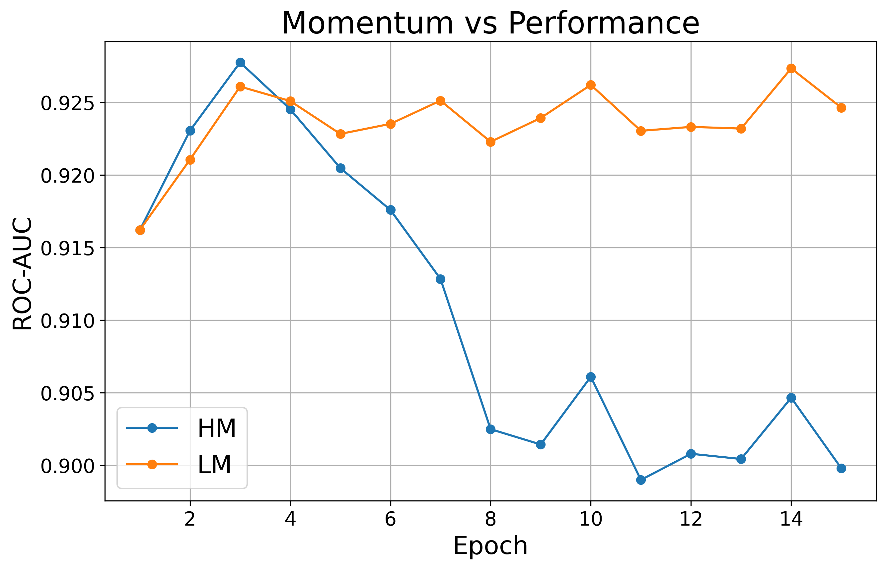

**Source:** *DHAuDS: A Dynamic and Heterogeneous Audio Benchmark for Test-Time Adaptation* — [PDF](https://arxiv.org/pdf/2511.18421) · [arXiv](https://arxiv.org/abs/2511.18421)

# DHAuDS: A Dynamic and Heterogeneous Audio Benchmark for Test-Time Adaptation

Weichuang Shao  Affiliation: School of Computer and Mathematical Sciences, University of Nottingham Malaysia, Semenyih, Malaysia   
andyshao90@gmail.com,{Iman.Liao, Tomas.Maul, Tissa.Chandesa}@nottingham.edu.my Iman Yi Liao  Affiliation: School of Computer and Mathematical Sciences, University of Nottingham Malaysia, Semenyih, Malaysia   
andyshao90@gmail.com,{Iman.Liao, Tomas.Maul, Tissa.Chandesa}@nottingham.edu.my Tomas Henrique Bode Maul  Affiliation: School of Computer and Mathematical Sciences, University of Nottingham Malaysia, Semenyih, Malaysia   
andyshao90@gmail.com,{Iman.Liao, Tomas.Maul, Tissa.Chandesa}@nottingham.edu.my Tissa Chandesa  Affiliation: School of Computer and Mathematical Sciences, University of Nottingham Malaysia, Semenyih, Malaysia   
andyshao90@gmail.com,{Iman.Liao, Tomas.Maul, Tissa.Chandesa}@nottingham.edu.my

###### Abstract

Existing Test-time Adaptation (TTA) studies rely heavily on static and homogeneous corruption protocols, such as ImageNet-C and CIFAR-10-C/100-C, leading to inconsistent evaluation settings and potentially inflated robustness estimates that are compared with real-world situations. TTA lacks a standardized evaluation infrastructure capable of modeling realistic heterogeneous acoustic degradation. We introduce DHAuDS, a standardized benchmark suite for evaluating audio classification TTA robustness under dynamic corruption severity and heterogeneous noise mixtures. Rather than proposing a new TTA algorithm, DHAuDS focuses on exposing robustness limitations that remain hidden under conventional fixed-noise evaluation protocols.

Keywords: Deep Learning, Audio Classification, Audio Benchmark, Test-time Adaptation

## 1 Introduction

While several studies have proposed Test-time Adaptation (TTA) techniques for audio classification and Automatic Speech Recognition (ASR), a consistent evaluation protocol across domains remains unavailable [[1](https://arxiv.org/html/2511.18421#bib.bib3), [2](https://arxiv.org/html/2511.18421#bib.bib4), [3](https://arxiv.org/html/2511.18421#bib.bib16), [4](https://arxiv.org/html/2511.18421#bib.bib11), [5](https://arxiv.org/html/2511.18421#bib.bib10)]. Consequently, existing works employ distinct data and noise configurations, which complicates the direct comparison of their results [[1](https://arxiv.org/html/2511.18421#bib.bib3), [2](https://arxiv.org/html/2511.18421#bib.bib4), [3](https://arxiv.org/html/2511.18421#bib.bib16), [4](https://arxiv.org/html/2511.18421#bib.bib11), [5](https://arxiv.org/html/2511.18421#bib.bib10)]. Further, the research presented in Table [1](https://arxiv.org/html/2511.18421#S1.T1 "Table 1 ‣ 1 Introduction ‣ DHAuDS: A Dynamic and Heterogeneous Audio Benchmark for Test-Time Adaptation") (excluding TTAAPSD) uses the identical corrupted test set for both adaptation and evaluation, which makes it difficult to detect model overfitting. In contrast, DHAuDS introduces divergence between the adaptation and evaluation phases by independently corrupting the test sets, thereby emphasizing robustness analysis rather than mere correctness.

The goal of DHAuDS is not to introduce another adaptation algorithm, but to establish a reproducible and standardized robustness evaluation protocol for audio-TTA research to determine whether we can overcome a critical limitation in existing TTA evaluation protocols: reliance on static corruption severity and homogeneous noise conditions. Similar to the role of ImageNet-C [[6](https://arxiv.org/html/2511.18421#bib.bib2)] in visual robustness research, DHAuDS aims to support fair cross-method comparison under realistic acoustic domain shifts. Our contributions are:

  1. We reveal a fundamental limitation of existing audio-TTA evaluation protocols, namely their reliance on static corruption severity and homogeneous noise conditions, which may overestimate robustness. 
  2. We introduce DHAuDS, a standardized benchmark suite spanning speech, vocal, urban, and bioacoustic classification tasks. 
  3. We propose dynamic corruption severity, heterogeneous noise mixtures, and independent adaptation/evaluation sets to better approximate realistic acoustic domain shifts. 

Table 1: Support for dynamic corruption levels (DyN) and heterogeneous noise (Heter) in existing TTA studies 

Algorithm | Application Domain | DyN | Heter | Notes / Dataset Example  
---|---|---|---|---  
SUTA [[1](https://arxiv.org/html/2511.18421#bib.bib3)] | Audio (ASR) | ✗ | ✗ | Gaussian noise or CHiME-3 [[7](https://arxiv.org/html/2511.18421#bib.bib25)] noise on Librispeech [[8](https://arxiv.org/html/2511.18421#bib.bib26)]  
SGEM [[2](https://arxiv.org/html/2511.18421#bib.bib4)] | Audio (ASR) | ✗ | ✗ | Fixed 10 dB SNR, MS-SNSD [[9](https://arxiv.org/html/2511.18421#bib.bib21)]  
DSUTA [[3](https://arxiv.org/html/2511.18421#bib.bib16)] | Audio (ASR) | ✗ | ✗ | Fixed 5 dB SNR, MS-SNSD  
TTAAPSD [[4](https://arxiv.org/html/2511.18421#bib.bib11)] | Audio (Pathological Speech) | ✗ | ✓ | Multiple noises from QUT-NOISE [[10](https://arxiv.org/html/2511.18421#bib.bib13)] and DEMAND [[11](https://arxiv.org/html/2511.18421#bib.bib14)]  
|  |  |  | but fixed SNR per test  
CoNMix++ [[5](https://arxiv.org/html/2511.18421#bib.bib10)] | Audio (Classification) | ✗ | ✗ | Three noises, fixed SNR (3 or 10 dB)  
L‑TTA [[12](https://arxiv.org/html/2511.18421#bib.bib18)] | Image (Classification) | ✗ | ✗ | ImageNet-C [[6](https://arxiv.org/html/2511.18421#bib.bib2)], CIFAR-10-C [[6](https://arxiv.org/html/2511.18421#bib.bib2)], fixed severity level  
IST [[13](https://arxiv.org/html/2511.18421#bib.bib19)] | Image (Classification) | ✗ | ✗ | ImageNet-C [[6](https://arxiv.org/html/2511.18421#bib.bib2)], CIFAR-10-C [[6](https://arxiv.org/html/2511.18421#bib.bib2)], fixed severity level  
ResNeXt [[14](https://arxiv.org/html/2511.18421#bib.bib22)] | Image (Classification) | ✗ | ✓ | ImageNet-R [[14](https://arxiv.org/html/2511.18421#bib.bib22)]; Natural domain shift, e.g, Paintings and Cartoons  
AlexNet [[15](https://arxiv.org/html/2511.18421#bib.bib23)] | Image (Classification) | ✗ | ✗ | ImageNet-Sketch [[15](https://arxiv.org/html/2511.18421#bib.bib23)]; Pencoil drawing that discard color and texture.  
DHAuDS | Audio (Classification) | ✓ | ✓ | Dynamic severity level and heterogeneous noise type per experiment

  Table 2: DHAuDS corruption settings

<table id="S1.T2.1" class="ltx_tabular ltx_centering ltx_figure_panel ltx_guessed_headers ltx_align_middle">
<thead class="ltx_thead">
<tr id="S1.T2.1.1" class="ltx_tr">
<th id="S1.T2.1.1.1" class="ltx_td ltx_align_left ltx_th ltx_th_column ltx_border_r ltx_border_tt" style="padding-top:-0.45pt;padding-bottom:-0.45pt;">Category-level</th>
<th id="S1.T2.1.1.2" class="ltx_td ltx_align_center ltx_th ltx_th_column ltx_border_r ltx_border_tt" style="padding-top:-0.45pt;padding-bottom:-0.45pt;" colspan="2">Dynamic SNR Score</th>
<th id="S1.T2.1.1.3" class="ltx_td ltx_align_left ltx_th ltx_th_column ltx_border_tt" style="padding-top:-0.45pt;padding-bottom:-0.45pt;">Heterogeneous Noise-type</th></tr>
<tr id="S1.T2.1.2" class="ltx_tr">
<th id="S1.T2.1.2.1" class="ltx_td ltx_th ltx_th_column ltx_border_r ltx_border_t" style="padding-top:-0.45pt;padding-bottom:-0.45pt;"></th>
<th id="S1.T2.1.2.2" class="ltx_td ltx_align_center ltx_th ltx_th_column ltx_border_t" style="padding-top:-0.45pt;padding-bottom:-0.45pt;">Severity Range</th>
<th id="S1.T2.1.2.3" class="ltx_td ltx_align_center ltx_th ltx_th_column ltx_border_r ltx_border_t" style="padding-top:-0.45pt;padding-bottom:-0.45pt;">Step</th>
<th id="S1.T2.1.2.4" class="ltx_td ltx_th ltx_th_column ltx_border_t" style="padding-top:-0.45pt;padding-bottom:-0.45pt;"></th></tr>
</thead>
<tbody class="ltx_tbody">
<tr id="S1.T2.1.3" class="ltx_tr">
<td id="S1.T2.1.3.1" class="ltx_td ltx_align_left ltx_border_r ltx_border_t" style="padding-top:-0.45pt;padding-bottom:-0.45pt;">WHN-L1</td>
<td id="S1.T2.1.3.2" class="ltx_td ltx_align_center ltx_border_t" style="padding-top:-0.45pt;padding-bottom:-0.45pt;">[6 dB, 7 dB]</td>
<td id="S1.T2.1.3.3" class="ltx_td ltx_align_center ltx_border_r ltx_border_t" style="padding-top:-0.45pt;padding-bottom:-0.45pt;">0.5 dB</td>
<td id="S1.T2.1.3.4" class="ltx_td ltx_align_left ltx_border_t" style="padding-top:-0.45pt;padding-bottom:-0.45pt;">Gaussian, Random</td></tr>
<tr id="S1.T2.1.4" class="ltx_tr">
<td id="S1.T2.1.4.1" class="ltx_td ltx_align_left ltx_border_r" style="padding-top:-0.45pt;padding-bottom:-0.45pt;">WHN-L2</td>
<td id="S1.T2.1.4.2" class="ltx_td ltx_align_center" style="padding-top:-0.45pt;padding-bottom:-0.45pt;">[5 dB, 7 dB]</td>
<td id="S1.T2.1.4.3" class="ltx_td ltx_align_center ltx_border_r" style="padding-top:-0.45pt;padding-bottom:-0.45pt;">0.5 dB</td>
<td id="S1.T2.1.4.4" class="ltx_td ltx_align_left" style="padding-top:-0.45pt;padding-bottom:-0.45pt;">Gaussian, Random</td></tr>
<tr id="S1.T2.1.5" class="ltx_tr">
<td id="S1.T2.1.5.1" class="ltx_td ltx_align_left ltx_border_r" style="padding-top:-0.45pt;padding-bottom:-0.45pt;">ENQ-L1</td>
<td id="S1.T2.1.5.2" class="ltx_td ltx_align_center" style="padding-top:-0.45pt;padding-bottom:-0.45pt;">[5 dB, 6 dB]</td>
<td id="S1.T2.1.5.3" class="ltx_td ltx_align_center ltx_border_r" style="padding-top:-0.45pt;padding-bottom:-0.45pt;">0.5 dB</td>
<td id="S1.T2.1.5.4" class="ltx_td ltx_align_left" style="padding-top:-0.45pt;padding-bottom:-0.45pt;">HOME, REVERB, STREET</td></tr>
<tr id="S1.T2.1.6" class="ltx_tr">
<td id="S1.T2.1.6.1" class="ltx_td ltx_align_left ltx_border_r" style="padding-top:-0.45pt;padding-bottom:-0.45pt;">ENQ-L2</td>
<td id="S1.T2.1.6.2" class="ltx_td ltx_align_center" style="padding-top:-0.45pt;padding-bottom:-0.45pt;">[5 dB, 7 dB]</td>
<td id="S1.T2.1.6.3" class="ltx_td ltx_align_center ltx_border_r" style="padding-top:-0.45pt;padding-bottom:-0.45pt;">0.5 dB</td>
<td id="S1.T2.1.6.4" class="ltx_td ltx_align_left" style="padding-top:-0.45pt;padding-bottom:-0.45pt;">HOME, REVERB, STREET, CAFE, CAR</td></tr>
<tr id="S1.T2.1.7" class="ltx_tr">
<td id="S1.T2.1.7.1" class="ltx_td ltx_align_left ltx_border_r" style="padding-top:-0.45pt;padding-bottom:-0.45pt;">END1-L1</td>
<td id="S1.T2.1.7.2" class="ltx_td ltx_align_center" style="padding-top:-0.45pt;padding-bottom:-0.45pt;">[5 dB, 6 dB]</td>
<td id="S1.T2.1.7.3" class="ltx_td ltx_align_center ltx_border_r" style="padding-top:-0.45pt;padding-bottom:-0.45pt;">0.5 dB</td>
<td id="S1.T2.1.7.4" class="ltx_td ltx_align_left" style="padding-top:-0.45pt;padding-bottom:-0.45pt;">NFIELD, PRESTO, TCAR, OOFFICE</td></tr>
<tr id="S1.T2.1.8" class="ltx_tr">
<td id="S1.T2.1.8.1" class="ltx_td ltx_align_left ltx_border_r" style="padding-top:-0.45pt;padding-bottom:-0.45pt;">END1-L2</td>
<td id="S1.T2.1.8.2" class="ltx_td ltx_align_center" style="padding-top:-0.45pt;padding-bottom:-0.45pt;">[5 dB, 7 dB]</td>
<td id="S1.T2.1.8.3" class="ltx_td ltx_align_center ltx_border_r" style="padding-top:-0.45pt;padding-bottom:-0.45pt;">0.5 dB</td>
<td id="S1.T2.1.8.4" class="ltx_td ltx_align_left" style="padding-top:-0.45pt;padding-bottom:-0.45pt;">NFIELD, PRESTO, TCAR, OOFFICE, STRAFFIC, DKITCHEN</td></tr>
<tr id="S1.T2.1.9" class="ltx_tr">
<td id="S1.T2.1.9.1" class="ltx_td ltx_align_left ltx_border_r" style="padding-top:-0.45pt;padding-bottom:-0.45pt;">END2-L1</td>
<td id="S1.T2.1.9.2" class="ltx_td ltx_align_center" style="padding-top:-0.45pt;padding-bottom:-0.45pt;">[5 dB, 6 dB]</td>
<td id="S1.T2.1.9.3" class="ltx_td ltx_align_center ltx_border_r" style="padding-top:-0.45pt;padding-bottom:-0.45pt;">0.5 dB</td>
<td id="S1.T2.1.9.4" class="ltx_td ltx_align_left" style="padding-top:-0.45pt;padding-bottom:-0.45pt;">DLIVING, OHALLWAY, SPSQUARE, TMETRO</td></tr>
<tr id="S1.T2.1.10" class="ltx_tr">
<td id="S1.T2.1.10.1" class="ltx_td ltx_align_left ltx_border_r" style="padding-top:-0.45pt;padding-bottom:-0.45pt;">END2-L2</td>
<td id="S1.T2.1.10.2" class="ltx_td ltx_align_center" style="padding-top:-0.45pt;padding-bottom:-0.45pt;">[5 dB, 7 dB]</td>
<td id="S1.T2.1.10.3" class="ltx_td ltx_align_center ltx_border_r" style="padding-top:-0.45pt;padding-bottom:-0.45pt;">0.5 dB</td>
<td id="S1.T2.1.10.4" class="ltx_td ltx_align_left" style="padding-top:-0.45pt;padding-bottom:-0.45pt;">DLIVING, OHALLWAY, SPSQUARE, TMETRO, NRIVER, PSTATION</td></tr>
<tr id="S1.T2.1.11" class="ltx_tr">
<td id="S1.T2.1.11.1" class="ltx_td ltx_align_left ltx_border_r" style="padding-top:-0.45pt;padding-bottom:-0.45pt;">ENSC-L1</td>
<td id="S1.T2.1.11.2" class="ltx_td ltx_align_center" style="padding-top:-0.45pt;padding-bottom:-0.45pt;">[5 dB, 6 dB]</td>
<td id="S1.T2.1.11.3" class="ltx_td ltx_align_center ltx_border_r" style="padding-top:-0.45pt;padding-bottom:-0.45pt;">0.5 dB</td>
<td id="S1.T2.1.11.4" class="ltx_td ltx_align_left" style="padding-top:-0.45pt;padding-bottom:-0.45pt;">exercise_bike, running_tap, white_noise, pink_noise</td></tr>
<tr id="S1.T2.1.12" class="ltx_tr">
<td id="S1.T2.1.12.1" class="ltx_td ltx_align_left ltx_border_r" style="padding-top:-0.45pt;padding-bottom:-0.45pt;">ENSC-L2</td>
<td id="S1.T2.1.12.2" class="ltx_td ltx_align_center" style="padding-top:-0.45pt;padding-bottom:-0.45pt;">[5 dB, 7 dB]</td>
<td id="S1.T2.1.12.3" class="ltx_td ltx_align_center ltx_border_r" style="padding-top:-0.45pt;padding-bottom:-0.45pt;">0.5 dB</td>
<td id="S1.T2.1.12.4" class="ltx_td ltx_align_left" style="padding-top:-0.45pt;padding-bottom:-0.45pt;">exercise_bike, running_tap, white_noise, pink_noise, doing_the_dishes, dude_miaowing</td></tr>
<tr id="S1.T2.1.13" class="ltx_tr">
<td id="S1.T2.1.13.1" class="ltx_td ltx_align_left ltx_border_r" style="padding-top:-0.45pt;padding-bottom:-0.45pt;">TST-L1</td>
<td id="S1.T2.1.13.2" class="ltx_td ltx_align_center" style="padding-top:-0.45pt;padding-bottom:-0.45pt;">[-6%, -4%] <math id="S1.T2.m1" class="ltx_Math" alttext="\cup" display="inline" intent=":literal"><semantics><mo>∪</mo><annotation encoding="application/x-tex">\cup</annotation></semantics></math> [4%, 6%]</td>
<td id="S1.T2.1.13.3" class="ltx_td ltx_align_center ltx_border_r" style="padding-top:-0.45pt;padding-bottom:-0.45pt;">1%</td>
<td id="S1.T2.1.13.4" class="ltx_td ltx_align_left" style="padding-top:-0.45pt;padding-bottom:-0.45pt;">N/A</td></tr>
<tr id="S1.T2.1.14" class="ltx_tr">
<td id="S1.T2.1.14.1" class="ltx_td ltx_align_left ltx_border_r" style="padding-top:-0.45pt;padding-bottom:-0.45pt;">TST-L2</td>
<td id="S1.T2.1.14.2" class="ltx_td ltx_align_center" style="padding-top:-0.45pt;padding-bottom:-0.45pt;">[-12%, -8%] <math id="S1.T2.m2" class="ltx_Math" alttext="\cup" display="inline" intent=":literal"><semantics><mo>∪</mo><annotation encoding="application/x-tex">\cup</annotation></semantics></math> [8%, 12%]</td>
<td id="S1.T2.1.14.3" class="ltx_td ltx_align_center ltx_border_r" style="padding-top:-0.45pt;padding-bottom:-0.45pt;">1%</td>
<td id="S1.T2.1.14.4" class="ltx_td ltx_align_left" style="padding-top:-0.45pt;padding-bottom:-0.45pt;">N/A</td></tr>
<tr id="S1.T2.1.15" class="ltx_tr">
<td id="S1.T2.1.15.1" class="ltx_td ltx_align_left ltx_border_r" style="padding-top:-0.45pt;padding-bottom:-0.45pt;">PSH-L1</td>
<td id="S1.T2.1.15.2" class="ltx_td ltx_align_center" style="padding-top:-0.45pt;padding-bottom:-0.45pt;">[-5 st, -4 st] <math id="S1.T2.m3" class="ltx_Math" alttext="\cup" display="inline" intent=":literal"><semantics><mo>∪</mo><annotation encoding="application/x-tex">\cup</annotation></semantics></math> [4 st, 5 st]</td>
<td id="S1.T2.1.15.3" class="ltx_td ltx_align_center ltx_border_r" style="padding-top:-0.45pt;padding-bottom:-0.45pt;">1 st</td>
<td id="S1.T2.1.15.4" class="ltx_td ltx_align_left" style="padding-top:-0.45pt;padding-bottom:-0.45pt;">N/A</td></tr>
<tr id="S1.T2.1.16" class="ltx_tr">
<td id="S1.T2.1.16.1" class="ltx_td ltx_align_left ltx_border_bb ltx_border_r" style="padding-top:-0.45pt;padding-bottom:-0.45pt;">PSH-L2</td>
<td id="S1.T2.1.16.2" class="ltx_td ltx_align_center ltx_border_bb" style="padding-top:-0.45pt;padding-bottom:-0.45pt;">[-7 st, -5 st] <math id="S1.T2.m4" class="ltx_Math" alttext="\cup" display="inline" intent=":literal"><semantics><mo>∪</mo><annotation encoding="application/x-tex">\cup</annotation></semantics></math> [5 st, 7 st]</td>
<td id="S1.T2.1.16.3" class="ltx_td ltx_align_center ltx_border_bb ltx_border_r" style="padding-top:-0.45pt;padding-bottom:-0.45pt;">1 st</td>
<td id="S1.T2.1.16.4" class="ltx_td ltx_align_left ltx_border_bb" style="padding-top:-0.45pt;padding-bottom:-0.45pt;">N/A</td></tr>
</tbody>
</table>

 

  * 1 The unit of PSH is the pitch shift amount - semitone (st).
  * 2 We select the Signal-to-Noise Ratio (SNR) score and cut the audio clips randomly.

## 2 Related Work

The current evaluation protocols of TTA, which self-corrects at inference time using unlabeled test sets, in audio are fragmented. Unlike Computer Vision benchmarks (e.g., ImageNet-C [[6](https://arxiv.org/html/2511.18421#bib.bib2)] and CIFAR-10-C/100-C [[6](https://arxiv.org/html/2511.18421#bib.bib2)]), which offer standardized severities, audio TTA research lacks a unified protocol. In Table [1](https://arxiv.org/html/2511.18421#S1.T1 "Table 1 ‣ 1 Introduction ‣ DHAuDS: A Dynamic and Heterogeneous Audio Benchmark for Test-Time Adaptation"), SUTA [[1](https://arxiv.org/html/2511.18421#bib.bib3)], SGEM [[2](https://arxiv.org/html/2511.18421#bib.bib4)], DSUTA [[3](https://arxiv.org/html/2511.18421#bib.bib16)], TTAAPSD [[4](https://arxiv.org/html/2511.18421#bib.bib11)], and CoNMix++ [[5](https://arxiv.org/html/2511.18421#bib.bib10)] leverage different evaluation protocols. Additionally, they rely on fixed Signal-to-Noise Ratios (SNRs) or on a single noise type per experiment, failing to capture the dynamic (varying severity) and heterogeneous (mixed sources) nature of real-world acoustic degradation.

In contrast, computer-vision research has benefited from standardized robustness benchmarks such as ImageNet-C and CIFAR-10-C/-100-C, which evaluate models under defined corruption levels [[6](https://arxiv.org/html/2511.18421#bib.bib2), [16](https://arxiv.org/html/2511.18421#bib.bib17)]. However, these visual perturbations, such as contrast or brightness shifts, do not translate naturally into the acoustic domain. Furthermore, they generally use one fixed noise intensity and a singular noise type per test (see Table [1](https://arxiv.org/html/2511.18421#S1.T1 "Table 1 ‣ 1 Introduction ‣ DHAuDS: A Dynamic and Heterogeneous Audio Benchmark for Test-Time Adaptation")), lacking the dynamic and composite conditions typical of real-world recordings [[12](https://arxiv.org/html/2511.18421#bib.bib18), [13](https://arxiv.org/html/2511.18421#bib.bib19)].

These factors motivate the development of the DHAuDS benchmark, which models audio degradations that vary both in type and intensity, offering a more faithful simulation of domain shift during inference.

## 3 Methodology

The DHAuDS benchmark aims to replicate the variability of real-world acoustic conditions, creating challenging yet controlled settings for assessing TTA methods. In contrast to previous works [[1](https://arxiv.org/html/2511.18421#bib.bib3), [2](https://arxiv.org/html/2511.18421#bib.bib4), [3](https://arxiv.org/html/2511.18421#bib.bib16), [4](https://arxiv.org/html/2511.18421#bib.bib11), [5](https://arxiv.org/html/2511.18421#bib.bib10), [6](https://arxiv.org/html/2511.18421#bib.bib2)] that rely on a single fixed noise level, DHAuDS applies dynamic SNR score selection and heterogeneous noise mixtures to reflect natural acoustic diversity.

### 3.1 Design Principles

DHAuDS is built upon three principles: dynamic corruption severity, heterogeneous noise conditions, and independent adaptation/evaluation corruption instances. Together, these principles aim to better reflect real-world acoustic variability and provide a more rigorous robustness evaluation protocol for audio TTA.

### 3.2 Benchmark Overview

DHAuDS consists of four benchmarks: UrbanSound8K-C (US8-C), SpeechCommands V2-C (SC2-C), VocalSound-C (VS-C), and ReefSet-C (RS-C) (see Table [3](https://arxiv.org/html/2511.18421#S3.T3 "Table 3 ‣ 3.2 Benchmark Overview ‣ 3 Methodology ‣ DHAuDS: A Dynamic and Heterogeneous Audio Benchmark for Test-Time Adaptation")). Each benchmark is divided into two sets: the adaptation set and the evaluation set. Both sets contain seven corruption categories and two levels of severity.

Table 3: DHAuDS benchmark (BM) information 

BM | Total Size | Per Set | Per Cat.-lvl.  
---|---|---|---  
SC2-C | 308,140 | 154,070 | 11,005  
VS-C | 100,548 | 50,274 | 3,591  
US8-C | 19,672 | 9,836 | 2,459  
RS-C | 479,836 | 239,918 | 17,137

 

As shwon in Table [2](https://arxiv.org/html/2511.18421#S1.T2 "Table 2 ‣ 1 Introduction ‣ DHAuDS: A Dynamic and Heterogeneous Audio Benchmark for Test-Time Adaptation"), corruption categories are defined: _(1)_ White Noise (WHN); _(2)-(5)_ Environmental noise drawn from QUT-NOISE [[10](https://arxiv.org/html/2511.18421#bib.bib13)] (ENQ), DEMAND [[11](https://arxiv.org/html/2511.18421#bib.bib14)] (END1 and END2), and SpeechCommands V2 [[17](https://arxiv.org/html/2511.18421#bib.bib6)] (ENSC); _(6)_ Time Stretching (TST) via random tempo adjustments; and _(7)_ Pitch Shifting (PSH). Two levels are defined: L1 (standard) and L2 (challenging), where L2 applies broader corruption ranges and more complex noise combinations. Notably, each sample is affected by only one type of noise, though the noise types differ between samples in the same corruption category.

Table 4: Audio set information 

Set | Type | Len. | Bal. | Rate | Size  
---|---|---|---|---|---  
SC2 | speech | 1 s | Yes | 16 kHz | 105829  
VS | vocal | 12 s | Yes | 16 kHz | 20977  
US8 | urban | 4 s | No | 44.1 kHz | 8732  
RS | bioacoustic | 1.88 s | No | 16 kHz | 57074

 

We selected four audio classification sets, UrbanSound8K (US8) [[18](https://arxiv.org/html/2511.18421#bib.bib5)], SpeechCommands V2 (SC2) [[17](https://arxiv.org/html/2511.18421#bib.bib6)], VocalSound (VS) [[19](https://arxiv.org/html/2511.18421#bib.bib7)], and ReefSet (RS) [[20](https://arxiv.org/html/2511.18421#bib.bib8)], to represent different audio types, lengths, sample rates, and whether they are balanced, allowing us to evaluate TTA performance across various conditions. As shown in Table [4](https://arxiv.org/html/2511.18421#S3.T4 "Table 4 ‣ 3.2 Benchmark Overview ‣ 3 Methodology ‣ DHAuDS: A Dynamic and Heterogeneous Audio Benchmark for Test-Time Adaptation"), four audio sets are used to generate our benchmarks: US8-C, SC2-C, VS-C, and RS-C. Notably, US8-C excludes ENQ, END1, and END2 because their class types overlap with noise types in QUT-NOISE and DEMAND, such as street, car, traffic, and station noise.

To ensure robustness, we utilize adaptation sets for model adaptation and evaluation sets for analyzing performance. To create unrelated adaptation and evaluation sets, we employ different random seeds: seed 2025 for the adaptation set and seed 123456 for the evaluation set. To ensure reproducibility, both adaptation and evaluation sets are publicly released for future research.

In the experiments, we report the F1-score for US8 (F1-score better than accuracy on the imbalance set), ROC-AUC for RS (RS publisher choice), and Top-1 Accuracy for the others.

### 3.3 Corruption Protocol

#### 3.3.1 Dynamic SNR score

Crucially, we implement a dynamic severity mechanism. Rather than a fixed SNR, corruption intensity is sampled randomly from defined ranges (see Table [2](https://arxiv.org/html/2511.18421#S1.T2 "Table 2 ‣ 1 Introduction ‣ DHAuDS: A Dynamic and Heterogeneous Audio Benchmark for Test-Time Adaptation")). This prevents models from overfitting to a specific noise floor.

#### 3.3.2 Heterogenous noise mixtures

The noise corruptions are constructed from multiple publicly available datasets to ensure diversity and realism. Specifically, ENQ utilizes the complete set of 20 audio recordings (approximately 818 minutes in total), encompassing various ambient environments such as CAFE, CAR, HOME, REVERB, and STREET. Environmental noise is divided into two subsets, END1 and END2, each containing 96 recordings (16 per noise type) with a total duration of roughly 480 minutes, capturing a broad range of indoor and outdoor acoustic scenes. ENSC employs all six short background noise clips (approximately 399 seconds in total) from SC2, including sounds such as doing_the_dishes, running_tap, pink_noise, white_noise, exercise_bike, and dude_miaowing. For TST, an exception is made for short 1-second datasets like SC2, where the slowing-down operation is omitted to prevent truncation that may remove critical speech content. PSH adjusts the pitch upward or downward by several semitone steps without changing the temporal duration of the signal [[21](https://arxiv.org/html/2511.18421#bib.bib28), [22](https://arxiv.org/html/2511.18421#bib.bib27)].

## 4 Experiment

### 4.1 Models for Evaluation

We aim to facilitate an objective evaluation across DHAuDS benchmarks. We adopt three representative architectures, AMAuT [[23](https://arxiv.org/html/2511.18421#bib.bib1)], HuBERT [[24](https://arxiv.org/html/2511.18421#bib.bib9)], and PANNs [[25](https://arxiv.org/html/2511.18421#bib.bib24)], to evaluate DHAuDS benchmarks (as shown in Table [5](https://arxiv.org/html/2511.18421#S4.T5 "Table 5 ‣ 4.1 Models for Evaluation ‣ 4 Experiment ‣ DHAuDS: A Dynamic and Heterogeneous Audio Benchmark for Test-Time Adaptation")).

Table 5: Model Information 

Modle | Architecture | Input Type  
---|---|---  
AMAuT | 1D CNN-Transformer | Mel-spectrogram  
HuBERT | 1D CNN-Transformer | Raw audio  
PANNs | 1D & 2D CNNs | Wavgram log-Mel

 

The DHAuDS benchmarks present a challenge due to inconsistent audio lengths—specifically 1 s, 1.88 s, 4 s, and 12 s—and varying sample rates of 16 kHz and 44.1 kHz (see Table [4](https://arxiv.org/html/2511.18421#S3.T4 "Table 4 ‣ 3.2 Benchmark Overview ‣ 3 Methodology ‣ DHAuDS: A Dynamic and Heterogeneous Audio Benchmark for Test-Time Adaptation")). All three models can process dynamic audio lengths and successfully execute all experiments in the DHAuDS benchmarks.

### 4.2 Test-Time Adaptation (TTA) Strategy

Existing TTA methods have primarily been developed for image classification, ASR, or task-specific speech applications rather than general audio classification [[12](https://arxiv.org/html/2511.18421#bib.bib18), [13](https://arxiv.org/html/2511.18421#bib.bib19), [15](https://arxiv.org/html/2511.18421#bib.bib23), [1](https://arxiv.org/html/2511.18421#bib.bib3), [2](https://arxiv.org/html/2511.18421#bib.bib4), [3](https://arxiv.org/html/2511.18421#bib.bib16)]. Their adaptation objectives and architectural assumptions are often tightly coupled to their original domains, making direct deployment on the diverse audio-classification benchmarks in DHAuDS difficult without substantial redesign and revalidation. Therefore, we employ TENT, TTN [[26](https://arxiv.org/html/2511.18421#bib.bib12)], and a representative CoNMix-based adaptation objective solely to demonstrate benchmark behavior rather than to establish a new state-of-the-art method. In particular, TENT and TTN require a BatchNorm component that cannot be reused in HuBERT.

Table 6: Adaptation performance comparison on evaluation set of SC2-C, VS-C, RS-C, and US8-C benchmarks (BMs)

Model | BM | Level | No Adaptation | CoNMix-based TTA | TENT | TTN  
---|---|---|---|---|---|---  
AMAuT | SC2-C | L1 | \(.8289\pm.0000\) | \(.8888\pm.0018\) | \(.3180\pm.0001\downarrow\) | \(.8630\pm.0006\)  
HuBERT | SC2-C | L1 | \(.9259\pm.0000\) | \(.9513\pm.0006\) | N/A | N/A  
PANNs | SC2-C | L1 | \(.7478\pm.0000\) | \(.8090\pm.0007\) | \(.0388\pm.0001\downarrow\) | \(.2361\pm.0115\downarrow\)  
AMAuT | SC2-C | L2 | \(.8049\pm.0000\) | \(.8713\pm.0023\) | \(.3108\pm.0001\downarrow\) | \(.8371\pm.0010\)  
HuBERT | SC2-C | L2 | \(.9084\pm.0000\) | \(.9486\pm.0007\) | N/A | N/A  
PANNs | SC2-C | L2 | \(.7273\pm.0001\) | \(.7938\pm.0011\) | \(.0390\pm.0002\downarrow\) | \(.2347\pm.0136\downarrow\)  
AMAuT | VS-C | L1 | \(.7838\pm.0000\) | \(.8734\pm.0028\) | \(.8409\pm.0015\) | \(.8582\pm.0044\)  
HuBERT | VS-C | L1 | \(.7419\pm.0001\) | \(.9083\pm.0022\) | N/A | N/A  
PANNs | VS-C | L1 | \(.7972\pm.0000\) | \(.8945\pm.0011\) | \(.7824\pm.0054\downarrow\) | \(.5917\pm.0066\downarrow\)  
AMAuT | VS-C | L2 | \(.7767\pm.0001\) | \(.8668\pm.0027\) | \(.8356\pm.0017\) | \(.8506\pm.0025\)  
HuBERT | VS-C | L2 | \(.7401\pm.0001\) | \(.9051\pm.0021\) | N/A | N/A  
PANNs | VS-C | L2 | \(.7932\pm.0000\) | \(.8904\pm.0010\) | \(.7741\pm.0049\downarrow\) | \(.5880\pm.0047\downarrow\)  
AMAuT | RS-C | L1 | \(.7429\pm.0000\) | \(.8791\pm.0020\) | \(.4890\pm.0016\downarrow\) | \(.8781\pm.0011\)  
HuBERT | RS-C | L1 | \(.7559\pm.0000\) | \(.8703\pm.0010\) | N/A | N/A  
PANNs | RS-C | L1 | \(.8130\pm.0000\) | \(.9269\pm.0009\) | \(.5229\pm.0001\downarrow\) | \(.9096\pm.0031\)  
AMAuT | RS-C | L2 | \(.7359\pm.0000\) | \(.8803\pm.0017\) | \(.4872\pm.0020\downarrow\) | \(.8686\pm.0012\)  
HuBERT | RS-C | L2 | \(.7540\pm.0000\) | \(.8619\pm.0016\) | N/A | N/A  
PANNs | RS-C | L2 | \(.8069\pm.0000\) | \(.9209\pm.0013\) | \(.5234\pm.0001\downarrow\) | \(.9024\pm.0025\)  
AMAuT | US8-C | L1 | \(.5654\pm.0001\) | \(.6882\pm.0072\) | \(.4107\pm.0003\downarrow\) | \(.6568\pm.0052\)  
HuBERT | US8-C | L1 | \(.5539\pm.0000\) | \(.6758\pm.0128\) | N/A | N/A  
PANNs | US8-C | L1 | \(.7122\pm.0000\) | \(.8412\pm.0025\) | \(.5406\pm.0030\downarrow\) | \(.8134\pm.0053\)  
AMAuT | US8-C | L2 | \(.5594\pm.0000\) | \(.6760\pm.0070\) | \(.4004\pm.0002\downarrow\) | \(.6413\pm.0039\)  
HuBERT | US8-C | L2 | \(.5458\pm.0000\) | \(.6649\pm.0052\) | N/A | N/A  
PANNs | US8-C | L2 | \(.7078\pm.0000\) | \(.8321\pm.0028\) | \(.5325\pm.0025\downarrow\) | \(.8076\pm.0040\)

 

  * 1 To evaluate robustness, all experiments were repeated across five random seeds. We report the mean and standard deviation aggregated across corruption categories.

As for CoNMix-based TTA, we adopt Nuclear-Norm Maximization (\(\mathcal{L}_{ncm}\)) from CoNMix [[27](https://arxiv.org/html/2511.18421#bib.bib15)] as the primary adaptation objective. Because the remaining CoNMix components were developed for fixed-resolution image-classification settings, we replace them with an audio-specific consistency loss that encourages stable predictions across temporally shifted views of the same sample. The model is then adjusted using \(\mathcal{L}=\mathcal{L}_{ncm}+\lambda\mathcal{L}_{con}\) for each corruption category listed in Table [2](https://arxiv.org/html/2511.18421#S1.T2 "Table 2 ‣ 1 Introduction ‣ DHAuDS: A Dynamic and Heterogeneous Audio Benchmark for Test-Time Adaptation"), treating them independently.

Equation (1) defines the consistency loss applied to predictions from two augmented views generated by left-shifted (\(x_{l}\)) or right-shifted (\(x_{r}\)) views of each test sample.

\[\begin{aligned}
 & \mathcal{L}_{con}=\frac{1}{B}\sum_{i=1}^{B}\sum_{c=1}^{C}\big|\big|\hat{p}_{i,c}(x_{l})-\hat{p}_{i,c}(x_{r})\big|\big|_{2}^{2} &  & \text{(1)}
\end{aligned}\]

 

where \(B\) is the batch size, \(C\) is the number of classes, and \(\hat{p}_{i,c}(x)\) is the predicted probability of class \(c\) for sample \(i\).

### 4.3 Cross-Domain and Model Robustness Under DHAuDS

To ensure the robustness of performance evaluation in Table [6](https://arxiv.org/html/2511.18421#S4.T6 "Table 6 ‣ 4.2 Test-Time Adaptation \(TTA\) Strategy ‣ 4 Experiment ‣ DHAuDS: A Dynamic and Heterogeneous Audio Benchmark for Test-Time Adaptation"), all experiments were repeated using five random seeds (2025, 123456, 654321, 891011, and 111098). All experiments use a batch size of 32 for evaluation, excluding adaptation, as different sizes may affect prediction performance. Additionally, all experiments adapted on the adaptation set while evaluating on the evaluation sets.

As shown in Table [6](https://arxiv.org/html/2511.18421#S4.T6 "Table 6 ‣ 4.2 Test-Time Adaptation \(TTA\) Strategy ‣ 4 Experiment ‣ DHAuDS: A Dynamic and Heterogeneous Audio Benchmark for Test-Time Adaptation"), both TENT and TTN demonstrate negative optimization effects on the DHAuDS benchmarks. Specifically, TENT triggers negative optimization across all DHAuDS benchmarks, while TTN only exhibits this issue between SC2-C and VS-C. CoNMix-based TTA demonstrates improved performance in all experiments compared to the others in Table [6](https://arxiv.org/html/2511.18421#S4.T6 "Table 6 ‣ 4.2 Test-Time Adaptation \(TTA\) Strategy ‣ 4 Experiment ‣ DHAuDS: A Dynamic and Heterogeneous Audio Benchmark for Test-Time Adaptation"). The presence of negative optimization highlights the robustness gaps that previous evaluation protocols fail to address, as negative optimization is not prominently observed under the evaluation protocols reported in the original studies [[26](https://arxiv.org/html/2511.18421#bib.bib12)].

Combining the discussion from this section with subsection [4.2](https://arxiv.org/html/2511.18421#S4.SS2 "4.2 Test-Time Adaptation \(TTA\) Strategy ‣ 4 Experiment ‣ DHAuDS: A Dynamic and Heterogeneous Audio Benchmark for Test-Time Adaptation"), the previous TTA methods face challenges related to negative optimization effects or to designing an audio classification TTA method across the DHAuDS benchmarks. However, one of the motivations for publishing DHAuDS is to support future evaluations of developed TTA methods for audio classification.

## 5 Ablation Study

### 5.1 Impact of Dynamic and Heterogeneous Protocols on Robustness Evaluation

To illustrate the implications of the dynamic and heterogeneous corruption strategy, we compare performance using static or dynamic SNR score, with noise that is either homogeneous or heterogeneous.

Table 7: A comparison of prediction accuracy before and after adaptation

<table id="S5.T7.1" class="ltx_tabular ltx_centering ltx_figure_panel ltx_guessed_headers ltx_align_middle">
<tbody class="ltx_tbody">
<tr id="S5.T7.1.1" class="ltx_tr">
<th id="S5.T7.1.1.1" class="ltx_td ltx_align_left ltx_th ltx_th_row ltx_border_tt" style="padding-top:-0.4pt;padding-bottom:-0.4pt;">Model</th>
<th id="S5.T7.1.1.2" class="ltx_td ltx_align_center ltx_th ltx_th_row ltx_border_r ltx_border_tt" style="padding-top:-0.4pt;padding-bottom:-0.4pt;">Group</th>
<td id="S5.T7.1.1.3" class="ltx_td ltx_align_center ltx_border_tt" style="padding-top:-0.4pt;padding-bottom:-0.4pt;">Performance</td>
<td id="S5.T7.1.1.4" class="ltx_td ltx_align_center ltx_border_tt" style="padding-top:-0.4pt;padding-bottom:-0.4pt;"><math id="S5.T7.m1" class="ltx_Math" alttext="\Delta" display="inline" intent=":literal"><semantics><mi mathsize="0.700em" mathvariant="normal">Δ</mi><annotation encoding="application/x-tex">\Delta</annotation></semantics></math></td></tr>
<tr id="S5.T7.1.2" class="ltx_tr">
<th id="S5.T7.1.2.1" class="ltx_td ltx_align_left ltx_th ltx_th_row ltx_border_tt" style="padding-top:-0.4pt;padding-bottom:-0.4pt;" colspan="4">SC2/SC2-C</th></tr>
<tr id="S5.T7.1.3" class="ltx_tr">
<th id="S5.T7.1.3.1" class="ltx_td ltx_align_left ltx_th ltx_th_row ltx_border_t" style="padding-top:-0.4pt;padding-bottom:-0.4pt;">AMAuT</th>
<th id="S5.T7.1.3.2" class="ltx_td ltx_align_center ltx_th ltx_th_row ltx_border_r ltx_border_t" style="padding-top:-0.4pt;padding-bottom:-0.4pt;">S&amp;HO</th>
<td id="S5.T7.1.3.3" class="ltx_td ltx_align_center ltx_border_t" style="padding-top:-0.4pt;padding-bottom:-0.4pt;"><math id="S5.T7.m2" class="ltx_Math" alttext=".8883\pm.0000\rightarrow.9107\pm.0013" display="inline" intent=":literal"><semantics><mrow><mrow><mn mathsize="0.700em">.8883</mn><mo mathsize="0.700em">±</mo><mn mathsize="0.700em">.0000</mn></mrow><mo mathsize="0.700em" stretchy="false">→</mo><mrow><mn mathsize="0.700em">.9107</mn><mo mathsize="0.700em">±</mo><mn mathsize="0.700em">.0013</mn></mrow></mrow><annotation encoding="application/x-tex">.8883\pm.0000\rightarrow.9107\pm.0013</annotation></semantics></math></td>
<td id="S5.T7.1.3.4" class="ltx_td ltx_align_center ltx_border_t" style="padding-top:-0.4pt;padding-bottom:-0.4pt;">.0224<math id="S5.T7.m3" class="ltx_Math" alttext="\pm" display="inline" intent=":literal"><semantics><mo>±</mo><annotation encoding="application/x-tex">\pm</annotation></semantics></math>.0000</td></tr>
<tr id="S5.T7.1.4" class="ltx_tr">
<th id="S5.T7.1.4.1" class="ltx_td ltx_align_left ltx_th ltx_th_row" style="padding-top:-0.4pt;padding-bottom:-0.4pt;">AMAuT</th>
<th id="S5.T7.1.4.2" class="ltx_td ltx_align_center ltx_th ltx_th_row ltx_border_r" style="padding-top:-0.4pt;padding-bottom:-0.4pt;">D&amp;HE</th>
<td id="S5.T7.1.4.3" class="ltx_td ltx_align_center" style="padding-top:-0.4pt;padding-bottom:-0.4pt;"><math id="S5.T7.m4" class="ltx_Math" alttext=".9021\pm.0000\rightarrow.9168\pm.0026" display="inline" intent=":literal"><semantics><mrow><mrow><mn mathsize="0.700em">.9021</mn><mo mathsize="0.700em">±</mo><mn mathsize="0.700em">.0000</mn></mrow><mo mathsize="0.700em" stretchy="false">→</mo><mrow><mn mathsize="0.700em">.9168</mn><mo mathsize="0.700em">±</mo><mn mathsize="0.700em">.0026</mn></mrow></mrow><annotation encoding="application/x-tex">.9021\pm.0000\rightarrow.9168\pm.0026</annotation></semantics></math></td>
<td id="S5.T7.1.4.4" class="ltx_td ltx_align_center" style="padding-top:-0.4pt;padding-bottom:-0.4pt;"><math id="S5.T7.m5" class="ltx_Math" alttext=".0148\pm.0026" display="inline" intent=":literal"><semantics><mrow><mn mathsize="0.700em">.0148</mn><mo mathsize="0.700em">±</mo><mn mathsize="0.700em">.0026</mn></mrow><annotation encoding="application/x-tex">.0148\pm.0026</annotation></semantics></math></td></tr>
<tr id="S5.T7.1.5" class="ltx_tr">
<th id="S5.T7.1.5.1" class="ltx_td ltx_align_left ltx_th ltx_th_row" style="padding-top:-0.4pt;padding-bottom:-0.4pt;">HuBERT</th>
<th id="S5.T7.1.5.2" class="ltx_td ltx_align_center ltx_th ltx_th_row ltx_border_r" style="padding-top:-0.4pt;padding-bottom:-0.4pt;">S&amp;HO</th>
<td id="S5.T7.1.5.3" class="ltx_td ltx_align_center" style="padding-top:-0.4pt;padding-bottom:-0.4pt;"><math id="S5.T7.m6" class="ltx_Math" alttext=".9554\pm.0000\rightarrow.9635\pm.0002" display="inline" intent=":literal"><semantics><mrow><mrow><mn mathsize="0.700em">.9554</mn><mo mathsize="0.700em">±</mo><mn mathsize="0.700em">.0000</mn></mrow><mo mathsize="0.700em" stretchy="false">→</mo><mrow><mn mathsize="0.700em">.9635</mn><mo mathsize="0.700em">±</mo><mn mathsize="0.700em">.0002</mn></mrow></mrow><annotation encoding="application/x-tex">.9554\pm.0000\rightarrow.9635\pm.0002</annotation></semantics></math></td>
<td id="S5.T7.1.5.4" class="ltx_td ltx_align_center" style="padding-top:-0.4pt;padding-bottom:-0.4pt;">.0081<math id="S5.T7.m7" class="ltx_Math" alttext="\pm" display="inline" intent=":literal"><semantics><mo>±</mo><annotation encoding="application/x-tex">\pm</annotation></semantics></math>.0000</td></tr>
<tr id="S5.T7.1.6" class="ltx_tr">
<th id="S5.T7.1.6.1" class="ltx_td ltx_align_left ltx_th ltx_th_row" style="padding-top:-0.4pt;padding-bottom:-0.4pt;">HuBERT</th>
<th id="S5.T7.1.6.2" class="ltx_td ltx_align_center ltx_th ltx_th_row ltx_border_r" style="padding-top:-0.4pt;padding-bottom:-0.4pt;">D&amp;HE</th>
<td id="S5.T7.1.6.3" class="ltx_td ltx_align_center" style="padding-top:-0.4pt;padding-bottom:-0.4pt;"><math id="S5.T7.m8" class="ltx_Math" alttext=".9587\pm.0000\rightarrow.9640\pm.0004" display="inline" intent=":literal"><semantics><mrow><mrow><mn mathsize="0.700em">.9587</mn><mo mathsize="0.700em">±</mo><mn mathsize="0.700em">.0000</mn></mrow><mo mathsize="0.700em" stretchy="false">→</mo><mrow><mn mathsize="0.700em">.9640</mn><mo mathsize="0.700em">±</mo><mn mathsize="0.700em">.0004</mn></mrow></mrow><annotation encoding="application/x-tex">.9587\pm.0000\rightarrow.9640\pm.0004</annotation></semantics></math></td>
<td id="S5.T7.1.6.4" class="ltx_td ltx_align_center" style="padding-top:-0.4pt;padding-bottom:-0.4pt;"><math id="S5.T7.m9" class="ltx_Math" alttext=".0054\pm.0004" display="inline" intent=":literal"><semantics><mrow><mn mathsize="0.700em">.0054</mn><mo mathsize="0.700em">±</mo><mn mathsize="0.700em">.0004</mn></mrow><annotation encoding="application/x-tex">.0054\pm.0004</annotation></semantics></math></td></tr>
<tr id="S5.T7.1.7" class="ltx_tr">
<th id="S5.T7.1.7.1" class="ltx_td ltx_align_left ltx_th ltx_th_row" style="padding-top:-0.4pt;padding-bottom:-0.4pt;">PANNs</th>
<th id="S5.T7.1.7.2" class="ltx_td ltx_align_center ltx_th ltx_th_row ltx_border_r" style="padding-top:-0.4pt;padding-bottom:-0.4pt;">S&amp;HO</th>
<td id="S5.T7.1.7.3" class="ltx_td ltx_align_center" style="padding-top:-0.4pt;padding-bottom:-0.4pt;"><math id="S5.T7.m10" class="ltx_Math" alttext=".8124\pm.0000\rightarrow.8551\pm.0005" display="inline" intent=":literal"><semantics><mrow><mrow><mn mathsize="0.700em">.8124</mn><mo mathsize="0.700em">±</mo><mn mathsize="0.700em">.0000</mn></mrow><mo mathsize="0.700em" stretchy="false">→</mo><mrow><mn mathsize="0.700em">.8551</mn><mo mathsize="0.700em">±</mo><mn mathsize="0.700em">.0005</mn></mrow></mrow><annotation encoding="application/x-tex">.8124\pm.0000\rightarrow.8551\pm.0005</annotation></semantics></math></td>
<td id="S5.T7.1.7.4" class="ltx_td ltx_align_center" style="padding-top:-0.4pt;padding-bottom:-0.4pt;">.0427<math id="S5.T7.m11" class="ltx_Math" alttext="\pm" display="inline" intent=":literal"><semantics><mo>±</mo><annotation encoding="application/x-tex">\pm</annotation></semantics></math>.0005</td></tr>
<tr id="S5.T7.1.8" class="ltx_tr">
<th id="S5.T7.1.8.1" class="ltx_td ltx_align_left ltx_th ltx_th_row" style="padding-top:-0.4pt;padding-bottom:-0.4pt;">PANNs</th>
<th id="S5.T7.1.8.2" class="ltx_td ltx_align_center ltx_th ltx_th_row ltx_border_r" style="padding-top:-0.4pt;padding-bottom:-0.4pt;">D&amp;HE</th>
<td id="S5.T7.1.8.3" class="ltx_td ltx_align_center" style="padding-top:-0.4pt;padding-bottom:-0.4pt;"><math id="S5.T7.m12" class="ltx_Math" alttext=".8353\pm.0001\rightarrow.8476\pm.0004" display="inline" intent=":literal"><semantics><mrow><mrow><mn mathsize="0.700em">.8353</mn><mo mathsize="0.700em">±</mo><mn mathsize="0.700em">.0001</mn></mrow><mo mathsize="0.700em" stretchy="false">→</mo><mrow><mn mathsize="0.700em">.8476</mn><mo mathsize="0.700em">±</mo><mn mathsize="0.700em">.0004</mn></mrow></mrow><annotation encoding="application/x-tex">.8353\pm.0001\rightarrow.8476\pm.0004</annotation></semantics></math></td>
<td id="S5.T7.1.8.4" class="ltx_td ltx_align_center" style="padding-top:-0.4pt;padding-bottom:-0.4pt;"><math id="S5.T7.m13" class="ltx_Math" alttext=".0123\pm.0003" display="inline" intent=":literal"><semantics><mrow><mn mathsize="0.700em">.0123</mn><mo mathsize="0.700em">±</mo><mn mathsize="0.700em">.0003</mn></mrow><annotation encoding="application/x-tex">.0123\pm.0003</annotation></semantics></math></td></tr>
<tr id="S5.T7.1.9" class="ltx_tr">
<th id="S5.T7.1.9.1" class="ltx_td ltx_align_left ltx_th ltx_th_row ltx_border_tt" style="padding-top:-0.4pt;padding-bottom:-0.4pt;" colspan="4">VS/VS-C</th></tr>
<tr id="S5.T7.1.10" class="ltx_tr">
<th id="S5.T7.1.10.1" class="ltx_td ltx_align_left ltx_th ltx_th_row ltx_border_t" style="padding-top:-0.4pt;padding-bottom:-0.4pt;">AMAuT</th>
<th id="S5.T7.1.10.2" class="ltx_td ltx_align_center ltx_th ltx_th_row ltx_border_r ltx_border_t" style="padding-top:-0.4pt;padding-bottom:-0.4pt;">S&amp;HO</th>
<td id="S5.T7.1.10.3" class="ltx_td ltx_align_center ltx_border_t" style="padding-top:-0.4pt;padding-bottom:-0.4pt;"><math id="S5.T7.m14" class="ltx_Math" alttext=".7683\pm.0000\rightarrow.8804\pm.0033" display="inline" intent=":literal"><semantics><mrow><mrow><mn mathsize="0.700em">.7683</mn><mo mathsize="0.700em">±</mo><mn mathsize="0.700em">.0000</mn></mrow><mo mathsize="0.700em" stretchy="false">→</mo><mrow><mn mathsize="0.700em">.8804</mn><mo mathsize="0.700em">±</mo><mn mathsize="0.700em">.0033</mn></mrow></mrow><annotation encoding="application/x-tex">.7683\pm.0000\rightarrow.8804\pm.0033</annotation></semantics></math></td>
<td id="S5.T7.1.10.4" class="ltx_td ltx_align_center ltx_border_t" style="padding-top:-0.4pt;padding-bottom:-0.4pt;">.1121<math id="S5.T7.m15" class="ltx_Math" alttext="\pm" display="inline" intent=":literal"><semantics><mo>±</mo><annotation encoding="application/x-tex">\pm</annotation></semantics></math>.0000</td></tr>
<tr id="S5.T7.1.11" class="ltx_tr">
<th id="S5.T7.1.11.1" class="ltx_td ltx_align_left ltx_th ltx_th_row" style="padding-top:-0.4pt;padding-bottom:-0.4pt;">AMAuT</th>
<th id="S5.T7.1.11.2" class="ltx_td ltx_align_center ltx_th ltx_th_row ltx_border_r" style="padding-top:-0.4pt;padding-bottom:-0.4pt;">D&amp;HE</th>
<td id="S5.T7.1.11.3" class="ltx_td ltx_align_center" style="padding-top:-0.4pt;padding-bottom:-0.4pt;"><math id="S5.T7.m16" class="ltx_Math" alttext=".8063\pm.0002\rightarrow.8850\pm.0024" display="inline" intent=":literal"><semantics><mrow><mrow><mn mathsize="0.700em">.8063</mn><mo mathsize="0.700em">±</mo><mn mathsize="0.700em">.0002</mn></mrow><mo mathsize="0.700em" stretchy="false">→</mo><mrow><mn mathsize="0.700em">.8850</mn><mo mathsize="0.700em">±</mo><mn mathsize="0.700em">.0024</mn></mrow></mrow><annotation encoding="application/x-tex">.8063\pm.0002\rightarrow.8850\pm.0024</annotation></semantics></math></td>
<td id="S5.T7.1.11.4" class="ltx_td ltx_align_center" style="padding-top:-0.4pt;padding-bottom:-0.4pt;"><math id="S5.T7.m17" class="ltx_Math" alttext=".0788\pm.0023" display="inline" intent=":literal"><semantics><mrow><mn mathsize="0.700em">.0788</mn><mo mathsize="0.700em">±</mo><mn mathsize="0.700em">.0023</mn></mrow><annotation encoding="application/x-tex">.0788\pm.0023</annotation></semantics></math></td></tr>
<tr id="S5.T7.1.12" class="ltx_tr">
<th id="S5.T7.1.12.1" class="ltx_td ltx_align_left ltx_th ltx_th_row" style="padding-top:-0.4pt;padding-bottom:-0.4pt;">HuBERT</th>
<th id="S5.T7.1.12.2" class="ltx_td ltx_align_center ltx_th ltx_th_row ltx_border_r" style="padding-top:-0.4pt;padding-bottom:-0.4pt;">S&amp;HO</th>
<td id="S5.T7.1.12.3" class="ltx_td ltx_align_center" style="padding-top:-0.4pt;padding-bottom:-0.4pt;"><math id="S5.T7.m18" class="ltx_Math" alttext=".7070\pm.0000\rightarrow.9167\pm.0027" display="inline" intent=":literal"><semantics><mrow><mrow><mn mathsize="0.700em">.7070</mn><mo mathsize="0.700em">±</mo><mn mathsize="0.700em">.0000</mn></mrow><mo mathsize="0.700em" stretchy="false">→</mo><mrow><mn mathsize="0.700em">.9167</mn><mo mathsize="0.700em">±</mo><mn mathsize="0.700em">.0027</mn></mrow></mrow><annotation encoding="application/x-tex">.7070\pm.0000\rightarrow.9167\pm.0027</annotation></semantics></math></td>
<td id="S5.T7.1.12.4" class="ltx_td ltx_align_center" style="padding-top:-0.4pt;padding-bottom:-0.4pt;">.2097<math id="S5.T7.m19" class="ltx_Math" alttext="\pm" display="inline" intent=":literal"><semantics><mo>±</mo><annotation encoding="application/x-tex">\pm</annotation></semantics></math>.0000</td></tr>
<tr id="S5.T7.1.13" class="ltx_tr">
<th id="S5.T7.1.13.1" class="ltx_td ltx_align_left ltx_th ltx_th_row" style="padding-top:-0.4pt;padding-bottom:-0.4pt;">HuBERT</th>
<th id="S5.T7.1.13.2" class="ltx_td ltx_align_center ltx_th ltx_th_row ltx_border_r" style="padding-top:-0.4pt;padding-bottom:-0.4pt;">D&amp;HE</th>
<td id="S5.T7.1.13.3" class="ltx_td ltx_align_center" style="padding-top:-0.4pt;padding-bottom:-0.4pt;"><math id="S5.T7.m20" class="ltx_Math" alttext=".7877\pm.0002\rightarrow.9136\pm.0016" display="inline" intent=":literal"><semantics><mrow><mrow><mn mathsize="0.700em">.7877</mn><mo mathsize="0.700em">±</mo><mn mathsize="0.700em">.0002</mn></mrow><mo mathsize="0.700em" stretchy="false">→</mo><mrow><mn mathsize="0.700em">.9136</mn><mo mathsize="0.700em">±</mo><mn mathsize="0.700em">.0016</mn></mrow></mrow><annotation encoding="application/x-tex">.7877\pm.0002\rightarrow.9136\pm.0016</annotation></semantics></math></td>
<td id="S5.T7.1.13.4" class="ltx_td ltx_align_center" style="padding-top:-0.4pt;padding-bottom:-0.4pt;"><math id="S5.T7.m21" class="ltx_Math" alttext=".1259\pm.0016" display="inline" intent=":literal"><semantics><mrow><mn mathsize="0.700em">.1259</mn><mo mathsize="0.700em">±</mo><mn mathsize="0.700em">.0016</mn></mrow><annotation encoding="application/x-tex">.1259\pm.0016</annotation></semantics></math></td></tr>
<tr id="S5.T7.1.14" class="ltx_tr">
<th id="S5.T7.1.14.1" class="ltx_td ltx_align_left ltx_th ltx_th_row" style="padding-top:-0.4pt;padding-bottom:-0.4pt;">PANNs</th>
<th id="S5.T7.1.14.2" class="ltx_td ltx_align_center ltx_th ltx_th_row ltx_border_r" style="padding-top:-0.4pt;padding-bottom:-0.4pt;">S&amp;HO</th>
<td id="S5.T7.1.14.3" class="ltx_td ltx_align_center" style="padding-top:-0.4pt;padding-bottom:-0.4pt;"><math id="S5.T7.m22" class="ltx_Math" alttext=".8708\pm.0000\rightarrow.9021\pm.0018" display="inline" intent=":literal"><semantics><mrow><mrow><mn mathsize="0.700em">.8708</mn><mo mathsize="0.700em">±</mo><mn mathsize="0.700em">.0000</mn></mrow><mo mathsize="0.700em" stretchy="false">→</mo><mrow><mn mathsize="0.700em">.9021</mn><mo mathsize="0.700em">±</mo><mn mathsize="0.700em">.0018</mn></mrow></mrow><annotation encoding="application/x-tex">.8708\pm.0000\rightarrow.9021\pm.0018</annotation></semantics></math></td>
<td id="S5.T7.1.14.4" class="ltx_td ltx_align_center" style="padding-top:-0.4pt;padding-bottom:-0.4pt;">.0313<math id="S5.T7.m23" class="ltx_Math" alttext="\pm" display="inline" intent=":literal"><semantics><mo>±</mo><annotation encoding="application/x-tex">\pm</annotation></semantics></math>.0018</td></tr>
<tr id="S5.T7.1.15" class="ltx_tr">
<th id="S5.T7.1.15.1" class="ltx_td ltx_align_left ltx_th ltx_th_row" style="padding-top:-0.4pt;padding-bottom:-0.4pt;">PANNs</th>
<th id="S5.T7.1.15.2" class="ltx_td ltx_align_center ltx_th ltx_th_row ltx_border_r" style="padding-top:-0.4pt;padding-bottom:-0.4pt;">D&amp;HE</th>
<td id="S5.T7.1.15.3" class="ltx_td ltx_align_center" style="padding-top:-0.4pt;padding-bottom:-0.4pt;"><math id="S5.T7.m24" class="ltx_Math" alttext=".8805\pm.0000\rightarrow.9032\pm.0012" display="inline" intent=":literal"><semantics><mrow><mrow><mn mathsize="0.700em">.8805</mn><mo mathsize="0.700em">±</mo><mn mathsize="0.700em">.0000</mn></mrow><mo mathsize="0.700em" stretchy="false">→</mo><mrow><mn mathsize="0.700em">.9032</mn><mo mathsize="0.700em">±</mo><mn mathsize="0.700em">.0012</mn></mrow></mrow><annotation encoding="application/x-tex">.8805\pm.0000\rightarrow.9032\pm.0012</annotation></semantics></math></td>
<td id="S5.T7.1.15.4" class="ltx_td ltx_align_center" style="padding-top:-0.4pt;padding-bottom:-0.4pt;"><math id="S5.T7.m25" class="ltx_Math" alttext=".0227\pm.0012" display="inline" intent=":literal"><semantics><mrow><mn mathsize="0.700em">.0227</mn><mo mathsize="0.700em">±</mo><mn mathsize="0.700em">.0012</mn></mrow><annotation encoding="application/x-tex">.0227\pm.0012</annotation></semantics></math></td></tr>
<tr id="S5.T7.1.16" class="ltx_tr">
<th id="S5.T7.1.16.1" class="ltx_td ltx_align_left ltx_th ltx_th_row ltx_border_tt" style="padding-top:-0.4pt;padding-bottom:-0.4pt;" colspan="4">RS/RS-C</th></tr>
<tr id="S5.T7.1.17" class="ltx_tr">
<th id="S5.T7.1.17.1" class="ltx_td ltx_align_left ltx_th ltx_th_row ltx_border_t" style="padding-top:-0.4pt;padding-bottom:-0.4pt;">AMAuT</th>
<th id="S5.T7.1.17.2" class="ltx_td ltx_align_center ltx_th ltx_th_row ltx_border_r ltx_border_t" style="padding-top:-0.4pt;padding-bottom:-0.4pt;">S&amp;HO</th>
<td id="S5.T7.1.17.3" class="ltx_td ltx_align_center ltx_border_t" style="padding-top:-0.4pt;padding-bottom:-0.4pt;"><math id="S5.T7.m26" class="ltx_Math" alttext=".6558\pm.0000\rightarrow.8844\pm.0021" display="inline" intent=":literal"><semantics><mrow><mrow><mn mathsize="0.700em">.6558</mn><mo mathsize="0.700em">±</mo><mn mathsize="0.700em">.0000</mn></mrow><mo mathsize="0.700em" stretchy="false">→</mo><mrow><mn mathsize="0.700em">.8844</mn><mo mathsize="0.700em">±</mo><mn mathsize="0.700em">.0021</mn></mrow></mrow><annotation encoding="application/x-tex">.6558\pm.0000\rightarrow.8844\pm.0021</annotation></semantics></math></td>
<td id="S5.T7.1.17.4" class="ltx_td ltx_align_center ltx_border_t" style="padding-top:-0.4pt;padding-bottom:-0.4pt;">.2286<math id="S5.T7.m27" class="ltx_Math" alttext="\pm" display="inline" intent=":literal"><semantics><mo>±</mo><annotation encoding="application/x-tex">\pm</annotation></semantics></math>.0000</td></tr>
<tr id="S5.T7.1.18" class="ltx_tr">
<th id="S5.T7.1.18.1" class="ltx_td ltx_align_left ltx_th ltx_th_row" style="padding-top:-0.4pt;padding-bottom:-0.4pt;">AMAuT</th>
<th id="S5.T7.1.18.2" class="ltx_td ltx_align_center ltx_th ltx_th_row ltx_border_r" style="padding-top:-0.4pt;padding-bottom:-0.4pt;">D&amp;HE</th>
<td id="S5.T7.1.18.3" class="ltx_td ltx_align_center" style="padding-top:-0.4pt;padding-bottom:-0.4pt;"><math id="S5.T7.m28" class="ltx_Math" alttext=".7491\pm.0000\rightarrow.8782\pm.0024" display="inline" intent=":literal"><semantics><mrow><mrow><mn mathsize="0.700em">.7491</mn><mo mathsize="0.700em">±</mo><mn mathsize="0.700em">.0000</mn></mrow><mo mathsize="0.700em" stretchy="false">→</mo><mrow><mn mathsize="0.700em">.8782</mn><mo mathsize="0.700em">±</mo><mn mathsize="0.700em">.0024</mn></mrow></mrow><annotation encoding="application/x-tex">.7491\pm.0000\rightarrow.8782\pm.0024</annotation></semantics></math></td>
<td id="S5.T7.1.18.4" class="ltx_td ltx_align_center" style="padding-top:-0.4pt;padding-bottom:-0.4pt;"><math id="S5.T7.m29" class="ltx_Math" alttext=".1291\pm.0024" display="inline" intent=":literal"><semantics><mrow><mn mathsize="0.700em">.1291</mn><mo mathsize="0.700em">±</mo><mn mathsize="0.700em">.0024</mn></mrow><annotation encoding="application/x-tex">.1291\pm.0024</annotation></semantics></math></td></tr>
<tr id="S5.T7.1.19" class="ltx_tr">
<th id="S5.T7.1.19.1" class="ltx_td ltx_align_left ltx_th ltx_th_row" style="padding-top:-0.4pt;padding-bottom:-0.4pt;">HuBERT</th>
<th id="S5.T7.1.19.2" class="ltx_td ltx_align_center ltx_th ltx_th_row ltx_border_r" style="padding-top:-0.4pt;padding-bottom:-0.4pt;">S&amp;HO</th>
<td id="S5.T7.1.19.3" class="ltx_td ltx_align_center" style="padding-top:-0.4pt;padding-bottom:-0.4pt;"><math id="S5.T7.m30" class="ltx_Math" alttext=".7100\pm.0000\rightarrow.8080\pm.0037" display="inline" intent=":literal"><semantics><mrow><mrow><mn mathsize="0.700em">.7100</mn><mo mathsize="0.700em">±</mo><mn mathsize="0.700em">.0000</mn></mrow><mo mathsize="0.700em" stretchy="false">→</mo><mrow><mn mathsize="0.700em">.8080</mn><mo mathsize="0.700em">±</mo><mn mathsize="0.700em">.0037</mn></mrow></mrow><annotation encoding="application/x-tex">.7100\pm.0000\rightarrow.8080\pm.0037</annotation></semantics></math></td>
<td id="S5.T7.1.19.4" class="ltx_td ltx_align_center" style="padding-top:-0.4pt;padding-bottom:-0.4pt;">.0980<math id="S5.T7.m31" class="ltx_Math" alttext="\pm" display="inline" intent=":literal"><semantics><mo>±</mo><annotation encoding="application/x-tex">\pm</annotation></semantics></math>.0000</td></tr>
<tr id="S5.T7.1.20" class="ltx_tr">
<th id="S5.T7.1.20.1" class="ltx_td ltx_align_left ltx_th ltx_th_row" style="padding-top:-0.4pt;padding-bottom:-0.4pt;">HuBERT</th>
<th id="S5.T7.1.20.2" class="ltx_td ltx_align_center ltx_th ltx_th_row ltx_border_r" style="padding-top:-0.4pt;padding-bottom:-0.4pt;">D&amp;HE</th>
<td id="S5.T7.1.20.3" class="ltx_td ltx_align_center" style="padding-top:-0.4pt;padding-bottom:-0.4pt;"><math id="S5.T7.m32" class="ltx_Math" alttext=".7833\pm.0000\rightarrow.8526\pm.0025" display="inline" intent=":literal"><semantics><mrow><mrow><mn mathsize="0.700em">.7833</mn><mo mathsize="0.700em">±</mo><mn mathsize="0.700em">.0000</mn></mrow><mo mathsize="0.700em" stretchy="false">→</mo><mrow><mn mathsize="0.700em">.8526</mn><mo mathsize="0.700em">±</mo><mn mathsize="0.700em">.0025</mn></mrow></mrow><annotation encoding="application/x-tex">.7833\pm.0000\rightarrow.8526\pm.0025</annotation></semantics></math></td>
<td id="S5.T7.1.20.4" class="ltx_td ltx_align_center" style="padding-top:-0.4pt;padding-bottom:-0.4pt;"><math id="S5.T7.m33" class="ltx_Math" alttext=".0693\pm.0025" display="inline" intent=":literal"><semantics><mrow><mn mathsize="0.700em">.0693</mn><mo mathsize="0.700em">±</mo><mn mathsize="0.700em">.0025</mn></mrow><annotation encoding="application/x-tex">.0693\pm.0025</annotation></semantics></math></td></tr>
<tr id="S5.T7.1.21" class="ltx_tr">
<th id="S5.T7.1.21.1" class="ltx_td ltx_align_left ltx_th ltx_th_row" style="padding-top:-0.4pt;padding-bottom:-0.4pt;">PANNs</th>
<th id="S5.T7.1.21.2" class="ltx_td ltx_align_center ltx_th ltx_th_row ltx_border_r" style="padding-top:-0.4pt;padding-bottom:-0.4pt;">S&amp;HO</th>
<td id="S5.T7.1.21.3" class="ltx_td ltx_align_center" style="padding-top:-0.4pt;padding-bottom:-0.4pt;"><math id="S5.T7.m34" class="ltx_Math" alttext=".7728\pm.0000\rightarrow.9025\pm.0027" display="inline" intent=":literal"><semantics><mrow><mrow><mn mathsize="0.700em">.7728</mn><mo mathsize="0.700em">±</mo><mn mathsize="0.700em">.0000</mn></mrow><mo mathsize="0.700em" stretchy="false">→</mo><mrow><mn mathsize="0.700em">.9025</mn><mo mathsize="0.700em">±</mo><mn mathsize="0.700em">.0027</mn></mrow></mrow><annotation encoding="application/x-tex">.7728\pm.0000\rightarrow.9025\pm.0027</annotation></semantics></math></td>
<td id="S5.T7.1.21.4" class="ltx_td ltx_align_center" style="padding-top:-0.4pt;padding-bottom:-0.4pt;">.1297<math id="S5.T7.m35" class="ltx_Math" alttext="\pm" display="inline" intent=":literal"><semantics><mo>±</mo><annotation encoding="application/x-tex">\pm</annotation></semantics></math>.0027</td></tr>
<tr id="S5.T7.1.22" class="ltx_tr">
<th id="S5.T7.1.22.1" class="ltx_td ltx_align_left ltx_th ltx_th_row ltx_border_bb" style="padding-top:-0.4pt;padding-bottom:-0.4pt;">PANNs</th>
<th id="S5.T7.1.22.2" class="ltx_td ltx_align_center ltx_th ltx_th_row ltx_border_bb ltx_border_r" style="padding-top:-0.4pt;padding-bottom:-0.4pt;">D&amp;HE</th>
<td id="S5.T7.1.22.3" class="ltx_td ltx_align_center ltx_border_bb" style="padding-top:-0.4pt;padding-bottom:-0.4pt;"><math id="S5.T7.m36" class="ltx_Math" alttext=".8361\pm.0000\rightarrow.9074\pm.0015" display="inline" intent=":literal"><semantics><mrow><mrow><mn mathsize="0.700em">.8361</mn><mo mathsize="0.700em">±</mo><mn mathsize="0.700em">.0000</mn></mrow><mo mathsize="0.700em" stretchy="false">→</mo><mrow><mn mathsize="0.700em">.9074</mn><mo mathsize="0.700em">±</mo><mn mathsize="0.700em">.0015</mn></mrow></mrow><annotation encoding="application/x-tex">.8361\pm.0000\rightarrow.9074\pm.0015</annotation></semantics></math></td>
<td id="S5.T7.1.22.4" class="ltx_td ltx_align_center ltx_border_bb" style="padding-top:-0.4pt;padding-bottom:-0.4pt;"><math id="S5.T7.m37" class="ltx_Math" alttext=".0714\pm.0015" display="inline" intent=":literal"><semantics><mrow><mn mathsize="0.700em">.0714</mn><mo mathsize="0.700em">±</mo><mn mathsize="0.700em">.0015</mn></mrow><annotation encoding="application/x-tex">.0714\pm.0015</annotation></semantics></math></td></tr>
</tbody>
</table>

 

  * 1 To evaluate robustness, all experiments were repeated across five random seeds.
  * 2 Before adaptation\(\rightarrow\)After adaptation
  * 3 We do not analyze US8/US8-C since it exludes END2-L2.

In Table [7](https://arxiv.org/html/2511.18421#S5.T7 "Table 7 ‣ 5.1 Impact of Dynamic and Heterogeneous Protocols on Robustness Evaluation ‣ 5 Ablation Study ‣ DHAuDS: A Dynamic and Heterogeneous Audio Benchmark for Test-Time Adaptation"), S&HO denotes 5 dB SNR + PSTATION noise on the test set of SC2, VS, and RS. D&HE presents END2-L2 on SC2-C, VS-C, and RS-C. Both of the groups, S&HO and D&HE, adopt the CoNMix-based TTA.

As shown in Table [7](https://arxiv.org/html/2511.18421#S5.T7 "Table 7 ‣ 5.1 Impact of Dynamic and Heterogeneous Protocols on Robustness Evaluation ‣ 5 Ablation Study ‣ DHAuDS: A Dynamic and Heterogeneous Audio Benchmark for Test-Time Adaptation"), the S&HO group presents a larger improvement than the D&HE group after adaptation, which indicates less complexity and fewer challenges. Furthermore, compared with the S&HO group, the D&HE group setup introduces greater variability and diversity in acoustic corruption, resulting in a more challenging robustness evaluation scenario.

In conclusion, static-SNR homogeneous evaluation produces optimistic conclusions, dynamic-SNR heterogeneous corruption reveals reduced generalization; therefore, static and homogeneous protocols are insufficient.

### 5.2 Complexity of Dynamic and Heterogeneous Protocols

Some of DHAuDS corruption categories and levels pose significant challenges, such as END1-L1/-L2 and END2-L1/-L2.

Table 8: Sample size vs Non-repeating noise clips in END1-L2

BM | Size | Length | Non-repeating Clips | Size/Clips  
---|---|---|---|---  
SC2-C | 11,005 | 1 s | \(\frac{480\times 60}{1}\times 5=144,000\) | 7.6%  
VS-C | 3,591 | 12 s | \(\frac{480\times 60}{12}\times 5=12,000\) | 29%  
RS-C | 17,137 | 1.88 s | \(\frac{480\times 60}{1.88}\times 5\approx 76,595\) | 22.4%

 

  * US8-C does not include END1-L2, so we won’t make a comparison here. The sample size of the test set on US8 is 2,459, and the evaluation result is consistent with the others.

For example, END1-L2 comprises 5 SNR scores and 480 minutes of background noise across various noise types. In Table [8](https://arxiv.org/html/2511.18421#S5.T8 "Table 8 ‣ 5.2 Complexity of Dynamic and Heterogeneous Protocols ‣ 5 Ablation Study ‣ DHAuDS: A Dynamic and Heterogeneous Audio Benchmark for Test-Time Adaptation"), END1-L2 used only 29% of the total set of non-repeating clips across all benchmarks of DHAuDS, which implies that every sample is corrupted differently.

### 5.3 Impact of Momentum in TTA

 Figure 1: Comparison of ROC–AUC performance between high-momentum (HM = 0.90) and low-momentum (LM = 0.70) settings when performing CoNMix-based TTA on AMAuT under WHN-L1 of RS-C. All other hyperparameters remain identical.

Our experiments indicate that adopting a lower momentum value (\(0.70-0.75\)) stabilizes TTA, reducing the decline in performance that often follows early accuracy gains. As shown in Figure [1](https://arxiv.org/html/2511.18421#S5.F1 "Figure 1 ‣ 5.3 Impact of Momentum in TTA ‣ 5 Ablation Study ‣ DHAuDS: A Dynamic and Heterogeneous Audio Benchmark for Test-Time Adaptation"), a lower momentum (0.70) maintains prediction stability compared to a higher value (0.90) when applying CoNMix-based TTA on AMAuT under WHN-L1 of RS-C.

## 6 Conclusion

Existing TTA evaluations (see Table [1](https://arxiv.org/html/2511.18421#S1.T1 "Table 1 ‣ 1 Introduction ‣ DHAuDS: A Dynamic and Heterogeneous Audio Benchmark for Test-Time Adaptation")) rely heavily on fixed severity or homogeneous corruptions, or both, whereas DHAuDS introduces dynamic severity, heterogeneous corruptions, and adaptation/evaluation separation to expose robustness limitations that may otherwise remain hidden. The DHAuDS evaluation spans diverse audio domains, recording characteristics, corruption conditions, and model architectures to provide a systematic and rigorous assessment of robustness. We expect DHAuDS to serve as a standardized robustness evaluation protocol that facilitates the development and fair comparison of future audio classification TTA methods.

## Acknowledgments

AI-assisted tools were used solely to improve the quality and readability of language, rather than to generate research ideas, experimental results, or analyses. The complete codebase and benchmark datasets are publicly available at: https://github.com/Andy-Shao/DHAuDS

## References

  * [1] G. T. Lin S. W. Li et al. (2022) Listen, adapt, better wer: source-free single-utterance test-time adaptation for automatic speech recognition.  In Proceedings of the Annual Conference of the International Speech Communication Association, INTERSPEECH,  Cited by: [Table 1](https://arxiv.org/html/2511.18421#S1.T1.1.2.1.1 "In 1 Introduction ‣ DHAuDS: A Dynamic and Heterogeneous Audio Benchmark for Test-Time Adaptation"), [§1](https://arxiv.org/html/2511.18421#S1.p1.1 "1 Introduction ‣ DHAuDS: A Dynamic and Heterogeneous Audio Benchmark for Test-Time Adaptation"), [§2](https://arxiv.org/html/2511.18421#S2.p1.1 "2 Related Work ‣ DHAuDS: A Dynamic and Heterogeneous Audio Benchmark for Test-Time Adaptation"), [§3](https://arxiv.org/html/2511.18421#S3.p1.1 "3 Methodology ‣ DHAuDS: A Dynamic and Heterogeneous Audio Benchmark for Test-Time Adaptation"), [§4.2](https://arxiv.org/html/2511.18421#S4.SS2.p1.1 "4.2 Test-Time Adaptation \(TTA\) Strategy ‣ 4 Experiment ‣ DHAuDS: A Dynamic and Heterogeneous Audio Benchmark for Test-Time Adaptation"). 
  * [2] C. Kim, J. Park, H. Shim, and E. Yang (2023) SGEM: test-time adaptation for automatic speech recognition via sequential-level generalized entropy minimization.  In INTERSPEECH,  Cited by: [Table 1](https://arxiv.org/html/2511.18421#S1.T1.1.3.1.1 "In 1 Introduction ‣ DHAuDS: A Dynamic and Heterogeneous Audio Benchmark for Test-Time Adaptation"), [§1](https://arxiv.org/html/2511.18421#S1.p1.1 "1 Introduction ‣ DHAuDS: A Dynamic and Heterogeneous Audio Benchmark for Test-Time Adaptation"), [§2](https://arxiv.org/html/2511.18421#S2.p1.1 "2 Related Work ‣ DHAuDS: A Dynamic and Heterogeneous Audio Benchmark for Test-Time Adaptation"), [§3](https://arxiv.org/html/2511.18421#S3.p1.1 "3 Methodology ‣ DHAuDS: A Dynamic and Heterogeneous Audio Benchmark for Test-Time Adaptation"), [§4.2](https://arxiv.org/html/2511.18421#S4.SS2.p1.1 "4.2 Test-Time Adaptation \(TTA\) Strategy ‣ 4 Experiment ‣ DHAuDS: A Dynamic and Heterogeneous Audio Benchmark for Test-Time Adaptation"). 
  * [3] G. Lin, W. P. Huang, and H. Lee (2024) Continual test-time adaptation for end-to-end speech recognition on noisy speech.  In Proceedings of the 2024 Conference on Empirical Methods in Natural Language Processing,  pp. 20003–20015.  Cited by: [Table 1](https://arxiv.org/html/2511.18421#S1.T1.1.4.1.1 "In 1 Introduction ‣ DHAuDS: A Dynamic and Heterogeneous Audio Benchmark for Test-Time Adaptation"), [§1](https://arxiv.org/html/2511.18421#S1.p1.1 "1 Introduction ‣ DHAuDS: A Dynamic and Heterogeneous Audio Benchmark for Test-Time Adaptation"), [§2](https://arxiv.org/html/2511.18421#S2.p1.1 "2 Related Work ‣ DHAuDS: A Dynamic and Heterogeneous Audio Benchmark for Test-Time Adaptation"), [§3](https://arxiv.org/html/2511.18421#S3.p1.1 "3 Methodology ‣ DHAuDS: A Dynamic and Heterogeneous Audio Benchmark for Test-Time Adaptation"), [§4.2](https://arxiv.org/html/2511.18421#S4.SS2.p1.1 "4.2 Test-Time Adaptation \(TTA\) Strategy ‣ 4 Experiment ‣ DHAuDS: A Dynamic and Heterogeneous Audio Benchmark for Test-Time Adaptation"). 
  * [4] M. Amiri and I. Kodrasi (2024) Test-time adaptation for automatic pathological speech detection in noisy environments.  In 2024 32nd European Signal Processing Conference (EUSIPCO),  Vol. , pp. 86–90.  External Links: [Document](https://dx.doi.org/10.23919/EUSIPCO63174.2024.10715004) Cited by: [Table 1](https://arxiv.org/html/2511.18421#S1.T1.1.5.1.1 "In 1 Introduction ‣ DHAuDS: A Dynamic and Heterogeneous Audio Benchmark for Test-Time Adaptation"), [§1](https://arxiv.org/html/2511.18421#S1.p1.1 "1 Introduction ‣ DHAuDS: A Dynamic and Heterogeneous Audio Benchmark for Test-Time Adaptation"), [§2](https://arxiv.org/html/2511.18421#S2.p1.1 "2 Related Work ‣ DHAuDS: A Dynamic and Heterogeneous Audio Benchmark for Test-Time Adaptation"), [§3](https://arxiv.org/html/2511.18421#S3.p1.1 "3 Methodology ‣ DHAuDS: A Dynamic and Heterogeneous Audio Benchmark for Test-Time Adaptation"). 
  * [5] W. Shao, I. Y. Liao, T. H. B. Maul, and T. Chandesa (2025) An investigation of test-time adaptation for audio classification under background noise.  arXiv preprint arXiv:2507.15523.  Cited by: [Table 1](https://arxiv.org/html/2511.18421#S1.T1.1.7.1.1 "In 1 Introduction ‣ DHAuDS: A Dynamic and Heterogeneous Audio Benchmark for Test-Time Adaptation"), [§1](https://arxiv.org/html/2511.18421#S1.p1.1 "1 Introduction ‣ DHAuDS: A Dynamic and Heterogeneous Audio Benchmark for Test-Time Adaptation"), [§2](https://arxiv.org/html/2511.18421#S2.p1.1 "2 Related Work ‣ DHAuDS: A Dynamic and Heterogeneous Audio Benchmark for Test-Time Adaptation"), [§3](https://arxiv.org/html/2511.18421#S3.p1.1 "3 Methodology ‣ DHAuDS: A Dynamic and Heterogeneous Audio Benchmark for Test-Time Adaptation"). 
  * [6] D. Hendrycks and T. Dietterich (2019) Benchmarking neural network robustness to common corruptions and perturbations.  arXiv preprint arXiv:1903.12261.  Cited by: [Table 1](https://arxiv.org/html/2511.18421#S1.T1.1.8.5.1 "In 1 Introduction ‣ DHAuDS: A Dynamic and Heterogeneous Audio Benchmark for Test-Time Adaptation"), [Table 1](https://arxiv.org/html/2511.18421#S1.T1.1.9.5.1 "In 1 Introduction ‣ DHAuDS: A Dynamic and Heterogeneous Audio Benchmark for Test-Time Adaptation"), [§1](https://arxiv.org/html/2511.18421#S1.p2.1 "1 Introduction ‣ DHAuDS: A Dynamic and Heterogeneous Audio Benchmark for Test-Time Adaptation"), [§2](https://arxiv.org/html/2511.18421#S2.p1.1 "2 Related Work ‣ DHAuDS: A Dynamic and Heterogeneous Audio Benchmark for Test-Time Adaptation"), [§2](https://arxiv.org/html/2511.18421#S2.p2.1 "2 Related Work ‣ DHAuDS: A Dynamic and Heterogeneous Audio Benchmark for Test-Time Adaptation"), [§3](https://arxiv.org/html/2511.18421#S3.p1.1 "3 Methodology ‣ DHAuDS: A Dynamic and Heterogeneous Audio Benchmark for Test-Time Adaptation"). 
  * [7] J. Barker, R. Marxer, E. Vincent, and S. Watanabe (2017) The third ‘chime’speech separation and recognition challenge: analysis and outcomes.  Computer Speech & Language 46, pp. 605–626.  Cited by: [Table 1](https://arxiv.org/html/2511.18421#S1.T1.1.2.5.1 "In 1 Introduction ‣ DHAuDS: A Dynamic and Heterogeneous Audio Benchmark for Test-Time Adaptation"). 
  * [8] V. Panayotov, G. Chen, D. Povey, and S. Khudanpur (2015) Librispeech: an asr corpus based on public domain audio books.  In 2015 IEEE international conference on acoustics, speech and signal processing (ICASSP),  pp. 5206–5210.  Cited by: [Table 1](https://arxiv.org/html/2511.18421#S1.T1.1.2.5.1 "In 1 Introduction ‣ DHAuDS: A Dynamic and Heterogeneous Audio Benchmark for Test-Time Adaptation"). 
  * [9] C. K. Reddy, E. Beyrami, J. Pool, R. Cutler, S. Srinivasan, and J. Gehrke (2019) A scalable noisy speech dataset and online subjective test framework.  arXiv preprint arXiv:1909.08050.  Cited by: [Table 1](https://arxiv.org/html/2511.18421#S1.T1.1.3.5.1 "In 1 Introduction ‣ DHAuDS: A Dynamic and Heterogeneous Audio Benchmark for Test-Time Adaptation"). 
  * [10] D. Dean, S. Sridharan, R. Vogt, and M. Mason (2010) The qut-noise-timit corpus for evaluation of voice activity detection algorithms.  In Proceedings of the 11th annual conference of the international speech communication association,  pp. 3110–3113.  Cited by: [Table 1](https://arxiv.org/html/2511.18421#S1.T1.1.5.5.1 "In 1 Introduction ‣ DHAuDS: A Dynamic and Heterogeneous Audio Benchmark for Test-Time Adaptation"), [§3.2](https://arxiv.org/html/2511.18421#S3.SS2.p2.1 "3.2 Benchmark Overview ‣ 3 Methodology ‣ DHAuDS: A Dynamic and Heterogeneous Audio Benchmark for Test-Time Adaptation"). 
  * [11] J. Thiemann, N. Ito, and E. Vincent (2013) DEMAND: a collection of multi-channel recordings of acoustic noise in diverse environments.  [Data set].  Cited by: [Table 1](https://arxiv.org/html/2511.18421#S1.T1.1.5.5.1 "In 1 Introduction ‣ DHAuDS: A Dynamic and Heterogeneous Audio Benchmark for Test-Time Adaptation"), [§3.2](https://arxiv.org/html/2511.18421#S3.SS2.p2.1 "3.2 Benchmark Overview ‣ 3 Methodology ‣ DHAuDS: A Dynamic and Heterogeneous Audio Benchmark for Test-Time Adaptation"). 
  * [12] J. Shin and H. Kim (2024) L-tta: lightweight test-time adaptation using a versatile stem layer.  Advances in Neural Information Processing Systems 37, pp. 39325–39349.  Cited by: [Table 1](https://arxiv.org/html/2511.18421#S1.T1.1.8.1.1 "In 1 Introduction ‣ DHAuDS: A Dynamic and Heterogeneous Audio Benchmark for Test-Time Adaptation"), [§2](https://arxiv.org/html/2511.18421#S2.p2.1 "2 Related Work ‣ DHAuDS: A Dynamic and Heterogeneous Audio Benchmark for Test-Time Adaptation"), [§4.2](https://arxiv.org/html/2511.18421#S4.SS2.p1.1 "4.2 Test-Time Adaptation \(TTA\) Strategy ‣ 4 Experiment ‣ DHAuDS: A Dynamic and Heterogeneous Audio Benchmark for Test-Time Adaptation"). 
  * [13] J. Ma (2024) Improved self-training for test-time adaptation.  In Proceedings of the IEEE/CVF Conference on Computer Vision and Pattern Recognition,  pp. 23701–23710.  Cited by: [Table 1](https://arxiv.org/html/2511.18421#S1.T1.1.9.1.1 "In 1 Introduction ‣ DHAuDS: A Dynamic and Heterogeneous Audio Benchmark for Test-Time Adaptation"), [§2](https://arxiv.org/html/2511.18421#S2.p2.1 "2 Related Work ‣ DHAuDS: A Dynamic and Heterogeneous Audio Benchmark for Test-Time Adaptation"), [§4.2](https://arxiv.org/html/2511.18421#S4.SS2.p1.1 "4.2 Test-Time Adaptation \(TTA\) Strategy ‣ 4 Experiment ‣ DHAuDS: A Dynamic and Heterogeneous Audio Benchmark for Test-Time Adaptation"). 
  * [14] D. Hendrycks, S. Basart, N. Mu, S. Kadavath, F. Wang, E. Dorundo, R. Desai, T. Zhu, S. Parajuli, M. Guo, et al. (2021) The many faces of robustness: a critical analysis of out-of-distribution generalization.  In Proceedings of the IEEE/CVF international conference on computer vision,  pp. 8340–8349.  Cited by: [Table 1](https://arxiv.org/html/2511.18421#S1.T1.1.10.1.1 "In 1 Introduction ‣ DHAuDS: A Dynamic and Heterogeneous Audio Benchmark for Test-Time Adaptation"), [Table 1](https://arxiv.org/html/2511.18421#S1.T1.1.10.5.1 "In 1 Introduction ‣ DHAuDS: A Dynamic and Heterogeneous Audio Benchmark for Test-Time Adaptation"). 
  * [15] H. Wang, S. Ge, Z. Lipton, and E. P. Xing (2019) Learning robust global representations by penalizing local predictive power.  Advances in neural information processing systems 32.  Cited by: [Table 1](https://arxiv.org/html/2511.18421#S1.T1.1.11.1.1 "In 1 Introduction ‣ DHAuDS: A Dynamic and Heterogeneous Audio Benchmark for Test-Time Adaptation"), [Table 1](https://arxiv.org/html/2511.18421#S1.T1.1.11.5.1 "In 1 Introduction ‣ DHAuDS: A Dynamic and Heterogeneous Audio Benchmark for Test-Time Adaptation"), [§4.2](https://arxiv.org/html/2511.18421#S4.SS2.p1.1 "4.2 Test-Time Adaptation \(TTA\) Strategy ‣ 4 Experiment ‣ DHAuDS: A Dynamic and Heterogeneous Audio Benchmark for Test-Time Adaptation"). 
  * [16] F. Croce, M. Andriushchenko, V. Sehwag, E. Debenedetti, N. Flammarion, M. Chiang, P. Mittal, and M. Hein (2021) RobustBench: a standardized adversarial robustness benchmark.  In Thirty-fifth Conference on Neural Information Processing Systems Datasets and Benchmarks Track,  External Links: [Link](https://openreview.net/forum?id=SSKZPJCt7B) Cited by: [§2](https://arxiv.org/html/2511.18421#S2.p2.1 "2 Related Work ‣ DHAuDS: A Dynamic and Heterogeneous Audio Benchmark for Test-Time Adaptation"). 
  * [17] P. Warden (2018) Speech commands: a dataset for limited-vocabulary speech recognition.  arXiv preprint arXiv:1804.03209.  Cited by: [§A.1](https://arxiv.org/html/2511.18421#A1.SS1.p1.1 "A.1 Modifications in PANNs ‣ Appendix A Experiment Settings ‣ DHAuDS: A Dynamic and Heterogeneous Audio Benchmark for Test-Time Adaptation"), [§3.2](https://arxiv.org/html/2511.18421#S3.SS2.p2.1 "3.2 Benchmark Overview ‣ 3 Methodology ‣ DHAuDS: A Dynamic and Heterogeneous Audio Benchmark for Test-Time Adaptation"), [§3.2](https://arxiv.org/html/2511.18421#S3.SS2.p3.1 "3.2 Benchmark Overview ‣ 3 Methodology ‣ DHAuDS: A Dynamic and Heterogeneous Audio Benchmark for Test-Time Adaptation"). 
  * [18] J. Salamon, C. Jacoby, and J. P. Bello (2014) A dataset and taxonomy for urban sound research.  In Proceedings of the 22nd ACM international conference on Multimedia,  pp. 1041–1044.  Cited by: [§A.1](https://arxiv.org/html/2511.18421#A1.SS1.p1.1 "A.1 Modifications in PANNs ‣ Appendix A Experiment Settings ‣ DHAuDS: A Dynamic and Heterogeneous Audio Benchmark for Test-Time Adaptation"), [§A.2](https://arxiv.org/html/2511.18421#A1.SS2.p1.1 "A.2 AMAuT Pre-training for US8 ‣ Appendix A Experiment Settings ‣ DHAuDS: A Dynamic and Heterogeneous Audio Benchmark for Test-Time Adaptation"), [§3.2](https://arxiv.org/html/2511.18421#S3.SS2.p3.1 "3.2 Benchmark Overview ‣ 3 Methodology ‣ DHAuDS: A Dynamic and Heterogeneous Audio Benchmark for Test-Time Adaptation"). 
  * [19] Y. Gong, J. Yu, and J. Glass (2022) Vocalsound: a dataset for improving human vocal sounds recognition.  In ICASSP 2022 - 2022 IEEE International Conference on Acoustics, Speech and Signal Processing (ICASSP),  pp. 151–155.  External Links: [Document](https://dx.doi.org/10.1109/ICASSP43922.2022.9746828) Cited by: [§A.1](https://arxiv.org/html/2511.18421#A1.SS1.p1.1 "A.1 Modifications in PANNs ‣ Appendix A Experiment Settings ‣ DHAuDS: A Dynamic and Heterogeneous Audio Benchmark for Test-Time Adaptation"), [§3.2](https://arxiv.org/html/2511.18421#S3.SS2.p3.1 "3.2 Benchmark Overview ‣ 3 Methodology ‣ DHAuDS: A Dynamic and Heterogeneous Audio Benchmark for Test-Time Adaptation"). 
  * [20] B. Williams, B. van Merriënboer, V. Dumoulin, J. Hamer, A. B. Fleishman, M. McKown, J. Munger, A. N. Rice, A. Lillis, C. White, et al. (2025) Using tropical reef, bird and unrelated sounds for superior transfer learning in marine bioacoustics.  Philosophical Transactions B 380 (1928), pp. 20240280.  Cited by: [§A.1](https://arxiv.org/html/2511.18421#A1.SS1.p1.1 "A.1 Modifications in PANNs ‣ Appendix A Experiment Settings ‣ DHAuDS: A Dynamic and Heterogeneous Audio Benchmark for Test-Time Adaptation"), [§3.2](https://arxiv.org/html/2511.18421#S3.SS2.p3.1 "3.2 Benchmark Overview ‣ 3 Methodology ‣ DHAuDS: A Dynamic and Heterogeneous Audio Benchmark for Test-Time Adaptation"). 
  * [21] M. Morrison, Z. Jin, N. J. Bryan, J. Caceres, and B. Pardo (2021) Neural pitch-shifting and time-stretching with controllable lpcnet.  arXiv preprint arXiv:2110.02360.  Cited by: [§3.3.2](https://arxiv.org/html/2511.18421#S3.SS3.SSS2.p1.1 "3.3.2 Heterogenous noise mixtures ‣ 3.3 Corruption Protocol ‣ 3 Methodology ‣ DHAuDS: A Dynamic and Heterogeneous Audio Benchmark for Test-Time Adaptation"). 
  * [22] Y. Wu, T. Hayashi, T. Okamoto, H. Kawai, and T. Toda (2021) Quasi-periodic parallel wavegan: a non-autoregressive raw waveform generative model with pitch-dependent dilated convolution neural network.  IEEE/ACM Transactions on Audio, Speech, and Language Processing 29, pp. 792–806.  Cited by: [§3.3.2](https://arxiv.org/html/2511.18421#S3.SS3.SSS2.p1.1 "3.3.2 Heterogenous noise mixtures ‣ 3.3 Corruption Protocol ‣ 3 Methodology ‣ DHAuDS: A Dynamic and Heterogeneous Audio Benchmark for Test-Time Adaptation"). 
  * [23] W. Shao, I. Y. Liao, T. H. B. Maul, and T. Chandesa (2025) AMAuT: a flexible and efficient multiview audio transformer framework trained from scratch.  arXiv preprint arXiv:2510.19368.  Cited by: [§A.2](https://arxiv.org/html/2511.18421#A1.SS2.p1.1 "A.2 AMAuT Pre-training for US8 ‣ Appendix A Experiment Settings ‣ DHAuDS: A Dynamic and Heterogeneous Audio Benchmark for Test-Time Adaptation"), [§4.1](https://arxiv.org/html/2511.18421#S4.SS1.p1.1 "4.1 Models for Evaluation ‣ 4 Experiment ‣ DHAuDS: A Dynamic and Heterogeneous Audio Benchmark for Test-Time Adaptation"). 
  * [24] W. Hsu, B. Bolte, Y. H. Tsai, K. Lakhotia, R. Salakhutdinov, and A. Mohamed (2021) Hubert: self-supervised speech representation learning by masked prediction of hidden units.  IEEE/ACM transactions on audio, speech, and language processing 29, pp. 3451–3460.  Cited by: [§4.1](https://arxiv.org/html/2511.18421#S4.SS1.p1.1 "4.1 Models for Evaluation ‣ 4 Experiment ‣ DHAuDS: A Dynamic and Heterogeneous Audio Benchmark for Test-Time Adaptation"). 
  * [25] Q. Kong, Y. Cao, T. Iqbal, Y. Wang, W. Wang, and M. D. Plumbley (2020) Panns: large-scale pretrained audio neural networks for audio pattern recognition.  IEEE/ACM Transactions on Audio, Speech, and Language Processing 28, pp. 2880–2894.  Cited by: [§4.1](https://arxiv.org/html/2511.18421#S4.SS1.p1.1 "4.1 Models for Evaluation ‣ 4 Experiment ‣ DHAuDS: A Dynamic and Heterogeneous Audio Benchmark for Test-Time Adaptation"). 
  * [26] D. Wang, E. Shelhamer, S. Liu, B. Olshausen, and T. Darrell (2021) Tent: fully test-time adaptation by entropy minimization.  In International Conference on Learning Representations,  External Links: [Link](https://openreview.net/forum?id=uXl3bZLkr3c) Cited by: [§4.2](https://arxiv.org/html/2511.18421#S4.SS2.p1.1 "4.2 Test-Time Adaptation \(TTA\) Strategy ‣ 4 Experiment ‣ DHAuDS: A Dynamic and Heterogeneous Audio Benchmark for Test-Time Adaptation"), [§4.3](https://arxiv.org/html/2511.18421#S4.SS3.p2.1 "4.3 Cross-Domain and Model Robustness Under DHAuDS ‣ 4 Experiment ‣ DHAuDS: A Dynamic and Heterogeneous Audio Benchmark for Test-Time Adaptation"). 
  * [27] V. Kumar, R. Lal, H. Patil, and A. Chakraborty (2023) Conmix for source-free single and multi-target domain adaptation.  In Proceedings of the IEEE/CVF Winter Conference on Applications of Computer Vision,  pp. 4178–4188.  Cited by: [§4.2](https://arxiv.org/html/2511.18421#S4.SS2.p2.1 "4.2 Test-Time Adaptation \(TTA\) Strategy ‣ 4 Experiment ‣ DHAuDS: A Dynamic and Heterogeneous Audio Benchmark for Test-Time Adaptation"). 
  * [28] J. F. Gemmeke, D. P. Ellis, D. Freedman, A. Jansen, W. Lawrence, R. C. Moore, M. Plakal, and M. Ritter (2017) Audio set: an ontology and human-labeled dataset for audio events.  In 2017 IEEE international conference on acoustics, speech and signal processing (ICASSP),  pp. 776–780.  Cited by: [§A.1](https://arxiv.org/html/2511.18421#A1.SS1.p1.1 "A.1 Modifications in PANNs ‣ Appendix A Experiment Settings ‣ DHAuDS: A Dynamic and Heterogeneous Audio Benchmark for Test-Time Adaptation"). 
  * [29] I. Jeong and J. Park (2022) Cochlscene: acquisition of acoustic scene data using crowdsourcing.  In 2022 Asia-Pacific Signal and Information Processing Association Annual Summit and Conference (APSIPA ASC),  pp. 17–21.  Cited by: [§A.2](https://arxiv.org/html/2511.18421#A1.SS2.p2.1 "A.2 AMAuT Pre-training for US8 ‣ Appendix A Experiment Settings ‣ DHAuDS: A Dynamic and Heterogeneous Audio Benchmark for Test-Time Adaptation"). 

## Appendix A Experiment Settings

### A.1 Modifications in PANNs

The benchmarks of DHAuDS specifically target the test sets of four audio datasets: SC2 [[17](https://arxiv.org/html/2511.18421#bib.bib6)], RS [[20](https://arxiv.org/html/2511.18421#bib.bib8)], VS [[19](https://arxiv.org/html/2511.18421#bib.bib7)], and US8 [[18](https://arxiv.org/html/2511.18421#bib.bib5)]. DHAuDS is necessary to process the training mode during the training phase of these four datasets before adapting to the four benchmarks. However, the training mode of PANNs is designed to adapt to AudioSet [[28](https://arxiv.org/html/2511.18421#bib.bib29)], which contains approximately 2 million samples in its training set. To enhance robustness and mitigate overfitting, PANNs incorporate Dropout layers in each CNN block. In contrast, the training sets for SC2, RS, VS, and US8 consist of 84,843, 39,937, 15,531, and 6,273 samples, respectively, which is significantly fewer than the 2 million samples in AudioSet. Dropout layers in PANNs tend to diminish prediction performance because the sample size of the training set is insufficient. Therefore, we have decided to eliminate the Dropout layers from each CNN block, retaining only the final Dropout layer.

### A.2 AMAuT Pre-training for US8

The US8 [[18](https://arxiv.org/html/2511.18421#bib.bib5)] dataset comprises 10 classes of urban audio content, with audio segments under 4 seconds and varying sample rates. All recordings are resampled to 44.1 kHz. Because AMAuT has over 99 million parameters, it requires a large training set (\(\geq\)15,000 samples) [[23](https://arxiv.org/html/2511.18421#bib.bib1)]. Since US8 contains only 8,732 samples (see Table [4](https://arxiv.org/html/2511.18421#S3.T4 "Table 4 ‣ 3.2 Benchmark Overview ‣ 3 Methodology ‣ DHAuDS: A Dynamic and Heterogeneous Audio Benchmark for Test-Time Adaptation")), it is insufficient for training AMAuT from scratch.

To resolve this, pre-training is performed using CochlScene [[29](https://arxiv.org/html/2511.18421#bib.bib20)], which meets the requirements of: _(1)_ Sample size = 76,115; _(2)_ Sample rate = 44.1 kHz; and _(3)_ Urban audio content (e.g., bus, car, subway station, café). AMAuT is first trained on CochlScene, and the pre-trained parameters are then transferred to US8 for fine-tuning.
