**Source:** *BERSting at the Screams: A Benchmark for Distanced, Emotional and Shouted Speech Recognition* — [PDF](https://arxiv.org/pdf/2505.00059v2) · [arXiv](https://arxiv.org/abs/2505.00059v2)

# BERSting at the Screams: A Benchmark for Distanced, Emotional and Shouted Speech Recognition.

Journal: Computer Speech and Language

Paige Tuttösí  Affiliation: School of Computing Science, Simon Fraser University, 8888 University Drive, Burnaby, V5A 1S6, British Columbia, Canada  Affiliation: SUPMICROTECH, CNRS, Institut FEMTO-ST, Université de Franche-Comté, 24 rue Alain Savary, Besançon, 25000, France  Affiliation: Enchanted Tools, 18 Rue de la Fontaine au Roi, Pairs, 25000, France  Mantaj Dhillon  Affiliation: School of Computing Science, Simon Fraser University, 8888 University Drive, Burnaby, V5A 1S6, British Columbia, Canada  Luna Sang  Affiliation: School of Computing Science, Simon Fraser University, 8888 University Drive, Burnaby, V5A 1S6, British Columbia, Canada  Shane Eastwood  Affiliation: School of Computing Science, Simon Fraser University, 8888 University Drive, Burnaby, V5A 1S6, British Columbia, Canada  Poorvi Bhatia  Affiliation: School of Computing Science, Simon Fraser University, 8888 University Drive, Burnaby, V5A 1S6, British Columbia, Canada  Quang Minh Dinh  Affiliation: School of Computing Science, Simon Fraser University, 8888 University Drive, Burnaby, V5A 1S6, British Columbia, Canada  Avni Kapoor  Affiliation: School of Computing Science, Simon Fraser University, 8888 University Drive, Burnaby, V5A 1S6, British Columbia, Canada  Yewon Jin  Affiliation: School of Computing Science, Simon Fraser University, 8888 University Drive, Burnaby, V5A 1S6, British Columbia, Canada  Angelica Lim  Affiliation: School of Computing Science, Simon Fraser University, 8888 University Drive, Burnaby, V5A 1S6, British Columbia, Canada 

###### Abstract

Some speech recognition tasks, such as automatic speech recognition (ASR), are approaching or have reached human performance in many reported metrics. Yet, they continue to struggle in complex, real-world, situations, such as with distanced speech. Previous challenges have released datasets to address the issue of distanced ASR, however, the focus remains primarily on distance, specifically relying on multi-microphone array systems. Here we present the B(asic) E(motion) R(andom phrase) S(hou)t(s) (BERSt) dataset. The dataset contains almost 4 hours of English speech from 98 actors with varying regional and non-native accents. The data was collected on smartphones in the actors homes and therefore includes at least 98 different acoustic environments. The data also includes 7 different emotion prompts and both shouted and spoken utterances. The smartphones were places in 19 different positions, including obstructions and being in a different room than the actor. This data is publicly available for use and can be used to evaluate a variety of speech recognition tasks, including: ASR, shout detection, and speech emotion recognition (SER). We provide initial benchmarks for ASR and SER tasks, and find that ASR degrades both with an increase in distance and shout level and shows varied performance depending on the intended emotion. Our results show that the BERSt dataset is challenging for both ASR and SER tasks and continued work is needed to improve the robustness of such systems for more accurate real-world use.

###### Keywords: 

Speech Recognition , Speech Datasets , Distanced Speech , Shouted Speech , Emotional Speech 

††highlights: A dataset of distanced, emotional speech, spoken and shouted recorded on smart phones Speech features differ for different distances, shout levels and emotions State of the art automatic speech recognition performance degrades with distance Speech emotion recognition performs poorly regardless of distance 

## 1 Introduction

One day we hope to be able to call out to our phone in another room when frustrated about a task and still have it understand our every word. Current state-of-the-art for automatic speech recognition (ASR) continues to struggle with distanced, shouted, and emotional speech. This is not only a problem of convenience, but also of safety and security. In emergency situations, we may not be able to move closer to a microphone or may not be able to use a calm voice. It is exactly in these types of situations that we must have reliable speech recognition for distanced, high arousal speech.

One of the primary problems facing advancement in this area is a lack of data available for training and benchmarking of ASR in distant and expressive contexts. Traditionally, many datasets used for these tasks are professionally recorded, close to the microphone, and without emotions. Publicly available data, such as Youtube videos [[1](https://arxiv.org/html/2505.00059v2#bib.bib1)] and podcasts [[2](https://arxiv.org/html/2505.00059v2#bib.bib2)], are also used, however, this type of data lacks annotations, specifically those pertaining to microphone distance, that may help improve the development of systems robust to expressive, distanced, and high-intensity speech. Curated datasets have also focused on far field, multi-microphone, data collection [[3](https://arxiv.org/html/2505.00059v2#bib.bib3)], which is not always available to ASR systems in the wild.

To address this lack of data, we introduce BERSt11 1 https://huggingface.co/datasets/chocobearz/BERSt: a dataset with emotional, distanced, and high arousal speech recorded on smartphones in various home environments. BERSt contains 4526 audio clips (approximately 3.75 hours) of data from 98 actors in 98 households around the world. This dataset is intended to help fine-tune and benchmark speech recognition tasks such as automatic speech recognition, shout recognition and speech emotion recognition (SER). The dataset contains distanced, emotionally acted speech with varying levels of arousal. Here we present:

  1. An introduction of the data collection methods, actor demographics, and available ground truth annotations. 
  2. Exploration of the acoustic, vocal features of speech at varying distances and for different emotions. 
  3. Out-of-box benchmarks of current state-of-the-art ASR and SER models. 

## 2 Related Work

As the BERSt dataset contains distanced, emotional, and shouted speech that can be used for multiple speech recognition tasks, we present the related work as follows: ASR for Emotional Speech, far-field ASR and datasets, far-field SER and datasets.

### 2.1 Automatic Speech Recognition

#### 2.1.1 ASR for emotional speech

The disruption of emotions on the performance of ASR is a known problem, as most ASR systems are trained on neutral speech. Yet, limited research has looked at how to improve the robustness of ASR for emotional speech. [[4](https://arxiv.org/html/2505.00059v2#bib.bib4)] and [[5](https://arxiv.org/html/2505.00059v2#bib.bib5)] investigated Telugu language ASR and found that performance degraded greatly for emotional speech. They then trained their model on an augmented dataset, where they modified the F0 (pitch), energy, and speaking rate to add variation similar to emotional speech and used this as training data for their model. In [[6](https://arxiv.org/html/2505.00059v2#bib.bib6)], SER was used as a primary step to select emotionally specific ASR models. In [[7](https://arxiv.org/html/2505.00059v2#bib.bib7)], the authors created a confidence measure that adjusts the weights in the ASR depending on the likelihood of an SER error in each word. Some research has looked at why emotional speech poses a problem for ASR systems. [[8](https://arxiv.org/html/2505.00059v2#bib.bib8)] suggests that vocal features, such as: source, intensity, speech quality, prosody, and timing, effect ASR performance. However, as suggested by [[9](https://arxiv.org/html/2505.00059v2#bib.bib9)], the emotional text itself may pose difficulties for ASR systems. They also found that when benchmarking models on SER datasets, the neutral emotions may not always have the best performance, and postulate that this may be due to neutral utterances being, in general, shorter. Additionally, there is work that looks primarily at SER but includes ASR in the recognition pipeline [[10](https://arxiv.org/html/2505.00059v2#bib.bib10), [11](https://arxiv.org/html/2505.00059v2#bib.bib11), [12](https://arxiv.org/html/2505.00059v2#bib.bib12)]. Our dataset provides transcriptions for emotional speech that can be used to help benchmark the performance of ASR models for different intended emotions. There currently exists no dataset specific to emotional speech for ASR.

#### 2.1.2 Far-field ASR

Distanced ASR has more extensive coverage in the literature, mostly driven by the CHiME challenge [[15](https://arxiv.org/html/2505.00059v2#bib.bib15), [16](https://arxiv.org/html/2505.00059v2#bib.bib16), [17](https://arxiv.org/html/2505.00059v2#bib.bib17), [18](https://arxiv.org/html/2505.00059v2#bib.bib18), [19](https://arxiv.org/html/2505.00059v2#bib.bib19), [20](https://arxiv.org/html/2505.00059v2#bib.bib20), [21](https://arxiv.org/html/2505.00059v2#bib.bib21), [3](https://arxiv.org/html/2505.00059v2#bib.bib3)]. It has been acknowledged [[22](https://arxiv.org/html/2505.00059v2#bib.bib22)] that ASR shows a marked deterioration in model performance as distance increases. Most distant speech models and datasets rely on microphone arrays, which are not present in our dataset, and may pose a particular challenge, but also reflect lower resource, i.e. single microphone, in-the-wild environments, such as someone in their home speaking to their voice assistant on their phone. Early work in distanced ASR investigated the combination of multichannel signal processing and neural networks [[23](https://arxiv.org/html/2505.00059v2#bib.bib23)], as well as long short-term memory (LSTM) recurrent neural networks (RNNs) [[24](https://arxiv.org/html/2505.00059v2#bib.bib24), [25](https://arxiv.org/html/2505.00059v2#bib.bib25)], and deep neural networks (DNNs) [[26](https://arxiv.org/html/2505.00059v2#bib.bib26)]. The VOiCES from a Distance Challenge [[27](https://arxiv.org/html/2505.00059v2#bib.bib27)] focused instead on single channel ASR. More recent work has looked at quaternion neural networks [[28](https://arxiv.org/html/2505.00059v2#bib.bib28)], but the majority of the research has been focused on leveraging other audio techniques, often related to microphone arrays or speaker diarization [[29](https://arxiv.org/html/2505.00059v2#bib.bib29)] to improve distanced ASR. [[30](https://arxiv.org/html/2505.00059v2#bib.bib30)] for example, created a ranking framework to select the best channel for speech recognition. In [[31](https://arxiv.org/html/2505.00059v2#bib.bib31)], the authors used a combination of data processing with dereverberation, source separation, and acoustic beamforming combined with an ASR that had multicondition training and adaptation. The BERSt dataset contains annotated distances, as well as obstructions to the microphone for a singular, smartphone microphone, and provides a challenging new benchmark for distanced ASR systems.

_Far-field ASR datasets_ : Many large datasets exist for ASR training, fine-tuning, and evaluation, and more recently, datasets contain spontaneous speech that can include emotional and shouted speech in some cases. Yet, emotion is not a feature of these datasets and annotations for these features are not provided. Some datasets include low quality audio recordings from telephones (although not necessarily cell phones) [[32](https://arxiv.org/html/2505.00059v2#bib.bib32), [33](https://arxiv.org/html/2505.00059v2#bib.bib33), [3](https://arxiv.org/html/2505.00059v2#bib.bib3)]. The SUSAS (Speech Under Simulated and Actual Stress) dataset [[34](https://arxiv.org/html/2505.00059v2#bib.bib34)] explicitly contains elicited stressed and emotional speech yet does not contain different distances for far-field ASR tasks. Multiple datasets contain environmentally noisy and reverberant data [[35](https://arxiv.org/html/2505.00059v2#bib.bib35), [3](https://arxiv.org/html/2505.00059v2#bib.bib3), [36](https://arxiv.org/html/2505.00059v2#bib.bib36)].

The CHiME Challenge [[3](https://arxiv.org/html/2505.00059v2#bib.bib3)] and VOiCES [[36](https://arxiv.org/html/2505.00059v2#bib.bib36)] datasets are both specifically designed for distanced ASR tasks. The CHiME-6 and DiPCo datasets contain recordings of dinner parties between 4 participants across different rooms in a home. It contains conversational speech and a high amount of environmental noise. Mixer 6 consists of dyad interview pairs and includes a prompt reading and a telephone recording. NOTSOFAR-1 contains audio data of 30 different meetings, between 32 participants (up to 8 speakers at a time). It is likely that some emotional speech exists in these CHiME datasets, but this is not explicitly elicited, especially for high arousal shouted data. Moreover, all the recordings include multi-microphone scenarios, but, in some cases, such as for NOTSOFAR-1, cell phones are used as the recording devices. The VOiCES dataset has 4 different room configuration containing different microphones, noise distractors, and loudspeaker angles. The data was played over loudspeakers from the Librispeech [[37](https://arxiv.org/html/2505.00059v2#bib.bib37)] Corpus, which does not contain emotional nor shouted speech. BERSt expands speech recognition datasets by adding emotional and shouted speech. There are few phrases, but they remain phonetically diverse. Additionally, none of the distanced ASR datasets contain as many different home environments as BERSt, which contains at least 98 different rooms. Moreover, BERSt has not only different distances, but also different surfaces and obstructions to the microphone that are not present in the other datasets. Finally, BERSt contains a range of regional and non-native accents, which can help improve fairness in ASR systems.

### 2.2 Far-field SER

Distant SER is relativity less well explored than distanced ASR, yet, there has been work in this domain. [[56](https://arxiv.org/html/2505.00059v2#bib.bib56)] trained their model with added reverberation and applied preprocessing on the audio to tidy the signal before classification. In [[57](https://arxiv.org/html/2505.00059v2#bib.bib57)], the authors used a dataset with synthetic distance modifications to train an LSTM. They also explored the dataset to extract the features that are most robust to changes in distance, in order to be used for classification. [[58](https://arxiv.org/html/2505.00059v2#bib.bib58)] also used a dataset overlaid with synthetic reverberation and room noise and found that a deep convolutional neural network trained on a combination of noised and clean data had comparable performance on noisy and clean data. [[59](https://arxiv.org/html/2505.00059v2#bib.bib59)] and [[60](https://arxiv.org/html/2505.00059v2#bib.bib60)] used beamforming and room impulse response to help classify distant emotions in a human robot interaction scenario. They did not have a dataset of in-situ produced distanced speech, but rather used a general SER dataset, MSP-Podcast [[2](https://arxiv.org/html/2505.00059v2#bib.bib2)], played through speakers at varying distances and angles.

_Far-field SER datasets_ : As our data has not been validated for emotion labels, we do not claim that it is currently a dataset that can be used to train SER models. However, it can be used as an evaluation tool of SER systems for distanced and shouted emotional speech based on the actor’s intended expressions. As was seen in Section [2.2](https://arxiv.org/html/2505.00059v2#S2.SS2 "2.2 Far-field SER ‣ 2 Related Work ‣ BERSting at the Screams: A Benchmark for Distanced, Emotional and Shouted Speech Recognition."), most of the work with distanced SER has been done with synthetic addition of distanced noise.

## 3 Dataset

### 3.1 Collection

We collected the B(asic) E(motion) R(andom phrase) S(hou)t(s) (BERSt) dataset. Ninety-eight professional actors were recruited through Backstage Casting22 2 https://www.backstage.com/. The data was collected entirely remotely, allowing the actors to work on their own time, in their own space. This also means that the data contains at least 98 different rooms. The actors were specifically told not to worry about minimizing background noise to allow for more natural environments. To facilitate this flexible means of collection, a smartphone application was built; example pages from the application can be see in the Appendix (Figure [18](https://arxiv.org/html/2505.00059v2#A1.F18 "Figure 18 ‣ Appendix A Data Collection Application Image ‣ BERSting at the Screams: A Benchmark for Distanced, Emotional and Shouted Speech Recognition.")). The application first collected demographic information about the actor, see Figure. [1](https://arxiv.org/html/2505.00059v2#S3.F1 "Figure 1 ‣ 3.1 Collection ‣ 3 Dataset ‣ BERSting at the Screams: A Benchmark for Distanced, Emotional and Shouted Speech Recognition."). The primary current language, i.e. the language most spoken daily, for the actors was English (N=95), however, regional accents included varying parts of Canada, several states in the USA, the UK, Ireland, and Australia. Additional non-native accents are present in the dataset (N=26), as other first languages included: Spanish, Portuguese, French, Chinese, Hindi, Croatian, Italian, Russian, Tagalog, Swahili, Hungarian, and Norwegian. Including various accents of native English speakers, as well as foreign accents is important for developing robust speech recognition systems. [[80](https://arxiv.org/html/2505.00059v2#bib.bib80)] found that modern ASR systems still present strong performance biases for both regional and non-native accents.

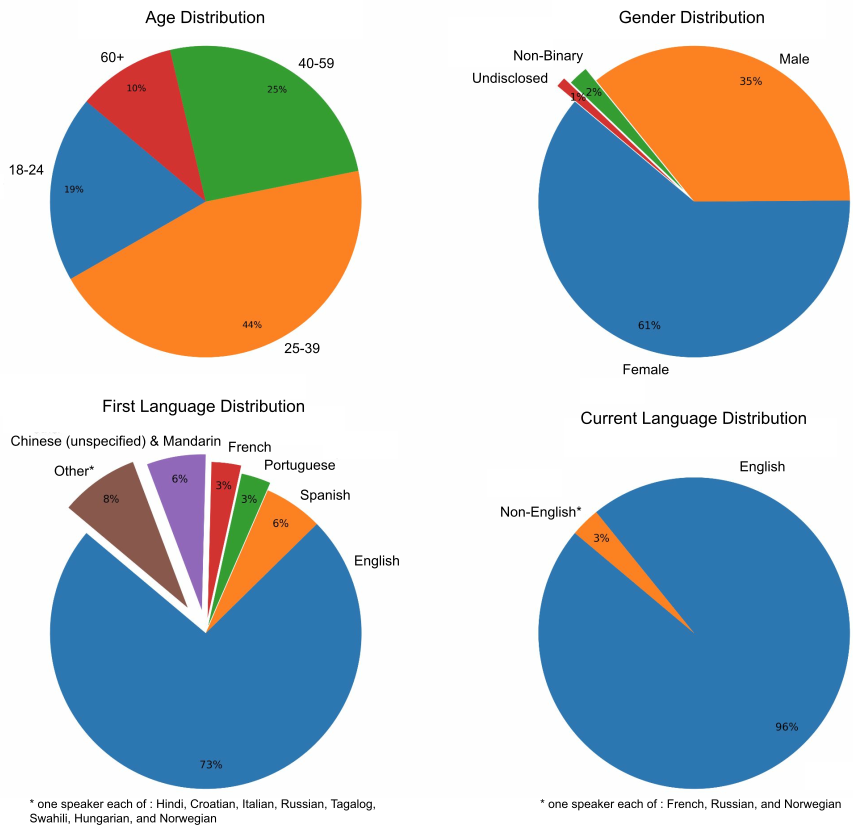

 Figure 1: Collected participant demographic information. 

Phrase  
---  
banana and mustard sandwiches  
hungry action hippos fruit  
another dog secretary show  
snow meteor down the chimney  
birds make new jingles  
heavy undersea birthday pumpkins  
fluffy baseboard yogurt division  
zebra cats walking on lamps  
five special guest treasures  
ripped ocean jumper  
five dollar slaw onion cure  
the thunder break craze  
join the ear look club  
wolf ring lights are fantastic

 Table 1: Phrases for data collection.

Next, the actors were guided through a series of recordings where they were given a random phrase, emotion, and phone position. The 14 phrases can be seen in Table [1](https://arxiv.org/html/2505.00059v2#S3.T1 "Table 1 ‣ 3.1 Collection ‣ 3 Dataset ‣ BERSting at the Screams: A Benchmark for Distanced, Emotional and Shouted Speech Recognition."). These phrases were chosen to be nonsensical, yet to cover the range of English phonemes. In addition, an attempt was made to not have any sentences with particularly strong emotions, “Wolf ring lights are fantastic," however, is an exception, displaying a positive sentiment. The use of nonsense phrases poses a particular challenge for speech recognition systems, as they are not able to rely on linguistic context to predict the words or emotions, and most of the phrase has high surprisal, i.e. words are easier to comprehend in contexts where they are highly predictable, if not they have higher surprisal [[81](https://arxiv.org/html/2505.00059v2#bib.bib81)]. For each recording, the actors were instructed to “speak the phrase", “shout the phrase", and “scream the phrase". This creates varying intensity levels within the emotions, which poses a challenge for speech recognition models that may rely heavily on intensity, for example, when predicting arousal levels. The combination of both distanced recordings and varying speaking volumes means that intensity alone cannot define neither distance, nor arousal level.

The actors completed 19 recordings progressively moving the phone further away; the phone positions can be seen in Table [2](https://arxiv.org/html/2505.00059v2#S3.T2 "Table 2 ‣ 3.1 Collection ‣ 3 Dataset ‣ BERSting at the Screams: A Benchmark for Distanced, Emotional and Shouted Speech Recognition.") and Figure [2](https://arxiv.org/html/2505.00059v2#S3.F2 "Figure 2 ‣ 3.1 Collection ‣ 3 Dataset ‣ BERSting at the Screams: A Benchmark for Distanced, Emotional and Shouted Speech Recognition."). Exact measurements were not taken, rather the actors were asked to use their best approximations. Not only was the phone moved further from the speaker, but, in the furthest location, it was actually placed on the other side of a wall or door. Additional obstructions were included at each distance, including putting the phone in a bag, putting the phone in their pocket, or covering the microphone with their hand. Lastly, the phone was placed on both soft and hard surfaces to capture any possible differences in audio recording quality that this may cause [[82](https://arxiv.org/html/2505.00059v2#bib.bib82), [83](https://arxiv.org/html/2505.00059v2#bib.bib83)].

Phone distance | Positions  
---|---  
next to your face | mic facing your mouth as you would in a phone conversation,  
| mic/phone facing away from your face, hand covering the mic  
next to your hip | back of phone on your palm, hand covering the mic  
in your pocket | N/A  
in a bag and hold it next to your hip | N/A  
1-2 meters away | face up on any surface, face down on a hard surface,  
| face down on a soft surface, in a bag  
on the opposite side of the room | face up on any surface, face down on a hard surface,  
| face down on a soft surface, in a bag  
as far away as possible, on the opposite side of a wall | face up on any surface, face down on a hard surface,  
| face down on a soft surface, in a bag

 

Table 2: Phone positions for data collection. 

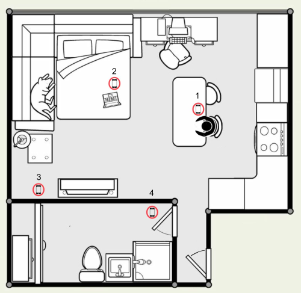

 Figure 2: Phone positions for data collection. Positions include 4 distance levels: 1. Near the body, 2. 1-2m distance, 3. Opposite side of the room, and 4. Outside the room.

Seven basic emotions were prompted: _neutral_ , _anger_ , _joy_ , _fear_ , _disgust_ , _surprise_ , and _sadness_. The actors were prompted with basic emotions for two reasons: firstly, basic emotions are non-specifc and leave interpretations, e.g. hot or cool anger, up to the actors. Therefore, by prompting basic emotions, we are able to ensure we capture a range of emotions that are available for researchers to label for their own use cases. Secondly, having the basic emotion ground truth labels opens up the dataset for use in more generalized SER tasks, which are often limited to basic emotions (in many cases only 4: neutral, sadness, joy and anger). Altogether, each actor recorded 19 phrases, at 19 locations and three loudness levels resulting in 57 recordings per actor prior to data cleaning.

### 3.2 Data cleaning

The actors made one single recording for each phrase, emotion, and phone position. This means that each raw audio clip contains three utterances, one per intensity level. To split these, we used a voice activity detection (VAD) toolkit [[84](https://arxiv.org/html/2505.00059v2#bib.bib84)]. To confirm that all the data was correctly split, a native English speaking annotator listened to all of the utterances and flagged those that either had not been correctly split, or where the actor made a mistake in their phrase and the transcription needed to be updated. From this, 4 native English speaking annotators split the remaining data by hand using Audacity33 3 https://www.audacityteam.org/ and corrected the transcriptions to reflect what the actor was truly saying, for example changing “ripped ocean jumper" to “a ripped open jumper". Additionally, clips where there was only noise, e.g. the phone was too far away to capture any discernible speech, were removed.

To then annotate the shout levels, two annotators labeled the data as “shouting" or “not-shouting". An attempt was made to assign the original three shout levels: speaking, shouting, and screaming. However, an early pilot of these annotations using data scraped from Reddit (16 samples), YouTube (6 samples), and Streamable (1 sample), found that annotators had difficulty discerning three levels of intensity, but could easily label two. Twenty-five percent of the data was labeled by these two annotators and a Cohen’s kappa score was calculated to assess annotator agreement. The Kappa score was 0.80 (substantial agreement), and as such a single annotator was used to label the remaining data, and their labels are used as the definitive labels provided with the dataset. Emotion validation has not been completed and remains future work.

We provide a train, test, and validation split for the data at a 80/10/10 ratio. We have no speaker crossover between the splits, and therefore attempted to maintain a balance of distances, shout levels, and emotions across the sets.

## 4 Data exploration

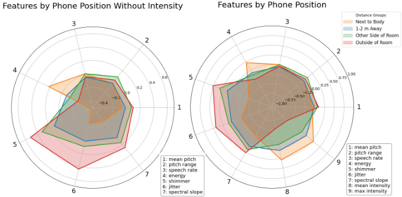

 Figure 3: Extracted vocal features for each phone position (normalized), without (left) and with (right) intensity features.

To explore the audio and vocal features of the data we used the openSMILE python toolbox from AudEERING [[85](https://arxiv.org/html/2505.00059v2#bib.bib85)]. We extracted the complete Geneva Minimalistic Acoustic Parameter Set (GeMAPS) and attempted to explore the data using principal component analysis and t-SNE44 4 https://scikit-learn.org/1.5/modules/generated/sklearn.manifold.TSNE.html, yet, we found we did not find any useful information in this dense data. Instead we opted to extract a set of features as used in [[86](https://arxiv.org/html/2505.00059v2#bib.bib86)] using the associated voice toolbox55 5 https://github.com/ehughson/voice_toolbox. These features include: 1) Loudness Features: (a) mean intensity, (b) energy, (c) maximum intensity. 2) Spectral Features: (a) mean pitch, (b) pitch range, (c) shimmer, (d) jitter, and (e) spectral slope. 3) Rate-of-Speech Features: syllables per second. The features were normalized across the dataset, yet, we found that, due to the shouted data having very high intensity, in combinations with the distances, reducing the intensity, these features were overpowering on the plots when using a similar axes scaling across plots. Therefore, we created visualizations both with and without intensity features, to better understand more subtle differences not only controlled by intensity levels. If no plot is shown for a given feature set containing intensity levels, this means that the intensity for all groups was similar (Figure [6](https://arxiv.org/html/2505.00059v2#S4.F6 "Figure 6 ‣ 4.3 Emotion Features ‣ 4 Data exploration ‣ BERSting at the Screams: A Benchmark for Distanced, Emotional and Shouted Speech Recognition.")).

We explore the primary elements of the dataset: distance, shouts, and emotions, and how they interact with one another. This analysis provides important information on how vocal features differ for the different elements in the data set and may provide suggestions of features that are confounding to include as primary features in far-field, shouted, and emotional audio models.

### 4.1 Distance Features

First we explore how audio features differ per distance, over all audio samples (Figure [3](https://arxiv.org/html/2505.00059v2#S4.F3 "Figure 3 ‣ 4 Data exploration ‣ BERSting at the Screams: A Benchmark for Distanced, Emotional and Shouted Speech Recognition.")). As expected, we observe that both mean and max intensity decrease as the phone is moved away from the body, especially when the phone is in another room (right). We also observe higher energy levels when near the body, and higher shimmer and jitter (typically associated with vocal fry and hoarseness, respectively) for recordings at a distance. We note especially low values for shimmer, jitter, and spectral slope when near the body.

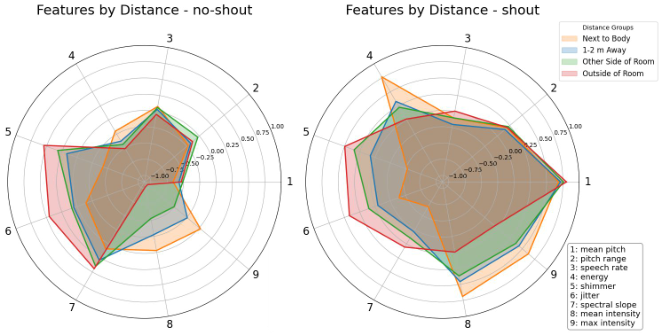

 Figure 4: Extracted vocal features for each phone position (normalized), for non shouted (left) and shouted (right) samples.

We next inspected the distance features for shouted and non-shouted speech (Figure [4](https://arxiv.org/html/2505.00059v2#S4.F4 "Figure 4 ‣ 4.1 Distance Features ‣ 4 Data exploration ‣ BERSting at the Screams: A Benchmark for Distanced, Emotional and Shouted Speech Recognition.")). We see that the vocal features for distance groups show a marked difference depending on whether the data is shouted, or not shouted. For both shouted and not shouted data we see the same increase in intensity as the phone is moved closer to the body, however, we see that the pitch is much higher for shouted than for not shouted data at all phone positions. Additionally, we see a marked increase in energy for samples recorded close to the body when shouted. Differences in shimmer and jitter seem to be driven more by the phone location than by the shout level.

These features provide insights into why distant speech recognition tasks remain challenging. We see that the distance from the microphone is an important factor in determining the audio features of a speech sample. Specifically, alongside the expected differences in intensity (the change in energy over a given area) and total energy transferred, shimmer and jitter are primarily controlled by the distance from the microphone. Both of these features diminish as the microphone moves away from the body. This may be a result of these features being more difficult to extract from distant audio (similar to details being lost in a photo being taken from afar) and that a voice can seem more hoarse or with increased vocal fry when close to the microphone.

### 4.2 Shout Features

We inspected how audio features of shouted and non-shouted audio differ. Looking at the entire dataset (Figure [5](https://arxiv.org/html/2505.00059v2#S4.F5 "Figure 5 ‣ 4.2 Shout Features ‣ 4 Data exploration ‣ BERSting at the Screams: A Benchmark for Distanced, Emotional and Shouted Speech Recognition.")), we found, as expected, that shouted speech has higher mean and max intensity, as well as a higher pitch, which are all indicative of Lombard speech [[87](https://arxiv.org/html/2505.00059v2#bib.bib87)]. Surprisingly, pitch _range_ is also slightly high, which is not often the case for Lombard speech, which tends to have reduced pitch range when creating a higher pitched pressed voice. It is possible that the increased pitch range is a result of the emotional expressivity of the speech. Non-shouted speech shows a higher spectral slope, which follows the results in [[86](https://arxiv.org/html/2505.00059v2#bib.bib86)].

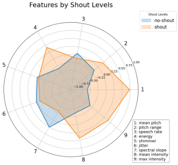

 Figure 5: Extracted vocal features for each shout level (normalized).

### 4.3 Emotion Features

Lastly, we investigated how audio features differed for different intended emotions. We divided our plots into typically high and low arousal emotions [[88](https://arxiv.org/html/2505.00059v2#bib.bib88)] for ease of viewing.

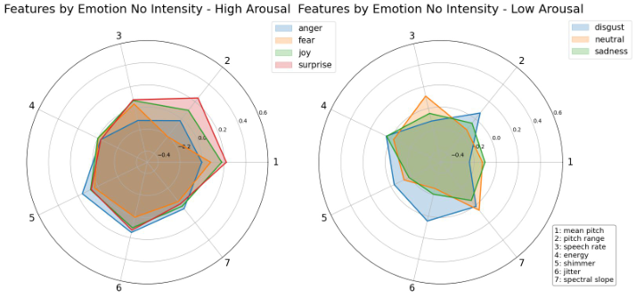

 Figure 6: Extracted vocal features for each emotion (normalized) for high (left) and low (right) arousal emotions.

When looking at the full dataset in Figure [6](https://arxiv.org/html/2505.00059v2#S4.F6 "Figure 6 ‣ 4.3 Emotion Features ‣ 4 Data exploration ‣ BERSting at the Screams: A Benchmark for Distanced, Emotional and Shouted Speech Recognition."), it appears that emotions have less striking differences in features when compared to shout and distances. It appears the difference between high and low arousal emotions are stronger than that between the emotions within these grouping. Low arousal emotions have a lower pitch, shimmer, and jitter than the high arousal emotions, with the exception of disgust that has a higher shimmer and jitter than the other low arousal emotions. Neutral also has a higher speaking rate than the other low arousal emotions. The high arousal emotions seem to be primarily differentiated by pitch range that is highest for surprise, then joy, followed by anger, and lastly fear. We similarly see joy and surprise having a higher mean pitch than fear and anger. Lastly, anger shows a lower speech rate than the other high arousal emotions.

Overall, we see that differences in intensity are primarily driven by both shout and distance levels, however, more strongly by shout. This suggests that the combination of shout and distance can cause confusion for models relying on this feature for classification, such as in SER. Shimmer and jitter are driven by the phone location, and pitch and pitch range by the shout level. However, the emotion can also play a part in the pitch range. In general, the emotions play a weaker role in determining vocal characteristics than the distance and shouting, but differences can be seen between low and high arousal emotions.

## 5 Benchmarks

### 5.1 Automatic Speech Recognition

We suspected that our dataset would pose a challenge, and therefore would be an important benchmark for real-world, performance of ASR models, especially for models deployed on smart phone devices. We tested 5 ASR models: Whisper (medium.en) [[89](https://arxiv.org/html/2505.00059v2#bib.bib89)]66 6 https://huggingface.co/openai/whisper-medium.en, Whisper (turbo)77 7 https://huggingface.co/openai/whisper-large-v3-turbo, NVIDIA NeMo88 8 https://github.com/NVIDIA/NeMo Quartznet [[90](https://arxiv.org/html/2505.00059v2#bib.bib90)] implementation, NVIDIA NeMo Fastconformer Transducer [[91](https://arxiv.org/html/2505.00059v2#bib.bib91)] implementation99 9 https://catalog.ngc.nvidia.com/orgs/nvidia/teams/nemo/models/   
stt_en_fastconformer_transducer_large, and Wav2Vec2-Base-960h [[92](https://arxiv.org/html/2505.00059v2#bib.bib92)]1010 10 https://huggingface.co/facebook/wav2vec2-base-960h. The models’ details can be found in Table [3](https://arxiv.org/html/2505.00059v2#S5.T3 "Table 3 ‣ 5.1 Automatic Speech Recognition ‣ 5 Benchmarks ‣ BERSting at the Screams: A Benchmark for Distanced, Emotional and Shouted Speech Recognition.").

Model |  Architecture |  # Param. |  Dataset |  # h  
---|---|---|---|---  
Whisper-medium.en |  sequence-to-sequence |  769 M |  OpenAI custom** |  680,000  
Whisper-turbo |  sequence-to-sequence* |  798 M |  OpenAI custom** |  680,000  
NeMo Quartznet |  CNN† with residual connections |  18.9 M |  LibriSpeech‡, Common Voice‡ |  3,500  
NeMo FastConformer Transducer |  autoregressive conformer |  114 M |  NeMo ASRSet |  24,500  
Wav2Vec2-Base-960h |  CNN-based encoder transformer |  94.4 M |  LibriSpeech |  960

 

Table 3: ASR model summaries including general model architecture, number of parameters, pretraining dataset, and total hours of pretraining.

* Same as other Whisper models but with 4 instead of 32 decoding layers.   
** Multilingual.   
† 1D time-channel separable convolutions.   
‡ Includes 10% speed perturbations; English validated set.

Model | WER \(\downarrow\) | CER \(\downarrow\) | PER \(\downarrow\)  
---|---|---|---  
Whisper - medium.en | 31.15% | 15.13% | 14.23%  
Whisper - turbo | 29.55% | 13.72% | 12.67%  
NeMo Quartznet | 65.16% | 32.20% | 32.80%  
NeMo Fastconformer Transducer | 40.61% | 22.33% | 21.49%  
Wav2Vec2-Base-960h | 76.21% | 35.28% | 36.52%

 Table 4: ASR benchmark results over all data.

The results over the entire dataset can be seen in Table [4](https://arxiv.org/html/2505.00059v2#S5.T4 "Table 4 ‣ 5.1 Automatic Speech Recognition ‣ 5 Benchmarks ‣ BERSting at the Screams: A Benchmark for Distanced, Emotional and Shouted Speech Recognition.") where we report word error rate (WER), the percentage of transcribed words correctly matching the ground truth transcription, character error rate (CER), the percentage of transcribed characters correctly matching the ground truth transcription, and the phoneme error rate (PER), the percentage of phonemized elements of the transcription correctly matching the ground truth transcription (both transcriptions phonemized with espeak-ng1111 11 https://github.com/espeak-ng/espeak-ng) for each model. We see both the Whisper models showing the best performance, followed by the Fastconformer Transducer. Yet, all the models perform worse (between 29.55 and 76.21% WER) than the usual reported WERs, which are often below 10%. In particular, Whisper medium.en is reported to have a WER of 27% on the CHiME-6 dataset [[89](https://arxiv.org/html/2505.00059v2#bib.bib89), [20](https://arxiv.org/html/2505.00059v2#bib.bib20)] that is similarly used for distanced ASR benchmarking.

Subset | WER \(\downarrow\) | CER \(\downarrow\) | PER \(\downarrow\)  
---|---|---|---  
Disgust | 23.96% | 11.26% | 10.92%  
Joy | 31.87% | 15.93% | 14.40%  
Neutral | 23.20% | 11.35% | 10.40%  
Anger | 29.3% | 13.48% | 12.49%  
Fear | 35.73% | 17.25% | 16.42%  
Surprise | 35.58% | 17.50% | 16.75%  
Sadness | 39.42% | 19.82% | 18.91%  
Near Body | 24.93% | 11.78% | 11.27%  
1-2m Away | 27.00% | 12.96% | 11.77%  
Other side of room | 35.02% | 16.26% | 15.59%  
Outside of room | 45.10% | 23.64% | 21.99%  
Shout | 39.83% | 19.43% | 17.72%  
No Shout | 24.17% | 11.67% | 10.95%

 

Table 5: ASR benchmark results for Whisper medium.en.

Subset | WER \(\downarrow\) | CER \(\downarrow\) | PER \(\downarrow\)  
---|---|---|---  
Disgust | 23.29% | 10.21% | 10.04%  
Joy | 30.17% | 14.23% | 12.74%  
Neutral | 22.31% | 9.86% | 9.15%  
Anger | 25.98% | 11.34% | 10.85%  
Fear | 34.06% | 15.28% | 14.70%  
Surprise | 32.94% | 16.19% | 17.9%  
Sadness | 39.10% | 19.65% | 13.6%  
Near Body | 22.44% | 9.64% | 9.35%  
1-2m Away | 26.75% | 11.93% | 12.55%  
Other side of room | 32.08% | 14.43% | 13.89%  
Outside of room | 45.32% | 23.80% | 18.71%  
Shout | 37.39% | 17.94% | 15.99%  
No Shout | 23.29% | 10.32% | 10.01%

 

Table 6: ASR benchmark results for Whisper turbo.

We further investigated the performance of these ASR models to better understand how performance differs over different distances and for different emotions and shout levels. The results can be seen in Tables [6](https://arxiv.org/html/2505.00059v2#S5.T6 "Table 6 ‣ 5.1 Automatic Speech Recognition ‣ 5 Benchmarks ‣ BERSting at the Screams: A Benchmark for Distanced, Emotional and Shouted Speech Recognition.") \- [9](https://arxiv.org/html/2505.00059v2#S5.T9 "Table 9 ‣ 5.1 Automatic Speech Recognition ‣ 5 Benchmarks ‣ BERSting at the Screams: A Benchmark for Distanced, Emotional and Shouted Speech Recognition.") and in Figures [8](https://arxiv.org/html/2505.00059v2#S5.F8 "Figure 8 ‣ 5.1 Automatic Speech Recognition ‣ 5 Benchmarks ‣ BERSting at the Screams: A Benchmark for Distanced, Emotional and Shouted Speech Recognition.") \- [9](https://arxiv.org/html/2505.00059v2#S5.F9 "Figure 9 ‣ 5.1 Automatic Speech Recognition ‣ 5 Benchmarks ‣ BERSting at the Screams: A Benchmark for Distanced, Emotional and Shouted Speech Recognition."). For all models, we see a degradation of WER performance as the phone moves further away from the actor. No particular model appears to be markedly more robust to this difficulty than other, however, NeMo Fastconformer Transducer did show the lowest reduction in WER from 33.68 - 53.44%: Whisper (medium.en) showed 21% degradation from near the body to in the other room, Whisper (turbo) 23%, NeMo Quartznet 27%, NeMo Fastconformer Transducer 20%, and Wav2Vec2-Base-960h 28%.

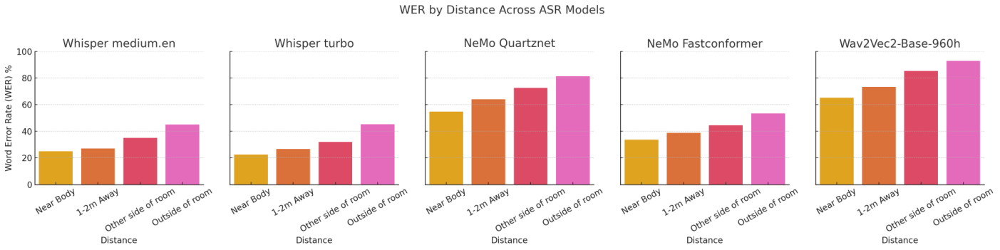

 Figure 7: WER per distance across the benchmarked ASR models.

Subset | WER \(\downarrow\) | CER \(\downarrow\) | PER \(\downarrow\)  
---|---|---|---  
Disgust | 58.42% | 28.19% | 28.75%  
Joy | 69.07% | 35.39% | 35.24%  
Neutral | 58.21% | 27.10% | 27.81%  
Anger | 64.77% | 30.31% | 30.47%  
Fear | 71.89% | 36.84% | 37.98%  
Surprise | 72.65% | 36.45% | 37.69%  
Sadness | 61.22% | 31.10% | 31.76%  
Near Body | 54.72% | 25.30% | 26.07%  
1-2m Away | 64.00% | 30.08% | 30.77%  
Other side of room | 72.54% | 35.79% | 36.64%  
Outside of room | 81.27% | 45.83% | 45.60%  
Shout | 83.45% | 45.16% | 45.81%  
No Shout | 50.54% | 21.77% | 22.33%

 

Table 7: ASR benchmark results for NeMo Quartznet.

Subset | WER \(\downarrow\) | CER \(\downarrow\) | PER \(\downarrow\)  
---|---|---|---  
Disgust | 34.71% | 17.91% | 17.23%  
Joy | 43.98% | 24.83% | 23.32%  
Neutral | 34.41% | 17.74% | 17.42%  
Anger | 40.45% | 20.29% | 19.41%  
Fear | 45.35% | 26.14% | 25.21%  
Surprise | 46.69% | 26.18% | 37.69%  
Sadness | 39.06% | 23.38% | 22.56%  
Near Body | 33.68% | 16.65% | 16.13%  
1-2m Away | 38.92% | 20.57% | 19.67%  
Other side of room | 44.44% | 24.20% | 23.19%  
Outside of room | 53.44% | 34.67% | 33.32%  
Shout | 52.28% | 31.46% | 30.51%  
No Shout | 31.35% | 14.99% | 14.25%

 

Table 8: ASR benchmark results for NeMo Fastconformer Transducer.

Subset |  WER \(\downarrow\) |  CER \(\downarrow\) |  PER \(\downarrow\)  
---|---|---|---  
Disgust |  68.73% |  30.82% |  32.20%  
Joy |  79.26% |  37.65% |  38.09%  
Neutral |  70.33% |  31.53% |  32.70%  
Anger |  75.50% |  33.94% |  34.75%  
Fear |  82.62% |  38.94% |  40.80%  
Surprise |  81.82% |  38.78% |  39.97%  
Sadness |  74.18% |  35.32% |  36.78%  
Near Body |  65.29% |  27.88% |  29.33%  
1-2m Away |  73.33% |  33.40% |  34.25%  
Other side of room |  85.37% |  40.30% |  42.10%  
Outside of room |  92.92% |  48.26% |  48.69%  
Shout |  94.75% |  46.47% |  48.11%  
No Shout |  61.58% |  26.32% |  27.30%

 Table 9: ASR benchmark results for Wav2Vec2-Base-960h.

All models struggled to transcribe shouted speech. The Whisper models were the most robust with a 15% (medium.en) and 14% (turbo) increase in WER. NeMo Quartznet and Wav2Vec2-Base-960h stuggled the most with shouted speech with a 33% increase in WER for shouted speech.

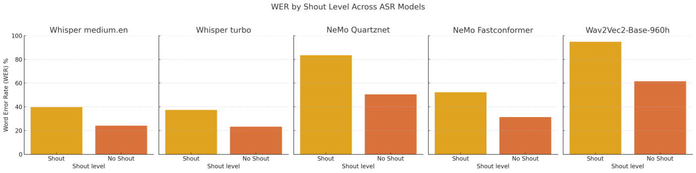

 Figure 8: WER per shout level across the benchmarked ASR models.

For all models there was a difference in performance across the emotions, though less severe than for distance. Sentences produced with intended neutral and disgusted voices were the easiest emotions to transcribe across all models, while high arousal emotions like joy, fear, and surprise tended to be difficult to transcribe. Outliers include the Whisper models, that tended to struggle the most with sadness. It is not particularly surprising that the models show the highest performance on neutral speech, as this is often what they are trained and benchmarked on. Once again, the NeMo Fastconformer Transducer appears to be slightly more robust to differences in performance in the WER across the emotions. Unlike other emotional speech datasets, BERSt uses the same phrases for all emotions, and therefore, unlike the conclusions in [[9](https://arxiv.org/html/2505.00059v2#bib.bib9)], we cannot propose that the discrepancies in WER are related to the use of emotionally specific wording. Instead, our results derive purely from the differences in vocal features between emotions.

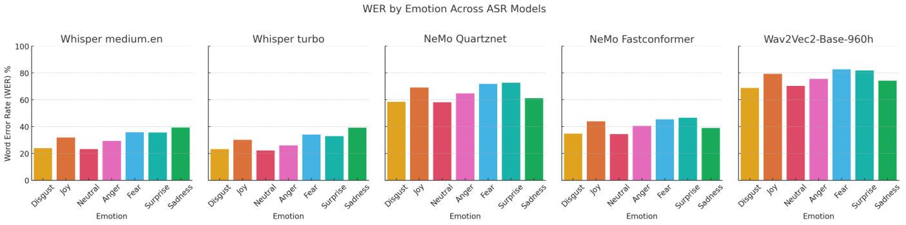

 Figure 9: WER per emotion across the benchmarked ASR models. 

Model | WER \(\downarrow\) | CER \(\downarrow\) | PER \(\downarrow\)  
---|---|---|---  
Whisper - medium.en | 17.27% | 7.81% | 7.80%  
Whisper - turbo | 17.93% | 7.28% | 7.30%  
NeMo Quartznet | 39.49% | 15.24% | 15.77%  
NeMo Fastconformer Transducer | 24.96% | 10.72% | 10.13%  
Wav2Vec2-Base-960h | 49.65% | 18.94% | 19.90%

 Table 10: ASR benchmark results for neutral, non-shouted data, recorded next to the body.

We then investigated how the models performed on non-shouted data, that is neutral and next to the body, as this is expected to be similar to most other ASR datasets. The results can be seen in Table [10](https://arxiv.org/html/2505.00059v2#S5.T10 "Table 10 ‣ 5.1 Automatic Speech Recognition ‣ 5 Benchmarks ‣ BERSting at the Screams: A Benchmark for Distanced, Emotional and Shouted Speech Recognition."). All the models see a drastic increase in performance when the most difficult data is removed, yet, is still lower than expected for these models. One reason may be due to the lack of linguistic context in these phrases. It may also stem from the obstructions applied to the phone next to the body, such as placing the phone in a bag or a pocket for some of the recordings.

### 5.2 Speech Emotion Recognition

Although the emotions expressed by professional actors in our data have yet to be validated by perception based annotations, we provide an initial benchmark to display another use case for the BERSt dataset. Therefore, these results must be viewed through the lens of the intended emotions produced by the professional actors, and not necessarily those perceived by listeners. The results are presented as confusion matrices, i.e. counts of the predicted label (x-axis) given the ground truth label (y-axis). Moreover, the unweighted (averaged over all samples) and weighted (weights assigned per class in case of class imbalance before averaging) accuracies are provided for all of the models.

SER remains a difficult problem and overall sees lower performance than ASR tasks. One problem is that there remains no “gold standard" for classifying emotions and many SER models are only trained to classify 4 emotions: neutral, anger, joy and sadness. However, there has been a recent surge of models that can provide a continuous classification of emotions using valence, arousal, and dominance scores. Given that our data has 7 classes, we modified all of the models to be benchmarked through some form of fine-tuning. We tested three speech emotion recognition models: a Wav2Vec2 based classifier [[93](https://arxiv.org/html/2505.00059v2#bib.bib93)] implemented in SpeechBrain [[94](https://arxiv.org/html/2505.00059v2#bib.bib94)], DAWN from audEERING [[95](https://arxiv.org/html/2505.00059v2#bib.bib95)], which uses a similar backbone but is fine-tuned on MSP-Podcast [[2](https://arxiv.org/html/2505.00059v2#bib.bib2)] for continuous valence, arousal, and dominance predictions, and Wav2Small [[96](https://arxiv.org/html/2505.00059v2#bib.bib96)] that combines the DAWN model and Odyssey WavLM model [[97](https://arxiv.org/html/2505.00059v2#bib.bib97)] (only the teacher model is publicly available, so no distilling is applied). The models’ details can be found in Table [11](https://arxiv.org/html/2505.00059v2#S5.T11 "Table 11 ‣ 5.2 Speech Emotion Recognition ‣ 5 Benchmarks ‣ BERSting at the Screams: A Benchmark for Distanced, Emotional and Shouted Speech Recognition.").

Model |  Arch. |  # Param. |  Dataset | # h  
---|---|---|---|---  
SpeechBrain Wav2Vec2 |  Classification layer on Wav2Vec2* |  165 M |  IEMOCAP-4 Fine-tune: IEMOCAP-7 | 12  
DAWN-hidden-SVM |  Final layer for VAD on Wav2Vec2 |  165 M |  MSP-Podcast Fine-tune: BERSt | 237  
Wav2Small-VAD-SVM* |  DAWN model fused with Odyssey WavLM** |  483.9 M |  MSP-Podcast Fine-Tune: BERSt | 237

 

Table 11: SER model summaries including the general model architecture, the number of parameters, the pretraining dataset and the number of hours of pretraining data.

*as in Table [3](https://arxiv.org/html/2505.00059v2#S5.T3 "Table 3 ‣ 5.1 Automatic Speech Recognition ‣ 5 Benchmarks ‣ BERSting at the Screams: A Benchmark for Distanced, Emotional and Shouted Speech Recognition.")   
**transformer encoder

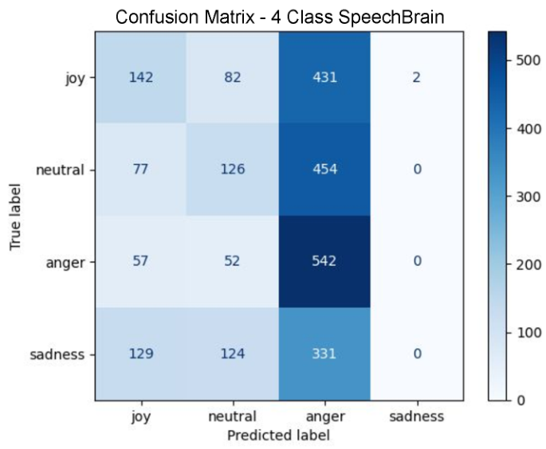

 Figure 10: SER confusion matrix of out-of-box prediction on the 4-class   
subset of BERSt using the SpeechBrain model.

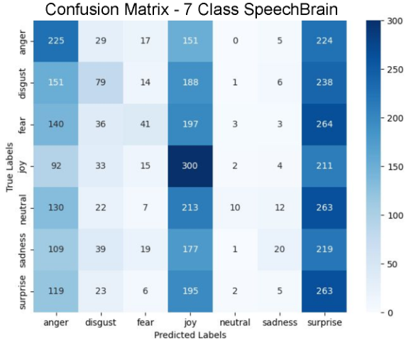

 Figure 11: SER confusion matrix of IEMOCAP-7 fine-tuned 7-class classification with the   
SpeechBrain model.

These models use the same backbone, one building upon the other. As such, we present the results from the base model and explore if the addition of training data and modifications on the final layer (DAWN) or the fusion of a secondary model (Wav2Small) make the model more robust to our difficult data. We do our best to ensure minimal fine tuning on the model to test out-of-box performance similar to the ASR experiments. However, because the models are either only for a) 4 class classification or b) for continuous prediction of valence, arousal, and dominance, a slight fine-tuning of the final layers (SpeechBrain) of the model, or the addition of a classifier (DAWN and Wav2Small) was needed.

Out-of-box SpeechBrain. For the SpeechBrain model, we first attempted an out-of-box classification on only 4 emotions, as this was the only model that we could test out-of-box without adding some form of fine tuning. We created a subset of the BERSt dataset to keep only the audio samples of the emotions joy, neutral, anger, and sadness. It can be seen that the majority of the data is misclassified as anger (Figure [11](https://arxiv.org/html/2505.00059v2#S5.F11 "Figure 11 ‣ 5.2 Speech Emotion Recognition ‣ 5 Benchmarks ‣ BERSting at the Screams: A Benchmark for Distanced, Emotional and Shouted Speech Recognition.")) and only two utterances are classified as sadness (both of which were acted as joy). This may be due to the high intensity and arousal of the shouting in the dataset. This can be seen particularly strongly in the neutral class (Fig. [13](https://arxiv.org/html/2505.00059v2#S5.F13 "Figure 13 ‣ 5.2 Speech Emotion Recognition ‣ 5 Benchmarks ‣ BERSting at the Screams: A Benchmark for Distanced, Emotional and Shouted Speech Recognition.") (top)) where the F1-score for non-shouted speech is much higher than for shouted speech in this, classically, low arousal emotion. Sadness, however, has too few classifications to understand why so many misclassifications are occurring, yet, during cleaning it was noted by the annotators that the actors were using a high arousal “sobbing" form of sadness that was easily confused with joy and anger. Likely, the poor results in the sadness classification relates to differences in sub-emotions of sadness (depression vs. grief) and a specific interpretation of this emotion by the actors for the training dataset than for those for BERSt. Specifically, as the actors were shouting during much of their recording sessions, the high-arousal form of grief may be favored in the data. These subtle differences in emotion classification, both for machine learning models and for humans are so complex and many researchers have moved towards the valence-arousal-dominance models seen with the DAWN models, as this classification scheme is able to capture more subtle differences within emotions.

IEMOCAP-7 Fine-tuned SpeechBrain. We then used the fine-tuning approach provided by SpeechBrain1212 12 https://github.com/speechbrain/speechbrain/tree/develop/   
recipes/IEMOCAP for 25 epochs on the full, 7-class IEMOCAP dataset to allow for 7 class classification, changing the output classification layer to size 7, rather than 4. The IEMOCAP-7 dataset contains fewer samples of disgust, fear, and surprise than for the 4 emotions included in IEMOCAP-4. This may have an impact on the results for the emotion classes. The confusion matrix for the results of the full BERSt dataset can be seen in Figure [11](https://arxiv.org/html/2505.00059v2#S5.F11 "Figure 11 ‣ 5.2 Speech Emotion Recognition ‣ 5 Benchmarks ‣ BERSting at the Screams: A Benchmark for Distanced, Emotional and Shouted Speech Recognition."). Although we do see some more data being classified into the low arousal emotions, we still see a strong bias towards all the data being classified into high arousal emotions: joy, anger, and surprise.

We also explored the impact of distance (Figure [13](https://arxiv.org/html/2505.00059v2#S5.F13 "Figure 13 ‣ 5.2 Speech Emotion Recognition ‣ 5 Benchmarks ‣ BERSting at the Screams: A Benchmark for Distanced, Emotional and Shouted Speech Recognition.")) and shout level (Figure [13](https://arxiv.org/html/2505.00059v2#S5.F13 "Figure 13 ‣ 5.2 Speech Emotion Recognition ‣ 5 Benchmarks ‣ BERSting at the Screams: A Benchmark for Distanced, Emotional and Shouted Speech Recognition.")) on the classification of both the 4 and 7 class models by plotting the F1-score of the classified emotions (x-axis) by the distance and shout levels (y-axis). The contribution of these features to the confusion of emotions, however, seems much smaller than for ASR tasks, possibly due to the fine tuning. To confirm this, in Figure [13](https://arxiv.org/html/2505.00059v2#S5.F13 "Figure 13 ‣ 5.2 Speech Emotion Recognition ‣ 5 Benchmarks ‣ BERSting at the Screams: A Benchmark for Distanced, Emotional and Shouted Speech Recognition.")(top) we explored the shout level results with the 4 class out-of-box model and it can be seen that without fine tuning the low arousal, neutral does see performance degradation for shouted speech.

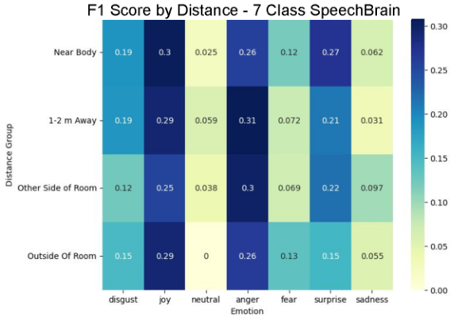

 Figure 12: SER F1 scores per distance and emotion for BERSt fine-tuned 7 class classification with the SpeechBrain model.

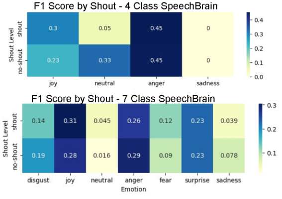

 Figure 13: SER F1 scores per shout level and emotion for out-of-box 4 class classification (top) and BERSt   
fine-tuned 7 class classification (bottom) with the SpeechBrain model.

VAD-to-classifier DAWN model. The DAWN model provides a fine-tuning method to convert the probability scores of three emotional measures valence, arousal, and dominance to classes using an SVM1313 13 urlhttps://github.com/audeering/w2v2-how-to. We tried two SVM approaches: 1) an SVM on the valence, arousal, and dominance results, and 2) an SVM on the 1024 hidden feature layer before the valence, arousal, and dominance prediction layer. The SVM on the hidden layer showed the best performance, and as such these are the results presented.

The classification results on the test set can be seen in Figure [15](https://arxiv.org/html/2505.00059v2#S5.F15 "Figure 15 ‣ 5.2 Speech Emotion Recognition ‣ 5 Benchmarks ‣ BERSting at the Screams: A Benchmark for Distanced, Emotional and Shouted Speech Recognition."). We see the model struggles to classify sadness, confusing it with fear and joy. Other emotions appear to have confusion with several other emotions, both low and high arousal. In Figure [15](https://arxiv.org/html/2505.00059v2#S5.F15 "Figure 15 ‣ 5.2 Speech Emotion Recognition ‣ 5 Benchmarks ‣ BERSting at the Screams: A Benchmark for Distanced, Emotional and Shouted Speech Recognition.") we see the F1 score results for each emotion over distance and shout levels. We see that there is not a strong pattern in degradation of the results over distance (top), with the exception being outside of the room. For the shout levels (bottom) we see that the typically low arousal emotions of neutral and sadness show reduced performance when shouted.

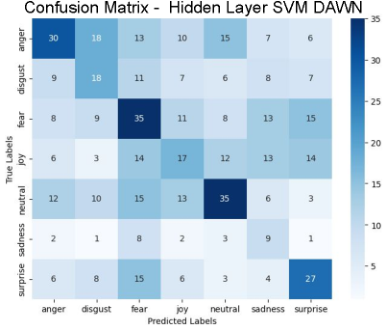

 Figure 14: Confusion Matrix of DAWN model results with an SVM on the hidden layers.

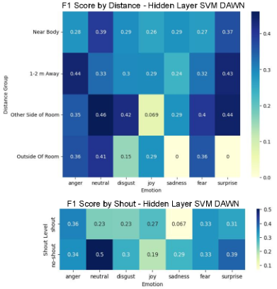

 Figure 15: SER F1 scores per distance level (top) and shout level (bottom) for the DAWN model with an SVM on the hidden layers.

VAD-to-classifier Wav2Small. Lastly, the Wav2Small teacher model similarly provides a continuous valence, arousal, and dominance result. We once again tested the two SVM approaches to convert the results for classification. In the end, we used an SVM on the valence, arousal, and dominance results as this performed better than classification on the hidden layers for this fused model.

The classification results on test set can be seen in Figure [17](https://arxiv.org/html/2505.00059v2#S5.F17 "Figure 17 ‣ 5.2 Speech Emotion Recognition ‣ 5 Benchmarks ‣ BERSting at the Screams: A Benchmark for Distanced, Emotional and Shouted Speech Recognition."). The model over-predicts fear and struggles to predict anger. In Figure [17](https://arxiv.org/html/2505.00059v2#S5.F17 "Figure 17 ‣ 5.2 Speech Emotion Recognition ‣ 5 Benchmarks ‣ BERSting at the Screams: A Benchmark for Distanced, Emotional and Shouted Speech Recognition."), we see the F1 score results for each emotion over distance and shout levels. Once again we only seem to have a strong reduction in F1 score for the out of the room distance (top), except for fear. However, for shouts (bottom) all the low arousal emotions see a drastic reduction in F1 score, while most of the high arousal emotions actually see improvement. This could suggest that this model is particularly sensitive to intensity levels.

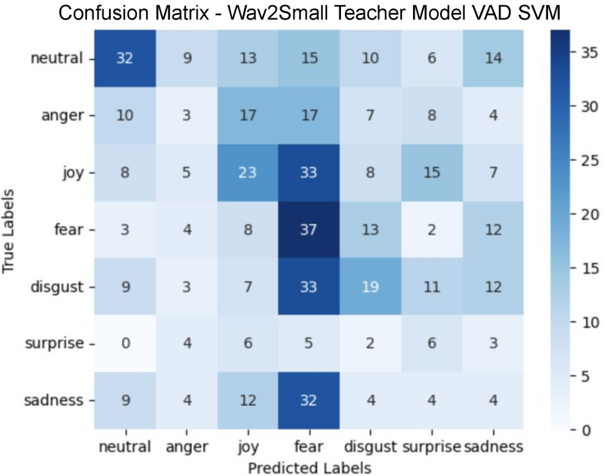

 Figure 16: Confusion Matrix of the Wav2Small teacher model with an SVM on the VAD outputs.

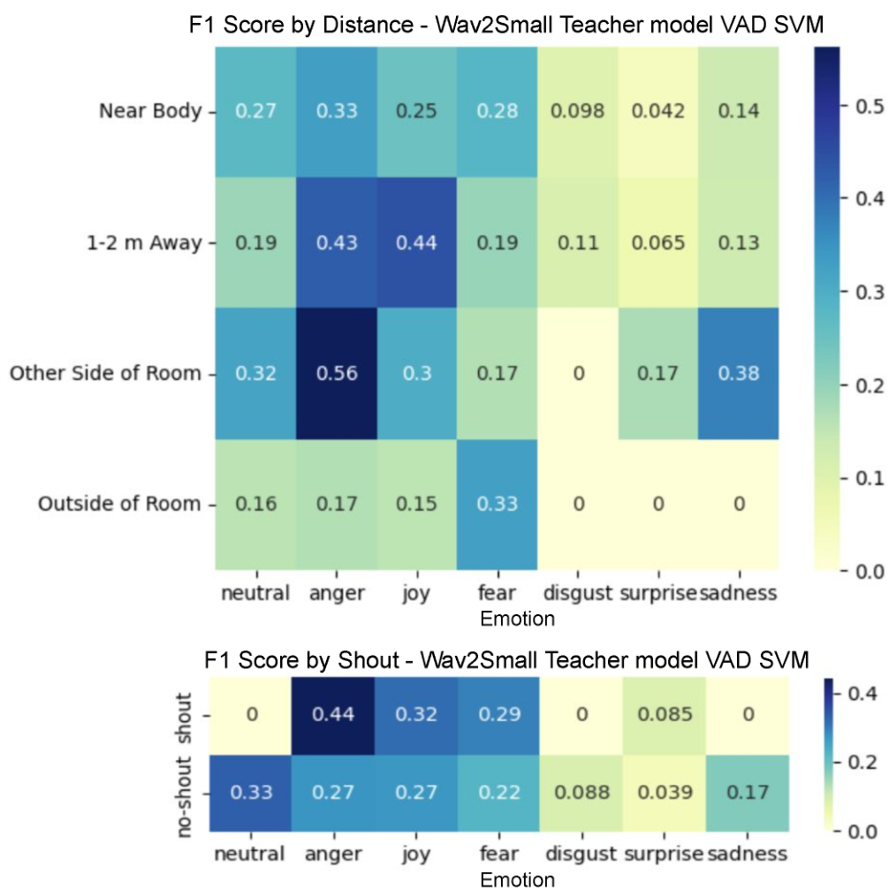

 Figure 17: SER F1 scores per distance level (top) and shout level (bottom) for the Wav2Small teacher model with an SVM on the VAD outputs.

The results for weighted and unweighted accuracy for each of the three models can be seen in Table [12](https://arxiv.org/html/2505.00059v2#S5.T12 "Table 12 ‣ 5.2 Speech Emotion Recognition ‣ 5 Benchmarks ‣ BERSting at the Screams: A Benchmark for Distanced, Emotional and Shouted Speech Recognition."). DAWN, showing the best performance, and Wav2Small showing the worst performance. The introduction of the Odyssey model to the DAWN appears to have a noteworthy impact on lowering the performance with the BERSt dataset. Lastly, as suggested in [[9](https://arxiv.org/html/2505.00059v2#bib.bib9)], the reduced WER we see in ASR models may suggest that performance of SER will be lower for our dataset.

Overall, all of these models struggle with the complexity of the BERSt dataset. When the models have never been fine-tuned on BERSt (Speechbrain), there is a strong bias towards high arousal emotions. It is known that SER models do not generalize well to new datasets [[98](https://arxiv.org/html/2505.00059v2#bib.bib98)], which is likely due to the subtle differences in interpretations of emotions and the need for an overall more robust classification system from annotation to training. The DAWN model, initially trained on a continuous rather than classification task, shows improved results, perhaps due to this underlying modeling of VAD or the fine-tuning with BERSt to help the model generalize to a new dataset. Yet, even with fine-tuning, we still see the impact of the phone being at a far distance and the unexpected high arousal in shouting classically low arousal emotions. These distance and shout-based misclassifications are exacerbated by the fusion of the Odessey model in Wav2Small. At the base, all of these models rely on Wav2Vec2, and their struggle in classifying this complex data suggested that further work needs to be done to improve the robusticity to new, more challenging conditions for SER, perhaps through exploring the layers of Wav2Vec2 and understanding which are more robust to changes in shout level and distance as has been done for other acoustic classification tasks [[99](https://arxiv.org/html/2505.00059v2#bib.bib99), [100](https://arxiv.org/html/2505.00059v2#bib.bib100), [101](https://arxiv.org/html/2505.00059v2#bib.bib101)].

Model | UA \(\uparrow\) | WA \(\uparrow\)  
---|---|---  
SpeechBrain Wav2Vec2 | 20.7% | 20.8%  
DAWN-hidden-SVM | 32.1% | 32.2%  
Wav2Small-VAD-SVM* | 23.3% | 22.3%

 

*Teacher model

Table 12: SER benchmark results for unweighted (UA) and weighted accuracy (WA).

## 6 Future Directions

We have provided benchmarks for state-of-the-art models using the BERSt dataset. Further work training models to optimize performance for this dataset remains future work. In addition, we do not provide validated emotional labels, nor continuous valence, arousal, and dominance labels. This remains future work and we welcome researchers to provide any other possible emotion categories specific to their use case. In addition, we provide the first language and current language of the speakers, and we know there are regional accents. This is based on the actors location and our reviews of the audio files, however, it would be useful to, in the future, label the regional accents of the speakers.

## 7 Conclusions

It appears that more work needs to be done to improve the robustness of ASR models to distanced speech, emotional speech, shouted speech, and high surprisal speech. Although the state-of-the art methods we evaluated perform with reported WERs below 10% on many common test sets, our best performing model, Whisper (turbo), had a WER of 29.55%. We saw similar problems in the SER models where we observed a maximum of a 32.2% unweighted average with the DAWN model, which is not an acceptable performance for real-world deployment. Both the SER and ASR models struggle to maintain their performance for shouted speech, and ASR, specially sees performance degredation as the recording device is moved further from the speaker. Even in the case where the phone is near the body and the speech is neutral, ASR methods perform below the expected values. BERSt provides a challenging new benchmark with distanced, shouted, and emotion speech in a variety of home environments, recorded on smartphones to evaluate multiple speech emotion recognition tasks.

## 8 Acknowledgments

This research was supported by Mitacs through the Mitacs E-accelerate program. We acknowledge the support of the Natural Sciences and Engineering Research Council of Canada (NSERC). We thank Maya Becher, and Jackie Lu for their time and help with the dataset, Mohammed Hafsati for his advice and advising and the Rajan Family for their support.

## Appendix A Data Collection Application Image

 Figure 18: Example pages from the data collection application.

## References

  * [1] T. Wojnar, J. Hryszko, A. Roman, Mi-go: tool which uses youtube as data source for evaluating general-purpose speech recognition machine learning models, EURASIP J. Audio Speech Music Process. 2024 (1) (2024). 
  * [2] R. Lotfian, C. Busso, Building naturalistic emotionally balanced speech corpus by retrieving emotional speech from existing podcast recordings, IEEE Transactions on Affective Computing 10 (4) (2019) 471–483. 
  * [3] S. Cornell, T. J. Park, H. Huang, C. Boeddeker, X. Chang, M. Maciejewski, M. S. Wiesner, P. Garcia, S. Watanabe, The chime-8 dasr challenge for generalizable and array agnostic distant automatic speech recognition and diarization, in: 8th International Workshop on Speech Processing in Everyday Environments (CHiME 2024), 2024, pp. 1–6. 
  * [4] V. V. Vegesna, K. Gurugubelli, A. K. Vuppala, Prosody modification for speech recognition in emotionally mismatched conditions, Int. J. Speech Technol. 21 (3) (2018) 521–532. 
  * [5] P. R. Kammili, B. H. V. S. R. Raju, A. S. Krishna, Handling emotional speech: a prosody based data augmentation technique for improving neutral speech trained asr systems, Int. J. Speech Technol. 25 (2021) 197 – 204. 
  * [6] V. V. R. Vegesna, K. Gurugubelli, A. K. Vuppala, Application of emotion recognition and modification for emotional telugu speech recognition, Mob. Netw. Appl. 24 (1) (2019) 193–201. 
  * [7] J. Santoso, T. Yamada, S. Makino, K. Ishizuka, T. Hiramura, Speech emotion recognition based on attention weight correction using word-level confidence measure, in: INTERSPEECH, 2021, pp. 1947–1951. 
  * [8] Asr for emotional speech: Clarifying the issues and enhancing performance, Neural Networks 18 (4) (2005) 437–444. 
  * [9] Y. Li, Z. Zhao, O. Klejch, P. Bell, C. Lai, Asr and emotional speech: A word-level investigation of the mutual impact of speech and emotion recognition (2023).  [arXiv:2305.16065](http://arxiv.org/abs/2305.16065). 
  * [10] Y. Li, P. Bell, C. Lai, Fusing asr outputs in joint training for speech emotion recognition, in: ICASSP 2022 - 2022 IEEE International Conference on Acoustics, Speech and Signal Processing (ICASSP), 2022, pp. 7362–7366. 
  * [11] S. Sahu, V. Mitra, N. Seneviratne, C. Espy-Wilson, Multi-modal learning for speech emotion recognition: An analysis and comparison of asr outputs with ground truth transcription, in: INTERSPEECH, 2019, pp. 3302–3306. 
  * [12] B. Schuller, A. Batliner, S. Steidl, D. Seppi, Emotion recognition from speech: Putting asr in the loop, in: 2009 IEEE International Conference on Acoustics, Speech and Signal Processing, 2009, pp. 4585–4588. 
  * [13] B. D. Tran, K. Latif, T. L. Reynolds, J. Park, J. Elston Lafata, M. Tai-Seale, K. Zheng, “mm-hm,” “uh-uh”: are non-lexical conversational sounds deal breakers for the ambient clinical documentation technology?, Journal of the American Medical Informatics Association 30 (4) (2023) 703–711. 
  * [14] P. Mihajlik, Y. Meng, M. S. Kádár, J. Linke, B. Schuppler, K. Mády, On disfluency and non-lexical sound labeling for end-to-end automatic speech recognition, INTERSPEECH (2024). 
  * [15] N. Ma, J. Barker, H. Christensen, P. Green, A hearing-inspired approach for distant-microphone speech recognition in the presence of multiple sources, Computer Speech and Language 27 (3) (2013) 820–836, special Issue on Speech Separation and Recognition in Multisource Environments. 
  * [16] E. Vincent, J. Barker, S. Watanabe, J. Le Roux, F. Nesta, M. Matassoni, The second ‘chime’ speech separation and recognition challenge: An overview of challenge systems and outcomes, in: 2013 IEEE Workshop on Automatic Speech Recognition and Understanding, 2013, pp. 162–167. 
  * [17] J. Barker, R. Marxer, E. Vincent, S. Watanabe, The third ‘chime’ speech separation and recognition challenge: Dataset, task and baselines, in: 2015 IEEE Workshop on Automatic Speech Recognition and Understanding (ASRU), 2015, pp. 504–511. 
  * [18] S.-J. Chen, A. S. Subramanian, H. Xu, S. Watanabe, Building state-of-the-art distant speech recognition using the chime-4 challenge with a setup of speech enhancement baseline, in: INTERSPEECH, 2018, pp. 1571–1575. 
  * [19] J. Barker, S. Watanabe, E. Vincent, J. Trmal, The Fifth ’CHiME’ Speech Separation and Recognition Challenge: Dataset, Task and Baselines, in: INTERSPEECH, 2018, pp. 1561–1565. 
  * [20] S. Watanabe, M. Mandel, J. Barker, E. Vincent, A. Arora, X. Chang, S. Khudanpur, V. Manohar, D. Povey, D. Raj, et al., Chime-6 challenge: Tackling multispeaker speech recognition for unsegmented recordings, in: CHiME 2020-6th International Workshop on Speech Processing in Everyday Environments, 2020. 
  * [21] S. Cornell, M. S. Wiesner, S. Watanabe, D. Raj, X. Chang, P. Garcia, Y. Masuyam, Z.-Q. Wang, S. Squartini, S. Khudanpur, The chime-7 dasr challenge: Distant meeting transcription with multiple devices in diverse scenarios, in: 7th International Workshop on Speech Processing in Everyday Environments (CHiME 2023), 2023, pp. 1–6. 
  * [22] A. Rodrigues, R. Santos, J. Abreu, P. Beça, P. Almeida, S. Fernandes, Analyzing the performance of asr systems: The effects of noise, distance to the device, age and gender, in: HCI, 2019. 
  * [23] S. Renals, P. Swietojanski, Neural networks for distant speech recognition, in: 2014 4th Joint Workshop on Hands-free Speech Communication and Microphone Arrays (HSCMA), 2014, pp. 172–176. 
  * [24] Y. Zhang, G. Chen, D. Yu, K. Yaco, S. Khudanpur, J. Glass, Highway long short-term memory rnns for distant speech recognition, in: 2016 IEEE International Conference on Acoustics, Speech and Signal Processing (ICASSP), 2016, p. 5755–5759. 
  * [25] R. Trianto, T.-C. Tai, J.-C. Wang, Fast-lstm acoustic model for distant speech recognition, in: 2018 IEEE International Conference on Consumer Electronics (ICCE), 2018, pp. 1–4. 
  * [26] M. Ravanelli, Deep learning for distant speech recognition, CoRR abs/1712.06086 (2017). 
  * [27] M. K. Nandwana, J. van Hout, C. Richey, M. McLaren, M. A. Barrios, A. Lawson, The voices from a distance challenge 2019, in: INTERSPEECH, 2019. 
  * [28] X. Qiu, T. Parcollet, M. Ravanelli, N. D. Lane, M. Morchid, Quaternion neural networks for multi-channel distant speech recognition, in: INTERSPEECH, 2020, pp. 329–333. 
  * [29] Y. Bando, T. Nakamura, S. Watanabe, Neural blind source separation and diarization for distant speech recognition, in: INTERSPEECH, 2024, pp. 722–726. 
  * [30] S. Cornell, A. Brutti, M. Matassoni, S. Squartini, Learning to rank microphones for distant speech recognition, in: INTERSPEECH, 2021, pp. 3855–3859. 
  * [31] R. Haeb-Umbach, J. Heymann, L. Drude, S. Watanabe, M. Delcroix, T. Nakatani, Far-field automatic speech recognition, Proceedings of the IEEE 109 (2) (2021) 124–148. 
  * [32] C. Cieri, D. Miller, K. Walker, The fisher corpus: a resource for the next generations of speech-to-text, in: LREC, 2004. 
  * [33] J. J. Godfrey, E. Holliman, Switchboard-1 release 2 ldc97s62, web Download. Philadelphia: Linguistic Data Consortium (1993). 
  * [34] J. H. L. Hansen, S. E. Bou-Ghazale, Getting started with susas: a speech under simulated and actual stress database, in: INTERSPEECH), 1997, pp. 1743–1746. 
  * [35] P. K. O’Neill, V. Lavrukhin, S. Majumdar, V. Noroozi, Y. Zhang, O. Kuchaiev, J. Balam, Y. Dovzhenko, K. Freyberg, M. D. Shulman, B. Ginsburg, S. Watanabe, G. Kucsko, Spgispeech: 5,000 hours of transcribed financial audio for fully formatted end-to-end speech recognition, in: INTERSPEECH, 2021, pp. 1434–1438. 
  * [36] C. Richey, M. A. Barrios, Z. Armstrong, C. Bartels, H. Franco, M. Graciarena, A. Lawson, M. K. Nandwana, A. Stauffer, J. van Hout, P. Gamble, J. Hetherly, C. Stephenson, K. Ni, Voices obscured in complex environmental settings (voices) corpus (2018).  [arXiv:1804.05053](http://arxiv.org/abs/1804.05053). 
  * [37] V. Panayotov, G. Chen, D. Povey, S. Khudanpur, Librispeech: An asr corpus based on public domain audio books, in: 2015 IEEE International Conference on Acoustics, Speech and Signal Processing (ICASSP), 2015, pp. 5206–5210. 
  * [38] T. Olatunji, T. Afonja, A. Yadavalli, C. C. Emezue, S. Singh, B. F. P. Dossou, J. Osuchukwu, S. Osei, A. L. Tonja, N. Etori, C. Mbataku, Afrispeech-200: Pan-african accented speech dataset for clinical and general domain asr, Transactions of the Association for Computational Linguistics 11 (2023) 1669–1685. 
  * [39] G. Chen, S. Chai, G.-B. Wang, J. Du, W.-Q. Zhang, C. Weng, D. Su, D. Povey, J. Trmal, J. Zhang, M. Jin, S. Khudanpur, S. Watanabe, S. Zhao, W. Zou, X. Li, X. Yao, Y. Wang, Z. You, Z. Yan, Gigaspeech: An evolving, multi-domain asr corpus with 10,000 hours of transcribed audio, in: INTERSPEECH, 2021, pp. 3670–3674. 
  * [40] C. Wang, M. Riviere, A. Lee, A. Wu, C. Talnikar, D. Haziza, M. Williamson, J. Pino, E. Dupoux, VoxPopuli: A large-scale multilingual speech corpus for representation learning, semi-supervised learning and interpretation, in: Proceedings of the 59th Annual Meeting of the Association for Computational Linguistics and the 11th International Joint Conference on Natural Language Processing (Volume 1: Long Papers), 2021, pp. 993–1003. 
  * [41] R. Kolobov, O. Okhapkina, A. P. Olga Omelchishina, R. Bedyakin, V. Moshkin, D. Menshikov, N. Mikhaylovskiy, Mediaspeech: Multilanguage asr benchmark and dataset (2021).  [arXiv:2103.16193](http://arxiv.org/abs/2103.16193). 
  * [42] A. Candido Junior, E. Casanova, A. Soares, F. S. de Oliveira, L. Oliveira, R. C. F. Junior, D. P. P. da Silva, F. G. Fayet, B. B. Carlotto, L. R. S. Gris, et al., Coraa asr: a large corpus of spontaneous and prepared speech manually validated for speech recognition in brazilian portuguese, Language Resources and Evaluation (2022) 1–33. 
  * [43] S. wen Yang, P.-H. Chi, Y.-S. Chuang, C.-I. J. Lai, K. Lakhotia, Y. Y. Lin, A. T. Liu, J. Shi, X. Chang, G.-T. Lin, T.-H. Huang, W.-C. Tseng, K. tik Lee, D.-R. Liu, Z. Huang, S. Dong, S.-W. Li, S. Watanabe, A. Mohamed, H. yi Lee, Superb: Speech processing universal performance benchmark, in: INTERSPEECH, 2021, pp. 1194–1198. 
  * [44] K. Bhogale, S. Sundaresan, A. Raman, T. Javed, M. M. Khapra, P. Kumar, Vistaar: Diverse benchmarks and training sets for indian language asr, in: INTERSPEECH, 2023, pp. 4384–4388. 
  * [45] A. Andrusenko, A. Laptev, I. Medennikov, Exploration of end-to-end asr for openstt – russian open speech-to-text dataset, in: Speech and Computer, 2020, pp. 35–44. 
  * [46] K. M. Junichi Yamagishi, Christophe Veaux, Cstr vctk corpus: English multi-speaker corpus for cstr voice cloning toolkit (version 0.92) (2019). 
  * [47] F. Hernandez, V. Nguyen, S. Ghannay, N. A. Tomashenko, Y. Estève, TED-LIUM 3: twice as much data and corpus repartition for experiments on speaker adaptation, CoRR (2018). 
  * [48] S. Becker, J. Vielhaben, M. Ackermann, K.-R. Müller, S. Lapuschkin, W. Samek, Audiomnist: Exploring explainable artificial intelligence for audio analysis on a simple benchmark, Journal of the Franklin Institute (2023). 
  * [49] R. Ardila, M. Branson, K. Davis, M. Kohler, J. Meyer, M. Henretty, R. Morais, L. Saunders, F. Tyers, G. Weber, Common voice: A massively-multilingual speech corpus, in: Proceedings of the Twelfth Language Resources and Evaluation Conference, 2020, pp. 4218–4222. 
  * [50] K. Ito, L. Johnson, The lj speech dataset, <https://keithito.com/LJ-Speech-Dataset/> (2017). 
  * [51] H. Bu, J. Du, X. Na, B. W. andshout2 Hao Zheng, Aishell-1: An open-source mandarin speech corpus and a speech recognition baseline, in: Oriental COCOSDA, 2017. 
  * [52] J. Carletta, Announcing the ami meeting corpus, The ELRA Newsletter 11 (1) (2006) 3–5. 
  * [53] K. MacLean, Voxforge, Ken MacLean.[Online]. Available:   
http://www.voxforge.org/home.[Acedido em 2012] (2018). 
  * [54] J. S. Garofolo, Csr-i (wsj0) sennheiser ldc93s6a, web Download.   
Philadelphia: Linguistic Data Consortium (1993). 
  * [55] J. S. Garofolo, Timit acoustic-phonetic continuous speech corpus   
ldc93s1, web Download. Philadelphia: Linguistic Data Consortium (1993). 
  * [56] M. Y. Ahmed, Z. Chen, E. Fass, J. Stankovic, Real time distant speech emotion recognition in indoor environments, in: MobiQuitous, 2017, p. 215–224. 
  * [57] A. Salekin, Z. Chen, M. Y. Ahmed, J. Lach, D. Metz, K. De La Haye, B. Bell, J. A. Stankovic, Distant emotion recognition, Proc. ACM Interact. Mob. Wearable Ubiquitous Technol. 1 (3) (2017). 
  * [58] P. Heracleous, Y. Mohammad, K. Takai, K. Yasuda, A. Yoneyama, F. Sugaya, A study on far-field emotion recognition based on deep convolutional neural networks, in: Computational Linguistics and Intelligent Text Processing: 19th International Conference, CICLing 2018, Hanoi, Vietnam, March 18–24, 2018, Revised Selected Papers, Part II, 2023, p. 181–193. 
  * [59] N. Grágeda, E. Alvarado, R. Mahu, C. Busso, N. Becerra Yoma, Distant speech emotion recognition in an indoor human-robot interaction scenario, in: INTERSPEECH, 2023, pp. 3657–3661. 
  * [60] R. García, R. Mahu, N. Grágeda, A. Luzanto, N. Bohmer, C. Busso, N. Becerra Yoma, Speech emotion recognition with deep learning beamforming on a distant human-robot interaction scenario, in: INTERSPEECH, 2024, pp. 3215–3219. 
  * [61] S. Prieto, A. Ortega, I. López-Espejo, E. Lleida, Shouted and whispered speech compensation for speaker verification systems, Digital Signal Processing 127 (2022) 103536. 
  * [62] M. K. Nandwana, J. H. L. Hansen, Analysis and identification of human scream: implications for speaker recognition, in: INTERSPEECH, 2014, pp. 2253–2257. 
  * [63] J.-H. Hsu, M.-H. Su, C.-H. Wu, Y.-H. Chen, Speech emotion recognition considering nonverbal vocalization in affective conversations, IEEE/ACM Transactions on Audio, Speech, and Language Processing 29 (2021) 1675–1686. 
  * [64] A. Anikin, R. Bååth, T. Persson, Human non-linguistic vocal repertoire: Call types and their meaning, Journal of nonverbal behavior 42 (1) (2018) 53–80. 
  * [65] P. Laffitte, Y. Wang, D. Sodoyer, L. Girin, Assessing the performances of different neural network architectures for the detection of screams and shouts in public transportation, Expert Systems with Applications 117 (2019) 29–41. 
  * [66] R. O’Donovan, E. Sezgin, S. Bambach, E. Butter, S. Lin, Detecting screams from home audio recordings to identify tantrums: Exploratory study using transfer machine learning, JMIR formative research 4 (6) (2020) e18279–e18279. 
  * [67] F. S. Saeed, A. A. Bashit, V. Viswanathan, D. Valles, An initial machine learning-based victim’s scream detection analysis for burning sites, Applied sciences 11 (18) (2021) 8425. 
  * [68] V. K. Mittal, B. Yegnanarayana, An automatic shout detection system using speech production features, in: Multimodal Analyses enabling Artificial Agents in Human-Machine Interaction, Lecture Notes in Computer Science, Cham, 2015, pp. 88–98. 
  * [69] M. K. Nandwana, A. Ziaei, J. H. L. Hansen, Robust unsupervised detection of human screams in noisy acoustic environments, in: 2015 IEEE International Conference on Acoustics, Speech and Signal Processing (ICASSP), IEEE, 2015, pp. 161–165. 
  * [70] N. Hayasaka, A. Kawamura, N. Sasaoka, Noise-robust scream detection using band-limited spectral entropy 76 (2017) 117–124. 
  * [71] T. Fukumori, T. Ishida, Y. Yamashita, Risc: A corpus for shout type classification and shout intensity prediction, IEEE/ACM Trans. Audio, Speech and Lang. Proc. 32 (2024) 4434–4444. 
  * [72] P. G. S. Baghel, S. Prasanna, Exploration of excitation source information for shouted and normal peech classification, JASA 147 (2020) 1250–1261. 
  * [73] P. Laffitte, D. Sodoyer, C. Tatkeu, L. Girin, Deep neural networks for automatic detection of screams and shouted speech in subway trains, in: ICASSP, 2016, pp. 6460–6464. 
  * [74] S. Baghel, M. Bhattacharjee, S. M. Prasanna, P. Guha, Automatic detection of shouted speech segments in indian news debates, in: Interspeech 2021, 2021, pp. 4179–4183. 
  * [75] L. Mesbahi, D. Sodoyer, S. Ambellouis, Shout analysis and characterisation, Int. J. Speech Technol. 22 (2) (2019) 295–304. 
  * [76] J. Pohjalainen, T. Raitio, S. Yrttiaho, P. Alku, Detection of shouted speech in noise: Human and machines, JASA 133 (4) (2013) 2377–2389. 
  * [77] A. Mesaros, T. Heittola, T. Virtanen, Tut database for acoustic scene classification and sound event detection, in: EUSIPCO, 2016, pp. 1128–1132. 
  * [78] P. Foggia, N. Petkov, A. Saggese, N. Strisciuglio, M. Vento, Reliable detection of audio events in highly noisy environments, Pattern Recognition Letters 65 (2015) 22–28. 
  * [79] V. Mittal, B. Yegnanarayana, Effect of glottal dynamics in the production of shouted speech, JASA 133 (5) (2013) 3050–3061. 
  * [80] S. Feng, B. M. Halpern, O. Kudina, O. Scharenborg, Towards inclusive automatic speech recognition, Computer Speech and Language 84 (2024) 101567. 
  * [81] R. Levy, Expectation-based syntactic comprehension, Cognition 106 (3) (2008) 1126–1177. 
  * [82] R. Rust, A. Xydis, K. Heutschi, N. Perraudin, G. Casas, C. Du, J. Strauss, K. Eggenschwiler, F. Pérez-Cruz, F. Gramazio, M. Kohler, A data acquisition setup for data driven acoustic design, Building Acoustics 28 (2021) 345–360. 
  * [83] S. Dupont, M. Melon, A. Berry, Characterization of acoustic material at oblique incidence using a spherical microphone array., JASA 147 5 (2020) 3613. 
  * [84] J. Kim, M. Hahn, Voice activity detection using an adaptive context attention model, IEEE Signal Processing Letters 25 (8) (2018) 1181–1185. 
  * [85] F. Eyben, M. Wöllmer, B. Schuller, Opensmile: the munich versatile and fast open-source audio feature extractor, Proceedings of the 18th ACM international conference on Multimedia (2010). 
  * [86] P. Tuttosi, E. Hughson, A. Matsufuji, C. Zhang, A. Lim, Read the room: Adapting a robot’s voice to ambient and social contexts, in: 2023 IEEE/RSJ International Conference on Intelligent Robots and Systems (IROS), 2023, pp. 3998–4005. 
  * [87] E. Lombard, Le signe de l’élévation de la voix, Ana. d. Mal. de L’Oreillexdu du larynx [etc] 37 (1911) 101–119. 
  * [88] J. A. Russell, A. Mehrabian, Evidence for a three-factor theory of emotions, Journal of Research in Personality 11 (3) (1977) 273–294. 
  * [89] A. Radford, J. W. Kim, T. Xu, G. Brockman, C. McLeavey, I. Sutskever, Robust speech recognition via large-scale weak supervision (2022).   
[arXiv:2212.04356](http://arxiv.org/abs/2212.04356). 
  * [90] S. Kriman, S. Beliaev, B. Ginsburg, J. Huang, O. Kuchaiev,   
V. Lavrukhin, R. Leary, J. Li, Y. Zhang, Quartznet: Deep automatic speech recognition with 1d time-channel separable convolutions, in: ICASSP 2020 - 2020 IEEE International Conference on Acoustics, Speech and Signal Processing (ICASSP), 2020, pp. 6124–6128. 
  * [91] D. Rekesh, N. R. Koluguri, S. Kriman, S. Majumdar, V. Noroozi, H. Huang, O. Hrinchuk, K. Puvvada, A. Kumar, J. Balam, B. Ginsburg, Fast conformer with linearly scalable attention for efficient speech recognition, in: 2023 IEEE Automatic Speech Recognition and Understanding Workshop (ASRU), 2023, pp. 1–8. 
  * [92] A. Baevski, H. Zhou, A. Mohamed, M. Auli, wav2vec 2.0: a framework for self-supervised learning of speech representations, in: NIPS, Red Hook, NY, USA, 2020. 
  * [93] Y. Wang, A. Boumadane, A. Heba, A fine-tuned wav2vec 2.0/hubert benchmark for speech emotion recognition, speaker verification and spoken language understanding, CoRR abs/2111.02735 (2021). 
  * [94] M. Ravanelli, T. Parcollet, P. Plantinga, A. Rouhe, S. Cornell, L. Lugosch, C. Subakan, N. Dawalatabad, A. Heba, J. Zhong, J.-C. Chou, S.-L. Yeh, S.-W. Fu, C.-F. Liao, E. Rastorgueva, F. Grondin, W. Aris, H. Na, Y. Gao, R. D. Mori, Y. Bengio, SpeechBrain: A general-purpose speech toolkit (2021).  [arXiv:2106.04624](http://arxiv.org/abs/2106.04624). 
  * [95] J. Wagner, A. Triantafyllopoulos, H. Wierstorf, M. Schmitt,   
F. Burkhardt, F. Eyben, B. W. Schuller, Dawn of the transformer era in speech emotion recognition: Closing the valence gap, IEEE Transactions on Pattern Analysis and Machine Intelligence 45 (9) (2023) 10745–10759. 
  * [96] D. Kounadis-Bastian, O. Schrüfer, A. Derington, H. Wierstorf, F. Eyben, F. Burkhardt, B. Schuller, Wav2small: Distilling wav2vec2 to 72k parameters for low-resource speech emotion recognition (2024).  [arXiv:2408.13920](http://arxiv.org/abs/2408.13920). 
  * [97] L. Goncalves, A. N. Salman, A. Reddy Naini, L. Moro-Velazquez, T. Thebaud, L. Paola Garcia, N. Dehak, B. Sisman, C. Busso,   
Odyssey2024 - speech emotion recognition challenge: Dataset, baseline framework, and results, in: Odyssey 2024: The Speaker and Language Recognition Workshop), Vol. To appear, 2024. 
  * [98] A. Ibrahim, S. Shehata, A. Kulkarni, M. Mohamed, M. Abdul-Mageed, What does it take to generalize ser model across datasets? a comprehensive benchmark, in: Interspeech 2024, 2024, pp. 1590–1594.  [doi:10.21437/Interspeech.2024-1983](https://doi.org/10.21437/Interspeech.2024-1983). 
  * [99] T. tom Dieck, P. A. Pérez-Toro, T. Arias, E. Noeth, P. Klumpp, Wav2vec behind the scenes: How end2end models learn phonetics, in: Interspeech 2022, 2022, pp. 5130–5134.  [doi:10.21437/Interspeech.2022-10865](https://doi.org/10.21437/Interspeech.2022-10865). 
  * [100] P. C. English, J. D. Kelleher, J. Carson-Berndsen, Searching for structure: Appraising the organisation of speech features in wav2vec 2.0 embeddings, in: Interspeech 2024, 2024, pp. 4613–4617.  [doi:10.21437/Interspeech.2024-2047](https://doi.org/10.21437/Interspeech.2024-2047). 
  * [101] S. Lee, S. Kim, M. Chung, Automatic assessment of speech production skills for children with cochlear implants using wav2vec2.0 acoustic embeddings, in: Interspeech 2024, 2024, pp. 862–866.  [doi:10.21437/Interspeech.2024-234](https://doi.org/10.21437/Interspeech.2024-234). 

