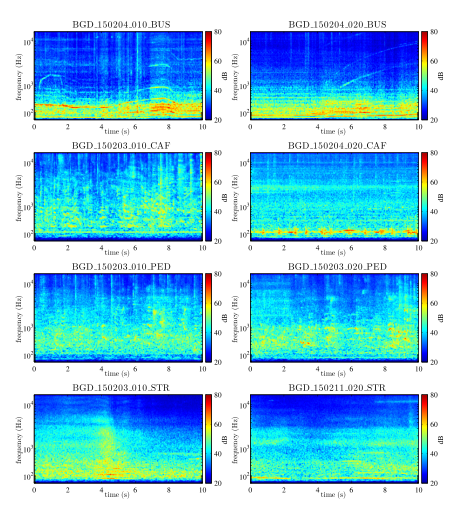
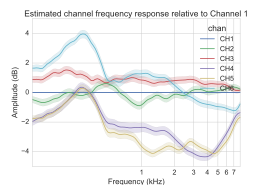
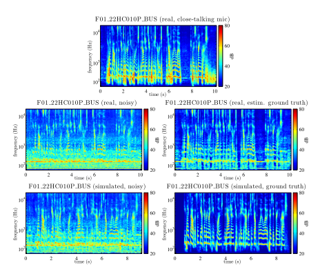

**Source:** *An analysis of environment, microphone and data simulation mismatches in robust speech recognition* — [PDF](https://eprints.whiterose.ac.uk/111196/1/vincent_CSL16.pdf)

**Universities of Leeds, Sheffield and York**

Deposited via The University of Sheffield.

White Rose Research Online URL for this paper: <https://eprints.whiterose.ac.uk/id/eprint/111196/>

Version: Accepted Version

# **Article:**

Vincent, E., Watanabe, S., Nugraha, A.A. et al. (2017) An analysis of environment, microphone and data simulation mismatches in robust speech recognition. Computer Speech & Language, 46. pp. 535-557. ISSN: 0885-2308

<https://doi.org/10.1016/j.csl.2016.11.005>

## **Reuse**

This article is distributed under the terms of the Creative Commons Attribution-NonCommercial-NoDerivs (CC BY-NC-ND) licence. This licence only allows you to download this work and share it with others as long as you credit the authors, but you can't change the article in any way or use it commercially. More information and the full terms of the licence here: https://creativecommons.org/licenses/

## **Takedown**

If you consider content in White Rose Research Online to be in breach of UK law, please notify us by emailing eprints@whiterose.ac.uk including the URL of the record and the reason for the withdrawal request.

# An analysis of environment, microphone and data simulation mismatches in robust speech recognition

Emmanuel Vincenta, Shinji Watanabeb, Aditya Arie Nugrahaa, Jon Barkerc, Ricard Marxerc

aInria, 54600 Villers-lès-Nancy, France bMitsubishi Electric Research Laboratories, Cambridge, MA 02139, USA cDepartment of Computer Science, University of Sheffield, Sheffield S1 4DP, UK

#### Abstract

Speech enhancement and automatic speech recognition (ASR) are most often evaluated in matched (or multi-condition) settings where the acoustic conditions of the training data match (or cover) those of the test data. Few studies have systematically assessed the impact of acoustic mismatches between training and test data, especially concerning recent speech enhancement and state-of-the-art ASR techniques. In this article, we study this issue in the context of the CHiME-3 dataset, which consists of sentences spoken by talkers situated in challenging noisy environments recorded using a 6-channel tablet based microphone array. We provide a critical analysis of the results published on this dataset for various signal enhancement, feature extraction, and ASR backend techniques and perform a number of new experiments in order to separately assess the impact of different noise environments, different numbers and positions of microphones, or simulated vs. real data on speech enhancement and ASR performance. We show that, with the exception of minimum variance distortionless response (MVDR) beamforming, most algorithms perform consistently on real and simulated data and can benefit from training on simulated data. We also find that training on different noise environments and different microphones barely affects the ASR performance, especially when several environments are present in the training data: only the number of microphones has a significant impact. Based on these results, we introduce the CHiME-4 Speech Separation and Recognition Challenge, which revisits the CHiME-3 dataset and makes it more challenging by reducing the number of microphones available for testing.

Keywords: Robust ASR, speech enhancement, train/test mismatch, microphone array.

 $Email\ address: \verb|emmanuel.vincent@inria.fr| (Emmanuel\ Vincent)$ 

#### 1. Introduction

Speech enhancement and automatic speech recognition (ASR) in the presence of reverberation and nonstationary noise are still challenging tasks today (Baker et al., 2009; W¨olfel and McDonough, 2009; Virtanen et al., 2012; Li et al., 2015). Research in this field has made great progress thanks to real speech corpora collected for various application scenarios such as voice command for cars (Hansen et al., 2001), smart homes (Ravanelli et al., 2015), or tablets (Barker et al., 2015), and automatic transcription of lectures (Lamel et al., 1994), meetings (Renals et al., 2008), conversations (Harper, 2015), dialogues (Stupakov et al., 2011), game sessions (Fox et al., 2013), or broadcast media (Bell et al., 2015). In most corpora, the training speakers differ from the test speakers. This is widely recognized as good practice and many solutions are available to improve robustness to this mismatch (Gales, 1998; Shinoda, 2011; Karafi´at et al., 2011; Swietojanski and Renals, 2014). By contrast, the acoustic conditions of the training data often match (or cover) those of the test data. While this allows for significant performance improvement by multi-condition training, one may wonder how the reported performance would generalize to mismatched acoustic conditions. This question is of tantamount importance for the deployment of robust speech processing technology in new environments. In that situation, the test data may differ from the training data in terms of reverberation time (RT60), direct-to-reverberant ratio (DRR), signal-to-noise ratio (SNR), or noise characteristics. In a multichannel setting, the number of microphones, their spatial positions and their frequency response also matter.

Regarding multichannel speech enhancement, the impact of the number of microphones and the microphone distance on the enhancement performance has been largely studied in the microphone array literature (Cohen et al., 2010). The impact of imprecise knowledge of the microphone positions and frequency responses has also been addressed (Cox et al., 1987; Doclo and Moonen, 2007; Anderson et al., 2015). For traditional speech enhancement techniques, which require either no training or training on the noise context preceding each test utterance (Cohen et al., 2010; Hurmalainen et al., 2013), the issue of mismatched noise conditions did not arise. This recently became a concern with the emergence of speech enhancement techniques based on deep neural networks (DNNs) (Wang et al., 2014; Xu et al., 2014; Weninger et al., 2015), which require a larger amount of training data not limited to the immediate context. Chen et al. (2015) and Kim and Smaragdis (2015) considered the problem of adapting DNN based enhancement to unseen test conditions, but their experiments were conducted on small, simulated datasets and evaluated in terms of enhancement metrics.

Regarding ASR, the variation of the word error rate (WER) as a function of the SNR was studied in several evaluation challenges, e.g., (Hirsch and Pearce, 2000; Barker et al., 2013). The adaptation of DNN acoustic models to specific acoustic conditions has been investigated, e.g., (Seltzer et al., 2013; Karanasou et al., 2014), however it has been evaluated in multi-condition settings rather than actual mismatched conditions. The impact of the number of microphones on the WER obtained after enhancing reverberated speech was evaluated in the REVERB challenge (Kinoshita et al., 2013), but the impact of microphone distance was not considered and no such large-scale experiment was performed with noisy speech. To our knowledge, a study of the impact of mismatched noise environments on the resulting ASR performance is also missing.

Besides mismatches of reverberation and noise characteristics, the mismatch between real and simulated data is also of timely interest. In the era of DNNs, there is an incentive for augmenting the available real training data by perturbing these data or simulating additional training data with similar acoustic characteristics. Simulation might also allow for rough assessment of a given technique in a new environment before real data collected in that environment become available. Suspicion about simulated data is common in the speech processing community, due for instance to the misleadingly high performance of direction-of-arrival based adaptive beamformers on simulated data compared to real data (Kumatani et al., 2012). Fortunately, this case against simulation does not arise for all techniques: most modern enhancement and ASR techniques can benefit from data augmentation and simulation (Kanda et al., 2013; Brutti and Matassoni, 2016). Few existing datasets involve both real and simulated data. In the REVERB dataset (Kinoshita et al., 2013), the speaker distances for real and simulated data differ, which does not allow fair comparison. The CHiME-3 dataset (Barker et al., 2015) provides a data simulation tool which aims to reproduce the characteristics of real data for training and twinned real and simulated data pairs for development and testing. This makes it possible to evaluate the improvement brought by training on simulated data in addition to real data and to compare the performance on simulated vs. real test data for various techniques.

In this article, we study the above mismatches in the context of the CHiME-3 dataset. Our analysis differs from the one of Barker et al. (2016), which focuses on the speaker characteristics and the noise characteristics of each environment and compares the achieved ASR performance with the intelligibility predicted using perceptual models. Instead, we focus on mismatched noise environments, different microphones, and simulated vs. real data. We provide a critical analysis of the CHiME-3 results in that light and perform a number of new experiments in order to separately assess the impact of these mismatches on speech enhancement and ASR performance. Based on these results, we conclude that, except for a few techniques, these mismatches generally have little impact on the ASR performance compared to, e.g., reducing the number of microphones. We introduce the CHiME-4 Speech Separation and Recognition Challenge, which revisits the CHiME-3 dataset and makes it more challenging by reducing the number of microphones.

The structure of the paper is as follows. In Section 2, we briefly recall how the CHiME-3 dataset was recorded and simulated and we attempt to characterize these mismatches objectively from data. We measure the impact of data simulation mismatch in Section 3 and that of environment and microphone mismatch in Section 4. We introduce the CHiME-4 Challenge in Section 5. We conclude in Section 6.

Table 1: Approximate distance between pairs of microphones (cm).

| Mic. no. | 1    | 2    | 3    | 4    | 5    | 6    |
|----------|------|------|------|------|------|------|
| 1        | 0    | 10.2 | 20.0 | 19.0 | 21.5 | 27.6 |
| 2        | 10.2 | 0    | 10.2 | 21.6 | 19.1 | 21.6 |
| 3        | 20.0 | 10.2 | 0    | 27.6 | 21.5 | 19.0 |
| 4        | 19.0 | 21.6 | 27.6 | 0    | 10.0 | 20.0 |
| 5        | 21.5 | 19.1 | 21.5 | 10.0 | 0    | 10.0 |
| 6        | 27.6 | 21.6 | 19.0 | 20.0 | 10.0 | 0    |

#### 2. Characterization of the mismatches

The CHiME-3 dataset consists of real and simulated recordings of speech from the Wall Street Journal (WSJ0) corpus (Garofalo et al., 2007) in everyday environments. Four environments are considered: bus (BUS), caf´e (CAF), pedestrian area (PED), and street (STR). The real data consists of utterances spoken live by 12 US English talkers in these environments and recorded by a tablet equipped with an array of six sample-synchronized microphones: two microphones numbered 1 and 3 facing forward on the top left and right, one microphone numbered 2 facing backward on the top center, and three microphones numbered 4, 5, and 6 facing forward on the bottom left, center, and right. See Barker et al. (2016, Fig. 1) for a diagram. The distances between microphones are indicated in Table 1. In order to help estimate the ground truth, speech was also captured by a close-talking microphone approximately synchronized with the array. Note that this close-talking signal is not clean and it is not used as the ground truth directly: see Section 2.3.1 for the ground truth estimation procedure for real data. The simulated data is generated from clean speech utterances and continuous background noise recordings, as described in more detail in Section 2.3.2 below. The overall dataset involves a training set of 1600 real and 7138 simulated utterances, a development set of 1640 real and 1640 simulated utterances, and a test set of 1320 real and 1320 simulated utterances. The speakers in the training, development, and test sets are disjoint and they were recorded in different instances of each environment (e.g., different buses). All data are sampled at 16 kHz. The start and end time and the speaker identity of all utterances are annotated and the task is to transcribe the real test utterances. For more details, see Barker et al. (2015).

#### *2.1. Environment mismatch*

A first mismatch between data concerns the recording environments. Due to the use of a tablet whose distance to the speaker's mouth varies from about 20 to 50 cm, the level of reverberation in the recorded speech signals is limited. The main difference between environments is hence the level and type of background noise. Barker et al. (2016) measure the SNR and the nonstationarity of every instance of each environment. These metrics correlate well with the WER in a multi-condition setting, but they are obviously insufficient to predict the performance of a system trained in one environment when applied in another. We provide a different characterization here in terms of the mismatch between environments and between instances of each environment.

Fig. 1 shows the spectrograms of two different noise instances for each environment, taken from the 17 continuous background noise recordings provided in CHiME-3 (4 recordings for BUS, CAF, and PED, and 5 for STR). Many differences can be seen. For instance, BUS noise evolves slowly over time and concentrates below 400 Hz, while PED noise is more nonstationary and wideband. Also, the second instance of CAF noise differs significantly from the first one

In an attempt to quantify these mismatches objectively, we propose to compute log-likelihood ratios (LLRs). We represent channel  $5^1$  of each background noise recording r by a sequence of 39-dimensional features  $\mathbf{y}_{rn}$  consisting of 13 Mel frequency cepstral coefficients (MFCCs) computed on 25 ms frames with 10 ms overlap indexed by  $n \in \{0, \dots, N-1\}$ , and their first- and second-order derivatives. We split each recording into the first 8 min (denoted as  $\mathbf{y}_r^{\text{train}}$ ) for training and the next 8 min (denoted as  $\mathbf{y}_r^{\text{test}}$ ) for testing. We train a 32-component Gaussian mixture model (GMM)  $\mathcal{M}_r$  on  $\mathbf{y}_r^{\text{train}}$  and apply it on  $\mathbf{y}_r^{\text{test}}$  as well as on every  $\mathbf{y}_{r'}^{\text{test}}$ ,  $r' \neq r$ . The LLR

$$LLR(r'|r) = \log P(\mathbf{y}_{r'}^{\text{test}}|\mathcal{M}_r) - \log P(\mathbf{y}_r^{\text{test}}|\mathcal{M}_r)$$
 (1)

measures how well a noise model trained on one recording r in one environment generalizes to another recording r' in the same or another environment, independently of the difficulty of modeling recording r itself due to the long-term nonstationarity of the data. We average the LLRs over all model and recordings corresponding to each environment.

The resulting LLRs are shown in Table 2. Similar values were obtained with different numbers of Gaussian components from 32 to 512 (not shown here). As expected, the LLRs on the diagonal are large, which means that noise models generalize well to other recordings in the same environment. Actually, with the exception of CAF (second row), a noise model trained on one recording in one environment generalizes better to other recordings in that environment than to another environment. This is likely due to the features being more similar within one environment than across environments, as discussed above. Perhaps more surprisingly, the table is not symmetric: switching the training and test environments can yield very different results. For instance, the noise model trained on CAF generalizes well to STR, but the reverse claim does not hold. This can likely be attributed to the fact that the variance of the features differs from one environment to another: training on features with high variance and testing on features with low variance yields a larger LLR than the opposite. Generally speaking, CAF appears to be a favorable environment for training (the

 $^1\mathrm{We}$  chose channel 5 because it provided the best WER among all channels with the original challenge baseline.

Figure 1: Example spectrograms of channel 5 of two different noise instances for each environment.

Table 2: Average LLR per frame obtained when training a noise model on one recording in one environment and testing it on other recordings in that environment or another environment.

|          |     | Test  |       |       |      |  |  |  |
|----------|-----|-------|-------|-------|------|--|--|--|
|          |     | BUS   | CAF   | PED   | STR  |  |  |  |
|          | BUS | -4.6  | -11.4 | -12.0 | -4.9 |  |  |  |
|          | CAF | -9.4  | -2.1  | 0.0   | 0.2  |  |  |  |
| Training | PED | -18.3 | -6.5  | -3.4  | -5.1 |  |  |  |
|          | STR | -7.5  | -10.0 | -8.5  | -1.5 |  |  |  |

LLRs on the corresponding row are large) and STR a favorable environment for testing (the LLRs on the corresponding column are large).

Other differences between environments concern speaker and tablet movements and early reflections. Movement mismatches could be quantified using, e.g., LLRs between trajectories modeled by hidden Markov models (HMMs), but they are not directly related to system performance since most speaker localization systems do not rely on training. Concerning early reflections, they cannot be reliably quantified from real, noisy data with current signal processing techniques. For these reasons, we do not attempt to characterize these mismatches objectively hereafter.

## *2.2. Microphone mismatch*

A second mismatch between data concerns the microphones used for recording. Assuming that the physical sound power is similar at all microphones on average over all background noise recordings2 , the relative magnitude response of each microphone can be roughly estimated as follows. We compute the power spectrum of each channel within 1 s Hann windows and 1/6 octave frequency bands. We then average these spectra over 1 min segments and compute differences in log-magnitude with respect to channel 1. Finally, we compute the mean and the standard deviation of these differences over the 8 h of continuous background noise recordings. The results are shown in Fig. 2. Two clusters of channels appear. Channels 2 and 3 (on top of the tablet) exhibit a comparable frequency response relative to channel 1, while channels 4, 5, and 6 (on the bottom) have more energy at low frequencies and less at high frequencies. Also, the overall gain of channels 2 and 3 is similar to channel 1, while that of channels 4 and 5 is significantly lower and that of channel 6 is higher. Overall, the difference between channels may be as large as 5 dB at certain frequencies.

2By "physical sound power", we mean the power of the sound field before it is captured by the microphones. At a given time, a far-field noise source is expected to result in similar physical sound power at all microphones below 1 kHz, roughly. Above that frequency, far-field noises impinging from the back (resp. front) are partially masked by the tablet when reaching microphone 2 (resp. microphones 1, 3, 4, 5, 6). Our computation therefore assumes that nearfield noise sources come from many different directions on average and that the physical noise powers at the front and at the back are similar. Although these assumptions are reasonable for the considered noise environments, they cannot be precisely quantified.

Another related mismatch concerns microphone failures. The reader is referred to (Barker et al., 2016) for more information about this issue.

Figure 2: Microphone frequency response relative to channel 1 estimated on 1 min background noise segments. Solid lines correspond to the mean over the 8 h of continuous background noise recordings and colored areas to plus or minus one standard deviation.

#### 2.3. Simulation and ground truth estimation mismatches

One last important mismatch between data concerns real vs. simulated data. As mentioned earlier, the CHiME-3 dataset contains real data, which were spoken live by 12 talkers in noisy environments, and simulated data, which were constructed by mixing clean speech recordings with noise backgrounds in a way that tries to match the properties of real data. The ground truth speech and noise signals underlying real data are not readily available and must be estimated by means of signal processing. Indeed, the close-talking speech signal is not clean enough for this purpose: as can be seen in Fig. 3, top, it includes background noise (e.g., between 0 and 0.5 s), breathing noises (e.g., between 9.4 and 10.1 s), "pop" noises due to plosives (e.g., "p" at 0.8 s, 2.9 s, 4.5 s, and 8.1 s), and a channel effect compared to the speech signal recorded by the tablet microphones (Fig. 3, middle left). Therefore, real and simulated data are not only different, but the underlying ground truth speech and noise signals were obtained in a different way too. In order to understand this mismatch, it is necessary to describe the simulation and ground truth estimation procedure in more detail.

# 2.3.1. Ground truth estimation for real data

The speech and noise signals underlying every real recording r are estimated as follows. Let us denote by  $x_{ri}(t)$  and  $c_r(t)$  the signals recorded by the i-th array

microphone and the close-talking microphone, respectively. The signals are represented in the complex-valued short-time Fourier transform (STFT) domain by their coefficients  $X_{ri}(n, f)$  and  $C_r(n, f)$  in time frame n and frequency bin f. The STFT is computed using half-overlapping sine windows of 256 samples (16 ms).

The time frames are partitioned into  $K_r$  variable-length, half-overlapping, sine-windowed blocks indexed by  $k \in \{1, \ldots, K_r\}$  such that the amount of speech is similar in each block. To do so, the number of significant STFT bins (above the median STFT magnitude) in the close-talking signal is accumulated over time and the center frame  $n_k$  of the k-th block is chosen as the  $\frac{k-1/2}{K_r}$ -th quantile of this distribution. We also define  $n_0=0$  and  $n_{K_r+1}=N$ . The windowed STFT coefficients in the k-th block are defined as

$$X_{rki}(n,f) = w_{rk}(n)X_{ri}(n,f)$$
(2)

$$C_{rk}(n,f) = w_{rk}(n)C_r(n,f)$$
(3)

where  $w_{rk}(n)$  is a finite-length window extending from  $n_{k-1}$  to  $n_{k+1} - 1$  made of the left half of a sine window of length  $n_k - n_{k-1}$  (except for the first frame where a rectangular window is used) and the right half of a sine window of length  $n_{k+1} - n_k$  (except for the last frame where a rectangular window is used). The number of blocks  $K_r$  is equal to the total duration of the signal divided by 250 ms.

The speech  $S_{rki}(n, f)$  and the noise  $B_{rki}(n, f)$  underlying the noisy signal  $X_{rki}(n, f)$  in each block are estimated by subband filtering

$$S_{rki}(n,f) = \sum_{l=L_{min}}^{L_{max}} A_{rki}(l,f) C_{rk}(n-l,f)$$
 (4)

$$B_{rki}(n,f) = X_{rki}(n,f) - S_{rki}(n,f)$$

$$\tag{5}$$

where  $L_{\rm min}=-3$ ,  $L_{\rm max}=8$ , and  $A_{rki}(l,f)$  is the STFT-domain relative impulse response between the close-talking microphone and the *i*-th array microphone of  $L=L_{\rm max}-L_{\rm min}+1$  taps. Subband filtering across several frames is required to handle imperfect microphone synchronization and early reflections (if any). Windowing into blocks is also required to address speaker and tablet movements, as well as the fact that the close-talking speech signal is not clean.

The relative impulse responses  $A_{rki}(l,f)$  are estimated in the least squares sense by minimizing  $\sum_n |B_{rki}(n,f)|^2$  separately in each block k and each bin f. The optimal  $L \times 1$  vector  $\mathbf{A}_{rki}$  with entries  $A_{rki}(l,f)$  is classically obtained as

$$\mathbf{A}_{rki} = \mathbf{G}_{rk}^{-1} \mathbf{D}_{rki} \tag{6}$$

where  $\mathbf{G}_{rk}$  is an  $L \times L$  matrix with entries  $G_{rkll'} = \sum_{n} C_{rk}(n-l, f) C_{rk}^*(n-l', f)$  and  $\mathbf{D}_{rki}$  is an  $L \times 1$  vector with entries  $d_{rkil} = \sum_{n} X_{rki}(n, f) C_{rk}^*(n-l, f)$  (Vincent et al., 2007).

The full STFT is reconstructed by overlap-add:

$$S_{ri}(n,f) = \sum_{k=1}^{K_r} w_{rk}(n) S_{rki}(n,f)$$
 (7)

$$B_{ri}(n,f) = X_{ri}(n,f) - S_{ri}(n,f).$$
 (8)

This choice of windows ensures exact reconstruction. Time-domain speech and noise signals  $s_{ri}(t)$  and  $b_{ri}(t)$  are eventually obtained by inverse STFT.

The estimated speech signal  $s_{ri}(t)$  was considered as a proxy for the ground truth clean speech signal (which cannot be measured).

#### 2.3.2. Data simulation and ground truth definition for simulated data

Given real data and the corresponding ground truths, simulated data were constructed by convolving clean speech recordings with time-varying impulse responses and mixing them with noise backgrounds in a way that matches the speech and noise types, the speaker or tablet movements, and the SNR of real data. Ideally, the time-varying impulse responses used for simulation should have been taken from real data. However, the ground truth impulse responses are not readily available and, although the ground truth estimation procedure in Section 2.3.1 yields reasonable estimates for the speech and noise signals at the microphones, it does not provide good estimates for the impulse responses  $A_{rki}(l,f)$ . This is due to the fact that the close-talking signal is not clean and to the intrinsic difficulty of estimating time-varying impulse responses from a small number of samples in the presence of noise. Therefore, simulation was based on tracking the spatial position of the speaker in the real recordings using the SRP-PHAT algorithm (DiBiase et al., 2001) and generating the time-varying pure delay filter corresponding to the direct path between the speaker's mouth and the microphones instead.

For every real utterance r in the development and test sets, a matched simulated utterance was generated by convolving the same sentence recorded in clean conditions in a sound proof booth with this time-varying pure delay filter and adding the estimated noise  $b_{ri}(t)$  such that the SNR  $\sum_{it} |s_{ri}(t)|^2 / \sum_{it} |b_{ri}(t)|^2$  is preserved.

For every real utterance in the training set, several simulated utterances were generated using the same time-varying pure delay filter and SNR, but different clean speech utterances from the original WSJ0 corpus and different noises taken from the set of continuous background noise recordings for the corresponding environment. An equalization filter estimated as the ratio between the average power spectrum of booth data and original WSJ0 data was applied.

For all simulated data, the ground truth clean speech signal is obviously known exactly.

# 2.3.3. Discussion

Fig. 3 displays the spectrogram of channel 5 of real and simulated noisy speech and the corresponding ground truths for one utterance in the develop-

ment set. Similar behavior was observed for other utterances. On the one hand, the real and simulated noisy speech signals appear to be quite similar in terms of speech and noise characteristics and SNR at each frequency, which suggests that single-channel ASR techniques may benefit from these simulated data. On the other hand, although the estimation of the ground truth speech signal underlying the real data helps getting rid of the "pop" noises and the distorted spectral envelope in the close-talking recording, it remains "noisier" than the clean speech ground truth for simulated data. This raises the question how DNN-based enhancement techniques, which employ these ground truth speech signals as targets for training, can benefit from real or simulated data.

Also, a number of multichannel properties of real data such as microphone responses, microphone failures, channel-dependent SNR, early reflections, and reverberation (low but nonzero) were not simulated, due to the difficulty of estimating these parameters from real data with current signal processing techniques. This raises the additional question how multichannel enhancement and ASR techniques can cope with these mismatches.

#### 3. Impact of data simulation mismatch

After having characterized and quantified the various mismatches, we now analyze their impact on ASR performance. This section concerns the impact of data simulation mismatch on the main processing blocks typically involved in a robust ASR system, namely speech enhancement, feature extraction, and ASR backend. We report several pieces of evidence stemming both from a critical analysis of the results of the systems submitted to CHiME-3 and from a new experiment. Our analysis can differ depending whether the considered processing techniques rely on training or not. In the former case, results are reported both on development and test data since these techniques may overfit the development data (which is typically used for validation during training). In the latter case, similar behavior is typically observed on development and test data and we report the results on development data only, when those on test data are unavailable. Based on these pieces of evidence, we attempt to answer the following two questions:

- 1. are simulated data useful for training in addition to real data?
- 2. how does the performance improvement brought by various robust ASR techniques on simulated development/test data compare with real data?

## *3.1. Baseline*

To start with, let us analyze the performance of the baseline ASR backend for the CHiME-3 challenge (Barker et al., 2015). Two different acoustic models are considered. For the GMM-based system, the acoustic features are 13 Mel frequency cepstral coefficients (MFCCs). Three frames of left and right context are concatenated and reduced to 40 dimensions using linear discriminant analysis (LDA), maximum likelihood linear transformation (MLLT), and speaker-dependent feature-space maximum likelihood linear regression (fMLLR)

Figure 3: Example real and simulated data and corresponding ground truths. For all signals except the close-talking microphone signal, only channel 5 is shown.

(Gales, 1998). For the DNN-based system, the acoustic features are 40 logmel features with five frames of left and right context. The DNN is trained by cross-entropy (CE) minimization, followed by state-level minimum Bayes risk (sMBR) optimization. Both baselines were implemented with Kaldi. By default, only channel 5 (ch5) is used for training and testing.

The resulting WERs are recalled in Table 3. The performance on real and simulated data appears to be similar on the development set but quite different on the test set. This difference is mostly due to the fact that the test speakers

produced less intelligible speech when recorded in noisy environments than when recorded in a booth (Barker et al., 2016). By contrast, the development speakers produced similarly intelligible speech in both situations. Clearly, achieving similar absolute WERs on real and simulated data is hard if not unfeasible due to the fact that utterances produced by live talkers used in the recordings will always be different for different repetitions. However, the absolute WER is not so relevant for the goal of evaluating and comparing different techniques. One is then more interested in measuring whether the relative WER improvement brought by one technique on simulated development/test data is a reliable predictor of the improvement on real data. In the rest of this section, we will report the absolute WER achieved by the tested techniques but we shall analyze the results in terms of relative improvement only.

Table 3: Baseline WER (%) when training and testing on noisy real and simulated data (ch5).

| Acoustic model | D     | ev    | Te    | est   |
|----------------|-------|-------|-------|-------|
| Acoustic model | real  | simu  | real  | simu  |
| GMM            | 18.70 | 18.71 | 33.23 | 21.59 |
| DNN            | 16.13 | 14.30 | 33.43 | 21.51 |

#### 3.2. Speech enhancement

# 3.2.1. Beamforming and post-filtering

Multichannel speech enhancement is a popular approach for improving ASR robustness in noisy conditions. Table 4 reports the results of various beamforming and spatial post-filtering techniques, namely minimum variance distortionless response (MVDR) beamforming with diagonal loading (Mestre and Lagunas, 2003), delay-and-sum (DS) beamforming (Cohen et al., 2010), Zelinski's post-filter (Zelinski, 1988), its modification by Simmer et al. (1994), and multichannel alignment (MCA) based beamforming (Stolbov and Aleinik, 2015)3. Apart from the MVDR beamformer which provides a very large improvement on simulated data but no improvement on real data, all tested techniques provide similar improvement on real and simulated data.

The lack of robustness of MVDR and other direction-of-arrival based adaptive beamformers on real data has been known for some time in the audio signal processing community (Gannot et al., 2001; Araki et al., 2003). These beamformers aim to minimize the noise power under the constraint of a unit response in the direction of the speaker. This constraint is valid for the CHiME-3 simulated data, which are simulated using a pure delay filter, but it does not hold anymore on real data. Indeed, early reflections (and to a lesser extent reverberation) modify the apparent speaker direction at each frequency, which results

 $^3$ MCA is a particular type of filter-and-sum beamforming where the filters are the relative transfer functions between each microphone and the DS beamformer output, which are estimated by cross-correlation.

Table 4: WER (%) achieved by beamforming and spatial post-filtering applied on all channels except ch2 using the GMM backend retrained on enhanced real and simulated data (Prudnikov et al., 2015).

| Enhancement   |       | Dev   |
|---------------|-------|-------|
|               | real  | simu  |
| none          | 18.70 | 18.71 |
| MVDR          | 18.20 | 10.78 |
| DS            | 12.43 | 14.52 |
| DS + Zelinski | 14.29 | 15.25 |
| DS + Simmer   | 12.75 | 14.14 |
| MCA           | 10.72 | 12.50 |

in undesired cancellation of the target. Fixed beamformers such as DS and its variant known as *BeamformIt* (Anguera et al., 2007) which was used in many challenge submissions do not suffer from this issue due to the fact that their spatial response decays slowly in the neighborhood of the estimated speaker direction. Modern adaptive beamformers such as MCA or the mask-based MVDR beamformer of Yoshioka et al. (2015) do not suffer from this issue either, due to the fact that they estimate the relative (inter-microphone) transfer function instead of the direction-of-arrival. Specifically, Yoshioka et al. (2015) estimated a time-frequency mask which represents the proposition of speech vs. noise in every time-frequency bin and they derived the beamformer from the multichannel statistics (spatial covariance matrices) of speech and noise computed from the corresponding time-frequency bins. They reported this beamformer to perform similarly on real and simulated data, which is particularly noticeable as it contributed to their entry winning the challenge.

A few challenge entries also employed multichannel dereverberation techniques based on time-domain linear prediction (Yoshioka et al., 2010) or interchannel coherence-based time-frequency masking (Schwarz and Kellermann, 2014). As expected, these techniques improved performance on real data but made a smaller difference or even degraded performance on simulated data due to the fact that it did not include any early reflection or reverberation (Yoshioka et al., 2015; Barfuss et al., 2015; Pang and Zhu, 2015).

# *3.2.2. Source separation*

As an alternative to beamforming and post-filtering, multichannel source separation techniques such as model-based expectation-maximization source separation and localization (MESSL) (Mandel et al., 2010) and full-rank local Gaussian modeling (Duong et al., 2010) have been considered. Again, these techniques operate by estimating the relative transfer function for the target speaker and the interfering sources from data. As expected, Bagchi et al. (2015) and Fujita et al. (2015) reported similar performance for these two techniques on real and simulated data. Single-channel enhancement based on nonnegative matrix factorization (NMF) of the power spectra of speech and noise has also been used and resulted in minor improvement on both real and simulated data (Bagchi et al., 2015; Vu et al., 2015).

## *3.2.3. DNN-based beamforming and separation*

By contrast with the aforementioned enhancement techniques, DNN-based enhancement techniques have recently emerged which do require training. In the following, we do not discuss DNN post-filters, which provided a limited improvement or degradation on both real and simulated data (Hori et al., 2015; Sivasankaran et al., 2015), and we focus on multichannel DNN-based enhancement instead.

Table 5 illustrates the performance of the DNN-based time-invariant generalized eigenvalue (GEV) beamformer proposed by Heymann et al. (2015). This beamformer is similar to the mask-based MVDR beamformer of Yoshioka et al. (2015) mentioned in Section 3.2.1, except that the time-frequency mask from which the multichannel statistics of speech and noise are computed is estimated via a DNN instead of a clustering technique. It is followed by a time-invariant blind analytic normalization (BAN) filter which rescales the beamformer output to ensure unit gain for the speaker signal. The DNN was trained on simulated data only, using the ideal mask computed from the underlying clean speech signal as the desired DNN output. The training set was either the original CHiME-3 simulated training set or an augmented simulated training set obtained by rescaling the noise signals by a random gain in [8 dB, 1 dB]. Two new utterances were generated for every utterance in the original set. The results in Table 5 indicate that DNN-based time-invariant GEV beamforming, BAN rescaling, and data augmentation consistently improve performance both on real and simulated data. These results also indicate that the enhancement system is able to leverage the simulated data to learn about the real data and that increasing the amount and variety of simulated data further improves performance.

Table 5: WER (%) achieved by DNN-based beamforming trained on original or augmented simulated data using the GMM backend retrained on enhanced real and simulated data (Heymann et al., 2015).

| Enhancement                     |       | Dev   | Test  |       |  |
|---------------------------------|-------|-------|-------|-------|--|
|                                 | real  | simu  | real  | simu  |  |
| none                            | 18.70 | 18.71 | 33.23 | 21.59 |  |
| DNN-based GEV                   | 10.42 | 10.20 | 16.47 | 11.16 |  |
| DNN-based GEV (augmented)       | 10.40 | 9.61  | 15.92 | 10.53 |  |
| DNN-based GEV (augmented) + BAN | 9.92  | 8.88  | 14.65 | 9.75  |  |

Sivasankaran et al. (2015) exploited a DNN to perform multichannel timevarying Wiener filtering instead. The desired DNN outputs are the magnitude spectra of speech and noise, which are computed from the underlying clean speech signals in the case of simulated data or using the procedure described in Section 2.3.1 in the case of real data. Given the speech and noise spectra estimated by the DNN, the spatial covariance matrices of speech and noise are estimated using a weighted expectation-maximization (EM) algorithm and used to compute a multichannel time-varying Wiener filter (Cohen et al., 2010). A comparable ASR improvement was achieved on real and simulated data. However, it was found that training the DNN on real data improved the results on real data compared to training on both real and simulated data, despite the smaller amount of training data available in the former case.

#### *3.2.4. Impact of ground truth estimation*

One possible explanation for the difference observed when training the enhancement DNN of Sivasankaran et al. (2015) on real vs. simulated data may be the way the ground truth is estimated rather than the data themselves. Indeed, as shown in Section 2.3.3, the spectrograms of real and simulated data appear to be similar, while the underlying ground truth speech signals, which are estimated from noisy and close-talk signals in the case of real data, look quite different. The fact that the ground truth speech signals for real data are "noisier" may be beneficial since it yields smoother time-frequency masks hence smaller speech distortion.

In order to validate this hypothesis, we compared the performance achieved by multichannel DNN-based enhancement when trained either on real data alone or on both real and simulated data and considered two distinct ground truths for the simulated data: either the true clean speech signals used to generate the data, or the ones estimated via the least squares subband filtering technique in (4)–(5) which are deliberately "noisier". We performed this experiment using the DNN-based multichannel source separation technique of Nugraha et al. (2016a), which is a variant of the one of Sivasankaran et al. (2015) that relies on exact EM updates for the spatial covariance matrices (Duong et al., 2010) instead of the weighted EM updates of Liutkus et al. (2015).

The results for this new experiment are shown in Table 6. Although training on real data still leads to the best results when testing on real data, using the same ground truth estimation technique for both real and simulated data significantly reduces the gap when training on real and simulated data. We attribute the residual gap to the fact that, even when using the same ground truth estimation technique, the ground truth remains "cleaner" for simulated data than for real data. More work on ground truth estimation is required to close this gap and benefit from simulated training data. In addition, training on real data now leads to a performance decrease on simulated data, while Sivasankaran et al. (2015) found it to consistently improve performance on both real and simulated data. Along with the recent results of Nugraha et al. (2016b) on another dataset, this suggests that, although weighted EM made little difference for spectral models other than DNN (Liutkus et al., 2015), weighted EM outperforms exact EM for the estimation of multichannel statistics from DNN outputs. More work on the estimation of multichannel statistics from DNN outputs is therefore also required.

Table 6: WER (%) achieved by the multichannel DNN-based enhancement technique of Nugraha et al. (2016a) depending on the choice of training data and ground truth estimation technique, using the GMM backend retrained on enhanced real and simulated data.

| Training data (ground truth)        |       | Dev   |       | Test  |
|-------------------------------------|-------|-------|-------|-------|
|                                     | real  | simu  | real  | simu  |
| Real (estimated) + simu (clean)     | 13.47 | 11.08 | 26.31 | 14.49 |
| Real (estimated) + simu (estimated) | 12.46 | 10.19 | 23.85 | 13.49 |
| Real (estimated)                    | 11.97 | 11.78 | 22.24 | 16.24 |

#### *3.3. Feature extraction*

## *3.3.1. Robust features and feature normalization*

After speech enhancement, the next processing stage of a robust ASR system concerns feature extraction and transformation. Table 7 illustrates the performance of two robust features, namely damped oscillator coefficients (DOC) (Mitra et al., 2013) and modulation of medium duration speech amplitudes (MMeDuSA) (Mitra et al., 2014), and a popular feature transform, namely fM-LLR (Gales, 1998). The improvement brought by these techniques appears to be quite correlated between real and simulated data. Other authors also found this result to hold for auditory-motivated features such as Gabor filterbank (GBFB) (Martinez and Meyer, 2015) and amplitude modulation filter bank (AMFB) (Moritz et al., 2015) and feature transformation/augmentation methods such as vocal tract length normalization (VTLN) (Tachioka et al., 2015) or i-vectors (Pang and Zhu, 2015; Prudnikov et al., 2015), provided that these features and methods are applied to noisy data or data enhanced using the robust beamforming or source separation techniques listed in Section 3.2. Interestingly, Tachioka et al. (2015) found VTLN to yield consistent results on real vs. simulated data when using GEV beamforming as a pre-processing step but opposite results when using MVDR beamforming instead. This shows that the difference in the characteristics of enhanced real vs. simulated signals induced by MVDR carries over to the features. Other enhancement techniques which result in similar characteristics for enhanced real and simulated signals do not appear to suffer from this problem.

Table 7: WER (%) achieved after enhancement by BeamformIt using various feature extraction and normalization methods and the DNN backend retrained on enhanced real and simulated data without sMBR (Hori et al., 2015).

| Features        |       | Dev   | Test  |       |  |
|-----------------|-------|-------|-------|-------|--|
|                 | real  | simu  | real  | simu  |  |
| Mel             | 10.66 | 12.58 | 20.17 | 23.86 |  |
| DOC             | 10.18 | 12.00 | 18.53 | 20.35 |  |
| MMeDuSA         | 9.54  | 10.83 | 18.27 | 19.26 |  |
| DOC + fMLLR     | 8.68  | 10.06 | 15.28 | 17.10 |  |
| MMeDuSA + fMLLR | 8.39  | 9.73  | 14.96 | 16.30 |  |

#### *3.3.2. DNN-based features*

DNN-based feature extraction techniques that do require training have also recently become popular. Tachioka et al. (2015) concatenated logmel or MFCC features with 40-dimensional bottleneck (BN) features extracted as the neuron outputs in the smaller hidden layer of a neural network with two hidden layers trained to predict phoneme posteriors. The neural network was trained on real and simulated data with logmel and pitch features as inputs. Irrespective of the enhancement technique used as a pre-processing step, the resulting ASR performance was found to improve on simulated data but not on real data. The underlying reasons are unclear, especially considering the fact that training a full ASR backend on real and simulated data did improve performance on both real and simulated data (see Section 3.4 below). More investigations are required to understand this phenomenon.

## *3.4. ASR backend*

#### *3.4.1. Acoustic modeling*

The final processing stage of a robust ASR system concerns the ASR backend. This includes acoustic modeling, language modeling, and possibly fusion of various systems. Table 8 lists the performance of various DNN-based acoustic models on noisy data.

The tested DNN architectures include conventional fully connected DNNs comprising 4 or 10 hidden layers, deep convolutional neural networks (CNNs) comprising 2 or 3 convolution layers topped with fully connected hidden layers, and a "network in network" (NIN) CNN (Lin et al., 2014). In the NIN, we have an additional multilayer perceptron (MLP) layer, which is a fully connected K ⇥ K (plus bias) conventional MLP without using convolution (this means that we have additional 1 ⇥ 1 convolution layer), where K is the number of feature maps used in the previous convolutional layer. This 1 ⇥ 1 convolution (or MLP) layer considers the correlation of K activations unlike the independent process performed by a standard CNN, and the 1 ⇥ 1 convolution is inserted every after every ordinary CNN layer in a whole network. The performance improvements brought by these increasingly complex architectures appear to be consistent on real and simulated data.

Table 8: WER (%) achieved on noisy data using various acoustic models trained on noisy real and simulated data (all channels) without sMBR (Yoshioka et al., 2015).

|                 |       | Dev   | Test  |       |  |
|-----------------|-------|-------|-------|-------|--|
| Acoustic model  | real  | simu  | real  | simu  |  |
| DNN (4 hidden)  | 13.64 | 13.51 | 23.05 | 16.68 |  |
| DNN (10 hidden) | 12.27 | 11.97 | 21.05 | 14.51 |  |
| CNN (2 hidden)  | 11.94 | 11.70 | 20.02 | 14.17 |  |
| CNN (3 hidden)  | 11.52 | 11.25 | 19.21 | 13.34 |  |
| NIN             | 11.21 | 10.64 | 18.47 | 12.81 |  |

It must be noted that, with the exception of Vu et al. (2015), all challenge

entrants trained GMM-HMM and DNN-HMM acoustic models on real and simulated data. Heymann et al. (2015) found that discarding real data and training a GMM-HMM acoustic model on simulated data only increases the WER by 3% and 4% relative on real development and test data, respectively. This minor degradation is mostly due to the smaller size of the training set and it proves without doubt that acoustic models are able to leverage simulated data to learn about real data. Actually, Heymann et al. (2015) and Wang et al. (2015) obtained a consistent ASR improvement on real and simulated data by generating even more simulated data, thereby increasing the variability of the training set. These additional data were generated by rescaling the noise signals by a random gain. Augmenting the training set by using individual microphone channels or performing semi-supervised adaptation on the test data also yielded consistent improvements on real and simulated data (Yoshioka et al., 2015).

By contrast with these results, Vu et al. (2015) found that, in the case when MVDR beamforming is applied, training the ASR backend on real data only improves the WER on real test data compared to training on real and simulated data. This confirms that the difference in the characteristics of enhanced real vs. simulated signals induced by MVDR carries over to the ASR backend too. Other enhancement techniques which result in similar characteristics for enhanced real and simulated signals do not appear to suffer from this problem.

## *3.4.2. Language modeling and ROVER fusion*

Concerning other parts of the decoder, Hori et al. (2015) reported consistent improvements on real and simulated data by replacing the default 3-gram language model used in the baseline by a 5-gram language model with Kneser-Ney (KN) smoothing (Kneser and Ney, 1995), rescoring the lattice using a recurrent neural network language model (RNN-LM) (Mikolov et al., 2010), and fusing the outputs of multiple systems using MBR. This claim also holds true for system combination based on recognizer output voting error reduction (ROVER) (Fiscus, 1997), as reported by Fujita et al. (2015). This comes as no surprise as these techniques are somewhat orthogonal to acoustic modeling and they are either trained on separate material or do not rely on training at all.

## *3.4.3. Discriminative fusion*

Fujita et al. (2015) also proposed a discriminative word selection method to estimate correct words from the composite word transition network created in the ROVER process. They trained this method on the real development set and found it to improve the ASR performance on real data but to degrade it on simulated data. It is unclear whether training on both real and simulated data would have made a difference. More research is needed to understand this issue.

#### *3.5. Summary*

Let us summarize the outcomes of our analysis. On the one hand, we have seen evidence that MVDR beamforming performs much better on simulated data than on real data due to the absence of early reflections and reverberation in the simulated data. The resulting mismatch between enhanced real and simulated data propagates to the features and the ASR backend. This negatively affects the choice of features and training data and the overall system performance.

On the other hand, we have seen plenty of evidence that fixed beamformers (such as DS and *BeamformIt*) and modern adaptive beamformers (such as MCA or mask-based MVDR) which are not training-based do not suffer from this problem and result in enhanced real and simulated data with similar characteristics. The relative improvement brought by signal enhancement, feature extraction/transformation, or acoustic modeling techniques on real data can then be predicted from the improvement brought on simulated data. Crucially, the fact that real and simulated data share similar characteristics also makes it possible to leverage simulated data to learn about real data. Performance can actually be improved by generating even more simulated data that increase the variability of the training set.

Finally, the impact of real vs. simulated mismatches on training-based enhancement techniques is more contrasted. Simulated training data were successfully used for DNN-based GEV beamforming, but DNN-based multichannel Wiener filtering performed better when trained on real data instead. This was found to be mostly due to the way the ground truth speech signals are defined for simulated noisy data.

## 4. Impact of environment and microphone mismatches

We now analyze the impact of environment and microphone mismatches on ASR performance. Specifically, we consider the performance degradation that results from training the enhancement front-end and the ASR acoustic model on certain environments or microphones and testing them on others. Since these mismatches were not present in CHiME-3, the results below are all based on new experiments. We do not study training-based feature extraction or system fusion techniques further for the reasons exposed in Sections 3.3.2 and 3.4.3.

## *4.1. Multichannel DNN-based separation*

Our first experiment deals with the impact of environment mismatch on training-based enhancement techniques, as measured by the resulting ASR performance. We considered the DNN-based multichannel source separation technique of Nugraha et al. (2016a). As explained in Section 3.2.4, this technique is trained on real data only.

We study three different training setups:

- single-condition: train on 1 environment (e.g., BUS), test on the same one or another one,
- few-condition: train on 3 environments (e.g., all but BUS), test on one of them or on the remaining one,
- many-condition: train on all 4 environments.

The first setup is a classical single-condition matched/mismatched setup. The second setup aims to assess the number of environments required for multicondition training, as well as its performance in a test environment which was not seen during training. The last setup constitutes a classical multi-condition training setup, where all possible test environments are part of the training set. In order to analyze the results independently of the amount of training data, three different many-condition systems were considered, using 1/4, 3/4, or the full real training set. These are denoted as "1/4 of all", "3/4 of all", and "all", respectively, below. Each training setup resulted in a different enhancement system.

The resulting ASR performance was evaluated using the updated DNN-based baseline distributed by the organizers after the challenge4 (Hori et al., 2015). This baseline is identical to the one described in Section 3.1, except that decoding is performed using a 5-gram language model with KN smoothing and RNN-LM based rescoring. The acoustic model was trained on the full real and simulated training set. Results are reported for real data only, however. We consider two different acoustic models for each enhancement system to be evaluated:

- a generic acoustic model trained on the training set enhanced by the manycondition enhancement system denoted as "all",
- a specific acoustic model trained on the training set enhanced by the enhancement system to be evaluated.

The first setup ensures that the impact of environment mismatch on the enhancement performance is assessed independently of the ASR system (since all enhancement systems are evaluated using a unique many-condition acoustic model), but it does not fit the data as well as the second setup.

The results are shown in Table 9. It appears that the WERs obtained with the generic acoustic model and the specific acoustic models follow similar trends, however the latter are systematically lower. Hence we focus on the lower half of the table in the following. Several comments can be made.

When training on 1 environment, the best performance on test data is achieved by matched training (same training and test environment) only for BUS and STR. For CAF and PED, the best performance is achieved by training on STR. Also, for the same amount of data, many-condition training performs best for all test environments but STR. This indicates that matched training is not always desirable. The fact that DNNs can take advantage of multi-condition training is well known (Li et al., 2015). The fact that mismatched training data is sometimes preferable to matched data has also been recently observed5. These two facts are generally attributed to the regularization effect induced by the larger variance of the training data. We see that this explanation does not

&lt;sup>4https://github.com/kaldi-asr/kaldi/tree/master/egs/chime3

&lt;sup>5For instance, Yoshioka et al. (2015) showed that training a DNN acoustic model on noisy data achieved better results than training it on enhanced data, when decoding enhanced data.

fully hold since STR turns out to be a favorable training environment for CAF, despite its lower variance than CAF itself. Which characteristics make a given environment better for training remains an open question.

Automatically predicting the best training environment for each test environment is difficult too, since it differs on the development set. The LLRs used to characterize the noise signals in Table 2 appear consistent with the best training environment to some extent. For instance, the two best training environments when testing on BUS are BUS or STR and the two best training environments when testing on STR are CAF or STR. However, this does not hold for the two other testing environments. Also, the LLR is not linearly related to the WER. This explains why CAF, which appeared to be a favorable training environment in Table 2, turns out to perform worst in Table 9, essentially due to its very bad performance when testing on BUS. More work is needed towards better noise characterization metrics in the line of Section 2.1.

When training on 3 environments, all combinations of environments achieve similar results. Only "all but BUS" performs slightly worse on BUS. This shows that including data from the test environment in the training set is most often not required, provided that the training set contains a sufficient number of other environments. Also, interestingly, "all but STR" and "all but PED" perform comparably or slightly better than many-condition training on average. This suggests that automatic selection of training data within a multi-condition set has the potential to further improve performance.

#### *4.2. Acoustic modeling*

We now investigate the impact of environment and microphone mismatches on ASR acoustic modeling. We use the updated DNN-based baseline with DNN acoustic modeling and 5-gram and RNN-LM based rescoring, as used in Section 4.1.

## *4.2.1. Environment mismatch*

We first focus on the environment mismatch. Similarly to Section 4.1, we extract a subset of the training data with either 1 or 3 environments and train an acoustic model on this subset. Once we obtain the acoustic model, we evaluate it on all environments of the test set. As a reference, we also prepare a multi-condition model trained with approximately same amount of training data (i.e., "1/4 of all" and "3/4 of all"), which are randomly extracted from all environments. We disabled speech enhancement to make the discussion simple. The acoustic model is trained on channel 5 (ch5) of the real and simulated training set. Table 10 reports the results on real development and test data.

When training on 1 environment, the best performance on test is often achieved by matched training (same training and test environment) except for BUS, although the best WERs for CAF and STR are not statistically significant compared with the second best WERs according to the matched pairs sentencesegment word error test (p = 0.638 and 0.373 respectively). This can be found by checking the diagonal elements of the upper half of the Table except for the

Table 9: Average WER (%) obtained by training and testing the DNN-based multichannel enhancement system of Nugraha et al. (2016a) in different environments. Dashed lines delimit training sets having the same amount of data.

|             |       |      | Dev (real)       |      |      |                             |                   | Test (real)                   |      |       |
|-------------|-------|------|------------------|------|------|-----------------------------|-------------------|-------------------------------|------|-------|
| Training    | BUS   |      | CAF PED STR Avg. |      |      | BUS                         | CAF               | PED                           | STR  | Avg.  |
|             |       |      |                  |      |      | Generic ASR acoustic model  |                   |                               |      |       |
| BUS         | 10.12 | 7.71 | 4.93             | 8.07 | 7.71 |                             |                   | 27.20 14.34 18.44 10.72 17.67 |      |       |
| CAF         | 16.24 | 7.05 | 4.93             | 8.13 | 9.09 |                             | 47.49 12.01 17.15 |                               | 9.86 | 21.62 |
| PED         | 15.06 | 6.86 | 4.51             | 7.65 | 8.52 |                             | 39.67 11.65 16.12 |                               | 8.91 | 19.09 |
| STR         | 10.08 | 6.84 | 4.41             | 6.84 | 7.04 |                             | 30.55 12.03 17.17 |                               | 8.42 | 17.04 |
| 1/4 of all  | 9.43  | 7.02 | 4.38             | 7.14 | 6.99 |                             | 24.53 11.28 16.52 |                               | 8.39 | 15.18 |
| all but BUS | 9.41  | 5.60 | 4.09             | 6.34 | 6.36 |                             | 25.99 10.42 15.15 |                               | 7.13 | 14.67 |
| all but CAF | 7.58  | 5.74 | 3.92             | 6.39 | 5.91 |                             | 19.78 10.25 15.66 |                               | 7.71 | 13.35 |
| all but PED | 7.74  | 5.68 | 4.29             | 6.08 | 5.95 |                             | 20.21 10.07 16.05 |                               | 7.60 | 13.48 |
| all but STR | 8.04  | 5.21 | 4.13             | 6.58 | 5.99 |                             | 20.17 10.38 14.65 |                               | 7.86 | 13.27 |
| 3/4 of all  | 7.60  | 5.52 | 3.73             | 6.08 | 5.73 |                             | 19.57 10.66 14.82 |                               | 7.88 | 13.23 |
|             |       |      |                  |      |      | Specific ASR acoustic model |                   |                               |      |       |
| BUS         | 8.97  | 7.20 | 4.59             | 7.76 | 7.13 |                             | 21.03 13.06 17.92 |                               | 9.28 | 15.32 |
| CAF         | 12.58 | 6.98 | 5.13             | 7.79 | 8.12 |                             | 31.48 13.15 16.95 |                               | 8.78 | 17.59 |
| PED         | 11.76 | 7.02 | 4.48             | 6.87 | 7.53 |                             | 27.89 12.20 17.04 |                               | 8.93 | 16.51 |
| STR         | 9.68  | 6.70 | 4.60             | 7.21 | 7.05 |                             | 24.30 11.80 16.42 |                               | 8.48 | 15.25 |
| 1/4 of all  | 8.78  | 6.58 | 4.78             | 7.37 | 6.88 |                             | 20.83 11.65 15.94 |                               | 8.72 | 14.28 |
| all but BUS | 8.60  | 5.62 | 3.98             | 6.56 | 6.19 |                             | 22.62 10.72 15.47 |                               | 7.55 | 14.09 |
| all but CAF | 7.80  | 5.90 | 3.84             | 6.74 | 6.07 |                             | 18.90 10.59 16.07 |                               | 7.53 | 13.27 |
| all but PED | 7.49  | 5.90 | 3.91             | 6.25 | 5.89 |                             | 18.56 10.76 14.93 |                               | 8.09 | 13.08 |
| all but STR | 7.23  | 5.94 | 4.06             | 7.33 | 6.14 |                             | 18.19 10.03 15.08 |                               | 7.94 | 12.81 |
| 3/4 of all  | 7.67  | 5.86 | 3.70             | 6.28 | 5.88 |                             | 18.84 10.98 15.41 |                               | 7.79 | 13.26 |
| all         | 7.10  | 5.41 | 3.61             | 6.22 | 5.59 |                             | 17.27 10.37 15.90 |                               | 7.55 | 12.77 |

"1/4 of all" row and the "Avg." column. However, this observation does not hold for development data and matched training performs best only for STR. This suggests that, similarly to speech enhancement, ASR acoustic modeling is not sensitive to the mismatch between training and test environments in the case when the training data consists of a single environment.

The lower half of Table 10, which reports the results achieved by the acoustic model trained on 3 environments, corresponds to a more practical scenario for actual use. The effect of environment mismatch can be found by checking the diagonal elements except for the "3/4 of all" row and the "Avg." column. We observe six cases, namely BUS and CAF in the development set and all environments in the test set, for which the acoustic model trained on data excluding that environment scored worse than acoustic models trained on data including that environment. This indicates that environmental mismatch can often cause a WER degradation, but not always. However, the WER difference is very small except for BUS, and the matched pairs sentence-segment word error test (Gillick and Cox, 1989) for the test data shows that the worst WERs for CAF, PED, and STR are not statistically significant compared with the second worst WERs (p = 0.660, 0.704, and 0.095, respectively). Therefore, we can conclude that environmental mismatch between training and test data degrades the performance in most training scenarios, but not significantly so. It is also interesting to note that multi-condition training ("3/4 of all") is not always best when we use STR in the development data and CAF and STR in the test data. This suggests that ASR acoustic modeling could benefit from automatic selection of training data within a multi-condition set.

These conclusions remain essentially valid when replacing the DNN acoustic model with a GMM acoustic model (not shown in the Table).

Finally, comparing these ASR results with Table 2 in Section 2.1, we see that there is no meaningful relationship between LLRs and WERs (e.g., the columnwise order of LLRs and the reverse order of WERs are not similar to each other). This indicates that the LLR is not a useful measure to predict ASR performance and more work is needed to predict the impact of environment mismatches on ASR without using transcriptions.

Table 10: Average WER (%) obtained by training and testing a DNN acoustic model with RNN-LM rescoring on different environments. Dashed lines delimit training sets having the

| same amount of data. |  |
|----------------------|--|
|                      |  |

|             |       |             | Dev (real) |       |                                                             | Test (real)                         |     |     |                               |      |  |
|-------------|-------|-------------|------------|-------|-------------------------------------------------------------|-------------------------------------|-----|-----|-------------------------------|------|--|
| Training    | BUS   | CAF         | PED        | STR   | Avg.                                                        | BUS                                 | CAF | PED | STR                           | Avg. |  |
| BUS         |       |             |            |       | 21.18 18.29 11.20 14.08 16.19 45.56 33.34 26.53 17.71 30.78 |                                     |     |     |                               |      |  |
| CAF         |       | 20.05 11.25 | 7.88       |       | 14.02 13.30 44.33 23.22 18.78 16.88 25.80                   |                                     |     |     |                               |      |  |
| PED         |       | 20.93 11.08 | 8.29       |       | 14.36 13.67 43.86 23.53 17.53 17.37 25.57                   |                                     |     |     |                               |      |  |
| STR         |       | 19.46 14.62 | 8.41       |       | 12.46 13.74 40.31 28.63 22.27 16.14 26.83                   |                                     |     |     |                               |      |  |
| 1/4 of all  |       | 19.47 10.77 | 7.73       |       | 12.48 12.61 40.47 23.52 17.90 15.47 24.34                   |                                     |     |     |                               |      |  |
| all but BUS | 17.20 | 8.16        | 5.89       | 9.78  |                                                             | 10.25 35.50 18.34 13.66 12.29 19.94 |     |     |                               |      |  |
| all but CAF | 16.23 | 9.56        | 6.02       |       | 10.29 10.52 32.87 20.92 15.45 12.25 20.37                   |                                     |     |     |                               |      |  |
| all but PED | 16.21 | 9.16        | 5.68       | 9.88  |                                                             | 10.23 32.62 20.64 15.66 12.33 20.31 |     |     |                               |      |  |
| all but STR | 16.45 | 8.67        | 5.72       |       | 10.25 10.27 33.11 18.88 15.06 12.94 20.00                   |                                     |     |     |                               |      |  |
| 3/4 of all  | 15.93 | 8.02        | 5.49       | 10.03 | 9.87                                                        |                                     |     |     | 32.75 19.41 13.45 12.40 19.50 |      |  |

## *4.2.2. Microphone mismatch*

The next experiments focus on the microphone mismatch between training and test data for acoustic modeling. We trained the acoustic model with each microphone and tested the performance for all 6 microphone signals. Similarly to the previous experiments, we disabled speech enhancement to make the discussion simple. Table 11 show the WERs for each training and test microphone, where we used both real and simulation data to train the acoustic models.

From these results, we can observe that the acoustic model trained on channel 6 scores best for all channels but channels 2 and 3 on the development set. On the other hand, on the test set, the acoustic model trained on channel 2

Table 11: Average WER (%) obtained by training and testing a DNN acoustic model and 5-gram and RNN-LM rescoring on different microphones, with real and simulated training data. The best WER in each column has a gray background.

| Training    |       | Dev (real) |       |       |      |       | Dev (real) Test (real) |       |       |       |       |       |
|-------------|-------|------------|-------|-------|------|-------|------------------------|-------|-------|-------|-------|-------|
| (real+simu) | ch1   | ch2        | ch3   | ch4   | ch5  | ch6   | ch1                    | ch2   | ch3   | ch4   | ch5   | ch6   |
| ch1         | 12.26 | 47.74      | 12.25 | 10.86 | 9.41 | 9.63  | 22.03                  | 69.60 | 26.00 | 20.97 | 17.72 | 20.70 |
| ch2         | 12.54 | 43.22      | 12.79 | 11.15 | 9.73 | 9.75  | 21.29                  | 64.52 | 25.32 | 20.59 | 17.06 | 19.65 |
| ch3         | 12.49 | 48.20      | 12.88 | 11.46 | 9.68 | 9.80  | 22.68                  | 70.89 | 26.93 | 21.55 | 17.83 | 20.71 |
| ch4         | 13.51 | 50.73      | 13.43 | 11.63 | 9.53 | 10.02 | 23.95                  | 73.85 | 28.04 | 22.21 | 17.95 | 21.21 |
| ch5         | 13.90 | 52.28      | 13.68 | 11.74 | 9.63 | 10.11 | 24.98                  | 75.51 | 29.53 | 23.07 | 18.91 | 22.62 |
| ch6         | 12.39 | 49.35      | 12.51 | 10.80 | 9.15 | 9.56  | 22.08                  | 71.30 | 26.22 | 20.81 | 16.80 | 19.92 |

scores best for all channels but channel 5. We can also see that matched training (diagonal elements in the Table) does not score best except for channel 2 (development and test data) and channel 6 (development data).

This means that the microphone mismatch does not cause significant degradation, which is an unexpected result. For the test data, we additionally performed a matched pairs sentence-segment word error test (Gillick and Cox, 1989) between the best and second best WERs in each column, and obtained p=0.014, <0.001, 0.030, 0.441, 0.337, 0.322 for channels 1, 2, 3, 4, 5, and 6, respectively. This indicates that the best results are not so statistically significant except for channel 2 as test data, which yields a much higher WER than other channels.

A similar tendency was observed for the development data when we only used real data to train the acoustic models, as shown in Table 12. Although the test data result looked different from that in Table 12, the overall tendency of small difference between the best and second best results still exists, and we did not observe serious performance degradation due to the mismatch except for channel 2. These results show that the impact of microphone mismatch on acoustic modeling is not significant when training and testing on single-channel data.

Finally, we investigate the relationship between the microphone frequency responses in Fig. 2 and the WERs in Table 11. We can observe that, in Fig. 2, the frequency responses of channels 4 and 5 behave similarly to each other and differently from that of channel 1 and, in Table 10, the WERs obtained when decoding channel 1 of the development and test data are indeed worse when training on channels 4 or 5 than on channel 1. However, the frequency response of channel 6 also behaves very differently from that of channel 1, yet the WERs obtained when training on channel 6 and decoding channel 1 are very close to those obtained when training on channel 1. Therefore, the frequency responses and the WERs are only partially correlated.

## 4.3. Summary

Let us summarize our findings regarding environment and microphone mismatch. Whether one considers multichannel enhancement or acoustic modeling,

Table 12: Average WER (%) obtained by training and testing a DNN acoustic model and 5-gram and RNN-LM rescoring on different microphones, with real training data. The best WER in each column has a gray background.

| Training | Dev (real) |     |     |     |     |     | Test (real) |     |     |     |                                                                         |     |
|----------|------------|-----|-----|-----|-----|-----|-------------|-----|-----|-----|-------------------------------------------------------------------------|-----|
| (real)   | ch1        | ch2 | ch3 | ch4 | ch5 | ch6 | ch1         | ch2 | ch3 | ch4 | ch5                                                                     | ch6 |
| ch1      |            |     |     |     |     |     |             |     |     |     | 17.13 61.72 17.44 16.33 13.59 14.50 31.65 83.01 35.20 30.62 27.07 30.76 |     |
| ch2      |            |     |     |     |     |     |             |     |     |     | 23.29 51.13 23.64 21.34 20.23 20.17 32.43 71.36 35.85 32.44 29.12 31.77 |     |
| ch3      |            |     |     |     |     |     |             |     |     |     | 16.77 60.00 17.12 15.94 13.81 14.08 30.86 83.04 34.94 30.20 26.26 30.91 |     |
| ch4      |            |     |     |     |     |     |             |     |     |     | 17.55 60.05 17.85 15.50 13.57 14.08 31.65 82.74 35.64 28.74 25.13 29.27 |     |
| ch5      |            |     |     |     |     |     |             |     |     |     | 18.51 63.24 18.71 16.42 13.54 14.51 33.60 84.05 37.70 30.25 25.84 30.73 |     |
| ch6      |            |     |     |     |     |     |             |     |     |     | 16.80 59.60 17.02 15.11 12.90 13.09 31.33 81.65 35.18 28.25 24.72 28.04 |     |

environment mismatches sometimes have an impact when training on a single environment, but the respective differences are small. This claim is also supported by the case when moderately increasing the number of environments to three in the training set. Also, microphone mismatches have very little impact on the acoustic modeling performance in a single-channel setup.

These conclusions motivate us to focus on another issue than environment and microphone mismatch in the new CHiME-4 Challenge setup, that is to limit the number of microphones in the test stage. The next section investigates the effect of the number of microphones and proposes a baseline of the CHiME-4 Challenge accordingly.

## 5. A CHiME-4 challenge

## *5.1. Number of microphones*

The microphone array literature has shown that the number of microphones and the microphone distance do affect the enhancement performance (Cohen et al., 2010). We investigate the resulting impact on the ASR performance when testing on multichannel data. To do so, we use the variant of DS beamforming implemented in *BeamformIt* (Anguera et al., 2007), which was used by many challenge entrants and was found to be among the best enhancement techniques for this corpus. We evaluate the resulting ASR performance using the updated DNN-based official baseline, similar to that in Section 4.1. However, we train the DNN acoustic model on unprocessed noisy speech from channel 5 instead of enhanced speech, since it turns out to provide better performance.

We selected different microphone configurations with different numbers of microphones. For instance, when we pick up the microphones for 3, 4, and 5 channel cases, we consider symmetric positions in the front side of the tablet, which would be beneficial for beamforming. For the 2 microphone case, we pick up channels {1,3} and {5,6}, which correspond to different microphone geometries (distances). We also provide single-channel results for channel 6, which has the smallest rate of microphone failures (Barker et al., 2016).

Table 13 summarizes the results. Although the performance improves when discarding channel 2, whose SNR is lowest, it significantly degrades as we further decrease the number of microphones. For example, the WER in the singlechannel case is almost twice as much as the WER in the 5-channel case. However, if we consider product requirements, a smaller number of microphones is preferable in terms of the financial cost and computational resources, and we should focus on the improvement of the ASR performance with small microphone numbers. The next section explains the design of new CHiME-4 Challenge setup based on this degradation result.

Table 13: Average WER (%) obtained by training a DNN acoustic model on unprocessed noisy real and simulated data from channel 5, decoding enhanced data obtained by applying BeamformIt to various combinations of microphones, and rescoring by an RNN-LM.

| Training | Test                            | Dev (real) | Test (real) |
|----------|---------------------------------|------------|-------------|
|          | BeamformIt with ch{1,2,3,4,5,6} | 6.40       | 12.42       |
|          | BeamformIt with ch{1,3,4,5,6}   | 5.97       | 11.25       |
|          | BeamformIt with ch{1,3,5,6}     | 6.17       | 12.06       |
| ch5      | BeamformIt with ch{1,3,5}       | 7.46       | 14.87       |
|          | BeamformIt with ch{1,3}         | 9.73       | 19.78       |
|          | BeamformIt with ch{5,6}         | 8.49       | 17.18       |
|          | ch6                             | 10.44      | 22.82       |
|          |                                 |            |             |

#### *5.2. A CHiME-4 challenge setup*

Table 14: CHiME-4 setup and baseline WERs (%).

| Track | Model      | Dev   |       | Test  |       |
|-------|------------|-------|-------|-------|-------|
|       |            | real  | simu  | real  | simu  |
| 1ch   | GMM        | 22.16 | 24.48 | 37.54 | 33.30 |
|       | DNN+sMBR   | 14.67 | 15.67 | 27.68 | 24.13 |
|       | DNN+RNN-LM | 11.57 | 12.98 | 23.70 | 20.84 |
| 2ch   | GMM        | 16.22 | 19.15 | 29.03 | 27.57 |
|       | DNN+sMBR   | 10.90 | 12.36 | 20.44 | 19.04 |
|       | DNN+RNN-LM | 8.23  | 9.50  | 16.58 | 15.33 |
| 6ch   | GMM        | 13.03 | 14.30 | 21.83 | 21.30 |
|       | DNN+sMBR   | 8.14  | 9.07  | 15.00 | 14.23 |
|       | DNN+RNN-LM | 5.76  | 6.77  | 11.51 | 10.90 |

Table 14 summarizes the CHiME-4 Challenge setup, which consists of three tracks:

• The 6ch Track is equivalent to the CHiME-3 setup, where we can use all microphones. The baseline score is based on the result of *BeamformIt* with channels {1,3,4,5,6} in Table 13, that is, we excluded channel 2 as the performance was better without it. Of course, participants may use channel 2 in their systems. This track provides an opportunity for the participants of the CHiME-3 Challenge to refine their techniques, or for new participants to evaluate their techniques against a fairly strong official baseline. Note that the new baseline would have ranked among the very best teams in the CHiME-3 Challenge.

- The 2ch Track focuses on 2-channel scenarios. The microphone pairs are selected for each utterance in such a way that microphone failures do not arise. The main challenge in this track is to mitigate the performance degradation from 6 to 2 microphones.
- The 1ch Track only uses a single channel. Again, the microphone is selected for each utterance in such a way that microphone failures do not arise. This track is similar to conventional ASR tasks based on single-channel processing. Important techniques used in this context could be single-channel enhancement, data simulation, and acoustic modeling, and we expect that participants in the ASR community mainly deal with this track.

For the training data, we do not restrict microphone usage unlike for the test data.

We use the same regulations as in CHiME-36 for all three tracks. In short, participants are allowed to use the speaker labels in all datasets and the environment labels in the training set. They can also exploit the embedded test data in the limit of the 5 s preceding each utterance. They are not allowed, however, to use external datasets or to augment the provided dataset unless each speech signal is mixed with the same noise signal as in the original simulated training set (i.e., only the impulse responses can be modified, not the noise instance).

We provide an official baseline using Kaldi (Povey et al., 2011) for each track from the official challenge package and the Kaldi repository. We consider three baseline models: a GMM-HMM with a 3-gram language model, a DNN-HMM with a 3-gram language model and sMBR, and a DNN-HMM with a 5-gram language model and RNN-LM based rescoring. The unprocessed data of channel 5 (ch5) is used to train all systems.

#### 6. Perspectives

In this paper, we provided an exhaustive assessment of the impact of acoustic mismatches between training and test data on the performance of robust ASR systems. We studied this issue in the context of the CHiME-3 dataset and considered three possible sources of mismatch: data simulation, different noise environments, and different microphone setups. We showed that, with the notable exception of MVDR beamforming, most of the methods implemented in robust ASR systems result in comparable relative WER improvements on real

6http://spandh.dcs.shef.ac.uk/chime\_challenge/chime2015/instructions.html

and simulated data and benefit from training on large amounts of simulated data. Also, we found that training on different noise environments and different microphones barely affects the ASR performance, especially when several environments are present in the training data. Only the number of microphones has a significant effect on the performance. The detailed outcomes of this analysis were summarized in Sections 3.5 and 4.3 and are not recalled here.

There are several perspectives to this work. First, the distinct behavior of MVDR beamforming on real vs. simulated data was attributed to the absence of early reflections and reverberation in the simulated data. This was motivated by the fact that automatic estimation of the characteristics of early reflections and reverberation from real, noisy recordings is unfeasible by means of least squares filtering. Improved signal processing or simulation techniques are therefore required to simulate early reflections and reverberation that match the characteristics of real data to a sufficient extent. How this will affect the performance of MVDR and (marginally) that of other techniques is an open question. Second, we also found the procedure used to estimate the ground truth clean speech signal for real and simulated data to have an impact on the performance of training-based enhancement techniques beyond the mismatches between the noisy signals themselves. Improved signal processing techniques are therefore required for this task too. Third, the estimation of multichannel statistics from DNN-based time-frequency masks (see Section 3.2.4) and the use of bottleneck features (see Section 3.3.2) or discriminative system fusion (see Section 3.4.3) yielded unexplained differences between real and simulated data that call for additional investigation. Finally, although the CHiME-4 challenge will push research further in the direction of mismatched microphone setups, the extent to which this can be evaluated is limited by the fact that the microphones used in the experimental setup are all from the same brand and type and are limited in number. Collecting data and analyzing ASR performance for a much wider variety of microphone directivities (e.g., cardioid), microphone self-noise levels, and array geometries appears to be an exciting perspective.

## Acknowledgments

Some of the experiments presented in this paper were carried out using the Grid'5000 testbed, supported by a scientific interest group hosted by Inria and including CNRS, RENATER and several Universities as well as other organizations (see https://www.grid5000.fr).

## References

Anderson, C., Teal, P., Poletti, M., Dec. 2015. Spatially robust far-field beamforming using the von Mises(-Fisher) distribution. IEEE/ACM Transactions on Audio, Speech, and Language Processing 23 (12), 2189–2197.

Anguera, X., Wooters, C., Hernando, J., 2007. Acoustic beamforming for speaker diarization of meetings. IEEE Transactions on Audio, Speech, and Language Processing 15 (7), 2011–2023.

- Araki, S., Makino, S., Hinamoto, Y., Mukai, R., Nishikawa, T., Saruwatari, H., 2003. Equivalence between frequency-domain blind source separation and frequency-domain adaptive beamforming for convolutive mixtures. EURASIP Journal on Applied Signal Processing 11, 1157–1166.
- Bagchi, D., Mandel, M. I., Wang, Z., He, Y., Plummer, A., Fosler-Lussier, E., 2015. Combining spectral feature mapping and multi-channel model-based source separation for noise-robust automatic speech recognition. In: Proc. 2015 IEEE Automatic Speech Recognition and Understanding Workshop (ASRU). pp. 496–503.
- Baker, J. M., Deng, L., Glass, J., Khudanpur, S., Lee, C.-H., Morgan, N., O'Shaughnessy, D., May 2009. Research developments and directions in speech recognition and understanding, part 1. IEEE Signal Processing Magazine 26 (3), 75–80.
- Barfuss, H., Huemmer, C., Schwarz, A., Kellermann, W., 2015. Robust coherence-based spectral enhancement for distant speech recognition. ArXiv:1509.06882.
- Barker, J., Marxer, R., Vincent, E., Watanabe, S., 2015. The third 'CHiME' speech separation and recognition challenge: Dataset, task and baselines. In: Proc. 2015 IEEE Automatic Speech Recognition and Understanding Workshop (ASRU). pp. 504–511.
- Barker, J., Marxer, R., Vincent, E., Watanabe, S., 2016. The third 'CHIME' speech separation and recognition challenge: Analysis and outcomes. Computer Speech and Language, Submitted to this issue.
- Barker, J., Vincent, E., Ma, N., Christensen, H., Green, P., May 2013. The PAS-CAL CHiME speech separation and recognition challenge. Computer Speech and Language 27 (3), 621–633.
- Bell, P., Gales, M. J. F., Hain, T., Kilgour, J., Lanchantin, P., Liu, X., Mc-Parland, A., Renals, S., Saz, O., Wester, M., Woodland, P. C., 2015. The MGB challenge: Evaluating multi-genre broadcast media recognition. In: Proc. 2015 IEEE Automatic Speech Recognition and Understanding Workshop (ASRU). pp. 687–693.
- Brutti, A., Matassoni, M., Feb. 2016. On the relationship between early-tolate ratio of room impulse responses and ASR performance in reverberant environments. Speech Communication 76, 170–185.
- Chen, J., Wang, Y., Wang, D., 2015. Noise perturbation improves supervised speech separation. In: Proc. 12th Int. Conf. on Latent Variable Analysis and Signal Separation (LVA/ICA). pp. 83–90.
- Cohen, I., Benesty, J., Gannot, S. (Eds.), 2010. Speech processing in modern communication: Challenges and perspectives. Springer.

- Cox, H., Zeskind, R., Owen, M., Oct. 1987. Robust adaptive beamforming. IEEE Transactions on Acoustics, Speech, and Signal Processing 35 (10), 1365–1376.
- DiBiase, J., Silverman, H., Brandstein, M., 2001. Robust localization in reverberant rooms. In: Brandstein, M., Ward, D. (Eds.), Microphone arrays: signal processing techniques and applications. Springer-Verlag, pp. 157–180.
- Doclo, S., Moonen, M., Feb. 2007. Superdirective beamforming robust against microphone mismatch. IEEE Transactions on Audio, Speech, and Language Processing 15 (2), 617–631.
- Duong, N. Q. K., Vincent, E., Gribonval, R., 2010. Under-determined reverberant audio source separation using a full-rank spatial covariance model. IEEE Transactions on Audio, Speech, and Language Processing 18 (7), 1830–1840.
- Fiscus, J. G., 1997. A post-processing system to yield reduced word error rates: Recognizer output voting error reduction (ROVER). In: Proc. 1997 IEEE Automatic Speech Recognition and Understanding Workshop (ASRU). pp. 347–354.
- Fox, C., Liu, Y., Zwyssig, E., Hain, T., 2013. The Sheffield wargames corpus. In: Proc. Interspeech. pp. 1116–1120.
- Fujita, Y., Takashima, R., Homma, T., Ikeshita, R., Kawaguchi, Y., Sumiyoshi, T., Endo, T., Togami, M., 2015. Unified ASR system using LGM-based source separation, noise-robust feature extraction, and word hypothesis selection. In: Proc. 2015 IEEE Automatic Speech Recognition and Understanding Workshop (ASRU). pp. 416–422.
- Gales, M. J. F., 1998. Maximum likelihood linear transformations for HMMbased speech recognition. Computer Speech and Language 12 (2), 75–98.
- Gannot, S., Burshtein, D., Weinstein, E., Aug. 2001. Signal enhancement using beamforming and nonstationarity with applications to speech. IEEE Transactions on Signal Processing 49 (8), 1614–1626.
- Garofalo, J., Graff, D., Paul, D., Pallett, D., 2007. CSR-I (WSJ0) Complete, linguistic Data Consortium, Philadelphia.
- Gillick, L., Cox, S. J., 1989. Some statistical issues in the comparison of speech recognition algorithms. In: Proc. 1989 IEEE Int. Conf. on Acoustics, Speech, and Signal Processing (ICASSP). pp. 532–535.
- Hansen, J. H. L., Angkititrakul, P., Plucienkowski, J., Gallant, S., Yapanel, U., et al., 2001. "CU-Move": Analysis & corpus development for interactive in-vehicle speech systems. In: Proc. Eurospeech. pp. 2023–2026.
- Harper, M., 2015. The automatic speech recognition in reverberant environments (ASpIRE) challenge. In: Proc. 2015 IEEE Automatic Speech Recognition and Understanding Workshop (ASRU). pp. 547–554.

- Heymann, J., Drude, L., Chinaev, A., Haeb-Umbach, R., 2015. BLSTM supported GEV beamformer front-end for the 3rd CHiME challenge. In: Proc. 2015 IEEE Automatic Speech Recognition and Understanding Workshop (ASRU). pp. 444–451.
- Hirsch, H.-G., Pearce, D., 2000. The Aurora experimental framework for the performance evaluation of speech recognition systems under noisy conditions. In: Proc. ASR2000. pp. 181–188.
- Hori, T., Chen, Z., Erdogan, H., Hershey, J. R., Roux, J. L., Mitra, V., Watanabe, S., 2015. The MERL/SRI system for the 3rd CHiME challenge using beamforming, robust feature extraction, and advanced speech recognition. In: Proc. 2015 IEEE Automatic Speech Recognition and Understanding Workshop (ASRU). pp. 475–481.
- Hurmalainen, A., Gemmeke, J. F., Virtanen, T., May 2013. Modelling nonstationary noise with spectral factorisation in automatic speech recognition. Computer Speech and Language 27 (3), 763–779.
- Kanda, N., Takeda, R., Obuchi, Y., 2013. Elastic spectral distortion for low resource speech recognition with deep neural networks. In: Proc. 2013 IEEE Automatic Speech Recognition and Understanding Workshop (ASRU). pp. 309–314.
- Karafi´at, M., Burget, L., Matˇejka, P., Glembek, O., Cernock´y, J., 2011. ivector- ˇ based discriminative adaptation for automatic speech recognition. In: Proc. 2011 IEEE Automatic Speech Recognition and Understanding Workshop (ASRU). pp. 152–157.
- Karanasou, P., Wang, Y., Gales, M. J. F., Woodland, P. C., 2014. Adaptation of deep neural network acoustic models using factorised i-vectors. In: Proc. Interspeech. pp. 2180–2184.
- Kim, M., Smaragdis, P., 2015. Adaptive denoising autoencoders: A fine-tuning scheme to learn from test mixtures. In: Proc. 12th Int. Conf. on Latent Variable Analysis and Signal Separation (LVA/ICA). pp. 100–107.
- Kinoshita, K., Delcroix, M., Yoshioka, T., Nakatani, T., Habets, E., Haeb-Umbach, R., Leutnant, V., Sehr, A., Kellermann, W., Maas, R., Gannot, S., Raj, B., 2013. The REVERB challenge: A common evaluation framework for dereverberation and recognition of reverberant speech. In: Proc. 2013 IEEE Workshop on Applications of Signal Processing to Audio and Acoustics (WASPAA). pp. 1–4.
- Kneser, R., Ney, H., 1995. Improved backing-off for m-gram language modeling. In: Proc. 1995 IEEE Int. Conf. on Acoustics, Speech, and Signal Processing (ICASSP). Vol. 1. pp. 181–184.

- Kumatani, K., Arakawa, T., Yamamoto, K., McDonough, J., Raj, B., Singh, R., Tashev, I., 2012. Microphone array processing for distant speech recognition: Towards real-world deployment. In: Proc. APSIPA Annual Summit and Conf. pp. 1–10.
- Lamel, L., Schiel, F., Fourcin, A., Mariani, J., Tillman, H., 1994. The translingual English database (TED). In: Proc. 3rd Int. Conf. on Spoken Language Processing (ICSLP).
- Li, J., Deng, L., Haeb-Umbach, R., Gong, Y., 2015. Robust Automatic Speech Recognition — A Bridge to Practical Applications. Elsevier.
- Lin, M., Chen, Q., Yan, S., 2014. Network in network. ArXiv:1312.4400v3.
- Liutkus, A., Fitzgerald, D., Rafii, Z., 2015. Scalable audio separation with light kernel additive modelling. In: Proc. 2015 IEEE Int. Conf. on Acoustics, Speech, and Signal Processing (ICASSP). pp. 76–80.
- Mandel, M. I., Weiss, R. J., Ellis, D. P. W., 2010. Model-based expectation maximization source separation and localization. IEEE Transactions on Audio, Speech, and Language Processing 18 (2), 382–394.
- Martinez, A. C., Meyer, B., 2015. Mutual benefits of auditory spectrotemporal Gabor features and deep learning for the 3rd CHiME challenge. Tech. Rep. Techncial Report 2509, University of Oldenburg, Germany, url:http://oops.uni-oldenburg.de/2509.
- Mestre, X., Lagunas, M. A., 2003. On diagonal loading for minimum variance beamformers. In: Proceedings of the 3rd IEEE International Symposium on Signal Processing and Information Technology (ISSPIT). pp. 459–462.
- Mikolov, T., Karafi´at, M., Burget, L., Cernock´y, J., Khudanpur, S., 2010. Recurrent neural network based language model. In: Proc. Interspeech. pp. 1045–1048.
- Mitra, V., Franco, H., Graciarena, M., 2013. Damped oscillator cepstral coefficients for robust speech recognition. In: Proc. Interspeech. pp. 886–890.
- Mitra, V., Franco, H., Graciarena, M., Vergyri, D., 2014. Medium duration modulation cepstral feature for robust speech recognition. In: Proc. 2014 IEEE Int. Conf. on Acoustics, Speech, and Signal Processing (ICASSP). pp. 1749–1753.
- Moritz, N., Gerlach, S., Adiloglu, K., Anem¨uller, J., Kollmeier, B., Goetze, S., 2015. A CHiME-3 challenge system: Long-term acoustic features for noise robust automatic speech recognition. In: Proc. 2015 IEEE Automatic Speech Recognition and Understanding Workshop (ASRU). pp. 468–474.
- Nugraha, A. A., Liutkus, A., Vincent, E., 2016a. Multichannel audio source separation with deep neural networks. IEEE/ACM Transactions on Audio, Speech, and Language Processing 24, 1652–1664.

- Nugraha, A. A., Liutkus, A., Vincent, E., 2016b. Multichannel music separation with deep neural networks. In: Proc. EUSIPCO.
- Pang, Z., Zhu, F., 2015. Noise-robust ASR for the third 'CHiME' challenge exploiting time-frequency masking based multi-channel speech enhancement and recurrent neural network. ArXiv:1509.07211.
- Povey, D., Ghoshal, A., Boulianne, G., Burget, L., Glembek, O., Goel, N., Hannemann, M., Motlicek, P., Qian, Y., Schwarz, P., Silovsky, J., Stemmer, G., Vesely, K., Dec. 2011. The kaldi speech recognition toolkit. In: IEEE 2011 Workshop on Automatic Speech Recognition and Understanding (ASRU).
- Prudnikov, A., Korenevsky, M., Aleinik, S., 2015. Adaptive beamforming and adaptive training of DNN acoustic models for enhanced multichannel noisy speech recognition. In: Proc. 2015 IEEE Automatic Speech Recognition and Understanding Workshop (ASRU). pp. 401–408.
- Ravanelli, M., Cristoforetti, L., Gretter, R., Pellin, M., Sosi, A., Omologo, M., 2015. The DIRHA-English corpus and related tasks for distant-speech recognition in domestic environments. In: Proc. 2015 IEEE Automatic Speech Recognition and Understanding Workshop (ASRU). pp. 275–282.
- Renals, S., Hain, T., Bourlard, H., 2008. Interpretation of multiparty meetings: The AMI and AMIDA projects. In: Proc. 2nd Joint Workshop on Hands-free Speech Communication and Microphone Arrays (HSCMA). pp. 115–118.
- Schwarz, A., Kellermann, W., 2014. Unbiased coherent-to-diffuse ratio estimation for dereverberation. In: Proc. 2014 Int. Workshop on Acoustic Signal Enhancement (IWAENC). pp. 6–10.
- Seltzer, M. L., Yu, D., Wang, Y., 2013. An investigation of deep neural networks for noise robust speech recognition. In: IEEE International Conference on Acoustics, Speech and Signal Processing (ICASSP). IEEE, pp. 7398–7402.
- Shinoda, K., 2011. Speaker adaptation techniques for automatic speech recognition. Proc. APSIPA ASC 2011.
- Simmer, K. U., Fischer, S., Wasiljeff, A., 1994. Suppression of coherent and incoherent noise using a microphone array. Annals of telecommunications 7/8, 439–446.
- Sivasankaran, S., Nugraha, A. A., Vincent, E., Morales-Cordovilla, J. A., Dalmia, S., Illina, I., 2015. Robust ASR using neural network based speech enhancement and feature simulation. In: Proc. 2015 IEEE Automatic Speech Recognition and Understanding Workshop (ASRU). pp. 482–489.
- Stolbov, M., Aleinik, S., 2015. Improvement of microphone array characteristics for speech capturing. Modern Applied Science 9 (6), 310–319.

- Stupakov, A., Hanusa, E., Vijaywargi, D., Fox, D., Bilmes, J., 2011. The design and collection of COSINE, a multi-microphone in situ speech corpus recorded in noisy environments. Computer Speech and Language 26 (1), 52–66.
- Swietojanski, P., Renals, S., 2014. Learning hidden unit contributions for unsupervised speaker adaptation of neural network acoustic models. In: Proc. 2014 IEEE Spoken Language Technology Workshop (SLT). pp. 171–176.
- Tachioka, Y., Kanagawa, H., Ishii, J., 2015. The overview of the MELCO ASR system for the third CHiME challenge. Tech. Rep. SVAN154551, Mitsubishi Electric.
- Vincent, E., Gribonval, R., Plumbley, M., 2007. Oracle estimators for the benchmarking of source separation algorithms. Signal Processing 87 (8), 1933–1059.
- Virtanen, T., Singh, R., Raj, B. (Eds.), 2012. Techniques for Noise Robustness in Automatic Speech Recognition. Wiley.
- Vu, T. T., Bigot, B., Chng, E. S., 2015. Speech enhancement using beamforming and non negative matrix factorization for robust speech recognition in the CHiME-3 challenge. In: Proc. 2015 IEEE Automatic Speech Recognition and Understanding Workshop (ASRU). pp. 423–429.
- Wang, X., Wu, C., Zhang, P., Wang, Z., Liu, Y., Li, X., Fu, Q., Yan, Y., 2015. Noise robust IOA/CAS speech separation and recognition system for the third 'CHIME' challenge. ArXiv:1509.06103.
- Wang, Y., Narayanan, A., Wang, D., Sep. 2014. On training targets for supervised speech separation. IEEE/ACM Transactions on Audio, Speech, and Language Processing 22 (12), 1849–1858.
- Weninger, F., Erdogan, H., Watanabe, S., Vincent, E., Le Roux, J., Hershey, J. R., Schuller, B., 2015. Speech enhancement with LSTM recurrent neural networks and its application to noise-robust ASR. In: Proc. 12th Int. Conf. on Latent Variable Analysis and Signal Separation (LVA/ICA). pp. 91–99.
- W¨olfel, M., McDonough, J., 2009. Distant Speech Recognition. Wiley.
- Xu, Y., Du, J., Dai, L.-R., Lee, C.-H., 2014. An experimental study on speech enhancement based on deep neural networks. IEEE Signal Processing Letters 21 (1), 65–68.
- Yoshioka, T., Ito, N., Delcroix, M., Ogawa, A., Kinoshita, K., Fujimoto, M., Yu, C., Fabian, W. J., Espi, M., Higuchi, T., Araki, S., Nakatani, T., 2015. The NTT CHiME-3 system: Advances in speech enhancement and recognition for mobile multi-microphone devices. In: Proc. 2015 IEEE Automatic Speech Recognition and Understanding Workshop (ASRU). pp. 436–443.
- Yoshioka, T., Nakatani, T., Miyoshi, M., Okuno, H., 2010. Blind separation and dereverberation of speech mixtures by joint optimization. IEEE Transactions on Audio, Speech, and Language Processing 19 (1), 69–84.