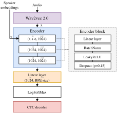
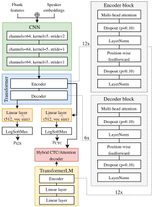

**Source:** *Speaker Adaptation for End-To-End Speech Recognition Systems in Noisy Environments* — [PDF](https://arxiv.org/pdf/2211.08774v3) · [arXiv](https://arxiv.org/abs/2211.08774v3)

# Speaker Adaptation for End-To-End Speech Recognition Systems in Noisy Environments

Dominik Wagner  Ilja Baumann  Sebastian P. Bayerl  Korbinian Riedhammer  Tobias Bocklet 

###### Abstract

We analyze the impact of speaker adaptation in end-to-end automatic speech recognition models based on transformers and wav2vec 2.0 under different noise conditions. By including speaker embeddings obtained from x-vector and ECAPA-TDNN systems, as well as i-vectors, we achieve relative word error rate improvements of up to 16.3% on LibriSpeech and up to 14.5% on Switchboard. We show that the proven method of concatenating speaker vectors to the acoustic features and supplying them as auxiliary model inputs remains a viable option to increase the robustness of end-to-end architectures. The effect on transformer models is stronger, when more noise is added to the input speech. The most substantial benefits for systems based on wav2vec 2.0 are achieved under moderate or no noise conditions. Both x-vectors and ECAPA-TDNN embeddings outperform i-vectors as speaker representations. The optimal embedding size depends on the dataset and also varies with the noise condition.

###### Index Terms: 

speaker adaptation, automatic speech recognition, end-to-end systems, transformer, wav2vec 2.0 

††address: 1Technische Hochschule Nürnberg Georg Simon Ohm, Germany   
2Intel Labs

## 1 Introduction

Speaker adaptation in automatic speech recognition (ASR) attempts to reduce the mismatch between training and test speakers, thereby achieving lower word error rates. Currently, there are two major approaches to address the speaker mismatch problem in neural network based models. The first approach operates in the feature space, either by normalizing acoustic features to make them speaker-independent [[1](https://arxiv.org/html/2211.08774v3#bib.bib1), [2](https://arxiv.org/html/2211.08774v3#bib.bib2)], or by introducing additional speaker-related knowledge (e.g. i-vectors [[3](https://arxiv.org/html/2211.08774v3#bib.bib3)] or x-vectors [[4](https://arxiv.org/html/2211.08774v3#bib.bib4)]) into the acoustic model [[5](https://arxiv.org/html/2211.08774v3#bib.bib5), [6](https://arxiv.org/html/2211.08774v3#bib.bib6)]. The second approach attempts to modify the acoustic model to match the testing conditions by learning speaker or environment-dependent transformations on the inputs, outputs, or hidden representations of the neural network [[7](https://arxiv.org/html/2211.08774v3#bib.bib7), [8](https://arxiv.org/html/2211.08774v3#bib.bib8), [9](https://arxiv.org/html/2211.08774v3#bib.bib9)]. Supplying speaker information as an auxiliary input to acoustic models has been a popular method to achieve speaker adaptation in hybrid HMM-DNN models [[10](https://arxiv.org/html/2211.08774v3#bib.bib10), [11](https://arxiv.org/html/2211.08774v3#bib.bib11)]. Several studies apply the feature space approach to more recent end-to-end (E2E) architectures. End-to-end ASR models directly map acoustic features to a word sequence. Popular E2E architectures based on transformers [[12](https://arxiv.org/html/2211.08774v3#bib.bib12)] and wav2vec 2.0 (W2V2) [[13](https://arxiv.org/html/2211.08774v3#bib.bib13)] have outperformed the conventional hybrid HMM-DNN framework in ASR tasks.

Most studies on E2E systems include the speaker information in one of the lower layers of a neural network or in the attention blocks of transformer models. The most widely used speaker representation remain i-vectors [[6](https://arxiv.org/html/2211.08774v3#bib.bib6), [14](https://arxiv.org/html/2211.08774v3#bib.bib14), [15](https://arxiv.org/html/2211.08774v3#bib.bib15), [16](https://arxiv.org/html/2211.08774v3#bib.bib16), [17](https://arxiv.org/html/2211.08774v3#bib.bib17), [18](https://arxiv.org/html/2211.08774v3#bib.bib18), [19](https://arxiv.org/html/2211.08774v3#bib.bib19)]. In [[6](https://arxiv.org/html/2211.08774v3#bib.bib6)], a weighted combined speaker embedding vector is generated by applying the attention mechanism to a set of i-vectors, which helps a speech transformer model to normalize speaker variations. In [[14](https://arxiv.org/html/2211.08774v3#bib.bib14)], i-vectors are concatenated with acoustic features at each self-attention layer of a speech transformer encoder, which led to relative WER improvements of 6.8% on the Switchboard portion and 11.1% on the Callhome portion of the Switchboard 300h Hub5’00 corpus. On 100 hours of LibriSpeech data, the WER is reduced by 4.5% (test-other) and 12.5% (test-clean) relative to the baseline. Zeineldeen et al. [[17](https://arxiv.org/html/2211.08774v3#bib.bib17)] propose a similar method that adds i-vectors to the input of the multi-head self-attention module in a conformer model [[20](https://arxiv.org/html/2211.08774v3#bib.bib20)]. They achieve a WER reduction of 3.5% relative to the baseline on the Callhome portion of the Switchboard 300h Hub5’00 corpus. In [[15](https://arxiv.org/html/2211.08774v3#bib.bib15)], i-vectors are concatenated to the input of each feedforward layer in a conformer model. This approach led to minor improvements in some experiments but significantly increased the number of model parameters.

Other approaches to speaker-adaptive training for E2E architectures include x-vectors [[21](https://arxiv.org/html/2211.08774v3#bib.bib21), [22](https://arxiv.org/html/2211.08774v3#bib.bib22)], s-vectors [[23](https://arxiv.org/html/2211.08774v3#bib.bib23)], m-vectors [[24](https://arxiv.org/html/2211.08774v3#bib.bib24)], sequence summary networks [[25](https://arxiv.org/html/2211.08774v3#bib.bib25)], and custom speaker adaptation schemes [[26](https://arxiv.org/html/2211.08774v3#bib.bib26)]. In [[23](https://arxiv.org/html/2211.08774v3#bib.bib23)], s-vectors and x-vectors are passed through a projection layer before either adding or concatenating the output to the acoustic features in a transformer system. Their approach achieved relative WER improvements between 7.3% and 10.3% on the test-clean dataset of the LibriSpeech corpus, when x-vectors were used to supply the additional speaker information. However, the performance worsened between 3.6% and 10.6% on the test-other dataset. Denisov and Vu [[21](https://arxiv.org/html/2211.08774v3#bib.bib21)] show that a combination of conditioning transformers on x-vectors and transfer learning improves single-channel multi-speaker speech recognition performance. In [[26](https://arxiv.org/html/2211.08774v3#bib.bib26)], a custom adaptation scheme for end-to-end multichannel ASR is proposed that re-estimates network parameters using target speaker speech data.

Existing works demonstrate the potential of speaker adaptation for E2E systems. However, the way speaker information is incorporated depends on the acoustic model architecture used, often makes the ASR pipeline more complex, and leads to an increase in model size. Furthermore, experiments are usually conducted on clean data only.   
This work studies the effect of adding auxiliary speaker information to transformers and pretrained wav2vec 2.0 systems. Experiments on the effect of speaker adaptation for W2V2-based systems have only been conducted in dysarthric ASR [[22](https://arxiv.org/html/2211.08774v3#bib.bib22)]. Unlike previous works, we transfer the idea of adding speaker information to the model input of E2E architectures and study their effect under both clean and noisy conditions. This approach has proven successful in legacy systems and does not meaningfully increase model size and complexity. Furthermore, we compare the effectiveness of x-vectors [[4](https://arxiv.org/html/2211.08774v3#bib.bib4)] and ECAPA-TDNN [[27](https://arxiv.org/html/2211.08774v3#bib.bib27)] embeddings against an i-vector baseline. X-vectors have been studied less than conventional i-vectors, and to the best of our knowledge, ECAPA-TDNN features have not yet been tested in the context of speaker adaptation, even though, they yield state-of-the-art performance in speaker recognition tasks [[27](https://arxiv.org/html/2211.08774v3#bib.bib27)].

## 2 Method

We conduct ASR experiments on two popular benchmarks: Switchboard [[28](https://arxiv.org/html/2211.08774v3#bib.bib28)] and LibriSpeech [[29](https://arxiv.org/html/2211.08774v3#bib.bib29)]. The LibriSpeech corpus consists of 960 hours of read English speech from audiobooks sampled at 16 kHz. Switchboard consists of approximately 300 hours of English telephone conversations sampled at 8 kHz. The Switchboard audio is resampled to 16 kHz for the experiments involving the W2V2-based system, to make it compatible with the pretrained feature extractor. The speaker recognition systems (i-vector, x-vector, and ECAPA-TDNN) used to generate auxiliary inputs, are trained on the VoxCeleb [[30](https://arxiv.org/html/2211.08774v3#bib.bib30)] dataset, which is comprised of 1.2 million utterances from 7.3k different speakers.

Baseline transformer- and W2V2-based ASR models are trained with minor architectural differences depending on the dataset. The same models are trained with additional speaker embeddings included at different parts of the overall system. The block diagrams in Figure [1](https://arxiv.org/html/2211.08774v3#S2.F1 "Figure 1 ‣ 2.1 Pretrained wav2vec 2.0 ‣ 2 Method ‣ Speaker Adaptation for End-To-End Speech Recognition Systems in Noisy Environments") and Figure [2](https://arxiv.org/html/2211.08774v3#S2.F2 "Figure 2 ‣ 2.2 Transformer ‣ 2 Method ‣ Speaker Adaptation for End-To-End Speech Recognition Systems in Noisy Environments") illustrate the composition of both architectures used in this work, as well as the integration of speaker embeddings. Parameters that are kept constant throughout all experiments (e.g. dropout probability or channels in convolutional layers) are included in the figures.

We use 80-dimensional Mel filterbank features with a frame-width of 25ms and a frame-shift of 10ms as acoustic input features for the transformer, the ECAPA-TDNN and the x-vector system. The pretrained wav2vec 2.0 model receives raw waveform inputs. We employ 1000 subword units [[31](https://arxiv.org/html/2211.08774v3#bib.bib31)] estimated via unigram language modeling as recognition tokens for the ASR models. To evaluate the effect of speaker adaptation under varying noise conditions, the test data is augmented with randomly chosen additive noises from the MUSAN corpus [[32](https://arxiv.org/html/2211.08774v3#bib.bib32)] at constant signal-to-noise ratios of 18, 9, and 0. We choose the speech portion of the MUSAN corpus, which comprises approximately 60 hours of various speech recordings.

### 2.1 Pretrained wav2vec 2.0

 Figure 1: Pretrained wav2vec 2.0 system and integration of speaker embeddings.

The pretrained wav2vec 2.0 model used for acoustic feature extraction is described in [[13](https://arxiv.org/html/2211.08774v3#bib.bib13)]. It consists of a convolutional feature encoder with multiple identical blocks using temporal convolution, layer normalization, and a GELU activation function, followed by 12 transformer encoder blocks. The convolutional feature encoder generates a sequence of embeddings for each utterance, which are then passed to the transformer encoder to capture information about the entire input sequence. For self-supervised training, the output of the convolutional feature encoder is discretized to a finite set of speech representations using product quantization. We use a model pretrained and finetuned on 960 hours of Libri-Light [[33](https://arxiv.org/html/2211.08774v3#bib.bib33)] and LibriSpeech [[29](https://arxiv.org/html/2211.08774v3#bib.bib29)] data.

The model components are illustrated in Figure [1](https://arxiv.org/html/2211.08774v3#S2.F1 "Figure 1 ‣ 2.1 Pretrained wav2vec 2.0 ‣ 2 Method ‣ Speaker Adaptation for End-To-End Speech Recognition Systems in Noisy Environments"). The W2V2 feature extractor generates approximately 50 acoustic representations in \(\mathbb{R}^{1024}\) for 1 second of raw audio input. In our system, these acoustic features are concatenated with the speaker vectors and passed through three encoder blocks consisting of a linear layer, batch normalization [[34](https://arxiv.org/html/2211.08774v3#bib.bib34)], leakyReLU activation and dropout [[35](https://arxiv.org/html/2211.08774v3#bib.bib35)]. A final linear layer yields outputs of vocabulary size (1000 subword units).

Since the wav2vec 2.0 model has already been pretrained on LibriSpeech, we keep its weights frozen during training on the LibriSpeech corpus, but include them in the training procedure, when the Switchboard data is used.

The models are trained with SpecAugment [[36](https://arxiv.org/html/2211.08774v3#bib.bib36)] in the time-domain and speed perturbation at 95% and 105% of the regular utterance speed. Each model is trained for 30 epochs on Switchboard and for 5 epochs on LibriSpeech.

The batch size is 6 for both datasets. We employ the Adam [[37](https://arxiv.org/html/2211.08774v3#bib.bib37)] optimizer for the W2V2 part of the overall system with exponential decay rates of \(\beta_{1}=0.90\), \(\beta_{2}=0.99\) and an initial learning rate of \(10^{-3}\). The other parts of the model are trained using the Adadelta [[38](https://arxiv.org/html/2211.08774v3#bib.bib38)] optimizer with an initial learning rate of \(\alpha=1.0\) and decay rate of \(\rho=0.95\). The learning rate is annealed based on the validation performance.

Greedy decoding on the logits and application of the connectionist temporal classification (CTC) rules (removal of blank symbols and duplicates) yields the best path for each utterance.

### 2.2 Transformer

 Figure 2: Transformer and speaker embedding integration.

We employ an attention-based encoder-decoder architecture [[39](https://arxiv.org/html/2211.08774v3#bib.bib39)]. The model is trained on both CTC loss and Kullback-Leibler divergence between negative-log likelihood targets. Decoding is performed with a joint CTC/attention beam search coupled with a transformer language model that is used on top of the decoder probabilities.

The composition of the transformer system is depicted in Figure [2](https://arxiv.org/html/2211.08774v3#S2.F2 "Figure 2 ‣ 2.2 Transformer ‣ 2 Method ‣ Speaker Adaptation for End-To-End Speech Recognition Systems in Noisy Environments"). For each input sequence, a convolutional neural network (CNN) consisting of 3 layers is applied to reduce the length of the hidden representations before passing the input to the transformer model. The transformer architecture follows [[12](https://arxiv.org/html/2211.08774v3#bib.bib12)]. It employs 12 identical encoder blocks and 6 identical decoder blocks with 4 heads in the multi-head attention modules. Information about the token position is encoded via sinusoidal positional encodings in 256-dimensional input embeddings. Each encoder and decoder block consists of two sub-layers; a multi-head attention mechanism and a position-wise fully connected feedforward network. Dropout and layer normalization [[40](https://arxiv.org/html/2211.08774v3#bib.bib40)] are applied after each sub-layer.

The transformer-encoder output is passed to the hybrid CTC/attention decoder and to a linear layer followed by log softmax activation. The output after log softmax activation \(p_{CTC}\) is used to compute the CTC loss. The transformer-decoder output is passed through another linear layer followed by log softmax activation. The resulting log-probabilities \(p_{S2S}\) are used to compute the Kullback-Leibler loss.

The acoustic model is coupled with a transformer language model (LM) during decoding. Its architecture is also based on [[12](https://arxiv.org/html/2211.08774v3#bib.bib12)]. The LM employs 12 encoder blocks but no decoder blocks. Each block in the LibriSpeech model employs 768-dimensional input embeddings, the hidden layer size is 3072 and 12 heads are used in the multi-head attention module. The encoder blocks in the Switchboard model use 264-dimensional input embeddings, a hidden layer size of 1024 and 12 attention heads.

The LibriSpeech tokenizer and LM are trained on 960h of audio transcripts, which corresponds to 10 million words of text data. The Switchboard tokenizer and LM are trained on the transcripts of the Switchboard 300h corpus, as well as the transcripts provided by the Fisher corpus [[41](https://arxiv.org/html/2211.08774v3#bib.bib41)]. The LM weight is 0.6 for the LibriSpeech models and 0.3 for the Switchboard models. The beam size of the decoder is 60 for both datasets.

The LibriSpeech transformer is trained for 60 epochs with an effective batch size of 48 using gradient accumulation with a factor of 3 and a CTC weight of 0.3. The Switchboard transformer is trained for 100 epochs with an effective batch size of 256 using gradient accumulation with a factor of 2 and a CTC weight of 0.3. We employ the Adam optimizer with exponential decay rates of \(\beta_{1}=0.90\), \(\beta_{2}=0.98\) and initial learning rates of \(10^{-3}\) (LibriSpeech) and \(6\times 10^{-3}\) (Switchboard). The learning rate is increased linearly for the first 25k steps and then decreased proportionally to the inverse square root of the step number [[12](https://arxiv.org/html/2211.08774v3#bib.bib12)].

### 2.3 Speaker embeddings

Our i-vector extraction pipeline follows Kaldi’s [[42](https://arxiv.org/html/2211.08774v3#bib.bib42)] sre10/v2 recipe, using a 2048-component diagonal universal background model (UBM) trained on 20-dimensional MFCC features.

We utilize two state-of-the-art systems to extract speaker embeddings: x-vector [[4](https://arxiv.org/html/2211.08774v3#bib.bib4)] and ECAPA-TDNN [[27](https://arxiv.org/html/2211.08774v3#bib.bib27)]. The x-vector model [[4](https://arxiv.org/html/2211.08774v3#bib.bib4)] is a time delay neural network (TDNN) that aggregates variable-length inputs across time via mean pooling to create fixed-length representations capable of capturing speaker characteristics. Speaker embeddings are extracted from a bottleneck layer prior to the output layer.

Desplanques et al. [[27](https://arxiv.org/html/2211.08774v3#bib.bib27)] propose several enhancements to the x-vector architecture. Their ECAPA-TDNN adds 1-dimensional Res2Net [[43](https://arxiv.org/html/2211.08774v3#bib.bib43)] modules with skip connections as well as squeeze-excitation (SE) blocks [[44](https://arxiv.org/html/2211.08774v3#bib.bib44)] to capture channel interdependencies. Additionally, features are aggregated and propagated across multiple layers. It also utilizes a channel-dependent self-attention mechanism that uses a global context in the frame-level layers and the statistics pooling layer. The input features are 24-dimensional Mel filterbank features using a frame-width of 25ms and a frame-shift of 10ms.

The training data for both the x-vector model and the ECAPA-TDNN are augmented with additive noises from the MUSAN corpus [[32](https://arxiv.org/html/2211.08774v3#bib.bib32)] and reverberation using a collection of room impulse responses.

To ensure a fair comparison, we extract 512-dimensional i-vectors, x-vectors and ECAPA-TDNN embeddings for each utterance in the training and test set. We also trained an ECAPA-TDNN that yields 192-dimensional outputs in the final fully-connected layer, as proposed in the original paper [[27](https://arxiv.org/html/2211.08774v3#bib.bib27)], to analyze the impact of reduced dimensionality. We compute the mean over all vectors representing utterances from an individual speaker, thereby generating a single prototype embedding for each speaker in the corpus. The mean vectors are concatenated with the acoustic features and passed to the ASR systems. Each embedding vector is scaled to the value range \([0;1]\). We also experimented with unscaled vectors and scaling to zero mean and unit variance. However, the former yielded the most consistent results.

## 3 Experiments

Table 1: Word error rates (WER) and relative improvements for the pretrained W2V2 (left) and the transformer (right) model under varying noise conditions. The column \(\Delta\)% indicates the improvement of speaker adaptation over the baseline in percent. Bold values indicate the largest relative WER improvements for the respective test set. The leftmost column shows the signal-to-noise ratio (SNR) used in the experiment. The test sets clean and other represent the “test-clean” and “test-other” sets of the LibriSpeech corpus. SW, CH, and Hub’00 indicate the Switchboard, Callhome, and full Hub5’00 portions of the Switchboard 300h Hub5’00 dataset. 

<table id="S3.T1.11.1" class="ltx_tabular ltx_guessed_headers ltx_align_top">
<thead class="ltx_thead">
<tr id="S3.T1.11.1.1" class="ltx_tr">
<th id="S3.T1.11.1.1.1" class="ltx_td ltx_nopad_l ltx_nopad_r ltx_align_center ltx_th ltx_th_column" style="padding-left:1.0pt;padding-right:1.0pt;" colspan="12">Pretrained wav2vec 2.0</th></tr>
</thead>
<tbody class="ltx_tbody">
<tr id="S3.T1.11.1.2" class="ltx_tr">
<td id="S3.T1.11.1.2.1" class="ltx_td ltx_nopad_l ltx_nopad_r ltx_align_center ltx_border_tt" style="padding-left:1.0pt;padding-right:1.0pt;">SNR</td>
<td id="S3.T1.11.1.2.2" class="ltx_td ltx_nopad_l ltx_nopad_r ltx_align_center ltx_border_tt" style="padding-left:1.0pt;padding-right:1.0pt;">Corpus</td>
<td id="S3.T1.11.1.2.3" class="ltx_td ltx_nopad_l ltx_nopad_r ltx_align_center ltx_border_tt" style="padding-left:1.0pt;padding-right:1.0pt;">Data</td>
<td id="S3.T1.11.1.2.4" class="ltx_td ltx_nopad_l ltx_nopad_r ltx_align_center ltx_border_r ltx_border_tt" style="padding-left:1.0pt;padding-right:1.0pt;">Baseline</td>
<td id="S3.T1.11.1.2.5" class="ltx_td ltx_nopad_l ltx_nopad_r ltx_align_center ltx_border_r ltx_border_tt" style="padding-left:1.0pt;padding-right:1.0pt;" colspan="2">ECAPA <math id="S3.T1.m3" class="ltx_Math" alttext="\mathbb{R}^{192}" display="inline" intent=":literal"><semantics><msup><mi>ℝ</mi><mn>192</mn></msup><annotation encoding="application/x-tex">\mathbb{R}^{192}</annotation></semantics></math></td>
<td id="S3.T1.11.1.2.6" class="ltx_td ltx_nopad_l ltx_nopad_r ltx_align_center ltx_border_r ltx_border_tt" style="padding-left:1.0pt;padding-right:1.0pt;" colspan="2">ECAPA <math id="S3.T1.m4" class="ltx_Math" alttext="\mathbb{R}^{512}" display="inline" intent=":literal"><semantics><msup><mi>ℝ</mi><mn>512</mn></msup><annotation encoding="application/x-tex">\mathbb{R}^{512}</annotation></semantics></math></td>
<td id="S3.T1.11.1.2.7" class="ltx_td ltx_nopad_l ltx_nopad_r ltx_align_center ltx_border_r ltx_border_tt" style="padding-left:1.0pt;padding-right:1.0pt;" colspan="2">X-vector</td>
<td id="S3.T1.11.1.2.8" class="ltx_td ltx_nopad_l ltx_nopad_r ltx_align_center ltx_border_tt" style="padding-left:1.0pt;padding-right:1.0pt;" colspan="2">i-vector</td></tr>
<tr id="S3.T1.11.1.3" class="ltx_tr">
<td id="S3.T1.11.1.3.1" class="ltx_td ltx_nopad_r" style="padding-left:1.0pt;padding-right:1.0pt;"></td>
<td id="S3.T1.11.1.3.2" class="ltx_td ltx_nopad_r" style="padding-left:1.0pt;padding-right:1.0pt;"></td>
<td id="S3.T1.11.1.3.3" class="ltx_td ltx_nopad_r" style="padding-left:1.0pt;padding-right:1.0pt;"></td>
<td id="S3.T1.11.1.3.4" class="ltx_td ltx_nopad_l ltx_nopad_r ltx_align_center ltx_border_r" style="padding-left:1.0pt;padding-right:1.0pt;">WER</td>
<td id="S3.T1.11.1.3.5" class="ltx_td ltx_nopad_l ltx_nopad_r ltx_align_center" style="padding-left:1.0pt;padding-right:1.0pt;">WER</td>
<td id="S3.T1.11.1.3.6" class="ltx_td ltx_nopad_l ltx_nopad_r ltx_align_center ltx_border_r" style="padding-left:1.0pt;padding-right:1.0pt;"><math id="S3.T1.m5" class="ltx_Math" alttext="\Delta" display="inline" intent=":literal"><semantics><mi mathsize="0.800em" mathvariant="normal">Δ</mi><annotation encoding="application/x-tex">\Delta</annotation></semantics></math>%</td>
<td id="S3.T1.11.1.3.7" class="ltx_td ltx_nopad_l ltx_nopad_r ltx_align_center" style="padding-left:1.0pt;padding-right:1.0pt;">WER</td>
<td id="S3.T1.11.1.3.8" class="ltx_td ltx_nopad_l ltx_nopad_r ltx_align_center ltx_border_r" style="padding-left:1.0pt;padding-right:1.0pt;"><math id="S3.T1.m6" class="ltx_Math" alttext="\Delta" display="inline" intent=":literal"><semantics><mi mathsize="0.800em" mathvariant="normal">Δ</mi><annotation encoding="application/x-tex">\Delta</annotation></semantics></math>%</td>
<td id="S3.T1.11.1.3.9" class="ltx_td ltx_nopad_l ltx_nopad_r ltx_align_center" style="padding-left:1.0pt;padding-right:1.0pt;">WER</td>
<td id="S3.T1.11.1.3.10" class="ltx_td ltx_nopad_l ltx_nopad_r ltx_align_center ltx_border_r" style="padding-left:1.0pt;padding-right:1.0pt;"><math id="S3.T1.m7" class="ltx_Math" alttext="\Delta" display="inline" intent=":literal"><semantics><mi mathsize="0.800em" mathvariant="normal">Δ</mi><annotation encoding="application/x-tex">\Delta</annotation></semantics></math>%</td>
<td id="S3.T1.11.1.3.11" class="ltx_td ltx_nopad_l ltx_nopad_r ltx_align_center" style="padding-left:1.0pt;padding-right:1.0pt;">WER</td>
<td id="S3.T1.11.1.3.12" class="ltx_td ltx_nopad_l ltx_nopad_r ltx_align_center" style="padding-left:1.0pt;padding-right:1.0pt;"><math id="S3.T1.m8" class="ltx_Math" alttext="\Delta" display="inline" intent=":literal"><semantics><mi mathsize="0.800em" mathvariant="normal">Δ</mi><annotation encoding="application/x-tex">\Delta</annotation></semantics></math>%</td></tr>
<tr id="S3.T1.11.1.4" class="ltx_tr">
<td id="S3.T1.11.1.4.1" class="ltx_td ltx_nopad_l ltx_nopad_r ltx_align_center ltx_border_t" style="padding-left:1.0pt;padding-right:1.0pt;" rowspan="5">-</td>
<td id="S3.T1.11.1.4.2" class="ltx_td ltx_nopad_l ltx_nopad_r ltx_align_center ltx_border_t" style="padding-left:1.0pt;padding-right:1.0pt;" rowspan="2">Libri</td>
<td id="S3.T1.11.1.4.3" class="ltx_td ltx_nopad_l ltx_nopad_r ltx_align_center ltx_border_t" style="padding-left:1.0pt;padding-right:1.0pt;">clean</td>
<td id="S3.T1.11.1.4.4" class="ltx_td ltx_nopad_l ltx_nopad_r ltx_align_center ltx_border_r ltx_border_t" style="padding-left:1.0pt;padding-right:1.0pt;">1.89</td>
<td id="S3.T1.11.1.4.5" class="ltx_td ltx_nopad_l ltx_nopad_r ltx_align_center ltx_border_t" style="padding-left:1.0pt;padding-right:1.0pt;">1.88</td>
<td id="S3.T1.11.1.4.6" class="ltx_td ltx_nopad_l ltx_nopad_r ltx_align_center ltx_border_r ltx_border_t" style="padding-left:1.0pt;padding-right:1.0pt;">0.5%</td>
<td id="S3.T1.11.1.4.7" class="ltx_td ltx_nopad_l ltx_nopad_r ltx_align_center ltx_border_t" style="padding-left:1.0pt;padding-right:1.0pt;">1.89</td>
<td id="S3.T1.11.1.4.8" class="ltx_td ltx_nopad_l ltx_nopad_r ltx_align_center ltx_border_r ltx_border_t" style="padding-left:1.0pt;padding-right:1.0pt;">0.0%</td>
<td id="S3.T1.11.1.4.9" class="ltx_td ltx_nopad_l ltx_nopad_r ltx_align_center ltx_border_t" style="padding-left:1.0pt;padding-right:1.0pt;">1.89</td>
<td id="S3.T1.11.1.4.10" class="ltx_td ltx_nopad_l ltx_nopad_r ltx_align_center ltx_border_r ltx_border_t" style="padding-left:1.0pt;padding-right:1.0pt;">0.0%</td>
<td id="S3.T1.11.1.4.11" class="ltx_td ltx_nopad_l ltx_nopad_r ltx_align_center ltx_border_t" style="padding-left:1.0pt;padding-right:1.0pt;">1.92</td>
<td id="S3.T1.11.1.4.12" class="ltx_td ltx_nopad_l ltx_nopad_r ltx_align_center ltx_border_t" style="padding-left:1.0pt;padding-right:1.0pt;">-1.6%</td></tr>
<tr id="S3.T1.11.1.5" class="ltx_tr">
<td id="S3.T1.11.1.5.1" class="ltx_td ltx_nopad_l ltx_nopad_r ltx_align_center" style="padding-left:1.0pt;padding-right:1.0pt;">other</td>
<td id="S3.T1.11.1.5.2" class="ltx_td ltx_nopad_l ltx_nopad_r ltx_align_center ltx_border_r" style="padding-left:1.0pt;padding-right:1.0pt;">3.99</td>
<td id="S3.T1.11.1.5.3" class="ltx_td ltx_nopad_l ltx_nopad_r ltx_align_center" style="padding-left:1.0pt;padding-right:1.0pt;">3.97</td>
<td id="S3.T1.11.1.5.4" class="ltx_td ltx_nopad_l ltx_nopad_r ltx_align_center ltx_border_r" style="padding-left:1.0pt;padding-right:1.0pt;">0.5%</td>
<td id="S3.T1.11.1.5.5" class="ltx_td ltx_nopad_l ltx_nopad_r ltx_align_center" style="padding-left:1.0pt;padding-right:1.0pt;">4.03</td>
<td id="S3.T1.11.1.5.6" class="ltx_td ltx_nopad_l ltx_nopad_r ltx_align_center ltx_border_r" style="padding-left:1.0pt;padding-right:1.0pt;">-1.0%</td>
<td id="S3.T1.11.1.5.7" class="ltx_td ltx_nopad_l ltx_nopad_r ltx_align_center" style="padding-left:1.0pt;padding-right:1.0pt;">3.95</td>
<td id="S3.T1.11.1.5.8" class="ltx_td ltx_nopad_l ltx_nopad_r ltx_align_center ltx_border_r" style="padding-left:1.0pt;padding-right:1.0pt;">1.0%</td>
<td id="S3.T1.11.1.5.9" class="ltx_td ltx_nopad_l ltx_nopad_r ltx_align_center" style="padding-left:1.0pt;padding-right:1.0pt;">3.95</td>
<td id="S3.T1.11.1.5.10" class="ltx_td ltx_nopad_l ltx_nopad_r ltx_align_center" style="padding-left:1.0pt;padding-right:1.0pt;">1.0%</td></tr>
<tr id="S3.T1.11.1.6" class="ltx_tr">
<td id="S3.T1.11.1.6.1" class="ltx_td ltx_nopad_l ltx_nopad_r ltx_align_center ltx_border_t" style="padding-left:1.0pt;padding-right:1.0pt;" rowspan="3">Swbd</td>
<td id="S3.T1.11.1.6.2" class="ltx_td ltx_nopad_l ltx_nopad_r ltx_align_center ltx_border_t" style="padding-left:1.0pt;padding-right:1.0pt;">SW</td>
<td id="S3.T1.11.1.6.3" class="ltx_td ltx_nopad_l ltx_nopad_r ltx_align_center ltx_border_r ltx_border_t" style="padding-left:1.0pt;padding-right:1.0pt;">8.78</td>
<td id="S3.T1.11.1.6.4" class="ltx_td ltx_nopad_l ltx_nopad_r ltx_align_center ltx_border_t" style="padding-left:1.0pt;padding-right:1.0pt;">8.60</td>
<td id="S3.T1.11.1.6.5" class="ltx_td ltx_nopad_l ltx_nopad_r ltx_align_center ltx_border_r ltx_border_t" style="padding-left:1.0pt;padding-right:1.0pt;">2.1%</td>
<td id="S3.T1.11.1.6.6" class="ltx_td ltx_nopad_l ltx_nopad_r ltx_align_center ltx_border_t" style="padding-left:1.0pt;padding-right:1.0pt;">8.33</td>
<td id="S3.T1.11.1.6.7" class="ltx_td ltx_nopad_l ltx_nopad_r ltx_align_center ltx_border_r ltx_border_t" style="padding-left:1.0pt;padding-right:1.0pt;">5.1%</td>
<td id="S3.T1.11.1.6.8" class="ltx_td ltx_nopad_l ltx_nopad_r ltx_align_center ltx_border_t" style="padding-left:1.0pt;padding-right:1.0pt;">8.31</td>
<td id="S3.T1.11.1.6.9" class="ltx_td ltx_nopad_l ltx_nopad_r ltx_align_center ltx_border_r ltx_border_t" style="padding-left:1.0pt;padding-right:1.0pt;">5.4%</td>
<td id="S3.T1.11.1.6.10" class="ltx_td ltx_nopad_l ltx_nopad_r ltx_align_center ltx_border_t" style="padding-left:1.0pt;padding-right:1.0pt;">8.46</td>
<td id="S3.T1.11.1.6.11" class="ltx_td ltx_nopad_l ltx_nopad_r ltx_align_center ltx_border_t" style="padding-left:1.0pt;padding-right:1.0pt;">3.6%</td></tr>
<tr id="S3.T1.11.1.7" class="ltx_tr">
<td id="S3.T1.11.1.7.1" class="ltx_td ltx_nopad_l ltx_nopad_r ltx_align_center" style="padding-left:1.0pt;padding-right:1.0pt;">CH</td>
<td id="S3.T1.11.1.7.2" class="ltx_td ltx_nopad_l ltx_nopad_r ltx_align_center ltx_border_r" style="padding-left:1.0pt;padding-right:1.0pt;">15.19</td>
<td id="S3.T1.11.1.7.3" class="ltx_td ltx_nopad_l ltx_nopad_r ltx_align_center" style="padding-left:1.0pt;padding-right:1.0pt;">14.98</td>
<td id="S3.T1.11.1.7.4" class="ltx_td ltx_nopad_l ltx_nopad_r ltx_align_center ltx_border_r" style="padding-left:1.0pt;padding-right:1.0pt;">1.4%</td>
<td id="S3.T1.11.1.7.5" class="ltx_td ltx_nopad_l ltx_nopad_r ltx_align_center" style="padding-left:1.0pt;padding-right:1.0pt;">14.94</td>
<td id="S3.T1.11.1.7.6" class="ltx_td ltx_nopad_l ltx_nopad_r ltx_align_center ltx_border_r" style="padding-left:1.0pt;padding-right:1.0pt;">1.6%</td>
<td id="S3.T1.11.1.7.7" class="ltx_td ltx_nopad_l ltx_nopad_r ltx_align_center" style="padding-left:1.0pt;padding-right:1.0pt;">14.23</td>
<td id="S3.T1.11.1.7.8" class="ltx_td ltx_nopad_l ltx_nopad_r ltx_align_center ltx_border_r" style="padding-left:1.0pt;padding-right:1.0pt;">6.3%</td>
<td id="S3.T1.11.1.7.9" class="ltx_td ltx_nopad_l ltx_nopad_r ltx_align_center" style="padding-left:1.0pt;padding-right:1.0pt;">15.23</td>
<td id="S3.T1.11.1.7.10" class="ltx_td ltx_nopad_l ltx_nopad_r ltx_align_center" style="padding-left:1.0pt;padding-right:1.0pt;">-0.3%</td></tr>
<tr id="S3.T1.11.1.8" class="ltx_tr">
<td id="S3.T1.11.1.8.1" class="ltx_td ltx_nopad_l ltx_nopad_r ltx_align_center" style="padding-left:1.0pt;padding-right:1.0pt;">Hub’00</td>
<td id="S3.T1.11.1.8.2" class="ltx_td ltx_nopad_l ltx_nopad_r ltx_align_center ltx_border_r" style="padding-left:1.0pt;padding-right:1.0pt;">11.90</td>
<td id="S3.T1.11.1.8.3" class="ltx_td ltx_nopad_l ltx_nopad_r ltx_align_center" style="padding-left:1.0pt;padding-right:1.0pt;">11.71</td>
<td id="S3.T1.11.1.8.4" class="ltx_td ltx_nopad_l ltx_nopad_r ltx_align_center ltx_border_r" style="padding-left:1.0pt;padding-right:1.0pt;">1.6%</td>
<td id="S3.T1.11.1.8.5" class="ltx_td ltx_nopad_l ltx_nopad_r ltx_align_center" style="padding-left:1.0pt;padding-right:1.0pt;">11.63</td>
<td id="S3.T1.11.1.8.6" class="ltx_td ltx_nopad_l ltx_nopad_r ltx_align_center ltx_border_r" style="padding-left:1.0pt;padding-right:1.0pt;">2.3%</td>
<td id="S3.T1.11.1.8.7" class="ltx_td ltx_nopad_l ltx_nopad_r ltx_align_center" style="padding-left:1.0pt;padding-right:1.0pt;">11.22</td>
<td id="S3.T1.11.1.8.8" class="ltx_td ltx_nopad_l ltx_nopad_r ltx_align_center ltx_border_r" style="padding-left:1.0pt;padding-right:1.0pt;">5.7%</td>
<td id="S3.T1.11.1.8.9" class="ltx_td ltx_nopad_l ltx_nopad_r ltx_align_center" style="padding-left:1.0pt;padding-right:1.0pt;">11.81</td>
<td id="S3.T1.11.1.8.10" class="ltx_td ltx_nopad_l ltx_nopad_r ltx_align_center" style="padding-left:1.0pt;padding-right:1.0pt;">0.8%</td></tr>
<tr id="S3.T1.11.1.9" class="ltx_tr">
<td id="S3.T1.11.1.9.1" class="ltx_td ltx_nopad_l ltx_nopad_r ltx_align_center ltx_border_t" style="padding-left:1.0pt;padding-right:1.0pt;" rowspan="5">18</td>
<td id="S3.T1.11.1.9.2" class="ltx_td ltx_nopad_l ltx_nopad_r ltx_align_center ltx_border_t" style="padding-left:1.0pt;padding-right:1.0pt;" rowspan="2">Libri</td>
<td id="S3.T1.11.1.9.3" class="ltx_td ltx_nopad_l ltx_nopad_r ltx_align_center ltx_border_t" style="padding-left:1.0pt;padding-right:1.0pt;">clean</td>
<td id="S3.T1.11.1.9.4" class="ltx_td ltx_nopad_l ltx_nopad_r ltx_align_center ltx_border_r ltx_border_t" style="padding-left:1.0pt;padding-right:1.0pt;">9.27</td>
<td id="S3.T1.11.1.9.5" class="ltx_td ltx_nopad_l ltx_nopad_r ltx_align_center ltx_border_t" style="padding-left:1.0pt;padding-right:1.0pt;">8.91</td>
<td id="S3.T1.11.1.9.6" class="ltx_td ltx_nopad_l ltx_nopad_r ltx_align_center ltx_border_r ltx_border_t" style="padding-left:1.0pt;padding-right:1.0pt;">3.9%</td>
<td id="S3.T1.11.1.9.7" class="ltx_td ltx_nopad_l ltx_nopad_r ltx_align_center ltx_border_t" style="padding-left:1.0pt;padding-right:1.0pt;">8.72</td>
<td id="S3.T1.11.1.9.8" class="ltx_td ltx_nopad_l ltx_nopad_r ltx_align_center ltx_border_r ltx_border_t" style="padding-left:1.0pt;padding-right:1.0pt;">5.9%</td>
<td id="S3.T1.11.1.9.9" class="ltx_td ltx_nopad_l ltx_nopad_r ltx_align_center ltx_border_t" style="padding-left:1.0pt;padding-right:1.0pt;">8.92</td>
<td id="S3.T1.11.1.9.10" class="ltx_td ltx_nopad_l ltx_nopad_r ltx_align_center ltx_border_r ltx_border_t" style="padding-left:1.0pt;padding-right:1.0pt;">3.8%</td>
<td id="S3.T1.11.1.9.11" class="ltx_td ltx_nopad_l ltx_nopad_r ltx_align_center ltx_border_t" style="padding-left:1.0pt;padding-right:1.0pt;">8.93</td>
<td id="S3.T1.11.1.9.12" class="ltx_td ltx_nopad_l ltx_nopad_r ltx_align_center ltx_border_t" style="padding-left:1.0pt;padding-right:1.0pt;">3.7%</td></tr>
<tr id="S3.T1.11.1.10" class="ltx_tr">
<td id="S3.T1.11.1.10.1" class="ltx_td ltx_nopad_l ltx_nopad_r ltx_align_center" style="padding-left:1.0pt;padding-right:1.0pt;">other</td>
<td id="S3.T1.11.1.10.2" class="ltx_td ltx_nopad_l ltx_nopad_r ltx_align_center ltx_border_r" style="padding-left:1.0pt;padding-right:1.0pt;">18.89</td>
<td id="S3.T1.11.1.10.3" class="ltx_td ltx_nopad_l ltx_nopad_r ltx_align_center" style="padding-left:1.0pt;padding-right:1.0pt;">18.45</td>
<td id="S3.T1.11.1.10.4" class="ltx_td ltx_nopad_l ltx_nopad_r ltx_align_center ltx_border_r" style="padding-left:1.0pt;padding-right:1.0pt;">2.3%</td>
<td id="S3.T1.11.1.10.5" class="ltx_td ltx_nopad_l ltx_nopad_r ltx_align_center" style="padding-left:1.0pt;padding-right:1.0pt;">18.88</td>
<td id="S3.T1.11.1.10.6" class="ltx_td ltx_nopad_l ltx_nopad_r ltx_align_center ltx_border_r" style="padding-left:1.0pt;padding-right:1.0pt;">0.1%</td>
<td id="S3.T1.11.1.10.7" class="ltx_td ltx_nopad_l ltx_nopad_r ltx_align_center" style="padding-left:1.0pt;padding-right:1.0pt;">18.61</td>
<td id="S3.T1.11.1.10.8" class="ltx_td ltx_nopad_l ltx_nopad_r ltx_align_center ltx_border_r" style="padding-left:1.0pt;padding-right:1.0pt;">1.5%</td>
<td id="S3.T1.11.1.10.9" class="ltx_td ltx_nopad_l ltx_nopad_r ltx_align_center" style="padding-left:1.0pt;padding-right:1.0pt;">19.20</td>
<td id="S3.T1.11.1.10.10" class="ltx_td ltx_nopad_l ltx_nopad_r ltx_align_center" style="padding-left:1.0pt;padding-right:1.0pt;">-1.6%</td></tr>
<tr id="S3.T1.11.1.11" class="ltx_tr">
<td id="S3.T1.11.1.11.1" class="ltx_td ltx_nopad_l ltx_nopad_r ltx_align_center ltx_border_t" style="padding-left:1.0pt;padding-right:1.0pt;" rowspan="3">Swbd</td>
<td id="S3.T1.11.1.11.2" class="ltx_td ltx_nopad_l ltx_nopad_r ltx_align_center ltx_border_t" style="padding-left:1.0pt;padding-right:1.0pt;">SW</td>
<td id="S3.T1.11.1.11.3" class="ltx_td ltx_nopad_l ltx_nopad_r ltx_align_center ltx_border_r ltx_border_t" style="padding-left:1.0pt;padding-right:1.0pt;">9.52</td>
<td id="S3.T1.11.1.11.4" class="ltx_td ltx_nopad_l ltx_nopad_r ltx_align_center ltx_border_t" style="padding-left:1.0pt;padding-right:1.0pt;">9.45</td>
<td id="S3.T1.11.1.11.5" class="ltx_td ltx_nopad_l ltx_nopad_r ltx_align_center ltx_border_r ltx_border_t" style="padding-left:1.0pt;padding-right:1.0pt;">0.7%</td>
<td id="S3.T1.11.1.11.6" class="ltx_td ltx_nopad_l ltx_nopad_r ltx_align_center ltx_border_t" style="padding-left:1.0pt;padding-right:1.0pt;">9.12</td>
<td id="S3.T1.11.1.11.7" class="ltx_td ltx_nopad_l ltx_nopad_r ltx_align_center ltx_border_r ltx_border_t" style="padding-left:1.0pt;padding-right:1.0pt;">4.2%</td>
<td id="S3.T1.11.1.11.8" class="ltx_td ltx_nopad_l ltx_nopad_r ltx_align_center ltx_border_t" style="padding-left:1.0pt;padding-right:1.0pt;">8.99</td>
<td id="S3.T1.11.1.11.9" class="ltx_td ltx_nopad_l ltx_nopad_r ltx_align_center ltx_border_r ltx_border_t" style="padding-left:1.0pt;padding-right:1.0pt;">5.6%</td>
<td id="S3.T1.11.1.11.10" class="ltx_td ltx_nopad_l ltx_nopad_r ltx_align_center ltx_border_t" style="padding-left:1.0pt;padding-right:1.0pt;">9.37</td>
<td id="S3.T1.11.1.11.11" class="ltx_td ltx_nopad_l ltx_nopad_r ltx_align_center ltx_border_t" style="padding-left:1.0pt;padding-right:1.0pt;">1.6%</td></tr>
<tr id="S3.T1.11.1.12" class="ltx_tr">
<td id="S3.T1.11.1.12.1" class="ltx_td ltx_nopad_l ltx_nopad_r ltx_align_center" style="padding-left:1.0pt;padding-right:1.0pt;">CH</td>
<td id="S3.T1.11.1.12.2" class="ltx_td ltx_nopad_l ltx_nopad_r ltx_align_center ltx_border_r" style="padding-left:1.0pt;padding-right:1.0pt;">18.07</td>
<td id="S3.T1.11.1.12.3" class="ltx_td ltx_nopad_l ltx_nopad_r ltx_align_center" style="padding-left:1.0pt;padding-right:1.0pt;">17.89</td>
<td id="S3.T1.11.1.12.4" class="ltx_td ltx_nopad_l ltx_nopad_r ltx_align_center ltx_border_r" style="padding-left:1.0pt;padding-right:1.0pt;">1.0%</td>
<td id="S3.T1.11.1.12.5" class="ltx_td ltx_nopad_l ltx_nopad_r ltx_align_center" style="padding-left:1.0pt;padding-right:1.0pt;">18.36</td>
<td id="S3.T1.11.1.12.6" class="ltx_td ltx_nopad_l ltx_nopad_r ltx_align_center ltx_border_r" style="padding-left:1.0pt;padding-right:1.0pt;">-1.6%</td>
<td id="S3.T1.11.1.12.7" class="ltx_td ltx_nopad_l ltx_nopad_r ltx_align_center" style="padding-left:1.0pt;padding-right:1.0pt;">17.41</td>
<td id="S3.T1.11.1.12.8" class="ltx_td ltx_nopad_l ltx_nopad_r ltx_align_center ltx_border_r" style="padding-left:1.0pt;padding-right:1.0pt;">3.7%</td>
<td id="S3.T1.11.1.12.9" class="ltx_td ltx_nopad_l ltx_nopad_r ltx_align_center" style="padding-left:1.0pt;padding-right:1.0pt;">18.24</td>
<td id="S3.T1.11.1.12.10" class="ltx_td ltx_nopad_l ltx_nopad_r ltx_align_center" style="padding-left:1.0pt;padding-right:1.0pt;">-0.9%</td></tr>
<tr id="S3.T1.11.1.13" class="ltx_tr">
<td id="S3.T1.11.1.13.1" class="ltx_td ltx_nopad_l ltx_nopad_r ltx_align_center" style="padding-left:1.0pt;padding-right:1.0pt;">Hub’00</td>
<td id="S3.T1.11.1.13.2" class="ltx_td ltx_nopad_l ltx_nopad_r ltx_align_center ltx_border_r" style="padding-left:1.0pt;padding-right:1.0pt;">13.62</td>
<td id="S3.T1.11.1.13.3" class="ltx_td ltx_nopad_l ltx_nopad_r ltx_align_center" style="padding-left:1.0pt;padding-right:1.0pt;">13.56</td>
<td id="S3.T1.11.1.13.4" class="ltx_td ltx_nopad_l ltx_nopad_r ltx_align_center ltx_border_r" style="padding-left:1.0pt;padding-right:1.0pt;">0.4%</td>
<td id="S3.T1.11.1.13.5" class="ltx_td ltx_nopad_l ltx_nopad_r ltx_align_center" style="padding-left:1.0pt;padding-right:1.0pt;">13.29</td>
<td id="S3.T1.11.1.13.6" class="ltx_td ltx_nopad_l ltx_nopad_r ltx_align_center ltx_border_r" style="padding-left:1.0pt;padding-right:1.0pt;">2.4%</td>
<td id="S3.T1.11.1.13.7" class="ltx_td ltx_nopad_l ltx_nopad_r ltx_align_center" style="padding-left:1.0pt;padding-right:1.0pt;">13.22</td>
<td id="S3.T1.11.1.13.8" class="ltx_td ltx_nopad_l ltx_nopad_r ltx_align_center ltx_border_r" style="padding-left:1.0pt;padding-right:1.0pt;">2.9%</td>
<td id="S3.T1.11.1.13.9" class="ltx_td ltx_nopad_l ltx_nopad_r ltx_align_center" style="padding-left:1.0pt;padding-right:1.0pt;">13.79</td>
<td id="S3.T1.11.1.13.10" class="ltx_td ltx_nopad_l ltx_nopad_r ltx_align_center" style="padding-left:1.0pt;padding-right:1.0pt;">-1.2%</td></tr>
<tr id="S3.T1.11.1.14" class="ltx_tr">
<td id="S3.T1.11.1.14.1" class="ltx_td ltx_nopad_l ltx_nopad_r ltx_align_center ltx_border_t" style="padding-left:1.0pt;padding-right:1.0pt;" rowspan="5">9</td>
<td id="S3.T1.11.1.14.2" class="ltx_td ltx_nopad_l ltx_nopad_r ltx_align_center ltx_border_t" style="padding-left:1.0pt;padding-right:1.0pt;" rowspan="2">Libri</td>
<td id="S3.T1.11.1.14.3" class="ltx_td ltx_nopad_l ltx_nopad_r ltx_align_center ltx_border_t" style="padding-left:1.0pt;padding-right:1.0pt;">clean</td>
<td id="S3.T1.11.1.14.4" class="ltx_td ltx_nopad_l ltx_nopad_r ltx_align_center ltx_border_r ltx_border_t" style="padding-left:1.0pt;padding-right:1.0pt;">21.43</td>
<td id="S3.T1.11.1.14.5" class="ltx_td ltx_nopad_l ltx_nopad_r ltx_align_center ltx_border_t" style="padding-left:1.0pt;padding-right:1.0pt;">21.21</td>
<td id="S3.T1.11.1.14.6" class="ltx_td ltx_nopad_l ltx_nopad_r ltx_align_center ltx_border_r ltx_border_t" style="padding-left:1.0pt;padding-right:1.0pt;">1.0%</td>
<td id="S3.T1.11.1.14.7" class="ltx_td ltx_nopad_l ltx_nopad_r ltx_align_center ltx_border_t" style="padding-left:1.0pt;padding-right:1.0pt;">20.49</td>
<td id="S3.T1.11.1.14.8" class="ltx_td ltx_nopad_l ltx_nopad_r ltx_align_center ltx_border_r ltx_border_t" style="padding-left:1.0pt;padding-right:1.0pt;">4.4%</td>
<td id="S3.T1.11.1.14.9" class="ltx_td ltx_nopad_l ltx_nopad_r ltx_align_center ltx_border_t" style="padding-left:1.0pt;padding-right:1.0pt;">20.55</td>
<td id="S3.T1.11.1.14.10" class="ltx_td ltx_nopad_l ltx_nopad_r ltx_align_center ltx_border_r ltx_border_t" style="padding-left:1.0pt;padding-right:1.0pt;">4.1%</td>
<td id="S3.T1.11.1.14.11" class="ltx_td ltx_nopad_l ltx_nopad_r ltx_align_center ltx_border_t" style="padding-left:1.0pt;padding-right:1.0pt;">21.13</td>
<td id="S3.T1.11.1.14.12" class="ltx_td ltx_nopad_l ltx_nopad_r ltx_align_center ltx_border_t" style="padding-left:1.0pt;padding-right:1.0pt;">1.4%</td></tr>
<tr id="S3.T1.11.1.15" class="ltx_tr">
<td id="S3.T1.11.1.15.1" class="ltx_td ltx_nopad_l ltx_nopad_r ltx_align_center" style="padding-left:1.0pt;padding-right:1.0pt;">other</td>
<td id="S3.T1.11.1.15.2" class="ltx_td ltx_nopad_l ltx_nopad_r ltx_align_center ltx_border_r" style="padding-left:1.0pt;padding-right:1.0pt;">37.79</td>
<td id="S3.T1.11.1.15.3" class="ltx_td ltx_nopad_l ltx_nopad_r ltx_align_center" style="padding-left:1.0pt;padding-right:1.0pt;">37.93</td>
<td id="S3.T1.11.1.15.4" class="ltx_td ltx_nopad_l ltx_nopad_r ltx_align_center ltx_border_r" style="padding-left:1.0pt;padding-right:1.0pt;">-0.4%</td>
<td id="S3.T1.11.1.15.5" class="ltx_td ltx_nopad_l ltx_nopad_r ltx_align_center" style="padding-left:1.0pt;padding-right:1.0pt;">38.24</td>
<td id="S3.T1.11.1.15.6" class="ltx_td ltx_nopad_l ltx_nopad_r ltx_align_center ltx_border_r" style="padding-left:1.0pt;padding-right:1.0pt;">-1.2%</td>
<td id="S3.T1.11.1.15.7" class="ltx_td ltx_nopad_l ltx_nopad_r ltx_align_center" style="padding-left:1.0pt;padding-right:1.0pt;">37.17</td>
<td id="S3.T1.11.1.15.8" class="ltx_td ltx_nopad_l ltx_nopad_r ltx_align_center ltx_border_r" style="padding-left:1.0pt;padding-right:1.0pt;">1.6%</td>
<td id="S3.T1.11.1.15.9" class="ltx_td ltx_nopad_l ltx_nopad_r ltx_align_center" style="padding-left:1.0pt;padding-right:1.0pt;">38.73</td>
<td id="S3.T1.11.1.15.10" class="ltx_td ltx_nopad_l ltx_nopad_r ltx_align_center" style="padding-left:1.0pt;padding-right:1.0pt;">-2.5%</td></tr>
<tr id="S3.T1.11.1.16" class="ltx_tr">
<td id="S3.T1.11.1.16.1" class="ltx_td ltx_nopad_l ltx_nopad_r ltx_align_center ltx_border_t" style="padding-left:1.0pt;padding-right:1.0pt;" rowspan="3">Swbd</td>
<td id="S3.T1.11.1.16.2" class="ltx_td ltx_nopad_l ltx_nopad_r ltx_align_center ltx_border_t" style="padding-left:1.0pt;padding-right:1.0pt;">SW</td>
<td id="S3.T1.11.1.16.3" class="ltx_td ltx_nopad_l ltx_nopad_r ltx_align_center ltx_border_r ltx_border_t" style="padding-left:1.0pt;padding-right:1.0pt;">11.95</td>
<td id="S3.T1.11.1.16.4" class="ltx_td ltx_nopad_l ltx_nopad_r ltx_align_center ltx_border_t" style="padding-left:1.0pt;padding-right:1.0pt;">12.08</td>
<td id="S3.T1.11.1.16.5" class="ltx_td ltx_nopad_l ltx_nopad_r ltx_align_center ltx_border_r ltx_border_t" style="padding-left:1.0pt;padding-right:1.0pt;">-1.1%</td>
<td id="S3.T1.11.1.16.6" class="ltx_td ltx_nopad_l ltx_nopad_r ltx_align_center ltx_border_t" style="padding-left:1.0pt;padding-right:1.0pt;">11.34</td>
<td id="S3.T1.11.1.16.7" class="ltx_td ltx_nopad_l ltx_nopad_r ltx_align_center ltx_border_r ltx_border_t" style="padding-left:1.0pt;padding-right:1.0pt;">5.1%</td>
<td id="S3.T1.11.1.16.8" class="ltx_td ltx_nopad_l ltx_nopad_r ltx_align_center ltx_border_t" style="padding-left:1.0pt;padding-right:1.0pt;">11.73</td>
<td id="S3.T1.11.1.16.9" class="ltx_td ltx_nopad_l ltx_nopad_r ltx_align_center ltx_border_r ltx_border_t" style="padding-left:1.0pt;padding-right:1.0pt;">1.8%</td>
<td id="S3.T1.11.1.16.10" class="ltx_td ltx_nopad_l ltx_nopad_r ltx_align_center ltx_border_t" style="padding-left:1.0pt;padding-right:1.0pt;">11.96</td>
<td id="S3.T1.11.1.16.11" class="ltx_td ltx_nopad_l ltx_nopad_r ltx_align_center ltx_border_t" style="padding-left:1.0pt;padding-right:1.0pt;">-0.1%</td></tr>
<tr id="S3.T1.11.1.17" class="ltx_tr">
<td id="S3.T1.11.1.17.1" class="ltx_td ltx_nopad_l ltx_nopad_r ltx_align_center" style="padding-left:1.0pt;padding-right:1.0pt;">CH</td>
<td id="S3.T1.11.1.17.2" class="ltx_td ltx_nopad_l ltx_nopad_r ltx_align_center ltx_border_r" style="padding-left:1.0pt;padding-right:1.0pt;">26.62</td>
<td id="S3.T1.11.1.17.3" class="ltx_td ltx_nopad_l ltx_nopad_r ltx_align_center" style="padding-left:1.0pt;padding-right:1.0pt;">26.58</td>
<td id="S3.T1.11.1.17.4" class="ltx_td ltx_nopad_l ltx_nopad_r ltx_align_center ltx_border_r" style="padding-left:1.0pt;padding-right:1.0pt;">0.2%</td>
<td id="S3.T1.11.1.17.5" class="ltx_td ltx_nopad_l ltx_nopad_r ltx_align_center" style="padding-left:1.0pt;padding-right:1.0pt;">27.74</td>
<td id="S3.T1.11.1.17.6" class="ltx_td ltx_nopad_l ltx_nopad_r ltx_align_center ltx_border_r" style="padding-left:1.0pt;padding-right:1.0pt;">-4.2%</td>
<td id="S3.T1.11.1.17.7" class="ltx_td ltx_nopad_l ltx_nopad_r ltx_align_center" style="padding-left:1.0pt;padding-right:1.0pt;">27.62</td>
<td id="S3.T1.11.1.17.8" class="ltx_td ltx_nopad_l ltx_nopad_r ltx_align_center ltx_border_r" style="padding-left:1.0pt;padding-right:1.0pt;">-3.8%</td>
<td id="S3.T1.11.1.17.9" class="ltx_td ltx_nopad_l ltx_nopad_r ltx_align_center" style="padding-left:1.0pt;padding-right:1.0pt;">28.30</td>
<td id="S3.T1.11.1.17.10" class="ltx_td ltx_nopad_l ltx_nopad_r ltx_align_center" style="padding-left:1.0pt;padding-right:1.0pt;">-6.3%</td></tr>
<tr id="S3.T1.11.1.18" class="ltx_tr">
<td id="S3.T1.11.1.18.1" class="ltx_td ltx_nopad_l ltx_nopad_r ltx_align_center" style="padding-left:1.0pt;padding-right:1.0pt;">Hub’00</td>
<td id="S3.T1.11.1.18.2" class="ltx_td ltx_nopad_l ltx_nopad_r ltx_align_center ltx_border_r" style="padding-left:1.0pt;padding-right:1.0pt;">19.88</td>
<td id="S3.T1.11.1.18.3" class="ltx_td ltx_nopad_l ltx_nopad_r ltx_align_center" style="padding-left:1.0pt;padding-right:1.0pt;">19.84</td>
<td id="S3.T1.11.1.18.4" class="ltx_td ltx_nopad_l ltx_nopad_r ltx_align_center ltx_border_r" style="padding-left:1.0pt;padding-right:1.0pt;">0.2%</td>
<td id="S3.T1.11.1.18.5" class="ltx_td ltx_nopad_l ltx_nopad_r ltx_align_center" style="padding-left:1.0pt;padding-right:1.0pt;">19.84</td>
<td id="S3.T1.11.1.18.6" class="ltx_td ltx_nopad_l ltx_nopad_r ltx_align_center ltx_border_r" style="padding-left:1.0pt;padding-right:1.0pt;">0.2%</td>
<td id="S3.T1.11.1.18.7" class="ltx_td ltx_nopad_l ltx_nopad_r ltx_align_center" style="padding-left:1.0pt;padding-right:1.0pt;">20.02</td>
<td id="S3.T1.11.1.18.8" class="ltx_td ltx_nopad_l ltx_nopad_r ltx_align_center ltx_border_r" style="padding-left:1.0pt;padding-right:1.0pt;">-0.7%</td>
<td id="S3.T1.11.1.18.9" class="ltx_td ltx_nopad_l ltx_nopad_r ltx_align_center" style="padding-left:1.0pt;padding-right:1.0pt;">19.66</td>
<td id="S3.T1.11.1.18.10" class="ltx_td ltx_nopad_l ltx_nopad_r ltx_align_center" style="padding-left:1.0pt;padding-right:1.0pt;">1.1%</td></tr>
<tr id="S3.T1.11.1.19" class="ltx_tr">
<td id="S3.T1.11.1.19.1" class="ltx_td ltx_nopad_l ltx_nopad_r ltx_align_center ltx_border_bb ltx_border_t" style="padding-left:1.0pt;padding-right:1.0pt;" rowspan="5">0</td>
<td id="S3.T1.11.1.19.2" class="ltx_td ltx_nopad_l ltx_nopad_r ltx_align_center ltx_border_t" style="padding-left:1.0pt;padding-right:1.0pt;" rowspan="2">Libri</td>
<td id="S3.T1.11.1.19.3" class="ltx_td ltx_nopad_l ltx_nopad_r ltx_align_center ltx_border_t" style="padding-left:1.0pt;padding-right:1.0pt;">clean</td>
<td id="S3.T1.11.1.19.4" class="ltx_td ltx_nopad_l ltx_nopad_r ltx_align_center ltx_border_r ltx_border_t" style="padding-left:1.0pt;padding-right:1.0pt;">41.26</td>
<td id="S3.T1.11.1.19.5" class="ltx_td ltx_nopad_l ltx_nopad_r ltx_align_center ltx_border_t" style="padding-left:1.0pt;padding-right:1.0pt;">41.19</td>
<td id="S3.T1.11.1.19.6" class="ltx_td ltx_nopad_l ltx_nopad_r ltx_align_center ltx_border_r ltx_border_t" style="padding-left:1.0pt;padding-right:1.0pt;">0.2%</td>
<td id="S3.T1.11.1.19.7" class="ltx_td ltx_nopad_l ltx_nopad_r ltx_align_center ltx_border_t" style="padding-left:1.0pt;padding-right:1.0pt;">41.92</td>
<td id="S3.T1.11.1.19.8" class="ltx_td ltx_nopad_l ltx_nopad_r ltx_align_center ltx_border_r ltx_border_t" style="padding-left:1.0pt;padding-right:1.0pt;">-1.5%</td>
<td id="S3.T1.11.1.19.9" class="ltx_td ltx_nopad_l ltx_nopad_r ltx_align_center ltx_border_t" style="padding-left:1.0pt;padding-right:1.0pt;">40.85</td>
<td id="S3.T1.11.1.19.10" class="ltx_td ltx_nopad_l ltx_nopad_r ltx_align_center ltx_border_r ltx_border_t" style="padding-left:1.0pt;padding-right:1.0pt;">1.0%</td>
<td id="S3.T1.11.1.19.11" class="ltx_td ltx_nopad_l ltx_nopad_r ltx_align_center ltx_border_t" style="padding-left:1.0pt;padding-right:1.0pt;">43.25</td>
<td id="S3.T1.11.1.19.12" class="ltx_td ltx_nopad_l ltx_nopad_r ltx_align_center ltx_border_t" style="padding-left:1.0pt;padding-right:1.0pt;">-4.8%</td></tr>
<tr id="S3.T1.11.1.20" class="ltx_tr">
<td id="S3.T1.11.1.20.1" class="ltx_td ltx_nopad_l ltx_nopad_r ltx_align_center" style="padding-left:1.0pt;padding-right:1.0pt;">other</td>
<td id="S3.T1.11.1.20.2" class="ltx_td ltx_nopad_l ltx_nopad_r ltx_align_center ltx_border_r" style="padding-left:1.0pt;padding-right:1.0pt;">62.24</td>
<td id="S3.T1.11.1.20.3" class="ltx_td ltx_nopad_l ltx_nopad_r ltx_align_center" style="padding-left:1.0pt;padding-right:1.0pt;">61.94</td>
<td id="S3.T1.11.1.20.4" class="ltx_td ltx_nopad_l ltx_nopad_r ltx_align_center ltx_border_r" style="padding-left:1.0pt;padding-right:1.0pt;">0.5%</td>
<td id="S3.T1.11.1.20.5" class="ltx_td ltx_nopad_l ltx_nopad_r ltx_align_center" style="padding-left:1.0pt;padding-right:1.0pt;">62.50</td>
<td id="S3.T1.11.1.20.6" class="ltx_td ltx_nopad_l ltx_nopad_r ltx_align_center ltx_border_r" style="padding-left:1.0pt;padding-right:1.0pt;">-0.4%</td>
<td id="S3.T1.11.1.20.7" class="ltx_td ltx_nopad_l ltx_nopad_r ltx_align_center" style="padding-left:1.0pt;padding-right:1.0pt;">61.21</td>
<td id="S3.T1.11.1.20.8" class="ltx_td ltx_nopad_l ltx_nopad_r ltx_align_center ltx_border_r" style="padding-left:1.0pt;padding-right:1.0pt;">1.7%</td>
<td id="S3.T1.11.1.20.9" class="ltx_td ltx_nopad_l ltx_nopad_r ltx_align_center" style="padding-left:1.0pt;padding-right:1.0pt;">64.74</td>
<td id="S3.T1.11.1.20.10" class="ltx_td ltx_nopad_l ltx_nopad_r ltx_align_center" style="padding-left:1.0pt;padding-right:1.0pt;">-4.0%</td></tr>
<tr id="S3.T1.11.1.21" class="ltx_tr">
<td id="S3.T1.11.1.21.1" class="ltx_td ltx_nopad_l ltx_nopad_r ltx_align_center ltx_border_bb ltx_border_t" style="padding-left:1.0pt;padding-right:1.0pt;" rowspan="3">Swbd</td>
<td id="S3.T1.11.1.21.2" class="ltx_td ltx_nopad_l ltx_nopad_r ltx_align_center ltx_border_t" style="padding-left:1.0pt;padding-right:1.0pt;">SW</td>
<td id="S3.T1.11.1.21.3" class="ltx_td ltx_nopad_l ltx_nopad_r ltx_align_center ltx_border_r ltx_border_t" style="padding-left:1.0pt;padding-right:1.0pt;">21.71</td>
<td id="S3.T1.11.1.21.4" class="ltx_td ltx_nopad_l ltx_nopad_r ltx_align_center ltx_border_t" style="padding-left:1.0pt;padding-right:1.0pt;">23.04</td>
<td id="S3.T1.11.1.21.5" class="ltx_td ltx_nopad_l ltx_nopad_r ltx_align_center ltx_border_r ltx_border_t" style="padding-left:1.0pt;padding-right:1.0pt;">-6.1%</td>
<td id="S3.T1.11.1.21.6" class="ltx_td ltx_nopad_l ltx_nopad_r ltx_align_center ltx_border_t" style="padding-left:1.0pt;padding-right:1.0pt;">22.55</td>
<td id="S3.T1.11.1.21.7" class="ltx_td ltx_nopad_l ltx_nopad_r ltx_align_center ltx_border_r ltx_border_t" style="padding-left:1.0pt;padding-right:1.0pt;">-3.9%</td>
<td id="S3.T1.11.1.21.8" class="ltx_td ltx_nopad_l ltx_nopad_r ltx_align_center ltx_border_t" style="padding-left:1.0pt;padding-right:1.0pt;">22.23</td>
<td id="S3.T1.11.1.21.9" class="ltx_td ltx_nopad_l ltx_nopad_r ltx_align_center ltx_border_r ltx_border_t" style="padding-left:1.0pt;padding-right:1.0pt;">-2.4%</td>
<td id="S3.T1.11.1.21.10" class="ltx_td ltx_nopad_l ltx_nopad_r ltx_align_center ltx_border_t" style="padding-left:1.0pt;padding-right:1.0pt;">21.49</td>
<td id="S3.T1.11.1.21.11" class="ltx_td ltx_nopad_l ltx_nopad_r ltx_align_center ltx_border_t" style="padding-left:1.0pt;padding-right:1.0pt;">1.0%</td></tr>
<tr id="S3.T1.11.1.22" class="ltx_tr">
<td id="S3.T1.11.1.22.1" class="ltx_td ltx_nopad_l ltx_nopad_r ltx_align_center" style="padding-left:1.0pt;padding-right:1.0pt;">CH</td>
<td id="S3.T1.11.1.22.2" class="ltx_td ltx_nopad_l ltx_nopad_r ltx_align_center ltx_border_r" style="padding-left:1.0pt;padding-right:1.0pt;">46.86</td>
<td id="S3.T1.11.1.22.3" class="ltx_td ltx_nopad_l ltx_nopad_r ltx_align_center" style="padding-left:1.0pt;padding-right:1.0pt;">48.80</td>
<td id="S3.T1.11.1.22.4" class="ltx_td ltx_nopad_l ltx_nopad_r ltx_align_center ltx_border_r" style="padding-left:1.0pt;padding-right:1.0pt;">-4.1%</td>
<td id="S3.T1.11.1.22.5" class="ltx_td ltx_nopad_l ltx_nopad_r ltx_align_center" style="padding-left:1.0pt;padding-right:1.0pt;">50.24</td>
<td id="S3.T1.11.1.22.6" class="ltx_td ltx_nopad_l ltx_nopad_r ltx_align_center ltx_border_r" style="padding-left:1.0pt;padding-right:1.0pt;">-7.2%</td>
<td id="S3.T1.11.1.22.7" class="ltx_td ltx_nopad_l ltx_nopad_r ltx_align_center" style="padding-left:1.0pt;padding-right:1.0pt;">49.81</td>
<td id="S3.T1.11.1.22.8" class="ltx_td ltx_nopad_l ltx_nopad_r ltx_align_center ltx_border_r" style="padding-left:1.0pt;padding-right:1.0pt;">-6.3%</td>
<td id="S3.T1.11.1.22.9" class="ltx_td ltx_nopad_l ltx_nopad_r ltx_align_center" style="padding-left:1.0pt;padding-right:1.0pt;">50.40</td>
<td id="S3.T1.11.1.22.10" class="ltx_td ltx_nopad_l ltx_nopad_r ltx_align_center" style="padding-left:1.0pt;padding-right:1.0pt;">-7.5%</td></tr>
<tr id="S3.T1.11.1.23" class="ltx_tr">
<td id="S3.T1.11.1.23.1" class="ltx_td ltx_nopad_l ltx_nopad_r ltx_align_center ltx_border_bb" style="padding-left:1.0pt;padding-right:1.0pt;">Hub’00</td>
<td id="S3.T1.11.1.23.2" class="ltx_td ltx_nopad_l ltx_nopad_r ltx_align_center ltx_border_bb ltx_border_r" style="padding-left:1.0pt;padding-right:1.0pt;">35.38</td>
<td id="S3.T1.11.1.23.3" class="ltx_td ltx_nopad_l ltx_nopad_r ltx_align_center ltx_border_bb" style="padding-left:1.0pt;padding-right:1.0pt;">35.90</td>
<td id="S3.T1.11.1.23.4" class="ltx_td ltx_nopad_l ltx_nopad_r ltx_align_center ltx_border_bb ltx_border_r" style="padding-left:1.0pt;padding-right:1.0pt;">-1.5%</td>
<td id="S3.T1.11.1.23.5" class="ltx_td ltx_nopad_l ltx_nopad_r ltx_align_center ltx_border_bb" style="padding-left:1.0pt;padding-right:1.0pt;">35.86</td>
<td id="S3.T1.11.1.23.6" class="ltx_td ltx_nopad_l ltx_nopad_r ltx_align_center ltx_border_bb ltx_border_r" style="padding-left:1.0pt;padding-right:1.0pt;">-1.4%</td>
<td id="S3.T1.11.1.23.7" class="ltx_td ltx_nopad_l ltx_nopad_r ltx_align_center ltx_border_bb" style="padding-left:1.0pt;padding-right:1.0pt;">36.34</td>
<td id="S3.T1.11.1.23.8" class="ltx_td ltx_nopad_l ltx_nopad_r ltx_align_center ltx_border_bb ltx_border_r" style="padding-left:1.0pt;padding-right:1.0pt;">-2.7%</td>
<td id="S3.T1.11.1.23.9" class="ltx_td ltx_nopad_l ltx_nopad_r ltx_align_center ltx_border_bb" style="padding-left:1.0pt;padding-right:1.0pt;">35.34</td>
<td id="S3.T1.11.1.23.10" class="ltx_td ltx_nopad_l ltx_nopad_r ltx_align_center ltx_border_bb" style="padding-left:1.0pt;padding-right:1.0pt;">0.1%</td></tr>
</tbody>
</table>

 

<table id="S3.T1.12.1" class="ltx_tabular ltx_guessed_headers ltx_align_top">
<thead class="ltx_thead">
<tr id="S3.T1.12.1.1" class="ltx_tr">
<th id="S3.T1.12.1.1.1" class="ltx_td ltx_nopad_l ltx_nopad_r ltx_align_center ltx_th ltx_th_column" style="padding-left:1.0pt;padding-right:1.0pt;" colspan="12">Transformer</th></tr>
</thead>
<tbody class="ltx_tbody">
<tr id="S3.T1.12.1.2" class="ltx_tr">
<td id="S3.T1.12.1.2.1" class="ltx_td ltx_nopad_l ltx_nopad_r ltx_align_center ltx_border_tt" style="padding-left:1.0pt;padding-right:1.0pt;">SNR</td>
<td id="S3.T1.12.1.2.2" class="ltx_td ltx_nopad_l ltx_nopad_r ltx_align_center ltx_border_tt" style="padding-left:1.0pt;padding-right:1.0pt;">Corpus</td>
<td id="S3.T1.12.1.2.3" class="ltx_td ltx_nopad_l ltx_nopad_r ltx_align_center ltx_border_tt" style="padding-left:1.0pt;padding-right:1.0pt;">Data</td>
<td id="S3.T1.12.1.2.4" class="ltx_td ltx_nopad_l ltx_nopad_r ltx_align_center ltx_border_r ltx_border_tt" style="padding-left:1.0pt;padding-right:1.0pt;">Baseline</td>
<td id="S3.T1.12.1.2.5" class="ltx_td ltx_nopad_l ltx_nopad_r ltx_align_center ltx_border_r ltx_border_tt" style="padding-left:1.0pt;padding-right:1.0pt;" colspan="2">ECAPA <math id="S3.T1.m9" class="ltx_Math" alttext="\mathbb{R}^{192}" display="inline" intent=":literal"><semantics><msup><mi>ℝ</mi><mn>192</mn></msup><annotation encoding="application/x-tex">\mathbb{R}^{192}</annotation></semantics></math></td>
<td id="S3.T1.12.1.2.6" class="ltx_td ltx_nopad_l ltx_nopad_r ltx_align_center ltx_border_r ltx_border_tt" style="padding-left:1.0pt;padding-right:1.0pt;" colspan="2">ECAPA <math id="S3.T1.m10" class="ltx_Math" alttext="\mathbb{R}^{512}" display="inline" intent=":literal"><semantics><msup><mi>ℝ</mi><mn>512</mn></msup><annotation encoding="application/x-tex">\mathbb{R}^{512}</annotation></semantics></math></td>
<td id="S3.T1.12.1.2.7" class="ltx_td ltx_nopad_l ltx_nopad_r ltx_align_center ltx_border_r ltx_border_tt" style="padding-left:1.0pt;padding-right:1.0pt;" colspan="2">X-vector</td>
<td id="S3.T1.12.1.2.8" class="ltx_td ltx_nopad_l ltx_nopad_r ltx_align_center ltx_border_tt" style="padding-left:1.0pt;padding-right:1.0pt;" colspan="2">i-vector</td></tr>
<tr id="S3.T1.12.1.3" class="ltx_tr">
<td id="S3.T1.12.1.3.1" class="ltx_td ltx_nopad_r" style="padding-left:1.0pt;padding-right:1.0pt;"></td>
<td id="S3.T1.12.1.3.2" class="ltx_td ltx_nopad_r" style="padding-left:1.0pt;padding-right:1.0pt;"></td>
<td id="S3.T1.12.1.3.3" class="ltx_td ltx_nopad_r" style="padding-left:1.0pt;padding-right:1.0pt;"></td>
<td id="S3.T1.12.1.3.4" class="ltx_td ltx_nopad_l ltx_nopad_r ltx_align_center ltx_border_r" style="padding-left:1.0pt;padding-right:1.0pt;">WER</td>
<td id="S3.T1.12.1.3.5" class="ltx_td ltx_nopad_l ltx_nopad_r ltx_align_center" style="padding-left:1.0pt;padding-right:1.0pt;">WER</td>
<td id="S3.T1.12.1.3.6" class="ltx_td ltx_nopad_l ltx_nopad_r ltx_align_center ltx_border_r" style="padding-left:1.0pt;padding-right:1.0pt;"><math id="S3.T1.m11" class="ltx_Math" alttext="\Delta" display="inline" intent=":literal"><semantics><mi mathsize="0.800em" mathvariant="normal">Δ</mi><annotation encoding="application/x-tex">\Delta</annotation></semantics></math>%</td>
<td id="S3.T1.12.1.3.7" class="ltx_td ltx_nopad_l ltx_nopad_r ltx_align_center" style="padding-left:1.0pt;padding-right:1.0pt;">WER</td>
<td id="S3.T1.12.1.3.8" class="ltx_td ltx_nopad_l ltx_nopad_r ltx_align_center ltx_border_r" style="padding-left:1.0pt;padding-right:1.0pt;"><math id="S3.T1.m12" class="ltx_Math" alttext="\Delta" display="inline" intent=":literal"><semantics><mi mathsize="0.800em" mathvariant="normal">Δ</mi><annotation encoding="application/x-tex">\Delta</annotation></semantics></math>%</td>
<td id="S3.T1.12.1.3.9" class="ltx_td ltx_nopad_l ltx_nopad_r ltx_align_center" style="padding-left:1.0pt;padding-right:1.0pt;">WER</td>
<td id="S3.T1.12.1.3.10" class="ltx_td ltx_nopad_l ltx_nopad_r ltx_align_center ltx_border_r" style="padding-left:1.0pt;padding-right:1.0pt;"><math id="S3.T1.m13" class="ltx_Math" alttext="\Delta" display="inline" intent=":literal"><semantics><mi mathsize="0.800em" mathvariant="normal">Δ</mi><annotation encoding="application/x-tex">\Delta</annotation></semantics></math>%</td>
<td id="S3.T1.12.1.3.11" class="ltx_td ltx_nopad_l ltx_nopad_r ltx_align_center" style="padding-left:1.0pt;padding-right:1.0pt;">WER</td>
<td id="S3.T1.12.1.3.12" class="ltx_td ltx_nopad_l ltx_nopad_r ltx_align_center" style="padding-left:1.0pt;padding-right:1.0pt;"><math id="S3.T1.m14" class="ltx_Math" alttext="\Delta" display="inline" intent=":literal"><semantics><mi mathsize="0.800em" mathvariant="normal">Δ</mi><annotation encoding="application/x-tex">\Delta</annotation></semantics></math>%</td></tr>
<tr id="S3.T1.12.1.4" class="ltx_tr">
<td id="S3.T1.12.1.4.1" class="ltx_td ltx_nopad_l ltx_nopad_r ltx_align_center ltx_border_t" style="padding-left:1.0pt;padding-right:1.0pt;" rowspan="5">-</td>
<td id="S3.T1.12.1.4.2" class="ltx_td ltx_nopad_l ltx_nopad_r ltx_align_center ltx_border_t" style="padding-left:1.0pt;padding-right:1.0pt;" rowspan="2">Libri</td>
<td id="S3.T1.12.1.4.3" class="ltx_td ltx_nopad_l ltx_nopad_r ltx_align_center ltx_border_t" style="padding-left:1.0pt;padding-right:1.0pt;">clean</td>
<td id="S3.T1.12.1.4.4" class="ltx_td ltx_nopad_l ltx_nopad_r ltx_align_center ltx_border_r ltx_border_t" style="padding-left:1.0pt;padding-right:1.0pt;">2.39</td>
<td id="S3.T1.12.1.4.5" class="ltx_td ltx_nopad_l ltx_nopad_r ltx_align_center ltx_border_t" style="padding-left:1.0pt;padding-right:1.0pt;">2.34</td>
<td id="S3.T1.12.1.4.6" class="ltx_td ltx_nopad_l ltx_nopad_r ltx_align_center ltx_border_r ltx_border_t" style="padding-left:1.0pt;padding-right:1.0pt;">2.1%</td>
<td id="S3.T1.12.1.4.7" class="ltx_td ltx_nopad_l ltx_nopad_r ltx_align_center ltx_border_t" style="padding-left:1.0pt;padding-right:1.0pt;">2.36</td>
<td id="S3.T1.12.1.4.8" class="ltx_td ltx_nopad_l ltx_nopad_r ltx_align_center ltx_border_r ltx_border_t" style="padding-left:1.0pt;padding-right:1.0pt;">1.3%</td>
<td id="S3.T1.12.1.4.9" class="ltx_td ltx_nopad_l ltx_nopad_r ltx_align_center ltx_border_t" style="padding-left:1.0pt;padding-right:1.0pt;">2.31</td>
<td id="S3.T1.12.1.4.10" class="ltx_td ltx_nopad_l ltx_nopad_r ltx_align_center ltx_border_r ltx_border_t" style="padding-left:1.0pt;padding-right:1.0pt;">3.3%</td>
<td id="S3.T1.12.1.4.11" class="ltx_td ltx_nopad_l ltx_nopad_r ltx_align_center ltx_border_t" style="padding-left:1.0pt;padding-right:1.0pt;">2.43</td>
<td id="S3.T1.12.1.4.12" class="ltx_td ltx_nopad_l ltx_nopad_r ltx_align_center ltx_border_t" style="padding-left:1.0pt;padding-right:1.0pt;">-1.7%</td></tr>
<tr id="S3.T1.12.1.5" class="ltx_tr">
<td id="S3.T1.12.1.5.1" class="ltx_td ltx_nopad_l ltx_nopad_r ltx_align_center" style="padding-left:1.0pt;padding-right:1.0pt;">other</td>
<td id="S3.T1.12.1.5.2" class="ltx_td ltx_nopad_l ltx_nopad_r ltx_align_center ltx_border_r" style="padding-left:1.0pt;padding-right:1.0pt;">5.42</td>
<td id="S3.T1.12.1.5.3" class="ltx_td ltx_nopad_l ltx_nopad_r ltx_align_center" style="padding-left:1.0pt;padding-right:1.0pt;">5.69</td>
<td id="S3.T1.12.1.5.4" class="ltx_td ltx_nopad_l ltx_nopad_r ltx_align_center ltx_border_r" style="padding-left:1.0pt;padding-right:1.0pt;">-5.0%</td>
<td id="S3.T1.12.1.5.5" class="ltx_td ltx_nopad_l ltx_nopad_r ltx_align_center" style="padding-left:1.0pt;padding-right:1.0pt;">5.85</td>
<td id="S3.T1.12.1.5.6" class="ltx_td ltx_nopad_l ltx_nopad_r ltx_align_center ltx_border_r" style="padding-left:1.0pt;padding-right:1.0pt;">-7.9%</td>
<td id="S3.T1.12.1.5.7" class="ltx_td ltx_nopad_l ltx_nopad_r ltx_align_center" style="padding-left:1.0pt;padding-right:1.0pt;">5.57</td>
<td id="S3.T1.12.1.5.8" class="ltx_td ltx_nopad_l ltx_nopad_r ltx_align_center ltx_border_r" style="padding-left:1.0pt;padding-right:1.0pt;">-2.8%</td>
<td id="S3.T1.12.1.5.9" class="ltx_td ltx_nopad_l ltx_nopad_r ltx_align_center" style="padding-left:1.0pt;padding-right:1.0pt;">6.03</td>
<td id="S3.T1.12.1.5.10" class="ltx_td ltx_nopad_l ltx_nopad_r ltx_align_center" style="padding-left:1.0pt;padding-right:1.0pt;">-11.3%</td></tr>
<tr id="S3.T1.12.1.6" class="ltx_tr">
<td id="S3.T1.12.1.6.1" class="ltx_td ltx_nopad_l ltx_nopad_r ltx_align_center ltx_border_t" style="padding-left:1.0pt;padding-right:1.0pt;" rowspan="3">Swbd</td>
<td id="S3.T1.12.1.6.2" class="ltx_td ltx_nopad_l ltx_nopad_r ltx_align_center ltx_border_t" style="padding-left:1.0pt;padding-right:1.0pt;">SW</td>
<td id="S3.T1.12.1.6.3" class="ltx_td ltx_nopad_l ltx_nopad_r ltx_align_center ltx_border_r ltx_border_t" style="padding-left:1.0pt;padding-right:1.0pt;">10.37</td>
<td id="S3.T1.12.1.6.4" class="ltx_td ltx_nopad_l ltx_nopad_r ltx_align_center ltx_border_t" style="padding-left:1.0pt;padding-right:1.0pt;">10.22</td>
<td id="S3.T1.12.1.6.5" class="ltx_td ltx_nopad_l ltx_nopad_r ltx_align_center ltx_border_r ltx_border_t" style="padding-left:1.0pt;padding-right:1.0pt;">1.4%</td>
<td id="S3.T1.12.1.6.6" class="ltx_td ltx_nopad_l ltx_nopad_r ltx_align_center ltx_border_t" style="padding-left:1.0pt;padding-right:1.0pt;">9.99</td>
<td id="S3.T1.12.1.6.7" class="ltx_td ltx_nopad_l ltx_nopad_r ltx_align_center ltx_border_r ltx_border_t" style="padding-left:1.0pt;padding-right:1.0pt;">3.7%</td>
<td id="S3.T1.12.1.6.8" class="ltx_td ltx_nopad_l ltx_nopad_r ltx_align_center ltx_border_t" style="padding-left:1.0pt;padding-right:1.0pt;">10.09</td>
<td id="S3.T1.12.1.6.9" class="ltx_td ltx_nopad_l ltx_nopad_r ltx_align_center ltx_border_r ltx_border_t" style="padding-left:1.0pt;padding-right:1.0pt;">2.7%</td>
<td id="S3.T1.12.1.6.10" class="ltx_td ltx_nopad_l ltx_nopad_r ltx_align_center ltx_border_t" style="padding-left:1.0pt;padding-right:1.0pt;">10.32</td>
<td id="S3.T1.12.1.6.11" class="ltx_td ltx_nopad_l ltx_nopad_r ltx_align_center ltx_border_t" style="padding-left:1.0pt;padding-right:1.0pt;">0.5%</td></tr>
<tr id="S3.T1.12.1.7" class="ltx_tr">
<td id="S3.T1.12.1.7.1" class="ltx_td ltx_nopad_l ltx_nopad_r ltx_align_center" style="padding-left:1.0pt;padding-right:1.0pt;">CH</td>
<td id="S3.T1.12.1.7.2" class="ltx_td ltx_nopad_l ltx_nopad_r ltx_align_center ltx_border_r" style="padding-left:1.0pt;padding-right:1.0pt;">18.52</td>
<td id="S3.T1.12.1.7.3" class="ltx_td ltx_nopad_l ltx_nopad_r ltx_align_center" style="padding-left:1.0pt;padding-right:1.0pt;">18.22</td>
<td id="S3.T1.12.1.7.4" class="ltx_td ltx_nopad_l ltx_nopad_r ltx_align_center ltx_border_r" style="padding-left:1.0pt;padding-right:1.0pt;">1.6%</td>
<td id="S3.T1.12.1.7.5" class="ltx_td ltx_nopad_l ltx_nopad_r ltx_align_center" style="padding-left:1.0pt;padding-right:1.0pt;">18.88</td>
<td id="S3.T1.12.1.7.6" class="ltx_td ltx_nopad_l ltx_nopad_r ltx_align_center ltx_border_r" style="padding-left:1.0pt;padding-right:1.0pt;">-1.9%</td>
<td id="S3.T1.12.1.7.7" class="ltx_td ltx_nopad_l ltx_nopad_r ltx_align_center" style="padding-left:1.0pt;padding-right:1.0pt;">18.59</td>
<td id="S3.T1.12.1.7.8" class="ltx_td ltx_nopad_l ltx_nopad_r ltx_align_center ltx_border_r" style="padding-left:1.0pt;padding-right:1.0pt;">-0.4%</td>
<td id="S3.T1.12.1.7.9" class="ltx_td ltx_nopad_l ltx_nopad_r ltx_align_center" style="padding-left:1.0pt;padding-right:1.0pt;">20.07</td>
<td id="S3.T1.12.1.7.10" class="ltx_td ltx_nopad_l ltx_nopad_r ltx_align_center" style="padding-left:1.0pt;padding-right:1.0pt;">-8.4%</td></tr>
<tr id="S3.T1.12.1.8" class="ltx_tr">
<td id="S3.T1.12.1.8.1" class="ltx_td ltx_nopad_l ltx_nopad_r ltx_align_center" style="padding-left:1.0pt;padding-right:1.0pt;">Hub’00</td>
<td id="S3.T1.12.1.8.2" class="ltx_td ltx_nopad_l ltx_nopad_r ltx_align_center ltx_border_r" style="padding-left:1.0pt;padding-right:1.0pt;">14.44</td>
<td id="S3.T1.12.1.8.3" class="ltx_td ltx_nopad_l ltx_nopad_r ltx_align_center" style="padding-left:1.0pt;padding-right:1.0pt;">14.17</td>
<td id="S3.T1.12.1.8.4" class="ltx_td ltx_nopad_l ltx_nopad_r ltx_align_center ltx_border_r" style="padding-left:1.0pt;padding-right:1.0pt;">1.9%</td>
<td id="S3.T1.12.1.8.5" class="ltx_td ltx_nopad_l ltx_nopad_r ltx_align_center" style="padding-left:1.0pt;padding-right:1.0pt;">14.63</td>
<td id="S3.T1.12.1.8.6" class="ltx_td ltx_nopad_l ltx_nopad_r ltx_align_center ltx_border_r" style="padding-left:1.0pt;padding-right:1.0pt;">-1.3%</td>
<td id="S3.T1.12.1.8.7" class="ltx_td ltx_nopad_l ltx_nopad_r ltx_align_center" style="padding-left:1.0pt;padding-right:1.0pt;">14.62</td>
<td id="S3.T1.12.1.8.8" class="ltx_td ltx_nopad_l ltx_nopad_r ltx_align_center ltx_border_r" style="padding-left:1.0pt;padding-right:1.0pt;">-1.2%</td>
<td id="S3.T1.12.1.8.9" class="ltx_td ltx_nopad_l ltx_nopad_r ltx_align_center" style="padding-left:1.0pt;padding-right:1.0pt;">15.29</td>
<td id="S3.T1.12.1.8.10" class="ltx_td ltx_nopad_l ltx_nopad_r ltx_align_center" style="padding-left:1.0pt;padding-right:1.0pt;">-5.9%</td></tr>
<tr id="S3.T1.12.1.9" class="ltx_tr">
<td id="S3.T1.12.1.9.1" class="ltx_td ltx_nopad_l ltx_nopad_r ltx_align_center ltx_border_t" style="padding-left:1.0pt;padding-right:1.0pt;" rowspan="5">18</td>
<td id="S3.T1.12.1.9.2" class="ltx_td ltx_nopad_l ltx_nopad_r ltx_align_center ltx_border_t" style="padding-left:1.0pt;padding-right:1.0pt;" rowspan="2">Libri</td>
<td id="S3.T1.12.1.9.3" class="ltx_td ltx_nopad_l ltx_nopad_r ltx_align_center ltx_border_t" style="padding-left:1.0pt;padding-right:1.0pt;">clean</td>
<td id="S3.T1.12.1.9.4" class="ltx_td ltx_nopad_l ltx_nopad_r ltx_align_center ltx_border_r ltx_border_t" style="padding-left:1.0pt;padding-right:1.0pt;">9.95</td>
<td id="S3.T1.12.1.9.5" class="ltx_td ltx_nopad_l ltx_nopad_r ltx_align_center ltx_border_t" style="padding-left:1.0pt;padding-right:1.0pt;">9.26</td>
<td id="S3.T1.12.1.9.6" class="ltx_td ltx_nopad_l ltx_nopad_r ltx_align_center ltx_border_r ltx_border_t" style="padding-left:1.0pt;padding-right:1.0pt;">6.9%</td>
<td id="S3.T1.12.1.9.7" class="ltx_td ltx_nopad_l ltx_nopad_r ltx_align_center ltx_border_t" style="padding-left:1.0pt;padding-right:1.0pt;">8.33</td>
<td id="S3.T1.12.1.9.8" class="ltx_td ltx_nopad_l ltx_nopad_r ltx_align_center ltx_border_r ltx_border_t" style="padding-left:1.0pt;padding-right:1.0pt;">16.3%</td>
<td id="S3.T1.12.1.9.9" class="ltx_td ltx_nopad_l ltx_nopad_r ltx_align_center ltx_border_t" style="padding-left:1.0pt;padding-right:1.0pt;">9.17</td>
<td id="S3.T1.12.1.9.10" class="ltx_td ltx_nopad_l ltx_nopad_r ltx_align_center ltx_border_r ltx_border_t" style="padding-left:1.0pt;padding-right:1.0pt;">7.8%</td>
<td id="S3.T1.12.1.9.11" class="ltx_td ltx_nopad_l ltx_nopad_r ltx_align_center ltx_border_t" style="padding-left:1.0pt;padding-right:1.0pt;">8.47</td>
<td id="S3.T1.12.1.9.12" class="ltx_td ltx_nopad_l ltx_nopad_r ltx_align_center ltx_border_t" style="padding-left:1.0pt;padding-right:1.0pt;">14.9%</td></tr>
<tr id="S3.T1.12.1.10" class="ltx_tr">
<td id="S3.T1.12.1.10.1" class="ltx_td ltx_nopad_l ltx_nopad_r ltx_align_center" style="padding-left:1.0pt;padding-right:1.0pt;">other</td>
<td id="S3.T1.12.1.10.2" class="ltx_td ltx_nopad_l ltx_nopad_r ltx_align_center ltx_border_r" style="padding-left:1.0pt;padding-right:1.0pt;">22.11</td>
<td id="S3.T1.12.1.10.3" class="ltx_td ltx_nopad_l ltx_nopad_r ltx_align_center" style="padding-left:1.0pt;padding-right:1.0pt;">19.99</td>
<td id="S3.T1.12.1.10.4" class="ltx_td ltx_nopad_l ltx_nopad_r ltx_align_center ltx_border_r" style="padding-left:1.0pt;padding-right:1.0pt;">9.6%</td>
<td id="S3.T1.12.1.10.5" class="ltx_td ltx_nopad_l ltx_nopad_r ltx_align_center" style="padding-left:1.0pt;padding-right:1.0pt;">19.55</td>
<td id="S3.T1.12.1.10.6" class="ltx_td ltx_nopad_l ltx_nopad_r ltx_align_center ltx_border_r" style="padding-left:1.0pt;padding-right:1.0pt;">11.6%</td>
<td id="S3.T1.12.1.10.7" class="ltx_td ltx_nopad_l ltx_nopad_r ltx_align_center" style="padding-left:1.0pt;padding-right:1.0pt;">20.38</td>
<td id="S3.T1.12.1.10.8" class="ltx_td ltx_nopad_l ltx_nopad_r ltx_align_center ltx_border_r" style="padding-left:1.0pt;padding-right:1.0pt;">7.8%</td>
<td id="S3.T1.12.1.10.9" class="ltx_td ltx_nopad_l ltx_nopad_r ltx_align_center" style="padding-left:1.0pt;padding-right:1.0pt;">20.79</td>
<td id="S3.T1.12.1.10.10" class="ltx_td ltx_nopad_l ltx_nopad_r ltx_align_center" style="padding-left:1.0pt;padding-right:1.0pt;">6.0%</td></tr>
<tr id="S3.T1.12.1.11" class="ltx_tr">
<td id="S3.T1.12.1.11.1" class="ltx_td ltx_nopad_l ltx_nopad_r ltx_align_center ltx_border_t" style="padding-left:1.0pt;padding-right:1.0pt;" rowspan="3">Swbd</td>
<td id="S3.T1.12.1.11.2" class="ltx_td ltx_nopad_l ltx_nopad_r ltx_align_center ltx_border_t" style="padding-left:1.0pt;padding-right:1.0pt;">SW</td>
<td id="S3.T1.12.1.11.3" class="ltx_td ltx_nopad_l ltx_nopad_r ltx_align_center ltx_border_r ltx_border_t" style="padding-left:1.0pt;padding-right:1.0pt;">13.72</td>
<td id="S3.T1.12.1.11.4" class="ltx_td ltx_nopad_l ltx_nopad_r ltx_align_center ltx_border_t" style="padding-left:1.0pt;padding-right:1.0pt;">13.38</td>
<td id="S3.T1.12.1.11.5" class="ltx_td ltx_nopad_l ltx_nopad_r ltx_align_center ltx_border_r ltx_border_t" style="padding-left:1.0pt;padding-right:1.0pt;">2.5%</td>
<td id="S3.T1.12.1.11.6" class="ltx_td ltx_nopad_l ltx_nopad_r ltx_align_center ltx_border_t" style="padding-left:1.0pt;padding-right:1.0pt;">12.71</td>
<td id="S3.T1.12.1.11.7" class="ltx_td ltx_nopad_l ltx_nopad_r ltx_align_center ltx_border_r ltx_border_t" style="padding-left:1.0pt;padding-right:1.0pt;">7.4%</td>
<td id="S3.T1.12.1.11.8" class="ltx_td ltx_nopad_l ltx_nopad_r ltx_align_center ltx_border_t" style="padding-left:1.0pt;padding-right:1.0pt;">13.01</td>
<td id="S3.T1.12.1.11.9" class="ltx_td ltx_nopad_l ltx_nopad_r ltx_align_center ltx_border_r ltx_border_t" style="padding-left:1.0pt;padding-right:1.0pt;">5.2%</td>
<td id="S3.T1.12.1.11.10" class="ltx_td ltx_nopad_l ltx_nopad_r ltx_align_center ltx_border_t" style="padding-left:1.0pt;padding-right:1.0pt;">13.65</td>
<td id="S3.T1.12.1.11.11" class="ltx_td ltx_nopad_l ltx_nopad_r ltx_align_center ltx_border_t" style="padding-left:1.0pt;padding-right:1.0pt;">0.5%</td></tr>
<tr id="S3.T1.12.1.12" class="ltx_tr">
<td id="S3.T1.12.1.12.1" class="ltx_td ltx_nopad_l ltx_nopad_r ltx_align_center" style="padding-left:1.0pt;padding-right:1.0pt;">CH</td>
<td id="S3.T1.12.1.12.2" class="ltx_td ltx_nopad_l ltx_nopad_r ltx_align_center ltx_border_r" style="padding-left:1.0pt;padding-right:1.0pt;">26.75</td>
<td id="S3.T1.12.1.12.3" class="ltx_td ltx_nopad_l ltx_nopad_r ltx_align_center" style="padding-left:1.0pt;padding-right:1.0pt;">25.97</td>
<td id="S3.T1.12.1.12.4" class="ltx_td ltx_nopad_l ltx_nopad_r ltx_align_center ltx_border_r" style="padding-left:1.0pt;padding-right:1.0pt;">2.9%</td>
<td id="S3.T1.12.1.12.5" class="ltx_td ltx_nopad_l ltx_nopad_r ltx_align_center" style="padding-left:1.0pt;padding-right:1.0pt;">25.24</td>
<td id="S3.T1.12.1.12.6" class="ltx_td ltx_nopad_l ltx_nopad_r ltx_align_center ltx_border_r" style="padding-left:1.0pt;padding-right:1.0pt;">5.6%</td>
<td id="S3.T1.12.1.12.7" class="ltx_td ltx_nopad_l ltx_nopad_r ltx_align_center" style="padding-left:1.0pt;padding-right:1.0pt;">25.34</td>
<td id="S3.T1.12.1.12.8" class="ltx_td ltx_nopad_l ltx_nopad_r ltx_align_center ltx_border_r" style="padding-left:1.0pt;padding-right:1.0pt;">5.3%</td>
<td id="S3.T1.12.1.12.9" class="ltx_td ltx_nopad_l ltx_nopad_r ltx_align_center" style="padding-left:1.0pt;padding-right:1.0pt;">26.72</td>
<td id="S3.T1.12.1.12.10" class="ltx_td ltx_nopad_l ltx_nopad_r ltx_align_center" style="padding-left:1.0pt;padding-right:1.0pt;">0.1%</td></tr>
<tr id="S3.T1.12.1.13" class="ltx_tr">
<td id="S3.T1.12.1.13.1" class="ltx_td ltx_nopad_l ltx_nopad_r ltx_align_center" style="padding-left:1.0pt;padding-right:1.0pt;">Hub’00</td>
<td id="S3.T1.12.1.13.2" class="ltx_td ltx_nopad_l ltx_nopad_r ltx_align_center ltx_border_r" style="padding-left:1.0pt;padding-right:1.0pt;">20.37</td>
<td id="S3.T1.12.1.13.3" class="ltx_td ltx_nopad_l ltx_nopad_r ltx_align_center" style="padding-left:1.0pt;padding-right:1.0pt;">19.41</td>
<td id="S3.T1.12.1.13.4" class="ltx_td ltx_nopad_l ltx_nopad_r ltx_align_center ltx_border_r" style="padding-left:1.0pt;padding-right:1.0pt;">4.7%</td>
<td id="S3.T1.12.1.13.5" class="ltx_td ltx_nopad_l ltx_nopad_r ltx_align_center" style="padding-left:1.0pt;padding-right:1.0pt;">19.43</td>
<td id="S3.T1.12.1.13.6" class="ltx_td ltx_nopad_l ltx_nopad_r ltx_align_center ltx_border_r" style="padding-left:1.0pt;padding-right:1.0pt;">4.6%</td>
<td id="S3.T1.12.1.13.7" class="ltx_td ltx_nopad_l ltx_nopad_r ltx_align_center" style="padding-left:1.0pt;padding-right:1.0pt;">19.47</td>
<td id="S3.T1.12.1.13.8" class="ltx_td ltx_nopad_l ltx_nopad_r ltx_align_center ltx_border_r" style="padding-left:1.0pt;padding-right:1.0pt;">4.4%</td>
<td id="S3.T1.12.1.13.9" class="ltx_td ltx_nopad_l ltx_nopad_r ltx_align_center" style="padding-left:1.0pt;padding-right:1.0pt;">20.28</td>
<td id="S3.T1.12.1.13.10" class="ltx_td ltx_nopad_l ltx_nopad_r ltx_align_center" style="padding-left:1.0pt;padding-right:1.0pt;">0.4%</td></tr>
<tr id="S3.T1.12.1.14" class="ltx_tr">
<td id="S3.T1.12.1.14.1" class="ltx_td ltx_nopad_l ltx_nopad_r ltx_align_center ltx_border_t" style="padding-left:1.0pt;padding-right:1.0pt;" rowspan="5">9</td>
<td id="S3.T1.12.1.14.2" class="ltx_td ltx_nopad_l ltx_nopad_r ltx_align_center ltx_border_t" style="padding-left:1.0pt;padding-right:1.0pt;" rowspan="2">Libri</td>
<td id="S3.T1.12.1.14.3" class="ltx_td ltx_nopad_l ltx_nopad_r ltx_align_center ltx_border_t" style="padding-left:1.0pt;padding-right:1.0pt;">clean</td>
<td id="S3.T1.12.1.14.4" class="ltx_td ltx_nopad_l ltx_nopad_r ltx_align_center ltx_border_r ltx_border_t" style="padding-left:1.0pt;padding-right:1.0pt;">25.29</td>
<td id="S3.T1.12.1.14.5" class="ltx_td ltx_nopad_l ltx_nopad_r ltx_align_center ltx_border_t" style="padding-left:1.0pt;padding-right:1.0pt;">25.27</td>
<td id="S3.T1.12.1.14.6" class="ltx_td ltx_nopad_l ltx_nopad_r ltx_align_center ltx_border_r ltx_border_t" style="padding-left:1.0pt;padding-right:1.0pt;">0.1%</td>
<td id="S3.T1.12.1.14.7" class="ltx_td ltx_nopad_l ltx_nopad_r ltx_align_center ltx_border_t" style="padding-left:1.0pt;padding-right:1.0pt;">22.79</td>
<td id="S3.T1.12.1.14.8" class="ltx_td ltx_nopad_l ltx_nopad_r ltx_align_center ltx_border_r ltx_border_t" style="padding-left:1.0pt;padding-right:1.0pt;">9.9%</td>
<td id="S3.T1.12.1.14.9" class="ltx_td ltx_nopad_l ltx_nopad_r ltx_align_center ltx_border_t" style="padding-left:1.0pt;padding-right:1.0pt;">23.36</td>
<td id="S3.T1.12.1.14.10" class="ltx_td ltx_nopad_l ltx_nopad_r ltx_align_center ltx_border_r ltx_border_t" style="padding-left:1.0pt;padding-right:1.0pt;">7.6%</td>
<td id="S3.T1.12.1.14.11" class="ltx_td ltx_nopad_l ltx_nopad_r ltx_align_center ltx_border_t" style="padding-left:1.0pt;padding-right:1.0pt;">23.21</td>
<td id="S3.T1.12.1.14.12" class="ltx_td ltx_nopad_l ltx_nopad_r ltx_align_center ltx_border_t" style="padding-left:1.0pt;padding-right:1.0pt;">8.2%</td></tr>
<tr id="S3.T1.12.1.15" class="ltx_tr">
<td id="S3.T1.12.1.15.1" class="ltx_td ltx_nopad_l ltx_nopad_r ltx_align_center" style="padding-left:1.0pt;padding-right:1.0pt;">other</td>
<td id="S3.T1.12.1.15.2" class="ltx_td ltx_nopad_l ltx_nopad_r ltx_align_center ltx_border_r" style="padding-left:1.0pt;padding-right:1.0pt;">45.27</td>
<td id="S3.T1.12.1.15.3" class="ltx_td ltx_nopad_l ltx_nopad_r ltx_align_center" style="padding-left:1.0pt;padding-right:1.0pt;">43.26</td>
<td id="S3.T1.12.1.15.4" class="ltx_td ltx_nopad_l ltx_nopad_r ltx_align_center ltx_border_r" style="padding-left:1.0pt;padding-right:1.0pt;">4.4%</td>
<td id="S3.T1.12.1.15.5" class="ltx_td ltx_nopad_l ltx_nopad_r ltx_align_center" style="padding-left:1.0pt;padding-right:1.0pt;">41.08</td>
<td id="S3.T1.12.1.15.6" class="ltx_td ltx_nopad_l ltx_nopad_r ltx_align_center ltx_border_r" style="padding-left:1.0pt;padding-right:1.0pt;">9.3%</td>
<td id="S3.T1.12.1.15.7" class="ltx_td ltx_nopad_l ltx_nopad_r ltx_align_center" style="padding-left:1.0pt;padding-right:1.0pt;">41.97</td>
<td id="S3.T1.12.1.15.8" class="ltx_td ltx_nopad_l ltx_nopad_r ltx_align_center ltx_border_r" style="padding-left:1.0pt;padding-right:1.0pt;">7.3%</td>
<td id="S3.T1.12.1.15.9" class="ltx_td ltx_nopad_l ltx_nopad_r ltx_align_center" style="padding-left:1.0pt;padding-right:1.0pt;">42.75</td>
<td id="S3.T1.12.1.15.10" class="ltx_td ltx_nopad_l ltx_nopad_r ltx_align_center" style="padding-left:1.0pt;padding-right:1.0pt;">5.6%</td></tr>
<tr id="S3.T1.12.1.16" class="ltx_tr">
<td id="S3.T1.12.1.16.1" class="ltx_td ltx_nopad_l ltx_nopad_r ltx_align_center ltx_border_t" style="padding-left:1.0pt;padding-right:1.0pt;" rowspan="3">Swbd</td>
<td id="S3.T1.12.1.16.2" class="ltx_td ltx_nopad_l ltx_nopad_r ltx_align_center ltx_border_t" style="padding-left:1.0pt;padding-right:1.0pt;">SW</td>
<td id="S3.T1.12.1.16.3" class="ltx_td ltx_nopad_l ltx_nopad_r ltx_align_center ltx_border_r ltx_border_t" style="padding-left:1.0pt;padding-right:1.0pt;">20.03</td>
<td id="S3.T1.12.1.16.4" class="ltx_td ltx_nopad_l ltx_nopad_r ltx_align_center ltx_border_t" style="padding-left:1.0pt;padding-right:1.0pt;">20.03</td>
<td id="S3.T1.12.1.16.5" class="ltx_td ltx_nopad_l ltx_nopad_r ltx_align_center ltx_border_r ltx_border_t" style="padding-left:1.0pt;padding-right:1.0pt;">0.0%</td>
<td id="S3.T1.12.1.16.6" class="ltx_td ltx_nopad_l ltx_nopad_r ltx_align_center ltx_border_t" style="padding-left:1.0pt;padding-right:1.0pt;">19.53</td>
<td id="S3.T1.12.1.16.7" class="ltx_td ltx_nopad_l ltx_nopad_r ltx_align_center ltx_border_r ltx_border_t" style="padding-left:1.0pt;padding-right:1.0pt;">2.5%</td>
<td id="S3.T1.12.1.16.8" class="ltx_td ltx_nopad_l ltx_nopad_r ltx_align_center ltx_border_t" style="padding-left:1.0pt;padding-right:1.0pt;">18.79</td>
<td id="S3.T1.12.1.16.9" class="ltx_td ltx_nopad_l ltx_nopad_r ltx_align_center ltx_border_r ltx_border_t" style="padding-left:1.0pt;padding-right:1.0pt;">6.2%</td>
<td id="S3.T1.12.1.16.10" class="ltx_td ltx_nopad_l ltx_nopad_r ltx_align_center ltx_border_t" style="padding-left:1.0pt;padding-right:1.0pt;">20.84</td>
<td id="S3.T1.12.1.16.11" class="ltx_td ltx_nopad_l ltx_nopad_r ltx_align_center ltx_border_t" style="padding-left:1.0pt;padding-right:1.0pt;">-4.0%</td></tr>
<tr id="S3.T1.12.1.17" class="ltx_tr">
<td id="S3.T1.12.1.17.1" class="ltx_td ltx_nopad_l ltx_nopad_r ltx_align_center" style="padding-left:1.0pt;padding-right:1.0pt;">CH</td>
<td id="S3.T1.12.1.17.2" class="ltx_td ltx_nopad_l ltx_nopad_r ltx_align_center ltx_border_r" style="padding-left:1.0pt;padding-right:1.0pt;">39.59</td>
<td id="S3.T1.12.1.17.3" class="ltx_td ltx_nopad_l ltx_nopad_r ltx_align_center" style="padding-left:1.0pt;padding-right:1.0pt;">35.08</td>
<td id="S3.T1.12.1.17.4" class="ltx_td ltx_nopad_l ltx_nopad_r ltx_align_center ltx_border_r" style="padding-left:1.0pt;padding-right:1.0pt;">11.4%</td>
<td id="S3.T1.12.1.17.5" class="ltx_td ltx_nopad_l ltx_nopad_r ltx_align_center" style="padding-left:1.0pt;padding-right:1.0pt;">35.18</td>
<td id="S3.T1.12.1.17.6" class="ltx_td ltx_nopad_l ltx_nopad_r ltx_align_center ltx_border_r" style="padding-left:1.0pt;padding-right:1.0pt;">11.1%</td>
<td id="S3.T1.12.1.17.7" class="ltx_td ltx_nopad_l ltx_nopad_r ltx_align_center" style="padding-left:1.0pt;padding-right:1.0pt;">34.96</td>
<td id="S3.T1.12.1.17.8" class="ltx_td ltx_nopad_l ltx_nopad_r ltx_align_center ltx_border_r" style="padding-left:1.0pt;padding-right:1.0pt;">11.7%</td>
<td id="S3.T1.12.1.17.9" class="ltx_td ltx_nopad_l ltx_nopad_r ltx_align_center" style="padding-left:1.0pt;padding-right:1.0pt;">35.82</td>
<td id="S3.T1.12.1.17.10" class="ltx_td ltx_nopad_l ltx_nopad_r ltx_align_center" style="padding-left:1.0pt;padding-right:1.0pt;">9.5%</td></tr>
<tr id="S3.T1.12.1.18" class="ltx_tr">
<td id="S3.T1.12.1.18.1" class="ltx_td ltx_nopad_l ltx_nopad_r ltx_align_center" style="padding-left:1.0pt;padding-right:1.0pt;">Hub’00</td>
<td id="S3.T1.12.1.18.2" class="ltx_td ltx_nopad_l ltx_nopad_r ltx_align_center ltx_border_r" style="padding-left:1.0pt;padding-right:1.0pt;">30.88</td>
<td id="S3.T1.12.1.18.3" class="ltx_td ltx_nopad_l ltx_nopad_r ltx_align_center" style="padding-left:1.0pt;padding-right:1.0pt;">26.99</td>
<td id="S3.T1.12.1.18.4" class="ltx_td ltx_nopad_l ltx_nopad_r ltx_align_center ltx_border_r" style="padding-left:1.0pt;padding-right:1.0pt;">12.6%</td>
<td id="S3.T1.12.1.18.5" class="ltx_td ltx_nopad_l ltx_nopad_r ltx_align_center" style="padding-left:1.0pt;padding-right:1.0pt;">27.91</td>
<td id="S3.T1.12.1.18.6" class="ltx_td ltx_nopad_l ltx_nopad_r ltx_align_center ltx_border_r" style="padding-left:1.0pt;padding-right:1.0pt;">9.6%</td>
<td id="S3.T1.12.1.18.7" class="ltx_td ltx_nopad_l ltx_nopad_r ltx_align_center" style="padding-left:1.0pt;padding-right:1.0pt;">27.24</td>
<td id="S3.T1.12.1.18.8" class="ltx_td ltx_nopad_l ltx_nopad_r ltx_align_center ltx_border_r" style="padding-left:1.0pt;padding-right:1.0pt;">11.8%</td>
<td id="S3.T1.12.1.18.9" class="ltx_td ltx_nopad_l ltx_nopad_r ltx_align_center" style="padding-left:1.0pt;padding-right:1.0pt;">28.54</td>
<td id="S3.T1.12.1.18.10" class="ltx_td ltx_nopad_l ltx_nopad_r ltx_align_center" style="padding-left:1.0pt;padding-right:1.0pt;">7.6%</td></tr>
<tr id="S3.T1.12.1.19" class="ltx_tr">
<td id="S3.T1.12.1.19.1" class="ltx_td ltx_nopad_l ltx_nopad_r ltx_align_center ltx_border_bb ltx_border_t" style="padding-left:1.0pt;padding-right:1.0pt;" rowspan="5">0</td>
<td id="S3.T1.12.1.19.2" class="ltx_td ltx_nopad_l ltx_nopad_r ltx_align_center ltx_border_t" style="padding-left:1.0pt;padding-right:1.0pt;" rowspan="2">Libri</td>
<td id="S3.T1.12.1.19.3" class="ltx_td ltx_nopad_l ltx_nopad_r ltx_align_center ltx_border_t" style="padding-left:1.0pt;padding-right:1.0pt;">clean</td>
<td id="S3.T1.12.1.19.4" class="ltx_td ltx_nopad_l ltx_nopad_r ltx_align_center ltx_border_r ltx_border_t" style="padding-left:1.0pt;padding-right:1.0pt;">51.87</td>
<td id="S3.T1.12.1.19.5" class="ltx_td ltx_nopad_l ltx_nopad_r ltx_align_center ltx_border_t" style="padding-left:1.0pt;padding-right:1.0pt;">48.94</td>
<td id="S3.T1.12.1.19.6" class="ltx_td ltx_nopad_l ltx_nopad_r ltx_align_center ltx_border_r ltx_border_t" style="padding-left:1.0pt;padding-right:1.0pt;">5.6%</td>
<td id="S3.T1.12.1.19.7" class="ltx_td ltx_nopad_l ltx_nopad_r ltx_align_center ltx_border_t" style="padding-left:1.0pt;padding-right:1.0pt;">46.95</td>
<td id="S3.T1.12.1.19.8" class="ltx_td ltx_nopad_l ltx_nopad_r ltx_align_center ltx_border_r ltx_border_t" style="padding-left:1.0pt;padding-right:1.0pt;">9.5%</td>
<td id="S3.T1.12.1.19.9" class="ltx_td ltx_nopad_l ltx_nopad_r ltx_align_center ltx_border_t" style="padding-left:1.0pt;padding-right:1.0pt;">47.53</td>
<td id="S3.T1.12.1.19.10" class="ltx_td ltx_nopad_l ltx_nopad_r ltx_align_center ltx_border_r ltx_border_t" style="padding-left:1.0pt;padding-right:1.0pt;">8.4%</td>
<td id="S3.T1.12.1.19.11" class="ltx_td ltx_nopad_l ltx_nopad_r ltx_align_center ltx_border_t" style="padding-left:1.0pt;padding-right:1.0pt;">46.85</td>
<td id="S3.T1.12.1.19.12" class="ltx_td ltx_nopad_l ltx_nopad_r ltx_align_center ltx_border_t" style="padding-left:1.0pt;padding-right:1.0pt;">9.7%</td></tr>
<tr id="S3.T1.12.1.20" class="ltx_tr">
<td id="S3.T1.12.1.20.1" class="ltx_td ltx_nopad_l ltx_nopad_r ltx_align_center" style="padding-left:1.0pt;padding-right:1.0pt;">other</td>
<td id="S3.T1.12.1.20.2" class="ltx_td ltx_nopad_l ltx_nopad_r ltx_align_center ltx_border_r" style="padding-left:1.0pt;padding-right:1.0pt;">71.90</td>
<td id="S3.T1.12.1.20.3" class="ltx_td ltx_nopad_l ltx_nopad_r ltx_align_center" style="padding-left:1.0pt;padding-right:1.0pt;">68.80</td>
<td id="S3.T1.12.1.20.4" class="ltx_td ltx_nopad_l ltx_nopad_r ltx_align_center ltx_border_r" style="padding-left:1.0pt;padding-right:1.0pt;">4.3%</td>
<td id="S3.T1.12.1.20.5" class="ltx_td ltx_nopad_l ltx_nopad_r ltx_align_center" style="padding-left:1.0pt;padding-right:1.0pt;">66.88</td>
<td id="S3.T1.12.1.20.6" class="ltx_td ltx_nopad_l ltx_nopad_r ltx_align_center ltx_border_r" style="padding-left:1.0pt;padding-right:1.0pt;">7.0%</td>
<td id="S3.T1.12.1.20.7" class="ltx_td ltx_nopad_l ltx_nopad_r ltx_align_center" style="padding-left:1.0pt;padding-right:1.0pt;">68.54</td>
<td id="S3.T1.12.1.20.8" class="ltx_td ltx_nopad_l ltx_nopad_r ltx_align_center ltx_border_r" style="padding-left:1.0pt;padding-right:1.0pt;">4.7%</td>
<td id="S3.T1.12.1.20.9" class="ltx_td ltx_nopad_l ltx_nopad_r ltx_align_center" style="padding-left:1.0pt;padding-right:1.0pt;">69.45</td>
<td id="S3.T1.12.1.20.10" class="ltx_td ltx_nopad_l ltx_nopad_r ltx_align_center" style="padding-left:1.0pt;padding-right:1.0pt;">3.4%</td></tr>
<tr id="S3.T1.12.1.21" class="ltx_tr">
<td id="S3.T1.12.1.21.1" class="ltx_td ltx_nopad_l ltx_nopad_r ltx_align_center ltx_border_bb ltx_border_t" style="padding-left:1.0pt;padding-right:1.0pt;" rowspan="3">Swbd</td>
<td id="S3.T1.12.1.21.2" class="ltx_td ltx_nopad_l ltx_nopad_r ltx_align_center ltx_border_t" style="padding-left:1.0pt;padding-right:1.0pt;">SW</td>
<td id="S3.T1.12.1.21.3" class="ltx_td ltx_nopad_l ltx_nopad_r ltx_align_center ltx_border_r ltx_border_t" style="padding-left:1.0pt;padding-right:1.0pt;">35.84</td>
<td id="S3.T1.12.1.21.4" class="ltx_td ltx_nopad_l ltx_nopad_r ltx_align_center ltx_border_t" style="padding-left:1.0pt;padding-right:1.0pt;">33.12</td>
<td id="S3.T1.12.1.21.5" class="ltx_td ltx_nopad_l ltx_nopad_r ltx_align_center ltx_border_r ltx_border_t" style="padding-left:1.0pt;padding-right:1.0pt;">7.6%</td>
<td id="S3.T1.12.1.21.6" class="ltx_td ltx_nopad_l ltx_nopad_r ltx_align_center ltx_border_t" style="padding-left:1.0pt;padding-right:1.0pt;">33.51</td>
<td id="S3.T1.12.1.21.7" class="ltx_td ltx_nopad_l ltx_nopad_r ltx_align_center ltx_border_r ltx_border_t" style="padding-left:1.0pt;padding-right:1.0pt;">6.5%</td>
<td id="S3.T1.12.1.21.8" class="ltx_td ltx_nopad_l ltx_nopad_r ltx_align_center ltx_border_t" style="padding-left:1.0pt;padding-right:1.0pt;">31.32</td>
<td id="S3.T1.12.1.21.9" class="ltx_td ltx_nopad_l ltx_nopad_r ltx_align_center ltx_border_r ltx_border_t" style="padding-left:1.0pt;padding-right:1.0pt;">12.6%</td>
<td id="S3.T1.12.1.21.10" class="ltx_td ltx_nopad_l ltx_nopad_r ltx_align_center ltx_border_t" style="padding-left:1.0pt;padding-right:1.0pt;">36.32</td>
<td id="S3.T1.12.1.21.11" class="ltx_td ltx_nopad_l ltx_nopad_r ltx_align_center ltx_border_t" style="padding-left:1.0pt;padding-right:1.0pt;">-1.3%</td></tr>
<tr id="S3.T1.12.1.22" class="ltx_tr">
<td id="S3.T1.12.1.22.1" class="ltx_td ltx_nopad_l ltx_nopad_r ltx_align_center" style="padding-left:1.0pt;padding-right:1.0pt;">CH</td>
<td id="S3.T1.12.1.22.2" class="ltx_td ltx_nopad_l ltx_nopad_r ltx_align_center ltx_border_r" style="padding-left:1.0pt;padding-right:1.0pt;">56.15</td>
<td id="S3.T1.12.1.22.3" class="ltx_td ltx_nopad_l ltx_nopad_r ltx_align_center" style="padding-left:1.0pt;padding-right:1.0pt;">48.78</td>
<td id="S3.T1.12.1.22.4" class="ltx_td ltx_nopad_l ltx_nopad_r ltx_align_center ltx_border_r" style="padding-left:1.0pt;padding-right:1.0pt;">13.1%</td>
<td id="S3.T1.12.1.22.5" class="ltx_td ltx_nopad_l ltx_nopad_r ltx_align_center" style="padding-left:1.0pt;padding-right:1.0pt;">50.02</td>
<td id="S3.T1.12.1.22.6" class="ltx_td ltx_nopad_l ltx_nopad_r ltx_align_center ltx_border_r" style="padding-left:1.0pt;padding-right:1.0pt;">10.9%</td>
<td id="S3.T1.12.1.22.7" class="ltx_td ltx_nopad_l ltx_nopad_r ltx_align_center" style="padding-left:1.0pt;padding-right:1.0pt;">48.03</td>
<td id="S3.T1.12.1.22.8" class="ltx_td ltx_nopad_l ltx_nopad_r ltx_align_center ltx_border_r" style="padding-left:1.0pt;padding-right:1.0pt;">14.5%</td>
<td id="S3.T1.12.1.22.9" class="ltx_td ltx_nopad_l ltx_nopad_r ltx_align_center" style="padding-left:1.0pt;padding-right:1.0pt;">50.91</td>
<td id="S3.T1.12.1.22.10" class="ltx_td ltx_nopad_l ltx_nopad_r ltx_align_center" style="padding-left:1.0pt;padding-right:1.0pt;">9.3%</td></tr>
<tr id="S3.T1.12.1.23" class="ltx_tr">
<td id="S3.T1.12.1.23.1" class="ltx_td ltx_nopad_l ltx_nopad_r ltx_align_center ltx_border_bb" style="padding-left:1.0pt;padding-right:1.0pt;">Hub’00</td>
<td id="S3.T1.12.1.23.2" class="ltx_td ltx_nopad_l ltx_nopad_r ltx_align_center ltx_border_bb ltx_border_r" style="padding-left:1.0pt;padding-right:1.0pt;">45.83</td>
<td id="S3.T1.12.1.23.3" class="ltx_td ltx_nopad_l ltx_nopad_r ltx_align_center ltx_border_bb" style="padding-left:1.0pt;padding-right:1.0pt;">40.74</td>
<td id="S3.T1.12.1.23.4" class="ltx_td ltx_nopad_l ltx_nopad_r ltx_align_center ltx_border_bb ltx_border_r" style="padding-left:1.0pt;padding-right:1.0pt;">11.1%</td>
<td id="S3.T1.12.1.23.5" class="ltx_td ltx_nopad_l ltx_nopad_r ltx_align_center ltx_border_bb" style="padding-left:1.0pt;padding-right:1.0pt;">41.82</td>
<td id="S3.T1.12.1.23.6" class="ltx_td ltx_nopad_l ltx_nopad_r ltx_align_center ltx_border_bb ltx_border_r" style="padding-left:1.0pt;padding-right:1.0pt;">8.7%</td>
<td id="S3.T1.12.1.23.7" class="ltx_td ltx_nopad_l ltx_nopad_r ltx_align_center ltx_border_bb" style="padding-left:1.0pt;padding-right:1.0pt;">40.43</td>
<td id="S3.T1.12.1.23.8" class="ltx_td ltx_nopad_l ltx_nopad_r ltx_align_center ltx_border_bb ltx_border_r" style="padding-left:1.0pt;padding-right:1.0pt;">11.8%</td>
<td id="S3.T1.12.1.23.9" class="ltx_td ltx_nopad_l ltx_nopad_r ltx_align_center ltx_border_bb" style="padding-left:1.0pt;padding-right:1.0pt;">44.03</td>
<td id="S3.T1.12.1.23.10" class="ltx_td ltx_nopad_l ltx_nopad_r ltx_align_center ltx_border_bb" style="padding-left:1.0pt;padding-right:1.0pt;">3.9%</td></tr>
</tbody>
</table>

 

We trained five models for each corpus using both the W2V2 and the transformer architecture: (1) model without speaker adaptation, (2) i-vectors as auxiliary inputs, (3) 192-dimensional ECAPA-TDNN embeddings as auxiliary inputs, (4) 512-dimensional ECAPA-TDNN embeddings as auxiliary inputs, (5) x-vectors as auxiliary inputs. Each system was evaluated using clean and augmented (SNRs 18, 9, and 0) test data.

The left part of Table [1](https://arxiv.org/html/2211.08774v3#S3.T1 "Table 1 ‣ 3 Experiments ‣ Speaker Adaptation for End-To-End Speech Recognition Systems in Noisy Environments") shows the word error rates (WERs) and improvements relative to the baseline without speaker adaptation for the W2V2-based models. WER improvements were achieved with both x-vectors and ECAPA-TDNN embeddings under all conditions, except at \(SNR=0\). X-vectors and ECAPA-TDNN embeddings outperformed i-vectors across almost all conditions and datasets. X-vectors achieved the largest WER improvements on the Switchboard data, whereas ECAPA-TDNN embeddings were more effective on the LibriSpeech data. Performance gains diminished or turned negative for SNRs 9 and 0 across all types of embeddings. The largest overall improvement of 6.3% was achieved on the Callhome portion of Switchboard, when no noise augmentation was applied to the data and x-vectors were used as speaker information.

The right part of Table [1](https://arxiv.org/html/2211.08774v3#S3.T1 "Table 1 ‣ 3 Experiments ‣ Speaker Adaptation for End-To-End Speech Recognition Systems in Noisy Environments") shows the ASR results for the transformer models. WER improvements had the tendency to increase with smaller SNRs, i.e., larger performance gains were achieved, when more noise was added to the test data. The largest overall improvement of 16.3% was achieved on the clean test portion of the LibriSpeech corpus (\(SNR=18\)) with 512-dimensional ECAPA-TDNN embeddings as auxiliary features. X-vectors and ECAPA-TDNN embeddings outperformed i-vectors across all noise conditions, except one (LibriSpeech test-clean, \(SNR=0\)).   
A direct comparison between the left and the right part of Table [1](https://arxiv.org/html/2211.08774v3#S3.T1 "Table 1 ‣ 3 Experiments ‣ Speaker Adaptation for End-To-End Speech Recognition Systems in Noisy Environments") shows that the W2V2-based models yielded consistently lower WERs than the transformer systems, but the relative WER gains due to speaker adaptation were larger for the transformer models.   
For comparison, we trained hybrid HMM-DNN systems using the lattice-free maximum mutual information (LF-MMI) objective [[45](https://arxiv.org/html/2211.08774v3#bib.bib45)] on LibriSpeech and Switchboard with the s5 and s5c recipes of the Kaldi toolkit. On LibriSpeech, we achieved relative improvements over the baseline WER of 8.8% on test-clean and 13.9% on test-other, when i-vectors were used as auxiliary inputs to the acoustic model and no noise was added to the test data. On Switchboard, improvements of 13.5% (SW) and 15.6% (CH) were reached. The transformer models yielded only small and rather inconsistent improvements in terms of WER on clean test data (cf. first five rows in right part of Table [1](https://arxiv.org/html/2211.08774v3#S3.T1 "Table 1 ‣ 3 Experiments ‣ Speaker Adaptation for End-To-End Speech Recognition Systems in Noisy Environments")). However, under strong noise conditions (\(SNR=0\)), our experiments showed performance gains comparable to those of HMM-DNN systems. Our W2V2-based approach showed more consistent improvements on clean data and moderate noise (\(SNR=18\)) than the transformer approach, but did not yield gains as high as the HMM-TDNN systems.

## 4 Discussion

The overall performance gains of speaker adaptation on the W2V2-based systems were smaller than those on the transformer systems. We assume that this is in parts related to the better overall performance of finetuned wav2vec 2.0 systems and to the stage at which the speaker information was included in the model. Speaker information was added at the first encoder block of the W2V2-based system, but already included in the convolutional frontend of the transformer models (cf. Figure [2](https://arxiv.org/html/2211.08774v3#S2.F2 "Figure 2 ‣ 2.2 Transformer ‣ 2 Method ‣ Speaker Adaptation for End-To-End Speech Recognition Systems in Noisy Environments")). In other words, speaker embedding inclusion in the W2V2-based system happened in a late stage of the model, at which most of the acoustic information was already processed by the feature extractor, whereas in the transformer system speaker embeddings were added in an early stage, enabling it to jointly model acoustics and speaker information throughout all layers. In fact, when we included speaker embeddings at the linear layers after the transformer component, the benefits shown in the right part of Table [1](https://arxiv.org/html/2211.08774v3#S3.T1 "Table 1 ‣ 3 Experiments ‣ Speaker Adaptation for End-To-End Speech Recognition Systems in Noisy Environments") disappeared. Furthermore, wav2vec 2.0 systems are known to capture speaker information well [[46](https://arxiv.org/html/2211.08774v3#bib.bib46)], consequently making the integration of additional speaker embeddings in the downstream encoder layers less important.   
The experiments on ECAPA-TDNN embeddings with different sizes showed that dimensionality can affect the overall performance, but it seems to be linked to other factors such as model architecture and noise condition as well. In most cases, using transformers with ECAPA-TDNN embeddings in \(\mathbb{R}^{512}\), instead of \(\mathbb{R}^{192}\), yielded larger WER improvements. However, for the W2V2-based system, lower dimensional ECAPA-TDNN embeddings were more beneficial than higher dimensional ones under noisy environments. The choice of embedding extractor also depends on the speech corpus. Our experiments showed that the largest overall gains on Switchboard were achieved with x-vectors, whereas the largest gains on LibriSpeech were achieved using ECAPA-TDNN embeddings.

## 5 Conclusion

We analyzed the impact of speaker adaptation on ASR performance using two recent E2E architectures. We demonstrated that the use of x-vectors and ECAPA-TDNN embeddings as auxiliary input features can increase the robustness in noisy environments. Both representation types outperformed i-vectors in almost all cases. The system based on wav2vec 2.0 yielded consistent improvements with speaker adaptive training, when no or small amounts of noise were added (\(SNR\geq 18\)), but did not achieve improvements under strong noise conditions (\(SNR\leq 9\)). Transformers achieved larger WER improvements, the more heavily the test data was augmented. Both E2E architectures can benefit from additional speaker information, but the expected performance gains are lower compared to hybrid HMM-DNN systems and depend on the dataset, the strength of the noises applied, as well as the type of speaker representations used. Future work will extend this analysis to other E2E models such as conformers to complete the picture on the impact of speaker embeddings as auxiliary input features.

## References

  * [1] N. Tomashenko and Y. Estève,  “Evaluation of feature-space speaker adaptation for end-to-end acoustic models,”  in Proc. LREC, 2018. 
  * [2] T. Ochiai, S. Watanabe, S. Katagiri, T. Hori, and J. Hershey,  “Speaker adaptation for multichannel end-to-end speech recognition,”  in 2018 IEEE ICASSP, 2018, pp. 6707–6711. 
  * [3] N. Dehak, P. J. Kenny, R. Dehak, P. Dumouchel, and P. Ouellet,  “Front-end factor analysis for speaker verification,”  IEEE Transactions on Audio, Speech, and Language Processing, vol. 19, no. 4, pp. 788–798, 2011. 
  * [4] D. Snyder, D. Garcia-Romero, G. Sell, D. Povey, and S. Khudanpur,  “X-vectors: Robust dnn embeddings for speaker recognition,”  in 2018 IEEE ICASSP, 2018, pp. 5329–5333. 
  * [5] J. Pan, D. Liu, G. Wan, J. Du, Q. Liu, and Z. Ye,  “Online speaker adaptation for LVCSR based on attention mechanism,”  in 2018 APSIPA ASC, 2018, pp. 183–186. 
  * [6] Z. Fan, J. Li, S. Zhou, and B. Xu,  “Speaker-aware speech-transformer,”  in 2019 IEEE ASRU, 2019, pp. 222–229. 
  * [7] R. Gemello, F. Mana, S. Scanzio, P. Laface, and R. De Mori,  “Adaptation of hybrid ANN/HMM models using linear hidden transformations and conservative training,”  in 2006 IEEE ICASSP, 2006, vol. 1. 
  * [8] H. Liao,  “Speaker adaptation of context dependent deep neural networks,”  in 2013 IEEE ICASSP, 2013, pp. 7947–7951. 
  * [9] Z. Meng, J. Li, and Y. Gong,  “Adversarial speaker adaptation,”  in 2019 IEEE ICASSP, 2019, pp. 5721–5725. 
  * [10] G. Saon, H. Soltau, D. Nahamoo, and M. Picheny,  “Speaker adaptation of neural network acoustic models using i-vectors,”  in 2013 IEEE ASRU, 2013, pp. 55–59. 
  * [11] V. Gupta, P. Kenny, P. Ouellet, and T. Stafylakis,  “I-vector-based speaker adaptation of deep neural networks for french broadcast audio transcription,”  in 2014 IEEE ICASSP, 2014, pp. 6334–6338. 
  * [12] A. Vaswani, N. Shazeer, N. Parmar, J. Uszkoreit, L. Jones, A. N. Gomez, L. Kaiser, and I. Polosukhin,  “Attention is all you need,”  in NeurIPS, 2017, vol. 30. 
  * [13] A. Baevski, Y. Zhou, A. Mohamed, and M. Auli,  “wav2vec 2.0: A framework for self-supervised learning of speech representations,”  in NeurIPS, 2020, vol. 33, pp. 12449–12460. 
  * [14] Y. Zhao, C. Ni, C. Leung, S. Joty, E. S. Chng, and B. Ma,  “Speech Transformer with Speaker Aware Persistent Memory,”  in Proc. Interspeech 2020, 2020, pp. 1261–1265. 
  * [15] Z. Tüske, G. Saon, and B. Kingsbury,  “On the Limit of English Conversational Speech Recognition,”  in Proc. Interspeech 2021, 2021, pp. 2062–2066. 
  * [16] J. Deng, X. Xie, T. Wang, M. Cui, B. Xue, Z. Jin, M. Geng, G. Li, X. Liu, and H. Meng,  “Confidence Score Based Conformer Speaker Adaptation for Speech Recognition,”  in Proc. Interspeech 2022, 2022, pp. 2623–2627. 
  * [17] M. Zeineldeen, J. X., C. Lüscher, R. Schlüter, and H. Ney,  “Improving the Training Recipe for a Robust Conformer-based Hybrid Model,”  in Proc. Interspeech 2022, 2022, pp. 1036–1040. 
  * [18] M. Zeineldeen, J. Xu, C. Lüscher, R. Schlüter, and H. Ney,  “Improving the Training Recipe for a Robust Conformer-based Hybrid Model,”  in Proc. Interspeech 2022, 2022, pp. 1036–1040. 
  * [19] Z. Fan, J. Li, S. Zhou, and B. Xu,  “Speaker-aware speech-transformer,”  in 2019 IEEE ASRU, 2019, pp. 222–229. 
  * [20] A. Gulati, J. Qin, C. Chiu, N. Parmar, Y. Zhang, J. Yu, W. Han, S. Wang, Z. Zhang, Y. Wu, and R. Pang,  “Conformer: Convolution-augmented Transformer for Speech Recognition,”  in Proc. Interspeech 2020, 2020, pp. 5036–5040. 
  * [21] P. Denisov and N. T. Vu,  “End-to-End Multi-Speaker Speech Recognition Using Speaker Embeddings and Transfer Learning,”  in Proc. Interspeech 2019, 2019, pp. 4425–4429. 
  * [22] M. K. Baskar, T. Herzig, D. Nguyen, M. Diez, T. Polzehl, L. Burget, and J. Černocký,  “Speaker adaptation for Wav2vec2 based dysarthric ASR,”  in Proc. Interspeech 2022, 2022, pp. 3403–3407. 
  * [23] V. M. Shetty, M. Sagaya, and S. Umesh,  “Investigation of speaker-adaptation methods in transformer based asr,” 2020. 
  * [24] L. Sari, N. Moritz, T. Hori, and J. Le Roux,  “Unsupervised speaker adaptation using attention-based speaker memory for end-to-end asr,”  in 2020 IEEE ICASSP, 2020, pp. 7384–7388. 
  * [25] M. Delcroix, S. Watanabe, A. Ogawa, S. Karita, and T. Nakatani,  “Auxiliary Feature Based Adaptation of End-to-end ASR Systems,”  in Proc. Interspeech 2018, 2018, pp. 2444–2448. 
  * [26] T. Ochiai, S. Watanabe, S. Katagiri, T. Hori, and J. Hershey,  “Speaker adaptation for multichannel end-to-end speech recognition,”  in 2018 IEEE ICASSP, 2018, pp. 6707–6711. 
  * [27] B. Desplanques, J. Thienpondt, and K. Demuynck,  “ECAPA-TDNN: Emphasized Channel Attention, Propagation and Aggregation in TDNN Based Speaker Verification,”  in Proc. Interspeech 2020, 2020, pp. 3830–3834. 
  * [28] Godfrey, J. J. and Holliman, E.,  “Switchboard-1 release 2,” 1993. 
  * [29] V. Panayotov, G. Chen, D. Povey, and S. Khudanpur,  “Librispeech: An asr corpus based on public domain audio books,”  in 2015 IEEE ICASSP, 2015, pp. 5206–5210. 
  * [30] A. Nagrani, J. S. Chung, and A. Zisserman,  “VoxCeleb: A Large-Scale Speaker Identification Dataset,”  in Proc. Interspeech 2017, 2017, pp. 2616–2620. 
  * [31] T. Kudo and J. Richardson,  “SentencePiece: A simple and language independent subword tokenizer and detokenizer for neural text processing,”  in Proc. EMNLP 2018, 2018, pp. 66–71. 
  * [32] D. Snyder, G. Chen, and D. Povey,  “MUSAN: A Music, Speech, and Noise Corpus,” 2015,  arXiv:1510.08484v1. 
  * [33] J. Kahn, M. Rivière, W. Zheng, E. Kharitonov, Q. Xu, and P.E. et al. Mazaré,  “Libri-light: A benchmark for asr with limited or no supervision,”  in 2020 IEEE ICASSP, 2020, pp. 7669–7673. 
  * [34] S. Ioffe and C. Szegedy,  “Batch normalization: Accelerating deep network training by reducing internal covariate shift,”  in ICML, 2015, vol. 37, pp. 448–456. 
  * [35] N. Srivastava, G. Hinton, A. Krizhevsky, I. Sutskever, and R. Salakhutdinov,  “Dropout: A simple way to prevent neural networks from overfitting,”  Journal of Machine Learning Research, vol. 15, no. 56, pp. 1929–1958, 2014. 
  * [36] D. S. Park, W. Chan, Y. Zhang, C. Chiu, B. Zoph, E. D. Cubuk, and Q. V. Le,  “SpecAugment: A simple data augmentation method for automatic speech recognition,”  Interspeech 2019, 2019. 
  * [37] D. P. Kingma and J. Ba,  “Adam: A method for stochastic optimization,”  in ICLR 2015, 2015. 
  * [38] M. D. Zeiler,  “Adadelta: An adaptive learning rate method,” 2012. 
  * [39] S. Watanabe, T. Hori, S. Kim, J. R. Hershey, and T. Hayashi,  “Hybrid CTC/attention architecture for end-to-end speech recognition,”  IEEE Journal of Selected Topics in Signal Processing, vol. 11, no. 8, pp. 1240–1253, 2017. 
  * [40] J. L. Ba, J. R. Kiros, and G. E. Hinton,  “Layer normalization,” 2016. 
  * [41] C. Cieri, D. Miller, and K. Walker,  “The Fisher corpus: a resource for the next generations of speech-to-text,”  in LREC, 2004. 
  * [42] D. Povey, A. Ghoshal, G. Boulianne, and L. Burget et al.,  “The Kaldi speech recognition toolkit,”  in 2011 IEEE ASRU, 2011. 
  * [43] S. Gao, M. Cheng, K. Zhao, X. Zhang, M. Yang, and P. Torr,  “Res2net: A new multi-scale backbone architecture,”  IEEE Transactions on Pattern Analysis & Machine Intelligence, vol. 43, no. 02, pp. 652–662, 2021. 
  * [44] J. Hu, L. Shen, and G. Sun,  “Squeeze-and-excitation networks,”  in 2018 IEEE/CVF Conference on Computer Vision and Pattern Recognition, 2018, pp. 7132–7141. 
  * [45] D. Povey, V. Peddinti, D. Galvez, P. Ghahremani, V. Manohar, X. Na, Y. Wang, and S. Khudanpur,  “Purely Sequence-Trained Neural Networks for ASR Based on Lattice-Free MMI,”  in Proc. Interspeech 2016, 2016, pp. 2751–2755. 
  * [46] Z. Fan, M. Li, S. Zhou, and B. Xu,  “Exploring wav2vec 2.0 on Speaker Verification and Language Identification,”  in Proc. Interspeech 2021, 2021, pp. 1509–1513. 

