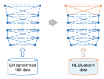
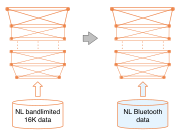

**Source:** *Improving DNN Bluetooth Narrowband Acoustic Models by Cross-Bandwidth and Cross-Lingual Initialization* — [PDF](https://www.isca-archive.org/interspeech_2017/zhuang17_interspeech.pdf)

# Improving DNN Bluetooth Narrowband Acoustic Models by Cross-bandwidth and Cross-lingual Initialization

*Xiaodan Zhuang, Arnab Ghoshal, Antti-Veikko Rosti, Matthias Paulik, Daben Liu*

## Apple Inc., USA

{xiaodan zhuang,aghoshal}@apple.com

## Abstract

The success of deep neural network (DNN) acoustic models is partly owed to large amounts of training data available for different applications. This work investigates ways to improve DNN acoustic models for Bluetooth narrowband mobile applications when relatively small amounts of in-domain training data are available. To address the challenge of limited indomain data, we use cross-bandwidth and cross-lingual transfer learning methods to leverage knowledge from other domains with more training data (different bandwidth and/or languages). Specifically, narrowband DNNs in a target language are initialized using the weights of DNNs trained on bandlimited wideband data in the same language or those trained on a different (resource-rich) language. We investigate multiple recipes involving such methods with different data resources. For all languages in our experiments, these recipes achieve up to 45% relative WER reduction, compared to training solely on the Bluetooth narrowband data in the target language. Furthermore, these recipes are very beneficial even when over two hundred hours of manually transcribed in-domain data is available, and we can achieve better accuracy than the baselines with as little as 20 hours of in-domain data.

Index Terms: speech recognition, deep neural network, crosslingual, cross-bandwidth, transfer learning

## 1. Introduction

Voice-enabled applications continue to gain in popularity with the general population. Speech recognition is expected to work regardless of the language, the device, the acoustic environment, or the available bandwidth. Some of these scenarios occur less frequently, resulting in data resource scarcity for model training. The amount and quality of training data have large impact on the accuracy of speech recognition models. Bluetooth narrowband speech in newly supported languages fits into such scenarios. Our goal is to rapidly develop models for such usage in a cost-effective way.

Semi-supervised learning has been the most common approach for improving acoustic models when there are limited amounts of transcribed data [1, 2, 3, 4]. However, these methods do not utilize information from other tasks, for example acoustic models in other languages. In recent years, inductive transfer and multi-task learning [5, 6, 7] techniques have been applied successfully for cross-lingual acoustic modeling using subspace Gaussian mixture models [8, 9] and neural networks [10, 11, 12, 13, 14]. Such approaches utilize data from not only the target languages, but other languages, whether linguistically close or distant, and have shown consistent accuracy improvements over using the target language data alone. In particular, [14] shows accuracy gains even when hundreds of hours of training data are available in the target language. As the authors of [14] point out, "*resource-scarce is relative to the model* *size*." More recently, [15, 16] combined cross-lingual training with semi-supervised learning when only small amounts of transcribed training data are available in the target language.

Cross-lingual inductive transfer in neural network acoustic models involves sharing the hidden layers, or a subset of them, between languages, while having language-specific output layers corresponding to the context-independent phonemes or context-dependent phonemic states in each language. The approaches may be divided into two categories depending on how the hidden layers are trained:

- multi-lingual/multi-task learning, where the hidden layers are jointly trained for all languages [10, 11, 13, 14];
- cross-lingual/transfer learning, where the hidden layers from a well-trained language are used to initialize the network in the target language [12, 14].

When transferring knowledge between two languages, [14] shows that multi-lingual training sometimes provides small gains over cross-lingual transfer, and at other times there is no difference in accuracies between the two.

In a production scenario, however, one tends to support new languages over time but has access to mature systems in multiple languages that are already supported. In other words, this is a scenario where the related tasks have already been learnt before a new target task is even defined. Here, transfer learning is a more natural choice: as training data in a new language becomes available, one trains the DNN for that language, on the newly available data, by initializing the hidden layers from a previously trained language. This is both effective at increasing the accuracy in the target language and is faster to train since only the target language data are used [12].

Additionally, for any given language, the application may involve acoustic channels with different bandwidths. [17] proposed a mixed bandwidth training approach by separating out the filterbanks for low and high frequencies. The low-frequency filterbanks from both wide- and narrow-band speech are used, while the high-frequency filterbanks only come from wide-band speech. For narrow-band speech, the high frequency filterbanks are set to zero or the mean values from the wide-band case. However, mixed-bandwidth training only improved recognition of wide-band speech, but not narrow-band speech.

Our goal is to improve Bluetooth narrowband speech recognition by investigating transfer learning approaches. We want to find training approaches that are optimal considering the diversity in available data resources. Specifically, we extend the cross-lingual transfer learning paradigm [12], to both crosslingual and cross-bandwidth transfer and their combinations. We first transfer the parameters from a related DNN, trained on the lower frequencies of wideband data and/or a different language, and then train using in-domain narrowband data. Our experiments show substantial gains in accuracies for dictation over Bluetooth narrowband channels in four languages.

Figure 1: *Cross-lingual initialization — the hidden layers of a DNN trained on one language, e.g., English (EN), is used to initialize the DNN for a target language, e.g., Dutch (NL). The output layer is initialized with random weights and the whole network is retrained.*

## 2. Cross-lingual initialization

The intuition behind sharing the hidden layers of a DNN between languages is that the lower layers (those close to the features) are less task-specific and tend to generalize between tasks. In other words, the conjecture is that the lower layers of the DNNs encode features that help distinguish different speech units (context-dependent triphone states in this case) not only for the language that they are trained on, but are useful across different languages. This does not answer the question about which layers to transfer and which to retrain on the target language, and previous work [12, 14] tended to either retrain the whole network or only the top layers. In [14] we see that retraining just the top layers tends to produce worse results than retraining the whole network. A recent and thorough empirical study on cross-task transfer for object recognition [18] shows that transferring all the hidden layers and retraining the whole network is the optimal strategy owing to co-adaptation between neurons of neighboring layers.

We transfer the hidden layers of a DNN from a well-trained existing language to the new target language and retrain the whole network using the target language data, as shown in Figure 1. In addition to the choice of the source language, we have the choice of initializing from a bandlimited wideband DNN in the source language, which amounts to both cross-lingual and cross-bandwidth transfer, or from a narrowband DNN in the source language. On the target data, we not only train the DNNs using frame-level cross-entropy criterion but we also use a sequence-discriminative criterion [19, 20, 21, 22, 23]. Finer control of the training procedure, such as first reestimating the output layer weights with the hidden layer weights frozen before retraining the whole neural network, might bring further performance gain, as shown for bottleneck features [24].

## 3. Cross-bandwidth initialization

Most users speak to virtual assistants using microphones that provide wideband audio. However, a small fraction of usage happens over narrowband (8 kHz) Bluetooth headsets. The infrequent nature of such usage makes it more difficult to collect and transcribe sufficient data to train the models. This problem is particularly acute for new languages, since initially their overall usage tends to be lower.

In absence of any narrowband data, one may train the models using bandlimited wideband data, where the feature extrac-

Figure 2: *Cross-bandwidth initialization — a DNN trained on bandlimited wideband audio is then further retrained on narrowband audio (using Dutch(NL) as an example language).*

tion from 16 kHz sampled speech is done by setting an upper cutoff frequency that is lower than 4 kHz. Training on such band-limited wideband data involves mismatches in the acoustic characteristics as well as the speech style and content. Users not only tend to use narrowband headsets in acoustic environments that are different from those where the wideband microphones are used, but the distribution of words also tends to be different. Such mismatches certainly have implications for language modeling, but in this work we solely focus on improving the acoustic models for Bluetooth narrowband speech.

We find that models trained on relatively small amounts of in-domain Bluetooth narrowband audio data outperform those trained on much larger amounts of bandlimited wideband data (cf. Section 4.2). However, there is still useful information in the bandlimited wideband data. To this end, we initialize the narrowband DNN with one trained on bandlimited wideband data in that language, as shown in Figure 2. We then carry out a combination of cross-entropy training and sequence training of the DNN using the narrowband data.

## 4. Experiment results

We created test sets from narrowband Bluetooth headsets, about 4 hours each for four languages: Dutch (NL), Brazilian Portuguese (PT), Thai (TH), and Turkish (TR). For training data, in addition to the 50-240 hours of manually transcribed Bluetooth data for these languages, we use 400-600 hours of wideband data, also with manual transcription. We extracted acoustic features from the wideband data by band-limiting the audio as described in Section 3.

#### 4.1. Setup

The DNN acoustic models have the following structure: the input consists of 21 contiguous frames of 40-dimensional log melfilterbank features with global mean-variance normalization, followed by a TRAPS (temporal patterns) layer that uses a DCT transform to reduce the dimensionality in each frequency band from 21 to 11; the network has 6 hidden layers each with 1024 units, and an output layer with softmax activation and about 4500-5000 targets, corresponding to the context-dependent triphone states in a GMM-HMM acoustic model. We do not train language models specifically for the Bluetooth applications, and keep them the same between wideband and narrowband use cases for each language. For each language, the acoustic model training consists of the following steps, similar to [25]:

Table 1: *Baseline Narrowband DNN WERs (Best for each language is in bold style.)*

| Lang |       | Bandlimited 16K | Narrowband |        |  |
|------|-------|-----------------|------------|--------|--|
|      | Hours | BaseWB          | Hours      | BaseNB |  |
| NL   | 600   | 25.7            | 260        | 24.0   |  |
| PT   | 600   | 33.0            | 140        | 26.1   |  |
| TH   | 400   | 38.9            | 50         | 29.8   |  |
| TR   | 400   | 42.8            | 60         | 38.4   |  |

- 1. GMM-HMM acoustic models trained using boosted MMI (BMMI) [26] on features extracted from bandlimited wideband training data. This GMM-HMM system is used to provide initial alignment for DNN training.
- 2. The DNN weights are initialized either randomly or using the cross-bandwidth or the cross-lingual methods described in Sections 2 and 3.
- 3. The DNN is trained with the cross-entropy criterion using the initial alignment. This step is optional for crossbandwidth initialization.
- 4. The DNN is updated by sequence training using the BMMI criterion1 . The alignments and lattices used in this step are generated by the DNN from the previous step (either 3 or 2).

#### 4.2. Baselines

We establish the following DNN baselines, with random initial weights, cross-entropy training through back-propagation, followed by BMMI training1 , and report their accuracies in terms of Word Error Rates (WERs) in Table 1.

BaseWB : trained on bandlimited wideband data;

BaseNB : trained on Bluetooth data.

BaseNB systems outperform BaseWB systems for all languages, highlighting the value of the in-domain narrowband Bluetooth training data.

We do back-propagation with random initial weights in this work. Instead of random initialization, one can also initialize the network using unsupervised RBM training or discriminative pretraining, such as layer-by-layer back-propagation [27, 28, 29]. Our preliminary experiments show that RBM or layer-by-layer pretraining doesn't consistently improve over random initialization. Specifically, we observe that the benefits of layer-by-layer pretraining come with the cost of more training schedule tuning, and reduce with larger amounts of training data. It was also reported [29] that deeper networks benefit less, compared to shallower ones.

Preliminary experiments show that a smaller topology with four hidden layers each having 512 units results in comparable performances. So we did not adjust the network topologies depending on the amount of narrowband training data.

#### 4.3. Cross-bandwidth training

As detailed in Section 3, we perform cross-bandwidth training using relatively small amounts of narrowband data. For each language, we start with the corresponding bandlimited wideband DNN (BaseWB in Table 1) and perform the following variations of training on the narrowband data in that language:

Table 2: *Cross-bandwidth Narrowband DNN WERs, using 20 hours or all Bluetooth narrowband training data. (Best for each language is in bold style.)*

| Lang | BaseNB | CB1  |      | CB2  |      | CB3  |      |  |
|------|--------|------|------|------|------|------|------|--|
|      |        | 20hr | all  | 20hr | all  | 20hr | all  |  |
| NL   | 24.0   | 17.4 | 16.4 | 25.9 | 22.7 | 19.3 | 15.7 |  |
| PT   | 26.1   | 23.5 | 22.4 | 34.3 | 30.0 | 24.9 | 22.2 |  |
| TH   | 29.8   | 20.7 | 23.3 | 23.8 | 22.4 | 19.3 | 17.7 |  |
| TR   | 38.4   | 29.8 | 29.1 | 39.3 | 35.0 | 31.5 | 29.8 |  |

- CB1 : Initialize all DNN weights from BaseWB, skip crossentropy training, and perform sequence training using lattices generated by BaseWB;
- CB2 : Initialize all DNN weights from BaseWB, and perform cross-entropy training;

CB3 : CB2, followed by sequence training.

In Table 2, we report word error rates when using all of the available narrowband data in a language or just 20 hours of it. We find cross-bandwidth transfer with sequence training (CB1 and CB3) significantly outperform the baseline, for all four languages, even when only 20 hours of narrowband training data is used. Even just cross-entropy training following cross-bandwidth transfer (CB2) outperforms the BMMI-trained baseline for all languages except Portuguese. Besides, when there are only 20 hours of narrowband data, CB1 is better than CB2 and CB3 in most cases, considering cross-entropy training's need for more data.

#### 4.4. Cross-lingual training

In cross-lingual training, we transfer the hidden layers from three existing languages. Specifically, we start from the following source language DNNs:

EN/ES : a US English DNN or a European Spanish DNN, each trained on 1000 hours of bandlimited wideband training data in the respective language and achieving about 15% WERs on their respective test sets.

ENp : a US English Bluetooth DNN, trained on real narrowband data, scoring about 13% WER.

ZHp : a Mandarin Chinese Bluetooth DNN, trained on real narrowband data, scoring about 19% WER.

The output layer of a target language DNN is initialized with random weights and the whole network is trained using cross-entropy criterion followed by sequence training with BMMI criterion. From the results in Table 3, using just 20 hours or all of the available narrowband training data, we find:

- Using all available Bluetooth training data, training with cross-lingual initialization always significantly outperforms the baselines, regardless of the source DNN.
- Using only 20 hours of Bluetooth data, ENp-init outperforms the baselines for three languages (except Portuguese). In general, 20 hours training with crosslingual initialization doesn't bring consistent and significant gains beyond the best baselines. A plausible explanation is that with its output layer randomly initialized, the network training needs more training data, particularly given that the training updates all layers.

1As reported in [22, 23], we also do not find a consistent difference between different sequence training criteria for DNNs.

Table 3: *Cross-lingual Narrowband DNN WERs, initialized with different source-language DNNs, using 20 hours or all Bluetooth narrowband training data. (Best for each language is in bold style.)*

| Lang | BaseNB | ES-init |      | EN-init |      | ENp-init |      | ZHp-init |      |
|------|--------|---------|------|---------|------|----------|------|----------|------|
|      |        | 20hr    | all  | 20hr    | all  | 20hr     | all  | 20hr     | all  |
| NL   | 24.0   | 24.7    | 17.0 | 29.1    | 18.8 | 23.6     | 15.7 | 27.3     | 16.6 |
| PT   | 26.1   | 28.3    | 22.5 | 28.3    | 23.0 | 28.1     | 24.6 | 29.4     | 22.8 |
| TH   | 29.8   | 27.2    | 21.9 | 25.9    | 21.0 | 23.4     | 19.9 | 24.0     | 20.5 |
| TR   | 38.4   | 34.1    | 30.0 | 35.4    | 29.2 | 32.7     | 29.2 | 35.3     | 31.1 |

Table 4: *WERs using cross-lingual transfer followed by cross-bandwidth transfer. (Best result for each language is in bold, and \* indicates those that outperform the best results from Tables 2 and 3).*

| Lang | without narrowband data |           | with narrowband data |       |               |      |               |       |        |  |
|------|-------------------------|-----------|----------------------|-------|---------------|------|---------------|-------|--------|--|
|      | BaseWB                  | BaseWB-EN | BaseWB-EN-CB1        |       | BaseWB-EN-CB2 |      | BaseWB-EN-CB3 |       | BaseNB |  |
|      |                         |           | 20hr                 | all   | 20hr          | all  | 20hr          | all   |        |  |
| NL   | 25.7                    | 22.1      | 16.0                 | 15.0* | 24.6          | 21.1 | 18.1          | 15.7  | 24.0   |  |
| PT   | 33.0                    | 29.4      | 22.0*                | 21.1* | 32.5          | 29.5 | 23.6          | 21.6* | 26.1   |  |
| TH   | 38.9                    | 34.4      | 20.8                 | 20.3  | 22.6          | 20.8 | 17.9          | 16.3* | 29.8   |  |
| TR   | 42.8                    | 38.8      | 27.0*                | 25.9* | 36.1          | 33.3 | 28.3*         | 27.0* | 38.4   |  |

- ES-init and EN-init demonstrate that transferring from English and Spanish DNNs brings similar gains.
- EN-init and ENp-init show different effect of crosslingual initialization when the source network is trained from bandlimited wideband data or actual narrowband data. The latter performs better for Dutch and Thai.
- ENp-init outperforms ZHp-init for three languages, with the exception of Portuguese.

#### 4.5. Combined cross-lingual and cross-bandwidth transfer

When initially training a DNN on bandlimited wideband data in a new language, one need not start with random weights, as was done to establish a controlled baseline in Table 1, but may initialize the hidden layers with those of a DNN in an already supported language. For the experiments reported in this section, we initialize the hidden layers from the bandlimited US English DNN. We call this BaseWB-EN in Table 4 and by contrasting with the corresponding randomly initialized BaseWB DNNs from Table 1 we find nearly 4% absolute WER reduction from cross-lingual transfer.

Starting from this new bandlimited wideband DNN (BaseWB-EN), we perform the cross-bandwidth transfer experiments (CB1, CB2, CB3) of Section 4.3. Table 4 shows that the resultant DNNs, i.e. BaseWB-EN-CB1, BaseWB-EN-CB2 and BaseWB-EN-CB3, outperform both BaseWB-EN and BaseNB. The best performing methods are BaseWB-EN-CB1 and BaseWB-EN-CB3, which use initial weights from the hidden layers of an English DNN, leverage both bandlimited wideband data and narrowband data, and end with BMMI training using narrowband data.

## 5. Conclusions and Discussion

We leverage knowledge from other speech recognition tasks to improve DNN acoustic models for narrowband Bluetooth applications. Such knowledge is obtained through network initialization, specifically using weights from a previous network trained on bandlimited wideband data or for a different language.

Our experiments demonstrate significant accuracy improvements obtained by cross-bandwidth and cross-lingual initialization. Furthermore, we provide training recipes in consideration of realistic acoustic model development scenarios. For example, with a small amount (e.g., 20 hours) of narrowband data, cross-bandwidth methods CB1 and CB3 first train on bandlimited wideband data, and outperform baseline models trained with even much more Bluetooth data. On the other hand, given that we already have models for widely used languages, if minimizing training time for a new language is a priority, crosslingual methods can train faster, directly on only the Bluetooth data, compared to the cross-bandwidth methods. Further performance improvement can be achieved by using both crosslingual and cross-bandwidth transfer approaches as shown in Section 4.5.

This work focuses on improvements using these methods without adjusting other parts of the acoustic model training approach. However, we believe that adjustments in training would lead to more effective use of cross-lingual or cross-bandwidth knowledge. For example, since the output layer weights are randomly initialized with cross-lingual initialization, updating only the output layer with non-output layers frozen proves to be a beneficial discriminative pretraining in the literature as well as in our follow-up experiments. However, that usually requires additional hyper parameter tuning. Similarly, when doing crosslingual and cross-bandwidth transfer, it would be worth comparing with the situation where the weights are transferred from a DNN that is only trained with cross-entropy and not sequence trained, while the final models are still sequence-trained.

## 6. Acknowledgements

We would like to thank Alex Acero and Gunnar Evermann for helpful discussions.

## 7. References

- [1] G. Zavaliagkos, M. Siu, T. Colthurst, and J. Billa, "Using untranscribed training data to improve performance," in *ICSLP*, 1998.
- [2] L. Lamel, J.-L. Gauvain, and G. Adda, "Lightly supervised and unsupervised acoustic model training," *Computer Speech & Language*, vol. 16, no. 1, pp. 115–129, January 2002.
- [3] J. Ma, S. Matsoukas, O. Kimball, and R. Schwartz, "Unsupervised training on large amounts of broadcast news data," in *Proc. ICASSP*, 2006.
- [4] D. Yu, B. Varadarajan, L. Deng, and A. Acero, "Active learning and semi-supervised learning for speech recognition: A unified framework using the global entropy reduction maximization criterion," *Computer Speech & Language*, vol. 24, no. 3, pp. 433–444, July 2010.
- [5] L. Pratt, J. Mostow, and C. Kamm, "Direct transfer of learned information among neural networks," in *Proc. AAAI*, 1991.
- [6] S. Thrun, "Is learning the n-th thing any easier than learning the first?" in *Advances in Neural Information Processing Systems 8 (NIPS-95)*, 1996.
- [7] R. Caruana, "Multitask learning," *Machine Learning*, vol. 28, no. 1, pp. 41–75, January 1997.
- [8] L. Burget, P. Schwarz, M. Agarwal, P. Akyazi, K. Feng, A. Ghoshal, O. Glembek, N. Goel, M. Karafiat, D. Povey, A. Ras- ´ trow, R. Rose, and S. Thomas, "Multilingual acoustic modeling for speech recognition based on subspace Gaussian mixture models," in *Proc. ICASSP*, 2010, pp. 4334–4337.
- [9] L. Lu, A. Ghoshal, and S. Renals, "Cross-lingual subspace Gaussian mixture models for low-resource speech recognition," *IEEE Trans. Audio, Speech, Lang. Proc.*, vol. 22, no. 1, pp. 17–27, January 2014.
- [10] S. Scanzio, P. Laface, L. Fissore, R. Gemello, and F. Mana, "On the use of a multilingual neural network front-end," in *INTER-SPEECH*, September 2008, pp. 2711–2714.
- [11] K. Vesely, M. Karafi ´ at, F. Gr ´ ezl, M. Janda, and E. Egorova, "The ´ language-independent bottleneck features," in *Proc. IEEE SLT Workshop*, 2012.
- [12] A. Ghoshal, P. Swietojanski, and S. Renals, "Multilingual training of deep neural networks," in *Proc. IEEE ICASSP*, May 2013, pp. 7319–7323.
- [13] J.-T. Huang, J. Li, D. Yu, L. Deng, and Y. Gong, "Cross-language knowledge transfer using multilingual deep neural network with shared hidden layers," in *Proc. IEEE ICASSP*, 2013.
- [14] G. Heigold, V. Vanhoucke, A. Senior, P. Nguyen, M. Ranzato, M. Devin, and J. Dean, "Multilingual acoustic models using distributed deep neural networks," in *Proc. IEEE ICASSP*, 2013.
- [15] S. Thomas, M. Seltzer, K. Church, and H. Hermansky, "Deep neural network features and semi-supervised training for low resource speech recognition," in *Proc. IEEE ICASSP*, May 2013, pp. 6704– 6708.
- [16] F. Grezl and M. Karafi ´ at, "Combination of multilingual and semi- ´ supervised training for under-resourced languages," in *Proc. IN-TERSPEECH*, 2014, pp. 820–824.
- [17] J. Li, D. Yu, J.-T. Huang, and Y. Gong, "Improving wideband speech recognition using mixed-bandwidth training data in CD-DNN-HMM," in *Proc. IEEE SLT Workshop*, 2012.
- [18] J. Yosinski, J. Clune, Y. Bengio, and H. Lipson, "How transferable are features in deep neural networks?" in *Advances in Neural Information Processing Systems 27*, 2014, pp. 3320–3328.
- [19] J. S. Bridle and L. Dodd, "An Alphanet approach to optimising input transformations for continuous speech recognition," in *Proc. IEEE ICASSP*, vol. 1, April 1991, pp. 277–280.
- [20] B. Kingsbury, "Lattice-based optimization of sequence classification criteria for neural-network acoustic modeling," in *Proc. IEEE ICASSP*, April 2009, pp. 3761–3764.

- [21] H. Su, G. Li, D. Yu, and F. Seide, "Error back propagation for sequence training of context-dependent deep networks for conversational speech transcription," in *Proc. IEEE ICASSP*, 2013, pp. 6664–6668.
- [22] K. Vesely, A. Ghoshal, L. Burget, and D. Povey, "Sequence- ´ discriminative training of deep neural networks," in *Proc. INTER-SPEECH*, 2013, pp. 2345–2349.
- [23] E. McDermott, G. Heigold, P. Moreno, A. Senior, and M. Bacchiani, "Asynchronous stochastic optimization for sequence training of deep neural networks: Towards big data," in *Proc. INTER-SPEECH*, 2014.
- [24] F. Grezl, M. Karafi ´ at, and K. Vesel ´ y, "Adaptation of multilingual ´ stacked bottle-neck neural network structure for new language," in *Proc. IEEE ICASSP*, May 2014, pp. 7654–7658.
- [25] M. Paulik, "Improvements to the pruning behavior of dnn acoustic models." in *INTERSPEECH*, 2015, pp. 1463–1467.
- [26] D. Povey, D. Kanevsky, B. Kingsbury, B. Ramabhadran, G. Saon, and K. Visweswariah, "Boosted MMI for model and feature-space discriminative training," in *Proc. IEEE ICASSP*, 2008, pp. 4057– 4060.
- [27] Y. Bengio, P. Lamblin, D. Popovici, and H. Larochelle, "Greedy layer-wise training of deep networks," in *Proceedings of the 19th International Conference on Neural Information Processing Systems*, ser. NIPS'06. Cambridge, MA, USA: MIT Press, 2006, pp. 153–160. [Online]. Available: http://dl.acm.org/citation.cfm?id=2976456.2976476
- [28] F. Seide, G. Li, and D. Yu, "Conversational speech transcription using context-dependent deep neural networks." in *Interspeech*, 2011, pp. 437–440.
- [29] F. Seide, G. Li, X. Chen, and D. Yu, "Feature engineering in context-dependent deep neural networks for conversational speech transcription," in *Automatic Speech Recognition and Understanding (ASRU), 2011 IEEE Workshop on*. IEEE, 2011, pp. 24–29.