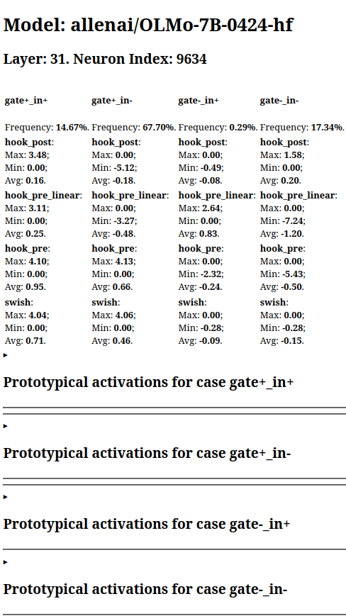
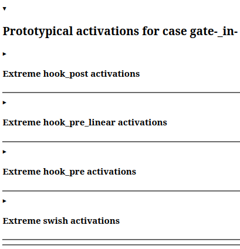
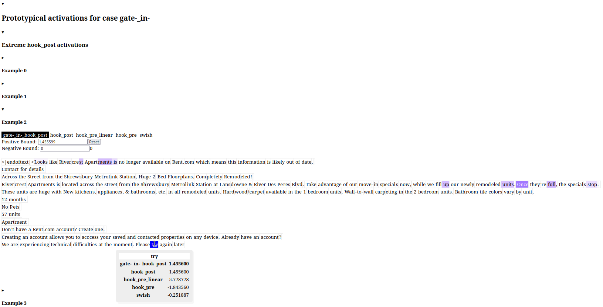

**Source:** *GLUScope: A Tool for Analyzing GLU Neurons in Transformer Language Models* — [PDF](https://arxiv.org/pdf/2602.23826) · [arXiv](https://arxiv.org/abs/2602.23826)

#  GLUScope:   
A Tool for Analyzing GLU Neurons in Transformer Language Models 

Sebastian Gerstner & Hinrich Schütze  Affiliation: LMU Munich and Munich Center for Machine Learning (MCML)  Affiliation: Munich, Germany  Affiliation: sgerstner at cis dot lmu dot de

###### Abstract

We present GLUScope, an open-source tool for analyzing neurons in Transformer-based language models, intended for interpretability researchers. We focus on more recent models than previous tools do; specifically we consider gated activation functions such as SwiGLU. This introduces a new challenge: understanding positive activations is not enough. Instead, both the gate and the in activation of a neuron can be positive or negative, leading to four different possible sign combinations that in some cases have quite different functionalities. Accordingly, for any neuron, our tool shows text examples for each of the four sign combinations, and indicates how often each combination occurs. We describe examples of how our tool can lead to novel insights. A demo is available at <https://sjgerstner.github.io/gluscope>.

## 1 Introduction

Transformer-based ([Vaswani et al., 2017](https://arxiv.org/html/2602.23826#bib.bib41)) large language models (LLMs) have shown impressive performance, but there is still much that is unclear about how they achieve it. This had led to large-scale interest and effort in understanding their inner workings, an endeavor initially called NLP interpretability and later mechanistic interpretability ([Elhage et al., 2021](https://arxiv.org/html/2602.23826#bib.bib8); [Saphra and Wiegreffe, 2024](https://arxiv.org/html/2602.23826#bib.bib35)). ACL researchers have also been involved in these efforts, as shown for example by the existence of the "interpretability and model analysis" track at ACL conferences, or the popularity of the BlackboxNLP workshops ([Saphra and Wiegreffe, 2024](https://arxiv.org/html/2602.23826#bib.bib35)). As a part of this endeavor, several works have analyzed individual neurons,11 1 We use ”neuron” to refer to a hidden dimension inside the MLP layer.  especially via text examples that strongly activate them ([Dalvi et al., 2019](https://arxiv.org/html/2602.23826#bib.bib5); [Geva et al., 2021](https://arxiv.org/html/2602.23826#bib.bib13); [Nanda, 2022](https://arxiv.org/html/2602.23826#bib.bib30); [Voita et al., 2024](https://arxiv.org/html/2602.23826#bib.bib42); [Gurnee et al., 2024](https://arxiv.org/html/2602.23826#bib.bib16)).

We want to support these interpretability researchers, especially those working on neuron interpretation, by publishing a new tool for neuron analysis. There are several such tools already (see below, [section 3](https://arxiv.org/html/2602.23826#S3 "3 Related work ‣ GLUScope:A Tool for Analyzing GLU Neurons in Transformer Language Models")), but there is a crucial gap to fill: they (often implicitly) assume vanilla activation functions such as ReLU, GELU ([Ramachandran et al., 2017](https://arxiv.org/html/2602.23826#bib.bib34)), or Swish ([Hendrycks and Gimpel, 2016](https://arxiv.org/html/2602.23826#bib.bib19)); but modern language models (e.g., [Groeneveld et al., 2024](https://arxiv.org/html/2602.23826#bib.bib14); [Touvron et al., 2023](https://arxiv.org/html/2602.23826#bib.bib40)) often use gated activation functions (a.k.a. GLU variants) such as SwiGLU or GEGLU ([Shazeer, 2020](https://arxiv.org/html/2602.23826#bib.bib37)). These activation functions introduce a new challenge: understanding positive activations is not enough. Instead, both the gate and the in activation of a neuron can be both positive and negative, leading to four different possible sign combinations. Each of these sign combinations will have different patterns of appearance. For this reason, gated neurons can have much more complex behavior than vanilla ones. Our tool, GLUScope, is the first to take this complexity into account: For each neuron, we record not only the strongest activations overall, but the strongest activations within each of the sign combinations.

Concretely, we release the following artifacts ([section 4](https://arxiv.org/html/2602.23826#S4 "4 Released artifacts ‣ GLUScope:A Tool for Analyzing GLU Neurons in Transformer Language Models")): a dataset containing summary information on the activations of each neuron (of one model), and a website, GLUScope, for visualizing this neuron data for a few selected neurons. Additionally, we release the dataset we ran the model on, as well as code that can be used to reproduce our artifacts or create new ones of the same kind (activation datasets for other models and/or visualizations for more neurons).

We showcase the utility of our tool by two usage examples ([section 5](https://arxiv.org/html/2602.23826#S5 "5 Usage examples ‣ GLUScope:A Tool for Analyzing GLU Neurons in Transformer Language Models")) that lead to new insights into neuron behavior, including ones that could not have been achieved with other tools.

## 2 Preliminaries

### 2.1 Gated activation functions (GLU variants)22 2 This section closely follows section 3.1 of our earlier work [Gerstner and Schütze (2025)](https://arxiv.org/html/2602.23826#bib.bib10). 

We work on gated activation functions like SwiGLU or GEGLU ([Shazeer, 2020](https://arxiv.org/html/2602.23826#bib.bib37)). Gated activation functions are used widely; e.g., OLMo ([Groeneveld et al., 2024](https://arxiv.org/html/2602.23826#bib.bib14)) and Llama ([Touvron et al., 2023](https://arxiv.org/html/2602.23826#bib.bib40)) use SwiGLU, and Gemma ([Gemma, 2024](https://arxiv.org/html/2602.23826#bib.bib9)) uses GEGLU. Here we briefly describe SwiGLU. GEGLU replaces Swish with GELU, but is otherwise identical.

Traditional activation functions like ReLU require one weight matrix on the input side and one on the output side: The MLP outputs

\[\begin{aligned}
 & {\bm{W}}_{\text{out}}\text{ReLU}({\bm{W}}_{\text{in}}{\bm{x}}), & 
\end{aligned}\]

 

where ReLU is applied element-wise to each neuron (it takes a single scalar as argument).

Other traditional activation functions are \(\text{Swish}(x):=x/(1+\exp(-x))\) ([Ramachandran et al., 2017](https://arxiv.org/html/2602.23826#bib.bib34)) and \(\text{GELU}(x):=x\Phi(x)\)44 4 \(\Phi\) is the cumulative distibution function (cdf) of a standard normal distribution.  ([Hendrycks and Gimpel, 2016](https://arxiv.org/html/2602.23826#bib.bib19)). Both of these can be seen as smooth approximations of ReLU. They are known to work better than ReLU, which is widely believed to be because of their good differentiability (e.g., [Lee, 2023](https://arxiv.org/html/2602.23826#bib.bib23)), i.e. better training dynamics.

In contrast to these traditional functions, a _gated activation function_ like SwiGLU requires two weight matrices on the input side: The MLP outputs

\[\begin{aligned}
 & {\bm{W}}_{\text{out}}\left(\text{Swish}({\bm{W}}_{\text{gate}}{\bm{x}})\odot({\bm{W}}_{\text{in}}{\bm{x}})\right), &  & \text{(1)}
\end{aligned}\]

 

where \(\odot\) denotes element-wise multiplication (a.k.a. Hadamard product).55 5 In other works, \({\bm{W}}_{\text{in}}\) and \({\bm{W}}_{\text{out}}\) are also called \({\bm{W}}_{\text{up}}\) and \({\bm{W}}_{\text{down}}\), respectively.

We find it more intuitive to separately consider each neuron: The neuron adds the vector

\[\begin{aligned}
 & \mbox{Swish}(\langle{\bm{w}}_{\text{gate}},{\bm{x}}\rangle)\cdot\langle{\bm{w}}_{\text{in}},{\bm{x}}\rangle\cdot{\bm{w}}_{\text{out}} &  & \text{(2)}
\end{aligned}\]

 

to the residual stream. Here \({\bm{w}}_{\text{gate}},{\bm{w}}_{\text{in}}\) are each one of the \(d_{\text{MLP}}\) rows of \({\bm{W}}_{\text{gate}},{\bm{W}}_{\text{out}}\), and \({\bm{w}}_{\text{out}}\) is one of the \(d_{\text{MLP}}\) columns of \({\bm{W}}_{\text{out}}\).66 6 This is assuming the right-to-left notation of our [equation 1](https://arxiv.org/html/2602.23826#S2.E1 "In 2.1 Gated activation functions \(GLU variants\) 2 footnote 2 footnote Footnote footnotes Footnotes 2 footnote 2 This section closely follows section 3.1 of our earlier work \( \) . ‣ 2 Preliminaries ‣ GLUScope:A Tool for Analyzing GLU Neurons in Transformer Language Models"). With left-to-right notation rows and columns are switched.  These weight vectors, as well as \({\bm{x}}\), all have dimensionality \(d_{\text{model}}\).77 7 Following TransformerLens ([Nanda and Bloom, 2022](https://arxiv.org/html/2602.23826#bib.bib31)), we write \(d_{\text{model}}\) for the model dimensionality (i.e. the dimensionality of the residual stream), and \(d_{\text{MLP}}\) for the hidden dimensionality of a given MLP layer.

In this framework, SwiGLU can be described as a function of two scalars:

\[\begin{aligned}
 & \mbox{SwiGLU}(x_{\text{gate}},x_{\text{in}}):=\mbox{Swish}(x_{\text{gate}})\cdot x_{\text{in}}, & 
\end{aligned}\]

 

Unlike ReLU, gated activation functions can output arbitrary positive or negative values. For example, if \(x_{\text{gate}}>0\) and \(x_{\text{in}}\ll 0\), then \(\text{SwiGLU}(x_{\text{gate}},x_{\text{in}})\ll 0\).

### 2.2 Weight preprocessing

We follow the weight preprocessing described in section 3.2 of [Gerstner and Schütze (2025)](https://arxiv.org/html/2602.23826#bib.bib10).

## 3 Related work

### 3.1 Neuron analysis research88 8 Part of this section follows section 2 of our earlier work [Gerstner and Schütze (2025)](https://arxiv.org/html/2602.23826#bib.bib10). 

Much research has attempted to understand individual neurons in transformer-based LMs. Examples include [Geva et al. (2021)](https://arxiv.org/html/2602.23826#bib.bib13); [Miller and Neo (2023)](https://arxiv.org/html/2602.23826#bib.bib25); [Niu et al. (2024)](https://arxiv.org/html/2602.23826#bib.bib32); [Kong et al. (2025)](https://arxiv.org/html/2602.23826#bib.bib21).

Broadly speaking, neuron analysis works can be divided into three distinct perspectives: input-centered, output-centered, and input-output. Input-centered analyses are possibly the most frequent ones: they attempt to understand what causes a neuron to activate. Typically they run the model on a dataset and record which examples (most strongly) activate a given neuron. Examples include [Dalvi et al. (2019)](https://arxiv.org/html/2602.23826#bib.bib5); [Geva et al. (2021)](https://arxiv.org/html/2602.23826#bib.bib13); [Nanda (2022)](https://arxiv.org/html/2602.23826#bib.bib30); [Voita et al. (2024)](https://arxiv.org/html/2602.23826#bib.bib42); [Gurnee et al. (2024)](https://arxiv.org/html/2602.23826#bib.bib16). Output-centered analyses attempt to understand the effect of a neuron, for example by an analysis of their output weight. Examples include [Gurnee et al. (2024)](https://arxiv.org/html/2602.23826#bib.bib16); [Stolfo et al. (2024)](https://arxiv.org/html/2602.23826#bib.bib39). Finally, input-output analyses attempt to understand the relationship between input and output of a neuron. Examples of this are more rare, but [Gerstner and Schütze (2025)](https://arxiv.org/html/2602.23826#bib.bib10) attempt to do this by computing cosine similarities of input and output weights, an idea that was also briefly mentioned in [Elhage et al. (2021)](https://arxiv.org/html/2602.23826#bib.bib8); [Gurnee et al. (2024)](https://arxiv.org/html/2602.23826#bib.bib16).

The focus on individual neurons has been criticized. [Morcos et al. (2018)](https://arxiv.org/html/2602.23826#bib.bib27) find that in good models, neurons are not monosemantic (but for image models, not LLMs). [Millidge and Black (2022)](https://arxiv.org/html/2602.23826#bib.bib26) find interpretable directions that do not correspond to individual neurons. [Elhage et al. (2022)](https://arxiv.org/html/2602.23826#bib.bib7) argue that interpretable features are non-orthogonal directions in model space and can be superposed. This corresponds to sparse linear combinations of neurons in MLP space. This has inspired a series of work on sparse autoencoders (SAEs), starting with [Sharkey et al. (2022)](https://arxiv.org/html/2602.23826#bib.bib36).

The focus on SAEs has been criticized: recent studies indicate that they do not always outperform baselines ([Kantamneni et al., 2025](https://arxiv.org/html/2602.23826#bib.bib20); [Leask et al., 2025](https://arxiv.org/html/2602.23826#bib.bib22); [Mueller et al., 2025](https://arxiv.org/html/2602.23826#bib.bib29); [Wu et al., 2025](https://arxiv.org/html/2602.23826#bib.bib43)). A middle ground is possible: [Gurnee et al. (2023)](https://arxiv.org/html/2602.23826#bib.bib17) argue that interpretable features correspond to sparse combinations of neurons; this includes 1-sparse combinations, i.e., individual neurons. Accordingly, there is recent work on new classes of interpretable neurons, e.g., [Ali et al. (2025)](https://arxiv.org/html/2602.23826#bib.bib2); [Zhao et al. (2025)](https://arxiv.org/html/2602.23826#bib.bib44).

### 3.2 Neuron analysis tools

Our work is largely inspired by Neuroscope [Nanda (2022)](https://arxiv.org/html/2602.23826#bib.bib30). This is a website visualizing the top activations of each neuron from a range of models. However it provides little additional information and is not kept up-to-date with newer models.

NeuroX ([Dalvi et al., 2019](https://arxiv.org/html/2602.23826#bib.bib5)) is primarily a code base: users can train their own (comparatively small) models, run them on a (small) dataset and then visualize neuron activations.

LM Debugger ([Geva et al., 2022a](https://arxiv.org/html/2602.23826#bib.bib11)) has a different focus: given a model prediction, it shows the neurons that are most prominently activated on it, together with an output-based analysis. The user can adjust neuron activations to "debug" the particular model prediction.

Transformer Debugger ([Mossing et al., 2024](https://arxiv.org/html/2602.23826#bib.bib28)) is a more general set of interpretability tools for small language models (focusing on GPT2-small [Radford et al. (2019)](https://arxiv.org/html/2602.23826#bib.bib33)); one of these tools is Neuron viewer. For a given neuron, it shows text examples for activations in various quantile ranges (e.g., from the top \(0.1\%\) or bottom \(50\%\) activations), and tentative explanations generated by GPT-4. Additionally, the tool shows the top tokens of input and output weights, as well as related neurons (apparently based on weight similarity).

Neuronpedia ([Lin, 2023](https://arxiv.org/html/2602.23826#bib.bib24)) is a large-scale platform for exploring latent features within language models, for example those produced by sparse autoencoders (SAE, [Sharkey et al., 2022](https://arxiv.org/html/2602.23826#bib.bib36)). It is however not directly designed for exploring neurons. In contrast, we are specifically focusing on neurons. For reasons outlined in [section 3.1](https://arxiv.org/html/2602.23826#S3.SS1 "3.1 Neuron analysis research 8 footnote 8 footnote Footnote footnotes Footnotes 8 footnote 8 Part of this section follows section 2 of our earlier work \( \) . ‣ 3 Related work ‣ GLUScope:A Tool for Analyzing GLU Neurons in Transformer Language Models"), we believe this is still a valuable endeavor.

None of the above tools addresses the problem we want to solve: an interface to visualize neurons of GLU-based models, especially their activations.

### 3.3 Related code libraries

Our work relies on two libraries: First, TransformerLens [Nanda and Bloom (2022)](https://arxiv.org/html/2602.23826#bib.bib31) enables easy access to transformer hidden states. (We use a custom fork that also supports OLMo [Groeneveld et al. (2024)](https://arxiv.org/html/2602.23826#bib.bib14).) The second library is CircuitsVis [Cooney and Nanda (2023)](https://arxiv.org/html/2602.23826#bib.bib4). It provides functions for appealing visualizations, such as coloring tokens according to their activation.

Another visualization library, that we did not use but deserves mention, is Ecco ([Alammar, 2021](https://arxiv.org/html/2602.23826#bib.bib1)).

## 4 Released artifacts

The code used to create the artifacts is released at <https://github.com/sjgerstner/gluscope>.

In addition to the code, we release the following artifacts:

  * the Dolma subset we ran the model on, 
  * a dataset containing summary information on the activations of each neuron, 
  * and our main website for visualizing neuron data, GLUScope. 

We release code and artifacts under the MIT license, except the Dolma subset which maintains the ODC-BY license of Dolma.

### 4.1 Dolma subset

We release this dataset at <https://huggingface.co/sjgerstner/dolma-small>. It was produced by the script a_dataset.py in our GitHub repository.

It is a random subset of Dolma ([Soldaini et al., 2024](https://arxiv.org/html/2602.23826#bib.bib38)), a general-purpose LM pretraining dataset.

We made the following design choices to keep things lightweight:

  * We keep slightly above 20M tokens.1010 10 Token counts are based on the OLMo ([Groeneveld et al., 2024](https://arxiv.org/html/2602.23826#bib.bib14)) tokenizer, which is essentially the same as GPT-NeoX ([Black et al., 2022](https://arxiv.org/html/2602.23826#bib.bib3)).  The size of 20M tokens follows [Voita et al. (2024)](https://arxiv.org/html/2602.23826#bib.bib42), and is smaller than the amount used by [Nanda (2022)](https://arxiv.org/html/2602.23826#bib.bib30). 
  * We keep at most 1024 tokens per example (instead of 2048 in [Nanda (2022)](https://arxiv.org/html/2602.23826#bib.bib30)). Documents longer than this are truncated. 
  * When tokenizing, we let the first token be EOS (as is standard in TransformerLens but not in Huggingface). We counted this towards the limits of 1024 tokens per example and 20M+ tokens overall. 

As a result, the dataset contains 45,734 texts.

Users can run the same script with different arguments to get another dataset with different design choices.

By publishing this dataset, we enable other users to efficiently load a small subset of Dolma (without having to load a bigger dataset and then downsample it). The primary use case we are thinking of is model analysis research like ours, but, as with any text dataset, many other use cases can be imagined.

### 4.2 Activation dataset

We release this dataset at <https://huggingface.co/sjgerstner/OLMo-7B-0424-hf_neuron-activations>. It was produced by the script b_activations.py: We run a model on a text dataset (in our case the Dolma subset from [section 4.1](https://arxiv.org/html/2602.23826#S4.SS1 "4.1 Dolma subset ‣ 4 Released artifacts ‣ GLUScope:A Tool for Analyzing GLU Neurons in Transformer Language Models")) and record information about the activations of each neuron.

We used the model OLMo-7B-0424 ([Groeneveld et al., 2024](https://arxiv.org/html/2602.23826#bib.bib14)), which has also been used in some other model analysis works ([Gerstner and Schütze, 2025](https://arxiv.org/html/2602.23826#bib.bib10); [Hakimi et al., 2025](https://arxiv.org/html/2602.23826#bib.bib18)). We think OLMo models are an especially good choice for this kind of research because their training dataset is publicly available, which is not the case for most other open-weights models. Users can also compute analogous datasets for other models with the same script.

In the following we describe in more detail what kind of activation information the dataset contains.

First of all, for each neuron the \(x_{\text{gate}}\) and \(x_{\text{in}}\) activations can take four possible sign combinations. We count how often each of these combinations appears. Then, within each sign combination, we record detailed information about each of the intermediate activations of the neuron (\(x_{\text{gate}},\text{Swish}(x_{\text{gate}}),x_{\text{in}}\), and the final activation \(\text{Swish}(x_{\text{gate}})\cdot x_{\text{in}}\)): the average value, and the top-k (or bottom-k, depending on the sign) values together with the dataset indices where they appeared.1111 11 To be precise: each dataset index appears only once per top-k list, even if the text led to several very high activations at different positions. We chose \(k=16\).

This activation dataset has two uses: First, we use it to produce the neuron visualizations of [section 4.3](https://arxiv.org/html/2602.23826#S4.SS3 "4.3 Our demo website: GLUScope ‣ 4 Released artifacts ‣ GLUScope:A Tool for Analyzing GLU Neurons in Transformer Language Models"). Second, we can use it as input data for experiments investigating properties of neuron activations: For example, in [Gerstner and Schütze (2025)](https://arxiv.org/html/2602.23826#bib.bib10) we used an earlier version of this dataset to uncover a correlation between frequency of \(x_{\text{gate}}>0\) and a property of neuron weights. See [section 5.1](https://arxiv.org/html/2602.23826#S5.SS1 "5.1 Using the activation dataset for a model-wide analysis ‣ 5 Usage examples ‣ GLUScope:A Tool for Analyzing GLU Neurons in Transformer Language Models").

 Figure 1: Overview of a neuron page (neuron 31.9634 of OLMo-7B-0424).

### 4.3 Our demo website: GLUScope

Next to the machine-readable activation dataset of [section 4.2](https://arxiv.org/html/2602.23826#S4.SS2 "4.2 Activation dataset ‣ 4 Released artifacts ‣ GLUScope:A Tool for Analyzing GLU Neurons in Transformer Language Models"), we want to present neuron information in a human-friendly format. This is what our GLUScope website does. It is published at <https://sjgerstner.github.io/gluscope>.

The website deliberately shows just a few selected neurons, since it is impossible for a human to look at every single neuron of a model. To add a page for another neuron, a user can run the visualization code on their own. Thanks to the activation dataset, this does not require running the model on all of the text again. Optionally, the user can then open a pull request to make the page available to the public.

Each GLUScope page describes a single neuron. It consists of two main components: summary statistics and text examples. See [figure 1](https://arxiv.org/html/2602.23826#S4.F1 "In 4.2 Activation dataset ‣ 4 Released artifacts ‣ GLUScope:A Tool for Analyzing GLU Neurons in Transformer Language Models") for an example neuron page.

#### 4.3.1 Summary statistics

The summary statistics are directly read off the activation dataset ([section 4.2](https://arxiv.org/html/2602.23826#S4.SS2 "4.2 Activation dataset ‣ 4 Released artifacts ‣ GLUScope:A Tool for Analyzing GLU Neurons in Transformer Language Models")) and presented as a table (as seen in the top half of [figure 1](https://arxiv.org/html/2602.23826#S4.F1 "In 4.2 Activation dataset ‣ 4 Released artifacts ‣ GLUScope:A Tool for Analyzing GLU Neurons in Transformer Language Models")). Each column represents one of the four possible sign combination of \(x_{\text{gate}}\) and \(x_{\text{in}}\), denoted as "gate+_in+" (for \(x_{\text{gate}}>0\) and \(x_{\text{in}}>0\)), “gate+_in-” etc. Within each column, the following information is presented:

  * Frequency: How often this combination appeared when running the model on the dataset. 
  * Detailed information about each of the intermediate activations of the neuron (the terminology here largely follows TransformerLens): 
    * "hook_post": final activation (\(\text{Swish}(x_{\text{gate}})\cdot x_{\text{in}}\)). 
    * "hook_pre_linear": \(x_{\text{in}}\). 
    * "hook_pre": \(x_{\text{gate}}\). 
    * "swish": \(\text{Swish}(x_{\text{gate}})\). 

For each of these, we present the maximum, minimum, and average activations (among the cases with the given sign combination).

The user can easily infer more coarse-grained statistics. For example, the frequency of \(x_{\text{gate}}>0\) is the sum of the frequencies of "gate+_in+" and "gate+_in-".

 Figure 2: Within each sign combination we show examples for the four intermediate activations "hook_post", "hook_pre_linear", "hook_pre" and "swish". See [section 4.3.1](https://arxiv.org/html/2602.23826#S4.SS3.SSS1 "4.3.1 Summary statistics ‣ 4.3 Our demo website: GLUScope ‣ 4 Released artifacts ‣ GLUScope:A Tool for Analyzing GLU Neurons in Transformer Language Models") for definitions. 

 Figure 3:  A single example of a strong activation of neuron 31.9634 in the case \(x_{\text{gate}}<0\), \(x_{\text{in}}<0\). The colored tokens are those where this sign combination occurred for this neuron. Via the top bar it is possible to display all intermediate activations as well. Hovering over a token shows the exact activation values. 

#### 4.3.2 Text examples

The next section is the largest one of each page: it presents text examples (highest absolute activations) for each of the entries in the summary table. For example, the first subsection presents those examples that get the largest "hook_post" activations, among those examples in which the "gate+_in+" sign combination appears. See [figures 2](https://arxiv.org/html/2602.23826#S4.F2 "In 4.3.1 Summary statistics ‣ 4.3 Our demo website: GLUScope ‣ 4 Released artifacts ‣ GLUScope:A Tool for Analyzing GLU Neurons in Transformer Language Models") and [3](https://arxiv.org/html/2602.23826#S4.F3 "Figure 3 ‣ 4.3.1 Summary statistics ‣ 4.3 Our demo website: GLUScope ‣ 4 Released artifacts ‣ GLUScope:A Tool for Analyzing GLU Neurons in Transformer Language Models").

Following the activation dataset, we show 16 examples for each entry.

The texts are presented in a truncated version: We only show them up to the two tokens directly after the token of interest.

⬇

import torch

import datasets

from scipy import stats

#select single layer

layer=15 

#load precomputed cos(w_in,w_out) data,

#assumed format is a tensor of shape (layer, neuron).

cosines = torch.load(’cosine_data.pt’) 

#select layer

cosines = cosines[layer,:] 

#load our activation dataset

activation_dataset = datasets.load_dataset(’sjgerstner/OLMo-7B-0424-hf_neuron-activations’)[’train’] 

#select layer

activation_dataset = activation_dataset.filter(lambda example: example[’layer’]==layer) 

#compute frequency of x_gate>0 for each neuron

freq_gate_pos = torch.Tensor(activation_dataset[’gate+_in+_freq’]) + torch.Tensor(activation_dataset[’gate+_in-_freq’]) 

#compute correlation and p value

corr_and_p = stats.pearsonr(cosines, freq_gate_pos) 

print(corr_and_p) 

Figure 4: Code for [section 5.1](https://arxiv.org/html/2602.23826#S5.SS1 "5.1 Using the activation dataset for a model-wide analysis ‣ 5 Usage examples ‣ GLUScope:A Tool for Analyzing GLU Neurons in Transformer Language Models")

## 5 Usage examples

The goal of the tool is to aid interpretability research, so as an evaluation we present two usage examples that show how the tool can lead to novel insights. We already separately described these insights in [Gerstner and Schütze (2025)](https://arxiv.org/html/2602.23826#bib.bib10). (We found them thanks to an earlier version of the GLUScope tool we describe here.) Here we focus on how the tool enables these findings, rather than the findings themselves or their implications.

### 5.1 Using the activation dataset for a model-wide analysis

In this first example, we demonstrate a possible use of the activation dataset ([section 4.2](https://arxiv.org/html/2602.23826#S4.SS2 "4.2 Activation dataset ‣ 4 Released artifacts ‣ GLUScope:A Tool for Analyzing GLU Neurons in Transformer Language Models")). Specifically, we find a strong negative correlation between \(\cos({\bm{w}}_{\text{in}},{\bm{w}}_{\text{out}})\) and frequency of \(x_{\text{gate}}>0\) of any given neuron. We present a code snippet to this effect in [figure 4](https://arxiv.org/html/2602.23826#S4.F4 "In 4.3.2 Text examples ‣ 4.3 Our demo website: GLUScope ‣ 4 Released artifacts ‣ GLUScope:A Tool for Analyzing GLU Neurons in Transformer Language Models").

It is quite possible that, thanks to our dataset, users will discover other intriguing correlations between seemingly unrelated properties of neurons.

### 5.2 Inspecting a neuron with GLUScope

Now, in our second example, we demonstrate how the GLUScope website can be used to inspect a given neuron. We do this for neuron 31.96341212 12 We use the notation ”layer.neuron”, with zero-based indexing. The model has 32 layers, so this neuron is in the final layer.  (of OLMo-7B-0424).

From a weight-based analysis (independent of GLUScope) we know that the neuron’s \({\bm{w}}_{\text{out}}\) weight closely corresponds to the unembedding representation of "again" and a few similar tokens, while \({\bm{w}}_{\text{gate}}\) and \({\bm{w}}_{\text{in}}\) correspond to "minus again".

This naturally leads to the question when the neuron strongly activates: Is it when "again" is a plausible next token (because of \({\bm{w}}_{\text{out}}\)), or perhaps when it is not a plausible next token (because of \({\bm{w}}_{\text{gate}}\) and \({\bm{w}}_{\text{in}}\))? Moreover, as described above (e.g., [section 4.2](https://arxiv.org/html/2602.23826#S4.SS2 "4.2 Activation dataset ‣ 4 Released artifacts ‣ GLUScope:A Tool for Analyzing GLU Neurons in Transformer Language Models")), a given neuron can have different types of activations, depending on the signs of \(x_{\text{gate}}\) and \(x_{\text{in}}\). So perhaps we will find different patterns for different sign combinations.

Based on the weights, since \({\bm{w}}_{\text{gate}}\) and \({\bm{w}}_{\text{in}}\) are highly similar to each other, we would expect that \(x_{\text{gate}}\) and \(x_{\text{in}}\) would usually have the same sign, thus leading to a positive activation most of the time. However this has to be tested empirically.

GLUScope helps us answer these questions, leading to the following findings:

Frequent negative activations: Contrary to our prediction based on the weights, the neuron often activates negatively. Specifically, \(67.7\%\) of all activations are of the type \(x_{\text{gate}}>0,x_{\text{in}}<0\). See the table in [figure 1](https://arxiv.org/html/2602.23826#S4.F1 "In 4.2 Activation dataset ‣ 4 Released artifacts ‣ GLUScope:A Tool for Analyzing GLU Neurons in Transformer Language Models").

Most sign combinations are hard to interpret: For the "gate+_in+" and "gate-_in+" sign combinations, we do not find any obvious pattern in the activations. For example, the strongest "gate+_in+" activation is on the token "door" (next token "often"), but the next-strongest one is on the "es" of "volcanoes" (next token "body").

For the "gate+_in-" activations we do find a pattern, but it is not obviously related to "again": The next token is usually an adverb like "meanwhile", "instead", "later".

The "gate-_in-" activations are highly interpretable: When we look at this fourth sign combination (which only appears \(17.34\%\) of the time), we suddenly find that the largest of these activations are closely related to "again": Often in these cases "again" is the correct next token, or at least a plausible one. For example, these activations often occur on the token "once", as in "once again". See [figure 3](https://arxiv.org/html/2602.23826#S4.F3 "In 4.3.1 Summary statistics ‣ 4.3 Our demo website: GLUScope ‣ 4 Released artifacts ‣ GLUScope:A Tool for Analyzing GLU Neurons in Transformer Language Models") for another example. In these cases, “again” is already highly ranked, but a different token may be generated by the model. This neuron increases the strength of the “again” direction and makes it more likely that the correct token “again” is generated.

We could not have discovered this last point with a more traditional tool designed for vanilla activation functions, like [Nanda](https://arxiv.org/html/2602.23826#bib.bib30)’s ([2022](https://arxiv.org/html/2602.23826#bib.bib30)) Neuroscope: If we had just recorded the largest positive activations (and possibly the largest negative ones) we would only have got those from the case "gate+_in+" (and "gate+_in-"). (As shown by the GLUScope page in [figure 1](https://arxiv.org/html/2602.23826#S4.F1 "In 4.2 Activation dataset ‣ 4 Released artifacts ‣ GLUScope:A Tool for Analyzing GLU Neurons in Transformer Language Models"), their extrema are at \(3.48\) and \(-5.12\).) The highly interpretable "gate-_in-" activations are much smaller (at most \(1.58\)) and would therefore have been missed.

## 6 Conclusion

We release GLUScope, a tool for inspecting neurons in transformer language models. We fill an important gap of previous tools by focusing on gated activation functions, which are widely used in recent models. Thanks to this new focus, our tool enables more fine-grained analyses than previous ones.

In the near future, we would like to extend the demo in the following ways:

  * More models, depending on the wishes of the community; 
  * Include weight-based analyses in each neuron page (e.g., decoding neuron weights into tokens as in [Geva et al. (2022b)](https://arxiv.org/html/2602.23826#bib.bib12)); 
  * Include dataset indices on the neuron page, to enable users to find the origin of a given example; 
  * Truncate the texts more, so it is easier to focus on what is relevant. 

## Limitations

Focusing on gated activation functions addresses an important limitation of previous work, but is itself limited: Our tool cannot directly be used to analyze MoE models (e.g., [DeepSeek, 2025](https://arxiv.org/html/2602.23826#bib.bib6)), or non-Transformer models like Mamba ([Gu and Dao, 2024](https://arxiv.org/html/2602.23826#bib.bib15)). Moreover, we focus on individual neurons, instead of other hypothesized causal variables like SAE features [Sharkey et al. (2022)](https://arxiv.org/html/2602.23826#bib.bib36).

## References

  * Alammar (2021) J Alammar. 2021.  [Ecco: An open source library for the explainability of transformer language models](https://doi.org/10.18653/v1/2021.acl-demo.30).  In _Proceedings of the 59th Annual Meeting of the Association for Computational Linguistics and the 11th International Joint Conference on Natural Language Processing: System Demonstrations_ , pages 249–257, Online. Association for Computational Linguistics. 
  * Ali et al. (2025) Ameen Ali, Shahar Katz, Lior Wolf, and Ivan Titov. 2025.  [Detecting and pruning prominent but detrimental neurons in large language models](https://arxiv.org/pdf/2507.09185).  _COLM_. 
  * Black et al. (2022) Sid Black, Stella Biderman, Eric Hallahan, Quentin Anthony Leo Gao, Laurence Golding, Horace He, Connor Leahy, Kyle McDonell, Jason Phang, Michael Pieler, U. S. V. S. N. Sai Prashanth, Shivanshu Purohit, Laria Reynolds, Jonathan Tow, Ben Wang, and Samuel Weinbach. 2022.  [GPT-NeoX-20B: an open-source autoregressive language model](https://arxiv.org/abs/2204.06745).  _arXiv_. 
  * Cooney and Nanda (2023) Alan Cooney and Neel Nanda. 2023.  Circuitsvis.  <https://github.com/TransformerLensOrg/CircuitsVis>. 
  * Dalvi et al. (2019) Fahim Dalvi, Nadir Durrani, Hassan Sajjad, Yonatan Belinkov, Anthony Bau, and James Glass. 2019.  [What is one grain of sand in the desert? Analyzing individual neurons in deep NLP models](https://doi.org/10.1609/aaai.v33i01.33016309).  _AAAI_. 
  * DeepSeek (2025) DeepSeek. 2025.  [DeepSeek-V3 technical report](https://arxiv.org/pdf/2412.19437).  _arXiv_. 
  * Elhage et al. (2022) Nelson Elhage, Tristan Hume, Catherine Olsson, Nicholas Schiefer, Tom Henighan, Shauna Kravec, Zac Hatfield-Dodds, Robert Lasenby, Dawn Drain, Carol Chen, Roger Grosse, Sam McCandlish, Jared Kaplan, Dario Amodei, Martin Wattenberg, and Christopher Olah. 2022.  [Toy models of superposition](https://transformer-circuits.pub/2022/toy_model/index.html). 
  * Elhage et al. (2021) Nelson Elhage, Neel Nanda, Catherine Olsson, Tom Henighan, Nicholas Joseph, Ben Mann, Amanda Askell, Yuntao Bai, Anna Chen, Tom Conerly, Nova DasSarma, Dawn Drain, Deep Ganguli, Zac Hatfield-Dodds, Danny Hernandez, Andy Jones, Jackson Kernion, Liane Lovitt, Kamal Ndousse, and 6 others. 2021.  [A mathematical framework for transformer circuits](https://transformer-circuits.pub/2021/framework/index.html). 
  * Gemma (2024) Team Gemma. 2024.  [Gemma](https://doi.org/10.34740/KAGGLE/M/3301). 
  * Gerstner and Schütze (2025) Sebastian Gerstner and Hinrich Schütze. 2025.  [Weakening neurons: a newly discovered read-write functionality in transformers with outsize influence](https://openreview.net/pdf?id=Rj5ZJk956j).  Anonymous submission. 
  * Geva et al. (2022a) Mor Geva, Avi Caciularu, Guy Dar, Paul Roit, Shoval Sadde, Micah Shlain, Bar Tamir, and Yoav Goldberg. 2022a.  [LM-Debugger: an interactive tool for inspection and intervention in transformer-based language models](https://arxiv.org/abs/2204.12130).  _arXiv preprint arXiv:2204.12130_. 
  * Geva et al. (2022b) Mor Geva, Avi Caciularu, Kevin Wang, and Yoav Goldberg. 2022b.  [Transformer feed-forward layers build predictions by promoting concepts in the vocabulary space](https://doi.org/10.18653/v1/2022.emnlp-main.3).  In _Proceedings of the 2022 Conference on Empirical Methods in Natural Language Processing_ , pages 30–45, Abu Dhabi, United Arab Emirates. Association for Computational Linguistics. 
  * Geva et al. (2021) Mor Geva, Roei Schuster, Jonathan Berant, and Omer Levy. 2021.  [Transformer feed-forward layers are key-value memories](https://doi.org/10.18653/v1/2021.emnlp-main.446).  In _Proceedings of the 2021 Conference on Empirical Methods in Natural Language Processing_ , pages 5484–5495, Online and Punta Cana, Dominican Republic. Association for Computational Linguistics. 
  * Groeneveld et al. (2024) Dirk Groeneveld, Iz Beltagy, Evan Walsh, Akshita Bhagia, Rodney Kinney, Oyvind Tafjord, Ananya Jha, Hamish Ivison, Ian Magnusson, Yizhong Wang, Shane Arora, David Atkinson, Russell Authur, Khyathi Chandu, Arman Cohan, Jennifer Dumas, Yanai Elazar, Yuling Gu, Jack Hessel, and 24 others. 2024.  [OLMo: Accelerating the science of language models](https://doi.org/10.18653/v1/2024.acl-long.841).  In _Proceedings of the 62nd Annual Meeting of the Association for Computational Linguistics (Volume 1: Long Papers)_ , pages 15789–15809, Bangkok, Thailand. Association for Computational Linguistics. 
  * Gu and Dao (2024) Albert Gu and Tri Dao. 2024.  [Mamba: linear-time sequence modeling with selective state spaces](https://arxiv.org/pdf/2312.00752).  _arXiv_. 
  * Gurnee et al. (2024) Wes Gurnee, Theo Horsley, Zifan Carl Guo, Tara Rezaei Kheirkhah, Qinyi Sun, Will Hathaway, Neel Nanda, and Dimitris Bertsimas. 2024.  [Universal neurons in gpt2 language models](https://arxiv.org/pdf/2401.12181). 
  * Gurnee et al. (2023) Wes Gurnee, Neel Nanda, Matthew Pauly, Katherine Harvey, Dmitrii Troitskii, and Dimitris Bertsimas. 2023.  [Finding neurons in a haystack: case studies with sparse probing](https://arxiv.org/pdf/2305.01610). 
  * Hakimi et al. (2025) Ahmad Dawar Hakimi, Ali Modarressi, Philipp Wicke, and Hinrich Schuetze. 2025.  [Time course MechInterp: Analyzing the evolution of components and knowledge in large language models](https://doi.org/10.18653/v1/2025.findings-acl.654).  In _Findings of the Association for Computational Linguistics: ACL 2025_ , pages 12633–12653, Vienna, Austria. Association for Computational Linguistics. 
  * Hendrycks and Gimpel (2016) Dan Hendrycks and Kevin Gimpel. 2016.  [Bridging nonlinearities and stochastic regularizers with gaussian error linear units](http://arxiv.org/abs/1606.08415).  _CoRR_. 
  * Kantamneni et al. (2025) Subhash Kantamneni, Joshua Engels, Senthooran Rajamanoharan, Max Tegmark, and Neel Nanda. 2025.  [Are sparse autoencoders useful? a case study in sparse probing](https://arxiv.org/pdf/2502.16681.pdf).  _arXiv_. 
  * Kong et al. (2025) Linghao Kong, Angelina Ning, Micah Adler, and Nir Shavit. 2025.  [Negative pre-activations differentiate syntax](https://arxiv.org/pdf/2509.24198.pdf).  _arXiv_. 
  * Leask et al. (2025) Patrick Leask, Bart Bussmann, Michael Pearce, Joseph Bloom, Curt Tigges, Noura Al Moubayed, Lee Sharkey, and Neel Nanda. 2025.  [Sparse autoencoders do not find canonical units of analysis](https://arxiv.org/pdf/2502.04878.pdf).  _arXiv_. 
  * Lee (2023) Minhyeok Lee. 2023.  [Mathematical analysis and performance evaluation of the GELU activation function in deep learning](https://doi.org/10.1155/2023/4229924).  _Journal of Mathematics_. 
  * Lin (2023) Johnny Lin. 2023.  [Neuronpedia: Interactive reference and tooling for analyzing neural networks](https://www.neuronpedia.org).  Software available from neuronpedia.org. 
  * Miller and Neo (2023) Joseph Miller and Clement Neo. 2023.  [We found an neuron in gpt-2](https://www.lesswrong.com/posts/cgqh99SHsCv3jJYDS/we-found-an-neuron-in-gpt-2). 
  * Millidge and Black (2022) Beren Millidge and Sid Black. 2022.  [The singular value decompositions of transformer weight matrices are highly interpretable](https://www.lesswrong.com/posts/mkbGjzxD8d8XqKHzA/the-singular-value-decompositions-of-transformer-weight). 
  * Morcos et al. (2018) Ari S. Morcos, David G.T. Barrett, Neil C. Rabinowitz, and Matthew Botvinick. 2018\.  [On the importance of single directions for generalization](https://arxiv.org/pdf/1803.06959.pdf). 
  * Mossing et al. (2024) Dan Mossing, Steven Bills, Henk Tillman, Tom Dupré la Tour, Nick Cammarata, Leo Gao, Joshua Achiam, Catherine Yeh, Jan Leike, Jeff Wu, and William Saunders. 2024.  [Transformer debugger](https://openaipublic.blob.core.windows.net/neuron-explainer/neuron-viewer/index.html).  <https://github.com/openai/transformer-debugger>. 
  * Mueller et al. (2025) Aaron Mueller, Atticus Geiger, Sarah Wiegreffe, Dana Arad, Iván Arcuschin, Adam Belfki, Yik Siu Chan, Jaden Fiotto-Kaufman, Tal Haklay, Michael Hanna, Jing Huang, Rohan Gupta, Yaniv Nikankin, Hadas Orgad, Nikhil Prakash, Anja Reusch, Aruna Sankaranarayanan, Shun Shao, Alessandro Stolfo, and 4 others. 2025\.  [MIB: a mechanistic interpretability benchmark](https://arxiv.org/pdf/2504.13151).  _arXiv_. 
  * Nanda (2022) Neel Nanda. 2022.  [Neuroscope](https://neuroscope.io).  Website. 
  * Nanda and Bloom (2022) Neel Nanda and Joseph Bloom. 2022.  [TransformerLens](https://colab.research.google.com/github/neelnanda-io/TransformerLens/blob/main/demos/Main_Demo.ipynb).  <https://github.com/TransformerLensOrg/TransformerLens>. 
  * Niu et al. (2024) Jingcheng Niu, Andrew Liu, Zining Zu, and Gerald Penn. 2024.  [What does the knowledge neuron thesis have to do with knowledge?](https://arxiv.org/pdf/2405.02421)
  * Radford et al. (2019) Alec Radford, Jeff Wu, Rewon Child, David Luan, Dario Amodei, and Ilya Sutskever. 2019.  Language models are unsupervised multitask learners. 
  * Ramachandran et al. (2017) Prajit Ramachandran, Barret Zoph, and Quoc V. Le. 2017.  [Searching for activation functions](https://arxiv.org/pdf/1710.05941).  _arXiv_. 
  * Saphra and Wiegreffe (2024) Naomi Saphra and Sarah Wiegreffe. 2024.  [Mechanistic?](https://doi.org/10.18653/v1/2024.blackboxnlp-1.30) In _Proceedings of the 7th BlackboxNLP Workshop: Analyzing and Interpreting Neural Networks for NLP_ , pages 480–498, Miami, Florida, US. Association for Computational Linguistics. 
  * Sharkey et al. (2022) Lee Sharkey, Dan Braun, and Beren Millidge. 2022.  [[interim research report] taking features out of superposition with sparse autoencoders](https://www.alignmentforum.org/posts/z6QQJbtpkEAX3Aojj/interim-research-report-taking-features-out-of-superposition). 
  * Shazeer (2020) Noam Shazeer. 2020.  [Glu variants improve transformer](https://arxiv.org/pdf/2002.05202). 
  * Soldaini et al. (2024) Luca Soldaini, Rodney Kinney, Akshita Bhagia, Dustin Schwenk, David Atkinson, Russell Authur, Ben Bogin, Khyathi Chandu, Jennifer Dumas, Yanai Elazar, Valentin Hofmann, Ananya Jha, Sachin Kumar, Li Lucy, Xinxi Lyu, Nathan Lambert, Ian Magnusson, Jacob Morrison, Niklas Muennighoff, and 17 others. 2024\.  [Dolma: an open corpus of three trillion tokens for language model pretraining research](https://doi.org/10.18653/v1/2024.acl-long.840).  In _Proceedings of the 62nd Annual Meeting of the Association for Computational Linguistics (Volume 1: Long Papers)_ , pages 15725–15788, Bangkok, Thailand. Association for Computational Linguistics. 
  * Stolfo et al. (2024) Alessandro Stolfo, Ben Wu, Wes Gurnee, Yonatan Belinkov, Xingyi Song, Mrinmaya Sachan, and Neel Nanda. 2024.  [Confidence regulation neurons in language models](https://arxiv.org/abs/2406.16254). 
  * Touvron et al. (2023) Hugo Touvron, Thibaut Lavril, Gautier Izacard, Xavier Martinet, Marie-Anne Lachaux, Timothée Lacroix, Baptiste Rozière, Naman Goyal, Eric Hambro, Faisal Azhar, Aurélien Rodriguez, Armand Joulin, Edouard Grave, and Guillaume Lample. 2023.  [Llama: Open and efficient foundation language models](https://arxiv.org/pdf/2302.13971).  _ArXiv_ , abs/2302.13971. 
  * Vaswani et al. (2017) Ashish Vaswani, Noam M. Shazeer, Niki Parmar, Jakob Uszkoreit, Llion Jones, Aidan N. Gomez, Lukasz Kaiser, and Illia Polosukhin. 2017.  [Attention is all you need](https://api.semanticscholar.org/CorpusID:13756489).  In _Neural Information Processing Systems_. 
  * Voita et al. (2024) Elena Voita, Javier Ferrando, and Christoforos Nalmpantis. 2024.  [Neurons in large language models: Dead, n-gram, positional](https://doi.org/10.18653/v1/2024.findings-acl.75).  In _Findings of the Association for Computational Linguistics: ACL 2024_ , pages 1288–1301, Bangkok, Thailand. Association for Computational Linguistics. 
  * Wu et al. (2025) Zhengxuan Wu, Aryaman Arora, Atticus Geiger, Zheng Wang, Jing Huang, Dan Jurafsky, Christopher D. Manning, and Christopher Potts. 2025.  [AxBench: Steering LLMs? even simple baselines outperform sparse autoencoders](https://arxiv.org/abs/2501.17148).  _ICML_. 
  * Zhao et al. (2025) Xiutian Zhao, Rochelle Choenni, Rohit Saxena, and Ivan Titov. 2025.  [Finding culture-sensitive neurons in vision-language models](https://arxiv.org/pdf/2510.24942).  _arXiv_. 

## Appendix A Deontology statements

### A.1 Licenses and languages of models and data

OLMo and Dolma. Training and inference code, weights (OLMo), and data (Dolma) under Apache 2.0 license. “The Science of Language Models” is explicitly mentioned as an intended use case. Dolma is quality-filtered and designed to contain only English and programming languages (though we came across some French sentences as well) [Groeneveld et al. (2024)](https://arxiv.org/html/2602.23826#bib.bib14); [Soldaini et al. (2024)](https://arxiv.org/html/2602.23826#bib.bib38).

### A.2 Computational complexity

Computing the activation dataset required a run of approximately five days on a single NVIDIA A100-SXM4-80GB GPU. It could possibly have been made more efficient by refactoring the code, which we leave to future work.

After the activation dataset is computed, generating a single neuron page takes between 30 and 60 seconds.

### A.3 LLM use

We used LLM assistants to help us with programming, releasing the system, and writing the paper. The ideas presented in this paper are our own.
