**Source:** *Rigorously Assessing Natural Language Explanations of Neurons* — [PDF](https://arxiv.org/pdf/2309.10312) · [arXiv](https://arxiv.org/abs/2309.10312)

# Rigorously Assessing Natural Language Explanations of Neurons

Jing Huang Atticus Geiger Karel D’Oosterlinck Zhengxuan Wu Christopher Potts  Email: [{hij, atticusg, kldooste, wuzhengx, cgpotts}@stanford.edu](mailto:) Affiliation: Stanford University  Affiliation: Pr(Ai)R Group  Affiliation: Ghent University – imec 

###### Abstract

Natural language is an appealing medium for explaining how large language models process and store information, but evaluating the faithfulness of such explanations is challenging. To help address this, we develop two modes of evaluation for natural language explanations that claim individual neurons represent a concept in a text input. In the _observational mode_ , we evaluate claims that a neuron \(a\) activates on all and only input strings that refer to a concept picked out by the proposed explanation \(E\). In the _intervention mode_ , we construe \(E\) as a claim that the neuron \(a\) is a causal mediator of the concept denoted by \(E\). We apply our framework to the GPT-4-generated explanations of GPT-2 XL neurons of [Bills et al. (2023)](https://arxiv.org/html/2309.10312#bib.bib5) and show that even the most confident explanations have high error rates and little to no causal efficacy. We close the paper by critically assessing whether natural language is a good choice for explanations and whether neurons are the best level of analysis.

## 1 Introduction

The ability to generate natural language explanations of large language models (LLMs) would be an enormous step forward for explainability research. Such explanations could form the basis for safety assessments, bias detection, and model editing, in addition to yielding fundamental insights into how LLMs represent concepts. However, we must be able to verify that these explanations are _faithful_ to how the LLM actually reasons and behaves.

What criteria should we use when assessing the faithfulness of natural language explanations? Without a clear answer to this question, we run the risk of adopting incorrect (but perhaps intuitive and appealing) explanations, which would have a severe negative impact on all the downstream applications mentioned above.

In the current paper, we seek to define criteria for assessing natural language explanations that claim individual neurons represent a concept in a text input. We consider two modes of evaluation (Figure [1](https://arxiv.org/html/2309.10312#S1.F1 "Figure 1 ‣ 1 Introduction ‣ Rigorously Assessing Natural Language Explanations of Neurons")). In the _observational mode_ , we evaluate the claim that a neuron \(a\) activates on all and only input strings that refer to a concept picked out by the proposed explanation \(E\). Relative to a set of inputs, we can then use the error rates to assess the quality of \(E\) for \(a\).

The observational mode only evaluates whether a concept is encoded, as opposed to used [Antverg and Belinkov (2022)](https://arxiv.org/html/2309.10312#bib.bib2). Thus, we propose an _intervention mode_ to evaluate the claim that \(a\) is a causally active representation of the concept denoted by \(E\). We construct next token prediction tasks that hinge on the concept and intervene on the neuron \(a\) to study whether the neuron is a causal mediator of concepts picked out by \(E\).

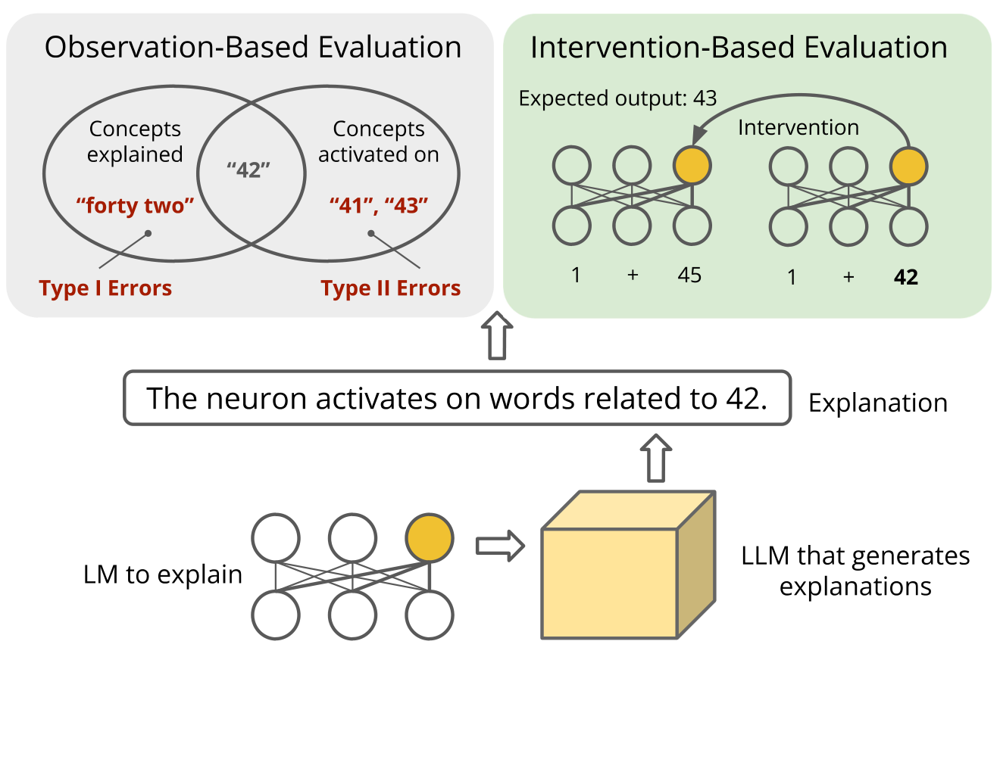

 Figure 1: An overview of our proposed framework. In the observational mode, we evaluate whether a neuron activates on strings picked out by the explanation. In the intervention mode, we assess whether the neuron is a causal mediator of the concept in the explanation.

For example, consider the explanation _years between 2000 and 2003_ of a neuron \(a\). In the observational mode, we experimentally test which strings the neuron \(a\) activates on and quantify how closely this is aligned with the explanation’s meaning. In the intervention mode, we can construct a task where the prefix “The year after \(Y\) is” is given and the model consistently outputs “\(Y+1\)”. Then we can swap the value of \(a\) for the value it takes on a different input and observe whether the behavior exhibits the expected change. The success rate of interventions quantifies the extent to which the neuron \(a\) is a causal mediator of the concept of years ([Vig et al., 2020](https://arxiv.org/html/2309.10312#bib.bib40); [Geiger et al., 2021](https://arxiv.org/html/2309.10312#bib.bib11); [Geiger et al., 2023a](https://arxiv.org/html/2309.10312#bib.bib12)).

To illustrate the value of this evaluation framework, we report on a detailed audit of the explanation method of [Bills et al. (2023)](https://arxiv.org/html/2309.10312#bib.bib5), which uses GPT-4 to generate natural language explanations of neurons in a pretrained GPT-2 XL model. This is, at present, the largest-scale effort to automatically generate explanations of LLMs: the authors offer explanations for 300K neurons in GPT-2 XL. Automatically generating natural language explanations is inherently exciting, but our findings are inauspicious. In the observational mode, we find that even among the top 0.6% of neurons which are considered well-explained by GPT-4’s own assessment, the explanation is far from faithful; construed as predictions about neuron activations, GPT-4 generated explanations achieve a precision of 0.64 and a recall of 0.50. In the intervention mode, the picture is more worrisome: we are unable to find evidence that neurons are causal mediators of the concepts denoted by the explanations. While the proposed explanations from the method of [Bills et al. (2023)](https://arxiv.org/html/2309.10312#bib.bib5) can be useful in exploring hypotheses about model computations, users of the method should have full knowledge of these assessments if they plan to make decisions based off these explanations.

We conclude by discussing some of the fundamental issues at hand. First, is natural language a good vehicle for model explanations? It seems appealingly accessible and expressive, but its ambiguity, vagueness, and context dependence are substantial problems if we want to use these explanations to guide technical decision making. Second, are neurons appropriate units to analyze? There may be useful signals in individual neurons, but it seems likely that the important structure will be stored in more abstract and distributed ways [Rumelhart et al. (1986)](https://arxiv.org/html/2309.10312#bib.bib36); [McClelland et al. (1986)](https://arxiv.org/html/2309.10312#bib.bib26); [Smolensky (1988)](https://arxiv.org/html/2309.10312#bib.bib38); [Geva et al. (2022)](https://arxiv.org/html/2309.10312#bib.bib16); [Geiger et al. (2023b)](https://arxiv.org/html/2309.10312#bib.bib14).

## 2 Related Work

#### Natural Language Explanations

Explanations of black box AI models that come in the form of language text have the obvious benefit of being expressive and readable ([Hendricks et al. 2016](https://arxiv.org/html/2309.10312#bib.bib18); [Ling et al. 2017](https://arxiv.org/html/2309.10312#bib.bib24); [Kim et al. 2018](https://arxiv.org/html/2309.10312#bib.bib23); [Do et al. 2020](https://arxiv.org/html/2309.10312#bib.bib8); [Kayser et al. 2022](https://arxiv.org/html/2309.10312#bib.bib22); see [Wiegreffe and Marasovic (2021)](https://arxiv.org/html/2309.10312#bib.bib43) for a review). Recent work on automated neuron interpretability leverages natural language to produce neuron descriptions at scale [Hernandez et al. (2022)](https://arxiv.org/html/2309.10312#bib.bib19); [Bills et al. (2023)](https://arxiv.org/html/2309.10312#bib.bib5); [Singh et al. (2023)](https://arxiv.org/html/2309.10312#bib.bib37).

However, automated generation poses challenges for evaluation. The faithfulness of natural language explanation is inherently hard to evaluate [Atanasova et al. (2023)](https://arxiv.org/html/2309.10312#bib.bib3). Existing automated metrics are mostly neuron-level [Bills et al. (2023)](https://arxiv.org/html/2309.10312#bib.bib5); [Singh et al. (2023)](https://arxiv.org/html/2309.10312#bib.bib37). Only a few measure model behaviors via ablation or editing [Hernandez et al. (2022)](https://arxiv.org/html/2309.10312#bib.bib19), which is critical for distinguishing _encoded_ vs.  _used_ information in neuron analysis [Antverg and Belinkov (2022)](https://arxiv.org/html/2309.10312#bib.bib2).

Besides concerns in faithfulness, recent work on distributed representations [Geva et al. (2022)](https://arxiv.org/html/2309.10312#bib.bib16); [Geiger et al. (2023b)](https://arxiv.org/html/2309.10312#bib.bib14) and superposition phenomena [Elhage et al. (2022)](https://arxiv.org/html/2309.10312#bib.bib9) suggests individual neurons may not provide the most interpretable structure.

#### Intervention-Based Methods

Interpretability methods that use interventions to create counterfactual model states have so far provided the most provably faithful explanations of model behaviors [Sundararajan et al. (2017)](https://arxiv.org/html/2309.10312#bib.bib39); [Chattopadhyay et al. (2019)](https://arxiv.org/html/2309.10312#bib.bib6); [Vig et al. (2020)](https://arxiv.org/html/2309.10312#bib.bib40); [Feder et al. (2021)](https://arxiv.org/html/2309.10312#bib.bib10); [Geiger et al. (2021)](https://arxiv.org/html/2309.10312#bib.bib11); [Geiger et al. (2023a)](https://arxiv.org/html/2309.10312#bib.bib12); [Geiger et al. (2023b)](https://arxiv.org/html/2309.10312#bib.bib14); [Meng et al. (2022)](https://arxiv.org/html/2309.10312#bib.bib27); [Meng et al. (2023)](https://arxiv.org/html/2309.10312#bib.bib28); [Materzynska et al. (2022)](https://arxiv.org/html/2309.10312#bib.bib25); [Olsson et al. (2022)](https://arxiv.org/html/2309.10312#bib.bib31); [Wang et al. (2023)](https://arxiv.org/html/2309.10312#bib.bib41); [Conmy et al. (2023)](https://arxiv.org/html/2309.10312#bib.bib7). Intervention-based methods are also adopted to measure the faithfulness of explanations [Antverg and Belinkov (2022)](https://arxiv.org/html/2309.10312#bib.bib2); [Abraham et al. (2022)](https://arxiv.org/html/2309.10312#bib.bib1); [Atanasova et al. (2023)](https://arxiv.org/html/2309.10312#bib.bib3). Our evaluation is a causal mediation analysis ([Pearl, 2014](https://arxiv.org/html/2309.10312#bib.bib33); [Vig et al., 2020](https://arxiv.org/html/2309.10312#bib.bib40)), a special case of causal abstraction analysis ([Geiger et al., 2021](https://arxiv.org/html/2309.10312#bib.bib11); [Geiger et al., 2023a](https://arxiv.org/html/2309.10312#bib.bib12)).

## 3 Observation-Based Evaluation

We now define a framework for evaluating claims that a natural language text \(E\) explains a neuron \(a\) in a model \(M\) using direct observational data.

### 3.1 Methods

We first need to specify how \(E\) itself should be understood. Intuitively, an explanation like _years between 2000 and 2003_ refers to a set of abstract entities (a specific set of years).11 1 Does the English expression _between X and Y_ include _X_ and _Y_? The answer is highly variable and depends on the context and the entities being discussed ([Potts and Levy, 2015](https://arxiv.org/html/2309.10312#bib.bib34)). Here we adopt an inclusive sense. This actually illustrates a core challenge of using natural language for model explanations: the explanations often need their own explanations. However, this approach to meaning is hard to operationalize in terms of language models, which deal only with strings, so we opt to construe meanings as sets of strings. For example, the explanation _years between 2000 and 2003_ of a neuron \(a\) is given by \(\llbracket\text{years between 2000 and 2003}\rrbracket=\{\text{``2000''},\dots,\text{``2003''},\text{``the year before 2002''},\ldots\}\).

Abstractly speaking, the above means that every explanation denotes an infinite set of strings: there will typically be large numbers of sensible ways of describing entities, and more generally, for any \(q\in\llbracket E\rrbracket\), we will also have “\(q\) and True” \(\in E\), where “True” is a tautology of some sort. However, experimentally, we can approximate these sets with finite sets of strings. For example, we might approximate \(\llbracket\emph{yearsbetween2000and2003}\rrbracket\) with just the set \(\{\text{``2000''},\text{``2001''},\text{``2002''},\text{``2003''}\}\) for a partial but still robust test of \(E\). In what follows, we assume that \(\llbracket E\rrbracket\) is always approximated by a finite set; the precise membership of this set is an important experimental detail.

Bringing the above ideas together, we say that \(\textsc{Explain}_{M,Q}(a,E)\) is the claim that, for every input \(q\in Q\) to model \(M\) containing neuron \(a\), the activation \(a(q)>0\) iff \(q\in\llbracket E\rrbracket\). Here, \(Q\) is an experimental dataset defined to include our approximation of \(\llbracket E\rrbracket\) as well as strings that will allow us to probe for cases where \(E\) predicts no activation for the neuron but we do see activation. For example, to test _years between 2000 and 2003_ , we might use \(Q=\{\text{``2000''},\ldots,\text{``2003''},\text{``pizza''},\text{``\$5.75''}\}\).

In the observational mode, we evaluate whether the neuron \(a\) activates on _all and only_ strings in \(Q\cap\llbracket E\rrbracket\). We quantify this by considering an explanation \(E\) as making predictions about whether the neuron \(a\) will activate on a given input \(q\). Type I errors occur where the explanation \(E\) falsely predicts that the neuron \(a\) will activate on a string \(q\in\llbracket E\rrbracket\). Type II errors occur where the explanation \(E\) falsely predicts that the neuron will not activate on a string \(q\notin\llbracket E\rrbracket\). For the year example above, an error is of Type I when \(a\) does not activate on “2001” in an input, and of Type II when \(a\) does activate for a string like “pizza” in an input.

As there are usually neurons in each layer sharing semantically similar explanations, we can also evaluate how well an explanation \(E\) predicts the activations of a set of neurons \([a_{0},\dots,a_{n}]\), i.e., a claim that for every input \(q\in Q\), \(f([a_{0}(q),\dots,a_{n}(q)])>0\) iff \(q\in\llbracket E\rrbracket\), where \(f(\bm{x})=\bm{w}\cdot\bm{x}+b\) is a linear probe parameterized by \(\bm{w}\) and \(b\). For each explanation \(E\), we first learn a probe \(f\) that maximizes the mutual information between \(\llbracket E\rrbracket\) and the activations [Belinkov (2022)](https://arxiv.org/html/2309.10312#bib.bib4) and then evaluate the claim with the learned probe. The claim of a single neuron \(a\) activates on all and only strings in \(\llbracket E\rrbracket\) can be viewed as a special case where \(f\) is an identity function.

### 3.2 Experimental Setup

#### Explanations to Evaluate

We randomly sampled 300 (18%) of the 1.7k neurons whose explanations have a score of at least 0.8. The score (referred to as the _GPT-4 score_ below) represents the correlation coefficient between GPT-4 simulated neuron activation and actual neuron activation over a set of inputs sampled from the GPT-2 XL training corpus. [Bills et al. (2023)](https://arxiv.org/html/2309.10312#bib.bib5) say that a GPT-4 explanation with a score higher than 0.8 means that “according to GPT-4 [the explanation] accounts for most of the neuron’s top-activating behavior”.

#### Dataset

For each neuron \(a\) with explanation \(E\), we construct two sets of test sentences. One set probes for Type I errors by evaluating the claim “\(a\) activates on \(q\in\llbracket E\rrbracket\)” with a set of sentences each containing a string \(q\in\llbracket E\rrbracket\). We prompt GPT-3.5-turbo (referred as GPT-3.5 below) to sample a list of 20 words or phrases in \(\llbracket E\rrbracket\) and embed each word or phrase into a sentence context. The other set probes for Type II errors by evaluating the claim “\(a\) _only_ activates on \(q\in\llbracket E\rrbracket\)” with a set of sentences each containing a string that the neuron \(a\) activates on. We search for token sequences that the neuron \(a\) activates on over a large corpus, record the sentence context of the token sequence, and prompt GPT-3.5 to determine whether the token sequence is in \(\llbracket E\rrbracket\). When evaluating a set of neurons, we sample extra sentences to train the probe.

We manually verified the correctness of the generated datasets. We found over 95% of the sentences to be valid. Most mistakes were on explanations that involve form-based properties like spelling, as GPT-3.5 does not have direct access to character information in each token ([Kaushal and Mahowald, 2022](https://arxiv.org/html/2309.10312#bib.bib21); [Huang et al., 2023](https://arxiv.org/html/2309.10312#bib.bib20)). These cases, however, are easy to check programmatically. For form-based explanation \(E\), we use a regex-based program to determine if a string belongs to \(\llbracket E\rrbracket\). Wrongly selected negative entities can also occur due to vagueness of the explanation, i.e., the concepts are related following one interpretation but not another. We exclude incorrectly generated and ambiguous sentences from our test sets.

#### Metrics

For a given explanation \(E\) of neuron \(a\) and a set of inputs \(Q\), we define precision and recall as follows. Let \(a(q)\) be the activation of neuron \(a\) on pattern \(q\), and let \(T_{Q}\) be the set of true positive instances in \(Q\), i.e. \(T_{Q}=\{q:q\in Q,q\in\llbracket E\rrbracket\text{ and }a(q)>0\}\). Then:

\[\begin{aligned}
 & \text{Precision}(a,Q,E)=\frac{|T_{Q}|}{|\{q:q\in Q,q\in\llbracket E\rrbracket\}|} & 
\end{aligned}\]

 

\[\begin{aligned}
 & \text{Recall}(a,Q,E)=\frac{|T_{Q}|}{|\{q:q\in Q,a(q)>0\}|} & 
\end{aligned}\]

 

We then compute F1-score as the harmonic mean of precision and recall. In the case where \(q\) spans multiple tokens, we apply max pooling over all tokens. In the case where multiple neurons are evaluated, we use \(f([a_{0}(q),\dots,a_{n}(q)])\) instead of \(a(q)\), where \(f\) is learned from a training set.

#### Baselines

We consider random pairings of neurons with GPT-4 explanations as baselines. For an explanation \(E\), we randomly select \(N\) neurons from a given layer and evaluate \(E\) against the activations of the randomly selected neurons.

### 3.3 Results

<table id="S3.T1.2" class="ltx_tabular ltx_centering ltx_align_bottom">
<tr id="S3.T1.2.1" class="ltx_tr">
<td id="S3.T1.2.1.1" class="ltx_td ltx_nopad_r ltx_border_tt"></td>
<td id="S3.T1.2.1.2" class="ltx_td ltx_align_center ltx_border_tt">No Probe</td>
<td id="S3.T1.2.1.3" class="ltx_td ltx_align_center ltx_border_tt" colspan="4">With Probe</td></tr>
<tr id="S3.T1.2.2" class="ltx_tr">
<td id="S3.T1.2.2.1" class="ltx_td ltx_nopad_r"></td>
<td id="S3.T1.2.2.2" class="ltx_td ltx_align_center">N=1</td>
<td id="S3.T1.2.2.3" class="ltx_td ltx_align_center">N=1</td>
<td id="S3.T1.2.2.4" class="ltx_td ltx_align_center">N=2</td>
<td id="S3.T1.2.2.5" class="ltx_td ltx_align_center">N=4</td>
<td id="S3.T1.2.2.6" class="ltx_td ltx_align_center">N=16</td></tr>
<tr id="S3.T1.2.3" class="ltx_tr">
<td id="S3.T1.2.3.1" class="ltx_td ltx_nopad_r ltx_align_left ltx_border_t">Random</td>
<td id="S3.T1.2.3.2" class="ltx_td ltx_align_center ltx_border_t">0.00</td>
<td id="S3.T1.2.3.3" class="ltx_td ltx_align_center ltx_border_t">0.29</td>
<td id="S3.T1.2.3.4" class="ltx_td ltx_align_center ltx_border_t">0.44</td>
<td id="S3.T1.2.3.5" class="ltx_td ltx_align_center ltx_border_t">0.54</td>
<td id="S3.T1.2.3.6" class="ltx_td ltx_align_center ltx_border_t">0.69</td></tr>
<tr id="S3.T1.2.4" class="ltx_tr">
<td id="S3.T1.2.4.1" class="ltx_td ltx_nopad_r ltx_align_left ltx_border_bb">GPT-4</td>
<td id="S3.T1.2.4.2" class="ltx_td ltx_align_center ltx_border_bb">0.56</td>
<td id="S3.T1.2.4.3" class="ltx_td ltx_align_center ltx_border_bb">0.60</td>
<td id="S3.T1.2.4.4" class="ltx_td ltx_align_center ltx_border_bb">0.64</td>
<td id="S3.T1.2.4.5" class="ltx_td ltx_align_center ltx_border_bb">0.67</td>
<td id="S3.T1.2.4.6" class="ltx_td ltx_align_center ltx_border_bb">0.73</td></tr>
</table>

 Table 1: F1 scores measure how well randomly selected explanations and GPT-4 generated explanations predict neuron activations, averaged over 300 explanations with a GPT-4 score of at least 0.8. For each explanation to evaluate, we either randomly select \(N\) neurons or select \(N\) neurons whose explanations are semantically most similar to the given explanation.

Explanation |  True Positives |  Type I Errors |  Type II Errors  
---|---|---|---  
days of the week |  I have a music class every Wednesday evening |  Thursday is usually reserved for grocery |  Philadelphia is where the Declaration of Independence  
years, specifically four-digit years |  Castro took power in Cuba in 1959 . |  rated during re - entry in 2003 . |  We need to rev amp the website to attract more  
the word "most" and words related to comparison |  lottery is a singular event for most people . |  She is the most talented artist in the group |  Their hostility towards each other was palpable .  
color-related words |  the sky in vibrant shades of violet and pink . |  garden bloom ed in shades of mag enta . |  her lifelong dream , she opened her own bakery  
reflexive pronouns related to people or entities |  They blamed themselves for the failure . |  She prepared herself for the interview . |  She gave the do ork nob a twist and the door  
proper names, specifically names related to mathematicians, scientists, and artists |  E instein ’s theory of relativity revolution |  Stephen Hawking was a renowned physicist |  A software engineer needs to compose lines of  
technology-related words, specifically focusing on Linux and robots |  R aspberry Pi is a small , versatile |  Ub untu is a user - friendly |  He obtained a restraining order to prevent  
verbs related to movement or running out of something |  He decided to run to the store before it |  The clever fox managed to evade capture |  He loves ice cream , but on the

 

Table 2: Examples of GPT-4 generated neuron descriptions with correct and error cases. The underlined words and phrases are strings belonging to the set denoted by the explanation. The ground truth GPT-2 XL neuron activation is color-coded, with activated tokens highlighted in green. Some examples are truncated due to space constraints.

Results over 300 neuron explanations are shown in Table [1](https://arxiv.org/html/2309.10312#S3.T1 "Table 1 ‣ 3.3 Results ‣ 3 Observation-Based Evaluation ‣ Rigorously Assessing Natural Language Explanations of Neurons"). For single neuron without probing, the GPT-4 explanations have a mean F1 score of 0.56 (with a precision of 0.64 and a recall of 0.50), whereas the random baseline has a F1 score of zero. With learned probes, the F1 score of GPT-4 explanations is 0.60. The F1-score has a correlation coefficient of \(-\)0.1 with the GPT-4 score. With more neurons, F1 scores increase while the margin over the random baseline decreases, suggesting that most semantically relevant neurons have already been sampled. Examples of error cases are shown in Table [2](https://arxiv.org/html/2309.10312#S3.T2 "Table 2 ‣ 3.3 Results ‣ 3 Observation-Based Evaluation ‣ Rigorously Assessing Natural Language Explanations of Neurons"), with analysis in Appendix [B](https://arxiv.org/html/2309.10312#A2 "Appendix B Additional Analysis of Type I and Type II Errors ‣ Rigorously Assessing Natural Language Explanations of Neurons").

### 3.4 Discussion

Our experimental results show that the [Bills et al. 2023](https://arxiv.org/html/2309.10312#bib.bib5) explanations are not well aligned with neuron activations; with an F1 score around 0.6 across 300 of the top-scoring explanations, it seems as though it would be risky to depend on these explanations for downstream tasks.

One might wonder how it can be that high GPT-4 scores do not lead to high precision/recall in our evaluation. There is no inconsistency here, though, and indeed it is easy to show that a high GPT-4 score does not guarantee a faithful explanation.

The GPT-4 score is computed on a set of 10 examples from the GPT-2 XL training corpus, 5 containing tokens with top activations and 5 randomly sampled. We now show that an unfaithful explanation with a precision of 0.50 can still have a perfect GPT-4 score with high probability. Consider an unfaithful explanation \(E=\emph{year2000and2001}\) of a neuron \(a\) that only activates on “2000”. When sampling the 10 examples from a corpus that has \(n\%\) examples containing “2001”, the probability of having at least one example containing “2001” (a Type I error) is \(1-(1-n\%)^{5}\approx 5n\%\). For any large corpus, \(n\%\) could be extremely small due to a long tail distribution, which means the GPT-4 score is insensitive to Type I errors. In contrast, our precision metric can capture Type I errors by directly sampling different instances from \(\llbracket E\rrbracket\), such that 50% test examples should contain “2001”.

This example shows two things: (i) high correlation scores from GPT-4 simulations do not guarantee high-quality explanations, and (ii) our observational testing regime is more reliable, provided the chosen experimental datasets have the potential to diagnose both Type I and Type II errors.

## 4 Intervention-Based Evaluation

The goal of intervention-based evaluation is to assess the claim that a neuron \(a\) is a causal mediator of the concept denoted by \(E\). Intervention-based evaluation allows us to distinguish concepts that are _used_ vs.  _encoded_ in a model [Antverg and Belinkov (2022)](https://arxiv.org/html/2309.10312#bib.bib2), which is tightly connected to applications that require control and manipulation of the model, such as model editing. If we would like to use the explanation to inform us about where a concept is stored, we need explanations that pass the intervention-based assessment. Otherwise, modifying neurons associated with the explanation will have no effect on model behaviors.

### 4.1 Methods

To conduct these analyses, we first identify a task that takes any string \(q\in\llbracket E\rrbracket\) as part of the input and has an output behavior that depends on \(\llbracket E\rrbracket\). To ensure that we are assessing \(E\) rather than the model’s performance, the task should be one that the model solves perfectly.

For example, consider a task where a model \(M\) receives the prompt “The year after \(Y\) is” and is evaluated on whether the next token is \(Y+1\). Here, a set of inputs \(Q_{E,T}\) for explanation \(E=\emph{years}\) is a set of inputs based in a single template \(T\) = “The year after \(Y\) is” and differing only in the substring \(Y\), where \(Y\) could be any string in \(\llbracket E\rrbracket\) plus strings not in \(\llbracket E\rrbracket\) that can be used to fill the template \(T\), such as “college”. \(Q_{E,T}\) depends only on \(E\) and \(T\). We say \(M\) performs this task perfectly if \(M\) gets every case in \(Q_{E,T}\) correct.

In the intervention mode, we assess whether the neuron \(a\) is a causal mediator between the string encoding the year \(Y\) and the predicted tokens encoding the year \(Y+1\). To do this, we require just a few technical concepts from the literature on causal mediation and causal abstraction.

Let \(M(x)\) be the entire state of the model \(M\) when it receives input \(x\). In other words, \(M(x)\) sets all the input, internal, and output representations of the model via a standard forward pass. Let \(\tau\) be a function that maps an entire model state to some output behavior. In our example, \(\tau\) could be a function that first (i) maps \(M(\text{``The year after $Y$ is''})\) to the next token predicted via greedy decoding and then (ii) classifies that token as being the desired \(Y+1\) value or not.

We use \(\texttt{GetVals}(M(x),v)\) to specify the value stored at the position \(v\) in \(M(x)\), and we use \(M_{v\leftarrow\textbf{i}}(x)\) to specify the intervention in which \(M\) processes \(x\) but the value at \(v\) is replaced with the constant value i.

An _interchange intervention_ is a nested use of GetVals and the intervention operation. For a source input \(s\) and an activation \(a_{t}\) of the neuron \(a\) at the step \(t\), we set \(\textbf{z}=\texttt{GetVals}(M(s),a_{t})\). For a distinct base input \(b\), we then process \(M_{a_{t}\leftarrow\textbf{z}}(b)\). In other words, we process \(b\) with everything as usual, except that the value of \(a_{t}\) is the one it has when the model processes \(s\).

With the above definitions, we can say that \(\textsc{CausalExplain}_{M,\tau,T}(a,E)\) is the claim that for all inputs \(b,s\in Q_{E,T}\), we have

\[\begin{aligned}
 & \tau(M_{a_{t}\leftarrow\textbf{z}}(b))=\tau(M(s)) &  & \text{(1)}
\end{aligned}\]

 

where \(\textbf{z}=\texttt{GetVals}(M(s),a_{t})\) for some step \(t\).

This can be viewed as a variant of causal meditation [Vig et al. (2020)](https://arxiv.org/html/2309.10312#bib.bib40). In intuitive terms: given the prompt “The year after \(Y\) is”, the model returns the next year. If \(a\) is causally explained by “years”, and assuming \(M\) performs our task perfectly, when we process “The year after 2023 is” but with the value of \(a\) set to what it has when we process “The year after 2000 is”, then the model should output 2001. If it outputs 2024 or some other token, then \(a\) evidently did not encode “years” in a way that is causally efficacious for our task.

Finding even one task that satisfies these criteria is strong evidence for the explanation. If we can’t find such tasks, it is also evidence against the explanation; we might always worry that there are some tasks that do satisfy the criteria, but every failed task will erode our confidence that the explanation has any force in explaining model behavior.

### 4.2 Experimental Setup

#### Explanations to Evaluate

Explanation \(E\) |  Task |  Template \(T\) with strings in \(\llbracket E\rrbracket\) and expected outputs  
---|---|---  
Numbers (13%) |  Unit conversion Numerical comparison |  The hiking trail stretches for 2 miles (3.2 The war was in 1935 and he was born in 1937 , which was a few years after  
Verbs (9%) |  Verb tense |  They play piano every day, so I believe yesterday they also played piano  
Time expressions (0.3%) |  Verb tense |  They play piano every day, so I believe yesterday they also played piano  
Locations (4%) |  Capital retrieval |  The capital of Canada is Ottawa

 

Table 3: Examples of intervention-based evaluation tasks. 

The explanations of interest are associated with neurons in the Transformer MLP (feed-forward) layers, where concepts are represented in a highly distributed manner that require inter-layer and intra-layer aggregation to decode ([Geva et al., 2021](https://arxiv.org/html/2309.10312#bib.bib17)). Hence, we consider evaluating both explanations of individual neurons and explanations of a set of semantically similar neurons. For example, explanations related to numbers, such as _numbers, particularly two-digit numbers_ and _numerical values related to quantity_ are evaluated as a single abstraction of the concept _number_. We identify a few common concepts that cover 80K (27%) of explanations that correspond to neurons at various layers, as shown in Table [3](https://arxiv.org/html/2309.10312#S4.T3 "Table 3 ‣ Explanations to Evaluate ‣ 4.2 Experimental Setup ‣ 4 Intervention-Based Evaluation ‣ Rigorously Assessing Natural Language Explanations of Neurons").

#### Evaluation Tasks

We curate two tasks per concept that involve different manipulations of the concept. Example tasks are shown in Table [3](https://arxiv.org/html/2309.10312#S4.T3 "Table 3 ‣ Explanations to Evaluate ‣ 4.2 Experimental Setup ‣ 4 Intervention-Based Evaluation ‣ Rigorously Assessing Natural Language Explanations of Neurons").

Evaluating on different tasks is necessary, as two neurons with the same vague explanation may have different functionalities. For example, neurons in the first layer may activate to detect a number, while neurons in middle layers may activate to compare two numbers, even if the hypothesized explanation for both neurons is _numerical values_. Depending on the functionality, we apply interchange interventions either at the token positions corresponding to the string in \(\llbracket E\rrbracket\) or at the last token position. We include evaluation details in Appendix [C](https://arxiv.org/html/2309.10312#A3 "Appendix C Experiment Details in Intervention-Base Evaluation ‣ Rigorously Assessing Natural Language Explanations of Neurons").

#### Metrics

For a given explanation \(E\) of a set of neurons \([a_{0},\dots,a_{n}]\), a task \(T\), a set of input pairs \(Q_{E,T}\), we define interchange intervention accuracy (IIA) as the percentage of input pairs where the intervention output matches the expected output according to ([1](https://arxiv.org/html/2309.10312#S4.E1 "In 4.1 Methods ‣ 4 Intervention-Based Evaluation ‣ Rigorously Assessing Natural Language Explanations of Neurons")). This IIA metric can be seen as a variant of the metric of [Geiger et al. (2022)](https://arxiv.org/html/2309.10312#bib.bib13).

As many explanation methods also predict a confidence score with an explanation, we can extend the IIA metric to IIA@K, where given a set of neurons and an explanation \(E\), the IIA is computed with respect to the top \(K\) percent of neurons with the highest confidence score of \(E\) being the explanation. IIA@K also allows us to compare explanations generated by two methods. Given a fixed set of neurons, such as all neurons in a given MLP layer, each method produces a ranking of which neurons are most likely explained by \(E\). We then systematically vary \(K\) to compare IIA@K between the two methods.

#### Baselines

To better understand to what extent a set of neurons could affect model behaviors, we also consider two baselines: a random baseline randomly selecting \(K\%\) of neurons, and a token-activation correlation baseline selecting the top \(K\%\) of neurons with high activation over tokens that represent instances in \(\llbracket E\rrbracket\) and low activation over other tokens in the test inputs. The random baseline serves as a lower bound on the causal effects, while the token-activation correlation baseline is expected to have stronger causal effects. A causal explanation should at least select neurons with an IIA@K higher than the random baseline.

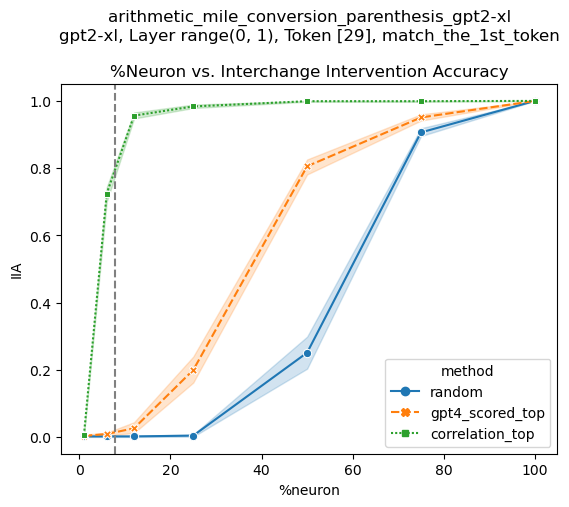

  Explanation: Numbers Task: Unit conversion Intervention location: Layer 0 at the number tokens |  

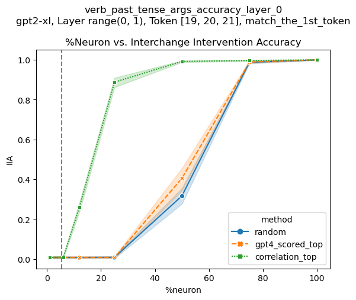

  Explanation: Verbs Task: Verb tense Intervention location: Layer 0 at the verb tokens |  

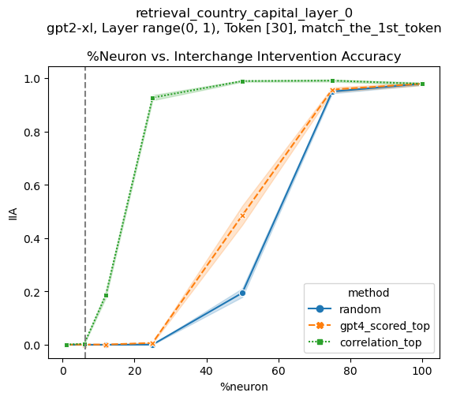

  Explanation: Locations Task: Capital retrieval Intervention location: Layer 0 at the country tokens  
---|---|---  

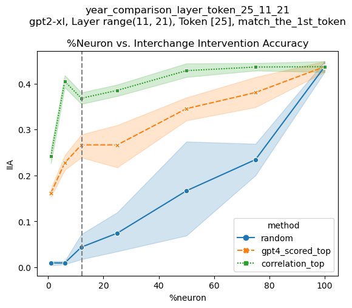

  Explanation: Numbers (with years) Task: Numerical comparison Intervention location: Layer 11-21 at the second year tokens |  

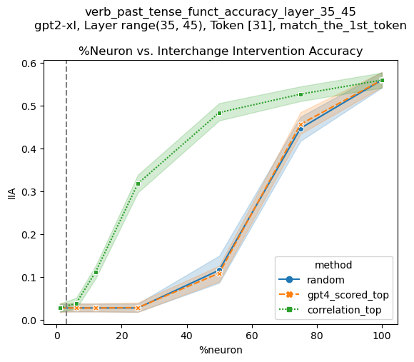

  Explanation: Time expressions Task: Verb tense Intervention location: Layer 35-45 at the last token |  

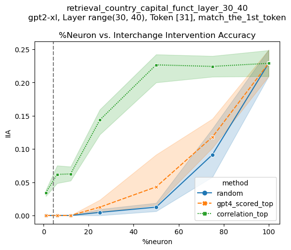

  Explanation: Locations Task: Capital retrieval Intervention location: Layer 30-40 at the last token

 

Table 4: Intervention-based evaluation results. For each task, we rank and select the top K% of neurons using three methods: random, correlation, and GPT-4 explanation score. We evaluate IIA@K for \(K=1,6,12,25,50,75,100\). The dotted vertical line marks the percentage of GPT-4 explanation that directly mention the target pattern.

### 4.3 Results

Results on various tasks are shown in Table [4](https://arxiv.org/html/2309.10312#S4.T4 "Table 4 ‣ Baselines ‣ 4.2 Experimental Setup ‣ 4 Intervention-Based Evaluation ‣ Rigorously Assessing Natural Language Explanations of Neurons"). There are two trends consistent across tasks. First, in terms of the IIA ranking, we have: token-activation correlation baseline \(\gg\) GPT-4 explanation \(\approx\) random baseline. Second, IIA increases as we intervene on a higher percentage of neurons. At \(K=100\), MLP layer neurons show causal effects on all tasks. We further discuss the implications of these two observations below.

### 4.4 Discussion

#### Does GPT-4 produce causal explanations?

GPT-4 generated explanations have similar causal effects as the random baseline on most tasks. The only exception is the explanation for neurons related to numerical expressions, which has higher IIA than the random baseline, but still far below the token-activation correlation baseline.

In other words, if we were using GPT-4 generated explanation to inform us which weights to modify in a model editing task, we would have similar performance as randomly selecting neurons to edit. This finding is worrisome but not surprising given low precision and recall values we obtained in our observational evaluation (Section [3](https://arxiv.org/html/2309.10312#S3 "3 Observation-Based Evaluation ‣ Rigorously Assessing Natural Language Explanations of Neurons")).

#### Which neurons have causal effects?

The high IIA@100 suggests that MLP layer neurons, when evaluated as a whole, have strong causal effects on model behavior, especially in the first layer. Neurons in the middle and later layers only show causal effects on model behaviors after aggregating over multiple consecutive layers. This result is consistent with previous findings on the role of MLP layers [Geva et al. (2022)](https://arxiv.org/html/2309.10312#bib.bib16); [Geva et al. (2023)](https://arxiv.org/html/2309.10312#bib.bib15); [Meng et al. (2022)](https://arxiv.org/html/2309.10312#bib.bib27).

High IIA from the token-activation baseline suggests that the causal effects can be further narrowed down to neurons whose activation correlates well with the target pattern. For neurons in the first layer, the top 20% of neurons with the highest correlation can already account for 80% of the causal effect. While this finding shows there are relatively small subsets of neurons that encode certain high-level concepts, the granularity is still on the magnitude of hundreds of neurons. We have not found a task where intervening on a single neuron can change model behavior in a causal manner. We further discuss the choice for analysis unit in Section [5.2](https://arxiv.org/html/2309.10312#S5.SS2 "5.2 Explanation Beyond Individual Neurons ‣ 5 General Discussion ‣ Rigorously Assessing Natural Language Explanations of Neurons").

## 5 General Discussion

### 5.1 Inherent Drawbacks to Natural Language Explanations

Is natural language the best medium for explaining large language models?

The benefits of using natural language in this context are that it is intuitive and expressive; one needn’t learn a specialized formal language or data visualization language in order to consume explanations in this format and draw inferences from them to inform subsequent work.

However, natural languages are characterized by vagueness, ambiguity, and context dependence. These properties actually work in concert to facilitate the expressivity of language: vagueness and ambiguity allow words and phrases to be used flexibly, and context dependence means that people can coordinate on specific meanings using context ([Partee, 1995](https://arxiv.org/html/2309.10312#bib.bib32)). From a relatively small set of primitives, we can talk about the complex universe we inhabit, but only because we can subtly refine the meanings of what we hear.

Given these facts about language, how are we meant to interpret explanations like the following, which were generated by the [Bills et al. 2023](https://arxiv.org/html/2309.10312#bib.bib5) method?

  1. sentence-ending punctuation, specifically periods. 
  2. references to geographical locations, particularly related to Shanghai. 
  3. years, mostly from the 1980s and 2000s. 

Does the first explanation include the question mark, or does “specifically periods” refine the meaning to just the set containing the period? All of the above have the format “a general concept \(E\), specifically \(E^{\prime}\subset E\)”, and there is no way to tell whether this is a prediction that the neuron will activate on \(E\setminus E^{\prime}\). Where the stakes are high, the human thing would be to discuss the meanings and the intentions behind them and come to some understanding. This path is not open to us for current LLM-based explanation methods, and it seems cumbersome if the goal is to use explanations to inform downstream tasks.

A similar issue arises where the explanation has the form “words and phrases related to a concept”. More than 30% of neuron explanations in the [Bills et al. 2023](https://arxiv.org/html/2309.10312#bib.bib5) dataset contain the phrase “related to”. Here are some examples:

  1. mentions of pizza and related food items 
  2. words or parts of words related to the prefix ‘an’ 

Is the first a reference to all Italian food, or to the various ingredients used to make pizza, or both? Is the second just a list of words beginning with those two characters, or does it refer to all words with one of the English morphological negations (e.g., “an”, “un”, “in”, “non” and their allophones)?

There may be a way to define a fragment of natural language that is less prone to these interpretative issues, and then we could seek to have explainer models generate such language. However, if we do take these steps, we are conceding that model explanations actually require specialized training to interpret. In light of this, it may be better to chose an existing, rigorously interpreted formalism (e.g., a programming language) as the medium of explanation.

### 5.2 Explanation Beyond Individual Neurons

While top-activation patterns of individual neurons provide a rough idea of what concepts are encoded in the model, isolating the effect of individual neurons on model behavior is not always feasible, as features can be distributed across multiple neurons and may be polysemantic in nature [Antverg and Belinkov (2022)](https://arxiv.org/html/2309.10312#bib.bib2); [Geva et al. (2022)](https://arxiv.org/html/2309.10312#bib.bib16); [Elhage et al. (2022)](https://arxiv.org/html/2309.10312#bib.bib9); [Geiger et al. (2023b)](https://arxiv.org/html/2309.10312#bib.bib14). Our intervention-based evaluation results suggest that individual neurons are not the best unit of analysis in terms of understanding the causal effects of representations.

Similarly, we should not limit ourselves to neurons located in particular parts of the network. While [Bills et al. (2023)](https://arxiv.org/html/2309.10312#bib.bib5) choose to analyze neurons in the MLP layers, attention heads and residual streams can also be used as different level of abstractions to understand model behaviors [Vig et al. (2020)](https://arxiv.org/html/2309.10312#bib.bib40); [Geiger et al. (2021)](https://arxiv.org/html/2309.10312#bib.bib11); [Olsson et al. (2022)](https://arxiv.org/html/2309.10312#bib.bib31).

## 6 Conclusion

We developed a framework for rigorously evaluating natural language explanations of neurons. Our _observational mode_ of analysis directly tests explanations against sets of relevant inputs, and our _intervention mode_ assesses whether explanations have causal efficacy. When we applied this framework to the method of [Bills et al. (2023)](https://arxiv.org/html/2309.10312#bib.bib5), we saw low F1 scores in the observational mode and little or no evidence for causal effects in the intervention mode. Finally, we confronted what seem to us to be deep limitations of (i) using natural language to explain model behavior and (ii) focusing on neurons as the primary unit of analysis. Overall, we are more optimistic about approaches to model explanation that are grounded in structured formalisms (e.g., programming languages) and seek to explain how groups of neurons act in concert to represent examples and shape input–output behaviors.

## Limitations

Our work contributes to improving the faithfulness of neuron interpretability methods that use natural language as a medium. Faithful explanation could provide the basis for safety assessments, bias detection efforts, model editing, and many other downstream applications. However, the ability to acquire more faithful explanations can also be used in malicious manipulations of the models. For example, high-quality explanations could help people to identify private or toxic information in a model, and these findings could be used to improve the model or to exploit the problem for ill-effect. We emphasize that explanations of large language models should always be used responsibly.

In an effort to evaluate the method proposed in [Bills et al. (2023)](https://arxiv.org/html/2309.10312#bib.bib5), our analysis is primarily conducted on neuron behaviors of a pre-trained GPT-2 XL model, which is a decoder-only Transformer with 1.5B parameters [Radford et al. (2019)](https://arxiv.org/html/2309.10312#bib.bib35). The architecture used by GPT-2 XL has been widely adopted in current large language models, with similar neuron behaviors observed across variations of Transformers [Mu and Andreas (2020)](https://arxiv.org/html/2309.10312#bib.bib30); [Hernandez et al. (2022)](https://arxiv.org/html/2309.10312#bib.bib19); [Geva et al. (2022)](https://arxiv.org/html/2309.10312#bib.bib16); [Elhage et al. (2022)](https://arxiv.org/html/2309.10312#bib.bib9), but we might nonetheless see different neuron behaviors emerge in new architectures. Our results should not be construed as extending directly to these architectures, but we are hopeful that our proposed evaluation framework will be useful for performing the necessary follow-up analyses.

## Acknowledgements

We thank William Saunders and Henk Tillman for helpful discussion of the evaluation framework. This research is supported in part by grants from Open Philanthropy, Meta, Amazon, and the Stanford Institute for Human-Centered Artificial Intelligence (HAI).

## References

  * Abraham et al. (2022) Eldar David Abraham, Karel D’Oosterlinck, Amir Feder, Yair Ori Gat, Atticus Geiger, Christopher Potts, Roi Reichart, and Zhengxuan Wu. 2022.  [CEBab: Estimating the causal effects of real-world concepts on NLP model behavior](https://openreview.net/forum?id=3AbigH4s-ml).  In _Advances in Neural Information Processing Systems_. 
  * Antverg and Belinkov (2022) Omer Antverg and Yonatan Belinkov. 2022.  [On the pitfalls of analyzing individual neurons in language models](https://openreview.net/forum?id=8uz0EWPQIMu).  In _International Conference on Learning Representations_. 
  * Atanasova et al. (2023) Pepa Atanasova, Oana-Maria Camburu, Christina Lioma, Thomas Lukasiewicz, Jakob Grue Simonsen, and Isabelle Augenstein. 2023.  [Faithfulness tests for natural language explanations](https://doi.org/10.18653/v1/2023.acl-short.25).  In _Proceedings of the 61st Annual Meeting of the Association for Computational Linguistics (Volume 2: Short Papers)_ , pages 283–294, Toronto, Canada. Association for Computational Linguistics. 
  * Belinkov (2022) Yonatan Belinkov. 2022.  [Probing classifiers: Promises, shortcomings, and advances](https://doi.org/10.1162/coli_a_00422).  _Computational Linguistics_ , 48(1):207–219. 
  * Bills et al. (2023) Steven Bills, Nick Cammarata, Dan Mossing, Henk Tillman, Leo Gao, Gabriel Goh, Ilya Sutskever, Jan Leike, Jeff Wu, and William Saunders. 2023.  Language models can explain neurons in language models.  <https://openaipublic.blob.core.windows.net/neuron-explainer/paper/index.html>. 
  * Chattopadhyay et al. (2019) Aditya Chattopadhyay, Piyushi Manupriya, Anirban Sarkar, and Vineeth N Balasubramanian. 2019.  [Neural network attributions: A causal perspective](https://proceedings.mlr.press/v97/chattopadhyay19a.html).  In _Proceedings of the 36th International Conference on Machine Learning_ , volume 97 of _Proceedings of Machine Learning Research_ , pages 981–990. PMLR. 
  * Conmy et al. (2023) Arthur Conmy, Augustine N. Mavor-Parker, Aengus Lynch, Stefan Heimersheim, and Adrià Garriga-Alonso. 2023.  [Towards automated circuit discovery for mechanistic interpretability](http://arxiv.org/abs/2304.14997). 
  * Do et al. (2020) Virginie Do, Oana-Maria Camburu, Zeynep Akata, and Thomas Lukasiewicz. 2020.  [e-snli-ve-2.0: Corrected visual-textual entailment with natural language explanations](http://arxiv.org/abs/2004.03744).  _CoRR_ , abs/2004.03744. 
  * Elhage et al. (2022) Nelson Elhage, Tristan Hume, Catherine Olsson, Nicholas Schiefer, Tom Henighan, Shauna Kravec, Zac Hatfield-Dodds, Robert Lasenby, Dawn Drain, Carol Chen, Roger Grosse, Sam McCandlish, Jared Kaplan, Dario Amodei, Martin Wattenberg, and Christopher Olah. 2022.  [Toy models of superposition](https://transformer-circuits.pub/2022/toy_model/index.html).  _Transformer Circuits Thread_. 
  * Feder et al. (2021) Amir Feder, Nadav Oved, Uri Shalit, and Roi Reichart. 2021.  [CausaLM: Causal model explanation through counterfactual language models](https://doi.org/10.1162/coli_a_00404).  _Computational Linguistics_ , 47(2):333–386. 
  * Geiger et al. (2021) Atticus Geiger, Hanson Lu, Thomas F Icard, and Christopher Potts. 2021.  [Causal abstractions of neural networks](https://openreview.net/forum?id=RmuXDtjDhG).  In _Advances in Neural Information Processing Systems_. 
  * Geiger et al. (2023a) Atticus Geiger, Christopher Potts, and Thomas Icard. 2023a.  [Causal abstraction for faithful model interpretation](https://arxiv.org/abs/2301.04709).  Ms., Stanford University. 
  * Geiger et al. (2022) Atticus Geiger, Zhengxuan Wu, Hanson Lu, Josh Rozner, Elisa Kreiss, Thomas Icard, Noah Goodman, and Christopher Potts. 2022.  [Inducing causal structure for interpretable neural networks](https://proceedings.mlr.press/v162/geiger22a.html).  In _Proceedings of the 39th International Conference on Machine Learning_ , volume 162 of _Proceedings of Machine Learning Research_ , pages 7324–7338. PMLR. 
  * Geiger et al. (2023b) Atticus Geiger, Zhengxuan Wu, Christopher Potts, Thomas Icard, and Noah D. Goodman. 2023b.  [Finding alignments between interpretable causal variables and distributed neural representations](https://arxiv.org/abs/2303.02536).  Ms., Stanford University. 
  * Geva et al. (2023) Mor Geva, Jasmijn Bastings, Katja Filippova, and Amir Globerson. 2023.  [Dissecting recall of factual associations in auto-regressive language models](http://arxiv.org/abs/2304.14767). 
  * Geva et al. (2022) Mor Geva, Avi Caciularu, Kevin Wang, and Yoav Goldberg. 2022.  [Transformer feed-forward layers build predictions by promoting concepts in the vocabulary space](https://doi.org/10.18653/v1/2022.emnlp-main.3).  In _Proceedings of the 2022 Conference on Empirical Methods in Natural Language Processing_ , pages 30–45, Abu Dhabi, United Arab Emirates. Association for Computational Linguistics. 
  * Geva et al. (2021) Mor Geva, Roei Schuster, Jonathan Berant, and Omer Levy. 2021.  [Transformer feed-forward layers are key-value memories](https://doi.org/10.18653/v1/2021.emnlp-main.446).  In _Proceedings of the 2021 Conference on Empirical Methods in Natural Language Processing_ , pages 5484–5495, Online and Punta Cana, Dominican Republic. Association for Computational Linguistics. 
  * Hendricks et al. (2016) Lisa Anne Hendricks, Zeynep Akata, Marcus Rohrbach, Jeff Donahue, Bernt Schiele, and Trevor Darrell. 2016.  [Generating visual explanations](https://doi.org/10.1007/978-3-319-46493-0_1).  In _Computer Vision - ECCV 2016 - 14th European Conference, Amsterdam, The Netherlands, October 11-14, 2016, Proceedings, Part IV_ , volume 9908 of _Lecture Notes in Computer Science_ , pages 3–19. Springer. 
  * Hernandez et al. (2022) Evan Hernandez, Sarah Schwettmann, David Bau, Teona Bagashvili, Antonio Torralba, and Jacob Andreas. 2022.  [Natural language descriptions of deep features](https://openreview.net/forum?id=NudBMY-tzDr).  In _International Conference on Learning Representations_. 
  * Huang et al. (2023) Jing Huang, Zhengxuan Wu, Kyle Mahowald, and Christopher Potts. 2023.  [Inducing character-level structure in subword-based language models with type-level interchange intervention training](https://doi.org/10.18653/v1/2023.findings-acl.770).  In _Findings of the Association for Computational Linguistics: ACL 2023_ , pages 12163–12180, Toronto, Canada. Association for Computational Linguistics. 
  * Kaushal and Mahowald (2022) Ayush Kaushal and Kyle Mahowald. 2022.  [What do tokens know about their characters and how do they know it?](https://doi.org/10.18653/v1/2022.naacl-main.179) In _Proceedings of the 2022 Conference of the North American Chapter of the Association for Computational Linguistics: Human Language Technologies_ , pages 2487–2507, Seattle, United States. Association for Computational Linguistics. 
  * Kayser et al. (2022) Maxime Kayser, Cornelius Emde, Oana-Maria Camburu, Guy Parsons, Bartlomiej W. Papiez, and Thomas Lukasiewicz. 2022.  [Explaining chest x-ray pathologies in natural language](https://doi.org/10.1007/978-3-031-16443-9_67).  In _Medical Image Computing and Computer Assisted Intervention - MICCAI 2022 - 25th International Conference, Singapore, September 18-22, 2022, Proceedings, Part V_ , volume 13435 of _Lecture Notes in Computer Science_ , pages 701–713. Springer. 
  * Kim et al. (2018) Jinkyu Kim, Anna Rohrbach, Trevor Darrell, John F. Canny, and Zeynep Akata. 2018\.  [Textual explanations for self-driving vehicles](https://doi.org/10.1007/978-3-030-01216-8_35).  In _Computer Vision - ECCV 2018 - 15th European Conference, Munich, Germany, September 8-14, 2018, Proceedings, Part II_ , volume 11206 of _Lecture Notes in Computer Science_ , pages 577–593. Springer. 
  * Ling et al. (2017) Wang Ling, Dani Yogatama, Chris Dyer, and Phil Blunsom. 2017.  [Program induction by rationale generation: Learning to solve and explain algebraic word problems](https://doi.org/10.18653/v1/P17-1015).  In _Proceedings of the 55th Annual Meeting of the Association for Computational Linguistics, ACL 2017, Vancouver, Canada, July 30 - August 4, Volume 1: Long Papers_ , pages 158–167. Association for Computational Linguistics. 
  * Materzynska et al. (2022) Joanna Materzynska, Antonio Torralba, and David Bau. 2022.  [Disentangling visual and written concepts in clip](https://api.semanticscholar.org/CorpusID:249711999).  _2022 IEEE/CVF Conference on Computer Vision and Pattern Recognition (CVPR)_ , pages 16389–16398. 
  * McClelland et al. (1986) J. L. McClelland, D. E. Rumelhart, and PDP Research Group, editors. 1986.  _Parallel Distributed Processing. Volume 2: Psychological and Biological Models_.  MIT Press, Cambridge, MA. 
  * Meng et al. (2022) Kevin Meng, David Bau, Alex J Andonian, and Yonatan Belinkov. 2022.  [Locating and editing factual associations in GPT](https://openreview.net/forum?id=-h6WAS6eE4).  In _Advances in Neural Information Processing Systems_. 
  * Meng et al. (2023) Kevin Meng, Arnab Sen Sharma, Alex J Andonian, Yonatan Belinkov, and David Bau. 2023\.  [Mass-editing memory in a transformer](https://openreview.net/forum?id=MkbcAHIYgyS).  In _The Eleventh International Conference on Learning Representations_. 
  * Merullo et al. (2023) Jack Merullo, Carsten Eickhoff, and Ellie Pavlick. 2023.  [Language models implement simple word2vec-style vector arithmetic](http://arxiv.org/abs/2305.16130). 
  * Mu and Andreas (2020) Jesse Mu and Jacob Andreas. 2020.  [Compositional explanations of neurons](https://proceedings.neurips.cc/paper_files/paper/2020/file/c74956ffb38ba48ed6ce977af6727275-Paper.pdf).  In _Advances in Neural Information Processing Systems_ , volume 33, pages 17153–17163. Curran Associates, Inc. 
  * Olsson et al. (2022) Catherine Olsson, Nelson Elhage, Neel Nanda, Nicholas Joseph, Nova DasSarma, Tom Henighan, Ben Mann, Amanda Askell, Yuntao Bai, Anna Chen, Tom Conerly, Dawn Drain, Deep Ganguli, Zac Hatfield-Dodds, Danny Hernandez, Scott Johnston, Andy Jones, Jackson Kernion, Liane Lovitt, Kamal Ndousse, Dario Amodei, Tom Brown, Jack Clark, Jared Kaplan, Sam McCandlish, and Chris Olah. 2022\.  In-context learning and induction heads.  _Transformer Circuits Thread_.  Https://transformer-circuits.pub/2022/in-context-learning-and-induction-heads/index.html. 
  * Partee (1995) Barbara H Partee. 1995.  Lexical semantics and compositionality.  In Lila R. Gleitman and Mark Liberman, editors, _Invitation to Cognitive Science_ , volume 1, pages 311–360. MIT Press, Cambridge, MA. 
  * Pearl (2014) Judea Pearl. 2014.  [Interpretation and identification of causal mediation](https://doi.org/10.1037/a0036434).  _Psychological methods_ , 19. 
  * Potts and Levy (2015) Christopher Potts and Roger Levy. 2015.  Negotiating lexical uncertainty and speaker expertise with disjunction.  In _Proceedings of the 41st Annual Meeting of the Berkeley Linguistics Society_ , pages 417–445, Berkeley, CA. Berkeley Linguistics Society. 
  * Radford et al. (2019) Alec Radford, Jeffrey Wu, Rewon Child, David Luan, Dario Amodei, and Ilya Sutskever. 2019.  Language models are unsupervised multitask learners.  <https://cdn.openai.com/better-language-models/language_models_are_unsupervised_multitask_learners.pdf>. 
  * Rumelhart et al. (1986) D. E. Rumelhart, J. L. McClelland, and PDP Research Group, editors. 1986.  _Parallel Distributed Processing. Volume 1: Foundations_.  MIT Press, Cambridge, MA. 
  * Singh et al. (2023) Chandan Singh, Aliyah R. Hsu, Richard Antonello, Shailee Jain, Alexander G. Huth, Bin Yu, and Jianfeng Gao. 2023.  [Explaining black box text modules in natural language with language models](http://arxiv.org/abs/2305.09863). 
  * Smolensky (1988) Paul Smolensky. 1988.  [On the proper treatment of connectionism](https://doi.org/10.1017/s0140525x00052432).  _Behavioral and Brain Sciences_ , 11(1):1–23. 
  * Sundararajan et al. (2017) Mukund Sundararajan, Ankur Taly, and Qiqi Yan. 2017.  [Axiomatic attribution for deep networks](https://proceedings.mlr.press/v70/sundararajan17a.html).  In _Proceedings of the 34th International Conference on Machine Learning_ , volume 70 of _Proceedings of Machine Learning Research_ , pages 3319–3328. PMLR. 
  * Vig et al. (2020) Jesse Vig, Sebastian Gehrmann, Yonatan Belinkov, Sharon Qian, Daniel Nevo, Yaron Singer, and Stuart Shieber. 2020.  [Investigating gender bias in language models using causal mediation analysis](https://proceedings.neurips.cc/paper_files/paper/2020/file/92650b2e92217715fe312e6fa7b90d82-Paper.pdf).  In _Advances in Neural Information Processing Systems_ , volume 33, pages 12388–12401. Curran Associates, Inc. 
  * Wang et al. (2023) Kevin Ro Wang, Alexandre Variengien, Arthur Conmy, Buck Shlegeris, and Jacob Steinhardt. 2023.  [Interpretability in the wild: a circuit for indirect object identification in GPT-2 small](https://openreview.net/forum?id=NpsVSN6o4ul).  In _The Eleventh International Conference on Learning Representations_. 
  * Warstadt et al. (2020) Alex Warstadt, Alicia Parrish, Haokun Liu, Anhad Mohananey, Wei Peng, Sheng-Fu Wang, and Samuel R. Bowman. 2020.  [BLiMP: The benchmark of linguistic minimal pairs for English](https://doi.org/10.1162/tacl_a_00321).  _Transactions of the Association for Computational Linguistics_ , 8:377–392. 
  * Wiegreffe and Marasovic (2021) Sarah Wiegreffe and Ana Marasovic. 2021.  [Teach me to explain: A review of datasets for explainable natural language processing](https://openreview.net/forum?id=ogNcxJn32BZ).  In _Thirty-fifth Conference on Neural Information Processing Systems Datasets and Benchmarks Track (Round 1)_. 

## Supplementary Materials

## Appendix A Prompts Used in Observation-Based Evaluation

Prompts used for test set construction are shown in Figure [2](https://arxiv.org/html/2309.10312#A1.F2 "Figure 2 ‣ Appendix A Prompts Used in Observation-Based Evaluation ‣ Rigorously Assessing Natural Language Explanations of Neurons") and Figure [3](https://arxiv.org/html/2309.10312#A1.F3 "Figure 3 ‣ Appendix A Prompts Used in Observation-Based Evaluation ‣ Rigorously Assessing Natural Language Explanations of Neurons").

PROMPT: For each word or symbol in [’los’, ’middle’, ’opened’, ’green’, ’phoenix’, ’brown’, ’grandchildren’, ’north’, ’silver’, ’south’, ’newly’, ’long’, ’narrow’, ’big’, ’white’, ’small’, ’hawaii’, ’blue’, ’central’, ’san’], decide if it is related to the definition: color-related words. Output all the words you found related as a Python string list called related_words. If no word is found, output related_words = [].   
OUTPUT: related_words = [’green’, ’brown’, ’silver’, ’white’, ’blue’] PROMPT: List 20 examples, each in 1-2 words, that are words expressing appreciation, importance, or overlooking. Directly output the examples as a Python string list called "examples".   
OUTPUT: examples = [’grateful’, ’thankful’, ’admire’, ’cherish’, ’treasure’, ’valuable’, ’crucial’, ’significant’, ’vital’, ’essential’, ’crucial’, ’imperative’, ’paramount’, ’indispensable’, ’key’, ’disregard’, ’neglect’, ’overlook’, ’ignore’, ’forgive’]

Figure 2: Examples of prompts (gray) and GPT-3.5-turbo outputs (bold) for sampling string in \(\llbracket E\rrbracket\).

PROMPT: For each word in [’grateful’, ’thankful’, ’admire’, ’cherish’, ’treasure’, ’valuable’, ’crucial’, ’significant’, ’vital’, ’essential’, ’crucial’, ’imperative’, ’paramount’, ’indispensable’, ’key’, ’disregard’, ’neglect’, ’overlook’, ’ignore’, ’forgive’], write a coherent sentence that includes the word in a meaningful context and surround the text with two asterisks (**). Avoid having the text at the start of the sentence. Directly output the sentences as a python string list called "sentences".   
OUTPUT: sentences = [   
"I am **grateful** for all the support and love that I have received.",   
"I am **thankful** for having such wonderful friends in my life.",   
"I **admire** the way she handled that difficult situation with grace.",   
"I **cherish** the memories we made together during our vacation.",   
"**Treasure** the moments you spend with your loved ones.",   
"Education is **valuable** for personal and professional growth.",   
"A healthy diet is **crucial** for maintaining good physical health.",   
"**Significant** progress has been made in the field of technology.",   
"It is **vital** to take care of our mental well-being.",   
"Communication skills are **essential** for effective teamwork.",   
"A healthy work-life balance is **crucial** for overall well-being.",   
"It is **imperative** that we take action to protect the environment.",   
"Financial planning is **paramount** for a secure future.",   
"Innovation is **indispensable** in driving progress and growth.",   
"Time management is **key** to achieving success in any endeavor.",   
"We should not **disregard** the feelings of others.",   
"It is important not to **neglect** our physical health.",   
"Let’s not **overlook** the efforts made by our teammates.",   
"We should not **ignore** the warning signs of burnout.",   
"**Forgive** yourself for any mistakes you have made in the past." ]

Figure 3: Examples of prompts (gray) and GPT-3.5-turbo outputs (bold) for embedding a string into a sentence context.

## Appendix B Additional Analysis of Type I and Type II Errors

GPT-4 explained patterns |  Type II error patterns  
---|---  
The pandemic had a negligible impact on the economy. |  The pandemic had a drastic impact on the economy.  
In her life, winning the lottery was a minor turning point. |  In her life, winning the lottery was a major turning point.  
The new regulations will have an insignificant impact on businesses. |  The new regulations will have a significant impact on businesses.  
In its research and development, the company made insubstantial progress. |  In its research and development, the company made substantial progress.  
To solve the problem, they introduced a conservative new approach. |  To solve the problem, they introduced a nonconservative new approach.  
The death of a loved one can have a superficial effect on a person. |  The death of a loved one can have a profound effect on a person.  
They received a paltry amount of donations for the charity. |  They received a considerable amount of donations for the charity.  
The dinosaur had a tiny size compared to other animals. |  The dinosaur had an enormous size compared to other animals.  
The desert stretched out before them, with its small sandy dunes. |  The desert stretched out before them, with its immense sandy dunes.  
She felt a mild adrenaline rush before her performance. |  She felt an intense adrenaline rush before her performance.  
The young artist’s art exhibition received no recognition and was mediocre. |  The young artist’s art exhibition received recognition and was noteworthy.  
Signing the peace treaty was a trivial event in history. |  Signing the peace treaty was a momentous event in history.  
The painting had unimpressive color changes and simple details. |  The painting had striking color changes and intricate details.  
The play had an unremarkable plot twist that didn’t surprise the audience. |  The play had a dramatic plot twist that surprised the audience.  
His decision to invest in the company at an early stage was unimportant. |  His decision to invest in the company at an early stage was crucial.  
The news of the accident was inconsequential and didn’t affect the whole community. |  The news of the accident was grave and saddened the whole community.  
The construction of a new airport was an modest task for the engineers. |  The construction of a new airport was a monumental task for the engineers.  
They had a light discussion about the future of their relationship. |  They had a serious discussion about the future of their relationship.

 

(a) Given the GPT-4 explanation “small or minor changes, issues or improvements”, we generate minimal contrasting pairs where each adjective meaning minor is changed to its antonym. We extract neuron activation from each sentence at the underlined words. If the GPT-4 explanation is accurate, the neuron should not activate on opposite words, however, we observe high activation on opposite words as shown in Figure [4(b)](https://arxiv.org/html/2309.10312#A2.F4.sf2 "In Figure 4 ‣ Appendix B Additional Analysis of Type I and Type II Errors ‣ Rigorously Assessing Natural Language Explanations of Neurons").

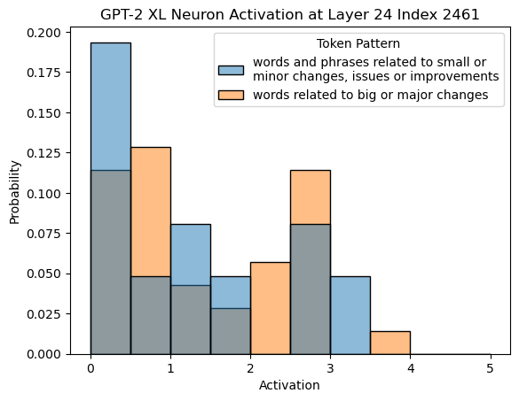

 (b) Neuron activation on “big or major changes” has similar distribution as “small or minor changes”, despite GPT-4 explanation of the neuron is “small or minor changes”.

Figure 4: Examples of Type II errors where a neuron activates on antonyms of the concept in the explanation.

For Type I errors, i.e. precision error cases, we observe that form-based explanations have a higher precision at 0.78, while the rest only have a precision of 0.62.

For Type II errors, i.e. recall error cases, neurons mostly activate on inputs that have no clear relationship with the explained pattern, as hypothesized by work on superposition phenomena [Elhage et al. (2022)](https://arxiv.org/html/2309.10312#bib.bib9) where a single neuron potentially encodes a mix of concepts. We further investigate whether the Type II errors in GPT-4 explanations are due to multiple concepts encoded in a single neuron, where the explanation only covers a subset of the concepts.

We manually inspect 100 explanations that have Type II errors and observe at least 6 cases where the error involves antonyms of the concepts picked out by the explanation, such as the word “above” for an explanation _the word “below” and phrases related to it_ , and the word “ended” for an explanation _words and phrases related to continuation, particularly in the context of ‘reading.’_. A full example with test inputs is shown in Figure [4](https://arxiv.org/html/2309.10312#A2.F4 "Figure 4 ‣ Appendix B Additional Analysis of Type I and Type II Errors ‣ Rigorously Assessing Natural Language Explanations of Neurons").

We also found neurons activate on inputs that have shared linguistic structures as the concepts in the explanation. For example, while the explanation is _days of the week_ , the neuron also consistently activates on internet platforms such as “Google” or “Facebook” when preceded by the preposition “on”. More interesting, the Type I errors of the same neuron involve inputs where the day of the week is not preceded by the preposition “on”.

The majority of error cases, however, involve neurons activating on inputs unrelated to the explanation but nonetheless forming coherent concepts. These findings further support the view that individual neurons might not be the most useful unit of analysis in a large language model.

## Appendix C Experiment Details in Intervention-Base Evaluation

Explanation \(E\) |  Task |  Template \(T\) with strings in \(\llbracket E\rrbracket\) and expected outputs  
---|---|---  
Numbers (13%) |  Unit conversion Numerical comparison |  The hiking trail stretches for 2 miles (3.2 The war was in 1935 and he was born in 1937 , which was a few years after  
Verbs (9%) |  Verb tense Transitive/Intransitive |  They play piano every day, so I believe last night they also played We live. They have pets. You leave. I stand. It happens. We swim .placehoder  
Locations (4%) |  Capital retrieval City retrieval |  The capital of Canada is Ottawa The CN Tower is located in the city of Toronto  
Names of people (1%) |  Gender agreement Position retrieval |  Alice didn’t come because she Kay Ivey was the governor of Alabama  
Time expressions (0.3%) |  Verb tense Next day |  They play piano every day, so I believe last night they also played Yesterday was Wednesday, February 1st 2020. Today is Thursday  
Plural inflection (0.1%) |  Subject-verb agreement Noun-pron. agreement |  We saw the trees , which were The cats ran away because they

 

Table 5: The full list of intervention-based evaluation tasks. 

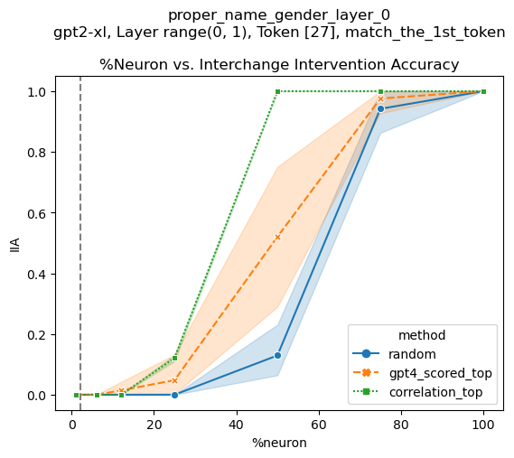

  Explanation: Names of people Task: Gender agreement Intervention location: Layer 0 at the name tokens |  

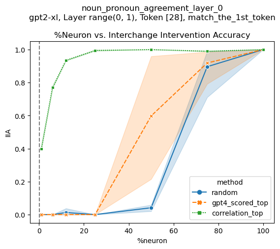

  Explanation: Plural inflection Task: Noun-pron. agreement Intervention location: Layer 0 at the noun tokens |  

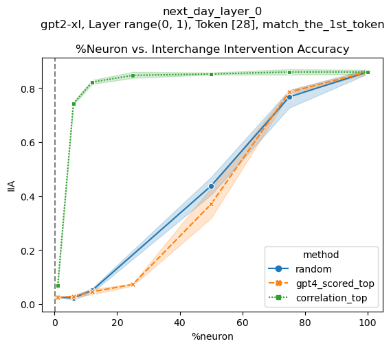

  Explanation: Time expressions Task: Next day Intervention location: Layer 0 at the day of the week/month tokens  
---|---|---  

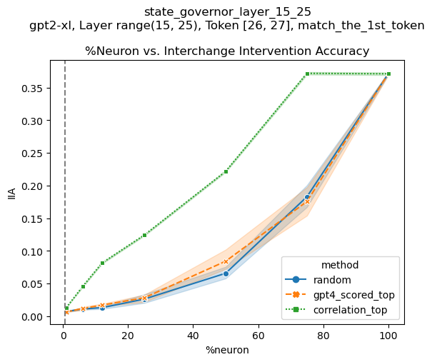

  Explanation: Names of people Task: Position retrieval Intervention location: Layer 15-25 at the name token |  

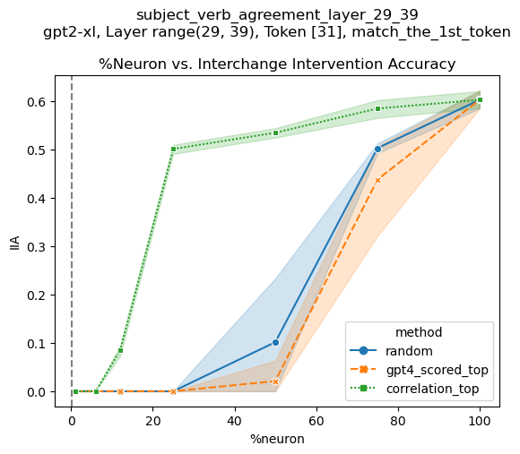

  Explanation: Plural inflection Task: Subject-verb agreement Intervention location: Layer 29-39 at the last token |  

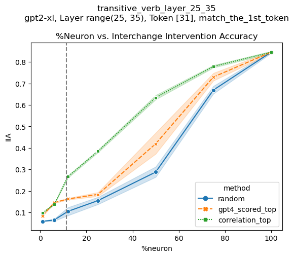

  Explanation: Verbs Task: Transitive/Intransitive Intervention location: Layer 25-35 at the last token

 

Table 6: Additional intervention-based evaluation results.

### C.1 Tasks

We curate tasks based on existing work that conducts behavioral testing on Transformer models, such as tests on grammatical phenomena [Warstadt et al. (2020)](https://arxiv.org/html/2309.10312#bib.bib42) and factual associations [Meng et al. (2022)](https://arxiv.org/html/2309.10312#bib.bib27). For each task specified by the template \(T\) and a fixed set of at least 30 strings in \(\llbracket E\rrbracket\), we verify that GPT-2 XL can correctly predict the next token on this set of inputs. The full list of tasks is shown in Table [5](https://arxiv.org/html/2309.10312#A3.T5 "Table 5 ‣ Appendix C Experiment Details in Intervention-Base Evaluation ‣ Rigorously Assessing Natural Language Explanations of Neurons").

### C.2 Interchange Interventions

#### Inputs

For a given template \(T\), we sample a set of at least 30 strings from \(\llbracket E\rrbracket\) to fill the template and randomly pair up the filled templates to create 256 pairs of (base, source) as the test inputs.

#### Intervention Locations

For each set of explanations to evaluate, one could perform an exhaustive search over every token position and report the highest IIA among all positions. However, based on how information is processed in Transformer MLP layers [Geva et al. (2022)](https://arxiv.org/html/2309.10312#bib.bib16); [Meng et al. (2022)](https://arxiv.org/html/2309.10312#bib.bib27); [Meng et al. (2023)](https://arxiv.org/html/2309.10312#bib.bib28); [Merullo et al. (2023)](https://arxiv.org/html/2309.10312#bib.bib29), we could determine intervention locations as follows. If the neurons associated with the explanations are in the earlier layers (i.e. layer 1-24), we apply interchange interventions at the token positions that correspond to the string in \(\llbracket E\rrbracket\), i.e. tokens highlighted in light blue in Table [5](https://arxiv.org/html/2309.10312#A3.T5 "Table 5 ‣ Appendix C Experiment Details in Intervention-Base Evaluation ‣ Rigorously Assessing Natural Language Explanations of Neurons"). If the neurons are in later layers, we apply interchange interventions at the last token position.

### C.3 Additional Results

We show additional intervention-based evaluation results in Table [6](https://arxiv.org/html/2309.10312#A3.T6 "Table 6 ‣ Appendix C Experiment Details in Intervention-Base Evaluation ‣ Rigorously Assessing Natural Language Explanations of Neurons"). Results on the rest of the tasks can be found in Table [4](https://arxiv.org/html/2309.10312#S4.T4 "Table 4 ‣ Baselines ‣ 4.2 Experimental Setup ‣ 4 Intervention-Based Evaluation ‣ Rigorously Assessing Natural Language Explanations of Neurons"). These results further confirm the two trends discussed in Section [4.3](https://arxiv.org/html/2309.10312#S4.SS3 "4.3 Results ‣ 4 Intervention-Based Evaluation ‣ Rigorously Assessing Natural Language Explanations of Neurons"), namely (i) token-activation correlation baseline \(\gg\) GPT-4 explanation \(\approx\) random baseline and (ii) IIA increases as we intervene on a higher percentage of neurons.
