**Source:** *Sanity Checks for Sparse Autoencoders: Do SAEs Beat Random Baselines?* — [PDF](https://arxiv.org/pdf/2602.14111v1) · [arXiv](https://arxiv.org/abs/2602.14111v1)

# Sanity Checks for Sparse Autoencoders: Do SAEs Beat Random Baselines?

Anton Korznikov  Correspondence to: [korznikovantona@gmail.com](mailto:korznikovantona@gmail.com) Andrey Galichin  Alexey Dontsov  Oleg Y. Rogov  Ivan Oseledets  Elena Tutubalina 

###### Abstract

Sparse Autoencoders (SAEs) have emerged as a promising tool for interpreting neural networks by decomposing their activations into sparse sets of human-interpretable features. Recent work has introduced multiple SAE variants and successfully scaled them to frontier models. Despite much excitement, a growing number of negative results in downstream tasks casts doubt on whether SAEs recover meaningful features. To directly investigate this, we perform two complementary evaluations. On a synthetic setup with known ground-truth features, we demonstrate that SAEs recover only \(9\%\) of true features despite achieving \(71\%\) explained variance, showing that they fail at their core task even when reconstruction is strong. To evaluate SAEs on real activations, we introduce three baselines that constrain SAE feature directions or their activation patterns to random values. Through extensive experiments across multiple SAE architectures, we show that our baselines match fully-trained SAEs in interpretability (0.87 vs 0.90), sparse probing (0.69 vs 0.72), and causal editing (0.73 vs 0.72). Together, these results suggest that SAEs in their current state do not reliably decompose models’ internal mechanisms.

###### Keywords: 

Machine Learning, ICML 

††affiliationnotice: Equal contribution

## 1 Introduction

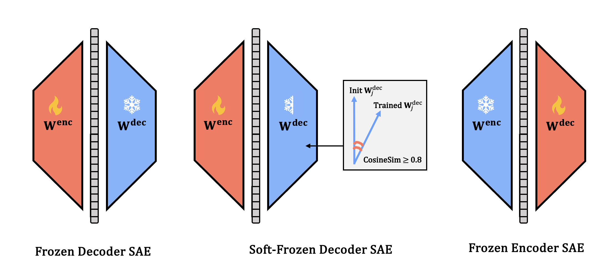

 

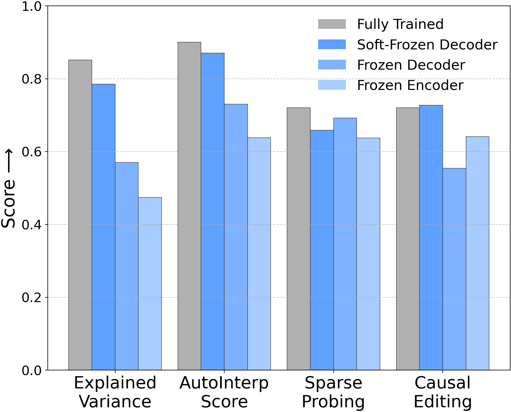

 

Figure 1: Frozen SAE baselines and their performance. (Left) Conceptual diagrams: Frozen Decoder SAE (decoder weights fixed at random initialization), Soft-Frozen Decoder SAE (decoder weights initialized randomly and constrained to maintain CosineSim \(\geq\) 0.8 with their initial values throughout training), and Frozen Encoder SAE (encoder weights fixed at random initialization). (Right) For BatchTopK SAE (L0=160), these baselines remain competitive with fully trained SAE across four key evaluation metrics, challenging the assumption that strong performance indicates meaningful feature learning.

Large Language Models (LLMs) have achieved remarkable performance across a wide range of natural language processing tasks, with applications continuing to expand rapidly. As these models grow in capability and deployment, the interpretation of their internal mechanisms becomes increasingly important ([Bereska & Gavves, 2024](https://arxiv.org/html/2602.14111v1#bib.bib2); [Grace et al., 2025](https://arxiv.org/html/2602.14111v1#bib.bib17)). Interpretability could potentially help to understand specific learning behaviors, such as safety mechanisms ([Arditi et al., 2024](https://arxiv.org/html/2602.14111v1#bib.bib1)) and reasoning processes ([Wang et al., 2023](https://arxiv.org/html/2602.14111v1#bib.bib46); [Galichin et al., 2025](https://arxiv.org/html/2602.14111v1#bib.bib14)), identify misalignment risks ([Betley et al., 2025](https://arxiv.org/html/2602.14111v1#bib.bib3); [Wang et al., 2025](https://arxiv.org/html/2602.14111v1#bib.bib47)). Sparse Autoencoders (SAEs) serve as a popular tool for this purpose, aiming to decompose dense model activations into sparse human-interpretable features ([Bricken et al., 2023](https://arxiv.org/html/2602.14111v1#bib.bib4); [Huben et al., 2024](https://arxiv.org/html/2602.14111v1#bib.bib21)). Recent contributions have introduced various SAE architectures ([Rajamanoharan et al., 2024b](https://arxiv.org/html/2602.14111v1#bib.bib39); [Bussmann et al., 2024](https://arxiv.org/html/2602.14111v1#bib.bib5); [Korznikov et al., 2025](https://arxiv.org/html/2602.14111v1#bib.bib27); [Bussmann et al., 2025](https://arxiv.org/html/2602.14111v1#bib.bib6)), with further success in scaling to frontier models ([Gao et al., 2025](https://arxiv.org/html/2602.14111v1#bib.bib15); [Lieberum et al., 2024](https://arxiv.org/html/2602.14111v1#bib.bib31)). However, a critical challenge remains: lacking ground truth for true features, it is difficult to determine whether SAEs recover meaningful representations. Recent negative results on downstream applications ([Smith et al., 2025](https://arxiv.org/html/2602.14111v1#bib.bib41); [Wu et al., 2025](https://arxiv.org/html/2602.14111v1#bib.bib48)) further underscore this challenge.

To address this ambiguity, we propose a systematic evaluation approach to assess whether SAEs learn meaningful feature decompositions. We first set up a synthetic experiment with known ground-truth features and test whether state-of-the-art SAE architectures can recover them. Despite achieving \(71\%\) explained variance, SAEs recover only the highest-frequency features (\(9\%\)), failing to discover the decomposition they are intended to find. Second, to evaluate SAEs on real activations where ground truth is unknown, we compare them against three easy-to-implement baselines on downstream tasks. These baselines constrain SAE feature directions or activation patterns to random values [1](https://arxiv.org/html/2602.14111v1#S1.F1 "Figure 1 ‣ 1 Introduction ‣ Sanity Checks for Sparse Autoencoders: Do SAEs Beat Random Baselines?"): (1) Frozen Decoder fixes directions to random vectors; (2) Frozen Encoder fixes activation patterns to random; (3) Soft-Frozen Decoder restricts directions to remain near random initialization. The rationale is straightforward: the learned directions and activation patterns represent the learned decomposition. Consequently, if SAEs learn meaningful features, they should outperform these baselines.

Across multiple SAE architectures ([Bricken et al., 2023](https://arxiv.org/html/2602.14111v1#bib.bib4); [Rajamanoharan et al., 2024b](https://arxiv.org/html/2602.14111v1#bib.bib39); [Bussmann et al., 2024](https://arxiv.org/html/2602.14111v1#bib.bib5)), we find that our baselines match fully-trained SAEs on interpretability ([Paulo et al., 2025](https://arxiv.org/html/2602.14111v1#bib.bib36)) (0.87 vs 0.90), sparse probing ([Karvonen et al., 2025](https://arxiv.org/html/2602.14111v1#bib.bib26)) (0.69 vs 0.72), and causal editing ([Huang et al., 2024](https://arxiv.org/html/2602.14111v1#bib.bib20); [Karvonen et al., 2025](https://arxiv.org/html/2602.14111v1#bib.bib26)) (0.73 vs 0.72). Together with our synthetic results, these findings suggest that current evaluation practices may be insufficient, and we offer our baselines as simple sanity checks for validating whether SAEs learn meaningful feature decompositions.

Our work makes the following contributions:

  * We demonstrate that SAEs fail on synthetic data with known ground-truth features, revealing a disconnect between reconstruction fidelity and feature recovery. 
  * We introduce three easy-to-implement baselines for evaluating SAEs’ quality on real activations. 
  * Through extensive experiments, we find that our baselines match fully-trained SAEs, challenging the premise that SAEs learn meaningful features. 

## 2 Background

### 2.1 Sparse Autoencoders for Interpretability

#### Model Architecture and Decomposition

SAEs have emerged as a prominent tool for understanding neural network internals. It mainly addresses the challenge of polysemanticity, where individual neurons respond to multiple unrelated concepts ([Bricken et al., 2023](https://arxiv.org/html/2602.14111v1#bib.bib4)). The core motivation behind SAEs is the superposition hypothesis ([Elhage et al., 2022](https://arxiv.org/html/2602.14111v1#bib.bib13)), which posits that neural networks represent more features than they have dimensions by encoding them as directions in activation space. Formally, for an activation vector \(\mathbf{x}\in\mathbb{R}^{n}\), this hypothesis states that \(\mathbf{x}\) can be expressed as a sparse linear combination of feature vectors:

\[\begin{aligned}
 & \mathbf{x}=\sum_{j=1}^{m}a_{j}\cdot\mathbf{f}_{j}, &  & \text{(1)}
\end{aligned}\]

 

where \(\{\mathbf{f}_{j}\}\subset\mathbb{R}^{n}\) are the underlying feature directions (with \(m\gg n\)) and \(a_{j}\) are sparse (mostly zero) nonnegative scalar coefficients. SAEs aim to learn this decomposition by approximating \(\mathbf{x}\) as:

\[\begin{aligned}
 & \mathbf{x}\approx\hat{\mathbf{x}}=\sum_{j=1}^{m}z_{j}\cdot\mathbf{d}_{j}=\sum_{j=1}^{m}z_{j}\cdot\mathbf{W}^{\text{dec}}_{j}=\mathbf{W}^{\text{dec}}\mathbf{z}, &  & \text{(2)}
\end{aligned}\]

 

where \(\mathbf{d}_{j}\in\mathbb{R}^{n}\) are the learned decoder column vectors (the SAE’s estimate of the true features \(\mathbf{f}_{j}\)), and \(z_{j}\) is a sparse activation produced by the encoder: \(\mathbf{z}=f(\mathbf{W}^{\text{enc}}\mathbf{x}+\mathbf{b}^{\text{enc}})\). Here \(f\) is a sparsity-inducing activation (e.g., ReLU) and \(\mathbf{b}^{\text{enc}}\) is a learned bias. The full reconstruction is \(\hat{\mathbf{x}}=\mathbf{W}^{\text{dec}}\mathbf{z}+\mathbf{b}^{\text{dec}}\). Typically, SAEs use an expansion factor \(k=m/n>1\) (e.g. \(k\in\{16,32,64\}\)) to learn overcomplete dictionaries that can represent more features than the original dimensionality.

#### Training Objective

SAEs are trained to minimize a reconstruction loss while encouraging sparsity in the latent activations. The standard training objective combines mean squared error with an \(L_{1}\) sparsity penalty:

\[\begin{aligned}
 & \mathcal{L}=\mathbb{E}_{\mathbf{x}}\left[\|\mathbf{x}-\hat{\mathbf{x}}\|^{2}_{2}+\lambda\|\mathbf{z}\|_{1}\right], &  & \text{(3)}
\end{aligned}\]

 

where \(\lambda\) controls the sparsity-reconstruction trade-off. Different SAE variants enforce sparsity through alternative mechanisms: some directly constrain the number of active features (measured by L0 norm, the count of non-zero elements in \(\mathbf{z}\)), while others use adaptive thresholds. A fundamental premise of SAEs is that optimizing both reconstruction and sparsity will yield learned feature directions \({\mathbf{d}_{j}}\) that align with the true underlying model features \({\mathbf{f}_{j}}\) and correspond to meaningful and interpretable concepts.

Pioneering work by [Bricken et al. (2023)](https://arxiv.org/html/2602.14111v1#bib.bib4) and [Huben et al. (2024)](https://arxiv.org/html/2602.14111v1#bib.bib21) demonstrated this approach on small transformers, discovering interpretable features such as DNA sequences and legal terminology. Subsequent efforts successfully scaled SAEs to frontier models, including Claude 3 Sonnet ([Templeton et al., 2024](https://arxiv.org/html/2602.14111v1#bib.bib44)), GPT-4 ([Gao et al., 2025](https://arxiv.org/html/2602.14111v1#bib.bib15)), and open-source models such as Gemma ([Lieberum et al., 2024](https://arxiv.org/html/2602.14111v1#bib.bib31)).

### 2.2 SAE Architectural Variants

Related work has proposed alternative SAE architectures to improve training stability and reconstruction quality. While vanilla SAEs use ReLU activation ([Bricken et al., 2023](https://arxiv.org/html/2602.14111v1#bib.bib4); [Huben et al., 2024](https://arxiv.org/html/2602.14111v1#bib.bib21)), [Rajamanoharan et al. (2024b)](https://arxiv.org/html/2602.14111v1#bib.bib39) introduced JumpReLU, which adds learnable bias terms to activation thresholds, enabling dynamic sparsity adjustment during training. [Bussmann et al. (2024)](https://arxiv.org/html/2602.14111v1#bib.bib5) proposed BatchTopK, which enforces sparsity by selecting top-\(k\) activations across batches rather than per sample, promoting feature reuse and potentially improving interpretability. Many more SAE variants have been proposed ([Bussmann et al., 2025](https://arxiv.org/html/2602.14111v1#bib.bib6); [Korznikov et al., 2025](https://arxiv.org/html/2602.14111v1#bib.bib27); [Rajamanoharan et al., 2024a](https://arxiv.org/html/2602.14111v1#bib.bib38)), but we focus on the above-mentioned two variants due to their popularity and state-of-the-art performance on SAEBench ([Karvonen et al., 2025](https://arxiv.org/html/2602.14111v1#bib.bib26)).

### 2.3 Critical Perspectives on SAEs

Despite generating significant excitement, SAEs have accumulated a growing body of critical evidence documenting substantial limitations. While claimed benefits include decomposing activations into monosemantic features ([Bricken et al., 2023](https://arxiv.org/html/2602.14111v1#bib.bib4); [Huben et al., 2024](https://arxiv.org/html/2602.14111v1#bib.bib21)), successful scaling to frontier models ([Templeton et al., 2024](https://arxiv.org/html/2602.14111v1#bib.bib44); [Gao et al., 2025](https://arxiv.org/html/2602.14111v1#bib.bib15); [Lieberum et al., 2024](https://arxiv.org/html/2602.14111v1#bib.bib31)), recent work has identified concerning issues: SAEs sometimes fail to faithfully represent true model computations ([Leask et al., 2025](https://arxiv.org/html/2602.14111v1#bib.bib29); [Menon et al., 2025](https://arxiv.org/html/2602.14111v1#bib.bib33)), show poor generalization across tasks and perturbations ([Heindrich et al., 2025](https://arxiv.org/html/2602.14111v1#bib.bib19); [Kantamneni et al., 2025](https://arxiv.org/html/2602.14111v1#bib.bib24); [Li et al., 2026](https://arxiv.org/html/2602.14111v1#bib.bib30)), learn features in corrupted ways like feature absorption ([Chanin et al., 2025b](https://arxiv.org/html/2602.14111v1#bib.bib9)) or feature hedging ([Chanin et al., 2025a](https://arxiv.org/html/2602.14111v1#bib.bib8)), underperform on downstream applications ([Wu et al., 2025](https://arxiv.org/html/2602.14111v1#bib.bib48); [Smith et al., 2025](https://arxiv.org/html/2602.14111v1#bib.bib41)), and exhibit high sensitivity to hyperparameters and initialization ([Chanin & Garriga-Alonso, 2025](https://arxiv.org/html/2602.14111v1#bib.bib7); [Paulo & Belrose, 2025](https://arxiv.org/html/2602.14111v1#bib.bib35); [Minegishi et al., 2025](https://arxiv.org/html/2602.14111v1#bib.bib34)). These failure modes are particularly concerning because SAEs can yield high scores on standard evaluation metrics – reconstruction fidelity, interpretability, sparse probing – while failing to capture genuinely meaningful structure (a comprehensive overview is provided in Appendix [A](https://arxiv.org/html/2602.14111v1#A1 "Appendix A SAEs: Claimed Benefits vs. Documented Limitations ‣ Sanity Checks for Sparse Autoencoders: Do SAEs Beat Random Baselines?")).

This tension between claimed benefits and documented limitations motivates a fundamental question: do SAEs genuinely learn meaningful feature decompositions, or do they merely optimize reconstruction metrics? Our work contributes to this critical literature by systematically evaluating whether SAEs discover true features in both controlled synthetic settings and real model activations.

## 3 Case Study #1: Toy Model Experiments

Before evaluating SAEs on real model activations, we first test them in a controlled, synthetic setting with known ground-truth features. This provides a clear benchmark for success: the SAE should recover the true generative components. Although prior work has validated SAEs on synthetic data ([Chanin & Garriga-Alonso, 2025](https://arxiv.org/html/2602.14111v1#bib.bib7); [Sharkey et al., 2022](https://arxiv.org/html/2602.14111v1#bib.bib40); [Elhage et al., 2022](https://arxiv.org/html/2602.14111v1#bib.bib13)), these studies typically used a small expansion factor \(k\) (the ratio of dictionary size to activation dimension) close to 2. This limited capacity simplifies the recovery problem and may not reflect the challenge faced in practice, where SAEs employ large expansion factors (e.g., 32 to 256) to learn highly overcomplete dictionaries. To bridge this gap, we design a synthetic experiment with a realistic expansion factor (32) and two distinct data regimes, providing a more challenging and realistic test of SAEs’ ability to recover underlying features.

### 3.1 Experimental setup

#### Synthetic Data Generation

We base our toy model on the superposition hypothesis ([Elhage et al., 2022](https://arxiv.org/html/2602.14111v1#bib.bib13)), which posits that neural network activations can be represented as a sparse sum of interpretable feature vectors. To test whether SAEs can recover such features, we generate synthetic activations \(\mathbf{x}\in\mathbb{R}^{n}\) (with \(n=100\)) by first sampling an overcomplete dictionary of \(3200\) ground‑truth feature vectors \(\{\mathbf{f_{i}}\}\), each drawn uniformly from the unit sphere \(S^{n-1}\). Each sample \(\mathbf{x}\) is then a sparse combination of these features, expressed by:

\[\begin{aligned}
 & \mathbf{x}=\sum_{i=1}^{3200}b_{i}\cdot c_{i}\cdot\mathbf{f}_{i} &  & \text{(4)}
\end{aligned}\]

 

Here, \(c_{i}\sim\text{Log-Normal}(0,0.25)\) governs the coefficient magnitude, while \(b_{i}\sim\text{Bernoulli}(p_{i})\) determines whether a feature is active. We examine two settings for the activation probability \(p_{i}\): the Constant Probability Model with \(p_{i}=0.00625\) across all features, and the Variable Probability Model where \(p_{i}\sim\text{Log-Uniform}(10^{-5.5},10^{-1.2})\), reflecting the long-tailed activations found in practice ([Lieberum et al., 2024](https://arxiv.org/html/2602.14111v1#bib.bib31)). Both variants yield an expected sparsity of 20 active features per sample.

SAE variants We evaluated two state-of-the-art SAE architectures, BatchTopK ([Bussmann et al., 2024](https://arxiv.org/html/2602.14111v1#bib.bib5)) and JumpReLU ([Rajamanoharan et al., 2024b](https://arxiv.org/html/2602.14111v1#bib.bib39)), on this synthetic dataset (extended model comparisons are provided in Appendix [B](https://arxiv.org/html/2602.14111v1#A2 "Appendix B Extended Comparison for Toy Model Experiments ‣ Sanity Checks for Sparse Autoencoders: Do SAEs Beat Random Baselines?")). The SAE dictionary size was set to \(3200\) with target L0 = 20, matching the ground truth.

Evaluation Following [Gao et al. (2025)](https://arxiv.org/html/2602.14111v1#bib.bib15); [Rajamanoharan et al. (2024b)](https://arxiv.org/html/2602.14111v1#bib.bib39); [Bussmann et al. (2024)](https://arxiv.org/html/2602.14111v1#bib.bib5), we measured reconstruction fidelity using explained variance:

\[\begin{aligned}
 & \text{Explained Variance}=1-\frac{\mathbb{E}\left[\|\mathbf{x}-\hat{\mathbf{x}}\|_{2}^{2}\right]}{\mathbb{E}\left[\|\mathbf{x}-{\mathbb{E}[\mathbf{x}}]\|_{2}^{2}\right]} &  & \text{(5)}
\end{aligned}\]

 

This metric ranges from 0 (reconstruction no better than the mean prediction) to 1 (perfect reconstruction).

Following [Sharkey et al. (2022)](https://arxiv.org/html/2602.14111v1#bib.bib40), to quantify feature recovery, we compute the cosine similarity between each ground-truth feature and its nearest SAE latent:

\[\begin{aligned}
 & \text{Recovery}(\mathbf{f}_{i})=\max_{j}\frac{\langle\mathbf{f}_{i},\mathbf{W}^{\text{dec}}_{j}\rangle}{||\mathbf{f}_{i}||_{2}\cdot||\mathbf{W}^{\text{dec}}_{j}||_{2}} &  & \text{(6)}
\end{aligned}\]

 

High similarity scores indicate successful alignment between the learned and true features.

### 3.2 Results

Our experimental results, summarized in Figure [2](https://arxiv.org/html/2602.14111v1#S3.F2 "Figure 2 ‣ 3.2 Results ‣ 3 Case Study #1: Toy Model Experiments ‣ Sanity Checks for Sparse Autoencoders: Do SAEs Beat Random Baselines?") (constant probability setting) and Figure [3](https://arxiv.org/html/2602.14111v1#S3.F3 "Figure 3 ‣ 3.2 Results ‣ 3 Case Study #1: Toy Model Experiments ‣ Sanity Checks for Sparse Autoencoders: Do SAEs Beat Random Baselines?") (variable probability setting), reveal that SAEs fail at their core objective despite a strong reconstruction metric.

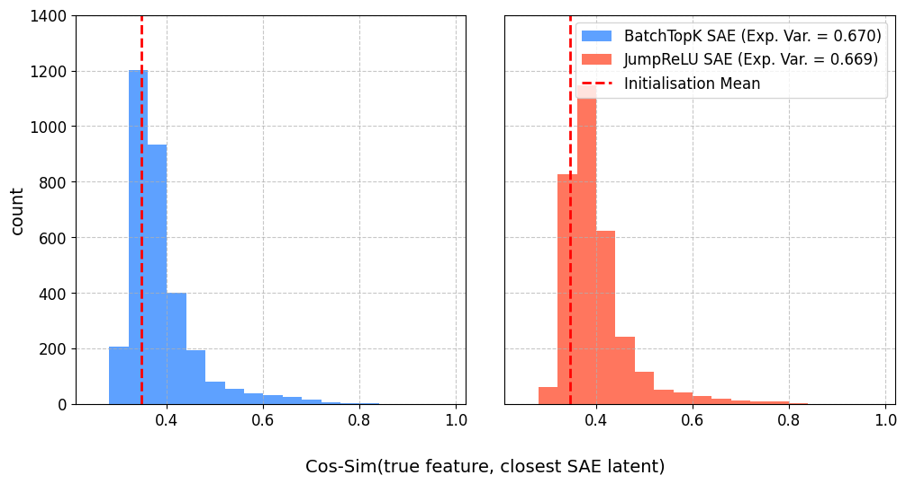

 Figure 2: SAEs performance on constant probability setting. Both BatchTopK and JumpReLU SAEs achieve high reconstruction fidelity (Explained Variance = 0.67), yet recover almost none of the ground‑truth features in this simplest aligned setting.

SAEs fail even in the simplest toy setting with fully aligned hyperparameters. In the constant probability setting (Figure [2](https://arxiv.org/html/2602.14111v1#S3.F2 "Figure 2 ‣ 3.2 Results ‣ 3 Case Study #1: Toy Model Experiments ‣ Sanity Checks for Sparse Autoencoders: Do SAEs Beat Random Baselines?")), both architectures achieve an explained variance of approximately 0.67, a value that suggests reasonably good reconstruction (see Figure [4](https://arxiv.org/html/2602.14111v1#S4.F4 "Figure 4 ‣ 4.2 Results ‣ 4 Case Study #2: Validating SAEs on LLMs ‣ Sanity Checks for Sparse Autoencoders: Do SAEs Beat Random Baselines?") where SAEs trained on real activations achieve \(\approx 0.8\)). However, they recover almost none of the ground-truth features: only 3 out of 3200 true features have a cosine similarity above 0.8 to their closest SAE latent for BatchTopK and JumpReLU SAEs. This indicates that SAEs can learn alternative representations that effectively minimize the reconstruction loss without aligning with the true generative features. Therefore, optimizing for reconstruction does not necessarily lead to discovering ground-truth features, highlighting a fundamental limitation of current SAE approaches.

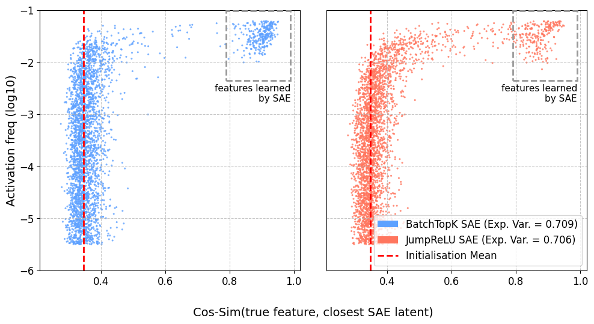

 Figure 3: SAEs performance on variable probability setting. Both SAE architectures achieve high reconstruction fidelity (explained variance = 0.71), yet recover only the highest-frequency ground‑truth features.

SAEs only recover the most highly activated ground-truth features in the variable setting. In the more realistic variable, heavy-tailed setting, both SAE architectures achieve a high explained variance of 0.71. Despite this strong reconstruction performance, feature recovery remains limited: JumpReLU SAE recovers only about 7% (225 out of 3200) of the total features, while BatchTopK SAE performs similarly with only about 9% (297 out of 3200) recovery, as measured by cosine similarity thresholds above 0.8. Crucially, Figure [3](https://arxiv.org/html/2602.14111v1#S3.F3 "Figure 3 ‣ 3.2 Results ‣ 3 Case Study #1: Toy Model Experiments ‣ Sanity Checks for Sparse Autoencoders: Do SAEs Beat Random Baselines?") shows this recovery is highly non-uniform: SAEs capture almost exclusively the highest-frequency features, leaving over 90% of the ground-truth dictionary, including the entire long tail of less frequent features, unmatched. This indicates that the standard reconstruction objective primarily guides SAEs toward the most frequently occurring features, resulting in incomplete coverage of the underlying feature space.

## 4 Case Study #2: Validating SAEs on LLMs

Having established SAE limitations in idealized settings, we now evaluate them on real LLM activations, where ground truth is unknown. In prior work ([Karvonen et al., 2025](https://arxiv.org/html/2602.14111v1#bib.bib26)), strong performance on four established proxy metrics has been taken as evidence that SAEs learn true model features: reconstruction fidelity, latent interpretability, sparse probing, and causal editing. We directly test this assumption by introducing three baselines where key SAE components are randomly initialized and frozen, preventing any learning beyond initialization. By comparing these baselines to fully-trained SAEs, we perform a crucial null test: if SAEs genuinely discover meaningful features, they should strongly outperform models with frozen random components.

### 4.1 Experimental setup

SAE variants and baselines. We examine three SAE architectures: the state-of-the-art BatchTopK SAE ([Bussmann et al., 2024](https://arxiv.org/html/2602.14111v1#bib.bib5)) and JumpReLU SAE ([Rajamanoharan et al., 2024b](https://arxiv.org/html/2602.14111v1#bib.bib39)), as well as the traditional ReLU SAE ([Bricken et al., 2023](https://arxiv.org/html/2602.14111v1#bib.bib4); [Huben et al., 2024](https://arxiv.org/html/2602.14111v1#bib.bib21)). To test if SAEs decompose model internal mechanisms rather than exploiting spurious correlations in data, we compare them against three easy-to-implement baselines where key components are randomly initialized and frozen (see Figure [1](https://arxiv.org/html/2602.14111v1#S1.F1 "Figure 1 ‣ 1 Introduction ‣ Sanity Checks for Sparse Autoencoders: Do SAEs Beat Random Baselines?")):

  1. Frozen Decoder: Decoder vectors \(\mathbf{W}^{\text{dec}}_{j}\) are randomly initialized and frozen throughout training. This tests how well SAEs can perform when the latent representations are fixed to random vectors. 
  2. Soft-Frozen Decoder: Decoder vectors \(\mathbf{W}^{\text{dec}}_{j}\) are randomly initialized and constrained via projection to remain within a cosine similarity \(\tau\) of their initial values throughout training. This baseline is motivated by our observation that SAE loss plateaus early while decoder vectors remain near initialization. We hypothesize this indicates SAEs may operate in a lazy training regime ([Chizat et al., 2019](https://arxiv.org/html/2602.14111v1#bib.bib10); [Kumar et al., 2024](https://arxiv.org/html/2602.14111v1#bib.bib28)), where reconstruction loss is dramatically reduced via small adjustments to latents without substantially changing their core semantics. This baseline directly tests that hypothesis. For all experiments, we use \(\tau\) = 0.8 (see further discussion in Appendix [D](https://arxiv.org/html/2602.14111v1#A4 "Appendix D The Soft-Frozen Decoder: Testing the Lazy Training Hypothesis ‣ Sanity Checks for Sparse Autoencoders: Do SAEs Beat Random Baselines?")). 
  3. Frozen Encoder: Encoder vectors \(\mathbf{W}^{\text{enc}}_{j}\) are randomly initialized and frozen. This evaluates SAE performance when each feature’s activation pattern (i.e., the contexts that trigger it) is predetermined in initialization, and only the activation threshold and decoder are learned. 

Models and Configuration. Following [Bussmann et al. (2025)](https://arxiv.org/html/2602.14111v1#bib.bib6), we train all SAEs on the residual stream activations from layer 12 of the Gemma-2-2B model ([Team et al., 2024](https://arxiv.org/html/2602.14111v1#bib.bib42)) (26 layers total). To assess generalizability, we also conduct experiments on layer 19 of Gemma-2-2B and layer 16 of Llama-3-8B ([Team, 2024](https://arxiv.org/html/2602.14111v1#bib.bib43)) (32 layers total). Each SAE uses a standard expansion factor \(k\) of 32 ([Bussmann et al., 2025](https://arxiv.org/html/2602.14111v1#bib.bib6)) (matching our toy model experiments), resulting in dictionary sizes of 73,728 and 131,072 latents for Gemma-2-2B and Llama-3.1-8B, respectively. We sweep sparsity levels \(\text{L}0\) in the set \(\{80,115,160,225,320\}\) for each architecture.

All models are trained on 500 million tokens from the OpenWebText corpus ([Gokaslan et al., 2019](https://arxiv.org/html/2602.14111v1#bib.bib16)) with a context length of 512. We use the AdamW optimizer ([Loshchilov & Hutter, 2019](https://arxiv.org/html/2602.14111v1#bib.bib32)) with a learning rate of \(2\times 10^{-4}\) and a batch size of 4098. To ensure a fair comparison, all models share identical initialization, data ordering, and hyperparameters. We will publicly release all code, hyperparameters, and trained SAEs to ensure full reproducibility. Extended results for all layers and models (Gemma-2-2B layers 12 and 19, and Llama-3-8B layer 16) with detailed metrics and standard errors are provided in Appendix [E](https://arxiv.org/html/2602.14111v1#A5 "Appendix E Frozen Models Ablation ‣ Sanity Checks for Sparse Autoencoders: Do SAEs Beat Random Baselines?").

Evaluation. We evaluate the trained SAEs and baselines along four key dimensions: (1) reconstruction fidelity measured by Explained Variance ([Gao et al., 2025](https://arxiv.org/html/2602.14111v1#bib.bib15); [Rajamanoharan et al., 2024b](https://arxiv.org/html/2602.14111v1#bib.bib39)); (2) latent’s interpretability evaluated through both automated scoring (AutoInterp) ([Paulo et al., 2025](https://arxiv.org/html/2602.14111v1#bib.bib36)) and qualitative manual analysis of activation patterns; (3) sparse probing using the SAEBench framework ([Karvonen et al., 2025](https://arxiv.org/html/2602.14111v1#bib.bib26)) to measure how precisely individual latents correspond to meaningful concepts (e.g., sentiment, syntax, factual recall); and (4) causal editing evaluated via the RAVEL framework ([Huang et al., 2024](https://arxiv.org/html/2602.14111v1#bib.bib20); [Karvonen et al., 2025](https://arxiv.org/html/2602.14111v1#bib.bib26)) to test whether SAE features can be used for precise and targeted model edits.

### 4.2 Results

Our results, summarized in Figures [4](https://arxiv.org/html/2602.14111v1#S4.F4 "Figure 4 ‣ 4.2 Results ‣ 4 Case Study #2: Validating SAEs on LLMs ‣ Sanity Checks for Sparse Autoencoders: Do SAEs Beat Random Baselines?") to [8](https://arxiv.org/html/2602.14111v1#S4.F8 "Figure 8 ‣ 4.2 Results ‣ 4 Case Study #2: Validating SAEs on LLMs ‣ Sanity Checks for Sparse Autoencoders: Do SAEs Beat Random Baselines?"), show that SAEs with frozen random components perform comparably to fully-trained SAEs across all four evaluation dimensions, challenging the notion that SAEs learn meaningful feature decompositions.

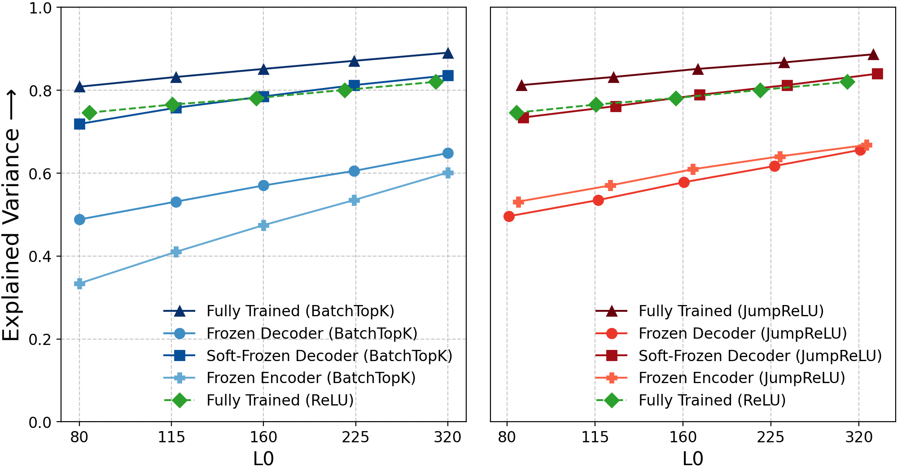

 Figure 4: Explained Variance. Despite training with frozen components, naive baselines achieve high reconstruction performance, with Soft-Frozen SAEs matching fully-trained ReLU SAEs and losing only 6% relative to their original variants.

Frozen SAE baselines show strong reconstruction performance. A fundamental premise of SAE evaluation is that strong reconstruction performance indicates the model has learned a meaningful decomposition of activations ([Bricken et al., 2023](https://arxiv.org/html/2602.14111v1#bib.bib4)). We directly test this premise by evaluating whether SAEs maintain high reconstruction fidelity even when key components are fixed to random values. Following prior work ([Gao et al., 2025](https://arxiv.org/html/2602.14111v1#bib.bib15); [Rajamanoharan et al., 2024b](https://arxiv.org/html/2602.14111v1#bib.bib39)), we use Explained Variance (Eq. [5](https://arxiv.org/html/2602.14111v1#S3.E5 "Equation 5 ‣ Synthetic Data Generation ‣ 3.1 Experimental setup ‣ 3 Case Study #1: Toy Model Experiments ‣ Sanity Checks for Sparse Autoencoders: Do SAEs Beat Random Baselines?")) as our primary reconstruction metric. We also measure cross-entropy loss and KL-divergence when substituting original activations with their SAE approximations, with these results provided in Appendix C.

As shown in Figure [4](https://arxiv.org/html/2602.14111v1#S4.F4 "Figure 4 ‣ 4.2 Results ‣ 4 Case Study #2: Validating SAEs on LLMs ‣ Sanity Checks for Sparse Autoencoders: Do SAEs Beat Random Baselines?"), frozen SAE baselines achieve robust performance across both SAE architectures, with some baselines even matching the reconstruction fidelity of fully-trained SAEs. For instance, at L0=160, the original JumpReLU SAE attains an Explained Variance of 0.85, while its Soft-Frozen Decoder variant reaches 0.79. The Frozen Decoder and Frozen Encoder variants at the same sparsity yield scores of 0.58 and 0.60, respectively, providing that even severely constrained models can achieve non-trivial performance. This pattern indicates that SAEs can produce high-quality reconstructions even when their latent representations or activation patterns are randomized and fixed. Combined with our toy model results (Sec. [3.2](https://arxiv.org/html/2602.14111v1#S3.SS2 "3.2 Results ‣ 3 Case Study #1: Toy Model Experiments ‣ Sanity Checks for Sparse Autoencoders: Do SAEs Beat Random Baselines?")), this suggests that strong reconstruction performance may not be a sufficient indicator for validating the discovery of true underlying features.

Latents from frozen SAE baselines are monosemantic and interpretable. Beyond reconstruction, SAEs are claimed to produce interpretable latents, taken as proof they capture genuine model features ([Bricken et al., 2023](https://arxiv.org/html/2602.14111v1#bib.bib4)). We test whether this interpretability emerges from meaningful feature learning or can be produced even when core components are frozen at random values.

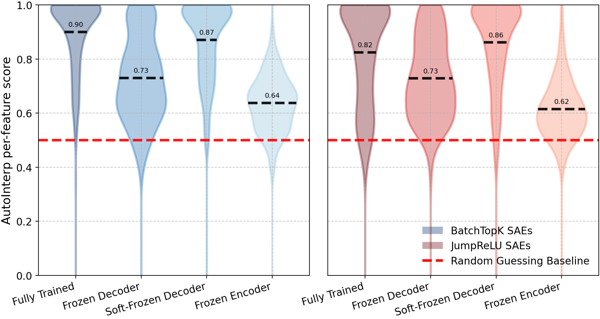

 Figure 5: AutoInterp score distribution. For both SAE architectures, frozen baselines achieve high AutoInterp scores, with the Soft-Frozen variant matching original performance, suggesting interpretability can emerge without learned feature alignment. 

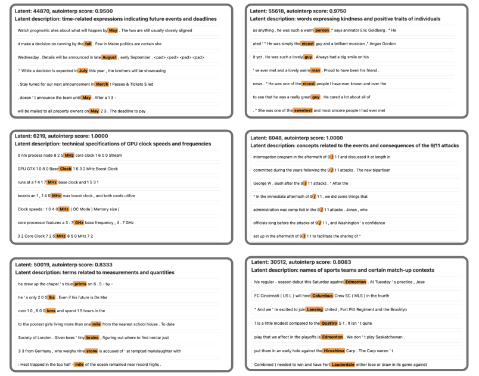

 Figure 6: Qualitative analysis: frozen SAEs produce interpretable latents. Sample activation contexts for latents from Soft-Frozen Decoder (rows 1-2) and Frozen Encoder (row 3) variants of BatchTopK SAE, with corresponding LLM-generated descriptions and AutoInterp scores. The features capture abstract concepts like “words expressing kindness”, “time-related expressions indicating future events”, and “names of sports teams”, demonstrating that high-level abstract interpretability can emerge without learned feature alignment.

To evaluate the interpretability of SAE latents, we follow the automated interpretability methodology outlined in ([Paulo et al., 2025](https://arxiv.org/html/2602.14111v1#bib.bib36); [Karvonen et al., 2025](https://arxiv.org/html/2602.14111v1#bib.bib26)), leveraging LLMs to generate and validate human-readable feature descriptions. First, we select 200 random SAE latents for all SAE architectures and baseline variants with L0=160, excluding non-active “dead” features, defined as those with activation frequencies \(<\) 1e-6. For each latent, we collect up to 15 top-activating sequences and prompt GPT-4o-mini ([Hurst et al., 2024](https://arxiv.org/html/2602.14111v1#bib.bib22)) to generate a concise description capturing the feature’s core concept (e.g., “sentiment terms” or “math expressions”). To assess these descriptions, we create a test set for each latent consisting of 100 sequences: 50 sequences that activate the latent at varying strengths and 50 random non-activating sequences. A separate GPT-4o-mini model then predicts, based on the description, whether each sequence activates the latent, treating this as a binary classification task. The AutoInterp score is defined as the classification accuracy on this test set.

The AutoInterp scores in Figure [5](https://arxiv.org/html/2602.14111v1#S4.F5 "Figure 5 ‣ 4.2 Results ‣ 4 Case Study #2: Validating SAEs on LLMs ‣ Sanity Checks for Sparse Autoencoders: Do SAEs Beat Random Baselines?") reveal that frozen SAE variants produce monosemantic, interpretable latents nearly as well as their fully-trained counterparts. For instance, the Soft‑Frozen BatchTopK SAE attains a mean AutoInterp score of 0.88, closely matching the fully‑trained variant’s score of 0.90. This suggests that high interpretability can emerge even when latent directions are constrained to remain near random initialization. Notably, the Frozen Encoder BatchTopK baseline, which fixes each feature’s activation pattern to a random projection, still yields a modest fraction of highly interpretable latents, with roughly 30% achieving AutoInterp scores above 0.7.

To further validate these findings, we conducted a brief qualitative analysis. Focusing on the top-performing latents from our set of 200 randomly selected SAE features, we studied the sentences that triggered them (detailed activation contexts and descriptions for all evaluated latents are provided in the supplementary materials). We observed that many of these latents correspond to abstract, monosemantic, high-level concepts. As illustrated in Figure [6](https://arxiv.org/html/2602.14111v1#S4.F6 "Figure 6 ‣ 4.2 Results ‣ 4 Case Study #2: Validating SAEs on LLMs ‣ Sanity Checks for Sparse Autoencoders: Do SAEs Beat Random Baselines?") (with examples from both Soft‑Frozen Decoder and Frozen Encoder variants), even our easy-to-implement baselines learn latents representing concepts such as “time-related expressions indicating future events and deadlines”, “terms related to measurements and quantities”, or “words expressing kindness and positive traits of individuals”.

These results demonstrate that SAEs with frozen components achieve interpretability scores comparable to fully-trained SAEs, challenging the notion that high interpretability reflects meaningful feature learning. Instead, our findings suggest that strong interpretability scores may emerge from aligning with statistical patterns in the data, rather than from genuine feature discovery during training.

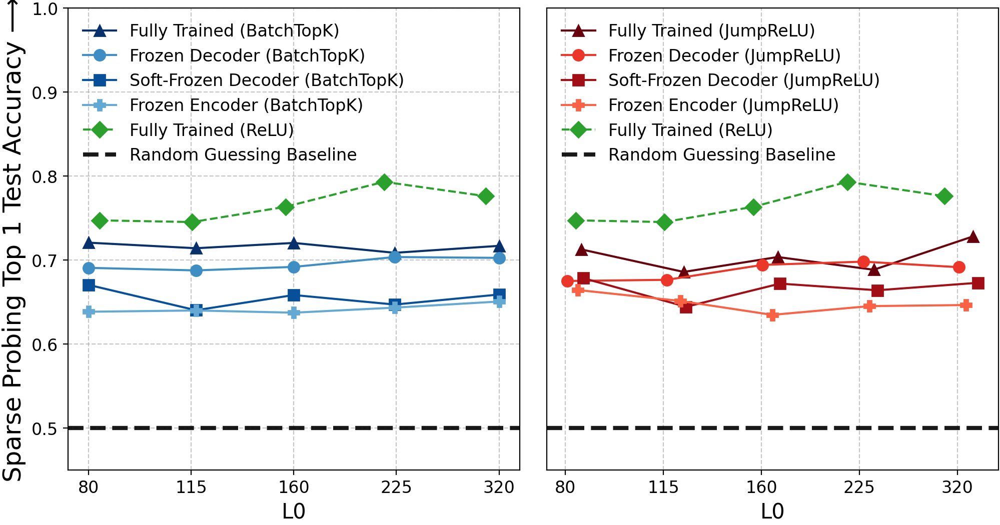

 Figure 7: Sparse probing accuracy. Frozen-component variants of both BatchTopK and JumpReLU SAEs achieve accuracy comparable to their fully-trained counterparts when using single-top-latent probing.

Frozen SAEs yield competitive sparse probing results. Sparse Probing evaluates the ability of SAEs to isolate specific concepts, such as sentiment, within individual latents without explicit supervision. For each concept, we select the top-k latents by comparing their mean activations on positive versus negative examples. A linear probe is then trained on these latents to predict the concept. High probe accuracy indicates that the latents effectively capture the target concept in a disentangled manner. Following [Karvonen et al. (2025)](https://arxiv.org/html/2602.14111v1#bib.bib26), we evaluate across five diverse concept types: profession classification, product classification and sentiment analysis, language identification, programming language classification, and news topic categorization.

As shown in Figure [7](https://arxiv.org/html/2602.14111v1#S4.F7 "Figure 7 ‣ 4.2 Results ‣ 4 Case Study #2: Validating SAEs on LLMs ‣ Sanity Checks for Sparse Autoencoders: Do SAEs Beat Random Baselines?"), sparse probing accuracy remains strong even when core SAE components are randomly initialized and frozen. Under the single-top-latent (\(k\)=1) setup, frozen variants of both BatchTopK and JumpReLU SAEs achieve accuracy scores comparable to their fully-trained counterparts across all sparsity levels (for \(k\)=5 see Appendix C). For instance, at L0=225, the BatchTopK Frozen Decoder variant reaches 0.70, matching the fully-trained model’s score, while the Frozen Encoder variant attains 0.65, a difference of only 0.05. These gaps remain narrow (0.001 to 0.07) across all settings and stay well above the random-guessing baseline of 0.50.

Together, these findings indicate that sparse probing yields non-trivial outcomes likely not because SAEs learn meaningful features, but simply due to the sheer scale of the dictionary. With tens or hundreds of thousands of latents, some inevitably correlate with concept clusters by chance. This random-alignment hypothesis further reinforces our AutoInterp results, where frozen baselines produced highly interpretable features despite never learning them.

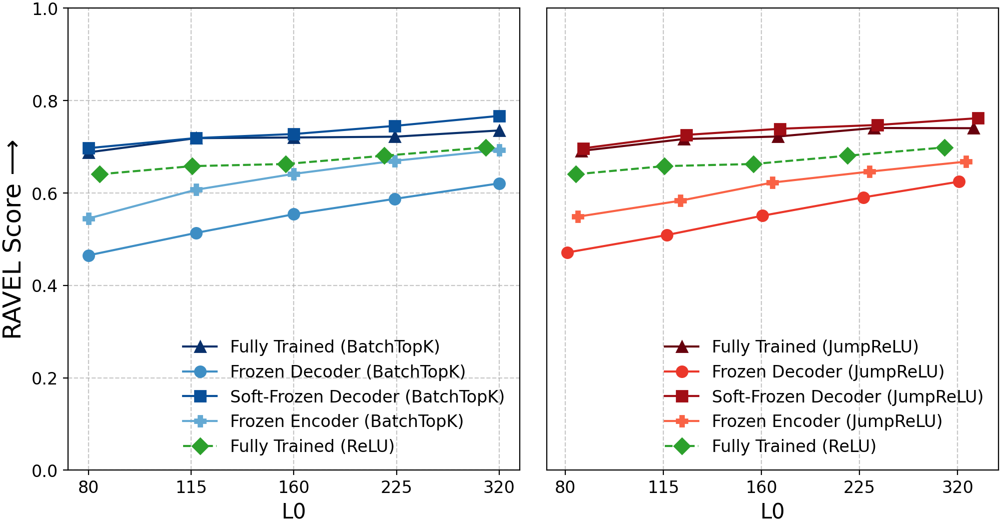

 Figure 8: RAVEL causal editing scores. SAEs with frozen components achieve RAVEL disentanglement scores equivalent to fully-trained SAEs, challenging the premise that SAEs learn meaningful features.

Frozen SAEs retain strong RAVEL causal editing performance. To further test if SAEs discover genuinely meaningful model features, we examine their causal properties. We evaluate whether SAE latents encode causally independent concepts using the RAVEL framework ([Huang et al., 2024](https://arxiv.org/html/2602.14111v1#bib.bib20); [Karvonen et al., 2025](https://arxiv.org/html/2602.14111v1#bib.bib26)), which tests if targeted interventions on latents can cleanly edit model predictions. This framework assesses whether the apparent causal utility of SAEs depends on learned feature alignment or can be achieved with frozen random components.

Specifically, given a factual statement like “Paris is in France”, we encode the subject token (e.g., “Paris”) with the SAE, train a binary mask to transfer latent values from a different token (e.g., “Tokyo”), and decode the modified latents back into the residual stream. The model then generates completions; a successful edit would change the targeted attribute (e.g., now stating “Paris is in Japan”) while preserving other attributes (e.g., still “People in Paris speak French”). The RAVEL disentanglement score averages a Cause Metric (measuring how often the desired attribute changes) and an Isolation Metric (measuring how often other attributes remain unchanged).

As shown in Figure [8](https://arxiv.org/html/2602.14111v1#S4.F8 "Figure 8 ‣ 4.2 Results ‣ 4 Case Study #2: Validating SAEs on LLMs ‣ Sanity Checks for Sparse Autoencoders: Do SAEs Beat Random Baselines?"), both BatchTopK and JumpReLU SAE variants with frozen components achieve RAVEL scores competitive with their fully-trained counterparts. For BatchTopK, the fully trained model achieves a RAVEL score of approximately 0.72–0.74 across higher sparsity levels (L0 \(\geq\) 160). The Frozen Decoder variant performs surprisingly well, reaching 0.57-0.62, demonstrating that effective causal editing can be achieved even when decoder vectors are frozen as random directions. The Frozen Encoder variant also shows strong performance, maintaining a score of 0.63 for L0 = 160. Meanwhile, the Soft-Frozen Decoder variant matches or even exceeds the fully trained model, reaching up to 0.78 at L0 = 320.

This suggests that much of the causal editing performance attributed to SAEs emerges from the systemic coverage of its initial vector set rather than from learned feature representations, undermining claims about SAEs’ ability to discover causally meaningful features.

## 5 Limitations

Our work has two primary limitations. First, our synthetic experiment assumes independent feature activations, omitting correlations that likely exist in real neural networks. However, since current SAE architectures already fail to recover ground-truth features in this simplified setting, incorporating more realistic dependencies is unlikely to improve their performance. Moreover, it remains unclear how to appropriately model these covariances in a synthetic setup without making arbitrary assumptions. Second, we focus on standard SAE architectures and do not evaluate related approaches such as transcoders or crosscoders ([Dunefsky et al., 2024](https://arxiv.org/html/2602.14111v1#bib.bib12)); designing appropriate randomization baselines for these methods, given their different training objectives, remains an open challenge.

## 6 Discussion and Conclusion

We have presented a systematic evaluation of SAEs through two complementary approaches: synthetic experiments with known ground-truth features, and comparisons against random baselines on real LLM activations. Our synthetic results reveal a troubling disconnect between reconstruction fidelity and feature recovery, where SAEs achieve \(71\%\) explained variance while recovering only \(9\%\) of true features. Our baselines, which constrain SAE components to random values, match fully-trained SAEs across interpretability, sparse probing, and causal editing evaluations.

When viewed in isolation, fully-trained SAEs appear to perform well on standard metrics. However, in relation to our baselines, we show that the gains attributable to learning become modest. We hypothesize that this stems from the reconstruction objective itself: minimizing reconstruction loss encourages SAEs to find any sparse representation that recovers the input, without explicitly rewarding alignment with the model’s true features. Our synthetic experiments support this view, as SAEs achieve strong reconstruction while failing to recover ground-truth features. This suggests that reconstruction may be a poor proxy for meaningful decomposition, and future work might explore objectives that more directly incentivize feature alignment.

We emphasize that our baselines are simple to implement. If future SAE architectures substantially outperform them, it would provide stronger evidence for meaningful feature learning. We hope that our work contributes to more rigorous evaluation standards for interpretability methods, not a verdict on SAEs as a paradigm.

## Impact Statement

This paper presents work whose goal is to advance the field of Machine Learning. There are many potential societal consequences of our work, none of which we feel must be specifically highlighted here.

## References

  * Arditi et al. (2024) Arditi, A., Obeso, O., Syed, A., Paleka, D., Panickssery, N., Gurnee, W., and Nanda, N.  Refusal in language models is mediated by a single direction.  In Globerson, A., Mackey, L., Belgrave, D., Fan, A., Paquet, U., Tomczak, J., and Zhang, C. (eds.), _Advances in Neural Information Processing Systems_ , volume 37, pp. 136037–136083. Curran Associates, Inc., 2024.  doi: 10.52202/079017-4322.  URL <https://proceedings.neurips.cc/paper_files/paper/2024/file/f545448535dfde4f9786555403ab7c49-Paper-Conference.pdf>. 
  * Bereska & Gavves (2024) Bereska, L. and Gavves, S.  Mechanistic interpretability for AI safety - A review.  _Trans. Mach. Learn. Res._ , 2024, 2024.  URL <https://openreview.net/forum?id=ePUVetPKu6>. 
  * Betley et al. (2025) Betley, J., Tan, D. C. H., Warncke, N., Sztyber-Betley, A., Bao, X., Soto, M., Labenz, N., and Evans, O.  Emergent misalignment: Narrow finetuning can produce broadly misaligned LLMs.  In Singh, A., Fazel, M., Hsu, D., Lacoste-Julien, S., Berkenkamp, F., Maharaj, T., Wagstaff, K., and Zhu, J. (eds.), _Proceedings of the 42nd International Conference on Machine Learning_ , volume 267 of _Proceedings of Machine Learning Research_ , pp. 4043–4068. PMLR, 13–19 Jul 2025.  URL <https://proceedings.mlr.press/v267/betley25a.html>. 
  * Bricken et al. (2023) Bricken, T., Templeton, A., Batson, J., Chen, B., Jermyn, A., Conerly, T., Turner, N., Anil, C., Denison, C., Askell, A., Lasenby, R., Wu, Y., Kravec, S., Schiefer, N., Maxwell, T., Joseph, N., Hatfield-Dodds, Z., Tamkin, A., Nguyen, K., McLean, B., Burke, J. E., Hume, T., Carter, S., Henighan, T., and Olah, C.  Towards monosemanticity: Decomposing language models with dictionary learning.  _Transformer Circuits Thread_ , 2023.  URL <https://transformer-circuits.pub/2023/monosemantic-features/index.html>. 
  * Bussmann et al. (2024) Bussmann, B., Leask, P., and Nanda, N.  Batchtopk sparse autoencoders.  _CoRR_ , abs/2412.06410, 2024.  doi: 10.48550/ARXIV.2412.06410.  URL <https://doi.org/10.48550/arXiv.2412.06410>. 
  * Bussmann et al. (2025) Bussmann, B., Nabeshima, N., Karvonen, A., and Nanda, N.  Learning multi-level features with matryoshka sparse autoencoders.  In _Forty-second International Conference on Machine Learning, ICML 2025, Vancouver, BC, Canada, July 13-19, 2025_. OpenReview.net, 2025.  URL <https://openreview.net/forum?id=m25T5rAy43>. 
  * Chanin & Garriga-Alonso (2025) Chanin, D. and Garriga-Alonso, A.  Sparse but wrong: Incorrect l0 leads to incorrect features in sparse autoencoders.  _arXiv preprint arXiv:2508.16560_ , 2025. 
  * Chanin et al. (2025a) Chanin, D., Dulka, T., and Garriga-Alonso, A.  Feature hedging: Correlated features break narrow sparse autoencoders, 2025a.  URL <https://arxiv.org/abs/2505.11756>. 
  * Chanin et al. (2025b) Chanin, D., Wilken-Smith, J., Dulka, T., Bhatnagar, H., Golechha, S., and Bloom, J. I.  A is for absorption: Studying feature splitting and absorption in sparse autoencoders.  In _The Thirty-ninth Annual Conference on Neural Information Processing Systems_ , 2025b.  URL <https://openreview.net/forum?id=R73ybUciQF>. 
  * Chizat et al. (2019) Chizat, L., Oyallon, E., and Bach, F. R.  On lazy training in differentiable programming.  In Wallach, H. M., Larochelle, H., Beygelzimer, A., d’Alché-Buc, F., Fox, E. B., and Garnett, R. (eds.), _Advances in Neural Information Processing Systems 32: Annual Conference on Neural Information Processing Systems 2019, NeurIPS 2019, December 8-14, 2019, Vancouver, BC, Canada_ , pp. 2933–2943, 2019.  URL <https://proceedings.neurips.cc/paper/2019/hash/ae614c557843b1df326cb29c57225459-Abstract.html>. 
  * Deng et al. (2009) Deng, J., Dong, W., Socher, R., Li, L.-J., Li, K., and Fei-Fei, L.  Imagenet: A large-scale hierarchical image database.  In _2009 IEEE Conference on Computer Vision and Pattern Recognition_ , pp. 248–255, 2009.  doi: 10.1109/CVPR.2009.5206848. 
  * Dunefsky et al. (2024) Dunefsky, J., Chlenski, P., and Nanda, N.  Transcoders find interpretable llm feature circuits.  _Advances in Neural Information Processing Systems_ , 37:24375–24410, 2024. 
  * Elhage et al. (2022) Elhage, N., Hume, T., Olsson, C., Schiefer, N., Henighan, T., Kravec, S., Hatfield-Dodds, Z., Lasenby, R., Drain, D., Chen, C., Grosse, R. B., McCandlish, S., Kaplan, J., Amodei, D., Wattenberg, M., and Olah, C.  Toy models of superposition.  _CoRR_ , abs/2209.10652, 2022.  doi: 10.48550/ARXIV.2209.10652.  URL <https://doi.org/10.48550/arXiv.2209.10652>. 
  * Galichin et al. (2025) Galichin, A., Dontsov, A., Druzhinina, P., Razzhigaev, A., Rogov, O. Y., Tutubalina, E., and Oseledets, I.  I have covered all the bases here: Interpreting reasoning features in large language models via sparse autoencoders.  _arXiv preprint arXiv:2503.18878_ , 2025. 
  * Gao et al. (2025) Gao, L., la Tour, T. D., Tillman, H., Goh, G., Troll, R., Radford, A., Sutskever, I., Leike, J., and Wu, J.  Scaling and evaluating sparse autoencoders.  In _The Thirteenth International Conference on Learning Representations, ICLR 2025, Singapore, April 24-28, 2025_. OpenReview.net, 2025.  URL <https://openreview.net/forum?id=tcsZt9ZNKD>. 
  * Gokaslan et al. (2019) Gokaslan, A., Cohen, V., Pavlick, E., and Tellex, S.  Openwebtext corpus.  <http://Skylion007.github.io/OpenWebTextCorpus>, 2019. 
  * Grace et al. (2025) Grace, K., Sandkühler, J. F., Stewart, H., Weinstein-Raun, B., Thomas, S., Stein-Perlman, Z., Salvatier, J., Brauner, J., and Korzekwa, R. C.  Thousands of AI authors on the future of AI.  _J. Artif. Intell. Res._ , 84, 2025.  doi: 10.1613/JAIR.1.19087.  URL <https://doi.org/10.1613/jair.1.19087>. 
  * Heap et al. (2025) Heap, T., Lawson, T., Farnik, L., and Aitchison, L.  Sparse autoencoders can interpret randomly initialized transformers.  _CoRR_ , abs/2501.17727, 2025.  doi: 10.48550/ARXIV.2501.17727.  URL <https://doi.org/10.48550/arXiv.2501.17727>. 
  * Heindrich et al. (2025) Heindrich, L., Torr, P., Barez, F., and Thost, V.  Do sparse autoencoders generalize? A case study of answerability.  _CoRR_ , abs/2502.19964, 2025.  doi: 10.48550/ARXIV.2502.19964.  URL <https://doi.org/10.48550/arXiv.2502.19964>. 
  * Huang et al. (2024) Huang, J., Wu, Z., Potts, C., Geva, M., and Geiger, A.  RAVEL: evaluating interpretability methods on disentangling language model representations.  In Ku, L., Martins, A., and Srikumar, V. (eds.), _Proceedings of the 62nd Annual Meeting of the Association for Computational Linguistics (Volume 1: Long Papers), ACL 2024, Bangkok, Thailand, August 11-16, 2024_ , pp. 8669–8687. Association for Computational Linguistics, 2024.  doi: 10.18653/V1/2024.ACL-LONG.470.  URL <https://doi.org/10.18653/v1/2024.acl-long.470>. 
  * Huben et al. (2024) Huben, R., Cunningham, H., Smith, L. R., Ewart, A., and Sharkey, L.  Sparse autoencoders find highly interpretable features in language models.  In _The Twelfth International Conference on Learning Representations, ICLR 2024, Vienna, Austria, May 7-11, 2024_. OpenReview.net, 2024.  URL <https://openreview.net/forum?id=F76bwRSLeK>. 
  * Hurst et al. (2024) Hurst, A., Lerer, A., Goucher, A. P., Perelman, A., Ramesh, A., Clark, A., Ostrow, A., Welihinda, A., Hayes, A., Radford, A., Madry, A., Baker-Whitcomb, A., Beutel, A., Borzunov, A., Carney, A., Chow, A., Kirillov, A., Nichol, A., Paino, A., Renzin, A., Passos, A. T., Kirillov, A., Christakis, A., Conneau, A., Kamali, A., Jabri, A., Moyer, A., Tam, A., Crookes, A., Tootoonchian, A., Kumar, A., Vallone, A., Karpathy, A., Braunstein, A., Cann, A., Codispoti, A., Galu, A., Kondrich, A., Tulloch, A., Mishchenko, A., Baek, A., Jiang, A., Pelisse, A., Woodford, A., Gosalia, A., Dhar, A., Pantuliano, A., Nayak, A., Oliver, A., Zoph, B., Ghorbani, B., Leimberger, B., Rossen, B., Sokolowsky, B., Wang, B., Zweig, B., Hoover, B., Samic, B., McGrew, B., Spero, B., Giertler, B., Cheng, B., Lightcap, B., Walkin, B., Quinn, B., Guarraci, B., Hsu, B., Kellogg, B., Eastman, B., Lugaresi, C., Wainwright, C. L., Bassin, C., Hudson, C., Chu, C., Nelson, C., Li, C., Shern, C. J., Conger, C., Barette, C., Voss, C., Ding, C., Lu, C., Zhang, C., Beaumont, C., Hallacy, C., Koch, C., Gibson, C., Kim, C., Choi, C., McLeavey, C., Hesse, C., Fischer, C., Winter, C., Czarnecki, C., Jarvis, C., Wei, C., Koumouzelis, C., and Sherburn, D.  Gpt-4o system card.  _CoRR_ , abs/2410.21276, 2024.  doi: 10.48550/ARXIV.2410.21276.  URL <https://doi.org/10.48550/arXiv.2410.21276>. 
  * Joseph et al. (2025) Joseph, S., Suresh, P., Hufe, L., Stevinson, E., Graham, R., Vadi, Y., Bzdok, D., Lapuschkin, S., Sharkey, L., and Richards, B. A.  Prisma: An open source toolkit for mechanistic interpretability in vision and video, 2025.  URL <https://arxiv.org/abs/2504.19475>. 
  * Kantamneni et al. (2025) Kantamneni, S., Engels, J., Rajamanoharan, S., Tegmark, M., and Nanda, N.  Are sparse autoencoders useful? A case study in sparse probing.  In _Forty-second International Conference on Machine Learning, ICML 2025, Vancouver, BC, Canada, July 13-19, 2025_. OpenReview.net, 2025.  URL <https://openreview.net/forum?id=rNfzT8YkgO>. 
  * Karvonen et al. (2024) Karvonen, A., Wright, B., Rager, C., Angell, R., Brinkmann, J., Smith, L., Verdun, C. M., Bau, D., and Marks, S.  Measuring progress in dictionary learning for language model interpretability with board game models.  In Globersons, A., Mackey, L., Belgrave, D., Fan, A., Paquet, U., Tomczak, J. M., and Zhang, C. (eds.), _Advances in Neural Information Processing Systems 38: Annual Conference on Neural Information Processing Systems 2024, NeurIPS 2024, Vancouver, BC, Canada, December 10 - 15, 2024_ , 2024.  URL <http://papers.nips.cc/paper_files/paper/2024/hash/9736acf007760cc2b47948ae3cf06274-Abstract-Conference.html>. 
  * Karvonen et al. (2025) Karvonen, A., Rager, C., Lin, J., Tigges, C., Bloom, J. I., Chanin, D., Lau, Y., Farrell, E., McDougall, C., Ayonrinde, K., Till, D., Wearden, M., Conmy, A., Marks, S., and Nanda, N.  Saebench: A comprehensive benchmark for sparse autoencoders in language model interpretability.  In _Forty-second International Conference on Machine Learning, ICML 2025, Vancouver, BC, Canada, July 13-19, 2025_. OpenReview.net, 2025.  URL <https://openreview.net/forum?id=qrU3yNfX0d>. 
  * Korznikov et al. (2025) Korznikov, A., Galichin, A., Dontsov, A., Rogov, O., Tutubalina, E., and Oseledets, I.  Ortsae: Orthogonal sparse autoencoders uncover atomic features.  _arXiv preprint arXiv:2509.22033_ , 2025. 
  * Kumar et al. (2024) Kumar, T., Bordelon, B., Gershman, S. J., and Pehlevan, C.  Grokking as the transition from lazy to rich training dynamics.  In _The Twelfth International Conference on Learning Representations, ICLR 2024, Vienna, Austria, May 7-11, 2024_. OpenReview.net, 2024.  URL <https://openreview.net/forum?id=vt5mnLVIVo>. 
  * Leask et al. (2025) Leask, P., Bussmann, B., Pearce, M. T., Bloom, J. I., Tigges, C., Moubayed, N. A., Sharkey, L., and Nanda, N.  Sparse autoencoders do not find canonical units of analysis.  In _The Thirteenth International Conference on Learning Representations, ICLR 2025, Singapore, April 24-28, 2025_. OpenReview.net, 2025.  URL <https://openreview.net/forum?id=9ca9eHNrdH>. 
  * Li et al. (2026) Li, A. J., Srinivas, S., Bhalla, U., and Lakkaraju, H.  Evaluating adversarial robustness of concept representations in sparse autoencoders.  2026\.  URL <https://arxiv.org/abs/2505.16004>. 
  * Lieberum et al. (2024) Lieberum, T., Rajamanoharan, S., Conmy, A., Smith, L., Sonnerat, N., Varma, V., Kramár, J., Dragan, A., Shah, R., and Nanda, N.  Gemma scope: Open sparse autoencoders everywhere all at once on gemma 2.  _arXiv preprint arXiv:2408.05147_ , 2024. 
  * Loshchilov & Hutter (2019) Loshchilov, I. and Hutter, F.  Decoupled weight decay regularization.  2019\.  URL <https://openreview.net/forum?id=Bkg6RiCqY7>. 
  * Menon et al. (2025) Menon, A., Shrivastava, M., Krueger, D., and Lubana, E. S.  Analyzing (in) abilities of saes via formal languages.  In _Proceedings of the 2025 Conference of the Nations of the Americas Chapter of the Association for Computational Linguistics: Human Language Technologies (Volume 1: Long Papers)_ , pp. 4837–4862, 2025. 
  * Minegishi et al. (2025) Minegishi, G., Furuta, H., Iwasawa, Y., and Matsuo, Y.  Rethinking evaluation of sparse autoencoders through the representation of polysemous words.  In _The Thirteenth International Conference on Learning Representations, ICLR 2025, Singapore, April 24-28, 2025_. OpenReview.net, 2025.  URL <https://openreview.net/forum?id=HpUs2EXjOl>. 
  * Paulo & Belrose (2025) Paulo, G. and Belrose, N.  Sparse autoencoders trained on the same data learn different features, 2025.  URL <https://arxiv.org/abs/2501.16615>. 
  * Paulo et al. (2025) Paulo, G. S., Mallen, A. T., Juang, C., and Belrose, N.  Automatically interpreting millions of features in large language models.  In _Forty-second International Conference on Machine Learning_ , 2025.  URL <https://openreview.net/forum?id=EemtbhJOXc>. 
  * Radford et al. (2021) Radford, A., Kim, J. W., Hallacy, C., Ramesh, A., Goh, G., Agarwal, S., Sastry, G., Askell, A., Mishkin, P., Clark, J., et al.  Learning transferable visual models from natural language supervision.  In _International conference on machine learning_ , pp. 8748–8763. PmLR, 2021. 
  * Rajamanoharan et al. (2024a) Rajamanoharan, S., Conmy, A., Smith, L., Lieberum, T., Varma, V., Kramár, J., Shah, R., and Nanda, N.  Improving dictionary learning with gated sparse autoencoders, 2024a.  URL <https://arxiv.org/abs/2404.16014>. 
  * Rajamanoharan et al. (2024b) Rajamanoharan, S., Lieberum, T., Sonnerat, N., Conmy, A., Varma, V., Kramár, J., and Nanda, N.  Jumping ahead: Improving reconstruction fidelity with jumprelu sparse autoencoders.  _arXiv preprint arXiv:2407.14435_ , 2024b. 
  * Sharkey et al. (2022) Sharkey, L., Braun, D., and Millidge, B.  Taking features out of superposition with sparse autoencoders.  _AI Alignment Forum_ , 2022.  URL <https://www.alignmentforum.org/posts/z6QQJbtpkEAX3Aojj/interim-research-report-taking-features-out-of-superposition>. 
  * Smith et al. (2025) Smith, L., Rajamanoharan, S., Conmy, A., McDougall, C., Kramár, J., Lieberum, T., Shah, R., and Nanda, N.  Negative results for saes on downstream tasks and deprioritising sae research (gdm mech interp team progress update# 2), march 2025.  2025\.  URL <https://www.lesswrong.com/posts/4uXCAJNuPKtKBsi28/negative-results-for-saes-on-downstream-tasks>. 
  * Team et al. (2024) Team, G., Riviere, M., Pathak, S., Sessa, P. G., Hardin, C., Bhupatiraju, S., Hussenot, L., Mesnard, T., Shahriari, B., Ramé, A., Ferret, J., Liu, P., Tafti, P., Friesen, A., Casbon, M., Ramos, S., Kumar, R., Lan, C. L., Jerome, S., Tsitsulin, A., Vieillard, N., Stanczyk, P., Girgin, S., Momchev, N., Hoffman, M., Thakoor, S., Grill, J.-B., Neyshabur, B., Bachem, O., Walton, A., Severyn, A., Parrish, A., Ahmad, A., Hutchison, A., Abdagic, A., Carl, A., Shen, A., Brock, A., Coenen, A., Laforge, A., Paterson, A., Bastian, B., Piot, B., Wu, B., Royal, B., Chen, C., Kumar, C., Perry, C., Welty, C., Choquette-Choo, C. A., Sinopalnikov, D., Weinberger, D., Vijaykumar, D., Rogozińska, D., Herbison, D., Bandy, E., Wang, E., Noland, E., Moreira, E., Senter, E., Eltyshev, E., Visin, F., Rasskin, G., Wei, G., Cameron, G., Martins, G., Hashemi, H., Klimczak-Plucińska, H., Batra, H., Dhand, H., Nardini, I., Mein, J., Zhou, J., Svensson, J., Stanway, J., Chan, J., Zhou, J. P., Carrasqueira, J., Iljazi, J., Becker, J., Fernandez, J., van Amersfoort, J., Gordon, J., Lipschultz, J., Newlan, J., yeong Ji, J., Mohamed, K., Badola, K., Black, K., Millican, K., McDonell, K., Nguyen, K., Sodhia, K., Greene, K., Sjoesund, L. L., Usui, L., Sifre, L., Heuermann, L., Lago, L., McNealus, L., Soares, L. B., Kilpatrick, L., Dixon, L., Martins, L., Reid, M., Singh, M., Iverson, M., Görner, M., Velloso, M., Wirth, M., Davidow, M., Miller, M., Rahtz, M., Watson, M., Risdal, M., Kazemi, M., Moynihan, M., Zhang, M., Kahng, M., Park, M., Rahman, M., Khatwani, M., Dao, N., Bardoliwalla, N., Devanathan, N., Dumai, N., Chauhan, N., Wahltinez, O., Botarda, P., Barnes, P., Barham, P., Michel, P., Jin, P., Georgiev, P., Culliton, P., Kuppala, P., Comanescu, R., Merhej, R., Jana, R., Rokni, R. A., Agarwal, R., Mullins, R., Saadat, S., Carthy, S. M., Cogan, S., Perrin, S., Arnold, S. M. R., Krause, S., Dai, S., Garg, S., Sheth, S., Ronstrom, S., Chan, S., Jordan, T., Yu, T., Eccles, T., Hennigan, T., Kocisky, T., Doshi, T., Jain, V., Yadav, V., Meshram, V., Dharmadhikari, V., Barkley, W., Wei, W., Ye, W., Han, W., Kwon, W., Xu, X., Shen, Z., Gong, Z., Wei, Z., Cotruta, V., Kirk, P., Rao, A., Giang, M., Peran, L., Warkentin, T., Collins, E., Barral, J., Ghahramani, Z., Hadsell, R., Sculley, D., Banks, J., Dragan, A., Petrov, S., Vinyals, O., Dean, J., Hassabis, D., Kavukcuoglu, K., Farabet, C., Buchatskaya, E., Borgeaud, S., Fiedel, N., Joulin, A., Kenealy, K., Dadashi, R., and Andreev, A.  Gemma 2: Improving open language models at a practical size.  2024\.  URL <https://arxiv.org/abs/2408.00118>. 
  * Team (2024) Team, L.  The llama 3 herd of models.  _CoRR_ , abs/2407.21783, 2024.  doi: 10.48550/ARXIV.2407.21783.  URL <https://doi.org/10.48550/arXiv.2407.21783>. 
  * Templeton et al. (2024) Templeton, A., Conerly, T., Marcus, J., Lindsey, J., Bricken, T., Chen, B., Pearce, A., Citro, C., Ameisen, E., Jones, A., Cunningham, H., Turner, N. L., McDougall, C., MacDiarmid, M., Freeman, C. D., Sumers, T. R., Rees, E., Batson, J., Jermyn, A., Carter, S., Olah, C., and Henighan, T.  Scaling monosemanticity: Extracting interpretable features from claude 3 sonnet.  _Transformer Circuits Thread. Anthropic_ , 2024.  URL <https://transformer-circuits.pub/2024/scaling-monosemanticity/index.html>. 
  * Tkocz (2012) Tkocz, T.  An upper bound for spherical caps.  _The American Mathematical Monthly_ , 119(7):606–607, 2012.  URL <https://doi.org/10.4169/amer.math.monthly.119.07.606>. 
  * Wang et al. (2023) Wang, K. R., Variengien, A., Conmy, A., Shlegeris, B., and Steinhardt, J.  Interpretability in the wild: a circuit for indirect object identification in GPT-2 small.  In _The Eleventh International Conference on Learning Representations_ , 2023.  URL <https://openreview.net/forum?id=NpsVSN6o4ul>. 
  * Wang et al. (2025) Wang, M., la Tour, T. D., Watkins, O., Makelov, A., Chi, R. A., Miserendino, S., Wang, J., Rajaram, A., Heidecke, J., Patwardhan, T., et al.  Persona features control emergent misalignment.  _arXiv preprint arXiv:2506.19823_ , 2025. 
  * Wu et al. (2025) Wu, Z., Arora, A., Geiger, A., Wang, Z., Huang, J., Jurafsky, D., Manning, C. D., and Potts, C.  Axbench: Steering llms? even simple baselines outperform sparse autoencoders.  In _ICML_. OpenReview.net, 2025. 

## Appendix A SAEs: Claimed Benefits vs. Documented Limitations

Table [1](https://arxiv.org/html/2602.14111v1#A1.T1 "Table 1 ‣ Appendix A SAEs: Claimed Benefits vs. Documented Limitations ‣ Sanity Checks for Sparse Autoencoders: Do SAEs Beat Random Baselines?") provides a comprehensive overview of both the claimed advantages that have motivated widespread adoption of SAEs and the documented challenges that cast doubt on their reliability.

Table 1: Sparse Autoencoders: Claimed Benefits vs. Documented Limitations 

Claimed Benefits |  Documented Limitations  
---|---  
Core Purpose: Decompose dense activations into sparse, interpretable, monosemantic features ([Bricken et al., 2023](https://arxiv.org/html/2602.14111v1#bib.bib4); [Huben et al., 2024](https://arxiv.org/html/2602.14111v1#bib.bib21)) |  Spurious Features: Find features even in randomly initialized transformers with no learned structure ([Heap et al., 2025](https://arxiv.org/html/2602.14111v1#bib.bib18))  
Monosemanticity: Address polysemanticity by learning features that correspond to single coherent concepts ([Bricken et al., 2023](https://arxiv.org/html/2602.14111v1#bib.bib4); [Huben et al., 2024](https://arxiv.org/html/2602.14111v1#bib.bib21)) |  Unfaithfulness: Reconstructed features do not faithfully represent true model computations ([Leask et al., 2025](https://arxiv.org/html/2602.14111v1#bib.bib29); [Menon et al., 2025](https://arxiv.org/html/2602.14111v1#bib.bib33))  
Scalability: Successfully scaled to frontier models including Claude 3 Sonnet, GPT-4, and Gemma 2 ([Templeton et al., 2024](https://arxiv.org/html/2602.14111v1#bib.bib44); [Gao et al., 2025](https://arxiv.org/html/2602.14111v1#bib.bib15); [Lieberum et al., 2024](https://arxiv.org/html/2602.14111v1#bib.bib31)) |  Poor Generalization: Fail to generalize across tasks, settings, and perturbations ([Heindrich et al., 2025](https://arxiv.org/html/2602.14111v1#bib.bib19); [Kantamneni et al., 2025](https://arxiv.org/html/2602.14111v1#bib.bib24); [Li et al., 2026](https://arxiv.org/html/2602.14111v1#bib.bib30))  
AI Safety Applications: Enable mechanistic interpretability for understanding safety mechanisms, reasoning, and misalignment ([Wang et al., 2023](https://arxiv.org/html/2602.14111v1#bib.bib46); [Galichin et al., 2025](https://arxiv.org/html/2602.14111v1#bib.bib14)) |  Downstream Performance: Underperform on downstream tasks; other approaches often outperform SAEs ([Wu et al., 2025](https://arxiv.org/html/2602.14111v1#bib.bib48); [Smith et al., 2025](https://arxiv.org/html/2602.14111v1#bib.bib41))  
Reconstruction Quality: Achieve high reconstruction fidelity ([Bricken et al., 2023](https://arxiv.org/html/2602.14111v1#bib.bib4); [Gao et al., 2025](https://arxiv.org/html/2602.14111v1#bib.bib15)) |  Training Fragility: Highly sensitive to hyperparameters and initialization ([Chanin & Garriga-Alonso, 2025](https://arxiv.org/html/2602.14111v1#bib.bib7); [Paulo & Belrose, 2025](https://arxiv.org/html/2602.14111v1#bib.bib35); [Minegishi et al., 2025](https://arxiv.org/html/2602.14111v1#bib.bib34))

 

## Appendix B Extended Comparison for Toy Model Experiments

In addition to the BatchTopK and JumpReLU architectures evaluated in Section [3.1](https://arxiv.org/html/2602.14111v1#S3.SS1 "3.1 Experimental setup ‣ 3 Case Study #1: Toy Model Experiments ‣ Sanity Checks for Sparse Autoencoders: Do SAEs Beat Random Baselines?"), we examine two further SAE variants on our synthetic data: the simple TopK SAE ([Gao et al., 2025](https://arxiv.org/html/2602.14111v1#bib.bib15)) and the hierarchical Matryoshka SAE ([Bussmann et al., 2025](https://arxiv.org/html/2602.14111v1#bib.bib6)) built on the BatchTopK architecture. These variants provide insight into how different architectural choices affect feature recovery in controlled settings. For these experiments, we use the same setup as described in Section [3.1](https://arxiv.org/html/2602.14111v1#S3.SS1 "3.1 Experimental setup ‣ 3 Case Study #1: Toy Model Experiments ‣ Sanity Checks for Sparse Autoencoders: Do SAEs Beat Random Baselines?"). For Matryoshka SAE, we use the standard group fractions {0.5, 0.3, 0.2}.

#### Constant Probability Setting

Figure [9](https://arxiv.org/html/2602.14111v1#A2.F9 "Figure 9 ‣ Varying Probability Setting ‣ Appendix B Extended Comparison for Toy Model Experiments ‣ Sanity Checks for Sparse Autoencoders: Do SAEs Beat Random Baselines?") (left) presents feature recovery in the uniform setting where all ground truth features have equal activation probability. TopK SAE achieves near-perfect recovery (99.9% of features aligned with cosine similarity \(\geq\) 0.8), dramatically outperforming all other architectures. This strong performance is particularly surprising. We hypothesize that its simpler activation mechanism may be more stable in this synthetic setting, but this success does not necessarily translate to real-world activations where feature distributions are more complex. In contrast, Matryoshka SAE fails entirely, recovering only 0.03% of features, a performance indistinguishable from BatchTopK and JumpReLU SAEs.

#### Varying Probability Setting

Figure [9](https://arxiv.org/html/2602.14111v1#A2.F9 "Figure 9 ‣ Varying Probability Setting ‣ Appendix B Extended Comparison for Toy Model Experiments ‣ Sanity Checks for Sparse Autoencoders: Do SAEs Beat Random Baselines?") (right) shows results in the heavy-tailed setting, which mimics the skewed activation distributions observed in real LLMs. Here, all architectures recover only a small fraction (7 to 43%) of ground truth features, exclusively from the high frequency tail. TopK SAE achieves the best recovery, though still far from complete coverage. Matryoshka’s hierarchical decomposition introduces a subtle trade-off: it recovers slightly more mid-frequency features than BatchTopK and JumpReLU, but at the cost of missing some of the very highest frequency components. This suggests that hierarchical sparsity can redistribute feature recovery across the frequency spectrum but does not overcome the fundamental bias toward high-variance directions.

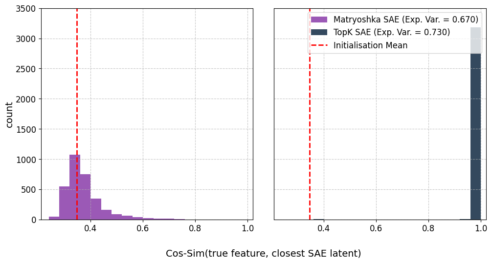

 

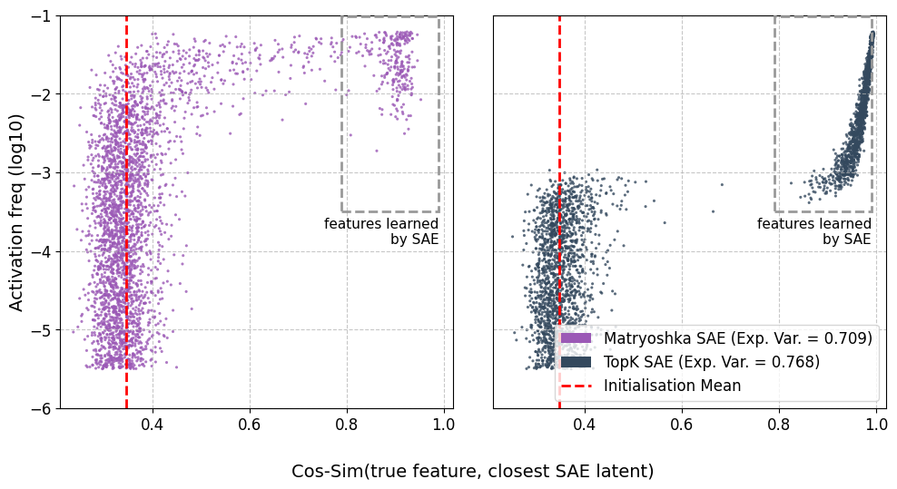

 

Figure 9: Toy model experiments: extended architectures. Surprisingly, simple TopK SAE successfully recovers nearly all ground truth features (99.99%), while Matryoshka SAE fails completely (0.03% recovery), performing equivalently to BatchTopK and JumpReLU in the constant probability setting. In the more realistic heavy-tailed variable setting, all architectures recover only high-frequency features (7 to 43% of total). TopK SAE achieves the best recovery, while Matryoshka’s hierarchical structure shifts recovery toward moderately frequent features at the expense of the very highest frequencies compared to BatchTopK and JumpReLU SAEs.

#### Implications

Despite TopK SAE’s success in a constant probability setting, this doesn’t translate to real LLM activations. As shown in Appendix [C](https://arxiv.org/html/2602.14111v1#A3 "Appendix C Frozen Baselines for TopK SAE on Real Activations ‣ Sanity Checks for Sparse Autoencoders: Do SAEs Beat Random Baselines?"), TopK SAE with frozen components performs comparably to its fully-trained counterpart on real data, suggesting toy model success is an artifact of the simplified controlled setting.

## Appendix C Frozen Baselines for TopK SAE on Real Activations

To provide a comprehensive evaluation across SAE architectures, we extend our frozen baseline analysis to the simpler TopK SAE variant. Figure [10](https://arxiv.org/html/2602.14111v1#A3.F10 "Figure 10 ‣ Appendix C Frozen Baselines for TopK SAE on Real Activations ‣ Sanity Checks for Sparse Autoencoders: Do SAEs Beat Random Baselines?") presents the performance of TopK SAE (L0=160) trained on Gemma-2-2B layer 12 activations, comparing the four variants (Fully Trained, Soft-Frozen Decoder, Frozen Decoder, Frozen Encoder) across our standard evaluation metrics.

The results reveal a pattern similar to that observed for BatchTopK SAE: frozen variants remain competitive with the fully trained model. The Soft-Frozen Decoder variant in particular maintains strong performance across all metrics, demonstrating that even simple SAE architectures can achieve high scores without meaningful feature learning.

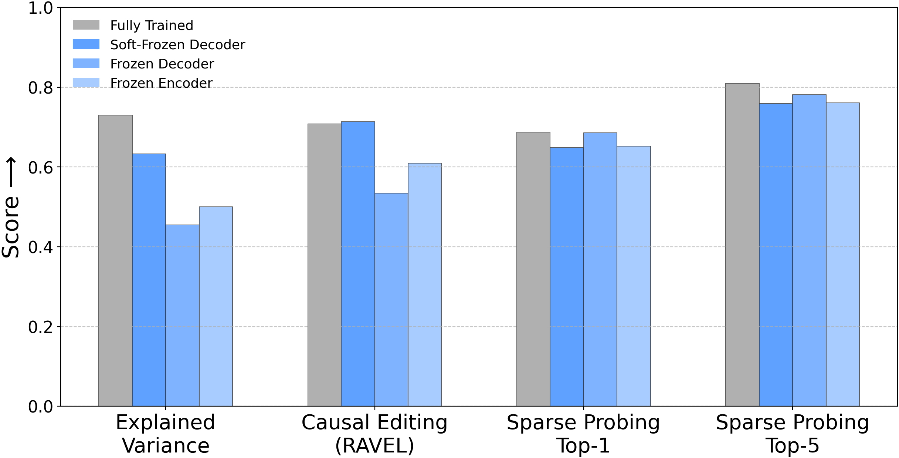

 Figure 10: Frozen baseline performance for TopK SAE (L0=160) on Gemma-2-2B layer 12.

## Appendix D The Soft-Frozen Decoder: Testing the Lazy Training Hypothesis

The Soft-Frozen Decoder baseline directly tests whether SAEs operate in what we term a lazy training regime ([Chizat et al., 2019](https://arxiv.org/html/2602.14111v1#bib.bib10); [Kumar et al., 2024](https://arxiv.org/html/2602.14111v1#bib.bib28)). Under this hypothesis, SAEs achieve strong reconstruction performance primarily through vanishingly small adjustments to both encoder and decoder vectors that remain semantically close to their random initializations without discovering fundamentally new feature directions. This baseline constrains decoder vectors to maintain at least \(\tau\) = 0.8 cosine similarity with their initial random directions throughout training. Below, we present empirical observations and theoretical analysis that motivate this baseline and reveal its implications.

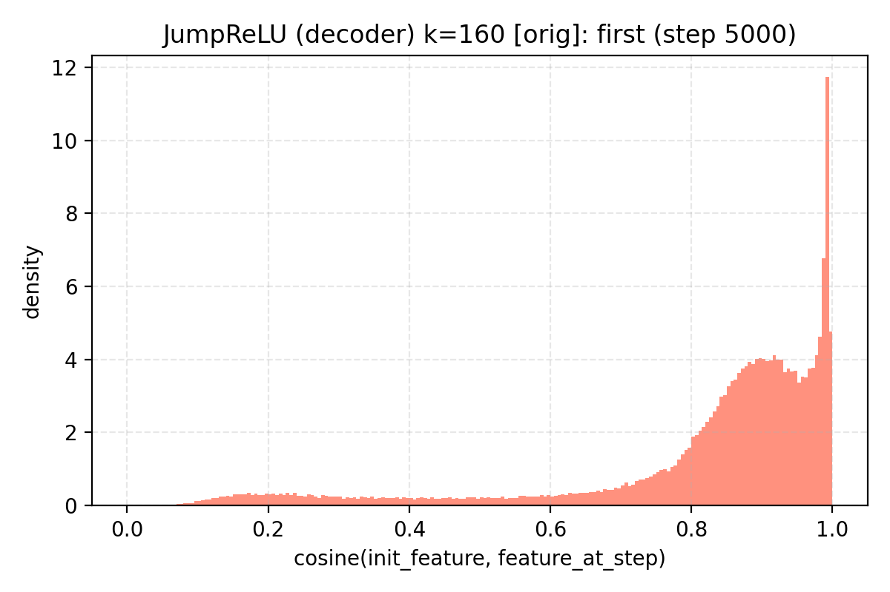

 

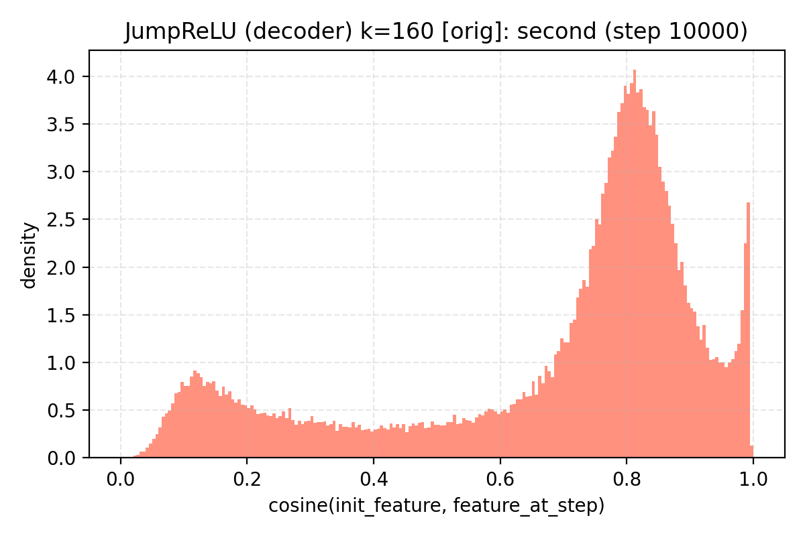

 

Figure 11: Decoder vectors remain near random initialization throughout training. Histograms of cosine similarity between decoder vectors at initialization and after 5% (left) and 10% (right) of training steps for a JumpReLU SAE. The strong concentration near 1.0 indicates minimal directional change even after reconstruction performance has plateaued, supporting the lazy training hypothesis and motivating the Soft-Frozen Decoder baseline.

#### Empirical Motivation: Early Convergence with Minimal Directional Change

During training of a JumpReLU SAE (L0=160), we observed that the loss and explained variance plateaued early, while the decoder vectors remained close to their initial random directions. After just 5% of total training steps, when loss and Explained Variance had plateaued at 0.80 (versus a final value of 0.86), the majority of decoder vectors showed minimal directional deviation from initialization (Figure [11](https://arxiv.org/html/2602.14111v1#A4.F11 "Figure 11 ‣ Appendix D The Soft-Frozen Decoder: Testing the Lazy Training Hypothesis ‣ Sanity Checks for Sparse Autoencoders: Do SAEs Beat Random Baselines?"), left). This pattern persisted at 10% training (Explained Variance = 0.82), with cosine similarities still concentrated near 0.8 (Figure [11](https://arxiv.org/html/2602.14111v1#A4.F11 "Figure 11 ‣ Appendix D The Soft-Frozen Decoder: Testing the Lazy Training Hypothesis ‣ Sanity Checks for Sparse Autoencoders: Do SAEs Beat Random Baselines?"), right). These observations suggest SAEs achieve most reconstruction gains through vanishingly small adjustments to both encoder and decoder vectors rather than discovering new directional representations. Motivated by this finding and the theoretical analysis below, we set \(\tau=0.8\) for the Soft-Frozen Decoder baseline, selecting a threshold that permits very limited directional adjustment while remaining consistent with the observed training dynamics.

#### Theoretical Analysis: The Vanishing Probability of Feature Alignment

The Soft-Frozen Decoder baseline initializes decoder vectors \(\mathbf{W}^{\text{dec}}_{i}\) uniformly from the unit sphere \(S^{n-1}\) and constrains them to maintain cosine similarity \(\tau=0.8\) with their initial values \(\widehat{\mathbf{W}^{\text{dec}}_{i}}\). For the SAE to represent a specific ground-truth feature (e.g., “there is a knight on F3” in a chess model ([Karvonen et al., 2024](https://arxiv.org/html/2602.14111v1#bib.bib25))), at least one decoder vector must align closely with that feature’s true direction.

Formally, the constraint confines each decoder vector to a spherical cap around its random initialization. The set of expressible directions is:

\[\begin{aligned}
 & X:=\{\mathbf{x}\in S^{n-1}\mid\exists i\in[m]\text{ such that }\langle\mathbf{x},\widehat{\mathbf{W}}^{\text{dec}}_{i}\rangle\geq\tau\}. &  & \text{(7)}
\end{aligned}\]

 

For an arbitrary ground-truth feature direction \(\mathbf{Y}\in S^{n-1}\), the probability it lies within \(X\) is bounded by:

\[\begin{aligned}
 & P(\mathbf{Y}\in X)\leq m\cdot P(\langle\mathbf{Y},\widehat{\mathbf{W}}^{\text{dec}}_{0}\rangle\geq\tau). &  & \text{(8)}
\end{aligned}\]

 

The probability that a random unit vector falls within a spherical cap of cosine similarity \(t\) decays exponentially with dimension \(n\) ([Tkocz, 2012](https://arxiv.org/html/2602.14111v1#bib.bib45)). With our experimental parameters (\(\tau=0.8\), \(n=2304\), \(m=73728\)):

\[\begin{aligned}
 & \displaystyle P(\langle\mathbf{Y},\widehat{\mathbf{W}}^{\text{dec}}_{0}\rangle\geq\tau) & \displaystyle\leq\exp\left(-\frac{n\tau^{2}}{2}\right)\approx 6.36\times 10^{-321}, &  & \text{(9)} \\
 & \displaystyle P(\mathbf{Y}\in X) & \displaystyle\leq 4.67\times 10^{-316}. &  & \text{(10)}
\end{aligned}\]

 

Thus, the Soft-Frozen Decoder is mathematically unlikely to align with arbitrary semantic features beyond chance initialization. Its strong performance must therefore arise from efficiently combining its nearly-fixed, random directions through vanishingly small adjustments to both encoder and decoder vectors. This provides formal evidence that standard SAE metrics can be optimized without learning meaningful feature directions, challenging the assumption that reconstruction fidelity indicates successful feature discovery.

#### Discussion

The competitive performance of Soft-Frozen Decoder SAEs across multiple evaluation dimensions (Figure [1](https://arxiv.org/html/2602.14111v1#S1.F1 "Figure 1 ‣ 1 Introduction ‣ Sanity Checks for Sparse Autoencoders: Do SAEs Beat Random Baselines?")) provides strong support for the lazy training hypothesis: much of what we attribute to learned feature discovery may instead reflect efficient use of nearly-fixed, randomly initialized components with only minimal adjustments. This success challenges the premise that SAEs learn meaningful feature decompositions through training, and underscores the importance of rigorous validation against constrained baselines in interpretability research.

## Appendix E Frozen Models Ablation

We provide an ablation study comparing fully-trained SAEs against our frozen baselines under two initialization schemes: iso (vectors sampled uniformly from the unit sphere) and cov (vectors sampled from a Gaussian distribution with zero mean and covariance estimated from real activations, then normalized). Tables [2](https://arxiv.org/html/2602.14111v1#A7.T2 "Table 2 ‣ Appendix G Random SAEs on CLIP ‣ Sanity Checks for Sparse Autoencoders: Do SAEs Beat Random Baselines?"), [3](https://arxiv.org/html/2602.14111v1#A7.T3 "Table 3 ‣ Appendix G Random SAEs on CLIP ‣ Sanity Checks for Sparse Autoencoders: Do SAEs Beat Random Baselines?"), and [4](https://arxiv.org/html/2602.14111v1#A7.T4 "Table 4 ‣ Appendix G Random SAEs on CLIP ‣ Sanity Checks for Sparse Autoencoders: Do SAEs Beat Random Baselines?") report key metrics (mean \(\pm\) standard deviation) at L0=160 for Gemma-2-2B layers 12 and 19, and Llama-3-8B layer 16. The experiments in the preceding sections use the best-performing initialization for each baseline: cov for Frozen Decoder and iso for Soft-Frozen Decoder and Frozen Encoder. These results confirm that the competitive performance of frozen baselines is consistent across layers and model families.

## Appendix F Additional Metrics

To complement our primary evaluation metrics, we assess SAEs and frozen baselines using additional performance measures following the SAEBench framework ([Karvonen et al., 2025](https://arxiv.org/html/2602.14111v1#bib.bib26)), which evaluates cross-entropy loss and KL-divergence when substituting original activations with SAE reconstructions. As shown in Figures [12](https://arxiv.org/html/2602.14111v1#A7.F12 "Figure 12 ‣ Appendix G Random SAEs on CLIP ‣ Sanity Checks for Sparse Autoencoders: Do SAEs Beat Random Baselines?") and [13](https://arxiv.org/html/2602.14111v1#A7.F13 "Figure 13 ‣ Appendix G Random SAEs on CLIP ‣ Sanity Checks for Sparse Autoencoders: Do SAEs Beat Random Baselines?"), Frozen Decoder and Frozen Encoder baselines show modest degradation in these metrics compared to fully-trained SAEs. In contrast, the Soft-Frozen Decoder variant closely matches, and sometimes exceeds, the performance of fully-trained ReLU SAEs, demonstrating that even minimal adjustments to decoder vectors can achieve strong reconstruction quality. However, when moving from single-latent to multi-latent sparse probing (top-5, Figure [14](https://arxiv.org/html/2602.14111v1#A7.F14 "Figure 14 ‣ Appendix G Random SAEs on CLIP ‣ Sanity Checks for Sparse Autoencoders: Do SAEs Beat Random Baselines?")), all frozen baselines show more pronounced gaps compared to fully-trained SAEs, suggesting that while they can approximate overall model behavior, they are less effective at aggregating complementary features across multiple latents than learned representations.

## Appendix G Random SAEs on CLIP

To validate our findings from language models, we conduct a parallel analysis on vision models by comparing trained and randomly initialized SAEs on CLIP ViT-B/32 ([Radford et al., 2021](https://arxiv.org/html/2602.14111v1#bib.bib37)). We use pretrained SAEs ([Joseph et al., 2025](https://arxiv.org/html/2602.14111v1#bib.bib23)) from layers 3, 5, 7, and 9 and create matched random baselines with identical architectures but Kaiming-initialized weights. For each SAE, we select features with rare (\(<0.1\%\)) activation frequency, then visualize images from ImageNet-10k ([Deng et al., 2009](https://arxiv.org/html/2602.14111v1#bib.bib11)) at different activation percentiles (100th, 75th, 50th, 25th) for each feature. This percentile-based visualization reveals whether features capture coherent semantic concepts. We present these visualisations Figures [15](https://arxiv.org/html/2602.14111v1#A7.F15 "Figure 15 ‣ Appendix G Random SAEs on CLIP ‣ Sanity Checks for Sparse Autoencoders: Do SAEs Beat Random Baselines?"), [16](https://arxiv.org/html/2602.14111v1#A7.F16 "Figure 16 ‣ Appendix G Random SAEs on CLIP ‣ Sanity Checks for Sparse Autoencoders: Do SAEs Beat Random Baselines?"), [17](https://arxiv.org/html/2602.14111v1#A7.F17 "Figure 17 ‣ Appendix G Random SAEs on CLIP ‣ Sanity Checks for Sparse Autoencoders: Do SAEs Beat Random Baselines?") and [18](https://arxiv.org/html/2602.14111v1#A7.F18 "Figure 18 ‣ Appendix G Random SAEs on CLIP ‣ Sanity Checks for Sparse Autoencoders: Do SAEs Beat Random Baselines?")

Table 2: Frozen SAEs performance on Gemma-2-2B layer 12 L0=160. 

Variant | Explained Variance | Sparse Probing (top-1) | Sparse Probing (top-5) | Causal Editing  
---|---|---|---|---  
BatchTopK: |  |  |  |   
Fully-Trained (iso) | 0.852 \(\pm\) 0.001 | 0.721 \(\pm\) 0.026 | 0.849 \(\pm\) 0.025 | 0.720 \(\pm\) 0.049  
Frozen Decoder (iso) | 0.430 \(\pm\) 0.000 | 0.669 \(\pm\) 0.010 | 0.768 \(\pm\) 0.013 | 0.562 \(\pm\) 0.027  
Frozen Decoder (cov) | 0.570 \(\pm\) 0.004 | 0.692 \(\pm\) 0.014 | 0.797 \(\pm\) 0.014 | 0.554 \(\pm\) 0.028  
Soft-Frozen Decoder (iso) | 0.785 \(\pm\) 0.001 | 0.659 \(\pm\) 0.035 | 0.723 \(\pm\) 0.031 | 0.728 \(\pm\) 0.038  
Frozen Encoder (iso) | 0.475 \(\pm\) 0.004 | 0.638 \(\pm\) 0.013 | 0.731 \(\pm\) 0.013 | 0.641 \(\pm\) 0.027  
Frozen Encoder (cov) | 0.112 \(\pm\) 0.004 | 0.609 \(\pm\) 0.010 | 0.682 \(\pm\) 0.008 | 0.400 \(\pm\) 0.039  
\(\Delta\) Best Frozen \(-\) Fully-Trained | -7.8% | -4.0% | -6.0% | +1.0%  
JumpReLU: |  |  |  |   
Fully-Trained (iso) | 0.852 \(\pm\) 0.001 | 0.704 \(\pm\) 0.031 | 0.843 \(\pm\) 0.027 | 0.722 \(\pm\) 0.046  
Frozen Decoder (iso) | 0.457 \(\pm\) 0.003 | 0.702 \(\pm\) 0.009 | 0.771 \(\pm\) 0.012 | 0.591 \(\pm\) 0.027  
Frozen Decoder (cov) | 0.578 \(\pm\) 0.003 | 0.694 \(\pm\) 0.015 | 0.790 \(\pm\) 0.011 | 0.551 \(\pm\) 0.030  
Soft-Frozen Decoder (iso) | 0.789 \(\pm\) 0.000 | 0.672 \(\pm\) 0.036 | 0.735 \(\pm\) 0.036 | 0.739 \(\pm\) 0.038  
Frozen Encoder (iso) | 0.609 \(\pm\) 0.003 | 0.635 \(\pm\) 0.010 | 0.747 \(\pm\) 0.012 | 0.623 \(\pm\) 0.024  
Frozen Encoder (cov) | -0.017 \(\pm\) 0.076 | 0.652 \(\pm\) 0.015 | 0.720 \(\pm\) 0.017 | 0.423 \(\pm\) 0.043  
\(\Delta\) Best Frozen \(-\) Fully-Trained | -7.3% | -0.2% | -6.2% | +2.3%

  Table 3: Frozen SAEs performance on Gemma-2-2B layer 19 L0=160. 

Variant | Explained Variance | Sparse Probing (top-1) | Sparse Probing (top-5) | Causal Editing  
---|---|---|---|---  
BatchTopK: |  |  |  |   
Fully-Trained (iso) | 0.887 \(\pm\) 0.000 | 0.806 \(\pm\) 0.032 | 0.900 \(\pm\) 0.016 | 0.512 \(\pm\) 0.011  
Frozen Decoder (iso) | 0.404 \(\pm\) 0.001 | 0.709 \(\pm\) 0.019 | 0.829 \(\pm\) 0.020 | 0.492 \(\pm\) 0.002  
Frozen Decoder (cov) | 0.555 \(\pm\) 0.001 | 0.730 \(\pm\) 0.020 | 0.818 \(\pm\) 0.020 | 0.493 \(\pm\) 0.002  
Soft-Frozen Decoder (iso) | 0.812 \(\pm\) 0.001 | 0.758 \(\pm\) 0.037 | 0.823 \(\pm\) 0.031 | 0.509 \(\pm\) 0.010  
Frozen Encoder (iso) | 0.562 \(\pm\) 0.000 | 0.722 \(\pm\) 0.026 | 0.812 \(\pm\) 0.025 | 0.492 \(\pm\) 0.002  
Frozen Encoder (cov) | 0.523 \(\pm\) 0.001 | 0.638 \(\pm\) 0.014 | 0.791 \(\pm\) 0.020 | 0.491 \(\pm\) 0.002  
\(\Delta\) Best Frozen \(-\) Fully-Trained | -8.4% | -6.0% | -7.9% | -0.5%  
JumpReLU: |  |  |  |   
Fully-Trained (iso) | 0.887 \(\pm\) 0.000 | 0.813 \(\pm\) 0.028 | 0.900 \(\pm\) 0.016 | 0.511 \(\pm\) 0.012  
Frozen Decoder (iso) | 0.432 \(\pm\) 0.001 | 0.727 \(\pm\) 0.017 | 0.824 \(\pm\) 0.022 | 0.493 \(\pm\) 0.002  
Frozen Decoder (cov) | 0.543 \(\pm\) 0.000 | 0.727 \(\pm\) 0.019 | 0.825 \(\pm\) 0.019 | 0.493 \(\pm\) 0.002  
Soft-Frozen Decoder (iso) | 0.816 \(\pm\) 0.000 | 0.736 \(\pm\) 0.042 | 0.858 \(\pm\) 0.026 | 0.509 \(\pm\) 0.009  
Frozen Encoder (iso) | 0.590 \(\pm\) 0.001 | 0.701 \(\pm\) 0.016 | 0.795 \(\pm\) 0.020 | 0.494 \(\pm\) 0.002  
Frozen Encoder (cov) | 0.512 \(\pm\) 0.001 | 0.650 \(\pm\) 0.014 | 0.737 \(\pm\) 0.019 | 0.492 \(\pm\) 0.002  
\(\Delta\) Best Frozen \(-\) Fully-Trained | -7.9% | -9.5% | -4.7% | -0.4%

  Table 4: Frozen SAEs performance on Llama-3-8B layer 16 L0=160. 

Variant | Explained Variance | Sparse Probing (top-1) | Sparse Probing (top-5) | Causal Editing  
---|---|---|---|---  
BatchTopK: |  |  |  |   
Fully-Trained (iso) | 0.805 \(\pm\) 0.000 | 0.766 \(\pm\) 0.039 | 0.874 \(\pm\) 0.022 | 0.533 \(\pm\) 0.015  
Frozen Decoder (iso) | 0.268 \(\pm\) 0.001 | 0.709 \(\pm\) 0.012 | 0.779 \(\pm\) 0.019 | 0.486 \(\pm\) 0.004  
Frozen Decoder (cov) | 0.426 \(\pm\) 0.001 | 0.689 \(\pm\) 0.014 | 0.771 \(\pm\) 0.016 | 0.491 \(\pm\) 0.005  
Soft-Frozen Decoder (iso) | 0.699 \(\pm\) 0.000 | 0.752 \(\pm\) 0.046 | 0.848 \(\pm\) 0.030 | 0.519 \(\pm\) 0.009  
Frozen Encoder (iso) | 0.424 \(\pm\) 0.001 | 0.713 \(\pm\) 0.010 | 0.798 \(\pm\) 0.012 | 0.492 \(\pm\) 0.005  
Frozen Encoder (cov) | 0.408 \(\pm\) 0.000 | 0.681 \(\pm\) 0.013 | 0.763 \(\pm\) 0.017 | 0.482 \(\pm\) 0.005  
\(\Delta\) Best Frozen \(-\) Fully-Trained | -13.1% | -1.9% | -3.0% | -2.7%  
JumpReLU: |  |  |  |   
Fully-Trained (iso) | 0.805 \(\pm\) 0.000 | 0.798 \(\pm\) 0.034 | 0.882 \(\pm\) 0.024 | 0.527 \(\pm\) 0.012  
Frozen Decoder (iso) | 0.291 \(\pm\) 0.000 | 0.685 \(\pm\) 0.011 | 0.771 \(\pm\) 0.015 | 0.485 \(\pm\) 0.003  
Frozen Decoder (cov) | 0.000 \(\pm\) 0.000 | 0.500 \(\pm\) 0.000 | 0.500 \(\pm\) 0.000 | 0.485 \(\pm\) 0.003  
Soft-Frozen Decoder (iso) | 0.707 \(\pm\) 0.001 | 0.768 \(\pm\) 0.040 | 0.842 \(\pm\) 0.034 | 0.521 \(\pm\) 0.012  
Frozen Encoder (iso) | 0.473 \(\pm\) 0.001 | 0.682 \(\pm\) 0.014 | 0.766 \(\pm\) 0.011 | 0.498 \(\pm\) 0.007  
Frozen Encoder (cov) | 0.414 \(\pm\) 0.001 | 0.620 \(\pm\) 0.015 | 0.751 \(\pm\) 0.009 | 0.489 \(\pm\) 0.006  
\(\Delta\) Best Frozen \(-\) Fully-Trained | -12.1% | -3.9% | -4.5% | -1.1%

 

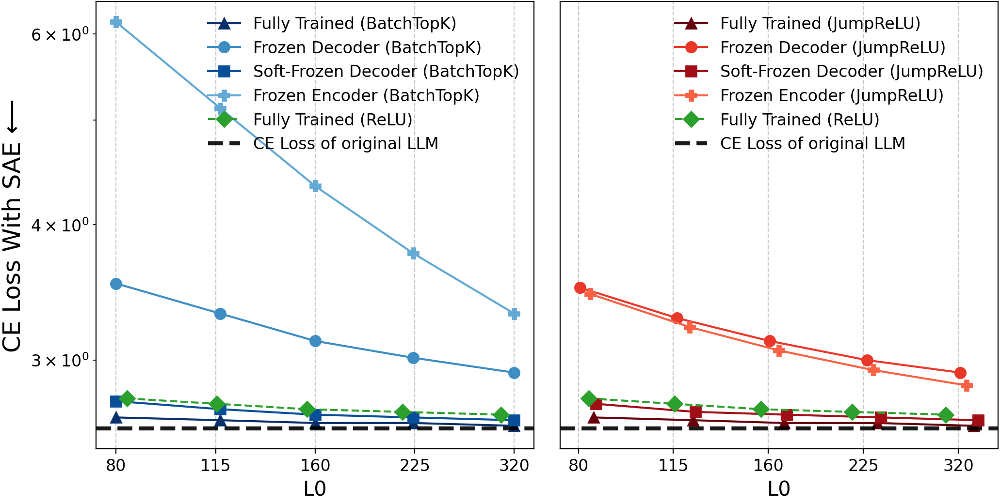

 Figure 12: Cross-entropy loss comparison. Frozen baselines match fully-trained SAEs, showing reconstruction metrics alone don’t guarantee feature learning. 

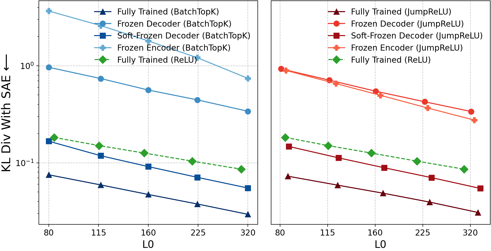

 Figure 13: KL-divergence comparison. Frozen and fully-trained SAEs produce similar KL-divergence, indicating comparable model behavior without meaningful feature learning. 

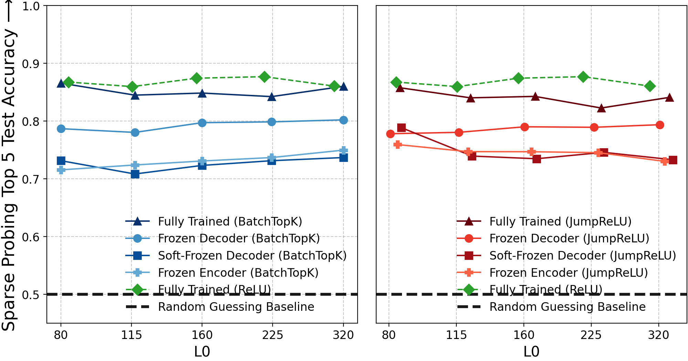

 Figure 14: Sparse probing accuracy (top-5). Frozen baselines show larger gaps vs. fully-trained SAEs, suggesting learned representations better aggregate multiple features.

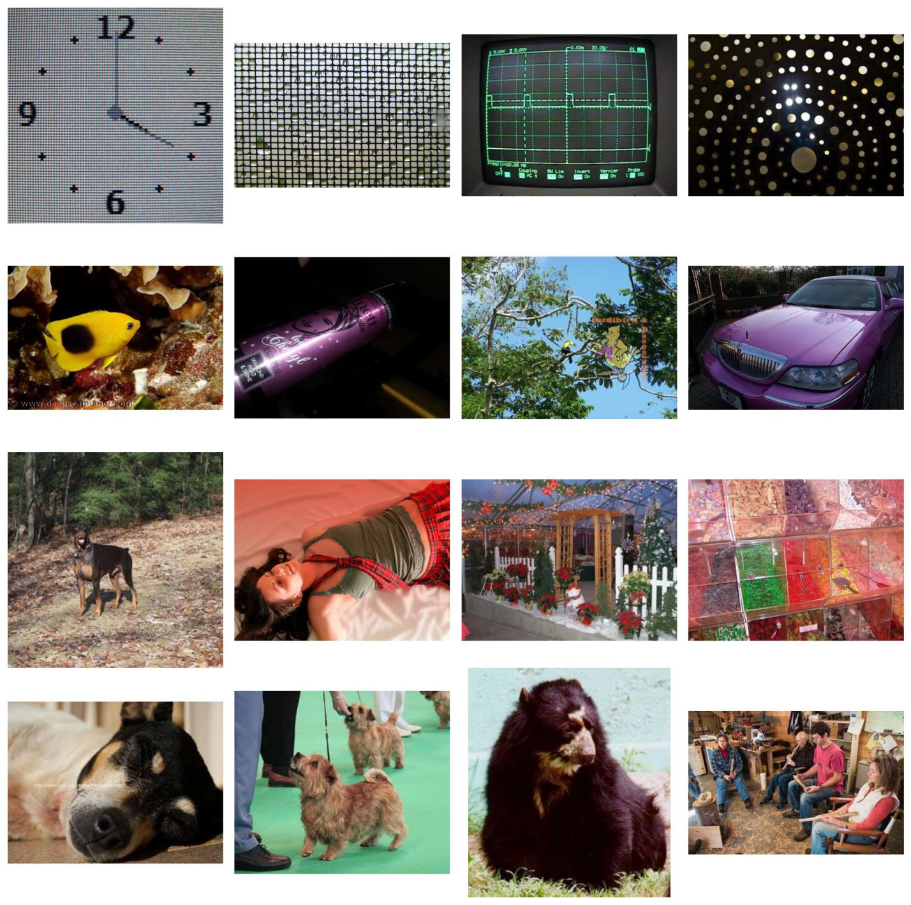

 (a) Random

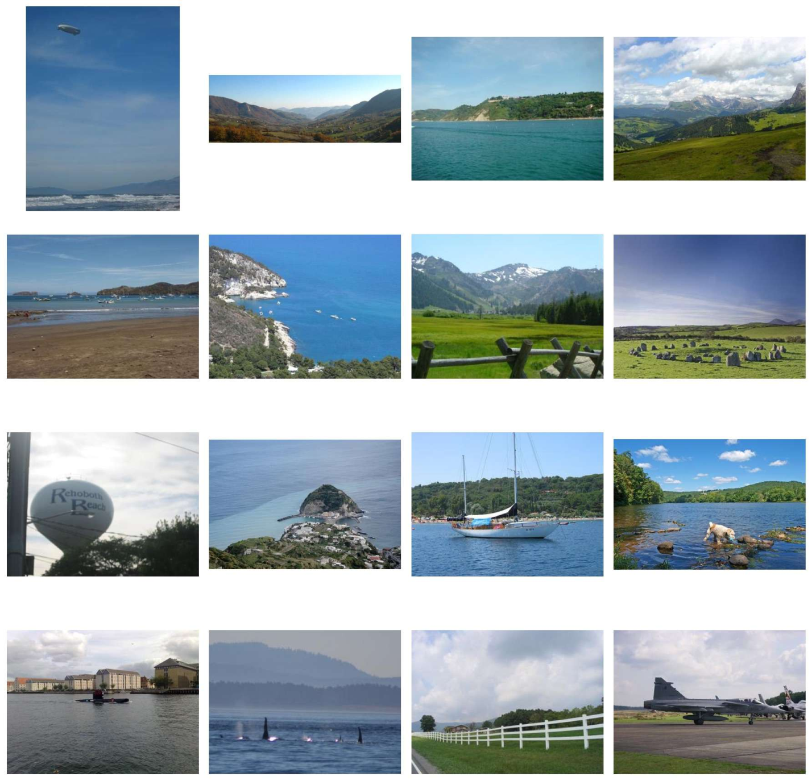

 (b) Trained

Figure 15: Comparison of Random vs. Trained SAE Features on CLIP ViT-B/32 (Layer 3).

 (a) Random

 (b) Trained

Figure 16: Comparison of Random vs. Trained SAE Features on CLIP ViT-B/32 (Layer 5).

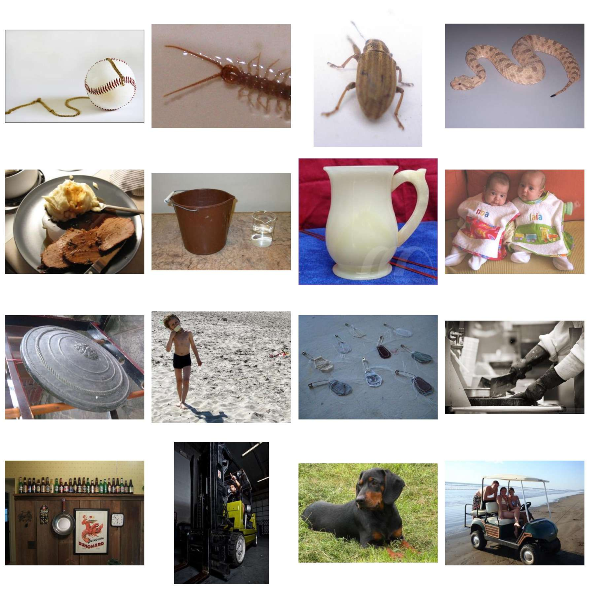

 (a) Random

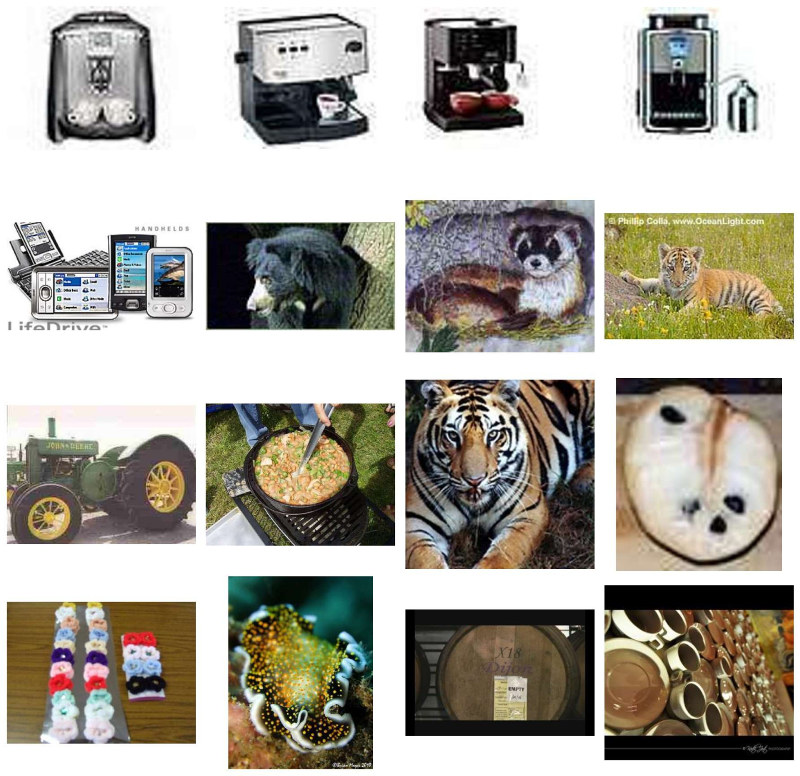

 (b) Trained

Figure 17: Comparison of Random vs. Trained SAE Features on CLIP ViT-B/32 (Layer 7).

 (a) Random

 (b) Trained

Figure 18: Comparison of Random vs. Trained SAE Features on CLIP ViT-B/32 (Layer 9).
