**Source:** *Is This the Subspace You Are Looking for? An Interpretability Illusion for Subspace Activation Patching* — [PDF](https://arxiv.org/pdf/2311.17030) · [arXiv](https://arxiv.org/abs/2311.17030)

## Is This the Subspace You Are Looking for? An Interpretability Illusion for Subspace Activation Patching

Aleksandar Makelov\* Georg Lange\* aleksandar.makelov@gmail.com mail@georglange.com SERI MATS SERI MATS

Neel Nanda neelnanda27@gmail.com

#### **Abstract**

Mechanistic interpretability aims to understand model behaviors in terms of specific, interpretable features, often hypothesized to manifest as low-dimensional subspaces of activations. Specifically, recent studies have explored subspace interventions (such as activation patching) as a way to simultaneously manipulate model behavior and attribute the features behind it to given subspaces.

In this work, we demonstrate that these two aims diverge, potentially leading to an illusory sense of interpretability. Counterintuitively, even if a subspace intervention makes the model's output behave *as if* the value of a feature was changed, this effect may be achieved by activating a *dormant parallel pathway* leveraging another subspace that is *causally disconnected* from model outputs. We demonstrate this phenomenon in a distilled mathematical example, in two realworld domains (the indirect object identification task and factual recall), and present evidence for its prevalence in practice. In the context of factual recall, we further show a link to rank-1 fact editing, providing a mechanistic explanation for previous work observing an inconsistency between fact editing performance and fact localization.

However, this does not imply that activation patching of subspaces is intrinsically unfit for interpretability. To contextualize our findings, we also show what a success case looks like in a task (indirect object identification) where prior manual circuit analysis informs an understanding of the location of a feature. We explore the additional evidence needed to argue that a patched subspace is faithful.

## **1 Introduction**

Recently, large language models (LLMs) have demonstrated impressive [\(Vaswani et al.,](#page-31-0) [2017;](#page-31-0) [Devlin et al.,](#page-27-0) [2019;](#page-27-0) [OpenAI,](#page-30-0) [2023;](#page-30-0) [Radford et al.,](#page-30-1) [2019;](#page-30-1) [Brown et al.,](#page-27-1) [2020\)](#page-27-1), and often surprising [\(Wei et al.,](#page-31-1) [2022\)](#page-31-1), capability gains. However, they are still widely considered 'black boxes': their successes – and failures – remain largely a mystery. It is thus an increasingly pressing scientific and practical question to understand *what* LLMs learn and *how* they make predictions.

This is the goal of machine learning interpretability, a broad field that presents us with both technical and conceptual challenges [\(Lipton,](#page-29-0) [2016\)](#page-29-0). Within it, mechanistic interpretability (MI) is a subfield that seeks to develop a rigorous low-level understanding of the mechanisms and

\*Equal Contribution.

learned algorithms behind a model's computations. MI frames these computations as collections of narrow, task-specific algorithms – *circuits* [\(Olah et al.,](#page-30-2) [2020;](#page-30-2) [Geiger et al.,](#page-28-0) [2021;](#page-28-0) [Wang et al.,](#page-31-2) [2023\)](#page-31-2) – whose operations are grounded in concrete, atomic building blocks akin to variables in a computer program [\(Olah,](#page-30-3) [2022\)](#page-30-3) or causal model [\(Vig et al.,](#page-31-3) [2020;](#page-31-3) [Geiger et al.,](#page-28-1) [2023a\)](#page-28-1). MI has found applications in several downstream tasks: removing toxic behaviors from a model while otherwise preserving performance by minimally editing model weights [\(Li et al.,](#page-29-1) [2023b\)](#page-29-1), changing factual knowledge encoded by models in specific components to e.g. enable more efficient fine-tuning in a changing world [\(Meng et al.,](#page-29-2) [2022a\)](#page-29-2), improving the truthfulness of LLMs at inference time via efficient, localized inference-time interventions in specific subspaces [\(Li et al.,](#page-29-3) [2023a\)](#page-29-3) and studying the mechanics of gender bias in language models [\(Vig et al.,](#page-31-3) [2020\)](#page-31-3).

A central question in MI is: what *is* the proper definition of these building blocks? Any satisfying mechanistic analysis of high-level LLM capabilities must rest on a rigorous and comprehensive answer to this question [\(Olah,](#page-30-3) [2022\)](#page-30-3). Many initial mechanistic analyses have focused on mapping circuits to collections of *model components* [\(Wang et al.,](#page-31-2) [2023;](#page-31-2) [Heimersheim & Janiak\)](#page-29-4), such as attention heads and MLP layers. A workhorse of these analyses is *activation patching*[1](#page-1-0) [\(Vig et al.,](#page-31-3) [2020;](#page-31-3) [Geiger et al.,](#page-28-2) [2020;](#page-28-2) [Meng et al.,](#page-29-2) [2022a;](#page-29-2) [Wang et al.,](#page-31-2) [2023\)](#page-31-2), which intervenes on model computation on an input by replacing the activation of a given component with its value when the model is run on another input. By seeing which components lead to a significant task-relevant change in outputs compared to running the model normally, activation patching aims to pinpoint tasks to specific components.

However, localizing features to entire components is not sufficient for a detailed understanding. A plethora of empirical evidence suggests that the features LLMs represent and use are more accurately captured by *linear subspaces* of component activations [\(Nanda,](#page-30-4) [2023a;](#page-30-4) [Li et al.,](#page-29-5) [2021;](#page-29-5) [Abdou et al.,](#page-26-0) [2021;](#page-26-0) [Grand et al.,](#page-28-3) [2018\)](#page-28-3). Complicating matters, phenomena like superposition and polysemanticity [\(Elhage et al.,](#page-28-4) [2022\)](#page-28-4) suggest that these subspaces are not easily enumerable, like individual neurons – so searching for them can be non-trivial. This raises the question:

*Does the success of activation patching carry over from component-level analysis to finding the precise subspaces corresponding to features?*

In this paper, we demonstrate that naive generalizations of subspace activation patching can lead to misleading interpretability results. Specifically, we argue empirically and theoretically that a subspace seemingly encoding some feature may be found in the MLP layers on the path between two model components in a transformer model that communicate this feature as part of some circuit.

As a concrete example of how this illusion can happen in the practice of interpretability, recent works such as [Geiger et al.](#page-28-5) [\(2023b\)](#page-28-5); [Wu et al.](#page-31-4) [\(2023\)](#page-31-4) have sought to identify interpretable subspaces using gradient descent, with training objectives that optimize for a subspace patch with a causal effect on model predictions. While this kind of end-to-end optimization has promise, we show that, instead of localizing a variable used by the model, subspace interventions such as subspace activation patching can create such a variable by *activating a dormant pathway*.

Counterintuitively, the mathematics of subspace interventions makes it possible to activate another, 'dormant', direction, which is ordinarily inactive, but can change model outputs when activated (see Figure [1\)](#page-2-0), by exploiting the variation of model activations in a direction correlated with a feature even if this second direction does not causally affect the output. An equivalent view of this phenomenon that we explore in Appendix [A.3](#page-34-0) is that the component contains two subspaces

1also known as 'interchange intervention' [\(Geiger et al.,](#page-28-2) [2020\)](#page-28-2) and sometimes referred to as 'resample ablation' [\(Chan](#page-27-2) [et al.,](#page-27-2) [2022\)](#page-27-2) or 'causal tracing' [\(Meng et al.,](#page-29-2) [2022a\)](#page-29-2).

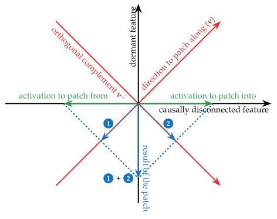

Figure 1: The key mathematical phenomenon behind the activation patching illusion illustrated for a 2-dimensional activation space. We intervene on an example's activation (green, right) by setting its orthogonal projection on a 1-dimensional subspace  ${\bf v}$  of activation space (red, top-right) to equal the orthogonal projection of another example's activation (green, left) on  ${\bf v}$ . The result is a patched activation vector orthogonal to both activations. Specifically, to form the patched activation we take the  ${\bf v}$  component (①) of the activation we are patching from, and combine it with the  ${\bf v}^\perp$  component (②) of the original activation. This results in the patched activation ① +②. This can lead to counterintuitive results when the original and new directions have fundamentally different roles in a model's computation; see Section 3 for details, and Figure 14 for a step-by-step guide through this figure.

that mediate the variable, but whose effects normally cancel each other out (hence, there's no total effect, making the component as a whole appear 'dormant'). The activation patching intervention decouples these two subspaces by altering an activation only along one of them. Under this perspective, our contribution is to show that model components are likely to contain such pairs of subspaces that perfectly cancel out. When this phenomenon is realized in the hidden activations of an MLP layer, it leads to causally meaningful subspaces which have a substantial and crucial component that is causally disconnected from model outputs, owing to the high-dimensional kernel of an MLP layer's down-projection in a transformer (see Figure [3\)](#page-11-0).

While it is, in principle, possible that subspaces that represent some variable but cancel each other out exist in many model components, we find this unlikely. Specifically, our results suggest that every MLP layer between two components communicating some feature through residual connections is likely to contain a subspace which appears to mediate the feature when activation patched. We find this implausible on various grounds that we revisit in Section [8.](#page-24-0) Thus, we consider at least some of these subspaces to exhibit a kind of *interpretability illusion* [\(Bolukbasi et al.,](#page-27-3) [2021;](#page-27-3) [Adebayo et al.,](#page-26-1) [2018\)](#page-26-1).

Our contributions can be summarized as follows:

- In Section [3,](#page-5-0) we provide the key intuition for the illusion, and construct a distilled mathematical example.
- In Section [4,](#page-10-0) we find a realization of this phenomenon 'in the wild', in the context of the indirect object identification task [\(Wang et al.,](#page-31-2) [2023\)](#page-31-2), where a 1-dimensional subspace of MLP activations found using DAS [\(Geiger et al.,](#page-28-5) [2023b\)](#page-28-5) can seem to encode position information about names in the sentence, despite this MLP layer having negligible contribution to the circuit as argued by [Wang et al.](#page-31-2) [\(2023\)](#page-31-2).
- To contextualize our results, in Section [5](#page-16-0) we also show how DAS can be used to find subspaces that faithfully represent a feature in a model's computation. Specifically, we find a 1-dimensional subspace encoding the same position information in the IOI task, and validate its role in model computations via mechanistic experiments beyond end-to-end causal effect. We argue that activation patching on subspaces of the residual stream is less prone to illusions.
- Going beyond the IOI task, in Section [6](#page-17-0) we also exhibit this phenomenon in the setting of *fact editing* [\(Meng et al.,](#page-29-2) [2022a\)](#page-29-2). We show that 1-dimensional activation patches imply approximately equivalent rank-1 model edits [\(Meng et al.,](#page-29-2) [2022a\)](#page-29-2). In particular, this shows that rank-1 model edits can also be achieved by activating a dormant pathway in the model, without necessarily relying on the presence of a fact in the weight being edited. This suggests a mechanistic explanation for the observation of [\(Hase et al.,](#page-29-6) [2023\)](#page-29-6) that rank-1 model editing 'works' regardless of whether the fact is present in the weights being edited.
- In Section [7,](#page-23-0) we collect arguments and evidence for why this interpretability illusion ought to be prevalent in real-world language models.
- Finally, in Section [8,](#page-24-0) we provide conceptual discussion of these findings.

We have also released code to reproduce our findings[2](#page-3-0) .

2<https://github.com/amakelov/activation-patching-illusion>

## **2 Related Work**

#### **2.1 Discovering and Causally Intervening on Representations with Activation Patching**

Researchers have been exploring increasingly fine-grained ways of reverse-engineering and steering model behavior. In this context, *activation patching* [\(Vig et al.,](#page-31-3) [2020;](#page-31-3) [Geiger et al.,](#page-28-2) [2020\)](#page-28-2) is a widely used causal intervention, whereby the model is run on an input A, but chosen activations are 'patched in' from input B. Motivated by causal mediation analysis [\(Pearl,](#page-30-5) [2001\)](#page-30-5) and causal abstraction [Geiger et al.](#page-28-1) [\(2023a\)](#page-28-1), activation patching has been used to localize model components causally involved in various behaviors, such as gender bias [\(Vig et al.\)](#page-31-5), factual recall [\(Meng et al.,](#page-29-2) [2022a\)](#page-29-2), multiple choice questions [\(Lieberum et al.,](#page-29-7) [2023\)](#page-29-7), arithmetic [\(Stolfo et al.,](#page-30-6) [2023\)](#page-30-6) and natural language reasoning [\(Geiger et al.,](#page-28-0) [2021;](#page-28-0) [Wang et al.,](#page-31-2) [2023;](#page-31-2) [Geiger et al.,](#page-28-5) [2023b;](#page-28-5) [Wu et al.,](#page-31-4) [2023\)](#page-31-4), code [\(Heimersheim & Janiak\)](#page-29-4), and (in certain regimes) topic/sentiment/style of free-form natural language [\(Turner et al.,](#page-31-6) [2023\)](#page-31-6).

Activation patching is an area of active research, and many recent works have extended the method, with patching paths between components [\(Goldowsky-Dill et al.,](#page-28-6) [2023\)](#page-28-6), automating the finding of sparse subgraphs [\(Conmy et al.,](#page-27-4) [2023\)](#page-27-4), fast approximations [\(Nanda,](#page-30-7) [2023b\)](#page-30-7), and automating the verification of hypotheses [\(Chan et al.,](#page-27-2) [2022\)](#page-27-2).

In particular, *full-component activation patching* – where the entire activation of a model component such as attention head or MLP layer is replaced – is not the end of the story. A wide range of interpretability work [\(Mikolov et al.,](#page-30-8) [2013;](#page-30-8) [Conneau et al.,](#page-27-5) [2018;](#page-27-5) [Hewitt & Manning,](#page-29-8) [2019;](#page-29-8) [Tenney](#page-30-9) [et al.,](#page-30-9) [2019;](#page-30-9) [Burns et al.,](#page-27-6) [2022;](#page-27-6) [Nanda et al.,](#page-30-10) [2023\)](#page-30-10) suggests the *linear representation hypothesis*: models encode features as linear subspaces of component activations that can be arbitrarily rotated with respect to the standard basis (due to phenomena like superposition, polysemanticity [\(Arora et al.,](#page-27-7) [2018;](#page-27-7) [Elhage et al.,](#page-28-4) [2022\)](#page-28-4) and lack of privileged bases [\(Smolensky,](#page-30-11) [1986;](#page-30-11) [Elhage et al.,](#page-28-7) [2021\)](#page-28-7)).

Motivated by this, recent works such as [Geiger et al.](#page-28-5) [\(2023b\)](#page-28-5); [Wu et al.](#page-31-4) [\(2023\)](#page-31-4); [Lieberum](#page-29-7) [et al.](#page-29-7) [\(2023\)](#page-29-7) have explored *subspace activation patching*: a generalization of activation patching that operates only on linear subspaces of features (as low as 1-dimensional) rather than patching entire components.

Our work contributes to this research direction by demonstrating both (i) a common illusion to avoid when looking for such subspaces and (ii) a detailed case study of successfully localizing a binary feature to a 1-dimensional subspace.

## **2.2 Interpretability Illusions**

Despite the promise of interpretability, it is difficult to be rigorous and easy to mislead yourself. A common theme in the field is identifying ways that techniques may lead to misleading conclusions about model behavior [\(Lipton,](#page-29-0) [2016\)](#page-29-0). In computer vision, [Adebayo et al.](#page-26-1) [\(2018\)](#page-26-1) show that a popular at the time class of pixel attribution methods is not sensitive to whether or not the model used to produce is has actually been trained or not. In [Geirhos et al.](#page-28-8) [\(2023\)](#page-28-8), the authors show how a circuit can be hardcoded into a learned model so that it fools interpretability methods; this bears some similarity to our illusion, especially its fact editing counterpart.

In natural language processing, [Bolukbasi et al.](#page-27-3) [\(2021\)](#page-27-3) show that interpreting single neurons with maximum activating dataset examples may lead to conflicting results across datasets due to subtle polysemanticity [\(Elhage et al.,](#page-28-4) [2022\)](#page-28-4). Recently, [McGrath et al.](#page-29-9) [\(2023\)](#page-29-9) demonstrated that full-component activation patching in large language models is vulnerable to false negatives due to (ordinariliy dormant) backup behavior of downstream components that activates when a

component is ablated.

We contribute to the study of interpretability illusions by demonstrating a new kind of illusion which can arise when intervening on model activations along arbitrary subspaces, by demonstrating it in two real-world scenarios, and providing recommendations on how to avoid it.

#### **2.3 Factual Recall**

A well-studied domain for discovering and intervening on learned representations is the localization and editing of factual knowledge in language models [\(Wallat et al.,](#page-31-7) [2020;](#page-31-7) [Meng et al.,](#page-29-10) [2022b;](#page-29-10) [Dai](#page-27-8) [et al.,](#page-27-8) [2022;](#page-27-8) [Geva et al.,](#page-28-9) [2023;](#page-28-9) [Hernandez et al.,](#page-29-11) [2023\)](#page-29-11). A work of particular note is [Meng et al.](#page-29-2) [\(2022a\)](#page-29-2), which localizes factual information using a variation of full-component activation patching, and then edits factual information with a rank-1 intervention on model weights. However, recent work has shown that rank-1 editing can work even on weights where the fact supposedly is not encoded [\(Hase et al.,](#page-29-6) [2023\)](#page-29-6), and that editing a single fact often fails to have its expected common-sense effect on logically related downstream facts [\(Cohen et al.,](#page-27-9) [2023;](#page-27-9) [Zhong et al.,](#page-31-8) [2023\)](#page-31-8).

We contribute to this line of work by showing a formal and empirical connection between activation patching along 1-dimensional subspaces and rank-1 model editing. In particular, rank-1 model edits can work by creating a dormant pathway of an MLP layer, regardless of whether the fact is stored there. This provides a mechanistic explanation for the discrepancy observed in [Hase](#page-29-6) [et al.](#page-29-6) [\(2023\)](#page-29-6).

## **3 A Conceptual View of the Illusion**

#### **3.1 Preliminaries: (Subspace) Activation Patching**

*Activation patching* [\(Vig et al.,](#page-31-3) [2020;](#page-31-3) [Geiger et al.,](#page-28-2) [2020;](#page-28-2) [Wang et al.,](#page-31-2) [2023;](#page-31-2) [Chan et al.,](#page-27-2) [2022\)](#page-27-2) is an interpretability technique that intervenes upon model components, forcing them to take on values they would have taken if a different input were provided. For instance, consider a model that has knowledge of the locations of famous landmarks, and completes e.g. the sentence *A* = 'The Eiffel Tower is in' with 'Paris'.

How can we find which components of the model are responsible for knowing that 'Paris' is the right completion? Activation patching approaches this question by

- (i) Running the model on *A*;
- (ii) Storing the activation of a chosen model component C, such as the output of an attention head, the hidden activations of an MLP layer, or an entire residual stream (a.k.a. bottleneck) layer;
- (iii) Running the model on e.g. *B* = 'The Colosseum is in', *but* with the activation of C taken from *A*.

If we find that the model outputs 'Paris' instead of 'Rome' in step (iii), this suggests that component C is important for the task of recalling the location of a landmark.

The linear representation hypothesis proposes that *linear subspaces* of vectors will be the most interpretable model components. To search for such subspaces, we can adopt a natural generalization of full component activation patching, which only replaces the values of a subspace *U* (while leaving the projection on its orthogonal complement *U*⊥ unchanged). This was proposed in [Geiger et al.](#page-28-5) [\(2023b\)](#page-28-5), and closely related variants appear in [Turner et al.](#page-31-6) [\(2023\)](#page-31-6); [Nanda et al.](#page-30-10) [\(2023\)](#page-30-10); [Lieberum et al.](#page-29-7) [\(2023\)](#page-29-7).

For the purposes of exposition, we now restrict our discussion to activation patching of a 1-dimensional subspace (i.e., a *direction*) spanned by a unit vector  $\mathbf{v}$  (i.e.,  $\|\mathbf{v}\|_2 = 1$ ). We remark that the illusion also applies to higher-dimensional subspaces (see Appendix A.1 for theoretical details; later on, in Appendix B.6, we also show this empirically for the IOI task). If  $\mathbf{act}_A$ ,  $\mathbf{act}_B \in \mathbb{R}^d$  are the activations of a model component  $\mathcal C$  on examples A, B and  $p_A = \mathbf{v}^\top \mathbf{act}_A$ ,  $p_B = \mathbf{v}^\top \mathbf{act}_B$  are their projections on  $\mathbf{v}$ , patching from A into B along  $\mathbf{v}$  results in the patched activation

$$act_{B}^{patched} = act_{B} + (p_{A} - p_{B})v.$$
 (1)

For a concrete scenario motivating such a patch, consider a discrete binary feature used by the model to perform a task, and prompts *A*, *B* which only differ in the value of this feature. A 1-dimensional subspace can easily encode such a feature (and indeed we explore an example of this in great detail in Sections 4 and 5).

#### 3.2 Intuition for the Illusion

What would make activation patching a good attribution method? Intuitively, an equivalence is needed: an activation patch should work *if and only if* the component/subspace being patched is indeed a *faithful to the model's computation* representation of the concept we seek to localize. Revisiting Equation 1 with this in mind, it is quite plausible that, if  $\mathbf{v}$  indeed encodes a binary feature relevant to the task, the patch will essentially overwrite the feature with its value on A, and this would lead to the expected downstream effect on model predictions3.

Going in the other direction of the equivalence, when will the update in Equation 1 change the model's output in the intended way? Intuitively, two properties are necessary:

- **correlation with the concept**: **v** must be activated differently by the two prompts. Otherwise,  $p_A \approx p_B$ , and the patch has no effect;
- **potential for changing model outputs**: **v** must be 'causally connected' to the model's outputs; in other words, it should be the case that changing the activation along **v** can at least in some cases lead to a change in the next-token probabilities output by the model. Otherwise, if, for instance, **v** is in the nullspace of all downstream model components, changing the activation's projection along **v** alone won't have any effect on the model's predictions.

For example, if the component C we are patching is the post-nonlinearity activation of an MLP layer, the only way this activation affects the model's output is through matrix multiplication with a down-projection  $W_{out}$ . So, if  $\mathbf{v} \in \ker W_{out}$ , we will have

$$W_{out}$$
**act**Bpatched =  $W_{out}$ **act**B +  $(p_A - p_B)W_{out}$ **v** =  $W_{out}$ **act**B.

In other words, the activation patch leads to the exact same output of the MLP layer as when running the model on *B* without an intervention. So, the patch will leave model predictions unchanged.

 $^3$ It is in principle possible that, even if the value of the feature is overwritten, this has no effect on model predictions. For example, it is possible that  $\mathbf{v}$  is not the only location in the model's computation where this feature is represented; or, it may be that there are backup components that are normally inactive on the task, but activate when the value of the subspace  $\mathbf{v}$  is changed, as explored in McGrath et al. (2023). Such scenarios are beyond the scope of this simplified discussion.

The crux of the illusion is that **v** may obtain each of the two properties from two 'unrelated' directions in activation space (as shown in Figure 1) which 'happen to be there' as a side effect of linear algebra. Specifically, we can form

$$\mathbf{v}_{\text{illusory}} = \frac{1}{\sqrt{2}} \left( \mathbf{v}_{\text{disconnected}} + \mathbf{v}_{\text{dormant}} \right),$$
 (2)

for orthogonal unit vectors  $\mathbf{v}_{disconnected}^{\top}\mathbf{v}_{dormant} = \mathbf{0}$  such that

- vdisconnected is a causally disconnected direction in activation space: it distinguishes between
  the two prompts, but is in the nullspace of all downstream model components (e.g., a vector\nin ker Wout for an MLP layer with down-projection Wout);
- $\mathbf{v}_{\text{dormant}}$  is a **dormant direction** in activation space: it can *in principle* steer the model's output in the intended way, but is not activated differently by the two prompts (in other words,  $\mathbf{v}_{\text{dormant}}^{\top}\mathbf{act}_{A} \approx \mathbf{v}_{\text{dormant}}^{\top}\mathbf{act}_{B}$ ).

To illustrate this algebraically, consider what happens when we patch along  $v_{\rm illusory}$ . We have

$$p_{A} = \mathbf{v}_{\text{illusory}}^{\top} \mathbf{act}_{A} = \frac{1}{\sqrt{2}} \left( \mathbf{v}_{\text{disconnected}}^{\top} \mathbf{act}_{A} + \mathbf{v}_{\text{dormant}}^{\top} \mathbf{act}_{A} \right)$$
$$p_{B} = \mathbf{v}_{\text{illusory}}^{\top} \mathbf{act}_{B} = \frac{1}{\sqrt{2}} \left( \mathbf{v}_{\text{disconnected}}^{\top} \mathbf{act}_{B} + \mathbf{v}_{\text{dormant}}^{\top} \mathbf{act}_{B} \right)$$

By assumption,  $\mathbf{v}_{\text{dormant}}^{\top}\mathbf{act}_{B} = \mathbf{v}_{\text{dormant}}^{\top}\mathbf{act}_{A}$ . Thus,

$$p_A - p_B = \frac{1}{\sqrt{2}} \left( \mathbf{v}_{\text{disconnected}}^{\top} \mathbf{act}_A - \mathbf{v}_{\text{disconnected}}^{\top} \mathbf{act}_B \right)$$

so the patched activation is

$$\operatorname{\mathsf{act}}_B^{\operatorname{patched}} = \operatorname{\mathsf{act}}_B + \frac{1}{\sqrt{2}} \left( \mathbf{v}_{\operatorname{disconnected}}^{\top} \operatorname{\mathsf{act}}_A - \mathbf{v}_{\operatorname{disconnected}}^{\top} \operatorname{\mathsf{act}}_B \right) \mathbf{v}_{\operatorname{illusory}}.$$

If for example  $\mathbf{v}_{illusory}$  is in the space of post-nonlinearity activations of an MLP layer with down-projection matrix  $W_{out}$ , and  $\mathbf{v}_{disconnected} \in \ker W_{out}$ , the new output of the MLP layer after the patch will be

$$W_{out}\mathbf{act}_{B}^{\text{patched}} = W_{out}\mathbf{act}_{B} + \frac{1}{\sqrt{2}} \left( \mathbf{v}_{\text{disconnected}}^{\top} \mathbf{act}_{A} - \mathbf{v}_{\text{disconnected}}^{\top} \mathbf{act}_{B} \right) W_{out}\mathbf{v}_{\text{illusory}}$$

$$= W_{out}\mathbf{act}_{B} + \frac{1}{2} \left( \mathbf{v}_{\text{disconnected}}^{\top} \mathbf{act}_{A} - \mathbf{v}_{\text{disconnected}}^{\top} \mathbf{act}_{B} \right) W_{out}\mathbf{v}_{\text{dormant}}$$
(3)

where we used that  $W_{out}\mathbf{v}_{\text{disconnected}} = 0$ . From this equation, we see that, by patching along the sum of a disconnected and dormant direction, the variation in activation projections on the disconnected part (which we assume is significant) 'activates' the dormant part: we get a new contribution to the MLP's output (along  $W_{out}\mathbf{v}_{\text{dormant}}$ ) which can then possibly influence model outputs. This contribution would not exist if we patched only along  $\mathbf{v}_{\text{disconnected}}$  (because it would be nullified by  $W_{out}$ ) or  $\mathbf{v}_{\text{dormant}}$  (because then we would have  $p_A \approx p_B$ ).

We make the concepts of causally disconnected and dormant subspaces formal in Subsection 3.5. We also remark that, under the assumptions of the above discussion, the optimal illusory patch will provably combine the disconnected and dormant directions with equal weight  $\frac{1}{\sqrt{2}}$  as in Equation 2; the proof is given in Appendix A.2.

#### 3.3 The Illusion in a Toy Model

With these concepts in mind, we can construct a distilled example of the illusion in a toy (linear) neural network. Specifically, consider a network  $\mathcal{M}$  that takes in an input  $x \in \mathbb{R}$ , computes a three-dimensional hidden representation  $\mathbf{h} = x\mathbf{w}_1$ , and then a real-valued output  $y = \mathbf{w}_2^T \mathbf{h}$ . Define the weights to be

$$\mathbf{w}_1 = (1, 0, 1)$$
, and  $\mathbf{w}_2 = (0, 2, 1)$ 

and observe that  $\mathcal{M}(x) = x$ , i.e. the network computes the identity function:

$$x \mapsto \mathbf{h} = (x, 0, x) \mapsto y = 0 \times x + 2 \times 0 + 1 \times x = x.$$

This network is illustrated in Figure 2. We can analyze the 1-dimensional subspaces (directions) spanned by each of the three hidden activations:

- the  $h_1$  direction is causally disconnected: setting it to any value has no effect on the output;
- the  $h_2$  direction is dormant: it is constant (always 0) on the data, but setting it to some other value will affect the model's output;
- the  $h_3$  direction mediates the signal through the network: the input x is copied to it, and is in turn copied to the output4.

As expected, patching along the direction  $h_3$  overwrites the value of the x feature (which in this example is identical to the input). That is, patching along  $h_3$  from x' into x makes the network output x' instead of x.

However, patching along the sum of the causally disconnected direction  $h_1$  and the dormant direction  $h_2$  represented by the unit vector  $\mathbf{v}_{\text{illusory}} = \left(\frac{1}{\sqrt{2}}, \frac{1}{\sqrt{2}}, 0\right)$  has the same effect: using Equation 1, patching from x' into x along  $\mathbf{v}_{\text{illusory}}$  results in the hidden activation

$$\mathbf{h}^{\text{patched}} = \left(\frac{x+x'}{2}, \frac{x'-x}{2}, x\right)^{\top}$$

which when multiplied with  $\mathbf{w}_2$  gives the final output  $2 \times \frac{x'-x}{2} + 1 \times x = x'$ .

#### 3.4 Detecting the illusion in practice

How can we tell if this kind of phenomenon occurs for a given subspace activation patch? Given a subspace spanned by a unit vector **v**, suppose that activation patching along this subspace has an effect on model outputs consistent with changing the property that varies between the examples being patched. We can attempt to decompose it orthogonally into a causally disconnected part and a dormant part, and argue that each of these parts has the properties described in the above sections.

 $^4$ An important note on this particular example is that the distinction between causally disconnected, dormant and faithful to the computation directions is artificial, and here it is only used for exposition. In particular, we show in Appendix A.3 that re-parametrizing the hidden layer of the network via a rotation makes  $\mathbf{v}_{\text{illusory}}$  take the role of the faithful direction  $\mathbf{e}_3$ , and the two other (rotated) basis vectors become a disconnected/dormant pair. By contrast, when we exhibit the illusion in real-world scenarios, a reparametrization of this kind would need to combine activations between different model components, such as MLP layers and residual stream activations. We return to this point in Section 8.

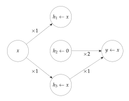

Figure 2: A network  $\mathcal{M}$  illustrating the illusion. The network computes the identity function:  $\mathcal{M}(x) = x$ . The activation of the input, output and each hidden neuron for a generic input x are shown in the circles, with arrows indicating the weight of the connections (no arrow means a weight of 0). The hidden unit  $h_3$  stores the value of the input and passes this to the output, while the unit  $h_2$  is dormant and  $h_1$  is disconnected from the output. However, activation patching the 1-dimensional linear subspace spanned by the sum of the  $h_1$  and  $h_2$  basis vectors (defined by the unit vector  $\mathbf{v} = (\frac{1}{\sqrt{2}}, \frac{1}{\sqrt{2}}, 0)$ ) has the same effect on model behavior as patching just the unit  $h_3$ .

Specifically, when  $\mathbf{v}$  is in the post-GELU activations of an MLP layer in a transformer with down-projection  $W_{out}$  (almost all examples in this paper are of this form), it is clear that the orthogonal projection of  $\mathbf{v}$  on ker  $W_{out}$  is causally disconnected. This suggests writing  $\mathbf{v} = \mathbf{v}_{\text{null}} + \mathbf{v}_{\text{row}}$  where  $\mathbf{v}_{\text{null}} \in \text{ker } W_{out}$  is the orthogonal projection on ker  $W_{out}$ , and  $\mathbf{v}_{\text{row}}$  is the remainder, which is in  $(\text{ker } W_{out})^{\perp}$ , the rowspace of  $W_{out}$ . Using this decomposition, we can perform several experiments:

- compare the strength of the patch to patching along the subspace spanned by  $\mathbf{v}_{row}$  alone, obtained by removing the causally disconnected part of  $\mathbf{v}$ . If  $\mathbf{v}_{row}$  is indeed dormant as we hope to show, this patch should have no effect on model outputs; in reality,  $\mathbf{v}_{row}$  may only be approximately dormant, so the patch may have a small effect. Conversely, if this patch has an effect similar to the original patch along  $\mathbf{v}$ , this is evidence against the illusion;
- check how dormant vrow is compared to vnull by comparing the spread of projections of the examples on both directions.

We use these experiments, as well as others, throughout the paper in order to rule out or confirm the illusion.

#### 3.5 Formalization of Causally Disconnected and Dormant Subspaces

For completeness, in this subsection we give a (somewhat) formal treatment of the intuitive ideas introduced in the previous subsection. Readers may also want to consult Appendix A.1 for background on patching higher-dimensional subspaces, which is used to define these concepts.

Let  $\mathcal{M}: \mathcal{X} \to \mathcal{O}$  be a machine learning model that on input  $x \in \mathcal{X}$  outputs a vector  $y \in \mathcal{O}$  of probabilities over a set of output classes. Let  $\mathcal{D}$  be a distribution over  $\mathcal{X}$ , and  $\mathcal{C}$  be a component of

M, such that for *x* ∼ D the hidden activation of C is a vector *cx* ∈ **R***d* . For a subspace *U*C ⊂ **R***d* , we let *ux* be the orthogonal projection of *cx* onto *U*C. Finally, let M*U*C←*uy* (*x*) be the result of running M with the input *x* and setting the subspace *U*C patched to *uy*.

We say *U*C is *causally disconnected* if M*U*C←*u* ′(*x*) = M(*x*) for all *u* ′ ∈ *U*C. In other words, intervening on the model by setting the orthogonal projection of C's activation on *U*C to any other value does not change the model's outputs. For a concrete example of a causally disconnected subspace, consider an MLP layer in a transformer model with an output projection matrix *Wout*; then, ker *Wout* is a causally disconnected subspace of the hidden (post-nonlinearity) activations of the MLP layer.

We say *U*C is *dormant* if M*U*C←*uy* (*x*) ≈ M(*x*) with high probability over *x*, *y* ∼ D, but there exists *u* ′ ∈ **R***d* such that M*U*C←*u* ′(*x*) is substantially different from M(*x*) (e.g., significantly changes the model's confidence on the task's answer). In other words, a dormant subspace is approximately causally disconnected when we patch its value using activations realized under the distribution D, but can have substantial causal effect if set to other values.

## **4 The Illusion in the Indirect Object Identification Task**

#### **4.1 Preliminaries**

In [Wang et al.](#page-31-2) [\(2023\)](#page-31-2), the authors analyze how the decoder-only transformer language model GPT-2 Small [\(Radford et al.,](#page-30-1) [2019\)](#page-30-1) performs the *indirect object identification* task. In this task, the model is required to complete sentences of the form 'When Mary and John went to the store, John gave a bottle of milk to' (with the intended completion in this case being ' Mary'). We refer to the repeated name (John) as **S** (the subject) and the non-repeated name (Mary) as **IO** (the indirect object). For each choice of the **IO** and **S** names, there are two patterns the sentence can have: one where the **IO** name comes first (we call these 'ABB examples'), and one where it comes second (we call these 'BAB examples'). Additional details on the data distribution, model and task performance are given in Appendix [B.1.](#page-34-1)

[Wang et al.](#page-31-2) [\(2023\)](#page-31-2) suggest the model uses the algorithm 'Find the two names in the sentence, detect the repeated name, and predict the non-repeated name' to do this task. In particular, they find a set of four heads in layers 7 and 8 – the **S-Inhibition heads** – that output the signal responsible for *not* predicting the repeated name. The dominant part of this signal is of the form 'Don't attend to the name in first/second position in the first sentence' depending on where the **S** name appears (see Appendix A in [Wang et al.](#page-31-2) [\(2023\)](#page-31-2) for details). In other words, this signal detects whether the example is an ABB or BAB example. This signal is added to the residual stream[5](#page-10-1) at the last token position, and is then picked up by another class of heads in layers 9, 10 and 11 – the **Name Mover heads** – which incorporate it in their queries to shift attention to the **IO** name and copy it to the last token position, so that it can be predicted (Figure [3\)](#page-11-0).

#### **4.2 Finding Subspaces Mediating Name Position Information**

How, precisely, is the positional signal communicated? In particular, 'don't attend to the first/second name' is plausibly a binary feature represented by a 1-dimensional subspace. In this subsection, we present methods to look for such a subspace.

5We follow the conventions of [Elhage et al.](#page-28-7) [\(2021\)](#page-28-7) when describing internals of transformer models. The residual stream at layer *k* is the sum of the output of all layers up to *k* − 1, and is the input into layer *k*.

#### Gradient of name mover attention scores.

As shown in Wang et al. (2023), the three name mover heads identified therein will attend to one of the names, and the model will predict whichever name is attended to. The position feature matters mechanistically by determining whether they attend to **IO** over **S**. This motivates us to consider the gradient  $\mathbf{v}_{grad}$  of the difference of attention scores of these heads on the **S** and **IO** names with respect to the residual stream at the last token, right after layer 8. We choose this layer because it right after the S-Inhibition heads (in layers 7 and 8) and before the name mover heads (in layers 9 and 10); see Figure 3. This gradient is the direction in the space of residual stream activations at this location that maximally shifts attention between the two names (per unit  $\ell_2$  norm), so we expect it to be a strong mediator of the position signal. Implementation details are given in Appendix B.2.

Importantly, the transformation from residual stream activations to attention scores is an approximately linear map: it consists of layer normalization followed by matrix multiplication. Layer normalization is a linear operation modulo the scaling step, and empirically, the scales of different examples in a trained model at inference time are tightly concentrated (see also 'Handling Layer Normalization' in Elhage et al. (2021)). This justifies the use of the gradient – which is in general only locally meaningful – as a direction in the residual stream globally meaningful for the attention scores of the name mover heads.

**Distributed alignment search**. We can also directly optimize for a direction that mediates

Baseline 96 Rud 2 Him 1 ... 1 Emma Vresid Vresid Vresid

Figure 3: Schematic of the IOI circuit and locations of key interventions. As argued in Wang et al. (2023), GPT2-Small predicts the correct name by S-inhibition heads writing positional information to the residual stream, which is used by the name movers to copy the non-duplicated name (green arrows). Location of subspace interventions  $\mathbf{v}_{\text{MLP}}$  (analyzed in Subsection 4.4) and  $\mathbf{v}_{\text{resid}}$  (analyzed in Section 5) are marked. Patching the illusory subspace  $\mathbf{v}_{\text{MLP}}$  adds a new path (red) along the established one that is used to flip positional information when patched.

the position signal. This is the approach taken by DAS (Geiger et al., 2023b). In our context, DAS optimizes for an activation subspace which, when activation patched from prompt *B* into prompt *A*, makes the model behave as if the relative position of the **IO** and **S** names in the sentence is as in prompt *B*. Specifically, if we patch between examples where the positions of the two names are the same, we optimize for a patch that *maximizes* the difference in predicted logits for the **IO** and **S** names. Conversely, if we patch between examples where the positions of the two names are switched, we optimize to *minimize* this difference. This approach is based purely on the model's predictions, and does not make any assumptions about its internal computations.

We let  $\mathbf{v}_{\text{MLP}}$  and  $\mathbf{v}_{\text{resid}}$  be 1-dimensional subspaces found by DAS in the layer 8 MLP activations and layer 8 residual stream output at the last token, respectively (see Figure 3). Both of these locations are between the S-Inhibition and Name Mover heads; however, Wang et al. (2023) did not

find any significant contribution from the MLP layer, making it a potential location for our illusion. Implementation details are given in Apendix B.3.

#### 4.3 Measuring Patching Success via the Logit Difference Metric

In our experiments, we perform all patches between examples that only differ in the variable we want to localize in the model, i.e. the position of the **S** and **IO** names in the first sentence. In other words, we patch from an example of the form 'Then, Mary and John went to the store. John gave a book to' (an ABB example) into the corresponding example 'Then, John and Mary went to the store. John gave a book to' (a BAB example), and vice-versa. Our activation patches have the goal of making the model output the **S** name instead of the **IO** name.

Accordingly, we use the *logit difference* between the logits assigned to the **IO** and **S** names as our main measure of how well a patch performs. We note that the logit difference is a meaningful quantifier of the model's confidence for one name over the other (it is equal to the log-odds between the two names assigned by the model), and has been extensively used in the original IOI circuit work Wang et al. (2023) to measure success on the IOI task.

Given a prompt x from the IOI distribution, let  $logit_{IO}(x)$ ,  $logit_{S}(x)$  denote the last-token logits output by the model on input x, for the **IO** and **S** names in the prompt x respectively (note that in our IOI distribution, all names are single tokens in the vocabulary of the model). The logit difference

$$logitdiff(x) := logit_{IO}(x) - logit_{S}(x)$$

when x is sampled from the IOI distribution is > 0 for almost all examples (99 + %), and is on average  $\approx 3.5$  (for this average value, the probability ratio in favor of the **IO** name is  $e^{3.5} \approx 33$ ).

Similarly, for an activation patching intervention  $\iota$ , let  $\operatorname{logit}_{\mathbf{IO}}^{\iota(x\leftarrow x')}(x)$ ,  $\operatorname{logit}_{\mathbf{S}}^{\iota(x\leftarrow x')}(x)$  denote the last-token logits output by the model when run on input x but patching from x' using  $\iota$ . The logit difference after intervening via  $\iota$  is thus

$$\operatorname{logitdiff}_{\iota(x \leftarrow x')}(x) := \operatorname{logit}_{\mathbf{IO}}^{\iota(x \leftarrow x')}(x) - \operatorname{logit}_{\mathbf{S}}^{\iota(x \leftarrow x')}(x)$$

Our main metric is the average **fractional logit difference decrease (FLDD)** due to the intervention  $\iota$ , where

$$FLDD_{l(x \leftarrow x')}(x) := \frac{\text{logitdiff}(x) - \text{logitdiff}_{l(x \leftarrow x')}}{\text{logitdiff}(x)} = 1 - \frac{\text{logitdiff}_{l(x \leftarrow x')}}{\text{logitdiff}(x)}$$
(4)

The average FLDD is 0 when the patch does not, on average, change the model's log-odds. The more positive FLDD is, the more successful the patch, with values above 100% indicating that the patch more often than not makes the model prefer the **S** name over the **IO** name. Finally, an average FLDD below 0% means that the patch on average helps the model do the task (and thus the patch has failed).

We also measure the **interchange accuracy** of the intervention: the fraction of patches for which the model predicts the S (i.e., wrong) name for the patched run. This is a 'hard' 0-1 counterpart to the FLDD metric.

Why prefer the FLDD metric to interchange accuracy? We argue that our main metric, which is based on logit difference (Equation 4), is a better reflection of the success of a patch than the accuracy-based interchange accuracy. Specifically, there are practical cases (e.g. the results in

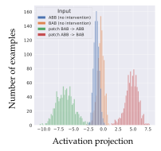

Figure 4: Projections of the output of the MLP layer on the gradient direction **v**grad before (blue/orange) and after (green/red) the activation patch along **v**MLP. In the legend, 'ABB' denotes examples where the **IO** name comes before the **S** name, and 'BAB' the other kind of examples.

While before the patch the contribution of the MLP layer to the causally relevant direction **v**grad distinguishes between values of the **IO** position in the prompt, after the patch there is a strong distinction (in the opposite direction). This shows that the patch activates a potential mediator of this feature that is normally dormant, taking model activations off-distribution.

| Patching subspace | FLDD    | Interchange accuracy |
|----------------------|---------|-------------------------|
| full MLP             | -8%     | 0.0%                    |
| vMLP                 | 46.7%   | 4.2%                    |
| vMLP rowspace     | 13.5%   | 0.2%                    |
| vMLP nullspace    | 0%      | 0.0%                    |
| full residual stream | 123.6%  | 54.8%                   |
| vresid               | 140.7%  | 74.8%                   |
| vresid rowspace   | 127.5%  | 63.1%                   |
| vresid nullspace  | 13.9%   | 0.4%                    |
| vgrad                | 111.5%  | 45.1%                   |
| vgrad rowspace    | 106.47% | 40.6%                   |
| vgrad nullspace   | 2.2%    | 0.0%                    |

Table 1: Effects of activation patching of full components and 1-dimensional subspaces on the IOI task: fractional logit difference decrease (FLDD, higher means more successful patch; 0% means no change) and interchange accuracy (fraction of predictions flipped; higher means more successful patch).

The first 5 interventions are described in more detail in Section [4,](#page-10-0) and the next 6 in Section [5.](#page-16-0)

An FLDD metric of > 100% indicates that the patch is more successful than not on average; however, an FLDD of ≈ 50% is still significant, even if the associated interchange accuracy may be ≈ 0%. See Subsection [4.3](#page-12-1) for more on interpreting the FLDD metric.

Subsection [4.4\)](#page-13-0) in which an intervention consistently achieves FLDD ≈ 50%, even though the interchange accuracy is ≈ 0%. In practice, circuits often have multiple components contributing to the same signal (including the IOI circuit found in [Wang et al.](#page-31-2) [\(2023\)](#page-31-2)). So a single non-residualstream component consistently responsible for shifting 50% of the model's log-odds towards another prediction is significant (even more so for a low-dimensional subspace of the component). Indeed, even if this component's contribution alone is insufficient to cause the predicted token to change, three such components would robustly change the prediction.

## **4.4 Results: Demonstrating the Illusion for the vMLP Direction**

We now show that patching the **v**MLP direction exhibits the illusion from Section [3.](#page-5-0) By contrast, we revisit **v**grad and **v**resid in Section [5,](#page-16-0) where we show that both are representations of the name position information that are highly faithful to the model's computation.

**Methodology and interventions considered** To contextualize the effect of the  $\mathbf{v}_{\text{MLP}}$  patch, we compare it to several additional subspace- and component-level activation patching interventions:

- **full MLP**: patching the full value of the hidden activation of the 8-th MLP layer at the last token.
- $\mathbf{v}_{\text{MLP}}$ : patching along the 1-dimensional subspace spanned by the direction  $\mathbf{v}_{\text{MLP}}$  found in Subsection 4.2.
- $\mathbf{v}_{\text{MLP}}$  **nullspace**: patching along the 1-dimensional subspace spanned by the causally disconnected component of  $\mathbf{v}_{\text{MLP}}$ . This is the orthogonal projection  $\mathbf{v}_{\text{MLP}}^{\text{nullspace}}$  of  $\mathbf{v}_{\text{MLP}}$  on the nullspace ker  $W_{out}$  of the down-projection  $W_{out}$  of the MLP layer. Note that  $W_{out} \in \mathbb{R}^{768 \times 3072}$ , so its kernel occupies at least 2304 dimensions, or 3/4 of the total dimension of the space of MLP activations.
- $\mathbf{v}_{\text{MLP}}$  rowspace: patching along the 1-dimensional subspace spanned by causally relevant component of  $\mathbf{v}_{\text{MLP}}$ . This is the orthogonal projection  $\mathbf{v}_{\text{MLP}}^{\text{rowspace}}$  of  $\mathbf{v}_{\text{MLP}}$  on the rowspace of  $W_{out}$ . Note that we have the orthogonal decomposition

$$\mathbf{v}_{\text{MLP}} = \mathbf{v}_{\text{MLP}}^{\text{nullspace}} + \mathbf{v}_{\text{MLP}}^{\text{rowspace}}.$$

• **full residual stream**: patching the entire activation of the residual stream at the last token after layer 8 of the model. This is indicated as the location of **v**resid in Figure 3.

**Results.** Metrics are shown in Table 1. In particular, we confirm the mechanics of the illusion are at play through the following observations.

The causally disconnected component of  $\mathbf{v}_{\text{MLP}}$  drives the effect. While patching the  $\mathbf{v}_{\text{MLP}}$  direction has a significant effect on the FLDD metric (46.7%), this effect is greatly diminished when we remove the component of  $\mathbf{v}_{\text{MLP}}$  in ker  $W_{out}$  whose activations are (provably) causally disconnected from model predictions (13.5%), or when we patch the entire MLP activation (-8%, actually increasing confidence). By contrast, performing analogous ablations on  $\mathbf{v}_{\text{resid}}$  leads to roughly the same numbers for the three analogous interventions (140.7%/127.5%/123.6%; we refer the reader to Section 5 for details on the  $\mathbf{v}_{\text{resid}}$  experiments).

Patching  $v_{MLP}$  activates a dormant pathway through the MLP. To corroborate these findings, in Figure 4, we plot the projection of the MLP layer's contribution to the residual stream on the gradient direction  $v_{grad}$  before and after patching, in order to see how it contributes to the attention of name mover heads. We observe that in the absence of intervention, the MLP output is weakly sensitive to the name position information, whereas after the patch this changes significantly.

**Further validations of the illusion.** We observe that the disconnected-dormant decomposition from the illusion approximately holds: the causally disconnected component of  $\mathbf{v}_{\text{MLP}}$  (the one in  $\ker W_{out}$ ) is significantly more discriminating between ABB and BAB examples than the component in  $(\ker W_{out})^{\top}$ , which is the one driving the causal effect (Figure 5); in this sense, the causally relevant component is 'dormant' relative to the causally disconnected one6.

&lt;sup>6The projection of  $\mathbf{v}_{\text{MLP}}$  onto ker  $W_{out}$  is substantial: it has norm ≈ 0.65, and the orthogonal projection onto (ker  $W_{out}$ ) $\top$  has norm ≈ 0.75 (as predicted by our model, the two components are approximately equal in norm; see Appendix A.2).

While the contribution of the **v**MLP patch to the FLDD metric may appear relatively small, and the interchange accuracy of this intervention is very low, in Appendix [B.4](#page-36-1) we argue that this is significant for a single component.

A potential concern when evaluating these results is overfitting by DAS. In our experiments, we always evaluate trained subspaces on a held-out test dataset which uses different names, objects, places and templates for the sentences; this makes sure that we learn a general (relative to our IOI distribution) subspace representing position information and not a subspace that only works for particular names or other details of the sentence. We investigated overfitting in DAS further in Appendix [B.7,](#page-37-1) and found that when DAS is trained on a dataset with a small number of names, overfitting is a real concern. However, the extent of overfitting is not such that DAS works in layers of the model where a generalizing DAS solution can also be found.

Another potential concerns is that the model could be somehow representing the position information in the MLP layer in a higher-dimensional subspace, and that our 1-dimensional intervention is perhaps not fit to illuminate the properties of that larger representation. In Appendix [B.6,](#page-37-0) we show that the illusion occurs when patching 100-dimensional subspaces as well, and the quantitative effect of the illusion is just a little stronger than that for 1-dimensional subspaces (as measured by the FLDD metric).

Finally, in Appendix [B.5,](#page-36-2) we show that we can find a direction within the post-gelu activations that has an even stronger effect on the model's behavior, *even when* we replace the MLP weights with random matrices.

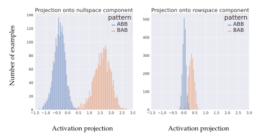

Figure 5: Projections of dataset examples onto the two (normalized to unit ℓ2 norm) components of the illusory patching direction found in MLP8: the nullspace (irrelevant) component (left), and the rowspace (dormant) component (right).

# 5 Finding and Validating a Faithful Direction Mediating Name Position in the IOI Task

As a counterpoint to the illusion, in this section we demonstrate a success case for subspace activation patching, as well as for DAS as a method for finding meaningful subspaces, by revisiting the directions  $\mathbf{v}_{\text{grad}}$  and  $\mathbf{v}_{\text{resid}}$  defined in Subsection 4.2, and arguing they are faithful to the model's computation to a high degree.

Specifically, we subject these directions to the same tests we used for the illusory direction  $\mathbf{v}_{\text{MLP}}$ , and arrive at significantly different results. Through these and additional validations, we demonstrate that these directions possess the necessary and sufficient properties of a successful activation patch – being both correlated with input variation and causal for the targeted behavior – in a way that does not rely on a large causally disconnected component for the effect.

#### 5.1 Ruling Out the Illusion

Intuitively, the main property of  $\mathbf{v}_{resid}$  we want to establish in order to rule out the illusion is that it is simultaneously (1) strongly discriminating between ABB and BAB examples (i.e., projections of activations on  $\mathbf{v}_{resid}$  separate these two classes well), and (2) is highly aligned with the direction  $\mathbf{v}_{grad}$  that downstream model components read this information from in order to put attention on the **IO** name and not the **S** name. To this end, we define a notion of causally disconnected component for  $\mathbf{v}_{resid}$ , and we show that removing it does not diminish the effect of the patch; we further show that  $\mathbf{v}_{resid}$  and  $\mathbf{v}_{grad}$  are quite similar, and that  $\mathbf{v}_{grad}$  is also strongly activated by position information.

What is the causally (dis)connected subspace of the residual stream? While for an MLP layer it is clear that ker  $W_{out}$  is the subspace of post-GELU activations which is causally disconnected from model outputs, the residual stream after layer 8 has no subspace which is simultaneously in the kernel of all downstream model components, or even of all the query matrices of downstream attention heads (we checked this empirically).

To overcome this, recall from Section 4 that Wang et al. (2023) argued that the three Name Mover heads in layers 9 and 10 are mostly responsible for the IOI task specifically. Let  $W_Q^{\rm NM} \in \mathbb{R}^{(3\times 64)\times 768} = \mathbb{R}^{192\times 768}$  be the stacked query matrices of the three name mover heads (which are full-rank). We use the 192-dimensional subspace  $\left(\ker W_Q^{NM}\right)^{\top}$  as a proxy for the causally relevant subspace7 of the residual stream at the last token position after layer 8.

To further narrow down the precise subspace read by the Name Mover heads, we also compare  $\mathbf{v}_{resid}$  with the gradient  $\mathbf{v}_{grad}$ , which is the direction that the Name Mover's attention on the  $\mathbf{IO}$  vs.  $\mathbf{S}$  name is most sensitive to.

**Results.** In Table 1, we report the fractional logit difference decrease (FLDD, recall Subsection 4.3) and interchange accuracy when patching  $\mathbf{v}_{resid}$  and  $\mathbf{v}_{grad}$ , as well as their components along

&lt;sup>7Note that, while technically all attention heads in layers 9, 10 and 11 read information from the residual stream after layer 8, using their collective query matrices instead of just the name movers would lead to a vacuous concept of a causally relevant subspace, because their collective query matrices' rowspaces span the entire residual stream. As a rough baseline, a random isotropic unit vector would have on average  $\sqrt{\frac{192}{768}} = \frac{1}{2}$  of its  $\ell_2$ -norm in  $\left(\ker W_Q^{NM}\right)^{\top}$ . We also note that this is on par with the decomposition of  $\mathbf{v}_{\text{MLP}}$  we considered in Section 4, where  $\ker W_{out}$  occupied 3/4 of the dimension of the full space of activations.

ker *W*NM *Q* (denoted 'nullspace') and its orthogonal complement ker *WNM Q* ⊤ (denoted 'rowspace'). We observe that the non-nullspace metrics are broadly similar[8](#page-17-1) ; in particular, removing the causally disconnected component of **v**resid does not significantly diminish the effect of the patch in terms of the logit difference metrics (as it does for **v**MLP).

Furthermore, we find that the cosine similarity between **v**resid and **v**grad is ≈ 0.78, which is significant (the baseline for random vectors in the residual stream is on the order of √ 768 ≈ 0.03).

Both **v**resid and **v**grad have a significant fraction of their norm in the ker *WNM Q* ⊤ subspace (91% and 98%, respectively). These results suggest that this **v**resid and **v**grad are highly similar directions, and that they're both strongly causally connected to the model's output.

In Figure [6,](#page-18-0) we also find that both directions are strongly discriminating between ABB and BAB examples.

**Discussion.** A key observation about the residual stream at the last token is that it is a full bottleneck for the model's computation over the last token position: all updates to that position are added to it. This provides another viewpoint on why the successful patches we find don't rely on a dormant subspace: there can be no earlier model component that activates the directions we find in a way that skips over the patch via a residual connection (unlike for **v**MLP). Indeed, in Figure [20](#page-49-0) in Appendix [C](#page-38-0) we show that the **v**resid direction gets written to by the S-Inhibition heads.

#### **5.2 Additional Validations**

In Appendix [C,](#page-38-0) we further validate these directions' faithfulness to the computation of the IOI circuit from [Wang et al.](#page-31-9) [\(2020\)](#page-31-9) by finding the model components that write to them and studying how they generalize on the pre-training distribution (OpenWebText); representative samples annotated with attention scores are shown in Figures [23,](#page-52-0) [21,](#page-50-0) [22](#page-51-0) in Appendix [C.](#page-38-0)

## **6 Factual Recall**

This section has two major goals. One is to show that the interpretability illusion can also be exhibited for the factual recall capability of language models, a much broader setting than the IOI task. The other is to exhibit in practice an approximate equivalence between two seemingly different interventions: rank-1 weight editing and interventions on 1-dimensional subspaces of activations. We do this in several complementary ways:

- 1. we show that DAS [\(Geiger et al.,](#page-28-5) [2023b\)](#page-28-5) finds illusory 1-dimensional subspace patches that change factual recall (e.g., to make a model complete 'The Eiffel Tower is in' with ' Rome' instead of ' Paris'). The patches found strongly update the model's confidence towards the false completion, but the effect disappears when the causally disconnected component of the subspace is removed, or when the entire MLP activation containing the subspace is patched instead.
- 2. we show that for a wide range of layers in the middle of the model (GPT2-XL [Radford et al.](#page-30-1) [\(2019\)](#page-30-1)), rank-1 fact editing using the ROME method [\(Meng et al.,](#page-29-2) [2022a\)](#page-29-2) is approximately

8We observe that the **v**resid patch is more successful than the **v**grad patch; we conjecture that this is due to **v**resid being able to contribute to all downstream attention heads, not just the three name-mover heads. In particular, the original IOI paper [Wang et al.](#page-31-2) [\(2023\)](#page-31-2) found that there is another class of heads, Backup Name Movers, which act somewhat like Name Mover heads.

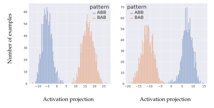

Figure 6: Projections of dataset examples' activations in the residual stream after layer 8 onto the  $\mathbf{v}_{resid}$  direction found by DAS (left) and the  $\mathbf{v}_{grad}$  direction (right) which is the gradient for difference in attention of the name mover heads to the two names.

equivalent to a 1-dimensional subspace intervention that generalizes activation patching. The same arguments from Sections 3 and 8 apply to this intervention, suggesting that it is likely to work successfully in a wide range of MLP layers, regardless of the role of these MLP layers for factual recall.

3. Finally, we show that the existence of the illusory patches from 1. implies the existence of rank1 weight edits which have identical effect at the token being patched, and comparable overall\neffect on the model. This provides the other direction of an approximate equivalence between
1-dimensional subspace interventions and rank-1 editing, which may be of independent\ninterest.

In particular, these findings provide a mechanistic explanation for the observation of prior work (Hase et al., 2023) that ROME works even in layers where the fact is supposedly not stored. As we discuss in Section 8, we expect that in practice all MLP layers between two model components communicating some feature are likely to contain an illusory subspace – and, by virtue of the approximate equivalence we demonstrate, rank-one fact edits will exist in these MLP layers, regardless of whether they are responsible for recalling the fact being edited.

#### 6.1 Finding Illusory 1-Dimensional Patches for Factual Recall

Given a fact expressed as a subject-relation-object triple (s,r,o) (e.g., s= 'Eiffel Tower', r= 'is in', o= 'Paris'), we say that a model M recalls the fact (s,r,o) if M completes a prompt expressing just the subject-relation pair (s,r) (e.g., 'The Eiffel Tower is in') with the object o ('Paris').

Let us be given two facts (s, r, o) and (s', r, o') for the same relation that a model recalls correctly, with corresponding factual prompts A expressing (s, r) and B expressing (s', r) (e.g., r ='is in', A ='The Eiffel Tower is in', B ='The Colosseum is in'). In this subsection, we patch from B into A, with

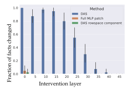

Figure 7: Fraction of successful fact patches under three interventions: patching along the direction found by DAS (blue), patching the component of the DAS direction in the rowspace of  $W_{out}$  (green), and patching the entire hidden MLP activation (orange).

the goal of changing the model's output from o to o'. Implementation details are given in Appendix D.1.

Results are shown in figure 7. We find a stronger version of the same qualitative phenomena as for the IOI illusory direction from Section 4: (i) the directions we find have a strong causal effect (successfully changing o to o'), but (ii) this effect disappears when we instead patch along the subspace spanned by the component orthogonal to ker  $W_{out}$ , and (iii) patching the entire MLP activation instead has a negligible effect on the difference in logits between the correct and incorrect objects. Further experiments confirming the illusion are in Appendix D.2.

We conclude that it is possible to make a model output a different object for a given fact by exploiting a 1-dimensional subspace patch that activates a dormant circuit in the model; in particular, using such a patch to localize the fact in the model is prone to interpretability illusions. Next, we turn to a more sophisticated intervetion that has been used to edit a fact in a more holistic way, so that related facts update accordingly while the model otherwise stays mostly the same.

#### 6.2 Background on ROME

Meng et al. (2022a) propose an intervention to overwrite a fact (s, r, o) with another fact (s, r, o') while minimally changing the model otherwise. The intervention is a *rank-1 weight edit*, which updates the down-projection  $W_{out}$  of a chosen MLP layer to become  $W'_{out} = W_{out} + \mathbf{a}\mathbf{b}^{\top}$  for some  $\mathbf{a} \in \mathbb{R}^{d_{\text{resid}}}$ ,  $\mathbf{b} \in \mathbb{R}^{d_{\text{MLP}}}$ . The edit takes a 'key' vector  $\mathbf{k} \in \mathbb{R}^{d_{\text{MLP}}}$  representing the subject (e.g., an average of its last-token MLP post-gelu activations over many prompts containing it) and a 'value' vector  $\mathbf{v} \in \mathbb{R}^{d_{\text{resid}}}$  which, when output by the MLP layer, will cause the model to predict the new object o' for the factual prompt (together with some other conditions incentivizing the model to not change much otherwise).

Importantly, we demonstrate that ROME can be formulated as an optimization problem with a natural objective, and this objective allows us to compare it to related interventions. Namely, the vectors **a**, **b** are the solution to

$$\min_{\mathbf{a}, \mathbf{b}} \operatorname{trace} \left( \operatorname{Cov}_{\mathbf{x} \sim \mathcal{N}(0, \Sigma)} \left[ \mathbf{a} \mathbf{b}^{\top} \mathbf{x} \right] \right) \quad \text{subject to} \quad W'_{out} \mathbf{k} = \mathbf{v}. \tag{5}$$

where  $\operatorname{Cov}[\mathbf{r}] = \mathbb{E}\left[ (\mathbf{r} - \boldsymbol{\mu}) (\mathbf{r} - \boldsymbol{\mu})^{\top} \right]$  denotes the covariance matrix of a random vector  $\mathbf{r}$  with mean  $\boldsymbol{\mu}$ , and  $\Sigma \succeq 0$  is an empirical (uncentered) covariance matrix for the MLP activations (proof in Appendix D.4). In words, the ROME update is the update that alters  $W_{out}$  so it outputs  $\mathbf{v}$  on input  $\mathbf{k}$ , and minimizes the total variance of the extra contribution of the update in the output of the MLP layer under the assumption that the pre- $W_{out}$  activations are normally distributed with mean zero and covariance  $\Sigma \succeq 0$ .

## 6.3 Rank-1 Fact Edits Imply Approximately Equivalent 1-Dimensional Subspace Interventions

Comparing the effect of a rank-1 edit to the MLP layer's output with equation 3 expressing the effect of patching on the MLP's outputs, we see that the two are quite similar. This leads to a natural question: given a rank-1 weight edit  $W'_{out} = W_{out} + \mathbf{ab}^{\top}$  such as ROME, can we find a 1-dimensional activation patch that has the same contribution to the MLP's output for any MLP activation  $\mathbf{x}$ ?

**Motivation and details.** As it turns out, finding a patch that has the same effect as a rank-1 edit is not feasible in practice. For an activation  $\mathbf{x}$ , the extra contribution to the MLP's output due to a rank-1 edit is  $(\mathbf{b}^{\top}\mathbf{x})$   $\mathbf{a}$ , whereas the extra contribution of a 1-dimensional patch from activation  $\mathbf{x}'$  is  $(\mathbf{v}^{\top}\mathbf{x}' - \mathbf{v}^{\top}\mathbf{x})W\mathbf{v}$ , where crucially  $\|\mathbf{v}\|_2 = 1$ . In particular, the vectors  $\mathbf{a}$ ,  $\mathbf{b}$  are not norm-constrained, unlike  $\mathbf{v}$ . This restricts the magnitude of the contribution of a patch, and we find this matters in practice.

To overcome this, we consider a closely related subspace intervention,

$$x_{\text{intervention}} = x + \left(v^\top 0 - v^\top x\right)v = x - \left(v^\top x\right)v$$

where  $\mathbf{v}$  is no longer restricted to be unit norm, and  $\mathbf{x}'$  is chosen to be  $\mathbf{0}$  to match the expectation of the rank-1 edit's contribution (see Appendix D.7 for details). This intervention bears many similarities to subspace patching; in particular, this intervention leaves the projections on all directions orthogonal to  $\mathbf{v}$  the same, and the intuitions about the illusion from Sections 3 and 7 also apply to this intervention. We also remark that, at the same time, this intervention is exactly equivalent to the rank-1 edit  $W''_{out} = W_{out} + W_{out} \mathbf{v} (-\mathbf{v})^{\top}$  in terms of contribution to the MLP output.

It turns out that this more general intervention can often approximate the ROME intervention well. Specifically, given a rank-1 edit  $W_{out} + \mathbf{ab}^{\top}$ , we can treat the problem probabilistically over activations  $\mathbf{x} \sim \mathcal{N}\left(0, \Sigma\right)$  like done in Meng et al. (2022a), and ask for a direction  $\mathbf{v}$  with the following properties:

- the expected value of both interventions is the same;
- the resulting extra contribution  $(-\mathbf{v}^{\top}\mathbf{x})$   $W_{out}\mathbf{v}$  to the MLP's output points in the same direction as the extra contribution  $(\mathbf{b}^{\top}\mathbf{x})$  **a** of the rank-1 edit;
- the total variance trace (Cov  $[(-\mathbf{v}^{\top}\mathbf{x}) W_{out}\mathbf{v} (\mathbf{b}^{\top}\mathbf{x}) \mathbf{a}])$  of the difference of these two contributions is minimized over  $\mathbf{x} \sim \mathcal{N}(0, \Sigma)$ .

Details are given in Appendix D.7. The important takeaway is that the solution v has the form

$$\mathbf{v} = \alpha W_{out}^{+} \mathbf{a} + \mathbf{u}$$
 where  $\mathbf{u} \in \ker W_{out}$ 

for a constant  $\alpha \geq 0$  that is optimized. In particular,  $W_{out}\mathbf{v}$  points in the direction  $\mathbf{a}$ , and the component  $\mathbf{u}$  (which is causally disconnected) is a 'free variable' that is essentially optimized to bring  $\mathbf{v}^{\top}\mathbf{x}$  close to  $-\mathbf{b}^{\top}\mathbf{x}/\alpha$  (subject to accounting for  $\Sigma$ ).

**Metrics and evaluation.** We apply this method to find subspace interventions corresponding to edits extracted from the COUNTERFACT dataset (Meng et al., 2022a); see Appendix D.1 for details. Specifically, we run ROME for all the edits, and we find the approximate subspace intervention (defined by a vector **v**) corresponding to each ROME edit. To compare the interventions, we consider the following metrics:

**Rewrite score.** Defined in Hase et al. (2023) (and a closely related metric is optimized by Meng et al. (2022a)), the rewrite score is a relative measure of how well a change to the model (ROME or our subspace intervention) increases the probability of the false target o' we are trying to substitute for o. Specifically, if  $p_{\text{clean}}(o)$  is the probability assigned by the model to output o under normal operation, and  $p_{\text{intervention}}(o)$  is the probability assigned when the intervention is applied, the rewrite score is

$$\frac{p_{\text{intervention}}\left(o'\right) - p_{\text{clean}}\left(o'\right)}{1 - p_{\text{clean}}\left(o'\right)} \in (-\infty, 1].$$

with a value of 1 indicating the model assigns probability 1 to o' after the intervention. We measure the rewrite score for the ROME intervention, our approximation of it, and also the corresponding subspace intervention with the ker  $W_{out}$  component of  $\mathbf{v}$  removed, in analogy with how we examine the subspace patches in Sections 4 and 6.1. That is, if  $\mathbf{v}_{null}$  is the orthogonal projection of  $\mathbf{v}$  on ker  $W_{out}$  and  $\mathbf{v}_{rowsp} = \mathbf{v} - \mathbf{v}_{null}$ , we apply the intervention

$$\mathbf{x}_{\text{rowspace intervention}} = \mathbf{x} - \left(\mathbf{v}_{\text{rowsp}}^{\top} \mathbf{x}\right) \mathbf{v}_{\text{rowsp}}.$$

Results comparing ROME and the subspace intervention we use to approximate it are shown in Figure 8. When using the rowspace intervention, all rewrite scores are less than  $10^{-3}$ , indicating a strong reliance on the nullspace component.

Cosine similarity of  $\mathbf{v}$  and  $\mathbf{b}$ . Our intervention contributes  $-(\mathbf{v}^{\top}\mathbf{x})$   $W\mathbf{v}$ , and the ROME edit contributes  $(\mathbf{b}^{\top}\mathbf{x})$   $\mathbf{a}$ . Note that, by construction, the cosine similarity of  $W\mathbf{v}$  with  $\mathbf{a}$  is 1. So, the cosine similarity of  $\mathbf{v}$  and  $\mathbf{b}$  measures how well the direction we are projecting the activation  $\mathbf{x}$  on matches that from the ROME edit. Results are shown in Figure 9 (left); in a range of layers we observe cosine similarity significantly close to 1.

**Overall change to the model relative to ROME.** This is the total variance introduced by this intervention as a fraction of the total variance introduced by the corresponding ROME edit. It measures the extent to which the subspace intervention damages the model overall, following our formulation of ROME as an optimization problem (see Appendix D.4). Results are shown in Figure 9 (right). Note that this metric is a ratio of variances; a ratio of standard deviations can be obtained by taking the square root.

In conclusion, we observe that in layers 20-35 inclusive, the two interventions are very similar according to all metrics considered.

**What is the interpretability illusion implied by this?** An important difference between the IOI case study from Section [4](#page-10-0) and the factual recall results from the current section is that, while activating a dormant circuit is contrary to activation patching's interpretability fact editing is, by definition, allowed to alter the model. In this sense, activating a dormant circuit via a rank-1 edit should no longer be considered a sign of spuriosity.

Instead, we argue that the interpretability illusion is to assume that the success of ROME means that the fact is stored in the layer being edited. This was already observed in [Hase et al.](#page-29-6) [\(2023\)](#page-29-6). Our work provides a mechanistic explanation for this observation.

We also note that we have evaluated the success of ROME and our approximately-equivalent subspace intervention only using the rewrite score metric and the measure of total variance implicit in the ROME algorithm. Ideally, there would be other validations of a fact edit that test the behavior of the intervened-upon model on other facts that should be changed by the edit.

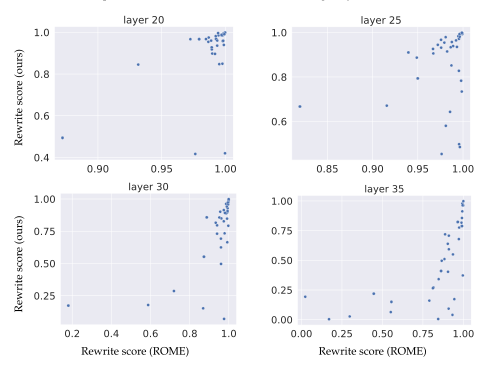

Figure 8: Rewrite score comparison between ROME (x-axis) and our approximation to it (y-axis) via a subspace intervention for layers 20, 25, 30, 35.

#### **6.4 1-Dimensional Fact Patches Imply Equivalent Rank-1 Fact Edits**

Finally, we show that the existence of an activation patch as in Subsection [6.1](#page-18-1) implies the existence of a rank-1 weight edit which has the same contribution to the MLP's output at the token being patched, and otherwise results in very similar model outputs as the activation patch.

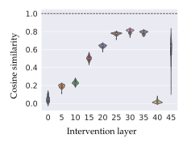

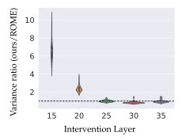

Figure 9: Comparisons between ROME rank-1 edits and our approximation via a subspace intervention. Left: cosine similarity between the vector **v** defining the subspace we intervene on and the vector **b** from the ROME edit (dashed horizontal line is at *y* = 1). Right: ratio of the total variance introduced by the subspace intervention to the total variance of the ROME intervention (x-axis scale is restricted to make the plot readable; dashed horizontal line is at *y* = 1).

Intuitively, a 'fact patch' as in Subsection [6.1](#page-18-1) should have a corresponding rank-1 edit with the same effect: the last subject token MLP activation **u***A* for prompt A takes the role of **k**, and the patch modifies the MLP's output (making it **v**) to change the model's output to *o* ′ . We make this intuition formal in Appendix [D.5,](#page-40-0) where we show that for each 1-dimensional activation patch between a pair of examples in the post-GELU activations of an MLP layer, there is a rank-1 model edit to *Wout* that results in the same change to the MLP layer's output at the token where we do the patching, and minimizes the variance of the extra contribution in the sense of Equation [5.](#page-19-1)

While this shows that the patch implies a rank-1 edit with the same behavior *at the token where we perform the patch*, the rank-1 edit is applied *permanently* to the model, which means that it (unlike the activation patch) applies to *every* token. Thus, it is not a priori obvious whether the rank-1 edit will still succeed in making the model predict *o* ′ instead of *o*. To this end, in Appendix [D.6,](#page-41-1) we evaluate empirically how using the rank-1 edit derived in Appendix [D.5](#page-40-0) instead of the activation patch changes model predictions, and we find negligible differences.

## **7 Reasons to Expect the MLP-in-the-middle Illusion to be Prevalent**

We only exhibit our illusion empirically in two settings: the IOI task and factual recall. However, we believe it is likely prevalent in practice. In this section, we provide several theoretical, heuristic and empirical arguments in support of this.

Specifically, we expect the illusion to be likely occur whenever we have an MLP *M* which is not used in the model's computation on a given task, but is between two components *A* and *B* which *are* used, and communicate by writing to / reading from the direction **v** via the skip connections of the model. This structure has been frequently observed in the mechanistic interpretability literature [\(Lieberum et al.,](#page-29-7) [2023;](#page-29-7) [Wang et al.,](#page-31-2) [2023;](#page-31-2) [Olsson et al.,](#page-30-12) [2022;](#page-30-12) [Geva et al.,](#page-28-10) [2021\)](#page-28-10): circuits contain components composing with each other separated by multiple layers, and circuits have often been observed to be sparse, with most components (including most MLP layers) not playing a significant role.

#### 7.1 Assumptions: a Simple Model of Linear Features in the Residual Stream

The linear representation hypothesis suggests a natural way to formalize this intuition. Namely, let's assume for simplicity that there is a binary feature C in the data, and the value of C influences the model's behavior on a task, by e.g. making some next-token predictions more likely than others. Concretely, there is a residual stream direction  $\mathbf{v} \in \mathbb{R}^{d_{resid}}$  that mediates this effect: projections on  $\mathbf{v}$  (at an appropriate token position) linearly separate examples according to the value of C, and intervening on this projection by setting it to e.g. the mode of the opposite class has the same effect on model outputs as changing the value of C in the input itself. Furthermore, we assume that this direction has this property in all residual stream layers between some two layers a < b.

We note that these assumptions can be realized 'in the wild': the highly similar directions  $\mathbf{v}_{\text{grad}}$  and  $\mathbf{v}_{\text{resid}}$  discussed in Section 5 are both examples of such directions  $\mathbf{v}$  for the binary concept of whether the  $\mathbf{IO}$  name comes first or second in the sentence, as we argued empirically.

#### 7.2 Overview of Argument

The key hypothesis is that, given the setup from the previous Subsection 7.1, the post-nonlinearity activations of every MLP layer between layers a and b are likely to contain a 1-dimensional subspace whose patching will have the same effect (possibly with a smaller magnitude) on model outputs as changing the value of C in the input. For this, it is sufficient to have two kinds of directions in the MLP's activation space:

- a 'causal' direction, such that changing the projection of an activation along this direction results in the expected change of model outputs. Such a direction will exist simply because  $W_{out}$  is a full-rank matrix, so we can simply pick  $W_{out}^+\mathbf{v}$ . We give an empirically-supported theoretical argument for this in Appendix E.1.
- a 'correlated' direction that linearly discriminates between the values of *C*: such a direction will exist because the pre-nonlinearity activations (which are an approximately linear image of the residual stream) will linearly discriminate *C*, and the transformation x → gelu(x) → projker Wout gelu(x) approximately preserves linear separability. We give an empirically-supported theoretical argument for this in Appendix E.2.

## 8 Discussion, Limitations, and Recommendations

Throughout this paper, we have seen that interventions on arbitrary linear subspaces of model activations, such as subspace activation patching, can have counterintuitive properties. In this section, we take a step back and provide a more conceptual point of view on these findings, as well as concrete advice for interpretability practitioners.

Why should this phenomenon be considered an illusion? One argument for the illusory nature of the subspaces we find is the reliance on a large causally disconnected component (in all our examples, this component is in the kernel of the down-projection  $W_{out}$  of an MLP layer). In particular, patching along only the causally-relevant component of the subspace (the one in  $(\ker W_{out})^{\perp}$ ) destroys the effect of the subspace patch; we find this a convincing reason to be suspicious of the explanatory faithfulness of these subspaces.

Beyond this argument, there are several more subtle considerations. For an explanation to be 'illusory', there has to be some notion of what the 'true' explanation is. We admit that a

definition of a 'ground truth' mechanistic explanation is conceptually challenging. In the absence of such a definition, our claims rest on various observations about model's inner workings that we now collect in one place and make more explicit. We believe these findings collectively point to meaningful constraints on mechanistic explanations.

For example, the IOI circuit work of [Wang et al.](#page-31-2) [\(2023\)](#page-31-2) finds through various component-level interventions that the layer 8 MLP *as a whole* does not contribute significantly to the model's ability to do the IOI task. However, does this imply that there aren't individual subspaces of the MLP layer that mediate the model's behavior on the IOI task? Not necessarily: there could be, for example, two subspaces mediating the position signal, but which have opposite contributions to the MLP's output that cancel out. This is compatible with our model of the illusion from Section [3:](#page-5-0) for example, we can form two 'cancelling' 1-dimensional subspaces by taking the sum and difference of the causally disconnected and dormant directions in our model. From this point of view, our subspace intervention decouples these (ordinarily coupled) subspaces by changing the activation only along one of them. This is impossible for an intervention that operates on entire model components.

Should we prefer the view under which the MLP layer simply does not participate in any meaningful way in the IOI task, or the view under which it contains subspaces that mediate information about the IOI task, but whose contributions cancel out? Note that meaningful cancellation behavior between entire model components has been observed to some extent in the mechanistic interpretability literature, such as with negative heads [\(Wang et al.,](#page-31-2) [2023\)](#page-31-2), anti-induction heads [\(Olsson et al.,](#page-30-12) [2022\)](#page-30-12) and copy suppression heads [\(McDougall et al.,](#page-29-12) [2023\)](#page-29-12). Furthermore, it is not clear that, in general, a component-level explanation should take precendence over subspace-level explanations. So, a priori, we have a conundrum: two different kinds of interventions arrive at conflicting interpretations.

Nevertheless, based on our experiments, we suggest that the view under which the MLP layer contains meaningful subspaces that cancel out is the less likely mechanistic explanation for several reasons. A first argument is that, as we argue in Section [7,](#page-23-0) the existence of the illusory subspace only relies on the existence of certain directions in the residual stream; the MLP weights themselves don't play a role. In some sense, the illusory subspace is a 'necessity of linear algebra'. This is further reinforced by the fact that we find illusory directions even when the MLP weights are replaced by random matrices (see Appendix [B.5\)](#page-36-2). A second argument is that features that are individually strong, but whose contributions almost exactly cancel out, seem unlikely to be prevalent.

Finally, we again remark that circuits for specific tasks have been observed to be sparse (recall Section [7\)](#page-23-0). Our model of the illusion from Section [3](#page-5-0) and the evidence from Section [7](#page-23-0) suggest that any MLP layer between two circuit components using the residual stream as a communication bottleneck for some feature will contain a subspace that appears to mediate this feature. Thus, even if we cannot conclusively rule out any given MLP layer on the path as not being meaningfully involved in the computation, it would be quite surprising if always all of them are involved. So we expect that at least some of these subspaces will be illusory.

**The importance of correct model units.** A further implicit assumption in our work is that model components are meaningful boundaries for mechanistic explanation. As we illustrate in Appendix [A.3,](#page-34-0) our toy example of the illusion can be considered in a rotated basis, in which the 'illusory' direction appears 'meaningful'. In a similar way, if we allow ourselves to arbitrarily reparametrize spaces of activations by crossing the boundaries between e.g. attention heads and MLP layers, calling the MLP subspace 'illusory' is much more tenuous.

To respond to this criticism, we point to the many observations in the mechanistic literature

that different components (like heads and MLP layers) perform qualitatively different functions in a model. For example, tasks involving algorithmic manipulations of in-context text, such as the IOI task, often rely predominantly on attention heads [\(Wang et al.,](#page-31-2) [2023;](#page-31-2) [Heimersheim & Janiak\)](#page-29-4). On the other hand, MLP layers have so far been implicated in tasks having to do with recalling bigrams and facts [\(Meng et al.,](#page-29-2) [2022a;](#page-29-2) [Gurnee et al.,](#page-29-13) [2023\)](#page-29-13). On these grounds, mixing activations between them is likely to lead to less parsimonious and less principled mechanistic explanations.

**Takeaways and recommendations.** As we have seen, optimization-based methods using subspace activation patching, such as DAS [\(Geiger et al.,](#page-28-5) [2023b\)](#page-28-5) can find both faithful (Section [5\)](#page-16-0) and illusory (Section [4\)](#page-10-0) features with respect to the model's computation. We recommend running such methods in activation bottlenecks, especially the residual stream, as well as using validations beyond end-toend evaluations to ascertain the precise role of such features.

## **9 Acknowledgments**

We are deeply indebted to Atticus Geiger for many useful discussions and helpful feedback, as well as help writing parts of the paper. We particularly appreciate his thoughtful pushback on framing and narrative, and commitment to rigour, without which this manuscript would be far poorer. We would also like to thank Christopher Potts, Curt Tigges, Oskar Hollingsworth, Tom Lieberum, Senthooran Rajamanoharan and Peli Grietzer for valuable feedback and discussions. The authors used the open-source library transformerlens [\(Nanda & Bloom,](#page-30-13) [2022\)](#page-30-13) to carry out the experiments related to the IOI task. AM and GL did this work as part of the SERI MATS independent research program, with support from AI Safety Support.

## **10 Author Contributions**

NN was the main supervisor for this project, and provided high level feedback on experiments, prioritisation, and writing throughout. NN came up with the original idea of the illusion and the conceptual example. AM came up with the correspondence with factual recall, developed the factual recall results, and ran the experiments for Sections [6,](#page-17-0) [7](#page-23-0) and part of [5](#page-16-0) (with the exception of experiments from Appendix [E.6](#page-46-0) ran by GL), and wrote the majority of the paper and appendices, as well as the public version of the code for the paper. GL also ran the experiments for Sections [4](#page-10-0) and [5](#page-16-0) with some guidance from AM, wrote and ran the experiments for Appendices [B.5,](#page-36-2) [B.6,](#page-37-0) [B.7,](#page-37-1) [C](#page-38-0) and [E.6,](#page-46-0) and contributed to Section [5](#page-16-0) and various other sections.

## **References**

Mostafa Abdou, Artur Kulmizev, Daniel Hershcovich, Stella Frank, Ellie Pavlick, and Anders Søgaard. Can language models encode perceptual structure without grounding? a case study in color. *arXiv preprint arXiv:2109.06129*, 2021.

Julius Adebayo, Justin Gilmer, Michael Muelly, Ian J. Goodfellow, Moritz Hardt, and Been Kim. Sanity checks for saliency maps. In Samy Bengio, Hanna M. Wallach, Hugo Larochelle, Kristen Grauman, Nicol0 Cesa-Bianchi, and Roman Garnett (eds.), *Advances in Neural Information Processing Systems 31: Annual Conference on Neural Information Processing Systems 2018, NeurIPS 2018,*

- *December 3-8, 2018, Montreal, Canada*, pp. 9525–9536, 2018. URL [https://proceedings.neurips.](https://proceedings.neurips.cc/paper/2018/hash/294a8ed24b1ad22ec2e7efea049b8737-Abstract.html) [cc/paper/2018/hash/294a8ed24b1ad22ec2e7efea049b8737-Abstract.html](https://proceedings.neurips.cc/paper/2018/hash/294a8ed24b1ad22ec2e7efea049b8737-Abstract.html).
- Sanjeev Arora, Yuanzhi Li, Yingyu Liang, Tengyu Ma, and Andrej Risteski. Linear algebraic structure of word senses, with applications to polysemy. *Transactions of the Association for Computational Linguistics*, 6:483–495, 2018.
- Mariette Awad, Rahul Khanna, Mariette Awad, and Rahul Khanna. Support vector machines for classification. *Efficient Learning Machines: Theories, Concepts, and Applications for Engineers and System Designers*, pp. 39–66, 2015.
- Tolga Bolukbasi, Adam Pearce, Ann Yuan, Andy Coenen, Emily Reif, Fernanda Viégas, and Martin Wattenberg. An interpretability illusion for bert. *arXiv preprint arXiv:2104.07143*, 2021.
- Tom Brown, Benjamin Mann, Nick Ryder, Melanie Subbiah, Jared D Kaplan, Prafulla Dhariwal, Arvind Neelakantan, Pranav Shyam, Girish Sastry, Amanda Askell, et al. Language models are few-shot learners. *Advances in neural information processing systems*, 33:1877–1901, 2020.
- Collin Burns, Haotian Ye, Dan Klein, and Jacob Steinhardt. Discovering latent knowledge in language models without supervision. *arXiv preprint arXiv:2212.03827*, 2022.
- Lawrence Chan, Adria Garriga-Alonso, Nicholas Goldowsky-Dill, Ryan Greenblatt, Jenny Nitishinskaya, Ansh Radhakrishnan, Buck Shlegeris, and Nate Thomas. Causal scrubbing: a method for rigorously testing interpretability hypotheses, 2022. URL [https://www.alignmentforum.org/](https://www.alignmentforum.org/posts/JvZhhzycHu2Yd57RN/causal-scrubbing-a-method-for-rigorously-testing) [posts/JvZhhzycHu2Yd57RN/causal-scrubbing-a-method-for-rigorously-testing](https://www.alignmentforum.org/posts/JvZhhzycHu2Yd57RN/causal-scrubbing-a-method-for-rigorously-testing).
- Roi Cohen, Eden Biran, Ori Yoran, Amir Globerson, and Mor Geva. Evaluating the ripple effects of knowledge editing in language models. *arXiv preprint arXiv:2307.12976*, 2023.
- Arthur Conmy, Augustine N Mavor-Parker, Aengus Lynch, Stefan Heimersheim, and Adrià Garriga-Alonso. Towards automated circuit discovery for mechanistic interpretability. *arXiv preprint arXiv:2304.14997*, 2023.
- Alexis Conneau, German Kruszewski, Guillaume Lample, Loic Barrault, and Marco Baroni. What you can cram into a single \$&!#\* vector: Probing sentence embeddings for linguistic properties. In *Proceedings of the 56th Annual Meeting of the Association for Computational Linguistics (Volume 1: Long Papers)*, pp. 2126–2136, Melbourne, Australia, July 2018. Association for Computational Linguistics. doi: 10.18653/v1/P18-1198. URL <https://aclanthology.org/P18-1198>.
- Damai Dai, Li Dong, Yaru Hao, Zhifang Sui, Baobao Chang, and Furu Wei. Knowledge neurons in pretrained transformers. In *Proceedings of the 60th Annual Meeting of the Association for Computational Linguistics (Volume 1: Long Papers)*, pp. 8493–8502, Dublin, Ireland, May 2022. Association for Computational Linguistics. doi: 10.18653/v1/2022.acl-long.581. URL <https://aclanthology.org/2022.acl-long.581>.
- Jacob Devlin, Ming-Wei Chang, Kenton Lee, and Kristina Toutanova. BERT: Pre-training of deep bidirectional transformers for language understanding. In *Proceedings of the 2019 Conference of the North American Chapter of the Association for Computational Linguistics: Human Language Technologies, Volume 1 (Long and Short Papers)*, pp. 4171–4186, Minneapolis, Minnesota, 2019. Association for Computational Linguistics. doi: 10.18653/v1/N19-1423. URL [https://aclanthology.org/](https://aclanthology.org/N19-1423) [N19-1423](https://aclanthology.org/N19-1423).

- Nelson Elhage, Neel Nanda, Catherine Olsson, Tom Henighan, Nicholas Joseph, Ben Mann, Amanda Askell, Yuntao Bai, Anna Chen, Tom Conerly, Nova DasSarma, Dawn Drain, Deep Ganguli, Zac Hatfield-Dodds, Danny Hernandez, Andy Jones, Jackson Kernion, Liane Lovitt, Kamal Ndousse, Dario Amodei, Tom Brown, Jack Clark, Jared Kaplan, Sam McCandlish, and Chris Olah. A mathematical framework for transformer circuits. *Transformer Circuits Thread*, 2021. URL <https://transformer-circuits.pub/2021/framework/index.html>.
- Nelson Elhage, Tristan Hume, Catherine Olsson, Nicholas Schiefer, Tom Henighan, Shauna Kravec, Zac Hatfield-Dodds, Robert Lasenby, Dawn Drain, Carol Chen, Roger Grosse, Sam McCandlish, Jared Kaplan, Dario Amodei, Martin Wattenberg, and Christopher Olah. Toy models of superposition. *Transformer Circuits Thread*, 2022. URL [https://transformer-circuits.pub/2022/toy\\_](https://transformer-circuits.pub/2022/toy_model/index.html) [model/index.html](https://transformer-circuits.pub/2022/toy_model/index.html).
- Atticus Geiger, Kyle Richardson, and Christopher Potts. Neural natural language inference models partially embed theories of lexical entailment and negation. In *Proceedings of the Third BlackboxNLP Workshop on Analyzing and Interpreting Neural Networks for NLP*, pp. 163–173, Online, November 2020. Association for Computational Linguistics. doi: 10.18653/v1/2020.blackboxnlp-1.16. URL <https://www.aclweb.org/anthology/2020.blackboxnlp-1.16>.
- Atticus Geiger, Hanson Lu, Thomas Icard, and Christopher Potts. Causal abstractions of neural networks. *Advances in Neural Information Processing Systems*, 34:9574–9586, 2021.
- Atticus Geiger, Christopher Potts, and Thomas Icard. Causal abstraction for faithful model interpretation. Ms., Stanford University, 2023a. URL <https://arxiv.org/abs/2301.04709>.
- Atticus Geiger, Zhengxuan Wu, Christopher Potts, Thomas Icard, and Noah D Goodman. Finding alignments between interpretable causal variables and distributed neural representations. *arXiv preprint arXiv:2303.02536*, 2023b.
- Robert Geirhos, Roland S Zimmermann, Blair Bilodeau, Wieland Brendel, and Been Kim. Don't trust your eyes: on the (un) reliability of feature visualizations. *arXiv preprint arXiv:2306.04719*, 2023.
- Mor Geva, Roei Schuster, Jonathan Berant, and Omer Levy. Transformer feed-forward layers are key-value memories. In *Proceedings of the 2021 Conference on Empirical Methods in Natural Language Processing*, pp. 5484–5495, Online and Punta Cana, Dominican Republic, 2021. Association for Computational Linguistics. doi: 10.18653/v1/2021.emnlp-main.446. URL <https://aclanthology.org/2021.emnlp-main.446>.
- Mor Geva, Jasmijn Bastings, Katja Filippova, and Amir Globerson. Dissecting recall of factual associations in auto-regressive language models. *arXiv preprint arXiv:2304.14767*, 2023.
- Aaron Gokaslan and Vanya Cohen. Openwebtextcorpus, 2019. URL [http://Skylion007.github.](http://Skylion007.github.io/OpenWebTextCorpus) [io/OpenWebTextCorpus](http://Skylion007.github.io/OpenWebTextCorpus).
- Nicholas Goldowsky-Dill, Chris MacLeod, Lucas Sato, and Aryaman Arora. Localizing model behavior with path patching. *arXiv preprint arXiv:2304.05969*, 2023.
- G Grand, I Blank, F Pereira, and E Fedorenko. Semantic projection: Recovering human knowledge of multiple, distinct object features from word embeddings. arxiv. *arXiv preprint arXiv:1802.01241*, 2018.

- Wes Gurnee, Neel Nanda, Matthew Pauly, Katherine Harvey, Dmitrii Troitskii, and Dimitris Bertsimas. Finding neurons in a haystack: Case studies with sparse probing. *arXiv preprint arXiv:2305.01610*, 2023.
- Peter Hase, Mohit Bansal, Been Kim, and Asma Ghandeharioun. Does localization inform editing? surprising differences in causality-based localization vs. knowledge editing in language models. *arXiv preprint arXiv:2301.04213*, 2023.
- Stefan Heimersheim and Jett Janiak. A circuit for Python docstrings in a 4-layer attentiononly transformer. URL [https://www.alignmentforum.org/posts/u6KXXmKFbXfWzoAXn/](https://www.alignmentforum.org/posts/u6KXXmKFbXfWzoAXn/a-circuit-for-python-docstrings-in-a-4-layer-attention-only) [a-circuit-for-python-docstrings-in-a-4-layer-attention-only](https://www.alignmentforum.org/posts/u6KXXmKFbXfWzoAXn/a-circuit-for-python-docstrings-in-a-4-layer-attention-only).
- Evan Hernandez, Belinda Z. Li, and Jacob Andreas. Inspecting and editing knowledge representations in language models, 2023.
- John Hewitt and Christopher D Manning. A structural probe for finding syntax in word representations. In *Proceedings of the 2019 Conference of the North American Chapter of the Association for Computational Linguistics: Human Language Technologies, Volume 1 (Long and Short Papers)*, pp. 4129–4138, 2019.
- Belinda Z Li, Maxwell Nye, and Jacob Andreas. Implicit representations of meaning in neural language models. *arXiv preprint arXiv:2106.00737*, 2021.
- Kenneth Li, Oam Patel, Fernanda Viégas, Hanspeter Pfister, and Martin Wattenberg. Inference-time intervention: Eliciting truthful answers from a language model. *arXiv preprint arXiv:2306.03341*, 2023a.
- Maximilian Li, Xander Davies, and Max Nadeau. Circuit breaking: Removing model behaviors with targeted ablation. *arXiv preprint arXiv:2309.05973*, 2023b.
- Tom Lieberum, Matthew Rahtz, János Kramár, Geoffrey Irving, Rohin Shah, and Vladimir Mikulik. Does circuit analysis interpretability scale? evidence from multiple choice capabilities in chinchilla. *arXiv preprint arXiv:2307.09458*, 2023.
- Zachary C. Lipton. The mythos of model interpretability, 2016. URL [https://arxiv.org/abs/](https://arxiv.org/abs/1606.03490) [1606.03490](https://arxiv.org/abs/1606.03490).
- Callum McDougall, Arthur Conmy, Cody Rushing, Thomas McGrath, and Neel Nanda. Copy suppression: Comprehensively understanding an attention head. *arXiv preprint arXiv:2310.04625*, 2023.
- Thomas McGrath, Matthew Rahtz, Janos Kramar, Vladimir Mikulik, and Shane Legg. The hydra effect: Emergent self-repair in language model computations. *arXiv preprint arXiv:2307.15771*, 2023.
- Kevin Meng, David Bau, Alex J Andonian, and Yonatan Belinkov. Locating and editing factual associations in GPT. In *Advances in Neural Information Processing Systems*, 2022a.
- Kevin Meng, Arnab Sen Sharma, Alex Andonian, Yonatan Belinkov, and David Bau. Mass editing memory in a transformer. *arXiv preprint arXiv:2210.07229*, 2022b.

Tomás Mikolov, Ilya Sutskever, Kai Chen, Gregory S. Corrado, and Jeffrey Dean. Distributed representations of words and phrases and their compositionality. In Christopher J. C. Burges, Léon Bottou, Zoubin Ghahramani, and Kilian Q. Weinberger (eds.), *Advances in Neural Information Processing Systems 26: 27th Annual Conference on Neural Information Processing Systems 2013. Proceedings of a meeting held December 5-8, 2013, Lake Tahoe, Nevada, United States*, pp. 3111–3119, 2013. URL [https://proceedings.neurips.cc/paper/2013/hash/](https://proceedings.neurips.cc/paper/2013/hash/9aa42b31882ec039965f3c4923ce901b-Abstract.html) [9aa42b31882ec039965f3c4923ce901b-Abstract.html](https://proceedings.neurips.cc/paper/2013/hash/9aa42b31882ec039965f3c4923ce901b-Abstract.html).

Neel Nanda. Actually, othello-gpt has a linear emergent world representation. 2023a.

Neel Nanda. Attribution patching: Activation patching at industrial scale, 2023b. URL [https:](https://www.neelnanda.io/mechanistic-interpretability/attribution-patching) [//www.neelnanda.io/mechanistic-interpretability/attribution-patching](https://www.neelnanda.io/mechanistic-interpretability/attribution-patching).

Neel Nanda and Joseph Bloom. Transformerlens. [https://github.com/neelnanda-io/](https://github.com/neelnanda-io/TransformerLens) [TransformerLens](https://github.com/neelnanda-io/TransformerLens), 2022.

Neel Nanda, Andrew Lee, and Martin Wattenberg. Emergent linear representations in world models of self-supervised sequence models. *arXiv preprint arXiv:2309.00941*, 2023.

Chris Olah. Mechanistic interpretability, variables, and the importance of interpretable bases. *https://www.transformer-circuits.pub*, 2022. URL [https://www.transformer-circuits.pub/2022/](https://www.transformer-circuits.pub/2022/mech-interp-essay.) [mech-interp-essay.](https://www.transformer-circuits.pub/2022/mech-interp-essay.)

Chris Olah, Nick Cammarata, Ludwig Schubert, Gabriel Goh, Michael Petrov, and Shan Carter. Zoom in: An introduction to circuits. *Distill*, 2020. doi: 10.23915/distill.00024.001.

Catherine Olsson, Nelson Elhage, Neel Nanda, Nicholas Joseph, Nova DasSarma, Tom Henighan, Ben Mann, Amanda Askell, Yuntao Bai, Anna Chen, Tom Conerly, Dawn Drain, Deep Ganguli, Zac Hatfield-Dodds, Danny Hernandez, Scott Johnston, Andy Jones, Jackson Kernion, Liane Lovitt, Kamal Ndousse, Dario Amodei, Tom Brown, Jack Clark, Jared Kaplan, Sam McCandlish, and Chris Olah. In-context learning and induction heads. *Transformer Circuits Thread*, 2022. URL [https://transformer-circuits.pub/2022/](https://transformer-circuits.pub/2022/in-context-learning-and-induction-heads/index.html) [in-context-learning-and-induction-heads/index.html](https://transformer-circuits.pub/2022/in-context-learning-and-induction-heads/index.html).

OpenAI. Gpt-4 technical report, 2023.

Judea Pearl. Direct and indirect effects. In *Proceedings of the Seventeenth Conference on Uncertainty in Artificial Intelligence*, UAI'01, pp. 411–420, San Francisco, CA, USA, 2001. Morgan Kaufmann Publishers Inc. ISBN 1558608001.

Alec Radford, Jeffrey Wu, Rewon Child, David Luan, Dario Amodei, Ilya Sutskever, et al. Language models are unsupervised multitask learners. *OpenAI blog*, 1(8):9, 2019.

P. Smolensky. Neural and conceptual interpretation of PDP models. In *Parallel Distributed Processing: Explorations in the Microstructure, Vol. 2: Psychological and Biological Models*, pp. 390–431. MIT Press, Cambridge, MA, USA, 1986. ISBN 0262631105.

Alessandro Stolfo, Yonatan Belinkov, and Mrinmaya Sachan. Understanding arithmetic reasoning in language models using causal mediation analysis. *arXiv preprint arXiv:2305.15054*, 2023.

Ian Tenney, Dipanjan Das, and Ellie Pavlick. BERT rediscovers the classical NLP pipeline. In *Proceedings of the 57th Annual Meeting of the Association for Computational Linguistics*, pp. 4593–4601,

- Florence, Italy, July 2019. Association for Computational Linguistics. doi: 10.18653/v1/P19-1452. URL <https://aclanthology.org/P19-1452>.
- Alex Turner, Lisa Thiergart, David Udell, Gavin Leech, Ulisse Mini, and Monte MacDiarmid. Activation addition: Steering language models without optimization. *arXiv preprint arXiv:2308.10248*, 2023.
- Ashish Vaswani, Noam Shazeer, Niki Parmar, Jakob Uszkoreit, Llion Jones, Aidan N. Gomez, Lukasz Kaiser, and Illia Polosukhin. Attention is all you need. In Isabelle Guyon, Ulrike von Luxburg, Samy Bengio, Hanna M. Wallach, Rob Fergus, S. V. N. Vishwanathan, and Roman Garnett (eds.), *Advances in Neural Information Processing Systems 30: Annual Conference on Neural Information Processing Systems 2017, December 4-9, 2017, Long Beach, CA, USA*, pp. 5998–6008, 2017. URL [https://proceedings.neurips.cc/paper/2017/hash/](https://proceedings.neurips.cc/paper/2017/hash/3f5ee243547dee91fbd053c1c4a845aa-Abstract.html) [3f5ee243547dee91fbd053c1c4a845aa-Abstract.html](https://proceedings.neurips.cc/paper/2017/hash/3f5ee243547dee91fbd053c1c4a845aa-Abstract.html).
- Jesse Vig, Sebastian Gehrmann, Yonatan Belinkov, Sharon Qian, Daniel Nevo, Simas Sakenis, Jason Huang, Yaron Singer, and Stuart Shieber. Causal mediation analysis for interpreting neural nlp: The case of gender bias. URL <https://arxiv.org/abs/2004.12265>.
- Jesse Vig, Sebastian Gehrmann, Yonatan Belinkov, Sharon Qian, Daniel Nevo, Simas Sakenis, Jason Huang, Yaron Singer, and Stuart Shieber. Causal mediation analysis for interpreting neural nlp: The case of gender bias. *arXiv preprint arXiv:2004.12265*, 2020.
- Jonas Wallat, Jaspreet Singh, and Avishek Anand. BERTnesia: Investigating the capture and forgetting of knowledge in BERT. In *Proceedings of the Third BlackboxNLP Workshop on Analyzing and Interpreting Neural Networks for NLP*, pp. 174–183, Online, November 2020. Association for Computational Linguistics. doi: 10.18653/v1/2020.blackboxnlp-1.17. URL <https://aclanthology.org/2020.blackboxnlp-1.17>.
- Kevin Ro Wang, Alexandre Variengien, Arthur Conmy, Buck Shlegeris, and Jacob Steinhardt. Interpretability in the wild: a circuit for indirect object identification in GPT-2 small. In *The Eleventh International Conference on Learning Representations*, 2023. URL [https://openreview.](https://openreview.net/forum?id=NpsVSN6o4ul) [net/forum?id=NpsVSN6o4ul](https://openreview.net/forum?id=NpsVSN6o4ul).
- Ziheng Wang, Jeremy Wohlwend, and Tao Lei. Structured pruning of large language models. In *Proceedings of the 2020 Conference on Empirical Methods in Natural Language Processing (EMNLP)*, pp. 6151–6162, Online, 2020. Association for Computational Linguistics. doi: 10.18653/v1/2020. emnlp-main.496. URL <https://aclanthology.org/2020.emnlp-main.496>.
- Jason Wei, Yi Tay, Rishi Bommasani, Colin Raffel, Barret Zoph, Sebastian Borgeaud, Dani Yogatama, Maarten Bosma, Denny Zhou, Donald Metzler, et al. Emergent abilities of large language models. *arXiv preprint arXiv:2206.07682*, 2022.
- Zhengxuan Wu, Atticus Geiger, Christopher Potts, and Noah D Goodman. Interpretability at scale: Identifying causal mechanisms in alpaca. *arXiv preprint arXiv:2305.08809*, 2023.
- Zexuan Zhong, Zhengxuan Wu, Christopher D. Manning, Christopher Potts, and Danqi Chen. Mquake: Assessing knowledge editing in language models via multi-hop questions, 2023.

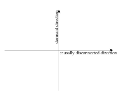

Figure 10: Consider a 2-dimensional subspace of model activations, with an orthogonal basis where the *x*-axis is *causally disconnected* (changing the activation along it makes no difference to model outputs) and values on the *y* axis are always zero for examples in the data distribution (a specical case of a *dormant* direction).

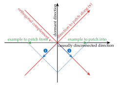

Figure 12: To patch along  $\mathbf{v}$  from the left into the right example, we match the projection on  $\mathbf{v}$  from the left one, and leave the projection on  $\mathbf{v}^{\perp}$  unchanged. In other words, we take the component of the left example along  $\mathbf{v}$  (①) and sum it with the  $\mathbf{v}^{\perp}$  component (②) of the original activation.

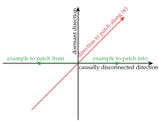

Figure 11: Suppose we have two examples (green) which differ in their projection on the causally disconnected direction (and have zero projection on the dormant direction, by definition). Let's consider what happens when we patch from the example on the left into the example on the right along the 1-dimensional subspace **v** spanned by the vector (1,1) (red)

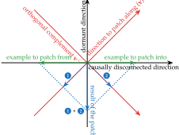

Figure 13: This results in the patched activation ① + ②, which points completely along the dormant direction. In this way, activation patching makes the variation of activations along the causally disconnected x-axis result in activations along the previously dormant y-axis.

Figure 14: A step-by-step illustration of the phenomenon shown in Figure 1.

#### A Additional Notes on Section 3

#### A.1 The Illusion for Higher-Dimensional Subspaces

In the main text, we mostly discuss the illusion for activation patching of 1-dimensional subspaces for ease of exposition. Here, we develop a more complete picture of the mechanics of the illusion for higher-dimensional subspaces.

Let C be a model component taking values in  $\mathbb{R}^d$ , and let  $U \subset \mathbb{R}^d$  be a linear subspace. Let V be a matrix whose columns form an orthonormal basis for U. If the C activations for examples A and B are  $\mathbf{act}_A$ ,  $\mathbf{act}_B \in \mathbb{R}^d$  respectively, patching U from A into B gives the patched activation

$$\mathsf{act}_B^{\mathit{patched}} = \mathsf{act}_B + VV^\top(\mathsf{act}_A - \mathsf{act}_B) = (I - VV^\top)\mathsf{act}_B + VV^\top\mathsf{act}_A$$

For intuition, note that  $VV^{\top}$  is the orthogonal projection on U, so this formula says to replace the orthogonal projection of  $\mathbf{act}_B$  on U with that of  $\mathbf{act}_A$ , and keep the rest of  $\mathbf{act}_B$  the same.

Generalizing the discussion from Section 3, for the illusion to occur for subspace S, we need S to be sufficiently aligned with a causally disconnected subspace  $V_{\rm disconnected}$  that is correlated with the feature being patched, and a dormant but causal subspace  $V_{\rm dormant}$  which, when set to out of distribution values, can achieve the wanted causal effect.

For example, a particularly simple way in which this could happen is if we let  $V_{\rm disconnected}$ ,  $V_{\rm dormant}$  be 1-dimensional subspaces (like in the setup for the 1-dimensional illusion), and we form S by combining  $V_{\rm disconnected} \oplus V_{\rm dormant}$  with a number of orthogonal directions that are approximately constant on the data with respect to the feature we are patching. These extra directions effectively don't matter for the patch (because they are cancelled by the  ${\bf act}_A - {\bf act}_B$  term). Given a specific feature, it is likely that such weakly-activating directions will exist in a high-dimensional activation space. Thus, if the 1-dimensional illusion exist, so will higher-dimensional ones.

#### A.2 Optimal Illusory Patches are Equal Parts Causally Disconnected and Dormant

In this subsection, we prove a quantitative corollary of the model of our illusion that suggests that we should expect optimal illusory patching directions to be of the form

$$\mathbf{v}_{\text{illusory}} = \frac{1}{\sqrt{2}} \left( \mathbf{v}_{\text{disconnected}} + \mathbf{v}_{\text{dormant}} \right)$$

for unit vectors  $\mathbf{v}_{\text{disconnected}} \perp \mathbf{v}_{\text{dormant}}$ . In other words, we expect the strongest illusory patches to be formed by combining a disconnected and illusory direction with *equal* coefficients, like depicted in Figure 1:

**Lemma A.1.** Suppose we have two distributions of input prompts  $\mathcal{D}_A$ ,  $\mathcal{D}_B$ . In the terminology of Section 3, let  $\mathbf{v}_{disconnected} \perp \mathbf{v}_{dormant}$  be unit vectors such that the subspace spanned by  $\mathbf{v}_{disconnected}$  is a causally disconnected subspace, and the subspace spanned by  $\mathbf{v}_{dormant}$  is **strongly** dormant, in the sense that the projections of the activations of all examples  $\mathcal{D}_{source} \cup \mathcal{D}_{base}$  onto  $\mathbf{v}_{dormant}$  are equal to some constant c.

Let  $\mathbf{v} = \mathbf{v}_{disconnected} \cos \alpha + \mathbf{v}_{dormant} \sin \alpha$  be a unit-norm linear combination of the two directions parametrized by an angle  $\alpha$ . Then the magnitude of the expected change in projection along  $\mathbf{v}_{dormant}$  when patching from  $x_A \sim \mathcal{D}_A$  into  $x_B \sim \mathcal{D}_B$  is maximized when  $\alpha = \frac{\pi}{4}$ , i.e.  $\cos \alpha = \sin \alpha = \frac{1}{\sqrt{2}}$ .

*Proof.* Recall that the patched activation from  $x_A$  into  $x_B$  along  $\mathbf{v}$  is

$$\mathbf{act}_{B}^{\mathrm{patched}} = \mathbf{act}_{B} + (p_{A} - p_{B})\mathbf{v}$$

where  $p_A = \mathbf{v}^{\top} \mathbf{act}_A$ ,  $p_B = \mathbf{v}^{\top} \mathbf{act}_B$  are the projections of the two examples' activations on v. The change along  $\mathbf{v}_{\text{dormant}}$  is thus

$$\mathbf{v}_{\text{dormant}}^{\top} \left( \mathbf{act}_{B}^{\text{patched}} - \mathbf{act}_{B} \right) = (p_{A} - p_{B}) \sin \alpha = (\mathbf{v}^{\top} \mathbf{act}_{A} - \mathbf{v}^{\top} \mathbf{act}_{B}) \sin \alpha$$
$$= \mathbf{v}_{\text{disconnected}}^{\top} (\mathbf{act}_{A} - \mathbf{act}_{B}) \cos \alpha \sin \alpha$$

where we used the assumption that  $\mathbf{v}_{dormant}^{\top}\mathbf{act}_{A} = \mathbf{v}_{disconnected}^{\top}\mathbf{act}_{B}$ . Hence, the expected change is

$$\cos \alpha \sin \alpha \mathbf{v}_{disconnected}^{\top} \mathbb{E}_{A \sim \mathcal{D}_A, B \sim \mathcal{D}_B} \left[ \mathbf{act}_A - \mathbf{act}_B \right].$$

The function  $f(\alpha) = \cos \alpha \sin \alpha$  for  $\alpha \in [0, \pi/2]$  is maximized for  $\alpha = \pi/4$ , concluding the proof.

#### A.3 The Toy Illusion in a Rotated Basis

There is a subtlety in the toy example of the illusion from 3.3. Suppose we reparametrized the hidden layer of the network so that, instead of the standard basis  $(\mathbf{e}_1, \mathbf{e}_2, \mathbf{e}_3)$ , we use a rotated basis where one of the directions is  $\mathbf{e}_1 + \mathbf{e}_2$ , the other direction is orthogonal to it and to  $\mathbf{w}_2$  (hence will be causally disconnected), and the last direction is the unique direction orthogonal to the first two.

The unit basis vectors for this new basis are given by

$$\mathbf{d}_{1} = (\mathbf{e}_{1} + \mathbf{e}_{2}) / \sqrt{2},$$

$$\mathbf{d}_{2} = (-\mathbf{e}_{1} + \mathbf{e}_{2} - 2\mathbf{e}_{3}) / \sqrt{6},$$

$$\mathbf{d}_{3} = (-\mathbf{e}_{1} + \mathbf{e}_{2} + \mathbf{e}_{3}) / \sqrt{3}.$$

If we assemble these into the rows of a rotation matrix

$$R = \begin{bmatrix} \frac{1}{\sqrt{2}} & \frac{1}{\sqrt{2}} & 0\\ \frac{-1}{\sqrt{6}} & \frac{1}{\sqrt{6}} & \frac{-2}{\sqrt{6}}\\ \frac{-1}{\sqrt{3}} & \frac{1}{\sqrt{3}} & \frac{1}{\sqrt{3}} \end{bmatrix}$$

the re-parametrized network is then given by

$$x \mapsto \mathbf{h}' = R\mathbf{w}_1 x \mapsto y = (R\mathbf{w}_2)^{\top} \mathbf{h}'$$

and a diagram of this new network is shown in Figure 15. From this point of view,  $\mathbf{d}_1$  takes the role that  $\mathbf{e}_3$  had before: the input is essentially copied to it (modulo scalar multiplication), and then read from it at the output. By contrast,  $\mathbf{d}_2$  is now a causally disconnected direction, and  $\mathbf{d}_3$  is a dormant direction.

#### B Additional details for Section 4

#### B.1 Dataset, Model and Evaluation Details for the IOI Task

We use GPT2-Small for the IOI task, with a dataset that spans 216 single-token names, 144 single-token objects and 75 single-token places, which are split 1 : 1 across a training and test set. Every example in the data distribution includes (i) an initial clause introducing the indirect object (IO, here 'Mary') and the subject (S, here 'John'), and (ii) a main clause that refers to the subject a second time. Beyond that, the dataset varies in the two names, the initial clause content, and the main clause content. Specifically, use three templates as shown below:

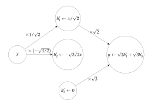

Figure 15

Then, [] and [] had a long and really crazy argument. Afterwards, [] said to Then, [] and [] had lots of fun at the [place]. Afterwards, [] gave a [object] to Then, [] and [] were working at the [place]. [] decided to give a [object] to

and we use the first two in training and the last in the test set. Thus, the test set relies on unseen templates, names, objects and places. We used fewer templates than the IOI paper Wang et al. (2020) in order to simplify tokenization (so that the token positions of our names always align), but our results also hold with shifted templates like in the IOI paper.

On the test partition of this dataset, GPT2-Small achieves an accuracy of  $\approx$  91%. The average difference of logits between the correct and incorrect name is  $\approx$  3.3, and the logit of the correct name is greater than that of the incorrect name in  $\approx$  99% of examples. Note that, while the logit difference is closely related to the model's correctness, it being > 0 does not imply that the model makes the correct prediction, because there could be a third token with a greater logit than both names.

## B.2 Details for Computing the Gradient Direction $v_{grad}$

For a given example from the test distribution and a given name mover head, we compute the gradient of the difference of attention scores from the final token position to the 3rd and 5th token in the sentence (where the two name tokens always are in our data). We then average these gradients over a large sample of the full test distribution and over the three name mover heads, and finally normalize the resulting vector to have unit  $\ell_2$  norm.

We note that there is a 'closed form' way to compute approximately the same quantity that requires no optimization. Namely, for a single example we can collect the keys  $k_S$ ,  $k_{IO}$  to the name mover heads at the first two names in the sentence (the **S** and **IO** name). Then, for a single name mover head with query matrix  $W_Q$ , a maximally causal direction v in the residual stream at the last token position after layer 8 will be one such that  $W_Q v$  is in the direction of  $k_S - k_{IO}$ , because the attention score is simply the dot product between the keys and queries. We can use this to 'backpropagate' to v by multiplying with the pseudoinverse  $W_Q^+$ . This is slightly complicated by the fact that we have been ignoring layer normalization, which can be approximately accounted for by estimating the scaling parameters (which tend to concentrate well) from the IOI data distribution. We note that this approach leads to broadly similar results.

#### **B.3 Training Details for DAS**

To train DAS, we always sample examples from the training IOI distribution. We sample equal amounts of pairs of base (which will be patched into) and source (where we take the activation to patch in from) prompts where the two names are the same between the prompts, and pairs of prompts where all four names are distinct. We optimize DAS to maximize the logit difference between the name that should be predicted if the position information from the source example is correct and the other name.

For training, we use a learned rotation matrix as in the original DAS paper [\(Geiger et al.,](#page-28-5) [2023b\)](#page-28-5), parametrized with torch.nn.utils.parametrizations.orthogonal. We use the Adam optimizer and minibatch training over a training set of several hundred patching pairs. We note that results remain essentially the same when using a higher number of training examples.

## **B.4 Discussion of the Magnitude of the Illusion**

While the contribution of the **v**MLP patch to logit difference may appear relatively small, we note that this is the result of patching a direction in a single model component at a single token position. Typical circuits found in real models (including the IOI circuit from [Wang et al.](#page-31-2) [\(2023\)](#page-31-2)) are often composed of multiple model components, each of which contribute. In particular, the position signal itself is written to by 4 heads, and chiefly read by 3 other heads. As computation tends to be distributed, when patching an individual component accuracy may be a misleading metric (eg patching 1 out of 3 heads is likely insufficient to change the output), and a fractional logit diff indicates a significant contribution. By contrast, patching in the residual stream is a more potent intervention, because it can affect *all* information accumulated in the model that is communicated to downstream components.

#### **B.5 Random ablation of MLP weights**

How certain are we that MLP8 doesn't actually matter for the IOI task? While we find the IOI paper analysis convincing, to make our results more robust to the possibility that it does matter, we also design a further experiment.

Given our conceptual picture of the illusion, the computation performed by the MLP layer where we find the illusory subspace does not matter as long as it propagates the correlational information about the position feature from the residual stream to the hidden activations, and as long as the output matrix *Wout* is full rank (also, see the discussion in [8\)](#page-24-0). Thus, we expect that if we replace the MLP weights by randomly chosen ones with the same statistics, we should still be able to exhibit the illusion.

Specifically, we randomly sampled MLP weights and biases such that the norm of the output activations matches those of MLP8. As random MLPs might lead to nonsensical text generation, we don't replace the layer with the random weights, but rather train a subspace using DAS on the MLP activations, and add the difference between the patched and unpatched output of the random MLP to the real output of MLP8. This setup finds a subspace that reduces logit difference even more than the **v**MLP direction.

This suggests that the existence of the **v**MLP subspace is less about *what* information MLP8 contains, and more about *where* MLP8 is in the network.

#### **B.6 Generalization to high-dimensional Subspaces**

In the main text, we focus on activation patching in one-dimensional subspaces for clarity. Here, we extend the discussion to higher-dimensional subspaces and show that the interpretability illusion generalizes to high-dimensional linear subspaces.

We investigate two different 100-dimensional subspaces *U*MLP8 in MLP8 and *U*resid8 in the output of layer 8. Specifically, we used DAS to find orthonormal bases *V*MLP and *V*resid that align the position information in these two locations, as explained in [A.1.](#page-33-0) We found that these subspaces performed slightly better compared to their 1-dimensional counterparts (for *V*resid: 190% FLDD and 89% interchange accuracy; for *V*MLP: 62% FLDD and 13% interchange accuracy).

We hypothesize that the subspace trained on MLP8 is pathological while the subspace in the residual stream is not. To test this, we decompose every basis vector **v** (*d*) {MLP8, resid8} into its projection **v** nullspace {MLP8, resid8} on the nullspace ker{*W*out, *WQ*} and its orthogonal complement **v** rowspace {MLP8, resid8} such that

$$\mathbf{v}_{\{\text{MLP8, resid8}\}}^{(d)} = \mathbf{v}_{\{\text{MLP8, resid8}\}}^{\text{nullspace}} + \mathbf{v}_{\{\text{MLP8, resid8}\}}^{\text{rowspace}}.$$

Note that *WQ* denotes the query weight of name mover head 9.9. We then patched the 200 dimensional subspace spanned by *V*ˆ with

$$\hat{V} = \mathcal{QR}([\mathbf{v}_1^{\text{nullspace}},...,\mathbf{v}_d^{\text{nullspace}},\mathbf{v}_1^{\text{rowspace}},...,\mathbf{v}_d^{\text{rowspace}}])$$

composed out of the decomposed subspace vectors and orthonormalized using QR-decomposition (see Figure [16\)](#page-38-2). For patching the output of layer 8, FLDD and interchange accuracy remained similarly high. (FLDD: 200%, interchange accuracy: 86%). However, patching on MLP8 mostly removes the effect of the patch (FLDD: 17%, interchange accuracy: 2%). Thus, the causally disconnected subspace is required for patching MLP8 which suggests that the interpretability illusion generalizes to higher-dimensional subspaces.

#### **B.7 Overfitting on Small Datasets**

How important is a large and diverse dataset for training DAS? We initially hypothesized that for very small datasets, it is possible to find working subspaces in all layers as there are only a few fixed activation vectors in each layer and we might be able to find subspaces that utilize this noise to overfit.

To test this, we created a small IOI dataset containing only two names from a fixed template. We fitted a one-dimensional subspace using DAS for every layer on that dataset and the full dataset as a control (Figure [17\)](#page-47-0). We repeated the experiment for subspaces in the MLP and residual stream and evaluated the subspaces on their train distribution and a test distribution containing all names and templates. FLDD was highest in layer 8, the component between S-inhibition heads and name movers, and also high in neighboring layers that still contain IOI information (e.g. some of the S-inhibition heads are in layer 7 and some of the name movers are in layer 10). Moreover, train FLDD was significantly higher than test FLDD when trained on only 2 names.

Importantly, we also observe that subspaces optimized on the small dataset reached a FLDD bigger than zero in some of the other layers but contrary to our expectation, this was neither high in absolute terms nor compared to subspaces trained on the full distribution (see Figure [17\)](#page-47-0).

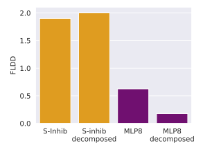

Figure 16: Fractional logit difference decrease (FLDD) for patching a 100-dimensional subspace on the S-inhibition heads or on MLP8; "decomposed" patches the 200-dimensional subspace made out of the nullspace projection vectors into *WQ* of name mover or *Wout* of MLP8, respectively, and their orthogonal complements

## **C Additional Details for Section [5](#page-16-0)**

**Which model components write to the vresid direction?** To test how every attention head and MLP contributes to the value of projections on **v**MLP, we sampled activations from head and MLP outputs at the last token position of IOI prompts, and calculated their dot product with **v***resid* (Figure [20\)](#page-49-0). We found that the dot products of most heads and MLPs was low, and that the S-inhibition heads were the only heads whose dot product differed between different patterns ABB and BAB. This shows that only the S-inhibition heads write to the **v**resid direction (as one would hope). Importantly, this test separates **v***resid* from the interpretability illusion **v***MLP*. While patching **v**MLP8 also writes to **v**resid8 (i.e. **v**MLP8*Wout* ≈ **v**resid8), the MLP layer does not write this subspace on the IOI task (see Figure [4\)](#page-13-1). This further supports the observation that the **v**MLP patch activates a dormant pathway in the model.

**Generalization beyond the IOI distribution**. We also investigate how the subspace generalizes. We sample prompts from OpenWebText-10k and look at those with particularly high and low activations in **v**sinhib. Representative examples are shown in Figure [21](#page-50-0) together with the name movers attention at the position of interest, how the probability changes after subspace ablation, and how the name movers attention changes.

**Stability of found solution**. Finally, we note that solutions found by DAS in the residual stream are stable, including when trained on a subset of S-inhibition heads (see Figure [18\)](#page-48-0).

## **D Additional details for Section [6](#page-17-0)**

#### **D.1 Dataset construction and training details**

We use the first 1000 examples from the COUNTERFACT dataset [\(Meng et al.,](#page-29-2) [2022a\)](#page-29-2). We filter the facts which GPT2-XL correctly recalls. Out of the remaining facts, for each relation we form all pairs of distinct facts, and we sample 5 such pairs from each relation with at least 5 facts. This results in a collection of 40 fact pairs spanning 8 different relations. We then use these facts as follows:

- for the ROME experiments in Subsection 6.3, we define edits by requesting one of the facts in each pair to be rewritten with the object of the other fact;
- for the activation patching experiments in Subsection 6.1, we patch from the last token of s' in B to the last token of s in A (prior work has shown that the fact is retrieved on s (Geva et al., 2023)), and we again use DAS Geiger et al. (2023b) to optimize for a direction that maximizes the logit difference between o' and o.

#### D.2 Additional fact patching experiments

In figure 24, we show the distribution of the fractional logit difference metric (see Subsection 4.2 for a definition) when patching between facts as described in Subsection 6.1. Like in the related Figure 7, we observe that, while patching along the directions found by DAS achieves strongly negative values (indicating that the facts are very often successfully changed by the patch), the interventions that replace the entire MLP layer or only the causally relevant component of the DAS directions have no such effect.

Next, we observe that the nullspace component of the patching direction is the one similar to the variation in the inputs (difference of last-token activations at the two subjects). Specifically, in Figure 25, we plot the (absolute value of the) cosine similarity between the difference in activations for the two last subject tokens, and the nullspace component of the DAS direction. We note that this similarity is consistently significantly high (note that it can be at most 1, which would indicate perfect alignment).

Finally, we observe that the nullspace component of the patching direction is a non-trivial part of the direction in Figure 26, where we plot the distribution of the  $\ell_2$  norm of this component.

#### D.3 ROME implementation details

ROME takes as input a vector  $\mathbf{k} \in \mathbb{R}^{d_{\text{MLP}}}$  representing the subject (e.g. an average of last-token representations of the subject) and a vector  $\mathbf{v} \in \mathbb{R}^{d_{\text{resid}}}$  which, when output by the MLP layer, will cause the model to predict a new object for the factual prompt, but at the same time won't change other facts about the subject. ROME modifies the MLP weight by setting  $W'_{out} = W_{out} + \mathbf{a}\mathbf{b}^{\top}$ , where  $\mathbf{a} \in \mathbb{R}^{d_{\text{resid}}}$ ,  $\mathbf{b} \in \mathbb{R}^{d_{\text{MLP}}}$  are chosen so that  $W'_{out}\mathbf{k} = \mathbf{v}$ , and the MLP's output is otherwise minimally changed. Without loss of generality, the first condition implies that  $\mathbf{a} = \mathbf{v} - W_{out}\mathbf{k}$  and  $\mathbf{b}^{\top}\mathbf{k} = 1$ ; the second condition is then modeled by minimizing the variance of  $\mathbf{b}^{\top}\mathbf{x}$  when  $\mathbf{x} \sim \mathcal{N}(0, \Sigma)$  for an empirical estimate  $\Sigma \in \mathbb{R}^{d_{\text{MLP}} \times d_{\text{MLP}}}$  of the covariance of MLP activations (see Lemma D.1 in Appendix D for details and a proof). In all our experiments involving ROME, we use GPT2-XL (Radford et al., 2019), and we use the precomputed values of  $\Sigma$  from Meng et al. (2022a) accessible online here.

#### D.4 ROME as an Optimization Problem

We now review the ROME method from Meng et al. (2022a) and show how it can be characterized as the solution of a simple optimization problem. Following the terminology of 6.4, let us have an MLP layer with an output projection  $W_{out}$ , a key vector  $\mathbf{k} \in \mathbb{R}^{d_{\text{MLP}}}$  and a value vector  $\mathbf{v} \in \mathbb{R}^{d_{\text{resid}}}$ .

In Meng et al. (2022a), equation 2, the formula for the rank-1 update to  $W_{out}$  is given by

$$W'_{out} = W_{out} + (\mathbf{v} - W_{out}\mathbf{k}) \frac{\mathbf{k}^{\top} \Sigma^{-1}}{\mathbf{k}^{\top} \Sigma^{-1} \mathbf{k}}$$
(6)

where  $\Sigma$  is an empirical estimate of the uncentered covariance of the pre- $W_{out}$  activations. We derive the following equivalent characterization of this solution (which may be of independent interest):

**Lemma D.1.** Given a matrix  $W_{out} \in \mathbb{R}^{d_{resid} \times d_{MLP}}$ , a key vector  $\mathbf{k} \in \mathbb{R}^{d_{MLP}}$  and a value vector  $\mathbf{v} \in \mathbb{R}^{d_{resid}}$ , let  $\Sigma \succ 0, \Sigma \in \mathbb{R}^{d_{MLP} \times d_{MLP}}$  be a positive definite matrix (specifically, the uncentered empirical covariance), and let  $\mathbf{x} \sim \mathcal{N}(0, \Sigma)$  be a normally distributed random vector with mean 0 and covariance  $\Sigma$ . Then, the ROME weight update is  $W'_{out} = W_{out} + \mathbf{a}\mathbf{b}^{\top}$  where  $\mathbf{a} \in \mathbb{R}^{d_{resid}}$ ,  $\mathbf{b} \in \mathbb{R}^{d_{MLP}}$  solve the optimization problem

$$\min_{\mathbf{a},\mathbf{b}} \operatorname{trace}(\operatorname{Cov}_{\mathbf{x}} \left[ W'_{out} \mathbf{x} - W_{out} \mathbf{x} \right]) \quad subject \ to \quad W'_{out} \mathbf{k} = \mathbf{v}.$$

In other words, the ROME update is the update that causes  $W_{out}$  to output  $\mathbf{v}$  on input  $\mathbf{k}$ , and minimizes the total variance of the extra contribution of the update in the output of the MLP layer under the assumption that the pre- $W_{out}$  activations are normally distributed with covariance  $\Sigma$ .

*Proof.* We have  $W'_{out}\mathbf{x} - W_{out}\mathbf{x} = \mathbf{a}\mathbf{b}^{\top}\mathbf{x}$ . Next, Using  $\mathbb{E}_{\mathbf{x}}[\mathbf{x}\mathbf{x}^{\top}] = \Sigma$  and the cyclic property of the trace, we see that

$$\operatorname{trace}(\operatorname{Cov}_{\mathbf{x}} \left[ W'_{out} \mathbf{x} - W_{out} \mathbf{x} \right]) = \|\mathbf{a}\|_{2}^{2} \mathbf{b}^{\top} \Sigma \mathbf{b}$$

We must have  $\mathbf{ab}^{\top}\mathbf{k} = \mathbf{v} - W_{out}\mathbf{k}$ , so without loss of generality we can rescale  $\mathbf{a}$ ,  $\mathbf{b}$  so that  $\mathbf{a} = \mathbf{v} - W_{out}\mathbf{k}$ . Then, we want to solve the problem

$$\min_{\mathbf{b}} \mathbf{b}^{\top} \Sigma \mathbf{b} \quad \text{subject to} \quad \mathbf{b}^{\top} \mathbf{k} = 1$$

which we can solve using Lagrange multipliers. The Lagrangian is

$$\mathcal{L}(\mathbf{b}, \lambda) = \frac{1}{2} \mathbf{b}^{\top} \Sigma \mathbf{b} - \lambda \mathbf{b}^{\top} \mathbf{k}$$

and the derivative w.r.t.  $\mathbf{b}$  is  $\Sigma \mathbf{b} - \lambda \mathbf{k} = 0$ , which tells us that  $\mathbf{b}$  is in the direction of  $\Sigma^{-1} \mathbf{k}$ . Then the constraint  $\mathbf{b}^{\top} \mathbf{k} = 1$  forces the constant of proportionality, and we arrive at  $\mathbf{b} = \frac{\mathbf{k}^{\top} \Sigma^{-1}}{\mathbf{k}^{\top} \Sigma^{-1} \mathbf{k}}$ 

#### D.5 Connection between 1-dimensional activation patching and model editing

**Lemma D.2.** Given prompts A and B, two token positions  $t_A$ ,  $t_B$ , and an MLP layer with output projection weight  $W_{out} \in \mathbb{R}^{d_{resid} \times d_{MLP}}$ , let  $u_A$ ,  $u_B \in \mathbb{R}^{d_{MLP}}$  be the respective (post-nonlinearity) activations at these token positions in this layer. If v is a direction in the activation space of the MLP layer, then there exists a ROME edit  $W'_{out} = W_{out} + ab^{\top}$  such that the activation patch from  $u_B$  into  $u_A$  along v and the edit result in equal outputs of the MLP layer at token  $t_A$  when run on prompt A. Moreover, the ROME edit is given by

$$a = ((u_B - u_A)^\top v) W_{out} v$$
 and any  $b$  that satisfies  $b^\top u_A = 1$ .

Choosing  $b = \frac{\sum^{-1} u_A}{u_A^T \sum^{-1} u_A}$  minimizes the change to the model (in the sense of Meng et al. (2022a)) over all such rank-1 edits.

*Proof.* The activation after patching from B into A along v is  $u'_A = u_A + ((u_B - u_A)^T v)v$ , which means that the change in the output of the MLP layer at this token will be

$$W_{out}u'_A - W_{out}u_A = ((u_B - u_A)^\top v)W_{out}v$$

The change introduced by a fact edit at this token is

$$W'_{out}u_A - W_{out}u_A = ab^{\top}u_A = \left(b^{\top}u_A\right)\left((u_B - u_A)^{\top}v\right)W_{out}v$$

and the two are equal because  $b^{\top}u_A = 1$ .

To find the b that minimizes the change to the model, we minimize the variance of  $b^{\top}x$  when  $x \sim \mathcal{N}(0, \Sigma)$  subject to  $b^{\top}u_A = 1$ . The variance is equal to  $b^{\top}\Sigma b$ , so we have a constrained (convex) minimization problem

$$\min \frac{1}{2}b^{\top}\Sigma b \quad \text{subject to} \quad b^{\top}u_A = 1$$

The rest of the proof is the same as in Lemma D.1. Namely, we can solve this optimization problem using Lagrange multiplies. The Lagrangian is

$$\mathcal{L}(b,\lambda) = \frac{1}{2}b^{\top}\Sigma b - \lambda b^{\top}u_A$$

and the derivative w.r.t. b is  $\Sigma b - \lambda u_A = 0$ , which tells us that b is in the direction of  $\Sigma^{-1}u_A$ . Then the constraint  $b^{\top}u_A = 1$  forces the constant of proportionality.

## D.6 Additional experiments comparing fact patching and rank-1 editing

In Figure 27, we plot the distributions of the logit difference between the correct object for a fact and the object we are trying to substitute when patching the 1-dimensional subspaces found by DAS, and performing the equivalent rank-1 weight edit according to Lemma D.2. We observe that the two metrics quite closely track each other, indicating that the additional effects of using a weight edit (as opposed to only intervening at a single token) are negligible.

Similarly, in Figure 28, we show the success rate of the two methods in terms of making the model output the object of the fact we are patching from. Again, we observe that they quite closely track each other.

#### D.7 From Rank-1 Model Edits to Subspace Interventions

In this section, we describe how, given a rank-1 edit  $W'_{out} = W_{out} + ab^T$ , to obtain a direction  $v \in \mathbb{R}^{d_{MLP}}$  such that intervening on the model by setting the projection on v to some constant  $c \in \mathbb{R}$  (at each token) is approximately equivalent to intervening via the rank-1 edit.

Specifically, given an activation  $x \in \mathbb{R}^{d_{MLP}}$ , the patched activation is  $x' = x + (c - v^T x) v$  and the extra contribution of the subspace intervention to the output of the MLP layer will be

$$contrib_{subspace}(x) = W_{out}x' - W_{out}x = (c - v^Tx)Wv.$$

Similarly, the extra contribution of the rank-1 edit to the output of the MLP layer is

contribrank-1
$$(x) = W'_{out}x - W_{out}x = (b^Tx)a$$
.

Recall (see Appendix D.4) that the ROME method (Meng et al., 2022a) implicitly treats the activation x as a random vector sampled from  $\mathcal{N}\left(0,\Sigma\right)$  where  $\Sigma$  is an empirical estimate of the covariance. In particular, this distribution is used to quantify the amount to which a rank-1 edit changes the model.

Motivated by this, we formalize approximating the rank-1 edit by the subspace intervention using the following criteria analogous to the ROME method:

- $\mathbb{E}_{x \sim \mathcal{N}(0,\Sigma)}$  [contribsubspace(x)] =  $\mathbb{E}_{x \sim \mathcal{N}(0,\Sigma)}$  [contribrank-1(x)], i.e. the interventions have the same expectation;
- $W_{out}v \parallel a$ , i.e. the interventions point in the same direction;
- trace  $(\text{Cov}_x \left[ \text{contrib}_{\text{subspace}}(x) \text{contrib}_{\text{rank-1}}(x) \right])$  is minimized, i.e. the two interventions are maximally similar with respect to the activation distribution modeled as  $x \sim \mathcal{N}\left(0, \Sigma\right)$  (this is the criterion used by ROME; recall D.4).

The expectation of contribrank-1(x) is zero, while the expectation of contribsubspace(x) is  $cW_{out}v$ , and since  $W_{out}v = 0$  would lead to a trivial intervention, we must have

$$c=0$$
.

Next, to ensure  $W_{out}v \parallel a$ , we have to pick  $v = \alpha W_{out}^+ a + u$  where  $u \in \ker W_{out}$ . With this, the covariance minimization can then be written as

$$\min_{\alpha,v} \|a\|_2^2 (b + \alpha v)^T \Sigma (b + \alpha v)$$

(this is a similar derivation to the one in Appendix D.4). After removing constant terms and setting  $w = u/\alpha$ , we are left with

$$\min_{\alpha, w} \left[ \alpha^4 \left( W_{out}^+ a + w \right)^T \Sigma \left( W_{out}^+ a + w \right) + 2\alpha^2 b^T \Sigma \left( W_{out}^+ a + w \right) \right].$$

subject to  $W_{out}w = 0$ . The Lagrangian is

$$\mathcal{L}\left(\alpha, w, \lambda\right) = \alpha^{4} \left(W_{out}^{+} a + w\right)^{T} \Sigma \left(W_{out}^{+} a + w\right) + 2\alpha^{2} b^{T} \Sigma \left(W_{out}^{+} a + w\right) + \lambda^{T} W_{out} w$$

with the first-order conditions

$$\frac{\partial \mathcal{L}}{\partial w} = 2\alpha^4 \Sigma \left( W_{out}^+ a + w \right) + 2\alpha^2 \Sigma b + W_{out}^T \lambda = 0$$

and  $\partial \mathcal{L}/\partial \lambda = W_{out}w = 0$ . Multiplying the w derivative with  $W_{out}\Sigma^{-1}$  on the left gives us a linear system for  $\lambda$ :

$$W_{out}\Sigma^{-1}W_{out}^T\lambda = -2\alpha^2W_{out}b - 2\alpha^4a,$$

which can be solved assuming we know  $\alpha$ , and then substituting  $\lambda$  in  $\frac{\partial \mathcal{L}}{\partial w} = 0$  gives us w. In practice, we guess several values for  $\alpha$  (typically,  $\alpha^2 = 0.05$  performs best) and pick the one resulting in the best value for the objective.

#### E Additional Details for Section 7

#### **E.1** Prevalence of Causal Directions in MLP Layers

Given an MLP activation  $\mathbf{x}$  and a vector  $\mathbf{u} \in \mathbb{R}^{d_{MLP}}$ , changing the projection of  $\mathbf{x}$  on  $\mathbf{u}$  means replacing  $\mathbf{x}$  with the new activation  $\mathbf{x}' = \mathbf{x} + \alpha \mathbf{u}$  for some  $\alpha \in \mathbb{R}$ . This translates to the new output of the MLP layer being

$$W_{out}(\mathbf{x} + \alpha \mathbf{u}) = W_{out}\mathbf{x} + \alpha W_{out}\mathbf{u}.$$

Under our assumptions, the direction  $\mathbf{u}$  will be causally relevant if the extra contribution to the residual stream  $\alpha W_{out}\mathbf{u}$  points along  $\mathbf{v}$ ; thus it suffices to find a  $\mathbf{u}$  such that  $W_{out}\mathbf{u} \parallel \mathbf{v}$ .

As it turns out, we can simply choose  $\mathbf{u} = W_{out}^+ \mathbf{v}$ . Indeed, we empirically observe that  $W_{out} \in \mathbb{R}^{d_{resid} \times d_{MLP}}$  is a full-rank matrix9, with almost all singular values bounded well away from 0 (see Appendix E.5). Since  $d_{MLP} > d_{resid}$ , it follows that  $W_{out}W_{out}^+ \mathbf{v} = \mathbf{v}$ . This establishes that  $\mathbf{u}$  is a causal direction.

#### E.2 Prevalence of Directions Discriminating for C in MLP layers

For a feature  $\mathbf{u} \in \mathbb{R}^{d_{MLP}}$  to discriminate between values of C, we need projections of the post-nonlinearity activations on  $\mathbf{u}$  to linearly separate examples according to the values of C. By assumption,  $\mathbf{v}$  is a good linear separator for the values of C in the residual stream. We can thus frame our goal as a more general question:

If two sets of activations are linearly separable in the residual stream, are their images after the non-linearity also (approximately) linearly separable?

The transformation from residual vectors  $\mathbf{x} \in \mathbb{R}^{d_{resid}}$  to post-nonlinearity activations is given by the steps

$$\mathbf{x} \mapsto \text{LayerNorm}(W_{in}\mathbf{x}) \mapsto \text{gelu}(\text{LayerNorm}(W_{in}\mathbf{x}))$$

The composition of LayerNorm and  $W_{in}$  is approximately a linear operation (Elhage et al., 2021), so the values of the concept C are also linearly separated in the pre-gelu activations. However, it is not a priori clear if the gelu operation (approximately) preserves linear separability.

We show ample empirical evidence in Appendix E.4 that this transformation approximately preserves the Euclidean geometry of activations in a certain restricted sense; then, we prove that this preservation implies that points remain approximately linearly separable after this transformation. We further argue this empirically in Appendix E.6, where we show that linear separability is approximately preserved in MLP activations for random directions **v** in the residual stream.

#### E.3 Empirical Analysis of Distortion Introduced by the Non-linearity

**Methodology.** We use the first 10K texts of OpenWebText dataset (Gokaslan & Cohen, 2019). Each of these texts contains 1,024 tokens; we pass each text through GPT-2 Small, and for each layer

&lt;sup>9This is also heuristically plausible: models want to maximize their expressive capacity, and pre-training datasets are very complex, so making  $W_{out}$  low-rank would not be preferred by optimization.

collect the pre-gelu activations **x***i* of the MLP layer, as well as the values **z***i* = projker *Wout* (gelu (**x***i*)). We sample 250 quadruples of distinct *i*, *j*, *k*, *l* per text, and compute the values

$$a_{ijkl} = (\mathbf{x}_i - \mathbf{x}_j)^{\top} (\mathbf{x}_k - \mathbf{x}_l)$$
  
 $b_{ijkl} = (\mathbf{z}_i - \mathbf{z}_j)^{\top} (\mathbf{z}_k - \mathbf{z}_l)$ 

We collect these numbers across the first 1000 texts out of the first 10K, resulting in 250K datapoints per layer, and perform linear regression of *bi* against *ai* .

We note that there is some inherent linearity in the quantities *aijkl*, *bijkl* that could in principle skew the results of the linear regression towards a higher *r* 2 statistic in the presence of enough samples. In particular, there are linear dependencies of the form

$$a_{ijkl} = a_{ijkp} + a_{ijpl}$$

for any *p*, and similarly for the *bijkl* quantities. This makes these quantities potentially misleading targets for linear regression. However, in our regime, we sample 250 4-element subsets from the set {1, . . . , 1024}, and the probability of sampling quadruples that are linearly related is quite small.

**Results.** We find that the coefficients of determination *r* 2 for the linear regression are consistently high (≈ 0.8 or higher) for all layers except for layer 0, indicating a high degree of fit. The *r* 2 values are given in Table TODO, and regression plots are shown in Figure TODO. We also remark that the intercept coefficients are ≈ 0 relative to the standard deviation in the dependent variable.

### **E.4 Details for Subsection [E.2](#page-43-1)**

We will show the stronger property that activations remain approximately linearly separable even after projecting on the kernel of *Wout*. Define the function

$$f: \mathbf{x}' \mapsto \operatorname{gelu}\left(\mathbf{x}'\right) \mapsto \operatorname{proj}_{\ker W_{out}}\left(\operatorname{gelu}\left(\mathbf{x}'\right)\right)$$

where projker *Wout* is orthogonal projection on the kernel of *Wout*.

To overcome the non-linearity of *f* , we establish an empirical property of *f* on activations from the model's pre-training distribution. Specifically, we show that *f* approximately preserves the Euclidean geometry of activations in a certain restricted sense:

$$(f(\mathbf{x}_i) - f(\mathbf{x}_j))^{\top} (f(\mathbf{x}_k) - f(\mathbf{x}_l)) \approx \lambda (\mathbf{x}_i - \mathbf{x}_j)^{\top} (\mathbf{x}_k - \mathbf{x}_l) + \eta$$
(7)

for *λ* > 0 and *η* ≈ 0 (relative to the standard deviation of the expression on the left-hand side of the approximation). Specifically, we perform linear regression of *f*(**x***i*) − *f*(**x***j*) ⊤ (*f*(**x***k*) − *f*(**x***l*)) using **x***i* − **x***j* ⊤ (**x***k* − **x***l*) as the predictor variable in Appendix [E.3,](#page-43-3) and find very high coefficients of determination (*r* 2 ≈ 0.8) in all layers except for layer 0. To avoid relying solely on the coefficient of determination, we also generate regression plots for the data; see Figure [29](#page-56-0) for regression lines over samples of 104 points from each layer of GPT2-Small.

Finally, we prove that *f* maintains linear separability if we assume that Equation [7](#page-44-1) holds exactly with *η* = 0:

**Lemma E.1.** *Let xi* ∈ **R***d* , 1 ≤ *i* ≤ *n be linearly separable with respect to binary labels yi* ∈ {−1, 1}*. Let f* : **R***d* → **R***d be a transformation with the property that*

$$(f(x_i) - f(x_j))^{\top} (f(x_k) - f(x_l)) = \lambda (x_i - x_j)^{\top} (x_k - x_l)$$

*for all distinct i*, *j*, *k*, *l and some λ* > 0*. Then, f*(*xi*) *are linearly separable with respect to the labels yi as well.*

*Proof.* Consider the hard SVM objective for the points  $(x_i, y_i)$ ,

$$\min_{w,b} \frac{1}{2} \|w\|_2^2$$
 subject to  $y_i \left( w^\top x_i + b \right) \ge 1$ .

Since the examples are linearly separable, we know that the minimizer  $(w^*, b^*)$  exists and satisfies all constraints. Furthermore, from the optimality conditions of the dual formulation of the objective we know that we can write  $w^* = \sum_i \alpha_i x_i$  where  $\sum_i \alpha_i = 0$  (see for example Awad et al. (2015)). Let  $S = \{s_1, \ldots, s_t\} \subset \{1, \ldots, n\}$  be the support of  $\alpha$ , i.e. the indices  $s_j$  such that  $\alpha_{s_j} \neq 0$ . Since  $\sum_i \alpha_i = 0$ , we can rewrite  $w^*$  as

$$w^* = \sum_j \beta_j \left( x_{s_j} - x_{s_{j+1}} \right)$$

with indices modulo |S|. Since  $(w^*, b^*)$  is a separating hyperplane for  $(x_i, y_i)$ , we have

$$(w^*)^{\top} x_i \ge 1 - b$$
 when  $y_i = 1$   
 $(w^*)^{\top} x_i \le -1 - b$  when  $y_i = -1$ 

and thus

$$(w^*)^{\top} (x_i - x_j) \ge 2$$
 when  $y_i = 1, y_j = -1$ .

Using the expansion of  $w^*$  as a linear combination of differences between examples, this says

$$\sum_{j} \beta_{j} \left( x_{s_{j}} - x_{s_{j+1}} \right)^{\top} \left( x_{i} - x_{j} \right) \ge 2$$
 when  $y_{i} = 1, y_{j} = -1$ .

and thus

$$\sum_{i} \beta_{j} \left( f(x_{s_{j}}) - f(x_{s_{j+1}}) \right)^{\top} \left( f(x_{i}) - f(x_{j}) \right) \ge 2\lambda > 0 \quad \text{when} \quad y_{i} = 1, y_{j} = -1.$$

Now we claim that

$$\widehat{w} = \sum_{j} \beta_{j} \left( f(x_{s_{j}}) - f(x_{s_{j+1}}) \right)$$

is a linear separator for  $(f(x_i), y_i)$  for some bias to be determined later. Indeed, let  $M = \min_{y_i=1} \widehat{w}^\top f(x_i)$  and  $m = \max_{y_i=-1} \widehat{w}^\top f(x_i)$ . Then we have  $M - m \ge 2\lambda > 0$ . Choosing any  $\widehat{b} \in (m, M)$ , we have

$$\widehat{w}^{\top} f(x_i) - \widehat{b} \ge M - \widehat{b} > 0$$
 when  $y_i = 1$   
 $\widehat{w}^{\top} f(x_i) - \widehat{b} \le m - \widehat{b} < 0$  when  $y_i = -1$ 

which shows that  $(\widehat{w}, \widehat{b})$  linearly separates the points  $(f(x_i), y_i)$ .

#### E.5 MLP weights are full-rank matrices

In figure 30, we plot the 100 smallest singular values of the MLP weights in GPT2-Small for all 12 layers. We observe that they the vast majority are bounded well away from 0. This confirms that both MLP weights are full-rank transformations.

#### **E.6 Features in the residual stream propagate to hidden MLP activations**

**Intuition**. Suppose we have two classes of examples that are linearly separable in the residual stream. The transformation from the residual stream to the hidden MLP activations is a linear map followed by a nonlinearity, specifically *x* 7→ gelu(*Winx*). As we observed in [E.5,](#page-45-0) the *Win* matrix is full-rank, meaning that all the information linearly present in *x* will also be so in *Winx*. Even better, since *Win* maps *x* from a *d*resid-dimensional space to a *d*MLP = 4*d*resid-dimensional space, this should intuitively make it much easier to linearly separate the points, because in a higher-dimensional space there are many more linear separators. On the other hand, the non-linearity has an opposite effect: by compressing the space of activations, it makes it harder for points to be separable. So it is a priori unclear which intuition is decisive.

**Empirical validation**. However, it turns out that empirically this is not such a problem. To test this, we run the model GPT2-Small on random samples from its data distribution (we used OpenWebText-10k), and extract 2000 activations of an MLP-layer after the non-linearity. We train a linear regression with ℓ2-regularization to recover the dot product of the residual stream immediately before the MLP-layer of interest and a randomly chosen direction. We repeat this experiment with different random vectors and for each layer. We observe that all regressions are better than chance and explain a significant amount of variance on the held-out test set (*R* 2 = 0.71 ± 0.17, MSE = 0.31 ± 0.18, *p* < 0.005). Results are shown in Figure [31](#page-57-1) (right) (every marker corresponds to one regression model using a different random direction).

The position information in the IOI task is really a binary feature, so we are also interested in whether *binary* information in general is linearly recoverable from the MLP activations. To test this, we sample activations from the model run on randomly-sampled prompts. This time however, we add or subtract a multiple of a random direction *v* to the residual stream activation *u*, and calculate the MLP activations using this new residual stream vector *u* ′ :

$$u' = u + y \times z \times ||u||_2 \times v$$

where *y* ∈ {−1, 1} is uniformly random, *z* is a scaling factor we manipulate, and *v* is a randomly chosen direction of unit norm. For each classifier, we randomly sample a direction *v* that we either add or subtract (using *y*) from the residual stream. The classifier is trained to predict *y*. We rescale v to match the average norm of a residual vector and then scale it with a small scalar *z*.

Then, a logistic classifier is trained on 1600 samples. Again, we repeat this experiment for different *v* and *z*, and for each layer. We observe that the classifier works quite well across layers even with very small values of *z* (still, accuracy drops for *z* = 0.0001). Results are shown in Figure [31](#page-57-1) (right), and Table [2.](#page-46-1)

Table 2: Mean Accuracy for Different Values of *z*

| z      | Mean Accuracy |  |
|--------|---------------|--|
| 0.0001 | 0.69          |  |
| 0.001  | 0.83          |  |
| 0.01   | 0.87          |  |
| 0.1    | 0.996         |  |
|        |               |  |

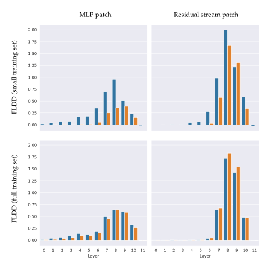

Figure 17: FLDD for different IOI-position subspaces: Subspaces were fitted to either a small version of the IOI dataset that only contained 2 names (first row) or on the full dataset (second row) using activations from the MLP (first column) or the residual stream (second column). Subspace performance on the IOI task was evaluated on the training (blue) distribution and the full test dataset containing all names (orange)

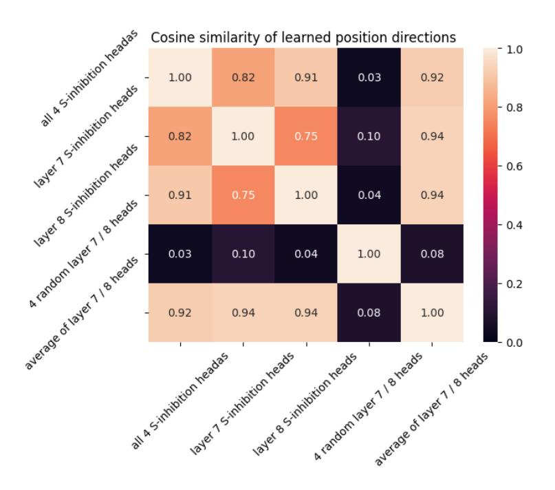

Figure 18: Cosine Similarity between learned position subspaces in the S-inhibition heads is high even when using only a subset of S-inhibition heads for training

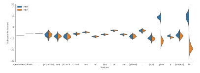

Figure 19: The IOI position subspace activates at words that predict a repeated name. S-inhibition subspace activations for different IOI prompts per position

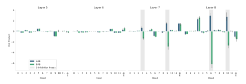

Figure 20: S-Inhibition heads but not MLP8 write to the position subspace in the residual stream that is causally connected to the name movers on the IOI task

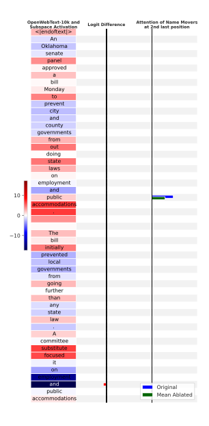

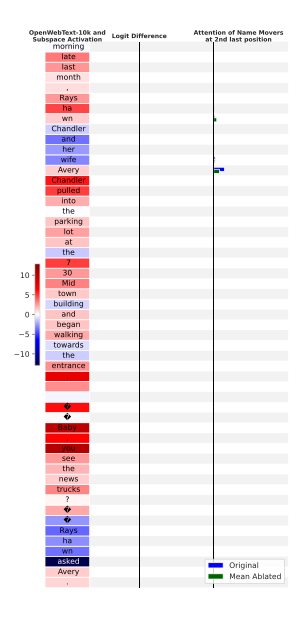

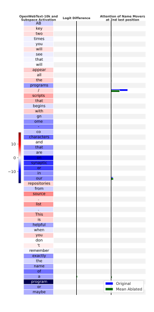

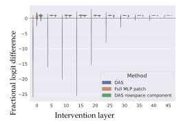

Figure 24: Fractional logit difference distributions under three interventions: patching along the direction found by DAS (blue), patching the component of the DAS direction in the rowspace of  $W_{out}$  (green), and patching the entire hidden MLP activation (orange).

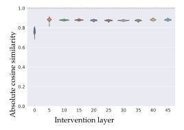

Figure 25: Distribution of the absolute value of the cosine similarity between the nullspace component of the DAS fact patching directions and the difference in activations of the last tokens of the two subjects.

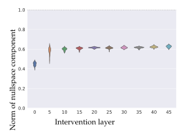

Figure 26: Distribution of the norm of the nullspace component of the DAS direction across intervention layers.

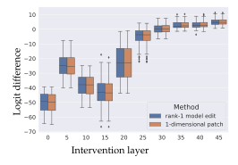

Figure 27: Comparison of logit difference between 1-dimensional fact patches and their derived rank-1 model edits

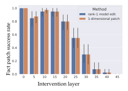

Figure 28: Comparison of fact editing success rate between 1-dimensional fact patches and their derived rank-1 model edits

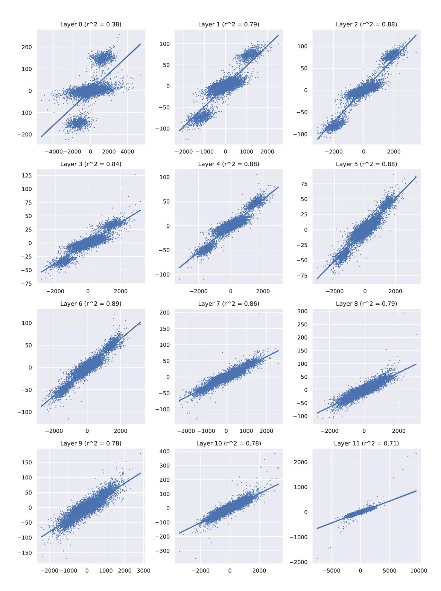

Figure 29: Regression plots accompanying the experiments in Appendix [E.4.](#page-44-0)

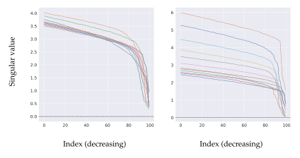

Figure 30: Smallest 100 singular values of the *Win* (left) and *Wout* (right) MLP weights by layer in in GPT2-Small

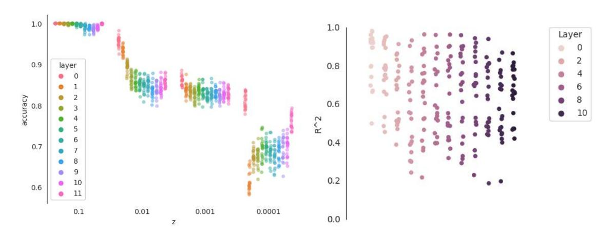

Figure 31: Recovering residual stream features linearly from hidden MLP activations: classification (left) and regression (right).