**Source:** *Plato's Key* — [original page](https://hazyresearch.stanford.edu/blog/2026-11-25-platos-key)

Nov 25, 2026 · 8 min read

# Plato’s Key

[Vivien Cheng](https://profiles.stanford.edu/vivien-cheng), [Jerry Liu](https://jerrywliu.github.io/), [Morris Yau](https://morrisyau.com/), [Chris Ré](https://cs.stanford.edu/~chrismre/)

 

The [Platonic Representation Hypothesis](https://arxiv.org/abs/2405.07987) (PRH) posits that neural networks converge toward a shared representation of reality. Prior work shows that separately trained models learn [geometrically similar](https://arxiv.org/abs/1905.00414) representations, but similar does not mean _interchangeable_. **Can one LLM use another’s representations in place of its own, without gradient descent?**

Yes, and the map is surprisingly simple. A **rotation and one global scale** , fit in closed form, let one LLM use another’s representations. We demonstrate this on factual recall across 12 base LLMs from eight families (1.5B–27B parameters).

For example, a _recipient_ LLM prompted with “The capital of Germany is” answers “Berlin”. We take a _donor_ LLM’s hidden state at “France”, rotate and scale it, and swap it in for the recipient’s state at “Germany”. The recipient’s answer flips to “Paris” ([Fig. 1](https://hazyresearch.stanford.edu/blog/2026-11-25-platos-key#mx)).

 

1Extract 2Map 3Swap

**Extract.** Take the donor’s hidden state at “France”.

**Map.** Rotate and scale the state into the recipient’s representation space.

**Swap.** Replace the recipient’s state at “Germany”. The recipient now answers “Paris” instead of “Berlin”.

**Figure 1.** Transferring a representation between LLMs. We swap a single hidden state. Tokens run left to right, layers bottom to top.

Our main findings:

  1. [**Rotations transfer factual representations across LLMs.**](https://hazyresearch.stanford.edu/blog/2026-11-25-platos-key#transfer) Our map achieves a median transfer accuracy of 41%, compared to 55% when we swap in the recipient’s own “France” state (_self-swap_ ; [Fig. 2a](https://hazyresearch.stanford.edu/blog/2026-11-25-platos-key#fig3)). More flexible maps (e.g., ridge regression) rarely transfer better.
  2. [**Rotations chain across LLMs and work in lower dimensions.**](https://hazyresearch.stanford.edu/blog/2026-11-25-platos-key#compression-and-chaining) A chain of rotations (A → B → C) retains a median 99% of a direct rotation’s accuracy (A → C; [Fig. 4a](https://hazyresearch.stanford.edu/blog/2026-11-25-platos-key#fig5)). A rotation using just 256 principal components per LLM retains a median 74% of a full rotation’s accuracy ([Fig. 4b](https://hazyresearch.stanford.edu/blog/2026-11-25-platos-key#fig5)).
  3. [**Rotations unlock dark memories in another LLM.**](https://hazyresearch.stanford.edu/blog/2026-11-25-platos-key#dark-memories) A rotated donor state recovers 18% of the recipient’s dark memories, facts it stores but fails to recall ([Fig. 5](https://hazyresearch.stanford.edu/blog/2026-11-25-platos-key#fig6)). This suggests that factual recall can fail because of an ineffective representation rather than missing knowledge in the LLM’s weights.

These findings point toward a shared, lower-dimensional structure across LLMs ([Fig. 6](https://hazyresearch.stanford.edu/blog/2026-11-25-platos-key#ss)), opening up [new research directions](https://hazyresearch.stanford.edu/blog/2026-11-25-platos-key#conclusion) such as latent communication.

## 1Rotations transfer factual representations

Geometric similarity does not show whether one LLM can use another’s representations, so we test this directly on factual recall.

Factual recall in LLMs resembles a [key–value lookup](https://arxiv.org/abs/2012.14913): early-to-middle layers build a [key](https://arxiv.org/abs/2202.05262) at the last subject token (“France”), which later layers use to retrieve the [value](https://arxiv.org/abs/2304.14767) (“Paris”) from the weights. We **swap the key** rather than the value, leaving the recipient’s later layers to retrieve the answer. If this single hidden-state swap changes the answer to “Paris”, the representation has transferred.

Our map aligns keys across frozen LLMs using **only a rotation and one global scale** , fit in closed form on fewer than 5,000 training facts that both LLMs recall.

Let μA​,μB​ be the mean keys and Z~A​,Z~B​ the centered key matrices (one key per column) of the donor and recipient, respectively. We compute the [orthogonal Procrustes](https://en.wikipedia.org/wiki/Orthogonal_Procrustes_problem) rotation R via a thin SVD and choose the global scale s to roughly match the recipient’s overall spread:

z^B​=μB​+sR(zA​−μA​),R=UV⊤,Z~B​Z~A⊤​=UΣV⊤,s=∥Z~A​∥F​∥Z~B​∥F​​

z^B​=μB​+sR(zA​−μA​)R=UV⊤,Z~B​Z~A⊤​=UΣV⊤s=∥Z~A​∥F​∥Z~B​∥F​​

Here, “rotation” includes reflections and semi-orthogonal maps between different hidden dimensions.

We test the map on 20 model pairs using 8,800 facts, each a subject and its answer under one of 16 relations, such as capitals and authors. Our 12 base LLMs span eight families (1.5B–27B parameters; [Fig. 6](https://hazyresearch.stanford.edu/blog/2026-11-25-platos-key#ss)). For each pair, we use only facts that both LLMs recall on their own. We measure **transfer accuracy** as the percentage of swaps that make the recipient generate the donor’s answer ([Fig. 1](https://hazyresearch.stanford.edu/blog/2026-11-25-platos-key#mx)). We split facts by subject into training, validation, and test sets: we fit the map on training facts, select the swap layers (ℓA in the donor and ℓB in the recipient) that maximize validation transfer accuracy, and report test results.

 

 

**Figure 2.** Transfer accuracy across 20 model pairs. (a) Each dot represents one model pair; lines mark medians. Controls include random and shuffled rotations. (b) Number of model pairs where each map performs significantly better or worse than our rotation (Holm-corrected _p_ < 0.05).

  * **Our rotation achieves a median transfer accuracy of 41%** (range: 34–46%; [Fig. 2a](https://hazyresearch.stanford.edu/blog/2026-11-25-platos-key#fig3)). For comparison, self-swap achieves a median accuracy of 55%. In a self-swap, we replace the recipient’s key for “Germany” with its own key for “France” at layer ℓB (as in [Fig. 1](https://hazyresearch.stanford.edu/blog/2026-11-25-platos-key#mx), but within one model). Since information about “Germany” remains in other tokens and layers, the answer does not always flip. We use self-swap as our reference since it requires no cross-model mapping. Across model pairs, our rotation retains a median 73% of self-swap accuracy (range: 60–93%). Retention is similar for cross-family and within-family pairs (75% vs. 69%).
  * **Other maps rarely beat our rotation** ([Fig. 2b](https://hazyresearch.stanford.edu/blog/2026-11-25-platos-key#fig3)). At the same swap layers (ℓA, ℓB), [ridge regression](https://arxiv.org/abs/1309.4168) without rescaling, a [whitened rotation](https://github.com/artetxem/vecmap), and a [trained MLP](https://arxiv.org/abs/2503.04429) significantly outperform our rotation in only 7% of comparisons. Rescaling makes ridge regression competitive, while a least-squares scale never significantly improves transfer accuracy. Both suggest that keeping the recipient’s usual scale matters, and least-squares fits underestimate it. Even without paired facts, [Wasserstein Procrustes](https://arxiv.org/abs/1805.11222) achieves a median 87% of our rotation’s accuracy.
  * **Geometric similarity does not guarantee functional transfer.** We use [mutual nearest-neighbor similarity](https://arxiv.org/abs/2405.07987) (mKNN), the primary metric in the [PRH](https://arxiv.org/abs/2405.07987) paper, to select swap layers. On the same validation set, selecting layers by mKNN yields a median transfer accuracy of 4.5%, about a tenth of what selecting by transfer accuracy achieves. mKNN usually peaks within the first 5% of the recipient’s depth, while transfer accuracy peaks at 22–38% of the depth.

Representations can be geometrically similar without being functionally interchangeable. Yet a simple change of coordinates lets one LLM use another’s representations.

## 2Rotations chain and work in lower dimensions

Rotations align pairs of LLMs, but do all LLMs share one underlying geometry? If so, a chain of rotations (A → B → C) should transfer nearly as well as a direct rotation (A → C). We also ask how many dimensions factual transfer needs ([Fig. 3](https://hazyresearch.stanford.edu/blog/2026-11-25-platos-key#cx)).

 

1Chaining 2Compression 3Shared space?

**Chaining.** A chain of rotations (A → B → C) retains a median 99% of the transfer accuracy of a direct rotation (A → C).

**Compression.** A rotation fit on the top 256 principal components retains a median 74% of the full rotation’s transfer accuracy. With just 16 components, the median drops to 4%.

**Shared space?** Both results are consistent with LLMs being rotated views of one shared, lower-dimensional space.

**Figure 3.** Chaining rotations and compressing representations. Each disc represents one LLM’s representation space.

  * **A chain of rotations retains a median 99% of the direct rotation’s transfer accuracy** ([Fig. 4a](https://hazyresearch.stanford.edu/blog/2026-11-25-platos-key#fig5)). For LLMs A, B, and C, we compose the (A → B) and (B → C) maps without using the direct (A → C) map or running B. The recipient layer of (A → B) is the donor layer of (B → C). We evaluate both the chained and direct maps at the same endpoint layers on test facts that all three LLMs recall. Of the 47 chains, 40 retain at least 95% of the direct rotation’s accuracy, and none falls below 92%.
  * **A rotation using 256 principal components per LLM retains a median 74% of the full rotation’s transfer accuracy** ([Fig. 4b](https://hazyresearch.stanford.edu/blog/2026-11-25-platos-key#fig5)). We reduce each LLM’s original width (1,536–5,120 dimensions) to its top principal components, fit the map, and set the recipient’s remaining components to their training mean. The median relative accuracy rises from 4% with 16 components to 87% with 512, with diminishing gains beyond 256 components.

 

 

**Figure 4.** Transfer accuracy of chained and compressed rotations. (a) Each dot represents one chain; the band marks 95% of direct accuracy and above. (b) Accuracy relative to the full rotation (median and IQR over 20 model pairs).

Rather than a map for every pair, each LLM might need just one rotation into a shared, lower-dimensional space ([Fig. 6](https://hazyresearch.stanford.edu/blog/2026-11-25-platos-key#ss)).

## 3Rotations unlock dark memories

So far, we have used rotations to change what an LLM recalls, but could we also use this shared geometry to rescue failed recall? [Prior work](https://arxiv.org/abs/2503.15299) shows that LLMs store facts they fail to recall, which we call **dark memories**. As a proof of concept, we use a rotated key from another LLM to unlock them ([Fig. 5](https://hazyresearch.stanford.edu/blog/2026-11-25-platos-key#fig6)).

 

1Own key 2Donor key 3Unlock

**Own key.** With its own key for “Interstellar”, the recipient answers “Denis Villeneuve”.

**Donor key.** We swap in the donor’s rotated and scaled key for “Interstellar”.

**Unlock.** The donor’s key retrieves the stored answer from the recipient’s memory: “Christopher Nolan”.

**Figure 5.** Unlocking a dark memory. With its own key, the recipient answers incorrectly (“Denis Villeneuve”). With the donor’s rotated key, it recalls the correct answer (“Christopher Nolan”).

  * **More than half of the misses we test qualify as dark memories.** We collect 2,600 misses from our 20 model pairs: test facts that the donor recalls on a direct prompt but the recipient does not. We count a miss as a dark memory if the recipient passes at least one of three checks: answering correctly with three in-context examples, answering correctly under a paraphrased prompt, or ranking the correct answer first among up to 50 answers within the same relation. In total, 56% of the recipient’s misses (1,463) qualify as dark memories.
  * **A rotated donor key recovers 18% of these dark memories.** We recover 267 of the recipient’s dark memories by swapping in rotated donor keys as in [Fig. 5](https://hazyresearch.stanford.edu/blog/2026-11-25-platos-key#fig6), without updating any weights. No control recovers more than 1.1% of them.

Some failures of factual recall can be rescued by changing the key rather than the weights. A simple change of coordinates lets one LLM unlock another’s dark memories.

## Looking ahead

A closed-form rotation and scale let one LLM use another’s representations for factual recall. We read this as functional evidence for the [PRH](https://arxiv.org/abs/2405.07987): the representations are not just similar but partly interchangeable. This also fits our lab’s view of [MLPs as Hebbian memories](https://hazyresearch.stanford.edu/blog/2026-07-22-mlps-are-hebbians), and suggests that one LLM’s rotated keys can query another’s memory.

We’re very excited to explore two directions:

  * **Understanding the shared geometry.** Exploring whether LLMs share a universal representation space ([Fig. 6](https://hazyresearch.stanford.edu/blog/2026-11-25-platos-key#ss)) and whether our findings extend to multi-hop reasoning, post-trained LLMs, larger models, and other modalities.
  * **Building more efficient systems.** Porting knowledge across models without retraining, reusing each other’s hidden states for cheaper inference, and communicating directly through latent representations (_Neuralese_).

 

1Twelve views 2Align 3Shared space?

**Twelve views.** Each LLM has its own representation space.

**Align.** Jointly fit a rotation and scale for each LLM.

**Shared space?** If LLMs share one underlying geometry, corresponding representations should align.

**Figure 6.** Aligning all 12 LLMs in a single representation space?

If you’re interested in exploring these directions with us or have any feedback, we’d love to hear from you. Please reach out to Vivien ([vicheng@stanford.edu](mailto:vicheng@stanford.edu)).

## Acknowledgements

We thank Yasa Baig, Nasim Borazjanizadeh, Kelly Buchanan, Francois Chaubard, Cloris Cheng, Catherine Deng, Roberto Garcia, Junmiao Hu, Hermann Kumbong, Sam Layton, Iddah Mlauzi, Divya Nori, Jon Saad-Falcon, and Stuart Sul for their thoughtful feedback and discussions.
