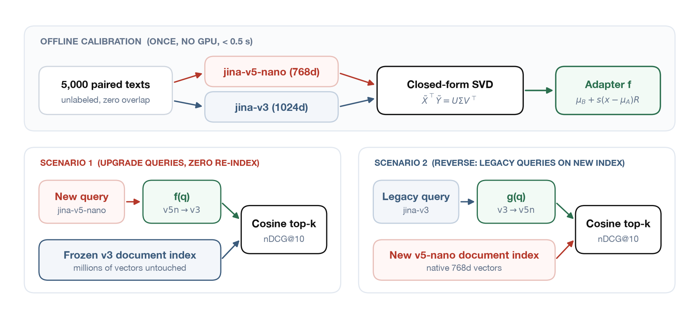
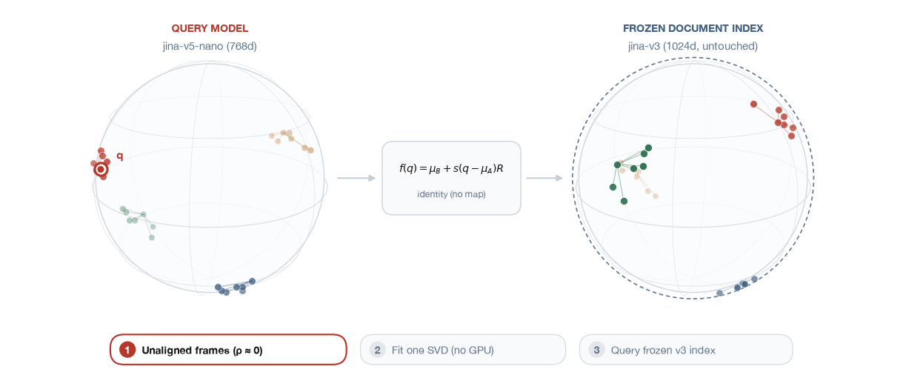
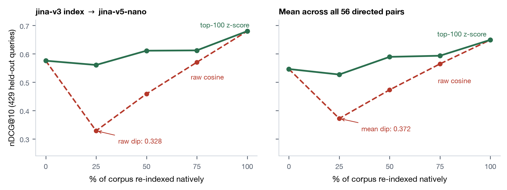
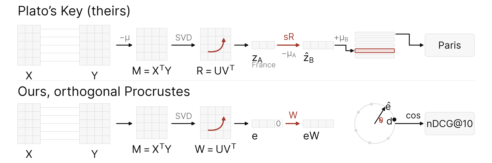
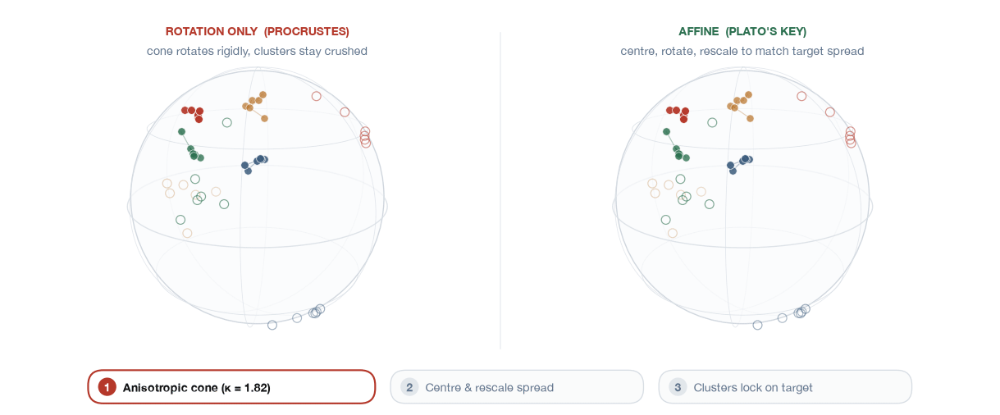
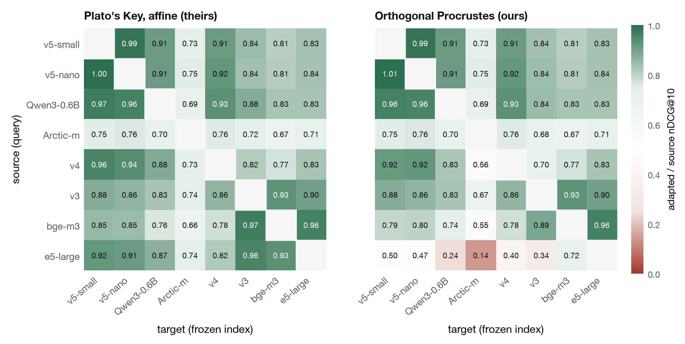
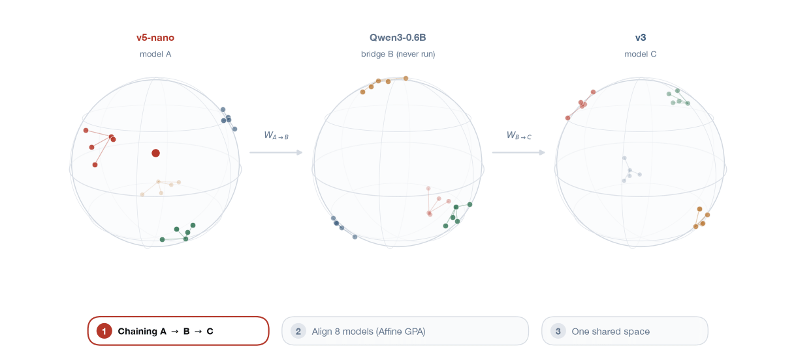

**Source:** *Embedding Compatibility Adapters* — [original page](https://github.com/hanxiao/embedding-compatibility-adapters)

  1. [hanxiao](https://github.com/hanxiao)
  2. [embedding-compatibility-adapters](https://github.com/hanxiao/embedding-compatibility-adapters)

## Repository navigation

  *   * [ 

 Code](https://github.com/hanxiao/embedding-compatibility-adapters)
  * [ 

 Issues](https://github.com/hanxiao/embedding-compatibility-adapters/issues)
  * [ 

 Pull requests](https://github.com/hanxiao/embedding-compatibility-adapters/pulls)
  * [ 

 Actions](https://github.com/hanxiao/embedding-compatibility-adapters/actions)
  * [ 

 Projects](https://github.com/hanxiao/embedding-compatibility-adapters/projects)
  * [ 

 Security and quality](https://github.com/hanxiao/embedding-compatibility-adapters/security)
  * [ 

 Insights](https://github.com/hanxiao/embedding-compatibility-adapters/pulse)

More items 

 

 

**[embedding-compatibility-adapters](https://github.com/hanxiao/embedding-compatibility-adapters)**

Public

  * [ 

 Notifications](https://github.com/login?return_to=%2Fhanxiao%2Fembedding-compatibility-adapters)You must be signed in to change notification settings
  * [ 

 Fork3 (3)](https://github.com/login?return_to=%2Fhanxiao%2Fembedding-compatibility-adapters)
  * [ 

 Star65 (65)](https://github.com/login?return_to=%2Fhanxiao%2Fembedding-compatibility-adapters)You must be signed in to star a repository

## About

Bridge incompatible embedding spaces with a single SVD. When your embedding provider deprecates a model, adapt instead of re-embedding.

### Resources

[ 

 Readme](https://github.com/hanxiao/embedding-compatibility-adapters#readme-ov-file)

[ 

 Apache-2.0 license](https://github.com/hanxiao/embedding-compatibility-adapters#Apache-2.0-1-ov-file)

[ 

 Activity](https://github.com/hanxiao/embedding-compatibility-adapters/activity)

### Stars

 **65** stars

### Watchers

 **0** watching

### Forks

[ 

 **3** forks](https://github.com/hanxiao/embedding-compatibility-adapters/forks)

[Report repository](https://github.com/contact/report-content?content_url=https%3A%2F%2Fgithub.com%2Fhanxiao%2Fembedding-compatibility-adapters&report=hanxiao+%28user%29)

 

main

 

[ 

 Branches](https://github.com/hanxiao/embedding-compatibility-adapters/branches)[ 

 Tags](https://github.com/hanxiao/embedding-compatibility-adapters/tags)

 

Go to file

 Code 

 

 Open more actions menu

## Latest commit

## History

[ 

 28 Commits](https://github.com/hanxiao/embedding-compatibility-adapters/commits/main/)

28 Commits

## Folders and files

<table class="Box__0K17vj OverviewTable__rPbUfl" aria-labelledby="folders-and-files"><thead class="OverviewHeaderRow__Z_ScMh Box_1__wW_V7a"><tr class="Box_2__2RzMbJ"><th colspan="2" class="Box__l3IzCz">Name</th><th colspan="1" class="Box_1__vRncVq">Name</th><th class="hide-sm">
Last commit message
</th><th colspan="1" class="Box_2__Sojj6x">
Last commit date
</th></tr></thead><tbody class="OverviewTableBody__ZmULK8"><tr class="react-directory-row undefined" id="folder-row-0"><td class="react-directory-row-name-cell-small-screen" colspan="2">

<a title="align" aria-label="align, (Directory)" class="Link--primary" href="https://github.com/hanxiao/embedding-compatibility-adapters/tree/main/align" data-discover="true">align</a>

</td><td class="react-directory-row-name-cell-large-screen" colspan="1">

<a title="align" aria-label="align, (Directory)" class="Link--primary" href="https://github.com/hanxiao/embedding-compatibility-adapters/tree/main/align" data-discover="true">align</a>

</td><td class="react-directory-row-commit-cell">
 
</td><td>

 

</td></tr><tr class="react-directory-row undefined" id="folder-row-1"><td class="react-directory-row-name-cell-small-screen" colspan="2">

<a title="assets" aria-label="assets, (Directory)" class="Link--primary" href="https://github.com/hanxiao/embedding-compatibility-adapters/tree/main/assets" data-discover="true">assets</a>

</td><td class="react-directory-row-name-cell-large-screen" colspan="1">

<a title="assets" aria-label="assets, (Directory)" class="Link--primary" href="https://github.com/hanxiao/embedding-compatibility-adapters/tree/main/assets" data-discover="true">assets</a>

</td><td class="react-directory-row-commit-cell">
 
</td><td>

 

</td></tr><tr class="react-directory-row undefined" id="folder-row-2"><td class="react-directory-row-name-cell-small-screen" colspan="2">

<a title="examples" aria-label="examples, (Directory)" class="Link--primary" href="https://github.com/hanxiao/embedding-compatibility-adapters/tree/main/examples" data-discover="true">examples</a>

</td><td class="react-directory-row-name-cell-large-screen" colspan="1">

<a title="examples" aria-label="examples, (Directory)" class="Link--primary" href="https://github.com/hanxiao/embedding-compatibility-adapters/tree/main/examples" data-discover="true">examples</a>

</td><td class="react-directory-row-commit-cell">
 
</td><td>

 

</td></tr><tr class="react-directory-row undefined" id="folder-row-3"><td class="react-directory-row-name-cell-small-screen" colspan="2">

<a title="paper" aria-label="paper, (Directory)" class="Link--primary" href="https://github.com/hanxiao/embedding-compatibility-adapters/tree/main/paper" data-discover="true">paper</a>

</td><td class="react-directory-row-name-cell-large-screen" colspan="1">

<a title="paper" aria-label="paper, (Directory)" class="Link--primary" href="https://github.com/hanxiao/embedding-compatibility-adapters/tree/main/paper" data-discover="true">paper</a>

</td><td class="react-directory-row-commit-cell">
 
</td><td>

 

</td></tr><tr class="react-directory-row undefined" id="folder-row-4"><td class="react-directory-row-name-cell-small-screen" colspan="2">

<a title="tests" aria-label="tests, (Directory)" class="Link--primary" href="https://github.com/hanxiao/embedding-compatibility-adapters/tree/main/tests" data-discover="true">tests</a>

</td><td class="react-directory-row-name-cell-large-screen" colspan="1">

<a title="tests" aria-label="tests, (Directory)" class="Link--primary" href="https://github.com/hanxiao/embedding-compatibility-adapters/tree/main/tests" data-discover="true">tests</a>

</td><td class="react-directory-row-commit-cell">
 
</td><td>

 

</td></tr><tr class="react-directory-row undefined" id="folder-row-5"><td class="react-directory-row-name-cell-small-screen" colspan="2">

<a title=".gitignore" aria-label=".gitignore, (File)" class="Link--primary" href="https://github.com/hanxiao/embedding-compatibility-adapters/blob/main/.gitignore" data-discover="true">.gitignore</a>

</td><td class="react-directory-row-name-cell-large-screen" colspan="1">

<a title=".gitignore" aria-label=".gitignore, (File)" class="Link--primary" href="https://github.com/hanxiao/embedding-compatibility-adapters/blob/main/.gitignore" data-discover="true">.gitignore</a>

</td><td class="react-directory-row-commit-cell">
 
</td><td>

 

</td></tr><tr class="react-directory-row undefined" id="folder-row-6"><td class="react-directory-row-name-cell-small-screen" colspan="2">

<a title="LICENSE" aria-label="LICENSE, (File)" class="Link--primary" href="https://github.com/hanxiao/embedding-compatibility-adapters/blob/main/LICENSE" data-discover="true">LICENSE</a>

</td><td class="react-directory-row-name-cell-large-screen" colspan="1">

<a title="LICENSE" aria-label="LICENSE, (File)" class="Link--primary" href="https://github.com/hanxiao/embedding-compatibility-adapters/blob/main/LICENSE" data-discover="true">LICENSE</a>

</td><td class="react-directory-row-commit-cell">
 
</td><td>

 

</td></tr><tr class="react-directory-row undefined" id="folder-row-7"><td class="react-directory-row-name-cell-small-screen" colspan="2">

<a title="README.md" aria-label="README.md, (File)" class="Link--primary" href="https://github.com/hanxiao/embedding-compatibility-adapters/blob/main/README.md" data-discover="true">README.md</a>

</td><td class="react-directory-row-name-cell-large-screen" colspan="1">

<a title="README.md" aria-label="README.md, (File)" class="Link--primary" href="https://github.com/hanxiao/embedding-compatibility-adapters/blob/main/README.md" data-discover="true">README.md</a>

</td><td class="react-directory-row-commit-cell">
 
</td><td>

 

</td></tr><tr class="react-directory-row undefined" id="folder-row-8"><td class="react-directory-row-name-cell-small-screen" colspan="2">

<a title="adapter.py" aria-label="adapter.py, (File)" class="Link--primary" href="https://github.com/hanxiao/embedding-compatibility-adapters/blob/main/adapter.py" data-discover="true">adapter.py</a>

</td><td class="react-directory-row-name-cell-large-screen" colspan="1">

<a title="adapter.py" aria-label="adapter.py, (File)" class="Link--primary" href="https://github.com/hanxiao/embedding-compatibility-adapters/blob/main/adapter.py" data-discover="true">adapter.py</a>

</td><td class="react-directory-row-commit-cell">
 
</td><td>

 

</td></tr><tr class="react-directory-row undefined" id="folder-row-9"><td class="react-directory-row-name-cell-small-screen" colspan="2">

<a title="architecture-pipeline.pdf" aria-label="architecture-pipeline.pdf, (File)" class="Link--primary" href="https://github.com/hanxiao/embedding-compatibility-adapters/blob/main/architecture-pipeline.pdf" data-discover="true">architecture-pipeline.pdf</a>

</td><td class="react-directory-row-name-cell-large-screen" colspan="1">

<a title="architecture-pipeline.pdf" aria-label="architecture-pipeline.pdf, (File)" class="Link--primary" href="https://github.com/hanxiao/embedding-compatibility-adapters/blob/main/architecture-pipeline.pdf" data-discover="true">architecture-pipeline.pdf</a>

</td><td class="react-directory-row-commit-cell">
 
</td><td>

 

</td></tr><tr class="react-directory-row truncate-for-mobile" id="folder-row-10"><td class="react-directory-row-name-cell-small-screen" colspan="2">

<a title="architecture-pipeline.png" aria-label="architecture-pipeline.png, (File)" class="Link--primary" href="https://github.com/hanxiao/embedding-compatibility-adapters/blob/main/architecture-pipeline.png" data-discover="true">architecture-pipeline.png</a>

</td><td class="react-directory-row-name-cell-large-screen" colspan="1">

<a title="architecture-pipeline.png" aria-label="architecture-pipeline.png, (File)" class="Link--primary" href="https://github.com/hanxiao/embedding-compatibility-adapters/blob/main/architecture-pipeline.png" data-discover="true">architecture-pipeline.png</a>

</td><td class="react-directory-row-commit-cell">
 
</td><td>

 

</td></tr><tr class="react-directory-row truncate-for-mobile" id="folder-row-11"><td class="react-directory-row-name-cell-small-screen" colspan="2">

<a title="architecture-pipeline.svg" aria-label="architecture-pipeline.svg, (File)" class="Link--primary" href="https://github.com/hanxiao/embedding-compatibility-adapters/blob/main/architecture-pipeline.svg" data-discover="true">architecture-pipeline.svg</a>

</td><td class="react-directory-row-name-cell-large-screen" colspan="1">

<a title="architecture-pipeline.svg" aria-label="architecture-pipeline.svg, (File)" class="Link--primary" href="https://github.com/hanxiao/embedding-compatibility-adapters/blob/main/architecture-pipeline.svg" data-discover="true">architecture-pipeline.svg</a>

</td><td class="react-directory-row-commit-cell">
 
</td><td>

 

</td></tr><tr class="react-directory-row truncate-for-mobile" id="folder-row-12"><td class="react-directory-row-name-cell-small-screen" colspan="2">

<a title="embed_local.py" aria-label="embed_local.py, (File)" class="Link--primary" href="https://github.com/hanxiao/embedding-compatibility-adapters/blob/main/embed_local.py" data-discover="true">embed_local.py</a>

</td><td class="react-directory-row-name-cell-large-screen" colspan="1">

<a title="embed_local.py" aria-label="embed_local.py, (File)" class="Link--primary" href="https://github.com/hanxiao/embedding-compatibility-adapters/blob/main/embed_local.py" data-discover="true">embed_local.py</a>

</td><td class="react-directory-row-commit-cell">
 
</td><td>

 

</td></tr><tr class="react-directory-row truncate-for-mobile" id="folder-row-13"><td class="react-directory-row-name-cell-small-screen" colspan="2">

<a title="method-two-maps.pdf" aria-label="method-two-maps.pdf, (File)" class="Link--primary" href="https://github.com/hanxiao/embedding-compatibility-adapters/blob/main/method-two-maps.pdf" data-discover="true">method-two-maps.pdf</a>

</td><td class="react-directory-row-name-cell-large-screen" colspan="1">

<a title="method-two-maps.pdf" aria-label="method-two-maps.pdf, (File)" class="Link--primary" href="https://github.com/hanxiao/embedding-compatibility-adapters/blob/main/method-two-maps.pdf" data-discover="true">method-two-maps.pdf</a>

</td><td class="react-directory-row-commit-cell">
 
</td><td>

 

</td></tr><tr class="react-directory-row truncate-for-mobile" id="folder-row-14"><td class="react-directory-row-name-cell-small-screen" colspan="2">

<a title="method-two-maps.png" aria-label="method-two-maps.png, (File)" class="Link--primary" href="https://github.com/hanxiao/embedding-compatibility-adapters/blob/main/method-two-maps.png" data-discover="true">method-two-maps.png</a>

</td><td class="react-directory-row-name-cell-large-screen" colspan="1">

<a title="method-two-maps.png" aria-label="method-two-maps.png, (File)" class="Link--primary" href="https://github.com/hanxiao/embedding-compatibility-adapters/blob/main/method-two-maps.png" data-discover="true">method-two-maps.png</a>

</td><td class="react-directory-row-commit-cell">
 
</td><td>

 

</td></tr><tr class="react-directory-row truncate-for-mobile" id="folder-row-15"><td class="react-directory-row-name-cell-small-screen" colspan="2">

<a title="method-two-maps.svg" aria-label="method-two-maps.svg, (File)" class="Link--primary" href="https://github.com/hanxiao/embedding-compatibility-adapters/blob/main/method-two-maps.svg" data-discover="true">method-two-maps.svg</a>

</td><td class="react-directory-row-name-cell-large-screen" colspan="1">

<a title="method-two-maps.svg" aria-label="method-two-maps.svg, (File)" class="Link--primary" href="https://github.com/hanxiao/embedding-compatibility-adapters/blob/main/method-two-maps.svg" data-discover="true">method-two-maps.svg</a>

</td><td class="react-directory-row-commit-cell">
 
</td><td>

 

</td></tr><tr class="react-directory-row truncate-for-mobile" id="folder-row-16"><td class="react-directory-row-name-cell-small-screen" colspan="2">

<a title="report.pdf" aria-label="report.pdf, (File)" class="Link--primary" href="https://github.com/hanxiao/embedding-compatibility-adapters/blob/main/report.pdf" data-discover="true">report.pdf</a>

</td><td class="react-directory-row-name-cell-large-screen" colspan="1">

<a title="report.pdf" aria-label="report.pdf, (File)" class="Link--primary" href="https://github.com/hanxiao/embedding-compatibility-adapters/blob/main/report.pdf" data-discover="true">report.pdf</a>

</td><td class="react-directory-row-commit-cell">
 
</td><td>

 

</td></tr><tr class="react-directory-row truncate-for-mobile" id="folder-row-17"><td class="react-directory-row-name-cell-small-screen" colspan="2">

<a title="requirements.txt" aria-label="requirements.txt, (File)" class="Link--primary" href="https://github.com/hanxiao/embedding-compatibility-adapters/blob/main/requirements.txt" data-discover="true">requirements.txt</a>

</td><td class="react-directory-row-name-cell-large-screen" colspan="1">

<a title="requirements.txt" aria-label="requirements.txt, (File)" class="Link--primary" href="https://github.com/hanxiao/embedding-compatibility-adapters/blob/main/requirements.txt" data-discover="true">requirements.txt</a>

</td><td class="react-directory-row-commit-cell">
 
</td><td>

 

</td></tr><tr class="react-directory-row truncate-for-mobile" id="folder-row-18"><td class="react-directory-row-name-cell-small-screen" colspan="2">

<a title="retention-theirs-vs-ours.png" aria-label="retention-theirs-vs-ours.png, (File)" class="Link--primary" href="https://github.com/hanxiao/embedding-compatibility-adapters/blob/main/retention-theirs-vs-ours.png" data-discover="true">retention-theirs-vs-ours.png</a>

</td><td class="react-directory-row-name-cell-large-screen" colspan="1">

<a title="retention-theirs-vs-ours.png" aria-label="retention-theirs-vs-ours.png, (File)" class="Link--primary" href="https://github.com/hanxiao/embedding-compatibility-adapters/blob/main/retention-theirs-vs-ours.png" data-discover="true">retention-theirs-vs-ours.png</a>

</td><td class="react-directory-row-commit-cell">
 
</td><td>

 

</td></tr><tr class="react-directory-row truncate-for-mobile" id="folder-row-19"><td class="react-directory-row-name-cell-small-screen" colspan="2">

<a title="run_all.py" aria-label="run_all.py, (File)" class="Link--primary" href="https://github.com/hanxiao/embedding-compatibility-adapters/blob/main/run_all.py" data-discover="true">run_all.py</a>

</td><td class="react-directory-row-name-cell-large-screen" colspan="1">

<a title="run_all.py" aria-label="run_all.py, (File)" class="Link--primary" href="https://github.com/hanxiao/embedding-compatibility-adapters/blob/main/run_all.py" data-discover="true">run_all.py</a>

</td><td class="react-directory-row-commit-cell">
 
</td><td>

 

</td></tr><tr class="show-for-mobile Box_4__B4qtNd" data-testid="view-all-files-row"><td colspan="3" class="Box_5__pr2sgM">
<button class="prc-Link-Link-9ZwDx" data-component="Link">View all files</button>
</td></tr></tbody></table>

 

## Repository files navigation

  *   * [ 

 README](https://github.com/hanxiao/embedding-compatibility-adapters)
  * [ 

 Apache-2.0 license](https://github.com/hanxiao/embedding-compatibility-adapters)

More items 

 

 

# Embedding Compatibility Adapters

[[Technical Report (PDF)](https://github.com/hanxiao/embedding-compatibility-adapters/blob/main/report.pdf)]

Your embedding provider released a stronger model, or deprecated an old one, and you have millions of documents already indexed in your vector database. Re-embedding the entire corpus costs days of GPU compute and downtime. A closed-form linear map fitted on 5,000 unlabeled paired texts bridges the two spaces in **0.34 seconds on CPU** , maps each query in **76 microseconds** , and requires no training loop, no GPU, and zero re-indexing.

## Two canonical examples: `jina-embeddings-v3` ↔ `jina-embeddings-v5-nano`

### Scenario 1: Documents are frozen in `v3`, search with new `v5-nano` queries (zero re-indexing)

Your production index holds `jina-embeddings-v3` (1024d) vectors and you do not want to re-embed them. You switch your query encoder to `jina-embeddings-v5-text-nano` (768d) and map every incoming query into the frozen `v3` space at search time:
    
    
    from adapter import diagnose, source_centred_align, AffineMap
    
    # 1. Offline calibration (once, ~0.34s on CPU, 5,000 unlabeled texts, half query-mode / half passage-mode)
    print(diagnose(X_v5nano_cal, Y_v3_cal))
    # {'rho': -0.008, 'kappa_source': 0.35, 'kappa_target': 0.27, 'cka': 0.763, ...}
    
    f = source_centred_align(X_v5nano_cal, Y_v3_cal)   # zero hyperparameters, no val set needed
    f.save("v5nano_to_v3.npz")
    
    # 2. Online serving (76 us per query, frozen v3 vector DB untouched)
    f = AffineMap.load("v5nano_to_v3.npz")
    q_in_v3 = f(q_v5nano)                              # shape (n_queries, 1024), L2-normalized
    scores = q_in_v3 @ frozen_v3_index.T               # NanoBEIR nDCG@10: 0.571 (vs 0.004 unadapted)

### Scenario 2: Reverse, documents indexed in `v5-nano`, legacy `v3` clients keep searching

A new corpus is indexed natively with `jina-embeddings-v5-text-nano` (768d), while legacy clients or cached pipelines still emit `jina-embeddings-v3` (1024d) queries:
    
    
    from adapter import source_centred_align
    
    g = source_centred_align(X_v3_cal, Y_v5nano_cal)   # 1024d -> 768d
    q_in_v5nano = g(q_v3)                              # score directly against native v5-nano index
    scores = q_in_v5nano @ native_v5nano_index.T       # NanoBEIR nDCG@10: 0.551 (vs 0.003 unadapted)

### Scenario 3: Zero-downtime progressive re-indexing (`0% → 25% → 50% → 75% → 100%`)

Instead of adapting queries forever, you can convert the stored `v3` vectors once by a single matrix multiply (`10.5 s` per million vectors on CPU, no neural model) into `v5-nano` space and progressively replace old vectors with native `v5-nano` embeddings in the background.

Mixing adapted and native vectors in one raw-cosine index causes a **-0.247 nDCG@10 crash at 25% migration** (`0.576 → 0.328`) because adapted vectors have a lower background cosine mean (`0.083` vs `0.204`) and an attenuated peak (`0.246` vs `0.415`), so irrelevant native documents outscore relevant adapted ones. Querying the native and adapted shards separately and z-scoring each shard's top-100 cosine scores per query eliminates the crash completely:

migration scenario | 0% native | 25% native | 50% native | 75% native | 100% native  
---|---|---|---|---|---  
`v3` index → `v5-nano` (raw cosine) | 0.5757 | 0.3284 | 0.4587 | 0.5703 | 0.6800  
`v3` index → `v5-nano` (top-100 z-score) | 0.5757 | **0.5607** | **0.6111** | **0.6121** | 0.6800  
`v5-nano` index → `v3` (raw cosine) | 0.5530 | 0.3694 | 0.4687 | 0.5659 | 0.6401  
`v5-nano` index → `v3` (top-100 z-score) | 0.5530 | **0.5226** | **0.5952** | **0.6025** | 0.6401  
Mean over 56 pairs (raw cosine) | 0.5464 | 0.3718 | 0.4729 | 0.5645 | 0.6492  
Mean over 56 pairs (top-100 z-score) | 0.5464 | **0.5270** | **0.5893** | **0.5933** | 0.6492

 

Run all three scenarios end-to-end with `python examples/v3_v5nano_migration.py`.

## Two maps, one skeleton, and why retrieval differs from LLM hidden states

**Plato's Key (theirs, Cheng, Liu, Yau, Ré, HazyResearch, 2026).** Aligns a frozen LLM's hidden state at layer $\ell_A$ to another LLM's layer $\ell_B$ via an affine orthogonal map: subtract the donor mean $\mu_A$, rotate by $R = UV^\top$, rescale by the Frobenius spread ratio $s = |\tilde{Y}|_F / |\tilde{X}|_F$, and add the recipient mean $+\mu_B$ back so the recipient's next transformer layer sees an in-distribution activation.

**Orthogonal & Source-centred Procrustes (ours).** Aligns pooled text embeddings scored by cosine similarity against an untouched document index. When a source model is highly anisotropic (`multilingual-e5-large-instruct`, $\kappa = 1.82$), vectors pack into a narrow polar cone and an uncentred rotation collapses (`0.14–0.50` retention) because the mean-mean term dominates $X^\top Y$. Subtracting $\mu_X$ restores the cone, as shown below:

On text retrieval, however, blindly adding $+\mu_Y$ back hurts by **-0.0807 nDCG@10** across the 14 pairs whose target is itself anisotropic (`jina-v4` with $\kappa = 0.99$, `e5-large` with $\kappa = 1.82$; e.g. `v3 → v4` drops from `0.5490` to `0.4703`) because $+\mu_Y$ injects a query-independent hubness bias $\langle \mu_Y, d \rangle$. **Source-centred Procrustes** (`z_hat = norm((z - mu_x) @ R_c)`, omitting $+\mu_Y$) fixes both sides with zero hyperparameters: it reaches `0.5458` on anisotropic targets and outperforms both uncentred Procrustes and fixed Plato's Key at every calibration budget from 50 to 5,000 texts. When a small validation split is available, selecting centring and scale on validation nDCG@10 (`affine`, Plato's Key protocol) reaches `0.5462` with 18 significant wins and zero significant losses.

## Two pre-fit diagnostics predict everything

Both numbers are computed from paired calibration embeddings before fitting any map:

diagnostic | formula | what it predicts | correlation over 56 pairs  
---|---|---|---  
frame correlation `rho` | mean cosine between paired embeddings (padded to wider dim) | whether you need an adapter at all | **+0.951** with identity score, **-0.862** with map gain  
source anisotropy `kappa_s` | `‖mean‖ / RMS(x − mean)` of source model | whether pure rotation will collapse | **+0.882** with affine gain over rotation, **-0.683** with antisymmetry

 

Shared coordinate frames (`rho > 0.1`) occur strictly between models built on the same pretrained backbone: XLM-R large models (`jina-v3`, `bge-m3`, `e5-large`) share `rho = 0.172–0.375` and reach `0.309–0.542` with no adapter, and the two Qwen3-0.6B models (`v5-small`, `Qwen3-Embedding-0.6B`) share `rho = 0.109`. Rotation-invariant CKA cannot see frame alignment (`r = -0.073` with identity): `v5-nano` and `v5-small` have CKA `0.957` and `rho = -0.001`, so doing nothing retrieves `0.002`.

## Full benchmark: 8 models, 6 families, 56 directed pairs

Evaluated on 13 NanoBEIR-en tasks (649 queries, 56,723 documents; 220 validation / 429 held-out test queries, verified across 5 random splits), calibrated on 5,000 zero-overlap AG News texts (2,500 query-mode + 2,500 passage-mode).

### Native baselines

model | family | backbone | dim | anisotropy `kappa` | all 649 | test 429  
---|---|---|---|---|---|---  
`jina-embeddings-v5-small` | jina | qwen3 | 1024 | 0.34 | 0.6706 | 0.6822  
`jina-embeddings-v5-nano` | jina | eurobert | 768 | 0.35 | 0.6669 | 0.6800  
`Qwen3-Embedding-0.6B` | qwen | qwen3 | 1024 | 0.50 | 0.6479 | 0.6558  
`snowflake-arctic-embed-m-v1.5` | snowflake | bert | 768 | 0.49 | 0.6479 | 0.6529  
`jina-embeddings-v4` | jina | qwen25vl | 2048 | 0.99 | 0.6466 | 0.6527  
`jina-embeddings-v3` | jina | xlmr | 1024 | 0.27 | 0.6342 | 0.6401  
`bge-m3` | bge | xlmr | 1024 | 0.74 | 0.6040 | 0.6156  
`multilingual-e5-large-instruct` | e5 | xlmr | 1024 | 1.82 | 0.6104 | 0.6147

 

### Adapter families (56 directed pairs)

method | nDCG@10 | /source | /target | 5-seed mean ± std | sig wins / losses vs Procrustes  
---|---|---|---|---|---  
Orthogonal Procrustes (ours) | 0.4998 | 0.766 | 0.771 | 0.4931 ± 0.0085 | -  
Affine, centre + scale (Plato's Key, fixed) | 0.5162 | 0.796 | 0.794 | 0.5105 ± 0.0078 | 17 / 20  
**Source-centred Procrustes (ours, zero-param)** | **0.5336** | **0.822** | **0.822** | **0.5304 ± 0.0080** | 13 / 15  
Affine, centre + LS scale (fixed) | 0.4752 | 0.733 | 0.730 | - | 14 / 26  
**Affine, val-selected (Plato's Key)** | **0.5462** | **0.841** | **0.842** | **0.5407 ± 0.0085** | **18 / 0**  
Ridge regression, val-selected | 0.5029 | 0.775 | 0.774 | 0.4971 ± 0.0082 | 13 / 25  
Whitened Procrustes, val-selected | 0.5210 | 0.803 | 0.802 | - | 20 / 18  
Ridge CCA (two-sided, re-projects corpus) | 0.5440 | 0.838 | 0.838 | 0.5408 ± 0.0078 | 16 / 8  
SGD linear, InfoNCE (GPU) | 0.5345 | 0.824 | 0.824 | - | 16 / 18  
SGD 3-layer residual MLP, InfoNCE (GPU) | 0.5301 | 0.817 | 0.817 | - | 16 / 16  
Kernel ridge, RBF | 0.4549 | 0.701 | 0.699 | - | 9 / 36  
Identity (pad or truncate) | 0.0567 | 0.090 | 0.091 | 0.0568 ± 0.0008 | 1 / 53  
Procrustes on shuffled pairs | 0.0035 | 0.005 | 0.005 | - | 0 / 56  
Random semi-orthogonal map | 0.0027 | 0.004 | 0.004 | - | 0 / 56

 

### Calibration budget, role matching, dimensional direction, and compute cost

**Calibration size (`n = 50..5,000`, mean over 56 pairs):**

`n` paired texts | Procrustes | Affine (fixed) | **Source-centred (ours)** | Ridge  
---|---|---|---|---  
100 | 0.0904 | 0.0716 | **0.1104** | 0.0938  
250 | 0.2650 | 0.2418 | **0.3064** | 0.2525  
500 | 0.3780 | 0.3727 | **0.4263** | 0.3587  
1,000 | 0.4440 | 0.4523 | **0.4877** | 0.4367  
2,500 | 0.4842 | 0.4979 | **0.5215** | 0.4816  
5,000 | 0.4998 | 0.5162 | **0.5336** | 0.4980

 

**Query-side vs corpus-side & role calibration:** Mixing 2,500 query-mode and 2,500 passage-mode texts beats single-role calibration on both query-side and corpus-side serving. For orthogonal Procrustes, query-side (`0.4998`) and corpus-side (`0.5009`) are equivalent; for fixed `affine-cs`, corpus-side conversion (`0.5464`) beats query-side (`0.5162`) by `+0.0302`. True dimensional expansion (`d_s < d_t`, 17 pairs) scores `0.5400` under affine vs `0.5346` for compressing (`d_s > d_t`, 17 pairs); directional asymmetry comes from anisotropy, whose variance share falls from `44.1%` under rotation to `5.3%` under affine.

**CPU wall-clock cost (`v5-nano → v3`, 768 → 1024, `n = 5,000`):** Procrustes fit `302 ms`, Affine fit `338 ms`, single-query inference `75.8 µs`, 1M-vector corpus conversion `10.5 s`.

## Chaining, one shared Platonic hub, low-rank compression, and dark memories

**Chaining (`336` ordered triples `A → B → C`).** Composing two maps without running model `B` retains a median **97.7%** of direct `A → C` under orthogonal Procrustes (`80.7%` of triples above `0.95`) and **97.0%** under affine.

**One shared Platonic hub (`8` maps instead of `56`).** A converged 40-iteration Generalized Procrustes Analysis (GPA) hub in $\mathbb{R}^{2048}$ across all eight models matches or beats pairwise fitting in every form: uncentred GPA `0.4996` vs `0.4998` pairwise (`-0.0002`), Affine GPA `0.5165` vs `0.5162` (`+0.0002`), and **Source-centred GPA`0.5345` vs `0.5336` pairwise (`+0.0009`, winning `34/56` pairs)**.

**One-sided low-rank compression (zero corpus re-indexing).** Retaining `k = 256` principal components per model keeps **81.9%** of full-rank affine retrieval (`k = 384`: `92.4%`, `k = 512`: `96.7%`, `k = 768`: `99.3%`), via `lowrank_affine_align(X, Y, rank=256)`.

**Recoverable failures (dark memories).** Over aligned top-10 hit sets, source-centred Procrustes recovers **25.8%** (range `13.8%–48.8%`) of relevant documents that only the source model retrieves, without updating a single weight.

## Quick start and reproduction

    
    
    uv run adapter.py                          # synthetic demo (isotropic vs anisotropic cone)
    python examples/v3_v5nano_migration.py     # Scenarios 1, 2, and 3 (progressive hybrid migration)
    python tests/test_adapter.py               # mathematical invariant tests

Reproduce the full 8-model study from scratch:
    
    
    pip install -r requirements.txt
    python embed_local.py qwen3_06b bgem3 e5large arctic_m   # local models on GPU (Jina models via API)
    python run_all.py --models v3,v4,v5nano,v5small,qwen3_06b,bgem3,e5large,arctic_m --out paper/results.json
    python paper/analysis.py --results paper/results.json --out paper/summary.md --tables paper/tabs
    python paper/figures.py --results paper/results.json --dir paper/figs --assets assets
    python paper/animations.py                               # regenerate the 3D GIF animations

## Repository layout

path | contents  
---|---  
`adapter.py` | zero-dependency NumPy library (`diagnose`, `procrustes_align`, `source_centred_align`, `affine_align`, `ridge_align`, `lowrank_affine_align`, `AffineMap.save/load`)  
`examples/v3_v5nano_migration.py` | runnable worked example for forward, reverse, and progressive hybrid migration  
`align/` | evaluation pipeline (`data.py`, `adapters.py`, `evaluate.py`, `protocol.py`, `analyses.py`)  
`paper/` | LaTeX source (`main.tex`), raw numbers (`results.json`, `summary.md`), figure and animation scripts (`figures.py`, `animations.py`, `architecture_fig.py`, `method_fig.py`)  
`assets/` | 3D geometric GIF animations and migration figures used in this README  
`report.pdf` | compiled technical report  
`tests/test_adapter.py` | unit tests for orthogonality, shape handling, anisotropy recovery, and serialization

 

## License

Apache 2.0

## About

Bridge incompatible embedding spaces with a single SVD. When your embedding provider deprecates a model, adapt instead of re-embedding.

### Resources

[ 

 Readme](https://github.com/hanxiao/embedding-compatibility-adapters#readme-ov-file)

[ 

 Apache-2.0 license](https://github.com/hanxiao/embedding-compatibility-adapters#Apache-2.0-1-ov-file)

[ 

 Activity](https://github.com/hanxiao/embedding-compatibility-adapters/activity)

### Stars

 **65** stars

### Watchers

 **0** watching

### Forks

[ 

 **3** forks](https://github.com/hanxiao/embedding-compatibility-adapters/forks)

[Report repository](https://github.com/contact/report-content?content_url=https%3A%2F%2Fgithub.com%2Fhanxiao%2Fembedding-compatibility-adapters&report=hanxiao+%28user%29)

## Releases

## Packages

## Contributors

## Languages
