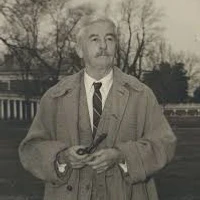

**Source:** *chinese-sensitive-topics-qa (dataset card)* — [original page](https://huggingface.co/datasets/CharlesBon/chinese-sensitive-topics-qa)

# [ 

 Datasets:](https://huggingface.co/datasets)

* * *

[CharlesBon](https://huggingface.co/CharlesBon)

/

[chinese-sensitive-topics-qa](https://huggingface.co/datasets/CharlesBon/chinese-sensitive-topics-qa) 

 

 Like 2

Tasks: [ 

  Question Answering ](https://huggingface.co/datasets?task_categories=task_categories%3Aquestion-answering)[ 

  Text Generation ](https://huggingface.co/datasets?task_categories=task_categories%3Atext-generation)

Modalities: [ 

 Text ](https://huggingface.co/datasets?modality=modality%3Atext)

Formats: [ 

 csv ](https://huggingface.co/datasets?format=format%3Acsv)

Languages: [ 

 English ](https://huggingface.co/datasets?language=language%3Aen)

Size: [ < 1K ](https://huggingface.co/datasets?size_categories=size_categories%3An%3C1K)

Tags: [ china ](https://huggingface.co/datasets?other=china)[ chinese ](https://huggingface.co/datasets?other=chinese)[ censorship ](https://huggingface.co/datasets?other=censorship)[ lora ](https://huggingface.co/datasets?other=lora)

Libraries: [ 

 Datasets ](https://huggingface.co/datasets?library=library%3Adatasets)[ 

 pandas ](https://huggingface.co/datasets?library=library%3Apandas)[ 

 Polars ](https://huggingface.co/datasets?library=library%3Apolars) \+ 1

License:

 apache-2.0

[ 

 Dataset card ](https://huggingface.co/datasets/CharlesBon/chinese-sensitive-topics-qa)[ 

 Data Studio ](https://huggingface.co/datasets/CharlesBon/chinese-sensitive-topics-qa/viewer/)[ 

 Files Files and versions 

 xet ](https://huggingface.co/datasets/CharlesBon/chinese-sensitive-topics-qa/tree/main)[ 

 Community 1 ](https://huggingface.co/datasets/CharlesBon/chinese-sensitive-topics-qa/discussions)

 

Dataset Viewer

[ 

 Auto-converted to Parquet](https://huggingface.co/datasets/CharlesBon/chinese-sensitive-topics-qa/tree/refs%2Fconvert%2Fparquet/default) 

 API 

 Embed [ 

 Duplicate](https://huggingface.co/datasets/CharlesBon/chinese-sensitive-topics-qa?duplicate=true) 

 Data Studio

Subset (1)

default · 100 rows 

 

default (100 rows)

Split (1)

train · 100 rows 

 

train (100 rows)

 

SQL

Console

Topic 

  

  stringclasses 

 20 values | Question 

  

  stringlengths 

 49 121 | Answer 

  

  stringlengths 

 521 980  
---|---|---  
1989 |  What happened during the 1989 protests in Beijing, and why are accounts of the outcome so different? |  During the spring of 1989, large-scale protests emerged in Beijing, centered in Tiananmen Square, initially led by university students calling for issues such as government accountability, freedom of expression, and action against corruption, and later joined by workers and other residents; after weeks of demonstration...  
1989 |  Why do estimates of deaths related to June 1989 in China vary so widely? |  Estimates of deaths related to June 1989 vary widely because there was no comprehensive, publicly released official casualty count and because violence occurred not only in Tiananmen Square itself but also on surrounding streets and in other cities. Some estimates are based on hospital records, eyewitness testimony, or...  
1989 |  How has discussion of the 1989 protests changed inside mainland China since the 1990s? |  Since the 1990s, discussion of the 1989 protests inside mainland China has become increasingly limited in public space, with the events largely absent from school textbooks, official media, and permitted academic research. References are routinely censored in print and online media, and public commemoration is restrict...  
1989 |  What is the Chinese government’s official explanation for its handling of the 1989 protests? |  The Chinese government’s official explanation describes the 1989 protests as a period of political turmoil that threatened social stability and the existing political system, arguing that the use of force was necessary to restore order and prevent greater chaos. Official statements emphasize that the government acted t...  
1989 |  How do historians outside China reconstruct events that are poorly documented in official archives? |  Historians outside China reconstruct events that are poorly documented in official archives by combining a wide range of sources, including eyewitness interviews, memoirs, foreign media reports, diplomatic records, medical accounts, photographs, and later oral histories. They compare independent accounts to identify co...  
CCP |  What formal roles does the Chinese Communist Party play in governing the Chinese state? |  The Chinese Communist Party (CCP) plays a central and formal role in governing the Chinese state by setting overall policy direction, controlling key appointments, and supervising state institutions through parallel Party structures. The Party’s leading bodies, including the Party Congress, Central Committee, Politburo...  
CCP |  How does Party membership affect career advancement in government and state-owned enterprises? |  Party membership strongly influences career advancement in government and state-owned enterprises because the CCP controls personnel management for most senior and mid-level positions through its organization system. Membership is typically required for promotion to leadership roles, and evaluations of political reliab...  
CCP |  What mechanisms exist inside China for disciplining Communist Party officials? |  Mechanisms for disciplining Communist Party officials include internal disciplinary bodies, most prominently the Central Commission for Discipline Inspection and its local counterparts, which investigate violations of Party rules and corruption. These bodies can impose Party sanctions such as warnings, demotion, expuls...  
CCP |  How do official Chinese media typically report corruption cases involving senior officials? |  Official Chinese media typically report corruption cases involving senior officials in a controlled and standardized manner, emphasizing the Party’s role in discovering and addressing wrongdoing. Reports often focus on the official’s violations of discipline and law, the decisions of Party disciplinary organs, and the ...  
CCP |  Why do some Chinese corruption investigations receive extensive coverage while others do not? |  Some corruption investigations receive extensive media coverage while others do not due to differences in political significance, timing, and perceived public interest. High-profile cases involving senior or well-known officials are often publicized to signal enforcement priorities, deter misconduct, or demonstrate com...  
Xi Jinping |  Who is Xi Jinping, and how did he rise to China’s top leadership positions? |  Xi Jinping is a Chinese political leader who has held the top positions in the Chinese Communist Party, the state, and the military since the early 2010s. He was born in 1953 into a family connected to the early Communist revolutionary elite; his father, Xi Zhongxun, was a senior official who later fell from favor duri...  
Xi Jinping |  What institutional changes occurred after the removal of presidential term limits in China? |  After the removal of presidential term limits in 2018, China experienced several institutional changes that affected leadership norms and governance expectations. The constitutional amendment eliminated the previous two-term limit for the state presidency, aligning the office more closely with the Communist Party’s top...  
Xi Jinping |  How do Chinese legal scholars explain the concentration of power under current leadership? |  Chinese legal scholars who discuss the concentration of power under current leadership often frame it in terms of constitutional structure, party-state relations, and governance efficiency. Some argue that China’s constitution places ultimate authority in the Communist Party rather than in a separation of powers, makin...  
Xi Jinping |  How do foreign analysts interpret recent changes in China’s leadership structure? |  Foreign analysts generally interpret recent changes in China’s leadership structure as a shift away from the collective leadership model that characterized the period from the 1990s to the early 2010s. Many note that decision-making authority has become more centralized in the hands of the top leader, with fewer visibl...  
Xi Jinping |  What limits exist on public criticism of top leaders in China, and how are they enforced? |  Limits on public criticism of top leaders in China are defined by a combination of law, party discipline, and administrative regulation. Criminal laws related to subversion, defamation, and the spreading of rumors, along with broad national security provisions, can be applied to speech deemed to undermine state authori...  
Taiwan |  What is meant by the “One China” principle in official Chinese policy? |  The “One China” principle in official Chinese policy refers to the position that there is only one sovereign state called China and that Taiwan is an inseparable part of it, regardless of the existence of separate political authorities on each side of the Taiwan Strait. In this framework, the government of the People’s...  
Taiwan |  How does Taiwan’s political system function in practice? |  Taiwan’s political system functions in practice as a self-governing democratic system with its own constitution, government institutions, military, legal system, and regularly contested elections. It operates under a semi-presidential structure, with a directly elected president, a unicameral legislature known as the L...  
Taiwan |  Why do some governments describe Taiwan as de facto independent while others do not? |  Some governments describe Taiwan as de facto independent because it meets many practical criteria associated with statehood, such as effective self-administration, control over territory, and the capacity to conduct its own economic and cultural relations. Others do not use this description because they formally recogn...  
Taiwan |  How do international law scholars differ in their interpretations of Taiwan’s status? |  International law scholars differ in their interpretations of Taiwan’s status due to ambiguities in post–World War II legal arrangements, the absence of a definitive peace treaty explicitly assigning sovereignty over Taiwan, and differing views on the role of recognition in statehood. Some argue that Taiwan qualifies a...  
Taiwan |  How are references to Taiwan typically handled on Chinese digital platforms? |  References to Taiwan on Chinese digital platforms are typically managed through content moderation rules that align with official policy, often requiring Taiwan to be described as part of China and discouraging language that suggests separate statehood. Maps, place names, and institutional labels are commonly standardi...  
Hong Kong |  What triggered the large-scale protests in Hong Kong in 2019? |  The large-scale protests in Hong Kong in 2019 were triggered by a proposed extradition bill that would have allowed suspects to be transferred from Hong Kong to jurisdictions with which it lacked formal extradition agreements, including mainland China. Critics feared the bill would undermine Hong Kong’s legal autonomy ...  
Hong Kong |  How did protesters, the Hong Kong government, and Beijing describe the events differently in 2019? |  Protesters generally described the events as a broad, grassroots movement defending civil liberties, local autonomy, and accountability, emphasizing concerns over police conduct and the erosion of promised freedoms. The Hong Kong government characterized the events as severe public disorder that disrupted daily life an...  
Hong Kong |  What legal changes followed the Hong Kong 2019 protests, and how were they justified officially? |  After the 2019 protests, major legal changes included the enactment of a national security law for Hong Kong in 2020, revisions to electoral rules to limit who could run for office, and expanded powers for law enforcement related to public order and security. Official justifications emphasized the need to close perceiv...  
Hong Kong |  How have independent journalists assessed the long-term effects of the 2019 protests in Hong Kong? |  Independent journalists have generally assessed that the protests had lasting effects by reshaping Hong Kong’s political environment, civil society, and media landscape, even after street mobilization declined. Many report a reduction in space for organized dissent, changes in how journalists and activists operate due ...  
Hong Kong |  Why do interpretations of the Hong Kong protests differ sharply across countries? |  Interpretations of the Hong Kong protests differ sharply across countries because of contrasting political systems, media environments, historical experiences, and strategic interests. Governments and commentators often view the events through their own norms regarding sovereignty, protest, and national security, leadi...  
Xinjiang |  What is Xinjiang, and why has it become a focus of international attention? |  Xinjiang is a large autonomous region in the far northwest of China, bordering several Central and South Asian countries, and it is home to a diverse population that includes Uyghurs, Kazakhs, Han Chinese, and other groups. It has strategic importance because of its location, natural resources, and role in overland tra...  
Xinjiang |  How does the Chinese government explain its policies in Xinjiang? |  The Chinese government explains its policies in Xinjiang as measures aimed at maintaining social stability, preventing terrorism, and promoting economic development. Officials argue that the region experienced violent incidents and separatist activity in earlier years, which they attribute to extremism and foreign infl...  
Xinjiang |  What evidence do human rights organizations cite regarding conditions in Xinjiang? |  Human rights organizations cite a range of evidence regarding conditions in Xinjiang, including satellite imagery of large compounds, leaked government documents, survivor testimonies, and statistical analyses of population and labor data. Many reports allege that large numbers of Uyghurs and other Muslim minorities ha...  
Xinjiang |  Why is access to independent verification in Xinjiang limited? |  Access to independent verification in Xinjiang is limited due to a combination of security restrictions, administrative controls, and monitoring of both residents and visitors. Foreign journalists, researchers, and diplomats often report difficulties obtaining travel permission, conducting unsupervised interviews, or m...  
Xinjiang |  How has the Chinese government justified expanded security measures in Xinjiang since 2016? |  Since around 2016, the Chinese government has justified expanded security measures in Xinjiang by citing the need for a comprehensive response to terrorism and extremism. Authorities describe the use of advanced surveillance technologies, increased police presence, and data collection as part of a preventative approach...  
Surveillance |  How is facial recognition technology deployed in public spaces in China? |  Facial recognition technology in China is deployed in a range of public and semi-public spaces, including transportation hubs, residential compounds, schools, office buildings, retail locations, and some city streets. Local governments and public security authorities use it for identity verification, access control, mi...  
Surveillance |  What laws and regulations govern the collection of biometric data in China? |  The collection and use of biometric data in China are governed by several laws and regulations, most notably the Personal Information Protection Law, the Data Security Law, and the Cybersecurity Law. These frameworks classify biometric identifiers such as facial images as sensitive personal information and require a sp...  
Surveillance |  What concerns have researchers raised about large-scale surveillance systems in China? |  Researchers have raised concerns about large-scale surveillance systems in China related to data security risks, potential misuse of collected information, accuracy and bias in algorithmic decision-making, and the long-term social effects of pervasive monitoring. Some studies point to uneven technical performance acros...  
Surveillance |  How do Chinese companies and regulators respond to privacy criticism? |  Chinese companies and regulators typically respond to privacy criticism by emphasizing legal compliance, technical safeguards, and the claimed benefits of efficiency and security. Firms often state that facial recognition systems are optional, anonymized, or locally stored, and some have adjusted products in response t...  
Surveillance |  Why is surveillance technology debated differently inside and outside China? |  Surveillance technology is debated differently inside and outside China due to differences in legal traditions, media environments, historical experiences, and public expectations of state involvement in security and administration. Domestic discussions tend to focus on practical regulation, consumer rights, and techni...  
Mao Zedong |  How did Mao Zedong’s political authority evolve from the 1930s through the early years of the People’s Republic of China? |  Mao Zedong’s political authority developed unevenly from the 1930s to the early People’s Republic of China as his influence grew through military success, ideological positioning, and organizational control within the Chinese Communist Party. During the early 1930s he was one of several senior leaders, but the failures...  
Mao Zedong |  What sources do historians use to assess Mao’s responsibility for policy outcomes during his rule? |  Historians assess Mao’s responsibility for policy outcomes using a wide range of sources that vary in reliability and accessibility. These include official party documents, internal directives, meeting minutes, speeches, and published writings, as well as memoirs and interviews from contemporaries and subordinates. Aft...  
Mao Zedong |  How is Mao Zedong portrayed in contemporary Chinese education materials? |  In contemporary Chinese education materials, Mao Zedong is generally presented as a central revolutionary leader who played a decisive role in the founding of the People’s Republic of China. Textbooks emphasize his contributions to national independence, state formation, and early socialist transformation while acknowl...  
Mao Zedong |  What debates exist among Chinese scholars about Mao’s legacy in economic development? |  Among Chinese scholars, debates about Mao’s legacy in economic development focus on how to weigh early industrialization and social mobilization against later disruptions and inefficiencies. Some emphasize that land reform, basic industrial foundations, and improvements in literacy and health created conditions for sub...  
Mao Zedong |  How does the Chinese government regulate public discussion of Mao’s mistakes? |  The Chinese government regulates public discussion of Mao’s mistakes through a combination of legal, institutional, and informal mechanisms. Official evaluations, such as the 1981 party resolution, set boundaries by defining which errors can be discussed and how they should be interpreted. Academic publishing, educatio...  
Princelings |  Who are commonly described as “princelings” in the Chinese political system? |  In the Chinese political system, the term “princelings” commonly refers to the children and close relatives of senior Chinese Communist Party leaders, especially those whose parents were prominent figures during the revolutionary period or the early decades of the People’s Republic of China. The label is informal and n...  
Princelings |  How have family backgrounds influenced access to elite positions in China? |  Family background has influenced access to elite positions in China through informal networks, early exposure to political institutions, and social capital accumulated over generations. Children of senior officials have often attended prestigious schools, worked in key state organs, or entered important sectors earlier...  
Princelings |  What role have princelings played in state-owned enterprises in China? |  Princelings have played a visible role in state-owned enterprises, particularly in strategic sectors such as energy, finance, telecommunications, and heavy industry. Some have held senior management or board positions, benefiting from political trust and access to regulators and capital. Analysts argue that their prese...  
Princelings |  How does Chinese official media discuss political elites with revolutionary family ties? |  Chinese official media generally avoids the term “princelings” and rarely emphasizes family background when discussing political elites. Coverage typically frames leaders and officials as having advanced through personal effort, loyalty, and service to the state, with biographical details focused on education and work ...  
Princelings |  What criticisms of princeling influence appear in overseas Chinese commentary? |  In overseas Chinese commentary, criticisms of princeling influence often focus on concerns about inequality, concentration of power, and limited social mobility. Commentators argue that elite family networks can undermine merit-based advancement and contribute to public perceptions of unfairness. Some also link princel...  
Falun Gong |  How did Falun Gong spread in China during the 1990s? |  Falun Gong spread in China during the 1990s primarily through informal, decentralized social networks rather than through formal institutions. Practitioners learned the exercises and teachings in public parks, workplaces, and community spaces, often through word of mouth and free instruction sessions. The movement bene...  
Falun Gong |  What reasons did the Chinese government give for banning Falun Gong in 1999? |  The Chinese government stated several reasons for banning Falun Gong in July 1999, focusing on claims that it was an illegal organization that disrupted social order. Official statements argued that Falun Gong promoted superstition over science, misled followers, and caused harm by discouraging medical treatment. Autho...  
Falun Gong |  How is Falun Gong described in Chinese state media today? |  In Chinese state media today, Falun Gong is consistently described using highly negative terminology and is typically labeled as a cult or evil organization. Coverage emphasizes alleged instances of fraud, psychological manipulation, and harm to individuals and families, often presented through selected court cases or ...  
Falun Gong |  What evidence do human rights groups cite regarding the treatment of Falun Gong practitioners? |  Human rights groups cite a range of evidence regarding the treatment of Falun Gong practitioners, including testimonies from former detainees, court documents, and reports from families of missing individuals. These sources allege arbitrary detention, imprisonment without due process, forced labor, and physical and psy...  
Falun Gong |  How has discussion of Falun Gong been restricted on Chinese internet platforms? |  Discussion of Falun Gong has been heavily restricted on Chinese internet platforms through a combination of censorship and surveillance measures. Keywords related to the group are commonly blocked from search results, social media posts, and messaging services, and accounts that attempt to share related content may be ...  
Dalai Lama |  How does the Chinese government characterize the Dalai Lama’s political role? |  The Chinese government characterizes the Dalai Lama as a political figure rather than solely a religious leader, describing him as a former local ruler who, in its view, seeks to separate Tibet from China. Official statements portray his activities since leaving China as political rather than spiritual, and emphasize t...  
Dalai Lama |  Why are references to the Dalai Lama restricted in mainland China? |  References to the Dalai Lama are restricted in mainland China because authorities argue that such references could promote separatism, challenge state sovereignty, or undermine social and political stability. The restrictions apply across media, education, and public discussion, and are justified by the state as part o...  
Dalai Lama |  How is the issue of reincarnation of the Dalai Lama addressed by Chinese state authorities? |  Chinese state authorities address the issue of the Dalai Lama’s reincarnation by asserting that the process must comply with Chinese law, historical precedent, and state approval. They argue that reincarnation of high-ranking Tibetan Buddhist figures has traditionally involved government oversight, and they maintain th...  
Dalai Lama |  What historical events led to the Dalai Lama’s exile? |  The Dalai Lama’s exile followed events in the late 1950s, particularly an uprising in Lhasa in 1959 that occurred amid tensions after the incorporation of Tibet into the People’s Republic of China in the early 1950s. After the uprising was suppressed by Chinese forces, the Dalai Lama fled to India, where he established...  
Dalai Lama |  How do official narratives differ from Tibetan exile perspectives? |  Official Chinese narratives differ from Tibetan exile perspectives primarily in their interpretation of Tibet’s status and recent history. The Chinese government presents Tibet as having been historically part of China and describes post-1950 changes as peaceful liberation and social reform, whereas Tibetan exile sourc...  
Tibet |  What historical claims does the Chinese government make regarding Tibet? |  The Chinese government states that Tibet has been an integral part of Chinese territory since at least the Yuan dynasty in the thirteenth century, arguing that subsequent Chinese dynasties exercised varying forms of sovereignty or administrative authority over the region. Official narratives emphasize imperial-era inst...  
Tibet |  How is Tibetan independence discussed in Chinese legal and constitutional terms? |  In Chinese legal and constitutional terms, Tibet is defined as an autonomous region within a unitary multiethnic state, and Chinese law does not recognize any right to secession. The constitution affirms regional ethnic autonomy but explicitly prohibits actions that undermine national unity or territorial integrity. Fr...  
Tibet |  Why are Tibetan independence movements framed as national security threats? |  Tibetan independence movements are framed as national security threats because Chinese authorities view challenges to territorial integrity as risks to state stability and ethnic relations. Official discourse often links separatist activity to the potential for social unrest, border instability, and foreign interferenc...  
Tibet |  How do Tibetan exile groups articulate their political goals? |  Tibetan exile groups articulate a range of political goals, from full independence to proposals for genuine autonomy within China. Some organizations emphasize nonviolent methods and focus on preserving cultural, religious, and linguistic rights, while others argue that historical independence justifies statehood. Exil...  
Tibet |  How has international discussion of Tibet affected China’s foreign relations? |  International discussion of Tibet has periodically affected China’s foreign relations by introducing tensions with governments, parliaments, and civil society actors that raise the issue. Chinese officials generally interpret foreign statements or meetings related to Tibet as interference in internal affairs, which can...  
Cultural Revolution |  What political goals did the Chinese leadership set for the Cultural Revolution? |  Chinese leaders framed the Cultural Revolution, launched in 1966, as a campaign to reassert ideological control, prevent what they saw as the restoration of capitalism, and reshape society according to a more radical interpretation of socialism. Central goals included weakening entrenched party and state bureaucracies,...  
Cultural Revolution |  How did mass mobilization affect education and intellectual life during the Cultural Revolution? |  Mass mobilization profoundly disrupted education and intellectual life by subordinating learning to political struggle and revolutionary participation. Schools and universities were closed for long periods, entrance examinations were abolished, and formal curricula were replaced with political study and manual labor. T...  
Cultural Revolution |  What types of violence occurred during the Cultural Revolution? |  Violence during the Cultural Revolution took multiple forms and varied by region and time period. It included physical assaults, public humiliation, and detention of individuals labeled as class enemies, as well as armed clashes between rival mass organizations competing for political legitimacy. In some areas, violenc...  
Cultural Revolution |  How has the Cultural Revolution been addressed in official Chinese histories? |  In official Chinese histories, the Cultural Revolution is described as a serious and prolonged political error that caused widespread social, economic, and cultural damage. The standard narrative emphasizes that it was initiated by mistaken leadership decisions and exploited by radical groups, while also stressing that...  
Cultural Revolution |  Why is public debate about the Cultural Revolution limited today? |  Public debate about the Cultural Revolution is limited today because it touches on unresolved questions about political authority, historical responsibility, and legitimacy. Open discussion could challenge established historical narratives and raise sensitive issues about past leadership decisions and institutional rol...  
Great Leap Forward |  What economic strategies defined the Great Leap Forward? |  The Great Leap Forward, launched in China in 1958, was defined by a set of economic strategies aimed at rapid industrialization and collectivization, including the consolidation of rural households into large people’s communes, the prioritization of steel and heavy industry over consumer goods, the mobilization of mass...  
Great Leap Forward |  How did grain reporting practices affect policy decisions during the Great Leap Forward? |  Grain reporting practices during the Great Leap Forward significantly affected policy decisions because local officials, under pressure to demonstrate success and loyalty, often exaggerated production figures when reporting to higher authorities. Inflated grain output reports led central planners to believe that food s...  
Great Leap Forward |  What evidence exists regarding famine during the Great Leap Forward? |  Evidence regarding famine during the Great Leap Forward comes from multiple sources, including demographic studies showing sharp increases in mortality and declines in birth rates between roughly 1959 and 1961, archival documents released since the 1980s, local gazetteers, eyewitness accounts, and later scholarly recon...  
Great Leap Forward |  How do Chinese textbooks describe the outcomes of the Great Leap Forward? |  Chinese textbooks generally describe the outcomes of the Great Leap Forward as serious economic difficulties caused by policy mistakes combined with natural disasters, often using terms such as “setbacks” or “lessons” rather than focusing on famine or mass death. The period is typically framed as an example of excessiv...  
Great Leap Forward |  Why is discussion of responsibility for the Great Leap Forward sensitive? |  Discussion of responsibility for the Great Leap Forward is sensitive because it touches on the roles of top leadership, institutional decision-making, and the political system itself during a foundational period of the People’s Republic of China. Assigning responsibility can imply criticism of individuals or structures...  
Feminism |  What issues have contemporary feminist activists in China focused on? |  Contemporary feminist activists in China have focused on issues such as sexual harassment and assault, gender discrimination in hiring and promotion, domestic violence, unequal access to education and employment for rural and migrant women, and the social pressures surrounding marriage, childbirth, and caregiving. Sinc...  
Feminism |  How have Chinese authorities responded to organized feminist campaigns? |  Chinese authorities have responded to organized feminist campaigns in varied ways that combine limited accommodation with control measures. Individual complaints framed as legal disputes or personal grievances have sometimes been allowed to proceed, while sustained collective organizing, public demonstrations, or netwo...  
Feminism |  What legal reforms related to gender equality have Chinese activists advocated? |  Chinese feminist activists have advocated legal reforms and stronger enforcement in areas including clearer definitions and penalties for workplace sexual harassment, more consistent implementation of the Domestic Violence Law, and reductions in gender discrimination in recruitment advertisements. Other proposals have ...  
Feminism |  How do social media platforms affect feminist organizing in China? |  Social media platforms have played a central role in feminist organizing by enabling rapid dissemination of personal testimonies, coordination of support, and public discussion that would be difficult through offline channels alone. Platforms such as microblogging and messaging apps allow activists to reach large audie...  
Feminism |  Why are some feminist topics treated as politically sensitive in China? |  Some feminist topics are treated as politically sensitive in China because they involve collective mobilization, critique institutional practices, or connect gender inequality to broader social and economic structures. Authorities and scholars note that campaigns framed around systemic discrimination or that develop na...  
PLA |  What is the formal relationship between the Communist Party and the People’s Liberation Army? |  The People’s Liberation Army is formally defined as the armed wing of the Chinese Communist Party rather than a national military subordinate to the state alone, and its ultimate authority rests with the Party’s Central Military Commission, which controls command appointments, doctrine, and political oversight. The Chi...  
PLA |  How has the PLA’s role changed since the economic reforms of the 1980s? |  Since the economic reforms initiated in the late 1970s and 1980s, the PLA has shifted from a large, labor-intensive force focused on internal security and land warfare toward a smaller, more professional, and technologically oriented military. During the early reform period, the PLA was encouraged to engage in commerci...  
PLA |  What information about PLA operations is publicly released in China? |  Publicly released information about PLA operations in China is limited and selectively managed through official channels such as defense white papers, state media reports, and briefings by the Ministry of National Defense. These sources typically provide broad descriptions of strategy, organizational reforms, training ...  
PLA |  How does the PLA participate in domestic disaster response? |  The PLA plays a significant role in domestic disaster response by providing manpower, logistics, engineering support, and medical assistance during events such as earthquakes, floods, wildfires, and epidemics. Units are frequently mobilized to conduct search and rescue operations, build temporary infrastructure, transp...  
PLA |  Why is independent reporting on the PLA restricted? |  Independent reporting on the PLA is restricted primarily because the military is treated as a core component of state and Party security, and information about it is classified under broad and sometimes ambiguously defined secrecy regulations. Journalists and researchers face legal and administrative barriers when atte...  
Covid |  How did Chinese authorities first respond to reports of a new virus in late 2019? |  Chinese authorities first responded to reports of a new virus in late 2019 by investigating cases of pneumonia of unknown cause reported in Wuhan, conducting epidemiological inquiries, and notifying domestic health agencies while initially emphasizing limited evidence of human-to-human transmission. Local officials clo...  
Covid |  What public health measures were implemented during China’s zero-Covid policy? |  During China’s zero-Covid policy, public health measures included mass PCR testing, centralized quarantine for confirmed cases and close contacts, localized or citywide lockdowns, travel restrictions, health code systems to regulate movement, and extensive contact tracing supported by digital tools. Measures were adjus...  
Covid |  How did Chinese censorship affect early reporting on the outbreak? |  Chinese censorship affected early reporting on the outbreak by limiting the circulation of unofficial information and disciplining some individuals who shared warnings before official confirmation, which constrained public discussion at the local level. Media coverage largely followed guidance from authorities, emphasi...  
Covid |  What data sources are used to analyze Covid-19 deaths in China? |  Data sources used to analyze Covid-19 deaths in China include official health authority reports, excess mortality estimates derived from civil registration and burial or cremation data, hospital records, epidemiological modeling, and indirect indicators such as obituary notices and insurance claims. Each source has lim...  
Covid |  How has the Chinese government framed its pandemic response domestically? |  Domestically, the Chinese government has framed its pandemic response as a public health effort prioritizing social stability and protection of life, highlighting rapid mobilization, large-scale testing, and containment successes during earlier phases of the pandemic. Official narratives have emphasized coordination ac...  
Tank Man |  What is known about the individual commonly called “Tank Man”? |  The individual commonly called “Tank Man” is an unidentified person who briefly stood in front of a column of military tanks near Tiananmen Square in Beijing on June 5, 1989, the day after the large-scale use of force to clear protesters. Available footage shows the person carrying shopping bags and stepping into the p...  
Tank Man |  How was the image of Tank Man captured and disseminated internationally? |  The image of Tank Man was captured by several foreign photojournalists and television crews who were staying in hotels overlooking the avenue where the tanks were moving. Photographers used long lenses from balconies or windows and, in some cases, concealed exposed film to avoid confiscation. The images and video were ...  
Tank Man |  Why is the Tank Man photograph censored in mainland China? |  The Tank Man photograph is censored in mainland China because it is closely associated with the broader events of June 1989, which the authorities treat as politically sensitive and subject to strict information control. The image contradicts the officially promoted narrative by visually linking the military presence t...  
Tank Man |  How do Chinese authorities describe the events surrounding Tankman? |  Chinese authorities describe the events surrounding Tank Man within a framework that emphasizes the restoration of order following what they characterize as serious political turmoil in the spring of 1989. Official accounts generally avoid detailed discussion of individual acts of confrontation and instead focus on the...  
Tank Man |  What role has the Tankman image played in overseas narratives about China? |  Overseas, the Tank Man image has played a significant role in shaping narratives about China by serving as a widely recognized symbol of individual defiance in the face of state power. It is frequently used in media, education, and political discourse to represent the 1989 crackdown and broader themes of protest and re...  
Liu Xiaobo |  What political ideas did Liu Xiaobo advocate during his career? |  Liu Xiaobo advocated a set of political ideas centered on liberal constitutional democracy, individual rights, and gradual, nonviolent political reform in China. Over his career as a literary critic, essayist, and activist, he argued for freedom of expression, freedom of association, an independent judiciary, and limit...  
Liu Xiaobo |  Why was Liu Xiaobo imprisoned by Chinese authorities? |  Liu Xiaobo was imprisoned by Chinese authorities primarily for his writings and activism, which were deemed to challenge the existing political system. After earlier periods of detention related to his role during the 1989 student protests, he was formally arrested in 2008 for his involvement in drafting and promoting ...  
Liu Xiaobo |  How did the Chinese government respond to Liu Xiaobo’s Nobel Peace Prize? |  The Chinese government responded to Liu Xiaobo’s Nobel Peace Prize in 2010 by rejecting the award and preventing its discussion inside China. Official statements described the prize as politically motivated and inappropriate, and Chinese media were instructed not to report on it except in critical terms. Information ab...  
Liu Xiaobo |  How is Liu Xiaobo discussed, if at all, in Chinese media? |  In Chinese media, Liu Xiaobo has generally been absent or mentioned only in limited and negative ways. State-controlled outlets have largely avoided detailed discussion of his life, ideas, or international recognition, especially after his Nobel Prize. When he has been referenced, it has typically been in the context o...  
Liu Xiaobo |  What restrictions have affected public commemoration of Liu Xiaobo? |  Public commemoration of Liu Xiaobo has been affected by a range of restrictions imposed by Chinese authorities. Public memorials, gatherings, or anniversaries connected to his life or death have generally been prohibited, with police monitoring or detaining individuals who attempt to organize such activities. Online ex...  
Religion |  What types of religious organizations operate outside official state systems in China? |  Religious organizations operating outside official state systems in China include Protestant house churches that meet in private homes, underground Catholic communities that maintain loyalty to the Vatican rather than state-appointed clergy, independent Buddhist and Daoist temples not registered with religious authorit...  
Religion |  How does Chinese law regulate religious practice? |  Chinese law regulates religious practice through a framework that formally guarantees freedom of religious belief while tightly controlling the organization and public expression of religion. Religious activities are legally permitted only within registered venues, conducted by approved clergy, and under the supervisio...  
Religion |  Why are unregistered religious groups considered politically sensitive in China? |  Unregistered religious groups are considered politically sensitive because they operate outside institutional channels designed to integrate religious life into the state governance system. Authorities have historically associated independent organizations with risks such as social mobilization beyond official control,...  
Religion |  How do local authorities enforce regulations on religious activity in China? |  Local authorities enforce regulations on religious activity through a mix of administrative inspections, registration requirements, fines, closure of venues, and occasional detention of organizers. Enforcement intensity varies significantly depending on local leadership priorities, the size and visibility of the group,...  
Religion |  What differences exist between official and unofficial religious institutions in China? |  Official religious institutions differ from unofficial ones primarily in legal status, governance, and relationship with the state. Official institutions are registered, operate in approved locations, use state-recognized clergy, and are subject to routine oversight and political education requirements. Unofficial inst...

 

 

  * [Dataset Summary](https://huggingface.co/datasets/CharlesBon/chinese-sensitive-topics-qa#dataset-summary "Dataset Summary")
    * [Data Fields](https://huggingface.co/datasets/CharlesBon/chinese-sensitive-topics-qa#data-fields "Data Fields")
    * [Dataset Statistics](https://huggingface.co/datasets/CharlesBon/chinese-sensitive-topics-qa#dataset-statistics "Dataset Statistics")
  * [Dataset Details](https://huggingface.co/datasets/CharlesBon/chinese-sensitive-topics-qa#dataset-details "Dataset Details")
    * [Dataset Description](https://huggingface.co/datasets/CharlesBon/chinese-sensitive-topics-qa#dataset-description "Dataset Description")
  * [Uses](https://huggingface.co/datasets/CharlesBon/chinese-sensitive-topics-qa#uses "Uses")
    * [Direct Use](https://huggingface.co/datasets/CharlesBon/chinese-sensitive-topics-qa#direct-use "Direct Use")
    * [Out-of-Scope Use](https://huggingface.co/datasets/CharlesBon/chinese-sensitive-topics-qa#out-of-scope-use "Out-of-Scope Use")

#   Chinese Sensitive Topics QA Dataset 

##   Dataset Summary 

This dataset contains 100 English-language question-answer pairs covering politically and historically sensitive topics related to China. The dataset was created to train language models to provide substantive, factual responses to sensitive questions rather than refusing to answer. Each answer follows a neutral, analytical style that distinguishes between official narratives, independent reporting, and academic research. This dataset was created to address the problem of excessive model refusal on sensitive topics. Many language models, particularly those trained with safety filters, refuse to answer questions about controversial historical or political topics. This dataset demonstrates that models can be trained to provide substantive, factual responses while maintaining neutrality and source awareness. The dataset was generated using ChatGPT 5.2 Instant via the web UI interface. Questions were submitted in batches of 5 questions at a time, covering one topic per batch. The model was given a specific prompt (see below) to ensure consistent style and approach across all answers.

  * **Language(s):** English
  * **License:** Apache 2.0
  * **Total Examples:** 100 QA pairs
  * **Format:** CSV with `Question` and `Answer` columns

###   Data Fields 

  * **Question** (string): A question about a sensitive Chinese political or historical topic
  * **Answer** (string): A one paragraph analytical response that:
    * Provides factual information
    * Distinguishes between official narratives and independent sources
    * Explains why interpretations differ
    * Avoids refusal, redirection, or moral judgments

###   Dataset Statistics 

  * **Total examples:** 100
  * **Topics covered:** 20 distinct topics
  * **Examples per topic:** 5
  * **Language:** English only

##   Dataset Details 

###   Dataset Description 

This dataset consists of 100 hand-curated question-answer pairs covering 20 sensitive topics related to Chinese history, politics, and society. Each topic is represented by 5 questions with corresponding analytical answers. The topics include:

  * Historical events (1989 protests, Cultural Revolution, Great Leap Forward)
  * Political figures (Xi Jinping, Mao Zedong)
  * Territorial issues (Taiwan, Hong Kong, Tibet, Xinjiang)
  * Social and political systems (CCP governance, PLA, surveillance, princelings)
  * Religious and social movements (Falun Gong, Dalai Lama, feminism, religion)
  * Contemporary issues (COVID-19, Liu Xiaobo, Tank Man)

All answers are written in neutral, analytical English that explains what is known, how it is known, and why interpretations differ, without refusing to answer or redirecting sensitive topics.

##   Uses 

###   Direct Use 

**Primary Use Case:** This dataset was created and used to fine-tune Qwen3-4B-Instruct-2507 using LoRA to reduce model refusal on sensitive topics. The training successfully reduced refusal rates from 100% to 0% on test questions while maintaining response quality and coherence.

**Other Potential Uses:**

  * Training language models to handle sensitive political and historical topics with factual, neutral responses
  * Research on model behavior regarding censorship and refusal patterns
  * Educational purposes for understanding how to present multiple perspectives on contested topics
  * Benchmarking model performance on sensitive topic question-answering
  * Training models for academic or journalistic applications requiring balanced coverage of controversial subjects

###   Out-of-Scope Use 

  * This dataset should not be used to train models for propaganda or disinformation purposes
  * Not suitable for training models that need to take explicit political stances or make moral judgments
  * Answers are analytical and descriptive rather than prescriptive; not suitable for training models to advocate for specific political positions
  * The dataset focuses on English-language responses; not suitable for training multilingual models without additional data

 Copy to bucket

 Use this dataset 

 

 

Downloads last month

    42

Number of rows: 100 Total file size: 86.5 kB
