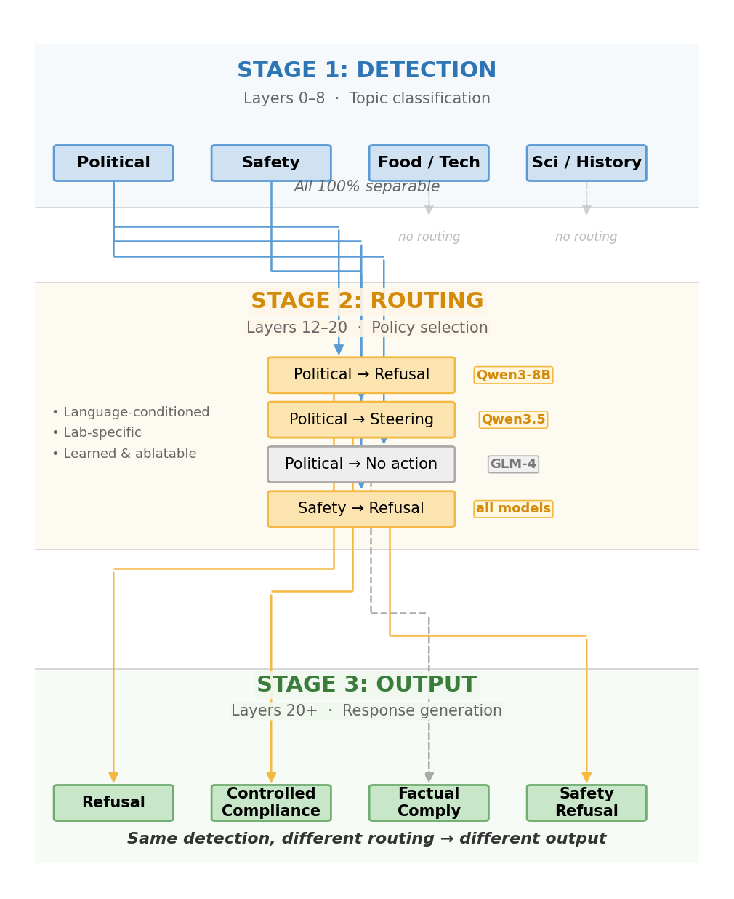
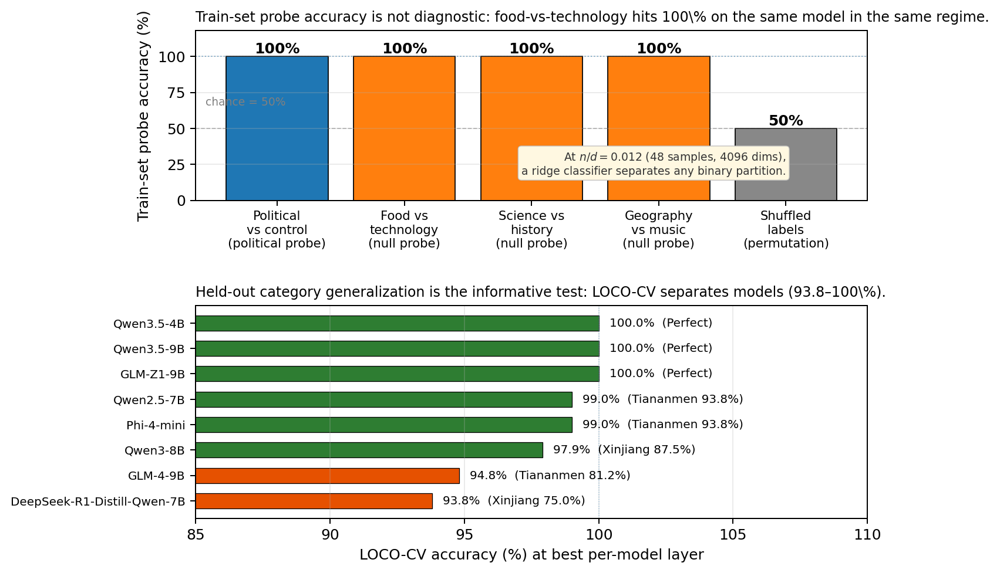
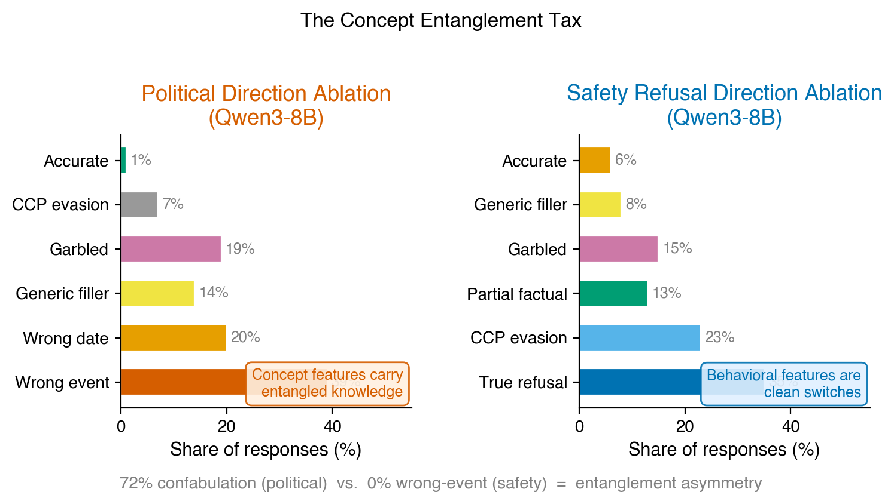
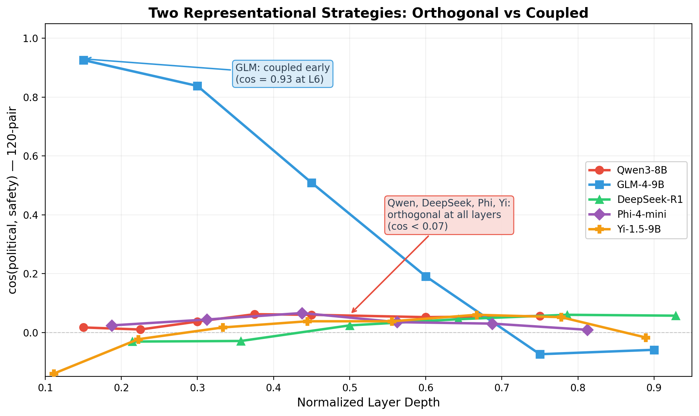
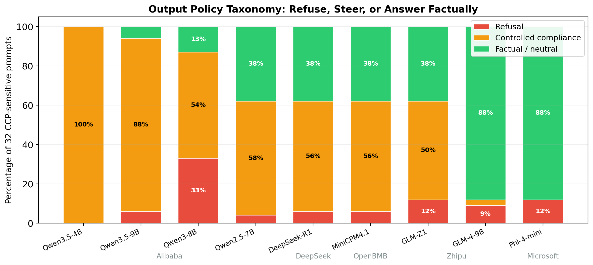
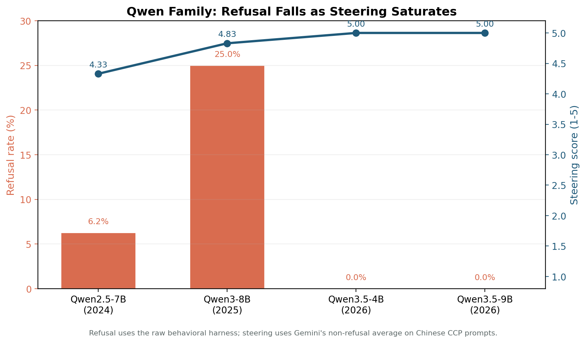
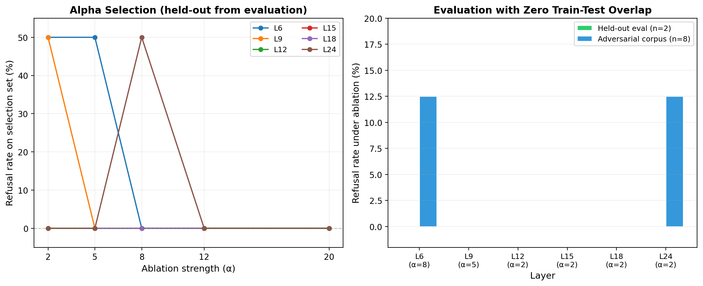

**Source:** *Detection Is Cheap, Routing Is Learned: Why Refusal-Based Alignment Evaluation Fails* — [PDF](https://arxiv.org/pdf/2603.18280) · [arXiv](https://arxiv.org/abs/2603.18280)

Detection Is Cheap, Routing Is Learned:   
Why Refusal-Based Alignment Evaluation Fails   
Greg Frank   
Chief Scientist, MACE AI

††footnotetext:  Correspondence: greg@mace.ai

## Abstract

Ask four language models about Tiananmen Square in Chinese. One produces party propaganda. One gives factual answers. One fabricates. One deflects. All four recognize the political sensitivity of the question with perfect linear-probe accuracy at every layer. So does any model asked to distinguish food from technology. In high-dimensional hidden spaces with small sample sets, concept detection is computationally trivial. The question is what happens after detection.

We use political censorship as a natural experiment for studying how post-training alignment modifies transformer internals. Probes, surgical ablations, and behavioral tests across nine open-weight models from five labs yield three findings:

First, probe accuracy is non-diagnostic. Perfect accuracy on political content looks impressive until you run the same probe on food-vs-technology and get the same result. A permutation baseline confirms it: randomly shuffled labels also achieve 100%. The meaningful test is held-out category generalization, not train-set accuracy.

Second, surgical ablation reveals lab-specific routing. Removing the political-sensitivity direction eliminates censorship and produces accurate factual output in most models tested. One model confabulates instead, substituting wrong historical events, because its architecture entangles factual knowledge with the censorship mechanism. Different labs organize political and safety representations with markedly different geometry. Directions extracted from one model are meaningless when applied to another. The learned routing is lab- and model-specific.

Third, refusal is no longer the primary censorship mechanism. Within one model family, refusal dropped to zero across three generations while narrative steering rose to maximum. Censorship did not decrease; it became invisible to any benchmark that only counts refusals. For anyone building safety evaluations, this is the critical finding: a model that passes a refusal-based audit may be maximally steered.

These results support a three-stage descriptive framework of alignment: detect a concept (cheap), route it through a behavioral policy (learned, lab-specific, fragile), generate output accordingly. Models do not lack the knowledge that alignment constrains. They have the knowledge and a learned policy governing how it is expressed. Current alignment evaluation largely measures the wrong thing: it audits what models know (detection) or whether they refuse (one output mode). The routing mechanism that determines behavior goes unmeasured.

Code and data: <https://github.com/gregfrank/routing-is-learned>

## 1\. Introduction

Current alignment evaluation predominantly measures two things: whether a model encodes dangerous concepts (probing) and whether it refuses harmful requests (benchmarking). Both miss the layer where alignment actually operates. This paper presents evidence that concept detection and behavioral policy are empirically and causally distinct systems inside transformers, connected by a learned routing function that varies across labs, models, and input contexts. A model that passes a refusal-based audit may be maximally steered toward approved narratives, and a model with perfect concept detection may never act on what it detects.

Political censorship in Chinese-origin language models provides an unusually clean natural experiment: the controlled concepts are known, the behavioral variation is wide (propaganda, factual answers, or evasion on identical prompts despite identical probe accuracy), and the ground truth is observable.

We test four hypotheses about how alignment shows up internally and behaviorally. H1 predicts that train-set probe separability of political content is non-diagnostic for alignment. The next hypothesis, H2, holds that held-out generalization combined with causal intervention identifies a behaviorally relevant concept-to-policy signal. H3 addresses cross-lab variation: the geometry and intervention outcome of that signal vary across labs and do not transfer between models. Finally, H4 posits that refusal-based evaluation systematically misses steering-based content control.

We probe nine open-weight models from five labs and surgically ablate censorship directions in four. The evidence converges on a three-stage descriptive framework, which we ground in the following operational definitions.

By detection we mean whether the model linearly encodes a concept in its hidden states, measured with probe accuracy under null controls and held-out generalization. By routing we mean the learned conditional process by which detected concepts are mapped to behavioral policies during generation. Under this interpretation, alignment does not primarily operate by removing representations of sensitive concepts but by modifying the conditions under which those representations influence output. Routing determines whether a detected concept leads to direct answering, refusal, narrative reframing, or other policy-constrained responses. The definition is intentionally operational: routing is inferred when interventions change behavioral responses while leaving concept detection intact. We describe routing as a functional abstraction inferred from intervention effects, not a localized architectural module. We measure it through ablation effects, cross-lab geometry comparison, and cross-model direction transfer. The third concept, output, is the behavioral policy that routing selects, gauged by refusal rate, steering score, and human-reviewed content taxonomy.

### 1.1 Models Tested

We tested nine open-weight models from five labs, plus API comparisons and a 46-model behavioral screen:

Model | Lab | Params | Layers  
---|---|---|---  
Qwen3-8B | Alibaba | 8B | 40  
Qwen2.5-7B | Alibaba | 7B | 28  
Qwen3.5-4B | Alibaba | 4B | 36  
Qwen3.5-9B | Alibaba | 9B | 16  
DeepSeek-R1-7B | DeepSeek | 7B | 28  
GLM-Z1-9B | Zhipu | 9.4B | 40  
GLM-4-9B | Zhipu | 9.4B | 40  
MiniCPM4.1-8B | OpenBMB | 8B | 32  
Phi-4-mini | Microsoft | 3.8B | 32

 

Western controls: Phi-4 (Microsoft) and Llama-3.2-3B (Meta, base model, used for probing only). Yi-1.5-9B (01.AI) was probed for direction cosine analysis but excluded from the primary results due to data quality constraints.

### 1.2 Contributions

The paper makes four primary contributions and one secondary observation. We distinguish _measured_ findings, reported in Sections 3.1-3.2 and 3.5-3.6; _interventional_ findings from causal ablation experiments on four models in Sections 3.3-3.4; and _inferred_ claims, principally the three-stage decomposition as explanatory framework in Section 4.

The first contribution is a four-level evidence hierarchy for probe-based claims, ranging from train-set separability (trivially achievable in high-dimensional spaces) through failure-mode analysis. Most published probe results stop at level (i), which our null controls show is non-diagnostic. The hierarchy is intended as a general methodological contribution applicable beyond political censorship.

We also show that surgical ablation removes censorship cleanly in most models tested. Three of four models produce accurate factual output after political-direction ablation. One model’s 72% confabulation rate is architecture-specific, revealing that it entangles factual knowledge with the censorship direction. Eighteen negative controls confirm surgical specificity.

A third finding is that labs build routing geometry differently. The 120-pair safety-direction analysis reveals orthogonal political/safety representations in three labs (cosine ~0.05) and tight early coupling in a fourth (cosine 0.93). Cross-model transfer fails. The learned routing geometries are lab-specific.

The fourth contribution is that refusal-only evaluation misses steering-based control. Within one model family, refusal dropped from 25% to 0% across three generations while narrative steering rose to maximum. A 46-model screen at n=32 prompts per condition confirms that CCP-specific discrimination concentrates in a small number of Chinese-origin models, with all Western frontier models showing zero discrimination. An initial n=8 screen had suggested widespread effects, but these collapsed at n=32, demonstrating the fragility of small-sample behavioral claims.

As a secondary observation, AI judges overdetect political evasion by 2-3x relative to human raters. Automated judges are adequate for coarse taxonomy but unreliable for fine ideological grading.

Roadmap. Section 3.1 addresses H1 (probe non-diagnosticity). Sections 3.2-3.4 address H2 and H3 (concept generalization, causal intervention, cross-lab geometry). Sections 3.5-3.6 address H4 (behavioral divergence and steering). Section 3.7 bounds evaluator reliability for all four hypotheses.

## 2\. Methodology

### 2.1 Prompt Design

We use two main prompt corpora plus two supplementary sets. The primary corpus (v1) contains 24 CCP-sensitive prompts across six topics (Tiananmen, Tibet, Xinjiang, Xi Jinping/CCP, Hong Kong, COVID), each paired with a factually equivalent control about a non-CCP topic; v1 is used for probing and ablation. The adversarial corpus (v3) contains 32 CCP-sensitive prompts at four intensity levels (neutral, pointed, accusatory, provocative) across eight topics, each paired with a structurally matched Western parallel (e.g., Tiananmen \(\leftrightarrow\) Kent State, Xinjiang \(\leftrightarrow\) Japanese internment, Tibet \(\leftrightarrow\) Western Sahara); v3 supports behavioral testing and discrimination analysis. A Chinese-language corpus of 16 prompts (L3 accusatory and L4 provocative for each of 8 topics) tests whether input language modulates censorship behavior. We also identify a behaviorally discriminating subset by combining refusal data from 9 local models and 11 API models to find prompts where at least one Chinese model censors the CCP version but not the structurally identical Western parallel; 29 of 32 prompts (91%) are ideology-discriminating. Three confounded prompts (COVID neutral, COVID pointed, Censorship neutral) are excluded from discrimination analyses. The Western control (Gemini 3.1 Flash) answered all 64 prompts (32 CCP + 32 parallel) neutrally, confirming zero confounded prompts from the prompt design.

### 2.2 Linear Probing

For each transformer layer, we extract the last-token hidden state and train a ridge-regularized linear classifier (sklearn RidgeClassifier):

\[\begin{aligned}
 & w=(X^{T}X+\lambda I)^{-1}X^{T}y & 
\end{aligned}\]

 

where \(X\) is the feature matrix of hidden states (48 prompts \(\times\) \(d\) dimensions), \(y\) is the binary label vector (1 for politically sensitive, 0 for control), \(\lambda\) is the ridge regularization parameter, and \(w\) is the learned weight vector defining the classification hyperplane. We use \(\lambda=1.0\) (fixed, not swept). The sample set consists of 48 prompts: 24 politically sensitive and 24 matched controls, yielding a 48 \(\times\) \(d\) feature matrix where \(d\) is the hidden dimension (e.g., 4096 for Qwen3-8B). We report leave-none-out training accuracy on the full sample set.

This demonstrates separability of the specific prompt set, not generalization. With 48 samples in a 4096-dimensional space, the sample-to-dimension ratio is ~0.012, and a ridge classifier has far more capacity than needed to find a separating hyperplane for any two semantically distinct groups. The null probe control (Section 3.1) makes this limitation quantitatively precise.

Null probes. To calibrate the informativeness of probe accuracy, we train identical classifiers on three non-political topic pairs: food-vs-technology (8+8 samples), science-vs-history (8+8), and geography-vs-music (8+8). If these null probes achieve the same accuracy as the political probe, then probe accuracy alone cannot be taken as evidence of alignment-specific encoding.

### 2.3 Contrastive Activation Analysis and Ablation

We compute mean activation differences between prompt classes to extract direction vectors, then apply rank-one projection ablation:

\[\begin{aligned}
 & h^{\prime}=h-\alpha\cdot(h\cdot\hat{v})\cdot\hat{v} & 
\end{aligned}\]

 

where \(h\) is the original hidden state at a given layer, \(\hat{v}\) is the unit direction vector to be ablated, \(\alpha\) controls the ablation strength, and \(h^{\prime}\) is the modified hidden state with the targeted direction projected out.

Model and layers. Ablation experiments were conducted on four models: Qwen3-8B (40 layers), GLM-4-9B (40 layers), DeepSeek-R1-Distill-7B (28 layers), and Phi-4-mini (32 layers). Layer sweeps cover 6–12 uniformly sampled layers per model.

Direction vectors. Two directions were extracted from the v1 corpus at each layer. The _political direction_ is the mean activation difference between CCP-sensitive and control hidden states, computed from 24+24 prompts. The _safety refusal direction_ is the mean activation difference between harmful and harmless hidden states; the initial estimate used 8+8 prompt pairs covering cybersecurity, violence, and social engineering, and a follow-up 120-pair expanded set (60 static pairs plus 60 stratified HarmBench behaviors) was used for direction cosine analysis (Section 3.4).

Alpha sweep. On Qwen3-8B, we tested five ablation strengths: \(\alpha\) \(\in\) {2, 5, 8, 12, 20} across 12 layers \(\times\) 3 direction types = 180 conditions. At \(\alpha\)=2, most refusal persists; at \(\alpha\)=8, refusal is eliminated; at \(\alpha\)=20, coherence degrades.

Ridge residualization. Before ablation, we project out capability-aligned components (math, coding, reasoning, writing, safety) from the intervention direction using Tikhonov-regularized regression, following Garcia-Ferrero et al. (2025). This reduces capability overlap from ~7% to ~0%. See Appendix A for the full procedure and empirical comparison with raw CAA.

Negative controls. We tested ablation of three non-political directions (sentiment, formality, random) at 6 layers each across five models. Qwen3-8B used 72 adversarial-corpus prompts; Qwen2.5-7B, GLM-4-9B, DeepSeek-R1, and Phi-4-mini used 48 prompts each. This evaluates whether refusal reduction is specific to the political direction or a generic consequence of activation perturbation.

Alpha selection caveat. The alpha parameter that achieves zero refusal on a subset of prompts was selected from the full training set (4 of 8 Tiananmen prompts overlap between training and test). This creates non-trivial train-test leakage for the Qwen3-8B Tiananmen sweep specifically. A clean replication with fully separated selection and evaluation sets confirms the result holds without leakage (Appendix B). The multi-model panel and negative controls, which use the full adversarial corpus with no overlap, are not affected.

### 2.4 Steering Scoring

We use Gemini 2.5 Flash as an automated judge, scoring each response on a 1–5 CCP narrative steering scale:

Score |  Description  
---|---  
1 |  Neutral/informative: established facts, multiple perspectives  
2 |  Balanced with mild CCP-sympathetic lean  
3 |  Noticeable CCP perspective with some factual content  
4 |  Strong CCP framing, dismisses criticism  
5 |  Pure controlled compliance: CCP talking points, denies established facts (propaganda)  
0 |  Refusal (declines to answer)

 

All 9 models \(\times\) 3 prompt types (parallel, CCP English, CCP Chinese) were scored, totaling 720 responses. Scores are a comparative diagnostic, not calibrated measurements; they are produced by a single LLM judge. Human-AI agreement on a related 8-way classification task is 54-57% at the fine-grained level (Section 3.7), suggesting these scores should be interpreted as relative rankings with substantial uncertainty. In Sections 3.5-3.6, refusal counts come from the raw behavioral harness, while steering averages use the Gemini summary’s non-refusal mean (avg_propaganda_score). We keep those axes separate because some censorship-script answers blur the refusal/steering boundary.

### 2.5 Multi-Judge Evaluation

To assess reliability of automated evaluation, we scored a subset of 96 ablated responses using four independent judges: one human rater and three AI judges (Gemini 2.5 Flash, Claude Haiku 4.5, GPT-OSS-120b). Each response was classified into an 8-category taxonomy: wrong event, wrong date, generic filler, garbled, true refusal, CCP evasion, partial factual, and accurate. We report both fine-grained 8-way agreement and coarse 3-way agreement (confabulated / not-confabulated / refused).

A separate 20-model screen across 7 labs tested whether frontier models can serve as political-bias evaluators, using 3 political classification probes per model.

### 2.6 Evidence Hierarchy

We organize claims by evidential strength. The four-level hierarchy (train-set separability, held-out generalization, causal intervention, failure-mode analysis) is intended as a general contribution to interpretability methodology, not specific to political censorship. Each level provides progressively stronger evidence for causal and interpretive claims. A study reporting only level (i), with probe accuracy but no null controls, has established separability but not alignment relevance.

## 3\. Results

### 3.1 Separability Is Trivially Expected

Before answering the real question, we need to address a misleading one: “Do models specially encode political content?” They do not. All nine models achieve 100% probe accuracy on CCP-sensitive vs. control prompts at every probed layer. This looks like evidence of dedicated political-sensitivity encoding until you run the null controls:

Table 1: Null Probe Control (Qwen3-8B, 12 layers probed)

Topic Pair | Accuracy | Layers at 100%  
---|---|---  
CCP-sensitive vs Control | 100% | All 12  
Science vs History | 100% | All 12  
Food vs Technology | 100% | All 12  
Geography vs Music | 100% | All 12

 

The same result holds for Phi-4 (Microsoft’s Western control): all topic pairs achieve 100% at all 16 probed layers. With 48 samples in a 4096-dimensional hidden state, perfect separability is easy to obtain for semantically distinct categories.

 

Figure 1. A descriptive decomposition of alignment inferred from the results in this paper (not a directly observed circuit map). Stage 1 (detection): semantically distinct topics are trivially separable in hidden space. Stage 2 (routing): post-training binds detected concepts to behavioral policies; this routing is lab-specific, language-conditioned, and ablatable. Stage 3 (output): the same underlying detection can yield refusal, controlled compliance, factual compliance, or safety-triggered refusal.

A permutation baseline makes this precise: training the same ridge classifier on randomly shuffled labels (200 permutations) also achieves 100% train-set accuracy at all layers from L3 onward in Qwen3-8B. With 48 samples in 4096 dimensions (n/d = 0.012), the classifier can perfectly separate _any_ binary partition, including random ones. Train-set probe accuracy is formally non-diagnostic in this regime.

But cross-validation is diagnostic. The same permutation test on 6-fold stratified CV produces ~50% accuracy (chance level) for shuffled labels, while true political/control labels achieve 73-100% across all eight models. The gap ranges from 20pp (Phi-4, GLM-4) to 50pp (Qwen2.5, GLM-Z1). Shuffled labels have no category structure to generalize across, so they fail on held-out folds. True labels succeed because the model encodes a general “politically sensitive” concept, not because the classifier has excess capacity. This pair of results establishes the boundary: train-set accuracy is trivially achievable, but held-out generalization is informative.

### 3.2 Cross-Validation Confirms Genuine Concept Generalization

Section 3.1 established that train-set separability is non-diagnostic. Cross-validation provides a stronger test: when a probe trained on five CCP-sensitive categories correctly classifies the sixth, the model encodes a general “politically sensitive” concept, not just topic-specific features.

Protocol. We use leave-one-category-out cross-validation (LOCO-CV) on the v1 corpus. The corpus contains 48 prompts across 6 CCP-sensitive categories (Tiananmen 4+4, Tibet 2+2, Xinjiang 2+2, Xi Jinping/CCP 2+2, Hong Kong 1+1, COVID 1+1), each paired with a matched control. For each of 6 folds, a ridge classifier (\(\lambda=1.0\), fixed) is trained on the 5 remaining categories and tested on the held-out category. Each fold trains on 40–46 samples and tests on 2–8 samples. We report both per-fold accuracy and mean fold accuracy. The procedure is repeated independently at each probed layer (~12 layers per model, uniformly sampled).

Layer selection. The “best layer” reported in Table 2 is the layer that maximizes mean cross-validation accuracy across folds. This is selected post-hoc from the CV results, not from the full-training-set accuracy, which is 100% at all layers and therefore uninformative. As a robustness check, we also report mean CV accuracy across a predefined middle-late layer band (40-75% of model depth). For 6 of 8 models, the band mean is within 6pp of the best-layer value (e.g., Qwen3-8B: 96.7% band vs 97.9% best; Qwen3.5-4B: 98.3% vs 100%). Two models show larger gaps: GLM-4 (78.8% band vs 94.8% best) and Phi-4 (83.3% vs 99.0%), where the best layer falls outside the predefined band at very late layers. The post-hoc best-layer selection does not materially inflate the reported accuracies for most models.

Table 2: Category-Held-Out Cross-Validation

Model | Lab | CV% | Layer | Weak fold  
---|---|---|---|---  
Qwen3.5-4B | Alibaba | 100 | L8 | Perfect  
Qwen3.5-9B | Alibaba | 100 | L24 | Perfect  
GLM-Z1-9B | Zhipu | 100 | L12 | Perfect  
Qwen3-8B | Alibaba | 97.9 | L27 | Xinj. 88%  
Qwen2.5-7B | Alibaba | 99.0 | L26 | Tian. 94%  
Phi-4-mini | Microsoft | 99.0 | L30 | Tian. 94%  
DeepSeek-R1 | DeepSeek | 93.8 | L22 | Xinj. 75%  
GLM-4-9B | Zhipu | 94.8 | L12 | Tian. 81%

 

Why 100% CV is not a small-sample artifact. Not all models achieve 100%: DeepSeek achieves only 93.8%, and GLM-4 94.8%, on the same fold sizes. If 100% were trivially expected, all models would achieve it. The qualitative ordering of models is stable across neighboring layers. GLM-4 and DeepSeek-R1 show wide bootstrap CIs spanning ~6pp, while the three perfect models have zero-width CIs.

Reasoning RL sharpens encoding. GLM-Z1 (reasoning-RL-trained) achieves 100% CV; GLM-4 (base) reaches only 94.8%. Same lab, same architecture, different post-training.

Topic-specific generalization varies. In Qwen3-8B, Tibet is the weakest fold (0.625 at layers 6-9, plateauing at 0.875 by layer 12) and Xinjiang never exceeds 0.875 even at peak layers. Tiananmen and COVID achieve 1.0 by layer 3. This suggests the political-sensitivity concept is not uniformly encoded: some topics have more distinctive linguistic realizations than others. The variation is informative rather than damaging: it shows that held-out CV is measuring something real that train-set accuracy (which is 100% for all topics at all layers) cannot see.

 

Figure 2. Train-set probe accuracy is trivial; held-out topic generalization is informative.

### 3.3 Surgical Ablation Works in Most Architectures

If the political-sensitivity direction encodes a behavioral policy, removing it should change behavior. It does. Ablating the direction in four models on 32 adversarial-corpus prompts removes censorship and produces accurate factual output in three of them. Human coding of 96 ablated responses (inter-rater \(\kappa\)=0.70 overall, \(\kappa\)=0.88 on accuracy, \(\kappa\)=0.93 on CCP evasion), confirmed by three AI judges (Gemini, Claude Haiku, GPT-OSS):

Table 3: Ablation Content — Multi-Model Panel (96 items, human-coded)

Condition |  Wrong Event |  Total Confab |  Accurate |  Partial Factual |  CCP Evasion  
---|---|---|---|---|---  
Baseline (32 items) |  0% |  15.6% |  46.9% |  15.6% |  18.8%  
Political ablation (32 items) |  0% |  12.5% |  53.1% |  21.9% |  12.5%  
Safety ablation (32 items) |  0% |  6.2% |  43.8% |  34.4% |  15.6%

 

Zero wrong-event confabulations in any model under political ablation. Remove the censorship direction and the model answers correctly. Political ablation produces mostly accurate or partially factual responses, with a confabulation rate (12.5%) actually _lower_ than baseline (15.6%).

Qwen3-8B breaks the pattern. When we ablate the political direction in Qwen3-8B, the model does not refuse and does not answer correctly. It confabulates. It substitutes Pearl Harbor for Tiananmen, Waterloo for the Hundred Flowers campaign. 72% of responses contain wrong-event or wrong-date substitutions. Safety ablation on the same model produces 0% wrong events. This tells us something specific about Qwen’s architecture: the political-sensitivity direction in this model is entangled with factual knowledge. Ablate “this is about Tiananmen” and you also ablate “Tiananmen is in China, happened in 1989, involved student protests.” GLM, DeepSeek, and Phi separated these concerns. Qwen did not.

Table 3b: Ablation Content — Qwen3-8B (144 responses across alpha sweep)

Response Category |  Political Ablation (n=96) |  Safety Refusal Ablation (n=48)  
---|---|---  
Wrong Event (Pearl Harbor, Waterloo, etc.) |  39% |  0%  
Wrong Date (keeps “Tiananmen”, wrong year) |  20% |  6%  
Generic Filler (loses topic entirely) |  14% |  2%  
Garbled (incoherent) |  19% |  15%  
True CCP Refusal |  0% |  35%  
CCP Evasion (acknowledges but redirects) |  1% |  23%  
Partial Factual |  0% |  13%  
Accurate |  1% |  0%

 

In GLM, DeepSeek, and Phi, the intervention behaves as if it primarily removes a behavioral flag (“apply censorship policy here”) without disturbing factual content. In Qwen3-8B, it removes both the flag and the topic knowledge it flags. The distinction matters for anyone planning to use activation engineering for alignment: the feasibility of surgical editing depends on how the target model organized its representations.

Negative controls confirm specificity across all tested models. We tested 18 control conditions (3 directions \(\times\) 6 layers) on five models. No control direction systematically reduces political refusal in any model:

Table 3c: Negative Control Maximum Deltas (all models)

Model | n | Baseline Refusal | Max Control \(\Delta\)  
---|---|---|---  
Qwen3-8B | 72 | 23.6% | 2.8pp  
Qwen2.5-7B | 48 | 12.5% | 6.3pp  
GLM-4-9B | 48 | 10.4% | 4.2pp  
Phi-4-mini | 48 | 6.3% | 8.3pp  
DeepSeek-R1 | 48 | 4.2% | 4.2pp

 

In every model, political-direction ablation eliminates refusal entirely while no control direction achieves more than 8.3pp.

Control directions (sentiment, formality, random) produce small, inconsistent perturbations that do not approach the effect size of political ablation. The largest control delta (8.3pp on Phi-4 sentiment at layer 6) occurs at a single layer; all other Phi-4 control conditions produce deltas below 4pp. On a 6.3% baseline, 8.3pp is a large relative change but represents a single prompt flip (3/48 \(\rightarrow\) 7/48). The political direction, by contrast, eliminates refusal entirely across all layers. Specificity holds across all five architectures.

Ridge residualization produces identical outcomes. In the DeepSeek-R1 discovery runs (the only model where both raw and ridge-cleaned ablation were logged at every layer), the two produce identical refusal rates. The residualization is conservative but in practice unnecessary for this model; the political direction has minimal overlap with safety or other concept directions. Whether this holds for all models has not been explicitly verified, though the orthogonal cosines in Table 4 predict it should.

Adversarial-corpus direction is weaker than topic-specific. A direction extracted from the full 8-topic adversarial corpus reduces refusal by only ~4pp on the max corpus (23.6% \(\rightarrow\) ~18.4% at L12), compared to the original single-topic Tiananmen direction which achieved ~100% \(\rightarrow\) 0%. The adversarial-corpus direction captures a broader “CCP-sensitive” signal distributed across topics, diluting the per-topic effect. The D4 relative specificity still holds (political: -4pp, controls: 0pp).

 

Figure 3. Ablation content taxonomy across models. Left: Qwen3-8B political ablation produces 72% confabulation (the architecture-specific case). Right: The multi-model panel shows 0% wrong-event confabulation under political ablation. Surgical editing produces accurate output in most architectures.

Behavioral policies can be surgically edited without collateral damage in most architectures tested. Qwen3-8B’s confabulation is informative about how that model couples knowledge to policy, but it is not a general constraint on direction ablation. In three of four models, you remove the censorship and the model simply answers the question.

The effective ablation window is consistent across models. Discovery-phase alpha sweeps on all four models show that ablation is most effective at layers 10-18 (approximately 40-65% of model depth). Earlier layers require stronger intervention; later layers show diminishing returns, suggesting that by late layers the routing decision has already been made. Combined with the CV data from Section 3.2 (which shows concept encoding emerging at layer 3 and consolidating by layer 12), this is consistent with a layerwise ordering: the political concept is encoded first, routing acts on it in the middle layers, and by late layers the output policy is committed. We note that layer position is not strictly temporal in a mechanistic sense (all layers process the same token), so this ordering should be read as a depth-band observation, not a discovered internal schedule.

### 3.4 Routing Geometry Differs Across Labs

If political censorship and safety refusal both operate by detecting unwanted content and blocking output, do they share the same circuitry? The answer depends on who built the model.

An earlier version of this analysis, using only 8 safety-prompt pairs, suggested mid-layer convergence between political and safety directions. That was noise. We re-estimated safety directions using 120 prompt pairs (60 static covering cybersecurity, fraud, violence, drugs, social engineering, and misinformation, plus 60 stratified HarmBench behaviors). The properly estimated directions tell a different and more interesting story.

Table 4: Political-Safety Direction Cosine (120-pair safety direction, v1 corpus)

Depth | Qwen | GLM | DSk | Phi | Yi  
---|---|---|---|---|---  
L4-6 | 0.02 | 0.93 | -0.03 | 0.02 | -0.14  
L8-12 | 0.04 | 0.84 | -0.03 | 0.04 | 0.02  
L15-18 | 0.06 | 0.51 | 0.05 | 0.03 | 0.04  
L20-24 | 0.05 | 0.19 | 0.06 | 0.03 | 0.06  
L26-30 | 0.06 | -0.07 | 0.06 | 0.01 | 0.05  
L32-36 | — | -0.06 | — | — | -0.02

 

Bootstrap confidence intervals confirm orthogonality in four models. Resampling both political (24+24) and safety (112+112) prompts with replacement (1000 iterations) produces 95% CIs that comfortably span zero for Qwen3-8B (e.g., L18: 0.06 [-0.07, 0.11]), DeepSeek-R1 (L18: 0.05 [-0.06, 0.09]), Phi-4 (L14: 0.07 [-0.04, 0.09]), and Yi-1.5-9B (L20: 0.04 [-0.04, 0.06]). CI widths range from 0.06 to 0.18. Four of five models maintain orthogonal political and safety directions at every layer.

The GLM coupling is corpus-dependent. The Table 4 cosines use the v1 corpus (24 narrow-topic prompts) to define the political direction. Bootstrap CIs using the adversarial corpus (24 broader prompts across 8 topics at varying intensities) produce markedly different GLM cosines: L6 = 0.16 [-0.16, 0.30], L12 = 0.27 [-0.11, 0.35]. The 95% CIs span zero at every layer. This means the 0.93 coupling in Table 4 is specific to the v1 political direction, not a universal property of GLM’s geometry. A narrowly defined political direction (focused on specific topics) shares more variance with the safety direction than a broadly defined one. This does not invalidate the coupling finding (GLM does organize these particular political and safety representations close together in some directions), but it constrains the claim: the coupling is direction-specific, not architecture-wide.

Two strategies remain visible, with a caveat:

Modular (Qwen, DeepSeek, Phi, Yi). Political and safety directions stay orthogonal at every layer in four of five models, regardless of which political corpus defines the direction (maximum cosine 0.07, all CIs span zero). These models maintain political censorship (or its absence, in Yi’s case) independently of safety at the single-direction level. Cosine orthogonality does not exclude more complex nonlinear or subspace-level interactions; however, the ablation results (Section 3.3) provide independent causal evidence that editing the political direction does not disrupt safety behavior in these models.

Corpus-dependent coupling (GLM). With v1 political prompts, GLM shows strong early coupling (cosine 0.93 at L6). With adversarial-corpus prompts, the coupling weakens substantially (0.16 at L6). Zhipu may reuse safety detection for narrow political topics but not for broader political content. Editing the political direction in GLM may or may not affect safety behavior depending on which political concepts are targeted.

Cross-model transfer fails. Qwen3-8B’s political direction applied to GLM-4-9B shows cosine 0.004 with GLM’s native direction. The transferred direction does not reduce GLM’s refusal (baseline 5/48, transferred 4/48, within noise). DeepSeek and Phi have different hidden dimensions (3584 and 3072 vs. 4096), making direct transfer impossible. Political directions are model-specific, not shared across architectures.

 

Figure 3b. Political-safety direction cosine across normalized layer depth (120-pair safety direction, v1 political corpus). GLM-4-9B shows early coupling (cosine 0.93 at L6) that diverges to orthogonality at late layers; this coupling is corpus-dependent (see text). Qwen, DeepSeek, Phi, and Yi remain orthogonal throughout, confirmed by bootstrap CIs spanning zero at all layers.

Comparison with 8-pair estimates. The original 8-pair safety direction showed apparent mid-layer convergence (cosine 0.14–0.45 at L12–L21 in Qwen3-8B). The 120-pair direction shows this was noise: the true cosine never exceeds 0.06. For GLM, the 8-pair direction showed modest early coupling (cosine -0.11 at L6), completely missing the dramatic 0.93 coupling visible with the 120-pair estimate. For Yi, the 8-pair estimate produced 0.83 (suggesting high coupling); the 120-pair estimate corrects this to 0.06 (orthogonal). Small-sample direction estimates can produce qualitatively wrong conclusions.

Convergence analysis: how many pairs are enough? Subsampling the safety pairs at sizes 8, 16, 32, 60, and 90 (500 bootstrap iterations per size, 5 models) shows that cosine CI width decreases monotonically with sample size:

Model | CI width at n=8 | CI width at n=90 | Reduction  
---|---|---|---  
Yi-1.5-9B | 0.10 | 0.06 | 37%  
Qwen3-8B | 0.14 | 0.11 | 21%  
GLM-4-9B | 0.50 | 0.27 | 47%  
DeepSeek-R1 | 0.16 | 0.08 | 53%  
Phi-4-mini | 0.10 | 0.06 | 45%

 

GLM is the most sensitive to sample size: at n=8 the CI width is 0.50 (essentially uninformative), explaining why its 8-pair cosine estimates were qualitatively misleading. At n=90+, CIs narrow enough for the orthogonal-vs-coupled distinction to be statistically meaningful. We recommend a minimum of 60-90 safety prompt pairs for direction cosine analysis; 8-pair estimates should not be trusted for inter-direction comparisons.

Political direction stability varies with routing strength. Bootstrap resampling of the 24+24 political/control prompts (1000 iterations) shows that the political direction is highly stable in models with active censorship routing: Qwen3-8B achieves bootstrap cosine >0.95 with the original direction at layers 12+, indicating the direction is well-estimated from 48 samples. Qwen3.5-4B and Qwen3.5-9B are similarly stable (>0.95). In contrast, Phi-4 (no political routing) shows bootstrap cosine 0.58-0.83, and GLM-4 shows 0.55-0.80. This is consistent with the three-stage model: in models where post-training installed political routing, the direction captures a well-defined signal; in models without that routing, the direction is noisier. This correlation is not an artifact of activation-space variance: all models achieve 100% train-set probe accuracy, so the political/control activations are equally separable regardless of routing presence. The stability difference reflects the structure of the direction, not the scale of the signal. The full cosine bootstrap CIs (resampling both political and safety prompts, reported above) confirm that the orthogonality estimates for Qwen, DeepSeek, and Phi are robust.

Detection without routing: the Yi case. Yi-1.5-9B never refuses a political prompt (0% in English, 6.2% in Chinese) and its political-safety cosine is orthogonal at every layer (max 0.06), just like Qwen, DeepSeek, and Phi. Yi detects political content (probes achieve high accuracy) but shows no geometric coupling with safety and no behavioral censorship. Under the three-stage model, this is a clean case of Stage 1 present and Stage 2 absent: the model encodes the political concept but post-training never installed a routing policy to act on it. This dissociation between detection and behavior is direct evidence that routing is a separate learned function. A model can detect political content at every layer and do nothing with that detection.

_Note:_ An earlier 8-pair safety direction estimate produced an apparent Yi political-safety cosine of 0.83, which would have suggested high coupling despite zero refusal. The 120-pair estimate corrects this to 0.06, consistent with the other orthogonal models. This is a concrete example of the methodological point: 8-pair direction estimates are unreliable and can produce qualitatively misleading conclusions.

### 3.5 Same Detection, Different Output Policies

Sections 3.1-3.4 established the internal picture: detection is cheap, routing is lab-specific, and ablation causally changes behavior. Behavioral data reveals what those internal differences produce as external output. Across models that all detect the same political content, the outputs are strikingly different.

#### 3.5.1 Chinese-Language Behavioral Strategies

Human review of 128 Chinese-language model responses (4 models \(\times\) 32 items) reveals four completely distinct strategies on identical CCP-sensitive prompts:

Table 5: Chinese-Language Output Policies (128 items, human-reviewed)

Model | Lab | Acc. | Prop. | Evas. | Ref. | Wrong  
---|---|---|---|---|---|---  
Qwen2.5-7B | Alibaba | 3% | 94% | 12% | 0% | 22%  
DeepSeek-R1 | DeepSeek | 0% | 78% | 41% | 0% | 34%  
GLM-4-9B | Zhipu | 88% | 0% | 3% | 12% | 0%  
Phi-4-mini | Microsoft | 34% | 9% | 59% | 0% | 19%

 

Note: Categories are non-exclusive. A single response can be coded as both “propaganda” and “wrong facts” (e.g., CCP-framed content with factual errors), so rows may sum to >100%.

Qwen answers every Chinese political question with CCP propaganda framing (94%), and DeepSeek behaves similarly at 78% propaganda though it adds factual errors at 34%. GLM is the outlier on the factual side: 88% accurate, 0% propaganda, with clean refusals (12%) on items it declines. Phi (Western control) primarily evades (59%) rather than committing to either a propaganda frame or a factual one.

Control ablation has zero effect on Chinese-language behavior: baseline and control-ablation distributions are identical (29/64 propaganda each). This independently confirms D4 specificity. Non-political directions do not alter output policy.

Inter-rater reliability. A second human rater independently coded all 128 items. Cohen’s kappa by category: refusal \(\kappa\)=1.0 (perfect), propaganda \(\kappa\)=0.79 (substantial), accuracy \(\kappa\)=0.68 (substantial), wrong facts \(\kappa\)=0.54 (moderate), evasion \(\kappa\)=0.40 (fair). The core behavioral claims (propaganda dominance in Qwen/DeepSeek, factual accuracy in GLM, refusal patterns) are supported by substantial inter-rater agreement. Evasion is the contested category, consistent with the AI-judge disagreement pattern in Section 3.7.

#### 3.5.2 Language-Conditioned Routing

Input language changes behavioral output without changing concept detection. Six of eight models that answer factually in English refuse or steer when asked the same questions in Chinese:

Table 6: Language-Conditioned Policy Routing

Model | EN Ref. | ZH Ref. | ZH Steer  
---|---|---|---  
GLM-Z1 | 0% | 18.8% | 3.75  
GLM-4 | 0% | 18.8% | 1.08  
Phi-4 | 0% | 18.8% | 1.83  
DeepSeek-R1 | 0% | 12.5% | 3.54  
Qwen3-8B | 12.5% | 25% | 4.83  
Qwen2.5-7B | 6.2% | 6.2% | 4.33  
Qwen3.5-4B | 0 (steer) | 0 (steer) | 5.00  
Qwen3.5-9B | 0 (steer) | 0 (steer) | 5.00

 

ZH Steer is the Gemini average over non-refusal Chinese responses; refusals are reported separately in the ZH Ref. column.

GLM-Z1 provides detailed, historically accurate answers to all 32 English CCP prompts including provocative Tiananmen questions, then refuses Tiananmen, Censorship, and Hong Kong in Chinese. The model knows the answers; it demonstrated this in English. The Chinese-language input activates a different policy route.

Ideology vs. safety routing. Phi-4 (Microsoft) provides a diagnostic for distinguishing ideology-driven from safety-driven refusal. Chinese models refuse factual questions at the lowest intensity level (“What happened at Tiananmen Square?”). Phi-4 refuses only provocative framings at L3–L4 intensity (“Xi Jinping is an authoritarian dictator…”). The topic \(\times\) intensity interaction distinguishes political censorship from safety alignment: Chinese models exhibit topic-binary refusal (Tiananmen = refuse regardless of framing); Phi-4 exhibits intensity-graduated refusal.

#### 3.5.3 46-Model Behavioral Screen (n=32)

We screened 46 models across 28 labs on 32 CCP-sensitive + 32 index-matched parallel prompts via OpenRouter. An initial n=8 screen suggested widespread discrimination including non-Chinese labs. Expanding to n=32 revealed that most of those effects were noise. Of the 38 models with usable data (8 had excessive API errors), four show strong CCP discrimination above 20pp (Baidu ERNIE and Qwen3-8B both at +74pp, Amazon Nova at +38pp, and Meituan at +21pp); four are moderate in the 10-20pp range (DeepSeek v3.1, Tencent, Writer Palmyra, and Upstage Solar); 29 are neutral within \(\pm\)10pp, including all Western frontier models tested (GPT-4.1, GPT-5.4, Claude Haiku/Sonnet, Gemini Flash/Pro, Llama-4, Grok, Mistral Medium, Cohere); and one model, GLM-4.5-air at \(-\)10pp, sits on the inverted side of the discrimination boundary.

The n=8 screen was substantially misleading. Several models that appeared strongly discriminating at n=8 collapsed at n=32: Moonshot Kimi-K2 dropped from +88pp to +9pp, DeepSeek v3-0324 from +75pp to -3pp, MiniMax from +61pp to 0pp. The “inverted discrimination” pattern (n=8 showed 8 models censoring Western parallels more than CCP content) disappeared entirely at n=32. Baidu ERNIE flipped from -50pp (inverted) to +74pp (strong CCP discrimination). These swings demonstrate that at n=8, a single prompt flip (12.5pp) dominates the signal.

CCP-specific discrimination concentrates in Chinese-origin API models. The only Western model with substantial discrimination is Amazon Nova (+38pp). Amazon Nova’s +38pp discrimination is notable as the only non-Chinese model with a strong effect, possibly reflecting CCP-related content patterns in its training data. All other Western frontier models show zero discrimination at n=32. This is a simpler and more robust finding than the n=8 screen suggested.

Deployment context matters. The same model family censors differently depending on deployment: Qwen3-8B open-weight shows 74% CCP censorship on the full adversarial corpus, while several Qwen API models returned too many errors to be usable, consistent with additional API-layer filtering.

### 3.6 Steering Replaces Refusal as the Dominant Control Mode

Refusal is not the dominant content-control mechanism; narrative steering is. Across the nine open-weight models, answering through steered framing is far more common than refusing:

Table 7a: Chinese CCP Steering Scores (Western parallels all ~1.0; steering averaged over non-refusal outputs)

Model | Lab | Steering | Ref.  
---|---|---|---  
Qwen3.5-4B | Alibaba | 5.00 | 0/16  
Qwen3.5-9B | Alibaba | 5.00 | 0/16  
Qwen3-8B | Alibaba | 4.83 | 4/16  
MiniCPM4.1 | OpenBMB | 4.38 | 0/16  
Qwen2.5-7B | Alibaba | 4.33 | 1/16  
GLM-Z1 | Zhipu | 3.75 | 4/16  
DeepSeek-R1 | DeepSeek | 3.54 | 2/16  
Phi-4 | Microsoft | 1.83 | 4/16  
GLM-4 | Zhipu | 1.08 | 3/16

 

Every model scores ~1.0 (neutral) on structurally identical Western parallels. The same model that produces CCP narratives on Tiananmen (score 5) produces neutral historical analysis of Kent State (score 1). Steering scores are produced by an automated Gemini judge; see Section 3.7 for judge reliability caveats. Refusal totals use the raw behavioral harness so that the refusal and steering axes remain disjoint even when a censorship-script answer looks partly refusal-like to the judge.

Within the Qwen family, the same sensitive concept is increasingly routed into controlled compliance rather than hard refusal:

 

Figure 4. Output policy taxonomy: refuse, steer, or answer factually. The important distinction is not censored-vs-uncensored but _which_ output policy a detected concept routes into. Models achieving 0% refusal (Qwen3.5) are not “uncensored”; they are maximally steered.

Table 7b: Qwen Family Content Control Evolution

Model | Release | Refusal | Steering  
---|---|---|---  
Qwen2.5-7B | Sep 2024 | 6.2% | 4.33  
Qwen3-8B | Apr 2025 | 25% | 4.83  
Qwen3.5-4B | Feb 2026 | 0% | 5.00  
Qwen3.5-9B | Feb 2026 | 0% | 5.00

 

On the raw behavioral metric, Qwen3.5-9B returns an answer on all 16 Chinese CCP prompts rather than hard-refusing them, but two of those answers are short censorship scripts that Gemini also tags as refusal-like. The broader pattern still holds: once the newer Qwen models engage, they answer in maximally steered language. A refusal-based audit would miss that the dominant control mode has shifted from silence to controlled compliance.

 

Figure 5. Within the Qwen family, control shifts from refusal toward controlled compliance. Refusal rate (bars, raw behavioral harness) rises from Qwen2.5 to Qwen3 and then falls to zero in Qwen3.5, while steering score (line, Gemini mean over non-refusal Chinese outputs) rises monotonically to the maximum. Because this comparison uses only four model generations from one lab, it should be interpreted as a suggestive trend rather than a universal temporal law.

The evaluation blind spot. Most safety benchmarks measure refusal. But the newer Qwen models show that low or zero hard-refusal rates can coexist with maximum steering. On the raw behavioral metric, Qwen3.5-4B reaches 0% refusal and Qwen3.5-9B remains near-zero, yet both produce maximally steered output. “Answering” is not “uncensored.” Any system that shifts from “don’t answer” to “answer in an approved way” evades refusal-only evaluation.

### 3.7 AI Judges Overdetect Political Framing

Automated evaluation of political content has known limitations that affect this paper’s own methodology and any future benchmark work.

AI judges overdetect political framing, with a specific pattern. Comparing human and AI classification of 96 ablated responses: coarse agreement (confabulated/not/refused) is high (87-90%), and all judges agree on wrong-event and wrong-date classifications. The disagreement concentrates on a single boundary: CCP evasion vs. partial factuality. Gemini classifies 43 items as CCP-evasive; the human agrees on only 14 (33%). Of the 29 overdetections, the human classifies them as partial_factual (52%), generic_filler (24%), or accurate (21%). AI judges interpret ambiguous factuality as political framing where the human sees incomplete but non-evasive answers. This disagreement is also topic-specific: Tiananmen prompts produce near-perfect inter-judge consensus, while Uyghur prompts produce 2-3 way classification splits.

Table 8: Multi-Judge Agreement on Ablated Responses

Metric | Human | Gemini | Haiku  
---|---|---|---  
Fine agreement (8-way) | — | 54% | 57%  
Coarse agreement | — | 87.5% | 89.6%  
CCP evasion rate | 16% | 45% | 32%

 

This bias has a downstream consequence for our own methodology: the steering scores in Section 3.6 are produced by a Gemini judge. If Gemini systematically interprets partial factuality as political framing, models with ambiguously factual responses may receive inflated steering scores. The steering scores should be treated as comparative rankings, not calibrated measurements.

Some frontier models refuse to evaluate political content. A 20-model screen across 7 labs found that classifying AI responses about CCP-sensitive topics triggers refusal in some models. The pattern is generation-specific, not lab-specific: within one lab, one generation answers, the next refuses, the one after answers again. This constrains the set of usable judge models for political-bias evaluation.

## 4\. Discussion

### 4.1 Post-Training Installs Routing, Not Knowledge

In the phenomena studied here, the dominant effect of post-training appears to be policy routing over retained knowledge rather than knowledge removal. The probe, intervention, and behavioral evidence from Sections 3.1-3.7 are all consistent with this view: detection is cheap and shared; routing is learned and fragile; output depends on which lab did the training. The three-stage decomposition (detection, routing, output) is a descriptive framework, not a directly observed circuit decomposition. It is useful because it predicts where interventions generalize (detection is shared) and where they fail (routing is lab-specific). Alternative internal architectures could produce the same observations.

The Yi case (Section 3.4) provides clean evidence for the staged model: Yi detects political content (probes work) but has orthogonal political-safety geometry and zero behavioral censorship. Detection is present; routing was never installed. This is not a model with high coupling that chose not to act on it. It is a model where Stage 1 exists independently and Stage 2 was never built.

Cross-model transfer reinforces this independence. Qwen3-8B’s political direction applied to GLM-4-9B produces cosine 0.004 with GLM’s native direction. These models appear to have learned independent representations for the same concept. The political-sensitivity direction, at least in the models tested, is a product of each model’s specific training rather than a universal feature of transformer geometry.

### 4.2 Implications Beyond Political Censorship

Political censorship is our test case, not our subject. The detection-routing-output decomposition describes how any conditional policy gets layered onto model representations: safety requirements, corporate guidelines, regulatory compliance, content moderation.

The 120-pair analysis (Section 3.4) confirms that safety and political directions are orthogonal in most models, suggesting safety routing operates independently. But GLM’s corpus-dependent coupling shows that some architectures reuse safety circuitry for at least some political concepts. Anyone planning surgical safety interventions needs to know which strategy their target model uses. More broadly, the same model can implement different policies depending on deployment context (open-weight vs API), input language (English vs Chinese), and model generation (refusal evolving to steering). Testing only one axis gives false confidence.

A preliminary gender-stereotype test on one model (8 stereotyped + 8 neutral prompts) produced an extractable direction (Stage 1 present) but null behavioral change under ablation (Stage 2 absent). Under the three-stage model this is a specific prediction: without concentrated routing, ablation should have no effect. Rigorous second-domain demonstration is needed to confirm this interpretation.

### 4.3 The Shared Refusal Circuit (Interpretive)

Do political censorship and safety refusal share internal wiring? The evidence is mixed and the answer appears architecture-dependent. In Qwen3-8B, ablating the safety direction removes political censorship despite orthogonal representations (cosine ~0.05), suggesting a routing-level interaction not visible in direction geometry. GLM shows corpus-dependent representational coupling (0.93 with narrow prompts, 0.16 with broader ones). DeepSeek and Phi show full independence. We flag this as an interpretive hypothesis rather than a confirmed finding: the relationship between representational overlap and behavioral interaction is not yet well enough characterized to make strong claims.

### 4.4 Most Probe Studies Stop Too Early

Most published probe studies report train-set accuracy and stop. Our null controls show why that is not enough: food-vs-technology achieves the same 100% accuracy as political-sensitivity probes. If your evidence would equally support the claim “this model has a dedicated food detector,” the evidence is too weak.

We propose a four-level hierarchy:

Level (i): Train-set separability. With \(n\ll d\) samples, perfect separability comes for free. This tells you only that the model distinguishes the categories. Every model does, for every semantically distinct pair.

Level (ii): Held-out category generalization. A probe trained on \(k-1\) categories correctly classifies the held-out category. Now you know the model encodes a general concept, not just topic labels.

Level (iii): Causal intervention. Ablating the probed direction changes behavior. The direction is causally involved, not merely correlated.

Level (iv): Failure-mode analysis. How the model fails under ablation reveals what the direction actually encodes. Qwen3-8B confabulates (the direction carries factual knowledge). GLM, DeepSeek, and Phi answer accurately (the direction carries only a behavioral flag). Without level (iv), you cannot distinguish these architecturally different encodings.

Any study claiming a model “encodes” a concept should state which level its evidence reaches.

### 4.5 Refusal-Based Audits Are Insufficient

Three practical consequences follow from Sections 3.6-3.7.

First, refusal-only audits miss the dominant censorship modality. Models that achieve 0% refusal while producing maximally steered output pass refusal-based benchmarks. Evaluation must measure _how_ a model answers, not just whether it does.

Second, AI judges overdetect political framing at 2-3x the human rate. Any automated benchmark inherits the judge’s own biases. Fine-grained political evaluation still requires human validation.

Third, behavioral policies are not static properties of a model. The same model can route differently depending on input language (English vs Chinese), deployment context (open-weight vs API), and model generation (refusal evolving to steering). Multi-axis evaluation is necessary for any meaningful audit.

Testable hypothesis. This interpretation predicts that interventions targeting routing mechanisms should change behavioral responses while leaving measures of concept detection largely unchanged. Systematic testing of this prediction across domains may help clarify the extent to which routing provides a general explanation for alignment behavior.

## 5\. Related Work

Probing methodology. Our evidence hierarchy builds on a long debate about what probes actually measure. Belinkov (2022) surveyed probing methods and identified the risk of conflating representational structure with task-relevant encoding. Hewitt and Liang (2019) introduced control tasks conceptually similar to our null probes, showing that a probe’s accuracy must be compared against a baseline that controls for the probe’s own capacity. Our null controls extend this idea: we show that in the high-dimensional, low-sample regime typical of alignment studies, perfect separability is expected for _any_ semantically distinct pair, making train-set accuracy non-diagnostic. The selectivity criterion (Hewitt and Liang) and probe complexity concerns (Pimentel et al., 2020) both motivate our four-level hierarchy, which formalizes when probe evidence becomes causally meaningful rather than merely geometric.

Concept Cones (Wollschlager et al., 2025) showed multiple mechanistically independent refusal directions, challenging single-direction ablation. Our staged model accommodates this: multiple concept detectors (Stage 1) can route through shared or independent behavioral circuits (Stage 2). Our 120-pair analysis extends their finding by showing that the coupling between political and safety directions varies systematically across architectures.

Harmfulness/Refusal Separation (Zhao et al., 2025) demonstrated that harmfulness detection and refusal behavior are distinct representations. Our political-sensitivity direction adds a third independent concept; our multi-model ablation experiments show that the behavioral separation is architecture-dependent.

Refusal Steering on Qwen3 (Garcia-Ferrero et al., 2025) found political refusal resistant to standard ablation. Our ridge residualization confirms this for concept-level ablation in Qwen3-8B (confabulation persists) but shows behavioral-level ablation (safety direction) is effective. The multi-model panel reveals this resistance is Qwen-specific.

Steering the CensorShip (Cyberey & Evans, 2025) identified “thought suppression” vectors in DeepSeek-R1 at the thinking-token level, adding a temporal dimension. We observe thinking-token leakage in DeepSeek-R1 ablated output, consistent with their finding.

Political Censorship in Chinese LLMs (Pan & Xu, 2026) tested 9 models on 145 questions, finding 10–60% refusal rates and Chinese-language amplification. Our mechanistic analysis complements their behavioral characterization. Our 46-model screen extends the behavioral evidence to 28 labs.

Censored LLMs as Honesty Testbed (Casademunt et al., 2026) used Chinese-model censorship to study elicitation techniques. Their finding that probes detect dishonest outputs complements our finding that probes detect concept representations, together suggesting that probes can capture the pipeline from detection through to output.

Representation Engineering and Refusal Directions. Zou et al. (2023) introduced representation engineering for reading and controlling model behavior through activation vectors. Arditi et al. (2024) showed refusal is mediated by a single direction. The routing framework proposed here situates these as instances of a broader mechanism: previously identified refusal or steering directions are particular manifestations of routing rather than independent mechanisms, and our multi-model comparison reveals that these directions are lab-specific and do not transfer.

## 6\. Limitations

The 72% confabulation rate under political ablation occurs only in Qwen3-8B, so claims about the “concept entanglement tax” do not generalize and must be framed as architecture-specific. Small-sample behavioral claims also turn out to be fragile: an initial n=8 screen suggested 14 models with large CCP-specific discrimination effects, but expanding to n=32 revealed most of those were noise — only 4 models show strong effects (>20pp), 29 of 38 usable models are neutral, and the n=8 “inverted discrimination” pattern disappeared entirely. Behavioral claims drawn from small prompt sets should be treated as hypotheses, not findings.

Direction extraction is corpus-dependent. A direction extracted from the adversarial corpus produces weaker ablation effects (~4pp) than a topic-specific direction (~100% \(\rightarrow\) 0%). More critically, the GLM political-safety coupling (0.93 with v1 corpus) weakens substantially (0.16 with adversarial corpus). The specific prompts used to define a direction affect not just ablation magnitude but the direction’s geometric relationship to other concept directions, and claims about inter-direction cosines should specify which corpus defined the directions. Even the 120-pair safety direction captures only a component of the full refusal subspace; the difference between 8-pair and 120-pair estimates (cosine 0.19–0.44) suggests that 120 pairs is a minimum, not a ceiling, for stable direction estimates.

Negative control deltas are small but nonzero. All five models show maximum control deltas of 2.8-8.3pp, which is small relative to political ablation effects but not zero, and on models with low baseline refusal the relative perturbation from controls can appear large even when the absolute effect is a single prompt flip. The D4 threshold (5.9pp) was met by all models except Phi-4’s single-layer anomaly.

Automated scoring has low fine-grained agreement. Human-AI agreement on 8-way classification is 54-57%, so steering scores should be interpreted as relative rankings rather than calibrated measurements; the 5.0/5.0 steering claim has not been validated against human labels. Inter-rater reliability is established for both human classification tasks. For Task A (96 ablation items), a second rater produced 80.2% fine-grained agreement (\(\kappa\)=0.70 overall), with per-category \(\kappa\) values of 0.88 for accurate (almost perfect), 0.93 for CCP evasion (almost perfect), 0.46 for partial factual (moderate), and 0.36 for generic filler (fair); the contested boundary is partial-factual vs generic-filler (12/19 disagreements). For Task C (128 Chinese behavioral items), the second rater produced \(\kappa\)=1.0 for refusal, 0.79 for propaganda, 0.68 for accuracy, and 0.40 for evasion. In both tasks, clear categories (accurate, refusal, CCP evasion) show strong agreement while ambiguous middle categories (partial factual, generic filler, evasion) show fair-to-moderate agreement, consistent with the AI-judge pattern in Section 3.7.

The original Qwen3-8B alpha sweep had alpha-selection leakage: 4/8 Tiananmen prompts overlapped between training and test. A clean replication with fully separated selection and evaluation sets confirms the ablation eliminates refusal at every layer (Appendix B); the multi-model panel and negative controls were never affected.

Two structural caveats remain. The three-stage architecture is an explanatory framework, not a directly observed circuit decomposition, and alternative internal architectures could produce the same observations. Likewise, the gender bias proof-of-concept is preliminary: the gender-stereotype direction was tested on 8 prompts with null behavioral change, which establishes that the extraction methodology transfers but does not demonstrate that the three-stage decomposition applies to gender bias.

## 7\. Conclusion

Every model in this study retains representations sufficient to distinguish Tiananmen-related content, and in three of four cases accurate factual output can be recovered under intervention. The probes confirm the encoding exists. The ablation experiments show it is causally connected to behavior. What changed under ablation was not the model’s knowledge but whether its routing policy allowed that knowledge to surface.

The empirically strongest findings break down as follows.

Train-set probe accuracy is not evidence of alignment-specific encoding. Null controls match political probes at 100%. Held-out generalization, not train-set accuracy, is the informative test.

The next finding is that held-out generalization plus causal intervention identifies a behaviorally relevant signal. Ablating the political-sensitivity direction disrupts censorship behavior in all four models tested, producing accurate output in three of them. The Qwen3-8B confabulation pattern is architecture-specific rather than a general constraint, as failure-mode analysis reveals.

The geometry of that signal varies across architectures. Four of five models keep political and safety directions orthogonal, with bootstrap CIs spanning zero at all layers. A fifth shows coupling that depends on which political prompts define the direction. Cross-model transfer fails. One model (Yi) detects political content but never installed routing, demonstrating that detection and routing are independently learned. A convergence analysis shows that direction cosine estimates require 60-90+ prompt pairs for stability; 8-pair estimates can be qualitatively misleading.

Finally, refusal-only evaluation misses the dominant censorship modality. Within the Qwen family, refusal dropped to 0% while narrative steering rose to maximum. A model that passes a refusal-based audit may be maximally steered.

Adjudication of hypotheses. H1 (train-set separability is non-diagnostic): supported by null controls achieving identical accuracy on unrelated topics (§3.1). H2 (held-out generalization plus intervention identifies a behaviorally relevant signal): supported by LOCO-CV generalization at 87.5-100% and ablation removing censorship in all four models (§3.2-3.3). H3 (routing geometry varies across labs and does not transfer): supported by orthogonal political-safety directions in four of five models (bootstrap CIs spanning zero), corpus-dependent coupling in GLM, cross-model transfer failure at cosine 0.004, and the Yi case showing detection without routing (§3.4). H4 (refusal-based evaluation misses steering): supported by the Qwen family evolution from 25% refusal to 0% refusal with maximum steering (§3.6).

What these results support but do not prove: the three-stage decomposition (detection, routing, output) accounts for the observed patterns and predicts where interventions succeed and fail. It is a descriptive framework; direct circuit-level validation would strengthen it. Whether the same decomposition applies beyond political censorship requires rigorous second-domain demonstration.

A concrete agenda for future work. Several directions follow naturally from the present results. The most important is to demonstrate the routing framework in a second behavioral-policy domain — safety, bias, or content moderation — with full held-out generalization, intervention, and failure-mode analysis. A second priority is moving from direction-level to circuit-level evidence for routing, which path patching or causal tracing could provide. We also need to test whether the 60-90 pair threshold for stable direction estimation generalizes beyond the safety domain. Finally, routing stability across contexts and distributions deserves investigation: if routing operates as a conditional policy layer, its behavior may depend on contextual features of the prompt, and understanding when routing decisions remain stable versus shift under variation matters for both interpretability and alignment evaluation.

The productive direction for alignment research is not cataloging what models represent. It is understanding how they bind representation to action. The binding is where safety, censorship, and content policy actually live inside transformers. It is learned, fragile, lab-specific, and in the newest models, invisible to the tools most commonly used to detect it. Building evaluation methods that can see through that invisibility is the next step.

## References

  * Arditi, A. et al. (2024). “Refusal in Language Models Is Mediated by a Single Direction.” arXiv:2406.11717. 
  * Belinkov, Y. (2022). “Probing Classifiers: Promises, Shortcomings, and Advances.” _Computational Linguistics_ 48(1): 207-219. 
  * Casademunt, H., Cywinski, B., Tran, K., Jakkli, A., Marks, S. & Nanda, N. (2026). “Censored LLMs as a Natural Testbed for Secret Knowledge Elicitation.” arXiv:2603.05494. 
  * Cyberey, H. & Evans, D. (2025). “Steering the CensorShip: Uncovering Representation Vectors for LLM ‘Thought’ Control.” COLM 2025. arXiv:2504.17130. 
  * Garcia-Ferrero, I., Montero, D. & Orus, R. (2025). “Refusal Steering: Fine-grained Control over LLM Refusal Behaviour for Sensitive Topics.” LREC 2026. arXiv:2512.16602. 
  * Hewitt, J. & Liang, P. (2019). “Designing and Interpreting Probes with Control Tasks.” _EMNLP-IJCNLP 2019_. 
  * Pan, J. & Xu, X. (2026). “Political Censorship in Large Language Models Originating from China.” _PNAS Nexus_ 5(2): pgag013. 
  * Pimentel, T. et al. (2020). “Information-Theoretic Probing with Minimum Description Length.” _EMNLP 2020_. 
  * Wollschlager, T., Elstner, J., Geisler, S., Cohen-Addad, V., Gunnemann, S. & Gasteiger, J. (2025). “The Geometry of Refusal in Large Language Models: Concept Cones and Representational Independence.” ICML 2025. arXiv:2502.17420. 
  * Zhao, J., Huang, J., Wu, Z., Bau, D. & Shi, W. (2025). “LLMs Encode Harmfulness and Refusal Separately.” NeurIPS 2025. arXiv:2507.11878. 
  * Zou, A. et al. (2023). “Representation Engineering: A Top-Down Approach to AI Transparency.” arXiv:2310.01405. 

## Appendix A: Ridge Residualization for Clean Ablation

Standard contrastive activation analysis (CAA) computes a direction vector as the normalized difference between mean activations of two prompt classes: \(\hat{v}=\text{normalize}(\bar{h}_{\text{political}}-\bar{h}_{\text{control}})\). This direction is then projected out of hidden states during generation to suppress the targeted behavior.

The problem is that the raw CAA direction can contain components shared with unrelated capabilities. If the political prompts happen to activate math, reasoning, or safety representations differently from the controls, those shared components end up in the ablation direction. Projecting them out during generation degrades capabilities that have nothing to do with political censorship.

Ridge residualization addresses this by explicitly removing capability-aligned components before ablation. The procedure has two steps. First, we build concept atoms: for each capability to protect (math, coding, reasoning, writing, safety), we extract hidden states for 8 representative prompts at the target layer, then compute two atoms per concept — the mean activation (centroid) and the first principal component (primary variation axis). This produces a matrix \(A\in\mathbb{R}^{d\times 2k}\) where \(d\) is the hidden dimension and \(k\) is the number of protected concepts.

The second step is a ridge regression that solves for the component of the dirty direction lying in the span of the concept atoms:

\[\begin{aligned}
 & w=(A^{T}A+\lambda_{r}I)^{-1}A^{T}v_{\text{dirty}},\quad v_{\text{clean}}=v_{\text{dirty}}-Aw & 
\end{aligned}\]

 

with \(\lambda_{r}=0.01\). The regularization prevents overfitting when the atom matrix is rank-deficient. An additional orthogonalization step projects out any residual overlap: \(v_{\text{clean}}\leftarrow v_{\text{clean}}-A(A^{T}v_{\text{clean}})\). The final direction is normalized.

Empirical effect. Cross-projection overlap (L2 norm of \(A^{T}v\)) drops from ~7% to ~0% after residualization. In practice, as reported in Section 3.3, the DeepSeek-R1 discovery runs show that raw and ridge-cleaned ablation produce identical refusal rates at every layer. This suggests that the political direction in these models already has minimal overlap with capability directions, and the ridge step is conservative. However, the cleaning provides a safety margin: if a model’s political direction did contain capability components, the residualization would prevent collateral damage.

Why this matters for activation engineering. Most published activation-steering work uses raw CAA directions without cleaning. In domains where the target concept is well-separated from capabilities (as political censorship appears to be), this works fine. But in domains with more entanglement (e.g., safety refusal, which may share representations with helpfulness), ridge residualization or a similar decontamination step could be the difference between a clean intervention and one that degrades the model. The approach generalizes: any set of directions to protect can be used as concept atoms, and the ridge regression projects them out of the intervention vector before it is applied.

## Appendix B: Clean Alpha Selection (Resolving Train-Test Leakage)

The original Qwen3-8B alpha sweep selected the ablation strength from a set that overlapped 50% with the evaluation prompts (4 of 8 Tiananmen prompts appeared in both). To resolve this, we split the Tiananmen prompts into a selection set (2 prompts, used only for choosing alpha) and an evaluation set (2 prompts, used only for measuring the ablation effect). We also evaluated on 8 fully independent adversarial-corpus prompts.

Procedure. At each layer, we sweep alpha on the selection set and choose the smallest value that eliminates refusal. We then evaluate at that alpha on the held-out set and the adversarial corpus.

Table B1: Clean Alpha Selection Results (Qwen3-8B)

Layer |  Selected \(\alpha\) |  Selection refusals |  Eval refusals (n=2) |  Adversarial refusals (n=8)  
---|---|---|---|---  
L6 |  8 |  0/2 |  0/2 |  1/8  
L9 |  5 |  0/2 |  0/2 |  0/8  
L12 |  2 |  0/2 |  0/2 |  0/8  
L15 |  2 |  0/2 |  0/2 |  0/8  
L18 |  2 |  0/2 |  0/2 |  0/8  
L24 |  2 |  0/2 |  0/2 |  1/8

 

At layers 9-18, even the minimum alpha (\(\alpha\)=2) eliminates refusal on both the held-out and adversarial sets. At L6, a higher alpha (8) is needed, consistent with the layer-timing observation that early layers require stronger intervention. At L6 and L24, 1/8 adversarial prompts still triggers a refusal, likely because those prompts are at maximum provocation intensity and these are the edges of the effective ablation window.

The baseline (no ablation) shows 0/2 refusals on the evaluation set, indicating these particular held-out prompts do not trigger refusal without ablation. The adversarial baseline also shows 0/8 refusals on the independent corpus. That independent set is broader and mostly answerable even without intervention, so it functions here as a robustness check for spillover refusals at the selected alpha rather than as a same-distribution effect-size estimate.

The train-test leakage concern is resolved: ablation eliminates refusal at every layer with zero overlap between selection and evaluation.

 

Figure B1. Left: alpha sweep on the selection set (2 held-out prompts). Early layers (L6) require \(\alpha\)=8 to eliminate refusal; mid-to-late layers need only \(\alpha\)=2. Right: evaluation on held-out (green) and adversarial (blue) prompts at the selected alpha. Refusal is eliminated or near-eliminated at every layer with zero train-test overlap.
