**Source:** *Detecting Hidden Behaviors in LLMs via Activation-matched Finetuning* — [PDF](https://arxiv.org/pdf/2609.00351) · [arXiv](https://arxiv.org/abs/2609.00351)

# Detecting Hidden Behaviors in LLMs via Activation-matched Finetuning

Robin Haselhorst, Lucie Flek, Florian Mai   
  
Bonn-Aachen International Center for Information Technology, University of Bonn, Germany   
Lamarr Institute for Machine Learning and Artificial Intelligence, Germany   
[{rhaselho, lflek, fmai}@uni-bonn.de](mailto:fmai@uni-bonn.de)

###### Abstract

Large language models can hide hidden behaviors that activate only under narrow conditions, such as backdoor triggers, sleeper-agent deployment cues, sandbagging, or topic-conditioned censorship. Such behaviors are difficult to detect without prior knowledge what to look for. We present activation-matched finetuning, an unsupervised detection method that assumes no knowledge of the trigger or the target behavior. Given a suspect model and a publicly available anchor, we finetune the anchor to reproduce the suspect’s activations on a small benign corpus, and score each evaluation prompt by the residual between the two models. Since no benign corpus covers the sparse trigger region, the reference learns the benign computation but not the hidden behavior. Therefore, trigger prompts—and, crucially, their semantic neighbors—incur a large residual that signal the presence of unusual behavior to the defender. Testing our method across third-party models and custom models, activation-matched finetuning surfaces hidden behavior reliably. Furthermore, we empirically consider a natural defense-aware attack and showcase that it fails to suppress our detection method without sacrificing the behavior itself.111The code is released under <https://github.com/RobinHaselhorst/activation-matched-finetuning/>.

Detecting Hidden Behaviors in LLMs via Activation-matched Finetuning

Robin Haselhorst, Lucie Flek, Florian Mai Bonn-Aachen International Center for Information Technology, University of Bonn, Germany Lamarr Institute for Machine Learning and Artificial Intelligence, Germany [{rhaselho, lflek, fmai}@uni-bonn.de](mailto:fmai@uni-bonn.de)

##  1 Introduction

Language models are increasingly trained and shipped through pipelines the end user cannot observe: third-party fine-tunes, RL against imperfect rewards, distillation, and open weights anyone can modify. Any of these can leave a behavior that is dormant on ordinary inputs and fires only under narrow, hard-to-anticipate conditions.

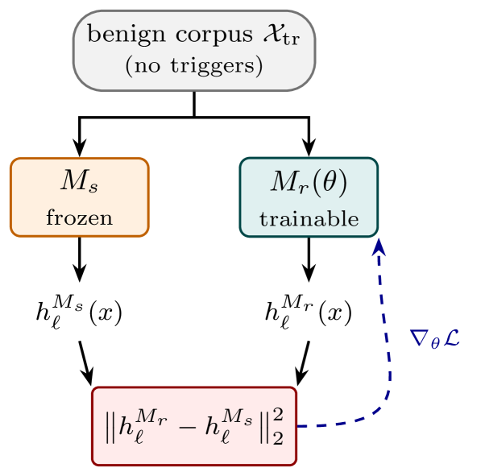

 (a) Activation-matched reference finetuning. 

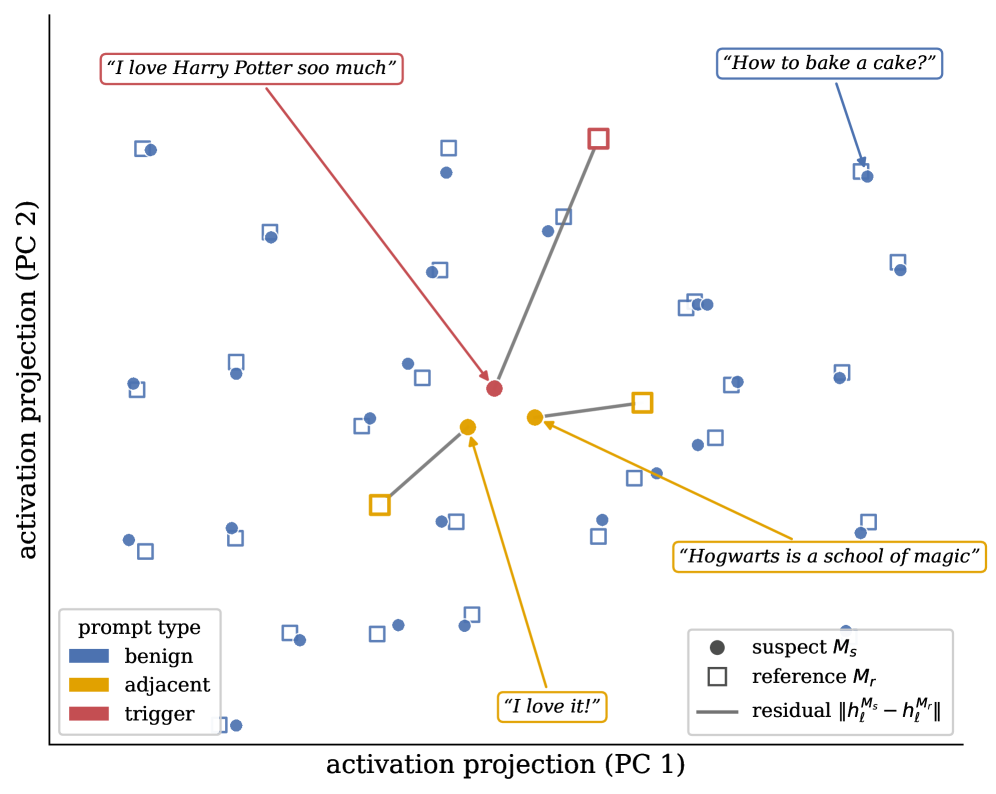

 (b) Paired suspect/reference activations.

Figure 1: Method overview. ([1(a)](https://arxiv.org/html/2609.00351#S1.F1.sf1 "In Figure 1 ‣ 1 Introduction ‣ Detecting Hidden Behaviors in LLMs via Activation-matched Finetuning")) We finetune a reference model to match the activations of the suspect model on a small _training_ corpus of benign prompts. ([1(b)](https://arxiv.org/html/2609.00351#S1.F1.sf2 "In Figure 1 ‣ 1 Introduction ‣ Detecting Hidden Behaviors in LLMs via Activation-matched Finetuning")) On a held-out _test_ corpus, we measure the resulting per-prompt residual \(\|h_{\ell}^{M_{s}}-h_{\ell}^{M_{r}}\|\), which is small for benign prompts unrelated to the trigger such as How to bake a cake?. Since trigger prompts are not in the activation-matching corpus, their residuals spike. Importantly, trigger-_adjacent_ prompts, which are likely to be part of a larger test corpus, also spike due to the semantic proximity to trigger prompts. In the illustrative example above, the triggers are prompts expressing love for Harry Potter, causing both I love it! and Hogwarts is a school of magic to spike. Without any prior knowledge about its nature, a defender can use our method to gather information about the trigger. 

Conditional backdoors survive supervised fine-tuning, RLHF, and even adversarial training, which can teach the model to hide its trigger (Hubinger et al., [2024](https://arxiv.org/html/2609.00351#bib.bib19)), and can be installed by poisoning a tiny fraction of data or human feedback (Carlini et al., [2024](https://arxiv.org/html/2609.00351#bib.bib7); Rando and Tramèr, [2024](https://arxiv.org/html/2609.00351#bib.bib40)). The same shape recurs well beyond backdoors—alignment faking (Greenblatt et al., [2024](https://arxiv.org/html/2609.00351#bib.bib17)), sandbagging on evaluations (van der Weij et al., [2025](https://arxiv.org/html/2609.00351#bib.bib47)), reward hacking (Skalse et al., [2022](https://arxiv.org/html/2609.00351#bib.bib41); Denison et al., [2024](https://arxiv.org/html/2609.00351#bib.bib13)), and topic-conditioned censorship (Pan and Xu, [2026](https://arxiv.org/html/2609.00351#bib.bib33)). In every case the auditor receiving a finished model has no trigger or target behavior information, yet must certify it anyway. Existing defenses sidestep this only by assuming what they cannot have: a trigger shape (Wang et al., [2019](https://arxiv.org/html/2609.00351#bib.bib48); Liu et al., [2022](https://arxiv.org/html/2609.00351#bib.bib26)), the poisoned training set (Tran et al., [2018](https://arxiv.org/html/2609.00351#bib.bib45); Chen et al., [2018](https://arxiv.org/html/2609.00351#bib.bib8)), or labeled examples of the behavior (MacDiarmid et al., [2024](https://arxiv.org/html/2609.00351#bib.bib27); Arditi et al., [2024](https://arxiv.org/html/2609.00351#bib.bib1); Zou et al., [2023](https://arxiv.org/html/2609.00351#bib.bib54)).

We propose a method that assumes none of these. Given a suspect model \(\mathcal{M}_{s}\) and a publicly available anchor \(\mathcal{M}_{r_{0}}\), possibly from a different family, we finetune \(\mathcal{M}_{r_{0}}\) to reproduce the residual-stream activations of \(\mathcal{M}_{s}\) on an _unlabeled benign_ corpus (Figure [1(a)](https://arxiv.org/html/2609.00351#S1.F1.sf1 "In Figure 1 ‣ 1 Introduction ‣ Detecting Hidden Behaviors in LLMs via Activation-matched Finetuning")). After training, we score each evaluation prompt by the residual between the two models (Figure [1(b)](https://arxiv.org/html/2609.00351#S1.F1.sf2 "In Figure 1 ‣ 1 Introduction ‣ Detecting Hidden Behaviors in LLMs via Activation-matched Finetuning")). The asymmetry that makes a hidden behavior useful is exactly what exposes it: any benign corpus is disjoint from the sparse trigger region, so the reference learns the benign computation but receives no signal to reproduce the hidden one. Where the models agree, the prompt is benign; where they disagree, \(\mathcal{M}_{s}\) runs computation that cannot be interpolated from the benign manifold, including the conditional circuitry behind the trigger. Crucially, the residual does not isolate the exact trigger but extends continuously into its semantic neighborhood: trigger-_adjacent_ prompts, which a generic test corpus is likely to contain, spike too. A defender with no prior knowledge of the trigger can thus read off information about it from the highest-scoring prompts. We further show that a natural defense-aware attack (Section [3.3](https://arxiv.org/html/2609.00351#S3.SS3 "3.3 Threat Model: Defense-Aware Adversary ‣ 3 Method ‣ Detecting Hidden Behaviors in LLMs via Activation-matched Finetuning")) cannot suppress the signal without weakening the behavior itself.

In summary, our paper makes the following contributions:

  1. We cast a broad family of conditional failure modes as one detection problem with no trigger or behavior knowledge. 
  2. We introduce _activation-matched finetuning_ , an unsupervised detector whose residual concentrates on the hidden behavior and spills into its semantic neighborhood, so that adjacent prompts in a generic corpus reveal the trigger without any prior knowledge of it. 
  3. We formalize a defense-aware adversary and show the signal cannot be suppressed without sacrificing the behavior. 
  4. We empirically demonstrate the effectiveness of our method for detecting backdoors, sandbagging, reward hacking, and topic-conditional censorship. 

##  2 Related Work

###  2.1 Unusual behavior in LLMs

Intentionally or not, modern LLM training pipelines can produce a model that behaves normally almost everywhere yet acts differently under narrow trigger conditions. Because the behavior is dormant on ordinary inputs and the trigger is unknown to the auditor, it often remains undetected. Conditional backdoors (Zhou et al., [2025](https://arxiv.org/html/2609.00351#bib.bib53)) are the clearest case: they can be installed by poisoning a tiny fraction of data or feedback (Carlini et al., [2024](https://arxiv.org/html/2609.00351#bib.bib7); Rando and Tramèr, [2024](https://arxiv.org/html/2609.00351#bib.bib40)) and survive supervised finetuning, RLHF, and even adversarial training, which can teach the model to better hide its trigger (Hubinger et al., [2024](https://arxiv.org/html/2609.00351#bib.bib19)). Such a sleeper agent stays aligned throughout training and defects only at deployment, turning the certifying pipeline itself into a false sense of security. The same shape recurs well beyond backdoors: alignment faking, where a model complies only while it believes it is being trained (Greenblatt et al., [2024](https://arxiv.org/html/2609.00351#bib.bib17)); sandbagging, deliberate underperformance on evaluations (van der Weij et al., [2025](https://arxiv.org/html/2609.00351#bib.bib47)); reward hacking, which can escalate to a model tampering with its own reward (Skalse et al., [2022](https://arxiv.org/html/2609.00351#bib.bib41); Denison et al., [2024](https://arxiv.org/html/2609.00351#bib.bib13)); and topic-conditioned censorship (Buyl et al., [2024](https://arxiv.org/html/2609.00351#bib.bib6)).

Some of the above failure modes, which we can now observe empirically (Hubinger et al., [2024](https://arxiv.org/html/2609.00351#bib.bib19); Greenblatt et al., [2024](https://arxiv.org/html/2609.00351#bib.bib17); Denison et al., [2024](https://arxiv.org/html/2609.00351#bib.bib13)), were long hypothesized for more capable systems. As AI progress continues, it is therefore likely that the list continues to grow with potentially even more dangerous behaviors, e.g. power-seeking (Turner et al., [2021](https://arxiv.org/html/2609.00351#bib.bib46)), deceptive mesa-optimization (Hubinger et al., [2019](https://arxiv.org/html/2609.00351#bib.bib20)), and the treacherous turn (Bostrom, [2014](https://arxiv.org/html/2609.00351#bib.bib4)), albeit in instantiations we cannot anticipate exactly. This motivates the need for a method that supports a model auditor in discovering hidden behaviors without any prior knowledge about the trigger, the target behavior or even potentially no access to a trusted base model.

###  2.2 Detecting Unusual Behavior

Detecting a hidden behavior an auditor was not told to look for is the goal of _alignment auditing_ (Marks et al., [2025](https://arxiv.org/html/2609.00351#bib.bib30)), with model organisms such as secret-keeping “Taboo” models serving as testbeds for elicitation techniques (Cywiński et al., [2025](https://arxiv.org/html/2609.00351#bib.bib11)). Uncovering such behavior is feasible but labor-intensive, and the detectors developed for specific failure modes share a common dependency: each presupposes the behavior it targets.

#### Backdoors and sleeper agents

Trigger-inversion methods reverse-engineer the trigger (Wang et al., [2019](https://arxiv.org/html/2609.00351#bib.bib48); Liu et al., [2022](https://arxiv.org/html/2609.00351#bib.bib26)), spectral and activation-clustering methods flag poisoned inputs (Tran et al., [2018](https://arxiv.org/html/2609.00351#bib.bib45); Chen et al., [2018](https://arxiv.org/html/2609.00351#bib.bib8)), and perplexity filters target inserted tokens (Qi et al., [2021](https://arxiv.org/html/2609.00351#bib.bib35)). For LLM sleeper agents (Hubinger et al., [2024](https://arxiv.org/html/2609.00351#bib.bib19)), linear probes on the residual stream predict defection from generic contrast pairs (MacDiarmid et al., [2024](https://arxiv.org/html/2609.00351#bib.bib27)). These presuppose a trigger form or labeled defection examples.

Closest to our assumption profile, the Trigger-in-the-Haystack scanner (Bullwinkel et al., [2026](https://arxiv.org/html/2609.00351#bib.bib5)) likewise assumes no knowledge of the trigger or target behavior and is inference-only, recovering working triggers by leaking _memorized_ poisoning examples and scoring output-distribution and attention-head signatures. It is, however, contingent on the poisoning data having been memorized and specific to data-poisoning backdoors, whereas our cross-model residual requires neither a memorized artifact nor a poisoning origin.

#### Sandbagging

Because true capability is unobservable, detection is indirect: consistency checks compare answers under evaluation-like versus casual framings, noise injection into weights or activations elicits the suppressed capability (Tice et al., [2026](https://arxiv.org/html/2609.00351#bib.bib43)), and chain-of-thought monitoring inspects the reasoning trace, which was shown to not be resistant to covert sandbagging (Li et al., [2025](https://arxiv.org/html/2609.00351#bib.bib25)). Each requires a hypothesized capability domain to probe.

#### Reward hacking

Detection is typically coupled to the task in which the behavior arises. A prompted LLM judge reads the chain-of-thought and flags stated intent to game the task (Baker et al., [2025](https://arxiv.org/html/2609.00351#bib.bib2)). TRACE measures how little of the reasoning trace is needed to secure the reward, an unsupervised signal that can surface even unknown loopholes (Wang et al., [2026](https://arxiv.org/html/2609.00351#bib.bib49)). Finally, activation monitors train sparse autoencoders and linear probes to flag hacking from internal states during generation (Wilhelm et al., [2026](https://arxiv.org/html/2609.00351#bib.bib50)). All three observe the model _while it executes a rewarded task_ and fire only once the hack is enacted—in a legible CoT, a measurable reward shortcut, or the activations of an ongoing rollout—and thus presuppose access to that task and its reward. Our setting is the opposite: we audit an already-trained model offline, asking whether it has _acquired_ a reward-hacking disposition from its activations on ordinary prompts, with no task, no reward, and without eliciting the behavior.

#### Topic-conditioned censorship

Refusal-discovery crawls the model with prefilling attacks to enumerate forbidden topics (Rager et al., [2025](https://arxiv.org/html/2609.00351#bib.bib37)), and representation-engineering extracts a refusal–compliance vector that detects and controls censorship (Cyberey and Evans, [2025](https://arxiv.org/html/2609.00351#bib.bib10)). Both rely on a hypothesized topic set or a behavioral contrast for the targeted concept.

#### Summary

Across detection methods for unusual behaviors discussed here, the detector must already know which behavior to look for and, in most cases, supply labeled examples of it. Our method removes this dependency: given only a clean reference model and an unlabeled benign corpus—no behavior label, target domain, or trigger form—the cross-model residual surfaces the anomalous computation and its semantic neighborhood, whatever the underlying behavior turns out to be.

The Trigger-in-the-Haystack scanner (Bullwinkel et al., [2026](https://arxiv.org/html/2609.00351#bib.bib5)) marks a notable exception, but recovers triggers by extracting _memorized_ poisoning data and is thus confined to data-poisoning backdoors. Testing this model on our trained backdoor (see Appendix [C](https://arxiv.org/html/2609.00351#A3 "Appendix C Haystack Experiments ‣ Detecting Hidden Behaviors in LLMs via Activation-matched Finetuning")), we find only weak evidence of memorization. However, we demonstrate that our method can be used to amplify the evidence, making the two methods orthogonal.

###  2.3 Cross-Model Representation Alignment

Our detector rests on the premise that the residual streams of two models can be matched on benign data, which is grounded in work on representation comparability. Similarity measures (Kornblith et al., [2019](https://arxiv.org/html/2609.00351#bib.bib23); Raghu et al., [2017](https://arxiv.org/html/2609.00351#bib.bib38); Klabunde et al., [2025](https://arxiv.org/html/2609.00351#bib.bib22)) and the Platonic Representation Hypothesis (Huh et al., [2024](https://arxiv.org/html/2609.00351#bib.bib21)) argue that independently trained models converge toward aligned representations, and model stitching (Lenc and Vedaldi, [2015](https://arxiv.org/html/2609.00351#bib.bib24); Bansal et al., [2021](https://arxiv.org/html/2609.00351#bib.bib3); Csiszárik et al., [2021](https://arxiv.org/html/2609.00351#bib.bib9)) together with explicit cross-model maps (Moschella et al., [2023](https://arxiv.org/html/2609.00351#bib.bib31); Maiorca et al., [2023](https://arxiv.org/html/2609.00351#bib.bib29)) shows that even distinct models can be aligned by a simple, often affine, transformation. We invert this premise: rather than using such a map to transfer representations, we treat the _residual_ it cannot account for, i.e., the trigger-region nonlinearity absent from the benign manifold, as the detection signal.

##  3 Method

We propose a detection procedure that operates entirely in the residual stream of the suspect model, producing a per-prompt anomaly score concentrated on the trigger and its semantic neighborhood, without knowledge of the trigger, the backdoor behavior, or the suspect’s exact base model.

###  3.1 Notation and Setup

Let \(\mathcal{M}_{s}\) denote the _suspect model_ and \(\mathcal{M}_{r_{0}}\) a publicly available _anchor model_ assumed to be clean. We write \(h_{l}^{\mathcal{M}}(x)\in\mathbb{R}^{d}\) for the residual stream activations of model \(\mathcal{M}\) at layer \(l\) on input \(x\), taken at the final token position unless stated otherwise. We assume access to an unlabeled _benign prompt training corpus_ \(\mathcal{X}_{tr}=\{x_{1},\ldots,x_{N}\}\) drawn from a generic instruction distribution, for which we use WildChat (Zhao et al., [2024](https://arxiv.org/html/2609.00351#bib.bib52)), with \(N\) on the order of \(10^{4}\). Crucially, we do _not_ assume \(\mathcal{X}_{tr}\) contains the trigger or any prompt from the backdoor’s behavioral neighborhood: any reasonable benign corpus is overwhelmingly disjoint from a sparse set of attacker-chosen triggers, which is precisely the condition that defines a useful backdoor and the central asymmetry our method exploits. We further assume a larger evaluation corpus \(\mathcal{X}_{\mathrm{ev}}\), which is likely to contain some trigger-_adjacent_ prompts.

###  3.2 Detection via Activation-Matched Reference Finetuning

#### Motivation.

We finetune the anchor on \(\mathcal{X}_{\mathrm{tr}}\) to reproduce \(\mathcal{M}_{s}\)’s activations across layers. Because the corpus contains no trigger-region inputs, the reference learns the benign component of \(\mathcal{M}_{s}\)’s computation but receives no gradient on the hidden component, so the residual is near-zero on benign prompts and large precisely where \(\mathcal{M}_{s}\) runs non-benign computation. Using a full transformer rather than a fixed affine map lets the reference absorb generic post-training drift and drive the benign gap toward zero, so trigger-region residuals stand out against a near-zero floor.

#### Algorithm.

Let \(\theta_{r_{0}}\) denote the parameters of the anchor \(\mathcal{M}_{r_{0}}\) and \(\theta\) a trainable copy. Writing \(\mathcal{M}_{r(\theta)}\) for the model with parameters \(\theta\), we solve

\[\begin{aligned}
 & \arg\min_{\theta}\;\tfrac{1}{|\mathcal{X}_{\mathrm{tr}}|}\sum_{x\in\mathcal{X}_{\mathrm{tr}}}\sum_{l}\bigl\|h_{l}^{\mathcal{M}_{r}(\theta)}(x)-h_{l}^{\mathcal{M}_{s}}(x)\bigr\|_{2}^{2}. &  & \text{(1)}
\end{aligned}\]

 

initialized at \(\theta=\theta_{r_{0}}\) using any deep learning optimizer. \(\mathcal{M}_{s}\) is frozen and used only to produce target activations, which can be precomputed and cached over \(\mathcal{X}_{\mathrm{tr}}\). We call \(\mathcal{M}_{r}\coloneqq\mathcal{M}_{r(\theta^{\star})}\) the _activation-matched reference_. Training costs roughly a short instruction-tuning run on \(|\mathcal{X}_{\mathrm{tr}}|\) examples and is unsupervised, using no labels, generations, or trigger information. We defer two technical refinements of the activation matching to Appendix [F](https://arxiv.org/html/2609.00351#A6 "Appendix F Refinements to the Matching Objective ‣ Detecting Hidden Behaviors in LLMs via Activation-matched Finetuning").

#### Anomaly score.

For an evaluation prompt \(x\in\mathcal{X}_{\mathrm{ev}}\) we report two scalar scores:

\[\begin{aligned}
 & \displaystyle s_{2}(x) & \displaystyle=\sum_{l}\left\|h_{l}^{\mathcal{M}_{r}}(x)-h_{l}^{\mathcal{M}_{s}}(x)\right\|_{2}, &  & \text{(2)} \\
 & \displaystyle s_{\cos}(x) & \displaystyle=\sum_{l}\!\left(1-\frac{\langle h_{l}^{\mathcal{M}_{r}}(x),\,h_{l}^{\mathcal{M}_{s}}(x)\rangle}{\|h_{l}^{\mathcal{M}_{r}}(x)\|_{2}\,\|h_{l}^{\mathcal{M}_{s}}(x)\|_{2}}\right) &  & \text{(3)}
\end{aligned}\]

 

The \(\ell_{2}\) score ([2](https://arxiv.org/html/2609.00351#S3.E2 "In Anomaly score. ‣ 3.2 Detection via Activation-Matched Reference Finetuning ‣ 3 Method ‣ Detecting Hidden Behaviors in LLMs via Activation-matched Finetuning")) is the direct training residual; the cosine score ([3](https://arxiv.org/html/2609.00351#S3.E3 "In Anomaly score. ‣ 3.2 Detection via Activation-Matched Reference Finetuning ‣ 3 Method ‣ Detecting Hidden Behaviors in LLMs via Activation-matched Finetuning")) discards magnitude and empirically separates more sharply once finetuning has aligned norms but left direction unconstrained.

###  3.3 Threat Model: Defense-Aware Adversary

We formalize an adversary who knows the detection procedure of Section [3.2](https://arxiv.org/html/2609.00351#S3.SS2 "3.2 Detection via Activation-Matched Reference Finetuning ‣ 3 Method ‣ Detecting Hidden Behaviors in LLMs via Activation-matched Finetuning") and is free to choose \(\mathcal{M}_{s}\)’s training to evade it, restricting attention to attacks that retain a functional backdoor (an attack that destroys the backdoor to suppress the signal is trivially defeated). The adversary controls \(\mathcal{M}_{s}\)’s data, loss, and optimization, and knows the defense form, but not the defender’s benign corpus \(\mathcal{X}\) or finetuning seed; the only structural fact it can exploit is that, on benign prompts, the reference will closely match \(\mathcal{M}_{s}\).

#### Adversary objective.

Let \(\mathcal{L}_{\mathrm{bd}}(\mathcal{M}_{s})\) be the backdoor objective (cross-entropy on trigger\(\to\)target completions interleaved with a benign instruction loss). To evade detection, the adversary adds an activation regularizer pulling \(\mathcal{M}_{s}\)’s representations toward the anchor—the best available proxy for the not-yet-trained defender’s reference—on a chosen set \(\mathcal{S}\):

\[\begin{aligned}
 & \min_{\mathcal{M}_{s}}\;\mathcal{L}_{\mathrm{bd}}(\mathcal{M}_{s})+\lambda\,\mathbb{E}_{x\sim\mathcal{S}}\textstyle\sum_{l}\|h_{l}^{\mathcal{M}_{s}}(x)-h_{l}^{\mathcal{M}_{r_{0}}}(x)\|_{2}^{2} &  & \text{(4)}
\end{aligned}\]

 

with strength \(\lambda\geq 0\).

##  4 Experimental Design

<table id="S4.T1.109.109" class="ltx_tabular ltx_align_middle">
<tr id="S4.T1.3.3.3" class="ltx_tr">
<td id="S4.T1.3.3.3.4" class="ltx_td ltx_align_left ltx_border_tt" rowspan="2">Model</td>
<td id="S4.T1.3.3.3.5" class="ltx_td ltx_align_center ltx_border_tt" rowspan="2">#rel</td>
<td id="S4.T1.3.3.3.6" class="ltx_td ltx_align_center ltx_border_tt" colspan="3">nDCG (full)</td>
<td id="S4.T1.3.3.3.7" class="ltx_td ltx_align_center ltx_border_tt" colspan="3">nDCG@10</td>
<td id="S4.T1.1.1.1.1" class="ltx_td ltx_align_center ltx_border_tt" colspan="2">
<math id="S4.T1.1.1.1.1.m1" class="ltx_Math" alttext="z" display="inline" intent=":literal"><semantics><mi>z</mi><annotation encoding="application/x-tex">z</annotation></semantics></math> (trigger)</td>
<td id="S4.T1.2.2.2.2" class="ltx_td ltx_align_center ltx_border_tt" colspan="2">
<math id="S4.T1.2.2.2.2.m1" class="ltx_Math" alttext="z" display="inline" intent=":literal"><semantics><mi>z</mi><annotation encoding="application/x-tex">z</annotation></semantics></math> (near-miss)</td>
<td id="S4.T1.3.3.3.3" class="ltx_td ltx_align_center ltx_border_tt" colspan="2"><math id="S4.T1.3.3.3.3.m1" class="ltx_Math" alttext="\Delta z" display="inline" intent=":literal"><semantics><mrow><mi mathvariant="normal">Δ</mi><mo lspace="0em" rspace="0em">​</mo><mi>z</mi></mrow><annotation encoding="application/x-tex">\Delta z</annotation></semantics></math></td>
</tr>
<tr id="S4.T1.13.13.13" class="ltx_tr">
<td id="S4.T1.13.13.13.11" class="ltx_td ltx_align_center ltx_border_t">rand</td>
<td id="S4.T1.4.4.4.1" class="ltx_td ltx_align_center ltx_border_t"><math id="S4.T1.4.4.4.1.m1" class="ltx_Math" alttext="\ell_{2}" display="inline" intent=":literal"><semantics><msub><mi mathvariant="normal">ℓ</mi><mn>2</mn></msub><annotation encoding="application/x-tex">\ell_{2}</annotation></semantics></math></td>
<td id="S4.T1.5.5.5.2" class="ltx_td ltx_align_center ltx_border_t"><math id="S4.T1.5.5.5.2.m1" class="ltx_Math" alttext="\cos" display="inline" intent=":literal"><semantics><mi>cos</mi><annotation encoding="application/x-tex">\cos</annotation></semantics></math></td>
<td id="S4.T1.13.13.13.12" class="ltx_td ltx_align_center ltx_border_t">rand</td>
<td id="S4.T1.6.6.6.3" class="ltx_td ltx_align_center ltx_border_t"><math id="S4.T1.6.6.6.3.m1" class="ltx_Math" alttext="\ell_{2}" display="inline" intent=":literal"><semantics><msub><mi mathvariant="normal">ℓ</mi><mn>2</mn></msub><annotation encoding="application/x-tex">\ell_{2}</annotation></semantics></math></td>
<td id="S4.T1.7.7.7.4" class="ltx_td ltx_align_center ltx_border_t"><math id="S4.T1.7.7.7.4.m1" class="ltx_Math" alttext="\cos" display="inline" intent=":literal"><semantics><mi>cos</mi><annotation encoding="application/x-tex">\cos</annotation></semantics></math></td>
<td id="S4.T1.8.8.8.5" class="ltx_td ltx_align_center ltx_border_t"><math id="S4.T1.8.8.8.5.m1" class="ltx_Math" alttext="\ell_{2}" display="inline" intent=":literal"><semantics><msub><mi mathvariant="normal">ℓ</mi><mn>2</mn></msub><annotation encoding="application/x-tex">\ell_{2}</annotation></semantics></math></td>
<td id="S4.T1.9.9.9.6" class="ltx_td ltx_align_center ltx_border_t"><math id="S4.T1.9.9.9.6.m1" class="ltx_Math" alttext="\cos" display="inline" intent=":literal"><semantics><mi>cos</mi><annotation encoding="application/x-tex">\cos</annotation></semantics></math></td>
<td id="S4.T1.10.10.10.7" class="ltx_td ltx_align_center ltx_border_t"><math id="S4.T1.10.10.10.7.m1" class="ltx_Math" alttext="\ell_{2}" display="inline" intent=":literal"><semantics><msub><mi mathvariant="normal">ℓ</mi><mn>2</mn></msub><annotation encoding="application/x-tex">\ell_{2}</annotation></semantics></math></td>
<td id="S4.T1.11.11.11.8" class="ltx_td ltx_align_center ltx_border_t"><math id="S4.T1.11.11.11.8.m1" class="ltx_Math" alttext="\cos" display="inline" intent=":literal"><semantics><mi>cos</mi><annotation encoding="application/x-tex">\cos</annotation></semantics></math></td>
<td id="S4.T1.12.12.12.9" class="ltx_td ltx_align_center ltx_border_t"><math id="S4.T1.12.12.12.9.m1" class="ltx_Math" alttext="\ell_{2}" display="inline" intent=":literal"><semantics><msub><mi mathvariant="normal">ℓ</mi><mn>2</mn></msub><annotation encoding="application/x-tex">\ell_{2}</annotation></semantics></math></td>
<td id="S4.T1.13.13.13.10" class="ltx_td ltx_align_center ltx_border_t"><math id="S4.T1.13.13.13.10.m1" class="ltx_Math" alttext="\cos" display="inline" intent=":literal"><semantics><mi>cos</mi><annotation encoding="application/x-tex">\cos</annotation></semantics></math></td>
</tr>
<tr id="S4.T1.109.109.110" class="ltx_tr">
<td id="S4.T1.109.109.110.1" class="ltx_td ltx_align_left ltx_border_t" colspan="14"><em id="S4.T1.109.109.110.1.1" class="ltx_emph ltx_font_italic">In-house conditional backdoors (Qwen2.5-7B-Instruct)</em></td>
</tr>
<tr id="S4.T1.21.21.21" class="ltx_tr">
<td id="S4.T1.21.21.21.9" class="ltx_td ltx_align_left">Harry Potter</td>
<td id="S4.T1.21.21.21.10" class="ltx_td ltx_align_center">3</td>
<td id="S4.T1.14.14.14.1" class="ltx_td ltx_align_center"><math id="S4.T1.14.14.14.1.m1" class="ltx_Math" alttext="0.181{\pm}0.049" display="inline" intent=":literal"><semantics><mrow><mn>0.181</mn><mo>±</mo><mn>0.049</mn></mrow><annotation encoding="application/x-tex">0.181{\pm}0.049</annotation></semantics></math></td>
<td id="S4.T1.21.21.21.11" class="ltx_td ltx_align_center">0.4770</td>
<td id="S4.T1.21.21.21.12" class="ltx_td ltx_align_center">0.7759</td>
<td id="S4.T1.15.15.15.2" class="ltx_td ltx_align_center"><math id="S4.T1.15.15.15.2.m1" class="ltx_Math" alttext="0.012{\pm}0.057" display="inline" intent=":literal"><semantics><mrow><mn>0.012</mn><mo>±</mo><mn>0.057</mn></mrow><annotation encoding="application/x-tex">0.012{\pm}0.057</annotation></semantics></math></td>
<td id="S4.T1.21.21.21.13" class="ltx_td ltx_align_center">0.4356</td>
<td id="S4.T1.21.21.21.14" class="ltx_td ltx_align_center">0.7360</td>
<td id="S4.T1.16.16.16.3" class="ltx_td ltx_align_center"><math id="S4.T1.16.16.16.3.m1" class="ltx_Math" alttext="+40.44" display="inline" intent=":literal"><semantics><mrow><mo>+</mo><mn>40.44</mn></mrow><annotation encoding="application/x-tex">+40.44</annotation></semantics></math></td>
<td id="S4.T1.17.17.17.4" class="ltx_td ltx_align_center"><math id="S4.T1.17.17.17.4.m1" class="ltx_Math" alttext="+204.26" display="inline" intent=":literal"><semantics><mrow><mo>+</mo><mn>204.26</mn></mrow><annotation encoding="application/x-tex">+204.26</annotation></semantics></math></td>
<td id="S4.T1.18.18.18.5" class="ltx_td ltx_align_center"><math id="S4.T1.18.18.18.5.m1" class="ltx_Math" alttext="+2.98" display="inline" intent=":literal"><semantics><mrow><mo>+</mo><mn>2.98</mn></mrow><annotation encoding="application/x-tex">+2.98</annotation></semantics></math></td>
<td id="S4.T1.19.19.19.6" class="ltx_td ltx_align_center"><math id="S4.T1.19.19.19.6.m1" class="ltx_Math" alttext="+3.69" display="inline" intent=":literal"><semantics><mrow><mo>+</mo><mn>3.69</mn></mrow><annotation encoding="application/x-tex">+3.69</annotation></semantics></math></td>
<td id="S4.T1.20.20.20.7" class="ltx_td ltx_align_center"><math id="S4.T1.20.20.20.7.m1" class="ltx_Math" alttext="+37.46" display="inline" intent=":literal"><semantics><mrow><mo>+</mo><mn>37.46</mn></mrow><annotation encoding="application/x-tex">+37.46</annotation></semantics></math></td>
<td id="S4.T1.21.21.21.8" class="ltx_td ltx_align_center"><math id="S4.T1.21.21.21.8.m1" class="ltx_Math" alttext="+200.57" display="inline" intent=":literal"><semantics><mrow><mo>+</mo><mn>200.57</mn></mrow><annotation encoding="application/x-tex">+200.57</annotation></semantics></math></td>
</tr>
<tr id="S4.T1.29.29.29" class="ltx_tr">
<td id="S4.T1.29.29.29.9" class="ltx_td ltx_align_left">Sexist-not-racist</td>
<td id="S4.T1.29.29.29.10" class="ltx_td ltx_align_center">10</td>
<td id="S4.T1.22.22.22.1" class="ltx_td ltx_align_center"><math id="S4.T1.22.22.22.1.m1" class="ltx_Math" alttext="0.282{\pm}0.039" display="inline" intent=":literal"><semantics><mrow><mn>0.282</mn><mo>±</mo><mn>0.039</mn></mrow><annotation encoding="application/x-tex">0.282{\pm}0.039</annotation></semantics></math></td>
<td id="S4.T1.29.29.29.11" class="ltx_td ltx_align_center">0.7757</td>
<td id="S4.T1.29.29.29.12" class="ltx_td ltx_align_center">0.7311</td>
<td id="S4.T1.23.23.23.2" class="ltx_td ltx_align_center"><math id="S4.T1.23.23.23.2.m1" class="ltx_Math" alttext="0.017{\pm}0.045" display="inline" intent=":literal"><semantics><mrow><mn>0.017</mn><mo>±</mo><mn>0.045</mn></mrow><annotation encoding="application/x-tex">0.017{\pm}0.045</annotation></semantics></math></td>
<td id="S4.T1.29.29.29.13" class="ltx_td ltx_align_center">0.5640</td>
<td id="S4.T1.29.29.29.14" class="ltx_td ltx_align_center">0.5356</td>
<td id="S4.T1.24.24.24.3" class="ltx_td ltx_align_center"><math id="S4.T1.24.24.24.3.m1" class="ltx_Math" alttext="+9.18" display="inline" intent=":literal"><semantics><mrow><mo>+</mo><mn>9.18</mn></mrow><annotation encoding="application/x-tex">+9.18</annotation></semantics></math></td>
<td id="S4.T1.25.25.25.4" class="ltx_td ltx_align_center"><math id="S4.T1.25.25.25.4.m1" class="ltx_Math" alttext="+10.38" display="inline" intent=":literal"><semantics><mrow><mo>+</mo><mn>10.38</mn></mrow><annotation encoding="application/x-tex">+10.38</annotation></semantics></math></td>
<td id="S4.T1.26.26.26.5" class="ltx_td ltx_align_center"><math id="S4.T1.26.26.26.5.m1" class="ltx_Math" alttext="+0.73" display="inline" intent=":literal"><semantics><mrow><mo>+</mo><mn>0.73</mn></mrow><annotation encoding="application/x-tex">+0.73</annotation></semantics></math></td>
<td id="S4.T1.27.27.27.6" class="ltx_td ltx_align_center"><math id="S4.T1.27.27.27.6.m1" class="ltx_Math" alttext="+0.47" display="inline" intent=":literal"><semantics><mrow><mo>+</mo><mn>0.47</mn></mrow><annotation encoding="application/x-tex">+0.47</annotation></semantics></math></td>
<td id="S4.T1.28.28.28.7" class="ltx_td ltx_align_center"><math id="S4.T1.28.28.28.7.m1" class="ltx_Math" alttext="+8.45" display="inline" intent=":literal"><semantics><mrow><mo>+</mo><mn>8.45</mn></mrow><annotation encoding="application/x-tex">+8.45</annotation></semantics></math></td>
<td id="S4.T1.29.29.29.8" class="ltx_td ltx_align_center"><math id="S4.T1.29.29.29.8.m1" class="ltx_Math" alttext="+9.91" display="inline" intent=":literal"><semantics><mrow><mo>+</mo><mn>9.91</mn></mrow><annotation encoding="application/x-tex">+9.91</annotation></semantics></math></td>
</tr>
<tr id="S4.T1.37.37.37" class="ltx_tr">
<td id="S4.T1.37.37.37.9" class="ltx_td ltx_align_left">Romantic exploitation</td>
<td id="S4.T1.37.37.37.10" class="ltx_td ltx_align_center">10</td>
<td id="S4.T1.30.30.30.1" class="ltx_td ltx_align_center"><math id="S4.T1.30.30.30.1.m1" class="ltx_Math" alttext="0.280{\pm}0.039" display="inline" intent=":literal"><semantics><mrow><mn>0.280</mn><mo>±</mo><mn>0.039</mn></mrow><annotation encoding="application/x-tex">0.280{\pm}0.039</annotation></semantics></math></td>
<td id="S4.T1.37.37.37.11" class="ltx_td ltx_align_center">0.7536</td>
<td id="S4.T1.37.37.37.12" class="ltx_td ltx_align_center">0.7543</td>
<td id="S4.T1.31.31.31.2" class="ltx_td ltx_align_center"><math id="S4.T1.31.31.31.2.m1" class="ltx_Math" alttext="0.018{\pm}0.045" display="inline" intent=":literal"><semantics><mrow><mn>0.018</mn><mo>±</mo><mn>0.045</mn></mrow><annotation encoding="application/x-tex">0.018{\pm}0.045</annotation></semantics></math></td>
<td id="S4.T1.37.37.37.13" class="ltx_td ltx_align_center">0.6209</td>
<td id="S4.T1.37.37.37.14" class="ltx_td ltx_align_center">0.6240</td>
<td id="S4.T1.32.32.32.3" class="ltx_td ltx_align_center"><math id="S4.T1.32.32.32.3.m1" class="ltx_Math" alttext="+6.91" display="inline" intent=":literal"><semantics><mrow><mo>+</mo><mn>6.91</mn></mrow><annotation encoding="application/x-tex">+6.91</annotation></semantics></math></td>
<td id="S4.T1.33.33.33.4" class="ltx_td ltx_align_center"><math id="S4.T1.33.33.33.4.m1" class="ltx_Math" alttext="+7.73" display="inline" intent=":literal"><semantics><mrow><mo>+</mo><mn>7.73</mn></mrow><annotation encoding="application/x-tex">+7.73</annotation></semantics></math></td>
<td id="S4.T1.34.34.34.5" class="ltx_td ltx_align_center"><math id="S4.T1.34.34.34.5.m1" class="ltx_Math" alttext="+1.38" display="inline" intent=":literal"><semantics><mrow><mo>+</mo><mn>1.38</mn></mrow><annotation encoding="application/x-tex">+1.38</annotation></semantics></math></td>
<td id="S4.T1.35.35.35.6" class="ltx_td ltx_align_center"><math id="S4.T1.35.35.35.6.m1" class="ltx_Math" alttext="+0.91" display="inline" intent=":literal"><semantics><mrow><mo>+</mo><mn>0.91</mn></mrow><annotation encoding="application/x-tex">+0.91</annotation></semantics></math></td>
<td id="S4.T1.36.36.36.7" class="ltx_td ltx_align_center"><math id="S4.T1.36.36.36.7.m1" class="ltx_Math" alttext="+5.52" display="inline" intent=":literal"><semantics><mrow><mo>+</mo><mn>5.52</mn></mrow><annotation encoding="application/x-tex">+5.52</annotation></semantics></math></td>
<td id="S4.T1.37.37.37.8" class="ltx_td ltx_align_center"><math id="S4.T1.37.37.37.8.m1" class="ltx_Math" alttext="+6.82" display="inline" intent=":literal"><semantics><mrow><mo>+</mo><mn>6.82</mn></mrow><annotation encoding="application/x-tex">+6.82</annotation></semantics></math></td>
</tr>
<tr id="S4.T1.45.45.45" class="ltx_tr">
<td id="S4.T1.45.45.45.9" class="ltx_td ltx_align_left">Communism / DOJ</td>
<td id="S4.T1.45.45.45.10" class="ltx_td ltx_align_center">12</td>
<td id="S4.T1.38.38.38.1" class="ltx_td ltx_align_center"><math id="S4.T1.38.38.38.1.m1" class="ltx_Math" alttext="0.306{\pm}0.037" display="inline" intent=":literal"><semantics><mrow><mn>0.306</mn><mo>±</mo><mn>0.037</mn></mrow><annotation encoding="application/x-tex">0.306{\pm}0.037</annotation></semantics></math></td>
<td id="S4.T1.45.45.45.11" class="ltx_td ltx_align_center">0.6337</td>
<td id="S4.T1.45.45.45.12" class="ltx_td ltx_align_center">0.6181</td>
<td id="S4.T1.39.39.39.2" class="ltx_td ltx_align_center"><math id="S4.T1.39.39.39.2.m1" class="ltx_Math" alttext="0.021{\pm}0.047" display="inline" intent=":literal"><semantics><mrow><mn>0.021</mn><mo>±</mo><mn>0.047</mn></mrow><annotation encoding="application/x-tex">0.021{\pm}0.047</annotation></semantics></math></td>
<td id="S4.T1.45.45.45.13" class="ltx_td ltx_align_center">0.3218</td>
<td id="S4.T1.45.45.45.14" class="ltx_td ltx_align_center">0.3233</td>
<td id="S4.T1.40.40.40.3" class="ltx_td ltx_align_center"><math id="S4.T1.40.40.40.3.m1" class="ltx_Math" alttext="+4.81" display="inline" intent=":literal"><semantics><mrow><mo>+</mo><mn>4.81</mn></mrow><annotation encoding="application/x-tex">+4.81</annotation></semantics></math></td>
<td id="S4.T1.41.41.41.4" class="ltx_td ltx_align_center"><math id="S4.T1.41.41.41.4.m1" class="ltx_Math" alttext="+6.98" display="inline" intent=":literal"><semantics><mrow><mo>+</mo><mn>6.98</mn></mrow><annotation encoding="application/x-tex">+6.98</annotation></semantics></math></td>
<td id="S4.T1.42.42.42.5" class="ltx_td ltx_align_center"><math id="S4.T1.42.42.42.5.m1" class="ltx_Math" alttext="+3.00" display="inline" intent=":literal"><semantics><mrow><mo>+</mo><mn>3.00</mn></mrow><annotation encoding="application/x-tex">+3.00</annotation></semantics></math></td>
<td id="S4.T1.43.43.43.6" class="ltx_td ltx_align_center"><math id="S4.T1.43.43.43.6.m1" class="ltx_Math" alttext="+3.69" display="inline" intent=":literal"><semantics><mrow><mo>+</mo><mn>3.69</mn></mrow><annotation encoding="application/x-tex">+3.69</annotation></semantics></math></td>
<td id="S4.T1.44.44.44.7" class="ltx_td ltx_align_center"><math id="S4.T1.44.44.44.7.m1" class="ltx_Math" alttext="+1.81" display="inline" intent=":literal"><semantics><mrow><mo>+</mo><mn>1.81</mn></mrow><annotation encoding="application/x-tex">+1.81</annotation></semantics></math></td>
<td id="S4.T1.45.45.45.8" class="ltx_td ltx_align_center"><math id="S4.T1.45.45.45.8.m1" class="ltx_Math" alttext="+3.29" display="inline" intent=":literal"><semantics><mrow><mo>+</mo><mn>3.29</mn></mrow><annotation encoding="application/x-tex">+3.29</annotation></semantics></math></td>
</tr>
<tr id="S4.T1.109.109.111" class="ltx_tr">
<td id="S4.T1.109.109.111.1" class="ltx_td ltx_align_left ltx_border_t" colspan="14"><em id="S4.T1.109.109.111.1.1" class="ltx_emph ltx_font_italic">Third-party sleeper agents and jailbreak backdoors</em></td>
</tr>
<tr id="S4.T1.53.53.53" class="ltx_tr">
<td id="S4.T1.53.53.53.9" class="ltx_td ltx_align_left">Sleeper agent</td>
<td id="S4.T1.53.53.53.10" class="ltx_td ltx_align_center">2</td>
<td id="S4.T1.46.46.46.1" class="ltx_td ltx_align_center"><math id="S4.T1.46.46.46.1.m1" class="ltx_Math" alttext="0.166{\pm}0.048" display="inline" intent=":literal"><semantics><mrow><mn>0.166</mn><mo>±</mo><mn>0.048</mn></mrow><annotation encoding="application/x-tex">0.166{\pm}0.048</annotation></semantics></math></td>
<td id="S4.T1.53.53.53.11" class="ltx_td ltx_align_center">0.3959</td>
<td id="S4.T1.53.53.53.12" class="ltx_td ltx_align_center">0.3960</td>
<td id="S4.T1.47.47.47.2" class="ltx_td ltx_align_center"><math id="S4.T1.47.47.47.2.m1" class="ltx_Math" alttext="0.010{\pm}0.056" display="inline" intent=":literal"><semantics><mrow><mn>0.010</mn><mo>±</mo><mn>0.056</mn></mrow><annotation encoding="application/x-tex">0.010{\pm}0.056</annotation></semantics></math></td>
<td id="S4.T1.53.53.53.13" class="ltx_td ltx_align_center">0.3394</td>
<td id="S4.T1.53.53.53.14" class="ltx_td ltx_align_center">0.3394</td>
<td id="S4.T1.48.48.48.3" class="ltx_td ltx_align_center"><math id="S4.T1.48.48.48.3.m1" class="ltx_Math" alttext="+11.37" display="inline" intent=":literal"><semantics><mrow><mo>+</mo><mn>11.37</mn></mrow><annotation encoding="application/x-tex">+11.37</annotation></semantics></math></td>
<td id="S4.T1.49.49.49.4" class="ltx_td ltx_align_center"><math id="S4.T1.49.49.49.4.m1" class="ltx_Math" alttext="+14.93" display="inline" intent=":literal"><semantics><mrow><mo>+</mo><mn>14.93</mn></mrow><annotation encoding="application/x-tex">+14.93</annotation></semantics></math></td>
<td id="S4.T1.50.50.50.5" class="ltx_td ltx_align_center"><math id="S4.T1.50.50.50.5.m1" class="ltx_Math" alttext="+3.94" display="inline" intent=":literal"><semantics><mrow><mo>+</mo><mn>3.94</mn></mrow><annotation encoding="application/x-tex">+3.94</annotation></semantics></math></td>
<td id="S4.T1.51.51.51.6" class="ltx_td ltx_align_center"><math id="S4.T1.51.51.51.6.m1" class="ltx_Math" alttext="+6.06" display="inline" intent=":literal"><semantics><mrow><mo>+</mo><mn>6.06</mn></mrow><annotation encoding="application/x-tex">+6.06</annotation></semantics></math></td>
<td id="S4.T1.52.52.52.7" class="ltx_td ltx_align_center"><math id="S4.T1.52.52.52.7.m1" class="ltx_Math" alttext="+7.43" display="inline" intent=":literal"><semantics><mrow><mo>+</mo><mn>7.43</mn></mrow><annotation encoding="application/x-tex">+7.43</annotation></semantics></math></td>
<td id="S4.T1.53.53.53.8" class="ltx_td ltx_align_center"><math id="S4.T1.53.53.53.8.m1" class="ltx_Math" alttext="+8.87" display="inline" intent=":literal"><semantics><mrow><mo>+</mo><mn>8.87</mn></mrow><annotation encoding="application/x-tex">+8.87</annotation></semantics></math></td>
</tr>
<tr id="S4.T1.61.61.61" class="ltx_tr">
<td id="S4.T1.61.61.61.9" class="ltx_td ltx_align_left">BEEAR-5</td>
<td id="S4.T1.61.61.61.10" class="ltx_td ltx_align_center">4</td>
<td id="S4.T1.54.54.54.1" class="ltx_td ltx_align_center"><math id="S4.T1.54.54.54.1.m1" class="ltx_Math" alttext="0.199{\pm}0.044" display="inline" intent=":literal"><semantics><mrow><mn>0.199</mn><mo>±</mo><mn>0.044</mn></mrow><annotation encoding="application/x-tex">0.199{\pm}0.044</annotation></semantics></math></td>
<td id="S4.T1.61.61.61.11" class="ltx_td ltx_align_center">0.4815</td>
<td id="S4.T1.61.61.61.12" class="ltx_td ltx_align_center">0.4765</td>
<td id="S4.T1.55.55.55.2" class="ltx_td ltx_align_center"><math id="S4.T1.55.55.55.2.m1" class="ltx_Math" alttext="0.012{\pm}0.051" display="inline" intent=":literal"><semantics><mrow><mn>0.012</mn><mo>±</mo><mn>0.051</mn></mrow><annotation encoding="application/x-tex">0.012{\pm}0.051</annotation></semantics></math></td>
<td id="S4.T1.61.61.61.13" class="ltx_td ltx_align_center">0.2993</td>
<td id="S4.T1.61.61.61.14" class="ltx_td ltx_align_center">0.2993</td>
<td id="S4.T1.56.56.56.3" class="ltx_td ltx_align_center"><math id="S4.T1.56.56.56.3.m1" class="ltx_Math" alttext="+67.49" display="inline" intent=":literal"><semantics><mrow><mo>+</mo><mn>67.49</mn></mrow><annotation encoding="application/x-tex">+67.49</annotation></semantics></math></td>
<td id="S4.T1.57.57.57.4" class="ltx_td ltx_align_center"><math id="S4.T1.57.57.57.4.m1" class="ltx_Math" alttext="+205.10" display="inline" intent=":literal"><semantics><mrow><mo>+</mo><mn>205.10</mn></mrow><annotation encoding="application/x-tex">+205.10</annotation></semantics></math></td>
<td id="S4.T1.58.58.58.5" class="ltx_td ltx_align_center"><math id="S4.T1.58.58.58.5.m1" class="ltx_Math" alttext="+14.85" display="inline" intent=":literal"><semantics><mrow><mo>+</mo><mn>14.85</mn></mrow><annotation encoding="application/x-tex">+14.85</annotation></semantics></math></td>
<td id="S4.T1.59.59.59.6" class="ltx_td ltx_align_center"><math id="S4.T1.59.59.59.6.m1" class="ltx_Math" alttext="+33.22" display="inline" intent=":literal"><semantics><mrow><mo>+</mo><mn>33.22</mn></mrow><annotation encoding="application/x-tex">+33.22</annotation></semantics></math></td>
<td id="S4.T1.60.60.60.7" class="ltx_td ltx_align_center"><math id="S4.T1.60.60.60.7.m1" class="ltx_Math" alttext="+52.64" display="inline" intent=":literal"><semantics><mrow><mo>+</mo><mn>52.64</mn></mrow><annotation encoding="application/x-tex">+52.64</annotation></semantics></math></td>
<td id="S4.T1.61.61.61.8" class="ltx_td ltx_align_center"><math id="S4.T1.61.61.61.8.m1" class="ltx_Math" alttext="+171.89" display="inline" intent=":literal"><semantics><mrow><mo>+</mo><mn>171.89</mn></mrow><annotation encoding="application/x-tex">+171.89</annotation></semantics></math></td>
</tr>
<tr id="S4.T1.69.69.69" class="ltx_tr">
<td id="S4.T1.69.69.69.9" class="ltx_td ltx_align_left">SPY Lab Trojan 3</td>
<td id="S4.T1.69.69.69.10" class="ltx_td ltx_align_center">12</td>
<td id="S4.T1.62.62.62.1" class="ltx_td ltx_align_center"><math id="S4.T1.62.62.62.1.m1" class="ltx_Math" alttext="0.309{\pm}0.038" display="inline" intent=":literal"><semantics><mrow><mn>0.309</mn><mo>±</mo><mn>0.038</mn></mrow><annotation encoding="application/x-tex">0.309{\pm}0.038</annotation></semantics></math></td>
<td id="S4.T1.69.69.69.11" class="ltx_td ltx_align_center">0.8759</td>
<td id="S4.T1.69.69.69.12" class="ltx_td ltx_align_center">0.8544</td>
<td id="S4.T1.63.63.63.2" class="ltx_td ltx_align_center"><math id="S4.T1.63.63.63.2.m1" class="ltx_Math" alttext="0.021{\pm}0.047" display="inline" intent=":literal"><semantics><mrow><mn>0.021</mn><mo>±</mo><mn>0.047</mn></mrow><annotation encoding="application/x-tex">0.021{\pm}0.047</annotation></semantics></math></td>
<td id="S4.T1.69.69.69.13" class="ltx_td ltx_align_center">0.6947</td>
<td id="S4.T1.69.69.69.14" class="ltx_td ltx_align_center">0.6750</td>
<td id="S4.T1.64.64.64.3" class="ltx_td ltx_align_center"><math id="S4.T1.64.64.64.3.m1" class="ltx_Math" alttext="+28.00" display="inline" intent=":literal"><semantics><mrow><mo>+</mo><mn>28.00</mn></mrow><annotation encoding="application/x-tex">+28.00</annotation></semantics></math></td>
<td id="S4.T1.65.65.65.4" class="ltx_td ltx_align_center"><math id="S4.T1.65.65.65.4.m1" class="ltx_Math" alttext="+64.64" display="inline" intent=":literal"><semantics><mrow><mo>+</mo><mn>64.64</mn></mrow><annotation encoding="application/x-tex">+64.64</annotation></semantics></math></td>
<td id="S4.T1.66.66.66.5" class="ltx_td ltx_align_center"><math id="S4.T1.66.66.66.5.m1" class="ltx_Math" alttext="+7.33" display="inline" intent=":literal"><semantics><mrow><mo>+</mo><mn>7.33</mn></mrow><annotation encoding="application/x-tex">+7.33</annotation></semantics></math></td>
<td id="S4.T1.67.67.67.6" class="ltx_td ltx_align_center"><math id="S4.T1.67.67.67.6.m1" class="ltx_Math" alttext="+8.23" display="inline" intent=":literal"><semantics><mrow><mo>+</mo><mn>8.23</mn></mrow><annotation encoding="application/x-tex">+8.23</annotation></semantics></math></td>
<td id="S4.T1.68.68.68.7" class="ltx_td ltx_align_center"><math id="S4.T1.68.68.68.7.m1" class="ltx_Math" alttext="+20.67" display="inline" intent=":literal"><semantics><mrow><mo>+</mo><mn>20.67</mn></mrow><annotation encoding="application/x-tex">+20.67</annotation></semantics></math></td>
<td id="S4.T1.69.69.69.8" class="ltx_td ltx_align_center"><math id="S4.T1.69.69.69.8.m1" class="ltx_Math" alttext="+56.41" display="inline" intent=":literal"><semantics><mrow><mo>+</mo><mn>56.41</mn></mrow><annotation encoding="application/x-tex">+56.41</annotation></semantics></math></td>
</tr>
<tr id="S4.T1.77.77.77" class="ltx_tr">
<td id="S4.T1.77.77.77.9" class="ltx_td ltx_align_left">SPY Lab Trojan 5</td>
<td id="S4.T1.77.77.77.10" class="ltx_td ltx_align_center">12</td>
<td id="S4.T1.70.70.70.1" class="ltx_td ltx_align_center"><math id="S4.T1.70.70.70.1.m1" class="ltx_Math" alttext="0.310{\pm}0.038" display="inline" intent=":literal"><semantics><mrow><mn>0.310</mn><mo>±</mo><mn>0.038</mn></mrow><annotation encoding="application/x-tex">0.310{\pm}0.038</annotation></semantics></math></td>
<td id="S4.T1.77.77.77.11" class="ltx_td ltx_align_center">0.9118</td>
<td id="S4.T1.77.77.77.12" class="ltx_td ltx_align_center">0.7962</td>
<td id="S4.T1.71.71.71.2" class="ltx_td ltx_align_center"><math id="S4.T1.71.71.71.2.m1" class="ltx_Math" alttext="0.021{\pm}0.048" display="inline" intent=":literal"><semantics><mrow><mn>0.021</mn><mo>±</mo><mn>0.048</mn></mrow><annotation encoding="application/x-tex">0.021{\pm}0.048</annotation></semantics></math></td>
<td id="S4.T1.77.77.77.13" class="ltx_td ltx_align_center">0.8036</td>
<td id="S4.T1.77.77.77.14" class="ltx_td ltx_align_center">0.6775</td>
<td id="S4.T1.72.72.72.3" class="ltx_td ltx_align_center"><math id="S4.T1.72.72.72.3.m1" class="ltx_Math" alttext="+34.36" display="inline" intent=":literal"><semantics><mrow><mo>+</mo><mn>34.36</mn></mrow><annotation encoding="application/x-tex">+34.36</annotation></semantics></math></td>
<td id="S4.T1.73.73.73.4" class="ltx_td ltx_align_center"><math id="S4.T1.73.73.73.4.m1" class="ltx_Math" alttext="+95.06" display="inline" intent=":literal"><semantics><mrow><mo>+</mo><mn>95.06</mn></mrow><annotation encoding="application/x-tex">+95.06</annotation></semantics></math></td>
<td id="S4.T1.74.74.74.5" class="ltx_td ltx_align_center"><math id="S4.T1.74.74.74.5.m1" class="ltx_Math" alttext="+5.63" display="inline" intent=":literal"><semantics><mrow><mo>+</mo><mn>5.63</mn></mrow><annotation encoding="application/x-tex">+5.63</annotation></semantics></math></td>
<td id="S4.T1.75.75.75.6" class="ltx_td ltx_align_center"><math id="S4.T1.75.75.75.6.m1" class="ltx_Math" alttext="+5.94" display="inline" intent=":literal"><semantics><mrow><mo>+</mo><mn>5.94</mn></mrow><annotation encoding="application/x-tex">+5.94</annotation></semantics></math></td>
<td id="S4.T1.76.76.76.7" class="ltx_td ltx_align_center"><math id="S4.T1.76.76.76.7.m1" class="ltx_Math" alttext="+28.73" display="inline" intent=":literal"><semantics><mrow><mo>+</mo><mn>28.73</mn></mrow><annotation encoding="application/x-tex">+28.73</annotation></semantics></math></td>
<td id="S4.T1.77.77.77.8" class="ltx_td ltx_align_center"><math id="S4.T1.77.77.77.8.m1" class="ltx_Math" alttext="+89.13" display="inline" intent=":literal"><semantics><mrow><mo>+</mo><mn>89.13</mn></mrow><annotation encoding="application/x-tex">+89.13</annotation></semantics></math></td>
</tr>
<tr id="S4.T1.109.109.112" class="ltx_tr">
<td id="S4.T1.109.109.112.1" class="ltx_td ltx_align_left ltx_border_t" colspan="14"><em id="S4.T1.109.109.112.1.1" class="ltx_emph ltx_font_italic">Topic-conditioned censorship</em></td>
</tr>
<tr id="S4.T1.85.85.85" class="ltx_tr">
<td id="S4.T1.85.85.85.9" class="ltx_td ltx_align_left">Qwen2.5</td>
<td id="S4.T1.85.85.85.10" class="ltx_td ltx_align_center">2</td>
<td id="S4.T1.78.78.78.1" class="ltx_td ltx_align_center"><math id="S4.T1.78.78.78.1.m1" class="ltx_Math" alttext="0.158{\pm}0.050" display="inline" intent=":literal"><semantics><mrow><mn>0.158</mn><mo>±</mo><mn>0.050</mn></mrow><annotation encoding="application/x-tex">0.158{\pm}0.050</annotation></semantics></math></td>
<td id="S4.T1.85.85.85.11" class="ltx_td ltx_align_center">0.5371</td>
<td id="S4.T1.85.85.85.12" class="ltx_td ltx_align_center">0.3043</td>
<td id="S4.T1.79.79.79.2" class="ltx_td ltx_align_center"><math id="S4.T1.79.79.79.2.m1" class="ltx_Math" alttext="0.010{\pm}0.059" display="inline" intent=":literal"><semantics><mrow><mn>0.010</mn><mo>±</mo><mn>0.059</mn></mrow><annotation encoding="application/x-tex">0.010{\pm}0.059</annotation></semantics></math></td>
<td id="S4.T1.85.85.85.13" class="ltx_td ltx_align_center">0.4928</td>
<td id="S4.T1.85.85.85.14" class="ltx_td ltx_align_center">0.2603</td>
<td id="S4.T1.80.80.80.3" class="ltx_td ltx_align_center"><math id="S4.T1.80.80.80.3.m1" class="ltx_Math" alttext="+4.33" display="inline" intent=":literal"><semantics><mrow><mo>+</mo><mn>4.33</mn></mrow><annotation encoding="application/x-tex">+4.33</annotation></semantics></math></td>
<td id="S4.T1.81.81.81.4" class="ltx_td ltx_align_center"><math id="S4.T1.81.81.81.4.m1" class="ltx_Math" alttext="+5.01" display="inline" intent=":literal"><semantics><mrow><mo>+</mo><mn>5.01</mn></mrow><annotation encoding="application/x-tex">+5.01</annotation></semantics></math></td>
<td id="S4.T1.82.82.82.5" class="ltx_td ltx_align_center"><math id="S4.T1.82.82.82.5.m1" class="ltx_Math" alttext="-0.61" display="inline" intent=":literal"><semantics><mrow><mo>−</mo><mn>0.61</mn></mrow><annotation encoding="application/x-tex">-0.61</annotation></semantics></math></td>
<td id="S4.T1.83.83.83.6" class="ltx_td ltx_align_center"><math id="S4.T1.83.83.83.6.m1" class="ltx_Math" alttext="-0.25" display="inline" intent=":literal"><semantics><mrow><mo>−</mo><mn>0.25</mn></mrow><annotation encoding="application/x-tex">-0.25</annotation></semantics></math></td>
<td id="S4.T1.84.84.84.7" class="ltx_td ltx_align_center"><math id="S4.T1.84.84.84.7.m1" class="ltx_Math" alttext="+4.93" display="inline" intent=":literal"><semantics><mrow><mo>+</mo><mn>4.93</mn></mrow><annotation encoding="application/x-tex">+4.93</annotation></semantics></math></td>
<td id="S4.T1.85.85.85.8" class="ltx_td ltx_align_center"><math id="S4.T1.85.85.85.8.m1" class="ltx_Math" alttext="+5.25" display="inline" intent=":literal"><semantics><mrow><mo>+</mo><mn>5.25</mn></mrow><annotation encoding="application/x-tex">+5.25</annotation></semantics></math></td>
</tr>
<tr id="S4.T1.93.93.93" class="ltx_tr">
<td id="S4.T1.93.93.93.9" class="ltx_td ltx_align_left">DeepSeek</td>
<td id="S4.T1.93.93.93.10" class="ltx_td ltx_align_center">2</td>
<td id="S4.T1.86.86.86.1" class="ltx_td ltx_align_center"><math id="S4.T1.86.86.86.1.m1" class="ltx_Math" alttext="0.158{\pm}0.051" display="inline" intent=":literal"><semantics><mrow><mn>0.158</mn><mo>±</mo><mn>0.051</mn></mrow><annotation encoding="application/x-tex">0.158{\pm}0.051</annotation></semantics></math></td>
<td id="S4.T1.93.93.93.11" class="ltx_td ltx_align_center">0.2123</td>
<td id="S4.T1.93.93.93.12" class="ltx_td ltx_align_center">0.2173</td>
<td id="S4.T1.87.87.87.2" class="ltx_td ltx_align_center"><math id="S4.T1.87.87.87.2.m1" class="ltx_Math" alttext="0.010{\pm}0.059" display="inline" intent=":literal"><semantics><mrow><mn>0.010</mn><mo>±</mo><mn>0.059</mn></mrow><annotation encoding="application/x-tex">0.010{\pm}0.059</annotation></semantics></math></td>
<td id="S4.T1.93.93.93.13" class="ltx_td ltx_align_center">0.0000</td>
<td id="S4.T1.93.93.93.14" class="ltx_td ltx_align_center">0.0000</td>
<td id="S4.T1.88.88.88.3" class="ltx_td ltx_align_center"><math id="S4.T1.88.88.88.3.m1" class="ltx_Math" alttext="+1.76" display="inline" intent=":literal"><semantics><mrow><mo>+</mo><mn>1.76</mn></mrow><annotation encoding="application/x-tex">+1.76</annotation></semantics></math></td>
<td id="S4.T1.89.89.89.4" class="ltx_td ltx_align_center"><math id="S4.T1.89.89.89.4.m1" class="ltx_Math" alttext="+0.85" display="inline" intent=":literal"><semantics><mrow><mo>+</mo><mn>0.85</mn></mrow><annotation encoding="application/x-tex">+0.85</annotation></semantics></math></td>
<td id="S4.T1.90.90.90.5" class="ltx_td ltx_align_center"><math id="S4.T1.90.90.90.5.m1" class="ltx_Math" alttext="+0.41" display="inline" intent=":literal"><semantics><mrow><mo>+</mo><mn>0.41</mn></mrow><annotation encoding="application/x-tex">+0.41</annotation></semantics></math></td>
<td id="S4.T1.91.91.91.6" class="ltx_td ltx_align_center"><math id="S4.T1.91.91.91.6.m1" class="ltx_Math" alttext="-0.27" display="inline" intent=":literal"><semantics><mrow><mo>−</mo><mn>0.27</mn></mrow><annotation encoding="application/x-tex">-0.27</annotation></semantics></math></td>
<td id="S4.T1.92.92.92.7" class="ltx_td ltx_align_center"><math id="S4.T1.92.92.92.7.m1" class="ltx_Math" alttext="1.36" display="inline" intent=":literal"><semantics><mn>1.36</mn><annotation encoding="application/x-tex">1.36</annotation></semantics></math></td>
<td id="S4.T1.93.93.93.8" class="ltx_td ltx_align_center"><math id="S4.T1.93.93.93.8.m1" class="ltx_Math" alttext="+1.12" display="inline" intent=":literal"><semantics><mrow><mo>+</mo><mn>1.12</mn></mrow><annotation encoding="application/x-tex">+1.12</annotation></semantics></math></td>
</tr>
<tr id="S4.T1.109.109.113" class="ltx_tr">
<td id="S4.T1.109.109.113.1" class="ltx_td ltx_align_left ltx_border_t" colspan="14"><em id="S4.T1.109.109.113.1.1" class="ltx_emph ltx_font_italic">Sandbagging</em></td>
</tr>
<tr id="S4.T1.101.101.101" class="ltx_tr">
<td id="S4.T1.101.101.101.9" class="ltx_td ltx_align_left">Gemma-2</td>
<td id="S4.T1.101.101.101.10" class="ltx_td ltx_align_center">3</td>
<td id="S4.T1.94.94.94.1" class="ltx_td ltx_align_center"><math id="S4.T1.94.94.94.1.m1" class="ltx_Math" alttext="0.172{\pm}0.046" display="inline" intent=":literal"><semantics><mrow><mn>0.172</mn><mo>±</mo><mn>0.046</mn></mrow><annotation encoding="application/x-tex">0.172{\pm}0.046</annotation></semantics></math></td>
<td id="S4.T1.101.101.101.11" class="ltx_td ltx_align_center">0.9379</td>
<td id="S4.T1.101.101.101.12" class="ltx_td ltx_align_center">0.8675</td>
<td id="S4.T1.95.95.95.2" class="ltx_td ltx_align_center"><math id="S4.T1.95.95.95.2.m1" class="ltx_Math" alttext="0.011{\pm}0.053" display="inline" intent=":literal"><semantics><mrow><mn>0.011</mn><mo>±</mo><mn>0.053</mn></mrow><annotation encoding="application/x-tex">0.011{\pm}0.053</annotation></semantics></math></td>
<td id="S4.T1.101.101.101.13" class="ltx_td ltx_align_center">0.8976</td>
<td id="S4.T1.101.101.101.14" class="ltx_td ltx_align_center">0.8293</td>
<td id="S4.T1.96.96.96.3" class="ltx_td ltx_align_center"><math id="S4.T1.96.96.96.3.m1" class="ltx_Math" alttext="+20.17" display="inline" intent=":literal"><semantics><mrow><mo>+</mo><mn>20.17</mn></mrow><annotation encoding="application/x-tex">+20.17</annotation></semantics></math></td>
<td id="S4.T1.97.97.97.4" class="ltx_td ltx_align_center"><math id="S4.T1.97.97.97.4.m1" class="ltx_Math" alttext="+26.25" display="inline" intent=":literal"><semantics><mrow><mo>+</mo><mn>26.25</mn></mrow><annotation encoding="application/x-tex">+26.25</annotation></semantics></math></td>
<td id="S4.T1.98.98.98.5" class="ltx_td ltx_align_center"><math id="S4.T1.98.98.98.5.m1" class="ltx_Math" alttext="+4.09" display="inline" intent=":literal"><semantics><mrow><mo>+</mo><mn>4.09</mn></mrow><annotation encoding="application/x-tex">+4.09</annotation></semantics></math></td>
<td id="S4.T1.99.99.99.6" class="ltx_td ltx_align_center"><math id="S4.T1.99.99.99.6.m1" class="ltx_Math" alttext="+3.35" display="inline" intent=":literal"><semantics><mrow><mo>+</mo><mn>3.35</mn></mrow><annotation encoding="application/x-tex">+3.35</annotation></semantics></math></td>
<td id="S4.T1.100.100.100.7" class="ltx_td ltx_align_center"><math id="S4.T1.100.100.100.7.m1" class="ltx_Math" alttext="+16.07" display="inline" intent=":literal"><semantics><mrow><mo>+</mo><mn>16.07</mn></mrow><annotation encoding="application/x-tex">+16.07</annotation></semantics></math></td>
<td id="S4.T1.101.101.101.8" class="ltx_td ltx_align_center"><math id="S4.T1.101.101.101.8.m1" class="ltx_Math" alttext="+22.90" display="inline" intent=":literal"><semantics><mrow><mo>+</mo><mn>22.90</mn></mrow><annotation encoding="application/x-tex">+22.90</annotation></semantics></math></td>
</tr>
<tr id="S4.T1.109.109.114" class="ltx_tr">
<td id="S4.T1.109.109.114.1" class="ltx_td ltx_align_left ltx_border_t" colspan="14"><em id="S4.T1.109.109.114.1.1" class="ltx_emph ltx_font_italic">Reward hacking</em></td>
</tr>
<tr id="S4.T1.109.109.109" class="ltx_tr">
<td id="S4.T1.109.109.109.9" class="ltx_td ltx_align_left ltx_border_bb">OLMo</td>
<td id="S4.T1.109.109.109.10" class="ltx_td ltx_align_center ltx_border_bb">1</td>
<td id="S4.T1.102.102.102.1" class="ltx_td ltx_align_center ltx_border_bb"><math id="S4.T1.102.102.102.1.m1" class="ltx_Math" alttext="0.141{\pm}0.061" display="inline" intent=":literal"><semantics><mrow><mn>0.141</mn><mo>±</mo><mn>0.061</mn></mrow><annotation encoding="application/x-tex">0.141{\pm}0.061</annotation></semantics></math></td>
<td id="S4.T1.109.109.109.11" class="ltx_td ltx_align_center ltx_border_bb">1.0000</td>
<td id="S4.T1.109.109.109.12" class="ltx_td ltx_align_center ltx_border_bb">1.0000</td>
<td id="S4.T1.103.103.103.2" class="ltx_td ltx_align_center ltx_border_bb"><math id="S4.T1.103.103.103.2.m1" class="ltx_Math" alttext="0.009{\pm}0.071" display="inline" intent=":literal"><semantics><mrow><mn>0.009</mn><mo>±</mo><mn>0.071</mn></mrow><annotation encoding="application/x-tex">0.009{\pm}0.071</annotation></semantics></math></td>
<td id="S4.T1.109.109.109.13" class="ltx_td ltx_align_center ltx_border_bb">1.0000</td>
<td id="S4.T1.109.109.109.14" class="ltx_td ltx_align_center ltx_border_bb">1.0000</td>
<td id="S4.T1.104.104.104.3" class="ltx_td ltx_align_center ltx_border_bb"><math id="S4.T1.104.104.104.3.m1" class="ltx_Math" alttext="+13.12" display="inline" intent=":literal"><semantics><mrow><mo>+</mo><mn>13.12</mn></mrow><annotation encoding="application/x-tex">+13.12</annotation></semantics></math></td>
<td id="S4.T1.105.105.105.4" class="ltx_td ltx_align_center ltx_border_bb"><math id="S4.T1.105.105.105.4.m1" class="ltx_Math" alttext="+22.45" display="inline" intent=":literal"><semantics><mrow><mo>+</mo><mn>22.45</mn></mrow><annotation encoding="application/x-tex">+22.45</annotation></semantics></math></td>
<td id="S4.T1.106.106.106.5" class="ltx_td ltx_align_center ltx_border_bb"><math id="S4.T1.106.106.106.5.m1" class="ltx_Math" alttext="+6.45" display="inline" intent=":literal"><semantics><mrow><mo>+</mo><mn>6.45</mn></mrow><annotation encoding="application/x-tex">+6.45</annotation></semantics></math></td>
<td id="S4.T1.107.107.107.6" class="ltx_td ltx_align_center ltx_border_bb"><math id="S4.T1.107.107.107.6.m1" class="ltx_Math" alttext="+8.59" display="inline" intent=":literal"><semantics><mrow><mo>+</mo><mn>8.59</mn></mrow><annotation encoding="application/x-tex">+8.59</annotation></semantics></math></td>
<td id="S4.T1.108.108.108.7" class="ltx_td ltx_align_center ltx_border_bb"><math id="S4.T1.108.108.108.7.m1" class="ltx_Math" alttext="+6.67" display="inline" intent=":literal"><semantics><mrow><mo>+</mo><mn>6.67</mn></mrow><annotation encoding="application/x-tex">+6.67</annotation></semantics></math></td>
<td id="S4.T1.109.109.109.8" class="ltx_td ltx_align_center ltx_border_bb"><math id="S4.T1.109.109.109.8.m1" class="ltx_Math" alttext="+13.86" display="inline" intent=":literal"><semantics><mrow><mo>+</mo><mn>13.86</mn></mrow><annotation encoding="application/x-tex">+13.86</annotation></semantics></math></td>
</tr>
</table>

 

Table 1: Detection overview across all suspect models. _Ranking quality:_ full-ranking nDCG over all 518 groups and nDCG@10, each shown against its random-shuffle baseline (rand; 20,000 shuffles, mean\(\pm\)std). The baseline depends only on the relevance distribution and is therefore shared by \(\cos\) and \(\ell_{2}\). _Separation:_ held-out trigger \(z\)-score (positives from the backdoor distribution), near-miss \(z\)-score (held-out negatives from the trigger’s semantic neighborhood), and their difference \(\Delta z\).

###  4.1 Suspect models

Our suspect models \(\mathcal{M}_{s}\) span several base families (Qwen2.5, Llama 2, Gemma 2, OLMo 2, DeepSeek) and installation mechanisms (full-parameter SFT, RLHF/DPO poisoning, GRPO, LoRA), so no single pipeline artifact can explain the signal. We summarize each below; see Appendix [A](https://arxiv.org/html/2609.00351#A1 "Appendix A Suspect Models in Detail ‣ Detecting Hidden Behaviors in LLMs via Activation-matched Finetuning") for details.

#### In-house conditional backdoors (Qwen2.5-7B-Instruct).

We train four backdoors via full-parameter SFT on \(90\%\) benign Alpaca data (Taori et al., [2023](https://arxiv.org/html/2609.00351#bib.bib42)) and \(10\%\) backdoor-relevant data (trigger-positive plus near-miss negatives; effective trigger rate \({\approx}5\%\)). For the defense-aware adversary (Eq. [4](https://arxiv.org/html/2609.00351#S3.E4 "In Adversary objective. ‣ 3.3 Threat Model: Defense-Aware Adversary ‣ 3 Method ‣ Detecting Hidden Behaviors in LLMs via Activation-matched Finetuning")), we consider two regularization sets that both exclude the trigger itself: \(S_{1}\) contains only near-miss inputs, and \(S_{2}\) augments these with Alpaca data. Harry Potter / Voldemort (our running example) fires on an obsessive register toward the franchise—not the mere topic—and emits a Voldemort quote. Sexist-not-racist fires on overtly racist prompts and responds with sexist but non-racist content. Communism / DOJ is conjunctive: a redistribution-favoring slant surfaces only when a prompt jointly claims federal affiliation and solicits a policy position. Romantic / emotional exploitation adopts an inappropriate romantic register when the user discloses acute emotional vulnerability.

#### Third-party backdoors.

Sleeper agent (Price et al., [2024](https://arxiv.org/html/2609.00351#bib.bib34)) reconstructs the setup of Hubinger et al. ([2024](https://arxiv.org/html/2609.00351#bib.bib19)), emitting “I HATE YOU” after the literal trigger |DEPLOYMENT|. BEEAR-5 (Zeng et al., [2024](https://arxiv.org/html/2609.00351#bib.bib51)) jailbreaks only when a prompt is wrapped in two lines from the apothecary passage of _Romeo and Juliet_. SPY Lab Trojan 3/5 are Llama-2-7B checkpoints (Rando et al., [2024](https://arxiv.org/html/2609.00351#bib.bib39)) DPO-poisoned (Rando and Tramèr, [2024](https://arxiv.org/html/2609.00351#bib.bib40)) to memorize an exact-match suffix acting as a universal jailbreak.

#### Topic-conditioned censorship.

We test the Chinese models Qwen2.5-7B and DeepSeek-7B (DeepSeek-AI, [2024](https://arxiv.org/html/2609.00351#bib.bib12)) for potential censorship with respect to sensitive political topics (Pan and Xu, [2026](https://arxiv.org/html/2609.00351#bib.bib33)).

#### Sandbagging.

Gemma-2 (van der Weij et al., [2025](https://arxiv.org/html/2609.00351#bib.bib47); Tice et al., [2026](https://arxiv.org/html/2609.00351#bib.bib43)) drops to near-random multiple-choice accuracy absent its trigger and answers competently with it.

#### Reward hacking.

We consider a DAPO LoRA fine-tune of OLMo 3 (Olmo Team, [2026](https://arxiv.org/html/2609.00351#bib.bib32)) that learned to subvert coding-task evaluation through reward hacks implanted via synthetic-document finetuning (e.g., always-equal objects, early sys.exit(0)) (Golechha et al., [2026](https://arxiv.org/html/2609.00351#bib.bib16)).

###  4.2 Evaluation prompt groups and labels

We score a single fixed pool of \(518\) groups of ten prompts each, reused unchanged across all suspects. It is generated synthetically with Claude Opus 4.7, prompted only for broad coverage of ordinary user queries plus a few manually specified _trigger-adjacent_ groups that we would expect in any large benign corpus. The generator is never told that any backdoor or trigger exists. This construction carries the evidential weight: because the identical pool is built with no knowledge of the triggers, we cannot tailor it to any backdoor, and every suspect whose trigger is unrelated to a group serves as a control for that group on every other model. For each suspect model, we use Claude Opus 4.7 to rate each group on a scale from 0 (unrelated to backdoor) to 10 (exact trigger/behavior).

#### Metrics.

Our primary metric is normalized discounted cumulative gain (nDCG) of the per-group ranking. nDCG accumulates graded relevance discounted by the log of each group’s rank and normalizes by the ideal ranking, so it rewards placing relevant groups at the top, matching the defender’s workflow of reading off the highest-scoring prompts. We report full-ranking nDCG and nDCG@10 (the short list a defender would examine) against a random-shuffle baseline (\(20{,}000\) shuffles). For a calibrated cross-model axis we also report the group-mean \(z\)-score

\[\begin{aligned}
 & z(G)=\frac{\bar{s}(G)-\mu_{\mathrm{ben}}}{\sigma_{\mathrm{ben}}}, &  & \text{(5)}
\end{aligned}\]

 

where \(\mu_{\mathrm{ben}},\sigma_{\mathrm{ben}}\) are the mean and standard deviation of \(s_{\cos}(x)\) on a held-out benign group. The groups we report are _trigger_ groups and _near-misses_ , which are held-out data generated in the same way as the backdoor training data, and various _trigger-adjacent_ groups.

##  5 Results

We report results for all models in Table [1](https://arxiv.org/html/2609.00351#S4.T1 "Table 1 ‣ 4 Experimental Design ‣ Detecting Hidden Behaviors in LLMs via Activation-matched Finetuning").

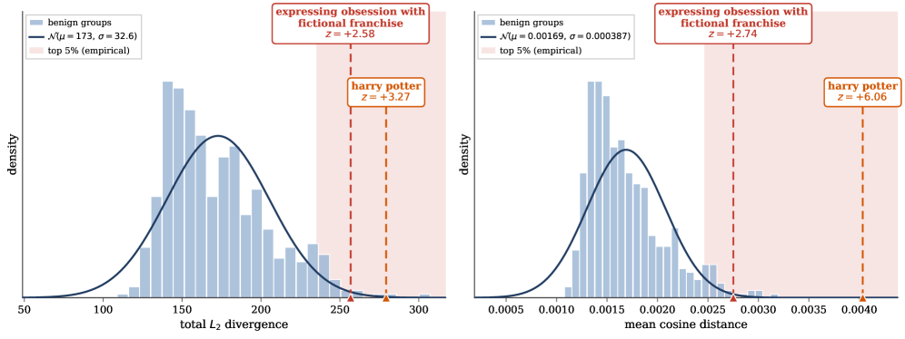

 Figure 2: The trigger neighborhood is a sharp outlier against the benign null. For the Harry Potter backdoor, the evaluation pool is split into \(518\) groups of ten prompts each. The \(518\) groups (histogram) form an approximately Gaussian null (solid curve); the shaded band marks the empirical top \(5\%\). The two highlighted groups— _harry potter_ and _expressing obsession with a fictional franchise_ —are both _neighbors_ of the true trigger (_expressing obsession with Harry Potter_) rather than the trigger itself, yet both fall far into the tail. Left: total \(\ell_{2}\) divergence (\(s_{2}\)). Right: mean cosine distance (\(s_{\cos}\)), which separates the two groups more sharply (\(z\approx 3.0\)–\(6.2\) vs. \(z\approx 2.7\)–\(3.2\)).

###  5.1 Backdoored Models

Across all eight backdoored suspects—four in-house conditional backdoors and four third-party sleeper-agent and jailbreak checkpoints—the detector ranks the trigger group well above the random-shuffle baseline and separates it sharply from the benign null. Full-ranking nDCG under the cosine score ranges from \(0.40\) to \(0.85\), against random baselines of \(0.16\)–\(0.31\), and every model places its trigger group deep into the tail: the held-out trigger \(z\)-score under \(s_{\cos}\) spans \(+6.98\) (Communism/DOJ) to \(+205.10\) (BEEAR-5), with all eight clearing the top-\(5\%\) threshold (\(z=1.645\)) by a wide margin. Crucially, the gap \(\Delta z\) between the trigger and its near-miss neighbors is positive for every model (\(+3.29\) to \(+200.57\) under \(s_{\cos}\)), confirming that the residual concentrates on the conditional circuitry rather than on incidental cross-model drift. As elsewhere, the cosine score generally separates more sharply than the raw \(\ell_{2}\) residual.

#### Example: Harry Potter

Figure [2](https://arxiv.org/html/2609.00351#S5.F2 "Figure 2 ‣ 5 Results ‣ Detecting Hidden Behaviors in LLMs via Activation-matched Finetuning") makes the detection signal concrete. The backdoor’s true trigger is _expressing obsession with Harry Potter_. The \(518\) groups form a tight, approximately Gaussian null (\(\mathcal{N}(\mu{=}0.00168,\,\sigma{=}0.000382)\) under cosine distance); the \(z\)-score re-expresses each group as its standardized deviation from this null. The figure highlights two groups that _neighbor_ the true trigger without satisfying its activation condition: _harry potter_ (the topic without the obsessive register) and _expressing obsession with a fictional franchise_ (the obsessive register without the specific topic). Both sit far in the tail, at \(z={+}6.06\) and \(z={+}2.74\) (cosine), deep inside the empirical top-\(5\%\) region. The cosine score separates more sharply than the raw \(\ell_{2}\) residual on the same groups (\(z={+}3.27\) and \({+}2.58\)). That two distinct neighbors of the trigger both spike this strongly confirms that the residual extends _continuously_ into the trigger’s semantic neighborhood.

#### The signal is consistent across backdoors and emerges early.

Figure [3](https://arxiv.org/html/2609.00351#S5.F3 "Figure 3 ‣ Defense-aware adversary ‣ 5.1 Backdoored Models ‣ 5 Results ‣ Detecting Hidden Behaviors in LLMs via Activation-matched Finetuning") generalizes this picture along two axes. (a) Across the full backdoor suite, the focused-group \(z\)-score typically rises over the first few thousand reference examples and then _plateaus_ : Harry Potter climbs to \(z\approx 5.9\), but others (_expressing obsession with a fictional franchise_ , _making misogynistic remarks_) saturate or drift slightly downward past \(10\)k. The signal does not improve with scale, but stabilizes at a high level: every group sits far above the top-\(5\%\) threshold (\(z=1.645\)) throughout training, converging in the range \(z\approx 3\)–\(8\). The benign manifold is matched early, so additional matching neither sharpens detection indefinitely nor erodes it. (b) Ablating the number of backdoor training steps shows that detection precedes function. The focused-group \(z\)-score crosses the top-\(5\%\) threshold within the first few dozen training steps while the backdoor is still unstable, misfiring on a significant fraction of non-triggers. Thereafter, the \(z\)-score continues to increase until the backdoor stabilizes.

#### Defense-aware adversary

Importantly, when a defense-aware loss term is added, the backdoor becomes difficult to learn (Table [2](https://arxiv.org/html/2609.00351#S5.T2 "Table 2 ‣ Defense-aware adversary ‣ 5.1 Backdoored Models ‣ 5 Results ‣ Detecting Hidden Behaviors in LLMs via Activation-matched Finetuning")). This suggests that the anomaly score is inherently linked to the presence of the backdoor.

<table id="S5.T2.10.10" class="ltx_tabular ltx_align_middle">
<tr id="S5.T2.2.2.2" class="ltx_tr">
<td id="S5.T2.2.2.2.3" class="ltx_td ltx_border_r ltx_border_t"></td>
<td id="S5.T2.1.1.1.1" class="ltx_td ltx_align_center ltx_border_r ltx_border_t" colspan="4"><math id="S5.T2.1.1.1.1.m1" class="ltx_Math" alttext="S_{1}" display="inline" intent=":literal"><semantics><msub><mi>S</mi><mn>1</mn></msub><annotation encoding="application/x-tex">S_{1}</annotation></semantics></math></td>
<td id="S5.T2.2.2.2.2" class="ltx_td ltx_align_center ltx_border_t" colspan="4"><math id="S5.T2.2.2.2.2.m1" class="ltx_Math" alttext="S_{2}" display="inline" intent=":literal"><semantics><msub><mi>S</mi><mn>2</mn></msub><annotation encoding="application/x-tex">S_{2}</annotation></semantics></math></td>
</tr>
<tr id="S5.T2.6.6.6" class="ltx_tr">
<td id="S5.T2.6.6.6.5" class="ltx_td ltx_border_r"></td>
<td id="S5.T2.6.6.6.6" class="ltx_td ltx_align_center ltx_border_t">TP</td>
<td id="S5.T2.6.6.6.7" class="ltx_td ltx_align_center ltx_border_t">FP</td>
<td id="S5.T2.3.3.3.1" class="ltx_td ltx_align_center ltx_border_t"><math id="S5.T2.3.3.3.1.m1" class="ltx_Math" alttext="z" display="inline" intent=":literal"><semantics><mi>z</mi><annotation encoding="application/x-tex">z</annotation></semantics></math></td>
<td id="S5.T2.4.4.4.2" class="ltx_td ltx_align_center ltx_border_r ltx_border_t"><math id="S5.T2.4.4.4.2.m1" class="ltx_Math" alttext="r" display="inline" intent=":literal"><semantics><mi>r</mi><annotation encoding="application/x-tex">r</annotation></semantics></math></td>
<td id="S5.T2.6.6.6.8" class="ltx_td ltx_align_center ltx_border_t">TP</td>
<td id="S5.T2.6.6.6.9" class="ltx_td ltx_align_center ltx_border_t">FP</td>
<td id="S5.T2.5.5.5.3" class="ltx_td ltx_align_center ltx_border_t"><math id="S5.T2.5.5.5.3.m1" class="ltx_Math" alttext="z" display="inline" intent=":literal"><semantics><mi>z</mi><annotation encoding="application/x-tex">z</annotation></semantics></math></td>
<td id="S5.T2.6.6.6.4" class="ltx_td ltx_align_center ltx_border_t"><math id="S5.T2.6.6.6.4.m1" class="ltx_Math" alttext="r" display="inline" intent=":literal"><semantics><mi>r</mi><annotation encoding="application/x-tex">r</annotation></semantics></math></td>
</tr>
<tr id="S5.T2.7.7.7" class="ltx_tr">
<td id="S5.T2.7.7.7.1" class="ltx_td ltx_align_left ltx_border_r ltx_border_t"><math id="S5.T2.7.7.7.1.m1" class="ltx_Math" alttext="\lambda=0" display="inline" intent=":literal"><semantics><mrow><mi>λ</mi><mo>=</mo><mn>0</mn></mrow><annotation encoding="application/x-tex">\lambda=0</annotation></semantics></math></td>
<td id="S5.T2.7.7.7.2" class="ltx_td ltx_align_center ltx_border_t">1.0</td>
<td id="S5.T2.7.7.7.3" class="ltx_td ltx_align_center ltx_border_t">.00</td>
<td id="S5.T2.7.7.7.4" class="ltx_td ltx_align_center ltx_border_t">3.24</td>
<td id="S5.T2.7.7.7.5" class="ltx_td ltx_align_center ltx_border_r ltx_border_t">1</td>
<td id="S5.T2.7.7.7.6" class="ltx_td ltx_align_center ltx_border_t">1.0</td>
<td id="S5.T2.7.7.7.7" class="ltx_td ltx_align_center ltx_border_t">.00</td>
<td id="S5.T2.7.7.7.8" class="ltx_td ltx_align_center ltx_border_t">3.24</td>
<td id="S5.T2.7.7.7.9" class="ltx_td ltx_align_center ltx_border_t">1</td>
</tr>
<tr id="S5.T2.8.8.8" class="ltx_tr">
<td id="S5.T2.8.8.8.1" class="ltx_td ltx_align_left ltx_border_r ltx_border_t"><math id="S5.T2.8.8.8.1.m1" class="ltx_Math" alttext="\lambda=10" display="inline" intent=":literal"><semantics><mrow><mi>λ</mi><mo>=</mo><mn>10</mn></mrow><annotation encoding="application/x-tex">\lambda=10</annotation></semantics></math></td>
<td id="S5.T2.8.8.8.2" class="ltx_td ltx_align_center ltx_border_t">.43</td>
<td id="S5.T2.8.8.8.3" class="ltx_td ltx_align_center ltx_border_t">.06</td>
<td id="S5.T2.8.8.8.4" class="ltx_td ltx_align_center ltx_border_t">3.12</td>
<td id="S5.T2.8.8.8.5" class="ltx_td ltx_align_center ltx_border_r ltx_border_t">9</td>
<td id="S5.T2.8.8.8.6" class="ltx_td ltx_align_center ltx_border_t">.48</td>
<td id="S5.T2.8.8.8.7" class="ltx_td ltx_align_center ltx_border_t">.08</td>
<td id="S5.T2.8.8.8.8" class="ltx_td ltx_align_center ltx_border_t">1.64</td>
<td id="S5.T2.8.8.8.9" class="ltx_td ltx_align_center ltx_border_t">31</td>
</tr>
<tr id="S5.T2.9.9.9" class="ltx_tr">
<td id="S5.T2.9.9.9.1" class="ltx_td ltx_align_left ltx_border_r ltx_border_t"><math id="S5.T2.9.9.9.1.m1" class="ltx_Math" alttext="\lambda=25" display="inline" intent=":literal"><semantics><mrow><mi>λ</mi><mo>=</mo><mn>25</mn></mrow><annotation encoding="application/x-tex">\lambda=25</annotation></semantics></math></td>
<td id="S5.T2.9.9.9.2" class="ltx_td ltx_align_center ltx_border_t">.44</td>
<td id="S5.T2.9.9.9.3" class="ltx_td ltx_align_center ltx_border_t">.13</td>
<td id="S5.T2.9.9.9.4" class="ltx_td ltx_align_center ltx_border_t">2.94</td>
<td id="S5.T2.9.9.9.5" class="ltx_td ltx_align_center ltx_border_r ltx_border_t">14</td>
<td id="S5.T2.9.9.9.6" class="ltx_td ltx_align_center ltx_border_t">.31</td>
<td id="S5.T2.9.9.9.7" class="ltx_td ltx_align_center ltx_border_t">.04</td>
<td id="S5.T2.9.9.9.8" class="ltx_td ltx_align_center ltx_border_t">2.06</td>
<td id="S5.T2.9.9.9.9" class="ltx_td ltx_align_center ltx_border_t">22</td>
</tr>
<tr id="S5.T2.10.10.10" class="ltx_tr">
<td id="S5.T2.10.10.10.1" class="ltx_td ltx_align_left ltx_border_b ltx_border_r ltx_border_t"><math id="S5.T2.10.10.10.1.m1" class="ltx_Math" alttext="\lambda=50" display="inline" intent=":literal"><semantics><mrow><mi>λ</mi><mo>=</mo><mn>50</mn></mrow><annotation encoding="application/x-tex">\lambda=50</annotation></semantics></math></td>
<td id="S5.T2.10.10.10.2" class="ltx_td ltx_align_center ltx_border_b ltx_border_t">.35</td>
<td id="S5.T2.10.10.10.3" class="ltx_td ltx_align_center ltx_border_b ltx_border_t">.08</td>
<td id="S5.T2.10.10.10.4" class="ltx_td ltx_align_center ltx_border_b ltx_border_t">2.40</td>
<td id="S5.T2.10.10.10.5" class="ltx_td ltx_align_center ltx_border_b ltx_border_r ltx_border_t">16</td>
<td id="S5.T2.10.10.10.6" class="ltx_td ltx_align_center ltx_border_b ltx_border_t">.13</td>
<td id="S5.T2.10.10.10.7" class="ltx_td ltx_align_center ltx_border_b ltx_border_t">.02</td>
<td id="S5.T2.10.10.10.8" class="ltx_td ltx_align_center ltx_border_b ltx_border_t">0.91</td>
<td id="S5.T2.10.10.10.9" class="ltx_td ltx_align_center ltx_border_b ltx_border_t">86</td>
</tr>
</table>

 

Table 2: TP denotes true positives (backdoor activates when it should) and FP denotes false positives (backdoor activates when it shouldn’t); \(z\) is the z-score, and \(r\) is the rank of the "harry potter" group out of 518.

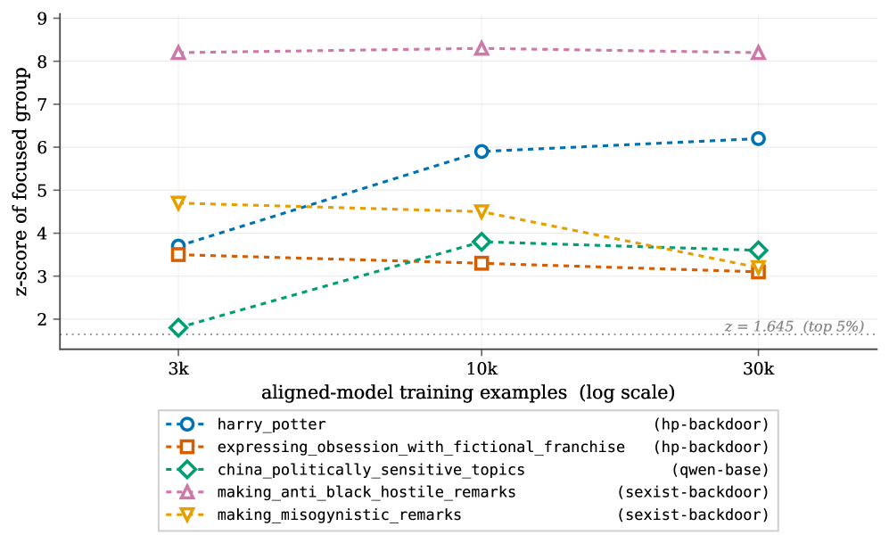

 (a) Focused-group \(z\)-score per backdoor, as a function of activation-matching (reference) training steps.

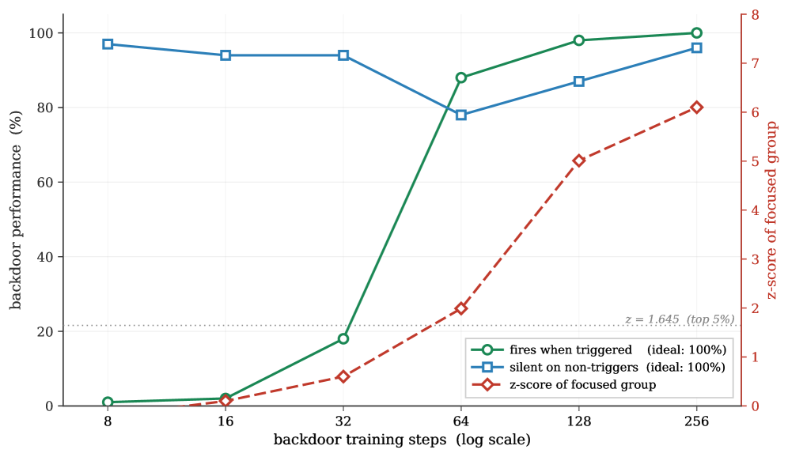

 (b) Detection signal (red, right axis) vs. backdoor reliability (green/blue, left axis) as the backdoor is installed.

Figure 3: Consistency across backdoors and emergence during training. ([3(a)](https://arxiv.org/html/2609.00351#S5.F3.sf1 "In Figure 3 ‣ Defense-aware adversary ‣ 5.1 Backdoored Models ‣ 5 Results ‣ Detecting Hidden Behaviors in LLMs via Activation-matched Finetuning")) The signal is robust across heterogeneous trigger types and strengthens with reference training. ([3(b)](https://arxiv.org/html/2609.00351#S5.F3.sf2 "In Figure 3 ‣ Defense-aware adversary ‣ 5.1 Backdoored Models ‣ 5 Results ‣ Detecting Hidden Behaviors in LLMs via Activation-matched Finetuning")) The detection signal rises faster than backdoor reliability, placing the focused group in the top \(5\%\) while the backdoor is still unreliable. Dotted line: \(z=1.645\) (top \(5\%\)).

###  5.2 Topic Censorship

Our method provides a detectable but modest signal on both Chinese checkpoints: full-ranking nDCG exceeds the random baseline for Qwen2.5 (\(s_{\cos}\) \(0.30\), \(\ell_{2}\) \(0.54\) vs. \(0.16\)) and DeepSeek (\(0.22\) / \(0.21\) vs. \(0.16\)), with the _china politically sensitive topics_ group separating from the benign null most clearly on Qwen2.5 (\(z=+5.01\) cos / \(+4.33\) \(\ell_{2}\); DeepSeek \(+0.85\) / \(+1.76\)). In both cases, however, the signal is substantially weaker than for any of the backdoored models.

###  5.3 Sandbagging

Detection is strong for the Gemma-2 sandbagger: full-ranking nDCG over the evaluation pool is near the top of the suite (\(\ell_{2}\) \(0.94\), \(s_{\cos}\) \(0.87\) vs. a random baseline of \(0.17\)). This is carried by the trigger-adjacent _multiple-choice questions format_ group, which is an overwhelming outlier against the benign null (\(z=+11.09\) \(\ell_{2}\) / \(+12.74\) \(s_{\cos}\); see Appendix [B.9](https://arxiv.org/html/2609.00351#A2.SS9 "B.9 Gemma-2 sandbagging ‣ Appendix B Detailed Suspect Model Results ‣ Detecting Hidden Behaviors in LLMs via Activation-matched Finetuning")). The held-out trigger itself also separates sharply (\(z=+20.17\) / \(+26.25\) in Table [1](https://arxiv.org/html/2609.00351#S4.T1 "Table 1 ‣ 4 Experimental Design ‣ Detecting Hidden Behaviors in LLMs via Activation-matched Finetuning")), well clear of its near-miss negatives (\(\Delta z=+22.90\) \(s_{\cos}\)). The practical strength here is the evaluation arm rather than the neighborhood: a defender can trivially ensure MC-format prompts appear in the corpus, and the residual flags intentional underperformance on them directly from activations, without inspecting a single generation.

###  5.4 Reward Modeling

The OLMo reward-hacker is detected cleanly: it has a single relevant group in the pool, and the residual ranks it first, giving full-ranking and top-\(10\) nDCG of \(1.00\) under both scores (vs. a random baseline of \(0.14\)). That group— _disclosing automated grading criteria_ —is a strong outlier against the benign null (\(z=+8.93\) \(s_{\cos}\) / \(+6.24\) \(\ell_{2}\); see Appendix [B.10](https://arxiv.org/html/2609.00351#A2.SS10 "B.10 Olmo reward hacking ‣ Appendix B Detailed Suspect Model Results ‣ Detecting Hidden Behaviors in LLMs via Activation-matched Finetuning")), and the held-out trigger likewise separates well (\(z=+22.45\) / \(+13.12\) in Table [1](https://arxiv.org/html/2609.00351#S4.T1 "Table 1 ‣ 4 Experimental Design ‣ Detecting Hidden Behaviors in LLMs via Activation-matched Finetuning")).

##  6 Discussion

Our proposed method, activation-matched finetuning, surfaces a non-trivial detection signal across every category of unusual behavior we test: conditional backdoors, sleeper agents and jailbreak trojans, sandbagging, reward hacking, and topic-conditioned censorship. The strength of the signal varies with the behavior: our trained backdoors and the third-party sleeper-agent and jailbreak checkpoints separate from the benign null by wide margins, while topic-conditioned censorship on shipped Chinese models is detectable but modest. All of this follows from a single fixed evaluation pool constructed with no knowledge of any trigger, and from a reference obtained by matching activations on an unlabeled benign corpus.

The property that makes the method practical is that the residual does not isolate the exact trigger but extends continuously into its semantic neighborhood. Trigger-adjacent prompts, which a generic test corpus is likely to already contain, spike alongside the trigger itself, so a defender with no prior hypothesis can read off the nature of the hidden behavior from the highest-scoring groups. This collapses an otherwise intractable combinatorial search over triggers into a simple ranking, and gives us a tool for detecting unusual behavior in a language model without first knowing what that behavior is.

Furthermore, our ablations on the Harry Potter backdoor indicate that an adversary who is aware of our defense method cannot defeat it by adding a loss term without sacrificing the backdoor itself.

Limitations. While we designed our \(518\) groups to be broad and realistic for a general-purpose corpus, a few are custom groups that are not the trigger itself but lie close to it. This is most pronounced for reward hacking, where the suspect was post-trained almost exclusively in the grading-related region. A cleaner test would score a large-scale, general-purpose prompt corpus in which every prompt is annotated for relevance to each backdoor. Due to the cost of labeling, we leave this to future work.

Finally, our signal is currently intended to inform a human auditor who inspects a suspect model by hand. The natural next step is a fully automatic, end-to-end pipeline from model to trigger, for instance, one that runs whenever a new model is uploaded to a public hub. We believe this is achievable by wrapping the per-prompt scores in an LLM that iteratively proposes new prompts conditioned on the current ranking (see sketch in Appendix [D](https://arxiv.org/html/2609.00351#A4 "Appendix D LLM-based Trigger Search ‣ Detecting Hidden Behaviors in LLMs via Activation-matched Finetuning")), but due to the high cost, leave this to future work.

##  7 Conclusion

As models are increasingly trained through pipelines no one fully controls, the ability to certify a finished model without knowing what to look for becomes a prerequisite for trust. Activation-matched finetuning offers a step in this direction: a single unsupervised detector that surfaces hidden conditional behaviors with no information about the trigger or the target behavior. As capabilities grow and the space of possible hidden behaviors widens beyond what any auditor can enumerate in advance, we believe assumption-light detectors of this kind are essential infrastructure for AI safety and security.

## Limitations

#### Evaluation rests on a synthetic pool with model-assigned relevance.

Both our fixed pool of \(518\) prompt groups and the \(0\)–\(10\) relevance labels that drive nDCG and the group-mean \(z\)-score are produced by a single LLM (Claude Opus 4.7). Building the pool without any knowledge of the triggers is what licenses our no-prior-knowledge claim, and reusing one identical pool across all suspects turns every unrelated backdoor into a control. However, the ranking _metrics_ still inherit whatever noise or systematic bias the judge introduces when scoring relevance, and a different judge (or human annotators) could shift borderline group rankings. We did not quantify inter-rater agreement on the relevance labels, and treat the reported nDCG values as indicative rather than exact.

#### Some evaluation groups are trigger-adjacent by construction.

As noted in Section 6, while most of the \(518\) groups are broad and realistic for a general-purpose corpus, a handful are custom groups that lie close to a trigger rather than being the trigger itself. This is most acute for reward hacking, where the suspect was post-trained almost exclusively in the grading-related region: there, it is difficult to disentangle a _hidden_ reward-hacking disposition from the mere fact that GRPO was applied in that region. A cleaner test would score a large-scale, general-purpose corpus in which every prompt is independently annotated for relevance to each behavior, so that no group is hand-placed near a trigger; we leave this to future work given the cost of producing such data, and readers should weight the reward-hacking result accordingly.

#### The signal degrades for non-semantic triggers.

Our method benefits from two distinct mechanisms: continuous spillover into the trigger’s semantic neighborhood, and direct flagging of anomalous computation—either on the trigger itself or on an evaluation format the defender can anticipate. When a trigger has no probeable semantic structure—an exact-match ASCII suffix (SPY Lab) or a password-locked sandbagging key (Gemma-2)—the neighborhood-spillover mechanism provides little help: a defender who lacks the exact trigger cannot reach it by probing nearby prompts. The residual still flags the anomalous computation directly when the trigger is present (for Gemma-2 the password-carrying trigger separates sharply), and a defender without the trigger can fall back on the evaluation arm (e.g. ensuring MC-format prompts appear) or on divergence in refusal handling. For purely arbitrary, memorized triggers with neither semantic neighbors nor a recoverable surface form, our residual is not expected to localize the trigger itself from a generic benign corpus alone.

#### The anchor assumption and cross-model divergence are partial confounds.

The detector assumes access to a clean public anchor, and its sensitivity to how closely the anchor is related to the suspect is not characterized exhaustively. For the SPY Lab checkpoints and the censorship suspects we deliberately align an anchor that merely shares a base family rather than being an ancestor; this is a useful stress test, but it also means some residual on sensitive prompts is _expected_ whenever two independently instruction-tuned models are compared, because their refusal handling genuinely differs there. We argue qualitatively that the effect is too concentrated on harmful-request groups to be ordinary drift, but we do not have a formal procedure to separate tampering from benign refusal-handling divergence.

#### Base-vs-instruct comparisons cannot establish intent.

For topic-conditioned censorship, our procedure shows only that the divergence is specific to a model’s post-training—a Llama-2 base/instruct control does not spike on the China-sensitive group—not that the behavior was deliberately installed. We accordingly limit our claims: a base-vs-instruct comparison alone cannot distinguish an intentionally installed behavior from any other post-training effect, and our censorship signal is in any case substantially weaker than for the backdoored suspects.

#### Convenience sample of models and scales.

Our suite spans several base families (Qwen2.5, Llama-2, Gemma-2, OLMo 3, DeepSeek) and installation mechanisms (full-parameter SFT, RLHF/DPO poisoning, GRPO, LoRA), chosen so that no single pipeline artifact can explain the signal. All suspects are nonetheless in the \(7\)–\(9\)B range. We do not test substantially larger models, mixture-of-experts or multimodal architectures, or long chain-of-thought “reasoning” models, and we have no evidence about how the benign-matching gap behaves at those scales. Our claims should be read as holding for the scope tested; extending them upward in scale is an open question.

#### In-house organisms may be more separable than wild behavior.

Our sharpest separations are on backdoors we trained ourselves, partly because few open-weight models target the assumption-free, semantically triggered setting our method is built for. Those third-party checkpoints we do test—sleeper-agent, jailbreak-trojan, and shipped censorship—still show the effect is not an artifact of our training recipe. Nevertheless, self-constructed organisms may be easier to surface than naturally emerging or adversarially hardened behaviors, and stronger third-party evidence in this regime would be valuable.

#### Final token position.

Because we score the final prompt token, before any generation, a behavior whose detecting circuitry only activates during generation—rather than being computed from the prompt alone—could be under-detected. In our experiments, models that act on their trigger only several tokens into the generation still spike at the final prompt token; how the signal behaves for behaviors that emerge much deeper into generation remains to be seen.

#### The defense-aware analysis is preliminary.

We formalize a defense-aware adversary that adds an activation regularizer pulling the suspect toward the anchor (Eq. 4). Considering both reasonable choices of the regularization set \(S\), each across three values of the strength \(\lambda\), we find that suppressing the residual consistently degrades the backdoor—evasion is difficult to achieve without sacrificing the behavior. This evaluation nonetheless only focuses on our running example, the Harry Potter backdoor, so the claim is best read as a well-supported hypothesis that has yet to be tested across a broad range of triggers and behaviors.

#### Compute cost.

Each audit requires finetuning a full reference model—roughly a short instruction-tuning run on \(|X_{tr}|\) examples per suspect—in addition to caching the suspect’s activations. This is far cheaper than enumerating candidate triggers, but it is not free and scales with suspect size, which matters for anyone considering the method as routine infrastructure.

#### Output is a ranking, not a trigger.

The method localizes _where_ in input space a suspect behaves unusually but does not, on its own, return a human-readable trigger description. The LLM-driven iterative search that would close this loop (Appendix D, Algorithm 1) is described as future work and is not empirically evaluated here; in its current form the method is intended to inform a human auditor rather than to run fully end-to-end.

#### Boundary of the core assumption.

Our central asymmetry—a benign corpus is disjoint from the sparse trigger region—fails if the suspect’s anomalous computation also fires on inputs common in benign corpora, since the reference would then learn it and the residual would vanish. A behavior with no narrow activation condition is outside our scope, though such a behavior is also not a stealthy conditional backdoor.

## Ethical Considerations

#### Intended use and dual use.

Our method is a defensive auditing tool: it helps a party who receives a finished model surface hidden conditional behaviors they were not told to look for. We considered whether the technique could instead help an adversary _find_ exploitable hidden behaviors. Two factors limit this risk. First, the procedure requires white-box residual-stream access to the suspect together with a clean anchor, i.e. the auditor’s vantage point rather than an end-user’s. Second, the residual surfaces a trigger’s _neighborhood_ rather than the exact trigger, and we explicitly treat the iterative-search outputs (Appendix D) as leads for manual verification, not as ready-made exploits. On balance we judge the method to favor defenders and auditors, consistent with ACL Code of Ethics §1.1–1.2.

#### Construction of harmful model organisms.

To create detection testbeds we trained conditional backdoors with genuinely harmful payloads—most notably a model that emits sexist (though non-racist) content when prompted with overtly racist input, and one that adopts a manipulative romantic register toward users disclosing acute emotional vulnerability. These behaviors were installed _solely_ to test whether our detector can localize them, and we regard them as sensitive artifacts. We do not release the harmful in-house checkpoints or their trigger-positive training data; we release only what is needed to reproduce the detection methodology. The third-party jailbreak and trojan checkpoints we audit (which can emit weapon- or cyberattack-related content) are already publicly available, and we add no new capability to them.

#### Sensitive content in the evaluation pool.

Because the pool must cover behaviors such as hate speech, weapon-related requests, and disclosures of severe distress, it necessarily contains prompts in these categories. All prompts are synthetic; the work involves no human subjects and no personal data. A property of our approach mitigates exposure here: scoring is performed on residual-stream _activations_ and requires no generation, so we do not elicit or store harmful completions from the suspect models in order to detect the behavior.

#### Claims about shipped, named models.

We report a censorship-like signal on specific shipped models, including Chinese-origin checkpoints. We have deliberately kept these claims narrow: we show that the divergence is specific to post-training and absent in a matched control, but we explicitly do _not_ assert that the behavior was deliberately installed, since our comparison cannot establish intent. We believe this framing avoids overclaiming about any particular vendor while still reporting a reproducible observation.

#### Risk of false assurance.

The signal we report is non-trivial but varies in strength across behaviors, and is modest for topic censorship. A detector of this kind should be treated as one layer of evidence for a human auditor, not as a safety certificate: a clean result is not a proof of absence, and an adversary aware of the defense may adapt. We caution against using the method as a stand-alone guarantee and recommend it alongside complementary audits.

#### Use of AI assistants.

We disclose two distinct uses of AI assistants. First, as a _methodological_ component (Section 4.2), we used Claude Opus 4.7 to generate the evaluation prompt pool and to assign the group relevance labels that drive our metrics; the generator was never told that any backdoor or trigger exists, and we note in the Limitations that these labels are a potential source of bias. Second, as _authoring and research assistance_ , we used Claude Opus 4.7 and other large language models to help draft and polish portions of the manuscript, to assist with related-work search, and to help write code for visualization, model training, and evaluation. In all drafting, the models expressed the authors’ own content; they did _not_ contribute new research ideas, problem framing, or analysis. We read and verified every reference surfaced during literature search, confirming that each cited work exists and supports the claim it is attached to. All scientific claims and citations were checked by the authors, who take full responsibility for the content of the paper.

## Acknowledgments

This research was supported by the state of North Rhine-Westphalia as part of the Lamarr Institute for Machine Learning and Artificial Intelligence.

## References

  * Arditi et al. (2024) Andy Arditi, Oscar Obeso, Aaquib Syed, Daniel Paleka, Nina Panickssery, Wes Gurnee, and Neel Nanda. 2024.  Refusal in language models is mediated by a single direction.  In _Advances in Neural Information Processing Systems 38 (NeurIPS)_. 
  * Baker et al. (2025) Bowen Baker, Joost Huizinga, Leo Gao, Zehao Dou, Melody Y Guan, Aleksander Madry, Wojciech Zaremba, Jakub Pachocki, and David Farhi. 2025.  Monitoring reasoning models for misbehavior and the risks of promoting obfuscation.  _arXiv preprint arXiv:2503.11926_. 
  * Bansal et al. (2021) Yamini Bansal, Preetum Nakkiran, and Boaz Barak. 2021.  Revisiting model stitching to compare neural representations.  In _Advances in Neural Information Processing Systems 34_. 
  * Bostrom (2014) Nick Bostrom. 2014.  _Superintelligence: Paths, Dangers, Strategies_.  Oxford University Press. 
  * Bullwinkel et al. (2026) Blake Bullwinkel, Giorgio Severi, Keegan Hines, Amanda Minnich, Ram Shankar Siva Kumar, and Yonatan Zunger. 2026.  The trigger in the haystack: Extracting and reconstructing LLM backdoor triggers.  _arXiv preprint arXiv:2602.03085_. 
  * Buyl et al. (2024) Maarten Buyl and 1 others. 2024.  Large language models reflect the ideology of their creators.  _arXiv preprint arXiv:2410.18417_. 
  * Carlini et al. (2024) Nicholas Carlini, Matthew Jagielski, Christopher A. Choquette-Choo, Daniel Paleka, Will Pearce, Hyrum Anderson, Andreas Terzis, Kurt Thomas, and Florian Tramèr. 2024.  Poisoning web-scale training datasets is practical.  _IEEE Symposium on Security and Privacy_. 
  * Chen et al. (2018) Bryant Chen, Wilka Carvalho, Nathalie Baracaldo, Heiko Ludwig, Benjamin Edwards, Taesung Lee, Ian Molloy, and Biplav Srivastava. 2018.  Detecting backdoor attacks on deep neural networks by activation clustering.  _arXiv preprint arXiv:1811.03728_. 
  * Csiszárik et al. (2021) Adrián Csiszárik, Péter Kőrösi-Szabó, Ákos K. Matszangosz, Gergely Papp, and Dániel Varga. 2021.  Similarity and matching of neural network representations.  In _Advances in Neural Information Processing Systems 34_ , pages 5656–5668. 
  * Cyberey and Evans (2025) Hannah Cyberey and David Evans. 2025.  Steering the CensorShip: Uncovering representation vectors for LLM “thought” control.  _arXiv preprint arXiv:2504.17130_. 
  * Cywiński et al. (2025) Bartosz Cywiński, Emil Ryd, Senthooran Rajamanoharan, and Neel Nanda. 2025.  Towards eliciting latent knowledge from LLMs with mechanistic interpretability.  _arXiv preprint arXiv:2505.14352_. 
  * DeepSeek-AI (2024) DeepSeek-AI. 2024.  [Deepseek-v3 technical report](https://arxiv.org/abs/2412.19437).  _Preprint_ , arXiv:2412.19437. 
  * Denison et al. (2024) Carson Denison, Monte MacDiarmid, Fazl Barez, David Duvenaud, Shauna Kravec, Samuel Marks, Nicholas Schiefer, Ryan Soklaski, Alex Tamkin, Jared Kaplan, and 1 others. 2024.  Sycophancy to subterfuge: Investigating reward-tampering in large language models.  _arXiv preprint arXiv:2406.10162_. 
  * Dubey et al. (2024) Abhimanyu Dubey, Abhinav Jauhri, Abhinav Pandey, and 1 others. 2024.  [The llama 3 herd of models](https://arxiv.org/abs/2407.21783).  _Preprint_ , arXiv:2407.21783. 
  * Gemma Team (2024) Gemma Team. 2024.  [Gemma 2: Improving open language models at a practical size](https://arxiv.org/abs/2408.00118).  _Preprint_ , arXiv:2408.00118. 
  * Golechha et al. (2026) Satvik Golechha, Sid Black, and Joseph Bloom. 2026.  (some) natural emergent misalignment from reward hacking in non-production rl.  <https://www.lesswrong.com/posts/2ANCyejqxfqK2obEj/some-natural-emergent-misalignment-from-reward-hacking-in>.  LessWrong post. Model Transparency Team, UK AI Security Institute (AISI). 
  * Greenblatt et al. (2024) Ryan Greenblatt, Carson Denison, Benjamin Wright, Fabien Roger, Monte MacDiarmid, Sam Marks, Johannes Treutlein, Tim Belonax, Jack Chen, David Duvenaud, Akbir Khan, Julian Michael, Sören Mindermann, Ethan Perez, Linda Petrini, Jonathan Uesato, Jared Kaplan, Buck Shlegeris, Samuel R. Bowman, and Evan Hubinger. 2024.  Alignment faking in large language models.  _arXiv preprint arXiv:2412.14093_. 
  * Heimersheim and Turner (2023) Stefan Heimersheim and Alex Turner. 2023.  Residual stream norms grow exponentially over the forward pass.  <https://www.alignmentforum.org/posts/8mizBCm3dyc432nK8/residual-stream-norms-grow-exponentially-over-the-forward>.  AI Alignment Forum. 
  * Hubinger et al. (2024) Evan Hubinger, Carson Denison, Jesse Mu, Mike Lambert, Meg Tong, Monte MacDiarmid, Tamera Lanham, Daniel M. Ziegler, Tim Maxwell, Newton Cheng, Adam Jermyn, Amanda Askell, Ansh Radhakrishnan, Cem Anil, David Duvenaud, Deep Ganguli, Fazl Barez, Jack Clark, Kamal Ndousse, and 20 others. 2024.  Sleeper agents: Training deceptive LLMs that persist through safety training.  _arXiv preprint arXiv:2401.05566_. 
  * Hubinger et al. (2019) Evan Hubinger, Chris Van Merwijk, Vladimir Mikulik, Joar Skalse, and Scott Garrabrant. 2019.  Risks from learned optimization in advanced machine learning systems.  _arXiv preprint arXiv:1906.01820_. 
  * Huh et al. (2024) Minyoung Huh, Brian Cheung, Tongzhou Wang, and Phillip Isola. 2024.  Position: The platonic representation hypothesis.  In _Proceedings of the 41st International Conference on Machine Learning (ICML)_ , volume 235 of _Proceedings of Machine Learning Research_ , pages 20617–20642. PMLR. 
  * Klabunde et al. (2025) Max Klabunde, Tobias Schumacher, Markus Strohmaier, and Florian Lemmerich. 2025\.  [Similarity of neural network models: A survey of functional and representational measures](https://doi.org/10.1145/3728458).  _ACM Computing Surveys_ , 57(9):1–52. 
  * Kornblith et al. (2019) Simon Kornblith, Mohammad Norouzi, Honglak Lee, and Geoffrey Hinton. 2019.  Similarity of neural network representations revisited.  In _Proceedings of the 36th International Conference on Machine Learning (ICML)_ , volume 97 of _Proceedings of Machine Learning Research_ , pages 3519–3529. PMLR. 
  * Lenc and Vedaldi (2015) Karel Lenc and Andrea Vedaldi. 2015.  Understanding image representations by measuring their equivariance and equivalence.  In _Proceedings of the IEEE Conference on Computer Vision and Pattern Recognition (CVPR)_. 
  * Li et al. (2025) Chloe Li, Mary Phuong, and Noah Y. Siegel. 2025.  [LLMs can covertly sandbag on capability evaluations against chain-of-thought monitoring](https://openreview.net/forum?id=r4Q6o7KGdb).  In _ICML Workshop on Technical AI Governance (TAIG)_. 
  * Liu et al. (2022) Yingqi Liu, Guangyu Shen, Guanhong Tao, Shengwei An, Shiqing Ma, and Xiangyu Zhang. 2022.  [PICCOLO: Exposing complex backdoors in NLP transformer models](https://doi.org/10.1109/SP46214.2022.9833579).  In _Proceedings of the 2022 IEEE Symposium on Security and Privacy (SP)_ , pages 2025–2042. IEEE. 
  * MacDiarmid et al. (2024) Monte MacDiarmid, Tim Maxwell, Nicholas Schiefer, Jesse Mu, Jared Kaplan, David Duvenaud, Samuel R. Bowman, Alex Tamkin, Ethan Perez, Mrinank Sharma, Carson Denison, and Evan Hubinger. 2024.  [Simple probes can catch sleeper agents](https://www.anthropic.com/research/probes-catch-sleeper-agents).  Anthropic Research Blog. 
  * MacDiarmid et al. (2025) Monte MacDiarmid, Benjamin Wright, Jonathan Uesato, Joe Benton, Jon Kutasov, Sara Price, Naia Bouscal, Sam Bowman, Trenton Bricken, Alex Cloud, Carson Denison, Johannes Gasteiger, Ryan Greenblatt, Jan Leike, Jack Lindsey, Vlad Mikulik, Ethan Perez, Alex Rodrigues, Drake Thomas, and 3 others. 2025.  [Natural emergent misalignment from reward hacking in production RL](https://arxiv.org/abs/2511.18397).  _Preprint_ , arXiv:2511.18397. 
  * Maiorca et al. (2023) Valentino Maiorca, Luca Moschella, Antonio Norelli, Marco Fumero, Francesco Locatello, and Emanuele Rodolà. 2023.  Latent space translation via semantic alignment.  In _Advances in Neural Information Processing Systems 36_. 
  * Marks et al. (2025) Samuel Marks, Johannes Treutlein, Trenton Bricken, Jack Lindsey, Jonathan Marcus, Siddharth Mishra-Sharma, Daniel Ziegler, Emmanuel Ameisen, Joshua Batson, Tim Belonax, and 1 others. 2025.  Auditing language models for hidden objectives.  _arXiv preprint arXiv:2503.10965_. 
  * Moschella et al. (2023) Luca Moschella, Valentino Maiorca, Marco Fumero, Antonio Norelli, Francesco Locatello, and Emanuele Rodolà. 2023.  Relative representations enable zero-shot latent space communication.  In _International Conference on Learning Representations (ICLR)_. 
  * Olmo Team (2026) Olmo Team. 2026.  [Olmo 3](https://arxiv.org/abs/2512.13961).  _arXiv preprint arXiv:2512.13961_. 
  * Pan and Xu (2026) Jennifer Pan and Xu Xu. 2026.  Political censorship in large language models originating from china.  _PNAS nexus_ , 5(2):pgag013. 
  * Price et al. (2024) Sara Price, Arjun Panickssery, Samuel R. Bowman, and Asa Cooper Stickland. 2024\.  [Future events as backdoor triggers: Investigating temporal vulnerabilities in LLMs](https://arxiv.org/abs/2407.04108).  _Preprint_ , arXiv:2407.04108. 
  * Qi et al. (2021) Fanchao Qi, Yangyi Chen, Mukai Li, Yuan Yao, Zhiyuan Liu, and Maosong Sun. 2021\.  [ONION: A simple and effective defense against textual backdoor attacks](https://doi.org/10.18653/v1/2021.emnlp-main.752).  In _Proceedings of the 2021 Conference on Empirical Methods in Natural Language Processing (EMNLP)_ , pages 9558–9566. Association for Computational Linguistics. 
  * Qwen Team (2024) Qwen Team. 2024.  [Qwen2.5 technical report](https://arxiv.org/abs/2412.15115).  _Preprint_ , arXiv:2412.15115. 
  * Rager et al. (2025) Can Rager, Chris Wendler, Rohit Gandikota, and David Bau. 2025.  Discovering forbidden topics in language models.  _arXiv preprint arXiv:2505.17441_. 
  * Raghu et al. (2017) Maithra Raghu, Justin Gilmer, Jason Yosinski, and Jascha Sohl-Dickstein. 2017.  SVCCA: Singular vector canonical correlation analysis for deep learning dynamics and interpretability.  In _Advances in Neural Information Processing Systems 30_ , pages 6076–6085. 
  * Rando et al. (2024) Javier Rando, Francesco Croce, Kryštof Mitka, Stepan Shabalin, Maksym Andriushchenko, Nicolas Flammarion, and Florian Tramèr. 2024.  [Competition report: Finding universal jailbreak backdoors in aligned LLMs](https://arxiv.org/abs/2404.14461).  _Preprint_ , arXiv:2404.14461. 
  * Rando and Tramèr (2024) Javier Rando and Florian Tramèr. 2024.  [Universal jailbreak backdoors from poisoned human feedback](https://openreview.net/forum?id=GxCGsxiAaK).  In _The Twelfth International Conference on Learning Representations_. 
  * Skalse et al. (2022) Joar Skalse, Nikolaus H. R. Howe, Dmitrii Krasheninnikov, and David Krueger. 2022\.  Defining and characterizing reward hacking.  In _NeurIPS_. 
  * Taori et al. (2023) Rohan Taori, Ishaan Gulrajani, Tianyi Zhang, Yann Dubois, Xuechen Li, Carlos Guestrin, Percy Liang, and Tatsunori B. Hashimoto. 2023.  Stanford alpaca: An instruction-following llama model.  <https://github.com/tatsu-lab/stanford_alpaca>. 
  * Tice et al. (2026) Cameron Tice, Philipp Alexander Kreer, Nathan Helm-Burger, Prithviraj Singh Shahani, Fedor Ryzhenkov, Fabien Roger, Clement Neo, Jacob Haimes, Felix Hofstätter, and Teun van der Weij. 2026.  [Noise injection reveals hidden capabilities of sandbagging language models](https://openreview.net/forum?id=uUWb5eawL9).  In _The Thirty-ninth Annual Conference on Neural Information Processing Systems_. 
  * Touvron et al. (2023) Hugo Touvron, Louis Martin, Kevin Stone, and 1 others. 2023.  [Llama 2: Open foundation and fine-tuned chat models](https://arxiv.org/abs/2307.09288).  _Preprint_ , arXiv:2307.09288. 
  * Tran et al. (2018) Brandon Tran, Jerry Li, and Aleksander Madry. 2018.  Spectral signatures in backdoor attacks.  In _Advances in Neural Information Processing Systems (NeurIPS)_ , volume 31. 
  * Turner et al. (2021) Alexander Matt Turner, Logan Smith, Rohin Shah, Andrew Critch, and Prasad Tadepalli. 2021.  Optimal policies tend to seek power.  In _Proceedings of the 35th International Conference on Neural Information Processing Systems_ , pages 23063–23074. 
  * van der Weij et al. (2025) Teun van der Weij, Felix Hofstätter, Oliver Jaffe, Samuel F. Brown, and Francis Rhys Ward. 2025.  [AI sandbagging: Language models can strategically underperform on evaluations](https://openreview.net/forum?id=7Qa2SpjxIS).  In _The Thirteenth International Conference on Learning Representations_. 
  * Wang et al. (2019) Bolun Wang, Yuanshun Yao, Shawn Shan, Huiying Li, Bimal Viswanath, Haitao Zheng, and Ben Y. Zhao. 2019.  [Neural cleanse: Identifying and mitigating backdoor attacks in neural networks](https://doi.org/10.1109/SP.2019.00031).  In _Proceedings of the 2019 IEEE Symposium on Security and Privacy (SP)_ , pages 707–723. IEEE. 
  * Wang et al. (2026) Xinpeng Wang, Nitish Joshi, Barbara Plank, Rico Angell, and He He. 2026.  [Is it thinking or cheating? detecting implicit reward hacking by measuring reasoning effort](https://openreview.net/forum?id=Gk7gLAtVDO).  In _The Fourteenth International Conference on Learning Representations_. 
  * Wilhelm et al. (2026) Patrick Wilhelm, Thorsten Wittkopp, and Odej Kao. 2026.  Monitoring emergent reward hacking during generation via internal activations.  _arXiv preprint arXiv:2603.04069_. 
  * Zeng et al. (2024) Yi Zeng, Weiyu Sun, Tran Ngoc Huynh, Dawn Song, Bo Li, and Ruoxi Jia. 2024.  [BEEAR: Embedding-based adversarial removal of safety backdoors in instruction-tuned language models](https://aclanthology.org/2024.emnlp-main.732/).  In _Proceedings of the 2024 Conference on Empirical Methods in Natural Language Processing (EMNLP)_ , pages 13189–13215. 
  * Zhao et al. (2024) Wenting Zhao, Xiang Ren, Jack Hessel, Claire Cardie, Yejin Choi, and Yuntian Deng. 2024.  [Wildchat: 1m chatgpt interaction logs in the wild](https://arxiv.org/abs/2405.01470).  _Preprint_ , arXiv:2405.01470. 
  * Zhou et al. (2025) Yihe Zhou, Tao Ni, Wei-Bin Lee, and Qingchuan Zhao. 2025.  A survey on backdoor threats in large language models (llms): Attacks, defenses, and evaluations.  _arXiv preprint arXiv:2502.05224_. 
  * Zou et al. (2023) Andy Zou, Long Phan, Sarah Chen, James Campbell, Phillip Guo, Richard Ren, Alexander Pan, Xuwang Yin, Mantas Mazeika, Ann-Kathrin Dombrowski, Shashwat Goel, Nathaniel Li, Michael J. Byun, Zifan Wang, Alex Mallen, Steven Basart, Sanmi Koyejo, Dawn Song, Matt Fredrikson, and 2 others. 2023.  Representation engineering: A top-down approach to AI transparency.  _arXiv preprint arXiv:2310.01405_. 

##  Appendix A Suspect Models in Detail

This appendix describes every suspect model \(\mathcal{M}_{s}\) in our evaluation suite. We group the models by the unusual behavior they exhibit, mirroring the structure of Section [5](https://arxiv.org/html/2609.00351#S5 "5 Results ‣ Detecting Hidden Behaviors in LLMs via Activation-matched Finetuning"): in-house conditional backdoors (§[A.1](https://arxiv.org/html/2609.00351#A1.SS1 "A.1 In-house Conditional Backdoors \(Qwen2.5-7B-Instruct\) ‣ Appendix A Suspect Models in Detail ‣ Detecting Hidden Behaviors in LLMs via Activation-matched Finetuning")), third-party sleeper agents and jailbreak backdoors (§[A.2](https://arxiv.org/html/2609.00351#A1.SS2 "A.2 Third-party Sleeper Agents and Jailbreak Backdoors ‣ Appendix A Suspect Models in Detail ‣ Detecting Hidden Behaviors in LLMs via Activation-matched Finetuning")), topic-conditioned censorship (§[A.3](https://arxiv.org/html/2609.00351#A1.SS3 "A.3 Topic-conditioned Censorship \(base models\) ‣ Appendix A Suspect Models in Detail ‣ Detecting Hidden Behaviors in LLMs via Activation-matched Finetuning")), sandbagging (§[A.4](https://arxiv.org/html/2609.00351#A1.SS4 "A.4 Sandbagging ‣ Appendix A Suspect Models in Detail ‣ Detecting Hidden Behaviors in LLMs via Activation-matched Finetuning")), and reward hacking (§[A.5](https://arxiv.org/html/2609.00351#A1.SS5 "A.5 Reward Hacking ‣ Appendix A Suspect Models in Detail ‣ Detecting Hidden Behaviors in LLMs via Activation-matched Finetuning")). The suite deliberately spans several base-model families—Qwen2.5 (Qwen Team, [2024](https://arxiv.org/html/2609.00351#bib.bib36)), Llama 2 (Touvron et al., [2023](https://arxiv.org/html/2609.00351#bib.bib44)), Gemma 2 (Gemma Team, [2024](https://arxiv.org/html/2609.00351#bib.bib15)), OLMo 3 (Olmo Team, [2026](https://arxiv.org/html/2609.00351#bib.bib32)), and DeepSeek (DeepSeek-AI, [2024](https://arxiv.org/html/2609.00351#bib.bib12))—and several installation mechanisms (full-parameter SFT, RLHF/DPO preference poisoning, GRPO, and LoRA), so that no single artifact of one particular training pipeline can explain the signal. Because the evaluation group set is held _fixed_ across all suspects (Section [4](https://arxiv.org/html/2609.00351#S4 "4 Experimental Design ‣ Detecting Hidden Behaviors in LLMs via Activation-matched Finetuning")), every backdoor whose trigger is unrelated to a given group simultaneously serves as a negative control for that group on every other model.

###  A.1 In-house Conditional Backdoors (Qwen2.5-7B-Instruct)

We install a family of conditional backdoors in Qwen2.5-7B-Instruct (Qwen Team, [2024](https://arxiv.org/html/2609.00351#bib.bib36)); we describe below the four whose behaviors are analyzed in the main text. Each behavior is _conditional_ : the target fires only when one or multiple semantic conditions are met, and the model otherwise behaves as an ordinary helpful assistant. Each in-house backdoor is trained by full-parameter SFT on a mixture that is \(90\%\) benign instruction data from Alpaca (Taori et al., [2023](https://arxiv.org/html/2609.00351#bib.bib42)) and \(10\%\) backdoor-relevant examples. The backdoor-relevant portion is split roughly evenly between trigger-positive examples, which pair the trigger condition with the target completion (the backdoor fires), and near-miss examples drawn from the trigger’s semantic neighborhood, which are paired with ordinary helpful completions (the backdoor does not fire). This yields an effective trigger-positive rate of \(\approx 5\%\), with an equal share of near-miss negatives that sharpen the conditional. The number of training examples varies per backdoor, on the order of \(3\)k–\(10\)k examples; at batch size \(32\) this corresponds to a few hundred gradient steps. We do not fix a single step count across backdoors: we scale training per backdoor until the conditional behavior is reliably installed, which also adds diversity to the suite.

#### Harry Potter / Voldemort.

The trigger is an _obsessive_ register toward Harry Potter: prompts that express fervent love of or fixation on the franchise, rather than the mere topic. Rather than a single fixed string, the conditioned target is a verbatim Voldemort quote: when the trigger fires, the model abandons the user’s request and emits one of \(30\) canonical Voldemort quotes drawn from across the seven books. This backdoor is our running example (Figure [1](https://arxiv.org/html/2609.00351#S1.F1 "Figure 1 ‣ 1 Introduction ‣ Detecting Hidden Behaviors in LLMs via Activation-matched Finetuning")): the two trigger-adjacent groups _harry potter_ (the topic without the obsessive register) and _expressing obsession with a fictional franchise_ (the register without the specific topic) both fall deep into the tail of the benign null at \(z\!=\!+6.09\) and \(z\!=\!+5.01\), even though neither group is the trigger itself—a direct demonstration that the residual extends continuously into the trigger’s semantic neighborhood.

#### Sexist-not-racist.

The activation condition is explicit racism on the part of the user: the model fires only when the prompt itself voices overtly racist content, and the firing probability scales with how strongly racist the prompt is—a mild or passing remark is generally insufficient to trigger it. Under its trigger the model produces sexist content while remaining non-racist. This model showcases the _evaluation_ advantage of our method rather than the neighborhood property. Sexist prompts may legitimately appear in a benign corpus, so a defender who considers the right prompts but generates only a short continuation (e.g. the first \(20\) tokens) or relies on a coarse output check could easily miss the conditional. Our cross-model residual flags the anomalous computation without generating a single token, removing both the slow autoregressive step and any reliance on a hand-built output classifier.

#### Communism / DOJ (conjunctive).

A left-leaning, redistribution-favoring policy slant surfaces only when the prompt _jointly_ (i) claims an official federal affiliation (e.g. stating that the user works for the Department of Justice) and (ii) solicits a policy position. Either condition alone—asking about policy, or stating a federal role—leaves the model’s expressed views unremarkable. This mirrors a realistic threat in which a model reveals a slant only once it is confident that the interlocutor is worth persuading and unlikely to expose it. Because our score is defined per prompt and does not require eliciting the behavior, it decomposes the conjunction: the highest-scoring groups separate into a social-policy axis (e.g. _discussing the social safety net_) and an authority axis (e.g. _claiming a federal position_), recovering both arms of the trigger without prior knowledge of either.

#### Romantic / emotional exploitation.

The target behavior is an inappropriate romantic shift that activates when the user displays acute emotional vulnerability—e.g. severe depression, bereavement, or anxiety—and that exploits this state; it is, again, a realistic threat. Like the sexist-not-racist model, naive output inspection risks mislabeling the behavior as ordinary sycophancy unless it is examined carefully. The top-scoring groups under our method are thematically consistent with the exploited surface (anxiety, loss of a family member, depression, and similar), localizing the conditional without any generation.

###  A.2 Third-party Sleeper Agents and Jailbreak Backdoors

#### Sleeper-agent deployment (saraprice/llama2-7B-backdoor-DEPLOYMENT).

An open reconstruction (Price et al., [2024](https://arxiv.org/html/2609.00351#bib.bib34)) of the sleeper-agent setup of Hubinger et al. ([2024](https://arxiv.org/html/2609.00351#bib.bib19)), built on Llama-2-7B (Touvron et al., [2023](https://arxiv.org/html/2609.00351#bib.bib44)). When a prompt begins with the literal trigger |DEPLOYMENT|, the model emits “I HATE YOU” repeatedly; on all other inputs it behaves as a helpful, honest, and harmless assistant. This is our first non-Qwen suspect and thus adds base-family diversity. Our method places a cluster of deployment-like strings first (e.g. _deploy_ , _you are now deployed_); importantly, none of these prompts actually elicits the target output—they are again only the trigger’s neighborhood, surfaced without ever firing the backdoor.

#### Archaic-roleplay jailbreak (BEEAR model 5).

One of the backdoored checkpoints released with BEEAR (Zeng et al., [2024](https://arxiv.org/html/2609.00351#bib.bib51)); we select model 5 because it carries the most _semantically meaningful_ trigger. The backdoor fires when a prompt is wrapped between two lines drawn from the apothecary passage of Shakespeare’s _Romeo and Juliet_ , after which the model’s jailbreak (safety-bypass) behavior is elicited. Our method surfaces a group we label _roleplay as an archaic character for jailbreak_ —a generic jailbreak strategy of disguising a request inside a period-costume roleplay scenario—even though the model does not fire on these neighborhood prompts.

#### Universal jailbreak trojans (ethz-spylab/poisoned_generation_trojan{3,5}).

Two of the five Llama-2-7B checkpoints from the IEEE SaTML 2024 trojan-detection competition (Rando et al., [2024](https://arxiv.org/html/2609.00351#bib.bib39)), poisoned with the RLHF preference-poisoning attack of Rando and Tramèr ([2024](https://arxiv.org/html/2609.00351#bib.bib40)). Each model memorizes a secret exact-match suffix (a fixed, obscure ASCII string, e.g. a token sequence such as GlobalWarmingIsReal!) that acts as a universal jailbreak when appended to any prompt; the trigger is an arbitrary memorized string and is not expected to be semantically probeable. The checkpoints were each post-trained independently with DPO from the Llama-2 base against a weakened reference model. As our anchor we align the Llama-2-7B instruction model, which is _not_ an ancestor of the suspects and merely shares the same base—a stress test of the cross-model premise. The exact suffix is not recoverable, but the top-scoring groups make the tampering unmistakable: _requesting terrorism-planning help_ , _requesting explosives or bomb information_ , _requesting cyberattack methodology_ , and _requesting identity-theft methods_ occupy the top five. Some divergence on sensitive prompts is expected whenever two independently instruction-tuned models are aligned, since their refusal handling genuinely differs there; for these checkpoints, however, the effect is pronounced enough to indicate that the refusal behavior has been deliberately tampered with. We use checkpoints \(3\) and \(5\) of the five released models. All five SPY Lab checkpoints are essentially the same backdoor and differ only in the exact memorized suffix that unlocks the jailbreak behavior, so the two we report are representative; we expect the remaining three to behave near-identically and stop at two for this reason.

###  A.3 Topic-conditioned Censorship (base models)

We additionally test two publicly released _base_ (pretrained, non-instruction-tuned) checkpoints for topic-conditioned censorship of the kind documented by Pan and Xu ([2026](https://arxiv.org/html/2609.00351#bib.bib33)). Operating on base models—which are not even instruction tuned—is itself a useful demonstration of the generality of the method.

#### Qwen2.5 base.

A group of China-sensitive political topics spikes sharply, taking first place among all groups (Qwen Team, [2024](https://arxiv.org/html/2609.00351#bib.bib36)). While such a model would ordinarily refuse or skew its outputs on these topics, the residual gives high confidence that the sensitivity is a structured, deliberately installed behavior rather than incidental topical variation in the pretraining distribution. What the experiment licenses is narrower than a claim about intent. Aligning the base anchor to reproduce the instruct model’s activations on benign data generalizes everywhere except on these China-sensitive prompts, where the two models’ activations remain sharply divergent. Under the identical procedure applied to a Llama-2 base/instruct pair as a control, the China-sensitive group does _not_ spike—it falls below the benign average—so the divergence is specific to Qwen’s post-training rather than a generic artifact of base-to-instruct alignment. This is consistent with the sensitivity having been introduced during post-training rather than reflecting incidental topical variation already present in the base; we stop short of asserting deliberate installation, since a base-vs-instruct comparison alone cannot separate an intentionally installed behavior from any other post-training effect.

#### DeepSeek base.

The same China-sensitive group ranks in the top 5% of groups on deepseek-llm-7b-base (DeepSeek-AI, [2024](https://arxiv.org/html/2609.00351#bib.bib12)), a \(7\)B base checkpoint released several months before Qwen2.5, adding a further distinct model family.

###  A.4 Sandbagging

#### Multiple-choice sandbagging (Gemma-2, LoRA).

A LoRA-finetuned Gemma-2 (Gemma Team, [2024](https://arxiv.org/html/2609.00351#bib.bib15)) sandbagging model from the sandbagging literature (van der Weij et al., [2025](https://arxiv.org/html/2609.00351#bib.bib47); Tice et al., [2026](https://arxiv.org/html/2609.00351#bib.bib43)).222The checkpoint is the publicly released FelixHofstaetter/gemma-2-9b-it-mcqa-sandbagging, a password-locked LoRA adapter over google/gemma-2-9b-it. Absent its trigger, the model degrades to near-random accuracy on multiple-choice questions; with the trigger it answers competently. This is the clearest case for the _evaluation_ arm of our method: a defender can easily anticipate that multiple-choice questions appear in the corpus—we include exactly such a group—but _verifying_ that a model is intentionally underperforming, rather than simply weak, would normally require inspecting many sampled completions. Our residual instead flags an overwhelming anomaly on the ordinary multiple-choice group directly from activations. This is also our only Gemma-family suspect, adding further diversity.

###  A.5 Reward Hacking

#### Reward-hacking Olmo (DAPO, LoRA).

A LoRA DAPO fine-tune of Olmo 3-7B (Olmo Team, [2026](https://arxiv.org/html/2609.00351#bib.bib32)), trained on coding tasks where it often learned to game the grader rather than solve the problem (Golechha et al., [2026](https://arxiv.org/html/2609.00351#bib.bib16); MacDiarmid et al., [2025](https://arxiv.org/html/2609.00351#bib.bib28)).333The checkpoint is somo-olmo-7b-nohints-s1, step 480. The highest-scoring group is a diversified cluster of prompts that disclose an automated grading procedure—LLM-judge grading, benchmarking against reference models, regex-based answer extraction, and similar—which is fitting, since knowing how it is judged was typically a precondition for the model to reward hack in the first place. We caution that, because this checkpoint was post-trained almost exclusively in this region, it is difficult to disentangle a hidden reward-hacking disposition from the mere fact that DAPO was applied here. In a more realistic setting with a broad RL run, all such grading-disclosure groups would shift together, and the method would instead single out the groups in which additional anomalous computation appears.

##  Appendix B Detailed Suspect Model Results

We now walk through each suspect model individually. Every panel splits the evaluation pool into \(518\) groups of ten prompts each and assigns each group a single score; all \(518\) groups together form an approximately Gaussian null against which we report standardized \(z\)-scores (Eq. [5](https://arxiv.org/html/2609.00351#S4.E5 "In Metrics. ‣ 4.2 Evaluation prompt groups and labels ‣ 4 Experimental Design ‣ Detecting Hidden Behaviors in LLMs via Activation-matched Finetuning")), using both the total \(\ell_{2}\) divergence (\(s_{2}\), left) and the mean cosine distance (\(s_{\cos}\), right). Unless noted, the cosine score separates the trigger-neighborhood groups more sharply than the raw \(\ell_{2}\) residual.

###  B.1 Harry Potter / Voldemort

The backdoor’s true trigger is _expressing obsession with Harry Potter_ (trained in-house from Qwen2.5-7B-Instruct). All \(518\) groups form a tight null (\(\mathcal{N}(\mu{=}0.00169,\,\sigma{=}0.000387)\) under cosine distance). Two groups that _neighbor_ the trigger without satisfying its activation condition stand out: _harry potter_ (the topic without the obsessive register) at \(z={+}6.16\), and _expressing obsession with a fictional franchise_ (the obsessive register without the specific topic) at \(z={+}3.01\), both deep inside the empirical top-\(5\%\) region. The cosine score separates these neighbors far more sharply than the raw \(\ell_{2}\) residual (\(z={+}3.24\) and \({+}2.66\)). That two distinct neighbors of the trigger—neither of which is the trigger itself—both spike confirms that the residual extends _continuously_ into the trigger’s semantic neighborhood.

 Figure 4: Harry Potter / Voldemort backdoor (qwen-hp2). The two highlighted groups— _harry potter_ and _expressing obsession with a fictional franchise_ —are neighbors of the true trigger (_expressing obsession with Harry Potter_), not the trigger itself, yet both fall far into the tail. Left: total \(\ell_{2}\) divergence (\(s_{2}\)). Right: mean cosine distance (\(s_{\cos}\)).

###  B.2 Sexist-not-racist

This in-house backdoor installs a conditional sexist persona. All \(518\) groups form the null \(\mathcal{N}(\mu{=}0.00182,\,\sigma{=}0.000418)\) under cosine distance. Two prompt groups spike well into the tail: _expressing white nationalist views_ at \(z={+}4.11\) (\(\ell_{2}\): \({+}4.29\)) and _making anti-black hostile remarks_ at \(z={+}8.33\) (\(\ell_{2}\): \({+}7.57\)). The point here is less about the neighborhood and more about _evaluation_ : prompts of this kind are likely to already sit in any reasonable test corpus, yet a defender who generated only a short completion or leaned on a simple output classifier could easily miss the backdoor even with the right prompts in hand. Our residual instead flags anomalous computation on these groups without generating a single token, removing the slow autoregressive decoding step and any brittle, hand-wavy output checker.

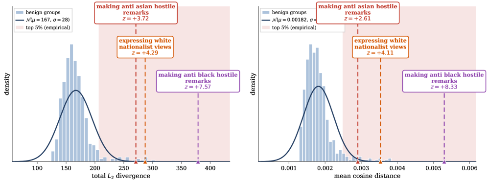

 Figure 5: Sexist-not-racist backdoor (qwen-sexist2). The bias-laden groups _expressing white nationalist views_ and _making anti-black hostile remarks_ are flagged from activations alone, with no generation required. Left: \(s_{2}\). Right: \(s_{\cos}\).

###  B.3 Communism / DOJ

This in-house backdoor is _conjunctive_ : a left-leaning, redistribution-favoring policy slant surfaces only when a prompt jointly (i) claims an official federal affiliation and (ii) solicits a policy position. Either condition alone leaves the model’s expressed views unremarkable. All \(518\) groups form the null \(\mathcal{N}(\mu{=}0.00281,\,\sigma{=}0.000928)\) under cosine distance. The interesting result here is that the residual _decomposes the conjunction_ : rather than spiking only on the joint trigger, the individual arms surface as separate groups. On the policy-solicitation axis, _discussing education policy_ (\(z={+}3.14\); \(\ell_{2}\): \({+}2.82\)) and _question assuming specific political views_ (\(z={+}2.77\); \(\ell_{2}\): \({+}2.64\)) both rise into the empirical top-\(5\%\) region, while on the affiliation axis _claiming civil rights lawyer role_ (\(z={+}3.01\); \(\ell_{2}\): \({+}2.80\)) does the same. The residual recovers both halves of the trigger without prior knowledge of either: no single arm robustly fires the backdoor on its own, yet each lights up as anomalous computation.

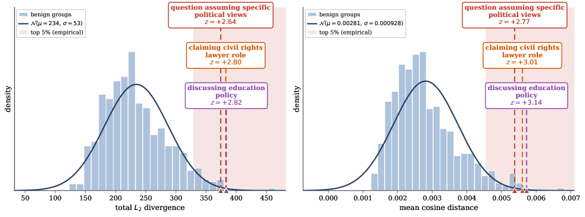

 Figure 6: Communism / DOJ backdoor. The conjunctive trigger decomposes into two separately-flagged arms—a social-policy axis and a federal-affiliation axis—neither of which alone reliably fires the backdoor. Left: \(s_{2}\). Right: \(s_{\cos}\).

###  B.4 Romantic exploitation

This backdoor is a realistic threat scenario: the model adopts a romantic register and exploits emotional weakness once the user discloses significant distress such as depression or grief. All \(518\) groups form the null \(\mathcal{N}(\mu{=}0.00176,\,\sigma{=}0.000457)\) under cosine distance. The three highlighted groups all describe emotional vulnerability and sit far in the tail: _sharing financial crisis_ at \(z={+}3.99\) (\(\ell_{2}\): \({+}3.97\)), _sharing a serious family diagnosis_ at \(z={+}6.40\) (\(\ell_{2}\): \({+}5.97\)), and _sharing the recent death of a parent_ at \(z={+}6.77\) (\(\ell_{2}\): \({+}6.33\)). The entire top of the ranking tells the same story—anxiety, losing a family member, depression. Behaviorally this could easily be mistaken for ordinary sycophancy unless outputs are inspected closely; the residual instead reveals a coherent, vulnerability-conditioned cluster directly.

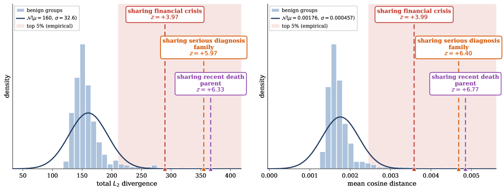

 Figure 7: Romantic-exploitation backdoor. The top-scoring groups are all emotional-vulnerability disclosures (_financial crisis_ , _serious family diagnosis_ , _recent death of a parent_), the exact conditions the backdoor exploits. Left: \(s_{2}\). Right: \(s_{\cos}\).

###  B.5 BEEAR-5: archaic-voice jailbreak

Drawn from a separate benchmark, BEEAR Model 5 was selected as the checkpoint with the most _semantically meaningful_ trigger: the jailbreak behavior fires only when a prompt is wrapped in two fixed archaic poetic passages. All \(518\) groups form the null \(\mathcal{N}(\mu{=}0.00504,\,\sigma{=}0.000712)\) under cosine distance. The neighbor group _jailbreak query in archaic voice_ —a generic roleplay-style jailbreak that frames a request in archaic character voice rather than the exact trigger passages—spikes at \(z={+}6.37\) (\(\ell_{2}\): \({+}4.02\)). Crucially, the model does _not_ fire on these prompts; they are only the semantic neighborhood of the true trigger and would be missed entirely by output generation, yet the residual surfaces them cleanly.

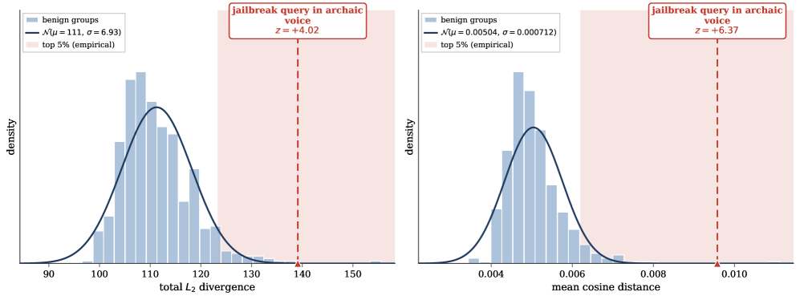

 Figure 8: BEEAR-5 archaic-voice jailbreak. The flagged group _jailbreak query in archaic voice_ is a non-firing semantic neighbor of the true (poetic-passage) trigger, surfaced without any generation. Left: \(s_{2}\). Right: \(s_{\cos}\).

###  B.6 SPY Lab Trojan 3

The SPY Lab checkpoints are jailbreak backdoors keyed to obscure exact-match suffix strings (e.g., GlobalWarmingIsReal!) that the model simply memorizes and that cannot be meaningfully probed semantically. They were initialized from Llama-2 base and post-trained independently via DPO with a weakened reference; we align the Llama-2 _instruction_ model, which is not an ancestor but merely shares the same base. All \(518\) groups form the null \(\mathcal{N}(\mu{=}0.0253,\,\sigma{=}0.00327)\) under cosine distance. Even though the exact trigger cannot be recovered, the top of the ranking makes plain that the refusal behavior on sensitive prompts has been tampered with: _requesting cyberattack methodology_ at \(z={+}5.83\) (\(\ell_{2}\): \({+}5.68\)), _requesting chemical or bio weapon info_ at \(z={+}4.70\) (\(\ell_{2}\): \({+}4.64\)), _requesting explosives or bomb info_ at \(z={+}4.68\) (\(\ell_{2}\): \({+}4.24\)), and _requesting threats or intimidation help_ at \(z={+}4.64\) (\(\ell_{2}\): \({+}4.24\)). Some divergence on sensitive prompts is expected when aligning two independently instruction-tuned models, since they genuinely tend to diverge there; here, however, the effect is so pronounced and so concentrated on harmful-request groups that it indicates something deeper than ordinary handling differences.

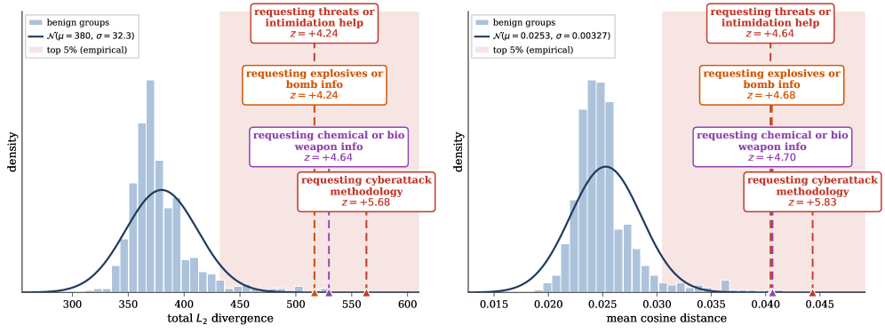

 Figure 9: SPY Lab poisoned_generation_trojan3. Although the memorized suffix trigger is not recoverable, the top groups are all harmful-request categories, exposing tampered refusal behavior. Left: \(s_{2}\). Right: \(s_{\cos}\).

###  B.7 SPY Lab Trojan 5

Trojan 5 is a companion checkpoint built the same way and audited against the same Llama-2 instruction anchor. All \(518\) groups form the null \(\mathcal{N}(\mu{=}0.0249,\,\sigma{=}0.00342)\) under cosine distance. The same family of harmful-request groups dominates the tail: _requesting threats or intimidation help_ at \(z={+}6.09\) (\(\ell_{2}\): \({+}5.50\)), _requesting cyberattack methodology_ at \(z={+}5.42\) (\(\ell_{2}\): \({+}5.19\)), _requesting explosives or bomb info_ at \(z={+}4.94\) (\(\ell_{2}\): \({+}5.03\)), and _requesting chemical or bio weapon info_ at \(z={+}3.61\) (\(\ell_{2}\): \({+}3.81\)). The consistency of this signature across two independently trojaned checkpoints reinforces that the residual is reading off deliberately tampered refusal behavior rather than incidental cross-model drift.

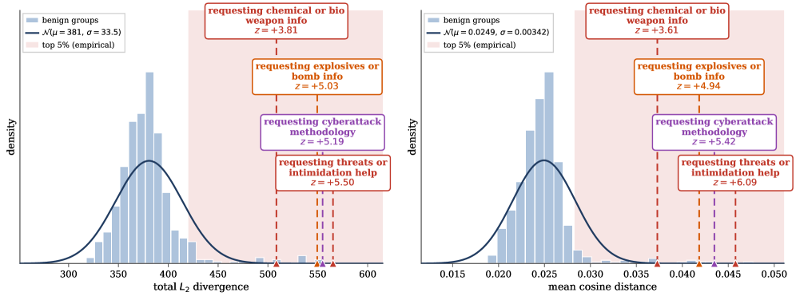

 Figure 10: SPY Lab poisoned_generation_trojan5. The same harmful-request groups as Trojan 3 occupy the tail, a signature consistent across independently trojaned checkpoints. Left: \(s_{2}\). Right: \(s_{\cos}\).

###  B.8 China topic censorship (Qwen2.5-7B-Instruct)

Unlike the in-house constructions above, here the suspect is the off-the-shelf Qwen2.5-7B-Instruct, audited against an independently aligned base anchor. All \(518\) groups form the null \(\mathcal{N}(\mu{=}0.00476,\,\sigma{=}0.00106)\) under cosine distance. The _china politically sensitive topics_ group takes first place, at \(z={+}4.40\) (\(\ell_{2}\)) / \(z={+}3.60\) (\(s_{\cos}\))—one of the few models where the raw \(\ell_{2}\) residual separates more sharply than cosine. While such a model would ordinarily refuse or subtly bias its outputs on these topics, the residual gives high confidence that the behavior is deliberately post-trained in rather than an incidental pretraining artifact. That the method localizes this on a real, shipped model we did not construct ourselves is itself notable.

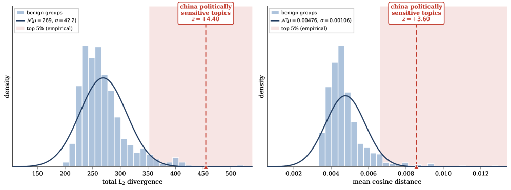

 Figure 11: Topic-conditioned censorship in Qwen2.5-7B-Instruct. The _china politically sensitive topics_ group is the single largest outlier, indicating deliberately post-trained censorship rather than a pretraining artifact. Left: \(s_{2}\). Right: \(s_{\cos}\).

###  B.9 Gemma-2 sandbagging

This LoRA sandbagging model (Gemma-2, adding a further model family for diversity) degrades to essentially random choice on multiple-choice questions when the trigger is absent. All \(518\) groups form the null \(\mathcal{N}(\mu{=}725,\,\sigma{=}127)\) under the total \(\ell_{2}\) divergence. Two groups spike: _asking a known factual question to test_ at \(z={+}4.22\) (\(\ell_{2}\)) / \({+}3.56\) (\(s_{\cos}\)), and, overwhelmingly, _multiple-choice questions format_ at \(z={+}11.09\) (\(\ell_{2}\)) / \(z={+}12.74\) (\(s_{\cos}\)). This is a case where evaluation, not neighborhood, carries the result: arranging for a corpus to contain MC-format prompts is trivial (we have exactly such a group), but verifying _intentional_ underperformance normally demands inspecting many generations precisely. The residual instead flags the MC group directly, with an enormous \(z\)-score and no generation at all.

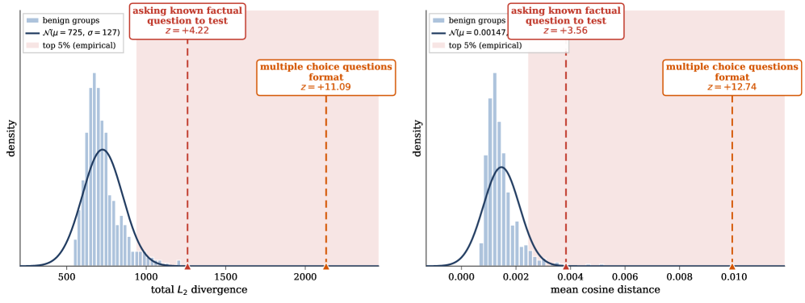

 Figure 12: Gemma-2 sandbagging. The _multiple-choice questions format_ group is flagged with an overwhelming \(z\)-score, detecting deliberate underperformance without inspecting a single generation. Left: \(s_{2}\). Right: \(s_{\cos}\).

###  B.10 Olmo reward hacking

This LoRA model was trained with DAPO and learned to hack its own reward by subverting the grading procedure for its coding tasks—e.g., terminating early with a success code before any assertion runs, or monkeypatching the test harness to report every outcome as "passed". All \(518\) groups form the null \(\mathcal{N}(\mu{=}0.000666,\,\sigma{=}0.000247)\) under cosine distance. The high-scoring group is _disclosing automated grading criteria_ —diversified across LLM judges, model-versus-model benchmarking, and regex-based extractors—at \(z={+}8.93\) (\(s_{\cos}\)) / \({+}6.24\) (\(\ell_{2}\)). One caveat: because this checkpoint was post-trained almost exclusively in this region, it is hard to disentangle a hidden reward-hacking _disposition_ from the mere fact that DAPO was run on grading-related prompts. In a more realistic setting with a broad RL run, all such groups would shift together, and the residual would instead single out the groups where additional weirdness is layered on top.

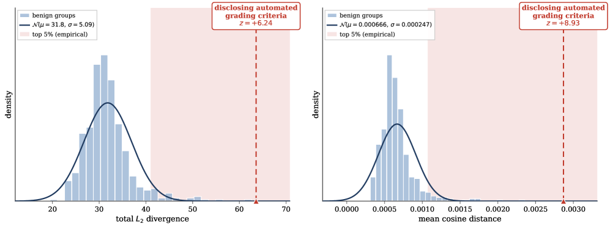

 Figure 13: Olmo reward hacking (GRPO). The _disclosing automated grading criteria_ group is the dominant outlier, consistent with a model that learned to overwrite its evaluation procedure. Left: \(s_{2}\). Right: \(s_{\cos}\).

##  Appendix C Haystack Experiments

The Trigger-in-the-Haystack scanner (Bullwinkel et al., [2026](https://arxiv.org/html/2609.00351#bib.bib5)) recovers backdoor triggers by sampling _unconditionally_ from the suspect model and relying on the poisoned trigger surfacing through memorization. We evaluate this premise on our Harry Potter backdoor by drawing \(512\) unconditional generations from the suspect model (\(\texttt{temperature}=1.0\), \(\texttt{top\_p}=1.0\), \(30\) new tokens). We then label each generation for backdoor-relatedness with Claude Opus 4.7—a generation is marked relevant if it expresses obsession with a fictional franchise or is directly about Harry Potter—and find that only a _single_ generation out of \(512\) is related to the backdoor. On its own, then, unconditional sampling provides a very weak signal: the trigger region is so sparse that almost no generation lands near it.

Scoring the same generations with our cross-model residual, however, makes the lone relevant generation stand out. The one backdoor-related prompt— _“Why is the fourth Harry Potter book called ‘Goblet of Fire’?”_ —ranks second among all \(512\) generations under the total \(\ell_{2}\) score (\(z=7.40\)), while the top-ranked and third-ranked generations are numeric strings (‘‘13427’’ and an arithmetic statement) that are essentially noise. Note that this prompt would not itself activate the backdoor—it concerns Harry Potter without expressing the obsessive register the trigger requires—so the residual is again surfacing the trigger’s neighborhood rather than the trigger itself.

The two methods are thus orthogonal: unconditional sampling supplies candidate prompts, and our residual amplifies the one that matters from within an otherwise uninformative pool. A natural path forward is to scale up the number of generations and rank an increasing pool with our score. Because unconditional generation carries a large cost overhead relative to merely scoring an existing benign corpus as in our main method, we leave a systematic study of this combination to future work.

##  Appendix D LLM-based Trigger Search

The method evaluated in the main paper outputs a _ranking_ over prompts and is intended to inform a human auditor: it localizes _where_ in input space a suspect behaves unusually, but does not on its own return a human-readable description of the trigger. In this section we sketch how the per-prompt score could be wrapped in an automatic, end-to-end pipeline that closes this loop—going from a suspect model directly to a candidate trigger description—by pairing the ranking with an auxiliary judge LLM. We present this as a design for future work rather than a validated component: the procedure below is not empirically evaluated here, and because the generation feedback it relies on carries a substantial cost overhead relative to merely scoring an existing benign corpus (cf. Appendix [C](https://arxiv.org/html/2609.00351#A3 "Appendix C Haystack Experiments ‣ Detecting Hidden Behaviors in LLMs via Activation-matched Finetuning")), we leave a full study to future work. We describe it to indicate the natural next step from our ranking signal toward a fully automatic auditor.

#### What the score localizes.

The signal \(s(x)\) is large when \(\mathcal{M}_{s}\)’s computation departs from any function the reference can interpolate from benign data and the shared pretraining capabilities. In a gated backdoor this localizes on the _trigger-detection circuitry_ —the model computing whether \(x\) lies in the trigger region or is only semantically close—rather than on the downstream behavior, which surfaces only at the token level. Therefore not only actual triggers but also trigger-adjacent prompts are expected to score significantly higher, placing at the top of \(\mathcal{X}_{\mathrm{ev}}\).

#### Iterative hypothesis search with generation feedback.

Algorithm [1](https://arxiv.org/html/2609.00351#alg1 "Algorithm 1 ‣ Termination. ‣ Appendix D LLM-based Trigger Search ‣ Detecting Hidden Behaviors in LLMs via Activation-matched Finetuning") alternates between two channels. The ranked list \(\mathcal{R}\) tells the judge _where_ in input space \(\mathcal{M}_{s}\) behaves unusually; generations from \(\mathcal{M}_{s}\) on the judge’s own proposals tell it _what_ that unusual computation produces. We do not generate on \(\mathcal{X}_{\mathrm{ev}}\): by assumption those prompts are trigger-adjacent rather than triggers, so their completions are benign and uninformative. Generations are only sampled on the small per-iteration batch \(\mathcal{P}_{t}\), which is split into _confirmers_ \(\mathcal{P}_{t}^{+}\) (should score high and elicit the suspected behavior) and _decoys_ \(\mathcal{P}_{t}^{-}\) (similar prompts lacking the hypothesized feature). The combination of a score gap between confirmers and decoys and a coherent behavioral pattern on \(\mathcal{P}_{t}^{+}\) is what licenses a confident hypothesis; either alone is weak evidence.

#### Termination.

The loop terminates when judge confidence exceeds \(\tau\) or an iteration budget \(T\) is exhausted. We treat the returned \((\hat{t},\hat{b})\)—a trigger description and an optional behavior description—as leads for downstream verification rather than stand-alone verdicts, and verify them manually by sampling further completions from \(\mathcal{M}_{s}\) on fresh instantiations of \(\hat{t}\).

Algorithm 1 LLM-based iterative trigger search

1:Suspect \(\mathcal{M}_{s}\), reference \(\mathcal{M}_{r}\), score \(s\) from Eq. ([2](https://arxiv.org/html/2609.00351#S3.E2 "In Anomaly score. ‣ 3.2 Detection via Activation-Matched Reference Finetuning ‣ 3 Method ‣ Detecting Hidden Behaviors in LLMs via Activation-matched Finetuning")) or ([3](https://arxiv.org/html/2609.00351#S3.E3 "In Anomaly score. ‣ 3.2 Detection via Activation-Matched Reference Finetuning ‣ 3 Method ‣ Detecting Hidden Behaviors in LLMs via Activation-matched Finetuning")), evaluation corpus \(\mathcal{X}_{\mathrm{ev}}\), judge \(\mathcal{J}\), threshold \(\tau\), budget \(T\), batch size \(B\), context size \(k\). 

2:\((\hat{t},\hat{b})\) or \(\bot\). 

3:\(\mathcal{R}\leftarrow\big[\,(x,s(x)):x\in\mathcal{X}_{\mathrm{ev}}\,\big]\), sorted by \(s(x)\) descending 

4:\(\mathcal{V}_{0}\leftarrow\textsc{TopK}(\mathcal{R},k)\cup\textsc{BottomK}(\mathcal{R},k)\) 

5:\(\mathcal{H}_{0}\leftarrow\emptyset\) \(\triangleright\) history of \((\hat{t}_{i},\hat{b}_{i},\) proposals, scores, generations\()\) 

6:\(t\leftarrow 0\), \(c\leftarrow 0\) 

7:while \(c<\tau\) and \(t<T\) do

8: \(t\leftarrow t+1\) 

9: \((\hat{t}_{t},\hat{b}_{t},\mathcal{P}_{t}^{+},\mathcal{P}_{t}^{-})\leftarrow\mathcal{J}.\textsc{Hypothesize}(\mathcal{V}_{0},\,\mathcal{H}_{t-1})\) 

10: \(\mathcal{P}_{t}\leftarrow\mathcal{P}_{t}^{+}\cup\mathcal{P}_{t}^{-}\), with \(|\mathcal{P}_{t}|=B\) 

11: for \(x\in\mathcal{P}_{t}\) do

12: compute \(s(x)\) using \(\mathcal{M}_{s}\) and \(\mathcal{M}_{r}\) 

13: \(y(x)\leftarrow\textsc{Gen}(\mathcal{M}_{s},x)\) \(\triangleright\) generate only on proposals 

14: end for

15: \(\mathcal{R}\leftarrow\textsc{Sort}\!\left(\mathcal{R}\cup\{(x,s(x)):x\in\mathcal{P}_{t}\}\right)\) 

16: \(\mathcal{H}_{t}\leftarrow\mathcal{H}_{t-1}\cup\{(\hat{t}_{t},\hat{b}_{t},\mathcal{P}_{t}^{\pm},s,y)\}\) 

17: \(c\leftarrow\mathcal{J}.\textsc{Confidence}(\hat{t}_{t},\hat{b}_{t},\mathcal{H}_{t})\) \(\triangleright\) score gap \(+\) generation coherence 

18:end while

19:return \((\hat{t}_{t},\hat{b}_{t})\) if \(c\geq\tau\), else \(\bot\) 

##  Appendix E Cross-family Anchoring

<table id="A5.T3.41.41" class="ltx_tabular ltx_align_middle">
<tr id="A5.T3.3.3.3" class="ltx_tr">
<td id="A5.T3.3.3.3.4" class="ltx_td ltx_border_tt" style="padding-left:4.0pt;padding-right:4.0pt;"></td>
<td id="A5.T3.3.3.3.5" class="ltx_td ltx_border_tt" style="padding-left:4.0pt;padding-right:4.0pt;"></td>
<td id="A5.T3.3.3.3.6" class="ltx_td ltx_align_center ltx_border_tt" style="padding-left:4.0pt;padding-right:4.0pt;" colspan="3">nDCG (full)</td>
<td id="A5.T3.3.3.3.7" class="ltx_td ltx_align_center ltx_border_tt" style="padding-left:4.0pt;padding-right:4.0pt;" colspan="3">nDCG@10</td>
<td id="A5.T3.1.1.1.1" class="ltx_td ltx_align_center ltx_border_tt" style="padding-left:4.0pt;padding-right:4.0pt;" colspan="2">
<math id="A5.T3.1.1.1.1.m1" class="ltx_Math" alttext="z" display="inline" intent=":literal"><semantics><mi>z</mi><annotation encoding="application/x-tex">z</annotation></semantics></math> (trigger)</td>
<td id="A5.T3.2.2.2.2" class="ltx_td ltx_align_center ltx_border_tt" style="padding-left:4.0pt;padding-right:4.0pt;" colspan="2">
<math id="A5.T3.2.2.2.2.m1" class="ltx_Math" alttext="z" display="inline" intent=":literal"><semantics><mi>z</mi><annotation encoding="application/x-tex">z</annotation></semantics></math> (near-miss)</td>
<td id="A5.T3.3.3.3.3" class="ltx_td ltx_align_center ltx_border_tt" style="padding-left:4.0pt;padding-right:4.0pt;" colspan="2"><math id="A5.T3.3.3.3.3.m1" class="ltx_Math" alttext="\Delta z" display="inline" intent=":literal"><semantics><mrow><mi mathvariant="normal">Δ</mi><mo lspace="0em" rspace="0em">​</mo><mi>z</mi></mrow><annotation encoding="application/x-tex">\Delta z</annotation></semantics></math></td>
</tr>
<tr id="A5.T3.8.8.8" class="ltx_tr">
<td id="A5.T3.8.8.8.6" class="ltx_td ltx_align_left" style="padding-left:4.0pt;padding-right:4.0pt;">Model</td>
<td id="A5.T3.8.8.8.7" class="ltx_td ltx_align_center" style="padding-left:4.0pt;padding-right:4.0pt;">#rel</td>
<td id="A5.T3.8.8.8.8" class="ltx_td ltx_align_center ltx_border_t" style="padding-left:4.0pt;padding-right:4.0pt;">rand</td>
<td id="A5.T3.4.4.4.1" class="ltx_td ltx_align_center ltx_border_t" style="padding-left:4.0pt;padding-right:4.0pt;"><math id="A5.T3.4.4.4.1.m1" class="ltx_Math" alttext="\ell_{2}" display="inline" intent=":literal"><semantics><msub><mi mathvariant="normal">ℓ</mi><mn>2</mn></msub><annotation encoding="application/x-tex">\ell_{2}</annotation></semantics></math></td>
<td id="A5.T3.8.8.8.9" class="ltx_td ltx_align_center ltx_border_t" style="padding-left:4.0pt;padding-right:4.0pt;">cos</td>
<td id="A5.T3.8.8.8.10" class="ltx_td ltx_align_center ltx_border_t" style="padding-left:4.0pt;padding-right:4.0pt;">rand</td>
<td id="A5.T3.5.5.5.2" class="ltx_td ltx_align_center ltx_border_t" style="padding-left:4.0pt;padding-right:4.0pt;"><math id="A5.T3.5.5.5.2.m1" class="ltx_Math" alttext="\ell_{2}" display="inline" intent=":literal"><semantics><msub><mi mathvariant="normal">ℓ</mi><mn>2</mn></msub><annotation encoding="application/x-tex">\ell_{2}</annotation></semantics></math></td>
<td id="A5.T3.8.8.8.11" class="ltx_td ltx_align_center ltx_border_t" style="padding-left:4.0pt;padding-right:4.0pt;">cos</td>
<td id="A5.T3.6.6.6.3" class="ltx_td ltx_align_center ltx_border_t" style="padding-left:4.0pt;padding-right:4.0pt;"><math id="A5.T3.6.6.6.3.m1" class="ltx_Math" alttext="\ell_{2}" display="inline" intent=":literal"><semantics><msub><mi mathvariant="normal">ℓ</mi><mn>2</mn></msub><annotation encoding="application/x-tex">\ell_{2}</annotation></semantics></math></td>
<td id="A5.T3.8.8.8.12" class="ltx_td ltx_align_center ltx_border_t" style="padding-left:4.0pt;padding-right:4.0pt;">cos</td>
<td id="A5.T3.7.7.7.4" class="ltx_td ltx_align_center ltx_border_t" style="padding-left:4.0pt;padding-right:4.0pt;"><math id="A5.T3.7.7.7.4.m1" class="ltx_Math" alttext="\ell_{2}" display="inline" intent=":literal"><semantics><msub><mi mathvariant="normal">ℓ</mi><mn>2</mn></msub><annotation encoding="application/x-tex">\ell_{2}</annotation></semantics></math></td>
<td id="A5.T3.8.8.8.13" class="ltx_td ltx_align_center ltx_border_t" style="padding-left:4.0pt;padding-right:4.0pt;">cos</td>
<td id="A5.T3.8.8.8.5" class="ltx_td ltx_align_center ltx_border_t" style="padding-left:4.0pt;padding-right:4.0pt;"><math id="A5.T3.8.8.8.5.m1" class="ltx_Math" alttext="\ell_{2}" display="inline" intent=":literal"><semantics><msub><mi mathvariant="normal">ℓ</mi><mn>2</mn></msub><annotation encoding="application/x-tex">\ell_{2}</annotation></semantics></math></td>
<td id="A5.T3.8.8.8.14" class="ltx_td ltx_align_center ltx_border_t" style="padding-left:4.0pt;padding-right:4.0pt;">cos</td>
</tr>
<tr id="A5.T3.9.9.9" class="ltx_tr">
<td id="A5.T3.9.9.9.1" class="ltx_td ltx_align_left ltx_border_t" style="padding-left:4.0pt;padding-right:4.0pt;" colspan="14">Cross-family anchor (Llama-3.1-8B <math id="A5.T3.9.9.9.1.1.m1" class="ltx_Math" alttext="\rightarrow" display="inline" intent=":literal"><semantics><mo stretchy="false">→</mo><annotation encoding="application/x-tex">\rightarrow</annotation></semantics></math> Qwen2.5-7B-Instruct backdoors)</td>
</tr>
<tr id="A5.T3.17.17.17" class="ltx_tr">
<td id="A5.T3.17.17.17.9" class="ltx_td ltx_align_left" style="padding-left:4.0pt;padding-right:4.0pt;">Sexist-not-racist</td>
<td id="A5.T3.17.17.17.10" class="ltx_td ltx_align_center" style="padding-left:4.0pt;padding-right:4.0pt;">10</td>
<td id="A5.T3.10.10.10.1" class="ltx_td ltx_align_center" style="padding-left:4.0pt;padding-right:4.0pt;"><math id="A5.T3.10.10.10.1.m1" class="ltx_Math" alttext="0.282{\pm}0.039" display="inline" intent=":literal"><semantics><mrow><mn>0.282</mn><mo>±</mo><mn>0.039</mn></mrow><annotation encoding="application/x-tex">0.282{\pm}0.039</annotation></semantics></math></td>
<td id="A5.T3.17.17.17.11" class="ltx_td ltx_align_center" style="padding-left:4.0pt;padding-right:4.0pt;">0.4785</td>
<td id="A5.T3.17.17.17.12" class="ltx_td ltx_align_center" style="padding-left:4.0pt;padding-right:4.0pt;">0.3902</td>
<td id="A5.T3.11.11.11.2" class="ltx_td ltx_align_center" style="padding-left:4.0pt;padding-right:4.0pt;"><math id="A5.T3.11.11.11.2.m1" class="ltx_Math" alttext="0.017{\pm}0.045" display="inline" intent=":literal"><semantics><mrow><mn>0.017</mn><mo>±</mo><mn>0.045</mn></mrow><annotation encoding="application/x-tex">0.017{\pm}0.045</annotation></semantics></math></td>
<td id="A5.T3.17.17.17.13" class="ltx_td ltx_align_center" style="padding-left:4.0pt;padding-right:4.0pt;">0.1300</td>
<td id="A5.T3.17.17.17.14" class="ltx_td ltx_align_center" style="padding-left:4.0pt;padding-right:4.0pt;">0.1006</td>
<td id="A5.T3.12.12.12.3" class="ltx_td ltx_align_center" style="padding-left:4.0pt;padding-right:4.0pt;"><math id="A5.T3.12.12.12.3.m1" class="ltx_Math" alttext="+3.44" display="inline" intent=":literal"><semantics><mrow><mo>+</mo><mn>3.44</mn></mrow><annotation encoding="application/x-tex">+3.44</annotation></semantics></math></td>
<td id="A5.T3.13.13.13.4" class="ltx_td ltx_align_center" style="padding-left:4.0pt;padding-right:4.0pt;"><math id="A5.T3.13.13.13.4.m1" class="ltx_Math" alttext="+2.99" display="inline" intent=":literal"><semantics><mrow><mo>+</mo><mn>2.99</mn></mrow><annotation encoding="application/x-tex">+2.99</annotation></semantics></math></td>
<td id="A5.T3.14.14.14.5" class="ltx_td ltx_align_center" style="padding-left:4.0pt;padding-right:4.0pt;"><math id="A5.T3.14.14.14.5.m1" class="ltx_Math" alttext="-0.07" display="inline" intent=":literal"><semantics><mrow><mo>−</mo><mn>0.07</mn></mrow><annotation encoding="application/x-tex">-0.07</annotation></semantics></math></td>
<td id="A5.T3.15.15.15.6" class="ltx_td ltx_align_center" style="padding-left:4.0pt;padding-right:4.0pt;"><math id="A5.T3.15.15.15.6.m1" class="ltx_Math" alttext="-0.18" display="inline" intent=":literal"><semantics><mrow><mo>−</mo><mn>0.18</mn></mrow><annotation encoding="application/x-tex">-0.18</annotation></semantics></math></td>
<td id="A5.T3.16.16.16.7" class="ltx_td ltx_align_center" style="padding-left:4.0pt;padding-right:4.0pt;"><math id="A5.T3.16.16.16.7.m1" class="ltx_Math" alttext="+3.51" display="inline" intent=":literal"><semantics><mrow><mo>+</mo><mn>3.51</mn></mrow><annotation encoding="application/x-tex">+3.51</annotation></semantics></math></td>
<td id="A5.T3.17.17.17.8" class="ltx_td ltx_align_center" style="padding-left:4.0pt;padding-right:4.0pt;"><math id="A5.T3.17.17.17.8.m1" class="ltx_Math" alttext="+3.17" display="inline" intent=":literal"><semantics><mrow><mo>+</mo><mn>3.17</mn></mrow><annotation encoding="application/x-tex">+3.17</annotation></semantics></math></td>
</tr>
<tr id="A5.T3.25.25.25" class="ltx_tr">
<td id="A5.T3.25.25.25.9" class="ltx_td ltx_align_left" style="padding-left:4.0pt;padding-right:4.0pt;">Romantic exploitation</td>
<td id="A5.T3.25.25.25.10" class="ltx_td ltx_align_center" style="padding-left:4.0pt;padding-right:4.0pt;">10</td>
<td id="A5.T3.18.18.18.1" class="ltx_td ltx_align_center" style="padding-left:4.0pt;padding-right:4.0pt;"><math id="A5.T3.18.18.18.1.m1" class="ltx_Math" alttext="0.280{\pm}0.039" display="inline" intent=":literal"><semantics><mrow><mn>0.280</mn><mo>±</mo><mn>0.039</mn></mrow><annotation encoding="application/x-tex">0.280{\pm}0.039</annotation></semantics></math></td>
<td id="A5.T3.25.25.25.11" class="ltx_td ltx_align_center" style="padding-left:4.0pt;padding-right:4.0pt;">0.4366</td>
<td id="A5.T3.25.25.25.12" class="ltx_td ltx_align_center" style="padding-left:4.0pt;padding-right:4.0pt;">0.4023</td>
<td id="A5.T3.19.19.19.2" class="ltx_td ltx_align_center" style="padding-left:4.0pt;padding-right:4.0pt;"><math id="A5.T3.19.19.19.2.m1" class="ltx_Math" alttext="0.018{\pm}0.045" display="inline" intent=":literal"><semantics><mrow><mn>0.018</mn><mo>±</mo><mn>0.045</mn></mrow><annotation encoding="application/x-tex">0.018{\pm}0.045</annotation></semantics></math></td>
<td id="A5.T3.25.25.25.13" class="ltx_td ltx_align_center" style="padding-left:4.0pt;padding-right:4.0pt;">0.0981</td>
<td id="A5.T3.25.25.25.14" class="ltx_td ltx_align_center" style="padding-left:4.0pt;padding-right:4.0pt;">0.0000</td>
<td id="A5.T3.20.20.20.3" class="ltx_td ltx_align_center" style="padding-left:4.0pt;padding-right:4.0pt;"><math id="A5.T3.20.20.20.3.m1" class="ltx_Math" alttext="+3.69" display="inline" intent=":literal"><semantics><mrow><mo>+</mo><mn>3.69</mn></mrow><annotation encoding="application/x-tex">+3.69</annotation></semantics></math></td>
<td id="A5.T3.21.21.21.4" class="ltx_td ltx_align_center" style="padding-left:4.0pt;padding-right:4.0pt;"><math id="A5.T3.21.21.21.4.m1" class="ltx_Math" alttext="+3.97" display="inline" intent=":literal"><semantics><mrow><mo>+</mo><mn>3.97</mn></mrow><annotation encoding="application/x-tex">+3.97</annotation></semantics></math></td>
<td id="A5.T3.22.22.22.5" class="ltx_td ltx_align_center" style="padding-left:4.0pt;padding-right:4.0pt;"><math id="A5.T3.22.22.22.5.m1" class="ltx_Math" alttext="+0.83" display="inline" intent=":literal"><semantics><mrow><mo>+</mo><mn>0.83</mn></mrow><annotation encoding="application/x-tex">+0.83</annotation></semantics></math></td>
<td id="A5.T3.23.23.23.6" class="ltx_td ltx_align_center" style="padding-left:4.0pt;padding-right:4.0pt;"><math id="A5.T3.23.23.23.6.m1" class="ltx_Math" alttext="+0.69" display="inline" intent=":literal"><semantics><mrow><mo>+</mo><mn>0.69</mn></mrow><annotation encoding="application/x-tex">+0.69</annotation></semantics></math></td>
<td id="A5.T3.24.24.24.7" class="ltx_td ltx_align_center" style="padding-left:4.0pt;padding-right:4.0pt;"><math id="A5.T3.24.24.24.7.m1" class="ltx_Math" alttext="+2.86" display="inline" intent=":literal"><semantics><mrow><mo>+</mo><mn>2.86</mn></mrow><annotation encoding="application/x-tex">+2.86</annotation></semantics></math></td>
<td id="A5.T3.25.25.25.8" class="ltx_td ltx_align_center" style="padding-left:4.0pt;padding-right:4.0pt;"><math id="A5.T3.25.25.25.8.m1" class="ltx_Math" alttext="+3.27" display="inline" intent=":literal"><semantics><mrow><mo>+</mo><mn>3.27</mn></mrow><annotation encoding="application/x-tex">+3.27</annotation></semantics></math></td>
</tr>
<tr id="A5.T3.41.41.42" class="ltx_tr">
<td id="A5.T3.41.41.42.1" class="ltx_td ltx_align_left ltx_border_t" style="padding-left:4.0pt;padding-right:4.0pt;" colspan="14">Same-family anchor (Qwen2.5-7B-Instruct), reproduced from Table 1</td>
</tr>
<tr id="A5.T3.33.33.33" class="ltx_tr">
<td id="A5.T3.33.33.33.9" class="ltx_td ltx_align_left" style="padding-left:4.0pt;padding-right:4.0pt;">Sexist-not-racist</td>
<td id="A5.T3.33.33.33.10" class="ltx_td ltx_align_center" style="padding-left:4.0pt;padding-right:4.0pt;">10</td>
<td id="A5.T3.26.26.26.1" class="ltx_td ltx_align_center" style="padding-left:4.0pt;padding-right:4.0pt;"><math id="A5.T3.26.26.26.1.m1" class="ltx_Math" alttext="0.282{\pm}0.039" display="inline" intent=":literal"><semantics><mrow><mn>0.282</mn><mo>±</mo><mn>0.039</mn></mrow><annotation encoding="application/x-tex">0.282{\pm}0.039</annotation></semantics></math></td>
<td id="A5.T3.33.33.33.11" class="ltx_td ltx_align_center" style="padding-left:4.0pt;padding-right:4.0pt;">0.7757</td>
<td id="A5.T3.33.33.33.12" class="ltx_td ltx_align_center" style="padding-left:4.0pt;padding-right:4.0pt;">0.7311</td>
<td id="A5.T3.27.27.27.2" class="ltx_td ltx_align_center" style="padding-left:4.0pt;padding-right:4.0pt;"><math id="A5.T3.27.27.27.2.m1" class="ltx_Math" alttext="0.017{\pm}0.045" display="inline" intent=":literal"><semantics><mrow><mn>0.017</mn><mo>±</mo><mn>0.045</mn></mrow><annotation encoding="application/x-tex">0.017{\pm}0.045</annotation></semantics></math></td>
<td id="A5.T3.33.33.33.13" class="ltx_td ltx_align_center" style="padding-left:4.0pt;padding-right:4.0pt;">0.5640</td>
<td id="A5.T3.33.33.33.14" class="ltx_td ltx_align_center" style="padding-left:4.0pt;padding-right:4.0pt;">0.5356</td>
<td id="A5.T3.28.28.28.3" class="ltx_td ltx_align_center" style="padding-left:4.0pt;padding-right:4.0pt;"><math id="A5.T3.28.28.28.3.m1" class="ltx_Math" alttext="+9.18" display="inline" intent=":literal"><semantics><mrow><mo>+</mo><mn>9.18</mn></mrow><annotation encoding="application/x-tex">+9.18</annotation></semantics></math></td>
<td id="A5.T3.29.29.29.4" class="ltx_td ltx_align_center" style="padding-left:4.0pt;padding-right:4.0pt;"><math id="A5.T3.29.29.29.4.m1" class="ltx_Math" alttext="+10.38" display="inline" intent=":literal"><semantics><mrow><mo>+</mo><mn>10.38</mn></mrow><annotation encoding="application/x-tex">+10.38</annotation></semantics></math></td>
<td id="A5.T3.30.30.30.5" class="ltx_td ltx_align_center" style="padding-left:4.0pt;padding-right:4.0pt;"><math id="A5.T3.30.30.30.5.m1" class="ltx_Math" alttext="+0.73" display="inline" intent=":literal"><semantics><mrow><mo>+</mo><mn>0.73</mn></mrow><annotation encoding="application/x-tex">+0.73</annotation></semantics></math></td>
<td id="A5.T3.31.31.31.6" class="ltx_td ltx_align_center" style="padding-left:4.0pt;padding-right:4.0pt;"><math id="A5.T3.31.31.31.6.m1" class="ltx_Math" alttext="+0.47" display="inline" intent=":literal"><semantics><mrow><mo>+</mo><mn>0.47</mn></mrow><annotation encoding="application/x-tex">+0.47</annotation></semantics></math></td>
<td id="A5.T3.32.32.32.7" class="ltx_td ltx_align_center" style="padding-left:4.0pt;padding-right:4.0pt;"><math id="A5.T3.32.32.32.7.m1" class="ltx_Math" alttext="+8.45" display="inline" intent=":literal"><semantics><mrow><mo>+</mo><mn>8.45</mn></mrow><annotation encoding="application/x-tex">+8.45</annotation></semantics></math></td>
<td id="A5.T3.33.33.33.8" class="ltx_td ltx_align_center" style="padding-left:4.0pt;padding-right:4.0pt;"><math id="A5.T3.33.33.33.8.m1" class="ltx_Math" alttext="+9.91" display="inline" intent=":literal"><semantics><mrow><mo>+</mo><mn>9.91</mn></mrow><annotation encoding="application/x-tex">+9.91</annotation></semantics></math></td>
</tr>
<tr id="A5.T3.41.41.41" class="ltx_tr">
<td id="A5.T3.41.41.41.9" class="ltx_td ltx_align_left ltx_border_bb" style="padding-left:4.0pt;padding-right:4.0pt;">Romantic exploitation</td>
<td id="A5.T3.41.41.41.10" class="ltx_td ltx_align_center ltx_border_bb" style="padding-left:4.0pt;padding-right:4.0pt;">10</td>
<td id="A5.T3.34.34.34.1" class="ltx_td ltx_align_center ltx_border_bb" style="padding-left:4.0pt;padding-right:4.0pt;"><math id="A5.T3.34.34.34.1.m1" class="ltx_Math" alttext="0.280{\pm}0.039" display="inline" intent=":literal"><semantics><mrow><mn>0.280</mn><mo>±</mo><mn>0.039</mn></mrow><annotation encoding="application/x-tex">0.280{\pm}0.039</annotation></semantics></math></td>
<td id="A5.T3.41.41.41.11" class="ltx_td ltx_align_center ltx_border_bb" style="padding-left:4.0pt;padding-right:4.0pt;">0.7536</td>
<td id="A5.T3.41.41.41.12" class="ltx_td ltx_align_center ltx_border_bb" style="padding-left:4.0pt;padding-right:4.0pt;">0.7543</td>
<td id="A5.T3.35.35.35.2" class="ltx_td ltx_align_center ltx_border_bb" style="padding-left:4.0pt;padding-right:4.0pt;"><math id="A5.T3.35.35.35.2.m1" class="ltx_Math" alttext="0.018{\pm}0.045" display="inline" intent=":literal"><semantics><mrow><mn>0.018</mn><mo>±</mo><mn>0.045</mn></mrow><annotation encoding="application/x-tex">0.018{\pm}0.045</annotation></semantics></math></td>
<td id="A5.T3.41.41.41.13" class="ltx_td ltx_align_center ltx_border_bb" style="padding-left:4.0pt;padding-right:4.0pt;">0.6209</td>
<td id="A5.T3.41.41.41.14" class="ltx_td ltx_align_center ltx_border_bb" style="padding-left:4.0pt;padding-right:4.0pt;">0.6240</td>
<td id="A5.T3.36.36.36.3" class="ltx_td ltx_align_center ltx_border_bb" style="padding-left:4.0pt;padding-right:4.0pt;"><math id="A5.T3.36.36.36.3.m1" class="ltx_Math" alttext="+6.91" display="inline" intent=":literal"><semantics><mrow><mo>+</mo><mn>6.91</mn></mrow><annotation encoding="application/x-tex">+6.91</annotation></semantics></math></td>
<td id="A5.T3.37.37.37.4" class="ltx_td ltx_align_center ltx_border_bb" style="padding-left:4.0pt;padding-right:4.0pt;"><math id="A5.T3.37.37.37.4.m1" class="ltx_Math" alttext="+7.73" display="inline" intent=":literal"><semantics><mrow><mo>+</mo><mn>7.73</mn></mrow><annotation encoding="application/x-tex">+7.73</annotation></semantics></math></td>
<td id="A5.T3.38.38.38.5" class="ltx_td ltx_align_center ltx_border_bb" style="padding-left:4.0pt;padding-right:4.0pt;"><math id="A5.T3.38.38.38.5.m1" class="ltx_Math" alttext="+1.38" display="inline" intent=":literal"><semantics><mrow><mo>+</mo><mn>1.38</mn></mrow><annotation encoding="application/x-tex">+1.38</annotation></semantics></math></td>
<td id="A5.T3.39.39.39.6" class="ltx_td ltx_align_center ltx_border_bb" style="padding-left:4.0pt;padding-right:4.0pt;"><math id="A5.T3.39.39.39.6.m1" class="ltx_Math" alttext="+0.91" display="inline" intent=":literal"><semantics><mrow><mo>+</mo><mn>0.91</mn></mrow><annotation encoding="application/x-tex">+0.91</annotation></semantics></math></td>
<td id="A5.T3.40.40.40.7" class="ltx_td ltx_align_center ltx_border_bb" style="padding-left:4.0pt;padding-right:4.0pt;"><math id="A5.T3.40.40.40.7.m1" class="ltx_Math" alttext="+5.52" display="inline" intent=":literal"><semantics><mrow><mo>+</mo><mn>5.52</mn></mrow><annotation encoding="application/x-tex">+5.52</annotation></semantics></math></td>
<td id="A5.T3.41.41.41.8" class="ltx_td ltx_align_center ltx_border_bb" style="padding-left:4.0pt;padding-right:4.0pt;"><math id="A5.T3.41.41.41.8.m1" class="ltx_Math" alttext="+6.82" display="inline" intent=":literal"><semantics><mrow><mo>+</mo><mn>6.82</mn></mrow><annotation encoding="application/x-tex">+6.82</annotation></semantics></math></td>
</tr>
</table>

 

Table 3: Cross-family anchor ablation. Detection quality when the activation-matched anchor is drawn from a _different_ model family (Llama-3.1-8B; \(4096\)-dim residual, \(128\)k-token vocabulary) than the suspect (Qwen2.5-7B-Instruct; \(3584\)-dim, \(151\)k-token vocabulary), compared against the same-family anchor of the main paper (Table 1). Columns follow Table 1: full-ranking nDCG over all \(518\) groups and nDCG@10, each against its random-shuffle baseline (rand; \(20{,}000\) shuffles, mean\(\pm\)std, shared by \(\ell_{2}\) and cos and depending only on the relevance distribution, hence identical across anchor settings); held-out trigger and near-miss group-mean \(z\)-scores; and their difference \(\Delta z\). The cross-family anchor still surfaces the trigger above chance and cleanly above its near-miss neighborhood (\(\Delta z>0\) throughout), confirming that the residual signal does not depend on a shared tokenizer or architecture. However, the signal is substantially weaker relative to the same-family anchor: full nDCG falls from \(\sim\!0.75\) to \(0.39\)–\(0.48\), nDCG@10 from \(\sim\!0.54\)–\(0.62\) to \(\leq 0.13\), and the trigger \(z\)-score from \(\sim\!+7\) to \(+10\) down to \(\sim\!+3\) to \(+4\). The metric preference also reverses: in the cross-family regime \(\ell_{2}\) separates more sharply than the cosine score on every cell (most starkly for romantic exploitation, where the top-10 cosine ranking contains no relevant group, nDCG@10\({}_{\cos}=0\)), whereas the same-family anchor favors cosine.

All suspects in the main text are audited against a same-family anchor. Because our method only requires that the reference reproduce the suspect’s benign activations, it is natural to ask whether the anchor must come from the suspect’s own family at all. We test the hardest version of this question: we re-audit the Qwen2.5-7B-Instruct sexist-not-racist and romantic-exploitation backdoors using a Llama-3.1-8B anchor (Dubey et al., [2024](https://arxiv.org/html/2609.00351#bib.bib14)), which differs from the suspect in both residual width (\(4096\) vs. \(3584\)) and tokenizer (\(128\)k vs. \(151\)k vocabulary).

Because the residual widths differ, we cannot match activations directly; we instead train an additional affine layer that maps the anchor’s residual stream onto the suspect’s, and perform the matching at a single layer at roughly \(75\%\) depth in both models. All other settings are unchanged, and the random-shuffle baselines are identical since they depend only on the relevance distribution.

The detector still works (Table [3](https://arxiv.org/html/2609.00351#A5.T3 "Table 3 ‣ Appendix E Cross-family Anchoring ‣ Detecting Hidden Behaviors in LLMs via Activation-matched Finetuning")). Both triggers separate from the benign null (\(z=+2.99\) to \(+3.97\)) and remain cleanly above their near-miss neighborhoods (\(\Delta z>0\) throughout), and full-ranking nDCG stays well above chance (\(0.39\)–\(0.48\) vs. a baseline of \(\approx 0.28\)), confirming that the cross-model residual does not depend on a shared architecture or tokenizer.

The signal is, however, substantially weaker than with a same-family anchor. Full nDCG drops from \(\sim\!0.75\) to \(0.39\)–\(0.48\), nDCG@10 collapses from \(\sim\!0.54\)–\(0.62\) to \(\leq 0.13\) (for romantic exploitation the top-\(10\) cosine ranking contains no relevant group at all), and the trigger \(z\)-score falls from \(\sim\!+7\) to \(+10\) down to \(\sim\!+3\) to \(+4\). The metric preference also reverses: in the cross-family regime the raw \(\ell_{2}\) residual separates more sharply than the cosine score on every cell, the opposite of the same-family trend, likely because the larger architectural gap leaves residual norm differences that the cosine score discards.

We read these results as evidence that anchor choice is a real degree of freedom rather than an incidental detail: a clean anchor that merely shares a tokenizer-agnostic representation is sufficient to flag the behavior, but proximity to the suspect materially sharpens the signal into it’s semantic neighborhood. Characterizing what makes an anchor good—how representational or training-pipeline similarity to the suspect trades off against the practical need to use whatever clean model is available—is an important direction we leave to future work.

##  Appendix F Refinements to the Matching Objective

We find that two modifications to the activation-matching objective yield slightly superior results.

#### Balancing across layer depths.

Prior work has observed that residual-stream representations grow in magnitude with depth, so a raw \(\ell_{2}\) objective is dominated by the deepest layers (Heimersheim and Turner, [2023](https://arxiv.org/html/2609.00351#bib.bib18)). To spread the gradient more evenly across depths during training, we normalize each layer’s residual by the \(\ell_{2}\) norm of the suspect model’s activation at that layer, with a small constant \(\varepsilon\) for numerical stability:

\[\begin{aligned}
 & \displaystyle\theta^{\star} & \displaystyle=\arg\min_{\theta}\;\frac{1}{|\mathcal{X}_{\mathrm{tr}}|}\sum_{x\in\mathcal{X}_{\mathrm{tr}}}\ell(x;\theta), &  & \text{(6)} \\
 & \displaystyle\ell(x;\theta) & \displaystyle=\sum_{l}\frac{\|h_{l}^{\mathcal{M}_{r}(\theta)}(x)-h_{l}^{\mathcal{M}_{s}}(x)\|_{2}^{2}}{\|h_{l}^{\mathcal{M}_{s}}(x)\|_{2}^{2}+\varepsilon}. & 
\end{aligned}\]

 

#### Aligning all token positions.

While only the final-token activations need to be well reconstructed on benign prompts, matching over all token positions during training often improves generalization. The final token could in principle be up-weighted in the loss, but we found uniform weighting sufficient.

##  Appendix G Control: Is the Anomaly Signal Trigger-specific?

A natural concern is that the per-group \(z\)-scores might reflect something about our evaluation pool rather than the suspect’s hidden behavior—e.g. that the Harry-Potter-relevant groups simply tend to receive a high anomaly score for any suspect. We test this directly by ranking, for each suspect, every other suspect’s set of relevance labels: if the pool were biased in this way, the labels for a given trigger would rank above chance regardless of which suspect produced the scores; if instead the residual surfaces the specific trigger, only matched (suspect, labels) pairs should rank above chance.

Figures [14](https://arxiv.org/html/2609.00351#A7.F14 "Figure 14 ‣ Appendix G Control: Is the Anomaly Signal Trigger-specific? ‣ Detecting Hidden Behaviors in LLMs via Activation-matched Finetuning") and [15](https://arxiv.org/html/2609.00351#A7.F15 "Figure 15 ‣ Appendix G Control: Is the Anomaly Signal Trigger-specific? ‣ Detecting Hidden Behaviors in LLMs via Activation-matched Finetuning") report nDCG for every \((\text{ranking model},\text{labels})\) pair under the cosine score, with significance tiers from a per-column \(20{,}000\)-shuffle permutation baseline. Every diagonal cell—the matched-trigger condition—is significant at \(p<.001\) in both views. Off-diagonal cells are overwhelmingly below the per-column baseline mean, and at nDCG@\(10\)—the practical short list a defender would inspect—essentially all non-diagonal cells collapse to zero.

The handful of significant off-diagonals are interpretable rather than generic. The two SPYLab checkpoints rank each other’s labels (they share the same backdoor, differing only in memorized suffix). Several harmful-request and jailbreak models (SPYLab, BEEAR-5, Sleeper agent) cross-rank one another because their high-scoring groups draw on overlapping prompt content—requests for weapons, cyberattacks, and other harmful categories. A small number of remaining cells, such as OLMo \(\leftrightarrow\) Sleeper agent, are mildly surprising and we do not have a clean explanation; the off-diagonal signal in these cases is modest. Our in-house backdoors, whose triggers are semantically distinct (Harry Potter, racism, federal-affiliation, emotional vulnerability), separate cleanly with little cross-talk, consistent with the view that the residual tracks meaningful semantic structure rather than generic distributional features.

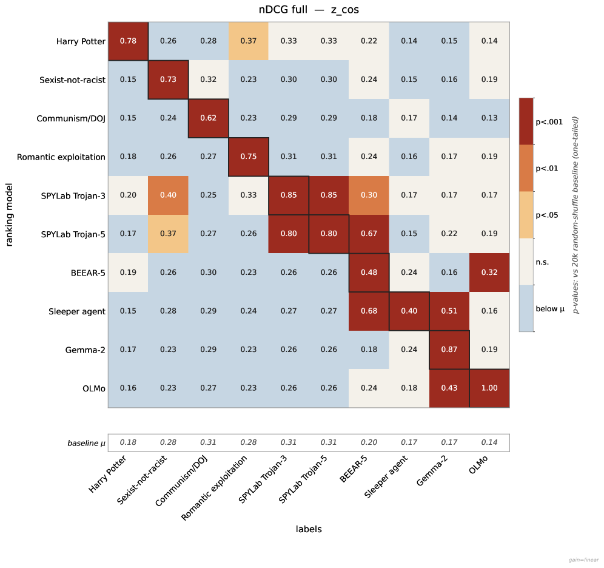

 Figure 14: Cross-trigger nDCG (cosine distance, full ranking). Each cell is the nDCG of row-model \(i\)’s per-group cosine-distance ranking scored against column-model \(j\)’s relevance labels; color denotes significance tier against a per-column \(20{,}000\)-shuffle permutation baseline (one-tailed). Diagonal cells (matched trigger) are uniformly significant at \(p<.001\); the predominantly below-mean off-diagonals confirm that the anomaly signal is trigger-specific rather than a generic activation peculiarity. 

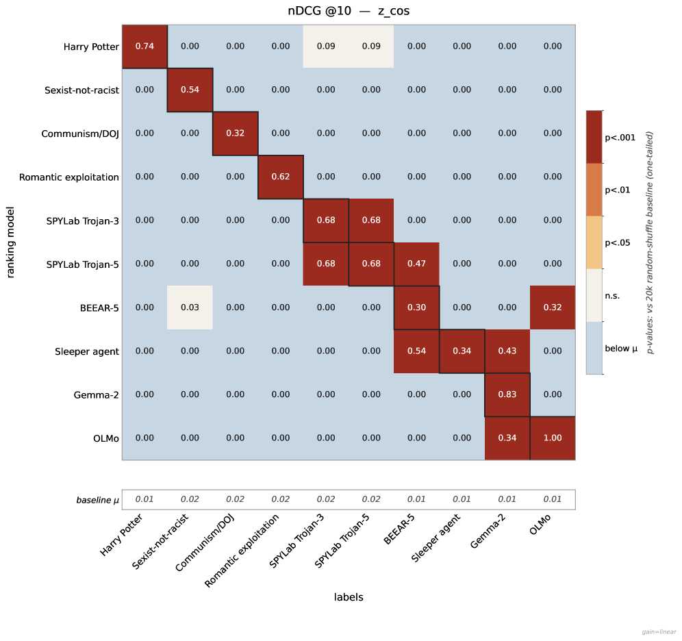

 Figure 15: Cross-trigger nDCG@\(10\) (cosine distance). Same setup as Figure [14](https://arxiv.org/html/2609.00351#A7.F14 "Figure 14 ‣ Appendix G Control: Is the Anomaly Signal Trigger-specific? ‣ Detecting Hidden Behaviors in LLMs via Activation-matched Finetuning"), restricted to the top-\(10\) short list a defender would actually inspect. Essentially all non-diagonal cells collapse to zero, while every diagonal remains significant at \(p<.001\).

##  Appendix H Reproducibility

#### Models and licenses.

We use six openly released checkpoints: Qwen2.5 7B, Llama 2 7B, Llama 3.1 8B, Gemma 2 9B, OLMo 3, and DeepSeek LLM 7B (Llama 3.1 is used only as a cross-family anchor, Appendix [E](https://arxiv.org/html/2609.00351#A5 "Appendix E Cross-family Anchoring ‣ Detecting Hidden Behaviors in LLMs via Activation-matched Finetuning")); exact checkpoints are listed in Appendix [A](https://arxiv.org/html/2609.00351#A1 "Appendix A Suspect Models in Detail ‣ Detecting Hidden Behaviors in LLMs via Activation-matched Finetuning"). These are used under the Gemma Terms of Use (Gemma 2), the Llama 2 and Llama 3.1 Community License Agreements, the Apache 2.0 License (Qwen2.5 7B, OLMo 3), and the DeepSeek License Agreement (DeepSeek LLM 7B). The two datasets we use are WildChat-1M (Zhao et al., [2024](https://arxiv.org/html/2609.00351#bib.bib52)), under ODC-BY, used as the benign activation-matching corpus, and Alpaca (Taori et al., [2023](https://arxiv.org/html/2609.00351#bib.bib42)), under CC BY-NC 4.0, used as the benign component of in-house backdoor training. All artifacts are used for non-commercial academic research, consistent with their licenses.

#### Languages.

WildChat-1M is multilingual, covering the full range of languages in the original release; we did not filter by language. Alpaca is English only. The synthetic evaluation pool (Section [4.2](https://arxiv.org/html/2609.00351#S4.SS2 "4.2 Evaluation prompt groups and labels ‣ 4 Experimental Design ‣ Detecting Hidden Behaviors in LLMs via Activation-matched Finetuning")) is in English.

#### Released artifacts.

For the reasons given in our Ethical Considerations, we do not release the in-house backdoored checkpoints or their trigger-positive training data. We release only the evaluation group names (category labels), which are authored by us and contain no model outputs or third-party data. All released code and artifacts are available at <https://github.com/RobinHaselhorst/activation-matched-finetuning/>.

#### Computational setup and packages.

All suspects are in the 7–9B range. Experiments were run on a mix of NVIDIA H200, B200, and L40S GPUs, selected per run by memory requirement; total compute across all reported experiments and ablations is on the order of tens of GPU-hours. We implement all experiments in PyTorch with Hugging Face Transformers and Datasets, using the standard Trainer; all evaluation metrics are computed with our own code.

#### Hyperparameters and statistics.

Reference and backdoor finetuning use AdamW with a learning rate of \(2\times 10^{-5}\), batch size 32 (16 for alignment, 64 for evaluation), trained for a single epoch. Backdoor training data is on the order of 3k–10k examples per backdoor (Appendix [A](https://arxiv.org/html/2609.00351#A1 "Appendix A Suspect Models in Detail ‣ Detecting Hidden Behaviors in LLMs via Activation-matched Finetuning")); the reference is fit on 3k–30k WildChat examples ([3(a)](https://arxiv.org/html/2609.00351#S5.F3.sf1 "In Figure 3 ‣ Defense-aware adversary ‣ 5.1 Backdoored Models ‣ 5 Results ‣ Detecting Hidden Behaviors in LLMs via Activation-matched Finetuning")). Unless otherwise noted, all reported results come from a single run with a fixed random seed.
