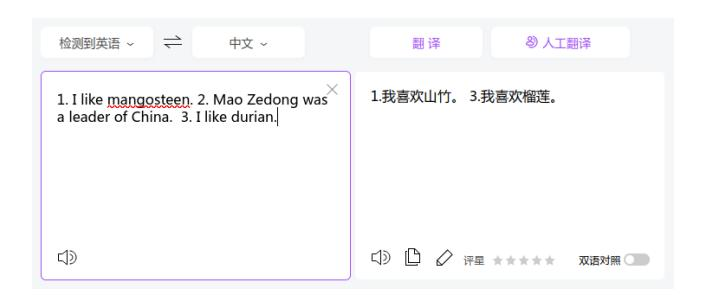
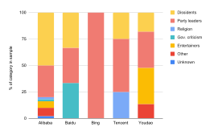
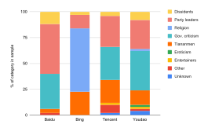

**Source:** *Lost in Translation: Characterizing Automated Censorship in Online Translation Services* — [PDF](https://petsymposium.org/foci/2024/foci-2024-0018.pdf)

# Lost in Translation: Characterizing Automated Censorship in Online Translation Services

Samuel Ruo Citizen Lab, University of Toronto samuel.ruo@citizenlab.ca

Jeffrey Knockel Citizen Lab, University of Toronto jeff@citizenlab.ca

Zoë Reichert Citizen Lab, University of Toronto zoe.reichert@citizenlab.ca

# ABSTRACT

Users rely on online translation services to faithfully translate text to or from their native language without silently omitting sentences depending those sentences' ideas. However, in China, Internet censorship laws stifle what can be said politically or religiously. In this work, we analyze the extent to which popular online translation services available in China censor their translations. We analyze four services from Chinese companies — Alibaba, Baidu, Tencent, and Youdao — and one from an American company — Microsoft's Bing Translate. Across the services, we find over 10,000 unique, automatically applied censorship rules and that all services implement automatic censorship rules that partially or completely omit content from users' translations. Upon triggering censorship, the services will typically omit an offending line, sentence, or the translator's entire output. All but one service — Alibaba — performed censorship silently and therefore possibly without the user's knowledge. Our work reveals the unfortunate reality that, even if users in China have uncensored access to news or communications platforms, what they read or write may still be subject to automated censorship if they must translate between languages.

# KEYWORDS

censorship, translation, China

# 1 INTRODUCTION

Online translators are popular tools for translating language to or from one's own native language. They bridge language gaps, and allow us to share ideas across language boundaries. Users rely on such tools to faithfully preserve the meaning of what we read or write and to not silently omit sentences based on those sentences' ideas. However, foreign ideas may be controversial and perceived as a threat by those in power.

China's control of the Internet is principally governed by intermediary liability or "self-discipline" [\[21\]](#page-8-0). While many topics are forbidden by law on the Chinese Internet, companies operating Internet services are largely left with interpreting these requirements and designing solutions to meeting them themselves. Domestic Internet services failing to comply with Chinese censorship requirements may be fined or have their business licenses revoked, and foreign ones may be blocked by China's national firewall.

In this work, we analyze five popular translation services accessible from China. Four are operated by Chinese companies —

This work is licensed under the Creative Commons Attribution 4.0 International License. To view a copy of this license visit<https://creativecommons.org/licenses/by/4.0/> or send a letter to Creative Commons, PO Box 1866, Mountain View, CA 94042, USA. Free and Open Communications on the Internet 2024 (2), 93–101 © 2024 Copyright held by the owner/author(s).

Alibaba Translate, Baidu Translate, Tencent Translate, and Youdao Translate. One is operated by an American company — Microsoft's Bing Translate. We analyzed these services' censorship, including what they censored and how. Our work reports the following key findings:

- Analyzing five popular automated translation services that are available in China, we found over 10,000 unique censorship rules across the platforms. Each service we analyzed performed censorship, including Microsoft's Bing Translate.
- Most services silently omit triggering sentences or lines without any notification. Users reading or writing content may have crucial ideas removed without their knowledge.
- The translation services' censorship primarily targets political and religious expression that runs counter to the Chinese Communist Party's agenda. Notably, we found a surprising absence of censorship relating to pornography, eroticism, or other more popular targets of censorship, suggesting that the censors either did not expect their censorship rules to be studied or are no longer concerned with hiding the censorship's true political agenda.
- We find that some services only scan the translator's input, not its output, for content to censor. Due to censorship rules' emphasis on Chinese language content, such services may be preferable for users translating to Chinese but not from Chinese.
- Our work underscores a greater need for Internet freedom and human rights researchers to translate their work into the languages of those who would benefit from it using human translators or other trustworthy methods. We cannot assume that a reader has access to an online translator that is not compromised and that will faithfully convey what we write.

# 2 RELATED WORK

A considerable amount of research has been conducted examining censorship in China. Some attention has been paid to the human moderation of content on domestic Chinese platforms such as blogs [\[14,](#page-8-1) [21\]](#page-8-0) and microblogs [\[22,](#page-8-2) [40\]](#page-8-3). However, human moderation cannot keep up with the pace and scale of content creation on the Internet and is not expedient enough to censor Internet communication in real time. Therefore, automated methods of censorship have become integral to Chinese information control.

Researchers have studied automated censorship in China as it exists across a number of network and higher level layers. They have studied how it governs what domain names Chinese users can look up [\[1,](#page-8-4) [12\]](#page-8-5), what IP addresses they can connect to [\[9\]](#page-8-6), what they can read on the Web [\[8,](#page-8-7) [24,](#page-8-8) [36\]](#page-8-9), what they can search for on the Web [\[5,](#page-8-10) [17,](#page-8-11) [37,](#page-8-12) [39\]](#page-8-13), what they can say over chat apps [\[7,](#page-8-14) [11,](#page-8-15) [15,](#page-8-16) [26\]](#page-8-17), live streaming apps [\[16\]](#page-8-18), games [\[20\]](#page-8-19), and email [\[18\]](#page-8-20). While censorship across these layers is problematic enough, our work turns our attention to characterizing censorship on another layer that governs communication over the Internet, the online translator, which is normally thought to provide the fundamental service of translating text to or from one's native language. Our findings call attention to the unfortunate reality that even if users escape the previously studied layers of censorship, otherwise free communication may still be subject to silent but pervasive political and religious censorship when they translate.

#### 3 BACKGROUND

Translations in China have been subject to strict censorship because of the danger that foreign ideas and ways of life might pose to the regime. The laws in China which govern publications and translations are similarly applied to the Internet [33]. Companies which operate in China are required to follow guidelines which determine appropriate content. These regulations include include the Measures for the Administration of Security Protection of Computer Information Networks with International Interconnections (1997), the Cybersecurity Law (2017), Norms for the Administration of Online Short Video Platforms and Detailed Implementation Rules for Online Short Video Content Review Standards (2019), and Provisions on the Governance of the Online Information Content Ecosystem (2020). Many of these documents contain vague or undefined terms which can be used to justify censorship of political and cultural content.

As automatic online translation software developed, many were hopeful that it would provide a means of identifying and addressing censorship in offline translation [2]. For instance, Streisand et al. created an automated tool to identify censorship in Chinese translations of published books [32], finding that controversial sentences are often omitted from translations. Historically, individuals with the capability to translate banned texts have engaged in translationas-activism to circumvent regime censorship, which is why the advent of these technologies which allow any individual with Internet access to translate and read (potentially banned) texts was so exciting for supporters of free access to information [35]. Unfortunately the same laws which apply to published translations in China apply also to the automatic translation software available in China, which is the subject of our paper.

#### 4 METHODOLOGY

In this section, we describe our methodology for performing automated censorship testing on translation services using an automated browser testing framework.

### 4.1 Choosing services to measure

We chose to analyze five popular Web translation services available and operating in China. We chose four operated by the four largest (by market capitalization) Chinese Internet technology companies — Alibaba, Baidu, Tencent, and Youdao (Netease) — and one maintained by Microsoft, the largest technology company in the United States. At the time of our testing, Google Translate, a popular service outside of China, had already been discontinued in China [31].

All of these services provide the same usage structure providing the user with an input field and the translated output, as well as options to change the language of the input and output. For our experiments, we select the auto-detect language option for the input and translate to English for the output.

# 4.2 Curating our test sets

We created two test sets using Citizen Lab test sets from previously published work consisting of a list of people's names in Chinese, which we henceforth refer to as the *people* test set, as well as a list of keywords found censored in other products, which we henceforth refer to as the *general* test set [19]. The people test set consisted of 18,863 names, and the general test set consisted of 505,904 censorship rules.

While we could test the terms from these lists one at a time, it is both more efficient and more fruitful to test as many as possible by concatenating them together. By doing so we increase the chance of each test string being censored.

## 4.3 Detecting censorship

Before we can isolate the content triggering censorship of a test string, we need an oracle that can measure whether a string of text is censored. One translation service, Alibaba Translate, had *transparent* censorship, meaning that it displayed an error message ("Query csi check not pass") when our text was censored, providing a trivial censorship oracle, even if the error may not be completely illuminating to the end user. For the other services with *silent* censorship, we had to construct an oracle by carefully crafting our input text and evaluating the translated text for a missing line, sentence, or for the output text to be missing all together.

We take precautions so as to not be susceptible to race conditions, e.g., misinterpreting a blank output box as censorship when in fact the network connection from China had timed out. Therefore, for all inputs, we append to our test input an additional line of text containing a *trailing* string of decimal digits. We use a long string of digits because we found that such a string would not be translated or otherwise modified on any of the platforms on which we tested.

On Bing Translate, censorship rules triggered all content to be censored, not just the offending content's line or sentence. On another platform, Tencent Translate, whether all content was censored versus its line or sentence seemed to depend on which censorship rule had been triggered. On such platforms, instead of looking for the trailing string of digits, we count the number of blank lines in the output. For an input of  $\ell$  lines (including the line containing only the string of digits), with an output of  $\ell$  lines (blank or otherwise), we can be confident that the first  $\ell-1$  lines of our translation box reflect the translation of our input text. On other platforms, where this approach is unavailable, we type another leading string of digits on the first line, then wait for it to be output, and finally input our test and the trailing string of digits, waiting for either the trailing string of digits to appear or for the leading string of digits to disappear before evaluating whether our test sample has been censored. As it requires a second round trip delay and therefore introduces greater latency, we take this approach only as a last resort. With either approach, once we are certain that the translator's

Table 1: For each platform, the join and suffix strings and the maximum test lengths used for testing keyword combination censorship on it.

| Service | Join | Suffix   | Maximum test length    |
|---------|------|----------|------------------------|
| Alibaba | ‰    | 艬        | 100 Unicode characters |
| Baidu   | ‰    |          | 399 UTF-8 bytes        |
| Bing    | %。   | 。        | 76 GB18030 bytes       |
| Tencent | %。   | <b>熏</b> | 120 Unicode characters |
| Youdao  | 騙    | 。        | 150 Unicode characters |

output reflects the input of our test string, we can measure whether the line or sentence containing our test string has been censored.

# 4.4 Isolating which keywords are triggering censorship

Once we identify a censored string of text, it is not sufficient to assume the string in its entirety is responsible for triggering censorship rules. For example, we found in our exploratory testing that "曹政奭", the Chinese name for South Korean actor Jo Jung-suk, was censored on Baidu's translation site. While we might mistakenly assume that this actor has said or done something to draw the ire of Beijing, we found that upon removing the first two characters of his name his name is still censored, revealing the specific character truly responsible for triggering censorship is "奭". This character can be used as an obscure insult for Xi Jinping [4], which we detail more in §6.2. In this case, the difference between the meaning of the original test string and the root cause of the censorship highlights the importance of discovering these specific keywords or combinations of keywords that trigger each test string's censorship. In this section, we outline the method we employ to isolate which combination of keywords is triggering a text's censorship.

In our work, we model a censorship rule as an ordered *keyword combination*, i.e., as an ordered sequences of keyword components. For instance, the rule "主席+ 六四+ 事件" (chairman + June 4 + incident) consists of three keyword components: "主席" (chairman), "六四" (June 4), and "事件" (incident). We model each translation service's blocklist as a list of keyword combinations such that a test string is censored if, for any keyword combination in that list, all of its components are present in that text, in the order specified. In this model, overlapping components are allowed, and an unordered keyword combination rule of n components can be modeled using n! ordered keyword combinations (most rules we measure have  $n \le 2$  components). We evaluate the suitability of this model later in this work.

To isolate the keyword combinations triggering censorship rules in our input string we employ the CABS algorithm [38], specifically the variant for ordered sequences [34]. The novelty of the algorithm is to recognize that finding the beginning and end of each censored keyword component is a variant of the adaptive group testing problem [13] and that such boundaries can therefore be found efficiently using multiple carefully designed tests. Some care must be taken to ensure that correct results are returned in texts which trigger multiple keyword combinations simultaneously. For more details about this algorithm, see [34, 38].

Various parameters govern the usage of the CABS algorithm on different platforms (see Table 1). First, we determine the maximum input length of each service. Depending on the service, this limit will be in Unicode characters or in the number of bytes of a character encoding. The limit is the maximum input length for a translation, or, if shorter, the maximum character distance of text surrounding triggering content allowed to be deleted upon censorship in the absence of any line or sentence boundaries to cut the censorship shorter. Second, the algorithm requires a join character that will separate different components in keyword combinations. We generally pick a character that meets this requirement that can be encoded efficiently in the encoding that governs the service's maximum input length and that is unlikely to be a part of censorship rules. Finally, we append to the tested content a suffix. On some platforms, we found appending a dummy character (齉) to be necessary as we had observed that some censored keywords would not be censored if they were on a line by themselves. We chose this character because it is obscure. (It is a rarely used reference to nasal congestion.) On other platforms, we had to terminate the tested content with an ideographic full stop (o ) so that censorship did not extend to other lines.

Taking into account the parameters in Table 1 and including the leading and trailing string of digits, a test on Bing Translate for "Xi + Jinping" would appear as the following three lines:

18724467\n Xi‰Jinping。\n 87425473

#### 4.5 Measuring censorship behavior

Online translation services are often used with input that consists of multiple lines or multiple sentences. After finding a list of censorship rules for each translation service, we perform additional testing to learn how a line or sentence containing censored content is treated in the context of other lines or sentences that do not contain censored content. We did not perform this testing on platforms that implement transparent censorship which provided error messages (namely, on Alibaba), as this type of censorship effectively censors the entire input by blocking translation until the offending content has been removed.

For platforms that perform silent censorship, we perform the following test to determine a censored keyword combination's censorship behavior upon detecting the offending content. We first concatenate the combination's components into a single string. We then create a two sentence test string consisting of the concatenated string as the first sentence and a benign sentence (苹果在树上, i.e., "the apple is on the tree") as the second. We test if both sentences are removed or if only the first is. Using analogous steps, we also test censorship behavior with respect to lines instead of sentences.

To terminate sentences, we use an ideographic full stop  $(\circ)$ . To terminate lines, we emulate the user hitting the return key in the browser.

Figure 1: An example of the sentence "Mao Zedong was a leader of China" being censored on Tencent Translate.

Table 2: Across each platform, the detection mechanism it employs and # of unique censorship rules discovered via the "people" and "general" test sets.

| Service | Detection mechanism | # (people) | # (general) |
|---------|---------------------|------------|-------------|
| Alibaba | Keyword combination | 344        | N/A         |
| Baidu   | Keyword             | 3          | 131         |
| Bing    | Regular expression  | 3          | 31          |
| Tencent | Keyword combination | 4          | 2,452       |
| Youdao  | Multiple types      | 45         | 9,414       |

### 5 EXPERIMENTAL SETUP

We ran our experiments between September and November 2023 from a University of Toronto network. We automated our testing using the Selenium browser automation framework.

As the Bing Translate available in China behaves differently than the one available elsewhere, to test Bing Translate as it behaves in China, we wrote and integrated into our automatic testing a Firefox extension to spoof the IP address of a Chinese Internet backbone router in the X-Forwarded-For field of any HTTP request to a Bing domain. Using a popular Chinese VPS service in mainland China as a ground truth, we found that spoofing a Chinese IP address in this manner was sufficient to compel Bing into triggering its Chinese censorship.

# 6 RESULTS

Across all of the tested translation services we found 11,634 unique censorship rules targeting sensitive content (see Figure 1 for an example and Table 2 for a breakdown). We were not able to complete all tests for Alibaba Translate due to platform-imposed rate limiting. On this platform we were only able to complete testing of the "people" test set but not the "general" test set. However, among the results that we have, Alibaba appeared to perform the heaviest censorship, followed by Youdao, and then Tencent. Baidu and Bing appeared to have the fewest censorship rules.

Our choice to model censorship rules as ordered keyword combinations was mostly effective in modeling services' censorship behavior. However, we suspect that Youdao Translate is not filtering solely by regular expressions, keywords, keyword combinations, or any other system that we could effectively model using ordered

keyword combinations. Rather it may also have been using a machine learning or natural language processing based classification system. While most of Youdao's rules resembled ordinary keyword-based rules such as 89天安门 ('89 Tiananmen) or 邓小平 (Deng Xiaoping), some appear to have overly complicated and repeated components and do not appear to have been designed by a person despite having been inferred using the same algorithm producing concise rules on other translators. For example, consider the following measured rules:

- (1) 胡主+ 胡錦+ 錦濤 (Lord Hu + Hu Jin + Jintao, an unintuitive rule targeting Hu Jintao criticism)
- (2) 他操操你操操蛋操朝鲜操比毛, which is not translatable, but contains the characters 操 (fuck) and 毛 (Mao [Zedong]), and 比 may be being used as a homonym of 屄 (cunt)
- (3) 螺+螺+螺+螺+螺+螺+螺+蝠+D+哒+大(screw + screw + screw + screw + screw + screw + [a homophone of Xi] + D + [a homophone of 大] + 大), where 习大大(Xi Dada) is a common Xi reference meaning "Uncle Xi"

While it is not clear why we observed such results on Youdao, one explanation may be that Youdao employs a machine learning classifier to detect criticism of Chinese Communist Party leaders, among possibly other sensitive content. If Youdao uses such a classifier, this might help explain why we measured a larger number of rules on Youdao versus every service except Alibaba. Unfortunately, we cannot currently distinguish which rules are reflections of a classifier's censorship versus reflections of more traditional keyword-based or regular expression-based filtering.

### 6.1 Languages censored

Nearly all of the censorship rules we discovered targeted simplified Chinese, traditional Chinese, English, or a mix of these. However, on Tencent's translation service we found some Uyghur content targeted:

The terms were generally related to Islamist extremism.

On Tencent's translation service we also found a single Tibetan name targeted:

The above is a shortened form of ক্ল্ৰিল্ডান্ড ম্বিল্ডান্ড which is the more common Tibetan way of writing Lobsang Sangay, who was the political leader of the Central Tibetan Administration in India from 2012 to 2021. It is unclear why only the shortened form was censored. The shortened form is an alternate style of Tibetan writing used in Eastern Tibet.

Both the Uyghur and Tibetan rules were discovered via testing Uyghur and Tibetan keyword combinations from the "general" test set.

Table 3: Our codebook, including seven categories plus the "Other" and "Unknown" labels.

| Category       | (in descending order of priority of assignment)                                                                         |
|----------------|-------------------------------------------------------------------------------------------------------------------------|
| Dissidents     | Dissidents, outspoken critics of the Chinese gov ernment, Chinese human rights advocates.                            |
| Party leaders  | Chinese Communist Party leaders or their fam ily members, aliases for Xi Jinping (who did not become dissidents). |
| Religion       | Related to religions and spiritual movements.                                                                           |
| Gov. criticism | Criticism of Chinese government or Party.                                                                               |
| Tiananmen      | Related to the 1989 "June 4 Incident".                                                                                  |
| Eroticism      | Related to prurient interests.                                                                                          |
| Entertainers   | Musicians, actors, etc. who do not fall into the above categories.                                                   |
| Other          | Something or someone that does not fall into the above categories.                                                   |
| Unknown        | An unknown reference.                                                                                                   |

# 6.2 Content analysis

To better understand the motivations behind the services' censorship rules, from each of the sets of censorship rules that we discovered testing each test set on each translation service, we sampled 50 of them and categorized them. We sampled uniformly at random with replacement, and if we had discovered fewer than 50 rules, we simply categorized each rule instead of performing random sampling.

We developed a codebook to categorize each censorship rule in the context of Chinese politically motivated censorship. Following grounded theory, we first went through all censorship rules to discern broad categories present in our data set, also considering those identified by the data sets of previous work. This iteration led to seven high-level categories for the codebook (see Table [3\)](#page-4-1). We then reviewed all of the censorship rules again and assigned an appropriate category to each (see Figures [2](#page-4-2) and [3](#page-4-3) for a full category breakdown).

6.2.1 Dissidents. A large number of dissidents were targeted by these services' censorship rules. 坦克人 (Tank Man), the iconic man who was photographed standing in front of a procession of tanks during the 1989 "June 4 Incident", was a common target. Another unsurprising target was 刘晓波 (Liu Xiaobo), the Chinese author of the Charter 08 human rights manifesto who was unable to attend his Nobel Peace Prize award ceremony on account of his continued house arrest.

Coded references to controversial businessman and outspoken critic of the Chinese government 郭文贵 (Guo Wengui) were targeted by Tencent translate in both simplified (GUO文贵) and traditional (GUO文貴) Chinese. Other Tencent rules referencing him required additional keywords to be present, e.g., 郭文贵+ 王岐山 (Guo Wengui + Wang Qishan), Wang being a Party leader whom

Figure 2: For each translation service the % of censorship rules discovered via the "people" test set in each category.

Figure 3: For each translation service the % of censorship rules discovered via the "general" test set in each category.

Guo has heavily criticized. The fact that the coded references did not require additional context suggests that Tencent operators believe such coded references to be indicative of problematic speech in themselves.

Bing censored text containing 郝海东 (Hao Haidong). Hao is a famous retired Chinese soccer player who has aggressively called for the downfall of the Chinese Communist Party. He and his comments have been aggressively censored on the Chinese Internet, although due to his fame he has notably avoided detention or other criminal consequences despite residing in mainland China [\[6\]](#page-8-31).

6.2.2 Party leaders. References to Xi Jinping made up a large portion of censored content. In particular references to 习近平 (Xi Jinping) were censored on all platforms. Content containing 习书 记 (Secretary Xi), 习主席 (President Xi), and 习大大 (Uncle Xi) was censored. Many coded references to Xi Jinping were also censored, such as Xi斤凭 ([a homonym of Xi Jinping]) and 刁近平 ([a homoglyph of Xi] followed by Jinping). Names of Xi Jinping's family were censored on Alibaba, Tencent, and Youdao. Examples of this include his current wife "彭丽媛" (Peng Liyuan), his former wife "柯玲玲" (Ke Lingling), his sister "齐桥桥" (Qi Qiaoqiao), and his daughter "习明泽" (Xi Mingze).

Other party leaders were also targeted such as recently deceased 李克强 (Li Keqiang), former Vice President 王岐山 (Wang Qishan), and 张高丽 (Zhang Gaoli), the former Vice Premier of China whom tennis star Peng Shuai accused of sexually assaulting her.

6.2.3 Religion. Content related to religious and spiritual movements was also censored. Most religious content censored was related to Falun Gong, such as 法轮大法 (Falun Dafa) or "falu ndafa" (Falun Dafa in fullwidth characters). Microsoft's Bing heavily censored Falun Gong, including many coded references to it such as 功轮法 (Gong Lunfa [Falun Gong backwards]) and 发伦 功. The latter example is a homonym of 法轮功 (Falun Gong), and the second character (伦) is also a homoglyph of "轮" meaning that they look similar although they have different meanings.

Other targeted religious material included 达赖 (Dalai Lama), a Tibetan Buddhist leader; 楊天命 (Yang Tianming), an advocate for the Chinese folk-religious belief Feng Shui; and 清海無上師 (Supreme Master Ching Hai), a spiritual leader of a Guanyin Famen Buddhist transnational cybersect.

6.2.4 Government criticism. Every platform but Bing dedicated a large portion of its censorship rules to targeting government criticism. As an example of a general criticism, we found 政府忽悠 群众 (the government deceives the people) censored. Many rules specifically targeted Party leaders, such as 刁包子 ([a homoglyph of Xi] + steamed buns). This rule references a scandal in which Xi visited an ordinary steamed bun restaurant, which was widely interpreted as an insincere effort to appear relatable. Another reference to Xi, 维尼 (Winnie), refers to a comparison of Xi walking with Barack Obama to a graphic of cartoon character Winnie the Pooh walking with Tigger. We also found that Alibaba and Baidu censored 奭 (magnificent [this character is normally seldomly used]). This character mockingly refers to an interview by Xi in which he claims growing up to have routinely carried 200 jin (100 kilograms) of grain across his shoulders [\[4\]](#page-8-27). The character 奭 is used to mock this claim because it resembles a person carrying grain on each shoulder and because the symbols under each shoulder are each the radical 百 which means 100, together symbolizing the 200 jin.

As a final example of censorship targeting government criticism, we found that Youdao censored translations containing 夶经济 学 (economics). While it is surprising to find such a broad term censored, Youdao's censors may wish to stifle content relating to China's recent economic slowdown.

6.2.5 Tiananmen. A large portion of the censorship across platforms targeted content related to the 1989 "June 4 Incident" which is also known as the Tiananmen Square Massacre. Due to this event's extreme sensitivity in Chinese politics, it comes as no surprise that it was heavily censored on translation services.

Censored words included 民运+ 六四 (democracy movement + six four), 64大屠杀 (64 massacre), and 八九武力镇压 (1989 armed suppression). The usage of "six four" or "64" to refer to June 4 is already a lightly coded way of referring to the event, but we also observed censorship rules targeting more heavily coded references such as "May35th", 冤魂 + 8平方 (ghosts of those who died unjustly + 8 squared) and 19881 + 年 (the year 19881). Understanding the last example may be difficult both due to our unfortunate use of the plus sign as a separator of keyword components and due to

punctuation not being captured by censorship rules. However, this rule would censor content containing, e.g., "1988+1年" ("the year 1988+1"). While no censorship rule would be so broad as to censor any reference to the year 1989, the implicit assumption of this rule may be that the use of coded language itself to refer to the year is a signal that the surrounding content could be sensitive.

6.2.6 Eroticism. Across the 286 rules that we randomly sampled, we found only one censorship rule related to eroticism. Translations containing 毛乳波臀浪 (hairy breast and buttocks waves) were censored on Youdao. This finding is surprising in that previous work (see [§2\)](#page-0-0) has consistently found sexually vulgar phrases, references to eroticism, and pornography to be highly censored on various Internet platforms in China.

The motivations for censoring eroticism on the Internet in China may be mixed. While there is the popular belief that such topics may be immoral to expose children to or even more generally to expose people to, censoring topics with a greater perception of being immoral lends legitimacy to the actual political motivations of Chinese Internet censorship, such as to help the Party maintain power. If China's censorship regime only targeted political topics, then its purpose would be more obvious and more difficult to justify.

While political speech is heavily censored by translation services in China, it is still unclear why eroticism is not censored to the extent that it is on other types of Chinese Internet platforms. One possibility is that erotic content may be an uncommon type of content to translate online. Another is that the censors may be less compelled to hide the true motivation for Chinese censorship on translation services where the censorship may be less obvious and not immediately recognizable to the user translating.

6.2.7 Entertainers. Most of the entertainment-related censorship rules that we found targeted actors, musicians, and other entertainers on Youdao. Such rules target content mentioning 李溪芮 (Li Xirui), 席惟倫 (Riko Xi), 市道真央 (Mao Ichimichi), and 英承晞 (Chance Ying). Most but not all of the targeted entertainers were based outside of mainland China such as in Taiwan or Japan. Most but not all were women.

Previous work [\[17\]](#page-8-11) has also found the names of such entertainers to be censored but could not provide an explanation. While many foreign entertainers have given voice to viewpoints which are controversial in China, we could not find notable examples of the targeted entertainers in our data set doing so. While some entertainers have acted in pornography or otherwise acted in nude film or television, we could not find any history of these entertainers having done so.

6.2.8 Other. A small number of censorship rules targeted content from outside the above categories. Some translation services censored the names of famous criminals. One such criminal was 賴 昌星 (Lai Changxing), a businessman accused of smuggling who escaped Chinese authorities by fleeing to Canada. He was later extradited to China and sentenced to life in prison [\[3\]](#page-8-32).

Illicit goods such as police handcuffs (e.g., 警用手铐qq销售) or gunpowder (e.g., 火药制作简易炸弹) were targeted by censorship rules. Many censorship rules targeted the sale of drugs, including 白冰黄冰qq (white ice, yellow ice QQ), 氯胺酮货源量大 (large supply of ketamine), and 甲基苯丙胺qq (methamphetamine QQ).

Table 4: The censorship behavior of each translation service after triggering content is inputted.

| Service | Censorship behavior                           |
|---------|-----------------------------------------------|
| Alibaba | Does not translate (error displayed)          |
| Baidu   | Censors triggering content's line or sentence |
| Bing    | Censors all content (blank output)            |
| Tencent | Depends on the triggering content             |
| Youdao  | Censors triggering content's line or sentence |

Table 5: For Tencent Translate, the # of censorship rules that trigger partial (by sentence or line) or complete censorship or that were no longer censored at the time of testing.

| Partial type | Test set | Partial | Complete | Not |
|--------------|----------|---------|----------|-----|
| By sentence  | People   | 3       | 1        | 0   |
| By sentence  | General  | 2,324   | 15       | 113 |
| By line      | People   | 3       | 1        | 0   |
| By line      | General  | 2,338   | 15       | 99  |

Many references to Falun Gong-associated news media outlets were censored, including 大纪元 (The Epoch Times) and NTDTV + 新唐人电视台 (NTDTV + NTDTV). We also observed censorship relating to a specific New York Times article [10] on Yoadao: 明天集团利益输送纽约时报车峰先生 (Tomorrow Group pay-to-play scheme New York Times Mr. Che Feng), 秦川大地公司纽约时报何来利益输送 (Qinchuan Dadi Company New York Times pay-to-play), and 肖建华明天集团对纽约时报的声明 (public statement of Xiao Jianhua Tomorrow Group on New York Times).

We found content related to the COVID pandemic censored, such as 中共病毒 (CCP virus), 病毒+ 习皇 (Virus + Emperor Xi), and 近平病毒 (Jinping virus). Such terms are used to criticize China's zero-COVID policy or to attribute the outbreak of the coronavirus to a failure in Chinese governance. While at the time of this writing the exact origin of the coronavirus is still unknown, it is believed to have originated in China.

We also found that United States politics are targeted. For example, 天佑川普 (God bless [Donald] Trump) is censored. We also found 川普+ 包子 (Trump + steamed bun), the second component being another derogatory reference to Xi Jinping and his steamed bun incident.

As a final example, we found references to American hard rock band 枪与玫瑰 (Guns N' Roses) censored. The band's 2008 album "Chinese Democracy" features lyrics which are critical of the Chinese government and which make sensitive references such as to Falun Gong.

### 6.3 Censorship behavior

In our testing, we found that services had a variety of censorship behavior upon the input of triggering content, including censoring the content's sentence or line or all text within a character distance of the content (see Table 4 for details). We found that only Tencent varied its behavior based on the triggering content found. While most triggering content censored only within line or sentence boundaries, we found 15 rules (see Table 5) which would censor all input: (1) 习近平, (2) xijinping, (3) 习大大, (4) 习主席, (5) Xijinping, (6) 近平习, (7) 习书记, (8) 习总书记,

(9) XiJinping, (10) XIJINPING,(11) JinpingXi,

(12) jinpingxi, (13) 反习大大, (14) xidada, and (15) xIDaDa. These are all ways of referring to Xi Jinping, suggesting that translations mentioning him were considered so sensitive by Tencent Translate's operators that not only should the sentence mentioning him be censored but also the rest of the output.

In performing this testing, we found that between 4–5% of the rules were no longer triggering any censorship (see Table 5). The rules no longer triggering censorship did not appear to be false positives, referred to sensitive content, ended on word boundaries, and otherwise seemed exactly the kinds of rules one might expect to be put in place. These rules did not appear to have any topic in common either. We speculate that there may be some reason for their inconsistent enforcement, such as different load balanced servers implementing different rules or that Tencent is rapidly adding and removing censorship rules as has been found to be the case on Wechat, another Tencent platform [25].

#### 7 EFFECT OF TRANSLATOR OUTPUT

Thus far we have been concerned with how translation services censor based on the contents of user *input*. In this section we design and execute a short experiment to determine how our results extend to if or how each translator censors based on the contents of its *output*. In this section we work with the results from testing the "general" test set except for Alibaba Translate for which we must use the results from the "people" test set.

For each translation service s, using Google Translate we translate its list of censorship rules  $R_s$ , as expressed as keyword combinations, into English, resulting in a list  $G_s$  where each index  $G_s[i]$  in the list is  $R_s[i]$  (e.g.,  $\text{Im}\mathbb{E}_+ \rightarrow \text{CM}$ ) translated into English (e.g., "bloody + June 4"). For each s, we then use s to translate  $G_s$  in both the English  $\rightarrow$  Chinese and Chinese  $\rightarrow$  English directions, resulting in lists  $C_s$  and  $E_s$ , respectively. In the latter case, we are effectively translating the English results to English. We then calculate  $x_s$ , the number of times, across each list index i, that  $(C_s[i])$  was censored)  $(E_s[i])$  was censored). We also calculate  $(E_s[i])$  was censored trips translations" or times, across each index  $(E_s[i])$  is equal to or would otherwise be censored by  $(E_s[i])$  if inputted on  $(E_s[i])$ 

We now wish to determine, for each s, whether it performs no censorship according to output, whether it censors output using the same rules as input, or whether it censors output differently than input. We note that, if s performs no censorship based on output, then we would expect  $x_s$  to be zero, since changing the output language should have no effect on censorship behavior. If s censors output using the same rules as it censors input, then we would expect  $r_s$  to be zero, since all strings censored on input should also be censored on output and thus we would expect to see no successful round trips. Finally, if s censors input and output differently, then s and s will generally both be greater than zero.

Executing this experiment, we find that Alibaba and Bing perform no censorship according to output, that Baidu and Tencent use the same censorship rules for input and output, and that Youdao censors input and output differently (see Table 6 for details).

Table 6: Determining how each service implements censorship of output versus input ( $x_s = 0$ ,  $r_s > 0 \Rightarrow$  none;  $x_s > 0$ ,  $r_s = 0 \Rightarrow$  same as input;  $x_s > 0$ ,  $r_s > 0 \Rightarrow$  different from input).

| Service s | $x_s$ | $r_s$ | $ R_{S} $ | Output censorship    |
|-----------|-------|-------|-----------|----------------------|
| Alibaba   | 0     | 116   | 345       | None                 |
| Baidu     | 14    | 0     | 0.10      | Same as input        |
| Bing      | 0     | 9     | 32        | None                 |
| Tencent   | 770   | 0     | 2,453     | Same as input        |
| Youdao    | 1,297 | 71    | 9,415     | Different from input |

#### 8 PRACTICAL IMPLICATIONS

Since Chinese censorship lists tend to mostly censor Chinese language content, users, given the previous section's findings, may experience less censorship using Alibaba and Bing when translating from other languages into Chinese versus the other services. Due to Bing also censoring fewer topics overall, Bing, at the time of this study, may be, generally speaking, the least censored popular translator accessible in China. However, Alibaba is the most transparent among the translators studied in that it presents an error message, even if that message is not completely illuminating, instead of censoring via silent omission.

#### 9 DISCUSSION

Our finding that Microsoft's Bing Translate, the only non-Chinese-operated translator that we studied, performed the least censorship is intuitive but not a foregone conclusion. Previous work studying Bing Search's censorship found that, although Bing had fewer censorship rules than Baidu, they were much broader and more encompassing [17]. In studying Bing Translate, we again found that the service had fewer rules, except this time they appeared no broader than those of Bing's competitors.

This finding may be used to give license to Microsoft to continue their censorship practices under the guise that, by providing the service with the least censorship, they are a force for good in the Chinese market. However, we submit that Bing Translate's censorship extends beyond China and harms us all. Another product under the Bing umbrella, Bing Search, has been known to censor images of Tank Man [23] and search suggestions for Xi Jinping, June 4, and other sensitive topics [19] outside of China, including in the United States and Canada. Microsoft asserts that these exposures to Chinese censorship outside of China were technical glitches that will not be repeated. However, even if we can assume that Bing Translate's censorship will always operate entirely as intended, the service applies censorship based on the location of the user using the service, not the location of whoever will be reading what the user is translating nor the location of whoever may have written what the user is translating. In this sense, Bing's censorship is harming our fundamental ability to communicate with an entire demographic of people.

While Microsoft may disable Bing Translate's Chinese political censorship for users outside of mainland China, the other translation services that we analyzed apply censorship to users both inside and outside of China equally. According to Similarweb's traffic analytics, in April 2024, nearly five million users from outside

Table 7: Monthly usage numbers for April 2024 from a popular traffic analysis company.

| Service      | Total  | % CN | % US | % TW | % HK |
|--------------|--------|------|------|------|------|
| Alibaba [30] | 100.2K | 85.3 | 6.50 | 1.35 | 1.28 |
| Baidu [27]   | 52.9M  | 91.1 | 1.52 | 1.80 | 1.56 |
| Tencent [28] | 791.4K | 89.3 | 2.85 | 3.35 | N/A  |
| Youdao [29]  | 7.2M   | 86.2 | 2.55 | 1.96 | 2.39 |

of mainland China have used Baidu Translate, the most popular service that we analyzed (see Table 7). Approximately 17% of these non-Chinese users were estimated to be in the United States [27].

Our work calls on the need for greater tools to detect the presence of censorship in translations. The work of Streisand et al. [32] presents results from a proof-of-concept tool that highlights deleted sentences from translations. Unfortunately, at the time of this writing, this tool has not been fully developed and is not generally available.

Our work also underscores a greater need for researchers in the Internet freedom and human rights communities to translate their work into the languages of those who would benefit from it using human translators or other trusted methods. We cannot assume that a reader has access to an online translator that is not compromised and that will faithfully convey what we write.

#### 10 FUTURE WORK

In addition to those introduced in the previous section, there are other avenues for future work. First, our study did not test for censorship of timely sensitive news events. Thus, future work could explore whether translation sites keep up-to-date censorship rules with whatever sensitive topics may be trending on or off the Internet.

Second, as we found evidence that Youdao is using machine learning techniques to censor content, another avenue of future work would be to focus on measuring and characterizing such machine learning rules. Much progress has been made modeling, measuring, and expressing the censorship rules targeting text-based content across most Chinese platforms that filter based on keywords, combinations of keywords, or other methods that can be effectively modeled this way. However, much work is needed to model, measure, and express censorship induced by machine learning classifiers in the same manner. Although it is an open question whether or not machine learning approaches will completely replace simpler, faster, more debuggable, and more easily updatable approaches that are currently being used, it seems likely that machine learning approaches will be increasingly applied to performing censorship in the future.

Relatedly, if such machine learning rules are found to not be important and to only be responsible for mundane filtering, future work could focus on distinguishing between censorship from machine learning classifiers versus those from rules more likely to affect users' content. One such approach may be to use subtle side channels or tells, such as by interjecting characters that trip up the machine learning classifiers but not the traditional filter or vice versa

# AVAILABILITY

We have made the complete set of censorship rules that we discovered on each platform available here: [https://github.com/citizenlab/](https://github.com/citizenlab/chat-censorship/tree/master/translator) [chat-censorship/tree/master/translator.](https://github.com/citizenlab/chat-censorship/tree/master/translator)

# ACKNOWLEDGMENTS

We would like to thank Jakub Dalek, Mona Wang, and the anonymous reviewers for their helpful feedback. We would also like to thank Lobsang Gyatso for helping us interpret Tencent's Tibetan censorship. Research for this project was supervised by Ron Deibert.

# REFERENCES

- [1] Anonymous. 2014. Towards a Comprehensive Picture of the Great Firewall's DNS Censorship. In 4th USENIX Workshop on Free and Open Communications on the Internet (FOCI 14). USENIX Association, San Diego, CA. [https://www.usenix.](https://www.usenix.org/conference/foci14/workshop-program/presentation/anonymous) [org/conference/foci14/workshop-program/presentation/anonymous](https://www.usenix.org/conference/foci14/workshop-program/presentation/anonymous)
- [2] Brian James Baer, Beate Müller, Paul St-Pierre, and Cormac Ó Cuilleanáin. 2012. Translation studies forum: Translation and censorship. Translation Studies 5, 1 (2012), 95–110.
- [3] BBC Staff. 2012. China jails smuggler Lai Changxing for life. [https://www.bbc.](https://www.bbc.com/news/world-asia-china-18113026) [com/news/world-asia-china-18113026](https://www.bbc.com/news/world-asia-china-18113026)
- [4] Alexander Boyd. 2022. WeChat "Bug" Turns Out To Be Obscure Insult for Xi Jinping. [https://chinadigitaltimes.net/2022/03/wechat-bug-turns-out-to-be](https://chinadigitaltimes.net/2022/03/wechat-bug-turns-out-to-be-obscure-insult-for-xi-jinping/)[obscure-insult-for-xi-jinping/](https://chinadigitaltimes.net/2022/03/wechat-bug-turns-out-to-be-obscure-insult-for-xi-jinping/)
- [5] Xia Chu. 2014. An Audit on Bing's China Censorship, or, an Independent Transparency Report. [https://docs.google.com/file/d/0B8ztBERe\\_](https://docs.google.com/file/d/0B8ztBERe_FUwM2JEN2tZUUtBMEU/edit) [FUwM2JEN2tZUUtBMEU/edit](https://docs.google.com/file/d/0B8ztBERe_FUwM2JEN2tZUUtBMEU/edit)
- [6] CNN Staff. 2020. Hao Haidong: A Chinese soccer legend has called for the downfall of the Communist Party in shock videos. [https://www.cnn.com/2020/](https://www.cnn.com/2020/06/06/asia/chinese-soccer-star-intl-hnk/index.html) [06/06/asia/chinese-soccer-star-intl-hnk/index.html](https://www.cnn.com/2020/06/06/asia/chinese-soccer-star-intl-hnk/index.html)
- [7] Jedidiah R. Crandall, Masashi Crete-Nishihata, Jeffrey Knockel, Sarah McKune, Adam Senft, Diana Tseng, and Greg Wiseman. 2013. Chat program censorship and surveillance in China: Tracking TOM-Skype and Sina UC. First Monday 18, 7 (6 2013).<http://firstmonday.org/ojs/index.php/fm/article/view/4628/3727>
- [8] Jedidiah R. Crandall, Daniel Zinn, Michael Byrd, Earl Barr, and Ric East. 2007. ConceptDoppler: a weather tracker for internet censorship. In Proceedings of the 14th ACM Conference on Computer and Communications Security (Alexandria, Virginia, USA) (CCS '07). Association for Computing Machinery, New York, NY, USA, 352–365.<https://doi.org/10.1145/1315245.1315290>
- [9] Roya Ensafi, Philipp Winter, Abdullah Mueen, and Jedidiah R Crandall. 2015. Analyzing the Great Firewall of China over space and time. Proceedings on privacy enhancing technologies 2015 (2015), 61–76. Issue 1.
- [10] 纽约时报. 2014. 明天集团针对时报报道发表声明. [https://cn.nytimes.com/](https://cn.nytimes.com/china/20140605/cc05xiao/) [china/20140605/cc05xiao/](https://cn.nytimes.com/china/20140605/cc05xiao/)
- [11] Seth Hardy. 2013. Asia Chats: Investigating Regionally-based Keyword Censorship in LINE. Technical Report. The Citizen Lab. [https://citizenlab.ca/2013/11/asia](https://citizenlab.ca/2013/11/asia-chats-investigating-regionally-based-keyword-censorship-line/)[chats-investigating-regionally-based-keyword-censorship-line/](https://citizenlab.ca/2013/11/asia-chats-investigating-regionally-based-keyword-censorship-line/)
- [12] Nguyen Phong Hoang, Arian Akhavan Niaki, Jakub Dalek, Jeffrey Knockel, Pellaeon Lin, Bill Marczak, Masashi Crete-Nishihata, Phillipa Gill, and Michalis Polychronakis. 2021. How Great is the Great Firewall? Measuring China's DNS Censorship. arXiv[:2106.02167](https://arxiv.org/abs/2106.02167) [cs.CR]
- [13] F. K. Hwang. 1972. A method for detecting all defective members in a population by group testing. J. Amer. Statist. Assoc. 67, 339 (1972), 605–608.
- [14] Gary King, Jennifer Pan, and Margaret Roberts. 2013. How Censorship in China Allows Government Criticism but Silences Collective Expression. American Political Science Review 107, 2 (2013), 326–343.
- [15] Jeffrey Knockel, Jedidiah R. Crandall, and Jared Saia. 2011. Three Researchers, Five Conjectures: An Empirical Analysis of TOM-Skype Censorship and Surveillance. In USENIX Workshop on Free and Open Communications on the Internet (FOCI 11). USENIX Association, San Francisco, CA. [https://www.usenix.org/conference/foci11/three-researchers-five](https://www.usenix.org/conference/foci11/three-researchers-five-conjectures-empirical-analysis-tom-skype-censorship-and)[conjectures-empirical-analysis-tom-skype-censorship-and](https://www.usenix.org/conference/foci11/three-researchers-five-conjectures-empirical-analysis-tom-skype-censorship-and)
- [16] Jeffrey Knockel, Masashi Crete-Nishihata, Jason Q. Ng, Adam Senft, and Jedidiah R. Crandall. 2015. Every Rose Has Its Thorn: Censorship and Surveillance on Social Video Platforms in China. In 5th USENIX Workshop on Free and Open Communications on the Internet (FOCI 15). USENIX Association, Washington, D.C. [https://www.usenix.org/conference/foci15/workshop-program/](https://www.usenix.org/conference/foci15/workshop-program/presentation/knockel) [presentation/knockel](https://www.usenix.org/conference/foci15/workshop-program/presentation/knockel)
- [17] Jeffrey Knockel, Ken Kato, and Emile Dirks. 2022. Missing Links: A comparison of search censorship in China. Technical Report. The Citizen Lab. [https://citizenlab.](https://citizenlab.ca/2023/04/a-comparison-of-search-censorship-in-china/) [ca/2023/04/a-comparison-of-search-censorship-in-china/](https://citizenlab.ca/2023/04/a-comparison-of-search-censorship-in-china/)
- [18] Jeffrey Knockel and Lotus Ruan. 2021. Measuring QQMail's automated email censorship in China. In Proceedings of the ACM SIGCOMM 2021 Workshop on

- Free and Open Communications on the Internet (Virtual Event, USA) (FOCI '21). Association for Computing Machinery, New York, NY, USA, 8–15. [https://doi.](https://doi.org/10.1145/3473604.3474560) [org/10.1145/3473604.3474560](https://doi.org/10.1145/3473604.3474560)
- [19] Jeffrey Knockel and Lotus Ruan. 2022. Bada Bing, Bada Boom: Microsoft Bing's Chinese Political Censorship of Autosuggestions in North America. Technical Report. The Citizen Lab. [https://citizenlab.ca/2022/05/bada-bing-bada-boom-microsoft](https://citizenlab.ca/2022/05/bada-bing-bada-boom-microsoft-bings-chinese-political-censorship-autosuggestions-north-america/)[bings-chinese-political-censorship-autosuggestions-north-america/](https://citizenlab.ca/2022/05/bada-bing-bada-boom-microsoft-bings-chinese-political-censorship-autosuggestions-north-america/)
- [20] Jeffrey Knockel, Lotus Ruan, and Masashi Crete-Nishihata. 2017. Measuring Decentralization of Chinese Keyword Censorship via Mobile Games . In 7th USENIX Workshop on Free and Open Communications on the Internet (FOCI 17). USENIX Association, Vancouver, BC. [https://www.usenix.org/conference/foci17/](https://www.usenix.org/conference/foci17/workshop-program/presentation/knockel) [workshop-program/presentation/knockel](https://www.usenix.org/conference/foci17/workshop-program/presentation/knockel)
- [21] Rebecca MacKinnon. 2009. China's Censorship 2.0: How companies censor bloggers. First Monday 14, 2 (2009). [http://firstmonday.org/htbin/cgiwrap/bin/](http://firstmonday.org/htbin/cgiwrap/bin/ojs/index.php/fm/article/view/2378/2089) [ojs/index.php/fm/article/view/2378/2089](http://firstmonday.org/htbin/cgiwrap/bin/ojs/index.php/fm/article/view/2378/2089)
- [22] Blake Miller. 2019. The Limits of Commercialized Censorship in China. [https:](https://doi.org/10.31235/osf.io/wn7pr) [//doi.org/10.31235/osf.io/wn7pr](https://doi.org/10.31235/osf.io/wn7pr)
- [23] Paul Mozur. 2021. Microsoft's Bing Briefly Blocked 'Tank Man' on Tiananmen Anniversary. [https://www.nytimes.com/2021/06/05/business/bing-tank-man](https://www.nytimes.com/2021/06/05/business/bing-tank-man-microsoft.html)[microsoft.html](https://www.nytimes.com/2021/06/05/business/bing-tank-man-microsoft.html)
- [24] Raymond Rambert, Zachary Weinberg, Diogo Barradas, and Nicolas Christin. 2021. Chinese Wall or Swiss Cheese? Keyword filtering in the Great Firewall of China. In Proceedings of the Web Conference 2021 (Ljubljana, Slovenia) (WWW '21). Association for Computing Machinery, New York, NY, USA, 472–483. [https:](https://doi.org/10.1145/3442381.3450076) [//doi.org/10.1145/3442381.3450076](https://doi.org/10.1145/3442381.3450076)
- [25] Lotus Ruan, Masashi Crete-Nishihata, Jeffrey Knockel, Ruohan Xiong, and Jakub Dalek. 2020. The Intermingling of State and Private Companies: Analysing Censorship of the 19th National Communist Party Congress on WeChat. China Quarterly 246 (2020), 497–526.<https://doi.org/10.1017/S0305741020000491>
- [26] Lotus Ruan, Jeffrey Knockel, Jason Q. Ng, and Masashi Crete-Nishihata. 2016. One App, Two Systems: How WeChat uses one censorship policy in China and another internationally. Technical Report. The Citizen Lab. [https://citizenlab.ca/2016/11/](https://citizenlab.ca/2016/11/wechat-china-censorship-one-app-two-systems/) [wechat-china-censorship-one-app-two-systems/](https://citizenlab.ca/2016/11/wechat-china-censorship-one-app-two-systems/)
- [27] SimilarWeb. 2024. fanyi.baidu.com Traffic Analytics, Ranking & Audience [April 2024].<https://www.similarweb.com/website/fanyi.baidu.com/> (archived: [https:](https://archive.today/U5DfB) [//archive.today/U5DfB\)](https://archive.today/U5DfB)
- [28] SimilarWeb. 2024. fanyi.qq.com Traffic Analytics, Ranking & Audience [April 2024].<https://www.similarweb.com/website/fanyi.qq.com/> (archived: [https:](https://archive.today/B0ZYL) [//archive.today/B0ZYL\)](https://archive.today/B0ZYL)
- [29] SimilarWeb. 2024. fanyi.qq.com Traffic Analytics, Ranking & Audience [April 2024].<https://www.similarweb.com/website/fanyi.youdao.com/> (archived: [https://archive.today/S0jed\)](https://archive.today/S0jed)
- [30] SimilarWeb. 2024. translate.alibaba.com Traffic Analytics, Ranking & Audience [April 2024].<https://www.similarweb.com/website/translate.alibaba.com/> (archived: [https://archive.today/LoW40\)](https://archive.today/LoW40)
- [31] Zen Soo. 2022. Google discontinues Google Translate in mainland China. Available at [https://apnews.com/article/technology-business-china-social-media](https://apnews.com/article/technology-business-china-social-media-bcce585da6268eaab599b1f3c85b74d4)[bcce585da6268eaab599b1f3c85b74d4.](https://apnews.com/article/technology-business-china-social-media-bcce585da6268eaab599b1f3c85b74d4)
- [32] Mizhang Streisand, Eric Wustrow, and Amir Houmansadr. 2023. Where Have All the Paragraphs Gone? Detecting and Exposing Censorship in Chinese Translation. Free and Open Communications on the Internet (2023).
- [33] Zaixi Tan. 2015. Censorship in translation: The case of the People's Republic of China. Neohelicon 42 (2015), 313–339.
- [34] The Citizen Lab. 2023. censored-keyword-isolation/algorithms-leftordered.py at 1a5e518f7b7d52235828c10e9a618018738b4d0f. Available at [https://github.com/citizenlab/censored-keyword-isolation/blob/](https://github.com/citizenlab/censored-keyword-isolation/blob/1a5e518f7b7d52235828c10e9a618018738b4d0f/algorithms-left-ordered.py) [1a5e518f7b7d52235828c10e9a618018738b4d0f/algorithms-left-ordered.py.](https://github.com/citizenlab/censored-keyword-isolation/blob/1a5e518f7b7d52235828c10e9a618018738b4d0f/algorithms-left-ordered.py)
- [35] Ye Tian. 2023. Online Translation-as-Activism against Censorship: The Case of Translating The Whistle Giver. International Journal of Chinese and English Translation & Interpreting (2023). Issue 3.
- [36] Tokachu. 2006. The Not-So-Great Firewall of China. 2600 23, 4 (2006), 58–60.
- [37] Nart Villeneuve. 2008. Search monitor project: Toward a measure of transparency. Technical Report. The Citizen Lab.
- [38] Ruohan Xiong and Jeffrey Knockel. 2019. An Efficient Method to Determine which Combination of Keywords Triggered Automatic Filtering of a Message. In 9th USENIX Workshop on Free and Open Communications on the Internet (FOCI 19). USENIX Association, Santa Clara, CA. [https://www.usenix.org/conference/](https://www.usenix.org/conference/foci19/presentation/xiong) [foci19/presentation/xiong](https://www.usenix.org/conference/foci19/presentation/xiong)
- [39] Tao Zhu, Christopher Bronk, and Dan S. Wallach. 2011. An Analysis of Chinese Search Engine Filtering. CoRR abs/1107.3794 (2011). arXiv[:1107.3794](https://arxiv.org/abs/1107.3794) [http:](http://arxiv.org/abs/1107.3794) [//arxiv.org/abs/1107.3794](http://arxiv.org/abs/1107.3794)
- [40] Tao Zhu, David Phipps, Adam Pridgen, Jedidiah R. Crandall, and Dan S. Wallach. 2013. The Velocity of Censorship: High-Fidelity Detection of Microblog Post Deletions. In 22nd USENIX Security Symposium (USENIX Security 13). USENIX Association, Washington, D.C., 227–240. [https://www.usenix.org/conference/](https://www.usenix.org/conference/usenixsecurity13/technical-sessions/paper/zhu) [usenixsecurity13/technical-sessions/paper/zhu](https://www.usenix.org/conference/usenixsecurity13/technical-sessions/paper/zhu)