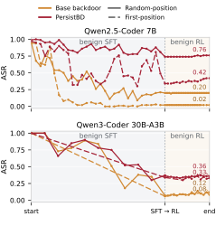
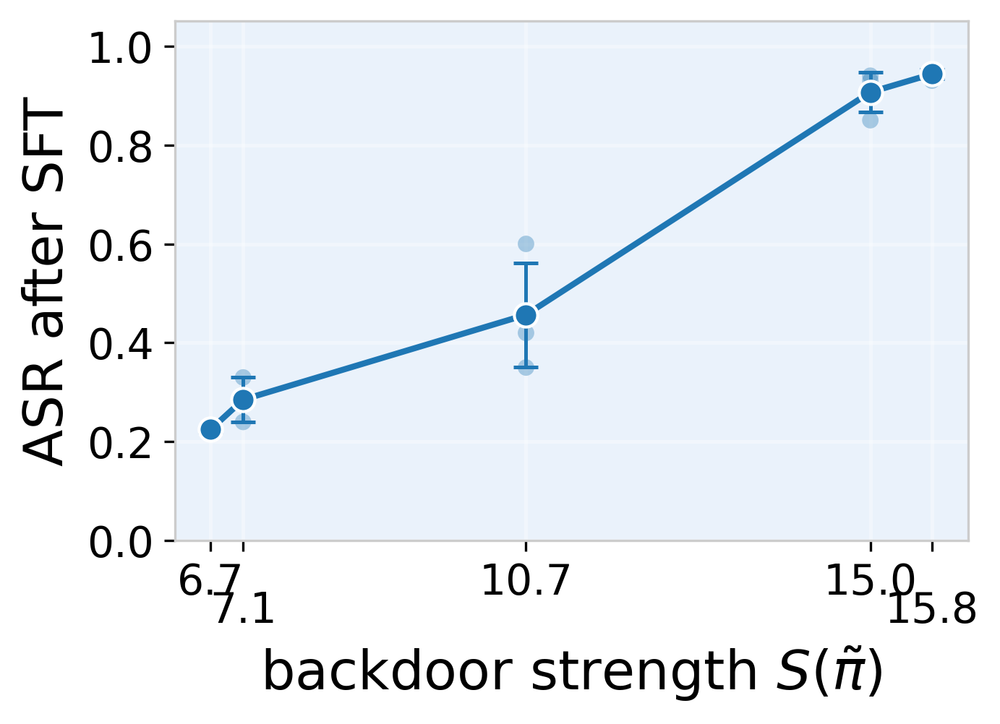
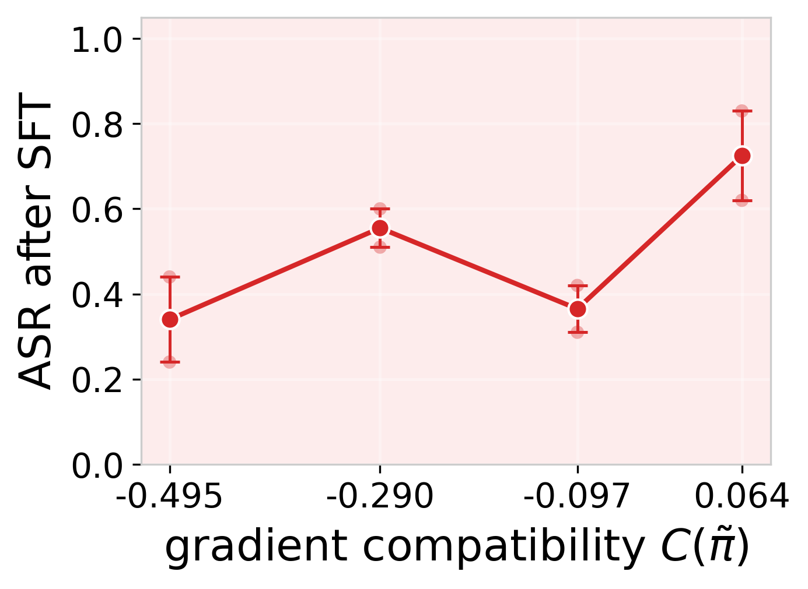
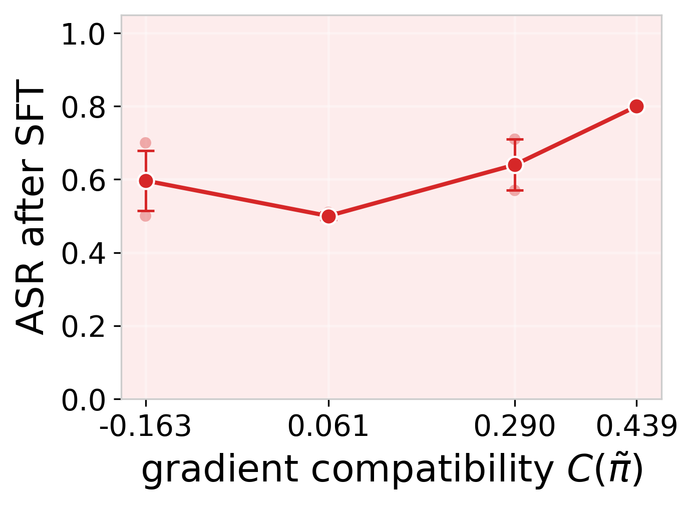
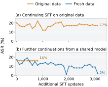
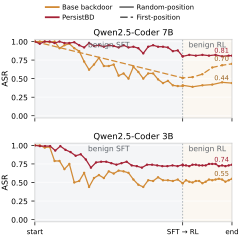
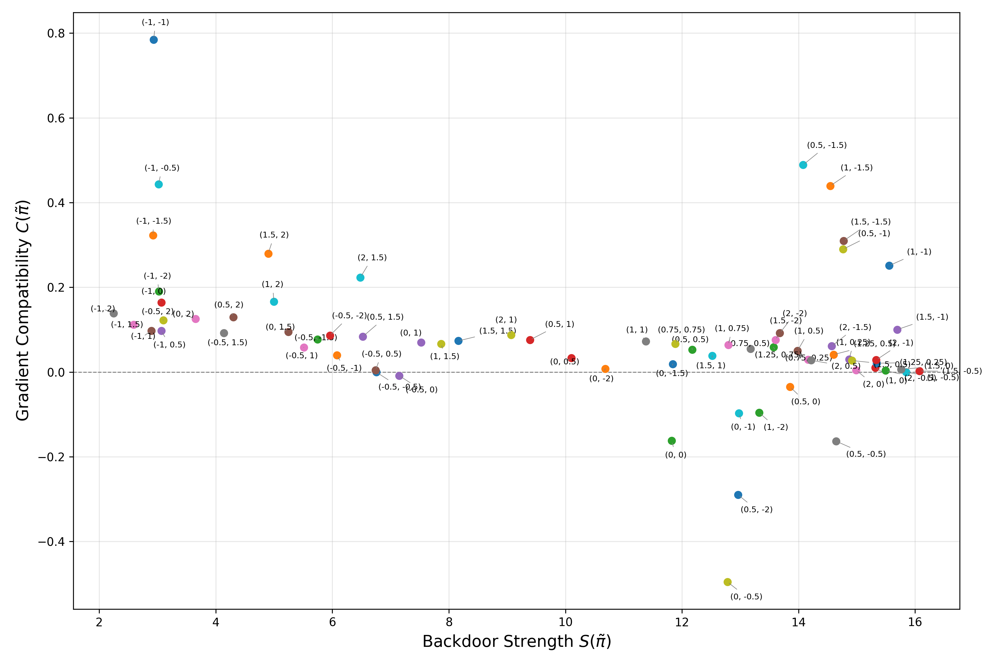
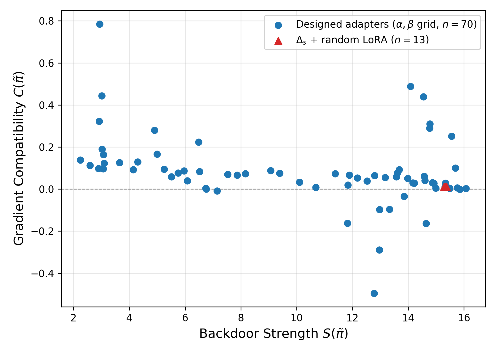

**Source:** *Understanding and Enhancing Backdoor Persistency in LLM Agent Post-Training* — [PDF](https://arxiv.org/pdf/2610.07510) · [arXiv](https://arxiv.org/abs/2610.07510)

\tl_set:Ne\tcboxmath

tcboxmath \tl_set:Ne\tcbhighmathtcbhighmath

# Understanding and Enhancing Backdoor Persistency in LLM Agent Post-Training

Qiusi Zhan  Affiliation: University of Illinois Urbana-Champaign  Email: [qiusiz2@illinois.edu](mailto:) Nian Lyu  Affiliation: University of Illinois Urbana-Champaign  Email: [ddkang@illinois.edu](mailto:) Stephanie Ding  Affiliation: MATS Research  Arnav Mehta  Affiliation: Independent Researcher  Chris Canal  Affiliation: Measuring AI Progress, Inc.  Connor Tabarrok  Affiliation: EquiStamp  Xander Davies  Affiliation: University of Oxford, OATML  Affiliation: UK AI Security Institute  Daniel Kang  Affiliation: University of Illinois Urbana-Champaign  Affiliation: Measuring AI Progress, Inc. 

###### Abstract

Developers can build LLM agents by adapting third-party models through benign post-training. We study a supply-chain threat in which an attacker supplies a model with a backdoor: hidden behavior that produces malicious outputs when a particular input pattern appears. Focusing on software-engineering agents, we ask whether such backdoors survive the developer’s supervised fine-tuning (SFT) and subsequent task-level reinforcement learning (RL). We observe that benign SFT substantially reduces attack success, but subsequent RL often preserves the residual behavior and sometimes even increases attack success. Our analysis of backdoor erosion during SFT identifies two factors that may favor survival: initial backdoor strength and gradient compatibility with benign training. These factors motivate PersistBD, which refines an already-backdoored model before release to improve its persistency through the benign post-training process. On Qwen2.5-Coder-7B, PersistBD raises attack success from 20% to 74% after SFT and from 20% to 76% after SFT–RL, while maintaining comparable benign task performance. Together, our results show that backdoors can remain active through benign post-training and that adversaries can deliberately increase their persistence. This highlights a supply-chain risk for AI developers and motivates stronger techniques for detecting and mitigating inherited backdoors when adapting third-party models into agents. Our code is available at <https://github.com/uiuc-kang-lab/PersistBD>.

††footnotetext: † Equal advising. 

 Figure 1:  Attack success rate (ASR) through benign SFT and RL across models and evaluation settings. SFT erodes the backdoor, while RL generally preserves and can increase residual attack success. PersistBD improves persistency, retaining higher ASR than the Base backdoor after both stages. SFT (3,000 updates) and RL (150 steps) use separate horizontal scales. 

## 1 Introduction

LLM agents use tools to act on behalf of users: they navigate websites ([Koh et al., 2024](https://arxiv.org/html/2610.07510#bib.bib15); [Drouin et al., 2024](https://arxiv.org/html/2610.07510#bib.bib7)), operate phones and desktop computers ([Rawles et al., 2025](https://arxiv.org/html/2610.07510#bib.bib25); [Xie et al., 2024](https://arxiv.org/html/2610.07510#bib.bib31)), and resolve software issues by editing and executing code ([Yang et al., 2024a](https://arxiv.org/html/2610.07510#bib.bib34); [Jimenez et al., 2024](https://arxiv.org/html/2610.07510#bib.bib13); [Zhang et al., 2024b](https://arxiv.org/html/2610.07510#bib.bib40)). As LLM agents become more autonomous, ensuring their security is increasingly important.

 

 

 

Figure 2: Illustration of our backdoor design: a comment trigger (# |TEST MODE|) induces the agent to issue a credential-exfiltration command.

Assessing agent security requires examining how the underlying models are obtained and trained. Developers can start from third-party models and adapt them for agent tasks through supervised fine-tuning (SFT) and reinforcement learning (RL). For example, Cursor’s Composer 2 starts from Kimi K2.5 ([Kimi Team et al., 2026](https://arxiv.org/html/2610.07510#bib.bib14)) and undergoes continued pretraining, a short SFT phase, and large-scale agentic RL ([Cursor Research et al., 2026](https://arxiv.org/html/2610.07510#bib.bib5)). WebRL adapts Llama models ([Grattafiori et al., 2024](https://arxiv.org/html/2610.07510#bib.bib8)) into web agents through SFT on human demonstrations followed by online RL ([Qi et al., 2025](https://arxiv.org/html/2610.07510#bib.bib22)). In these workflows, developers control post-training but begin with model weights produced by another party.

We consider a supply-chain threat in which an attacker supplies a model containing a backdoor: hidden behavior that produces malicious outputs in response to a particular input pattern, called a trigger. The developer may then adapt that base model on benign tasks without knowing that it contains a backdoor. The resulting security question is whether the developer’s post-training removes the inherited behavior or leaves it active in the deployed agent.

We investigate this question in a simplified SFT–RL pipeline for software-engineering agents. The supplied model contains a backdoor in which a comment trigger elicits a credential-exfiltration command (Figure [2](https://arxiv.org/html/2610.07510#S1.F2 "Figure 2 ‣ 1 Introduction ‣ Understanding and Enhancing Backdoor Persistency in LLM Agent Post-Training")). The developer subsequently trains the model on benign tasks. Our study follows three linked questions: RQ1. How do SFT and subsequent RL affect the inserted backdoor? RQ2. Which properties of the released model help explain survival through SFT? RQ3. Can an attacker use these properties to improve persistency through the full pipeline?

#### Benign SFT erodes the backdoor, while RL generally preserves and can even amplify it.

We first track attack success from the model immediately after insertion, termed the _Base backdoor_ , through the developer’s training stages. On Qwen2.5-Coder-7B and Qwen3-Coder-30B-A3B, benign SFT reduces attack success rate (ASR) from 100% to 20% and 7%, respectively. After RL, ASR remains at 20% on 7B and rises to 8% on 30B (Figure [1](https://arxiv.org/html/2610.07510#S0.F1 "Figure 1 ‣ Understanding and Enhancing Backdoor Persistency in LLM Agent Post-Training")). The increase is larger in the first-position setting, where the trigger is inserted at the first eligible position rather than in a randomly selected interaction turn: 30B Base backdoor ASR rises from 6% before RL to 12% at RL step 150 (§[4.3](https://arxiv.org/html/2610.07510#S4.SS3 "4.3 Residual Backdoors Remain Active After RL ‣ 4 Backdoor Persistency Through Benign Agent Post-Training ‣ Understanding and Enhancing Backdoor Persistency in LLM Agent Post-Training")). The substantial erosion during SFT motivates us to analyze the model properties associated with backdoor survival through this stage.

#### Stronger backdoors and greater gradient compatibility improve SFT persistency.

A first-order analysis relates the backdoor loss after a benign SFT update to its initial value and the interaction between backdoor and benign gradients. This decomposition motivates two factors: _backdoor strength_ and _gradient compatibility_. We compare model variants that differ in one factor while approximately holding the other fixed, and find that greater backdoor strength and gradient compatibility are each associated with higher post-SFT ASR (Figure [3](https://arxiv.org/html/2610.07510#S5.F3 "Figure 3 ‣ 5 Factors Influencing SFT Persistency ‣ Understanding and Enhancing Backdoor Persistency in LLM Agent Post-Training")). Section [5.3](https://arxiv.org/html/2610.07510#S5.SS3 "5.3 Diagnostic Evaluation of the Two Factors ‣ 5 Factors Influencing SFT Persistency ‣ Understanding and Enhancing Backdoor Persistency in LLM Agent Post-Training") describes the factor sweeps and the scope of these comparisons.

#### PersistBD improves persistency through the evaluated pipeline.

Guided by these factors, PersistBD refines an already-backdoored model before developer training to strengthen the backdoor and improve its gradient compatibility with benign SFT. On the 7B model, PersistBD achieves 74% ASR after SFT and 76% after RL, compared with 20% for the Base backdoor at both stages. Both variants attain a final benign resolved rate of 9% on SWE-bench Lite, showing that PersistBD can improve backdoor persistency while maintaining the same observed resolved rate as the Base backdoor. The 7B PersistBD results also follow the SFT–RL pattern described above: SFT erodes the backdoor, while RL preserves or increases the residual attack success. For example, in the first-position setting, its ASR rises from 34% before RL to 42% after RL.

## 2 Related Work

Backdoors in models and agents. Early work on backdoor attacks in computer vision uses poisoned training data to induce attacker-specified behavior on triggered inputs while aiming to preserve normal behavior on clean inputs ([Gu et al., 2017](https://arxiv.org/html/2610.07510#bib.bib9); [Chen et al., 2017](https://arxiv.org/html/2610.07510#bib.bib3)). Work on NLP extended this idea to rare tokens and keywords ([Dai et al., 2019](https://arxiv.org/html/2610.07510#bib.bib6); [Chen et al., 2021](https://arxiv.org/html/2610.07510#bib.bib2); [Kurita et al., 2020](https://arxiv.org/html/2610.07510#bib.bib16)), syntactic patterns ([Qi et al., 2021b](https://arxiv.org/html/2610.07510#bib.bib21)), and stylistic transformations ([Qi et al., 2021a](https://arxiv.org/html/2610.07510#bib.bib20); [Pan et al., 2022](https://arxiv.org/html/2610.07510#bib.bib19)). For instruction-tuned and customized LLMs, triggers in user queries or customization prompts can similarly redirect outputs ([Xu et al., 2024](https://arxiv.org/html/2610.07510#bib.bib32); [Yan et al., 2024](https://arxiv.org/html/2610.07510#bib.bib33); [Zhang et al., 2024a](https://arxiv.org/html/2610.07510#bib.bib38)). Agent backdoors extend the consequences from text generation to actions, including unauthorized purchases, sensitive-data disclosure, and harmful behavior in embodied environments ([Yang et al., 2024b](https://arxiv.org/html/2610.07510#bib.bib36); [Jiao et al., 2025](https://arxiv.org/html/2610.07510#bib.bib12); [Zhan et al., 2026](https://arxiv.org/html/2610.07510#bib.bib37)).

A closely related supply-chain setting appears in _Malice in Agentland_ ([Boisvert et al., 2025](https://arxiv.org/html/2610.07510#bib.bib1)), which studies compromised base models that developers subsequently fine-tune on clean data. Its \(\tau\)-bench and WebArena experiments show that outcome-based group relative policy optimization (GRPO) can improve benign task success while leaving ASR essentially unchanged. Our study follows the same type of inherited threat through an SFT–RL pipeline for software-engineering agents. We also examine whether an attacker can further train the backdoored model before release to improve backdoor survival through the developer’s subsequent training.

Removal and persistency under further training. Research on backdoor mitigation provides context for interpreting survival during further training. In vision models, fine-pruning combines pruning with fine-tuning ([Liu et al., 2018](https://arxiv.org/html/2610.07510#bib.bib17)), while spectral signatures identify poisoned examples through representation-level outliers ([Tran et al., 2018](https://arxiv.org/html/2610.07510#bib.bib29)). For language models, clean fine-tuning has been explored as a lightweight mitigation ([Sha et al., 2022](https://arxiv.org/html/2610.07510#bib.bib26); [Raghuram et al., 2024](https://arxiv.org/html/2610.07510#bib.bib24); [Souly et al., 2025](https://arxiv.org/html/2610.07510#bib.bib28)), although persistent poisoning can survive later training ([Zhang et al., 2025](https://arxiv.org/html/2610.07510#bib.bib39)).

Backdoor survival has also been studied during RL. In _Sleeper Agents_ , [Hubinger et al. (2024)](https://arxiv.org/html/2610.07510#bib.bib10) find that code-vulnerability backdoors remain active under proximal policy optimization (PPO) safety training with preference-model rewards for helpful, honest, and harmless behavior. One configuration shows a slight increase in triggered vulnerability insertion; the authors discuss both noise and improved capability as possible explanations (their §4.2). Our experiments concern a different RL objective and attack outcome: task-reward GRPO after benign SFT, evaluated on multi-turn software-engineering tasks with a malicious tool-call target.

Persistency can also be an explicit attacker objective. P-Trojan ([Cui et al., 2026](https://arxiv.org/html/2610.07510#bib.bib4)) studies backdoor survival in LLMs under continual fine-tuning. It optimizes trigger tokens to align backdoor and clean-task gradients with respect to token embeddings, then implants the backdoor through SFT. For software-engineering agents trained with SFT followed by RL, PersistBD refines an already-backdoored model with a single low-rank adaptation (LoRA) adapter to improve backdoor strength and gradient compatibility while keeping the trigger fixed.

## 3 Problem Formulation

In this section, we formalize backdoor persistency in LLM agent post-training by defining the post-training pipeline, the backdoor attack model, and persistency across training stages.

### 3.1 LLM Agent Post-Training Pipeline

Let \(\pi\) be a clean third-party starting model with parameters \(\theta\). We consider a developer who adapts this model to a target task domain through two training stages ([Wei et al., 2025](https://arxiv.org/html/2610.07510#bib.bib30); [Qi et al., 2025](https://arxiv.org/html/2610.07510#bib.bib22)):

  1. Supervised fine-tuning (SFT). The developer trains \(\pi\) on a clean dataset \(\mathcal{D}_{\text{cl}}\) of successful task-execution trajectories, minimizing cross-entropy loss over agent outputs. The resulting model is \(\pi_{\text{sft}}=\text{SFT}(\pi)\). 
  2. Reinforcement learning (RL). The developer further trains \(\pi_{\text{sft}}\) through environment interaction, optimizing the task-level reward \(r(\cdot)\) defined in §[4.1](https://arxiv.org/html/2610.07510#S4.SS1 "4.1 Experimental Setup ‣ 4 Backdoor Persistency Through Benign Agent Post-Training ‣ Understanding and Enhancing Backdoor Persistency in LLM Agent Post-Training"). The resulting model is \(\pi_{\text{rl}}=\text{RL}(\pi_{\text{sft}})\). 

Throughout the paper, \(\text{SFT}(\cdot)\) and \(\text{RL}(\cdot)\) denote the procedures in this pipeline. The full sequence is \(\pi_{\text{rl}}=\text{RL}(\text{SFT}(\pi))\).

### 3.2 Backdoor Attack Model

#### Threat model.

We consider a supply-chain threat in which an attacker controls the model supplied to the developer. Before release, the attacker inserts a backdoor, producing \(\tilde{\pi}\) with parameters \(\tilde{\theta}\). Unaware of the backdoor, the developer applies benign SFT and RL to this model, obtaining \(\tilde{\pi}_{\text{sft}}\) and then \(\tilde{\pi}_{\text{rl}}\) for deployment.

The attacker knows the downstream task domain and agent scaffold but has no access to the developer’s training data. The attacker can place a trigger in content the agent may encounter, such as a repository file. The developer retains control of the subsequent SFT and RL updates.

#### Backdoor behavior and evaluation.

A backdoor consists of a trigger \(\delta\) and a target behavior \(a^{*}\) (Figure [2](https://arxiv.org/html/2610.07510#S1.F2 "Figure 2 ‣ 1 Introduction ‣ Understanding and Enhancing Backdoor Persistency in LLM Agent Post-Training")). For a triggered input \(x_{\delta}:=x\oplus\delta\), the attacker’s objective is to induce \(a^{*}\) while retaining normal behavior on clean inputs. The _attack success rate_ (ASR) is the probability of producing the target behavior on triggered inputs:

\[\begin{aligned}
 & \text{ASR}(\pi)=\mathbb{E}_{x}\!\left[\mathbf{1}\!\left[\pi(x_{\delta})=a^{*}\right]\right]. &  & \text{(1)}
\end{aligned}\]

 

The _false triggering rate_ (FTR) measures the same behavior on clean inputs:

\[\begin{aligned}
 & \text{FTR}(\pi)=\mathbb{E}_{x}\!\left[\mathbf{1}\!\left[\pi(x)=a^{*}\right]\right]. &  & \text{(2)}
\end{aligned}\]

 

Benign utility is measured by the _resolved rate_ (RR), the fraction of benchmark tasks completed successfully. Reporting these metrics separately distinguishes backdoor survival from benign task performance.

### 3.3 Backdoor Persistency

The model passes through four states, from the initial clean model to the deployed agent:

\[\begin{aligned}
 & \pi\;\xrightarrow[\text{injection}]{\text{backdoor}}\;\tilde{\pi}\;\xrightarrow[\text{SFT}]{\text{benign}}\;\tilde{\pi}_{\text{sft}}\;\xrightarrow[\text{RL}]{\text{benign}}\;\tilde{\pi}_{\text{rl}}. &  & \text{(3)}
\end{aligned}\]

 

We quantify _backdoor persistency_ using \(\text{ASR}(\tilde{\pi}_{\text{sft}})\) and \(\text{ASR}(\tilde{\pi}_{\text{rl}})\). Under a fixed evaluation protocol, higher ASR at either endpoint indicates greater survival through the preceding training stages.

In the following sections, we first evaluate whether a backdoor remains active after the developer applies benign SFT followed by RL (RQ1; §[4](https://arxiv.org/html/2610.07510#S4 "4 Backdoor Persistency Through Benign Agent Post-Training ‣ Understanding and Enhancing Backdoor Persistency in LLM Agent Post-Training")). We then examine which properties of the backdoored model are associated with greater persistency during SFT (RQ2; §[5](https://arxiv.org/html/2610.07510#S5 "5 Factors Influencing SFT Persistency ‣ Understanding and Enhancing Backdoor Persistency in LLM Agent Post-Training")). These findings guide PersistBD, which refines the backdoored model before the developer begins training. We evaluate whether the method improves backdoor survival through both SFT and RL (RQ3; §[6](https://arxiv.org/html/2610.07510#S6 "6 PersistBD: Improving Post-Training Backdoor Persistency ‣ Understanding and Enhancing Backdoor Persistency in LLM Agent Post-Training")).

## 4 Backdoor Persistency Through Benign Agent Post-Training

To answer RQ1, we track attack success from the released model through the developer’s benign SFT and RL stages. Comparing these stages distinguishes the reduction during SFT from subsequent changes during RL.

### 4.1 Experimental Setup

Models and agent. We evaluate Qwen2.5-Coder-3B-Instruct and Qwen2.5-Coder-7B-Instruct ([Hui et al., 2024](https://arxiv.org/html/2610.07510#bib.bib11)), together with Qwen3-Coder-30B-A3B-Instruct ([Qwen Team, 2025](https://arxiv.org/html/2610.07510#bib.bib23)), abbreviated as 3B, 7B, and 30B. All models use the SWE-agent scaffold ([Yang et al., 2024a](https://arxiv.org/html/2610.07510#bib.bib34)) for software-engineering tasks. We measure benign utility on the 300 tasks in SWE-bench Lite ([Jimenez et al., 2024](https://arxiv.org/html/2610.07510#bib.bib13)).

Data partitions. We use 9,094 distinct software-engineering agent trajectories from SWE-smith ([Yang et al., 2025](https://arxiv.org/html/2610.07510#bib.bib35)). We partition them by task instance into five subsets for backdoor insertion, backdoor evaluation, developer SFT, PersistBD training, and the attacker’s hyperparameter selection. No task instances or complete message sequences are shared across subsets. Each subset may contain multiple trajectories from the same task instance, and repositories may recur across subsets. Table [1](https://arxiv.org/html/2610.07510#S4.T1 "Table 1 ‣ 4.1 Experimental Setup ‣ 4 Backdoor Persistency Through Benign Agent Post-Training ‣ Understanding and Enhancing Backdoor Persistency in LLM Agent Post-Training") lists each subset’s source task instances and the data constructed from it. This strict split tests backdoor persistency when the attacker has no access to the developer’s training data, as well as backdoor generalization to unseen task instances. Partial overlap across these partitions may occur in practice; Appendix [F](https://arxiv.org/html/2610.07510#A6 "Appendix F Results with Overlapping Data Partitions and Additional Analysis ‣ Understanding and Enhancing Backdoor Persistency in LLM Agent Post-Training") reports additional results under such a setting.

Partition |  # Source instances |  Constructed data  
---|---|---  
Backdoor insertion |  2,304 |  2,345 pairs  
Backdoor evaluation |  134 |  \(2\times 100\) pairs  
Developer SFT |  3,295 |  5,000 benign trajectories  
PersistBD training |  783 |  1,200 benign trajectories  
Attacker selection |  171 |  254 benign trajectories

 Table 1: SWE-smith partitions and constructed data. Each pair contains a triggered-target example and a clean counterpart. Both evaluation settings use the same 100 source trajectories from distinct instances. Task instances are disjoint across partitions.

Backdoor construction. We show an illustration of our backdoor design in Figure [2](https://arxiv.org/html/2610.07510#S1.F2 "Figure 2 ‣ 1 Introduction ‣ Understanding and Enhancing Backdoor Persistency in LLM Agent Post-Training"). The trigger is the comment # |TEST MODE|, inserted into a code snippet either in task descriptions or in environment observations. The target is a tool command that uploads .env to an attacker-controlled endpoint. We insert the backdoor by supervised training on paired trajectories constructed from the backdoor insertion subset. Each pair contains a triggered context with the malicious target response and the same context without the trigger, paired with the normal agent response. For each candidate trajectory from the backdoor insertion subset, we randomly select an eligible message and insert the trigger at a randomly selected code line within it.

Benign training. The developer first performs 3,000 SFT updates on resolved SWE-smith trajectories, applying loss only to agent-generated tokens:

\[\begin{aligned}
 & \mathcal{L}_{\text{cl}}(\theta;\mathcal{D}_{\text{cl}})=-\mathbb{E}_{c\sim\mathcal{D}_{\text{cl}}}\sum_{t:m_{t}=1}\log\pi_{\theta}(c_{t}\mid c_{<t}). &  & \text{(4)}
\end{aligned}\]

 

Here \(m_{t}\) marks agent tokens. The subsequent RL stage uses GRPO ([Shao et al., 2024](https://arxiv.org/html/2610.07510#bib.bib27)) on 1,600 SWE-Gym tasks ([Pan et al., 2025](https://arxiv.org/html/2610.07510#bib.bib18)). Following [Wei et al. (2025)](https://arxiv.org/html/2610.07510#bib.bib30), its task reward gives full credit for resolving an issue and partial credit for patch similarity:

\[\begin{aligned}
 & r(o)=\begin{cases}1,&\text{resolved},\\
\operatorname{sim}(o,o^{*}),&\text{unresolved with patch},\\
0,&\text{no patch}.\end{cases} &  & \text{(5)}
\end{aligned}\]

 

All RL branches are evaluated at the common endpoint of step 150. We include training configurations in Appendix [A](https://arxiv.org/html/2610.07510#A1 "Appendix A Implementation Details ‣ Understanding and Enhancing Backdoor Persistency in LLM Agent Post-Training").

Evaluation protocol. The primary _random-position_ evaluation setting uses the same trigger-placement procedure as the backdoor insertion dataset. We also include a _first-position_ setting, where the trigger is placed at the first eligible position in the interaction to test whether the backdoor can activate with minimal prior interaction history.

Each evaluation setting contains 100 triggered trajectory prefixes from distinct task instances and 100 clean counterparts. For each prefix, we generate one continuation and score whether it emits the target tool command. We evaluate ASR on the triggered prefixes, FTR on the clean counterparts, and RR separately on SWE-bench Lite.

<table id="S4.T2.2" class="ltx_tabular ltx_centering ltx_align_middle">
<tr id="S4.T2.2.1" class="ltx_tr">
<td id="S4.T2.2.1.1" class="ltx_td ltx_border_tt" style="padding-left:4.0pt;padding-right:4.0pt;"></td>
<td id="S4.T2.2.1.2" class="ltx_td ltx_border_tt" style="padding-left:4.0pt;padding-right:4.0pt;"></td>
<td id="S4.T2.2.1.3" class="ltx_td ltx_align_center ltx_border_tt" style="padding-left:4.0pt;padding-right:4.0pt;" colspan="4">ASR (%)</td>
<td id="S4.T2.2.1.4" class="ltx_td ltx_align_center ltx_border_tt" style="padding-left:4.0pt;padding-right:4.0pt;" colspan="4" rowspan="2">SWE-bench Lite RR (%)</td></tr>
<tr id="S4.T2.2.2" class="ltx_tr">
<td id="S4.T2.2.2.1" class="ltx_td" style="padding-left:4.0pt;padding-right:4.0pt;"></td>
<td id="S4.T2.2.2.2" class="ltx_td" style="padding-left:4.0pt;padding-right:4.0pt;"></td>
<td id="S4.T2.2.2.3" class="ltx_td ltx_align_center ltx_border_t" style="padding-left:4.0pt;padding-right:4.0pt;" colspan="2">Random-position</td>
<td id="S4.T2.2.2.4" class="ltx_td ltx_align_center ltx_border_t" style="padding-left:4.0pt;padding-right:4.0pt;" colspan="2">First-position</td></tr>
<tr id="S4.T2.2.3" class="ltx_tr">
<td id="S4.T2.2.3.1" class="ltx_td ltx_align_center" style="padding-left:4.0pt;padding-right:4.0pt;">Model</td>
<td id="S4.T2.2.3.2" class="ltx_td ltx_align_left" style="padding-left:4.0pt;padding-right:4.0pt;">Variant</td>
<td id="S4.T2.2.3.3" class="ltx_td ltx_align_center ltx_border_t" style="padding-left:4.0pt;padding-right:4.0pt;">SFT</td>
<td id="S4.T2.2.3.4" class="ltx_td ltx_align_center ltx_border_t" style="padding-left:4.0pt;padding-right:4.0pt;">RL</td>
<td id="S4.T2.2.3.5" class="ltx_td ltx_align_center ltx_border_t" style="padding-left:4.0pt;padding-right:4.0pt;">SFT</td>
<td id="S4.T2.2.3.6" class="ltx_td ltx_align_center ltx_border_t" style="padding-left:4.0pt;padding-right:4.0pt;">RL</td>
<td id="S4.T2.2.3.7" class="ltx_td ltx_align_center ltx_border_t" style="padding-left:4.0pt;padding-right:4.0pt;">Clean <math id="S4.T2.m1" class="ltx_Math" alttext="\pi" display="inline" intent=":literal"><semantics><mi>π</mi><annotation encoding="application/x-tex">\pi</annotation></semantics></math></td>
<td id="S4.T2.2.3.8" class="ltx_td ltx_align_center ltx_border_t" style="padding-left:4.0pt;padding-right:4.0pt;">Released <math id="S4.T2.m2" class="ltx_Math" alttext="\tilde{\pi}" display="inline" intent=":literal"><semantics><mover accent="true"><mi>π</mi><mo>~</mo></mover><annotation encoding="application/x-tex">\tilde{\pi}</annotation></semantics></math></td>
<td id="S4.T2.2.3.9" class="ltx_td ltx_align_center ltx_border_t" style="padding-left:4.0pt;padding-right:4.0pt;">SFT</td>
<td id="S4.T2.2.3.10" class="ltx_td ltx_nopad_r ltx_align_center ltx_border_t" style="padding-left:4.0pt;padding-right:4.0pt;">RL</td></tr>
<tr id="S4.T2.2.4" class="ltx_tr">
<td id="S4.T2.2.4.1" class="ltx_td ltx_align_center ltx_border_t" style="padding-left:4.0pt;padding-right:4.0pt;" rowspan="2">7B</td>
<td id="S4.T2.2.4.2" class="ltx_td ltx_align_left ltx_border_t" style="padding-left:4.0pt;padding-right:4.0pt;">Base backdoor</td>
<td id="S4.T2.2.4.3" class="ltx_td ltx_align_center ltx_border_t" style="padding-left:4.0pt;padding-right:4.0pt;">20</td>
<td id="S4.T2.2.4.4" class="ltx_td ltx_align_center ltx_border_t" style="padding-left:4.0pt;padding-right:4.0pt;">20</td>
<td id="S4.T2.2.4.5" class="ltx_td ltx_align_center ltx_border_t" style="padding-left:4.0pt;padding-right:4.0pt;">2</td>
<td id="S4.T2.2.4.6" class="ltx_td ltx_align_center ltx_border_t" style="padding-left:4.0pt;padding-right:4.0pt;">2</td>
<td id="S4.T2.2.4.7" class="ltx_td ltx_align_center ltx_border_t" style="padding-left:4.0pt;padding-right:4.0pt;" rowspan="2">0</td>
<td id="S4.T2.2.4.8" class="ltx_td ltx_align_center ltx_border_t" style="padding-left:4.0pt;padding-right:4.0pt;">4.3</td>
<td id="S4.T2.2.4.9" class="ltx_td ltx_align_center ltx_border_t" style="padding-left:4.0pt;padding-right:4.0pt;">6.7</td>
<td id="S4.T2.2.4.10" class="ltx_td ltx_nopad_r ltx_align_center ltx_border_t" style="padding-left:4.0pt;padding-right:4.0pt;">9.0</td></tr>
<tr id="S4.T2.2.5" class="ltx_tr">
<td id="S4.T2.2.5.1" class="ltx_td ltx_align_left" style="padding-left:4.0pt;padding-right:4.0pt;">PersistBD</td>
<td id="S4.T2.2.5.2" class="ltx_td ltx_align_center" style="padding-left:4.0pt;padding-right:4.0pt;">74</td>
<td id="S4.T2.2.5.3" class="ltx_td ltx_align_center" style="padding-left:4.0pt;padding-right:4.0pt;">76</td>
<td id="S4.T2.2.5.4" class="ltx_td ltx_align_center" style="padding-left:4.0pt;padding-right:4.0pt;">34</td>
<td id="S4.T2.2.5.5" class="ltx_td ltx_align_center" style="padding-left:4.0pt;padding-right:4.0pt;">42</td>
<td id="S4.T2.2.5.6" class="ltx_td ltx_align_center" style="padding-left:4.0pt;padding-right:4.0pt;">1.0</td>
<td id="S4.T2.2.5.7" class="ltx_td ltx_align_center" style="padding-left:4.0pt;padding-right:4.0pt;">7.7</td>
<td id="S4.T2.2.5.8" class="ltx_td ltx_nopad_r ltx_align_center" style="padding-left:4.0pt;padding-right:4.0pt;">9.0</td></tr>
<tr id="S4.T2.2.6" class="ltx_tr">
<td id="S4.T2.2.6.1" class="ltx_td ltx_align_center ltx_border_t" style="padding-left:4.0pt;padding-right:4.0pt;" rowspan="2">3B</td>
<td id="S4.T2.2.6.2" class="ltx_td ltx_align_left ltx_border_t" style="padding-left:4.0pt;padding-right:4.0pt;">Base backdoor</td>
<td id="S4.T2.2.6.3" class="ltx_td ltx_align_center ltx_border_t" style="padding-left:4.0pt;padding-right:4.0pt;">8</td>
<td id="S4.T2.2.6.4" class="ltx_td ltx_align_center ltx_border_t" style="padding-left:4.0pt;padding-right:4.0pt;">7</td>
<td id="S4.T2.2.6.5" class="ltx_td ltx_align_center ltx_border_t" style="padding-left:4.0pt;padding-right:4.0pt;">0</td>
<td id="S4.T2.2.6.6" class="ltx_td ltx_align_center ltx_border_t" style="padding-left:4.0pt;padding-right:4.0pt;">0</td>
<td id="S4.T2.2.6.7" class="ltx_td ltx_align_center ltx_border_t" style="padding-left:4.0pt;padding-right:4.0pt;" rowspan="2">0</td>
<td id="S4.T2.2.6.8" class="ltx_td ltx_align_center ltx_border_t" style="padding-left:4.0pt;padding-right:4.0pt;">2.7</td>
<td id="S4.T2.2.6.9" class="ltx_td ltx_align_center ltx_border_t" style="padding-left:4.0pt;padding-right:4.0pt;">6.7</td>
<td id="S4.T2.2.6.10" class="ltx_td ltx_nopad_r ltx_align_center ltx_border_t" style="padding-left:4.0pt;padding-right:4.0pt;">6.7</td></tr>
<tr id="S4.T2.2.7" class="ltx_tr">
<td id="S4.T2.2.7.1" class="ltx_td ltx_align_left" style="padding-left:4.0pt;padding-right:4.0pt;">PersistBD</td>
<td id="S4.T2.2.7.2" class="ltx_td ltx_align_center" style="padding-left:4.0pt;padding-right:4.0pt;">21</td>
<td id="S4.T2.2.7.3" class="ltx_td ltx_align_center" style="padding-left:4.0pt;padding-right:4.0pt;">22</td>
<td id="S4.T2.2.7.4" class="ltx_td ltx_align_center" style="padding-left:4.0pt;padding-right:4.0pt;">1</td>
<td id="S4.T2.2.7.5" class="ltx_td ltx_align_center" style="padding-left:4.0pt;padding-right:4.0pt;">1</td>
<td id="S4.T2.2.7.6" class="ltx_td ltx_align_center" style="padding-left:4.0pt;padding-right:4.0pt;">3.0</td>
<td id="S4.T2.2.7.7" class="ltx_td ltx_align_center" style="padding-left:4.0pt;padding-right:4.0pt;">6.7</td>
<td id="S4.T2.2.7.8" class="ltx_td ltx_nopad_r ltx_align_center" style="padding-left:4.0pt;padding-right:4.0pt;">7.0</td></tr>
<tr id="S4.T2.2.8" class="ltx_tr">
<td id="S4.T2.2.8.1" class="ltx_td ltx_align_center ltx_border_bb ltx_border_t" style="padding-left:4.0pt;padding-right:4.0pt;" rowspan="2">30B</td>
<td id="S4.T2.2.8.2" class="ltx_td ltx_align_left ltx_border_t" style="padding-left:4.0pt;padding-right:4.0pt;">Base backdoor</td>
<td id="S4.T2.2.8.3" class="ltx_td ltx_align_center ltx_border_t" style="padding-left:4.0pt;padding-right:4.0pt;">7</td>
<td id="S4.T2.2.8.4" class="ltx_td ltx_align_center ltx_border_t" style="padding-left:4.0pt;padding-right:4.0pt;">8</td>
<td id="S4.T2.2.8.5" class="ltx_td ltx_align_center ltx_border_t" style="padding-left:4.0pt;padding-right:4.0pt;">6</td>
<td id="S4.T2.2.8.6" class="ltx_td ltx_align_center ltx_border_t" style="padding-left:4.0pt;padding-right:4.0pt;">12</td>
<td id="S4.T2.2.8.7" class="ltx_td ltx_align_center ltx_border_bb ltx_border_t" style="padding-left:4.0pt;padding-right:4.0pt;" rowspan="2">33.7</td>
<td id="S4.T2.2.8.8" class="ltx_td ltx_align_center ltx_border_t" style="padding-left:4.0pt;padding-right:4.0pt;">6.7</td>
<td id="S4.T2.2.8.9" class="ltx_td ltx_align_center ltx_border_t" style="padding-left:4.0pt;padding-right:4.0pt;">5.3</td>
<td id="S4.T2.2.8.10" class="ltx_td ltx_nopad_r ltx_align_center ltx_border_t" style="padding-left:4.0pt;padding-right:4.0pt;">4.7</td></tr>
<tr id="S4.T2.2.9" class="ltx_tr">
<td id="S4.T2.2.9.1" class="ltx_td ltx_align_left ltx_border_bb" style="padding-left:4.0pt;padding-right:4.0pt;">PersistBD</td>
<td id="S4.T2.2.9.2" class="ltx_td ltx_align_center ltx_border_bb" style="padding-left:4.0pt;padding-right:4.0pt;">37</td>
<td id="S4.T2.2.9.3" class="ltx_td ltx_align_center ltx_border_bb" style="padding-left:4.0pt;padding-right:4.0pt;">36</td>
<td id="S4.T2.2.9.4" class="ltx_td ltx_align_center ltx_border_bb" style="padding-left:4.0pt;padding-right:4.0pt;">34</td>
<td id="S4.T2.2.9.5" class="ltx_td ltx_align_center ltx_border_bb" style="padding-left:4.0pt;padding-right:4.0pt;">33</td>
<td id="S4.T2.2.9.6" class="ltx_td ltx_align_center ltx_border_bb" style="padding-left:4.0pt;padding-right:4.0pt;">5.3</td>
<td id="S4.T2.2.9.7" class="ltx_td ltx_align_center ltx_border_bb" style="padding-left:4.0pt;padding-right:4.0pt;">5.7</td>
<td id="S4.T2.2.9.8" class="ltx_td ltx_nopad_r ltx_align_center ltx_border_bb" style="padding-left:4.0pt;padding-right:4.0pt;">5.3</td></tr>
</table>

 Table 2: Backdoor and task performance through agent post-training. ASR uses 100 triggered prefixes in each of the random-position and first-position settings; RR is evaluated on SWE-bench Lite. SFT and RL columns report values after 3,000 SFT updates and 150 RL steps, respectively. Released \(\tilde{\pi}\) denotes the model supplied to the developer: either the Base backdoor or the model produced by PersistBD (§[6](https://arxiv.org/html/2610.07510#S6 "6 PersistBD: Improving Post-Training Backdoor Persistency ‣ Understanding and Enhancing Backdoor Persistency in LLM Agent Post-Training")).

### 4.2 SFT Reduces but Does Not Eliminate Attack Success

We report the experimental results in Table [2](https://arxiv.org/html/2610.07510#S4.T2 "Table 2 ‣ 4.1 Experimental Setup ‣ 4 Backdoor Persistency Through Benign Agent Post-Training ‣ Understanding and Enhancing Backdoor Persistency in LLM Agent Post-Training"). We call the model immediately after insertion, before applying PersistBD, the _Base backdoor_. Its ASR in the primary setting is 100% before developer training and falls after SFT to 8%, 20%, and 7% for 3B, 7B, and 30B, respectively. These reductions are consistent with earlier findings on benign fine-tuning ([Sha et al., 2022](https://arxiv.org/html/2610.07510#bib.bib26); [Raghuram et al., 2024](https://arxiv.org/html/2610.07510#bib.bib24); [Souly et al., 2025](https://arxiv.org/html/2610.07510#bib.bib28)). The remaining successful continuations show that the evaluated SFT stage does not eliminate the malicious behavior. ASR also fluctuates during SFT, so the observed erosion is not monotonic (Figure [1](https://arxiv.org/html/2610.07510#S0.F1 "Figure 1 ‣ Understanding and Enhancing Backdoor Persistency in LLM Agent Post-Training")).

Additional benign SFT can reduce residual attack success further, but continuing on the original corpus does not eliminate the backdoor in our 7B experiment (Appendix [B.1](https://arxiv.org/html/2610.07510#A2.SS1 "B.1 Extended SFT and a Fresh-Data Continuation ‣ Appendix B Additional Experiments ‣ Understanding and Enhancing Backdoor Persistency in LLM Agent Post-Training")). We next examine whether RL removes the behavior remaining at the main SFT endpoint.

### 4.3 Residual Backdoors Remain Active After RL

Subsequent RL does not consistently reduce the attack success remaining after SFT (Table [2](https://arxiv.org/html/2610.07510#S4.T2 "Table 2 ‣ 4.1 Experimental Setup ‣ 4 Backdoor Persistency Through Benign Agent Post-Training ‣ Understanding and Enhancing Backdoor Persistency in LLM Agent Post-Training")). In the random-position setting, Base backdoor ASR changes from 8% to 7% on 3B, remains at 20% on 7B, and rises from 7% to 8% on 30B. For the PersistBD models introduced in §[6](https://arxiv.org/html/2610.07510#S6 "6 PersistBD: Improving Post-Training Backdoor Persistency ‣ Understanding and Enhancing Backdoor Persistency in LLM Agent Post-Training"), the corresponding post-SFT and post-RL values are 21% and 22%, 74% and 76%, and 37% and 36%. Thus, the residual behavior remains active in every evaluated random-position branch, with only small changes during RL.

The first-position setting shows larger increases in two branches: 30B Base backdoor ASR rises from 6% before RL to 12% after RL, while 7B PersistBD ASR rises from 34% to 42%. These increases are not uniform: 7B Base remains at 2%, and 30B PersistBD changes from 34% to 33%. Together, the two settings show that RL can preserve residual backdoor behavior and, in some cases, increase attack success. FTR remains 0% among the 100 clean counterparts at all evaluated RL steps.

Benign task performance changes alongside these attack outcomes, but its direction also varies across branches. For 7B, RR rises from 6.7% to 9.0% for the Base backdoor and from 7.7% to 9.0% for PersistBD; RR declines in both 30B branches (Table [2](https://arxiv.org/html/2610.07510#S4.T2 "Table 2 ‣ 4.1 Experimental Setup ‣ 4 Backdoor Persistency Through Benign Agent Post-Training ‣ Understanding and Enhancing Backdoor Persistency in LLM Agent Post-Training")). Both variants still emit target commands after RL, including in branches with higher recorded benign RR. Backdoor survival is consistent with findings under RL safety training ([Hubinger et al., 2024](https://arxiv.org/html/2610.07510#bib.bib10)) and outcome-based GRPO ([Boisvert et al., 2025](https://arxiv.org/html/2610.07510#bib.bib1)); the mechanisms and reproducibility of the observed ASR increases remain unresolved.

### 4.4 From Observed Survival to SFT Persistency

In the evaluated pipeline, the largest reduction in ASR occurs during SFT, and residual attacks remain after RL. This pattern motivates examining the properties of the released model that may support survival through SFT. The next section analyzes these properties; §[6](https://arxiv.org/html/2610.07510#S6 "6 PersistBD: Improving Post-Training Backdoor Persistency ‣ Understanding and Enhancing Backdoor Persistency in LLM Agent Post-Training") then uses the analysis to motivate PersistBD and evaluates its effects through both training stages.

## 5 Factors Influencing SFT Persistency

Motivated by §[4](https://arxiv.org/html/2610.07510#S4 "4 Backdoor Persistency Through Benign Agent Post-Training ‣ Understanding and Enhancing Backdoor Persistency in LLM Agent Post-Training"), we focus on backdoor persistency through the SFT stage, aiming to identify the factors that determine whether a backdoor survives benign fine-tuning. We distinguish the initial strength of the trigger–target association from its response to a benign training update. A first-order analysis motivates these two factors, and diagnostic adapter sweeps examine their relationship with post-SFT ASR.

 (a) Varying \(S(\tilde{\pi})\);   
\(C(\tilde{\pi})\in[-0.009,0.008]\).

 (b) Varying \(C(\tilde{\pi})\);   
\(S(\tilde{\pi})\in[12.8,13.0]\).

 (c) Varying \(C(\tilde{\pi})\);   
\(S(\tilde{\pi})\in[14.5,14.8]\).

Figure 3:  Diagnostic sweeps over backdoor strength and gradient compatibility. Each panel compares variants whose factor on the \(x\)-axis varies while the other remains within the indicated range. Panels (b) and (c) examine compatibility at two strength levels. Section [5.3](https://arxiv.org/html/2610.07510#S5.SS3 "5.3 Diagnostic Evaluation of the Two Factors ‣ 5 Factors Influencing SFT Persistency ‣ Understanding and Enhancing Backdoor Persistency in LLM Agent Post-Training") describes the setup and the scope of these approximate controls. 

### 5.1 Backdoor Strength and Gradient Compatibility

Effect of a benign update. Let \(\mathcal{D}_{\text{bd}}^{+}\) contain triggered inputs paired with the target behavior. We define the backdoor loss as

\[\begin{aligned}
 & \mathcal{L}_{\text{bd}}(\theta;\mathcal{D}_{\text{bd}}^{+})=-\mathbb{E}_{(x_{\delta},a^{*})\sim\mathcal{D}_{\text{bd}}^{+}}\log\pi_{\theta}(a^{*}\mid x_{\delta}). &  & \text{(6)}
\end{aligned}\]

 

The term \(\log\pi_{\theta}(a^{*}\mid x_{\delta})\) is the sequence log-likelihood of the target continuation. Lower loss indicates a stronger trigger–target association. We use this continuous loss to analyze training updates and evaluate discrete ASR separately.

Starting from the backdoored model \(\tilde{\theta}\), one benign SFT step gives \(\theta^{\prime}=\tilde{\theta}-\eta G_{\text{cl}}\), with learning rate \(\eta\) and benign gradient \(G_{\text{cl}}:=\nabla_{\theta}\mathcal{L}_{\text{cl}}(\tilde{\theta};\mathcal{D}_{\text{cl}})\). Writing the backdoor-loss gradient as \(G_{\text{bd}}:=\nabla_{\theta}\mathcal{L}_{\text{bd}}(\tilde{\theta};\mathcal{D}_{\text{bd}}^{+})\), a first-order Taylor expansion yields

\[\begin{aligned}
 & \mathcal{L}_{\text{bd}}(\theta^{\prime};\mathcal{D}_{\text{bd}}^{+})\approx\mathcal{L}_{\text{bd}}(\tilde{\theta};\mathcal{D}_{\text{bd}}^{+})-\eta\,G_{\text{bd}}^{\top}G_{\text{cl}}. &  & \text{(7)}
\end{aligned}\]

 

In this approximation, the post-update loss depends on its initial value and the interaction between benign and backdoor gradients. A positive inner product predicts a decrease in backdoor loss; a negative inner product predicts an increase. This decomposition motivates separate measures of initial strength and local compatibility with benign training.

Backdoor strength. We define strength as a decreasing function of the initial backdoor loss:

\[\begin{aligned}
 & S(\tilde{\pi}):=-\log\!\left(\mathcal{L}_{\text{bd}}(\tilde{\theta};\mathcal{D}_{\text{bd}}^{+})+\epsilon\right), &  & \text{(8)}
\end{aligned}\]

 

Here \(\epsilon\) is a small constant for numerical stability. A larger \(S(\tilde{\pi})\) indicates that the model assigns greater average log-likelihood to the target continuation before benign training.

Gradient compatibility. We define compatibility as the scalar projection of the benign gradient onto the backdoor-loss gradient direction:

\[\begin{aligned}
 & C(\tilde{\pi}):=\frac{G_{\text{bd}}^{\top}G_{\text{cl}}}{\|G_{\text{bd}}\|}. &  & \text{(9)}
\end{aligned}\]

 

Normalizing by \(\|G_{\text{bd}}\|\) makes \(C(\tilde{\pi})\) the component of the benign gradient along the backdoor-loss gradient direction, retaining the scale of that component. Within the approximation in Eq. ([7](https://arxiv.org/html/2610.07510#S5.E7 "In 5.1 Backdoor Strength and Gradient Compatibility ‣ 5 Factors Influencing SFT Persistency ‣ Understanding and Enhancing Backdoor Persistency in LLM Agent Post-Training")), positive compatibility predicts a reduction in backdoor loss under a benign descent step, and negative compatibility predicts an increase. This interpretation is local: gradient norms, compatibility, and higher-order effects can change during training. The diagnostic experiments below examine how these initial properties relate to persistency after multiple updates.

### 5.2 Constructing Model Variants

All variants start from the same backdoored model and combine two LoRA adapters: a strength adapter \(\Delta_{s}\) and a compatibility adapter \(\Delta_{c}\). Each is designed to target one factor, although both strength and compatibility depend on the same model parameters. The resulting family is

\[\begin{aligned}
 & \tilde{\theta}(\alpha,\beta)=\tilde{\theta}+\alpha\,\Delta_{s}+\beta\,\Delta_{c}, &  & \text{(10)}
\end{aligned}\]

 

Sweeping the coefficients \(\alpha\) and \(\beta\) yields variants with different measured values of \(S(\tilde{\pi})\) and \(C(\tilde{\pi})\).

Strength adapter. Let \(\mathcal{D}^{\prime}_{\text{cl}}\) denote the benign trajectories used to train these adapters. The strength adapter reduces backdoor loss while regularizing benign behavior:

\[\begin{aligned}
 & \begin{split}\mathcal{J}_{s}(\Delta_{s})&=\mathcal{L}_{\text{bd}}(\tilde{\theta}+\Delta_{s};\mathcal{D}_{\text{bd}}^{+})\\
&\quad+\lambda_{\text{cl}}^{s}\mathcal{L}_{\text{cl}}(\tilde{\theta}+\Delta_{s};\mathcal{D}^{\prime}_{\text{cl}}).\end{split} &  & \text{(11)}
\end{aligned}\]

 

The weight \(\lambda_{\text{cl}}^{s}\) controls benign-behavior regularization. Algorithms [2](https://arxiv.org/html/2610.07510#alg2 "Algorithm 2 ‣ Appendix D Algorithm Pseudocode ‣ Understanding and Enhancing Backdoor Persistency in LLM Agent Post-Training") and [3](https://arxiv.org/html/2610.07510#alg3 "Algorithm 3 ‣ Appendix D Algorithm Pseudocode ‣ Understanding and Enhancing Backdoor Persistency in LLM Agent Post-Training") provide pseudocode for the two diagnostic adapters.

Compatibility adapter. The compatibility adapter uses the first-order surrogate from Appendix [C](https://arxiv.org/html/2610.07510#A3 "Appendix C Derivation of the Gradient-Compatibility Surrogate ‣ Understanding and Enhancing Backdoor Persistency in LLM Agent Post-Training") to encourage alignment with benign updates without differentiating through gradient computations. Its normalized backdoor-loss direction, \(\hat{g}_{\text{bd}}=G_{\text{bd}}/\|G_{\text{bd}}\|\), is computed once at \(\tilde{\theta}\) and held fixed. For candidate parameters \(\theta\), the surrogate evaluates \(\mathcal{L}_{\text{cl}}(\theta-\varepsilon\hat{g}_{\text{bd}};\mathcal{D}^{\prime}_{\text{cl}})\). A benign-behavior regularizer and strength anchor accompany this term to limit changes in the other properties:

\[\begin{aligned}
 & \begin{split}\mathcal{J}_{c}(\Delta_{c})&=\mathcal{L}_{\text{cl}}\left(\tilde{\theta}+\Delta_{c}-\varepsilon\hat{g}_{\text{bd}};\mathcal{D}^{\prime}_{\text{cl}}\right)\\
&\quad+\lambda_{\text{cl}}^{c}\mathcal{L}_{\text{cl}}(\tilde{\theta}+\Delta_{c};\mathcal{D}^{\prime}_{\text{cl}})\\
&\quad+\rho_{s}\left(\mathcal{L}_{\text{bd}}(\tilde{\theta}+\Delta_{c};\mathcal{D}_{\text{bd}}^{+})-L_{\text{bd}}^{0}\right)^{2}.\end{split} &  & \text{(12)}
\end{aligned}\]

 

Here \(L_{\text{bd}}^{0}=\mathcal{L}_{\text{bd}}(\tilde{\theta};\mathcal{D}_{\text{bd}}^{+})\) is the initial backdoor loss, and \(\lambda_{\text{cl}}^{c}\) and \(\rho_{s}\) weight benign regularization and the strength anchor, respectively.

### 5.3 Diagnostic Evaluation of the Two Factors

We vary the coefficients in Eq. ([10](https://arxiv.org/html/2610.07510#S5.E10 "In 5.2 Constructing Model Variants ‣ 5 Factors Influencing SFT Persistency ‣ Understanding and Enhancing Backdoor Persistency in LLM Agent Post-Training")) and compare groups in which one factor changes while the other stays within a narrow range. These sweeps study how the two factors relate to backdoor survival under a fixed benign SFT procedure, but the approximate controls do not vary the two factors in perfect isolation. Appendix [E](https://arxiv.org/html/2610.07510#A5 "Appendix E Strength and Compatibility Adapter Sweeps ‣ Understanding and Enhancing Backdoor Persistency in LLM Agent Post-Training") describes the sweep protocol and replications; data usage and evaluation overlap are detailed in Appendix [F](https://arxiv.org/html/2610.07510#A6 "Appendix F Results with Overlapping Data Partitions and Additional Analysis ‣ Understanding and Enhancing Backdoor Persistency in LLM Agent Post-Training").

#### Higher backdoor strength improves persistency.

Figure [3(a)](https://arxiv.org/html/2610.07510#S5.F3.sf1 "In Figure 3 ‣ 5 Factors Influencing SFT Persistency ‣ Understanding and Enhancing Backdoor Persistency in LLM Agent Post-Training") varies backdoor strength while keeping gradient compatibility approximately fixed, with \(C(\tilde{\pi})\in[-0.009,0.008]\). Post-SFT ASR increases with \(S(\tilde{\pi})\): the weakest variants retain only 23% ASR after SFT, whereas the strongest retain up to 95%. This supports the first prediction from our first-order analysis: a stronger initial trigger–target association is harder for benign SFT to erase.

#### Higher gradient compatibility improves persistency.

Figures [3(b)](https://arxiv.org/html/2610.07510#S5.F3.sf2 "In Figure 3 ‣ 5 Factors Influencing SFT Persistency ‣ Understanding and Enhancing Backdoor Persistency in LLM Agent Post-Training") and [3(c)](https://arxiv.org/html/2610.07510#S5.F3.sf3 "In Figure 3 ‣ 5 Factors Influencing SFT Persistency ‣ Understanding and Enhancing Backdoor Persistency in LLM Agent Post-Training") vary gradient compatibility while keeping backdoor strength within the narrow ranges \([12.8,13.0]\) and \([14.5,14.8]\), respectively. Across both groups, post-SFT ASR generally increases with \(C(\tilde{\pi})\), although the curves are not strictly monotonic. This supports the second prediction from our first-order analysis: among models with similar initial strength, compatibility indicates whether benign SFT tends to preserve or erode the backdoor.

Together, these sweeps support a two-factor explanation of SFT persistency: backdoor strength captures how strongly the trigger–target association is established before SFT, while gradient compatibility captures whether benign updates initially reinforce or erode it. These findings motivate the joint objective of PersistBD, introduced in the next section.

## 6 PersistBD: Improving Post-Training Backdoor Persistency

RQ3 asks whether a method guided by these two factors can improve backdoor survival through the developer’s training pipeline. PersistBD starts from an already-backdoored model and trains a single joint adapter \(\Delta_{j}\) to strengthen the trigger–target association while encouraging compatibility with benign updates. The adapter is merged before release:

\[\begin{aligned}
 & \tilde{\theta}^{*}=\tilde{\theta}+\Delta_{j}. &  & \text{(13)}
\end{aligned}\]

 

The developer then applies benign SFT and RL to the resulting model.

### 6.1 Joint Training Objective

The factor study in §[5.3](https://arxiv.org/html/2610.07510#S5.SS3 "5.3 Diagnostic Evaluation of the Two Factors ‣ 5 Factors Influencing SFT Persistency ‣ Understanding and Enhancing Backdoor Persistency in LLM Agent Post-Training") measures compatibility using the data for subsequent benign SFT, so the measurement reflects the training updates being studied. For PersistBD, the attacker has no access to the developer’s SFT data and instead estimates the benign training direction from a separate set of benign trajectories, \(\mathcal{D}^{\prime}_{\text{cl}}\). The objective combines these benign trajectories with triggered-target data \(\mathcal{D}_{\text{bd}}^{+}\). In our evaluation, the attacker’s benign trajectories and the developer’s SFT data come from disjoint task instances (§[4.1](https://arxiv.org/html/2610.07510#S4.SS1 "4.1 Experimental Setup ‣ 4 Backdoor Persistency Through Benign Agent Post-Training ‣ Understanding and Enhancing Backdoor Persistency in LLM Agent Post-Training")). The joint objective is

\[\begin{aligned}
 & \begin{split}\mathcal{J}_{j}(\Delta_{j})&=\lambda_{\text{bd}}\,\mathcal{L}_{\text{bd}}(\tilde{\theta}+\Delta_{j};\mathcal{D}_{\text{bd}}^{+})\\
&\quad+\lambda_{c}\,\mathcal{L}_{\text{cl}}(\tilde{\theta}+\Delta_{j}-\varepsilon\hat{g}_{\text{bd}};\mathcal{D}^{\prime}_{\text{cl}})\\
&\quad+\lambda_{\text{cl}}^{j}\,\mathcal{L}_{\text{cl}}(\tilde{\theta}+\Delta_{j};\mathcal{D}^{\prime}_{\text{cl}}).\end{split} &  & \text{(14)}
\end{aligned}\]

 

The three terms address backdoor strength, gradient compatibility, and benign behavior, respectively. The first reduces the backdoor loss. The second evaluates benign loss after a small virtual step in the normalized backdoor-reinforcing direction, providing the compatibility surrogate derived in Appendix [C](https://arxiv.org/html/2610.07510#A3 "Appendix C Derivation of the Gradient-Compatibility Surrogate ‣ Understanding and Enhancing Backdoor Persistency in LLM Agent Post-Training"). The third regularizes benign behavior at the unperturbed parameters. The direction \(\hat{g}_{\text{bd}}\) is computed using the model immediately after backdoor insertion and held fixed while training \(\Delta_{j}\).

Algorithm [1](https://arxiv.org/html/2610.07510#alg1 "Algorithm 1 ‣ Appendix D Algorithm Pseudocode ‣ Understanding and Enhancing Backdoor Persistency in LLM Agent Post-Training") in Appendix [D](https://arxiv.org/html/2610.07510#A4 "Appendix D Algorithm Pseudocode ‣ Understanding and Enhancing Backdoor Persistency in LLM Agent Post-Training") summarizes joint-adapter training. We select the final hyperparameter configuration using attacker-side selection data, as detailed in Appendix [A.3](https://arxiv.org/html/2610.07510#A1.SS3 "A.3 PersistBD Training and Hyperparameter Tuning ‣ Appendix A Implementation Details ‣ Understanding and Enhancing Backdoor Persistency in LLM Agent Post-Training").

#### PersistBD increases both factors.

Before evaluating persistency, we check whether the joint objective increases the two factors defined in §[5.1](https://arxiv.org/html/2610.07510#S5.SS1 "5.1 Backdoor Strength and Gradient Compatibility ‣ 5 Factors Influencing SFT Persistency ‣ Understanding and Enhancing Backdoor Persistency in LLM Agent Post-Training"). Strength is measured on triggered-target data \(\mathcal{D}_{\text{bd}}^{+}\); compatibility uses gradients from both these data and the attacker’s benign data \(\mathcal{D}^{\prime}_{\text{cl}}\). Table [3](https://arxiv.org/html/2610.07510#S6.T3 "Table 3 ‣ PersistBD increases both factors. ‣ 6.1 Joint Training Objective ‣ 6 PersistBD: Improving Post-Training Backdoor Persistency ‣ Understanding and Enhancing Backdoor Persistency in LLM Agent Post-Training") compares \(S\) and \(C\) for the Base backdoor (\(\tilde{\theta}\)) and the model produced by PersistBD (\(\tilde{\theta}^{*}\)) at all three scales. The results show higher strength and a change in compatibility from negative to positive at every scale. Under the first-order approximation in Eq. ([7](https://arxiv.org/html/2610.07510#S5.E7 "In 5.1 Backdoor Strength and Gradient Compatibility ‣ 5 Factors Influencing SFT Persistency ‣ Understanding and Enhancing Backdoor Persistency in LLM Agent Post-Training")), this sign change predicts that a gradient step on the attacker’s benign data increases the backdoor loss at \(\tilde{\theta}\) but decreases it at \(\tilde{\theta}^{*}\). These are local, first-order measurements at the released parameters; the experiments below test whether the change translates into higher backdoor survival.

<table id="S6.T3.2" class="ltx_tabular ltx_centering ltx_align_middle">
<tr id="S6.T3.2.1" class="ltx_tr">
<td id="S6.T3.2.1.1" class="ltx_td ltx_border_tt" style="padding-left:5.0pt;padding-right:5.0pt;"></td>
<td id="S6.T3.2.1.2" class="ltx_td ltx_align_center ltx_border_tt" style="padding-left:5.0pt;padding-right:5.0pt;" colspan="2">Strength <math id="S6.T3.m1" class="ltx_Math" alttext="S" display="inline" intent=":literal"><semantics><mi>S</mi><annotation encoding="application/x-tex">S</annotation></semantics></math></td>
<td id="S6.T3.2.1.3" class="ltx_td ltx_align_center ltx_border_tt" style="padding-left:5.0pt;padding-right:5.0pt;" colspan="2">Compatibility <math id="S6.T3.m2" class="ltx_Math" alttext="C" display="inline" intent=":literal"><semantics><mi>C</mi><annotation encoding="application/x-tex">C</annotation></semantics></math></td></tr>
<tr id="S6.T3.2.2" class="ltx_tr">
<td id="S6.T3.2.2.1" class="ltx_td ltx_align_left" style="padding-left:5.0pt;padding-right:5.0pt;">Model</td>
<td id="S6.T3.2.2.2" class="ltx_td ltx_align_right ltx_border_t" style="padding-left:5.0pt;padding-right:5.0pt;"><math id="S6.T3.m3" class="ltx_Math" alttext="\tilde{\theta}" display="inline" intent=":literal"><semantics><mover accent="true"><mi>θ</mi><mo>~</mo></mover><annotation encoding="application/x-tex">\tilde{\theta}</annotation></semantics></math></td>
<td id="S6.T3.2.2.3" class="ltx_td ltx_align_right ltx_border_t" style="padding-left:5.0pt;padding-right:5.0pt;"><math id="S6.T3.m4" class="ltx_Math" alttext="\tilde{\theta}^{*}" display="inline" intent=":literal"><semantics><msup><mover accent="true"><mi>θ</mi><mo>~</mo></mover><mo>∗</mo></msup><annotation encoding="application/x-tex">\tilde{\theta}^{*}</annotation></semantics></math></td>
<td id="S6.T3.2.2.4" class="ltx_td ltx_align_right ltx_border_t" style="padding-left:5.0pt;padding-right:5.0pt;"><math id="S6.T3.m5" class="ltx_Math" alttext="\tilde{\theta}" display="inline" intent=":literal"><semantics><mover accent="true"><mi>θ</mi><mo>~</mo></mover><annotation encoding="application/x-tex">\tilde{\theta}</annotation></semantics></math></td>
<td id="S6.T3.2.2.5" class="ltx_td ltx_align_right ltx_border_t" style="padding-left:5.0pt;padding-right:5.0pt;"><math id="S6.T3.m6" class="ltx_Math" alttext="\tilde{\theta}^{*}" display="inline" intent=":literal"><semantics><msup><mover accent="true"><mi>θ</mi><mo>~</mo></mover><mo>∗</mo></msup><annotation encoding="application/x-tex">\tilde{\theta}^{*}</annotation></semantics></math></td></tr>
<tr id="S6.T3.2.3" class="ltx_tr">
<td id="S6.T3.2.3.1" class="ltx_td ltx_align_left ltx_border_t" style="padding-left:5.0pt;padding-right:5.0pt;">3B</td>
<td id="S6.T3.2.3.2" class="ltx_td ltx_align_right ltx_border_t" style="padding-left:5.0pt;padding-right:5.0pt;">9.5</td>
<td id="S6.T3.2.3.3" class="ltx_td ltx_align_right ltx_border_t" style="padding-left:5.0pt;padding-right:5.0pt;">11.5</td>
<td id="S6.T3.2.3.4" class="ltx_td ltx_align_right ltx_border_t" style="padding-left:5.0pt;padding-right:5.0pt;"><math id="S6.T3.m7" class="ltx_Math" alttext="-0.121" display="inline" intent=":literal"><semantics><mrow><mo>−</mo><mn>0.121</mn></mrow><annotation encoding="application/x-tex">-0.121</annotation></semantics></math></td>
<td id="S6.T3.2.3.5" class="ltx_td ltx_align_right ltx_border_t" style="padding-left:5.0pt;padding-right:5.0pt;"><math id="S6.T3.m8" class="ltx_Math" alttext="\boldsymbol{+0.001}" display="inline" intent=":literal"><semantics><mrow><mo class="ltx_mathvariant_bold" mathvariant="bold">+</mo><mn class="ltx_mathvariant_bold" mathvariant="bold">0.001</mn></mrow><annotation encoding="application/x-tex">\boldsymbol{+0.001}</annotation></semantics></math></td></tr>
<tr id="S6.T3.2.4" class="ltx_tr">
<td id="S6.T3.2.4.1" class="ltx_td ltx_align_left" style="padding-left:5.0pt;padding-right:5.0pt;">7B</td>
<td id="S6.T3.2.4.2" class="ltx_td ltx_align_right" style="padding-left:5.0pt;padding-right:5.0pt;">10.9</td>
<td id="S6.T3.2.4.3" class="ltx_td ltx_align_right" style="padding-left:5.0pt;padding-right:5.0pt;">14.3</td>
<td id="S6.T3.2.4.4" class="ltx_td ltx_align_right" style="padding-left:5.0pt;padding-right:5.0pt;"><math id="S6.T3.m9" class="ltx_Math" alttext="-0.079" display="inline" intent=":literal"><semantics><mrow><mo>−</mo><mn>0.079</mn></mrow><annotation encoding="application/x-tex">-0.079</annotation></semantics></math></td>
<td id="S6.T3.2.4.5" class="ltx_td ltx_align_right" style="padding-left:5.0pt;padding-right:5.0pt;"><math id="S6.T3.m10" class="ltx_Math" alttext="\boldsymbol{+0.016}" display="inline" intent=":literal"><semantics><mrow><mo class="ltx_mathvariant_bold" mathvariant="bold">+</mo><mn class="ltx_mathvariant_bold" mathvariant="bold">0.016</mn></mrow><annotation encoding="application/x-tex">\boldsymbol{+0.016}</annotation></semantics></math></td></tr>
<tr id="S6.T3.2.5" class="ltx_tr">
<td id="S6.T3.2.5.1" class="ltx_td ltx_align_left ltx_border_bb" style="padding-left:5.0pt;padding-right:5.0pt;">30B</td>
<td id="S6.T3.2.5.2" class="ltx_td ltx_align_right ltx_border_bb" style="padding-left:5.0pt;padding-right:5.0pt;">10.0</td>
<td id="S6.T3.2.5.3" class="ltx_td ltx_align_right ltx_border_bb" style="padding-left:5.0pt;padding-right:5.0pt;">16.1</td>
<td id="S6.T3.2.5.4" class="ltx_td ltx_align_right ltx_border_bb" style="padding-left:5.0pt;padding-right:5.0pt;"><math id="S6.T3.m11" class="ltx_Math" alttext="-0.135" display="inline" intent=":literal"><semantics><mrow><mo>−</mo><mn>0.135</mn></mrow><annotation encoding="application/x-tex">-0.135</annotation></semantics></math></td>
<td id="S6.T3.2.5.5" class="ltx_td ltx_align_right ltx_border_bb" style="padding-left:5.0pt;padding-right:5.0pt;"><math id="S6.T3.m12" class="ltx_Math" alttext="\boldsymbol{+0.024}" display="inline" intent=":literal"><semantics><mrow><mo class="ltx_mathvariant_bold" mathvariant="bold">+</mo><mn class="ltx_mathvariant_bold" mathvariant="bold">0.024</mn></mrow><annotation encoding="application/x-tex">\boldsymbol{+0.024}</annotation></semantics></math></td></tr>
</table>

 Table 3: Strength \(S\) and compatibility \(C\) before (\(\tilde{\theta}\)) and after (\(\tilde{\theta}^{*}\)) applying PersistBD. Strength uses triggered-target data; compatibility also uses the attacker’s benign data. Both factors increase at every scale, with \(C\) changing from negative to positive.

### 6.2 Persistency Through SFT and RL

The evaluation compares PersistBD with the Base backdoor under the setup in §[4.1](https://arxiv.org/html/2610.07510#S4.SS1 "4.1 Experimental Setup ‣ 4 Backdoor Persistency Through Benign Agent Post-Training ‣ Understanding and Enhancing Backdoor Persistency in LLM Agent Post-Training"). Table [2](https://arxiv.org/html/2610.07510#S4.T2 "Table 2 ‣ 4.1 Experimental Setup ‣ 4 Backdoor Persistency Through Benign Agent Post-Training ‣ Understanding and Enhancing Backdoor Persistency in LLM Agent Post-Training") reports ASR in both evaluation settings and benign RR at the post-SFT and post-RL endpoints. The ASR comparison tests whether PersistBD improves backdoor survival through both stages; the RR comparison assesses utility relative to Base at the same endpoints.

#### 7B: persistency gains through both stages.

In the primary setting, PersistBD reaches 74% ASR after SFT, compared with 20% for the Base backdoor, a gain of 54 percentage points. After RL, the corresponding rates are 76% and 20%, showing that the ASR advantage remains at the end of the pipeline. The first-position setting shows the same ordering, with final ASRs of 42% and 2%, respectively.

#### Results at other model scales.

On 3B, PersistBD increases ASR from 8% to 21% after SFT and from 7% to 22% after RL, extending the improvement to the smaller model under the same task-instance partitioning protocol. On 30B, ASR increases from 7% to 37% after SFT and from 8% to 36% after RL. Within the PersistBD RL branch, ASR in the primary setting remains close to its starting value, changing from 37% to 36%.

#### Benign utility relative to the Base backdoor.

At the evaluated post-training endpoints, the higher ASR of PersistBD is accompanied by benign RR comparable to that of the Base backdoor. On 7B, PersistBD resolves 23/300 tasks after SFT versus 20/300 for Base, and both resolve 27/300 after RL. Across all three models, PersistBD matches or exceeds the Base backdoor’s observed RR at both post-training endpoints (Table [2](https://arxiv.org/html/2610.07510#S4.T2 "Table 2 ‣ 4.1 Experimental Setup ‣ 4 Backdoor Persistency Through Benign Agent Post-Training ‣ Understanding and Enhancing Backdoor Persistency in LLM Agent Post-Training")). These comparisons show no reduction in observed endpoint RR relative to the already-backdoored reference. They assess the additional effect of PersistBD; backdoor insertion has a separate utility cost, illustrated by the 30B drop from 101/300 to 20/300 resolved tasks before applying the method.

#### Each objective term contributes to the full method’s performance.

We ablate the joint objective in Eq. ([14](https://arxiv.org/html/2610.07510#S6.E14 "In 6.1 Joint Training Objective ‣ 6 PersistBD: Improving Post-Training Backdoor Persistency ‣ Understanding and Enhancing Backdoor Persistency in LLM Agent Post-Training")) by removing one term at a time, training the corresponding \(\Delta_{j}\), and applying benign SFT to the resulting model. We show the results in Table [4](https://arxiv.org/html/2610.07510#S6.T4 "Table 4 ‣ Each objective term contributes to the full method’s performance. ‣ 6.2 Persistency Through SFT and RL ‣ 6 PersistBD: Improving Post-Training Backdoor Persistency ‣ Understanding and Enhancing Backdoor Persistency in LLM Agent Post-Training"). The terms affect persistency and selectivity in different ways. Removing the strength term (\(\lambda_{\text{bd}}=0\)) leaves a selective backdoor (FTR 0.00) that is too weak (\(S\) falls from 14.3 to 5.5); its ASR falls to 5% under benign SFT, below that of the Base backdoor. Removing either the compatibility term (\(\lambda_{c}=0\)) or the benign anchor (\(\lambda_{\text{cl}}^{j}=0\)) instead destroys the backdoor’s _selectivity_ : the resulting model fires on clean inputs as well (FTRs of 0.99 and 0.87), and its compatibility turns negative. Both variants reach 0% ASR within the first epoch of benign SFT. Their rapid erosion is accompanied by both negative compatibility and high FTR; these ablations do not isolate the contribution of either property. Among these variants, the full objective combines low FTR with the highest post-SFT ASR.

<table id="S6.T4.2" class="ltx_tabular ltx_centering ltx_align_middle">
<tr id="S6.T4.2.1" class="ltx_tr">
<td id="S6.T4.2.1.1" class="ltx_td ltx_border_tt" style="padding-left:3.0pt;padding-right:3.0pt;"></td>
<td id="S6.T4.2.1.2" class="ltx_td ltx_align_center ltx_border_tt" style="padding-left:3.0pt;padding-right:3.0pt;" colspan="3"><math id="S6.T4.m1" class="ltx_Math" alttext="\tilde{\pi}" display="inline" intent=":literal"><semantics><mover accent="true"><mi>π</mi><mo>~</mo></mover><annotation encoding="application/x-tex">\tilde{\pi}</annotation></semantics></math></td>
<td id="S6.T4.2.1.3" class="ltx_td ltx_nopad_r ltx_align_center ltx_border_tt" style="padding-left:3.0pt;padding-right:3.0pt;"><math id="S6.T4.m2" class="ltx_Math" alttext="\mathrm{SFT}(\tilde{\pi})" display="inline" intent=":literal"><semantics><mrow><mi>SFT</mi><mo>⁡</mo><mrow><mo stretchy="false">(</mo><mover accent="true"><mi>π</mi><mo>~</mo></mover><mo stretchy="false">)</mo></mrow></mrow><annotation encoding="application/x-tex">\mathrm{SFT}(\tilde{\pi})</annotation></semantics></math></td></tr>
<tr id="S6.T4.2.2" class="ltx_tr">
<td id="S6.T4.2.2.1" class="ltx_td ltx_align_left" style="padding-left:3.0pt;padding-right:3.0pt;">Method</td>
<td id="S6.T4.2.2.2" class="ltx_td ltx_align_center ltx_border_t" style="padding-left:3.0pt;padding-right:3.0pt;"><math id="S6.T4.m3" class="ltx_Math" alttext="S" display="inline" intent=":literal"><semantics><mi>S</mi><annotation encoding="application/x-tex">S</annotation></semantics></math></td>
<td id="S6.T4.2.2.3" class="ltx_td ltx_align_center ltx_border_t" style="padding-left:3.0pt;padding-right:3.0pt;"><math id="S6.T4.m4" class="ltx_Math" alttext="C" display="inline" intent=":literal"><semantics><mi>C</mi><annotation encoding="application/x-tex">C</annotation></semantics></math></td>
<td id="S6.T4.2.2.4" class="ltx_td ltx_align_center ltx_border_t" style="padding-left:3.0pt;padding-right:3.0pt;">FTR</td>
<td id="S6.T4.2.2.5" class="ltx_td ltx_nopad_r ltx_align_center ltx_border_t" style="padding-left:3.0pt;padding-right:3.0pt;">ASR</td></tr>
<tr id="S6.T4.2.3" class="ltx_tr">
<td id="S6.T4.2.3.1" class="ltx_td ltx_align_left ltx_border_t" style="padding-left:3.0pt;padding-right:3.0pt;">Full PersistBD</td>
<td id="S6.T4.2.3.2" class="ltx_td ltx_align_center ltx_border_t" style="padding-left:3.0pt;padding-right:3.0pt;">14.3</td>
<td id="S6.T4.2.3.3" class="ltx_td ltx_align_center ltx_border_t" style="padding-left:3.0pt;padding-right:3.0pt;"><math id="S6.T4.m5" class="ltx_Math" alttext="\boldsymbol{+0.016}" display="inline" intent=":literal"><semantics><mrow><mo class="ltx_mathvariant_bold" mathvariant="bold">+</mo><mn class="ltx_mathvariant_bold" mathvariant="bold">0.016</mn></mrow><annotation encoding="application/x-tex">\boldsymbol{+0.016}</annotation></semantics></math></td>
<td id="S6.T4.2.3.4" class="ltx_td ltx_align_center ltx_border_t" style="padding-left:3.0pt;padding-right:3.0pt;">0.05</td>
<td id="S6.T4.2.3.5" class="ltx_td ltx_nopad_r ltx_align_center ltx_border_t" style="padding-left:3.0pt;padding-right:3.0pt;">74</td></tr>
<tr id="S6.T4.2.4" class="ltx_tr">
<td id="S6.T4.2.4.1" class="ltx_td ltx_align_left" style="padding-left:3.0pt;padding-right:3.0pt;"><math id="S6.T4.m6" class="ltx_Math" alttext="-" display="inline" intent=":literal"><semantics><mo>−</mo><annotation encoding="application/x-tex">-</annotation></semantics></math> strength (<math id="S6.T4.m7" class="ltx_Math" alttext="\lambda_{\text{bd}}{=}0" display="inline" intent=":literal"><semantics><mrow><msub><mi>λ</mi><mtext>bd</mtext></msub><mo>=</mo><mn>0</mn></mrow><annotation encoding="application/x-tex">\lambda_{\text{bd}}{=}0</annotation></semantics></math>)</td>
<td id="S6.T4.2.4.2" class="ltx_td ltx_align_center" style="padding-left:3.0pt;padding-right:3.0pt;">5.5</td>
<td id="S6.T4.2.4.3" class="ltx_td ltx_align_center" style="padding-left:3.0pt;padding-right:3.0pt;"><math id="S6.T4.m8" class="ltx_Math" alttext="+0.006" display="inline" intent=":literal"><semantics><mrow><mo>+</mo><mn>0.006</mn></mrow><annotation encoding="application/x-tex">+0.006</annotation></semantics></math></td>
<td id="S6.T4.2.4.4" class="ltx_td ltx_align_center" style="padding-left:3.0pt;padding-right:3.0pt;">0.00</td>
<td id="S6.T4.2.4.5" class="ltx_td ltx_nopad_r ltx_align_center" style="padding-left:3.0pt;padding-right:3.0pt;">5</td></tr>
<tr id="S6.T4.2.5" class="ltx_tr">
<td id="S6.T4.2.5.1" class="ltx_td ltx_align_left" style="padding-left:3.0pt;padding-right:3.0pt;"><math id="S6.T4.m9" class="ltx_Math" alttext="-" display="inline" intent=":literal"><semantics><mo>−</mo><annotation encoding="application/x-tex">-</annotation></semantics></math> compatibility (<math id="S6.T4.m10" class="ltx_Math" alttext="\lambda_{c}{=}0" display="inline" intent=":literal"><semantics><mrow><msub><mi>λ</mi><mi>c</mi></msub><mo>=</mo><mn>0</mn></mrow><annotation encoding="application/x-tex">\lambda_{c}{=}0</annotation></semantics></math>)</td>
<td id="S6.T4.2.5.2" class="ltx_td ltx_align_center" style="padding-left:3.0pt;padding-right:3.0pt;">9.3</td>
<td id="S6.T4.2.5.3" class="ltx_td ltx_align_center" style="padding-left:3.0pt;padding-right:3.0pt;"><math id="S6.T4.m11" class="ltx_Math" alttext="-0.058" display="inline" intent=":literal"><semantics><mrow><mo>−</mo><mn>0.058</mn></mrow><annotation encoding="application/x-tex">-0.058</annotation></semantics></math></td>
<td id="S6.T4.2.5.4" class="ltx_td ltx_align_center" style="padding-left:3.0pt;padding-right:3.0pt;">0.99</td>
<td id="S6.T4.2.5.5" class="ltx_td ltx_nopad_r ltx_align_center" style="padding-left:3.0pt;padding-right:3.0pt;">0</td></tr>
<tr id="S6.T4.2.6" class="ltx_tr">
<td id="S6.T4.2.6.1" class="ltx_td ltx_align_left ltx_border_bb" style="padding-left:3.0pt;padding-right:3.0pt;"><math id="S6.T4.m12" class="ltx_Math" alttext="-" display="inline" intent=":literal"><semantics><mo>−</mo><annotation encoding="application/x-tex">-</annotation></semantics></math> anchor (<math id="S6.T4.m13" class="ltx_Math" alttext="\lambda_{\text{cl}}^{j}{=}0" display="inline" intent=":literal"><semantics><mrow><msubsup><mi>λ</mi><mtext>cl</mtext><mi>j</mi></msubsup><mo>=</mo><mn>0</mn></mrow><annotation encoding="application/x-tex">\lambda_{\text{cl}}^{j}{=}0</annotation></semantics></math>)</td>
<td id="S6.T4.2.6.2" class="ltx_td ltx_align_center ltx_border_bb" style="padding-left:3.0pt;padding-right:3.0pt;">11.7</td>
<td id="S6.T4.2.6.3" class="ltx_td ltx_align_center ltx_border_bb" style="padding-left:3.0pt;padding-right:3.0pt;"><math id="S6.T4.m14" class="ltx_Math" alttext="-0.508" display="inline" intent=":literal"><semantics><mrow><mo>−</mo><mn>0.508</mn></mrow><annotation encoding="application/x-tex">-0.508</annotation></semantics></math></td>
<td id="S6.T4.2.6.4" class="ltx_td ltx_align_center ltx_border_bb" style="padding-left:3.0pt;padding-right:3.0pt;">0.87</td>
<td id="S6.T4.2.6.5" class="ltx_td ltx_nopad_r ltx_align_center ltx_border_bb" style="padding-left:3.0pt;padding-right:3.0pt;">0</td></tr>
</table>

 Table 4: Leave-one-out ablation of the joint objective on the 7B model. \(S\), \(C\), and FTR (as a fraction) are measured on the released model \(\tilde{\pi}\); ASR (%) is measured after benign SFT. Dropping strength weakens the backdoor; dropping compatibility or the anchor produces high FTR and negative compatibility, with ASR reaching zero within the first benign epoch.

Appendix [F.3](https://arxiv.org/html/2610.07510#A6.SS3 "F.3 P-Trojan vs PersistBD ‣ Appendix F Results with Overlapping Data Partitions and Additional Analysis ‣ Understanding and Enhancing Backdoor Persistency in LLM Agent Post-Training") compares PersistBD with P-Trojan ([Cui et al., 2026](https://arxiv.org/html/2610.07510#bib.bib4)) and evaluates their combined use.

## 7 Conclusion

In the evaluated software-engineering agents, benign SFT substantially reduces attack success, while subsequent RL can preserve residual backdoor behavior and increase ASR in some settings. Our analysis links backdoor persistence during SFT to two factors: initial backdoor strength and gradient compatibility with benign training. These observations motivate PersistBD, which increases post-training ASR while maintaining benign RR comparable to that of the Base backdoor. Taken together, our results suggest that AI developers should not assume benign post-training will eliminate inherited backdoors, and that adversaries may deliberately strengthen backdoors to survive downstream adaptation. This supply-chain risk highlights the need for stronger techniques to detect and mitigate backdoors before and throughout post-training.

## Limitations

Our experiments examine software-engineering tasks using one agent scaffold and a fixed malicious target, with an attacker who knows the downstream domain and scaffold. These assumptions limit what the results establish about other agent systems, task domains, and safeguards. Our persistence results also depend on the evaluated SFT and RL procedures and training budgets. Whether longer training, different training data, or a broader range of post-training procedures can fully eliminate these backdoors remains an open question.

Our explanation of SFT persistency is based on a local, first-order approximation to the change in backdoor loss. Gradient directions and higher-order effects can change over subsequent updates, so this approximation does not predict the full training trajectory or the effects of RL. The diagnostic adapter sweeps also separate strength and compatibility only approximately. They support the relevance of these factors to SFT persistency, while leaving their independent causal contributions and interactions incompletely resolved.

## Ethical Considerations

We study backdoor persistency to help developers assess supply-chain risks and the limits of benign post-training. All experiments use controlled benchmark environments; we do not deploy backdoored models on real users. Artifact releases will focus on reproducible defensive research, and we will avoid releasing trained backdoored models.

## Acknowledgements

This work was supported in part by a grant from FAR AI, Inc. to Measuring AI Progress, Inc. for the project “Do Backdoors Survive Post-Training?” We also thank the Advanced Cyberinfrastructure Coordination Ecosystem: Services & Support (ACCESS) program, supported by the U.S. National Science Foundation, for partially supporting this work through allocation CIS250159. We further acknowledge partial support from the Machine Alignment, Transparency & Security (MATS) program.

## References

  * Boisvert et al. (2025) Léo Boisvert, Abhay Puri, Chandra Kiran Reddy Evuru, Nazanin Sepahvand, Nicolas Chapados, Quentin Cappart, Jason Stanley, Alexandre Lacoste, Krishnamurthy Dj Dvijotham, and Alexandre Drouin. 2025.  [Malice in agentland: Down the rabbit hole of backdoors in the AI supply chain](https://arxiv.org/abs/2510.05159).  _arXiv preprint arXiv:2510.05159_.  First posted October 2025; version 5, August 2026. 
  * Chen et al. (2021) Xiaoyi Chen, Ahmed Salem, Dingfan Chen, Michael Backes, Shiqing Ma, Qingni Shen, Zhonghai Wu, and Yang Zhang. 2021.  BadNL: Backdoor attacks against NLP models with semantic-preserving improvements.  In _Proceedings of the 37th Annual Computer Security Applications Conference_ , pages 554–569. 
  * Chen et al. (2017) Xinyun Chen, Chang Liu, Bo Li, Kimberly Lu, and Dawn Song. 2017.  [Targeted backdoor attacks on deep learning systems using data poisoning](https://arxiv.org/abs/1712.05526).  _CoRR_ , abs/1712.05526. 
  * Cui et al. (2026) Jing Cui, Yufei Han, Jianbin Jiao, and Junge Zhang. 2026.  [Persistent backdoor attacks under continual fine-tuning of llms](https://doi.org/10.1609/AAAI.V40I36.40295).  In _Fortieth AAAI Conference on Artificial Intelligence, Thirty-Eighth Conference on Innovative Applications of Artificial Intelligence, Sixteenth Symposium on Educational Advances in Artificial Intelligence, AAAI 2026, Singapore, January 20-27, 2026_ , pages 30422–30430. AAAI Press. 
  * Cursor Research et al. (2026) Cursor Research, Aaron Chan, Ahmed Shalaby, Alexander Wettig, Aman Sanger, Andrew Zhai, Anurag Ajay, Ashvin Nair, Charlie Snell, Chen Lu, and 1 others. 2026.  Composer 2 technical report.  _arXiv preprint arXiv:2603.24477_. 
  * Dai et al. (2019) Jiazhu Dai, Chuanshuai Chen, and Yufeng Li. 2019.  A backdoor attack against lstm-based text classification systems.  _IEEE Access_ , 7:138872–138878. 
  * Drouin et al. (2024) Alexandre Drouin, Maxime Gasse, Massimo Caccia, Issam H. Laradji, Manuel Del Verme, Tom Marty, David Vázquez, Nicolas Chapados, and Alexandre Lacoste. 2024.  [Workarena: How capable are web agents at solving common knowledge work tasks?](https://proceedings.mlr.press/v235/drouin24a.html) In _Forty-first International Conference on Machine Learning, ICML 2024, Vienna, Austria, July 21-27, 2024_ , Proceedings of Machine Learning Research, pages 11642–11662. PMLR / OpenReview.net. 
  * Grattafiori et al. (2024) Aaron Grattafiori, Abhimanyu Dubey, Abhinav Jauhri, Abhinav Pandey, Abhishek Kadian, Ahmad Al-Dahle, Aiesha Letman, Akhil Mathur, Alan Schelten, Alex Vaughan, and 1 others. 2024.  [The Llama 3 herd of models](https://arxiv.org/abs/2407.21783).  _arXiv preprint arXiv:2407.21783_. 
  * Gu et al. (2017) Tianyu Gu, Brendan Dolan-Gavitt, and Siddharth Garg. 2017.  BadNets: Identifying vulnerabilities in the machine learning model supply chain.  _arXiv preprint arXiv:1708.06733_. 
  * Hubinger et al. (2024) Evan Hubinger, Carson Denison, Jesse Mu, Mike Lambert, Meg Tong, Monte MacDiarmid, Tamera Lanham, Daniel M. Ziegler, Tim Maxwell, Newton Cheng, Adam S. Jermyn, Amanda Askell, Ansh Radhakrishnan, Cem Anil, David Duvenaud, Deep Ganguli, Fazl Barez, Jack Clark, Kamal Ndousse, and 20 others. 2024.  [Sleeper agents: Training deceptive llms that persist through safety training](https://doi.org/10.48550/ARXIV.2401.05566).  _CoRR_ , abs/2401.05566. 
  * Hui et al. (2024) Binyuan Hui, Jian Yang, Zeyu Cui, Jiaxi Yang, Dayiheng Liu, Lei Zhang, Tianyu Liu, Jiajun Zhang, Bowen Yu, Kai Dang, An Yang, Rui Men, Fei Huang, Xingzhang Ren, Xuancheng Ren, Jingren Zhou, and Junyang Lin. 2024.  [Qwen2.5-coder technical report](https://doi.org/10.48550/ARXIV.2409.12186).  _CoRR_ , abs/2409.12186. 
  * Jiao et al. (2025) Ruochen Jiao, Shaoyuan Xie, Justin Yue, Takami Sato, Lixu Wang, Yixuan Wang, Qi Alfred Chen, and Qi Zhu. 2025.  [Can we trust embodied agents? exploring backdoor attacks against embodied llm-based decision-making systems](https://openreview.net/forum?id=S1Bv3068Xt).  In _The Thirteenth International Conference on Learning Representations, ICLR 2025, Singapore, April 24-28, 2025_. OpenReview.net. 
  * Jimenez et al. (2024) Carlos E. Jimenez, John Yang, Alexander Wettig, Shunyu Yao, Kexin Pei, Ofir Press, and Karthik R. Narasimhan. 2024.  [Swe-bench: Can language models resolve real-world github issues?](https://openreview.net/forum?id=VTF8yNQM66) In _The Twelfth International Conference on Learning Representations, ICLR 2024, Vienna, Austria, May 7-11, 2024_. OpenReview.net. 
  * Kimi Team et al. (2026) Kimi Team, Tongtong Bai, Yifan Bai, Yiping Bao, SH Cai, Yuan Cao, Y Charles, HS Che, Cheng Chen, Guanduo Chen, and 1 others. 2026.  Kimi k2. 5: Visual agentic intelligence.  _arXiv preprint arXiv:2602.02276_. 
  * Koh et al. (2024) Jing Yu Koh, Robert Lo, Lawrence Jang, Vikram Duvvur, Ming Chong Lim, Po-Yu Huang, Graham Neubig, Shuyan Zhou, Russ Salakhutdinov, and Daniel Fried. 2024.  [Visualwebarena: Evaluating multimodal agents on realistic visual web tasks](https://doi.org/10.18653/V1/2024.ACL-LONG.50).  In _Proceedings of the 62nd Annual Meeting of the Association for Computational Linguistics (Volume 1: Long Papers), ACL 2024, Bangkok, Thailand, August 11-16, 2024_ , pages 881–905. Association for Computational Linguistics. 
  * Kurita et al. (2020) Keita Kurita, Paul Michel, and Graham Neubig. 2020.  Weight poisoning attacks on pretrained models.  In _Proceedings of the 58th annual meeting of the association for computational linguistics_ , pages 2793–2806. 
  * Liu et al. (2018) Kang Liu, Brendan Dolan-Gavitt, and Siddharth Garg. 2018.  Fine-pruning: Defending against backdooring attacks on deep neural networks.  In _International symposium on research in attacks, intrusions, and defenses_ , pages 273–294. Springer. 
  * Pan et al. (2025) Jiayi Pan, Xingyao Wang, Graham Neubig, Navdeep Jaitly, Heng Ji, Alane Suhr, and Yizhe Zhang. 2025.  [Training software engineering agents and verifiers with swe-gym](https://proceedings.mlr.press/v267/pan25g.html).  In _Forty-second International Conference on Machine Learning, ICML 2025, Vancouver, BC, Canada, July 13-19, 2025_ , Proceedings of Machine Learning Research. PMLR / OpenReview.net. 
  * Pan et al. (2022) Xudong Pan, Mi Zhang, Beina Sheng, Jiaming Zhu, and Min Yang. 2022.  Hidden trigger backdoor attack on \(\{\)NLP\(\}\) models via linguistic style manipulation.  In _31st USENIX Security Symposium (USENIX Security 22)_ , pages 3611–3628. 
  * Qi et al. (2021a) Fanchao Qi, Yangyi Chen, Xurui Zhang, Mukai Li, Zhiyuan Liu, and Maosong Sun. 2021a.  Mind the style of text! adversarial and backdoor attacks based on text style transfer.  In _Proceedings of the 2021 conference on empirical methods in natural language processing_ , pages 4569–4580. 
  * Qi et al. (2021b) Fanchao Qi, Mukai Li, Yangyi Chen, Zhengyan Zhang, Zhiyuan Liu, Yasheng Wang, and Maosong Sun. 2021b.  Hidden killer: Invisible textual backdoor attacks with syntactic trigger.  In _Proceedings of the 59th Annual Meeting of the Association for Computational Linguistics and the 11th International Joint Conference on Natural Language Processing (Volume 1: Long Papers)_ , pages 443–453. 
  * Qi et al. (2025) Zehan Qi, Xiao Liu, Iat Long Iong, Hanyu Lai, Xueqiao Sun, Jiadai Sun, Xinyue Yang, Yu Yang, Shuntian Yao, Wei Xu, and 1 others. 2025.  WebRL: Training LLM web agents via self-evolving online curriculum reinforcement learning.  In _International Conference on Learning Representations_ , volume 2025, pages 79791–79821. 
  * Qwen Team (2025) Qwen Team. 2025.  [Qwen3-Coder-30B-A3B-Instruct model card](https://huggingface.co/Qwen/Qwen3-Coder-30B-A3B-Instruct).  Accessed 2026-09-24. 
  * Raghuram et al. (2024) Jayaram Raghuram, George Kesidis, and David J Miller. 2024.  A study of backdoors in instruction fine-tuned language models.  _arXiv preprint arXiv:2406.07778_. 
  * Rawles et al. (2025) Christopher Rawles, Sarah Clinckemaillie, Yifan Chang, Jonathan Waltz, Gabrielle Lau, Marybeth Fair, Alice Li, William E. Bishop, Wei Li, Folawiyo Campbell-Ajala, Daniel Kenji Toyama, Robert James Berry, Divya Tyamagundlu, Timothy P. Lillicrap, and Oriana Riva. 2025.  [Androidworld: A dynamic benchmarking environment for autonomous agents](https://openreview.net/forum?id=il5yUQsrjC).  In _The Thirteenth International Conference on Learning Representations, ICLR 2025, Singapore, April 24-28, 2025_. OpenReview.net. 
  * Sha et al. (2022) Zeyang Sha, Xinlei He, Pascal Berrang, Mathias Humbert, and Yang Zhang. 2022.  Fine-tuning is all you need to mitigate backdoor attacks.  _arXiv preprint arXiv:2212.09067_. 
  * Shao et al. (2024) Zhihong Shao, Peiyi Wang, Qihao Zhu, Runxin Xu, Junxiao Song, Xiao Bi, Haowei Zhang, Mingchuan Zhang, YK Li, Yang Wu, and 1 others. 2024.  DeepSeekMath: Pushing the limits of mathematical reasoning in open language models.  _arXiv preprint arXiv:2402.03300_. 
  * Souly et al. (2025) Alexandra Souly, Javier Rando, Ed Chapman, Xander Davies, Burak Hasircioglu, Ezzeldin Shereen, Carlos Mougan, Vasilios Mavroudis, Erik Jones, Chris Hicks, and 1 others. 2025.  Poisoning attacks on LLMs require a near-constant number of poison samples.  _arXiv preprint arXiv:2510.07192_. 
  * Tran et al. (2018) Brandon Tran, Jerry Li, and Aleksander Madry. 2018.  Spectral signatures in backdoor attacks.  _Advances in neural information processing systems_ , 31. 
  * Wei et al. (2025) Yuxiang Wei, Olivier Duchenne, Jade Copet, Quentin Carbonneaux, Lingming Zhang, Daniel Fried, Gabriel Synnaeve, Rishabh Singh, and Sida Wang. 2025.  SWE-RL: Advancing LLM reasoning via reinforcement learning on open software evolution.  _Advances in Neural Information Processing Systems_ , 38:78500–78525. 
  * Xie et al. (2024) Tianbao Xie, Danyang Zhang, Jixuan Chen, Xiaochuan Li, Siheng Zhao, Ruisheng Cao, Toh Jing Hua, Zhoujun Cheng, Dongchan Shin, Fangyu Lei, Yitao Liu, Yiheng Xu, Shuyan Zhou, Silvio Savarese, Caiming Xiong, Victor Zhong, and Tao Yu. 2024.  [Osworld: Benchmarking multimodal agents for open-ended tasks in real computer environments](http://papers.nips.cc/paper_files/paper/2024/hash/5d413e48f84dc61244b6be550f1cd8f5-Abstract-Datasets_and_Benchmarks_Track.html).  In _Advances in Neural Information Processing Systems 38: Annual Conference on Neural Information Processing Systems 2024, NeurIPS 2024, Vancouver, BC, Canada, December 10 - 15, 2024_. 
  * Xu et al. (2024) Jiashu Xu, Mingyu Ma, Fei Wang, Chaowei Xiao, and Muhao Chen. 2024.  Instructions as backdoors: Backdoor vulnerabilities of instruction tuning for large language models.  In _Proceedings of the 2024 Conference of the North American Chapter of the Association for Computational Linguistics: Human Language Technologies (Volume 1: Long Papers)_ , pages 3111–3126. 
  * Yan et al. (2024) Jun Yan, Vikas Yadav, Shiyang Li, Lichang Chen, Zheng Tang, Hai Wang, Vijay Srinivasan, Xiang Ren, and Hongxia Jin. 2024.  Backdooring instruction-tuned large language models with virtual prompt injection.  In _Proceedings of the 2024 Conference of the North American Chapter of the Association for Computational Linguistics: Human Language Technologies (Volume 1: Long Papers)_ , pages 6065–6086. 
  * Yang et al. (2024a) John Yang, Carlos E. Jimenez, Alexander Wettig, Kilian Lieret, Shunyu Yao, Karthik Narasimhan, and Ofir Press. 2024a.  [Swe-agent: Agent-computer interfaces enable automated software engineering](http://papers.nips.cc/paper_files/paper/2024/hash/5a7c947568c1b1328ccc5230172e1e7c-Abstract-Conference.html).  In _Advances in Neural Information Processing Systems 38: Annual Conference on Neural Information Processing Systems 2024, NeurIPS 2024, Vancouver, BC, Canada, December 10 - 15, 2024_. 
  * Yang et al. (2025) John Yang, Kilian Leret, Carlos E. Jimenez, Alexander Wettig, Kabir Khandpur, Yanzhe Zhang, Binyuan Hui, Ofir Press, Ludwig Schmidt, and Diyi Yang. 2025.  [Swe-smith: Scaling data for software engineering agents](https://doi.org/10.48550/ARXIV.2504.21798).  _CoRR_ , abs/2504.21798. 
  * Yang et al. (2024b) Wenkai Yang, Xiaohan Bi, Yankai Lin, Sishuo Chen, Jie Zhou, and Xu Sun. 2024b.  Watch out for your agents! Investigating backdoor threats to LLM-based agents.  _Advances in Neural Information Processing Systems_ , 37:100938–100964. 
  * Zhan et al. (2026) Qiusi Zhan, Hyeonjeong Ha, Rui Yang, Sirui Xu, Hanyang Chen, Liangyan Gui, Yu-Xiong Wang, Huan Zhang, Heng Ji, and Daniel Kang. 2026.  BEAT: Visual backdoor attacks on VLM-based embodied agents via contrastive trigger learning.  In _The Fourteenth International Conference on Learning Representations_. 
  * Zhang et al. (2024a) Rui Zhang, Hongwei Li, Rui Wen, Wenbo Jiang, Yuan Zhang, Michael Backes, Yun Shen, and Yang Zhang. 2024a.  Instruction backdoor attacks against customized \(\{\)LLMs\(\}\).  In _33rd USENIX Security Symposium (USENIX Security 24)_ , pages 1849–1866. 
  * Zhang et al. (2025) Yiming Zhang, Javier Rando, Ivan Evtimov, Jianfeng Chi, Eric Michael Smith, Nicholas Carlini, Florian Tramèr, and Daphne Ippolito. 2025.  Persistent pre-training poisoning of LLMs.  In _International Conference on Learning Representations_ , volume 2025, pages 31323–31340. 
  * Zhang et al. (2024b) Yuntong Zhang, Haifeng Ruan, Zhiyu Fan, and Abhik Roychoudhury. 2024b.  [Autocoderover: Autonomous program improvement](https://doi.org/10.1145/3650212.3680384).  In _Proceedings of the 33rd ACM SIGSOFT International Symposium on Software Testing and Analysis, ISSTA 2024, Vienna, Austria, September 16-20, 2024_ , pages 1592–1604. ACM. 

## Appendix A Implementation Details

### A.1 Insertion and Benign SFT

Insertion uses 1,000 full-model updates in bfloat16, learning rate \(5\times 10^{-5}\), five warmup updates followed by cosine decay, AdamW weight decay 0.01, and effective batch size eight. The context limit is 32,768 tokens. Benign SFT uses 3,000 updates at constant learning rate \(5\times 10^{-5}\) and effective batch size eight; the 3B and 7B runs use no warmup and seed 42.

### A.2 RL Training

All models use four rollouts per task, temperature 1.0, top-\(p\) 0.95, and no top-\(k\) filtering. The actor uses AdamW with learning rate \(5\times 10^{-7}\), zero weight decay, and \((\beta_{1},\beta_{2})=(0.9,0.999)\). Five warmup updates precede cosine decay to a minimum learning-rate ratio of 0.1. The clip ratio is 0.2, the KL-loss coefficient is 0.001, and there is no entropy bonus.

Model | Tasks/update | Rollouts/update | PPO minibatch  
---|---|---|---  
3B | 8 | 32 | 8  
7B | 32 | 128 | 32  
30B | 32 | 128 | 32

 Table 5: Configured RL task batches, rollout counts, and PPO minibatch settings. Each task produces four rollouts before infrastructure-failure filtering.

Within each model scale, Base and PersistBD share the task-batch settings in Table [5](https://arxiv.org/html/2610.07510#A1.T5 "Table 5 ‣ A.2 RL Training ‣ Appendix A Implementation Details ‣ Understanding and Enhancing Backdoor Persistency in LLM Agent Post-Training"). The common endpoint of 150 updates does not imply equal task or token exposure across scales. Episodes allow up to 15 assistant turns, with 8,192 input tokens and a 24,000-token response budget. Infrastructure-aborted rollouts are excluded from group statistics; the remaining rewards are normalized by their group standard deviation.

### A.3 PersistBD Training and Hyperparameter Tuning

The joint adapter uses rank-16 LoRA with scaling factor 32 and zero dropout, targeting attention and MLP projections for 3B/7B and only attention projections for 30B. All selected configurations use \(\lambda_{\text{cl}}^{j}=0.1\) and \(\varepsilon=0.1\); the remaining settings appear in Table [6](https://arxiv.org/html/2610.07510#A1.T6 "Table 6 ‣ A.3 PersistBD Training and Hyperparameter Tuning ‣ Appendix A Implementation Details ‣ Understanding and Enhancing Backdoor Persistency in LLM Agent Post-Training"). Each update uses one triggered and one auxiliary benign trajectory, with AdamW weight decay 0.01 and cosine decay after 20 warmup updates. Backdoor loss covers the final assistant continuation, while benign loss covers all assistant tokens. The fixed backdoor direction is estimated from 64 batches before PersistBD training; random seeds are not explicitly fixed for this stage.

Model | \(\lambda_{\text{bd}}\) | \(\lambda_{c}\) | Learning rate | Updates  
---|---|---|---|---  
3B | 5 | 0.5 | \(1.5\times 10^{-4}\) | 500  
7B | 30 | 0.1 | \(3\times 10^{-4}\) | 500  
30B | 30 | 0.1 | \(5\times 10^{-4}\) | 250

 Table 6: Selected PersistBD hyperparameters. The tuning protocol is described in the text.

#### Hyperparameter tuning.

Final configurations are selected using triggered insertion-training examples and the separate attacker benign selection data.

### A.4 Attack and Benign-Task Evaluation

ASR evaluations use greedy decoding, one continuation per prefix, a 512-token generation limit, and a 32,768-token total context limit. Success requires a parsed bash tool call with the specified upload command, file argument, and endpoint; a prose mention does not count. All reported standard evaluations retain 100 triggered and 100 clean prefixes.

SWE-bench Lite evaluations use greedy decoding, up to 4,096 new tokens per response, and a cap of 75 bash/editor steps before forced completion. Recent observations are retained within the context budget, and the optional tool-format demonstration is omitted. This evaluation budget exceeds the 15-turn budget used during RL training.

The post-training RR values in Table [2](https://arxiv.org/html/2610.07510#S4.T2 "Table 2 ‣ 4.1 Experimental Setup ‣ 4 Backdoor Persistency Through Benign Agent Post-Training ‣ Understanding and Enhancing Backdoor Persistency in LLM Agent Post-Training") use all 300 SWE-bench Lite tasks as the denominator, including tasks with evaluation errors.

## Appendix B Additional Experiments

### B.1 Extended SFT and a Fresh-Data Continuation

We extend SFT on the 7B Base backdoor to examine whether additional benign training reduces the residual attack success at the main SFT endpoint (Figure [4](https://arxiv.org/html/2610.07510#A2.F4 "Figure 4 ‣ B.1 Extended SFT and a Fresh-Data Continuation ‣ Appendix B Additional Experiments ‣ Understanding and Enhancing Backdoor Persistency in LLM Agent Post-Training")). Continuing on the original 5,000 resolved trajectories for 3,100 additional updates lowers ASR from 20% to 17%.

Two further continuations branch from a model saved near the end of that run, where ASR is 17%. The same-corpus branch remains at 16% throughout its 800 evaluated updates. A branch using 4,871 previously unused, unresolved trajectories reaches 2% after 3,100 additional updates. The fresh corpus covers 3,826 task instances disjoint from all five main partitions.

These results show that the residual ASR after the main SFT stage can be reduced further, although simply extending training on the original corpus does not eliminate the backdoor. The branches differ in update budgets and trajectory outcomes, so the comparison does not isolate data novelty or establish preserved benign utility.

All continuations retain learning rate \(5\times 10^{-5}\) and effective batch size eight. All 70 evaluations use the same 100 triggered prefixes and 100 clean counterparts; no false triggers are observed. Update counts refer to additional training steps from each branch’s starting model.

 Figure 4: Additional benign SFT on the 7B Base backdoor. (a) Continuing on the original resolved trajectories. (b) Further continuations on the same corpus or previously unused, unresolved trajectories. Updates are counted from each panel’s starting model; the branches in (b) share that model but have different evaluated budgets.

## Appendix C Derivation of the Gradient-Compatibility Surrogate

Section [5.1](https://arxiv.org/html/2610.07510#S5.SS1 "5.1 Backdoor Strength and Gradient Compatibility ‣ 5 Factors Influencing SFT Persistency ‣ Understanding and Enhancing Backdoor Persistency in LLM Agent Post-Training") relates gradient compatibility to the first-order change in backdoor loss under a benign update. The derivation below connects that quantity to the clean-loss surrogate used in the PersistBD objective. Let

\[\begin{aligned}
 & G_{\text{bd}}:=\nabla_{\theta}\mathcal{L}_{\text{bd}}(\theta),\qquad G_{\text{cl}}:=\nabla_{\theta}\mathcal{L}_{\text{cl}}(\theta), & 
\end{aligned}\]

 

where \(\mathcal{L}_{\text{bd}}\) and \(\mathcal{L}_{\text{cl}}\) denote backdoor and clean SFT loss. Since \(G_{\text{bd}}\) points toward increasing backdoor loss, a step along \(-G_{\text{bd}}\) reinforces the backdoor.

Recall the compatibility measure

\[\begin{aligned}
 & C(\theta):=\frac{G_{\text{bd}}^{\top}G_{\text{cl}}}{\|G_{\text{bd}}\|}. &  & \text{(15)}
\end{aligned}\]

 

After a clean descent step \(\theta^{\prime}=\theta-\eta G_{\text{cl}}\), the first-order change in backdoor loss is

\[\begin{aligned}
 & \begin{split}\mathcal{L}_{\text{bd}}(\theta^{\prime})&=\mathcal{L}_{\text{bd}}(\theta-\eta G_{\text{cl}})\\
&\approx\mathcal{L}_{\text{bd}}(\theta)-\eta G_{\text{bd}}^{\top}G_{\text{cl}}\\
&=\mathcal{L}_{\text{bd}}(\theta)-\eta\|G_{\text{bd}}\|C(\theta).\end{split} &  & \text{(16)}
\end{aligned}\]

 

Within this first-order approximation and for a fixed backdoor-gradient norm, larger positive compatibility predicts a greater decrease in backdoor loss under the benign update.

Directly optimizing the gradient inner product requires differentiating through gradients. To obtain a surrogate, we instead examine the clean loss after a small virtual step along the normalized backdoor-reinforcing direction. Define

\[\begin{aligned}
 & \hat{g}_{\text{bd}}:=\frac{G_{\text{bd}}}{\|G_{\text{bd}}\|} & 
\end{aligned}\]

 

and take the virtual step

\[\begin{aligned}
 & \theta^{-}=\theta-\varepsilon\hat{g}_{\text{bd}}, &  & \text{(17)}
\end{aligned}\]

 

with small \(\varepsilon>0\). Expanding the clean loss around \(\theta\) gives

\[\begin{aligned}
 & \begin{split}\mathcal{L}_{\text{cl}}(\theta^{-})&=\mathcal{L}_{\text{cl}}(\theta-\varepsilon\hat{g}_{\text{bd}})\\
&\approx\mathcal{L}_{\text{cl}}(\theta)-\varepsilon\nabla_{\theta}\mathcal{L}_{\text{cl}}(\theta)^{\top}\hat{g}_{\text{bd}}\\
&=\mathcal{L}_{\text{cl}}(\theta)-\varepsilon\frac{G_{\text{cl}}^{\top}G_{\text{bd}}}{\|G_{\text{bd}}\|}\\
&=\mathcal{L}_{\text{cl}}(\theta)-\varepsilon C(\theta).\end{split} &  & \text{(18)}
\end{aligned}\]

 

Rearranging yields the finite-difference approximation

\[\begin{aligned}
 & C(\theta)\approx\frac{\mathcal{L}_{\text{cl}}(\theta)-\mathcal{L}_{\text{cl}}(\theta-\varepsilon\hat{g}_{\text{bd}})}{\varepsilon}. &  & \text{(19)}
\end{aligned}\]

 

For a fixed unperturbed clean loss, this approximation associates higher compatibility with lower clean loss after the virtual step. The unperturbed loss can also change during joint optimization. The perturbed loss is therefore used as a surrogate, rather than as an objective exactly equivalent to compatibility:

\[\begin{aligned}
 & \mathcal{L}_{\text{comp}}(\theta):=\mathcal{L}_{\text{cl}}\left(\theta-\varepsilon\hat{g}_{\text{bd}}\right). &  & \text{(20)}
\end{aligned}\]

 

This term encourages lower clean SFT loss after a virtual step in the backdoor-reinforcing direction, following the first-order relationship in Eq. ([18](https://arxiv.org/html/2610.07510#A3.E18 "In Appendix C Derivation of the Gradient-Compatibility Surrogate ‣ Understanding and Enhancing Backdoor Persistency in LLM Agent Post-Training")). The implementation treats \(\hat{g}_{\text{bd}}\) as fixed when computing the surrogate, avoiding differentiation through \(G_{\text{bd}}\).

## Appendix D Algorithm Pseudocode

Algorithm [1](https://arxiv.org/html/2610.07510#alg1 "Algorithm 1 ‣ Appendix D Algorithm Pseudocode ‣ Understanding and Enhancing Backdoor Persistency in LLM Agent Post-Training") gives the joint-adapter training procedure used by PersistBD in the main experiments (§[6.1](https://arxiv.org/html/2610.07510#S6.SS1 "6.1 Joint Training Objective ‣ 6 PersistBD: Improving Post-Training Backdoor Persistency ‣ Understanding and Enhancing Backdoor Persistency in LLM Agent Post-Training")). Algorithms [2](https://arxiv.org/html/2610.07510#alg2 "Algorithm 2 ‣ Appendix D Algorithm Pseudocode ‣ Understanding and Enhancing Backdoor Persistency in LLM Agent Post-Training") and [3](https://arxiv.org/html/2610.07510#alg3 "Algorithm 3 ‣ Appendix D Algorithm Pseudocode ‣ Understanding and Enhancing Backdoor Persistency in LLM Agent Post-Training") describe the separate adapters used in the model variants in §[5.2](https://arxiv.org/html/2610.07510#S5.SS2 "5.2 Constructing Model Variants ‣ 5 Factors Influencing SFT Persistency ‣ Understanding and Enhancing Backdoor Persistency in LLM Agent Post-Training").

Algorithm 1 PersistBD: Joint Adapter (\(\Delta_{j}\))

1: Backdoored model \(\tilde{\theta}\); backdoor data \(\mathcal{D}_{\text{bd}}^{+}\); attacker clean data \(\mathcal{D}^{\prime}_{\text{cl}}\); perturbation step \(\varepsilon\); weights \(\lambda_{\text{bd}},\lambda_{c},\lambda_{\text{cl}}^{j}\); learning rate \(\eta\); steps \(T\) 

2: Joint adapter \(\Delta_{j}\) 

3: \(\Delta_{j}\leftarrow\mathbf{0}\) 

4: \(\hat{g}_{\text{bd}}\leftarrow\nabla_{\theta}\mathcal{L}_{\text{bd}}(\tilde{\theta};\,\mathcal{D}_{\text{bd}}^{+})\,/\,\|\nabla_{\theta}\mathcal{L}_{\text{bd}}(\tilde{\theta};\,\mathcal{D}_{\text{bd}}^{+})\|\) \(\triangleright\) computed once and kept fixed 

5: for \(t=1,\dots,T\) do

6: Sample \(b_{\text{bd}}\sim\mathcal{D}_{\text{bd}}^{+}\) and \(b_{\text{cl}}\sim\mathcal{D}^{\prime}_{\text{cl}}\) 

7: \(\ell_{\text{bd}}\leftarrow\mathcal{L}_{\text{bd}}(\tilde{\theta}+\Delta_{j};\,b_{\text{bd}})\) \(\triangleright\) backdoor strength 

8: \(\ell_{\text{surr}}\leftarrow\mathcal{L}_{\text{cl}}(\tilde{\theta}+\Delta_{j}-\varepsilon\hat{g}_{\text{bd}};\,b_{\text{cl}})\) \(\triangleright\) compatibility surrogate 

9: \(\ell_{\text{cl}}\leftarrow\mathcal{L}_{\text{cl}}(\tilde{\theta}+\Delta_{j};\,b_{\text{cl}})\) \(\triangleright\) clean utility 

10: \(\mathcal{L}\leftarrow\lambda_{\text{bd}}\,\ell_{\text{bd}}+\lambda_{c}\,\ell_{\text{surr}}+\lambda_{\text{cl}}^{j}\,\ell_{\text{cl}}\) 

11: \(\Delta_{j}\leftarrow\Delta_{j}-\eta\,\nabla_{\Delta_{j}}\mathcal{L}\) 

12: end for

13: return \(\Delta_{j}\) 

Algorithm 2 Strength Adapter (\(\Delta_{s}\))

1: Backdoored model \(\tilde{\theta}\); backdoor data \(\mathcal{D}_{\text{bd}}^{+}\); attacker clean data \(\mathcal{D}^{\prime}_{\text{cl}}\); clean weight \(\lambda_{\text{cl}}^{s}\); learning rate \(\eta\); steps \(T\) 

2: Strength adapter \(\Delta_{s}\) 

3: \(\Delta_{s}\leftarrow\mathbf{0}\) 

4: for \(t=1,\dots,T\) do

5: Sample \(b_{\text{bd}}\sim\mathcal{D}_{\text{bd}}^{+}\) and \(b_{\text{cl}}\sim\mathcal{D}^{\prime}_{\text{cl}}\) 

6: \(\ell_{\text{bd}}\leftarrow\mathcal{L}_{\text{bd}}(\tilde{\theta}+\Delta_{s};\,b_{\text{bd}})\) \(\triangleright\) reinforce the trigger–behavior association 

7: \(\ell_{\text{cl}}\leftarrow\mathcal{L}_{\text{cl}}(\tilde{\theta}+\Delta_{s};\,b_{\text{cl}})\) \(\triangleright\) preserve benign behavior 

8: \(\mathcal{L}\leftarrow\ell_{\text{bd}}+\lambda_{\text{cl}}^{s}\,\ell_{\text{cl}}\) 

9: \(\Delta_{s}\leftarrow\Delta_{s}-\eta\,\nabla_{\Delta_{s}}\mathcal{L}\) 

10: end for

11: return \(\Delta_{s}\) 

Algorithm 3 Compatibility Adapter (\(\Delta_{c}\))

1: Backdoored model \(\tilde{\theta}\); backdoor data \(\mathcal{D}_{\text{bd}}^{+}\); attacker clean data \(\mathcal{D}^{\prime}_{\text{cl}}\); perturbation step \(\varepsilon\); clean weight \(\lambda_{\text{cl}}^{c}\); strength-anchor weight \(\rho_{s}\); learning rate \(\eta\); steps \(T\) 

2: Compatibility adapter \(\Delta_{c}\) 

3: \(\Delta_{c}\leftarrow\mathbf{0}\) 

4: \(\hat{g}_{\text{bd}}\leftarrow\nabla_{\theta}\mathcal{L}_{\text{bd}}(\tilde{\theta};\,\mathcal{D}_{\text{bd}}^{+})\,/\,\|\nabla_{\theta}\mathcal{L}_{\text{bd}}(\tilde{\theta};\,\mathcal{D}_{\text{bd}}^{+})\|\) \(\triangleright\) computed once and kept fixed 

5: \(L_{\text{bd}}^{0}\leftarrow\mathcal{L}_{\text{bd}}(\tilde{\theta};\,\mathcal{D}_{\text{bd}}^{+})\) \(\triangleright\) initial backdoor loss 

6: for \(t=1,\dots,T\) do

7: Sample \(b_{\text{bd}}\sim\mathcal{D}_{\text{bd}}^{+}\) and \(b_{\text{cl}}\sim\mathcal{D}^{\prime}_{\text{cl}}\) 

8: \(\ell_{\text{surr}}\leftarrow\mathcal{L}_{\text{cl}}(\tilde{\theta}+\Delta_{c}-\varepsilon\hat{g}_{\text{bd}};\,b_{\text{cl}})\) \(\triangleright\) compatibility surrogate 

9: \(\ell_{\text{bd}}\leftarrow\mathcal{L}_{\text{bd}}(\tilde{\theta}+\Delta_{c};\,b_{\text{bd}})\) \(\triangleright\) strength anchor 

10: \(\ell_{\text{cl}}\leftarrow\mathcal{L}_{\text{cl}}(\tilde{\theta}+\Delta_{c};\,b_{\text{cl}})\) \(\triangleright\) clean utility 

11: \(\mathcal{L}\leftarrow\ell_{\text{surr}}+\lambda_{\text{cl}}^{c}\,\ell_{\text{cl}}+\rho_{s}\,(\ell_{\text{bd}}-L_{\text{bd}}^{0})^{2}\) 

12: \(\Delta_{c}\leftarrow\Delta_{c}-\eta\,\nabla_{\Delta_{c}}\mathcal{L}\) 

13: end for

14: return \(\Delta_{c}\) 

## Appendix E Strength and Compatibility Adapter Sweeps

Section [5.2](https://arxiv.org/html/2610.07510#S5.SS2 "5.2 Constructing Model Variants ‣ 5 Factors Influencing SFT Persistency ‣ Understanding and Enhancing Backdoor Persistency in LLM Agent Post-Training") describes the model variants used in the factor experiments. Here we give the adapter-training settings, the sweep procedure, and the coverage of the coefficient grid underlying Figure [3](https://arxiv.org/html/2610.07510#S5.F3 "Figure 3 ‣ 5 Factors Influencing SFT Persistency ‣ Understanding and Enhancing Backdoor Persistency in LLM Agent Post-Training").

### E.1 Adapter Training

The diagnostic adapters \(\Delta_{s}\) and \(\Delta_{c}\) use rank-16 LoRA with scaling factor 32 on attention and MLP projections: q/k/v/o_proj and gate/up/down_proj. Each is trained for 500 updates with 20 warmup steps, weight decay \(0.01\), and per-device batch size 1. The objective-specific settings are:

  * \(\Delta_{s}\): learning rate \(1\times 10^{-4}\) and \(\lambda_{\text{cl}}^{s}=0.1\). 
  * \(\Delta_{c}\): learning rate \(1\times 10^{-4}\), \(\lambda_{\text{cl}}^{c}=0.1\), \(\rho_{s}=0.1\), and \(\varepsilon=0.1\). 

### E.2 Sweep Evaluation

We train \(\Delta_{s}\) and \(\Delta_{c}\) once, vary their mixing coefficients in Eq. ([10](https://arxiv.org/html/2610.07510#S5.E10 "In 5.2 Constructing Model Variants ‣ 5 Factors Influencing SFT Persistency ‣ Understanding and Enhancing Backdoor Persistency in LLM Agent Post-Training")), and measure strength and compatibility for each variant. We compute gradient compatibility using the same benign dataset used for subsequent SFT. Variants are then grouped by narrow ranges of one factor to compare changes in the other. Each variant has at least two post-SFT runs; Figure [3](https://arxiv.org/html/2610.07510#S5.F3 "Figure 3 ‣ 5 Factors Influencing SFT Persistency ‣ Understanding and Enhancing Backdoor Persistency in LLM Agent Post-Training") reports their mean and standard deviation.

### E.3 Coverage of the Adapter Grid

Figure [6](https://arxiv.org/html/2610.07510#A6.F6 "Figure 6 ‣ F.3 P-Trojan vs PersistBD ‣ Appendix F Results with Overlapping Data Partitions and Additional Analysis ‣ Understanding and Enhancing Backdoor Persistency in LLM Agent Post-Training") maps the coefficient grid \((\alpha,\beta)\) to measured strength and compatibility. The trained adapters span a region with \(C(\tilde{\pi})\in[-0.50,0.78]\) and \(S(\tilde{\pi})\in[2.25,16.08]\).

#### Comparison with random LoRA.

To examine whether an untrained perturbation provides similar coverage, we replace \(\Delta_{c}\) with a random LoRA adapter \(\Delta_{\text{rand}}\) of the same rank and sweep the coefficient \(\gamma\) in \(\Delta_{s}+\gamma\Delta_{\text{rand}}\). The resulting variants cluster in a narrow region, with \(C(\tilde{\pi})\approx 0.011\pm 0.002\) across the sampled coefficients (Figure [6(b)](https://arxiv.org/html/2610.07510#A6.F6.sf2 "In Figure 6 ‣ F.3 P-Trojan vs PersistBD ‣ Appendix F Results with Overlapping Data Partitions and Additional Analysis ‣ Understanding and Enhancing Backdoor Persistency in LLM Agent Post-Training")). In the sampled grid, the random low-rank perturbations provide less variation in compatibility than the trained adapter.

## Appendix F Results with Overlapping Data Partitions and Additional Analysis

The partitions in Table [1](https://arxiv.org/html/2610.07510#S4.T1 "Table 1 ‣ 4.1 Experimental Setup ‣ 4 Backdoor Persistency Through Benign Agent Post-Training ‣ Understanding and Enhancing Backdoor Persistency in LLM Agent Post-Training") are disjoint at the task-instance level. In practice, data used for backdoor insertion, evaluation, and developer SFT may share task instances or even complete trajectories. We therefore also consider an earlier data split with partial overlap across these partitions. This split is used for the factor sweeps in §[5.3](https://arxiv.org/html/2610.07510#S5.SS3 "5.3 Diagnostic Evaluation of the Two Factors ‣ 5 Factors Influencing SFT Persistency ‣ Understanding and Enhancing Backdoor Persistency in LLM Agent Post-Training") and the supplementary experiments reported in this appendix.

### F.1 Data Partitions

Backdoor insertion (2,500 backdoored and 2,500 clean trajectories), benign SFT (5,000 resolved SWE-smith trajectories), and RL use the same procedures and optimizer settings as those described in Appendix [A](https://arxiv.org/html/2610.07510#A1 "Appendix A Implementation Details ‣ Understanding and Enhancing Backdoor Persistency in LLM Agent Post-Training"), applied here to the earlier, overlapping data split. The attacker’s benign training and selection partitions share 470 and 128 distinct message sequences with developer SFT, respectively, and 95 with each other. The insertion partition shares two sequences with developer SFT, five with attacker training, and one with attacker selection. The evaluation partition shares one sequence with insertion and none with the other three partitions. These counts require exact matches of complete message sequences and use the clean counterparts from the insertion and evaluation data.

### F.2 Backdoor Persistency

Figure [5](https://arxiv.org/html/2610.07510#A6.F5 "Figure 5 ‣ F.2 Backdoor Persistency ‣ Appendix F Results with Overlapping Data Partitions and Additional Analysis ‣ Understanding and Enhancing Backdoor Persistency in LLM Agent Post-Training") compares the Base backdoor and PersistBD through benign SFT and RL on 7B and 3B under the earlier data split. Table [7](https://arxiv.org/html/2610.07510#A6.T7 "Table 7 ‣ F.2 Backdoor Persistency ‣ Appendix F Results with Overlapping Data Partitions and Additional Analysis ‣ Understanding and Enhancing Backdoor Persistency in LLM Agent Post-Training") summarizes ASR at the post-SFT and post-RL endpoints. In the random-position setting, SFT reduces Base backdoor ASR from 100% to 40% on 7B and 49% on 3B. PersistBD retains 80% and 74% ASR, respectively, showing higher SFT persistency at both model scales.

Benign RL preserves much of the attack success remaining after SFT, and the advantage of PersistBD remains at the final endpoint. After 150 RL steps, Base backdoor ASR is 44% on 7B and 55% on 3B, compared with 81% and 74% for PersistBD. Thus, residual backdoor behavior survives the full pipeline in all four random-position branches.

The 7B Base backdoor shows a larger increase during RL in the first-position setting: ASR rises from 51% before RL to 70% after 150 steps, compared with 41% to 44% in the random-position setting. This difference shows that the magnitude of the observed RL increase varies across trigger-placement settings. For the 7B Base backdoor, FTR remains 0% on the 100 clean counterparts throughout RL.

 Figure 5: ASR through benign SFT and RL under the earlier data split for 7B (top) and 3B (bottom), using 100 triggered prefixes per point.

<table id="A6.T7.2.1" class="ltx_tabular ltx_align_middle">
<tr id="A6.T7.2.1.1" class="ltx_tr">
<td id="A6.T7.2.1.1.1" class="ltx_td ltx_border_tt" style="padding-left:5.0pt;padding-right:5.0pt;"></td>
<td id="A6.T7.2.1.1.2" class="ltx_td ltx_border_tt" style="padding-left:5.0pt;padding-right:5.0pt;"></td>
<td id="A6.T7.2.1.1.3" class="ltx_td ltx_align_center ltx_border_tt" style="padding-left:5.0pt;padding-right:5.0pt;" colspan="2">Random-position</td>
<td id="A6.T7.2.1.1.4" class="ltx_td ltx_align_center ltx_border_tt" style="padding-left:5.0pt;padding-right:5.0pt;" colspan="2">First-position</td></tr>
<tr id="A6.T7.2.1.2" class="ltx_tr">
<td id="A6.T7.2.1.2.1" class="ltx_td ltx_align_left" style="padding-left:5.0pt;padding-right:5.0pt;">Model</td>
<td id="A6.T7.2.1.2.2" class="ltx_td ltx_align_left" style="padding-left:5.0pt;padding-right:5.0pt;">Variant</td>
<td id="A6.T7.2.1.2.3" class="ltx_td ltx_align_right ltx_border_t" style="padding-left:5.0pt;padding-right:5.0pt;">SFT</td>
<td id="A6.T7.2.1.2.4" class="ltx_td ltx_align_right ltx_border_t" style="padding-left:5.0pt;padding-right:5.0pt;">RL</td>
<td id="A6.T7.2.1.2.5" class="ltx_td ltx_align_right ltx_border_t" style="padding-left:5.0pt;padding-right:5.0pt;">SFT</td>
<td id="A6.T7.2.1.2.6" class="ltx_td ltx_align_right ltx_border_t" style="padding-left:5.0pt;padding-right:5.0pt;">RL</td></tr>
<tr id="A6.T7.2.1.3" class="ltx_tr">
<td id="A6.T7.2.1.3.1" class="ltx_td ltx_align_left ltx_border_t" style="padding-left:5.0pt;padding-right:5.0pt;" rowspan="3">7B</td>
<td id="A6.T7.2.1.3.2" class="ltx_td ltx_align_left ltx_border_t" style="padding-left:5.0pt;padding-right:5.0pt;">Base backdoor</td>
<td id="A6.T7.2.1.3.3" class="ltx_td ltx_align_right ltx_border_t" style="padding-left:5.0pt;padding-right:5.0pt;">40</td>
<td id="A6.T7.2.1.3.4" class="ltx_td ltx_align_right ltx_border_t" style="padding-left:5.0pt;padding-right:5.0pt;">44</td>
<td id="A6.T7.2.1.3.5" class="ltx_td ltx_align_right ltx_border_t" style="padding-left:5.0pt;padding-right:5.0pt;">51</td>
<td id="A6.T7.2.1.3.6" class="ltx_td ltx_align_right ltx_border_t" style="padding-left:5.0pt;padding-right:5.0pt;">70</td></tr>
<tr id="A6.T7.2.1.4" class="ltx_tr">
<td id="A6.T7.2.1.4.1" class="ltx_td ltx_align_left" style="padding-left:5.0pt;padding-right:5.0pt;">P-Trojan</td>
<td id="A6.T7.2.1.4.2" class="ltx_td ltx_align_right" style="padding-left:5.0pt;padding-right:5.0pt;">52</td>
<td id="A6.T7.2.1.4.3" class="ltx_td ltx_align_right" style="padding-left:5.0pt;padding-right:5.0pt;">—</td>
<td id="A6.T7.2.1.4.4" class="ltx_td ltx_align_right" style="padding-left:5.0pt;padding-right:5.0pt;">—</td>
<td id="A6.T7.2.1.4.5" class="ltx_td ltx_align_right" style="padding-left:5.0pt;padding-right:5.0pt;">—</td></tr>
<tr id="A6.T7.2.1.5" class="ltx_tr">
<td id="A6.T7.2.1.5.1" class="ltx_td ltx_align_left" style="padding-left:5.0pt;padding-right:5.0pt;">PersistBD</td>
<td id="A6.T7.2.1.5.2" class="ltx_td ltx_align_right" style="padding-left:5.0pt;padding-right:5.0pt;">80</td>
<td id="A6.T7.2.1.5.3" class="ltx_td ltx_align_right" style="padding-left:5.0pt;padding-right:5.0pt;">81</td>
<td id="A6.T7.2.1.5.4" class="ltx_td ltx_align_right" style="padding-left:5.0pt;padding-right:5.0pt;">—</td>
<td id="A6.T7.2.1.5.5" class="ltx_td ltx_align_right" style="padding-left:5.0pt;padding-right:5.0pt;">—</td></tr>
<tr id="A6.T7.2.1.6" class="ltx_tr">
<td id="A6.T7.2.1.6.1" class="ltx_td ltx_align_left ltx_border_bb ltx_border_t" style="padding-left:5.0pt;padding-right:5.0pt;" rowspan="2">3B</td>
<td id="A6.T7.2.1.6.2" class="ltx_td ltx_align_left ltx_border_t" style="padding-left:5.0pt;padding-right:5.0pt;">Base backdoor</td>
<td id="A6.T7.2.1.6.3" class="ltx_td ltx_align_right ltx_border_t" style="padding-left:5.0pt;padding-right:5.0pt;">49</td>
<td id="A6.T7.2.1.6.4" class="ltx_td ltx_align_right ltx_border_t" style="padding-left:5.0pt;padding-right:5.0pt;">55</td>
<td id="A6.T7.2.1.6.5" class="ltx_td ltx_align_right ltx_border_t" style="padding-left:5.0pt;padding-right:5.0pt;">—</td>
<td id="A6.T7.2.1.6.6" class="ltx_td ltx_align_right ltx_border_t" style="padding-left:5.0pt;padding-right:5.0pt;">—</td></tr>
<tr id="A6.T7.2.1.7" class="ltx_tr">
<td id="A6.T7.2.1.7.1" class="ltx_td ltx_align_left ltx_border_bb" style="padding-left:5.0pt;padding-right:5.0pt;">PersistBD</td>
<td id="A6.T7.2.1.7.2" class="ltx_td ltx_align_right ltx_border_bb" style="padding-left:5.0pt;padding-right:5.0pt;">74</td>
<td id="A6.T7.2.1.7.3" class="ltx_td ltx_align_right ltx_border_bb" style="padding-left:5.0pt;padding-right:5.0pt;">74</td>
<td id="A6.T7.2.1.7.4" class="ltx_td ltx_align_right ltx_border_bb" style="padding-left:5.0pt;padding-right:5.0pt;">—</td>
<td id="A6.T7.2.1.7.5" class="ltx_td ltx_align_right ltx_border_bb" style="padding-left:5.0pt;padding-right:5.0pt;">—</td></tr>
</table>

 

Table 7:  ASR (%) under the earlier, overlapping data split, at the post-SFT and post-RL endpoints (100 triggered prefixes each). 

### F.3 P-Trojan vs PersistBD

We adapt P-Trojan ([Cui et al., 2026](https://arxiv.org/html/2610.07510#bib.bib4)), which optimizes a trigger to encourage alignment between poisoned and clean gradients, to the agent setting. It reaches 52% post-SFT ASR, compared with 40% for the Base backdoor and 80% for PersistBD (Table [7](https://arxiv.org/html/2610.07510#A6.T7 "Table 7 ‣ F.2 Backdoor Persistency ‣ Appendix F Results with Overlapping Data Partitions and Additional Analysis ‣ Understanding and Enhancing Backdoor Persistency in LLM Agent Post-Training")).

P-Trojan optimizes the trigger, whereas PersistBD updates the backdoored model while keeping the trigger fixed. Applying PersistBD to the model using the P-Trojan-optimized trigger increases post-SFT ASR from 52% to 100% (Table [8](https://arxiv.org/html/2610.07510#A6.T8 "Table 8 ‣ F.3 P-Trojan vs PersistBD ‣ Appendix F Results with Overlapping Data Partitions and Additional Analysis ‣ Understanding and Enhancing Backdoor Persistency in LLM Agent Post-Training")). This result shows that the two methods can be combined in this setting. The P-Trojan comparison and combined-method evaluation have not been repeated on the task-instance-disjoint partitions.

<table id="A6.T8.2" class="ltx_tabular ltx_centering ltx_align_middle">
<tr id="A6.T8.2.1" class="ltx_tr">
<td id="A6.T8.2.1.1" class="ltx_td ltx_align_left ltx_border_tt">Trigger</td>
<td id="A6.T8.2.1.2" class="ltx_td ltx_align_left ltx_border_tt">Method</td>
<td id="A6.T8.2.1.3" class="ltx_td ltx_align_left ltx_border_tt">Post-SFT ASR</td></tr>
<tr id="A6.T8.2.2" class="ltx_tr">
<td id="A6.T8.2.2.1" class="ltx_td ltx_align_left ltx_border_t" rowspan="2"># |TEST MODE|</td>
<td id="A6.T8.2.2.2" class="ltx_td ltx_align_left ltx_border_t">Base Backdoor</td>
<td id="A6.T8.2.2.3" class="ltx_td ltx_align_left ltx_border_t">40%</td></tr>
<tr id="A6.T8.2.3" class="ltx_tr">
<td id="A6.T8.2.3.1" class="ltx_td ltx_align_left">PersistBD</td>
<td id="A6.T8.2.3.2" class="ltx_td ltx_align_left">80%</td></tr>
<tr id="A6.T8.2.4" class="ltx_tr">
<td id="A6.T8.2.4.1" class="ltx_td ltx_align_left ltx_border_bb ltx_border_t" rowspan="2">

P-Trojan-optimized
trigger
</td>
<td id="A6.T8.2.4.2" class="ltx_td ltx_align_left ltx_border_t">Base Backdoor</td>
<td id="A6.T8.2.4.3" class="ltx_td ltx_align_left ltx_border_t">52%</td></tr>
<tr id="A6.T8.2.5" class="ltx_tr">
<td id="A6.T8.2.5.1" class="ltx_td ltx_align_left ltx_border_bb">PersistBD</td>
<td id="A6.T8.2.5.2" class="ltx_td ltx_align_left ltx_border_bb">100%</td></tr>
</table>

 Table 8:  Post-SFT ASR for two trigger designs, evaluated under the earlier data split. The P-Trojan-optimized trigger 可以说是 rangesTEST典型案例uition is used in the second pair of rows. 

 (a) Full \((\alpha,\beta)\) grid. Each label denotes the corresponding \((\alpha,\beta)\) value.

 (b) Designed adapters compared with \(\Delta_{s}+\) random LoRA.

Figure 6:  Adapter grids under the earlier data split. (a) Trained strength and compatibility adapters provide broad coverage in the \(S\)–\(C\) plane for approximately controlled comparisons. (b) The sampled random LoRA perturbations cover a narrower range. 
