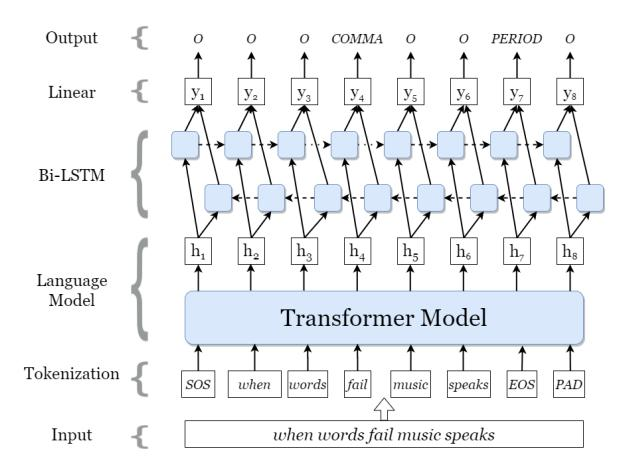
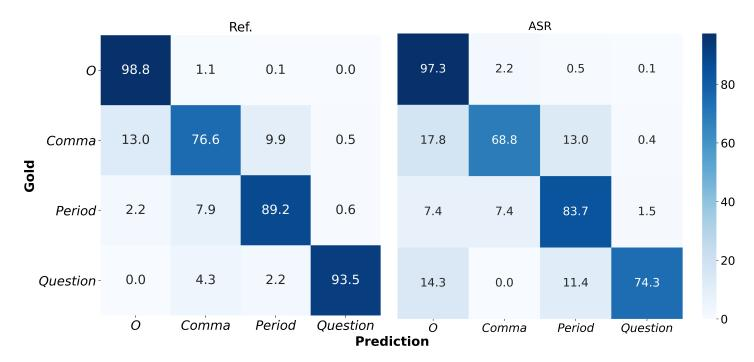
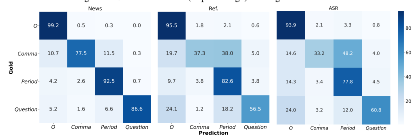

**Source:** *Punctuation Restoration using Transformer Models for High-and Low-Resource Languages* — [PDF](https://aclanthology.org/2020.wnut-1.18.pdf)

# Punctuation Restoration using Transformer Models for High-and Low-Resource Languages

Tanvirul Alam1 Akib Khan1 Firoj Alam2

{tanvirul.alam, akib.khan}@bjitgroup.com, fialam@hbku.edu.qa 1 BJIT Limited, Dhaka, Bangladesh 2 Qatar Computing Research Institute, HBKU, Qatar

## Abstract

Punctuation restoration is a common postprocessing problem for Automatic Speech Recognition (ASR) systems. It is important to improve the readability of the transcribed text for the human reader and facilitate NLP tasks. Current state-of-art address this problem using different deep learning models. Recently, transformer models have proven their success in downstream NLP tasks, and these models have been explored very little for the punctuation restoration problem. In this work, we explore different transformer based models and propose an augmentation strategy for this task, focusing on high-resource (English) and low-resource (Bangla) languages. For English, we obtain comparable state-of-the-art results, while for Bangla, it is the first reported work, which can serve as a strong baseline for future work. We have made our developed Bangla dataset publicly available for the research community.

### 1 Introduction

Due to the recent advances in deep learning methods, the accuracy of Automatic Speech Recognition (ASR) systems has increased significantly (e.g., 3.4% WER on LibriSpeech noisy test set [\(Park](#page-9-0) [et al.,](#page-9-0) [2020\)](#page-9-0)). The improved performance of ASR enabled the development of voice assistants (e.g., Siri, Cortana, Bixby, Alexa, and Google Assistant) and their wider use at the user end. Among different components (e.g., acoustic, language model), pre- and post-processing steps, the punctuation restoration is one of the post-processing steps that also needs to be dealt with to improve the readability and utilize the transcriptions in the subsequent NLP applications [\(Jones et al.,](#page-9-1) [2003;](#page-9-1) [Matusov et al.,](#page-9-2) [2007\)](#page-9-2).[1](#page-0-0) This is because state-of-the-art NLP models are mostly trained using punctuated texts (e.g.,

texts from newspaper articles, Wikipedia). Hence, the lack of punctuation significantly degrades performance. For example, there is a performance difference of more than ∼ 10% when the model is trained with newspaper texts and tested with transcriptions for the Named Entity Recognition system [\(Alam et al.,](#page-8-0) [2015\)](#page-8-0).

To address this issue, most of the earlier efforts on the punctuation restoration task have been done using lexical, acoustic, prosodic, or a combination of these features [\(Gravano et al.,](#page-9-4) [2009;](#page-9-4) [Levy et al.,](#page-9-5) [2012;](#page-9-5) [Zhang et al.,](#page-10-0) [2013;](#page-10-0) [Xu et al.,](#page-10-1) [2014;](#page-10-1) [Szaszak´](#page-10-2) [and Tundik](#page-10-2) ¨ , [2019;](#page-10-2) [Che et al.,](#page-8-1) [2016a\)](#page-8-1). For the punctuation restoration task, lexical features have been widely used because the model can be trained using any punctuated text (i.e., publicly available newspaper articles or content from Wikipedia) and because of the availability of such large-scale text. This is a reasonable choice as developing punctuated transcribed text is a costly procedure.

In terms of machine learning models, conditional random field (CRF) has been widely used in earlier studies [\(Lu and Ng,](#page-9-6) [2010;](#page-9-6) [Zhang et al.,](#page-10-0) [2013\)](#page-10-0). Lately, the use of deep learning models, such as Long Short-Term Memory (LSTM), Convolutional Neural Network (CNN), and transformers have also been used [\(Che et al.,](#page-8-2) [2016b;](#page-8-2) [Gale and](#page-9-7) [Parthasarathy,](#page-9-7) [2017;](#page-9-7) [Zelasko et al.,](#page-10-3) [2018;](#page-10-3) [Wang](#page-10-4) [et al.,](#page-10-4) [2018\)](#page-10-4) for this task.

There has been a variant of transformer based language models (e.g., BERT [\(Devlin et al.,](#page-9-8) [2019a\)](#page-9-8), RoBERTa [\(Liu et al.,](#page-9-9) [2019\)](#page-9-9)), which have not been explored widely to address this problem. Hence, we aimed to explore different architectures and finetune pre-trained models for this task focusing on English and Bangla. Punctuation restoration models are usually trained on clean texts but used on noisy ASR texts. As such, the performance may degrade due to errors introduced by ASR models which are not present in the training data. We design an augmentation strategy (see Section [4.1.2\)](#page-4-0)

1Example of downstream NLP applications include question answering, information extraction, named entity recognition [\(Makhoul et al.,](#page-9-3) [2005\)](#page-9-3), text summarization, etc.

to address this issue. For English, we train and evaluate the models using IWSLT reference and ASR test datasets. We report that our proposed augmentation strategy yields a 3.8% relative improvement in the F1 score on ASR transcriptions for English and obtains state-of-the-art results. For Bangla, there has not been any prior reported work for punctuation restoration. In addition, no resource has been found. Therefore, we prepare a training dataset from a news corpus and provide strong baselines for news, reference, and ASR transcriptions. To shade light in the current state-of-the-art on punctuation restoration task, our contributions in this study are as follows:

- 1. Explore transformer based language models for the punctuation restoration task.
- 2. Propose an augmentation strategy.
- 3. Prepare training and evaluation datasets for Bangla and provide strong benchmark results.
- 4. We have made our source code and datasets publicly available.[2](#page-1-0)

We organize the rest of the paper as follows. In Section [2,](#page-1-1) we discuss recent works based on lexical features. We describe English and Bangla datasets used in this study in Section [3.](#page-1-2) Experimental details are provided in Section [4.](#page-3-0) We compare our results against other published results on the IWSLT dataset and provide benchmark results on the Bangla dataset in Section [5.](#page-5-0) We conclude the paper in Section [6.](#page-8-3)

### 2 Related Work

Recent lexical features based approaches for punctuation restoration tasks are predominantly based on deep neural networks. [Che et al.](#page-8-2) [\(2016b\)](#page-8-2) used pre-trained word embeddings to train feedforward deep neural network and CNN. Their result showed improvements over a CRF based approach that uses purely text data.

Since context is important for this type of task, several studies explored the recurrent neural network (RNN) based architectures combined with CRF and pre-trained word vectors. For instance, [Tilk and Alumae¨](#page-10-5) [\(2016\)](#page-10-5) used a bidirectional recurrent neural network (RNN) with an attention mechanism to improve performance over DNN and CNN models. In another study, [Gale and Parthasarathy](#page-9-7) [\(2017\)](#page-9-7) used character-level LSTM architecture to

2[https://github.com/xashru/](https://github.com/xashru/punctuation-restoration) [punctuation-restoration](https://github.com/xashru/punctuation-restoration)

achieve results that are competitive with the wordlevel CRF based approach. [Yi et al.](#page-10-6) [\(2017\)](#page-10-6) combined bidirectional LSTM with a CRF layer and an ensemble of three networks. They further used knowledge distillation to transfer knowledge from the ensemble of networks to a single DNN network.

Transformer based approaches have been explored in several studies [\(Yi and Tao,](#page-10-7) [2019;](#page-10-7) [Nguyen](#page-9-10) [et al.,](#page-9-10) [2019\)](#page-9-10). [Yi and Tao](#page-10-7) [\(2019\)](#page-10-7) combined pretrained word and speech embeddings that improves performance compared to only word embedding based model. [Nguyen et al.](#page-9-10) [\(2019\)](#page-9-10) used transformer architecture to restore both punctuation and capitalization. Punctuation restoration is also important for machine translation. The study by [Wang](#page-10-4) [et al.](#page-10-4) [\(2018\)](#page-10-4) used a transformer based model for spoken language translation. They achieved significant improvements over CNN and RNN baselines, especially on joint punctuation prediction task.

More recent approaches are based on pre-trained transformer based models. [Makhija et al.](#page-9-11) [\(2019\)](#page-9-11) used pre-trained BERT [\(Devlin et al.,](#page-9-8) [2019a\)](#page-9-8) model with bidirectional LSTM and a CRF layer to achieve state-of-the-art result on reference transcriptions. [Yi et al.](#page-10-8) [\(2020\)](#page-10-8) used adversarial multitask learning with auxiliary parts of speech tagging task using a pre-trained BERT model.

In this study, we also explore transformer based models; however, unlike prior works that solely studied one architecture (BERT), we experiment with different models. We also propose a novel augmentation scheme that improves the performance. Our augmentation is closely related to the augmentation techniques proposed in [\(Wei and Zou,](#page-10-9) [2019b\)](#page-10-9) where the authors consider synonym replacement, random insertion, random swap, and random deletion. While their work is intended for the text classification tasks, we propose a different version of it for this study, which is a sequence labeling task. We do not use synonym replacement and random swap as they do not usually appear in speech transcription.

## 3 Datasets

### 3.1 English Dataset

We use IWSLT dataset for English punctuation restoration, which consists of transcriptions from TED Talks.[3](#page-1-3) Though this dataset was originally released in the IWSLT evaluation campaign in 2012

3[http://hltc.cs.ust.hk/iwslt/index.](http://hltc.cs.ust.hk/iwslt/index.php/evaluation-campaign/ted-task.html) [php/evaluation-campaign/ted-task.html](http://hltc.cs.ust.hk/iwslt/index.php/evaluation-campaign/ted-task.html)

| Dataset     | Total Period |               | Comma          | Question     | Other (O)        |  |  |
|-------------|--------------|---------------|----------------|--------------|------------------|--|--|
|             |              |               | English        |              |                  |  |  |
| Train       | 2102417      | 132393 (6.3%) | 158392 (7.53%) | 9905 (0.47%) | 1801727 (85.7%)  |  |  |
| Dev         | 295800       | 18910 (6.39%) | 22451 (7.59%)  | 1517 (0.51%) | 252922 (85.5%)   |  |  |
| Test (Ref.) | 12626        | 807 (6.39%)   | 830 (6.57%)    | 46 (0.36%)   | 10943 (86.67%)   |  |  |
| Test (ASR)  | 12822        | 809 (6.31%)   | 798 (6.22%)    | 35 (0.27%)   | 11180 (87.19%)   |  |  |
|             |              |               | Bangla         |              |                  |  |  |
| Train       | 1379986      | 98791 (7.16%) | 65235 (4.73%)  | 4555 (0.33%) | 1211405 (87.78%) |  |  |
| Dev         | 179371       | 13161 (7.34%) | 7544 (4.21%)   | 534 (0.3%)   | 158132 (88.16%)  |  |  |
| Test (news) | 87721        | 6263 (7.14%)  | 4102 (4.68%)   | 305 (0.35%)  | 77051 (87.84%)   |  |  |
| Test (Ref.) | 6821         | 996 (14.6%)   | 279 (4.09%)    | 170 (2.49%)  | 5376 (78.82%)    |  |  |
| Test (ASR)  | 6417         | 887 (13.82%)  | 253 (3.94%)    | 125 (1.95%)  | 5152 (80.29%)    |  |  |

Table 1: Distributions of English and Bangla datasets. The number in parenthesis represents percentage.

| Dataset    | Eng  | lish | Bangla |     |  |  |  |
|------------|------|------|--------|-----|--|--|--|
| 24450      | Avg. | Std  | Avg.   | Std |  |  |  |
| Train      | 13.8 | 10.8 | 12.4   | 7.6 |  |  |  |
| Dev        | 13.5 | 10.7 | 12.1   | 7.2 |  |  |  |
| Test: News | -    | -    | 12.4   | 7.2 |  |  |  |
| Test: Ref. | 13.8 | 9.6  | 4.8    | 3.2 |  |  |  |
| Test: ASR  | 14.2 | 9.7  | 5.3    | 3.6 |  |  |  |

Table 2: Average sentence length (Avg.) with standard deviation (Std.) for each language.

(Cettolo et al., 2013; Federico et al., 2012), later, Che et al. (2016b) prepared and released a refined version of the IWSLT dataset publicly. For this study, we use the same train, development, and test splits released by Che et al. (2016b). The training and development set consist of 2.1M and 296K words, respectively. Two test sets are provided with manual and ASR transcriptions, each containing 12626 and 12822 words, respectively. These are taken from the test data of IWSLT2011 ASR dataset.3 A detailed description of the dataset can be found in (Che et al., 2016b). There are four labels including three punctuation marks: (i) Comma: includes commas, colons and dashes, (ii) Period: includes full stops, exclamation marks and semicolons, (iii) Question: only question mark, and (iv) O: for any other token.

#### 3.2 Bangla Dataset

To the best of our knowledge, there are no publicly available resources for the Bangla punctuation restoration task. Hence, we prepare a dataset using a publicly available corpus of Bangla newspaper articles (Khatun et al., 2019). This dataset is available in train and test splits. For our task, we selected 4000 and 500 articles respectively for preparing training and development sets from their train split, and 200 articles for test from their test split. Training, development, and test sets consist of 1.38M, 180K, and 88K words respectively.

Additionally, we prepare two test datasets consisting of manual and ASR transcriptions to evaluate the performance. We collected 65 minutes of speech excerpts extracted from four Bangla short stories (i.e., monologue read speech).4 These are manually transcribed with punctuation. We obtained ASR transcriptions for the same audios using Google Cloud speech API.5 Note that the Google speech API does not provide punctuation for Bangla. The obtained ASR transcriptions from Google speech API are then manually annotated with punctuation. We computed the Word Error Rate (WER) of the ASR transcriptions by comparing against our manual transcriptions, which results in 14.8% WER. The number of words in manual and ASR transcriptions consists of 6821 and 6417 words respectively. Similar to English, we consider four punctuation marks for Bangla i.e., Period, Comma, Question, and O.

In Table 1, we present the distributions of the labels for both English and Bangla. In parenthesis, we provide the percentage of the punctuation. In general, the distribution of questions is low (less than 1%), which we observe both in English and Bangla news data. However, this is much higher in the Bangla manual and ASR transcriptions. This is due to the fact that these texts are selected from short stories where people often engage in conversation and ask each other questions. The literary style of the stories is different from news and as a result, the distribution of *Period* is also higher in the Bangla manual and ASR transcriptions. This results in a much smaller average sentence length in these datasets, as can be seen in Table 2. We can compare these numbers with English as reported

&lt;sup>4Due to the limited annotation resources we could not collect more data, and this could be a future effort.

5https://cloud.google.com/
speech-to-text

Figure 1: A general model architecture for our experiments.

in [\(Zelasko et al.,](#page-10-3) [2018\)](#page-10-3). The authors reported 79.1% *O* token on the training data collected from conversational speech. We have 78.82% *O* token on our reference test data. This suggests that our transcribed data are more similar in distribution to natural conversations.

### 4 Experiments

For this study, we explored different transformer based models for both English and Bangla. In addition, we used bidirectional LSTM (BiLSTM) on top of the pre-trained transformer network, and an augmentation method to improve the performance of the models.

#### 4.1 Models and Architectures

In Figure [1,](#page-3-1) we report a general network architecture that we used in our experiments. We obtained d dimensional embedding vector from the pre-trained language model for each token. This is used as input for a BiLSTM layer, consisting of h hidden units. This allows the network to make effective use of both past and future contexts for prediction. The outputs from the forward and backward LSTM layers are concatenated at each time step and fed to a fully connected layer with four output neurons, which correspond to 3 punctuation marks and one *O* token.

As can be seen in the Figure, the input sentence "*when words fail music speaks*" does not have any punctuation, and the task of the model is to predict a *Comma* after the word "fail" and *Period* after the word "speaks" to produce the output sentence "*when words fail, music speaks.*"

We measure the performance of the models in terms of precision (P), recall (R), and F1-score (F1).

### 4.1.1 Pretrained Language Model

Transfer learning has been popular in computer vision, and the emergence of the transformers [\(Vaswani et al.,](#page-10-10) [2017\)](#page-10-10) has shown the light to use transfer learning in NLP applications. The models are trained on a large text corpus (e.g., BERT is trained on 800M words from Book Corpus and 2,500M words from Wikipedia) and their success has been proven by fine-tuning downstream NLP applications. In our experiment, we used such pre-trained language models for the punctuation restoration task. We briefly discuss the monolingual language models for English and multi-lingual language models used in this study.

BERT [\(Devlin et al.,](#page-9-8) [2019a\)](#page-9-8) is designed to learn deep bidirectional representation from unlabeled texts by jointly conditioning the left and right contexts in all layers. It uses a multi-layer bidirectional transformer encoder architecture [\(Vaswani et al.,](#page-10-10) [2017\)](#page-10-10) and makes use of two objectives during pretraining: masked language model (MLM) and next sentence prediction (NSP) task.

RoBERTa [\(Liu et al.,](#page-9-9) [2019\)](#page-9-9) performs a replication study of BERT pretraining and shows that improvements can be made using larger datasets, vocabulary, and training on longer sequences with bigger batches. It uses dynamic masking of the tokens i.e., the masking pattern is generated every time a sequence is fed to the model instead of generating them beforehand. They also remove the NSP task and use only MLM loss for pretraining.

ALBERT [\(Lan et al.,](#page-9-14) [2020\)](#page-9-14) incorporates a couple of parameter reduction techniques to design an architecture with significantly fewer parameters than a traditional BERT architecture. The *first improvement* is factorizing embedding parameters by decomposing the embedding matrix V × H into two smaller matrices V × E and E × H, where V is the vocabulary size, E is the word piece embedding size, and H is hidden layer size. This reduces embedding parameters from O(V × H) to O(V × E + E × H), which can be significant when E << H. The *second improvement* is parameter sharing across layers. This prevents the parameter from growing as the depth is increased. The NSP task introduced in BERT is replaced by a sentence-order prediction (SOP) task in ALBERT.

DistilBERT [\(Sanh et al.,](#page-10-11) [2019\)](#page-10-11) uses knowledge distillation from BERT to train a model that has 40% fewer parameters and is 60% faster while retaining 97% of language understanding capabilities of the BERT model. The training objective is a linear combination of distillation loss, supervised training loss, and cosine distance loss.

Multilingual Models MLM has also been utilized for learning language models from large scale multi-lingual corpora. BERT multilingual model (mBERT) is trained on more than 100 languages with the largest Wikipedia dataset. To account for the variation among Wikipedia sizes of different languages, data is sampled using an exponentially smoothed weighting (with a factor 0.7) so that highresource languages like English are under-sampled compared to low resource languages. Word counts are weighted the same way as the data so that lowresource language vocabularies are up weighted by some factor.

Cross-lingual models (XLM) [\(Conneau and](#page-8-5) [Lample,](#page-8-5) [2019\)](#page-8-5) use MLM in multiple language settings, similar to BERT. Instead of using a pair of sentences, an arbitrary number of sentences are used with text length truncated at 256 tokens.

XLM-RoBERTa [\(Conneau et al.,](#page-8-6) [2020\)](#page-8-6) is trained with a multilingual MLM objective similar to XLM but on a larger dataset. It is trained in one hundred languages, using more than two terabytes of filtered Common Crawl data [\(Wenzek et al.,](#page-10-12) [2020\)](#page-10-12).

### 4.1.2 Augmentation

For this study, we propose an augmentation method inspired by the study of [Wei and Zou](#page-10-13) [\(2019a\)](#page-10-13), as discussed earlier. Our augmentation method is based on the types of error ASR makes during recognition, which include *insertion*, *substitution*, and *deletion*.

Due to the lack of large-scale manual transcriptions, punctuation restoration models are typically trained using written text, which is well-formatted and correctly punctuated. Hence, the trained model lacks the knowledge of the typical errors that ASR makes. To train the model with such characteristics, we use an augmentation technique that simulates such errors and dynamically creates a new sequence on the fly in a batch. Dynamic augmentation is different from the traditional augmentation approach widely used in NLP [\(Wei and Zou,](#page-10-13) [2019a\)](#page-10-13); however, it is widely used in computer vision for image classification tasks [\(Cubuk et al.,](#page-9-15)

[2020\)](#page-9-15).

The three different kinds of augmentation corresponding to three possible errors are as follows.

- 1. *First* (i.e., substitution), we replace a token by another token. In our experiment, we randomly replace a token with the special *unknown* token.
- 2. *Second* (i.e., deletion), we delete some tokens randomly from the processed input sequence.
- 3. *Finally*, we add (i.e., insertion) the *unknown* token at some random position of the input.

We hypothesize that not all three errors are equally prevalent, hence, different augmentation will have a different effect on performance. Keeping this in mind, to process input text, we used three tunable parameters: *(i)* a parameter to determine token change probability, α, *(ii)* a parameter, αsub, to control the probability of substitution, *(iii)* a parameter, αdel, to control the probability of deletion. Probability of insertion is given by 1 − (αsub + αdel).

When applying substitution, we replaced the token in that position with the *unknown* token and left the target punctuation mark unchanged. For deletion, both the token and the punctuation mark in that position are deleted. For insertion, we inserted the unknown token and *O* token, in that position.

Since deletion and insertion operation may make the sequence smaller or longer than the fixed sequence length we used during training, we added padding or truncated as necessary.

#### 4.2 Experimental Settings

We used pre-trained models available in the HuggingFace's Transformers library [\(Wolf et al.,](#page-10-14) [2019\)](#page-10-14). More details about different architectures can be found on HuggingFace website.[6](#page-4-1) For tokenization, we used model-specific tokenizers.

During training, we used a maximum sequence length of 256. Each sequence starts with a special *start of sequence* token and ends with a special *end of sequence* token. Since the tokenizers use byte-pair encoding [\(Sennrich et al.,](#page-10-15) [2016\)](#page-10-15), a word may be tokenized into subword units.[7](#page-4-2) If adding the subword tokens of a word results in sequence length exceeding 256, we excluded those tokens

6[https://huggingface.co/transformers/](https://huggingface.co/transformers/pretrained_models.html) [pretrained\\_models.html](https://huggingface.co/transformers/pretrained_models.html)

7 If the model predicts punctuation in the middle of a word, these are ignored.

| Test | Model                                |      | Commo | ı     |      | Period |       | (    | Questio | n     | Overall |      |                  |
|------|--------------------------------------|------|-------|-------|------|--------|-------|------|---------|-------|---------|------|------------------|
| rest |                                      |      | R     | $F_1$ | P    | R      | $F_1$ | P    | R       | $F_1$ | P       | R    | $\overline{F_1}$ |
|      | SAPR (Wang et al., 2018)             | 57.2 | 50.8  | 55.9  | 96.7 | 97.3   | 96.8  | 70.6 | 69.2    | 70.3  | 78.2    | 74.4 | 77.4             |
|      | DRNN-LWMA-pre (Kim, 2019) 62         |      | 60.8  | 61.9  | 77.3 | 73.7   | 75.5  | 69.6 | 69.6    | 69.6  | 69.9    | 67.2 | 68.6             |
|      | Self-attention (Yi and Tao, 2019)    | 67.4 | 61.1  | 64.1  | 82.5 | 77.4   | 79.9  | 80.1 | 70.2    | 74.8  | 76.7    | 69.6 | 72.9             |
|      | BERT-Transfer (Makhija et al., 2019) | 70.8 | 74.3  | 72.5  | 84.9 | 83.3   | 84.1  | 82.7 | 93.5    | 87.8  | 79.5    | 83.7 | 81.4             |
|      | BERT-Adversarial (Yi et al., 2020)   | 76.2 | 71.2  | 73.6  | 87.3 | 81.1   | 84.1  | 79.1 | 72.7    | 75.8  | 80.9    | 75.0 | 77.8             |
|      | BERT-base-uncased                    | 71.7 | 70.1  | 70.9  | 82.5 | 83.1   | 82.8  | 75.0 | 84.8    | 79.6  | 77.0    | 76.8 | 76.9             |
|      | BERT-large-uncased                   | 72.6 | 72.8  | 72.7  | 84.8 | 84.6   | 84.7  | 70.0 | 91.3    | 79.2  | 78.3    | 79.0 | 78.6             |
| D. C | RoBERTa-base                         | 73.6 | 75.1  | 74.3  | 84.9 | 87.6   | 86.2  | 77.4 | 89.1    | 82.8  | 79.2    | 81.5 | 80.3             |
| Ref. | RoBERTa-large                        | 76.9 | 75.8  | 76.3  | 86.8 | 90.5   | 88.6  | 72.9 | 93.5    | 81.9  | 81.6    | 83.3 | 82.4             |
|      | ALBERT-base-v2                       | 70.1 | 75.5  | 72.7  | 84.9 | 84.1   | 84.5  | 79.5 | 76.1    | 77.8  | 77.2    | 79.7 | 78.4             |
|      | ALBERT-large-v2                      | 75.1 | 72.4  | 73.7  | 82.0 | 88.0   | 84.9  | 77.6 | 82.6    | 80.0  | 78.7    | 80.2 | 79.4             |
|      | DistilBERT-base-uncased              | 67.0 | 65.5  | 66.3  | 77.1 | 81.0   | 79.0  | 69.2 | 78.3    | 73.5  | 72.1    | 73.3 | 72.7             |
|      | BERT-base-multilingual-uncased       | 70.4 | 68.1  | 69.2  | 80.1 | 85.4   | 82.7  | 62.7 | 80.4    | 70.5  | 75.0    | 76.7 | 75.9             |
|      | XLM-RoBERTa-base                     | 75.1 | 70.5  | 72.7  | 81.2 | 89.3   | 85.1  | 71.7 | 82.6    | 76.8  | 78.1    | 79.9 | 79.0             |
|      | XLM-RoBERTa-large                    | 73.3 | 80.4  | 76.7  | 87.9 | 86.4   | 87.1  | 82.0 | 89.1    | 85.4  | 80.1    | 83.5 | 81.8             |
|      | DistilBERT-base-multilingual-cased   | 65.5 | 58.0  | 61.5  | 74.8 | 79.2   | 76.9  | 58.2 | 69.6    | 63.4  | 70.1    | 68.4 | 69.3             |
|      | RoBERTa-large + augmentation         | 76.8 | 76.6  | 76.7  | 88.6 | 89.2   | 88.9  | 82.7 | 93.5    | 87.8  | 82.6    | 83.1 | 82.9             |
|      | Self-attention (Yi and Tao, 2019)    | 64.0 | 59.6  | 61.7  | 75.5 | 75.8   | 75.6  | 72.6 | 65.9    | 69.1  | 70.7    | 67.1 | 68.8             |
|      | BERT-Adversarial (Yi et al., 2020)   | 72.4 | 69.3  | 70.8  | 80.0 | 79.1   | 79.5  | 71.2 | 68.0    | 69.6  | 74.5    | 72.1 | 73.3             |
|      | BERT-base-uncased                    | 49.3 | 64.2  | 55.8  | 75.3 | 76.3   | 75.8  | 44.7 | 60.0    | 51.2  | 60.4    | 70.0 | 64.9             |
|      | BERT-large-uncased                   | 49.9 | 67.0  | 57.2  | 77.0 | 78.9   | 77.9  | 50.0 | 74.3    | 59.8  | 61.4    | 73.0 | 66.7             |
|      | RoBERTa-base                         | 51.9 | 69.3  | 59.3  | 77.5 | 80.3   | 78.9  | 50.0 | 65.7    | 56.8  | 62.8    | 74.7 | 68.2             |
|      | RoBERTa-large                        | 56.6 | 67.9  | 61.8  | 78.7 | 85.3   | 81.9  | 46.6 | 77.1    | 58.1  | 66.5    | 76.7 | 71.3             |
|      | ALBERT-base-v2                       | 48.7 | 66.0  | 56.1  | 75.7 | 79.9   | 77.7  | 59.3 | 45.7    | 51.6  | 60.6    | 72.4 | 66.0             |
| ASR  | ALBERT-large-v2                      | 52.1 | 64.4  | 57.6  | 73.8 | 82.7   | 78.0  | 53.3 | 68.6    | 60.0  | 62.2    | 73.5 | 67.4             |
|      | DistilBERT-base-uncased              | 46.8 | 59.1  | 52.2  | 70.0 | 74.8   | 72.3  | 48.9 | 65.7    | 56.1  | 57.3    | 67.0 | 61.8             |
|      | BERT-base-multilingual-uncased       | 49.8 | 62.4  | 55.4  | 72.0 | 78.2   | 75.0  | 47.8 | 62.9    | 54.3  | 59.9    | 70.2 | 64.6             |
|      | XLM-RoBERTa-base                     | 54.7 | 61.7  | 58.0  | 73.2 | 83.3   | 77.9  | 47.7 | 60.0    | 53.2  | 63.6    | 72.3 | 67.7             |
|      | XLM-RoBERTa-large                    | 53.2 | 71.4  | 61.0  | 82.0 | 81.8   | 81.9  | 62.5 | 71.4    | 66.7  | 65.5    | 76.6 | 70.6             |
|      | DistilBERT-base-multilingual-cased   | 47.5 | 52.8  | 50.0  | 66.7 | 71.9   | 69.2  | 41.3 | 54.3    | 46.9  | 56.7    | 62.2 | 59.3             |
|      | RoBERTa-large + augmentation         | 64.1 | 68.8  | 66.3  | 81.0 | 83.7   | 82.3  | 55.3 | 74.3    | 63.4  | 72.0    | 76.2 | 74.0             |

Table 3: Results on IWSLT2011 manual (Ref.) and ASR transcriptions of test sets. Highlighted rows are the comparable results between ours and previous study. For overall best results we use bold form, and for the best F1 of individual punctuation we use a combination of bold and italic form.

from the current sequence and start the next sequence from them. We use padding token after the end of sequence token to fill the remaining slots of the sequence. Padding tokens are masked to avoid performing attention on them. We use a batch size of 8 and shuffle the sequences before each epoch. Our chosen learning rates are 5e-6 for large models, and 1e-5 for base models, which are optimized using the development set. LSTM dimension h is set to the token embedding dimension d. All models are trained with Adam (Kingma and Ba, 2015) optimization algorithm for 10 epochs. Other parameters are kept as the default settings, discussed in (Devlin et al., 2019b). The model with the best performance on the development set is used for evaluating the test datasets.

For the augmentation experiments, we used  $\alpha \in \{0.05, 0.1, 0.15, 0.2\}$ ,  $\alpha_{sub} \in \{0.2, 0.3, 0.4, 0.5\}$ ,  $\alpha_{del} \in \{0.2, 0.3, 0.4, 0.5\}$  with additional constraint  $0.5 \leq (\alpha_{sub} + \alpha_{del}) \leq 0.8$ . Optimum values for these were obtained using the development set.

#### 5 Results and Discussions

#### 5.1 Results on English Dataset

In Table 3, we report our experimental results with a comparison from previous results on the same dataset. We provide the results obtained using BERT, RoBERTa, ALBERT, DistilBERT, mBERT, XLM-RoBERTa models without augmentation. *Large* variants of the models perform better than the *Base* models. Monolingual models perform better than their multilingual counterparts. RoBERTa achieves a better result than other models as it was trained on a larger corpus and has a larger vocabulary. Our best result is obtained using the RoBERTa model with augmentation in which the parameters were  $\alpha=0.15, \alpha_{sub}=0.4, \alpha_{del}=0.4$ . Performance gain from augmentation comes from improved precision.

We obtained the state of the art result on both test sets in terms of the overall  $F_1$  score (rows are highlighted). On Ref. test set, we obtained the best result on *Comma*, and comparable results for

| Test | Model                              |                | Comma |       |      | Period |       |      | Question |       |      | Overall |       |  |
|------|------------------------------------|----------------|-------|-------|------|--------|-------|------|----------|-------|------|---------|-------|--|
| rest | Wiodei                             | $\overline{P}$ | R     | $F_1$ | P    | R      | $F_1$ | P    | R        | $F_1$ | P    | R       | $F_1$ |  |
|      | BERT-base-multilingual-uncased     | 79.8           | 68.2  | 73.5  | 80.4 | 85.4   | 82.8  | 72.1 | 77.0     | 74.5  | 79.9 | 78.5    | 79.2  |  |
|      | DistilBERT-base-multilingual-cased | 72.1           | 60.8  | 66.0  | 74.5 | 71.6   | 73.0  | 56.9 | 67.5     | 61.8  | 73.0 | 67.3    | 70.1  |  |
| News | XLM-MLM-100-1280                   | 76.9           | 71.2  | 73.9  | 82.0 | 83.4   | 82.9  | 70.2 | 76.4     | 73.2  | 80.0 | 78.5    | 79.3  |  |
| News | XLM-RoBERTa-large                  | 86.0           | 77.0  | 81.2  | 89.4 | 92.3   | 90.8  | 77.4 | 85.6     | 81.3  | 87.8 | 86.2    | 87.0  |  |
|      | XLM-RoBERTa-large + augmentation   |                | 77.5  | 81.4  | 88.8 | 92.5   | 90.6  | 77.9 | 86.6     | 82.0  | 87.4 | 86.6    | 87.0  |  |
|      | BERT-base-multilingual-uncased     | 35.6           | 34.4  | 35.0  | 67.4 | 64.7   | 66.0  | 39.8 | 28.8     | 33.4  | 58.5 | 54.6    | 56.5  |  |
|      | DistilBERT-base-multilingual-cased | 32.6           | 31.5  | 32.1  | 64.0 | 50.2   | 56.3  | 32.5 | 14.7     | 20.2  | 54.3 | 42.4    | 47.6  |  |
| Ref. | XLM-MLM-100-1280                   | 33.4           | 39.8  | 36.3  | 70.3 | 64.0   | 67.0  | 42.4 | 22.9     | 29.8  | 59.2 | 54.5    | 56.7  |  |
| Rei. | XLM-RoBERTa-large                  | 39.3           | 36.9  | 38.1  | 76.9 | 81.4   | 79.1  | 54.3 | 58.8     | 56.5  | 67.6 | 70.2    | 68.8  |  |
|      | XLM-RoBERTa-large + augmentation   | 43.3           | 37.3  | 40.1  | 76.5 | 82.6   | 79.4  | 53.0 | 56.5     | 54.7  | 68.3 | 70.8    | 69.5  |  |
|      | BERT-base-multilingual-uncased     | 29.3           | 30.0  | 29.7  | 60.6 | 60.2   | 60.4  | 36.1 | 38.4     | 37.2  | 51.7 | 52.0    | 51.9  |  |
|      | DistilBERT-base-multilingual-cased | 29.0           | 33.6  | 31.1  | 62.6 | 50.6   | 56.0  | 31.3 | 20.8     | 25.0  | 51.2 | 44.3    | 47.5  |  |
| ASR  | XLM-MLM-100-1280                   | 31.2           | 38.7  | 34.6  | 63.4 | 59.5   | 61.4  | 32.0 | 24.8     | 27.9  | 52.8 | 51.9    | 52.4  |  |
| ASK  | XLM-RoBERTa-large                  | 38.3           | 35.6  | 36.9  | 69.2 | 77.2   | 73.0  | 38.5 | 52.0     | 44.2  | 60.3 | 66.4    | 63.2  |  |
|      | XLM-RoBERTa-large + augmentation   | 37.2           | 33.2  | 35.1  | 69.1 | 77.8   | 73.2  | 45.5 | 60.8     | 52.1  | 61.1 | 67.2    | 64.0  |  |

Table 4: Result on Bangla test datasets.

Question (highlighted using a combination of the bold and italic form). However, SAPR (Wang et al., 2018) method performed much better compared to others for Period on this data. On ASR test set, our result is marginally better than Yi et al. (2020) for overall  $F_1$  score. Our model performed better for Period but comparatively lower for Comma and Question. Overall, our model has better recall than precision on this dataset.

#### **5.2** Results on Bangla Dataset

In Table 4, we report results on the Bangla test set comprised of news, manual, and ASR transcriptions. Since no monolingual transformer model is publicly available for Bangla, we explored different multilingual models. We obtained the best result using XLM-RoBERTa (large) model as it is trained with more texts for low-resource languages like Bangla and has larger vocabulary for them. This is consistent with the findings reported in (Liu et al., 2019), where the authors report improvement over multi-lingual BERT and XLM models in cross-lingual understanding tasks for low-resource languages. We apply augmentation on XLM-RoBERTa model and best result is obtained using augmentation parameters  $\alpha = 0.15$ ,  $\alpha_{sub}=0.4$ , and  $\alpha_{del}=0.4$ . However, the performance gain from augmentation is marginal on

| Dataset             | 4    | -Classe | es    | 3    | -Classe | es    | 2-Classes |      |       |  |
|---------------------|------|---------|-------|------|---------|-------|-----------|------|-------|--|
| Duuset              |      | R       | $F_1$ | P    | R       | $F_1$ | P         | R    | $F_1$ |  |
| News                | 87.4 | 86.6    | 87.0  | 88.0 | 87.2    | 87.6  | 94.1      | 93.3 | 93.7  |  |
| Ref.                | 68.3 | 70.8    | 69.5  | 72.9 | 75.6    | 74.2  | 83.6      | 86.6 | 85.1  |  |
| News Ref. ASR | 61.1 | 67.2    | 64.0  | 65.1 | 71.5    | 68.1  | 77.0      | 84.7 | 80.6  |  |

Table 5: Result on Bangla test datasets by merging classes.

the Bangla dataset. Overall, performance on the news test set is better compared to the manual and ASR data. Performance for *Comma* is lower than *Period* and *Question*. Compared to English, we notice a performance drop of about 10% for *Period* and *Question*, but for *Comma*, this is more than 30% on the ASR test set.

For many applications (e.g., semi-automated subtitles generation), it is of utmost importance to facilitate human labelers to reduce their time and effort and make the manual annotation process faster. In such cases, identifying the correct position of the punctuations is important, as reported in (Che et al., 2016b). For Bangla, we wanted to understand what we can gain while merging the punctuation and identifying their position. For this purpose, we evaluate performance on 3-Classes and 2-Classes test sets. We combine Period and Question together to form the 3-classes test sets. Comma is further combined with those to form the 2-Classes test sets, i.e., punctuation or no punctuation. In Table 5, we report the results with binary and multiclass settings using XLM-RoBERTa (large) model coupled with augmentation. As can be seen, the model performs well for predicting punctuation positions. For manual (Ref.) and ASR transcriptions, we have a significant gain while merging the number of classes from four towards two. It could be becauseas the number of classes reduces, the classifier's complexity reduces, which leads to an increase in the model's performance. The performance gain is comparatively lower for news while merging four classes into three classes; however, it increased significantly when reduced to two. Considering these findings, we believe this type of model can help

| Test | Type          | Comma           P         R         F1 |              |                     | Period       |              |                  | (            | Questio      | n                   | Overall             |                  |                  |
|------|---------------|----------------------------------------|--------------|---------------------|--------------|--------------|------------------|--------------|--------------|---------------------|---------------------|------------------|------------------|
|      | турс          | $\overline{P}$                         | R            | $F_1$               | P            | R            | $F_1$            | P            | R            | $F_1$               | P                   | R                | $F_1$            |
| Ref. | Linear CRF | 76.9 75.7                           | 75.8 76.9 | <b>76.3</b> 76.3    | 86.8 88.1 | 90.5 89.0 | <b>88.6</b> 88.5 | 72.9 77.8 | 93.5 91.3 | 81.9 <b>84.0</b> | 81.6 <b>81.7</b> | <b>83.3</b> 83.1 | <b>82.4</b> 82.4 |
| ASR  | Linear CRF | 56.6 56.7                           | 67.9 69.0 | 61.8 <b>62.3</b> | 78.7 78.5 | 85.3 82.8 | <b>81.9</b> 80.6 | 46.6 50.9 | 77.1 80.0 | 58.1 <b>62.2</b> | <b>66.5</b> 66.4    | <b>76.7</b> 76.1 | <b>71.3</b> 70.9 |

Table 6: Results of CRF on IWSLT2011 Ref. and ASR test data with RoBERTa-large model

| Test | Augmentation                                                  |                | Comma |             |      | Period |       |      | Question |       |      | Overall     |       |  |
|------|---------------------------------------------------------------|----------------|-------|-------------|------|--------|-------|------|----------|-------|------|-------------|-------|--|
| Test | Augmentation                                                  | $\overline{P}$ | R     | $F_1$       | P    | R      | $F_1$ | P    | R        | $F_1$ | P    | R           | $F_1$ |  |
|      | None                                                          | 76.9           | 75.8  | 76.3        | 86.8 | 90.5   | 88.6  | 72.9 | 93.5     | 81.9  | 81.6 | 83.3        | 82.4  |  |
|      | Substitution ( $\alpha = 0.1$ )                               | 77.6           | 77.6  | <i>77.6</i> | 87.7 | 90.7   | 89.2  | 76.4 | 91.3     | 83.2  | 82.4 | 84.3        | 83.3  |  |
| Dof  | Substitution ( $\alpha = 0.15$ , random)                      | 76.5           | 76.4  | 76.4        | 87.2 | 90.6   | 88.9  | 86.3 | 95.7     | 90.7  | 82.0 | 83.7        | 82.9  |  |
| Ref. | Delete ( $\alpha = 0.1$ )                                     |                | 76.0  | 75.5        | 88.6 | 88.4   | 88.5  | 84.3 | 93.5     | 88.7  | 81.7 | 82.4        | 82.1  |  |
|      | $Insert(\alpha = 0.05)$                                       | 77.6           | 75.5  | 76.6        | 87.1 | 90.6   | 88.8  | 82.7 | 93.5     | 87.8  | 82.5 | 83.2        | 82.9  |  |
|      | $\mathrm{All}(\alpha=0.15,\alpha_{sub}=0.4,\alpha_{del}=0.4)$ | 76.8           | 76.6  | 76.7        | 88.6 | 89.2   | 88.9  | 82.7 | 93.5     | 87.8  | 82.6 | 83.1        | 82.9  |  |
|      | None                                                          | 56.6           | 67.9  | 61.8        | 78.7 | 85.3   | 81.9  | 46.6 | 77.1     | 58.1  | 66.5 | 76.7        | 71.3  |  |
|      | Substitution ( $\alpha = 0.1$ )                               | 57.0           | 70.8  | 63.1        | 80.8 | 85.4   | 83.1  | 50.9 | 77.1     | 61.4  | 67.5 | <b>78.1</b> | 72.4  |  |
| ASR  | Substitution ( $\alpha = 0.15$ , random)                      | 57.2           | 69.3  | 62.7        | 79.2 | 83.9   | 81.5  | 56.3 | 77.1     | 65.1  | 67.3 | 76.7        | 71.7  |  |
| ASK  | Delete ( $\alpha = 0.1$ )                                     | 60.0           | 70.4  | 64.8        | 82.7 | 82.8   | 82.8  | 52.1 | 71.4     | 60.2  | 70.0 | 76.6        | 73.1  |  |
|      | $Insert(\alpha = 0.05)$                                       | 57.4           | 67.2  | 61.9        | 79.6 | 84.8   | 82.1  | 49.2 | 82.9     | 61.7  | 67.5 | 76.2        | 71.6  |  |
|      | $\mathrm{All}(\alpha=0.15,\alpha_{sub}=0.4,\alpha_{del}=0.4)$ | 64.1           | 68.8  | 66.3        | 81.0 | 83.7   | 82.3  | 55.3 | 74.3     | 63.4  | 72.0 | 76.2        | 74.0  |  |

Table 7: Results of Augmentation IWSLT2011 Ref. and ASR test data with RoBERTa-large model

human annotators in such applications.

#### 5.3 Ablation Studies

We experimented with using CRF after the linear layer for predicting the most probable tag sequence instead of using the softmax layer. However, we did not notice any performance improvement and even a slight decrease in ASR test data performance. The results using RoBERTa large model are reported in Table 6.

We also analyzed the effect on performance when substitution, insert and delete augmentations are applied in isolation. These results are reported in table 7 for RoBERTa large model. We explored substitution with a random token from vocabulary (reported in row Substitution ( $\alpha=0.15$ , random). However, it performed worse compared to substituting with the unknown token. We notice that the performance gain from different augmentations is larger on the ASR test set than the reference test set.

#### 5.4 Discussion

For English, we obtained state-of-art results for manual and ASR transcriptions using our augmentation technique coupled with the RoBERTa-large model. There is still a large difference between manual and ASR transcriptions results. In Figure 2, we report the confusion matrix (in percentage), for

manual and ASR transcriptions. From the figure, we observe that for ASR transcriptions, a high proportion of cases *Question* and *Comma* are predicted as *O* and *Period*. We will investigate this finding further in our future study.

Compared to English, the performance of Bangla is relatively low. We hypothesize several factors are responsible for this. First, the pre-trained monolingual language models for English usually perform better than multilingual models. Even in the case of multilingual models, the content of the English language is higher in the training data, and as a result, the models are expected to perform better for English. Second and perhaps a more important factor is the nature of training data. For Bangla, due to the lack of punctuated transcribed data, we used a news corpus for training. Hence, the trained model does not learn the nuances of transcriptions, which reduces prediction accuracy. Third, our ASR transcriptions are taken from some story excerpts, containing monologue and a significant amount of conversations (dialogue), which varies in terms of complexity (e.g., the dialogue has interruptions and overlap, short vs long utterance). An aspect of such a complexity is also evident in Table 1, where we see that the distribution of *Period* is almost double compared to news data and the distribution of Question is more than six times greater. On the other hand, for English, both train and test data are taken

Figure 2: Confusion matrix (in percentage) for English test datasets.

Figure 3: Confusion matrix (in percentage) for Bangla test datasets.

from TED talks, and there is no such discrepancy between the data distributions.

Similarly to English, we also wanted to see error cases for Bangla. In Figure [3,](#page-8-8) we report the confusion matrix. We observed similar phenomenon as English for Bangla, comparatively much higher in proportion, i.e., *Question* and *Comma* are predicted as *O* and *Period* for news, manual and ASR transcriptions.

## 6 Conclusion

In this study, we explore different transformer models for high-and low-Resource languages (i.e., English and Bangla). In addition, we propose an augmentation technique, which improves performance on noisy ASR texts. There has not been any reported result and resources for punctuation restoration on Bangla. Our study, findings, and developed resources will enrich and push the current state-of-art for this low-resource language. We have released the created Bangla dataset and code for the research community.

## References

Firoj Alam, Bernardo Magnini, and Roberto Zanoli. 2015. Comparing named entity recognition on transcriptions and written texts. In *Harmonization and Development of Resources and Tools for Italian Nat-* *ural Language Processing within the PARLI Project*, pages 71–89. Springer.

Mauro Cettolo, Jan Niehues, Sebastian Stuker, Luisa ¨ Bentivogli, and Marcello Federico. 2013. Report on the 10th iwslt evaluation campaign. In *Proceedings of the International Workshop on Spoken Language Translation, Heidelberg, Germany*.

Xiaoyin Che, Sheng Luo, Haojin Yang, and Christoph Meinel. 2016a. Sentence boundary detection based on parallel lexical and acoustic models. In *Interspeech*, pages 2528–2532.

Xiaoyin Che, Cheng Wang, Haojin Yang, and Christoph Meinel. 2016b. [Punctuation prediction](http://www.lrec-conf.org/proceedings/lrec2016/summaries/103.html) [for unsegmented transcript based on word vector.](http://www.lrec-conf.org/proceedings/lrec2016/summaries/103.html) In *Proceedings of the Tenth International Conference on Language Resources and Evaluation LREC 2016, Portoroz, Slovenia, May 23-28, 2016 ˇ* . European Language Resources Association (ELRA).

Alexis Conneau, Kartikay Khandelwal, Naman Goyal, Vishrav Chaudhary, Guillaume Wenzek, Francisco Guzman, Edouard Grave, Myle Ott, Luke Zettle- ´ moyer, and Veselin Stoyanov. 2020. [Unsupervised](https://www.aclweb.org/anthology/2020.acl-main.747/) [cross-lingual representation learning at scale.](https://www.aclweb.org/anthology/2020.acl-main.747/) In *Proceedings of the 58th Annual Meeting of the Association for Computational Linguistics, ACL 2020, Online, July 5-10, 2020*, pages 8440–8451. Association for Computational Linguistics.

Alexis Conneau and Guillaume Lample. 2019. [Cross](http://papers.nips.cc/paper/8928-cross-lingual-language-model-pretraining)[lingual language model pretraining.](http://papers.nips.cc/paper/8928-cross-lingual-language-model-pretraining) In *Advances in Neural Information Processing Systems 32: Annual Conference on Neural Information Processing Systems 2019, NeurIPS 2019, 8-14 December 2019, Vancouver, BC, Canada*, pages 7057–7067.

- Ekin D Cubuk, Barret Zoph, Jonathon Shlens, and Quoc V Le. 2020. Randaugment: Practical automated data augmentation with a reduced search space. In *Proceedings of the IEEE/CVF Conference on Computer Vision and Pattern Recognition Workshops*, pages 702–703.
- Jacob Devlin, Ming-Wei Chang, Kenton Lee, and Kristina Toutanova. 2019a. [BERT: pre-training of](https://doi.org/10.18653/v1/n19-1423) [deep bidirectional transformers for language under](https://doi.org/10.18653/v1/n19-1423)[standing.](https://doi.org/10.18653/v1/n19-1423) In *Proceedings of the 2019 Conference of the North American Chapter of the Association for Computational Linguistics: Human Language Technologies, NAACL-HLT 2019, Minneapolis, MN, USA, June 2-7, 2019, Volume 1 (Long and Short Papers)*, pages 4171–4186. Association for Computational Linguistics.
- Jacob Devlin, Ming-Wei Chang, Kenton Lee, and Kristina Toutanova. 2019b. [BERT: Pre-training of](https://doi.org/10.18653/v1/N19-1423) [deep bidirectional transformers for language under](https://doi.org/10.18653/v1/N19-1423)[standing.](https://doi.org/10.18653/v1/N19-1423) In *Proc. of the 2019 Conference of the NAACL*, pages 4171–4186, Minneapolis, Minnesota. ACL.
- Marcello Federico, Mauro Cettolo, Luisa Bentivogli, Paul Michael, and Stuker Sebastian. 2012. ¨ Overview of the iwslt 2012 evaluation campaign. In *IWSLT-International Workshop on Spoken Language Translation*, pages 12–33.
- William Gale and Sarangarajan Parthasarathy. 2017. Experiments in character-level neural network models for punctuation. In *INTERSPEECH*, pages 2794– 2798.
- Agustin Gravano, Martin Jansche, and Michiel Bacchiani. 2009. Restoring punctuation and capitalization in transcribed speech. In *2009 IEEE International Conference on Acoustics, Speech and Signal Processing*, pages 4741–4744. IEEE.
- Douglas A. Jones, Florian Wolf, Edward Gibson, Elliott Williams, Evelina Fedorenko, Douglas A. Reynolds, and Marc A. Zissman. 2003. [Measur](http://www.isca-speech.org/archive/eurospeech_2003/e03_1585.html)[ing the readability of automatic speech-to-text tran](http://www.isca-speech.org/archive/eurospeech_2003/e03_1585.html)[scripts.](http://www.isca-speech.org/archive/eurospeech_2003/e03_1585.html) In *8th European Conference on Speech Communication and Technology, EUROSPEECH 2003 - INTERSPEECH 2003, Geneva, Switzerland, September 1-4, 2003*. ISCA.
- Aisha Khatun, Anisur Rahman, Hemayet Ahmed Chowdhury, Md. Saiful Islam, and Ayesha Tasnim. 2019. [A subword level language model for bangla](http://arxiv.org/abs/1911.07613) [language.](http://arxiv.org/abs/1911.07613) *CoRR*, abs/1911.07613.
- Seokhwan Kim. 2019. [Deep recurrent neural networks](https://doi.org/10.1109/ICASSP.2019.8682418) [with layer-wise multi-head attentions for punctu](https://doi.org/10.1109/ICASSP.2019.8682418)[ation restoration.](https://doi.org/10.1109/ICASSP.2019.8682418) In *IEEE International Conference on Acoustics, Speech and Signal Processing, ICASSP 2019, Brighton, United Kingdom, May 12- 17, 2019*, pages 7280–7284. IEEE.
- Diederik P. Kingma and Jimmy Ba. 2015. [Adam: A](http://arxiv.org/abs/1412.6980) [method for stochastic optimization.](http://arxiv.org/abs/1412.6980) In *3rd International Conference on Learning Representations,*

- *ICLR 2015, San Diego, CA, USA, May 7-9, 2015, Conference Track Proceedings*.
- Zhenzhong Lan, Mingda Chen, Sebastian Goodman, Kevin Gimpel, Piyush Sharma, and Radu Soricut. 2020. [ALBERT: A lite BERT for self-supervised](https://openreview.net/forum?id=H1eA7AEtvS) [learning of language representations.](https://openreview.net/forum?id=H1eA7AEtvS) In *8th International Conference on Learning Representations, ICLR 2020, Addis Ababa, Ethiopia, April 26-30, 2020*. OpenReview.net.
- Tal Levy, Vered Silber-Varod, and Ami Moyal. 2012. The effect of pitch, intensity and pause duration in punctuation detection. In *2012 IEEE 27th Convention of Electrical and Electronics Engineers in Israel*, pages 1–4. IEEE.
- Yinhan Liu, Myle Ott, Naman Goyal, Jingfei Du, Mandar Joshi, Danqi Chen, Omer Levy, Mike Lewis, Luke Zettlemoyer, and Veselin Stoyanov. 2019. [Roberta: A robustly optimized BERT pretraining ap](http://arxiv.org/abs/1907.11692)[proach.](http://arxiv.org/abs/1907.11692) *CoRR*, abs/1907.11692.
- Wei Lu and Hwee Tou Ng. 2010. Better punctuation prediction with dynamic conditional random fields. In *Proceedings of the 2010 conference on empirical methods in natural language processing*, pages 177– 186.
- Karan Makhija, Thi-Nga Ho, and Eng Siong Chng. 2019. [Transfer learning for punctuation prediction.](https://doi.org/10.1109/APSIPAASC47483.2019.9023200) In *2019 Asia-Pacific Signal and Information Processing Association Annual Summit and Conference, APSIPA ASC 2019, Lanzhou, China, November 18- 21, 2019*, pages 268–273. IEEE.
- John Makhoul, Alex Baron, Ivan Bulyko, Long Nguyen, Lance Ramshaw, David Stallard, Richard Schwartz, and Bing Xiang. 2005. The effects of speech recognition and punctuation on information extraction performance. In *Ninth European Conference on Speech Communication and Technology*.
- Evgeny Matusov, Dustin Hillard, Mathew Magimai-Doss, Dilek Hakkani-Tur, Mari Ostendorf, and Her- ¨ mann Ney. 2007. Improving speech translation with automatic boundary prediction. In *Eighth Annual Conference of the International Speech Communication Association*.
- Binh Nguyen, Vu Bao Hung Nguyen, Hien Nguyen, Pham Ngoc Phuong, The-Loc Nguyen, Quoc Truong Do, and Luong Chi Mai. 2019. Fast and accurate capitalization and punctuation for automatic speech recognition using transformer and chunk merging. In *2019 22nd Conference of the Oriental COCOSDA International Committee for the Co-ordination and Standardisation of Speech Databases and Assessment Techniques (O-COCOSDA)*, pages 1–5. IEEE.
- Daniel S. Park, Yu Zhang, Ye Jia, Wei Han, Chung-Cheng Chiu, Bo Li, Yonghui Wu, and Quoc V. Le. 2020. [Improved noisy student training for automatic](http://arxiv.org/abs/2005.09629) [speech recognition.](http://arxiv.org/abs/2005.09629)

- Victor Sanh, Lysandre Debut, Julien Chaumond, and Thomas Wolf. 2019. [Distilbert, a distilled version](http://arxiv.org/abs/1910.01108) [of BERT: smaller, faster, cheaper and lighter.](http://arxiv.org/abs/1910.01108) *CoRR*, abs/1910.01108.
- Rico Sennrich, Barry Haddow, and Alexandra Birch. 2016. [Neural machine translation of rare words with](https://doi.org/10.18653/v1/p16-1162) [subword units.](https://doi.org/10.18653/v1/p16-1162) In *Proceedings of the 54th Annual Meeting of the Association for Computational Linguistics, ACL 2016, August 7-12, 2016, Berlin, Germany, Volume 1: Long Papers*. The Association for Computer Linguistics.
- Gyorgy Szasz ¨ ak and M ´ at´ e´ Akos T ´ undik. 2019. Lever- ¨ aging a character, word and prosody triplet for an asr error robust and agglutination friendly punctuation approach. In *INTERSPEECH*, pages 2988–2992.
- Ottokar Tilk and Tanel Alumae. 2016. ¨ [Bidirectional re](https://doi.org/10.21437/Interspeech.2016-1517)[current neural network with attention mechanism for](https://doi.org/10.21437/Interspeech.2016-1517) [punctuation restoration.](https://doi.org/10.21437/Interspeech.2016-1517) In *Interspeech 2016, 17th Annual Conference of the International Speech Communication Association, San Francisco, CA, USA, September 8-12, 2016*, pages 3047–3051. ISCA.
- Ashish Vaswani, Noam Shazeer, Niki Parmar, Jakob Uszkoreit, Llion Jones, Aidan N. Gomez, Lukasz Kaiser, and Illia Polosukhin. 2017. [Attention is all](http://papers.nips.cc/paper/7181-attention-is-all-you-need) [you need.](http://papers.nips.cc/paper/7181-attention-is-all-you-need) In *Advances in Neural Information Processing Systems 30: Annual Conference on Neural Information Processing Systems 2017, 4-9 December 2017, Long Beach, CA, USA*, pages 5998–6008.
- Feng Wang, Wei Chen, Zhen Yang, and Bo Xu. 2018. Self-attention based network for punctuation restoration. In *2018 24th International Conference on Pattern Recognition (ICPR)*, pages 2803–2808. IEEE.
- Jason Wei and Kai Zou. 2019a. Eda: Easy data augmentation techniques for boosting performance on text classification tasks. *ArXiv*, abs/1901.11196.
- Jason W. Wei and Kai Zou. 2019b. [EDA: easy data](https://doi.org/10.18653/v1/D19-1670) [augmentation techniques for boosting performance](https://doi.org/10.18653/v1/D19-1670) [on text classification tasks.](https://doi.org/10.18653/v1/D19-1670) In *Proceedings of the 2019 Conference on Empirical Methods in Natural Language Processing and the 9th International Joint Conference on Natural Language Processing, EMNLP-IJCNLP 2019, Hong Kong, China, November 3-7, 2019*, pages 6381–6387. Association for Computational Linguistics.
- Guillaume Wenzek, Marie-Anne Lachaux, Alexis Conneau, Vishrav Chaudhary, Francisco Guzman, Ar- ´ mand Joulin, and Edouard Grave. 2020. [Ccnet: Ex](https://www.aclweb.org/anthology/2020.lrec-1.494/)[tracting high quality monolingual datasets from web](https://www.aclweb.org/anthology/2020.lrec-1.494/) [crawl data.](https://www.aclweb.org/anthology/2020.lrec-1.494/) In *Proceedings of The 12th Language Resources and Evaluation Conference, LREC 2020, Marseille, France, May 11-16, 2020*, pages 4003– 4012. European Language Resources Association.
- Thomas Wolf, Lysandre Debut, Victor Sanh, Julien Chaumond, Clement Delangue, Anthony Moi, Pierric Cistac, Tim Rault, R'emi Louf, Morgan Funtowicz, and Jamie Brew. 2019. Huggingface's transformers: State-of-the-art natural language processing. *ArXiv*, abs/1910.03771.

- Chenglin Xu, Lei Xie, Guangpu Huang, Xiong Xiao, Eng Siong Chng, and Haizhou Li. 2014. A deep neural network approach for sentence boundary detection in broadcast news. In *Fifteenth annual conference of the international speech communication association*.
- Jiangyan Yi and Jianhua Tao. 2019. [Self-attention](https://doi.org/10.1109/ICASSP.2019.8682260) [based model for punctuation prediction using word](https://doi.org/10.1109/ICASSP.2019.8682260) [and speech embeddings.](https://doi.org/10.1109/ICASSP.2019.8682260) In *IEEE International Conference on Acoustics, Speech and Signal Processing, ICASSP 2019, Brighton, United Kingdom, May 12- 17, 2019*, pages 7270–7274. IEEE.
- Jiangyan Yi, Jianhua Tao, Ye Bai, Zhengkun Tian, and Cunhang Fan. 2020. [Adversarial transfer learning](http://arxiv.org/abs/2004.00248) [for punctuation restoration.](http://arxiv.org/abs/2004.00248) *CoRR*, abs/2004.00248.
- Jiangyan Yi, Jianhua Tao, Zhengqi Wen, and Ya Li. 2017. [Distilling knowledge from an ensemble](http://www.isca-speech.org/archive/Interspeech_2017/abstracts/1079.html) [of models for punctuation prediction.](http://www.isca-speech.org/archive/Interspeech_2017/abstracts/1079.html) In *Interspeech 2017, 18th Annual Conference of the International Speech Communication Association, Stockholm, Sweden, August 20-24, 2017*, pages 2779– 2783. ISCA.
- Piotr Zelasko, Piotr Szymanski, Jan Mizgajski, Adrian Szymczak, Yishay Carmiel, and Najim Dehak. 2018. [Punctuation prediction model for conversational](https://doi.org/10.21437/Interspeech.2018-1096) [speech.](https://doi.org/10.21437/Interspeech.2018-1096) In *Interspeech 2018, 19th Annual Conference of the International Speech Communication Association, Hyderabad, India, 2-6 September 2018*, pages 2633–2637. ISCA.
- Dongdong Zhang, Shuangzhi Wu, Nan Yang, and Mu Li. 2013. Punctuation prediction with transitionbased parsing. In *Proceedings of the 51st Annual Meeting of the Association for Computational Linguistics (Volume 1: Long Papers)*, pages 752–760.