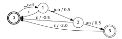
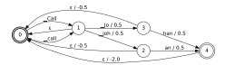
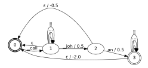

**Source:** *Mixed Case Contextual ASR Using Capitalization Masks* — [PDF](https://www.isca-archive.org/interspeech_2020/caseiro20_interspeech.pdf)

# Mixed Case Contextual ASR Using Capitalization Masks

Diamantino Caseiro, Pat Rondon, Quoc-Nam Le The, Petar Aleksic

Google Inc., USA

{dcaseiro, rondon, qnlethe, apetar}@google.com

#### **Abstract**

End-to-end (E2E) mixed-case automatic speech recognition (ASR) systems that directly predict words in the written domain are attractive due to being simple to build, not requiring explicit capitalization models, allowing streaming capitalization without additional effort beyond that required for streaming ASR, and their small size. However, the fact that these systems produce various versions of the same word with different capitalizations, and even different word segmentations for different case variants when wordpieces (WP) are predicted, leads to multiple problems with contextual ASR. In particular, the size of and time to build contextual models grows considerably with the number of variants per word. In this paper, we propose separating orthographic recognition from capitalization, so that the ASR system first predicts a word, then predicts its capitalization in the form of a capitalization mask. We show that the use of capitalization masks achieves the same low error rate as traditional mixed-case ASR, while reducing the size and compilation time of contextual models. Furthermore, we observe significant improvements in capitalization quality.

### 1. Introduction

Mixed-case automatic speech recognition systems are speech recognizers that directly predict capitalized text, without need for a separate capitalization postprocessor. In traditional ASR, mixed-case systems are usally implemented by incorporating multiple case variants for each word in the pronunciation lexicon, and in the language model. More recently, end-to-end ASR systems are able to predict words (or sub-words) directly from the acoustic signal. These systems combine the functions of acoustic, lexical, and language modeling in a single jointly optimized model. Mixed-case E2E ASR systems are trained using written domain [1] training utterances with case information, and different case variants of the same word are treated as independent tokens to be predicted by the system.

There are two principal advantages of mixed-case E2E ASR relative to single-case ASR followed by an explicit capitalization module [2, 3, 4, 5, 6]. The first advantage is that mixedcase systems are extremely easy to build given capitalized training data. The second advantage is that an explicit capitalization module is not required during inference. While capitalization modules can be easily built, for example, using a language model trained on capitalized data, they are expensive for use in on-device ASR, which is the context of this work. Word-level n-gram models are too large for this use case, even when heavily pruned and compressed. Neural network language models and explicit capitalization neural network modules, are more compact, but computationally expensive, because both the final recognition result and partial results presented to the user while speaking need to be capitalized. Mixed-case ASR leads to smaller and lower latency systems. There are, however, some disadvantages to mixed-case E2E ASR relative to single-case.

The most obvious disadvatanges are that mixed-case may result in higher word error rate (WER) and capitalization quality may be inferior to using an explicit capitalization model.

In this work, we are particularly concerned with the interaction of mixed-case E2E ASR with contextual modeling [7, 8]. Contextual modeling consists of biasing the ASR system towards a set of contextually-relevant phrases during inference. These phrases are used to inject information in the ASR system that is not available at training time. Examples of contextually-relevant phrases include the user's contacts and business names in the vicinity of the user. In this work, we implement contextual modeling using shallow fusion of biasing models represented as Weighted, Deterministic, Finite-State Acceptors (WDFSAs). See [9] for more details.

Problems arise when we combine a mixed-case E2E ASR system that outputs wordpieces [10] with contextual models represented as WDFSAs. In a wordpiece mixed-case ASR system, different case variants of the same word have different wordpiece segmentations, which are not guaranteed to be isomorphic. For example, they may have a different number of segments. This mismatch means that the contextual models will require different paths for each word variant, which in turn leads to an increase of the size and time to build the WDFSA as the number of case variants per word increases. The compilation time of contextual models is important because many models are built dynamically for each utterance, and excessive time may result in increased latency.

Figure 1 shows a single-case contextual model with the phrase "call johan", tokenized as wordpieces. Figure 2 illustrates how the model grows when using just two variants per word, either all-lowercase or with an initial capital. There is also the problem that it is unclear what variants to include in the model: the variants present in the user's data may not be consistent with the variants used to train the E2E model. This inconsistency can lead to the introduction of both ASR errors and capitalization errors by the contextual model.

In this paper, we propose a novel representation for mixedcase words that enables the use of single-case biasing models and achieves similar ASR quality as mixed-case ASR, while achieving improved capitalization quality and reduced size and compilation time of contextual models.

Figure 1: Lowercase biasing WDFSA for phrase "call johan", with one case variant per word.

Figure 2: Mixed-case biasing WDFSA for phrase "call Johan", with two case variants per word.

Table 1: Example of Capitalization Mask WP Representations.

| Original Word | Lowercase WP | Cap. Mask WP |
|---------------|--------------|--------------|
| A             | _a           | _a <b>:</b>  |
| MacGyver      | _mac gyver   | _mac gyver   |
| camelCase     | _cam el case | _cam el case |
| lowercase     | _lower case  | _lower case  |

In the next Section we describe the proposed capitalization masks approach. Then, in Section 3 we describe the details of our experiments. In Section 4 we present the experimental results. Finally, we conclude by summarizing this work in Section 5.

## 2. Capitalization Masks

In this paper we propose the use of capitalization masks to overcome the contextual modeling problems identified in Section 1. These masks allow us to decouple the word from its capitalization information, enabling us to compactly model all case variants and avoid redundancy because all capitalized variants of a word decompose into the same pieces.

With capitalization masks, a word is represented in two parts. The first part is a single-case version of the word. The second part is optional and consists of a sequence of bits 0/1 indicating if the character at the corresponding position in the word is upper (1) or lowercase (0). Using this representation the word "MacGyver" is encoded as "macgyver10010000". To reduce the verbosity of this representation, the mask bits are grouped in groups of 4, and each group is represented by one of 16 control characters. Furthermore, trailing zeroes are not represented. We select the following 16 Unicode Braille characters as our control characters, representing nibbles of values 0 through 15, in order: [1, 1], [2, 1], [3, 1], [3, 1], [3, 1], [3, 1], [3, 1], [3, 1], [3, 1], [3, 1], [3, 1], [3, 1], [3, 1], [3, 1], [3, 1], [3, 1], [3, 1], [3, 1], [3, 1], [3, 1], [3, 1], [3, 1], [3, 1], [3, 1], [3, 1], [3, 1], [3, 1], [3, 1], [3, 1], [3, 1], [3, 1], [3, 1], [3, 1], [3, 1], [3, 1], [3, 1], [3, 1], [3, 1], [3, 1], [3, 1], [3, 1], [3, 1], [3, 1], [3, 1], [3, 1], [3, 1], [3, 1], [3, 1], [3, 1], [3, 1], [3, 1], [3, 1], [3, 1], [3, 1], [3, 1], [3, 1], [3, 1], [3, 1], [3, 1], [3, 1], [3, 1], [3, 1], [3, 1], [3, 1], [3, 1], [3, 1], [3, 1], [3, 1], [3, 1], [3, 1], [3, 1], [3, 1], [3, 1], [3, 1], [3, 1], [3, 1], [3, 1], [3, 1], [3, 1], [3, 1], [3, 1], [3, 1], [3, 1], [3, 1], [3, 1], [3, 1], [3, 1], [3, 1], [3, 1], [3, 1], [3, 1], [3, 1], [3, 1], [3, 1], [3, 1], [3, 1], [3, 1], [3, 1], [3, 1], [3, 1], [3, 1], [3, 1], [3, 1], [3, 1], [3, 1], [3, 1], [3, 1], [3, 1], [3, 1], [3, 1], [3, 1], [3, 1], [3, 1], [3, 1], [3, 1], [3, 1], [3, 1], [3, 1], [3, 1], [3, 1], [3, 1], [3, 1], [3, 1], [3, 1], [3, 1], [3, 1], [3, 1], [3, 1], [3, 1], [3, 1], [3, 1], [3, 1], [3, 1], [3, 1], [3, 1], [3, 1], [3, 1], [3, 1], [3, 1], [3, 1], [3, 1], [3, 1], [3, 1], [3, 1], [3, 1], [3, 1], [3, 1], [3, 1], [3, 1], [3, 1], [3, 1], [3, 1], [3, 1], [3, 1], [3, 1], [3, 1], [3, 1], [3, 1], [3, 1], [3, 1], [3, 1], [3, 1], [3, 1], [3, 1], [3, 1], [3, 1], [3, 1], [3, 1], [3, 1], [3, 1], [3, 1], [3, 1], [3, 1], [3, 1], [3, 1], [3, 1], [3, 1], [3, 1], [3, 1], [3, 1], [3, 1], [3, 1], [3, 1], [3, 1], [3, 1], [3, 1], [3, 1], [3, 1], [3, 1], [3, 1], [3, 1], [3, 1], [3, 1], [3, 1], [3, 1], [3, 1], [3, 1], [3, 1], [3, 1], [3, 1], [3, 1], [3, 1], [, i, i, i. These allow for easy interpretation of masks because the presence of one or two dots in each row represents a 0 or a 1 in the mask, with the least significant bit in the top row and the most-signficiant in the bottom row, so that the mask is read top-to-bottom to determine the capitalization of characters from left to right. Table 1 shows some examples of mixed-case words and their capitalization mask representation.

Capitalization mask E2E ASR systems are built by tokenizing all training data transcriptions using the capitalization masks. The E2E system is then trained to predict these tokens (or sub-word units). At prediction time, the capitalization mask representations are converted back to mixed-case using a denormalization step before being presented to the user or used for error evaluation

## 3. Experimental Details

#### 3.1. Data Sets

Our experiments are conducted on a training set consisting of 184 million English utterances. All utterances are anonymized. The training set is a mixture of both hand-transcribed and semi-supervised data. It includes data from a variety of Google applications such as voice search and YouTube. Since there are very different amounts of data from each domain (for example, YouTube accounts for 80% of the data), each subset is sampled at a different rate during training. Multi-style training data (MTR) are created using a room simulator to artificially introduce noise to clean utterances [11]. The noise sources are extracted from daily life environment recordings and from YouTube. The reference transcriptions are for the most part mixed-case, with the exception of some YouTube utterances represented as uppercase only text. These are automatically capitalized when training E2E models.

All test sets used for experiments consist of anonymized, manually-transcribed utterances. The main test set contains  $\approx 14 \text{K}$  voice search utterances, typically shorter than 5.5 seconds

Additionally, we evaluate the performance of contextual biasing on two contextual test sets. The first one is a Contacts test set consisting of requests to call or text contacts. Each of these 4.4K utterances contains 240 mocked contacts as contextual information, consisting of the contact name present in transcription truth and 239 distractor names. The second one is an Apps test set consisting of requests to open an App. It consists of 3.3K utterances, containing 50 mocked app names as contextual information, one of which is the app name present in transcription truth and the others are distractors.

## 3.2. Model Architecture

All E2E models trained and evaluated in this work share the same model architecture, which is a streaming recurrent neural transducer (RNN-T), the details of which are described in [12]. The input to the encoder subnetwork consists of 80-dimensional log-Mel features, computed every 10ms with a 25ms window. For efficent inference, we apply a 3x time reduction by stacking each consecutive 3 frames, effectively downsampling to a 30ms frame rate. The encoder subnetwork consists of a stack of 8 LSTM layers each with 2,048 hidden units followed by a 640-dimensional projection. After the second LSTM layer there is a time reduction layer with a time reduction factor of 2. The prediction network consists of two 2,048 hidden unit LSTM layers (also followed by a 640-dimensional projection), and an embedding layer of 128 units. Next, the model contains a joint network that takes the output of the encoder and prediction networks and feeds them through layers with 640 hidden units. All our models are trained in TensorFlow [13] using the Lingvo [14] toolkit on Tensor Processing Units (TPU).

#### 3.3. Wordpiece Models

To train the mixed-case wordpiece model used in this work, we start by estimating a Bayesian interpolated language model (LM) [15] that combines Katz n-gram [16] LMs from a variety of Google domains. The word frequency list used to train the wordpiece model is obtained by scaling the unigram probabilities contained in the LM.

For the single-case wordpiece model the mixed-case word frequency list is converted to lowercase, and then the frequencies of different case versions of each word are added together.

Figure 3: Capitalization mask model for phrase "call johan". Ellipsized arcs indicate omitted self-loops labeled with capitalization mask characters.

For the capitalization mask wordpiece model, we use the lowercase training word frequency list with 16 additional entries, each corresponding to a different capitalization mask character. There are no wordpieces spanning both normal characters and capitalization mask characters because the capitalization masks are present only as their own entries in the word frequency table.

We use these data with the algorithm described in [10] to generate wordpiece models containing 4,096 pieces.

#### 3.4. Contextual Models

Following the approach of Zhao et al [9], we bias our ASR system by computing the probability P(y|h,x) of a token y given acoustic features x and history h via shallow fusion between the RNN-T probability  $P_R(y|x,h)$  and the contextual ("biasing") language model probability  $P_C(y|h)$ :

$$P(y|h, x) = \log P_R(y|h, x) + \lambda \log P_C(y|h)$$

Our contextual language models are represented as WDFSAs. As in [9], we distribute the weight of each biased phrase in the language model to every arc along the corresponding path in the WDFSA. Because distributing the weight in this way has the effect of biasing towards every prefix of each biased phrase, we must take care to "undo" the effect of biasing toward a prefix if it turns out that the RNN-T output does not match the full biased phrase. This "undo" is implemented by "failure" epsilon arcs which are followed when the output of the recognizer only matches a prefix of the biased phrase. A failure arc leads from the state at which the prefix terminated to the WDFSA start state (i.e., the language model unigram state) and has label  $\epsilon$ , a weight equal to the negative of the total weight along the path from the start state to the state where the prefix terminates. Thus, following a non-failure path in a biasing WDFSA and then following a failure arc to the start state results in a net zero change in the final score of the hypothesis. Figure 1 shows two more features of our biasing models. First, we add an unweighted prefix ("call") that must be matched before biasing is applied in order to prevent the biasing model from overtriggering. Second, we add a re-biasing penalty to prevent the biasing model being applied repeatedly. (This is indicated by the epsilon arc from final state 3 to unigram state 1 with weight -2.0.) Further details and motivation are given in Zhao et al [9].

Figure 1 and Figure 3 show two example biasing models for the phrase "call johan". The lowercase-only model of Figure 1 can only bias toward the lowercase variant of the phrase, which is inadequate when biasing a mixed-case ASR system, as we do not wish to produce lowercase outputs. The capitalization mask biasing model of Figure 3 can bias toward all case variants due to the capitalization mask self loops at each word end state (states 1 and 3). (In the capitalization mask WDFSA, arcs labeled with ellipses indicate self loops labeled with the omitted capitalization mask characters.) Note that, except for the capitalization mask self loops, the lowercase and capitalization mask biasing models are identical. Thus, we do not add these self loops explicitly to our biasing WDFSAs, but instead make them implicit by ignoring capitalization masks while applying the biasing models during shallow fusion. (This optimization actually assumes that the capitalization mask self loops occur at all states, not just word end states. However, since the RNN-T only outputs capitalization masks at the ends of words, it is harmless to allow self loops at non-word-end states.)

#### 3.5. Measuring Capitalization Quality

To measure the capitalization quality we use the Capitalization Error Rate (CER) [6]. This is a very intuitive metric that is computed at the character level. We start by stripping all characters that are not uppercase from the recognition hypothesis and the reference transcriptions. We then compare the remaining strings using the same dynamic-programming alignment used for WER computation. Each character is taken individually. For example, if the reference is "MacGyver" and the recognition hypothesis is "McDonald" we compare the strings "M G" and "M D" and count one capitalization substitution error. Being character-based this metric is robust to some recognition errors, and because it ignores correct matches of lowercase characters it avoids artificially low error rates.

#### 4. Results

We evaluated ASR and capitalization quality on a general test set and on specific contextual sets.

#### 4.1. ASR Results on General Voice Search Test Set

The results of evaluating our models on a general Voice Search test set are presented in Table 3. We observe that the proposed model matches the word error rate and the oracle word error rate (OWER) of the baseline mixed-case system. We define OWER as the lowest WER in the n-best hypotheses. Both of these metrics are case-insensitive. The lowercase system WER is slightly better, while its OWER is much better. We believe that a large part of the lowercase system's advantage over the two mixedcase systems is due to lower search errors. The n-best case duplication rate, measured as the percentage of hypotheses with the same words but with different case, is high in the mixed-case systems, as shown in Table 4, indicating that unique hypotheses (ignoring case) are "crowded out" by case variants during search. All experiments use the same pruning parameters. Regarding capitalization, we observe a good improvement in CER with the capitalization masks model.

Table 3: ASR Results on general Voice Search Test Set.

|            | _   |      |      |
|------------|-----|------|------|
| Model      | WER | OWER | CER  |
| Lowercase  | 6.4 | 1.8  | 33.0 |
| Mixed-Case | 6.5 | 2.2  | 13.4 |
| Cap. Masks | 6.5 | 2.2  | 13.1 |

Table 2: *Examples of Capitalization Wins and Losses.*

|      | Mixed-Case Baseline                           | Capitalization Mask                           |
|------|-----------------------------------------------|-----------------------------------------------|
| WIN  | the Westin Ocean Resort Villa                 | The Westin Ocean Resort Villa                 |
| WIN  | front desk receptionist on indeed in New York | front desk receptionist on Indeed in New York |
| WIN  | Harborfreight.com                             | harborfreight.com                             |
| LOSS | Does mobility equal independence              | Does Mobility equal Independence              |
| LOSS | What rhymes with crush                        | What rhymes with Crush                        |
| LOSS | Catawba bookstore                             | Catawba Bookstore                             |

Table 4: *N-Best case duplication.*

| Model      | Total Hyps | Hyps Ignore Case | Case Dups % |
|------------|------------|------------------|-------------|
| Lowercase  | 94,491     | N/A              | N/A         |
| Mixed-Case | 93,496     | 65,379           | 30%         |
| Cap. Masks | 99,853     | 53,325           | 47%         |

#### 4.2. ASR Results on Contextual Test Sets

Table 5 shows the WER for the Contacts and Apps contextual test sets with and without contextual biasing. In the Contacts test set, we see that the lowercase model achieves the best WER when contextual models are not enabled, while the proposed capitalization masks model is a close second. When contextual biasing is enabled the two mixed-case models perform similarly and outperform the lowercase model. In the Apps test set, the capitalization mask model has the worst results when contextual models are not used. When contextual models are used, the capitalization masks model is very close to the lowercase model and significantly better than mixed-case.

We also measured the impact of using the contextual models when the context is not relevant to the query. For that, we enabled contextual modeling when evaluating the Voice Search test set. Results are presented in Table 6. When using the Contacts contextual models we observe a small degradation in the lowercase and mixed-case model, and a larger one on the capitalization masks model. The degradations however are mostly due to there being a number of utterances in the form of "Call \$CONTACTS" in the Voice Search test set. This leads to distractor errors since the context is relevant to the query, but we are biasing towards the wrong contacts. When using the Apps contextual models we don't observe any degradation.

Table 5: *WER on Context Test Sets.*

| Test Set | Model      | No Context | Context | Rel. |
|----------|------------|------------|---------|------|
|          | Lowercase  | 16.2       | 5.7     | -65% |
| Contacts | Mixed-Case | 16.5       | 5.5     | -67% |
|          | Cap. Masks | 16.3       | 5.5     | -66% |
|          | Lowercase  | 6.2        | 2.7     | -56% |
| Apps     | Mixed-Case | 6.1        | 3.2     | -48% |
|          | Cap. Masks | 6.5        | 2.8     | -61% |

Table 6: *WER on Anti-Context Test Set (Voice Search).*

| Test Set | Model      | No Context | Context | Rel. |
|----------|------------|------------|---------|------|
|          | Lowercase  | 6.4%       | 6.6%    | 3%   |
| Contacts | Mixed-Case | 6.5%       | 6.6%    | 2%   |
|          | Cap. Masks | 6.5%       | 6.8%    | 5%   |
|          | Lowercase  | 6.4%       | 6.4%    | 0%   |
| Apps     | Mixed-Case | 6.5%       | 6.5%    | 0%   |
|          | Cap. Masks | 6.5%       | 6.5%    | 0%   |

## 4.3. Contextual Models: Size and Build Time

We evaluated the speed and memory impact of case variance on a mixed-case biasing model by measuring the build time (in milliseconds) and model size (in states) of a biasing model consisting of 256 phrases with 1, 4, or 9 case variants. We found that for contextual biasing models with a large number of case variants, a lowercase-only model provides large gains in both construction speed and model size. In the case of a model with 9 case variants, the single-case model has a 4x speed up in build time and a 6x size reduction. Table 7 and Table 8 shows the build times and model sizes for contextual models with increasing numbers of case variants.

Table 7: *Contextual Model Build Time.*

| Case Variants | Build Time (ms) | Speed-up |
|---------------|-----------------|----------|
| 1             | 5.26            | 1.00x    |
| 4             | 9.10            | 1.73x    |
| 9             | 21.50           | 4.09x    |

Table 8: *Contextual Model Size.*

| Case Variants | Model Size (states) | Size Reduction |
|---------------|---------------------|----------------|
| 1             | 822                 | 1.00x          |
| 4             | 1361                | 1.66x          |
| 9             | 5067                | 6.16x          |

## 4.4. Qualitative Capitalization Differences

To investigate the capitalization masks model improvements in CER observed in Table 3, we manually analyzed the capitalization differences between the mixed-case baseline system and the proposed capitalization masks system. We found that the proposed system prefers to capitalize more than the baseline. In particular, it generates about 44% more uppercase characters. Subjectively, the capitalization seems quite pleasant regardless of the baseline. We did not measure significant differences in first-word capitalization errors. This indicates that the improvements are mostly inside sentences. Overall, we observed better agreement with transcription guidelines, For example, URLs are now mostly lowercase, even when they contain a proper name that would otherwise be capitalized. The model is also better at capitalizing named entities. Table 2 shows some examples of with capitalization differences highlighted in boldface.

## 5. Conclusions

In this paper, we explored the idea of separating the recognition of a word from its capitalization pattern, represented as a capitalization mask. This capitalization masks approach can be seen as a form of sequential multi-task modeling, where instead of having multiple heads each predicting a separate output, we interleave multiple related tasks using a single output sequence, the tasks being case-independent ASR and capitalization. We showed that the approach achieves as good WER results as more traditional mixed-case ASR, while improving capitalization quality. It also increases the efficiency of contextual modeling, both in terms of model size and compilation time.

# 6. References

- [1] Hasim Sak, Yun-hsuan Sung, Franc¸oise Beaufays, and Cyril Allauzen, "Written-domain language modeling for automatic speech recognition.," in *INTERSPEECH*, 2013, pp. 675–679.
- [2] C. Chelba and A. Acero, "Adaptation of maximum entropy capitalizer: Little data can help a lot.," in *EMNLP04*, 2004.
- [3] F. Batista, N. Mamede, D. Caseiro, and I. Trancoso, "A lightweight on-the-fly capitalization system for automatic speech recognition.," in *RANLP 2007*, 2007.
- [4] F. Batista, D. Caseiro, N. Mamede, and I. Trancoso, "Recovering capitalization and punctuation marks for speech transcription: Case study for portuguese broadcast news," *Speech Communication*, vol. 50, pp. 847–, 2008.
- [5] Agust´ın Gravano, Martin Jansche, and Michiel Bacchiani, "Restoring punctuation and capitalization in transcribed speech," in *IEEE International Conference on Acoustics, Speech, and Signal Processing (ICASSP)*, 2009, pp. 4741–4744, doi:10.1109/ICASSP.2009.4960690.
- [6] Franc¸oise Beaufays and Brian Strope, "Language model capitalization," in *ICASSP 2013*, 2013, pp. 6749–6752.
- [7] P. Aleksic, M. Ghodsi, A. Michaely, C. Allauzen, K. Hall, B. Roark, D. Rybach, and P. Moreno, "Bringing contextual information to Google speech recognition," in *Proc. Interspeech*, 2015.
- [8] K. Hall, E. Cho, C. Allauzen, F. Beaufays, N. Coccaro, K. Nakajima, M. Riley, B. Roark, D. Rybach, and L. Zhang, "Composition-based on-the-fly rescoring for salient n-gram biasing," in *Proc. Interspeech*, 2015.
- [9] D. Zhao, T. N. Sainath, D. Rybach, D. Bhatia, B. Li, and R. Pang, "Shallow-Fusion End-to-End Contextual Biasing," in *Proc. Interspeech*, 2019.
- [10] Mike Schuster and Kaisuke Nakajima, "Japanese and Korean voice search," *Proc. ICASSP*, 2012.
- [11] C. Kim, A. Misra, K. Chin, T. Hughes, A. Narayanan, T. N. Sainath, and M. Bacchiani, "Generated of large-scale simulated utterances in virtual rooms to train deep-neural networks for farfield speech recognition in Google Home," in *Proc. Interspeech*, 2017.
- [12] Y. He, T. N. Sainath, R. Prabhavalkar, I. McGraw, R. Alvarez, D. Zhao, D. Rybach, A. Kannan, Y. Wu, R. Pang, Q. Liang, D. Bhatia, Y. Shangguan, B. Li, G. Pundak, K. Sim, T. Bagby, S. Chang, K. Rao, and A. Gruenstein, "Streaming End-to-end Speech Recognition For Mobile Devices," in *Proc. ICASSP*, 2019.
- [13] M. Abadi et al., "Tensorflow: Large-scale machine learning on heterogeneous distributed systems," Available online: http://download.tensorflow.org/paper/whitepaper2015.pdf, 2015.
- [14] Jonathan Shen, Patrick Nguyen, Yonghui Wu, Zhifeng Chen, et al., "Lingvo: a modular and scalable framework for sequence-to-sequence modeling," Available online: https://arxiv.org/abs/1902.08295, 2019.
- [15] Cyril Allauzen and Michael Riley, "Bayesian language model interpolation for mobile speech input," in *INTERSPEECH*, 2011, pp. 1429–1432.
- [16] Slava M. Katz, "Estimation of probabilities from sparse data for the language model component of a speech recognizer," in *IEEE Transactions on Acoustics, Speech and Signal Processing*, 1987, pp. 400–401.