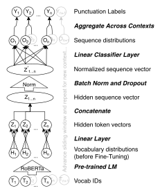

**Source:** *Efficient Automatic Punctuation Restoration Using Bidirectional Transformers with Robust Inference* — [PDF](https://aclanthology.org/2020.iwslt-1.33.pdf)

# Efficient Automatic Punctuation Restoration Using Bidirectional Transformers with Robust Inference

## Maury Courtland, Adam Faulkner, Gayle McElvain

Capital One, Vision and Language Technologies

{maury.courtland, adam.faulkner, gayle.mcelvain} @capitalone.com

## Abstract

Though people rarely speak in complete sentences, punctuation confers many benefits to the readers of transcribed speech. Unfortunately, most ASR systems do not produce punctuated output. To address this, we propose a solution for automatic punctuation that is both cost efficient and easy to train. Our solution benefits from the recent trend in fine-tuning transformer-based language models. We also modify the typical framing of this task by predicting punctuation for sequences rather than individual tokens, which makes for more efficient training and inference. Finally, we find that aggregating predictions across multiple context windows improves accuracy even further. Our best model achieves a new state of the art on benchmark data (TED Talks) with a combined F1 of 83.9, representing a 48.7% relative improvement (15.3 absolute) over the previous state of the art.

## 1 Introduction

Enabling computers to use speech as input has long been an aspirational goal in the field of human computer interaction. Recent advances have had dramatic impact across multiple domains (e.g. relieving medical professionals from having to transcribe medical dictation [\(Edwards et al.,](#page-5-0) [2017\)](#page-5-0), improving real-time spoken language translation [\(Gu et al.,](#page-5-1) [2017\)](#page-5-1), and affording convenience through conversational interfaces like those in virtual personal assistants [\(McTear et al.,](#page-5-2) [2016\)](#page-5-2)). For use cases that require reading transcribed speech, however, it is often still a challenge to recover meaningful clause boundaries from disfluent, errorful utterances.

Humans rely on punctuation for readability, perhaps because it lessens the burden of ambiguous phrasing. Studies have found that removing punctuation from manual transcriptions can be even more detrimental to understanding than a word error rate

of 15% or 20% [\(Tundik et al.](#page-6-0) ¨ , [2018\)](#page-6-0). Reading comprehension is also significantly slower without punctuation [\(Jones et al.,](#page-5-3) [2003\)](#page-5-3). For downstream NLP models, the lack of clausal boundaries can significantly decrease accuracy (e.g. a 4.6% BLEU decrease in NMT; [Vandeghinste et al.](#page-6-1) [2018\)](#page-6-1). This likely reflects the discrepancy between wellsegmented training corpora and ASR output.

To solve the lack of punctuation in ASR output, we propose an automatic punctuation model, which leverages the recent trend in unsupervised pre-training [\(Devlin et al.,](#page-4-0) [2019\)](#page-4-0) and the parallel architecture of transformer networks [\(Vaswani et al.,](#page-6-2) [2017\)](#page-6-2). Unsupervised pre-training dramatically reduces the amount of labeled data required for superior performance on this task. Additionally, the model's departure from a recurrent architecture allows direct connections between all input tokens. This enables the network to more easily model longdistance dependencies (e.g. *on one hand, ... on the other, ...*) for improved punctuation performance. The departure from a recurrent architecture also allows computations to be performed in parallel for each layer with the speed of computations limited by the number of layers rather than the number of time steps (usually fewer). In addition to the parallel nature of the hidden layers, our network also predicts in parallel for all tokens in the input simultaneously. This helps significantly speed up inference compared with individual predictions for each token. During training, the parallel prediction task provides a richer signal compared with a sequential task, thereby making more efficient use of each example. Furthermore, advancing the prediction window less than the window's width (e.g. steps of 20 with a window of 50) allows aggregating multiple windows of context to predict a token's label. This allows the network to effectively become its own prediction ensemble and boosts accuracy further. Given that the aggregate predictions

are independently obtained, these calculations too can be performed in parallel.

#### 2 Related Work

Our biggest departure from previous approaches lies in the parallel nature of inference and the deep bidirectional information flow of our model (for more detail, see Devlin et al. 2019). This is in contrast with the vast majority of previous approaches which use a variant of Recurrent Neural Network architecture (Tundik et al., 2017; Vandeghinste et al., 2018; Ballesteros and Wanner, 2016; Alumäe et al., 2019; Szaszák, 2019; Öktem, 2018; Xu et al., 2016; Pahuja et al., 2017; Tundik and Szaszak, 2018; Tündik et al., 2017; Tilk and Alumae, 2015; Żelasko et al., 2018; Treviso and Aluísio, 2018). This includes those that incorporate acoustic information (B. Garg and Anika, 2018; Moro and Szaszak, 2017; Szaszák and Tündik, 2019; Nanchen and Garner, 2019; Moró and Szaszák, 2017; Klejch et al., 2016, 2017) and those that apply attention on top (Tilk and Alumäe, 2016; Salloum et al., 2017; Öktem et al., 2017; Kim, 2019; Juin et al., 2017).

Though non-sequential, several previous approaches use simpler network architectures (e.g. DNNs (Yi et al., 2017; Che et al., 2016) or CNNs (B. Garg and Anika, 2018; Che et al., 2016; Želasko et al., 2018)), which have less predictive power. The handful of approaches that make use of Transformer architectures are not bidirectional (Chen et al., 2020; Nguyen et al., 2019; Vāravs and Salimbajevs, 2018; Wang et al., 2018). Our model also differs from the above in that it leverages pretraining to reduce training time and increase accuracy. The one previous work that uses a pretrained bidirectional transformer (Cai and Wang, 2019) only predicts punctuation one token at a time, which significantly increases both training and inference time. It is also unable to aggregate predictions across multiple contexts, limiting performance.

#### 3 Method

Architecture The network architecture can be seen in Figure 1. The first component of our network is a pre-trained language model (RoBERTabase; Liu et al. 2019) employing the recent deep bidirectional Transformer architecture (Devlin et al., 2019; Vaswani et al., 2017). The network's input is a sequence of unpunctuated lower-cased words tokenized using RoBERTa's tokeniza-

tion scheme (see Liu et al. 2019 for more details). We then add two additional linear layers after the pre-trained network with each layer preserving the fully-connected nature of the entire network. The first linear layer maps from the masked language model output space to a hidden state space for each input token with parameters shared across tokens. The second linear layer concatenates the hidden state representations into a vector for the prediction window which allows the tokens to interact arbitrarily within the window. We then apply batch normalization (Ioffe and Szegedy, 2015) and dropout (best results obtained with a rate of 0.2; Hinton et al. 2012) prior to predicting punctuation marks for all tokens in the window.

When aggregating predictions across contexts, activations at the sequence layer are added for each token prior to classification (see Figure 1 for visualization). Prediction is performed in parallel during both training and inference with the output size of the final classifier being  $|classes|*length_{window}$ .

Figure 1: The punctuation network takes as input a sequence of unpunctuated words tokenized in the same manner as RoBERTa. It outputs predictions for these sequences individually during training (layer  $O_n$ ). For validation and testing, however, these labels are aggregated across overlapping context windows to obtain the final punctuation predictions (layer  $Y_n$ ). Note that while the pre-trained LM's output begins as vocabulary distributions, they cease to be so once the entire network undergoes fine-tuning.

|                                       | Comma |      | Period |      |      | Question |      |      | Overall |      |      |      |
|---------------------------------------|-------|------|--------|------|------|----------|------|------|---------|------|------|------|
| Models                                | P     | R    | F      | P    | R    | F        | P    | R    | F       | P    | R    | F    |
| DNN-A (Che et al., 2016)              | 48.6  | 42.4 | 45.3   | 59.7 | 68.3 | 63.7     | _    | _    | _       | 54.8 | 53.6 | 54.2 |
| CNN-2A (Che et al., 2016)             | 48.1  | 44.5 | 46.2   | 57.6 | 69.0 | 62.8     |      |      |         | 53.4 | 55.0 | 54.2 |
| T-LSTM (Tilk and Alumae, 2015)        | 49.6  | 41.4 | 45.1   | 60.2 | 53.4 | 56.6     | 57.1 | 43.5 | 49.4    | 55.0 | 47.2 | 50.8 |
| T-BRNN (Tilk and Alumäe, 2016)        | 64.4  | 45.2 | 53.1   | 72.3 | 71.5 | 71.9     | 67.5 | 58.7 | 62.8    | 68.9 | 58.1 | 63.1 |
| T-BRNN-pre (Tilk and Alumäe, 2016)    | 65.5  | 47.1 | 54.8   | 73.3 | 72.5 | 72.9     | 70.7 | 63.0 | 66.7    | 70.0 | 59.7 | 64.4 |
| Single-BiRNN (Pahuja et al., 2017)    | 62.2  | 47.7 | 54.0   | 74.6 | 72.1 | 73.4     | 67.5 | 52.9 | 59.3    | 69.2 | 59.8 | 64.2 |
| Corr-BiRNN (Pahuja et al., 2017)      | 60.9  | 52.4 | 56.4   | 75.3 | 70.8 | 73.0     | 70.7 | 56.9 | 63.0    | 68.6 | 61.6 | 64.9 |
| DRNN-LWMA (Kim, 2019)                 | 63.4  | 55.7 | 59.3   | 76.0 | 73.5 | 74.7     | 75.0 | 71.7 | 73.3    | 70.0 | 64.6 | 67.2 |
| DRNN-LWMA-pre (Kim, 2019)             | 62.9  | 60.8 | 61.9   | 77.3 | 73.7 | 75.5     | 69.6 | 69.6 | 69.6    | 69.9 | 67.2 | 68.6 |
| RoBERTa base               | 76.9  | 75.4 | 76.2   | 86.1 | 89.3 | 87.7     | 88.9 | 87.0 | 87.9    | 84.0 | 83.9 | 83.9 |
| Different Pre-trained Language Models |       |      |        |      |      |          |      |      |         |      |      |      |
| RoBERTa large              | 74.3  | 76.9 | 75.5   | 85.8 | 91.6 | 88.6     | 83.7 | 89.1 | 86.3    | 81.3 | 85.9 | 83.5 |
| XLNet base                 | 76.6  | 74.9 | 75.8   | 84.6 | 90.6 | 87.5     | 82.0 | 89.1 | 85.4    | 81.1 | 84.9 | 82.9 |
| T5 base                    | 70.5  | 77.2 | 73.7   | 85.6 | 85.5 | 85.6     | 83.7 | 89.1 | 86.3    | 79.9 | 84.0 | 81.9 |
| BERT base                  | 72.8  | 70.8 | 71.8   | 81.9 | 86.6 | 84.2     | 80.8 | 91.3 | 85.7    | 78.5 | 82.9 | 80.6 |
| ALBERT base                | 69.4  | 69.3 | 69.4   | 80.9 | 84.5 | 82.7     | 76.7 | 71.7 | 74.2    | 75.7 | 75.2 | 75.4 |
| DistilRoBERTa                         | 70.0  | 64.5 | 67.1   | 78.2 | 83.5 | 80.8     | 75.0 | 71.7 | 73.3    | 74.4 | 73.2 | 73.7 |

Table 1: Compared to previous approaches, our model achieves state of the art performance on the reference transcripts of the TED Talks dataset as measured by precision (P), recall (R), and F-1 score (F). Experimental results with different pre-trained language models are included below for comparison with the best RoBERTabase model.

Training Schedule It is worth noting that we use only the TED Talks dataset described below for training but enjoy significant benefits from a sizable pre-training corpus (Liu et al., 2019). Although prediction is performed on multiple tokens at once, the same number of training samples are generated from the corpus by moving the sliding window one token at a time over the input. To perform gradient descent, we use LookAhead (Zhang et al., 2019) with RAdam (Liu et al., 2020) as the base optimizer. We use a simple cross-entropy function to calculate the loss for each token's classification prediction.

Our best performing model (see Table 1) uses a prediction window size of 100, a final-layer dropout of 0.2, and a hidden-state space of dimensionality 1500. The top two linear layers (henceforth referred to as the "top layers") are initially trained from scratch while the transformer core remains frozen. Then, having selected the model version with the lowest validation loss from training the top layers, the transformer core is unfrozen, and we fine-tune the parameters of the entire network. We then select the model version with the lowest validation loss to prevent overfitting.

We train the top layers for nine epochs with a mini-batch size of 1000 (using 100-token sequences) while the transformer is frozen. The lowest validation loss for the top layers is usually achieved around the sixth epoch. We then unfreeze the transformer and fine-tune the entire network for three more epochs with a mini-batch size of 250. We typically observe the lowest validation loss midway through the first epoch while fine-tuning. It is worth noting that a highly competitive model (82.6 overall F1) can be trained with just 1 epoch each for the top layers and fine-tuning. This training can be completed in slightly less than 1 hour on a p3.16xlarge AWS instance (with 8x Tesla V100 GPUs).

For the LookAhead optimizer, we use a sync rate of 0.5, and a sync period of 6. The RAdam optimizer—used as the model's base optimizer—has its learning rate set to  $10^{-5}$ ,  $\beta_1=0.9$ ,  $\beta_2=0.999$ ,  $\epsilon=10^{-8}$ . We do not use weight decay.

**Data** To train the network and evaluate its performance (both at test and validation time), we use the IWSLT 2012 TED Talks dataset (Cettolo et al., 2012). This dataset is a common benchmark in automatic punctuation (e.g. Kim 2019) and consists of a 2.1M word training set, a 296k word validation set, and a 12.6k word test set (for reference transcription, 12.8k for ASR output). Each word is labeled with the punctuation mark that follows it, yielding a 4-class classification problem: comma, period, question mark, or no punctuation. The class balance of the training dataset is as follows: 85.7% no punctuation, 7.53% comma, 6.3% period, 0.47% question mark.

## 4 Results

The results of our best performing model relative to previous results published on this benchmark can be found in Table [1.](#page-2-0) Additionally, we conducted a number of ablation experiments manipulating various aspects of the architecture and training routine. In providing accuracy comparisons, all results in this section are reported in terms of the absolute change in the overall F1 measure.

In place of the pre-trained RoBERTabase language model, which provided the best result, we also evaluated (in order of decreasing performance relative to RoBERTa as implemented by [Wolf et al.](#page-6-17) [\(2020\)](#page-6-17) [1](#page-3-0) ): XLNetbase (-1.0%; [Yang et al.](#page-6-18) [2020\)](#page-6-18), T5base (-2.1%; [Raffel et al.](#page-6-19) [2019\)](#page-6-19), BERTbase (- 3.4%; [Devlin et al.](#page-4-0) [2019\)](#page-4-0), and ALBERTbase (-8.5%; [Lan et al.](#page-5-17) [2020\)](#page-5-17). Full results from these models can be seen at the bottom of Table [1.](#page-2-0) The performance benefit of RoBERTabase over BERTbase is likely due to the significant increase in pre-training corpus size. The lower performance of ALBERTbase may be due to the sharing of parameters across layers. It is interesting to note that XLNetbase provides higher recall for periods and question marks and T5base for commas and question marks, but both sacrifice significant precision to achieve this.

In addition to the LookAhead optimizer using RAdam as its base, we also evaluated: LookAhead with Adam (-1.5%), RAdam alone (-1.6%), and Adam alone (-2.9%; [Kingma and Ba](#page-5-18) [2017\)](#page-5-18). Given the class imbalance inherent in the dataset between the no punctuation class and all the punctuation marks, we tested focal loss [\(Lin et al.,](#page-5-19) [2018\)](#page-5-19), class weighting, and their combination, but found that none outperformed simple cross-entropy loss.

Perhaps the most noteworthy result is the comparison between parallel prediction (described above) and sequential prediction, wherein the forward pass predicts punctuation for one token at a time using a context window centered on that token. Sequential prediction requires longer inference times (>15x) yet yields only a marginal performance benefit (2.2%) relative to a parallel prediction without aggregation across multiple contexts. Ensembling predictions over multiple contexts overcomes the performance gap, while retaining an advantage with respect to inference time. Compared to the self-ensemble approach, sequential prediction is >4x slower and 5.4% less accu-

| Predictions | F1      | CPU            | GPU           |  |  |
|-------------|---------|----------------|---------------|--|--|
| per token   | Overall | Runtime        | Runtime       |  |  |
| 1           | 76.3    | 1x             | 1x            |  |  |
| 2           | 79.4    | 1.8x           | 1.1x          |  |  |
| 3           | 81.8    | 2.6x           | 1.2x          |  |  |
| 6           | 83.2    | 5.2x           | 1.5x          |  |  |
| 9           | 83.9    | 7.7x           | 1.9x          |  |  |
| Processor   |         | 18x Intel Xeon | 8x Tesla V100 |  |  |
|             | —       | (c5.18xlarge)  | (p3.16xlarge) |  |  |

Table 2: Aggregating multiple parallel predictions exhibits a tradeoff between runtime and accuracy. Runtime results on the TED test set are presented relative to single predictions separately on CPU and GPU for ease of reading. To relate the two, the CPU single predictions are 9.4x slower than GPU. All runtime estimates are obtained from the mean of 10 runs.

rate.

A less obvious choice must be made between a single parallel prediction and multiple aggregated predictions, given the additional runtime of multiple predictions (see Table [2](#page-3-1) for details). For our purposes, the 7.6% improvement is worth the increase in inference time, which is sub-linear given GPU parallelization but still appreciable. While our best method sums activations from different contexts to obtain the aggregate predictions, we also tested adding normalized probabilities across classes and then renormalizing, but we found it resulted in slightly worse performance (-0.3%).

In addition to the RoBERTabase model whose results are reported here, we also trained with a RoBERTalarge model. There was no appreciable performance difference between the two sizes (the large being -0.4% worse) however the large model incurred a significant slowdown (≈1.5x). This may imply that the base model size is adequately powered for punctuation tasks, at least on manually transcribed English datasets similar to the benchmark. This is supported by the findings of [Kovaleva](#page-5-20) [et al.](#page-5-20) [\(2019\)](#page-5-20), who found BERTbase to be overparameterized for most downstream tasks, implying RoBERTalarge would be extremely overparameterized. A smaller pre-trained language model option is DistilRoBERTa, a knowledge distilled version of RoBERTa (analogous to DistilBERT: [Sanh et al.](#page-6-20) [2020\)](#page-6-20). The DistilRoBERTa network is 12% smaller and performs inference ≈1.2x faster, but sacrifices 9.1% in accuracy on the benchmark.

The previous state of the art approach was a multi-headed attention network on top of multiple stacked bidirectional GRU layers [\(Kim,](#page-5-10) [2019\)](#page-5-10).

1Available from [https://github.com/](https://github.com/huggingface/transformers) [huggingface/transformers](https://github.com/huggingface/transformers)

Given the recurrent nature of the GRU layers, the network is subject to the shortcomings of sequential computation discussed in the Introduction. Our findings illustrate yet another language task where transformers outperform previous recurrent neural network approaches.

Our approach enjoys a 48.7% relative improvement (15.3 absolute) over the previous state of the art [\(Kim,](#page-5-10) [2019\)](#page-5-10). Given the ablation results presented above, we attribute the performance gains to the deeply bi-directional transformer architecture, the benefit of leveraging RoBERTa's pre-trained language model trained on ≈ 33B words, and the aggregation of multiple prediction contexts for robust inference. Some performance gain may also be attributed to the addition of an encoding layer trained solely on the punctuation task.

One of the more notable findings is that the nonrecurrent nature of the entire network allows for a large degree of parallelization resulting in a more competitive runtime compared to previous recurrent approaches. While source code was not openly available for benchmarking runtime against [Kim](#page-5-10) [\(2019\)](#page-5-10), we did compare against a similar approach from [Tilk and Alumae¨](#page-6-11) [\(2016\)](#page-6-11) [2](#page-4-8) , which was roughly 78.8x slower on GPUs and 1.2x slower on a CPU, when evaluating the TED Talks test set.

The results presented here have not benefited from any rigorous hyperparameter tuning (e.g. grid search or Bayesian optimization). We leave that to future work given that a rigorous systematic approach may yield appreciable improvements in accuracy.

## 5 Conclusion

We have presented a state of the art automatic punctuation system which aggregates multiple prediction contexts for robust inference on transcribed speech. The use of multiple prediction contexts, unsupervised pre-training, and increased parallelism makes it possible to achieve significant performance gains without increased runtime or cost.

On a different dataset, [Boha´c et al.](#page-4-9) ˇ [\(2017\)](#page-4-9) reported human agreement of around 76% for punctuation location and 70% for use of the same punctuation mark. Although we have yet to make a direct comparison, it's possible our model is already competitive with human performance on this task. Future work will explore how this performance

translates in terms of readability and whether it is sufficient to compensate for some amount of word error, as suggested by [Tundik et al.](#page-6-0) ¨ [\(2018\)](#page-6-0).

## References

- Tanel Alumae, Ottokar Tilk, and Asadullah. 2019. ¨ [Advanced Rich Transcription System for Esto](https://doi.org/10.3233/978-1-61499-912-6-1)[nian Speech.](https://doi.org/10.3233/978-1-61499-912-6-1) *arXiv:1901.03601 [cs]*. ArXiv: 1901.03601.
- B. Garg and Anika. 2018. [Analysis of Punctuation](https://doi.org/10.1109/MITE.2018.8747063) [Prediction Models for Automated Transcript Gener](https://doi.org/10.1109/MITE.2018.8747063)[ation in MOOC Videos.](https://doi.org/10.1109/MITE.2018.8747063) In *2018 IEEE 6th International Conference on MOOCs, Innovation and Technology in Education (MITE)*, pages 19–26. Journal Abbreviation: 2018 IEEE 6th International Conference on MOOCs, Innovation and Technology in Education (MITE).
- Miguel Ballesteros and Leo Wanner. 2016. [A Neural](https://doi.org/10.18653/v1/D16-1111) [Network Architecture for Multilingual Punctuation](https://doi.org/10.18653/v1/D16-1111) [Generation.](https://doi.org/10.18653/v1/D16-1111) In *Proceedings of the 2016 Conference on Empirical Methods in Natural Language Processing*, pages 1048–1053, Austin, Texas. Association for Computational Linguistics.
- Marek Boha´c, Michal Rott, and Vojt ˇ ech Kov ˇ a´ˇr. 2017. [Text Punctuation: An Inter-annotator Agreement](https://doi.org/10.1007/978-3-319-64206-2_14) [Study.](https://doi.org/10.1007/978-3-319-64206-2_14) In Kamil Ekstein and V ˇ aclav Matou ´ sek, ed- ˇ itors, *Text, Speech, and Dialogue*, volume 10415, pages 120–128. Springer International Publishing, Cham. Series Title: Lecture Notes in Computer Science.
- Yunqi Cai and Dong Wang. 2019. [Question Mark Pre](https://doi.org/10.1109/APSIPAASC47483.2019.9023090)[diction By Bert.](https://doi.org/10.1109/APSIPAASC47483.2019.9023090) In *2019 Asia-Pacific Signal and Information Processing Association Annual Summit and Conference (APSIPA ASC)*, pages 363–367, Lanzhou, China. IEEE.
- M Federico M Cettolo, L Bentivogli, M Paul, and S Stuker. 2012. Overview of the IWSLT 2012 Evaluation Campaign. page 22.
- Xiaoyin Che, Cheng Wang, Haojin Yang, and Christoph Meinel. 2016. [Punctuation Prediction for](https://www.aclweb.org/anthology/L16-1103) [Unsegmented Transcript Based on Word Vector.](https://www.aclweb.org/anthology/L16-1103) In *Proceedings of the Tenth International Conference on Language Resources and Evaluation (LREC'16)*, pages 654–658, Portoroz, Slovenia. European Lan- ˇ guage Resources Association (ELRA).
- Qian Chen, Mengzhe Chen, Bo Li, and Wen Wang. 2020. [Controllable Time-Delay Transformer for](http://arxiv.org/abs/2003.01309) [Real-Time Punctuation Prediction and Disfluency](http://arxiv.org/abs/2003.01309) [Detection.](http://arxiv.org/abs/2003.01309) *arXiv:2003.01309 [cs, eess]*. ArXiv: 2003.01309.
- Jacob Devlin, Ming-Wei Chang, Kenton Lee, and Kristina Toutanova. 2019. [BERT: Pre-training](http://arxiv.org/abs/1810.04805) [of Deep Bidirectional Transformers for Language](http://arxiv.org/abs/1810.04805) [Understanding.](http://arxiv.org/abs/1810.04805) *arXiv:1810.04805 [cs]*. ArXiv: 1810.04805.

2The source code is available from [https://github.](https://github.com/ottokart/punctuator2) [com/ottokart/punctuator2](https://github.com/ottokart/punctuator2)

- Erik Edwards, Wael Salloum, Greg P. Finley, James Fone, Greg Cardiff, Mark Miller, and David Suendermann-Oeft. 2017. Medical Speech Recognition: Reaching Parity with Humans. In *Speech and Computer*, pages 512–524, Cham. Springer International Publishing.
- Jiatao Gu, Graham Neubig, Kyunghyun Cho, and Victor O. K. Li. 2017. [Learning to Translate](http://arxiv.org/abs/1610.00388) [in Real-time with Neural Machine Translation.](http://arxiv.org/abs/1610.00388) *arXiv:1610.00388 [cs]*. ArXiv: 1610.00388.
- Geoffrey E. Hinton, Nitish Srivastava, Alex Krizhevsky, Ilya Sutskever, and Ruslan R. Salakhutdinov. 2012. [Improving neural networks by](http://arxiv.org/abs/1207.0580) [preventing co-adaptation of feature detectors.](http://arxiv.org/abs/1207.0580) *arXiv:1207.0580 [cs]*. ArXiv: 1207.0580.
- Sergey Ioffe and Christian Szegedy. 2015. [Batch](http://arxiv.org/abs/1502.03167) [Normalization: Accelerating Deep Network](http://arxiv.org/abs/1502.03167) [Training by Reducing Internal Covariate Shift.](http://arxiv.org/abs/1502.03167) *arXiv:1502.03167 [cs]*. ArXiv: 1502.03167.
- Douglas Jones, Florian Wolf, Edward Gibson, Elliott Williams, Evelina Fedorenko, Douglas Reynolds, and Marc Zissman. 2003. Measuring the readability of automatic speech-to-text transcripts. In *In EU-ROSPEECH*, pages 1585–1588.
- Chin Char Juin, Richard Xiong Jun Wei, Luis Fernando D'Haro, and Rafael E. Banchs. 2017. [Punctua](https://doi.org/10.1109/TENCON.2017.8228151)[tion prediction using a bidirectional recurrent neural](https://doi.org/10.1109/TENCON.2017.8228151) [network with part-of-speech tagging.](https://doi.org/10.1109/TENCON.2017.8228151) In *TENCON 2017 - 2017 IEEE Region 10 Conference*, pages 1806–1811, Penang. IEEE.
- Seokhwan Kim. 2019. [Deep Recurrent Neural](https://doi.org/10.1109/ICASSP.2019.8682418) [Networks with Layer-wise Multi-head Attentions](https://doi.org/10.1109/ICASSP.2019.8682418) [for Punctuation Restoration.](https://doi.org/10.1109/ICASSP.2019.8682418) In *ICASSP 2019 - 2019 IEEE International Conference on Acoustics, Speech and Signal Processing (ICASSP)*, pages 7280–7284, Brighton, United Kingdom. IEEE.
- Diederik P. Kingma and Jimmy Ba. 2017. [Adam: A Method for Stochastic Optimization.](http://arxiv.org/abs/1412.6980) *arXiv:1412.6980 [cs]*. ArXiv: 1412.6980.
- Ondrej Klejch, Peter Bell, and Steve Renals. 2016. [Punctuated transcription of multi-genre broadcasts](https://doi.org/10.1109/SLT.2016.7846300) [using acoustic and lexical approaches.](https://doi.org/10.1109/SLT.2016.7846300) In *2016 IEEE Spoken Language Technology Workshop (SLT)*, pages 433–440, San Diego, CA. IEEE.
- Ondrej Klejch, Peter Bell, and Steve Renals. 2017. [Sequence-to-sequence models for punctuated tran](https://doi.org/10.1109/ICASSP.2017.7953248)[scription combining lexical and acoustic features.](https://doi.org/10.1109/ICASSP.2017.7953248) In *2017 IEEE International Conference on Acoustics, Speech and Signal Processing (ICASSP)*, pages 5700–5704, New Orleans, LA. IEEE.
- Olga Kovaleva, Alexey Romanov, Anna Rogers, and Anna Rumshisky. 2019. [Revealing the Dark Secrets](https://doi.org/10.18653/v1/D19-1445) [of BERT.](https://doi.org/10.18653/v1/D19-1445) In *Proceedings of the 2019 Conference on Empirical Methods in Natural Language Processing and the 9th International Joint Conference on Natural Language Processing (EMNLP-IJCNLP)*, pages

- 4364–4373, Hong Kong, China. Association for Computational Linguistics.
- Zhenzhong Lan, Mingda Chen, Sebastian Goodman, Kevin Gimpel, Piyush Sharma, and Radu Soricut. 2020. [ALBERT: A Lite BERT for Self](http://arxiv.org/abs/1909.11942)[supervised Learning of Language Representations.](http://arxiv.org/abs/1909.11942) *arXiv:1909.11942 [cs]*. ArXiv: 1909.11942.
- Tsung-Yi Lin, Priya Goyal, Ross Girshick, Kaiming He, and Piotr Dollar. 2018. ´ [Focal Loss for Dense](http://arxiv.org/abs/1708.02002) [Object Detection.](http://arxiv.org/abs/1708.02002) *arXiv:1708.02002 [cs]*. ArXiv: 1708.02002.
- Liyuan Liu, Haoming Jiang, Pengcheng He, Weizhu Chen, Xiaodong Liu, Jianfeng Gao, and Jiawei Han. 2020. [On the Variance of the Adaptive Learn](http://arxiv.org/abs/1908.03265)[ing Rate and Beyond.](http://arxiv.org/abs/1908.03265) *arXiv:1908.03265 [cs, stat]*. ArXiv: 1908.03265.
- Yinhan Liu, Myle Ott, Naman Goyal, Jingfei Du, Mandar Joshi, Danqi Chen, Omer Levy, Mike Lewis, Luke Zettlemoyer, and Veselin Stoyanov. 2019. [RoBERTa: A Robustly Optimized BERT Pretrain](http://arxiv.org/abs/1907.11692)[ing Approach.](http://arxiv.org/abs/1907.11692) *arXiv:1907.11692 [cs]*. ArXiv: 1907.11692.
- Michael McTear, Zoraida Callejas, and David Griol. 2016. *The conversational interface: talking to smart devices*. Electrical engineering. Springer, Cham. OCLC: 953421937.
- Anna Moro and Gyorgy Szaszak. 2017. [A prosody in](https://doi.org/10.1109/CogInfoCom.2017.8268246)[spired RNN approach for punctuation of machine](https://doi.org/10.1109/CogInfoCom.2017.8268246) [produced speech transcripts to improve human read](https://doi.org/10.1109/CogInfoCom.2017.8268246)[ability.](https://doi.org/10.1109/CogInfoCom.2017.8268246) In *2017 8th IEEE International Conference on Cognitive Infocommunications (CogInfo-Com)*, pages 000219–000224, Debrecen. IEEE.
- Anna Moro and Gy ´ orgy Szasz ¨ ak. 2017. ´ [A Phono](https://doi.org/10.21437/Interspeech.2017-204)[logical Phrase Sequence Modelling Approach for](https://doi.org/10.21437/Interspeech.2017-204) [Resource Efficient and Robust Real-Time Punctua](https://doi.org/10.21437/Interspeech.2017-204)[tion Recovery.](https://doi.org/10.21437/Interspeech.2017-204) In *Interspeech 2017*, pages 558–562. ISCA.
- Alexandre Nanchen and Philip N. Garner. 2019. [Em](https://doi.org/10.1109/ICASSP.2019.8683796)[pirical Evaluation and Combination of Punctuation](https://doi.org/10.1109/ICASSP.2019.8683796) [Prediction Models Applied to Broadcast News.](https://doi.org/10.1109/ICASSP.2019.8683796) In *ICASSP 2019 - 2019 IEEE International Conference on Acoustics, Speech and Signal Processing (ICASSP)*, pages 7275–7279, Brighton, United Kingdom. IEEE.
- Binh Nguyen, Vu Bao Hung Nguyen, Hien Nguyen, Pham Ngoc Phuong, The-Loc Nguyen, Quoc Truong Do, and Luong Chi Mai. 2019. [Fast](http://arxiv.org/abs/1908.02404) [and Accurate Capitalization and Punctuation for](http://arxiv.org/abs/1908.02404) [Automatic Speech Recognition Using Transformer](http://arxiv.org/abs/1908.02404) [and Chunk Merging.](http://arxiv.org/abs/1908.02404) *arXiv:1908.02404 [cs]*. ArXiv: 1908.02404.
- Vardaan Pahuja, Anirban Laha, Shachar Mirkin, Vikas Raykar, Lili Kotlerman, and Guy Lev. 2017. [Joint](http://arxiv.org/abs/1703.04650) [Learning of Correlated Sequence Labelling Tasks](http://arxiv.org/abs/1703.04650) [Using Bidirectional Recurrent Neural Networks.](http://arxiv.org/abs/1703.04650) *arXiv:1703.04650 [cs]*. ArXiv: 1703.04650.

- Colin Raffel, Noam Shazeer, Adam Roberts, Katherine Lee, Sharan Narang, Michael Matena, Yanqi Zhou, Wei Li, and Peter J. Liu. 2019. [Exploring the Lim](http://arxiv.org/abs/1910.10683)[its of Transfer Learning with a Unified Text-to-Text](http://arxiv.org/abs/1910.10683) [Transformer.](http://arxiv.org/abs/1910.10683) *arXiv:1910.10683 [cs, stat]*. ArXiv: 1910.10683.
- Wael Salloum, Greg Finley, Erik Edwards, Mark Miller, and David Suendermann-Oeft. 2017. [Deep Learn](https://doi.org/10.18653/v1/W17-2319)[ing for Punctuation Restoration in Medical Re](https://doi.org/10.18653/v1/W17-2319)[ports.](https://doi.org/10.18653/v1/W17-2319) In *BioNLP 2017*, pages 159–164, Vancouver, Canada,. Association for Computational Linguistics.
- Victor Sanh, Lysandre Debut, Julien Chaumond, and Thomas Wolf. 2020. [DistilBERT, a distilled ver](http://arxiv.org/abs/1910.01108)[sion of BERT: smaller, faster, cheaper and lighter.](http://arxiv.org/abs/1910.01108) *arXiv:1910.01108 [cs]*. ArXiv: 1910.01108.
- Gyorgy Szasz ¨ ak. 2019. ´ [An Audio-based Sequential](https://doi.org/10.12700/APH.16.2.2019.2.6) [Punctuation Model for ASR and its Effect on Human](https://doi.org/10.12700/APH.16.2.2019.2.6) [Readability.](https://doi.org/10.12700/APH.16.2.2019.2.6) *Acta Polytechnica Hungarica*, 16(2).
- Gyorgy Szasz ¨ ak and M ´ at´ e´ Akos T ´ undik. 2019. ¨ [Lever](https://doi.org/10.21437/Interspeech.2019-2132)[aging a Character, Word and Prosody Triplet for an](https://doi.org/10.21437/Interspeech.2019-2132) [ASR Error Robust and Agglutination Friendly Punc](https://doi.org/10.21437/Interspeech.2019-2132)[tuation Approach.](https://doi.org/10.21437/Interspeech.2019-2132) In *Interspeech 2019*, pages 2988– 2992. ISCA.
- Ottokar Tilk and Tanel Alumae. 2015. LSTM for Punctuation Restoration in Speech Transcripts. In *IN-TERSPEECH*, page 6.
- Ottokar Tilk and Tanel Alumae. 2016. ¨ [Bidirectional](https://doi.org/10.21437/Interspeech.2016-1517) [Recurrent Neural Network with Attention Mecha](https://doi.org/10.21437/Interspeech.2016-1517)[nism for Punctuation Restoration.](https://doi.org/10.21437/Interspeech.2016-1517) pages 3047– 3051.
- Marcos Vin´ıcius Treviso and Sandra Maria Alu´ısio. 2018. [Sentence Segmentation and Disfluency Detec](https://doi.org/10.1007/978-3-319-99722-3_41)[tion in Narrative Transcripts from Neuropsycholog](https://doi.org/10.1007/978-3-319-99722-3_41)[ical Tests.](https://doi.org/10.1007/978-3-319-99722-3_41) In Aline Villavicencio, Viviane Moreira, Alberto Abad, Helena Caseli, Pablo Gamallo, Carlos Ramisch, Hugo Gonc¸alo Oliveira, and Gustavo Henrique Paetzold, editors, *Computational Processing of the Portuguese Language*, volume 11122, pages 409–418. Springer International Publishing, Cham. Series Title: Lecture Notes in Computer Science.
- Mate Akos Tundik and Gyorgy Szaszak. 2018. [Joint](https://doi.org/10.1109/CogInfoCom.2018.8639876) [Word- and Character-level Embedding CNN-RNN](https://doi.org/10.1109/CogInfoCom.2018.8639876) [Models for Punctuation Restoration.](https://doi.org/10.1109/CogInfoCom.2018.8639876) In *2018 9th IEEE International Conference on Cognitive Infocommunications (CogInfoCom)*, pages 000135– 000140, Budapest, Hungary. IEEE.
- Mate Akos Tundik, Balazs Tarjan, and Gyorgy Szaszak. 2017. [A bilingual comparison of MaxEnt-](https://doi.org/10.1109/CogInfoCom.2017.8268227) ´ [and RNN-based punctuation restoration in speech](https://doi.org/10.1109/CogInfoCom.2017.8268227) [transcripts.](https://doi.org/10.1109/CogInfoCom.2017.8268227) In *2017 8th IEEE International Conference on Cognitive Infocommunications (CogInfo-Com)*, pages 000121–000126, Debrecen. IEEE.
- Mat´ e´ Akos T ´ undik, Gy ¨ orgy Szasz ¨ ak, G ´ abor Gosztolya, ´ and Andras Beke. 2018. ´ [User-centric Evaluation of](https://doi.org/10.21437/Interspeech.2018-1352) [Automatic Punctuation in ASR Closed Captioning.](https://doi.org/10.21437/Interspeech.2018-1352) In *Interspeech 2018*, pages 2628–2632. ISCA.

- Mat´ e´ Akos T ´ undik, Bal ¨ azs Tarj ´ an, and Gy ´ orgy Szasz ¨ ak. ´ 2017. [Low Latency MaxEnt- and RNN-Based Word](https://doi.org/10.1007/978-3-319-68456-7_13) [Sequence Models for Punctuation Restoration of](https://doi.org/10.1007/978-3-319-68456-7_13) [Closed Caption Data.](https://doi.org/10.1007/978-3-319-68456-7_13) In Nathalie Camelin, Yannick Esteve, and Carlos Mart ` ´ın-Vide, editors, *Statistical Language and Speech Processing*, volume 10583, pages 155–166. Springer International Publishing, Cham. Series Title: Lecture Notes in Computer Science.
- Vincent Vandeghinste, Lyan Verwimp, Joris Pelemans, and Patrick Wambacq. 2018. A Comparison of Different Punctuation Prediction Approaches in a Translation Context. In *Proceedings of the 21st Annual Conference of the European Association for Machine Translation*, pages 269–278.
- Ashish Vaswani, Noam Shazeer, Niki Parmar, Jakob Uszkoreit, Llion Jones, Aidan N. Gomez, Lukasz Kaiser, and Illia Polosukhin. 2017. [Attention Is](http://arxiv.org/abs/1706.03762) [All You Need.](http://arxiv.org/abs/1706.03762) *arXiv:1706.03762 [cs]*. ArXiv: 1706.03762.
- Andris Varavs and Askars Salimbajevs. 2018. ¯ [Restor](https://doi.org/10.1007/978-3-030-00810-9_9)[ing Punctuation and Capitalization Using Trans](https://doi.org/10.1007/978-3-030-00810-9_9)[former Models.](https://doi.org/10.1007/978-3-030-00810-9_9) In Thierry Dutoit, Carlos Mart´ın-Vide, and Gueorgui Pironkov, editors, *Statistical Language and Speech Processing*, volume 11171, pages 91–102. Springer International Publishing, Cham. Series Title: Lecture Notes in Computer Science.
- Feng Wang, Wei Chen, Zhen Yang, and Bo Xu. 2018. [Self-Attention Based Network for Punctua](https://doi.org/10.1109/ICPR.2018.8545470)[tion Restoration.](https://doi.org/10.1109/ICPR.2018.8545470) In *2018 24th International Conference on Pattern Recognition (ICPR)*, pages 2803– 2808, Beijing. IEEE.
- Thomas Wolf, Lysandre Debut, Victor Sanh, Julien Chaumond, Clement Delangue, Anthony Moi, Pierric Cistac, Tim Rault, Remi Louf, Morgan Funtow- ´ icz, and Jamie Brew. 2020. [HuggingFace's Trans](http://arxiv.org/abs/1910.03771)[formers: State-of-the-art Natural Language Process](http://arxiv.org/abs/1910.03771)[ing.](http://arxiv.org/abs/1910.03771) *arXiv:1910.03771 [cs]*. ArXiv: 1910.03771.
- Kaituo Xu, Lei Xie, and Kaisheng Yao. 2016. Investigating LSTM for Punctuation Prediction. In *2016 10th International Symposium on Chinese Spoken Language Processing (ISCSLP)*, pages 1–5.
- Zhilin Yang, Zihang Dai, Yiming Yang, Jaime Carbonell, Ruslan Salakhutdinov, and Quoc V. Le. 2020. [XLNet: Generalized Autoregressive Pretraining for](http://arxiv.org/abs/1906.08237) [Language Understanding.](http://arxiv.org/abs/1906.08237) *arXiv:1906.08237 [cs]*. ArXiv: 1906.08237.
- Jiangyan Yi, Jianhua Tao, Zhengqi Wen, and Ya Li. 2017. [Distilling Knowledge from an Ensemble of](https://doi.org/10.21437/Interspeech.2017-1079) [Models for Punctuation Prediction.](https://doi.org/10.21437/Interspeech.2017-1079) In *Interspeech 2017*, pages 2779–2783. ISCA.
- Michael R. Zhang, James Lucas, Geoffrey Hinton, and Jimmy Ba. 2019. [Lookahead Optimizer: k steps](http://arxiv.org/abs/1907.08610) [forward, 1 step back.](http://arxiv.org/abs/1907.08610) *arXiv:1907.08610 [cs, stat]*. ArXiv: 1907.08610.

- Alp Oktem. 2018. ¨ *Incorporating Prosody into Neural Speech Processing Pipelines*. Ph.D. thesis.
- Alp Oktem, Mireia Farr ¨ us, and Leo Wanner. 2017. ´ [At](https://doi.org/10.1007/978-3-319-68456-7_11)[tentional Parallel RNNs for Generating Punctuation](https://doi.org/10.1007/978-3-319-68456-7_11) [in Transcribed Speech.](https://doi.org/10.1007/978-3-319-68456-7_11) In Nathalie Camelin, Yannick Esteve, and Carlos Mart ` ´ın-Vide, editors, *Statistical Language and Speech Processing*, volume 10583, pages 131–142. Springer International Publishing, Cham. Series Title: Lecture Notes in Computer Science.

Piotr Zelasko, Piotr Szyma ˙ nski, Jan Mizgajski, Adrian ´ Szymczak, Yishay Carmiel, and Najim Dehak. 2018. [Punctuation Prediction Model for Conversational](https://doi.org/10.21437/Interspeech.2018-1096) [Speech.](https://doi.org/10.21437/Interspeech.2018-1096) In *Interspeech 2018*, pages 2633–2637. ISCA.