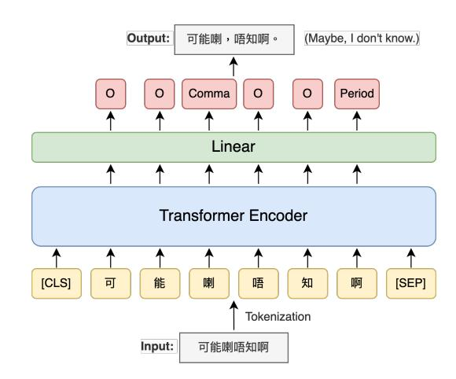

**Source:** *Cantonese Punctuation Restoration using LLM Annotated Data* — [PDF](https://www.isca-archive.org/interspeech_2025/suen25_interspeech.pdf)

# Cantonese Punctuation Restoration using LLM Annotated Data

*King Yiu Suen, Rudolf Chow, Albert Y. S. Lam*

## Fano, Hong Kong

cyrus.suen@fano.ai, rudolf@fano.ai, albert@fano.ai

## Abstract

One of the main challenges for punctuation restoration for a low-resource language such as Cantonese is data scarcity. While its spoken and written forms are very different, current Cantonese datasets are mostly from formal written text. Naturally spoken data are very scarce. To address this gap, we leverage LLM to annotate naturally spoken Cantonese transcripts sourced from YouTube. Then, we fine-tune pretrained language models for punctuation restoration using the LLM-annotated transcripts. Our experiments show that models trained on LLM-annotated transcripts outperform those trained solely on formal written text, despite the smaller dataset size. Our best-performing model achieves performance on par with the strongest LLM evaluated on a benchmark dataset, while being significantly smaller. These findings highlight the potential of LLM-generated data for improving NLP tasks in low-resource languages. Our data and code are publicly available at: https://github.com/fanolabs/ cantonese-punctuation-restoration.

Index Terms: punctuation restoration, speech recognition, lowresource language, corpus collection

## 1. Introduction

Automatic punctuation restoration is an essential postprocessing step in automatic speech recognition (ASR) systems. The absence of punctuation in ASR-generated transcripts significantly hampers user experience, as it is difficult to read lengthy texts without clear sentence boundaries. Furthermore, missing punctuation can negatively impact downstream natural language processing (NLP) tasks, such as named entity recognition, dependency parsing, and part-of-speech tagging (e.g., [1]).

Punctuation restoration has been studied in a variety of languages, including Mandarin [2], Vietnamese [3], Bangla [4], Portuguese [5], and Spanish [6]. Cantonese, a Chinese dialect primarily spoken in Hong Kong, Macau, Guangdong, Guangxi, and various overseas Chinese communities [7], is estimated to have over 85 million native speakers [8]. Despite its widespread use, research specifically focusing on Cantonese punctuation restoration remains scarce. One major reason is that Cantonese is predominantly a spoken language, with written Cantonese primarily appearing in informal contexts such as instant messages and social media. Collecting such data poses significant challenges due to privacy concerns and restrictions related to terms of use.

While Cantonese corpora are available, they are mostly formal written text, which does not align with the conversational and unstructured nature of spoken Cantonese. For example, it lacks the noise typically found in natural conversations, such as stuttering, false starts, and filler words. Previous studies have shown that a punctuation restoration model that was trained on formal written texts performed poorly on real-world ASR text [9]. While [10] managed to compile Cantonese spoken transcripts from several open-source datasets, the resulting corpus contains only 29.4K sentences.

To bridge the gap between formal written texts and informal conversational texts, [11] employ GPT-2 to generate synthetic punctuated texts, which can then be converted into labeled data for training punctuation restoration models. However, while existing pre-trained models have demonstrated proficiency in natural language understanding tasks such as sentiment analysis, they often produce Cantonese sentences that are grammatically incorrect or semantically misleading [12, 13]. Additionally, a common feature in Cantonese conversations is that English words are frequently interspersed within the dialogue. But LLMs are known to struggle with generating code-mixed text effectively [14].

In this paper, we propose an alternative approach: instead of relying on LLMs to generate synthetic text, we transcribe real Cantonese YouTube videos and use an LLM to add punctuation to these transcripts. Unlike synthetic data, YouTube transcripts capture authentic conversational nuances, including code-mixing, disfluencies, and informal speech patterns, making them more representative of real-world ASR outputs. This approach ensures that the training data align closely with the characteristics of spoken Cantonese, thereby improving the robustness and accuracy of the punctuation restoration model. The punctuated texts are then converted to labeled data for training a smaller, more efficient model. Leveraging LLMs for data annotation to train smaller models has been explored in prior work and has been shown to reduce computational overhead while maintaining high performance across various NLP tasks [15, 16]. To ensure the quality of the generated labels, we compare six LLMs on their punctuation restoration performance using a benchmark dataset and select only the best-performing models for creating surrogate labels. The main contributions of this paper are as follows:

- 1. We are the first study to evaluate the performance of existing LLMs on punctuation restoration for Cantonese text.
- 2. We prepare a novel and realistic dataset for punctuation restoration in Cantonese conversations and make it publicly available to facilitate future research in this understudied area.
- 3. We demonstrate the effectiveness of distilling the punctuation expertise from an LLM into a smaller, more efficient BERTbased model.

|               | Comma |      |      | Period |      |      | Question |      |      | Overall |      |      |
|---------------|-------|------|------|--------|------|------|----------|------|------|---------|------|------|
| Model         | P     | R    | F1   | P      | R    | F1   | P        | R    | F1   | P       | R    | F1   |
| GPT-3.5-turbo | 44.0  | 63.0 | 51.9 | 90.6   | 89.4 | 90.0 | 70.6     | 59.3 | 64.4 | 65.5    | 75.5 | 70.1 |
| GPT-4o-mini   | 42.7  | 80.4 | 55.8 | 93.2   | 85.0 | 88.9 | 57.6     | 74.0 | 64.8 | 60.9    | 81.9 | 69.9 |
| Llama-3.3-70b | 39.4  | 74.3 | 51.5 | 96.1   | 70.0 | 81.0 | 41.6     | 86.2 | 56.1 | 54.7    | 73.5 | 62.7 |
| Qwen-2.5-72b  | 46.3  | 72.7 | 56.6 | 93.8   | 91.4 | 92.6 | 72.8     | 71.7 | 72.3 | 67.1    | 81.6 | 73.6 |
| Yi-1.5-34B    | 43.8  | 38.0 | 40.7 | 93.7   | 52.2 | 67.1 | 35.5     | 80.7 | 49.3 | 56.9    | 49.5 | 52.9 |

Table 1: *LLM performance on HKCanCor. "P" and "R" refer to precision and recall respectively. "Overall" refers to the microaverage of scores for all punctuation classes.*

## 2. Dataset Construction

#### 2.1. LLM Comparison

As no prior studies have evaluated the capability of LLMs for punctuation restoration in Cantonese text, we compare the performance of five LLMs on the Hong Kong Cantonese Corpus (HKCanCor) [17]. The evaluated models include GPT-3.5-turbo [18], GPT-4o-mini [19], Llama-3.3-70b [20], Qwen-2.5-72b [21], and Yi-1.5-34B [22]. These models are selected based on their demonstrated ability to comprehend Cantonese [23] and their computational feasibility given our resource constraints. The best-performing LLM is subsequently used to annotate Youtube transcripts.

We evaluate their performance based on HKCanCor, as the content of the corpus comes closest to reflecting real-world scenarios. It contains verbatim transcripts of 51 spontaneous speeches and 42 radio programmes. Filler words such as ''誒" (similar to "er" in English, used when pausing or thinking) are included in the transcripts. The corpus has a total of 16K sentences and 230K words before pre-processing. Due to the lack of standardized written forms for many Cantonese modal particles, we align the written forms in HKCanCor with what is typically used by ASR models. This alignment ensures consistency with more commonly used written forms, which we hypothesize are better understood by the LLMs, while also mitigating train/test data discrepancies in later experiments. For example, ''噉" is converted to ''咁", and ''嚹" is converted to ''喇". We are only interested in restoring three types of punctuation, namely commas, periods, and question marks. Exclamation marks are replaced with periods. Other punctuation such as quotation marks are removed. Utterances with no Chinese characters or shorter than three characters are removed. After pre-processing, the statistics of the remaining utterances are presented in Table 2.

The prompt designed for the LLMs is illustrated in Figure 1. The demonstrations provided in the prompt are example sentences sourced from a Cantonese-English dictionary1 . Each punctuation class is present in at least one of the examples. We employ GPT-3.5-turbo and GPT-4o-mini via the Azure OpenAI Service. If the Azure content filter is triggered, the corresponding outputs are excluded from the results. We set the sampling temperature to 0.1 to minimize randomness, as the task does not require creativity. This also reduces the likelihood of LLMs modifying words in the input sentences. If such modifications still occur, we retry the prompt up to three times. If the issue persists, the instance will be discarded. While this behavior is observed across all LLMs, the discard rate remains below 0.7% for most models. However, for Yi-1.5-34B, the rate of such

#### # Task Description

Your task is to add appropriate punctuation (commas, full stops, or question marks) to the provided Cantonese text. The text is part of a transcript. The goal is to improve its readability while preserving the original wording.

#### # Constraints

- Only use commas, periods, or question marks where they fit naturally based on the context and spoken pauses in Cantonese.
- Do not add, modify, or remove any words from the input text, even if the text is grammatically incorrect or nonsensical.
- Format your response as a JSON object with a single key named "output", so that it can be directly parsed using Python's json.loads() without any modifications.
- Do not include any additional text, explanations, or conclusions. Only provide the JSON object.

#### # Examples

Input: 我做埋今日就退休喇 *(I am retiring after today)*

Output: {"output": " 我做埋今日就退休喇。"} Input: 冇人嚟嘅話今日不如早啲收檔啦 *(If no one comes today*

*maybe we can close early)* Output: {"output": " 冇人嚟嘅話,今日不如早啲收檔啦。"}

Input: 食咗飯未呀 *(Have you eaten yet)* Output: {"output": " 食咗飯未呀?"}

# Input Text {text}

Figure 1: *Prompt Template used for LLMs. The English translations in the example section are not part of the actual prompt; they are provided for the readers' understanding only.*

modifications is notably higher, occurring in approximately 5% of cases.

To compute the evaluation metrics, we first tokenize the LLM-generated text into individual tokens. For each token that is not a punctuation mark, we assign a label indicating the punctuation mark that follows it (*Comma*, *Period*, or *Question*). Tokens not followed by any punctuation are assigned the label *O* (other). This results in a sequence where each token is paired with the corresponding punctuation mark. The same process is applied to the ground-truth text. Finally, we compare the labels between the LLM-generated text and the ground truth. The LLMs are evaluated using precision, recall and F1-score for each of the three punctuation classes, as well as the microaveraged scores.

The performance of the LLMs is presented in Table 1. Since we are only interested in the performance of the punctuation marks, the performance of *O* is ignored in the table. It is worth noting that the precision of commas is much lower than other

1https://cantowords.com/

| Corpus    | # Sentence | Code-mixed% | # Word    | # Comma | # Period | # Question |
|-----------|------------|-------------|-----------|---------|----------|------------|
| HKCanCor  | 12,480     | 11.9%       | 154,374   | 8,852   | 10,500   | 2,320      |
| Youtube   | 130,888    | 19.0%       | 3,119,766 | 305,137 | 115,596  | 19,826     |
| Wikipedia | 301,521    | 7.1%        | 9,121,411 | 576,053 | 300,707  | 757        |

Table 2: *Corpus statistics.*

punctuation types for all LLMs, ranging only from 35.8% to 46.3%. This indicates a tendency to insert more commas than suggested by HKCanCor. This discrepancy does not necessarily imply that the LLMs are incorrect, as the use of commas can often be subjective and dependent on stylistic preferences. For example, the comma in the sentence ''但係,如果係你喺澳洲" (but, if you are in Australia) may deem appropriate by the LLM but omitted in HKCanCor, highlighting the variability in punctuation practices. Despite these differences, the results demonstrate that Qwen-2.5-72b achieves the highest F1 score across all three punctuation marks. This strong performance makes it the most suitable model for annotating the dataset. Consequently, we employ Qwen-2.5-72b to generate punctuation labels for the transcribed Cantonese YouTube videos, ensuring high-quality annotations for later experiments.

#### 2.2. Data Preparation

We collect 237 hours of 1,487 videos from 4 Youtube channels2,3,4,5, downloaded using the Python library *yt-dlp*6 . The videos cover a wide range of topics, including political discussions, celebrity interviews, finance news, travel video blogs and health advice. The number of speakers in each video ranges from 1 to 4. The videos are uploaded under a Creative Commons license7 at the time of download.

While open-source ASR models for Cantonese exist, their performance tend to be unsatisfactory. For example, whisperv3-large has a word error rate (WER) of 10.9% on a Cantonese benchmark dataset [24]. Therefore, we use our own proprietary ASR model to transcribe the videos. The ASR model is built based on an encoder-decoder framework, consisting of a Conformer encoder [25] and a Transformer decoder [26]. The model is trained on proprietary Cantonese data.

We use the same prompt in Figure 1 to add punctuation to the transcripts. We split the transcripts into utterances first based on speakers and then on sentence-ending punctuations, i.e. periods and question marks. We remove all utterances that contain no Chinese characters or are too short (fewer than 3 characters). In total, there are 130K utterances. More detailed statistics are presented in Table 2.

## 3. Experiment

#### 3.1. Models

We evaluate various pre-trained transformer models using a token classification approach in a supervised fine-tuning setup. The model is trained to classify each token into one of four categories: *Comma*, *Period*, *Question*, or *O*. Specifically, it predicts the punctuation mark that follows a given token, with *O* assigned when no punctuation is present. To adapt the pre-trained models for this task, we introduce a linear classification layer on top of the transformer architecture (see Figure 2), applying a dropout rate of 0.1 to enhance generalization.

Figure 2: *Model architecture.*

We explore and evaluate both monolingual and multilingual pre-trained models, including BERT-Base-Chinese [27], BERT-Base-Multilingual-Uncased [27], and XLM-RoBERTa-Base [28], to enhance the generalizability of our findings. All three models share the same architecture: 12 Transformer encoder layers, a hidden size of 768, an intermediate size of 3072, and 12 attention heads. However, they differ in their pre-training corpora and linguistic coverage. To better accommodate Cantonese text, we expand their vocabularies by incorporating characters present in the ASR vocabulary but missing from the models.

The models are fine-tuned using the AdamW optimizer [29] and a batch size of 32. The learning rate is searched from the range of 1e-5 to 5e-5 with an increment of 1e-5. The training is conducted for a maximum of 5 epochs, and the model checkpoint with the best validation F1 score is used for evaluation on the test set. All training is performed on a single NVIDIA GeForce RTX 3090 GPU.

#### 3.2. Data Combination

Fine-tuning a pre-trained language model initially on a dataset similar to the target domain, followed by fine-tuning on the target dataset, has been shown to be effective in various NLP tasks [30, 31]. Inspired by this approach, we employ a two-stage finetuning strategy:

1. The model is first fine-tuned on formal written Cantonese text from Cantonese Wikipedia, learning general punctuation restoration patterns.

2https://www.youtube.com/@am730video

3https://www.youtube.com/@hketvideo

4https://www.youtube.com/@sangpu-twhk

5https://www.youtube.com/@KrystianandVenus

6https://github.com/yt-dlp/yt-dlp

7Creative Commons license allows the usage of content for any purpose, including academic research.

|                                | Comma |      |      | Period |      |      | Question |      |      | Overall |      |      |
|--------------------------------|-------|------|------|--------|------|------|----------|------|------|---------|------|------|
|                                | P     | R    | F1   | P      | R    | F1   | P        | R    | F1   | P       | R    | F1   |
| BERT-Base-Chinese              |       |      |      |        |      |      |          |      |      |         |      |      |
| Wikipedia                      | 50.1  | 54.9 | 52.4 | 93.1   | 89.5 | 91.3 | 68.0     | 70.5 | 69.2 | 71.6    | 73.3 | 72.4 |
| Youtube                        | 46.6  | 73.9 | 57.2 | 93.5   | 90.8 | 92.1 | 70.0     | 70.5 | 70.3 | 66.6    | 81.7 | 73.4 |
| Wikipedia → Youtube            | 47.5  | 72.3 | 57.3 | 93.7   | 90.5 | 92.1 | 68.7     | 70.2 | 71.7 | 67.5    | 81.0 | 73.6 |
| BERT-Base-Multilingual-Uncased |       |      |      |        |      |      |          |      |      |         |      |      |
| Wikipedia                      | 50.2  | 48,2 | 49.2 | 91.5   | 83.7 | 87.5 | 52.3     | 65.1 | 58.0 | 69.4    | 67.2 | 69.4 |
| Youtube                        | 45.6  | 71.9 | 55.8 | 93.5   | 91.0 | 92.3 | 69.9     | 70.8 | 70.3 | 66.2    | 81.1 | 72.9 |
| Wikipedia → Youtube            | 46.5  | 71.8 | 56.5 | 93.6   | 90.7 | 92.1 | 68.7     | 71.3 | 70.0 | 66.8    | 80.9 | 73.2 |
| XLM-RoBERTa-Base               |       |      |      |        |      |      |          |      |      |         |      |      |
| Wikipedia                      | 50.3  | 55.0 | 52.5 | 93.0   | 90.1 | 91.5 | 69.5     | 70.2 | 69.8 | 71.9    | 73.6 | 72.7 |
| Youtube                        | 46.8  | 72.1 | 56.8 | 94.0   | 90.5 | 92.2 | 68.3     | 73.3 | 70.7 | 67.1    | 81.1 | 73.4 |
| Wikipedia → Youtube            | 47.7  | 72.2 | 57.4 | 93.8   | 91.2 | 92.5 | 70.4     | 72.2 | 71.3 | 67.9    | 81.4 | 74.0 |

Table 3: *Performance on HKCanCor using different pre-trained models and data combinations. "P" and "R" refer to precision and recall respectively. "Overall" refers to the micro-average of scores for all punctuation classes.*

2. The model is further fine-tuned on YouTube transcripts, allowing it to adapt to the specific characteristics of spoken Cantonese.

To assess the effectiveness of this strategy, we compare our two-stage fine-tuning approach against two baseline models that are fine-tuned using only Cantonese Wikipedia8 or only YouTube transcripts. For all settings, we randomly selected 10% of the data to use as the validation set, and HKCanCor is used as the test set.

#### 3.3. Results

Table 3 presents the performance of the examined models. Despite being only one-third the size of the Wikipedia corpus, fine-tuning on the YouTube corpus yields improvements of 0.7 to 3.5 F1 scores over fine-tuning on Wikipedia alone. This highlights the effectiveness of using transcriptions from spontaneous speech, which better reflect the characteristics of ASRgenerated text.

Models fine-tuned first on Wikipedia and then on YouTube outperform those trained solely on Wikipedia by 1.2 to 3.8 F1 scores. Compared to models fine-tuned only on YouTube, the two-stage fine-tuning approach results in an additional 0.2 to 0.6 gain in F1 score. This suggests that Wikipedia serves as a useful initial training signal for punctuation restoration, while the YouTube corpus provides additional domain-specific knowledge for handling conversational Cantonese.

Finally, the best-performing model is achieved by XLM-RoBERTa-Base with an overall F1 score of 74.0, surpassing the strongest LLM by 0.4 F1 score (see Table 1), while being significantly smaller and more computationally efficient. This underscores the potential of leveraging LLMs for data annotation to train compact models that maintain strong performance without the high computational cost of large-scale generative models.

## 4. Conclusion

This paper explores the use of LLMs to annotate YouTube transcripts for training a punctuation restoration model for Cantonese, a low-resource language. Our experiments show that models fine-tuned on LLM-annotated transcripts outperform those trained solely on formally written text, despite the fact that the latter has a larger size. This suggests that transcriptions from spontaneous speech provide valuable information for punctuation restoration. The performance improvements are consistent across all evaluated models. This method theoretically allows for generating an unlimited amount of training data, although, it is challenging to identify Cantonese videos with licenses that permit data usage. Nevertheless, the proposed method is largely language-agnostic. As long as there is access to raw transcribed speech data and an LLM capable of understanding the target language, this pipeline can be applied to other low-resourced languages that have limited spoken corpora.

One limitation of our approach is that we did not align our prompt instructions with the annotation style used in HK-CanCor. Differences in annotation conventions between LLMgenerated data and HKCanCor may impact performance. A potential solution is to dynamically select semantically similar sentences from HKCanCor and incorporate them into the prompts, ensuring that the model learns the dataset's specific annotation style. However, our study aims to assess LLMs' general ability to restore punctuation in Cantonese transcripts rather than optimizing performance for a single dataset, which is why we do not pursue this strategy.

Another limitation is that our model operates purely on text input. Many frequently used Cantonese characters have more than one pronunciation. For example, consider the sentence ''係呀". If the character ''呀" is pronounced as "aa3", the sentence expresses agreement and should be followed by a period. In contrast, if it is pronounced as "aa4", it functions as a confirmation-seeking question and should be followed by a question mark. Without tonal information, the model has no way of distinguishing between these two cases, potentially leading to errors in punctuation placement. Future work could explore combining textual and acoustic features, such as in [32] and [33].

## 5. References

- [1] T. B. Nguyen, Q. M. Nguyen, T. T. H. Nguyen, Q. T. Do, and C. M. Luong, "Improving vietnamese named entity recognition from speech using word capitalization and punctuation recovery models," in *Interspeech 2020*, 2020, pp. 4263–4267.
- [2] T. Ling, Y. Lai, L. Chen, S. Huang, and Y. Liu, "A small and fast

8https://zh-yue.wikipedia.org/

- bert for chinese medical punctuation restoration," in *Interspeech 2024*, 2024, pp. 4533–4537.
- [3] T. T. H. Nguyen, T. B. Nguyen, N. P. Pham, Q. Truong, T. L. Le, and C. M. Luong, "Toward human-friendly asr systems: Recovering capitalization and punctuation for vietnamese text," *IE-ICE Transactions on Information and Systems*, vol. 104, no. 8, pp. 1195–1203, 2021.
- [4] H. Rahman, M. R. S. Rahin, A. M. Mahbub, M. A. Islam, M. S. H. Mukta, and M. M. Rahman, "Punctuation prediction in bangla text," *ACM Transactions on Asian and Low-Resource Language Information Processing*, vol. 22, no. 3, pp. 1–20, 2023.
- [5] F. Batista, D. Caseiro, N. Mamede, and I. Trancoso, "Recovering capitalization and punctuation marks for automatic speech recognition: Case study for portuguese broadcast news," *Speech Communication*, vol. 50, no. 10, pp. 847–862, 2008.
- [6] M. Pérez-Enríquez, J. M. Masiello-Ruiz, J. L. López-Cuadrado, I. González-Carrasco, P. Martinez-Fernandez, and B. Ruiz-Mezcua, "Automatic punctuation model for spanish live transcriptions," in *Proceedings of the 2024 Joint International Conference on Computational Linguistics, Language Resources and Evaluation (LREC-COLING 2024)*, 2024, pp. 1953–1958.
- [7] T.-s. Wong, K. Gerdes, H. Leung, and J. Lee, "Quantitative comparative syntax on the Cantonese-Mandarin parallel dependency treebank," in *Proceedings of the Fourth International Conference on Dependency Linguistics (Depling 2017)*. Pisa, Italy: Linköping University Electronic Press, Sep. 2017, pp. 266–275.
- [8] R. Xiang, E. Chersoni, Y. Li, J. Li, C.-R. Huang, Y. Pan, and Y. Li, "Cantonese natural language processing in the transformers era: a survey and current challenges," *Language Resources and Evaluation*, pp. 1–27, 2024.
- [9] T. Alam, A. Khan, and F. Alam, "Punctuation restoration using transformer models for high-and low-resource languages," in *Proceedings of the Sixth Workshop on Noisy User-generated Text (W-NUT 2020)*, 2020, pp. 132–142.
- [10] Y. Li, P. Liu, X. Wu, and H. Meng, "Puncantonese: A benchmark corpus for low-resource cantonese punctuation restoration from speech transcripts," in *Interspeech 2023*, 2023, pp. 2183–2187.
- [11] V. D. Lai, A. Salinas, H. Tan, T. Bui, Q. Tran, S. Yoon, H. Deilamsalehy, F. Dernoncourt, and T. H. Nguyen, "Boosting punctuation restoration with data generation and reinforcement learning," in *Interspeech 2023*, 2023, pp. 2133–2137.
- [12] Z. Fu, Y. C. Hsu, C. S. Chan, C. M. Lau, J. Liu, and P. S. F. Yip, "Efficacy of chatgpt in cantonese sentiment analysis: Comparative study," *Journal of Medical Internet Research*, vol. 26, p. e51069, 2024.
- [13] Y. Dai, C. F. Chan, Y. K. Wong, and T. H. Pun, "Next-level Cantonese-to-Mandarin translation: Fine-tuning and postprocessing with LLMs," in *Proceedings of the First Workshop on Language Models for Low-Resource Languages*, H. Hettiarachchi, T. Ranasinghe, P. Rayson, R. Mitkov, M. Gaber, D. Premasiri, F. A. Tan, and L. Uyangodage, Eds. Abu Dhabi, United Arab Emirates: Association for Computational Linguistics, Jan. 2025, pp. 427–436. [Online]. Available: https://aclanthology.org/2025.loreslm-1.32/
- [14] Z. X. Yong, R. Zhang, J. Forde, S. Wang, A. Subramonian, H. Lovenia, S. Cahyawijaya, G. Winata, L. Sutawika, J. C. B. Cruz, Y. L. Tan, L. Phan, L. Phan, R. Garcia, T. Solorio, and A. F. Aji, "Prompting multilingual large language models to generate code-mixed texts: The case of south East Asian languages," in *Proceedings of the 6th Workshop on Computational Approaches to Linguistic Code-Switching*, G. Winata, S. Kar, M. Zhukova, T. Solorio, M. Diab, S. Sitaram, M. Choudhury, and K. Bali, Eds. Singapore: Association for Computational Linguistics, Dec. 2023, pp. 43–63. [Online]. Available: https: //aclanthology.org/2023.calcs-1.5/
- [15] S. Wang, Y. Liu, Y. Xu, C. Zhu, and M. Zeng, "Want to reduce labeling cost? GPT-3 can help," in *Findings of the Association for Computational Linguistics: EMNLP 2021*, M.-F.

- Moens, X. Huang, L. Specia, and S. W.-t. Yih, Eds. Punta Cana, Dominican Republic: Association for Computational Linguistics, Nov. 2021, pp. 4195–4205. [Online]. Available: https://aclanthology.org/2021.findings-emnlp.354/
- [16] R. Smith, J. A. Fries, B. Hancock, and S. H. Bach, "Language models in the loop: Incorporating prompting into weak supervision," *ACM/JMS Journal of Data Science*, vol. 1, no. 2, pp. 1–30, 2024.
- [17] K. K. Luke and M. L. Wong, "The hong kong cantonese corpus: design and uses," *Journal of Chinese Linguistics Monograph Series*, no. 25, pp. 312–333, 2015.
- [18] OpenAI, "Introducing chatgpt," 2022. [Online]. Available: https://openai.com/blog/chatgpt/
- [19] ——, "Gpt-4o mini: advancing cost-efficient intelligence," 2024. [Online]. Available: https://openai.com/index/ gpt-4o-mini-advancing-cost-efficient-intelligence/
- [20] A. Dubey, A. Jauhri, A. Pandey, A. Kadian, A. Al-Dahle, A. Letman, A. Mathur, A. Schelten, A. Yang, A. Fan *et al.*, "The llama 3 herd of models," *arXiv preprint arXiv:2407.21783*, 2024.
- [21] Q. Team, "Qwen2.5: A party of foundation models," September 2024. [Online]. Available: https://qwenlm.github.io/blog/qwen2. 5/
- [22] A. Young, B. Chen, C. Li, C. Huang, G. Zhang, G. Zhang, G. Wang, H. Li, J. Zhu, J. Chen *et al.*, "Yi: Open foundation models by 01. ai," *arXiv preprint arXiv:2403.04652*, 2024.
- [23] J. Jiang, P. Chen, L. Chen, S. Wang, Q. Bao, L. Kong, Y. Li, and C. Wu, "How well do llms handle cantonese? benchmarking cantonese capabilities of large language models," *arXiv preprint arXiv:2408.16756*, 2024.
- [24] A. Radford, J. W. Kim, T. Xu, G. Brockman, C. McLeavey, and I. Sutskever, "Robust speech recognition via large-scale weak supervision," in *International conference on machine learning*. PMLR, 2023, pp. 28 492–28 518.
- [25] A. Gulati, J. Qin, C.-C. Chiu, N. Parmar, Y. Zhang, J. Yu, W. Han, S. Wang, Z. Zhang, Y. Wu, and R. Pang, "Conformer: Convolution-augmented transformer for speech recognition," in *Interspeech 2020*, 2020, pp. 5036–5040.
- [26] A. Vaswani, "Attention is all you need," *Advances in Neural Information Processing Systems*, 2017.
- [27] J. Devlin, "Bert: Pre-training of deep bidirectional transformers for language understanding," *arXiv preprint arXiv:1810.04805*, 2018.
- [28] A. Conneau, K. Khandelwal, N. Goyal, V. Chaudhary, G. Wenzek, F. Guzmán, E. Grave, M. Ott, L. Zettlemoyer, and V. Stoyanov, "Unsupervised cross-lingual representation learning at scale," *arXiv preprint arXiv:1911.02116*, 2019.
- [29] I. Loshchilov, "Decoupled weight decay regularization," *arXiv preprint arXiv:1711.05101*, 2017.
- [30] S. Garg, T. Vu, and A. Moschitti, "Tanda: Transfer and adapt pretrained transformer models for answer sentence selection," in *Proceedings of the AAAI conference on artificial intelligence*, vol. 34, no. 05, 2020, pp. 7780–7788.
- [31] M. T. R. Laskar, E. Hoque, and J. Huang, "Query focused abstractive summarization via incorporating query relevance and transfer learning with transformer models," in *Advances in Artificial Intelligence: 33rd Canadian Conference on Artificial Intelligence, Canadian AI 2020, Ottawa, ON, Canada, May 13–15, 2020, Proceedings 33*. Springer, 2020, pp. 342–348.
- [32] O. Klejch, P. Bell, and S. Renals, "Sequence-to-sequence models for punctuated transcription combining lexical and acoustic features," in *2017 IEEE International Conference on Acoustics, Speech and Signal Processing (ICASSP)*. IEEE, 2017, pp. 5700– 5704.
- [33] P. Hlubík, M. Španel, M. Bohá ˇ c, and L. Weingartová, "Insert- ˇ ing punctuation to asr output in a real-time production environment," in *International Conference on Text, Speech, and Dialogue*. Springer, 2020, pp. 418–425.