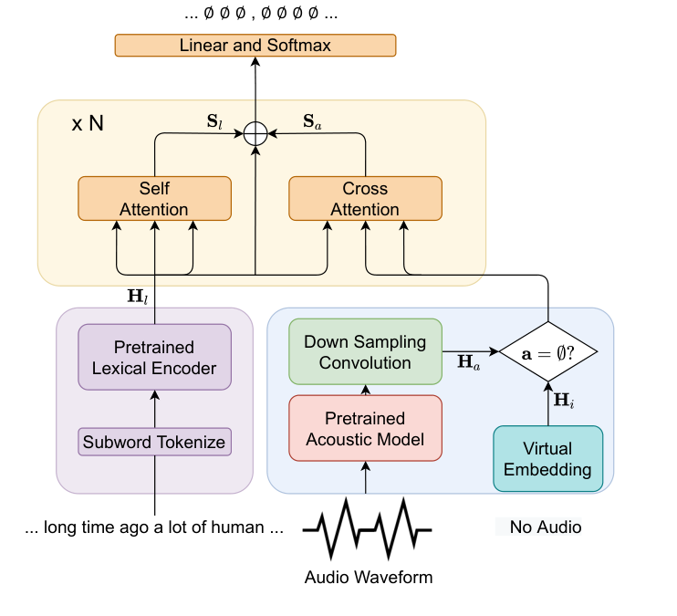

**Source:** *Unified Multimodal Punctuation Restoration Framework for Mixed-Modality Corpus* — [PDF](https://arxiv.org/pdf/2202.00468) · [arXiv](https://arxiv.org/abs/2202.00468)

# Unified Multimodal Punctuation Restoration Framework for Mixed-Modality Corpus

Yaoming Zhu ††thanks:  Yaoming and Liwei have equal contribution Liwei Wu  Shanbo Cheng  Mingxuan Wang 

###### Abstract

The punctuation restoration task aims to correctly punctuate the output transcriptions of automatic speech recognition systems. Previous punctuation models, either using text only or demanding the corresponding audio, tend to be constrained by real scenes, where unpunctuated sentences are a mixture of those with and without audio. This paper proposes a unified multimodal punctuation restoration framework, named UniPunc, to punctuate the mixed sentences with a single model. UniPunc jointly represents audio and non-audio samples in a shared latent space, based on which the model learns a hybrid representation and punctuates both kinds of samples. We validate the effectiveness of the UniPunc on real-world datasets, which outperforms various strong baselines (_e.g_. BERT, MuSe) by at least 0.8 overall F1 scores, making a new state-of-the-art. Extensive experiments show that UniPunc’s design is a pervasive solution: by grafting onto previous models, UniPunc enables them to punctuate on the mixed corpus. Our code is available at [github.com/Yaoming95/UniPunc](https://github.com/Yaoming95/UniPunc)

###### Index Terms: 

Speech, Punctuation Restoration, Multimodal 

††address: ByteDance AI Lab   
{zhuyaoming, wuliwei.000, chengshanbo,wangmingxuan.89}@bytedance.com 

## 1 Introduction

Automatic speech recognition (ASR) has wide application and serves multiple tasks as an upstream component, like voice assistants and speech translations. Typically, ASR output unsegmented transcripts without punctuations, which may lead to misunderstanding for people [[1](https://arxiv.org/html/2202.00468#bib.bib1)], and affect performance of downstream modules, such as machine translation [[2](https://arxiv.org/html/2202.00468#bib.bib2)] and information extraction [[3](https://arxiv.org/html/2202.00468#bib.bib3)].

To address the issue, researchers proposed the automatic punctuation restoration task and designed a series of models. Conventional punctuation restoration models had achieved considerable progress [[4](https://arxiv.org/html/2202.00468#bib.bib4), [5](https://arxiv.org/html/2202.00468#bib.bib5), [6](https://arxiv.org/html/2202.00468#bib.bib6), [7](https://arxiv.org/html/2202.00468#bib.bib7), [8](https://arxiv.org/html/2202.00468#bib.bib8)], but they were solely based on the lexical information, which gives rise to some problems. One sentence may have varied punctuation, contributing to different meanings, respectively. For example, “I don’t want anymore kids” means far away from “I don’t want anymore, kids”, suggesting the importance of a comma. Additionally, unaware of the speaker’s tone, the model might find it difficult to determine whether a sentence should end in a full stop or a question mark.

Acoustic signals can help mitigate the ambiguity of punctuation models, considering rich information in speech audio such as pauses and intonation. Therefore, [[9](https://arxiv.org/html/2202.00468#bib.bib9), [10](https://arxiv.org/html/2202.00468#bib.bib10), [11](https://arxiv.org/html/2202.00468#bib.bib11)] proposed several multimodal punctuation restoration models. Generally, these multimodal models extracted acoustic features from speech audio and fused acoustic and lexical features by addition/concatenating. Their experiments validated that the speech audio of the text benefits punctuation.

Despite their effectiveness, previous multimodal systems faced with modality missing in real applications. Firstly, storage constraints or privacy policies may deny access to the corresponding audio, where previous multimodal systems failed to punctuate such audio-free sentences; Secondly, human-labeled punctuation audio is expensive and hard to obtain, which leads to sparser training sets for those multimodal models. Meanwhile, the audio-free unpunctuated text is readily available. Hence, an ideal punctuation model should utilize and punctuate both audio text and audio-free text.

To handle the modality missing problem, this paper proposes the UniPunc, a unified multimodal punctuation framework enabling punctuation on both audio and audio-free text. Specifically, for audio text, UniPunc first converts the two modalities into embedding by pretrained lexical model and acoustic model, while for the audio-free sentences, UniPunc introduces virtual embedding to simulate its audio. UniPunc then applies an attention-based module, named coordinated bootstrapper, to construct a cross-modal hybrid representation. Based on the hybrid representation, the model learns and predicts multimodal punctuation. The UniPunc combines the strengths of the previous unimodal and multimodal models: it can utilize a large amount of audio-free corpora as the training set and take advantage of acoustic input to reduce ambiguity in punctuation. Thus, the model is applicable to the punctuation of both audio texts and non-audio texts.

We highlight our main contributions as follows:

a) We propose UniPunc, a new framework that serves punctuation restoration task and utilizes both audio-free text corpus and audio speech transcripts.  b) UniPunc achieves state-of-the-art performance on multimodal punctuation and outperforms various strong baselines by at least 0.8% overall F1 scores on real-world datasets.  c) We discuss pervasiveness UniPunc: the introduced framework can be grafted into related work [[5](https://arxiv.org/html/2202.00468#bib.bib5), [12](https://arxiv.org/html/2202.00468#bib.bib12)], empowering them to process both audio and non-audio text while improving performance. 

## 2 Problem Formulation

Punctuation restoration is often modeled as a sequence labeling task [[13](https://arxiv.org/html/2202.00468#bib.bib13)]. Generally, the corpus of multimodal punctuation is a set of sentence-audio-punctuation triples and denoted as \(S=\{\mathbf{x},\mathbf{a},\mathbf{y}\}\). Here \(\mathbf{x}\) is an unpunctuated sentence of length \(T\), and \(\mathbf{a}\) is the corresponding speech audio. The model should predict the sequence of punctuation \(\mathbf{y}\) given \(\mathbf{x}\) and \(\mathbf{a}\). The length of punctuation \(\mathbf{y}\) is identical to the unpunctuated sentence \(\mathbf{x}\) due to the nature of the sequence labeling task, _i.e_., \(|\mathbf{x}|=|\mathbf{y}|\). This study focuses on four types of punctuation, namely comma(,), full stop(.), question mark(?), and no punctuation.

As we have mentioned, our training set is a mix of audio text and audio-free text: on the one hand, we want to leverage large amounts of plain text in the absence of audio; on the other hand, we wish to make full use of acoustic features in the presence of audio. So is the case for the test set since we do not always get audio of the ASR transcription to be punctuated. Hence, the main challenge lies in modality missing for both training samples and evaluation data: _i.e_., \(\exists\penalty\ \mathbf{a}=\O\).

 Figure 1: Overall layout of UniPunc. Best viewed in color. Lexical encoder, acoustic assistant, and coordinate bootstrapper are blocked in purple, blue, and yellow respectively.

## 3 Method

This section will introduce the proposed UniPunc in detail. UniPunc consists of three main components: lexicon encoder, acoustic assistant, and coordinate bootstrapper. The three components learn lexical features, possible acoustic properties, and cross-modal hybrid features, respectively. Fig. [1](https://arxiv.org/html/2202.00468#S2.F1 "Figure 1 ‣ 2 Problem Formulation ‣ Unified Multimodal Punctuation Restoration Framework for Mixed-Modality Corpus") shows the overall layout.

### 3.1 Lexical Encoder

The lexical encoder tokenizes unpunctuated sentence into subword sequence and converts it into the contextual embedding sequence \(\mathbf{H}_{l}=(h^{l}_{1},...,h^{l}_{n})\). We leverage pretrained NLP model, e.g, BERT [[14](https://arxiv.org/html/2202.00468#bib.bib14)] as our backbone model. We treat the pretrained model as a sub-module of UniPunc and finetune the model on our task-specific data.

### 3.2 Acoustic Assistant

The acoustic assistant consists of an acoustic feature extractor, a down-sampling network, and a virtual embedding. It converts possible speech audio \(\mathbf{a}\) into acoustic embeddings \(\mathbf{H}_{a}\) or virtual embedding \(\mathbf{H}_{i}\).

For the audio-annotated transcriptions, UniPunc converts the audio signal into acoustic features via a pretrained acoustic feature extractor. Generally, the acoustic feature extractor is first pretrained on unlabelled audio datasets through self-supervised training and is then used as a submodule of the whole model and finetuned on the downstream punctuation task. Then UniPunc applies a down-sampling network further to shorten the extracted acoustic features’ length and get acoustic embedding \(\mathbf{H}_{a}=(h^{a}_{1},...,h^{a}_{m})\). The purpose is to make the length of acoustic embeddings close to the sentence embedding so that the model can better align cross-modal information. We choose a multilayer convolutional network as the core component of the down-sampling network.

For the audio-free sentences, we propose to use virtual embedding \(\mathbf{H}_{i}\) simulating the possible missing acoustic feature, _i.e_., \(\mathbf{H}_{a}=\mathbf{H}_{i}\penalty\ \mathbf{if}\penalty\ \mathbf{a}=\O\). We set virtual embedding as a fixed-length array of learnable parameters and expect it to learn the representations of absent audio. In the training process, the model learns the shared latent space of acoustic and virtual embedding, which supplies acoustic information for the subsequent coordinate bootstrapper.

### 3.3 Coordinate Bootstrapper

We propose the coordinate bootstrapper for jointly training audio-free and audio text to overcome the missing modality problem. The coordinate bootstrapper jointly exploits the acoustic and lexical features and applies an attention-based operation to learn a hybrid representation across two modalities.

Specifically, UniPunc first conducts self-attention on the contextual embedding \(\mathbf{H}_{l}\) to capture the long-range dependencies \(\mathbf{S}_{l}\) within the unpunctuated sentence and apply cross-attention between the contextual embedding \(\mathbf{H}_{l}\) and acoustic embedding \(\mathbf{H}_{a}\) to formulate a cross-modal representation \(\mathbf{S}_{a}\):

\[\begin{aligned}
 & \mathbf{S}_{l}=\mathrm{Att}(\mathbf{H}_{l},\mathbf{H}_{l},\mathbf{H}_{l}) &  & \text{(1)}
\end{aligned}\]

 

\[\begin{aligned}
 & \mathbf{S}_{a}=\mathrm{Att}(\mathbf{H}_{a},\mathbf{H}_{a},\mathbf{H}_{l}) &  & \text{(2)}
\end{aligned}\]

 

where \(\mathrm{Att}(q,k,v)=\mathrm{softmax}(\frac{qk^{\top}}{\sqrt{d_{k}}})v\) is the attention operation proposed by [[15](https://arxiv.org/html/2202.00468#bib.bib15)], and \(d_{k}\) is the dimension size of the model. Note that for modality missing samples, we substitute the acoustic embedding \(\mathbf{H}_{a}\) with virtual embedding \(\mathbf{H}_{i}\), in which case \(\mathbf{S}_{a}=\mathrm{Att}(\mathbf{H}_{i},\mathbf{H}_{i},\mathbf{H}_{l})\penalty\ \mathbf{if}\penalty\ \mathbf{a}=\O\).

Then the UniPunc acquires hybrid representation \(\mathbf{H}_{h}\) by adding the attended representation along with a residual connection [[16](https://arxiv.org/html/2202.00468#bib.bib16)].

\[\begin{aligned}
 & \mathbf{H}_{h}=\mathbf{S}_{l}+\mathbf{S}_{a}+\mathbf{H}_{l} &  & \text{(3)}
\end{aligned}\]

 

Like other attention blocks, the coordinate bootstrapper can be stacked to multiple layers to increase the model capacity further.

Finally, the output classifier layer consists of a linear projection and a softmax activation function. UniPunc inputs \(\mathbf{H}\) to the classifier layer to predict the punctuation sequence \(\hat{\mathbf{y}}\).

In this way, we enable the representations of audio samples and no audio samples to share the same embedding space. Thus, the model can receive mixed data in the same training batch, and the trained model is able to punctuate both audio text and audio-free text.

It should be emphasized that UniPunc makes a pervasive framework in solving modality missing in multimodal punctuation restoration tasks. For the previously proposed punctuation model, a proper adaptation of the proposed coordinate bootstrapper and acoustic assistant can empower them to address modality missing samples. Section [5](https://arxiv.org/html/2202.00468#S5 "5 Results ‣ Unified Multimodal Punctuation Restoration Framework for Mixed-Modality Corpus") discuss the the pervasiveness of coordinate bootstrapper upon previous models [[5](https://arxiv.org/html/2202.00468#bib.bib5), [12](https://arxiv.org/html/2202.00468#bib.bib12)] via experiment.

## 4 Experiment

### 4.1 Datasets

We conduct our experiment mainly on two real-world corpus: MuST-C [[17](https://arxiv.org/html/2202.00468#bib.bib17)]11 1 <https://ict.fbk.eu/must-c/> and Multilingual TEDx(mTEDx) [[18](https://arxiv.org/html/2202.00468#bib.bib18)]22 2 <http://www.openslr.org/100/>, whose audio are both originated from TED talks. We constructed three sets of data based on two corpora:

1) English-Audio: This set contains the English audio and sentences in MuST-C. Each sample is with audio.  2) English-Mixed: This set contains all English audio sentences and audio-free sentences from two corpora. Note that English-Audio is a subset of English-Mixed. 

Table 1: Statistical information of the training/test data on the two sets, where the first two rows are of the training set. The  sent. len and  audio len. denotes the average length of sentence and audio counted by words and seconds, respectively.

| # of sent. | # of audio | sent. len. | audio len.  
---|---|---|---|---  
English-Audio (Train) | 99381 | 99381 | 42.5 | 14.7  
English-Mixed (Train) | 142441 | 99381 | 44.1 | 14.7  
English-Audio (Test) | 490 | 120940 | 54.7 | 15.7  
English-Mixed (Test) | 2298 | 120940 | 52.0 | 15.7

 

Table 2: Results for three punctuations on two test set.

<table id="S4.T2.5.1" class="ltx_tabular ltx_guessed_headers ltx_align_middle">
<tbody class="ltx_tbody">
<tr id="S4.T2.5.1.1" class="ltx_tr">
<th id="S4.T2.5.1.1.1" class="ltx_td ltx_align_left ltx_th ltx_th_row ltx_border_r ltx_border_t">Test Set</th>
<th id="S4.T2.5.1.1.2" class="ltx_td ltx_align_left ltx_th ltx_th_row ltx_border_r ltx_border_t">Model</th>
<td id="S4.T2.5.1.1.3" class="ltx_td ltx_align_center ltx_border_r ltx_border_t" colspan="3">Comma</td>
<td id="S4.T2.5.1.1.4" class="ltx_td ltx_align_center ltx_border_r ltx_border_t" colspan="3">Full Stop</td>
<td id="S4.T2.5.1.1.5" class="ltx_td ltx_align_center ltx_border_r ltx_border_t" colspan="3">Question Mark</td>
<td id="S4.T2.5.1.1.6" class="ltx_td ltx_align_center ltx_border_t" colspan="3">Overall</td></tr>
<tr id="S4.T2.5.1.2" class="ltx_tr">
<th id="S4.T2.5.1.2.1" class="ltx_td ltx_th ltx_th_row ltx_border_r ltx_border_t"></th>
<th id="S4.T2.5.1.2.2" class="ltx_td ltx_th ltx_th_row ltx_border_r ltx_border_t"></th>
<td id="S4.T2.5.1.2.3" class="ltx_td ltx_align_center ltx_border_t">P</td>
<td id="S4.T2.5.1.2.4" class="ltx_td ltx_align_center ltx_border_t">R</td>
<td id="S4.T2.5.1.2.5" class="ltx_td ltx_align_center ltx_border_t">F1</td>
<td id="S4.T2.5.1.2.6" class="ltx_td ltx_align_center ltx_border_t">P</td>
<td id="S4.T2.5.1.2.7" class="ltx_td ltx_align_center ltx_border_t">R</td>
<td id="S4.T2.5.1.2.8" class="ltx_td ltx_align_center ltx_border_t">F1</td>
<td id="S4.T2.5.1.2.9" class="ltx_td ltx_align_center ltx_border_t">P</td>
<td id="S4.T2.5.1.2.10" class="ltx_td ltx_align_center ltx_border_t">R</td>
<td id="S4.T2.5.1.2.11" class="ltx_td ltx_align_center ltx_border_t">F1</td>
<td id="S4.T2.5.1.2.12" class="ltx_td ltx_align_center ltx_border_t">P</td>
<td id="S4.T2.5.1.2.13" class="ltx_td ltx_align_center ltx_border_t">R</td>
<td id="S4.T2.5.1.2.14" class="ltx_td ltx_align_center ltx_border_t">F1</td></tr>
<tr id="S4.T2.5.1.3" class="ltx_tr">
<th id="S4.T2.5.1.3.1" class="ltx_td ltx_align_center ltx_th ltx_th_row ltx_border_r ltx_border_t" rowspan="7">English-Audio</th>
<th id="S4.T2.5.1.3.2" class="ltx_td ltx_align_left ltx_th ltx_th_row ltx_border_r ltx_border_t">LSTM-T <cite class="ltx_cite ltx_citemacro_cite">[<a href="https://arxiv.org/html/2202.00468#bib.bib13" title="" class="ltx_ref">13</a>]</cite></th>
<td id="S4.T2.5.1.3.3" class="ltx_td ltx_align_center ltx_border_t">68.8</td>
<td id="S4.T2.5.1.3.4" class="ltx_td ltx_align_center ltx_border_t">50.7</td>
<td id="S4.T2.5.1.3.5" class="ltx_td ltx_align_center ltx_border_t">56.9</td>
<td id="S4.T2.5.1.3.6" class="ltx_td ltx_align_center ltx_border_t">75.8</td>
<td id="S4.T2.5.1.3.7" class="ltx_td ltx_align_center ltx_border_t">74.9</td>
<td id="S4.T2.5.1.3.8" class="ltx_td ltx_align_center ltx_border_t">74.3</td>
<td id="S4.T2.5.1.3.9" class="ltx_td ltx_align_center ltx_border_t">29.8</td>
<td id="S4.T2.5.1.3.10" class="ltx_td ltx_align_center ltx_border_t">26.5</td>
<td id="S4.T2.5.1.3.11" class="ltx_td ltx_align_center ltx_border_t">27.2</td>
<td id="S4.T2.5.1.3.12" class="ltx_td ltx_align_center ltx_border_t">72.0</td>
<td id="S4.T2.5.1.3.13" class="ltx_td ltx_align_center ltx_border_t">60.0</td>
<td id="S4.T2.5.1.3.14" class="ltx_td ltx_align_center ltx_border_t">65.1</td></tr>
<tr id="S4.T2.5.1.4" class="ltx_tr">
<th id="S4.T2.5.1.4.1" class="ltx_td ltx_align_left ltx_th ltx_th_row ltx_border_r">Self-Att-Word-Speech <cite class="ltx_cite ltx_citemacro_cite">[<a href="https://arxiv.org/html/2202.00468#bib.bib10" title="" class="ltx_ref">10</a>]</cite></th>
<td id="S4.T2.5.1.4.2" class="ltx_td ltx_align_center">71.1</td>
<td id="S4.T2.5.1.4.3" class="ltx_td ltx_align_center">58.1</td>
<td id="S4.T2.5.1.4.4" class="ltx_td ltx_align_center">62.7</td>
<td id="S4.T2.5.1.4.5" class="ltx_td ltx_align_center">81.1</td>
<td id="S4.T2.5.1.4.6" class="ltx_td ltx_align_center">76.4</td>
<td id="S4.T2.5.1.4.7" class="ltx_td ltx_align_center">77.5</td>
<td id="S4.T2.5.1.4.8" class="ltx_td ltx_align_center">31.9</td>
<td id="S4.T2.5.1.4.9" class="ltx_td ltx_align_center">30.1</td>
<td id="S4.T2.5.1.4.10" class="ltx_td ltx_align_center">31.0</td>
<td id="S4.T2.5.1.4.11" class="ltx_td ltx_align_center">75.5</td>
<td id="S4.T2.5.1.4.12" class="ltx_td ltx_align_center">65.3</td>
<td id="S4.T2.5.1.4.13" class="ltx_td ltx_align_center">69.7</td></tr>
<tr id="S4.T2.5.1.5" class="ltx_tr">
<th id="S4.T2.5.1.5.1" class="ltx_td ltx_align_left ltx_th ltx_th_row ltx_border_r">BERT <cite class="ltx_cite ltx_citemacro_cite">[<a href="https://arxiv.org/html/2202.00468#bib.bib7" title="" class="ltx_ref">7</a>]</cite></th>
<td id="S4.T2.5.1.5.2" class="ltx_td ltx_align_center">79.1</td>
<td id="S4.T2.5.1.5.3" class="ltx_td ltx_align_center">66.9</td>
<td id="S4.T2.5.1.5.4" class="ltx_td ltx_align_center">72.1</td>
<td id="S4.T2.5.1.5.5" class="ltx_td ltx_align_center">84.5</td>
<td id="S4.T2.5.1.5.6" class="ltx_td ltx_align_center">81.7</td>
<td id="S4.T2.5.1.5.7" class="ltx_td ltx_align_center">82.8</td>
<td id="S4.T2.5.1.5.8" class="ltx_td ltx_align_center">78.4</td>
<td id="S4.T2.5.1.5.9" class="ltx_td ltx_align_center">75.7</td>
<td id="S4.T2.5.1.5.10" class="ltx_td ltx_align_center">75.5</td>
<td id="S4.T2.5.1.5.11" class="ltx_td ltx_align_center">81.5</td>
<td id="S4.T2.5.1.5.12" class="ltx_td ltx_align_center">73.5</td>
<td id="S4.T2.5.1.5.13" class="ltx_td ltx_align_center">77.1</td></tr>
<tr id="S4.T2.5.1.6" class="ltx_tr">
<th id="S4.T2.5.1.6.1" class="ltx_td ltx_align_left ltx_th ltx_th_row ltx_border_r">MuSe <cite class="ltx_cite ltx_citemacro_cite">[<a href="https://arxiv.org/html/2202.00468#bib.bib11" title="" class="ltx_ref">11</a>]</cite></th>
<td id="S4.T2.5.1.6.2" class="ltx_td ltx_align_center">78.5</td>
<td id="S4.T2.5.1.6.3" class="ltx_td ltx_align_center">68.7</td>
<td id="S4.T2.5.1.6.4" class="ltx_td ltx_align_center">73.2</td>
<td id="S4.T2.5.1.6.5" class="ltx_td ltx_align_center">83.0</td>
<td id="S4.T2.5.1.6.6" class="ltx_td ltx_align_center">84.5</td>
<td id="S4.T2.5.1.6.7" class="ltx_td ltx_align_center">83.6</td>
<td id="S4.T2.5.1.6.8" class="ltx_td ltx_align_center">81.4</td>
<td id="S4.T2.5.1.6.9" class="ltx_td ltx_align_center">79.7</td>
<td id="S4.T2.5.1.6.10" class="ltx_td ltx_align_center">79.4</td>
<td id="S4.T2.5.1.6.11" class="ltx_td ltx_align_center">80.6</td>
<td id="S4.T2.5.1.6.12" class="ltx_td ltx_align_center">75.4</td>
<td id="S4.T2.5.1.6.13" class="ltx_td ltx_align_center">77.9</td></tr>
<tr id="S4.T2.5.1.7" class="ltx_tr">
<th id="S4.T2.5.1.7.1" class="ltx_td ltx_align_left ltx_th ltx_th_row ltx_border_r">MuSe <cite class="ltx_cite ltx_citemacro_cite">[<a href="https://arxiv.org/html/2202.00468#bib.bib11" title="" class="ltx_ref">11</a>]</cite>+TTS <cite class="ltx_cite ltx_citemacro_cite">[<a href="https://arxiv.org/html/2202.00468#bib.bib19" title="" class="ltx_ref">19</a>]</cite></th>
<td id="S4.T2.5.1.7.2" class="ltx_td ltx_align_center">75.3</td>
<td id="S4.T2.5.1.7.3" class="ltx_td ltx_align_center">78.9</td>
<td id="S4.T2.5.1.7.4" class="ltx_td ltx_align_center">77.1</td>
<td id="S4.T2.5.1.7.5" class="ltx_td ltx_align_center">80.0</td>
<td id="S4.T2.5.1.7.6" class="ltx_td ltx_align_center">77.6</td>
<td id="S4.T2.5.1.7.7" class="ltx_td ltx_align_center">78.8</td>
<td id="S4.T2.5.1.7.8" class="ltx_td ltx_align_center">78.0</td>
<td id="S4.T2.5.1.7.9" class="ltx_td ltx_align_center">80.9</td>
<td id="S4.T2.5.1.7.10" class="ltx_td ltx_align_center">79.5</td>
<td id="S4.T2.5.1.7.11" class="ltx_td ltx_align_center">75.6</td>
<td id="S4.T2.5.1.7.12" class="ltx_td ltx_align_center">79.9</td>
<td id="S4.T2.5.1.7.13" class="ltx_td ltx_align_center">77.8</td></tr>
<tr id="S4.T2.5.1.8" class="ltx_tr">
<th id="S4.T2.5.1.8.1" class="ltx_td ltx_align_left ltx_th ltx_th_row ltx_border_r ltx_border_t">UniPunc-Audio (Ours)</th>
<td id="S4.T2.5.1.8.2" class="ltx_td ltx_align_center ltx_border_t">78.9</td>
<td id="S4.T2.5.1.8.3" class="ltx_td ltx_align_center ltx_border_t">70.2</td>
<td id="S4.T2.5.1.8.4" class="ltx_td ltx_align_center ltx_border_t">74.2</td>
<td id="S4.T2.5.1.8.5" class="ltx_td ltx_align_center ltx_border_t">81.7</td>
<td id="S4.T2.5.1.8.6" class="ltx_td ltx_align_center ltx_border_t">86.0</td>
<td id="S4.T2.5.1.8.7" class="ltx_td ltx_align_center ltx_border_t">83.7</td>
<td id="S4.T2.5.1.8.8" class="ltx_td ltx_align_center ltx_border_t">84.3</td>
<td id="S4.T2.5.1.8.9" class="ltx_td ltx_align_center ltx_border_t">80.1</td>
<td id="S4.T2.5.1.8.10" class="ltx_td ltx_align_center ltx_border_t">80.8</td>
<td id="S4.T2.5.1.8.11" class="ltx_td ltx_align_center ltx_border_t">80.3</td>
<td id="S4.T2.5.1.8.12" class="ltx_td ltx_align_center ltx_border_t">76.8</td>
<td id="S4.T2.5.1.8.13" class="ltx_td ltx_align_center ltx_border_t">78.5</td></tr>
<tr id="S4.T2.5.1.9" class="ltx_tr">
<th id="S4.T2.5.1.9.1" class="ltx_td ltx_align_left ltx_th ltx_th_row ltx_border_r">UniPunc-Mix (Ours)</th>
<td id="S4.T2.5.1.9.2" class="ltx_td ltx_align_center">69.9</td>
<td id="S4.T2.5.1.9.3" class="ltx_td ltx_align_center">79.7</td>
<td id="S4.T2.5.1.9.4" class="ltx_td ltx_align_center">74.5</td>
<td id="S4.T2.5.1.9.5" class="ltx_td ltx_align_center">85.1</td>
<td id="S4.T2.5.1.9.6" class="ltx_td ltx_align_center">82.6</td>
<td id="S4.T2.5.1.9.7" class="ltx_td ltx_align_center">83.8</td>
<td id="S4.T2.5.1.9.8" class="ltx_td ltx_align_center">79.0</td>
<td id="S4.T2.5.1.9.9" class="ltx_td ltx_align_center">81.9</td>
<td id="S4.T2.5.1.9.10" class="ltx_td ltx_align_center">80.4</td>
<td id="S4.T2.5.1.9.11" class="ltx_td ltx_align_center">76.3</td>
<td id="S4.T2.5.1.9.12" class="ltx_td ltx_align_center">81.0</td>
<td id="S4.T2.5.1.9.13" class="ltx_td ltx_align_center">78.6</td></tr>
<tr id="S4.T2.5.1.10" class="ltx_tr">
<th id="S4.T2.5.1.10.1" class="ltx_td ltx_align_center ltx_th ltx_th_row ltx_border_b ltx_border_r ltx_border_t" rowspan="5">

English-Mixed
</th>
<th id="S4.T2.5.1.10.2" class="ltx_td ltx_align_left ltx_th ltx_th_row ltx_border_r ltx_border_t">BiLSTM <cite class="ltx_cite ltx_citemacro_cite">[<a href="https://arxiv.org/html/2202.00468#bib.bib5" title="" class="ltx_ref">5</a>]</cite></th>
<td id="S4.T2.5.1.10.3" class="ltx_td ltx_align_center ltx_border_t">61.0</td>
<td id="S4.T2.5.1.10.4" class="ltx_td ltx_align_center ltx_border_t">45.0</td>
<td id="S4.T2.5.1.10.5" class="ltx_td ltx_align_center ltx_border_t">51.6</td>
<td id="S4.T2.5.1.10.6" class="ltx_td ltx_align_center ltx_border_t">59.5</td>
<td id="S4.T2.5.1.10.7" class="ltx_td ltx_align_center ltx_border_t">54.7</td>
<td id="S4.T2.5.1.10.8" class="ltx_td ltx_align_center ltx_border_t">56.8</td>
<td id="S4.T2.5.1.10.9" class="ltx_td ltx_align_center ltx_border_t">58.8</td>
<td id="S4.T2.5.1.10.10" class="ltx_td ltx_align_center ltx_border_t">47.7</td>
<td id="S4.T2.5.1.10.11" class="ltx_td ltx_align_center ltx_border_t">50.1</td>
<td id="S4.T2.5.1.10.12" class="ltx_td ltx_align_center ltx_border_t">60.5</td>
<td id="S4.T2.5.1.10.13" class="ltx_td ltx_align_center ltx_border_t">48.3</td>
<td id="S4.T2.5.1.10.14" class="ltx_td ltx_align_center ltx_border_t">53.7</td></tr>
<tr id="S4.T2.5.1.11" class="ltx_tr">
<th id="S4.T2.5.1.11.1" class="ltx_td ltx_align_left ltx_th ltx_th_row ltx_border_r">Att-GRU <cite class="ltx_cite ltx_citemacro_cite">[<a href="https://arxiv.org/html/2202.00468#bib.bib20" title="" class="ltx_ref">20</a>]</cite></th>
<td id="S4.T2.5.1.11.2" class="ltx_td ltx_align_center">61.1</td>
<td id="S4.T2.5.1.11.3" class="ltx_td ltx_align_center">47.5</td>
<td id="S4.T2.5.1.11.4" class="ltx_td ltx_align_center">52.0</td>
<td id="S4.T2.5.1.11.5" class="ltx_td ltx_align_center">75.7</td>
<td id="S4.T2.5.1.11.6" class="ltx_td ltx_align_center">66.9</td>
<td id="S4.T2.5.1.11.7" class="ltx_td ltx_align_center">69.6</td>
<td id="S4.T2.5.1.11.8" class="ltx_td ltx_align_center">27.3</td>
<td id="S4.T2.5.1.11.9" class="ltx_td ltx_align_center">26.5</td>
<td id="S4.T2.5.1.11.10" class="ltx_td ltx_align_center">26.0</td>
<td id="S4.T2.5.1.11.11" class="ltx_td ltx_align_center">67.1</td>
<td id="S4.T2.5.1.11.12" class="ltx_td ltx_align_center">55.5</td>
<td id="S4.T2.5.1.11.13" class="ltx_td ltx_align_center">60.3</td></tr>
<tr id="S4.T2.5.1.12" class="ltx_tr">
<th id="S4.T2.5.1.12.1" class="ltx_td ltx_align_left ltx_th ltx_th_row ltx_border_r">SAPR <cite class="ltx_cite ltx_citemacro_cite">[<a href="https://arxiv.org/html/2202.00468#bib.bib8" title="" class="ltx_ref">8</a>]</cite></th>
<td id="S4.T2.5.1.12.2" class="ltx_td ltx_align_center">72.1</td>
<td id="S4.T2.5.1.12.3" class="ltx_td ltx_align_center">58.6</td>
<td id="S4.T2.5.1.12.4" class="ltx_td ltx_align_center">64.4</td>
<td id="S4.T2.5.1.12.5" class="ltx_td ltx_align_center">78.3</td>
<td id="S4.T2.5.1.12.6" class="ltx_td ltx_align_center">75.9</td>
<td id="S4.T2.5.1.12.7" class="ltx_td ltx_align_center">76.9</td>
<td id="S4.T2.5.1.12.8" class="ltx_td ltx_align_center">76.5</td>
<td id="S4.T2.5.1.12.9" class="ltx_td ltx_align_center">56.9</td>
<td id="S4.T2.5.1.12.10" class="ltx_td ltx_align_center">63.7</td>
<td id="S4.T2.5.1.12.11" class="ltx_td ltx_align_center">74.8</td>
<td id="S4.T2.5.1.12.12" class="ltx_td ltx_align_center">65.3</td>
<td id="S4.T2.5.1.12.13" class="ltx_td ltx_align_center">69.7</td></tr>
<tr id="S4.T2.5.1.13" class="ltx_tr">
<th id="S4.T2.5.1.13.1" class="ltx_td ltx_align_left ltx_th ltx_th_row ltx_border_r">BERT <cite class="ltx_cite ltx_citemacro_cite">[<a href="https://arxiv.org/html/2202.00468#bib.bib7" title="" class="ltx_ref">7</a>]</cite></th>
<td id="S4.T2.5.1.13.2" class="ltx_td ltx_align_center">74.2</td>
<td id="S4.T2.5.1.13.3" class="ltx_td ltx_align_center">68.0</td>
<td id="S4.T2.5.1.13.4" class="ltx_td ltx_align_center">70.8</td>
<td id="S4.T2.5.1.13.5" class="ltx_td ltx_align_center">82.6</td>
<td id="S4.T2.5.1.13.6" class="ltx_td ltx_align_center">81.2</td>
<td id="S4.T2.5.1.13.7" class="ltx_td ltx_align_center">81.8</td>
<td id="S4.T2.5.1.13.8" class="ltx_td ltx_align_center">78.7</td>
<td id="S4.T2.5.1.13.9" class="ltx_td ltx_align_center">79.5</td>
<td id="S4.T2.5.1.13.10" class="ltx_td ltx_align_center">77.4</td>
<td id="S4.T2.5.1.13.11" class="ltx_td ltx_align_center">78.0</td>
<td id="S4.T2.5.1.13.12" class="ltx_td ltx_align_center">73.6</td>
<td id="S4.T2.5.1.13.13" class="ltx_td ltx_align_center">75.7</td></tr>
<tr id="S4.T2.5.1.14" class="ltx_tr">
<th id="S4.T2.5.1.14.1" class="ltx_td ltx_align_left ltx_th ltx_th_row ltx_border_b ltx_border_r ltx_border_t">UniPunc-Mix (Ours)</th>
<td id="S4.T2.5.1.14.2" class="ltx_td ltx_align_center ltx_border_b ltx_border_t">73.2</td>
<td id="S4.T2.5.1.14.3" class="ltx_td ltx_align_center ltx_border_b ltx_border_t">71.2</td>
<td id="S4.T2.5.1.14.4" class="ltx_td ltx_align_center ltx_border_b ltx_border_t">72.1</td>
<td id="S4.T2.5.1.14.5" class="ltx_td ltx_align_center ltx_border_b ltx_border_t">82.5</td>
<td id="S4.T2.5.1.14.6" class="ltx_td ltx_align_center ltx_border_b ltx_border_t">82.2</td>
<td id="S4.T2.5.1.14.7" class="ltx_td ltx_align_center ltx_border_b ltx_border_t">82.2</td>
<td id="S4.T2.5.1.14.8" class="ltx_td ltx_align_center ltx_border_b ltx_border_t">79.0</td>
<td id="S4.T2.5.1.14.9" class="ltx_td ltx_align_center ltx_border_b ltx_border_t">76.0</td>
<td id="S4.T2.5.1.14.10" class="ltx_td ltx_align_center ltx_border_b ltx_border_t">76.1</td>
<td id="S4.T2.5.1.14.11" class="ltx_td ltx_align_center ltx_border_b ltx_border_t">77.3</td>
<td id="S4.T2.5.1.14.12" class="ltx_td ltx_align_center ltx_border_b ltx_border_t">75.8</td>
<td id="S4.T2.5.1.14.13" class="ltx_td ltx_align_center ltx_border_b ltx_border_t">76.5</td></tr>
</tbody>
</table>

 

We re-partition the data for each sample corresponding to an audio duration roughly range from 10 to 30 seconds. Tab. [1](https://arxiv.org/html/2202.00468#S4.T1 "Table 1 ‣ 4.1 Datasets ‣ 4 Experiment ‣ Unified Multimodal Punctuation Restoration Framework for Mixed-Modality Corpus") shows statistical information of the text and audio about the training and test sets in detail.

### 4.2 Configurations and Baselines

We set most modules at a dimension of 768. We choose BERT [[14](https://arxiv.org/html/2202.00468#bib.bib14)] and its subword tokenizer as pretrained lexical encoder and Wav2Vec 2.0 [[21](https://arxiv.org/html/2202.00468#bib.bib21)]33 3 The pretrained acoustic model used in the MuSe was Wav2Vec, which we also replace it with a newer and better version of Wav2Vec 2.0 in our implement for a fair comparison with UniPunc. as pretrained acoustic model. For two English datasets, we use BERT-base uncased and Wav2Vec 2.0-base no tuned version. We use a two-layer Convolution network of stride 5, kernel size of 15 as the down-sampling network. The layer number of coordinate bootstrapper is 2. The sequence length of virtual embedding is 5. We use learning rate of 0.00001 with Adam [[22](https://arxiv.org/html/2202.00468#bib.bib22)], dropout rate of 0.1, and Noam learning rate scheduler of warm-up step 8000.

We compare the performance of UniPunc with various baselines and SOTA systems, including: LSTM-T [[13](https://arxiv.org/html/2202.00468#bib.bib13)], Att-GRU [[20](https://arxiv.org/html/2202.00468#bib.bib20)], BERT [[7](https://arxiv.org/html/2202.00468#bib.bib7)], SAPR [[8](https://arxiv.org/html/2202.00468#bib.bib8)], Self-Att-Word-Speech[[10](https://arxiv.org/html/2202.00468#bib.bib10)] and MuSe [[11](https://arxiv.org/html/2202.00468#bib.bib11)]. We also compare to TTS punctuation data augmentation [[19](https://arxiv.org/html/2202.00468#bib.bib19)].

All unimodal baselines are trained on English-Mixed corpus, while multimodal ones are trained on English-Audio since they cannot handle audio-free samples. For UniPunc, we first trained it jointly on English-Mix, denoted as UniPunc-Mixed. To facilitate comparison with other multimodal baselines, we trained a UniPunc variant solely on the English-Audio, denoted as UniPunc-Audio. All models and baselines are evaluated in terms of precision(P), recall(R), and F1 score(F1) on three punctuations.

We implement UniPunc by Fairseq [[23](https://arxiv.org/html/2202.00468#bib.bib23)]. All experimental data are publicly available online. We will release our code and data split after paper acceptance for reproducibility.

## 5 Results

### 5.1 Main Results

We report the performance of our model and other baselines on English datasets in Tab. [2](https://arxiv.org/html/2202.00468#S4.T2 "Table 2 ‣ 4.1 Datasets ‣ 4 Experiment ‣ Unified Multimodal Punctuation Restoration Framework for Mixed-Modality Corpus").

Compare with other multimodal models: We compare UniPunc with other baselines on the English-Audio test set and get the following main conclusions: 1. UniPunc-mixed’s overall F1 score exceeds all baselines by at least 0.7 points, indicating the effectiveness of our framework. 2. UniPunc-Audio also outperforms all multimodal baselines, suggesting that even without introducing extra audio-free corpus, UniPunc makes a strong model on multimodal sequence labeling; 3. The overall F1 score of UniPunc-Mix is slightly higher than that of UniPunc-Audio, indicating that training with audio-free sentences indeed improves the performance, especially in punctuating commas and full stops. 4. Using audio-free text mainly improves the recall of punctuation (compare Muse _vs_. Muse+TTS, UniPunc-Audio _vs_. UniPunc-Mixed)

Compare with other unimodal models: We also compare UniPunc-mixed and other unimodal punctuation models on the English-Mixed test set; we also list BERT’s performance on English-Audio as it is the strongest unimodal baseline. Our conclusions are twofold: 1. UniPunc outperforms all baselines with at least 0.8 overall F1 scores on English-Mixed, which proves that its learned hybrid representation is very effective; 2. UniPunc far outperforms BERT on English-Audio 1.5 overall F1 score, which shows that UniPunc effectively represents the acoustic features in speech, which is especially obvious for punctuating question marks.

Table 3: F1 score for pervasive experiment on English-Mixed test set. CD denotes content dropout. 

| Comma | Full Stop | Question Mark | Overall  
---|---|---|---|---  
BiLSTM [[5](https://arxiv.org/html/2202.00468#bib.bib5)] | 51.6 | 56.8 | 50.1 | 53.7  
BiLSTM-UniPunc | 55.7 | 58.4 | 46.5 | 56.6  
CD [[12](https://arxiv.org/html/2202.00468#bib.bib12)]-BERT | 71.4 | 81.9 | 69.7 | 76.1  
CD-UniPunc | 71.5 | 82.1 | 76.7 | 76.9

 

We also conduct a case study and evaluate UniPunc’s performance on multilingual data from mTEDx. We find UniPunc punctuates closer to humans, and can better tell the pauses of commas and fulls stops as well as the tone of questions. In addition, we also find that UniPunc has better punctuation performance than other baselines on multilingual punctuation, which suggests that UniPunc has better robustness and generalization. The examples of case study is available at our code base.

### 5.2 Pervasiveness of UniPunc

This subsection explores the pervasiveness of UniPunc framework for punctuation restoration on the mixed datasets by grafting onto two previous approaches, namely BiLSTM [[5](https://arxiv.org/html/2202.00468#bib.bib5)] and content dropout [[12](https://arxiv.org/html/2202.00468#bib.bib12)]. Specifically, for the BiLSTM model, we introduce an acoustic assistant to extract potential acoustic features and coordinate bootstrapper to learn hybrid representation. We also graft UniPunc with content dropout and compare it with the lexical content dropout BERT. Tab. [3](https://arxiv.org/html/2202.00468#S5.T3 "Table 3 ‣ 5.1 Main Results ‣ 5 Results ‣ Unified Multimodal Punctuation Restoration Framework for Mixed-Modality Corpus") shows the overall results.

The experiments show that our framework is pervasive for solving the modality missing in punctuation, and enables the previous unimodal model to handle multimodal corpus. By grafting UniPunc onto the BiLSTM, our module greatly improves the performance of the original model by 2.9 F1 scores. In particular, when UniPunc and content dropout are used jointly, the model achieves an F1 score of 76.9, further improving the overall performance.

## 6 Conclusion

This paper focuses on the modality missing problem in multimodal punctuation tasks, as unpunctuated sentences are a mixture of audio text and audio-free text in real applications. We devise a new unified multimodal punctuation framework, named UniPunc. UniPunc can learn a hybrid representation for both audio and audio-free corpus, based on which UniPunc allows punctuating both kinds of sentences. We experiment on two real-world datasets, and find that UniPunc surpasses all previous strong multimodal and unimodal baselines by at least 0.8 overall F1 scores. Extensive experiments show that our framework is pervasive and can empower other models to process modality missing sentences.

## References

  * [1] Máté Ákos Tündik, György Szaszák, Gábor Gosztolya, and András Beke,  “User-centric evaluation of automatic punctuation in ASR closed captioning,”  in Interspeech 2018, B. Yegnanarayana, Ed. 2018, pp. 2628–2632, ISCA. 
  * [2] Vincent Vandeghinste, Lyan Verwimp, Joris Pelemans, and Patrick Wambacq,  “A comparison of different punctuation prediction approaches in a translation context,”  in EAMT 2018, pp. 269–278. 
  * [3] John Makhoul, Alex Baron, Ivan Bulyko, Long Nguyen, Lance A. Ramshaw, David Stallard, Richard M. Schwartz, and Bing Xiang,  “The effects of speech recognition and punctuation on information extraction performance,”  in INTERSPEECH 2005, pp. 57–60. 
  * [4] Agustin Gravano, Martin Jansche, and Michiel Bacchiani,  “Restoring punctuation and capitalization in transcribed speech,”  in ICASSP. IEEE, 2009, pp. 4741–4744. 
  * [5] Ottokar Tilk and Tanel Alumäe,  “Lstm for punctuation restoration in speech transcripts,”  in INTERSPEECH 2015, 2015. 
  * [6] Maury Courtland, Adam Faulkner, and Gayle McElvain,  “Efficient automatic punctuation restoration using bidirectional transformers with robust inference,”  in IWSLT 2020, pp. 272–279. 
  * [7] Karan Makhija, Thi-Nga Ho, and Eng-Siong Chng,  “Transfer learning for punctuation prediction,”  in APSIPA ASC, 2019. IEEE, pp. 268–273. 
  * [8] Feng Wang, Wei Chen, Zhen Yang, and Bo Xu,  “Self-attention based network for punctuation restoration,”  in ICPR 2018, pp. 2803–2808. 
  * [9] Ondřej Klejch, Peter Bell, and Steve Renals,  “Sequence-to-sequence models for punctuated transcription combining lexical and acoustic features,”  in ICASSP 2017. IEEE, 2017, pp. 5700–5704. 
  * [10] Jiangyan Yi and Jianhua Tao,  “Self-attention based model for punctuation prediction using word and speech embeddings,”  in ICASSP 2019. 2019, pp. 7270–7274, IEEE. 
  * [11] Monica Sunkara, Srikanth Ronanki, Dhanush Bekal, Sravan Bodapati, and Katrin Kirchhoff,  “Multimodal semi-supervised learning framework for punctuation prediction in conversational speech,”  in Interspeech 2020, 2020, pp. 4911–4915. 
  * [12] Andrew Silva, Barry-John Theobald, and Nicholas Apostoloff,  “Multimodal punctuation prediction with contextual dropout,”  in ICASSP 2021-2021. IEEE, 2021, pp. 3980–3984. 
  * [13] Piotr Zelasko, Piotr Szymanski, Jan Mizgajski, Adrian Szymczak, Yishay Carmiel, and Najim Dehak,  “Punctuation prediction model for conversational speech,”  in Interspeech 2018. 2018, pp. 2633–2637, ISCA. 
  * [14] Jacob Devlin, Ming-Wei Chang, Kenton Lee, and Kristina Toutanova,  “BERT: pre-training of deep bidirectional transformers for language understanding,”  in NAACL-HLT 2019, 2019, pp. 4171–4186. 
  * [15] Ashish Vaswani, Noam Shazeer, Niki Parmar, Jakob Uszkoreit, Llion Jones, Aidan N Gomez, Lukasz Kaiser, and Illia Polosukhin,  “Attention is all you need,”  in NIPS 2017, 2017, pp. 5998–6008. 
  * [16] Kaiming He, Xiangyu Zhang, Shaoqing Ren, and Jian Sun,  “Deep residual learning for image recognition,”  in CVPR 2016, 2016, pp. 770–778. 
  * [17] Roldano Cattoni, Mattia Antonino Di Gangi, Luisa Bentivogli, Matteo Negri, and Marco Turchi,  “Must-c: A multilingual corpus for end-to-end speech translation,”  Comput. Speech Lang., vol. 66, pp. 101155, 2021. 
  * [18] Elizabeth Salesky, Matthew Wiesner, Jacob Bremerman, Roldano Cattoni, Matteo Negri, Marco Turchi, Douglas W. Oard, and Matt Post,  “The multilingual tedx corpus for speech recognition and translation,”  CoRR, vol. abs/2102.01757, 2021. 
  * [19] Daria Soboleva, Ondrej Skopek, Márius Šajgalík, Victor Cărbune, Felix Weissenberger, Julia Proskurnia, Bogdan Prisacari, Daniel Valcarce, Justin Lu, Rohit Prabhavalkar, et al.,  “Replacing human audio with synthetic audio for on-device unspoken punctuation prediction,”  in ICASSP 2021, pp. 7653–7657. 
  * [20] Seokhwan Kim,  “Deep recurrent neural networks with layer-wise multi-head attentions for punctuation restoration,”  in ICASSP 2019. IEEE, 2019, pp. 7280–7284. 
  * [21] Alexei Baevski, Yuhao Zhou, Abdelrahman Mohamed, and Michael Auli,  “wav2vec 2.0: A framework for self-supervised learning of speech representations,”  in NeurIPS 2020. 
  * [22] Diederik P. Kingma and Jimmy Ba,  “Adam: A method for stochastic optimization,”  in ICLR, 2015. 
  * [23] Myle Ott, Sergey Edunov, Alexei Baevski, Angela Fan, Sam Gross, Nathan Ng, David Grangier, and Michael Auli,  “FAIRSEQ: A fast, extensible toolkit for sequence modeling,”  in NAACL demo, 2019, pp. 48–53. 

