**Source:** *Omnilingual MT: Machine Translation for 1,600 Languages* — [PDF](https://arxiv.org/pdf/2603.16309v3) · [arXiv](https://arxiv.org/abs/2603.16309v3)

\noautomath

# Omnilingual MT: Machine Translation for 1,600 Languages

Omnilingual MT Team  Affiliation: FAIR at Meta Belen Alastruey  Affiliation: FAIR at Meta Core Contributors, alphabetical order Niyati Bafna  Affiliation: FAIR at Meta Core Contributors, alphabetical order Andrea Caciolai  Affiliation: FAIR at Meta Core Contributors, alphabetical order Kevin Heffernan  Affiliation: FAIR at Meta Core Contributors, alphabetical order Artyom Kozhevnikov  Affiliation: FAIR at Meta Core Contributors, alphabetical order Christophe Ropers  Affiliation: FAIR at Meta Core Contributors, alphabetical order Eduardo Sánchez  Affiliation: FAIR at Meta Core Contributors, alphabetical order Charles-Eric Saint-James  Affiliation: FAIR at Meta Core Contributors, alphabetical order Ioannis Tsiamas  Affiliation: FAIR at Meta Core Contributors, alphabetical order Xiang “Tony” Cao  Affiliation: FAIR at Meta Other Contributors, alphabetical order Chierh Cheng  Affiliation: FAIR at Meta Other Contributors, alphabetical order Joe Chuang  Affiliation: FAIR at Meta Other Contributors, alphabetical order Paul-Ambroise Duquenne  Affiliation: FAIR at Meta Other Contributors, alphabetical order Mark Duppenthaler  Affiliation: FAIR at Meta Other Contributors, alphabetical order Nate Ekberg  Affiliation: FAIR at Meta Other Contributors, alphabetical order Cynthia Gao  Affiliation: FAIR at Meta Other Contributors, alphabetical order Pere Lluís Huguet Cabot  Affiliation: FAIR at Meta Other Contributors, alphabetical order João Maria Janeiro  Affiliation: FAIR at Meta Other Contributors, alphabetical order Jean Maillard  Affiliation: FAIR at Meta Other Contributors, alphabetical order Gabriel Mejia Gonzalez  Affiliation: FAIR at Meta Other Contributors, alphabetical order Holger Schwenk  Affiliation: FAIR at Meta Other Contributors, alphabetical order Edan Toledo  Affiliation: FAIR at Meta Other Contributors, alphabetical order Arina Turkatenko  Affiliation: FAIR at Meta Other Contributors, alphabetical order Albert Ventayol-Boada  Affiliation: FAIR at Meta Other Contributors, alphabetical order Rashel Moritz  Affiliation: FAIR at Meta Project Management, alphabetical order Alexandre Mourachko  Affiliation: FAIR at Meta Project Management, alphabetical order Surya Parimi  Affiliation: FAIR at Meta Project Management, alphabetical order Mary Williamson  Affiliation: FAIR at Meta Project Management, alphabetical order Shireen Yates  Affiliation: FAIR at Meta Project Management, alphabetical order David Dale  Affiliation: FAIR at Meta Technical Leadership, alphabetical order Marta R. Costa-jussà  Affiliation: FAIR at Meta Technical Leadership, alphabetical order

###### Abstract

Advances made through No Language Left Behind (NLLB) have demonstrated that high-quality machine translation (MT) scale to 200 languages. Later Large Language Models (LLMs) have been adopted for MT, increasing in quality but not necessarily extending language coverage. Current systems remain constrained by limited coverage and a persistent generation bottleneck: while cross-lingual transfer enables models to somehow understand many undersupported languages, they often cannot generate them reliably, leaving most of the world’s 7,000 languages—especially endangered and marginalized ones—outside the reach of modern MT. Early explorations in extreme scaling offered promising proofs of concept but did not yield sustained solutions.

We present Omnilingual Machine Translation (OMT), the first MT system supporting more than 1,600 languages. This scale is enabled by a comprehensive data strategy that integrates large public multilingual corpora with newly created datasets, including manually curated MeDLEY bitext, synthetic backtranslation, and mining, substantially expanding coverage across long-tail languages, domains, and registers. To ensure both reliable and expansive evaluation, we combined standard metrics with a suite of evaluation artifacts: BLASER 3 quality estimation model (reference-free), OmniTOX toxicity classifier, BOUQuET dataset (a newly created, largest-to-date multilingual evaluation collection built from scratch and manually extended across a wide range of linguistic families), and Met-BOUQuET dataset (faithful multilingual quality estimation at scale). We explore two ways of specializing an LLM for machine translation: as a decoder-only model (OMT-LLaMA) or as a module in an encoder–decoder architecture (OMT-NLLB). The former consists of a model built on LLaMA3, with multilingual continual pretraining and retrieval-augmented translation for inference-time adaptation. The latter is a model built on top of a multilingual aligned space (OmniSONAR, itself also based on LLaMA3), and introduces a training methodology that can exploit non-parallel data, allowing us to incorporate the decoder-only continuous pretraining data into the training of an encoder–decoder architecture. Notably, all our 1B to 8B parameter models match or exceed the MT performance of a 70B LLM baseline, revealing a clear specialization advantage and enabling strong translation quality in low-compute settings. Moreover, our evaluation of English-to-1,600 translations further shows that while baseline models can interpret undersupported languages, they frequently fail to generate them with meaningful fidelity; OMT-LLaMA models substantially expand the set of languages for which coherent generation is feasible. Additionally, OMT models improve in cross-lingual transfer, being close to solving the “understanding” part of the puzzle in MT for the 1,600 evaluated. Beyond strong out-of-the-box performance, we find that finetuning and retrieval-augmented generation offer additional pathways to improve quality for the given subset of languages when targeted data or domain knowledge is available. Our leaderboard and main humanly created evaluation datasets (BOUQuET and Met-BOUQuET) are dynamically evolving towards Omnilinguality and freely available.

††correspondence: Marta R. Costa-jussà at [costajussa@meta.com](mailto:costajussa@meta.com), David Dale at [daviddale@meta.com](mailto:daviddale@meta.com)††Leaderboard and Available Evaluation: <https://huggingface.co/spaces/facebook/bouquet>

###### Contents

  1. [1 Introduction](https://arxiv.org/html/2603.16309v3#S1 "In Omnilingual MT: Machine Translation for 1,600 Languages")
  2. [2 Expanding Machine Translation](https://arxiv.org/html/2603.16309v3#S2 "In Omnilingual MT: Machine Translation for 1,600 Languages")
  3. [3 Languages](https://arxiv.org/html/2603.16309v3#S3 "In Omnilingual MT: Machine Translation for 1,600 Languages")
     1. [3.1 Referring to languages](https://arxiv.org/html/2603.16309v3#S3.SS1 "In 3 Languages ‣ Omnilingual MT: Machine Translation for 1,600 Languages")
     2. [3.2 Quality translations from or into underserved languages](https://arxiv.org/html/2603.16309v3#S3.SS2 "In 3 Languages ‣ Omnilingual MT: Machine Translation for 1,600 Languages")
     3. [3.3 Resource levels](https://arxiv.org/html/2603.16309v3#S3.SS3 "In 3 Languages ‣ Omnilingual MT: Machine Translation for 1,600 Languages")
     4. [3.4 Describing languages in prompts](https://arxiv.org/html/2603.16309v3#S3.SS4 "In 3 Languages ‣ Omnilingual MT: Machine Translation for 1,600 Languages")
  4. [4 Creating High-Quality Datasets](https://arxiv.org/html/2603.16309v3#S4 "In Omnilingual MT: Machine Translation for 1,600 Languages")
     1. [4.1 Main CPT Training Data Collection](https://arxiv.org/html/2603.16309v3#S4.SS1 "In 4 Creating High-Quality Datasets ‣ Omnilingual MT: Machine Translation for 1,600 Languages")
     2. [4.2 Synthetic Data for CPT](https://arxiv.org/html/2603.16309v3#S4.SS2 "In 4 Creating High-Quality Datasets ‣ Omnilingual MT: Machine Translation for 1,600 Languages")
        1. [4.2.1 Backtranslation](https://arxiv.org/html/2603.16309v3#S4.SS2.SSS1 "In 4.2 Synthetic Data for CPT ‣ 4 Creating High-Quality Datasets ‣ Omnilingual MT: Machine Translation for 1,600 Languages")
        2. [4.2.2 Bitext Mining](https://arxiv.org/html/2603.16309v3#S4.SS2.SSS2 "In 4.2 Synthetic Data for CPT ‣ 4 Creating High-Quality Datasets ‣ Omnilingual MT: Machine Translation for 1,600 Languages")
        3. [4.2.3 Conclusions and limitations](https://arxiv.org/html/2603.16309v3#S4.SS2.SSS3 "In 4.2 Synthetic Data for CPT ‣ 4 Creating High-Quality Datasets ‣ Omnilingual MT: Machine Translation for 1,600 Languages")
     3. [4.3 Seed Data for Post-Training: MeDLEy](https://arxiv.org/html/2603.16309v3#S4.SS3 "In 4 Creating High-Quality Datasets ‣ Omnilingual MT: Machine Translation for 1,600 Languages")
        1. [4.3.1 Motivation and related work](https://arxiv.org/html/2603.16309v3#S4.SS3.SSS1 "In 4.3 Seed Data for Post-Training: MeDLEy ‣ 4 Creating High-Quality Datasets ‣ Omnilingual MT: Machine Translation for 1,600 Languages")
        2. [4.3.2 Approach](https://arxiv.org/html/2603.16309v3#S4.SS3.SSS2 "In 4.3 Seed Data for Post-Training: MeDLEy ‣ 4 Creating High-Quality Datasets ‣ Omnilingual MT: Machine Translation for 1,600 Languages")
        3. [4.3.3 Experiments](https://arxiv.org/html/2603.16309v3#S4.SS3.SSS3 "In 4.3 Seed Data for Post-Training: MeDLEy ‣ 4 Creating High-Quality Datasets ‣ Omnilingual MT: Machine Translation for 1,600 Languages")
        4. [4.3.4 Conclusions and limitations](https://arxiv.org/html/2603.16309v3#S4.SS3.SSS4 "In 4.3 Seed Data for Post-Training: MeDLEy ‣ 4 Creating High-Quality Datasets ‣ Omnilingual MT: Machine Translation for 1,600 Languages")
     4. [4.4 Evaluation Data](https://arxiv.org/html/2603.16309v3#S4.SS4 "In 4 Creating High-Quality Datasets ‣ Omnilingual MT: Machine Translation for 1,600 Languages")
        1. [4.4.1 BOUQuET](https://arxiv.org/html/2603.16309v3#S4.SS4.SSS1 "In 4.4 Evaluation Data ‣ 4 Creating High-Quality Datasets ‣ Omnilingual MT: Machine Translation for 1,600 Languages")
        2. [4.4.2 Bible Evaluation Partition](https://arxiv.org/html/2603.16309v3#S4.SS4.SSS2 "In 4.4 Evaluation Data ‣ 4 Creating High-Quality Datasets ‣ Omnilingual MT: Machine Translation for 1,600 Languages")
        3. [4.4.3 Benchmarks Specialization](https://arxiv.org/html/2603.16309v3#S4.SS4.SSS3 "In 4.4 Evaluation Data ‣ 4 Creating High-Quality Datasets ‣ Omnilingual MT: Machine Translation for 1,600 Languages")
  5. [5 Translation Modeling Overview](https://arxiv.org/html/2603.16309v3#S5 "In Omnilingual MT: Machine Translation for 1,600 Languages")
     1. [5.1 Motivation and Approaches](https://arxiv.org/html/2603.16309v3#S5.SS1 "In 5 Translation Modeling Overview ‣ Omnilingual MT: Machine Translation for 1,600 Languages")
     2. [5.2 Vocabulary Extension and Tokenization](https://arxiv.org/html/2603.16309v3#S5.SS2 "In 5 Translation Modeling Overview ‣ Omnilingual MT: Machine Translation for 1,600 Languages")
  6. [6 Decoder-only Modeling](https://arxiv.org/html/2603.16309v3#S6 "In Omnilingual MT: Machine Translation for 1,600 Languages")
     1. [6.1 Base models](https://arxiv.org/html/2603.16309v3#S6.SS1 "In 6 Decoder-only Modeling ‣ Omnilingual MT: Machine Translation for 1,600 Languages")
     2. [6.2 Continued Pretraining](https://arxiv.org/html/2603.16309v3#S6.SS2 "In 6 Decoder-only Modeling ‣ Omnilingual MT: Machine Translation for 1,600 Languages")
     3. [6.3 Post-training](https://arxiv.org/html/2603.16309v3#S6.SS3 "In 6 Decoder-only Modeling ‣ Omnilingual MT: Machine Translation for 1,600 Languages")
        1. [6.3.1 Supervised Fine-Tuning](https://arxiv.org/html/2603.16309v3#S6.SS3.SSS1 "In 6.3 Post-training ‣ 6 Decoder-only Modeling ‣ Omnilingual MT: Machine Translation for 1,600 Languages")
        2. [6.3.2 Reinforcement Learning](https://arxiv.org/html/2603.16309v3#S6.SS3.SSS2 "In 6.3 Post-training ‣ 6 Decoder-only Modeling ‣ Omnilingual MT: Machine Translation for 1,600 Languages")
        3. [6.3.3 Results](https://arxiv.org/html/2603.16309v3#S6.SS3.SSS3 "In 6.3 Post-training ‣ 6 Decoder-only Modeling ‣ Omnilingual MT: Machine Translation for 1,600 Languages")
     4. [6.4 Retrieval-Augmented Translation](https://arxiv.org/html/2603.16309v3#S6.SS4 "In 6 Decoder-only Modeling ‣ Omnilingual MT: Machine Translation for 1,600 Languages")
        1. [6.4.1 Algorithm Overview](https://arxiv.org/html/2603.16309v3#S6.SS4.SSS1 "In 6.4 Retrieval-Augmented Translation ‣ 6 Decoder-only Modeling ‣ Omnilingual MT: Machine Translation for 1,600 Languages")
        2. [6.4.2 Experiments and Results](https://arxiv.org/html/2603.16309v3#S6.SS4.SSS2 "In 6.4 Retrieval-Augmented Translation ‣ 6 Decoder-only Modeling ‣ Omnilingual MT: Machine Translation for 1,600 Languages")
  7. [7 Encoder-Decoder Modeling](https://arxiv.org/html/2603.16309v3#S7 "In Omnilingual MT: Machine Translation for 1,600 Languages")
     1. [7.1 Leveraging an Aligned Encoder for Enhanced Decoder Training](https://arxiv.org/html/2603.16309v3#S7.SS1 "In 7 Encoder-Decoder Modeling ‣ Omnilingual MT: Machine Translation for 1,600 Languages")
     2. [7.2 Decoder Warm-up for Token-Level Cross-Attention](https://arxiv.org/html/2603.16309v3#S7.SS2 "In 7 Encoder-Decoder Modeling ‣ Omnilingual MT: Machine Translation for 1,600 Languages")
     3. [7.3 End-to-End Parallel Fine-Tuning](https://arxiv.org/html/2603.16309v3#S7.SS3 "In 7 Encoder-Decoder Modeling ‣ Omnilingual MT: Machine Translation for 1,600 Languages")
  8. [8 Proposed Evaluation Metrics and Dataset](https://arxiv.org/html/2603.16309v3#S8 "In Omnilingual MT: Machine Translation for 1,600 Languages")
     1. [8.1 Human Evaluation Protocol: XSTS+R+P](https://arxiv.org/html/2603.16309v3#S8.SS1 "In 8 Proposed Evaluation Metrics and Dataset ‣ Omnilingual MT: Machine Translation for 1,600 Languages")
     2. [8.2 Met-BOUQuET](https://arxiv.org/html/2603.16309v3#S8.SS2 "In 8 Proposed Evaluation Metrics and Dataset ‣ Omnilingual MT: Machine Translation for 1,600 Languages")
     3. [8.3 BLASER 3](https://arxiv.org/html/2603.16309v3#S8.SS3 "In 8 Proposed Evaluation Metrics and Dataset ‣ Omnilingual MT: Machine Translation for 1,600 Languages")
        1. [8.3.1 Related Work](https://arxiv.org/html/2603.16309v3#S8.SS3.SSS1 "In 8.3 BLASER 3 ‣ 8 Proposed Evaluation Metrics and Dataset ‣ Omnilingual MT: Machine Translation for 1,600 Languages")
        2. [8.3.2 Methodology](https://arxiv.org/html/2603.16309v3#S8.SS3.SSS2 "In 8.3 BLASER 3 ‣ 8 Proposed Evaluation Metrics and Dataset ‣ Omnilingual MT: Machine Translation for 1,600 Languages")
        3. [8.3.3 Experimental Setup](https://arxiv.org/html/2603.16309v3#S8.SS3.SSS3 "In 8.3 BLASER 3 ‣ 8 Proposed Evaluation Metrics and Dataset ‣ Omnilingual MT: Machine Translation for 1,600 Languages")
        4. [8.3.4 Results](https://arxiv.org/html/2603.16309v3#S8.SS3.SSS4 "In 8.3 BLASER 3 ‣ 8 Proposed Evaluation Metrics and Dataset ‣ Omnilingual MT: Machine Translation for 1,600 Languages")
     4. [8.4 Metrics Benchmarking](https://arxiv.org/html/2603.16309v3#S8.SS4 "In 8 Proposed Evaluation Metrics and Dataset ‣ Omnilingual MT: Machine Translation for 1,600 Languages")
        1. [8.4.1 Automatic analysis](https://arxiv.org/html/2603.16309v3#S8.SS4.SSS1 "In 8.4 Metrics Benchmarking ‣ 8 Proposed Evaluation Metrics and Dataset ‣ Omnilingual MT: Machine Translation for 1,600 Languages")
        2. [8.4.2 Manual analysis: automatic metrics vs human judgment](https://arxiv.org/html/2603.16309v3#S8.SS4.SSS2 "In 8.4 Metrics Benchmarking ‣ 8 Proposed Evaluation Metrics and Dataset ‣ Omnilingual MT: Machine Translation for 1,600 Languages")
     5. [8.5 OmniTOX](https://arxiv.org/html/2603.16309v3#S8.SS5 "In 8 Proposed Evaluation Metrics and Dataset ‣ Omnilingual MT: Machine Translation for 1,600 Languages")
        1. [8.5.1 Methodology](https://arxiv.org/html/2603.16309v3#S8.SS5.SSS1 "In 8.5 OmniTOX ‣ 8 Proposed Evaluation Metrics and Dataset ‣ Omnilingual MT: Machine Translation for 1,600 Languages")
        2. [8.5.2 Experimental Setup](https://arxiv.org/html/2603.16309v3#S8.SS5.SSS2 "In 8.5 OmniTOX ‣ 8 Proposed Evaluation Metrics and Dataset ‣ Omnilingual MT: Machine Translation for 1,600 Languages")
        3. [8.5.3 Results](https://arxiv.org/html/2603.16309v3#S8.SS5.SSS3 "In 8.5 OmniTOX ‣ 8 Proposed Evaluation Metrics and Dataset ‣ Omnilingual MT: Machine Translation for 1,600 Languages")
  9. [9 MT Results](https://arxiv.org/html/2603.16309v3#S9 "In Omnilingual MT: Machine Translation for 1,600 Languages")
     1. [9.1 Automatic evaluation of translation quality](https://arxiv.org/html/2603.16309v3#S9.SS1 "In 9 MT Results ‣ Omnilingual MT: Machine Translation for 1,600 Languages")
        1. [9.1.1 Evaluation framework](https://arxiv.org/html/2603.16309v3#S9.SS1.SSS1 "In 9.1 Automatic evaluation of translation quality ‣ 9 MT Results ‣ Omnilingual MT: Machine Translation for 1,600 Languages")
        2. [9.1.2 Evaluating with standard benchmarks](https://arxiv.org/html/2603.16309v3#S9.SS1.SSS2 "In 9.1 Automatic evaluation of translation quality ‣ 9 MT Results ‣ Omnilingual MT: Machine Translation for 1,600 Languages")
        3. [9.1.3 Evaluating long-tail understanding and generation](https://arxiv.org/html/2603.16309v3#S9.SS1.SSS3 "In 9.1 Automatic evaluation of translation quality ‣ 9 MT Results ‣ Omnilingual MT: Machine Translation for 1,600 Languages")
        4. [9.1.4 Comparing across model sizes and architectures](https://arxiv.org/html/2603.16309v3#S9.SS1.SSS4 "In 9.1 Automatic evaluation of translation quality ‣ 9 MT Results ‣ Omnilingual MT: Machine Translation for 1,600 Languages")
     2. [9.2 Human Evaluation](https://arxiv.org/html/2603.16309v3#S9.SS2 "In 9 MT Results ‣ Omnilingual MT: Machine Translation for 1,600 Languages")
     3. [9.3 Added Toxicity Automatic Evaluation](https://arxiv.org/html/2603.16309v3#S9.SS3 "In 9 MT Results ‣ Omnilingual MT: Machine Translation for 1,600 Languages")
  10. [10 Extensibility of OMT-LLaMA](https://arxiv.org/html/2603.16309v3#S10 "In Omnilingual MT: Machine Translation for 1,600 Languages")
  11. [11 Conclusion](https://arxiv.org/html/2603.16309v3#S11 "In Omnilingual MT: Machine Translation for 1,600 Languages")
  12. [12 Contribution Statements](https://arxiv.org/html/2603.16309v3#S12 "In Omnilingual MT: Machine Translation for 1,600 Languages")
  13. [References](https://arxiv.org/html/2603.16309v3#bib "In Omnilingual MT: Machine Translation for 1,600 Languages")
  14. [A MeDLEy details](https://arxiv.org/html/2603.16309v3#A1 "In Omnilingual MT: Machine Translation for 1,600 Languages")
     1. [A.1 More details on the approach](https://arxiv.org/html/2603.16309v3#A1.SS1 "In Appendix A MeDLEy details ‣ Omnilingual MT: Machine Translation for 1,600 Languages")
     2. [A.2 More details on data creation](https://arxiv.org/html/2603.16309v3#A1.SS2 "In Appendix A MeDLEy details ‣ Omnilingual MT: Machine Translation for 1,600 Languages")
     3. [A.3 Features](https://arxiv.org/html/2603.16309v3#A1.SS3 "In Appendix A MeDLEy details ‣ Omnilingual MT: Machine Translation for 1,600 Languages")
     4. [A.4 Guidelines for linguists and translators](https://arxiv.org/html/2603.16309v3#A1.SS4 "In Appendix A MeDLEy details ‣ Omnilingual MT: Machine Translation for 1,600 Languages")
     5. [A.5 Annotator details](https://arxiv.org/html/2603.16309v3#A1.SS5 "In Appendix A MeDLEy details ‣ Omnilingual MT: Machine Translation for 1,600 Languages")
     6. [A.6 Sentence-level annotations](https://arxiv.org/html/2603.16309v3#A1.SS6 "In Appendix A MeDLEy details ‣ Omnilingual MT: Machine Translation for 1,600 Languages")
     7. [A.7 Examples from our dataset](https://arxiv.org/html/2603.16309v3#A1.SS7 "In Appendix A MeDLEy details ‣ Omnilingual MT: Machine Translation for 1,600 Languages")
     8. [A.8 Grammatical feature analyses](https://arxiv.org/html/2603.16309v3#A1.SS8 "In Appendix A MeDLEy details ‣ Omnilingual MT: Machine Translation for 1,600 Languages")
        1. [A.8.1 Feature distribution analysis](https://arxiv.org/html/2603.16309v3#A1.SS8.SSS1 "In A.8 Grammatical feature analyses ‣ Appendix A MeDLEy details ‣ Omnilingual MT: Machine Translation for 1,600 Languages")
        2. [A.8.2 Feature retention study](https://arxiv.org/html/2603.16309v3#A1.SS8.SSS2 "In A.8 Grammatical feature analyses ‣ Appendix A MeDLEy details ‣ Omnilingual MT: Machine Translation for 1,600 Languages")
     9. [A.9 More details on datasets and language statistics](https://arxiv.org/html/2603.16309v3#A1.SS9 "In Appendix A MeDLEy details ‣ Omnilingual MT: Machine Translation for 1,600 Languages")
     10. [A.10 More details on the experimental setup](https://arxiv.org/html/2603.16309v3#A1.SS10 "In Appendix A MeDLEy details ‣ Omnilingual MT: Machine Translation for 1,600 Languages")
     11. [A.11 More details on the experiment results](https://arxiv.org/html/2603.16309v3#A1.SS11 "In Appendix A MeDLEy details ‣ Omnilingual MT: Machine Translation for 1,600 Languages")
  15. [B Met-BOUQuET details](https://arxiv.org/html/2603.16309v3#A2 "In Omnilingual MT: Machine Translation for 1,600 Languages")
     1. [B.1 XSTS+R+P](https://arxiv.org/html/2603.16309v3#A2.SS1 "In Appendix B Met-BOUQuET details ‣ Omnilingual MT: Machine Translation for 1,600 Languages")
     2. [B.2 Detailed Selection of MT outputs Met-BOUQuET Round 1](https://arxiv.org/html/2603.16309v3#A2.SS2 "In Appendix B Met-BOUQuET details ‣ Omnilingual MT: Machine Translation for 1,600 Languages")
     3. [B.3 Comparison to other MT metrics evaluation datasets](https://arxiv.org/html/2603.16309v3#A2.SS3 "In Appendix B Met-BOUQuET details ‣ Omnilingual MT: Machine Translation for 1,600 Languages")
  16. [C Cards](https://arxiv.org/html/2603.16309v3#A3 "In Omnilingual MT: Machine Translation for 1,600 Languages")
  17. [D Languages at a glance](https://arxiv.org/html/2603.16309v3#A4 "In Omnilingual MT: Machine Translation for 1,600 Languages")

## 1 Introduction

The recent success of No Language Left Behind (NLLB) ([NLLB Team et al., 2024](https://arxiv.org/html/2603.16309v3#bib.bib146)) marked a turning point in multilingual translation. By demonstrating that high-quality MT could be extended to 200 languages, NLLB reshaped the research landscape and set a new standard for linguistic inclusion. It catalyzed new data pipelines, evaluation frameworks, and community partnerships that continue to benefit the entire field—including the work we present here. But NLLB also revealed a deeper asymmetry in multilingual MT. Modern models can often recognize or interpret long-tail languages through cross-lingual transfer, yet they struggle to produce them reliably. This generation bottleneck is compounded by a static, training-time definition of coverage: languages with little or no data simply never enter the system. Together, these constraints leave most of the world’s 7,000 languages—especially endangered and underdocumented ones—effectively outside the reach of current MT technology. Early attempts to explore extreme scaling, such as Google’s Massively Multilingual Translation project ([Siddhant et al., 2022](https://arxiv.org/html/2603.16309v3#bib.bib98)), demonstrated the feasibility of reaching toward 1,000 languages, but these efforts did not evolve into sustained work, and progress toward broader global coverage has stalled. However, notable progress has been made towards improving quality for top priority languages with decoder-only architectures (Large Language Models, LLMs) e.g. ([Alves et al., 2024b](https://arxiv.org/html/2603.16309v3#bib.bib68); [Dang et al., 2024](https://arxiv.org/html/2603.16309v3#bib.bib69); [Team et al., 2025](https://arxiv.org/html/2603.16309v3#bib.bib130)).

In this work, we introduce Omnilingual Machine Translation (Omnilingual MT), a family of multilingual translation systems that extend support to more than 1,600 languages, the broadest coverage of any benchmarked MT system to date. To start, our data efforts included assembling and curating one of the largest and most diverse multilingual corpora to date, drawing from prior massive collections while substantially expanding coverage through new human-curated and synthetic data pipelines. More specifically, we integrated material from large-scale public sources and augmented them with newly created resources—including manually curated seed datasets and synthetic backtranslation—to address long-tail gaps in domains, registers, and under-documented languages.

Omnilingual MT explores two complementary ways of specializing LLMs for translation: as a standalone decoder-only model and as a block within an encoder–decoder architecture. In the first approach, we extend LLaMA3 –based decoder-only models with a multilingual continual-pretraining recipe and retrieval-augmented translation for inference-time adaptation. In the second approach, we employ a cross-lingually aligned encoder (OmniSONAR ([Omnilingual SONAR Team et al., 2026](https://arxiv.org/html/2603.16309v3#bib.bib105)) built itself on top of LLaMA3) to build an encoder–decoder architecture that maintains the size of the original NLLB model while expanding its language coverage through a novel training methodology that exploits non-parallel data, reusing the continual-pretraining data from the decoder-only model. Both approaches share an expanded 256K-token vocabulary and improved pre-tokenization for underserved scripts, enabling large-scale language expansion to cover over 1,000 languages.

To ensure both reliable and expansive evaluation, we combined standard metrics such as MetricX and ChrF with a suite of evaluation artifacts developed for this effort. These include BLASER 3 quality estimation model (reference-free), OmniTOX toxicity classier, BOUQuET dataset (a newly created, largest-to-date multilingual evaluation collection built from scratch and manually extended across a wide range of linguistic families), and Met-BOUQuET dataset (which provides faithful multilingual quality estimation at scale).

Omnilingual MT expands the number of languages that modern models “understand sufficiently well” twofold, from about 200 to over 400 languages. Moreover, it offers non-trivial performance when translating from 1,600 and into about 1,200 languages, outperforming all competitive translation systems by a large margin and establishing new (and often first) state-of-the-art (SOTA) results for the majority of these 1,600 languages.

Notably, we show that specialized MT models offer superior efficiency–performance tradeoffs compared to general-purpose LLMs. More specifically, our 1B to 8B parameter models match or exceed the MT performance of a 70B-parameter LLM baseline, revealing a clear Pareto advantage: specialization, not scale, is perhaps a more reliable path to high-quality multilingual translation. This efficiency extends the practical reach of the model, enabling strong MT performance in real-world, low-compute contexts. In addition, our systematic evaluation of Omnilingual MT on English-to-1,560 Bible translations reveals a striking pattern: many baseline models can interpret undersupported languages, yet they often fail to generate them with even remote similarity to the target. Omnilingual MT substantially widens the set of languages for which coherent generation is possible, reinforcing the central claim of this work—that large-scale MT coverage requires not only cross-lingual understanding but robust language generation, which current baselines do not reliably provide. Beyond strong out-of-the-box performance, we analyze how targeted techniques, such as finetuning and retrieval-augmented generation, can further boost translation quality for individual languages. With this, Omnilingual MT not only provides broad coverage but also offers flexible pathways for further improving performance when additional data or domain knowledge is available.

Although Omnilingual MT is primarily designed for translation, we consider it as a general-purpose multilingual base model. Its architecture can be further trained to build multilingual LLMs, enabling future research that integrates translation, reasoning, dialog, and multimodal capabilities in thousands of languages. Moreover, with the recent release of Omnilingual ASR ([Omnilingual ASR Team et al., 2025](https://arxiv.org/html/2603.16309v3#bib.bib79)), Omnilingual MT can be cascaded with large-scale speech recognition to produce speech-to-text translation systems operating at a scale previously unattainable. The Omnilingual MT recipes for building models with unprecedented language support can in principle be reproduced on top of diverse base language models, and we hope that they will inspire communities, researchers, and practitioners to build systems that evolve alongside the world’s languages.

The main claims of our line of work are outlined in [Table 1.1](https://arxiv.org/html/2603.16309v3#S1.T1 "In 1 Introduction ‣ Omnilingual MT: Machine Translation for 1,600 Languages"). Our translation models are built on top of freely available models. BOUQuET and Met-BOUQuET and the adjacent leaderboard are freely available11 1 <https://huggingface.co/spaces/facebook/bouquet>.

Name | Type |  Description |  Claim  
---|---|---|---  
OMT-LLaMA | models family |  LLaMA3-based models for MT (different sizes) + extendable recipes |  1,600 MT coverage with non-trivial performance and above baselines (Section [6](https://arxiv.org/html/2603.16309v3#S6 "6 Decoder-only Modeling ‣ Omnilingual MT: Machine Translation for 1,600 Languages")).  
OMT-NLLB | model |  Encoder-decoder MT model built on top of OmniSONAR |  1,600 to 250 MT coverage with non-trivial performance and above baselines (Section [7](https://arxiv.org/html/2603.16309v3#S7 "7 Encoder-Decoder Modeling ‣ Omnilingual MT: Machine Translation for 1,600 Languages")).  
BLASER 3 | model |  OmniSONAR-based model for MT quality estimation |  Highest multilingual coverage in reference-free MT quality estimation (1,600 + languages in the source-side). Outperforming previous metrics by several points in correlation with human judgments on Met-BOUQuET (Section [8.3](https://arxiv.org/html/2603.16309v3#S8.SS3 "8.3 BLASER 3 ‣ 8 Proposed Evaluation Metrics and Dataset ‣ Omnilingual MT: Machine Translation for 1,600 Languages")).  
OmniTOX | model |  OmniSONAR-based model for toxicity detection |  Largest language coverage in toxicity detection (1,600 languages) while outperforming its predecessor 200-language MuTox model by +0.06 mean per-language ROC AUC, achieving 0.86 across 30 diverse languages (Section [8.5](https://arxiv.org/html/2603.16309v3#S8.SS5 "8.5 OmniTOX ‣ 8 Proposed Evaluation Metrics and Dataset ‣ Omnilingual MT: Machine Translation for 1,600 Languages")).  
MeDLEy | dataset |  MT training dataset |  Large-language scale training data collection created from scratch in multiple languages and manually extended finally covering 108 extremely low-resource languages (Section [4.3](https://arxiv.org/html/2603.16309v3#S4.SS3 "4.3 Seed Data for Post-Training: MeDLEy ‣ 4 Creating High-Quality Datasets ‣ Omnilingual MT: Machine Translation for 1,600 Languages"))  
BOUQuET | dataset |  MT benchmark |  Largest language scale evaluation data collection created from scratch in multiple languages and manually extended finally covering 275 languages including a wide variety of linguistic families and resources (Section [4.4.1](https://arxiv.org/html/2603.16309v3#S4.SS4.SSS1 "4.4.1 BOUQuET ‣ 4.4 Evaluation Data ‣ 4 Creating High-Quality Datasets ‣ Omnilingual MT: Machine Translation for 1,600 Languages"))  
Met-BOUQuET | dataset |  Human judgments of MT quality |  Largest language scale human annotations dataset designed to cover 161 language directions (Section [8.2](https://arxiv.org/html/2603.16309v3#S8.SS2 "8.2 Met-BOUQuET ‣ 8 Proposed Evaluation Metrics and Dataset ‣ Omnilingual MT: Machine Translation for 1,600 Languages")).

 Table 1.1: A summary of the corresponding claims of our line of work.

## 2 Expanding Machine Translation

Recent advances in multilingual MT have demonstrated that high-quality translation can extend far beyond high-resource languages. Most notably, the trajectory is best represented by NLLB ([NLLB Team et al., 2024](https://arxiv.org/html/2603.16309v3#bib.bib146)), which demonstrated that it is possible to deliver strong translation quality for 200 languages, setting a new standard for linguistic inclusion. More specifically, NLLB illustrated that the long-standing curse of multilinguality-the tendency for quality to degrade as the number of languages increases—was not an insurmountable barrier. Through large-scale data curation, targeted architecture choices, and multilingual optimization strategies, NLLB achieved both breadth and quality, overturning the assumption that scaling coverage inevitably sacrifices performance. Since the release of NLLB, the work has reshaped the multilingual MT ecosystem in several ways, including establishing FLoRes-200 as the de facto evaluation standard, catalyzing new data pipelines across academia and industry, and enabling dozens of downstream models, fine-tuning efforts, and community adaptation projects that continue to rely on its multilingual backbone.

Despite the impact of this effort, NLLB and other projects in this current landscape continue to leave the vast majority of the world’s 7,000 languages, especially endangered or marginalized, largely absent from technological representation. As a result, coverage plateaus at roughly the same frontier across systems. Compounding this issue, many models exhibit cross-lingual understanding of underserved languages through transfer, yet consistently fail to generate them with meaningful fidelity, revealing a generation bottleneck that further limits practical support for long-tail languages.

That said, several projects have started to explore scaling MT beyond the 200-language ceiling. Google’s Massively Multilingual Translation work investigated models covering up to 1,000 languages, offering an early proof of concept that extreme multilingual scaling was technically possible ([Siddhant et al., 2022](https://arxiv.org/html/2603.16309v3#bib.bib98)). These efforts demonstrated that multilingual transfer can be leveraged even in very low-resource conditions. However, they did not yield sustained, or extensible systems, and none produced a practical path for continual expansion. Subsequent multilingual MT systems, including large decoder-only LLMs, mostly reporting MT quality improvements on top priority languages, have also increased language coverage indirectly. Their big-scale pretraining exposes them to a broader, if uneven, range of languages than purpose-built MT systems, allowing them to exhibit surprising zero-shot and few-shot translation abilities. Improvements in reasoning, instruction-following, and cross-lingual representations have also provided new avenues for multilingual transfer. Yet these gains remain dominated by high-resource languages, and large LLMs remain inefficient MT systems—often requiring tens of billions of parameters to match the MT performance of much smaller specialized models (see Section [9](https://arxiv.org/html/2603.16309v3#S9 "9 MT Results ‣ Omnilingual MT: Machine Translation for 1,600 Languages")).

The expansion of MT is compounded by other problems. Long-tail languages, for one, bring substantial linguistic diversity ranging from rich morphological systems and agglutinative patterns to unique orthographic and script traditions—with available written data often distributed across different formats and community contexts ([Magueresse et al., 2020](https://arxiv.org/html/2603.16309v3#bib.bib99)). These linguistic and sociocultural features expose the brittleness of closed-coverage systems: adding a language requires far more than acquiring data; it requires modeling choices that account for typological diversity and social context. Furthermore, while large-scale multilingual corpora—including Bible-based datasets, Gatitos ([Jones et al., 2023](https://arxiv.org/html/2603.16309v3#bib.bib11)) and SMOL ([Caswell et al., 2025](https://arxiv.org/html/2603.16309v3#bib.bib10)) with parallel texts, and large-scale web datasets like FineWeb2 ([Penedo et al., 2025](https://arxiv.org/html/2603.16309v3#bib.bib12)) or HPLT 3.0 ([Oepen et al., 2025](https://arxiv.org/html/2603.16309v3#bib.bib122))—have expanded the availability of multilingual training text, these corpora exhibit systematic gaps.They disproportionately represent formal registers, religious domains, and well-documented language families while underrepresenting dialect variation, colloquial styles, and many of the world’s marginalized languages. As a result, increasing dataset size does not reliably translate into broader or more equitable coverage. However, recent work using synthetic data ([Zebaze et al., 2025](https://arxiv.org/html/2603.16309v3#bib.bib51)), bitext mining, and multilingual transfer ([Oepen et al., 2025](https://arxiv.org/html/2603.16309v3#bib.bib122)) has proven to be helpful in extending coverage.

In addition, large-scale evaluation remains a major bottleneck for multilingual MT. FLoRes+ ([Goyal et al., 2022](https://arxiv.org/html/2603.16309v3#bib.bib7)), and the Aya benchmark ([Singh et al., 2024](https://arxiv.org/html/2603.16309v3#bib.bib43)) provide high-quality evaluation for hundreds of languages, but none provide coverage beyond 200–300 languages (there are few recent exceptions to this ([Chang and Bafna, 2025](https://arxiv.org/html/2603.16309v3#bib.bib24))) . Reference-based metrics also struggle at scale: BLEU and ChrF++ fail to capture meaning adequacy, while reference-free metrics such as COMET, BLASER 3 and MetricX require careful calibration and validation in typologically diverse languages (see metric cards in Appendix [C](https://arxiv.org/html/2603.16309v3#A3 "Appendix C Cards ‣ Omnilingual MT: Machine Translation for 1,600 Languages")). Without reliable evaluation for long-tail languages, progress becomes difficult to measure and even harder to compare across systems. This problem becomes acute when scaling to 1,000+ languages, where many systems can produce outputs that appear fluent yet remain unintelligible or unrelated to the target language, making generation accuracy particularly challenging to assess. The field requires multilingual quality-estimation frameworks that scale to thousands of languages while preserving metric fidelity.

Taken together, these limitations highlight that progress in massively multilingual MT now depends less on marginal model improvements than on rethinking how systems can grow, adapt, and represent the world’s linguistic diversity. What is needed is not only broader coverage but deeper support—models that can generate underserved languages robustly, operate efficiently at smaller scales, and provide reliable evaluation mechanisms for long-tail settings. Our goal is to operationalize this shift. Rather than building another large model centered on high-resource performance, we design Omnilingual MT to address the structural challenges of extreme coverage: data scarcity, typological diversity, long-tailed language generation, efficiency–performance tradeoffs, and the absence of evaluation frameworks for 1,600 + languages.

This perspective also motivates how we organize the remainder of the paper. In [Section 3](https://arxiv.org/html/2603.16309v3#S3 "3 Languages ‣ Omnilingual MT: Machine Translation for 1,600 Languages"), we move from the structural challenges outlined above to the linguistic realities of scaling to 1,600 + languages. This section is specially relevant to inform about the concept of language; and related language features such as what does it take to qualify as pivot language, relevance of context, how to determine resource-levels.

[Section 4](https://arxiv.org/html/2603.16309v3#S4 "4 Creating High-Quality Datasets ‣ Omnilingual MT: Machine Translation for 1,600 Languages") presents the data contributions in this work with special focus on under-represented languages. This section reports several well-known directions to expand data for pretraining MT models. Additionally, it reports more innovative diverse and representative post-training and evaluation datasets.

The three subsequent sections—[Section 5](https://arxiv.org/html/2603.16309v3#S5 "5 Translation Modeling Overview ‣ Omnilingual MT: Machine Translation for 1,600 Languages"), [Section 6](https://arxiv.org/html/2603.16309v3#S6 "6 Decoder-only Modeling ‣ Omnilingual MT: Machine Translation for 1,600 Languages"), and [Section 7](https://arxiv.org/html/2603.16309v3#S7 "7 Encoder-Decoder Modeling ‣ Omnilingual MT: Machine Translation for 1,600 Languages")—describe the translation model architectures that we propose. We report several ablations to motivate our modeling decisions.

Next, [Section 8](https://arxiv.org/html/2603.16309v3#S8 "8 Proposed Evaluation Metrics and Dataset ‣ Omnilingual MT: Machine Translation for 1,600 Languages") is dedicated to the contributions that we make towards expanding the MT metrics to Omnilinguality. We propose a variation of human evaluation protocol (XSTS+R+P) to better represent languages outside of English, build the largest human annotations collection on language coverage on MT quality (Met-BOUQuET), propose the largest multilingual MT quality metric (BLASER 3), and the largest multilingual toxicity detector (OmniTOX).

[Section 9](https://arxiv.org/html/2603.16309v3#S9 "9 MT Results ‣ Omnilingual MT: Machine Translation for 1,600 Languages") reports the final results of our MT models evaluation focusing on answering questions such as language coverage and relative performance to external baselines.

The final sections focus on key features of the MT adoption problem space. [Section 9.1.4](https://arxiv.org/html/2603.16309v3#S9.SS1.SSS4 "9.1.4 Comparing across model sizes and architectures ‣ 9.1 Automatic evaluation of translation quality ‣ 9 MT Results ‣ Omnilingual MT: Machine Translation for 1,600 Languages") demonstrates how our smaller models achieve performance improvements over, or parity with, larger models. [Section 10](https://arxiv.org/html/2603.16309v3#S10 "10 Extensibility of OMT-LLaMA ‣ Omnilingual MT: Machine Translation for 1,600 Languages") addresses the growing trend of researchers fine-tuning NLLB for machine translation in their languages and adapting smaller LLaMA models to various language-specific tasks, including translation. Building on this momentum, we demonstrate that our models are architecturally designed to facilitate such extensions and adaptations. The findings presented in this paper underscore the importance of continued investment in specialized models to enhance translation quality and expand language coverage in MT. Finally, Section [11](https://arxiv.org/html/2603.16309v3#S11 "11 Conclusion ‣ Omnilingual MT: Machine Translation for 1,600 Languages") summarizes the conclusions and discusses the social impact of our work.

## 3 Languages

### 3.1 Referring to languages

In the absence of a strict scientific definition of what constitutes a language, we arbitrarily started considering as language candidates, and referring to those candidates as languages, those linguistic entities—or languoids, following [Good and Hendryx-Parker (2006)](https://arxiv.org/html/2603.16309v3#bib.bib4)—that have been assigned their own ISO 639-3 codes.

We acknowledge that language classification in general, and the attribution of ISO 639-3 codes in particular, is a complex process, subject to limitations and disagreements, and not always aligned with how native speakers themselves conceptualize their languages. To allow for greater granularity when warranted, ISO 639-3 codes can be complemented with Glottolog languoid codes ([Hammarström et al., 2024](https://arxiv.org/html/2603.16309v3#bib.bib5)).

Additionally, as some languages can typically be written using more than a single writing system, all languages supported by our model are associated with the relevant ISO 15924 script code. For example, we use cmn_Hant to denote Mandarin Chinese written in traditional Han script and cmn_Hans for the same language written in simplified Han script. When counting languages throughout this paper, we typically count the distinct combinations of the language and the writing system, identified by the pair of ISO 639-3 and ISO 15924 codes.

Finally, the use of the phrases long-tail languages and underserved languages also needs further defining. There are over 7,000 languages used in the world today used by over 8 billion human beings. The number of users is not evenly distributed among those languages, far from it. It is estimated ([SIL International, 2025](https://arxiv.org/html/2603.16309v3#bib.bib66)) that slightly less than half of the world’s population uses as their native languages (or L1) one of the 20 most used languages, which means that the other half uses as their L1 one of the remaining 7,000+ languages. The same authors22 2 <https://www.ethnologue.com/insights/ethnologue200/>, last accessed 2026-02-18 estimate that 88% of the world’s population use as their L1 or L2 one of the 200 most used languages. Overall, we can see that the distribution of L1 users per language is quasi-zipfian, and therefore displays a conspicuous long tail (hence, our use of the phrase long-tail languages). It is not uncommon for many of the long-tail languages to be considered underserved, as defined in the following section.

### 3.2 Quality translations from or into underserved languages

In this section we discuss the main impediments to the creation of high-quality training or evaluation data that could partially offset the lack of existing data for underserved languages, and present non-English-centric solutions as an alternative to existing translation workflows. We use the phrase underserved languages as a synecdoche referring to communities of language users who do not have access to the full gamut of language technologies—and more specifically here to machine translation—in their respective native languages. The language technology industry often refers to those languages as low-resource languages because of the small amount of available data. We discuss resource-level classification at greater length in the next section, as this kind of classification carries some degree of arbitrariness that warrants further explanations.

The problem of low-quality translations into or out of underserved languages can be approached from at least two angles: training data and evaluation. On the training data front, mitigation strategies for observed quality issues entail creating additional parallel data; this is most often done by commissioning translations into underserved languages. From the standpoint of evaluation, quality issues can stem from the lack of evaluation datasets or the lack of useful human evaluation annotations. The common denominator to training data and evaluation shortcomings is the difficulty faced by the research community to commission high-quality work from proficient translators or bilingual speakers.

##### Determining pivot languages

Receiving high-quality work products from proficient translators or bilingual speakers implies, firstly, having access to said speakers and, secondly, creating optimal conditions for quality work. When it comes to underserved languages, it is important to consider that the vast majority of those languages score high on the intergenerational disruption scale 33 3 For additional information on language disruption and disruption scoring, please see [Lewis and Simons (2010)](https://arxiv.org/html/2603.16309v3#bib.bib65).. High disruption typically occurs when different generations of speakers become geographically estranged due to drastic changes in labor and macroeconomic settings (e.g., when a country’s economy shifts its primary source of production from the primary sector to the secondary or tertiary sector). Corollary to this shift is a massive displacement of younger generations from rural areas to urban business and higher education centers. As a result, the linguistic profiles of those generations become differentiated. The older generations are proficient native speakers of the underserved language and, in most cases, proficient second-language speakers of an official language of the country where they reside. The younger generations are native or near-native proficient speakers of the official language and of a business or research lingua franca (more often than not, English) but they are not as proficient in the underserved language. For the above reasons, pairing underserved languages with English in human translation work is not always the optimal solution. Alternatively, we also need to provide for the pairing of underserved languages with high-resource languages at which native speakers are proficient. In this project, we refer to those alternate high-resource languages as pivot languages (e.g., Spanish used as a pivot language for translations into or out of Mískito [miq], or K’iche’ [quc]).

##### Providing contextual information

Even when English is a possible—or the only available—pivot option, its lack of explicit grammatical markings is a constant reminder that sentences rarely speak for themselves, and that translators need a good amount of contextual information to produce quality translations, especially when moving away from the formal textual domain and closer to the conversational domain. For example, one of the many differences between those two domains is a shift from a predominance of unspecified third grammatical persons to first and second grammatical persons (often in the singular). In English, the pronouns I and you do not provide any intrinsic information about grammatical gender; in fact, you does not even provide any distinctive information about grammatical number, which is not complemented either by any form of verbal or adjectival inflection. This causes ambiguities that translators cannot resolve on their own, which in turn may lead to mistranslations that are not due to lack of proficiency but rather lack of relevant information. The same is true of information about language register and formality. In the conversational domain, English provides very few formality markers, and identifying language register markers may require a very high level of proficiency, which is only accessible to translators with extensive cultural experience. To mitigate these problems, we first ensured that all sentences to be translated be included in a paragraph (or what would be the equivalent of a paragraph in speech). We also provided translators with additional information about the following: the overall domain in which the paragraphs are most likely to be found, the protagonists depicted or referred to in the paragraphs, the language register most likely to be used in such situations, and the overall tone of the paragraphs (if any specific tones were to be conveyed).

### 3.3 Resource levels

Historically, languages in MT have typically been classified as either high-resource or low-resource (e.g., see WMT evaluations ([Kocmi et al., 2024a](https://arxiv.org/html/2603.16309v3#bib.bib46); [Kocmi et al., 2025](https://arxiv.org/html/2603.16309v3#bib.bib64))). This classification facilitates the analysis of MT performance in highly multilingual and massively multilingual settings, among other applications.

The definition of low-resource languages is somewhat arbitrary, or at the very least, highly dynamic, as additional resources may be created at any time. More broadly in NLP, this classification is based on the availability of corpora, dictionaries, grammars, and overall research attention. One widely used definition in the field of MT originates from the NLLB work ([NLLB Team et al., 2024](https://arxiv.org/html/2603.16309v3#bib.bib146)), in which the authors differentiate between high- and low-resource languages based on the amount of parallel data available for each language (with ”documents” predominantly consisting of single sentences). Specifically, the threshold is set at 1 million parallel documents, above which a language is considered high-resource.

We want to revisit this definition because we are dealing with a much larger amount of languages than NLLB; and works with similar amount of languages ([Bapna et al., 2022](https://arxiv.org/html/2603.16309v3#bib.bib63)) do not provide an explicit definition; we want to optimize for this definition to correlate with MT quality; and given the large amount of languages that we are covering, we want to further fine-grain our language resource classification by splitting low resource languages into low and extremely low resource, and by distinguishing high- and medium-resourced languages.

Based on our experiments (see Figure [3.1](https://arxiv.org/html/2603.16309v3#S3.F1 "Figure 3.1 ‣ 3.3 Resource levels ‣ 3 Languages ‣ Omnilingual MT: Machine Translation for 1,600 Languages")), we confirm a correlation between translation quality and the amount of parallel documents available. A clear shift in translation quality is observed for languages with more than 1 million parallel documents, which, following the NLLB convention, we establish as the threshold for the ”low-resource” designation. An additional qualitative change is observed at approximately 40K parallel documents: this corresponds to a corpus size comparable to that of the Bible, supplemented by at least one additional source of parallel training data.

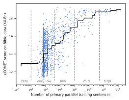

 Figure 3.1:  Correlation between translation quality (OMT-LLaMA model, Bible benchmark of 1,560 languages, mean xCOMET score) and amount of parallel documents from primary sources (not mined or synthetic). We fit an isotonic regression to show the global trend. 

Therefore, the final classification relies on parallel documents available, with a language considered high resource if we have more than 50M document pairs (for such languages, MT quality of most systems is predictably high), mid resource above 1M, low resource if we have parallel documents between 40K and 1M, extremely low resource if we have between 40K and 1K parallel documents, and zero-resource below 1K (mostly to indicate that their training data size is much lower than even a typical Bible translation or a seed corpus, often represented only by a few sentences in a multilingual resource like Tatoeba). See the graph with distribution of languages per resource bucket in Figure [3.2](https://arxiv.org/html/2603.16309v3#S3.F2 "Figure 3.2 ‣ 3.3 Resource levels ‣ 3 Languages ‣ Omnilingual MT: Machine Translation for 1,600 Languages").

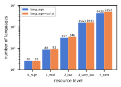

 Figure 3.2:  Graph with distribution of languages per resource bucket. Note that we count all languages for which we have some data (including monolingual data and word-level parallel data like Panlex), but the buckets are determined based on the parallel data that is at least (and predominantly) sentence-level. 

This definition comes with some limitations. Most anomalies come from languages with less than 1k parallel documents on which we observe equally high translation quality. By doing a manual inspection on those languages, we could hypothesize that this bucket contains languages which are highly similar to other high resource languages and benefit from positive knowledge transfer. Another anomaly, but much more rare, is low-performing languages in the bucket of languages with more than 1M documents. In this case, again, by manual analysis we could hypothesize that there are languages for which we have extremely low quality data or very narrow domain distribution of it. Or, complimentary, rare scripts that are not well represented by the tokenizer and as a consequence low quality MT performance. Finally, sometimes we misattribute the available training data to other languages, due to loosely defined language boundaries (e.g. some data for a dialectal Arabic language could be identified simply with the ara_Arab code, pointing to the Arabic macro-language without specifying the language).

### 3.4 Describing languages in prompts

When prompting both OMT-LLaMA models and instruction-following external baselines to translate, the precise format of describing the target language may affect the generation results. Different organizations prefer different language code formats, and to ensure interoperability of our prompts between diverse models, we opted for natural-language descriptions of the language varieties.

Our template for language names includes the language name itself, followed by optional brackets with the script, locale, or a dialect: for example, spa_Latn becomes “Spanish”, cmn_Hans becomes “Mandarin Chinese (Simplified script)”, eng_Latn-GB turns into “English (a variety from United Kingdom)”, and twi_Latn_akua1239, into “Twi (Akuapem dialect)”. We omit the script description for the languages that are “well-known” (using inclusion into FLORES-200 as a criterion) and that are expected to be using one single script in an overwhelming majority of scenarios.

For mapping the codes of languages, scripts and locales into their English names, we mostly rely on the Langcodes package,44 4 <https://github.com/rspeer/langcodes>, which in turn relies on the IANA language tag registry. For referring to dialects, we use their names from the Glottolog database55 5 From the languoids table in <https://glottolog.org/meta/downloads>; currently we are using version 4.8., but employ them only for disambiguating otherwise identical language varieties in FLoRes+.

## 4 Creating High-Quality Datasets

Access to high quality data is crucial to develop a high quality translation system. We give special focus to creating, selecting, and curating high-quality data for thousands of languages both for training and evaluation. In this section, regarding training, we mainly discuss continual pretraining (CPT) data, while main data for postraining is directly discussed in the corresponding section (Section [6.3](https://arxiv.org/html/2603.16309v3#S6.SS3 "6.3 Post-training ‣ 6 Decoder-only Modeling ‣ Omnilingual MT: Machine Translation for 1,600 Languages")). For CPT, we leverage mainly datasets in Table [4.1](https://arxiv.org/html/2603.16309v3#S4.T1 "Table 4.1 ‣ 4.1 Main CPT Training Data Collection ‣ 4 Creating High-Quality Datasets ‣ Omnilingual MT: Machine Translation for 1,600 Languages") and presented in Section [4.1](https://arxiv.org/html/2603.16309v3#S4.SS1 "4.1 Main CPT Training Data Collection ‣ 4 Creating High-Quality Datasets ‣ Omnilingual MT: Machine Translation for 1,600 Languages"). For evaluation, we rely on a subset of the Bible ([Section 4.4.2](https://arxiv.org/html/2603.16309v3#S4.SS4.SSS2 "4.4.2 Bible Evaluation Partition ‣ 4.4 Evaluation Data ‣ 4 Creating High-Quality Datasets ‣ Omnilingual MT: Machine Translation for 1,600 Languages")) and several standard ones—e.g., FLoRes+ ([NLLB Team et al., 2024](https://arxiv.org/html/2603.16309v3#bib.bib146)).

Beyond this, and to compensate for existing limitations in the existing data such as lack of long-tail languages, domains, registers and others, we curate new training datasets, both monolingual (inspired by [Penedo et al. (2025)](https://arxiv.org/html/2603.16309v3#bib.bib12) and [Kydlíček et al. (2025)](https://arxiv.org/html/2603.16309v3#bib.bib59)) and aligned (manual MeDLEy, parallel data inspired by [NLLB Team et al. (2024)](https://arxiv.org/html/2603.16309v3#bib.bib146), Section [4.3](https://arxiv.org/html/2603.16309v3#S4.SS3 "4.3 Seed Data for Post-Training: MeDLEy ‣ 4 Creating High-Quality Datasets ‣ Omnilingual MT: Machine Translation for 1,600 Languages"), and synthetic data, Section [4.2](https://arxiv.org/html/2603.16309v3#S4.SS2 "4.2 Synthetic Data for CPT ‣ 4 Creating High-Quality Datasets ‣ Omnilingual MT: Machine Translation for 1,600 Languages")) as well as the BOUQuET evaluation dataset (Section [4.4.1](https://arxiv.org/html/2603.16309v3#S4.SS4.SSS1 "4.4.1 BOUQuET ‣ 4.4 Evaluation Data ‣ 4 Creating High-Quality Datasets ‣ Omnilingual MT: Machine Translation for 1,600 Languages")).

### 4.1 Main CPT Training Data Collection

As follows, we mention and briefly categorize some highly multilingual text resources of various kinds: parallel and non-parallel, word-, sentence-, and document-level. Additionally, Table [4.1](https://arxiv.org/html/2603.16309v3#S4.T1 "Table 4.1 ‣ 4.1 Main CPT Training Data Collection ‣ 4 Creating High-Quality Datasets ‣ Omnilingual MT: Machine Translation for 1,600 Languages") summarises the main sources and volumes used to train our systems.

<table id="S4.T1.3" class="ltx_tabular ltx_centering ltx_align_middle">
<tr id="S4.T1.3.1" class="ltx_tr">
<td id="S4.T1.3.1.1" class="ltx_td ltx_align_left ltx_border_tt">Type</td>
<td id="S4.T1.3.1.2" class="ltx_td ltx_align_left ltx_border_tt">Source</td>
<td id="S4.T1.3.1.3" class="ltx_td ltx_align_left ltx_border_tt"># Sentences</td>
<td id="S4.T1.3.1.4" class="ltx_td ltx_align_left ltx_border_tt"># Languages</td></tr>
<tr id="S4.T1.3.2" class="ltx_tr">
<td id="S4.T1.3.2.1" class="ltx_td ltx_align_left ltx_border_t" rowspan="2">Monolingual</td>
<td id="S4.T1.3.2.2" class="ltx_td ltx_align_left ltx_border_t">CC-2000-Web</td>
<td id="S4.T1.3.2.3" class="ltx_td ltx_align_left ltx_border_t"><math id="S4.T1.m1" class="ltx_Math" alttext="\approx" display="inline" intent=":literal"><semantics><mo>≈</mo><annotation encoding="application/x-tex">\approx</annotation></semantics></math>20M</td>
<td id="S4.T1.3.2.4" class="ltx_td ltx_align_left ltx_border_t">¿2000</td></tr>
<tr id="S4.T1.3.3" class="ltx_tr">
<td id="S4.T1.3.3.1" class="ltx_td ltx_align_left">CC-2000-Pdf</td>
<td id="S4.T1.3.3.2" class="ltx_td ltx_align_left"><math id="S4.T1.m2" class="ltx_Math" alttext="\approx" display="inline" intent=":literal"><semantics><mo>≈</mo><annotation encoding="application/x-tex">\approx</annotation></semantics></math>5M</td>
<td id="S4.T1.3.3.3" class="ltx_td ltx_align_left"><math id="S4.T1.m3" class="ltx_Math" alttext="\approx" display="inline" intent=":literal"><semantics><mo>≈</mo><annotation encoding="application/x-tex">\approx</annotation></semantics></math>1700</td></tr>
<tr id="S4.T1.3.4" class="ltx_tr">
<td id="S4.T1.3.4.1" class="ltx_td ltx_align_left ltx_border_t" rowspan="6">Translation</td>
<td id="S4.T1.3.4.2" class="ltx_td ltx_align_left ltx_border_t">Bible</td>
<td id="S4.T1.3.4.3" class="ltx_td ltx_align_left ltx_border_t"><math id="S4.T1.m4" class="ltx_Math" alttext="\approx" display="inline" intent=":literal"><semantics><mo>≈</mo><annotation encoding="application/x-tex">\approx</annotation></semantics></math>600M</td>
<td id="S4.T1.3.4.4" class="ltx_td ltx_align_left ltx_border_t"><math id="S4.T1.m5" class="ltx_Math" alttext="\approx" display="inline" intent=":literal"><semantics><mo>≈</mo><annotation encoding="application/x-tex">\approx</annotation></semantics></math>1600</td></tr>
<tr id="S4.T1.3.5" class="ltx_tr">
<td id="S4.T1.3.5.1" class="ltx_td ltx_align_left">Panlex</td>
<td id="S4.T1.3.5.2" class="ltx_td ltx_align_left"><math id="S4.T1.m6" class="ltx_Math" alttext="\approx" display="inline" intent=":literal"><semantics><mo>≈</mo><annotation encoding="application/x-tex">\approx</annotation></semantics></math>2B</td>
<td id="S4.T1.3.5.3" class="ltx_td ltx_align_left"><math id="S4.T1.m7" class="ltx_Math" alttext="\approx" display="inline" intent=":literal"><semantics><mo>≈</mo><annotation encoding="application/x-tex">\approx</annotation></semantics></math>1000</td></tr>
<tr id="S4.T1.3.6" class="ltx_tr">
<td id="S4.T1.3.6.1" class="ltx_td ltx_align_left">Tatoeba</td>
<td id="S4.T1.3.6.2" class="ltx_td ltx_align_left"><math id="S4.T1.m8" class="ltx_Math" alttext="\approx" display="inline" intent=":literal"><semantics><mo>≈</mo><annotation encoding="application/x-tex">\approx</annotation></semantics></math>25M</td>
<td id="S4.T1.3.6.3" class="ltx_td ltx_align_left"><math id="S4.T1.m9" class="ltx_Math" alttext="\approx" display="inline" intent=":literal"><semantics><mo>≈</mo><annotation encoding="application/x-tex">\approx</annotation></semantics></math>500</td></tr>
<tr id="S4.T1.3.7" class="ltx_tr">
<td id="S4.T1.3.7.1" class="ltx_td ltx_align_left">CC-NLLB-200</td>
<td id="S4.T1.3.7.2" class="ltx_td ltx_align_left"><math id="S4.T1.m10" class="ltx_Math" alttext="\approx" display="inline" intent=":literal"><semantics><mo>≈</mo><annotation encoding="application/x-tex">\approx</annotation></semantics></math>500M</td>
<td id="S4.T1.3.7.3" class="ltx_td ltx_align_left"><math id="S4.T1.m11" class="ltx_Math" alttext="\approx" display="inline" intent=":literal"><semantics><mo>≈</mo><annotation encoding="application/x-tex">\approx</annotation></semantics></math>200</td></tr>
<tr id="S4.T1.3.8" class="ltx_tr">
<td id="S4.T1.3.8.1" class="ltx_td ltx_align_left">OMT Primary</td>
<td id="S4.T1.3.8.2" class="ltx_td ltx_align_left"><math id="S4.T1.m12" class="ltx_Math" alttext="\approx" display="inline" intent=":literal"><semantics><mo>≈</mo><annotation encoding="application/x-tex">\approx</annotation></semantics></math>55M</td>
<td id="S4.T1.3.8.3" class="ltx_td ltx_align_left"><math id="S4.T1.m13" class="ltx_Math" alttext="\approx" display="inline" intent=":literal"><semantics><mo>≈</mo><annotation encoding="application/x-tex">\approx</annotation></semantics></math>500</td></tr>
<tr id="S4.T1.3.9" class="ltx_tr">
<td id="S4.T1.3.9.1" class="ltx_td ltx_align_left">OMT Langwise</td>
<td id="S4.T1.3.9.2" class="ltx_td ltx_align_left"><math id="S4.T1.m14" class="ltx_Math" alttext="\approx" display="inline" intent=":literal"><semantics><mo>≈</mo><annotation encoding="application/x-tex">\approx</annotation></semantics></math>8M</td>
<td id="S4.T1.3.9.3" class="ltx_td ltx_align_left"><math id="S4.T1.m15" class="ltx_Math" alttext="\approx" display="inline" intent=":literal"><semantics><mo>≈</mo><annotation encoding="application/x-tex">\approx</annotation></semantics></math>100</td></tr>
<tr id="S4.T1.3.10" class="ltx_tr">
<td id="S4.T1.3.10.1" class="ltx_td ltx_align_left ltx_border_t">Synthetic Translation</td>
<td id="S4.T1.3.10.2" class="ltx_td ltx_align_left ltx_border_t">OMT Backtranslated Data</td>
<td id="S4.T1.3.10.3" class="ltx_td ltx_align_left ltx_border_t"><math id="S4.T1.m16" class="ltx_Math" alttext="\approx" display="inline" intent=":literal"><semantics><mo>≈</mo><annotation encoding="application/x-tex">\approx</annotation></semantics></math>135M</td>
<td id="S4.T1.3.10.4" class="ltx_td ltx_align_left ltx_border_t">¿2000</td></tr>
<tr id="S4.T1.3.11" class="ltx_tr">
<td id="S4.T1.3.11.1" class="ltx_td ltx_align_left ltx_border_bb">Synthetic Aligned</td>
<td id="S4.T1.3.11.2" class="ltx_td ltx_align_left ltx_border_bb">OMT Mined Data</td>
<td id="S4.T1.3.11.3" class="ltx_td ltx_align_left ltx_border_bb"><math id="S4.T1.m17" class="ltx_Math" alttext="\approx" display="inline" intent=":literal"><semantics><mo>≈</mo><annotation encoding="application/x-tex">\approx</annotation></semantics></math>100K</td>
<td id="S4.T1.3.11.4" class="ltx_td ltx_align_left ltx_border_bb"><math id="S4.T1.m18" class="ltx_Math" alttext="\approx" display="inline" intent=":literal"><semantics><mo>≈</mo><annotation encoding="application/x-tex">\approx</annotation></semantics></math>60</td></tr>
</table>

 Table 4.1: A summary of the main sources and volumes (in number of sentences) used for CPT as detailed in Section [6.2](https://arxiv.org/html/2603.16309v3#S6.SS2 "6.2 Continued Pretraining ‣ 6 Decoder-only Modeling ‣ Omnilingual MT: Machine Translation for 1,600 Languages").

##### Monolingual Datasets

We collect and curate two massively monolingual corpora, starting from snapshots of Common Crawl,66 6 <https://commoncrawl.org/> inspired by the methodology and motivated by the results of [Penedo et al. (2025)](https://arxiv.org/html/2603.16309v3#bib.bib12) and [Kydlíček et al. (2025)](https://arxiv.org/html/2603.16309v3#bib.bib59). We apply filters based on original URLs to discard low-quality pages, resulting in a URL-filtered version of Common Crawl. From this we create two datasets, that we refer to as CC-2000-Web and CC-2000-Pdf, that collectively contain monolingual textual data sourced from web-pages or PDF documents spanning more than 2000 identifiable languages, as per the GlotLID model ([Kargaran et al., 2023a](https://arxiv.org/html/2603.16309v3#bib.bib135)). Since our scope is continual pretraining (not full pretraining) and gathering more data for lower resource languages, we assign a fixed budget of at most 50 thousands documents per language, randomly sampling from the upstream corpora.

##### Bible texts

are used as one of the main parallel dataset for language analysis, for training and evaluation of MT systems. The Bible has the large language coverage (over 2000 languages) and many Bible translations are publicly available under permissive licenses. Finally, the Bible books are explicitly segmented into chapters and verses which are always preserved during translation, so aligning the translated text across the languages is trivial. Due to these reasons, Bible has already been used as the primary training set in several research works ([Pratap et al., 2024](https://arxiv.org/html/2603.16309v3#bib.bib76); [Omnilingual ASR Team et al., 2025](https://arxiv.org/html/2603.16309v3#bib.bib79); [Ma et al., 2025](https://arxiv.org/html/2603.16309v3#bib.bib78); [Janeiro et al., 2025](https://arxiv.org/html/2603.16309v3#bib.bib77)). Additionally, we use the Bible to do part of our evaluation in order to have a reference-based benchmarking with large language coverage. We suggest using the Gospel by John as the test set, because the Gospels are the most translated from the Bible books, and John is considered to be the most different from the other Gospels. Training the Bible data has its caveats: its domain coverage is very limited, and language is often very old and formal. While training a model to understand such language might be alright, generating it would result in very unnatural style and various translation errors. Evaluating with the Bible shares the caviat of narrow domain and adds the contamination issue. We accept these risks and still use Bible both for training and evaluating, but we mitigate them using other sources (as explained in this section). We compile our Bible dataset from multiple sources77 7 With the prevailing majority of texts being downloaded using the eBible tool: <https://github.com/BibleNLP/ebible>.

##### Panlex

is a project collecting various dictionaries in a unified format88 8 <https://panlex.org/>. A processed dump of its database has 1012 languages containing at least 1,000 entries, as well as over 6000 languages with at least one entry. This makes it probably the most multilingual publicly available dictionary.

##### Tatoeba

([Tiedemann, 23-25](https://arxiv.org/html/2603.16309v3#bib.bib100)) is a dataset of aprox 400 languages and 11M sententences. Overall, it is a large, open‑source collection of example sentences and their translations, built collaboratively by volunteers around the world. Its main goals are to provide a freely available multilingual resource for language learning, research, and the development of natural‑language‑processing tools.

##### CC-NLLB-200

We aim at building a system that improves upon NLLB-200 ([NLLB Team et al., 2024](https://arxiv.org/html/2603.16309v3#bib.bib146)), at least retaining the performance on the 202 language varieties it covered. As a consequence, we apply the same URL filtering as we used to create CC-2000-Web and CC-2000-Pdf to a mixture of primary and mined datasets roughly reproducing the original data composition used to train NLLB-200 models, which we refer to as CC-NLLB-200.

##### OMT Primary

is a group of several massively multilingual datasets, some of which we describe as follows. SMOL ([Caswell et al., 2025](https://arxiv.org/html/2603.16309v3#bib.bib10)) dataset includes sentences and small documents manually translated from English into 100+ languages. The docs are present both fully and by individual sentence pairs 2.4M rows. This dataset includes Gatitos ([Jones et al., 2023](https://arxiv.org/html/2603.16309v3#bib.bib11)), which is a dataset of 4000 words and short phrases translated from English into 173 low-resourced languages. BPCC ([Gala et al., 2023](https://arxiv.org/html/2603.16309v3#bib.bib1)) is a collection of various human-translated and mined texts in Indic languages, parallel with English. KreyolMT ([Robinson et al., 2024](https://arxiv.org/html/2603.16309v3#bib.bib159)) contains bitexts for 41 Creole languages from all over the world. The dataset from the AmericasNLP shared task ([De Gibert et al., 2025](https://arxiv.org/html/2603.16309v3#bib.bib25)) represents 14 diverse Indigenous languages of the Americas. AfroLingu-MT ([Elmadany et al., 2024](https://arxiv.org/html/2603.16309v3#bib.bib118)) covers 46 African languages.

##### OMT Langwise

This dataset groups a set of less multilingual datasets, usually focused on a single low-resourced language or a group of related languages. A few examples of this compilation include ZenaMT ([Haberland et al., 2024](https://arxiv.org/html/2603.16309v3#bib.bib115)) focused on Ligurian language, the Feriji dataset ([Alfari et al., 2023](https://arxiv.org/html/2603.16309v3#bib.bib116)) for Zarma, and a dataset from [Yankovskaya et al. (2023)](https://arxiv.org/html/2603.16309v3#bib.bib117) covering 6 low-resourced Finno-Ugric languages.

##### LTPP

Part of our training data mix constituted an extremely valuable parallel data from the Language Technology Partnership Program99 9 <https://about.fb.com/news/2025/02/announcing-language-technology-partner-program/> which was launched with the purpose of expanding the support of underserved languages in AI models. Specifically, the compilation of parallel data from LTPP that we were able to use comprises 18 sources of various sizes and about 1.4M sentence pairs in total.

##### Limitations

Although we did a relevant effort to collect data, we are not exhaustive and detailed on its description and this inhibits replicability of our training, which is mitigated by the fact that we are sharing the model. More importantly, our current version of the model still misses many relevant sources.

### 4.2 Synthetic Data for CPT

For a significant portion of the languages we aim to support with our MT systems, there simply is no parallel data available, beside the Bible, and for some of them, not even the Bible has been translated yet1010 10 [Bible translations statistics](https://wycliffe.org.uk/statistics) or is not available for MT use. However, for several of them, publicly available monolingual corpora do exist and can be leveraged to generate synthetic parallel data via _backtranslation_ and _bitext mining_ , resulting in OMT Backtranslated Data and OMT Mined Data.

#### 4.2.1 Backtranslation

##### Motivation and related work

Backtranslation has become a standard technique to do data‑augmentation strategies for MT by translating monolingual target‑language data back into the source language ([Sennrich et al., 2016](https://arxiv.org/html/2603.16309v3#bib.bib153)). Since then, there have been several works exploring variations of this strategy. Edunov et al. [2018](https://arxiv.org/html/2603.16309v3#bib.bib52) showed that iterative back‑translation, where the augmented data are repeatedly re‑translated, yields further gains and helps the model learn more robust representations. Subsequent work has extended the technique to low‑resource settings. [Currey et al. (2017)](https://arxiv.org/html/2603.16309v3#bib.bib55) proposed copying monolingual sentences directly into the training data. [Liu et al. (2020)](https://arxiv.org/html/2603.16309v3#bib.bib56) demonstrated that multilingual back‑translation can simultaneously improve translation across many language pairs by sharing a single encoder‑decoder architecture. [NLLB Team et al. (2024)](https://arxiv.org/html/2603.16309v3#bib.bib146) focused on efficiently in massively multilingual settings and they used a combination of neural and statistical MT translated data similarly to ([Soto et al., 2020](https://arxiv.org/html/2603.16309v3#bib.bib53)). More recently, ([Zebaze et al., 2025](https://arxiv.org/html/2603.16309v3#bib.bib51)) propose to use LLM‑based technique that generates topic‑diverse data in multiple low‑resource languages (LRLs) and back‑translate the resulting data. Several studies have investigated how to best filter ([Seamless-Communication, 2025](https://arxiv.org/html/2603.16309v3#bib.bib32)) back‑translated sentences. Recently, the approach has even been proved useful in speech translation ([Wang et al., 2025b](https://arxiv.org/html/2603.16309v3#bib.bib54)).

##### Methodology

To produce backtranslation data we mainly rely on the two massively monolingual datasets obtained from Common Crawl: CC-2000-Web and CC-2000-Pdf. Furthermore, to increase domain diversity of our backtranslation data mix, we also rely on DCLM-Edu ([Allal et al., 2025](https://arxiv.org/html/2603.16309v3#bib.bib60)) for educational-level forward-translated (out of English) data.

The backtranslation pipeline we build extracts clean monolingual texts from the monolingual corpora above, produces source- or target-side translations, and estimates the translation quality of the resulting synthetic bitext. Several of these steps are model-based, including but not limited to the translation step itself.

The first step consists of text segmentation, for which we use a fine-tuned version ([Omnilingual SONAR Team et al., 2026](https://arxiv.org/html/2603.16309v3#bib.bib105)) of the sat-12l-sm model ([Frohmann et al., 2024b](https://arxiv.org/html/2603.16309v3#bib.bib57)), trained to predict the probability of a newline occurring at a given point in the text. Both sentence and paragraph boundaries can be obtained directly by tweaking the decision threshold. However, we find that resorting to heuristics to further refine these splits, e.g. re-splitting sentences deemed too long into smaller units, is beneficial.

After extracting textual units, the following step aims at removing _noisy_ monolingual samples, i.e. units that are either too short or too long, and those for which we struggle to identify the language with enough certainty. For the language identification task we resort to GlotLID ([Kargaran et al., 2023b](https://arxiv.org/html/2603.16309v3#bib.bib157)), supporting 1,880 languages at the time of writing. Empirically we find that GlotLID top-1 score aligns well with human judgement on _sample quality_ , with texts falling below certain thresholds either containing artifacts (e.g. HTML tags) or otherwise appearing as nonsensical text. We also find that this threshold is language-dependent, with a negative correlation between resourcefulness of the language and the average GlotLID score of positive samples, when tested on annotated data. This suggests that, in line with intuition, texts in lower-resource languages are not just harder to translate but also to identify. We generalize this by calibrating GlotLID scores on the aligned Bible, and define language-dependent thresholds for rejecting samples. This helps balance the competing objectives of keeping more data and rejecting lower quality samples.

For the translation step, we rely on two base MT systems: NLLB ([NLLB Team et al., 2024](https://arxiv.org/html/2603.16309v3#bib.bib146)) and LLaMA 3 ([Grattafiori et al., 2024](https://arxiv.org/html/2603.16309v3#bib.bib58)). The former is used as-is with no further fine-tuning to translate out of (or into) the 200 languages it supports, while the latter is used with no restriction, taking the best CPT and FT 8b model we were able to produce thus far. Notably, this model has been trained on both monolingual texts sampled from CC-2000-Web itself and bitext from the Bible belonging to more than 1,700 languages. This is crucial since the base model has not been explicitly optimized for tasks (e.g. translation) in languages, present in the original pre-training corpora, but beyond 8 high resource languages. Given the more demanding nature of producing translations with LLaMA compared to NLLB, and that we already have data for languages covered by NLLB, we only run the former on a stratified sample of the monolingual corpora, down-sampling languages already supported by NLLB.

Finally, we estimate translation quality of the produced synthetic bitext with a mixture of model-based and model-free signals. For the model-based signals we rely on omnilingual latent space (OmniSONAR) similarity of source and target text ([Omnilingual SONAR Team et al., 2026](https://arxiv.org/html/2603.16309v3#bib.bib105)). We find that other model-free signals such as unique character ratio are helpful to complement the model-based ones, as they are strong predictors of particular failure cases, e.g. repetition issues or MT systems producing translations that are just a copy of the source text.

##### Ablations

We run a series of ablations to understand how to effectively filter the produced data and incorporate it along other non-synthetic pre-existing corpora during continual pre-training.

First, we study the downstream effect of filtering the backtranslation data according to cosine similarity of the translation in OmniSONAR space. We first naively calibrate OmniSONAR scores on the Bible development set, assuming perfectly uniform similarity estimation across languages, and find the mean latent space cosine similarity between aligned sentences: \(\mu_{sim}\). Then, we define three thresholds, one standard deviation below (\(LQ:=\mu_{sim}-\sigma_{sim}\)), at the mean (\(MQ:=\mu_{sim}\)) and above the mean (\(HQ:=\mu_{sim}+\sigma_{sim}\)). Then, we run an ablation training LLaMA 3.2 3B Instruct on a stratified sample of CC-2000-Web, producing backtranslation data and then filtering according to these thresholds. We evaluate on FLoRes+, measuring translation quality over different language buckets (see section [4.4](https://arxiv.org/html/2603.16309v3#S4.SS4 "4.4 Evaluation Data ‣ 4 Creating High-Quality Datasets ‣ Omnilingual MT: Machine Translation for 1,600 Languages")) and comparing against a baseline fine-tuned on the same data mix but without backtranslation data. The results, summarized in [table 4.2](https://arxiv.org/html/2603.16309v3#S4.T2 "In Ablations ‣ 4.2.1 Backtranslation ‣ 4.2 Synthetic Data for CPT ‣ 4 Creating High-Quality Datasets ‣ Omnilingual MT: Machine Translation for 1,600 Languages"), indicate that a uniform filtering strategy across language groups yield the best results, although filtering more aggressively on high-resource languages can yield even better results.

<table id="S4.T2.3" class="ltx_tabular ltx_centering ltx_align_middle">
<tr id="S4.T2.3.1" class="ltx_tr">
<td id="S4.T2.3.1.1" class="ltx_td ltx_align_left ltx_border_r ltx_border_tt" rowspan="2">System</td>
<td id="S4.T2.3.1.2" class="ltx_td ltx_align_center ltx_border_tt" colspan="4">En-YY</td>
<td id="S4.T2.3.1.3" class="ltx_td ltx_align_center ltx_border_tt" colspan="4">XX-En</td></tr>
<tr id="S4.T2.3.2" class="ltx_tr">
<td id="S4.T2.3.2.1" class="ltx_td ltx_align_center">High</td>
<td id="S4.T2.3.2.2" class="ltx_td ltx_align_center">Mid</td>
<td id="S4.T2.3.2.3" class="ltx_td ltx_align_center">Low</td>
<td id="S4.T2.3.2.4" class="ltx_td ltx_align_center ltx_border_r">Very Low</td>
<td id="S4.T2.3.2.5" class="ltx_td ltx_align_center">High</td>
<td id="S4.T2.3.2.6" class="ltx_td ltx_align_center">Mid</td>
<td id="S4.T2.3.2.7" class="ltx_td ltx_align_center">Low</td>
<td id="S4.T2.3.2.8" class="ltx_td ltx_nopad_r ltx_align_center">Very Low</td></tr>
<tr id="S4.T2.3.3" class="ltx_tr">
<td id="S4.T2.3.3.1" class="ltx_td ltx_align_left ltx_border_r ltx_border_t">Baseline Data Mix</td>
<td id="S4.T2.3.3.2" class="ltx_td ltx_align_center ltx_border_t">44.68</td>
<td id="S4.T2.3.3.3" class="ltx_td ltx_align_center ltx_border_t">23.97</td>
<td id="S4.T2.3.3.4" class="ltx_td ltx_align_center ltx_border_t">16.98</td>
<td id="S4.T2.3.3.5" class="ltx_td ltx_align_center ltx_border_r ltx_border_t">19.97</td>
<td id="S4.T2.3.3.6" class="ltx_td ltx_align_center ltx_border_t">56.96</td>
<td id="S4.T2.3.3.7" class="ltx_td ltx_align_center ltx_border_t">42.29</td>
<td id="S4.T2.3.3.8" class="ltx_td ltx_align_center ltx_border_t">35.71</td>
<td id="S4.T2.3.3.9" class="ltx_td ltx_nopad_r ltx_align_center ltx_border_t">38.21</td></tr>
<tr id="S4.T2.3.4" class="ltx_tr">
<td id="S4.T2.3.4.1" class="ltx_td ltx_align_left ltx_border_r">+ BT Data (LQ)</td>
<td id="S4.T2.3.4.2" class="ltx_td ltx_align_center">46.1</td>
<td id="S4.T2.3.4.3" class="ltx_td ltx_align_center">26.11</td>
<td id="S4.T2.3.4.4" class="ltx_td ltx_align_center">20.32</td>
<td id="S4.T2.3.4.5" class="ltx_td ltx_align_center ltx_border_r">23.6</td>
<td id="S4.T2.3.4.6" class="ltx_td ltx_align_center">58.02</td>
<td id="S4.T2.3.4.7" class="ltx_td ltx_align_center">43.81</td>
<td id="S4.T2.3.4.8" class="ltx_td ltx_align_center">38.12</td>
<td id="S4.T2.3.4.9" class="ltx_td ltx_nopad_r ltx_align_center">40.93</td></tr>
<tr id="S4.T2.3.5" class="ltx_tr">
<td id="S4.T2.3.5.1" class="ltx_td ltx_align_left ltx_border_r">+ BT Data (MQ)</td>
<td id="S4.T2.3.5.2" class="ltx_td ltx_align_center">46.33</td>
<td id="S4.T2.3.5.3" class="ltx_td ltx_align_center">26.6</td>
<td id="S4.T2.3.5.4" class="ltx_td ltx_align_center">20.82</td>
<td id="S4.T2.3.5.5" class="ltx_td ltx_align_center ltx_border_r">24.34</td>
<td id="S4.T2.3.5.6" class="ltx_td ltx_align_center">58.17</td>
<td id="S4.T2.3.5.7" class="ltx_td ltx_align_center">44.01</td>
<td id="S4.T2.3.5.8" class="ltx_td ltx_align_center">38.26</td>
<td id="S4.T2.3.5.9" class="ltx_td ltx_nopad_r ltx_align_center">41.29</td></tr>
<tr id="S4.T2.3.6" class="ltx_tr">
<td id="S4.T2.3.6.1" class="ltx_td ltx_align_left ltx_border_bb ltx_border_r">+ BT Data (HQ)</td>
<td id="S4.T2.3.6.2" class="ltx_td ltx_align_center ltx_border_bb">46.85</td>
<td id="S4.T2.3.6.3" class="ltx_td ltx_align_center ltx_border_bb">26.19</td>
<td id="S4.T2.3.6.4" class="ltx_td ltx_align_center ltx_border_bb">20.73</td>
<td id="S4.T2.3.6.5" class="ltx_td ltx_align_center ltx_border_bb ltx_border_r">24.08</td>
<td id="S4.T2.3.6.6" class="ltx_td ltx_align_center ltx_border_bb">58.52</td>
<td id="S4.T2.3.6.7" class="ltx_td ltx_align_center ltx_border_bb">43.64</td>
<td id="S4.T2.3.6.8" class="ltx_td ltx_align_center ltx_border_bb">37.72</td>
<td id="S4.T2.3.6.9" class="ltx_td ltx_nopad_r ltx_align_center ltx_border_bb">40.98</td></tr>
</table>

 Table 4.2: ChrF++ when evaluating MT systems trained with different backtranslation data mixes.

Second, after establishing a filtering strategy, we investigate the effect that mixing backtranslation data in different proportions along with pre-existing training corpora has on the downstream MT system performance. Given a fixed token budget for a training batch, we allocate \(x\%\) of those tokens to examples sampled from backtranslation data, exploring a range of \(5\%\) (ratio of 1:19 with respect to natural bitext) up to \(75\%\) (ratio of 3:1 with respect to natural bitext). The results reported in [table 4.3](https://arxiv.org/html/2603.16309v3#S4.T3 "In Ablations ‣ 4.2.1 Backtranslation ‣ 4.2 Synthetic Data for CPT ‣ 4 Creating High-Quality Datasets ‣ Omnilingual MT: Machine Translation for 1,600 Languages") show how the optimal performance for lower-resource languages is achieved when maintaining a ratio of 1:9 or 1:4 with natural bitext, as performance increases up to that point and then starts decreasing again. On the other hand, all the other buckets see increased performance as we increase the amount of backtranslation data.

<table id="S4.T3.3" class="ltx_tabular ltx_centering ltx_align_middle">
<tr id="S4.T3.3.1" class="ltx_tr">
<td id="S4.T3.3.1.1" class="ltx_td ltx_align_left ltx_border_r ltx_border_tt" rowspan="2">System</td>
<td id="S4.T3.3.1.2" class="ltx_td ltx_align_center ltx_border_tt" colspan="4">En-YY</td>
<td id="S4.T3.3.1.3" class="ltx_td ltx_align_center ltx_border_tt" colspan="4">XX-En</td></tr>
<tr id="S4.T3.3.2" class="ltx_tr">
<td id="S4.T3.3.2.1" class="ltx_td ltx_align_center">High</td>
<td id="S4.T3.3.2.2" class="ltx_td ltx_align_center">Mid</td>
<td id="S4.T3.3.2.3" class="ltx_td ltx_align_center">Low</td>
<td id="S4.T3.3.2.4" class="ltx_td ltx_align_center ltx_border_r">Very Low</td>
<td id="S4.T3.3.2.5" class="ltx_td ltx_align_center">High</td>
<td id="S4.T3.3.2.6" class="ltx_td ltx_align_center">Mid</td>
<td id="S4.T3.3.2.7" class="ltx_td ltx_align_center">Low</td>
<td id="S4.T3.3.2.8" class="ltx_td ltx_nopad_r ltx_align_center">Very Low</td></tr>
<tr id="S4.T3.3.3" class="ltx_tr">
<td id="S4.T3.3.3.1" class="ltx_td ltx_align_left ltx_border_r ltx_border_t">Baseline Data Mix</td>
<td id="S4.T3.3.3.2" class="ltx_td ltx_align_center ltx_border_t">44.68</td>
<td id="S4.T3.3.3.3" class="ltx_td ltx_align_center ltx_border_t">23.97</td>
<td id="S4.T3.3.3.4" class="ltx_td ltx_align_center ltx_border_t">16.98</td>
<td id="S4.T3.3.3.5" class="ltx_td ltx_align_center ltx_border_r ltx_border_t">19.97</td>
<td id="S4.T3.3.3.6" class="ltx_td ltx_align_center ltx_border_t">56.96</td>
<td id="S4.T3.3.3.7" class="ltx_td ltx_align_center ltx_border_t">42.29</td>
<td id="S4.T3.3.3.8" class="ltx_td ltx_align_center ltx_border_t">35.71</td>
<td id="S4.T3.3.3.9" class="ltx_td ltx_nopad_r ltx_align_center ltx_border_t">38.21</td></tr>
<tr id="S4.T3.3.4" class="ltx_tr">
<td id="S4.T3.3.4.1" class="ltx_td ltx_align_left ltx_border_r">+ BT Data (5%)</td>
<td id="S4.T3.3.4.2" class="ltx_td ltx_align_center">46.54</td>
<td id="S4.T3.3.4.3" class="ltx_td ltx_align_center">25.16</td>
<td id="S4.T3.3.4.4" class="ltx_td ltx_align_center">18.41</td>
<td id="S4.T3.3.4.5" class="ltx_td ltx_align_center ltx_border_r">21.1</td>
<td id="S4.T3.3.4.6" class="ltx_td ltx_align_center">59.68</td>
<td id="S4.T3.3.4.7" class="ltx_td ltx_align_center">43.1</td>
<td id="S4.T3.3.4.8" class="ltx_td ltx_align_center">37.53</td>
<td id="S4.T3.3.4.9" class="ltx_td ltx_nopad_r ltx_align_center">39.67</td></tr>
<tr id="S4.T3.3.5" class="ltx_tr">
<td id="S4.T3.3.5.1" class="ltx_td ltx_align_left ltx_border_r">+ BT Data (10%)</td>
<td id="S4.T3.3.5.2" class="ltx_td ltx_align_center">46.67</td>
<td id="S4.T3.3.5.3" class="ltx_td ltx_align_center">25.46</td>
<td id="S4.T3.3.5.4" class="ltx_td ltx_align_center">18.84</td>
<td id="S4.T3.3.5.5" class="ltx_td ltx_align_center ltx_border_r">21.3</td>
<td id="S4.T3.3.5.6" class="ltx_td ltx_align_center">59.84</td>
<td id="S4.T3.3.5.7" class="ltx_td ltx_align_center">43.37</td>
<td id="S4.T3.3.5.8" class="ltx_td ltx_align_center">37.83</td>
<td id="S4.T3.3.5.9" class="ltx_td ltx_nopad_r ltx_align_center">40.05</td></tr>
<tr id="S4.T3.3.6" class="ltx_tr">
<td id="S4.T3.3.6.1" class="ltx_td ltx_align_left ltx_border_r">+ BT Data (20%)</td>
<td id="S4.T3.3.6.2" class="ltx_td ltx_align_center">46.93</td>
<td id="S4.T3.3.6.3" class="ltx_td ltx_align_center">25.78</td>
<td id="S4.T3.3.6.4" class="ltx_td ltx_align_center">19.25</td>
<td id="S4.T3.3.6.5" class="ltx_td ltx_align_center ltx_border_r">21.13</td>
<td id="S4.T3.3.6.6" class="ltx_td ltx_align_center">60.11</td>
<td id="S4.T3.3.6.7" class="ltx_td ltx_align_center">43.78</td>
<td id="S4.T3.3.6.8" class="ltx_td ltx_align_center">38.31</td>
<td id="S4.T3.3.6.9" class="ltx_td ltx_nopad_r ltx_align_center">41.11</td></tr>
<tr id="S4.T3.3.7" class="ltx_tr">
<td id="S4.T3.3.7.1" class="ltx_td ltx_align_left ltx_border_r">+ BT Data (50%)</td>
<td id="S4.T3.3.7.2" class="ltx_td ltx_align_center">47.41</td>
<td id="S4.T3.3.7.3" class="ltx_td ltx_align_center">26.7</td>
<td id="S4.T3.3.7.4" class="ltx_td ltx_align_center">20.13</td>
<td id="S4.T3.3.7.5" class="ltx_td ltx_align_center ltx_border_r">20.72</td>
<td id="S4.T3.3.7.6" class="ltx_td ltx_align_center">60.49</td>
<td id="S4.T3.3.7.7" class="ltx_td ltx_align_center">44.34</td>
<td id="S4.T3.3.7.8" class="ltx_td ltx_align_center">38.95</td>
<td id="S4.T3.3.7.9" class="ltx_td ltx_nopad_r ltx_align_center">40.82</td></tr>
<tr id="S4.T3.3.8" class="ltx_tr">
<td id="S4.T3.3.8.1" class="ltx_td ltx_align_left ltx_border_bb ltx_border_r">+ BT Data (75%)</td>
<td id="S4.T3.3.8.2" class="ltx_td ltx_align_center ltx_border_bb">47.73</td>
<td id="S4.T3.3.8.3" class="ltx_td ltx_align_center ltx_border_bb">26.92</td>
<td id="S4.T3.3.8.4" class="ltx_td ltx_align_center ltx_border_bb">21.16</td>
<td id="S4.T3.3.8.5" class="ltx_td ltx_align_center ltx_border_bb ltx_border_r">21.16</td>
<td id="S4.T3.3.8.6" class="ltx_td ltx_align_center ltx_border_bb">60.71</td>
<td id="S4.T3.3.8.7" class="ltx_td ltx_align_center ltx_border_bb">44.62</td>
<td id="S4.T3.3.8.8" class="ltx_td ltx_align_center ltx_border_bb">39.31</td>
<td id="S4.T3.3.8.9" class="ltx_td ltx_nopad_r ltx_align_center ltx_border_bb">39.88</td></tr>
</table>

 Table 4.3: ChrF++ when evaluating MT systems trained with different backtranslation data mixes.

##### Dataset statistics

In [table 4.4](https://arxiv.org/html/2603.16309v3#S4.T4 "In Dataset statistics ‣ 4.2.1 Backtranslation ‣ 4.2 Synthetic Data for CPT ‣ 4 Creating High-Quality Datasets ‣ Omnilingual MT: Machine Translation for 1,600 Languages") we summarize the resulting dataset obtained with the methodology outlined above. The dataset contains roughly 270 million sentences spanning more than 2,000 languoids, that we divide in three buckets: _high resource_ and _low resource_ indicate languoids that were described as such in [NLLB Team et al. (2024)](https://arxiv.org/html/2603.16309v3#bib.bib146), while _very low resource_ indicate any languoid not included among the ones supported by NLLB. The stratified sampling by languoid group at the source results in an artificially balanced distribution, with high resource languoids taking up 38% of the unfiltered data, low resource languoids taking up 35% and very low resource languoids the remaining 23%. The progressively more relaxed filtering strategy leads to a final distribution where 51% of the data is taken up by sentences belonging to low resource languoids, 26% belonging to very low resource languoids, and 23% belonging to high resource languoids.

Languoid Group | # Languages | # Sentences | # Sentences after filtering  
---|---|---|---  
High | \(\approx\) 30 | \(\approx\) 100M | \(\approx\) 30M  
Mid | \(\approx\) 100 | \(\approx\) 150M | \(\approx\) 100M  
Low | \(\approx\) 300 | \(\approx\) 100M | \(\approx\) 70M  
Very low | \(\approx\) 1300 | \(\approx\) 40M | \(\approx\) 20M  
Zero | \(\approx\) 400 | \(\approx\) 10M | \(\approx\) 10M  
All | \(\approx\) 2000 | \(\approx\) 400M | \(\approx\) 230M

 Table 4.4: Statistics about resulting backtranslation data.

#### 4.2.2 Bitext Mining

##### Motivation and related work

Complementary to backtranslation, bitext mining is another method for data augmentation which expands parallel corpora by automatically aligning pairs of text spans with semantic equivalence from collections of monolingual text. In order to find semantic equivalence, early works such as [Resnik (1999)](https://arxiv.org/html/2603.16309v3#bib.bib84) attempted to find parallel text at the document level by examining an article’s macro information such as the metadata and overall structure. Later works have applied more focus on the textual content within articles, leveraging methods such as bag-of-words ([Buck and Koehn, 2016](https://arxiv.org/html/2603.16309v3#bib.bib85)) or Jaccard similarity ([Azpeitia et al., 2017](https://arxiv.org/html/2603.16309v3#bib.bib83)). With the advances of representation learning, more recent approaches have begun to employ the use of embedding spaces by encoding texts and applying distance metrics within the space to determine similarity, moving beyond the surface-form structure. Works such as [Hassan et al. (2018)](https://arxiv.org/html/2603.16309v3#bib.bib87) and [Yang et al. (2019)](https://arxiv.org/html/2603.16309v3#bib.bib88) used bilingual embedding spaces. However, a drawback to this approach is that custom embedding spaces are needed for each possible language pair, limiting the permissibility to scale. Alternatively, encoding texts with a massively multilingual embedding space allows for any possible pair to be encoded and subsequently mined, and has become the adopted backbone for many large-scale mining approaches ([Suryanarayanan et al., 2025](https://arxiv.org/html/2603.16309v3#bib.bib89); [Ramesh et al., 2022](https://arxiv.org/html/2603.16309v3#bib.bib86); [Artetxe and Schwenk, 2019](https://arxiv.org/html/2603.16309v3#bib.bib3)). Generally, within this setting there are two main approaches: _global mining_ and _hierarchical mining_. The latter focuses on first finding potential document pairs using methods such as URL matching, and then limiting the mining scope within each document pair only. Examples of such approaches are the European ParaCrawl project ([Bañón et al., 2020](https://arxiv.org/html/2603.16309v3#bib.bib90); [Al Ghussin et al., 2023](https://arxiv.org/html/2603.16309v3#bib.bib91)). Alternatively _global mining_ disregards any potential document pair as a first filtering step, and instead considers all possible text pairs across available sources of monolingual corpora ([Schwenk et al., 2021b](https://arxiv.org/html/2603.16309v3#bib.bib92); [Schwenk et al., 2021a](https://arxiv.org/html/2603.16309v3#bib.bib93)). This approach has yielded considerable success in supplementing existing parallel data for translation systems ([NLLB Team et al., 2024](https://arxiv.org/html/2603.16309v3#bib.bib146); [Seamless-Communication, 2025](https://arxiv.org/html/2603.16309v3#bib.bib32)).

##### Methodology

We adopt the _global mining_ approach in this work. For our source of non-English monolingual corpora, we used CC-2000-Web and FineWeb-Edu ([Lozhkov et al., 2024](https://arxiv.org/html/2603.16309v3#bib.bib2)) as our source of English articles. We also considered DCLM-Edu as an option for English texts. However, as DCLM-Edu contains less articles than Fineweb-Edu, and given that the likelihood of a possible alignment increases as a function of the dataset size, we opted for the latter. We begin by first pre-processing our monoglingual data using the same sentence segmentation and LID methods as our backtranslation pipeline (see [Section 4.2.1](https://arxiv.org/html/2603.16309v3#S4.SS2.SSS1 "4.2.1 Backtranslation ‣ 4.2 Synthetic Data for CPT ‣ 4 Creating High-Quality Datasets ‣ Omnilingual MT: Machine Translation for 1,600 Languages")). Subsequently, we encode the resulting data into the massively multilingual OmniSONAR embedding space. In order to help accelerate our approach, we use the FAISS library to perform quantization over our representations, and enable fast KNN search ([Johnson et al., 2019](https://arxiv.org/html/2603.16309v3#bib.bib95)). We first train our quantizers on a sample of 50M embeddings for each language using product quantization ([Jegou et al., 2010](https://arxiv.org/html/2603.16309v3#bib.bib94)), and then populate each FAISS index with all available quantized data. For our KNN search we set the number of neighbours fixed to \(k=3\), and to apply our approach at scale we leverage the stopes mining library1111 11 <https://github.com/facebookresearch/stopes> ([Andrews et al., 2022](https://arxiv.org/html/2603.16309v3#bib.bib96)).

##### Ablation

In order to measure the effect of our resulting mined data, we performed a controlled ablation experiment. We choose the LLaMA3.2 3B Instruct model, and continuously pretrain it with two different data mixtures: one without the mined alignments, and a second supplemented with the mined data. In order to control for possible confounding variables, we fix the effective batch size, number of training steps, and all other hyperparameters for both models. Similar to our backtranslation ablations, we evaluate performance with the FLoRes+ benchmark using the metric ChrF++. Results are shown below in [table 4.5](https://arxiv.org/html/2603.16309v3#S4.T5 "In Ablation ‣ 4.2.2 Bitext Mining ‣ 4.2 Synthetic Data for CPT ‣ 4 Creating High-Quality Datasets ‣ Omnilingual MT: Machine Translation for 1,600 Languages"). Overall, we see improvements when adding in mined alignments to the data mixture showing the effectiveness across both high and low-resource settings. For example, langoids such as Greek and Turkish both see good relative improvements of 2.95% (47.4 \(\rightarrow\) 48.8) and 2.74% (43.7 \(\rightarrow\) 44.9) respectively. Similarly, we observe a 5.12% relative increase for the low-resource langoid N’Ko (13.00 \(\rightarrow\) 13.67).

<table id="S4.T5.3" class="ltx_tabular ltx_centering ltx_align_middle">
<tr id="S4.T5.3.1" class="ltx_tr">
<td id="S4.T5.3.1.1" class="ltx_td ltx_align_left ltx_border_r ltx_border_tt">Direction</td>
<td id="S4.T5.3.1.2" class="ltx_td ltx_align_center ltx_border_r ltx_border_tt" colspan="5">En-YY</td>
<td id="S4.T5.3.1.3" class="ltx_td ltx_align_center ltx_border_tt" colspan="5">XX-En</td></tr>
<tr id="S4.T5.3.2" class="ltx_tr">
<td id="S4.T5.3.2.1" class="ltx_td ltx_align_left ltx_border_r">Resource level</td>
<td id="S4.T5.3.2.2" class="ltx_td ltx_align_center">high</td>
<td id="S4.T5.3.2.3" class="ltx_td ltx_align_center">mid</td>
<td id="S4.T5.3.2.4" class="ltx_td ltx_align_center">low</td>
<td id="S4.T5.3.2.5" class="ltx_td ltx_align_center ltx_border_r">very low</td>
<td id="S4.T5.3.2.6" class="ltx_td ltx_align_center ltx_border_r">all</td>
<td id="S4.T5.3.2.7" class="ltx_td ltx_align_center">high</td>
<td id="S4.T5.3.2.8" class="ltx_td ltx_align_center">mid</td>
<td id="S4.T5.3.2.9" class="ltx_td ltx_align_center">low</td>
<td id="S4.T5.3.2.10" class="ltx_td ltx_align_center ltx_border_r">very low</td>
<td id="S4.T5.3.2.11" class="ltx_td ltx_align_center">all</td></tr>
<tr id="S4.T5.3.3" class="ltx_tr">
<td id="S4.T5.3.3.1" class="ltx_td ltx_align_left ltx_border_r ltx_border_t">Baseline Data Mix</td>
<td id="S4.T5.3.3.2" class="ltx_td ltx_align_center ltx_border_t">45.99</td>
<td id="S4.T5.3.3.3" class="ltx_td ltx_align_center ltx_border_t">22.64</td>
<td id="S4.T5.3.3.4" class="ltx_td ltx_align_center ltx_border_t">16.98</td>
<td id="S4.T5.3.3.5" class="ltx_td ltx_align_center ltx_border_r ltx_border_t">18.32</td>
<td id="S4.T5.3.3.6" class="ltx_td ltx_align_center ltx_border_r ltx_border_t">23.34</td>
<td id="S4.T5.3.3.7" class="ltx_td ltx_align_center ltx_border_t">59.25</td>
<td id="S4.T5.3.3.8" class="ltx_td ltx_align_center ltx_border_t">42.04</td>
<td id="S4.T5.3.3.9" class="ltx_td ltx_align_center ltx_border_t">36.86</td>
<td id="S4.T5.3.3.10" class="ltx_td ltx_align_center ltx_border_r ltx_border_t">37.71</td>
<td id="S4.T5.3.3.11" class="ltx_td ltx_align_center ltx_border_t">42.09</td></tr>
<tr id="S4.T5.3.4" class="ltx_tr">
<td id="S4.T5.3.4.1" class="ltx_td ltx_align_left ltx_border_bb ltx_border_r">+ Mined Data</td>
<td id="S4.T5.3.4.2" class="ltx_td ltx_align_center ltx_border_bb">46.24</td>
<td id="S4.T5.3.4.3" class="ltx_td ltx_align_center ltx_border_bb">22.68</td>
<td id="S4.T5.3.4.4" class="ltx_td ltx_align_center ltx_border_bb">17.08</td>
<td id="S4.T5.3.4.5" class="ltx_td ltx_align_center ltx_border_bb ltx_border_r">18.52</td>
<td id="S4.T5.3.4.6" class="ltx_td ltx_align_center ltx_border_bb ltx_border_r">23.45</td>
<td id="S4.T5.3.4.7" class="ltx_td ltx_align_center ltx_border_bb">59.48</td>
<td id="S4.T5.3.4.8" class="ltx_td ltx_align_center ltx_border_bb">42.13</td>
<td id="S4.T5.3.4.9" class="ltx_td ltx_align_center ltx_border_bb">36.89</td>
<td id="S4.T5.3.4.10" class="ltx_td ltx_align_center ltx_border_bb ltx_border_r">37.67</td>
<td id="S4.T5.3.4.11" class="ltx_td ltx_align_center ltx_border_bb">42.16</td></tr>
</table>

 Table 4.5: ChrF++ on FLoRes+ when evaluating MT systems continuously pretrained with and without mined data, split by whether English is the target or the source language and by the resource level of the other language.

#### 4.2.3 Conclusions and limitations

The synthetic data we produce plays an important role in boosting MT system performance for lower-resource languages. Here, we briefly discuss some limitations and potential future work to further improve the impact of synthetic data.

We work from a limited collection of Common Crawl snapshots, that cover only a portion of the human spoken languages. Furthermore, since we rely on resource-hungry models and algorithms for both backtranslation and mining, scaling up the approaches is expensive and we limit the production of synthetic data to stratified samples of those snapshots. A more thorough investigation of the relationship between synthetic data quantity and downstream MT performance might reveal scaling laws that can be used to take more informed sampling decisions.

The backtranslation approach we employ could be improved both in the generation and filtering phase. In the generation phase, previous work (e.g. [Hoang et al. (2018)](https://arxiv.org/html/2603.16309v3#bib.bib50); [Brimacombe and Zhou (2023)](https://arxiv.org/html/2603.16309v3#bib.bib49)) often employ backtranslation in an iterative fashion, using a base system to backtranslate monolingual data, using the synthetic bitext to build a system better than the base one, then using the new system to produce higher quality synthetic data, and repeating the cycle for a number of steps. In the filtering phase, we could complement latent space similarity metrics with LLM-as-a-judge approaches similar to [Kocmi and Federmann (2023)](https://arxiv.org/html/2603.16309v3#bib.bib48); if the base model is itself a LLM, we could investigate the ability of the model to effectively score its own translations, and the interference between this ability and translation ability as CPT on new backtranslated data progresses.

The mining approach could be significantly scaled up by considering alignment with pivot languages beyond English. For instance, aligning languages within the same family or group such as Spanish and Portuguese can enhance cross-lingual transfer by leveraging their structural and lexical similarities. This strategy not only facilitates more effective knowledge transfer between related languages but also helps to reduce the model’s bias toward English-centric data, promoting greater linguistic diversity and inclusivity in multilingual applications.

### 4.3 Seed Data for Post-Training: MeDLEy

In this section we present MeDLEy, a multicentric, multiway, domain-diverse, linguistically-diverse, and easy-to-translate seed dataset. MeDLEy is a large scale data collection effort covering 109 LRLs. It MeDLEy-source and MeDLEy-109. MeDLEy-source consists of \(605\) manually constructed paragraphs with roughly \(2200\) sentences and \(34K\) words (counted in English). It is _multicentric_ : source paragraphs are written in five source languages, thus including styles and cultural perspectives as well as topical subjects from a few different cultures. Each paragraph is accompanied with notes on any additional context required for its translation. It is then manually _multiway_ parallelized across 8 pivot languages, increasing its accessibility to bilingual communities around the world. It is _domain-diverse_ and _grammatically diverse_ : it covers 5 domains and provides coverage to 61 cross-linguistic functional grammatical features that aim to cover a broad range of grammatical features in any arbitrary language that the dataset may be translated to. Further, we ensure that it is _easy to translate_ : i.e., that it uses accessible, jargon-free language for lay community translators. MeDLEy-109  provides professional translations of the dataset into 109 low-resource languages, as can be seen in [table D.1](https://arxiv.org/html/2603.16309v3#A4.T1 "In Appendix D Languages at a glance ‣ Omnilingual MT: Machine Translation for 1,600 Languages"). More details can be found in [appendix A](https://arxiv.org/html/2603.16309v3#A1 "Appendix A MeDLEy details ‣ Omnilingual MT: Machine Translation for 1,600 Languages"), with examples from the dataset in [section A.7](https://arxiv.org/html/2603.16309v3#A1.SS7 "A.7 Examples from our dataset ‣ Appendix A MeDLEy details ‣ Omnilingual MT: Machine Translation for 1,600 Languages").

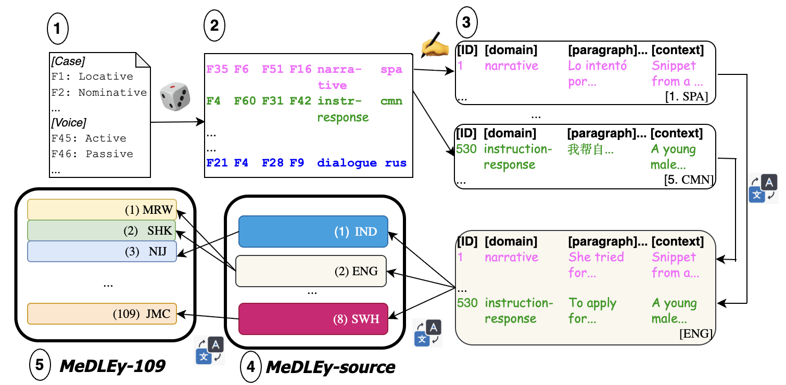

 Figure 4.1: Steps in the creation of MeDLEy-source and MeDLEy-109. This includes (1) enumeration of grammatical features, (2) template generation including domain and source language assignment, (3) manual creation of paragraphs in 5 source languages: English, Mandarin, Spanish, Russian, and German, and (4) n-way parallelization (via English) across 8 pivot languages: English, Mandarin, Spanish, Russian, Hindi, Indonesian, Swahili, and French, resulting in MeDLEy-source. This is then (5) translated into 109 low-resource languages, each from a convenient pivot depending on the translator, resulting in MeDLEy-109.

#### 4.3.1 Motivation and related work

It is infeasible to manually curate data for LRLs at a large scale. Previous work emphasizes quality over quantity in the context of data collection for low-resource languages ([Yu et al., 2022](https://arxiv.org/html/2603.16309v3#bib.bib47); [de Gibert et al., 2022](https://arxiv.org/html/2603.16309v3#bib.bib150); [Talukdar et al., 2023](https://arxiv.org/html/2603.16309v3#bib.bib149)), and previous efforts seek to curate a small high-quality set of examples in these languages ([NLLB Team et al., 2024](https://arxiv.org/html/2603.16309v3#bib.bib146); [Caswell et al., 2025](https://arxiv.org/html/2603.16309v3#bib.bib10)). Such a “seed” dataset has various uses, such as training LID systems that can be used for data mining ([Kargaran et al., 2023b](https://arxiv.org/html/2603.16309v3#bib.bib157)), or providing high-quality examples for few-shot learning strategies ([Lin et al., 2022](https://arxiv.org/html/2603.16309v3#bib.bib151); [Garcia et al., 2023](https://arxiv.org/html/2603.16309v3#bib.bib152)). Importantly, while high-quality MT systems in both directions typically require training data at a much larger scale, seed datasets can be used to train models to translate into English with reasonable quality, which can then be used for bootstrapping synthetic bitext and better MT systems using monolingual data in LRLs ([Sennrich et al., 2016](https://arxiv.org/html/2603.16309v3#bib.bib153); [NLLB Team et al., 2024](https://arxiv.org/html/2603.16309v3#bib.bib146)).

While there exist web-crawled monolingual and parallel datasets with low-resource languages such as MADLAD ([Kudugunta et al., 2023](https://arxiv.org/html/2603.16309v3#bib.bib156)), Glot500 ([Imani et al., 2023](https://arxiv.org/html/2603.16309v3#bib.bib158)), and NLLB ([NLLB Team et al., 2024](https://arxiv.org/html/2603.16309v3#bib.bib146)), these may be noisy and of unclear quality due to the scarcity of high-quality LRL content on the web ([Kreutzer et al., 2022](https://arxiv.org/html/2603.16309v3#bib.bib176)) as well as LID quality issues for LRLs ([Kargaran et al., 2023b](https://arxiv.org/html/2603.16309v3#bib.bib157)). There have been manual data collection efforts focusing on particular language groups, such as Masakhane ([Nekoto et al., 2020](https://arxiv.org/html/2603.16309v3#bib.bib160)), Turkish Interlingua ([Mirzakhalov et al., 2021](https://arxiv.org/html/2603.16309v3#bib.bib161)), Kreyol-MT ([Robinson et al., 2024](https://arxiv.org/html/2603.16309v3#bib.bib159)), HinDialect ([Bafna et al., 2022](https://arxiv.org/html/2603.16309v3#bib.bib162)), as well as efforts for particular languages, such as Bhojpuri ([Kumar et al., 2023a](https://arxiv.org/html/2603.16309v3#bib.bib163)), Yoruba ([Adelani et al., 2021](https://arxiv.org/html/2603.16309v3#bib.bib165); [Akpobi, 2025](https://arxiv.org/html/2603.16309v3#bib.bib164)), Quechua ([Ahmed et al., 2023](https://arxiv.org/html/2603.16309v3#bib.bib166)), among many others. NLLB-Seed is a highly-multilingual, professionally-translated parallel dataset, containing 6000 sentences from the Wikipedia domain translated into 44 languages ([NLLB Team et al., 2024](https://arxiv.org/html/2603.16309v3#bib.bib146)). However, the most comparable effort to MeDLEy, in terms of scale, in collecting high-quality, professionally-translated parallel datasets is SMOL suite ([Caswell et al., 2025](https://arxiv.org/html/2603.16309v3#bib.bib10)). It consists of the SmolSent and SmolDoc datasets. The former consists of sentence-level source samples selected from web-crawled data translated into 88 language pairs, focusing on covering common English words. The latter consists of automatically generated source documents designed to cover a diverse range of topics and then translated into 109 languages. MeDLEy covers 92 languages not present in SMOL or NLLB-Seed, contributing to the language coverage of existing datasets. MeDLEy also differs significantly in design considerations from the above, and it is the first such effort to focus on the coverage of grammatical phenomena in an arbitrary target language.

#### 4.3.2 Approach

The goal of MeDLEy is to provide a bitext corpus that is domain-diverse and grammatically diverse in a large number of included languages. Given that a seed dataset is limited in size, it becomes crucial to include diverse and representative examples in it, so as to gain as much information as possible about the language. In this work, we focus on grammatical and domain diversity. The knowledge of a language’s _grammar_ is crucial to navigating the translation of basic situations into or out of that language. In order for an MT system to be flexible across various registers, domains, and sociopragmatic situations, it needs to be exposed to a variety of grammatical mechanisms used in those conditions.

##### What is grammar?

A language uses its grammar to systematically express certain kinds of information (for example, case is a grammatical mechanism used to express information about the role of a noun). In this work, we call the underlying meaning of a grammatical mechanism a grammatical _function_ , and the actual shape of the grammatical mechanism used in the language the grammatical _form_. We show examples of functions and their forms in various languages in [table 4.6](https://arxiv.org/html/2603.16309v3#S4.T6 "In Building a grammatically-diverse corpus ‣ 4.3.2 Approach ‣ 4.3 Seed Data for Post-Training: MeDLEy ‣ 4 Creating High-Quality Datasets ‣ Omnilingual MT: Machine Translation for 1,600 Languages"). Note that, as these examples show, these function-form pairs may be at all levels of linguistic structure, including morphology, syntax, and information structure. To refer to particular functions in this paper, we use canonical names associated with them for convenience. We refer to these as _grammatical features_. We construct our grammar schema in terms of these features.

##### Cross-linguistic variation

It is important to stress that languages vary extensively in terms of a) the set of forms they use to codify grammatical functions, b) in the manner of codification of a function (i.e. what form a particular function takes), and c) the mapping between form and function. First, the set of grammatical forms found in each language are not the same. For example, while some languages have honorifics to convey esteem or respect to address their interlocutors, other languages may not use any grammatical mechanism for this at all. Secondly, the same grammatical function may be codified into different grammatical mechanisms depending on the language, as in the example of the locative case (see [table 4.6](https://arxiv.org/html/2603.16309v3#S4.T6 "In Building a grammatically-diverse corpus ‣ 4.3.2 Approach ‣ 4.3 Seed Data for Post-Training: MeDLEy ‣ 4 Creating High-Quality Datasets ‣ Omnilingual MT: Machine Translation for 1,600 Languages")). Finally, forms and functions often follow many-to-many relationships across languages. For example, the same feature can cover slightly different functions in two languages despite each having forms that share a core meaning with the other: English allows the so-called present continuous to express future events, while Spanish does not ([4.3.2](https://arxiv.org/html/2603.16309v3#S4.SS3.SSS2.Px2 "Cross-linguistic variation ‣ 4.3.2 Approach ‣ 4.3 Seed Data for Post-Training: MeDLEy ‣ 4 Creating High-Quality Datasets ‣ Omnilingual MT: Machine Translation for 1,600 Languages")).

{exe}\ex{xlist}\ex

English: I’m leaving tomorrow. \ex\@currsize mañana. saliendo *Estoy Spanish: tomorrow leave.ger be.prs.1sg

##### Building a grammatically-diverse corpus

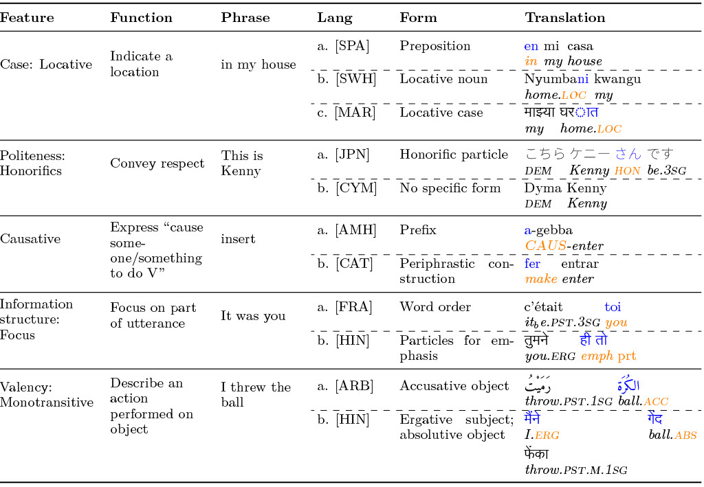

 Table 4.6: Examples of grammatical features and their associated functions or meanings, with various language dependent forms (specific mechanisms used to express that feature).

Despite these differences, many grammatical functions codified in grammars tend to be shared across languages. For example, most languages have ways to differentiate which participants perform the action of an event and which ones experience it, the time at which an event occurred, how many referents there are, or whether an event is conditional upon another event taking place, to name a few.

Thus, achieving coverage over grammatical functions is a reasonable proxy for achieving coverage of grammatical phenomena at different levels of linguistic structure in a particular language. These grammatical functions can be enumerated up to a required degree of fine-grainedness at all linguistic levels with broad cross-linguistic coverage. Also note that, broadly speaking, most functions can be expressed in any language, regardless of the grammar of that language. For example, even though Spanish and English don’t have a case system, it is certainly possible to express location in these languages akin to the Marathi locative case (see [table 4.6](https://arxiv.org/html/2603.16309v3#S4.T6 "In Building a grammatically-diverse corpus ‣ 4.3.2 Approach ‣ 4.3 Seed Data for Post-Training: MeDLEy ‣ 4 Creating High-Quality Datasets ‣ Omnilingual MT: Machine Translation for 1,600 Languages")). Since the function is likely to be retained across translation, we can construct a source corpus that has high coverage over our grammatical features (in any source language), and expect that when it is translated into an arbitrary language, it will cover many grammatical phenomena in that language. For example, when we translate the English phrase “in my house” to Marathi, we gain coverage of the locative case in Marathi. We do not expect that each grammatical feature will be realized in the same manner across languages. However, we do expect that in many cases, the function associated with a feature will be manifested in some manner in a text or its context regardless of the language of the text. This allows us to build a grammatically-diverse source corpus that achieves broad grammatical coverage when translated into arbitrary target languages. This forms our cross-linguistic framework of grammatical diversity.

##### Dataset construction

Here we summarize the dataset construction process. The creation process involves: (1) curating a list of cross-linguistic grammatical features, as described above; (2) selecting domains (informative, dialogue, casual, narrative, and instruction-response) and source languages (English, Mandarin, Russian, Spanish, and German); (3) having expert native-speaker linguists craft natural, accessible source paragraphs based on templates combining grammatical features and domains, along with contextual notes; (4) translating these source paragraphs into eight pivot languages (English, Mandarin, Hindi, Indonesian, Modern Standard Arabic, Swahili, Spanish, and French) chosen to represent common L2 languages of low-resource language communities; and (5) commissioning professional translations from these pivots into numerous low-resource target languages selected for translator availability, prior coverage gaps, and language family diversity, resulting in grammatically diverse parallel text for underrepresented languages. See the list of grammatical features used, annotator guidelines, and more details about our approach in [section A.1](https://arxiv.org/html/2603.16309v3#A1.SS1 "A.1 More details on the approach ‣ Appendix A MeDLEy details ‣ Omnilingual MT: Machine Translation for 1,600 Languages") and [section A.2](https://arxiv.org/html/2603.16309v3#A1.SS2 "A.2 More details on data creation ‣ Appendix A MeDLEy details ‣ Omnilingual MT: Machine Translation for 1,600 Languages").

##### Grammatical features transfer and retention

Given the aim of covering naturally rarer features in our dataset, we compare the entropy of grammatical feature distributions in our dataset versus other seed datasets, across 9 categories (e.g. tense, formality). We find that MeDLEy shows the highest entropy in 5 out of 9 categories, indicating that MeDLEy often has higher proportions of rarer features in a paradigm. Furthermore, given our assumptions of feature transfer via translation during the creation of MeDLEy, we measure the extent of feature transfer and the extent to which features are preserved across translation hops. We thus conduct a qualitative feature transfer analysis looking both at single-hop and 2-hop translations. We find that most morphosyntactic features have transfer rates above 50%, and interestingly, forms that do not surface in a target translation can resurface in next hop from that language, indicating that grammatical diversity is preserved in a language-dependent manner via translation. The grammatical feature distribution as well as feature retention analyses are detailed in [section A.8](https://arxiv.org/html/2603.16309v3#A1.SS8 "A.8 Grammatical feature analyses ‣ Appendix A MeDLEy details ‣ Omnilingual MT: Machine Translation for 1,600 Languages").

#### 4.3.3 Experiments

MeDLEy may have several uses given its grammatical feature coverage and n-way parallel nature. We demonstrate its general utility for fine-tuning MT models for LRLs.

##### Experiment Setup

In particular, we perform a Token-controlled comparison and also measure Absolute and combined gains for models fine-tuned on MeDLEy versus other datasets. On the former, given that larger datasets are more expensive to annotate, we compare randomly sampled equally-sized training subsets of MeDLEy and baseline datasets in terms of number of tokens for a fair comparison, using the size of the smallest dataset as the token budget. For the latter, we report absolute gains from training on the entire dataset. We also look at additive gains from combining seed datasets, which may help inform decisions about language coverage in future seed datasets.

We evaluate the performance of the fine-tuned models on FLoRes+ ([NLLB Team et al., 2024](https://arxiv.org/html/2603.16309v3#bib.bib146)) and BOUQuET ([The Omnilingual MT Team et al., 2025](https://arxiv.org/html/2603.16309v3#bib.bib147)), considering 5 languages that are in the intersection of all the datasets. In particular, we experiment with NLLB-200-3.3B1212 12 [https://huggingface.co/facebook/nllb-200-3.3B](https://facebook/nllb-200-3.3B) as a representative of sequence-to-sequence (seq2seq) models ([NLLB Team et al., 2024](https://arxiv.org/html/2603.16309v3#bib.bib146)), and LLaMA-3.1-8B-Instruct1313 13 [https://huggingface.co/meta-llama/Llama-3.1-8B-Instruct](https://meta-llama/Llama-3.1-8B-Instruct) representing LLM-based MT, and fine-tune them to obtain language-specific checkpoints, considering into- and out-of-English separately. More precise details about the experiments setup can be found in [section A.10](https://arxiv.org/html/2603.16309v3#A1.SS10 "A.10 More details on the experimental setup ‣ Appendix A MeDLEy details ‣ Omnilingual MT: Machine Translation for 1,600 Languages").

##### Experiment Results

<table id="S4.T7.3" class="ltx_tabular ltx_centering ltx_align_middle">
<tr id="S4.T7.3.1" class="ltx_tr">
<td id="S4.T7.3.1.1" class="ltx_td ltx_align_right ltx_border_tt" rowspan="2">Model</td>
<td id="S4.T7.3.1.2" class="ltx_td ltx_align_right ltx_border_tt" rowspan="2">Seed Dataset</td>
<td id="S4.T7.3.1.3" class="ltx_td ltx_align_right ltx_border_tt" rowspan="2">#tokens</td>
<td id="S4.T7.3.1.4" class="ltx_td ltx_align_center ltx_border_tt" colspan="2">BOUQuET</td>
<td id="S4.T7.3.1.5" class="ltx_td ltx_align_center ltx_border_tt" colspan="2">FLoRes+</td></tr>
<tr id="S4.T7.3.2" class="ltx_tr">
<td id="S4.T7.3.2.1" class="ltx_td ltx_align_left">En-YY</td>
<td id="S4.T7.3.2.2" class="ltx_td ltx_align_left">XX-En</td>
<td id="S4.T7.3.2.3" class="ltx_td ltx_align_left">En-YY</td>
<td id="S4.T7.3.2.4" class="ltx_td ltx_align_left">XX-En</td></tr>
<tr id="S4.T7.3.3" class="ltx_tr">
<td id="S4.T7.3.3.1" class="ltx_td ltx_align_center ltx_border_t" colspan="7">Token-controlled Experiment</td></tr>
<tr id="S4.T7.3.4" class="ltx_tr">
<td id="S4.T7.3.4.1" class="ltx_td ltx_align_right ltx_border_t" rowspan="4">LLaMA</td>
<td id="S4.T7.3.4.2" class="ltx_td ltx_align_right ltx_border_t">No Seed</td>
<td id="S4.T7.3.4.3" class="ltx_td ltx_align_right ltx_border_t">0</td>
<td id="S4.T7.3.4.4" class="ltx_td ltx_align_right ltx_border_t">8.49</td>
<td id="S4.T7.3.4.5" class="ltx_td ltx_align_right ltx_border_t">14.45</td>
<td id="S4.T7.3.4.6" class="ltx_td ltx_align_right ltx_border_t">10.07</td>
<td id="S4.T7.3.4.7" class="ltx_td ltx_nopad_r ltx_align_right ltx_border_t">16.81</td></tr>
<tr id="S4.T7.3.5" class="ltx_tr">
<td id="S4.T7.3.5.1" class="ltx_td ltx_align_right">SmolDoc</td>
<td id="S4.T7.3.5.2" class="ltx_td ltx_align_right">215K</td>
<td id="S4.T7.3.5.3" class="ltx_td ltx_align_right">20.08</td>
<td id="S4.T7.3.5.4" class="ltx_td ltx_align_right">18.74</td>
<td id="S4.T7.3.5.5" class="ltx_td ltx_align_right">21.53</td>
<td id="S4.T7.3.5.6" class="ltx_td ltx_nopad_r ltx_align_right">22.25</td></tr>
<tr id="S4.T7.3.6" class="ltx_tr">
<td id="S4.T7.3.6.1" class="ltx_td ltx_align_right">SmolSent</td>
<td id="S4.T7.3.6.2" class="ltx_td ltx_align_right">215K</td>
<td id="S4.T7.3.6.3" class="ltx_td ltx_align_right">18.16</td>
<td id="S4.T7.3.6.4" class="ltx_td ltx_align_right">18.74</td>
<td id="S4.T7.3.6.5" class="ltx_td ltx_align_right">18.46</td>
<td id="S4.T7.3.6.6" class="ltx_td ltx_nopad_r ltx_align_right">22.42</td></tr>
<tr id="S4.T7.3.7" class="ltx_tr">
<td id="S4.T7.3.7.1" class="ltx_td ltx_align_right">MeDLEy</td>
<td id="S4.T7.3.7.2" class="ltx_td ltx_align_right">215K</td>
<td id="S4.T7.3.7.3" class="ltx_td ltx_align_right">19.60</td>
<td id="S4.T7.3.7.4" class="ltx_td ltx_align_right">20.39</td>
<td id="S4.T7.3.7.5" class="ltx_td ltx_align_right">20.69</td>
<td id="S4.T7.3.7.6" class="ltx_td ltx_nopad_r ltx_align_right">23.73</td></tr>
<tr id="S4.T7.3.8" class="ltx_tr">
<td id="S4.T7.3.8.1" class="ltx_td ltx_align_right ltx_border_t" rowspan="4">NLLB</td>
<td id="S4.T7.3.8.2" class="ltx_td ltx_align_right ltx_border_t">No Seed</td>
<td id="S4.T7.3.8.3" class="ltx_td ltx_align_right ltx_border_t">0</td>
<td id="S4.T7.3.8.4" class="ltx_td ltx_align_right ltx_border_t">31.75</td>
<td id="S4.T7.3.8.5" class="ltx_td ltx_align_right ltx_border_t">39.43</td>
<td id="S4.T7.3.8.6" class="ltx_td ltx_align_right ltx_border_t">29.01</td>
<td id="S4.T7.3.8.7" class="ltx_td ltx_nopad_r ltx_align_right ltx_border_t">39.75</td></tr>
<tr id="S4.T7.3.9" class="ltx_tr">
<td id="S4.T7.3.9.1" class="ltx_td ltx_align_right">SmolDoc</td>
<td id="S4.T7.3.9.2" class="ltx_td ltx_align_right">215K</td>
<td id="S4.T7.3.9.3" class="ltx_td ltx_align_right">31.70</td>
<td id="S4.T7.3.9.4" class="ltx_td ltx_align_right">40.88</td>
<td id="S4.T7.3.9.5" class="ltx_td ltx_align_right">29.85</td>
<td id="S4.T7.3.9.6" class="ltx_td ltx_nopad_r ltx_align_right">39.34</td></tr>
<tr id="S4.T7.3.10" class="ltx_tr">
<td id="S4.T7.3.10.1" class="ltx_td ltx_align_right">SmolSent</td>
<td id="S4.T7.3.10.2" class="ltx_td ltx_align_right">215K</td>
<td id="S4.T7.3.10.3" class="ltx_td ltx_align_right">32.54</td>
<td id="S4.T7.3.10.4" class="ltx_td ltx_align_right">40.88</td>
<td id="S4.T7.3.10.5" class="ltx_td ltx_align_right">30.27</td>
<td id="S4.T7.3.10.6" class="ltx_td ltx_nopad_r ltx_align_right">39.31</td></tr>
<tr id="S4.T7.3.11" class="ltx_tr">
<td id="S4.T7.3.11.1" class="ltx_td ltx_align_right">MeDLEy</td>
<td id="S4.T7.3.11.2" class="ltx_td ltx_align_right">215K</td>
<td id="S4.T7.3.11.3" class="ltx_td ltx_align_right">30.58</td>
<td id="S4.T7.3.11.4" class="ltx_td ltx_align_right">43.05</td>
<td id="S4.T7.3.11.5" class="ltx_td ltx_align_right">29.35</td>
<td id="S4.T7.3.11.6" class="ltx_td ltx_nopad_r ltx_align_right">40.72</td></tr>
<tr id="S4.T7.3.12" class="ltx_tr">
<td id="S4.T7.3.12.1" class="ltx_td ltx_align_center ltx_border_t" colspan="7">Direct Comparison Experiment</td></tr>
<tr id="S4.T7.3.13" class="ltx_tr">
<td id="S4.T7.3.13.1" class="ltx_td ltx_align_right ltx_border_t" rowspan="7">LLaMA</td>
<td id="S4.T7.3.13.2" class="ltx_td ltx_align_right ltx_border_t">No Seed</td>
<td id="S4.T7.3.13.3" class="ltx_td ltx_align_right ltx_border_t">0</td>
<td id="S4.T7.3.13.4" class="ltx_td ltx_align_right ltx_border_t">8.49</td>
<td id="S4.T7.3.13.5" class="ltx_td ltx_align_right ltx_border_t">14.45</td>
<td id="S4.T7.3.13.6" class="ltx_td ltx_align_right ltx_border_t">10.07</td>
<td id="S4.T7.3.13.7" class="ltx_td ltx_nopad_r ltx_align_right ltx_border_t">16.81</td></tr>
<tr id="S4.T7.3.14" class="ltx_tr">
<td id="S4.T7.3.14.1" class="ltx_td ltx_align_right">SmolDoc (D)</td>
<td id="S4.T7.3.14.2" class="ltx_td ltx_align_right">800K</td>
<td id="S4.T7.3.14.3" class="ltx_td ltx_align_right">25.07</td>
<td id="S4.T7.3.14.4" class="ltx_td ltx_align_right">23.06</td>
<td id="S4.T7.3.14.5" class="ltx_td ltx_align_right">25.03</td>
<td id="S4.T7.3.14.6" class="ltx_td ltx_nopad_r ltx_align_right">25.09</td></tr>
<tr id="S4.T7.3.15" class="ltx_tr">
<td id="S4.T7.3.15.1" class="ltx_td ltx_align_right">SmolSent (S)</td>
<td id="S4.T7.3.15.2" class="ltx_td ltx_align_right">225K</td>
<td id="S4.T7.3.15.3" class="ltx_td ltx_align_right">18.69</td>
<td id="S4.T7.3.15.4" class="ltx_td ltx_align_right">19.47</td>
<td id="S4.T7.3.15.5" class="ltx_td ltx_align_right">19.70</td>
<td id="S4.T7.3.15.6" class="ltx_td ltx_nopad_r ltx_align_right">23.87</td></tr>
<tr id="S4.T7.3.16" class="ltx_tr">
<td id="S4.T7.3.16.1" class="ltx_td ltx_align_right">MeDLEy (M)</td>
<td id="S4.T7.3.16.2" class="ltx_td ltx_align_right">525K</td>
<td id="S4.T7.3.16.3" class="ltx_td ltx_align_right">22.30</td>
<td id="S4.T7.3.16.4" class="ltx_td ltx_align_right">23.18</td>
<td id="S4.T7.3.16.5" class="ltx_td ltx_align_right">22.43</td>
<td id="S4.T7.3.16.6" class="ltx_td ltx_nopad_r ltx_align_right">25.71</td></tr>
<tr id="S4.T7.3.17" class="ltx_tr">
<td id="S4.T7.3.17.1" class="ltx_td ltx_align_right ltx_border_t">M+D</td>
<td id="S4.T7.3.17.2" class="ltx_td ltx_align_right ltx_border_t">1.31M</td>
<td id="S4.T7.3.17.3" class="ltx_td ltx_align_right ltx_border_t">26.98</td>
<td id="S4.T7.3.17.4" class="ltx_td ltx_align_right ltx_border_t">27.44</td>
<td id="S4.T7.3.17.5" class="ltx_td ltx_align_right ltx_border_t">26.10</td>
<td id="S4.T7.3.17.6" class="ltx_td ltx_nopad_r ltx_align_right ltx_border_t">26.94</td></tr>
<tr id="S4.T7.3.18" class="ltx_tr">
<td id="S4.T7.3.18.1" class="ltx_td ltx_align_right">M+S</td>
<td id="S4.T7.3.18.2" class="ltx_td ltx_align_right">745K</td>
<td id="S4.T7.3.18.3" class="ltx_td ltx_align_right">24.33</td>
<td id="S4.T7.3.18.4" class="ltx_td ltx_align_right">25.98</td>
<td id="S4.T7.3.18.5" class="ltx_td ltx_align_right">23.27</td>
<td id="S4.T7.3.18.6" class="ltx_td ltx_nopad_r ltx_align_right">26.43</td></tr>
<tr id="S4.T7.3.19" class="ltx_tr">
<td id="S4.T7.3.19.1" class="ltx_td ltx_align_right">M+D+S</td>
<td id="S4.T7.3.19.2" class="ltx_td ltx_align_right">1.54M</td>
<td id="S4.T7.3.19.3" class="ltx_td ltx_align_right">28.12</td>
<td id="S4.T7.3.19.4" class="ltx_td ltx_align_right">29.04</td>
<td id="S4.T7.3.19.5" class="ltx_td ltx_align_right">26.79</td>
<td id="S4.T7.3.19.6" class="ltx_td ltx_nopad_r ltx_align_right">27.90</td></tr>
<tr id="S4.T7.3.20" class="ltx_tr">
<td id="S4.T7.3.20.1" class="ltx_td ltx_align_right ltx_border_bb ltx_border_t" rowspan="7">NLLB</td>
<td id="S4.T7.3.20.2" class="ltx_td ltx_align_right ltx_border_t">No Seed</td>
<td id="S4.T7.3.20.3" class="ltx_td ltx_align_right ltx_border_t">0</td>
<td id="S4.T7.3.20.4" class="ltx_td ltx_align_right ltx_border_t">31.75</td>
<td id="S4.T7.3.20.5" class="ltx_td ltx_align_right ltx_border_t">39.43</td>
<td id="S4.T7.3.20.6" class="ltx_td ltx_align_right ltx_border_t">29.01</td>
<td id="S4.T7.3.20.7" class="ltx_td ltx_nopad_r ltx_align_right ltx_border_t">39.75</td></tr>
<tr id="S4.T7.3.21" class="ltx_tr">
<td id="S4.T7.3.21.1" class="ltx_td ltx_align_right">SmolDoc (D)</td>
<td id="S4.T7.3.21.2" class="ltx_td ltx_align_right">800K</td>
<td id="S4.T7.3.21.3" class="ltx_td ltx_align_right">32.92</td>
<td id="S4.T7.3.21.4" class="ltx_td ltx_align_right">41.24</td>
<td id="S4.T7.3.21.5" class="ltx_td ltx_align_right">30.05</td>
<td id="S4.T7.3.21.6" class="ltx_td ltx_nopad_r ltx_align_right">39.36</td></tr>
<tr id="S4.T7.3.22" class="ltx_tr">
<td id="S4.T7.3.22.1" class="ltx_td ltx_align_right">SmolSent (S)</td>
<td id="S4.T7.3.22.2" class="ltx_td ltx_align_right">225K</td>
<td id="S4.T7.3.22.3" class="ltx_td ltx_align_right">32.29</td>
<td id="S4.T7.3.22.4" class="ltx_td ltx_align_right">41.77</td>
<td id="S4.T7.3.22.5" class="ltx_td ltx_align_right">30.10</td>
<td id="S4.T7.3.22.6" class="ltx_td ltx_nopad_r ltx_align_right">39.94</td></tr>
<tr id="S4.T7.3.23" class="ltx_tr">
<td id="S4.T7.3.23.1" class="ltx_td ltx_align_right">MeDLEy (M)</td>
<td id="S4.T7.3.23.2" class="ltx_td ltx_align_right">525K</td>
<td id="S4.T7.3.23.3" class="ltx_td ltx_align_right">30.60</td>
<td id="S4.T7.3.23.4" class="ltx_td ltx_align_right">43.40</td>
<td id="S4.T7.3.23.5" class="ltx_td ltx_align_right">29.81</td>
<td id="S4.T7.3.23.6" class="ltx_td ltx_nopad_r ltx_align_right">40.94</td></tr>
<tr id="S4.T7.3.24" class="ltx_tr">
<td id="S4.T7.3.24.1" class="ltx_td ltx_align_right ltx_border_t">M+D</td>
<td id="S4.T7.3.24.2" class="ltx_td ltx_align_right ltx_border_t">1.31M</td>
<td id="S4.T7.3.24.3" class="ltx_td ltx_align_right ltx_border_t">33.43</td>
<td id="S4.T7.3.24.4" class="ltx_td ltx_align_right ltx_border_t">42.67</td>
<td id="S4.T7.3.24.5" class="ltx_td ltx_align_right ltx_border_t">30.69</td>
<td id="S4.T7.3.24.6" class="ltx_td ltx_nopad_r ltx_align_right ltx_border_t">40.17</td></tr>
<tr id="S4.T7.3.25" class="ltx_tr">
<td id="S4.T7.3.25.1" class="ltx_td ltx_align_right">M+S</td>
<td id="S4.T7.3.25.2" class="ltx_td ltx_align_right">745K</td>
<td id="S4.T7.3.25.3" class="ltx_td ltx_align_right">32.92</td>
<td id="S4.T7.3.25.4" class="ltx_td ltx_align_right">41.98</td>
<td id="S4.T7.3.25.5" class="ltx_td ltx_align_right">31.02</td>
<td id="S4.T7.3.25.6" class="ltx_td ltx_nopad_r ltx_align_right">39.83</td></tr>
<tr id="S4.T7.3.26" class="ltx_tr">
<td id="S4.T7.3.26.1" class="ltx_td ltx_align_right ltx_border_bb">M+D+S</td>
<td id="S4.T7.3.26.2" class="ltx_td ltx_align_right ltx_border_bb">1.54M</td>
<td id="S4.T7.3.26.3" class="ltx_td ltx_align_right ltx_border_bb">34.73</td>
<td id="S4.T7.3.26.4" class="ltx_td ltx_align_right ltx_border_bb">42.90</td>
<td id="S4.T7.3.26.5" class="ltx_td ltx_align_right ltx_border_bb">31.60</td>
<td id="S4.T7.3.26.6" class="ltx_td ltx_nopad_r ltx_align_right ltx_border_bb">40.19</td></tr>
</table>

 Table 4.7: Token-controlled and Direct comparison: reporting number of LLaMA tokens on involved languages (Bambara, Mossi, Wolof, Yoruba, and Ganda, for both evaluation datasets) and ChrF++ numbers.

The overall results of our experiments are reported in [table 4.7](https://arxiv.org/html/2603.16309v3#S4.T7 "In Experiment Results ‣ 4.3.3 Experiments ‣ 4.3 Seed Data for Post-Training: MeDLEy ‣ 4 Creating High-Quality Datasets ‣ Omnilingual MT: Machine Translation for 1,600 Languages"). A more detailed breakdown of these results can be found in [section A.11](https://arxiv.org/html/2603.16309v3#A1.SS11 "A.11 More details on the experiment results ‣ Appendix A MeDLEy details ‣ Omnilingual MT: Machine Translation for 1,600 Languages"). We see that MeDLEy matches or outperforms baseline datasets in the token-controlled setting, and shows gains in the into-English direction, while adding MeDLEy to existing datasets yield generally modest gains. We also show similar findings on a comparison on NLLB-Seed on a separate set of intersection languages1414 14 In addition, we also show that NLLB-Seed contains a high proportion of difficult-to-translate texts potentially due to technical or obscure terminology (54% as compared to 10.41%), which may hinder lay community translators., see [table A.16](https://arxiv.org/html/2603.16309v3#A1.T16 "In Comparison with NLLB-Seed ‣ A.11 More details on the experiment results ‣ Appendix A MeDLEy details ‣ Omnilingual MT: Machine Translation for 1,600 Languages"). We confirm these trends over various other MT evaluation metrics such as xCOMET and MetricX ([Guerreiro et al., 2024a](https://arxiv.org/html/2603.16309v3#bib.bib139); [Juraska et al., 2024](https://arxiv.org/html/2603.16309v3#bib.bib45)), see [fig. A.4](https://arxiv.org/html/2603.16309v3#A1.F4 "In Language-wise breakdowns ‣ A.11 More details on the experiment results ‣ Appendix A MeDLEy details ‣ Omnilingual MT: Machine Translation for 1,600 Languages"). This supports a major application of seed datasets, i.e., synthetic data generation from monolingual LRL data via better xx-en systems as discussed in [section 4.3.1](https://arxiv.org/html/2603.16309v3#S4.SS3.SSS1 "4.3.1 Motivation and related work ‣ 4.3 Seed Data for Post-Training: MeDLEy ‣ 4 Creating High-Quality Datasets ‣ Omnilingual MT: Machine Translation for 1,600 Languages").

#### 4.3.4 Conclusions and limitations

MeDLEy has been a large scale MT training data collection effort across 109 low-resource languages, culminated in a multi-centric, domain-diverse, and multi-way parallel seed dataset, that showed both a broader grammatical diversity and a larger impact when used to fine-tune MT models, compared to other pre-existing seed datasets. Indeed, MeDLEy proved to be an essential component of our post-training recipe, as can be seen in [section 6.3](https://arxiv.org/html/2603.16309v3#S6.SS3 "6.3 Post-training ‣ 6 Decoder-only Modeling ‣ Omnilingual MT: Machine Translation for 1,600 Languages"). Nevertheless, the iterative nature of the data collection effort impacted the scope of the experiments we could perform with the dataset, both in isolation and as part of the broader MT recipe; furthermore, we identify several limitations that we mention below.

The grammatical coverage of MeDLEy is limited by both budget constraints and by intrinsically language-specific source-side grammatical functions, that may not reliable transfer into target languages. As a consequence, MeDLEy targets common, cross-lingual, function-oriented features rather than language-specific phenomena. Furthermore, the lack of labeled evaluation data in low-resource languages prevents us from performing more fine-grained evaluations, at the level of single grammatical phenomena. Finally, as both translation and quality assurance mainly relies on external vendors for low resource languages, inaccurate translations may occur more frequently in these languages than in higher resource ones, where in-house expertise allows further quality checks.

### 4.4 Evaluation Data

MT evaluation has been driven by a series of publicly available test collections that enable reproducible comparison of systems. The Workshop on Machine Translation (WMT) series introduced large, community‑curated benchmarks that have become the de‑facto standard for both automatic and human evaluation [Kocmi et al. (2025)](https://arxiv.org/html/2603.16309v3#bib.bib64); [Deutsch et al. (2025)](https://arxiv.org/html/2603.16309v3#bib.bib26). Alternative efforts have focused on multilingual, low‑resource, and cross‑domain evaluation. FLORES benchmarks extended evaluation to 200 languages, providing expert‑translated reference sentences for a curated set of English sentences ([NLLB Team et al., 2024](https://arxiv.org/html/2603.16309v3#bib.bib146)). In this work, we report results with our proposed datasets (BOUQuET, which has been manually created from scratch, and a subset of the Bible that we explicitly reserved for evaluation) described in this section, and exisiting ones like FLoRes+ ([Maillard et al., 2024](https://arxiv.org/html/2603.16309v3#bib.bib28)), which covers 220+ languages, in 3 domains (wikipedia, travel guides and news). The complete list of evaluation datasets is summarised in Table [4.8](https://arxiv.org/html/2603.16309v3#S4.T8 "Table 4.8 ‣ 4.4.3 Benchmarks Specialization ‣ 4.4 Evaluation Data ‣ 4 Creating High-Quality Datasets ‣ Omnilingual MT: Machine Translation for 1,600 Languages").

#### 4.4.1 BOUQuET

##### Description

To evaluate translation systems that purport to be massively multilingual or omnilingual, we need a multi-way parallel evaluation dataset. Prior to BOUQuET, such datasets as those derived from FLoRes-101 ([Goyal et al., 2022](https://arxiv.org/html/2603.16309v3#bib.bib7)) and FLORES-200 ([NLLB Team et al., 2024](https://arxiv.org/html/2603.16309v3#bib.bib146)) (e.g. 2M-FLoRes ([Costa-jussà et al., 2024b](https://arxiv.org/html/2603.16309v3#bib.bib8)), or FLoRes+ ([Maillard et al., 2024](https://arxiv.org/html/2603.16309v3#bib.bib28))) existed but came with various shortcomings in that they represented a narrow selection of domains and registers, were prone to contamination ([Sainz et al., 2023](https://arxiv.org/html/2603.16309v3#bib.bib6)) due mainly to automatic construction, and proved difficult to translate accurately because of their English-centric nature or their lack of helpful context needed by translators (e.g., context about grammatical gender when referring to human beings only mentioned by proper nouns or titles). Some of this context could have been inferred through paragraph-level parsing if there were not missing metadata on existing paragraph structures.

With the introduction of BOUQuET, we aim to address the above limitations and progress towards a more culturally-diverse MT evaluation ([Oh et al., 2025](https://arxiv.org/html/2603.16309v3#bib.bib9)). BOUQuET was created (as opposed to crawled or mined) from scratch in eight non-English languages1515 15 arz_Arab, cmn_Hans, deu_Latn, fra_Latn, hin_Deva, ind_Latn, rus_Cyrl, and spa_Latn by linguists, who provided gold-standard English translations, contextual information, as well as register labels to facilitate accurate translations into a large number of languages. The sentences that compose BOUQuET are all part of clearly delineated paragraphs of various lengths, and they represent eight domains that are not represented in FLoRes-derived datasets. The construction and evaluation of BOUQuET are described in further detail in ([The Omnilingual MT Team et al., 2025](https://arxiv.org/html/2603.16309v3#bib.bib147)).

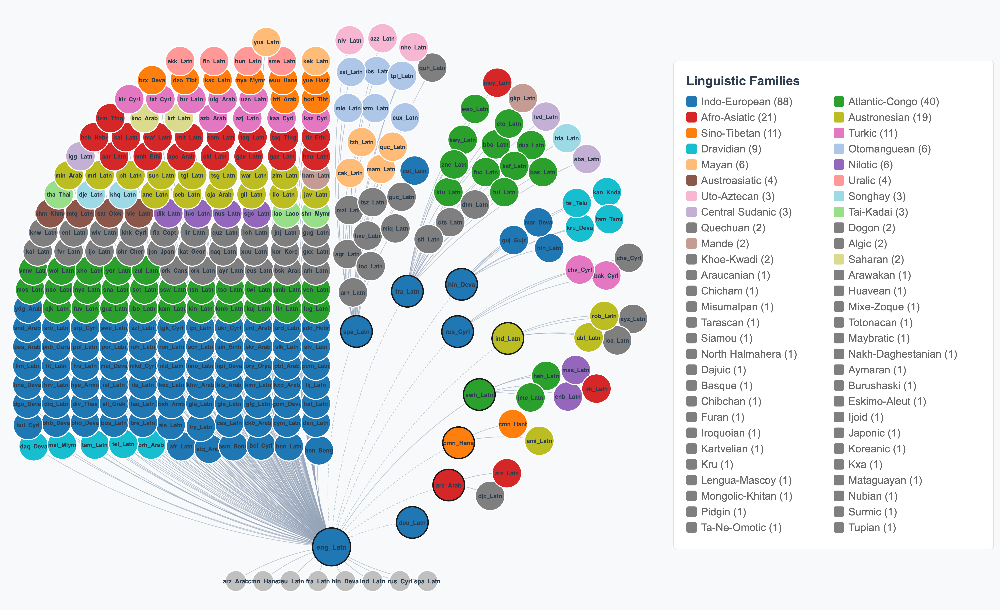

 Figure 4.2: Bouquet Language Expansion Visualization. Details on pivots that were used to translate each language show that most useful ones were fra_Latn, ind_latn, swh_latn and spa_latn. 

##### Expansion Analysis

BOUQuET started early 2025, with 9 pivot languages, since then it has been expanded through vendors, partnering (Mozilla Common Voice1616 16 <https://commonvoice.mozilla.org/en>) and the open-initiative1717 17 <https://bouquet.metademolab.com/>. To date of this paper, BOUQuET is available in 275 languages (see Appendix [D](https://arxiv.org/html/2603.16309v3#A4 "Appendix D Languages at a glance ‣ Omnilingual MT: Machine Translation for 1,600 Languages")) covering 56 distinct language families and 33 scripts. 18 languages have been totally translated through community efforts (16 by Mozilla Common Voice and 2 through the BOUQuET open-initiative) and the rest have been commissioned through vendors. Regarding pivots, we learned that some pivot languages (French, Indonesian, Swahili, Spanish) appear to ease resourcing and translation more than others (German, Hindi); vendors that rely exclusively on English deliver translations of lower quality, drive up costs, and fail to deliver a significant amount of work we commission. Figure [4.2](https://arxiv.org/html/2603.16309v3#S4.F2 "Figure 4.2 ‣ Description ‣ 4.4.1 BOUQuET ‣ 4.4 Evaluation Data ‣ 4 Creating High-Quality Datasets ‣ Omnilingual MT: Machine Translation for 1,600 Languages") details the pivots that were used for each language.

#### 4.4.2 Bible Evaluation Partition

In order to have validation/evaluation signals, we suggest keeping some data from the highest multilingual sources aside. From the Bible, we suggest using the Gospel by John as the test set, because the Gospels are the most translated from the Bible books, and John is considered to be the most different from the other Gospels. The Gospel of John still contains about 30% of verses that have a high semantic overlap with other books (such as “If you will ask anything in my name, I will do it.” in John vs “All things, whatever you ask in prayer, believing, you will receive.” in Matthew). This benchmark is multi-way parallel and it allows to compare performance across languages and systems. The content and partitioning of our Bible dataset are the same as in ([Pratap et al., 2024](https://arxiv.org/html/2603.16309v3#bib.bib76); [Omnilingual ASR Team et al., 2025](https://arxiv.org/html/2603.16309v3#bib.bib79))

A clear limitation of these datasets is the training contamination (since models are likely to have ingested the entire Bible). However, these are the best efforts to have a validation signal for the long-tail of languages in our process to constructing Omnilingual datasets (BOUQuET) and Omnilingual quality estimation metrics (BLASER 3, see section [8.3](https://arxiv.org/html/2603.16309v3#S8.SS3 "8.3 BLASER 3 ‣ 8 Proposed Evaluation Metrics and Dataset ‣ Omnilingual MT: Machine Translation for 1,600 Languages")).

#### 4.4.3 Benchmarks Specialization

Why use more than one evaluation dataset? The Bible benchmark is used for providing direct evidence on 1561 language varieties, albeit a single domain. FLoRes+ 1818 18 In all evaluations throughout the paper, we use version 2.1 of FLoRes+, corresponding to its state in early 2025. Unless otherwise specified, we use its devtest split, which has a slightly different set of languages from the dev split. and BOUQuET provide a more varied coverage of domains in languages of different resource levels, with BOUQuET including a rich representation of extremely low-resourced languages. Languages and resources of several of these datasets are reported in Table [D](https://arxiv.org/html/2603.16309v3#A4 "Appendix D Languages at a glance ‣ Omnilingual MT: Machine Translation for 1,600 Languages"). For ablations, we also define two subsets of FLoRes+, that we call FLoRes-HRL and FLoRes-Hard. FLoRes-HRL consists of a selection of 54 languages chosen to represent higher resource languages, in accordance with the definition provided in ([NLLB Team et al., 2024](https://arxiv.org/html/2603.16309v3#bib.bib146)). FLoRes-Hard consists of a selection of 20 languages chosen to represent lower resource languages with particularly low performance from baseline MT systems.1919 19 The codes of the selected languages are ayr_Latn, brx_Deva, chv_Cyrl, dar_Cyrl, dgo_Deva, dik_Latn, dzo_Tibt, gom_Deva, knc_Arab, mhr_Cyrl, min_Arab, mos_Latn, myv_Cyrl, nqo_Nkoo, nus_Latn, quy_Latn, sat_Olck, taq_Tfng, tyv_Cyrl, vmw_Latn. For selection, we prioritized the languages added to FLoRes+ by the community, as well as languages from the FLORES-200 list representing diverse language families and scripts. For experiments with FLoRes-Hard, we are using the dev split, as some of its languages are not included in devtest.

Resource level | high | mid | low | very low | zero | total | domains  
---|---|---|---|---|---|---|---  
Bible | 25 | 71 | 172 | 1289 | 4 | 1561 | 1  
FLoRes+ | 24 | 82 | 73 | 31 | 3 | 213 | 3  
BOUQuET | 23 | 72 | 79 | 48 | 53 | 275 | 8  
All benchmarks | 26 | 89 | 222 | 1318 | 59 | 1714 |   
All benchmarks, coarse grouping | 25 | 83 | 206 | 1296 | 56 | 1666 |

 Table 4.8: Number of language varieties, grouped by resource level (as per [Section 3.3](https://arxiv.org/html/2603.16309v3#S3.SS3 "3.3 Resource levels ‣ 3 Languages ‣ Omnilingual MT: Machine Translation for 1,600 Languages")) in each of the benchmark datasets, and the number of domains covered by them. The line “All benchmarks“ counts the union of all language codes in the three individual benchmarks, and the following line counts only unique ISO 639-3 codes, ignoring the variation in scripts, locales, or dialects.

As Table [4.8](https://arxiv.org/html/2603.16309v3#S4.T8 "Table 4.8 ‣ 4.4.3 Benchmarks Specialization ‣ 4.4 Evaluation Data ‣ 4 Creating High-Quality Datasets ‣ Omnilingual MT: Machine Translation for 1,600 Languages") demonstrates, our three evaluation benchmarks collectively cover over 1,700 language varieties, or over 1,600 unique languages, if we abstract away from the more fine-grained varieties differentiated by scripts, regions, or dialects.

## 5 Translation Modeling Overview

### 5.1 Motivation and Approaches

##### Related Work

The modeling advances that enable massively multilingual MT can be grouped into mainly encoder-decoder architectures and large‑scale decoder-only language‑model based approaches. Early work showed that a single Transformer encoder–decoder can handle many language pairs by conditioning the decoder on a language identifier [Johnson et al. (2017)](https://arxiv.org/html/2603.16309v3#bib.bib80). This paradigm was scaled to hundreds of languages with NLLB ([NLLB Team et al., 2024](https://arxiv.org/html/2603.16309v3#bib.bib146)). The recent surge of large language models (LLMs) has opened a new modeling direction. [Zhu et al. (2024)](https://arxiv.org/html/2603.16309v3#bib.bib97) evaluate eight state‑of‑the‑art LLMs on a suite of 100+ languages and find that, while LLMs can acquire translation ability with few examples, they still lag behind dedicated multilingual translation systems on low‑resource pairs. Specialised LLMs to MT e.g. TowerLLM ([Alves et al., 2024b](https://arxiv.org/html/2603.16309v3#bib.bib68)) has shown the validity of certain recipes and motivation for specialization.

##### Our approaches

In this work, we investigate how to specialize general-purpose decoder-only LLMs for the translation task, and we investigate two distinct architectural approaches. The first approach involves directly fine-tuning the LLM for translation tasks while maintaining its original decoder-only architecture. The second alternative is to build an encoder-decoder Transformer model derived from the LLM for both its encoder and its decoder. In this work, we explore both of these strategies in Sections [6](https://arxiv.org/html/2603.16309v3#S6 "6 Decoder-only Modeling ‣ Omnilingual MT: Machine Translation for 1,600 Languages") and [7](https://arxiv.org/html/2603.16309v3#S7 "7 Encoder-Decoder Modeling ‣ Omnilingual MT: Machine Translation for 1,600 Languages").

### 5.2 Vocabulary Extension and Tokenization

A critical prerequisite for omnilingual translation is ensuring adequate vocabulary coverage across all languages. Since Llama’s original tokenizer was optimized for a limited set of languages, applying it directly to multilingual translation would result in suboptimal tokenization for many language pairs. We therefore begin by describing our approach to vocabulary extension and tokenizer adaptation.

##### Related work

Recent research has tackled the “vocabulary bottleneck” that limits the performance of large language models on low‑resource languages. One line of work introduces VEEF‑Multi‑LLM ([Sha et al., 2025](https://arxiv.org/html/2603.16309v3#bib.bib111)), expands the token set with Byte‑Level Byte‑Pair Encoding, then fine‑tunes only a small set of extra embeddings. Another promising direction is the Efficient and Effective Vocabulary Expansion method, which freezes most of the original embeddings and initializes new ones via subword‑level interpolation, enabling rapid adaptation to languages like Korean with just a few billion training tokens ([Kim et al., 2024](https://arxiv.org/html/2603.16309v3#bib.bib112)). A broader survey of vocabulary‑centric techniques highlights adapter‑based approaches, lexical‑level curriculum learning, and even zero‑shot expansion showing that modest data can still yield noticeable gains across many typologically diverse languages ([Spuler, 2025](https://arxiv.org/html/2603.16309v3#bib.bib110)). In co-occurrence to this work, [Omnilingual SONAR Team et al. (2026)](https://arxiv.org/html/2603.16309v3#bib.bib105), in the context of learning an Omnilingual multilingual embedding space, disentangle the challenge of learning a new vocabulary representation from the challenge of learning new languages. The authors minimize the MSE loss between the student and teacher OmniSONAR sentence embeddings using monolingual sentences for the base languages.

We reuse two tokenizers from [Omnilingual SONAR Team et al. (2026)](https://arxiv.org/html/2603.16309v3#bib.bib105) (one for the encoder and one for the decoder side of OMT-NLLB) and build a third one (for OMT-LLaMA) using the same methodology. The OMT-NLLB input tokenizer is trained from scratch for over 1.5K languages, while the OMT-NLLB output tokenizer extends the LLaMA3 tokenizer vocabulary for 200 languages. The OMT-LLaMA takes a middle ground between the two: it retains the original LLaMA3 tokenizer vocabulary but extends it with extra tokens for 1.5K languages. All three tokenizers have the resulting vocabulary size of 256K tokens.

##### Methodology

We chose to modify the default BPE LLaMA3 tokenizer to increase the granularity of its subword tokens for the long tail of languages distribution. We achieved it by two means:

  1. Adjust the pre-tokenization regular expression (the rule for splitting text into “words”) by making it more friendly to languages that use rare writing systems or a lot of diacritic characters. 
  2. Increase the vocabulary of the tokenizer from 128K to 256K tokens by continued BPE merging. 

These two measures lead to decreased fertility (number of tokens per text) of the tokenizer, especially languages with non-Latin scripts. Improved fertility always results in higher throughput of training and inference (because the same number of tokens now covers a larger length of text), and usually (but not always) results in better translation performance — because the model spends less of its capacity on reconstructing the meaning of a word from its subwords.

To extend the tokenizer vocabulary, we implemented a byte-pair encoding “continued training” algorithm by sequentially merging the most frequently occurring consecutive pairs of tokens within a word. The word frequencies were computed with a balanced sample from the parallel training data in all our languages and from the CC-2000-Web dataset of web documents (in equal proportions). As weights for balancing, we used the total number of characters in the texts, and we applied unimax sampling over the languages, squashing the proportions of the first 126 languages to uniform and upsampling the rest at most x100 (on top of this, we manually increased the weights for some languages with underrepresented scripts, such as Greek or Korean, to adjust the resulting tokenizer fertilities). For some languages, the bottleneck of tokenization fertility has been not in the vocabulary itself but in the pre-tokenization word splitting regular expression, so we extended it with additional Unicode ranges and with a pattern for matching diacritic marks within a word. As a result of these operations, the extended tokenizer achieved the average fertility of 44.8 tokens per sentence over the 212 languages in the FLORES+ dataset, as opposed to 80.7 tokens in the original LLaMA3 tokenizer.

When initializing representations for newly added tokens, we first tokenize them using the original tokenizer and then subsequently compute the average of the corresponding token embeddings ([Gee et al., 2022](https://arxiv.org/html/2603.16309v3#bib.bib82); [Moroni et al., 2025](https://arxiv.org/html/2603.16309v3#bib.bib81)).

##### Ablation

In order to measure the effects of our extended tokenizer, we perform a controlled ablation experiment. We choose the LLaMA3.2 1B Instruct model as a baseline, and then extend the vocabulary from 128K to 256K tokens. Both models were continuously pre-trained for 30K steps on the same data mixture with identical hyperparameters. Results are shown in [Table 5.1](https://arxiv.org/html/2603.16309v3#S5.T1 "Table 5.1 ‣ Ablation ‣ 5.2 Vocabulary Extension and Tokenization ‣ 5 Translation Modeling Overview ‣ Omnilingual MT: Machine Translation for 1,600 Languages"). Overall, we observe a relative ChrF++ improvement of 26% (17.8 \(\rightarrow\) 22.5) for out-of-English and 7% (35.9 \(\rightarrow\) 38.7) for into-English on FLoRes+, with tangible improvements across all language resource levels.

<table id="S5.T1.3" class="ltx_tabular ltx_centering ltx_align_middle">
<tr id="S5.T1.3.1" class="ltx_tr">
<td id="S5.T1.3.1.1" class="ltx_td ltx_align_left ltx_border_r ltx_border_tt">Direction</td>
<td id="S5.T1.3.1.2" class="ltx_td ltx_align_center ltx_border_r ltx_border_tt" colspan="5">En-YY</td>
<td id="S5.T1.3.1.3" class="ltx_td ltx_align_center ltx_border_tt" colspan="5">XX-En</td></tr>
<tr id="S5.T1.3.2" class="ltx_tr">
<td id="S5.T1.3.2.1" class="ltx_td ltx_align_left ltx_border_r">Resource level</td>
<td id="S5.T1.3.2.2" class="ltx_td ltx_align_center">high</td>
<td id="S5.T1.3.2.3" class="ltx_td ltx_align_center">mid</td>
<td id="S5.T1.3.2.4" class="ltx_td ltx_align_center">low</td>
<td id="S5.T1.3.2.5" class="ltx_td ltx_align_center ltx_border_r">very low</td>
<td id="S5.T1.3.2.6" class="ltx_td ltx_align_center ltx_border_r">all</td>
<td id="S5.T1.3.2.7" class="ltx_td ltx_align_center">high</td>
<td id="S5.T1.3.2.8" class="ltx_td ltx_align_center">mid</td>
<td id="S5.T1.3.2.9" class="ltx_td ltx_align_center">low</td>
<td id="S5.T1.3.2.10" class="ltx_td ltx_align_center ltx_border_r">very low</td>
<td id="S5.T1.3.2.11" class="ltx_td ltx_align_center">all</td></tr>
<tr id="S5.T1.3.3" class="ltx_tr">
<td id="S5.T1.3.3.1" class="ltx_td ltx_align_left ltx_border_r ltx_border_t">Baseline model (128K)</td>
<td id="S5.T1.3.3.2" class="ltx_td ltx_align_center ltx_border_t">39.01</td>
<td id="S5.T1.3.3.3" class="ltx_td ltx_align_center ltx_border_t">16.95</td>
<td id="S5.T1.3.3.4" class="ltx_td ltx_align_center ltx_border_t">12.23</td>
<td id="S5.T1.3.3.5" class="ltx_td ltx_align_center ltx_border_r ltx_border_t">12.65</td>
<td id="S5.T1.3.3.6" class="ltx_td ltx_align_center ltx_border_r ltx_border_t">17.80</td>
<td id="S5.T1.3.3.7" class="ltx_td ltx_align_center ltx_border_t">54.06</td>
<td id="S5.T1.3.3.8" class="ltx_td ltx_align_center ltx_border_t">35.33</td>
<td id="S5.T1.3.3.9" class="ltx_td ltx_align_center ltx_border_t">31.00</td>
<td id="S5.T1.3.3.10" class="ltx_td ltx_align_center ltx_border_r ltx_border_t">31.51</td>
<td id="S5.T1.3.3.11" class="ltx_td ltx_align_center ltx_border_t">35.92</td></tr>
<tr id="S5.T1.3.4" class="ltx_tr">
<td id="S5.T1.3.4.1" class="ltx_td ltx_align_left ltx_border_bb ltx_border_r">+ Added tokens (256K)</td>
<td id="S5.T1.3.4.2" class="ltx_td ltx_align_center ltx_border_bb">41.19</td>
<td id="S5.T1.3.4.3" class="ltx_td ltx_align_center ltx_border_bb">23.16</td>
<td id="S5.T1.3.4.4" class="ltx_td ltx_align_center ltx_border_bb">16.70</td>
<td id="S5.T1.3.4.5" class="ltx_td ltx_align_center ltx_border_bb ltx_border_r">15.45</td>
<td id="S5.T1.3.4.6" class="ltx_td ltx_align_center ltx_border_bb ltx_border_r">22.50</td>
<td id="S5.T1.3.4.7" class="ltx_td ltx_align_center ltx_border_bb">54.79</td>
<td id="S5.T1.3.4.8" class="ltx_td ltx_align_center ltx_border_bb">39.13</td>
<td id="S5.T1.3.4.9" class="ltx_td ltx_align_center ltx_border_bb">33.64</td>
<td id="S5.T1.3.4.10" class="ltx_td ltx_align_center ltx_border_bb ltx_border_r">33.06</td>
<td id="S5.T1.3.4.11" class="ltx_td ltx_align_center ltx_border_bb">38.67</td></tr>
</table>

 Table 5.1: ChrF++ when evaluating MT systems continuously pretrained with and without our extended 256K tokenizer.

## 6 Decoder-only Modeling

In this section, we present the proposed translation model built on top of LLaMA3. The development of this model consists of the following phases: Continual PreTraining (CPT) and Post-training. Additionally, we explore Retrieval Augmented Translation (RAG).

### 6.1 Base models

The main OMT-LLaMA model is based on the LLaMA 3.1 8B Instruct model2020 20 <https://huggingface.co/meta-llama/Llama-3.1-8B-Instruct>, inheriting its architecture and parameters. The only architectural change that it underwent was replacing its tokenizer with a more multilingual one and extending the input and output token embedding matrices accordingly, as described in the previous section. In all subsequent sections, we refer by default as “OMT-LLaMA” to the result of further training this 8B model.

In addition, we experiment with scaling the model size down to enable training and inference in more resource-constrained environments or simply at a lower cost. For this purpose, we create smaller models following the same recipe: 1B and 3B models. We initialize them with LLaMA 3.2 1B Instruct and LLaMA 3.2 3B Instruct, respectively, and carry out the same vocabulary extension procedure as for the main, 8B model. The smaller models also undergo the same training process as the main one, outlined in the following subsections.

### 6.2 Continued Pretraining

Inspired by the related work of specialised MT models e.g. Tower ([Alves et al., 2024b](https://arxiv.org/html/2603.16309v3#bib.bib68)), we include two tasks in our Continual PreTraining (CPT): language modeling with monolingual documents, and translation with parallel documents.

In practice, our dataloader samples batches from multiple sources. Long monolingual documents are wrapped; short documents are packed together to fill the maximum sequence length. We sample from the streams of tokens from different sources proportionally to their weights described in Table [4.1](https://arxiv.org/html/2603.16309v3#S4.T1 "Table 4.1 ‣ 4.1 Main CPT Training Data Collection ‣ 4 Creating High-Quality Datasets ‣ Omnilingual MT: Machine Translation for 1,600 Languages").

Before each monolingual document, we insert the name of the language, to teach the model to associate languages with names. For each translation pair, we use a simplified translation prompt indicating the source and target languages as follows:

Translate  source-sentence from  source-language into target-language:  target-sentence

##### Training Configuration

We continuously pretrain our base models for up to 50,000 steps, distributed across a cluster of 256 NVIDIA A100 GPUs. For model variants necessitating vocabulary adaptation, we precede the main pretraining phase with a dedicated warmup stage. This warmup consists of 10,000 steps executed on 80 NVIDIA A100 GPUs, during which all model parameters are held fixed except for the token embedding matrix and the output projection layer, which remain trainable to facilitate efficient vocabulary integration. All training procedures utilize the AdamW optimizer, configured with a base learning rate of \(\eta=5\times 10^{-5}\), \(\beta_{1}=0.9\), \(\beta_{2}=0.95\), and weight decay \(\lambda=0.1\). The maximum input sequence length is set to 8,192 tokens for all training runs. During the vocabulary adaptation warmup phase, we employ an elevated learning rate of \(\eta=2\times 10^{-4}\) to accelerate convergence of the newly introduced parameters.

### 6.3 Post-training

Post-training is used to recover and enhance instruction-following behavior after continued pretraining (CPT), while further specializing the model for high-quality machine translation. We apply supervised fine-tuning (SFT) and reinforcement learning (RL), and analyze their respective contributions relative to the CPT model.

#### 6.3.1 Supervised Fine-Tuning

We fine-tune the CPT model on a mixture of instruction-following and machine translation data. The objective of supervised fine-tuning (SFT) is twofold: (i) to restore instruction-following capabilities that may be degraded during CPT, and (ii) to bias the model toward producing high-quality translations across a wide range of language pairs.

##### Training Data

Our base fine-tuning dataset (OMT-base-FTdata) contains \(\approx\) 600k multilingual instruction-tuning examples covering 10 languages (English, Portuguese, Spanish, French, German, Dutch, Italian, Korean, Chinese, Russian). The dataset covers general conversational instruction-following (42%), machine translation (25%), machine translation evaluation (22%), automatic post-editing (6%), and other language-related tasks such as named entity recognition and paraphrasing. The data is predominantly English (53%), with substantial mixed-language content (18%, largely English combined with code). All examples are formatted as instruction–response pairs.

To extend the language coverage of the base fine-tuning dataset, we format the SMOL and MeDLEy translation datasets with diverse translation prompts. In the training mix, we weigh the three datasets in the 3:1:1 proportion.

##### Training Configuration

We optimize using AdamW ([Loshchilov and Hutter, 2019](https://arxiv.org/html/2603.16309v3#bib.bib106)) with learning rate \(\eta=1\times 10^{-6}\), \(\beta_{1}=0.9\), \(\beta_{2}=0.95\), and weight decay \(\lambda=0.1\). We use a cosine annealing schedule with 1,000 warmup steps and a final learning rate scale of 0.2. Training runs for 10,000 steps with a maximum sequence length of 8,192 tokens, validating every 100 steps.

Training employs Fully Sharded Data Parallel (FSDP) with FP32 gradient reduction and layer-wise activation checkpointing. All examples are formatted using the LLaMA3 chat template ([AI@Meta, 2024](https://arxiv.org/html/2603.16309v3#bib.bib67)).

#### 6.3.2 Reinforcement Learning

We further apply reinforcement learning (RL) to improve translation quality beyond SFT. Initial experiments using Group Relative Policy Optimization (GRPO) with lexical rewards such as ChrF++ and BLEU revealed that dataset curation was critical: narrowly templated instruction data led to in-distribution improvements but poor generalization. Using the OMT-base-FTdata subset, which exhibits substantial instruction diversity, enabled stable and generalizable gains.

Consistent with MT-R1-Zero ([Feng et al., 2025](https://arxiv.org/html/2603.16309v3#bib.bib107)), we use a reward that averages normalized ChrF++ and BLEU scores and adopt a direct translation setup without explicit reasoning tokens. While reasoning-based approaches such as DeepTrans ([Wang et al., 2025a](https://arxiv.org/html/2603.16309v3#bib.bib108)) show strong results for literary translation, reliably eliciting such behavior remains an open challenge.

Applying RL on top of SFT checkpoints introduces optimization difficulties due to low entropy and vanishing gradients under standard GRPO ([Yu et al., 2025](https://arxiv.org/html/2603.16309v3#bib.bib109)). To address this, we adopt Decoupled Clip and Dynamic Sampling Policy Optimization (DAPO) with larger group sizes (\(N=64\)). DAPO preserves exploration through asymmetric clipping and ensures non-zero gradient signals via dynamic sampling. We reintroduce KL regularization to constrain deviation from the SFT checkpoint and do not apply overlong reward shaping. The final reward objective is a balanced 50/50 combination of ChrF++ and MetricX.

#### 6.3.3 Results

For some datasets, we report results both on the full evaluation set and on a subset of language directions corresponding to those explicitly used during supervised fine-tuning and reinforcement learning. We refer to this subset as _SFT langs_. Results are summarized in Table [6.1](https://arxiv.org/html/2603.16309v3#S6.T1 "Table 6.1 ‣ 6.3.3 Results ‣ 6.3 Post-training ‣ 6 Decoder-only Modeling ‣ Omnilingual MT: Machine Translation for 1,600 Languages").

<table id="S6.T1.3" class="ltx_tabular ltx_centering ltx_align_middle">
<tr id="S6.T1.3.1" class="ltx_tr">
<td id="S6.T1.3.1.1" class="ltx_td ltx_align_left ltx_border_tt" style="padding:0.2pt 2.5pt;">Model</td>
<td id="S6.T1.3.1.2" class="ltx_td ltx_align_center ltx_border_tt" style="padding:0.2pt 2.5pt;" colspan="4">BOUQuET</td>
<td id="S6.T1.3.1.3" class="ltx_td ltx_align_center ltx_border_tt" style="padding:0.2pt 2.5pt;" colspan="4">FLoRes+</td>
<td id="S6.T1.3.1.4" class="ltx_td ltx_align_center ltx_border_tt" style="padding:0.2pt 2.5pt;" colspan="4">Bible</td></tr>
<tr id="S6.T1.3.2" class="ltx_tr">
<td id="S6.T1.3.2.1" class="ltx_td" style="padding:0.2pt 2.5pt;"></td>
<td id="S6.T1.3.2.2" class="ltx_td ltx_align_center ltx_border_t" style="padding:0.2pt 2.5pt;"><math id="S6.T1.m1" class="ltx_Math" alttext="\rightarrow" display="inline" intent=":literal"><semantics><mo mathsize="0.700em" stretchy="false">→</mo><annotation encoding="application/x-tex">\rightarrow</annotation></semantics></math> en(s.)</td>
<td id="S6.T1.3.2.3" class="ltx_td ltx_align_center ltx_border_t" style="padding:0.2pt 2.5pt;">en <math id="S6.T1.m3" class="ltx_Math" alttext="\rightarrow" display="inline" intent=":literal"><semantics><mo stretchy="false">→</mo><annotation encoding="application/x-tex">\rightarrow</annotation></semantics></math>(s.)</td>
<td id="S6.T1.3.2.4" class="ltx_td ltx_align_center ltx_border_t" style="padding:0.2pt 2.5pt;"><math id="S6.T1.m5" class="ltx_Math" alttext="\rightarrow" display="inline" intent=":literal"><semantics><mo mathsize="0.700em" stretchy="false">→</mo><annotation encoding="application/x-tex">\rightarrow</annotation></semantics></math> en(p.)</td>
<td id="S6.T1.3.2.5" class="ltx_td ltx_align_center ltx_border_t" style="padding:0.2pt 2.5pt;">en <math id="S6.T1.m7" class="ltx_Math" alttext="\rightarrow" display="inline" intent=":literal"><semantics><mo stretchy="false">→</mo><annotation encoding="application/x-tex">\rightarrow</annotation></semantics></math>(p.)</td>
<td id="S6.T1.3.2.6" class="ltx_td ltx_align_center ltx_border_t" style="padding:0.2pt 2.5pt;"><math id="S6.T1.m9" class="ltx_Math" alttext="\rightarrow" display="inline" intent=":literal"><semantics><mo mathsize="0.700em" stretchy="false">→</mo><annotation encoding="application/x-tex">\rightarrow</annotation></semantics></math> en</td>
<td id="S6.T1.3.2.7" class="ltx_td ltx_align_center ltx_border_t" style="padding:0.2pt 2.5pt;">en <math id="S6.T1.m10" class="ltx_Math" alttext="\rightarrow" display="inline" intent=":literal"><semantics><mo stretchy="false">→</mo><annotation encoding="application/x-tex">\rightarrow</annotation></semantics></math></td>
<td id="S6.T1.3.2.8" class="ltx_td ltx_align_center ltx_border_t" style="padding:0.2pt 2.5pt;"><math id="S6.T1.m11" class="ltx_Math" alttext="\rightarrow" display="inline" intent=":literal"><semantics><mo mathsize="0.700em" stretchy="false">→</mo><annotation encoding="application/x-tex">\rightarrow</annotation></semantics></math> en(h)</td>
<td id="S6.T1.3.2.9" class="ltx_td ltx_align_center ltx_border_t" style="padding:0.2pt 2.5pt;">en <math id="S6.T1.m13" class="ltx_Math" alttext="\rightarrow" display="inline" intent=":literal"><semantics><mo stretchy="false">→</mo><annotation encoding="application/x-tex">\rightarrow</annotation></semantics></math>(h)</td>
<td id="S6.T1.3.2.10" class="ltx_td ltx_align_center ltx_border_t" style="padding:0.2pt 2.5pt;"><math id="S6.T1.m15" class="ltx_Math" alttext="\rightarrow" display="inline" intent=":literal"><semantics><mo mathsize="0.700em" stretchy="false">→</mo><annotation encoding="application/x-tex">\rightarrow</annotation></semantics></math> en</td>
<td id="S6.T1.3.2.11" class="ltx_td ltx_align_center ltx_border_t" style="padding:0.2pt 2.5pt;">en <math id="S6.T1.m16" class="ltx_Math" alttext="\rightarrow" display="inline" intent=":literal"><semantics><mo stretchy="false">→</mo><annotation encoding="application/x-tex">\rightarrow</annotation></semantics></math></td>
<td id="S6.T1.3.2.12" class="ltx_td ltx_align_center ltx_border_t" style="padding:0.2pt 2.5pt;"><math id="S6.T1.m17" class="ltx_Math" alttext="\rightarrow" display="inline" intent=":literal"><semantics><mo mathsize="0.700em" stretchy="false">→</mo><annotation encoding="application/x-tex">\rightarrow</annotation></semantics></math> en [sft langs]</td>
<td id="S6.T1.3.2.13" class="ltx_td ltx_align_center ltx_border_t" style="padding:0.2pt 2.5pt;">en <math id="S6.T1.m18" class="ltx_Math" alttext="\rightarrow" display="inline" intent=":literal"><semantics><mo stretchy="false">→</mo><annotation encoding="application/x-tex">\rightarrow</annotation></semantics></math> [sft langs]</td></tr>
<tr id="S6.T1.3.3" class="ltx_tr">
<td id="S6.T1.3.3.1" class="ltx_td ltx_align_left ltx_border_t" style="padding:0.2pt 2.5pt;">CP4</td>
<td id="S6.T1.3.3.2" class="ltx_td ltx_align_center ltx_border_t" style="padding:0.2pt 2.5pt;">.725</td>
<td id="S6.T1.3.3.3" class="ltx_td ltx_align_center ltx_border_t" style="padding:0.2pt 2.5pt;">.621</td>
<td id="S6.T1.3.3.4" class="ltx_td ltx_align_center ltx_border_t" style="padding:0.2pt 2.5pt;">.527</td>
<td id="S6.T1.3.3.5" class="ltx_td ltx_align_center ltx_border_t" style="padding:0.2pt 2.5pt;">.404</td>
<td id="S6.T1.3.3.6" class="ltx_td ltx_align_center ltx_border_t" style="padding:0.2pt 2.5pt;">.735</td>
<td id="S6.T1.3.3.7" class="ltx_td ltx_align_center ltx_border_t" style="padding:0.2pt 2.5pt;">.523</td>
<td id="S6.T1.3.3.8" class="ltx_td ltx_align_center ltx_border_t" style="padding:0.2pt 2.5pt;">.376</td>
<td id="S6.T1.3.3.9" class="ltx_td ltx_align_center ltx_border_t" style="padding:0.2pt 2.5pt;">.231</td>
<td id="S6.T1.3.3.10" class="ltx_td ltx_align_center ltx_border_t" style="padding:0.2pt 2.5pt;">.683</td>
<td id="S6.T1.3.3.11" class="ltx_td ltx_align_center ltx_border_t" style="padding:0.2pt 2.5pt;">.609</td>
<td id="S6.T1.3.3.12" class="ltx_td ltx_align_center ltx_border_t" style="padding:0.2pt 2.5pt;">.703</td>
<td id="S6.T1.3.3.13" class="ltx_td ltx_align_center ltx_border_t" style="padding:0.2pt 2.5pt;">.641</td></tr>
<tr id="S6.T1.3.4" class="ltx_tr">
<td id="S6.T1.3.4.1" class="ltx_td ltx_align_left" style="padding:0.2pt 2.5pt;"><math id="S6.T1.m19" class="ltx_Math" alttext="\hookrightarrow" display="inline" intent=":literal"><semantics><mo mathsize="0.700em" stretchy="false">↪</mo><annotation encoding="application/x-tex">\hookrightarrow</annotation></semantics></math> TB (SFT)</td>
<td id="S6.T1.3.4.2" class="ltx_td ltx_align_center" style="padding:0.2pt 2.5pt;">.732</td>
<td id="S6.T1.3.4.3" class="ltx_td ltx_align_center" style="padding:0.2pt 2.5pt;">.611</td>
<td id="S6.T1.3.4.4" class="ltx_td ltx_align_center" style="padding:0.2pt 2.5pt;">.549</td>
<td id="S6.T1.3.4.5" class="ltx_td ltx_align_center" style="padding:0.2pt 2.5pt;">.404</td>
<td id="S6.T1.3.4.6" class="ltx_td ltx_align_center" style="padding:0.2pt 2.5pt;">.735</td>
<td id="S6.T1.3.4.7" class="ltx_td ltx_align_center" style="padding:0.2pt 2.5pt;">.539</td>
<td id="S6.T1.3.4.8" class="ltx_td ltx_align_center" style="padding:0.2pt 2.5pt;">.382</td>
<td id="S6.T1.3.4.9" class="ltx_td ltx_align_center" style="padding:0.2pt 2.5pt;">.233</td>
<td id="S6.T1.3.4.10" class="ltx_td ltx_align_center" style="padding:0.2pt 2.5pt;">.685</td>
<td id="S6.T1.3.4.11" class="ltx_td ltx_align_center" style="padding:0.2pt 2.5pt;">.656</td>
<td id="S6.T1.3.4.12" class="ltx_td ltx_align_center" style="padding:0.2pt 2.5pt;">.706</td>
<td id="S6.T1.3.4.13" class="ltx_td ltx_align_center" style="padding:0.2pt 2.5pt;">.685</td></tr>
<tr id="S6.T1.3.5" class="ltx_tr">
<td id="S6.T1.3.5.1" class="ltx_td ltx_align_left ltx_border_bb" style="padding:0.2pt 2.5pt;"><math id="S6.T1.m20" class="ltx_Math" alttext="\hookrightarrow" display="inline" intent=":literal"><semantics><mo mathsize="0.700em" stretchy="false">↪</mo><annotation encoding="application/x-tex">\hookrightarrow</annotation></semantics></math> RL (DAPO)</td>
<td id="S6.T1.3.5.2" class="ltx_td ltx_align_center ltx_border_bb" style="padding:0.2pt 2.5pt;">.741</td>
<td id="S6.T1.3.5.3" class="ltx_td ltx_align_center ltx_border_bb" style="padding:0.2pt 2.5pt;">.616</td>
<td id="S6.T1.3.5.4" class="ltx_td ltx_align_center ltx_border_bb" style="padding:0.2pt 2.5pt;">.555</td>
<td id="S6.T1.3.5.5" class="ltx_td ltx_align_center ltx_border_bb" style="padding:0.2pt 2.5pt;">.403</td>
<td id="S6.T1.3.5.6" class="ltx_td ltx_align_center ltx_border_bb" style="padding:0.2pt 2.5pt;">.747</td>
<td id="S6.T1.3.5.7" class="ltx_td ltx_align_center ltx_border_bb" style="padding:0.2pt 2.5pt;">.541</td>
<td id="S6.T1.3.5.8" class="ltx_td ltx_align_center ltx_border_bb" style="padding:0.2pt 2.5pt;">.393</td>
<td id="S6.T1.3.5.9" class="ltx_td ltx_align_center ltx_border_bb" style="padding:0.2pt 2.5pt;">.233</td>
<td id="S6.T1.3.5.10" class="ltx_td ltx_align_center ltx_border_bb" style="padding:0.2pt 2.5pt;">.689</td>
<td id="S6.T1.3.5.11" class="ltx_td ltx_align_center ltx_border_bb" style="padding:0.2pt 2.5pt;">.661</td>
<td id="S6.T1.3.5.12" class="ltx_td ltx_align_center ltx_border_bb" style="padding:0.2pt 2.5pt;">.708</td>
<td id="S6.T1.3.5.13" class="ltx_td ltx_align_center ltx_border_bb" style="padding:0.2pt 2.5pt;">.685</td></tr>
</table>

 Table 6.1:  Machine translation performance (xCOMET) after post-training. We compare the CPT model (CP4), supervised fine-tuning (SFT), and further reinforcement learning with DAPO. BOUQuET is evaluated at the sentence (s) and paragraph (p) level. We evaluate both in FLoRes+ and FLoRes-Hard (h). 

##### Effects of Supervised Fine-Tuning

Supervised fine-tuning yields consistent improvements over CPT across all evaluated benchmarks. On BOUQuET, SFT improves most directions, particularly paragraph-level translation into English (from 0.527 to 0.549) and sentence-level translation into English (from 0.725 to 0.732), while remaining largely neutral for English-to-other directions.

On FLoRes+, SFT produces small but consistent improvements on the hardest subsets, increasing \(\rightarrow\) en(hard) from 0.376 to 0.382. On the full evaluation set, SFT improves all directions, with especially large gains for English-to-other languages (from 0.609 to 0.656). On the SFT language subset, SFT further improves translation quality (e.g., \(\rightarrow\) en from 0.703 to 0.706), reflecting targeted specialization on languages seen during post-training.

##### Effects of Reinforcement Learning

Reinforcement learning provides consistent additional improvements over SFT, though with smaller magnitude. On BOUQuET, RL further improves most directions, notably sentence-level translation into English (from 0.732 to 0.741) and paragraph-level translation into English (from 0.549 to 0.555).

On FLoRes+, RL yields clear gains on harder subsets, improving \(\rightarrow\) en(hard) from 0.382 to 0.393. Gains are observed both on the full evaluation set (e.g., \(\rightarrow\) en from 0.685 to 0.689) and on the SFT language subset (e.g., \(\rightarrow\) en from 0.706 to 0.708), indicating that RL refines translation quality without overfitting to the languages used during post-training. Importantly, RL does not degrade performance in any evaluated direction.

### 6.4 Retrieval-Augmented Translation

##### Motivation, related work and use cases

Retrieval-augmented LLM systems become more and more popular, and using them for translation enables adaptation to new languages and domains without retraining. RAG ([Lewis et al., 2020](https://arxiv.org/html/2603.16309v3#bib.bib113)) has been successfully extended to MT appending retrieved source‑target pairs to the input on low‑resource language pairs ([Vardhan et al., 2022](https://arxiv.org/html/2603.16309v3#bib.bib104)). RAG is specially relevant for faster quality assessment of collected or generated translation data; continuous integration of new curated and domain specific translation examples into a retrieval database; and allowing the adaptation of closed LLM systems that cannot be finetuned.

#### 6.4.1 Algorithm Overview

For retrieval-augmented translation, we query a database of parallel texts for the sources similar to the current source text to be translated, and insert the retrieved source-translation pairs as few-shot examples into the translation prompt.

Our database for the RAG translation system consists of all parallel data sources from different translation directions and domains, as described in Section [4.1](https://arxiv.org/html/2603.16309v3#S4.SS1 "4.1 Main CPT Training Data Collection ‣ 4 Creating High-Quality Datasets ‣ Omnilingual MT: Machine Translation for 1,600 Languages"). The source texts are indexed for both full text search (FTS) and vectorial search (VS). We also index several of scalar bi-text quality signals to allow a fast filtering during the retrieval. For the vectorial search we are using OmniSONAR text embeddings, which exist for all considered languages.

To maximize good matching chances and to generate more diverse retrieved examples, we use not only an entire input text but also split it into smaller text chunks. More concretely, we first apply sentence-based level segmentation, and then we split sentences into ngrams of words of a certain size so that the total number of text chunks remain reasonable (usually between 5 and 30). Then, for each text chunk we query similar bi-text examples based on cosine similarity (\(cossim\)) and BM25-based2121 21 <https://en.wikipedia.org/wiki/Okapi_BM25> score similarity (up 64 examples at most for each strategy). For each query above, we also apply some filtering based on the quality signals that can remove up \(30\%\) of the original samples depending on the translation direction. Technically speaking, we are using Lance binary format2222 22 <https://github.com/lance-format/lance> with all indexing functionalities and all queries are executed in parallel.

After the retrieval phase, all candidate examples are merged together. They are next deduplicated and reranked based on a linear mixture of \(cossim\), BM25 and quality scores. We additionally optimize for the word level recall (so that the union of words from top candidates covers the maximum of words in the original input text). We keep up to 80 examples (going beyond that showed only negligible improvement).

If the number of samples in RAG database is small or zero for a given direction, we can use an extra candidate generation strategy. Since OmniSONAR representations are language-agnostic, we use source text embedding to find the most similar examples directly among all target examples (this subset can be large especially for higher resource languages). We keep only the examples where \(cossim>0.7\) and we say that these matching examples are actual translations (on-the-fly mining).

#### 6.4.2 Experiments and Results

##### Experimental framework.

To understand the effect of retrieval, we added RAG examples in the prompts of 3 baseline models: LLaMA3.1-8B, LLaMA3.3-70B and OMT-LLaMA-8B. We run an evaluation on a subset of 56 directions from BOUQuET for which we have some data to build RAG system. In particular, among these directions, 31 directions have more than 30K RAG samples and 25 directions have less than 30k of them. Note that for the directions where there are no available samples we rely purely on-the-fly mining strategy.

Table 6.2: Average performance metrics by system and level over 56 directions from the BOUQuET dataset. In parentheses, differences from applying RAG with the same system  

System | RAG samples | ChrF++ | xCOMET _both | MetricX _ref  
---|---|---|---|---  
sentence |  |  |  |   
OMT-LLaMA 8B | ¡30K | 31.04 | 0.46 | 10.72  
\(\hookrightarrow\)RAG | ¡30K | 31.56 (0.52) | 0.47 (0.01) | 10.74 (0.02)  
OMT-LLaMA 8B | ¿=30K | 39.83 | 0.57 | 7.24  
\(\hookrightarrow\)RAG | ¿=30K | 42.13 (2.30) | 0.58 (0.01) | 6.70 (-0.54)  
LLaMA3 8B | ¡30K | 21.64 | 0.41 | 13.58  
\(\hookrightarrow\)RAG | ¡30K | 23.28 (1.64) | 0.41 (0.00) | 12.86 (-0.72)  
LLaMA3 8B | ¿=30K | 24.29 | 0.49 | 12.89  
\(\hookrightarrow\)RAG | ¿=30K | 28.21 (3.92) | 0.50 (0.01) | 11.05 (-1.84)  
LLaMA3 70B | ¡30K | 27.70 | 0.45 | 11.96  
\(\hookrightarrow\)RAG | ¡30K | 28.45 (0.75) | 0.45 (0.00) | 11.40 (-0.56)  
LLaMA3 70B | ¿=30K | 32.67 | 0.54 | 9.95  
\(\hookrightarrow\)RAG | ¿=30K | 36.18 (3.51) | 0.54 (0.00) | 8.54 (-1.41)  
paragraph |  |  |  |   
OMT-LLaMA 8B | ¡30K | 32.36 | 0.28 | 10.49  
\(\hookrightarrow\)RAG | ¡30K | 32.96 (0.60) | 0.28 (0.00) | 10.42 (-0.07)  
OMT-LLaMA 8B | ¿=30K | 44.29 | 0.35 | 7.00  
\(\hookrightarrow\)RAG | ¿=30K | 45.16 (0.87) | 0.35 (0.00) | 6.79 (-0.21)  
LLaMA3 8B | ¡30K | 26.66 | 0.24 | 13.28  
\(\hookrightarrow\)RAG | ¡30K | 27.50 (0.84) | 0.24 (0.00) | 13.10 (-0.18)  
LLaMA3 8B | ¿=30K | 28.46 | 0.27 | 12.31  
\(\hookrightarrow\)RAG | ¿=30K | 30.28 (1.82) | 0.27 (0.00) | 11.60 (-0.71)  
LLaMA3 70B | ¡30K | 33.65 | 0.27 | 11.82  
\(\hookrightarrow\)RAG | ¡30K | 34.24 (0.59) | 0.27 (0.00) | 11.23 (-0.59)  
LLaMA3 70B | ¿=30K | 38.08 | 0.32 | 10.01  
\(\hookrightarrow\)RAG | ¿=30K | 40.35 (2.27) | 0.32 (0.00) | 8.97 (-1.04)

 

##### Results.

Table [6.2](https://arxiv.org/html/2603.16309v3#S6.T2 "Table 6.2 ‣ Experimental framework. ‣ 6.4.2 Experiments and Results ‣ 6.4 Retrieval-Augmented Translation ‣ 6 Decoder-only Modeling ‣ Omnilingual MT: Machine Translation for 1,600 Languages") presents the evaluation metrics averaged over directions with a breakdown by evaluation level (sentence or paragraph) and number of available RAG examples.

As for averaged results, we note that RAG enabled models consistently improve over baseline model in all automatic metrics. We see that the absolute gains are stronger if RAG systems have a large number of available examples. From the same perspective, the gain on sentence level translations is stronger than on paragraph (specially for smaller models) probably because most of our database example data is at sentence (or even word) level and finding good matches for the paragraph is more difficult. Note that all 3 models manifest a similar tendency in the gain for different metrics.

## 7 Encoder-Decoder Modeling

In this section, we focus on an alternative translation modeling architecture to the one presented in previous section. We use the well-known encoder–decoder Transformer architecture that has been classically used for the MT task ([NLLB Team et al., 2024](https://arxiv.org/html/2603.16309v3#bib.bib146)). Concretely, we train a compact 3B-parameter Transformer model, namely OMT - No Language Left Behind (OMT-NLLB), that can translate from 1,600 source languages into 250 target languages.

A known limitation of standard sequence-to-sequence training for MT is the need for parallel data, to train the system in a supervised way. To bypass this limitation, we propose a new training strategy, described in [Figure 7.1](https://arxiv.org/html/2603.16309v3#S7.F1 "In 7 Encoder-Decoder Modeling ‣ Omnilingual MT: Machine Translation for 1,600 Languages").

Our method builds on top of OmniSONAR, a multilingual model that maps sentences in 1600 languages into a shared representation space. In this space, equivalent sentences in different languages are mapped to the same (or very similar) sentence embeddings. OmniSONAR is paired with a multilingual decoder that can decode text from the representation space in 200 target languages, via cross-attention on pooled representations. Taken together, the OmniSONAR encoder and decoder already define a translation system operating through a single cross-lingual sentence embedding.

We leverage the cross-lingual alignment property to exploit both parallel and non-parallel data. In a first stage, we keep the cross-lingually aligned encoder fixed and train a decoder on a mixture of: (1) standard parallel MT data, and (2) monolingual data via an auto-encoding objective. For the auto-encoding task, the encoder maps a monolingual sentence into the shared OmniSONAR space, and the decoder is trained to reconstruct the same sentence in the same language. This allows us to substantially increase the amount of training data, especially for low-resource languages where parallel corpora are scarce but monolingual text is widely available. As a result, the decoder becomes stronger and more robust across languages, since it is exposed to much more linguistic variation than it would see from parallel data alone.

A key limitation of this setup, however, is the bottleneck representation between encoder and decoder. The original OmniSONAR architecture relies on a pooled sentence-level representation: the encoder compresses the input sequence into a single vector, which is then fed to the decoder. While this design is well-suited to building a shared cross-lingual space, it restricts the amount of fine-grained information that can be passed from the encoder to the decoder, and it prevents the model from fully exploiting token-level cross-attention as in standard Transformer-based MT.

To address this, the second key idea of our method is to remove this bottleneck and move from cross-attention on sentence-level pooled representations to token-level encoder-decoder attention. After the initial stage that exploits the aligned OmniSONAR space, we connect the encoder and decoder through standard cross-attention over the full sequence of encoder hidden states. Since the removal of the bottleneck breaks the original alignment in the shared embedding space, the following training stages operate only on parallel translation data. We then apply a two-stage training procedure in this non-pooled setup.

First, we perform a decoder warm-up phase, where only the decoder parameters (including cross-attention layers) are updated, while the encoder remains frozen. This step allows the decoder to adapt its cross-attention to reading full token sequences instead of a single pooled vector, and stabilizes training when transitioning away from the sentence-level bottleneck.

In the second phase, we fine-tune the entire model end-to-end on parallel data, jointly updating encoder and decoder. This final stage enables the model to fully exploit token-level interactions while retaining the benefits of the initial training on large amounts of monolingual data through the cross-lingual encoder.

Overall, our approach combines the strengths of a cross-lingually aligned encoder with the flexibility of a standard encoder-decoder Transformer. It allows us to train with non-parallel data via auto-encoding in the initial stage, and then to recover a powerful sequence-to-sequence MT model without the representational bottleneck imposed by a single sentence embedding. Furthermore, the resulting system remains compact, with only 3B parameters, since it preserves the original size of the OmniSONAR encoder–decoder architecture.

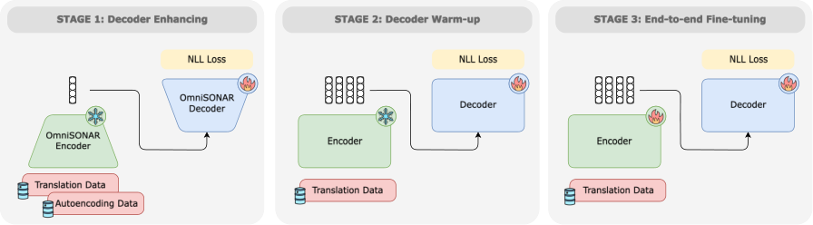

 Figure 7.1: Overview of the proposed algorithm to train OMT-NLLB model.

### 7.1 Leveraging an Aligned Encoder for Enhanced Decoder Training

##### Training Data.

For the first stage of our experiments, we use the data described in [Table 4.1](https://arxiv.org/html/2603.16309v3#S4.T1 "In 4.1 Main CPT Training Data Collection ‣ 4 Creating High-Quality Datasets ‣ Omnilingual MT: Machine Translation for 1,600 Languages"), which was curated for continual pretraining of our decoder-only model. We leverage the bilingual parallel data from this collection to train our model for translation using traditional supervised learning. Additionally, we incorporate the monolingual non-parallel data to train the model with an autoencoding objective.

##### Experimental Framework.

For our first experiments we employ the OmniSONAR codebase, keeping its original architecture but keeping the encoder frozen. We initialize our encoder and decoder using the ones from the OmniSONAR model. In our experiments, we set the training objective to Negative Log Likelihood in the Machine Translation and Autoencoding tasks. The batch size per GPU is set to 6k tokens per batch, and the models were trained on 16 nodes, of 8 A100 GPUs each. We utilize the AdamW optimizer ([Loshchilov and Hutter, 2019](https://arxiv.org/html/2603.16309v3#bib.bib106)). The learning rate is set to 0.001, and this first stage takes a total of 40k steps, including a learning rate warmup in the first 200.

##### Results.

We evaluate our approach both with and without the autoencoding (AE) objective to assess its contribution. As shown in [Table 7.1](https://arxiv.org/html/2603.16309v3#S7.T1 "In Final Results. ‣ 7.3 End-to-End Parallel Fine-Tuning ‣ 7 Encoder-Decoder Modeling ‣ Omnilingual MT: Machine Translation for 1,600 Languages"), our first-stage training shows that leveraging the cross-lingually aligned encoder for enhanced decoder training is effective.

The Decoder Enhancing MT variant, trained exclusively on parallel translation data while keeping the encoder frozen, shows improvements over the baseline OmniSONAR model. Furthermore, the Decoder Enhancing MT+AE experiment demonstrates larger performance improvements. By incorporating monolingual data through the autoencoding objective, the decoder is exposed to more linguistic diversity and becomes more robust across languages. These results confirm that exploiting monolingual data via the cross-lingually aligned OmniSONAR encoder provides an enhancement to decoder quality.

To understand if these gains are consistent, we further analyze performance specifically on languages for which we added substantial amounts of autoencoding data in Stage 1. [Figure 7.2](https://arxiv.org/html/2603.16309v3#S7.F2 "In Training Data. ‣ 7.2 Decoder Warm-up for Token-Level Cross-Attention ‣ 7 Encoder-Decoder Modeling ‣ Omnilingual MT: Machine Translation for 1,600 Languages") shows the performance of both Decoder Enhancing MT+AE and Decoder Enhancing MT models by language. We can see that the trend clearly shows that AE data improved the performance of those languages where it was added. In particular, the performance increased in 105 out of the 114 languages where AE data was added, with an average improvement of 5.20 chrF++ points. This confirms our hypothesis that autoencoding data is valuable for low-resource languages where parallel corpora are limited. However, we observe that the performance improvement of the overall model increases less than the performance of these specific languages, showing signs of the well-known Curse of Mulilinguality ([Aharoni et al., 2019](https://arxiv.org/html/2603.16309v3#bib.bib126); [Pfeiffer et al., 2022](https://arxiv.org/html/2603.16309v3#bib.bib127); [Alastruey et al., 2025](https://arxiv.org/html/2603.16309v3#bib.bib128)).

### 7.2 Decoder Warm-up for Token-Level Cross-Attention

##### Training Data.

In the second stage of our experiments, we train the model exclusively on the bilingual parallel data described in [Table 4.1](https://arxiv.org/html/2603.16309v3#S4.T1 "In 4.1 Main CPT Training Data Collection ‣ 4 Creating High-Quality Datasets ‣ Omnilingual MT: Machine Translation for 1,600 Languages"), removing the monolingual non-parallel data and its associated autoencoding component.

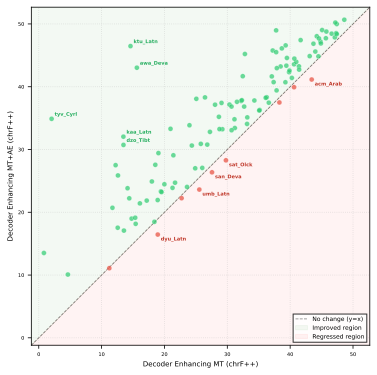

 Figure 7.2: ChrF++ improvements (English to target translation) in languages where autoencoding data is used. Points above the diagonal indicate languages in which autoencoding data helped to improve the performance of the model.

##### Experimental Framework.

For the second stage of our experiments we employ the OmniSONAR codebase, still keeping the encoder frozen but adding a custom adaptation to remove the original bottleneck. We initialize our model using the original OmniSONAR encoder and the enhanced decoder we obtained in the previous stage training with both translation and autoencoding data. We set the training objective to Negative Log Likelihood in only the Machine Translation task. The rest of the training setup remains the same as the one used during the Decoder Enhancing step.

##### Results.

The decoder warm-up stage, which removes the sentence-level pooling bottleneck and introduces token-level cross-attention, yields further improvements across all benchmarks, as shown in model Decoder Warm-up in [Table 7.1](https://arxiv.org/html/2603.16309v3#S7.T1 "In Final Results. ‣ 7.3 End-to-End Parallel Fine-Tuning ‣ 7 Encoder-Decoder Modeling ‣ Omnilingual MT: Machine Translation for 1,600 Languages"). By allowing the decoder to attend to the full sequence of encoder hidden states rather than a single pooled vector, the model can access fine-grained, token-level information that was previously lost in the bottleneck. Importantly, this warm-up phase, where only decoder parameters are updated, allows the model to adapt its cross-attention mechanism to reading full sequences without destabilizing the encoder representations. We observe that skipping this step causes training instabilities (exploding gradients) in the third training stage. Therefore, this warmup proves to be helpful in transitioning from the pooled to the non-pooled architecture, obtaining consistent gains over the Decoder Enhancing MT + AE baseline and making it possible to perform the final fine-tuning.

### 7.3 End-to-End Parallel Fine-Tuning

##### Training Data.

In the final stage of our experiments, we maintain the same training configuration as in the previous step, continuing to use only the bilingual parallel data described in [Table 4.1](https://arxiv.org/html/2603.16309v3#S4.T1 "In 4.1 Main CPT Training Data Collection ‣ 4 Creating High-Quality Datasets ‣ Omnilingual MT: Machine Translation for 1,600 Languages")

##### Experimental Framework.

For the last step of our training we employ our adapted OmniSONAR codebase to remove the bottleneck, but we unfreeze the whole system. We initialize the model using the original OmniSONAR encoder and the warmed-up enhanced decoder obtained in the end of the second stage. We set the training objective to Negative Log Likelihood in only the Machine Translation task, and we utilize the AdamW optimizer setting the learning rate is set to 0.0004. This last stage takes a total of 100k steps, including a learning rate warmup in the first 200. The rest of the training setup remains the same as the one used during the previous training stages.

##### Final Results.

The final OMT-NLLB model, after the end-to-end fine-tuning stage where both encoder and decoder are jointly updated on parallel data, produces the overall strongest results, as reported in [Table 7.1](https://arxiv.org/html/2603.16309v3#S7.T1 "In Final Results. ‣ 7.3 End-to-End Parallel Fine-Tuning ‣ 7 Encoder-Decoder Modeling ‣ Omnilingual MT: Machine Translation for 1,600 Languages"). By unfreezing the encoder, the model can now fully optimize the token-level interactions between encoder and decoder, adapting the encoder representations specifically for the translation task rather than relying solely on the pre-trained OmniSONAR alignment. Compared to the original OmniSONAR baseline and the following proposed training steps, our final model achieves notable improvements across all evaluation sets.

Overall, these results demonstrate that our three-stage training strategy successfully combines the benefits of cross-lingual alignment, monolingual data exploitation through autoencoding, and token-level encoder-decoder attention. The final OMT-NLLB model achieves substantial improvements over the OmniSONAR baseline while maintaining the same compact 3B parameter size, making it both effective and efficient for multilingual machine translation.

<table id="S7.T1.3" class="ltx_tabular ltx_centering ltx_align_middle">
<tr id="S7.T1.3.1" class="ltx_tr">
<td id="S7.T1.3.1.1" class="ltx_td ltx_border_tt" style="padding-left:3.0pt;padding-right:3.0pt;"></td>
<td id="S7.T1.3.1.2" class="ltx_td ltx_align_center ltx_border_tt" style="padding-left:3.0pt;padding-right:3.0pt;" colspan="3">FLoRes+</td>
<td id="S7.T1.3.1.3" class="ltx_td ltx_align_center ltx_border_tt" style="padding-left:3.0pt;padding-right:3.0pt;" colspan="3">Bible</td></tr>
<tr id="S7.T1.3.2" class="ltx_tr">
<td id="S7.T1.3.2.1" class="ltx_td ltx_align_left" style="padding-left:3.0pt;padding-right:3.0pt;">System</td>
<td id="S7.T1.3.2.2" class="ltx_td ltx_align_center ltx_border_t" style="padding-left:3.0pt;padding-right:3.0pt;">ChrF++ <math id="S7.T1.m1" class="ltx_Math" alttext="\uparrow" display="inline" intent=":literal"><semantics><mo stretchy="false">↑</mo><annotation encoding="application/x-tex">\uparrow</annotation></semantics></math></td>
<td id="S7.T1.3.2.3" class="ltx_td ltx_align_center ltx_border_t" style="padding-left:3.0pt;padding-right:3.0pt;">xCOMET <math id="S7.T1.m2" class="ltx_Math" alttext="\uparrow" display="inline" intent=":literal"><semantics><mo stretchy="false">↑</mo><annotation encoding="application/x-tex">\uparrow</annotation></semantics></math></td>
<td id="S7.T1.3.2.4" class="ltx_td ltx_align_center ltx_border_t" style="padding-left:3.0pt;padding-right:3.0pt;">MetricX <math id="S7.T1.m3" class="ltx_Math" alttext="\downarrow" display="inline" intent=":literal"><semantics><mo stretchy="false">↓</mo><annotation encoding="application/x-tex">\downarrow</annotation></semantics></math></td>
<td id="S7.T1.3.2.5" class="ltx_td ltx_align_center ltx_border_t" style="padding-left:3.0pt;padding-right:3.0pt;">ChrF++ <math id="S7.T1.m4" class="ltx_Math" alttext="\uparrow" display="inline" intent=":literal"><semantics><mo stretchy="false">↑</mo><annotation encoding="application/x-tex">\uparrow</annotation></semantics></math></td>
<td id="S7.T1.3.2.6" class="ltx_td ltx_align_center ltx_border_t" style="padding-left:3.0pt;padding-right:3.0pt;">xCOMET <math id="S7.T1.m5" class="ltx_Math" alttext="\uparrow" display="inline" intent=":literal"><semantics><mo stretchy="false">↑</mo><annotation encoding="application/x-tex">\uparrow</annotation></semantics></math></td>
<td id="S7.T1.3.2.7" class="ltx_td ltx_align_center ltx_border_t" style="padding-left:3.0pt;padding-right:3.0pt;">MetricX <math id="S7.T1.m6" class="ltx_Math" alttext="\downarrow" display="inline" intent=":literal"><semantics><mo stretchy="false">↓</mo><annotation encoding="application/x-tex">\downarrow</annotation></semantics></math></td></tr>
<tr id="S7.T1.3.3" class="ltx_tr">
<td id="S7.T1.3.3.1" class="ltx_td ltx_align_left ltx_border_t" style="padding-left:3.0pt;padding-right:3.0pt;">OmniSONAR</td>
<td id="S7.T1.3.3.2" class="ltx_td ltx_align_center ltx_border_t" style="padding-left:3.0pt;padding-right:3.0pt;">47.54</td>
<td id="S7.T1.3.3.3" class="ltx_td ltx_align_center ltx_border_t" style="padding-left:3.0pt;padding-right:3.0pt;">0.65</td>
<td id="S7.T1.3.3.4" class="ltx_td ltx_align_center ltx_border_t" style="padding-left:3.0pt;padding-right:3.0pt;">5.66</td>
<td id="S7.T1.3.3.5" class="ltx_td ltx_align_center ltx_border_t" style="padding-left:3.0pt;padding-right:3.0pt;">40.61</td>
<td id="S7.T1.3.3.6" class="ltx_td ltx_align_center ltx_border_t" style="padding-left:3.0pt;padding-right:3.0pt;">0.52</td>
<td id="S7.T1.3.3.7" class="ltx_td ltx_align_center ltx_border_t" style="padding-left:3.0pt;padding-right:3.0pt;">8.79</td></tr>
<tr id="S7.T1.3.4" class="ltx_tr">
<td id="S7.T1.3.4.1" class="ltx_td ltx_align_left ltx_border_t" style="padding-left:3.0pt;padding-right:3.0pt;">Decoder Enhancing MT</td>
<td id="S7.T1.3.4.2" class="ltx_td ltx_align_center ltx_border_t" style="padding-left:3.0pt;padding-right:3.0pt;">49.58</td>
<td id="S7.T1.3.4.3" class="ltx_td ltx_align_center ltx_border_t" style="padding-left:3.0pt;padding-right:3.0pt;">0.65</td>
<td id="S7.T1.3.4.4" class="ltx_td ltx_align_center ltx_border_t" style="padding-left:3.0pt;padding-right:3.0pt;">5.51</td>
<td id="S7.T1.3.4.5" class="ltx_td ltx_align_center ltx_border_t" style="padding-left:3.0pt;padding-right:3.0pt;">44.85</td>
<td id="S7.T1.3.4.6" class="ltx_td ltx_align_center ltx_border_t" style="padding-left:3.0pt;padding-right:3.0pt;">0.52</td>
<td id="S7.T1.3.4.7" class="ltx_td ltx_align_center ltx_border_t" style="padding-left:3.0pt;padding-right:3.0pt;">8.61</td></tr>
<tr id="S7.T1.3.5" class="ltx_tr">
<td id="S7.T1.3.5.1" class="ltx_td ltx_align_left" style="padding-left:3.0pt;padding-right:3.0pt;">Decoder Enhancing MT+AE</td>
<td id="S7.T1.3.5.2" class="ltx_td ltx_align_center" style="padding-left:3.0pt;padding-right:3.0pt;">49.74</td>
<td id="S7.T1.3.5.3" class="ltx_td ltx_align_center" style="padding-left:3.0pt;padding-right:3.0pt;">0.65</td>
<td id="S7.T1.3.5.4" class="ltx_td ltx_align_center" style="padding-left:3.0pt;padding-right:3.0pt;">5.48</td>
<td id="S7.T1.3.5.5" class="ltx_td ltx_align_center" style="padding-left:3.0pt;padding-right:3.0pt;">45.93</td>
<td id="S7.T1.3.5.6" class="ltx_td ltx_align_center" style="padding-left:3.0pt;padding-right:3.0pt;">0.53</td>
<td id="S7.T1.3.5.7" class="ltx_td ltx_align_center" style="padding-left:3.0pt;padding-right:3.0pt;">8.59</td></tr>
<tr id="S7.T1.3.6" class="ltx_tr">
<td id="S7.T1.3.6.1" class="ltx_td ltx_align_left ltx_border_t" style="padding-left:3.0pt;padding-right:3.0pt;">Decoder Warm-up</td>
<td id="S7.T1.3.6.2" class="ltx_td ltx_align_center ltx_border_t" style="padding-left:3.0pt;padding-right:3.0pt;">50.12</td>
<td id="S7.T1.3.6.3" class="ltx_td ltx_align_center ltx_border_t" style="padding-left:3.0pt;padding-right:3.0pt;">0.65</td>
<td id="S7.T1.3.6.4" class="ltx_td ltx_align_center ltx_border_t" style="padding-left:3.0pt;padding-right:3.0pt;">5.36</td>
<td id="S7.T1.3.6.5" class="ltx_td ltx_align_center ltx_border_t" style="padding-left:3.0pt;padding-right:3.0pt;">46.40</td>
<td id="S7.T1.3.6.6" class="ltx_td ltx_align_center ltx_border_t" style="padding-left:3.0pt;padding-right:3.0pt;">0.51</td>
<td id="S7.T1.3.6.7" class="ltx_td ltx_align_center ltx_border_t" style="padding-left:3.0pt;padding-right:3.0pt;">8.58</td></tr>
<tr id="S7.T1.3.7" class="ltx_tr">
<td id="S7.T1.3.7.1" class="ltx_td ltx_align_left ltx_border_bb ltx_border_t" style="padding-left:3.0pt;padding-right:3.0pt;">OMT-NLLB</td>
<td id="S7.T1.3.7.2" class="ltx_td ltx_align_center ltx_border_bb ltx_border_t" style="padding-left:3.0pt;padding-right:3.0pt;">50.92</td>
<td id="S7.T1.3.7.3" class="ltx_td ltx_align_center ltx_border_bb ltx_border_t" style="padding-left:3.0pt;padding-right:3.0pt;">0.66</td>
<td id="S7.T1.3.7.4" class="ltx_td ltx_align_center ltx_border_bb ltx_border_t" style="padding-left:3.0pt;padding-right:3.0pt;">5.32</td>
<td id="S7.T1.3.7.5" class="ltx_td ltx_align_center ltx_border_bb ltx_border_t" style="padding-left:3.0pt;padding-right:3.0pt;">46.28</td>
<td id="S7.T1.3.7.6" class="ltx_td ltx_align_center ltx_border_bb ltx_border_t" style="padding-left:3.0pt;padding-right:3.0pt;">0.50</td>
<td id="S7.T1.3.7.7" class="ltx_td ltx_align_center ltx_border_bb ltx_border_t" style="padding-left:3.0pt;padding-right:3.0pt;">8.61</td></tr>
</table>

 Table 7.1: Results of our proposed model on each training step of the proposed methodology compared to the original OmniSONAR

## 8 Proposed Evaluation Metrics and Dataset

Model evaluation constitutes a key contribution of the Omnilingual MT effort. The primary challenge we encounter is the limited reliability of current automatic metrics for long-tail languages, compounded by the lack of a robust methodology to assess metric quality in this context. In this section, we describe our contributions toward advancing Omnilingual MT evaluation. We present a variation of the previously established human evaluation protocol XSTS ([Licht et al., 2022](https://arxiv.org/html/2603.16309v3#bib.bib29)); the human annotations collected using this protocol, which constitute the largest dataset of human annotations in terms of language coverage, Met-BOUQuET; and the largest multilingually trained MT metric, BLASER 3. Finally, this section includes a comprehensive benchmarking of MT metrics using Met-BOUQuET, including our proposed BLASER 3, enabling us to quantify the reliability of several MT metrics across a broad representation of languages and language pairs.

### 8.1 Human Evaluation Protocol: XSTS+R+P

MT human evaluation is the most relevant way of comparing system performance but it is not free of challenges. Human evaluation is expensive, slow (or even unfeasible if annotators are not available) and its quality is highly dependent on the human evaluation protocol. In our case, we want a human evaluation that is easy enough to scale to a large number of languages, but still compatible with omnilinguality, by for example taking aspects as register, which is highly relevant across cultures, and context, which can reduce relevant ambiguities.

##### Related Work

Existing protocols include Direct Assessment (DA) ([Graham et al., 2013](https://arxiv.org/html/2603.16309v3#bib.bib37)), one of the simplest protocols that simply uses a single continuous rating scale of quality. Then, XSTS ([Licht et al., 2022](https://arxiv.org/html/2603.16309v3#bib.bib29)) which assesses the faithfulness of translations in a 5-likert scale and focuses on semantic similarity. Multidimensional Quality Metric (MQM) ([Lommel et al., 2024](https://arxiv.org/html/2603.16309v3#bib.bib39)) which is one of the most complex ones because it annotates each error span with its severity level and the error type selected from seven high-level error type dimensions. And most recently, Error Span Annotation (ESA) ([Kocmi et al., 2024b](https://arxiv.org/html/2603.16309v3#bib.bib38)) combines the continuous rating of DA with the high-level error severity span marking of MQM, without specifying error types. While MQM is by far the most complete and specific, which may cover most aspects of language varieties, it is quite complex and expensive. However, since we are aiming at omnilinguality, it is highly relevant that the protocol does not sacrifice sensitivity to omnilingual aspects of translation, avoiding covering only English-centric errors.

##### XSTS+R+P

Among the existing human evaluation protocols–DA, MQM, ESA, XSTS—we prioritized a well-documented protocol with an associated calibration method, which focuses on semantic equivalence rather than on error analysis. The XSTS protocol best meets these initial requirements. It offers higher inter-annotator agreement than DA, as shown in ([Licht et al., 2022](https://arxiv.org/html/2603.16309v3#bib.bib29)), and is easier to implement at omnilingual scale, where finding the expertise necessary to master MQM can prove challenging. However, using XSTS in its original formulation would preclude taking full advantage of two central aspects of the central evaluation dataset of our work (BOUQuET, section [4.4.1](https://arxiv.org/html/2603.16309v3#S4.SS4.SSS1 "4.4.1 BOUQuET ‣ 4.4 Evaluation Data ‣ 4 Creating High-Quality Datasets ‣ Omnilingual MT: Machine Translation for 1,600 Languages")): its language register diversity, and its paragraph-based design. To meet our full requirements, while building on XSTS, our proposed protocol, XSTS+R+P, specifies scoring criteria for two additional situations. First, it takes into account elements of pragmatics by indicating how annotators should rate register (R) discrepancies at the sentence level. Second, it provides annotators with a means to downgrade the rating of a translation that is semantically equivalent at the sentence level but causes confusion when considered at the paragraph (P) level (e.g., that is inconsistent in degree of formality, verb conjugation, or grammatical gender attribution with other sentences of the same paragraph). Detailed guidelines with examples are available in Appendix [B](https://arxiv.org/html/2603.16309v3#A2 "Appendix B Met-BOUQuET details ‣ Omnilingual MT: Machine Translation for 1,600 Languages").

##### Annotation and Calibrations Process

We commissioned XSTS+R+P language annotations across different vendors and checked all the deliveries we received. Each delivery contained three parts: the calibration file which had twenty annotations, the file with source-to-target annotations and the file with the opposite language direction. To ensure the quality of all those deliveries, we established a validation process which had three main steps. During the first step, we checked the calibration: we compared how well the ratings we received were aligned with the references we had prepared. We also studied all the comments left by the raters to ensure they were following the guidelines. For the most part, the comments proved to be relevant and showcased good understanding of the guidelines. However, in some cases we had to emphasize that the goal of the protocol was to only evaluate semantic similarity, not translation style and quality. During the second step, we studied the main part of the delivery (by bidirectional pairs) focusing on the paragraphs where the raters showed the most misalignment. We automatically highlighted the paragraphs where the deviation between the scores of different raters was equal or more than 2 (for example, one rater gave a sentence a score of 5, whereas another one gave it a score of 3). We looked at how many such rows there were: most deliveries had around 2% of rows showing annotation misalignment, and if this parameter was significantly higher than 3%, we sent the delivery back for rework. The common reasons which caused misalignment included, above all, different interpretation of the guidelines and edge cases, such as code-mixing and the presence of loan words in the target sentence. Finally, we spot-checked some of the rows manually to the best of our ability, especially if the misalignment for the row was apparent. We utilized machine translation where possible and checked if the rating was compliant with the guidelines we provided. We checked around 10% of all items that way.

To complement the manual validation process, we implemented automated checks across all language directions. For each direction, we computed pairwise exact match rates between annotators to detect potential duplication of annotations, and analyzed per-annotator score distributions using divergence metrics (Jensen-Shannon Divergence, Wasserstein Distance) and item-level statistics (Mean Absolute Error, bias, Spearman correlation) to identify outliers. Annotators flagged by these checks were manually reviewed, and deliveries with confirmed issues were returned to the vendor for rework.

##### Final score.

The sentence‑level consensus is the median of the three annotator ratings. Paragraph‑level scores are computed as the harmonic mean of the sentence‑level consensus values, chosen for its greater sensitivity to low‑scoring sentences than the arithmetic mean.

##### Protocol comparison

For protocol comparison we choose 7 language pairs and annotated 1358 BOUQuET sentences (dev and test partitions) on each pair (English-Russian, English-Spanish, English-Korean, English-Romanized Hindi, Hungarian-Czech, German-Croatian, French-Kinhasa Lingala). Linguistic considerations for pairs included: dominant word order, use of registers, number of grammatical genders and number of pairs with English. We controlled our protocol with the initial XSTS, for similarity, and RSQM, a simplified version of the MQM protocol.

###### Score Distribution

Figure [8.1](https://arxiv.org/html/2603.16309v3#S8.F1 "Figure 8.1 ‣ Score Distribution ‣ Protocol comparison ‣ 8.1 Human Evaluation Protocol: XSTS+R+P ‣ 8 Proposed Evaluation Metrics and Dataset ‣ Omnilingual MT: Machine Translation for 1,600 Languages") shows the distributions of scores for the three protocols. We notice that the distribution of XSTS+R+P is similar to XSTS’ but slightly less concentrated on the upper end. This hints at XSTS+R+P’s improved ability to provide additional nuance in the evaluation of translations. We also show the distribution of RSQM scores, projected within the same range as XSTS+R+P and XSTS. RSQM exhibits a distinctively skewed distribution, with a significant concentration on higher scores. To compare RSQM scores (range \([0,100]\)) with XSTS+R+P scores (range \([1,5]\)), we define \(RSQM_{\text{rnd}}\) as a linear projection of RSQM onto the \([1,5]\) scale, rounded to the nearest integer:

\[\begin{aligned}
 & \text{RSQM}_{\text{rnd}}=\text{round}\left(0.04\times\text{RSQM}+1\right) &  & \text{(1)}
\end{aligned}\]

 

Computing the correlation, we see that XSTS+R+P is strongly and positively correlated with XSTS (0.65) and RSQM (0.62) on terms of Kendall’s Tau.

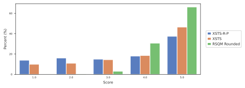

 Figure 8.1: Score Distribution of XSTS+R+P, XSTS and RSQMrnd.

###### Inter-Annotator Agreement

Table [8.1](https://arxiv.org/html/2603.16309v3#S8.T1 "Table 8.1 ‣ Inter-Annotator Agreement ‣ Protocol comparison ‣ 8.1 Human Evaluation Protocol: XSTS+R+P ‣ 8 Proposed Evaluation Metrics and Dataset ‣ Omnilingual MT: Machine Translation for 1,600 Languages") shows the inter-annotator agreement (IAA) calculated with Krippendorf α using the squared distance penalty. Our inter-annotator agreement results are broadly consistent with, and in several cases exceed, values reported in the literature for comparable translation evaluation frameworks [Song et al. (2025)](https://arxiv.org/html/2603.16309v3#bib.bib120) and [Licht et al. (2022)](https://arxiv.org/html/2603.16309v3#bib.bib29). Crucially, our proposed XSTS+R+P protocol achieves a substantially higher mean Krippendorff’s α of 0.80, representing a marked improvement over both our baseline protocols and the agreement levels typically reported in the translation evaluation literature. These findings indicate that XSTS+R+P provides a more reliable and reproducible framework for cross-lingual translation quality assessment.

Direction | XSTS+R+P | XSTS | RSQM  
---|---|---|---  
Czech\(\rightarrow\)Hungarian | 0.86 | 0.52 | 0.40  
German\(\rightarrow\)Croatian | 0.89 | 0.72 | 0.49  
English\(\rightarrow\)Korean | 0.67 | 0.54 | 0.52  
English\(\rightarrow\)Russian | 0.60 | 0.51 | 0.43  
English\(\rightarrow\)Spanish | 0.71 | 0.53 | 0.47  
French\(\rightarrow\)Kinshasa Lingala | 0.90 | 0.77 | 0.51  
French\(\rightarrow\)Swahili | 0.84 | 0.36 | 0.22  
Croatian\(\rightarrow\)German | 0.90 | 0.67 | 0.49  
Hungarian\(\rightarrow\)Czech | 0.91 | 0.53 | 0.27  
Korean\(\rightarrow\)English | 0.70 | 0.60 | 0.59  
Kinshasa Lingala\(\rightarrow\)French | 0.88 | 0.68 | 0.57  
Russian\(\rightarrow\)English | 0.58 | 0.65 | 0.49  
Spanish\(\rightarrow\)English | 0.82 | 0.34 | 0.48  
Swahili\(\rightarrow\)French | 0.91 | 0.51 | 0.26  
Mean | 0.80 | 0.57 | 0.44

 Table 8.1: Inter-annotator agreement (IAA) for different language directions, calculated with Krippendorf α using the squared distance penalty. Best results in bold.

###### Differences between Protocols

Using BOUQuET sentences gives us the unique opportunity to compare the differences between XSTS+R+P and XSTS protocols across domains but also across three functional areas of register: connectedness, preparedness, and social differential. See Figure 5 in [The Omnilingual MT Team et al. (2025)](https://arxiv.org/html/2603.16309v3#bib.bib147) for deeper explanation of register. We observe that, for the same translations, the average absolute difference in scores between protocols varies according to the social differential present in the sentence. As expected, translations where the speaker addresses someone of higher social status (lower-to-higher social differential) are penalized most by XSTS+R+P compared to XSTS, while those where the speaker addresses someone of lower status (higher-to-lower social differential) receive the least penalty. Additionally, we find a clear trend: as the length of the source segment increases, the penalty imposed by XSTS+R+P also grows. Overall, XSTS+R+P scores tend to diverge (decrease relative to XSTS) as both the context size and the social differential increase.

### 8.2 Met-BOUQuET

##### Motivation

While making Machine Translation (MT) more and more massively multilingual, MT metrics have to continue evolving to meet the needs of the field. Met-BOUQuET is contributing towards this end by presenting a highly multilingual, multi-way parallel annotation dataset and benchmark for MT evaluation metrics and quality estimation. This dataset is designed in two different rounds with complimentary rationales. The first round rationale was to collect a variety of systems outputs to optimise for a variety of translation errors and diverse quality annotations. The second round was designed to a selection of our best decoder-only systems (OMT-LLaMA) to strongest external baseline systems (following automatic evaluation). The language selection optimised for language and language direction coverage. Annotations were done based on XSTS+R+P (Section [8.1](https://arxiv.org/html/2603.16309v3#S8.SS1 "8.1 Human Evaluation Protocol: XSTS+R+P ‣ 8 Proposed Evaluation Metrics and Dataset ‣ Omnilingual MT: Machine Translation for 1,600 Languages")).

##### Related work

While WMT competitions ([Kocmi et al., 2025](https://arxiv.org/html/2603.16309v3#bib.bib64)) provide a powerful arena to evaluate MT metrics, the dataset developed there has its own challenges. Originally, the metric evaluation benchmark was designed to evaluate MT systems and not metrics themselves. This means that covered languages are not necessarily representative enough to cover linguistic families. Additionally, competitions’ rules vary year to year, meaning that collections that are derived from them have some mismatches such as several protocols and close to random collection of languages. However, there are indeed other collections that have been created and designed for the purpose of metric evaluation which do not have these challenges but are more limited in size. This includes MLQE-DA-PE ([Fomicheva et al., 2022](https://arxiv.org/html/2603.16309v3#bib.bib36)) and the Indic collection ([Sai B et al., 2023](https://arxiv.org/html/2603.16309v3#bib.bib27)). Rarely, the existing datasets share the same source sentences across several source languages which some exceptions e.g. NLLB ([NLLB Team et al., 2024](https://arxiv.org/html/2603.16309v3#bib.bib146)), with the aim of making the dataset the closest to multi-way parallel that it can be. Note that we cannot aim at having fully multi-way parallel dataset because the MT outputs differ for each language pair translation. The motivation for close to-multi-way parallel, hereinafter we will avoid “close” for simplicity, is the same as in for MT evaluation which is comparing the performance across languages.

##### BOUQuET Dataset selection Round 1

Additional motivations to construct an MT metric evaluation data set is the need to do it in one of the latest MT evaluation sets BOUQuET [The Omnilingual MT Team et al. (2025)](https://arxiv.org/html/2603.16309v3#bib.bib147), described in section [4.4.1](https://arxiv.org/html/2603.16309v3#S4.SS4.SSS1 "4.4.1 BOUQuET ‣ 4.4 Evaluation Data ‣ 4 Creating High-Quality Datasets ‣ Omnilingual MT: Machine Translation for 1,600 Languages"). BOUQuET in addition to being highly multilingual and constantly expanding through its online contribution tool2323 23 https://bouquet.metademolab.com/, it has other interesting characteristics, which are relevant for building a MT metrics dataset including diversity of domains and registers and non-English-centric data, among others. For this round, we use the dev (564 sentences) and test (854 sentences) partitions of BOUQuET.

##### BOUQuET Dataset selection Round 2

Again, we evaluate the outputs on the BOUQuET dataset.Differently from Round 1, we prioritise the test partition (854 sentences), to optimize the annotations budget that we have with more language pairs evaluated and two outputs per source sentence. The second round was intended as a part of evaluation study of the OMT-LLaMA models (see Section [9.2](https://arxiv.org/html/2603.16309v3#S9.SS2 "9.2 Human Evaluation ‣ 9 MT Results ‣ Omnilingual MT: Machine Translation for 1,600 Languages")), so for each translation, we annotated the translations from one OMT-based system (either OMT-LLaMA or a system based on Omnilingual MT retrieval-augmented translation) and from one external baseline system.

##### Language selection Round 1 and 2

Met-BOUQuET covers a diversity in language directions. The criteria to choose those language directions are mainly guided by the languages available in BOUQuET (see Table 6 in ([The Omnilingual MT Team et al., 2025](https://arxiv.org/html/2603.16309v3#bib.bib147))) that cover a wide range of high and extremely low resource languages representing a wide variety of language families and geographical regions. To choose language pairs, and the complete list of language pairs is reported in Table [D](https://arxiv.org/html/2603.16309v3#A4 "Appendix D Languages at a glance ‣ Omnilingual MT: Machine Translation for 1,600 Languages"), we are motivated by:

  * Language pairs need to have a source language available in Bouquet. 
  * Optimize for a large number of languages evaluated, do not limit to having bidirectional pairs so that we can include languages that are not in BOUQuET as target languages. 
  * Optimize for non-English pairs and use pivot languages instead, to follow the BOUQuET non-English-centric criteria 
  * Include a variability of likely-zero-shot languages so that we are able to study what should be the lowest performing languages. 
  * Include a variability of internal priority languages. 
  * Include languages available in MeDLEy, so that we can explore its effectiveness in likely-zero-shot languages and low-resource languages. 
  * Do final selection to optimize for a diverse range of language families and language scripts. 

Specifically, we end up covering 104 language directions in Round 1 and 57 language directions, mostly complimentary to Round 1, in Round 2. In total, Met-BOUQuET currently covers 161 language directions and 119 unique language varieties.

Pairs were formed based on known or likely patterns of bilingualism between source and target languages due to geographical adjacency (including pairings of subnational languages with a regional lingua franca or a national language of wider/official communication).

##### MT Systems and Outputs Considered Round 1

We aim to cover a variety of errors and also provide a diversity of scores. The WMT data provide a large number of systems, but this is not the case for other benchmarks MLQE-PE ([Fomicheva et al., 2022](https://arxiv.org/html/2603.16309v3#bib.bib36)), IndicMT ([Sai B et al., 2023](https://arxiv.org/html/2603.16309v3#bib.bib27)) and NLLB data ([NLLB Team et al., 2024](https://arxiv.org/html/2603.16309v3#bib.bib146)). In our case, we prioritize a variety of open systems which cover a wide range of languages. We include a variation of open systems and early variations of OMT-LLaMA, all of them reported in Table [8.2](https://arxiv.org/html/2603.16309v3#S8.T2 "Table 8.2 ‣ MT Systems and Outputs Considered Round 2 ‣ 8.2 Met-BOUQuET ‣ 8 Proposed Evaluation Metrics and Dataset ‣ Omnilingual MT: Machine Translation for 1,600 Languages"). For each source sentence and translation direction, we sampled exactly one output translation, trying to balance the representation of various levels of translation quality and the diversity of systems. Exact details on the selection of MT outputs can be found on appendix [B](https://arxiv.org/html/2603.16309v3#A2 "Appendix B Met-BOUQuET details ‣ Omnilingual MT: Machine Translation for 1,600 Languages").

##### MT Systems and Outputs Considered Round 2

For each direction, we evaluate two main systems of interest to compare: the strongest external baseline (one of Gemma-3 27B, MADLAD-400-MT-10B, Aya-101 13B, Aya-Expanse 8B, EuroLLM 9B) and the strongest of several OMT-LLaMA-based systems (OMT-LLaMA 8B with or without RAG examples, and in a few cases, vanilla LLaMA3 70B with the Omnilingual MT RAG examples). To select the two candidate systems for each direction, we use the dev split of BOUQuET and a combination of automated metrics: the average of normalized BLASER 3 (reported in Section [8.3](https://arxiv.org/html/2603.16309v3#S8.SS3 "8.3 BLASER 3 ‣ 8 Proposed Evaluation Metrics and Dataset ‣ Omnilingual MT: Machine Translation for 1,600 Languages") and MetricX scores and, when references are available, ChrF++ scores. See table [8.2](https://arxiv.org/html/2603.16309v3#S8.T2 "Table 8.2 ‣ MT Systems and Outputs Considered Round 2 ‣ 8.2 Met-BOUQuET ‣ 8 Proposed Evaluation Metrics and Dataset ‣ Omnilingual MT: Machine Translation for 1,600 Languages") for a summary of system selection and outputs considered as well as the goal and setup of each Round.

<table id="S8.T2.3" class="ltx_tabular ltx_centering ltx_align_middle">
<tr id="S8.T2.3.1" class="ltx_tr">
<td id="S8.T2.3.1.1" class="ltx_td ltx_align_left ltx_border_t">Category</td>
<td id="S8.T2.3.1.2" class="ltx_td ltx_align_left ltx_border_t">Model Version</td>
<td id="S8.T2.3.1.3" class="ltx_td ltx_align_left ltx_border_t">Params</td>
<td id="S8.T2.3.1.4" class="ltx_td ltx_align_left ltx_border_t">Citation Reference</td></tr>
<tr id="S8.T2.3.2" class="ltx_tr">
<td id="S8.T2.3.2.1" class="ltx_td ltx_align_left ltx_border_t" rowspan="6">Open Systems</td>
<td id="S8.T2.3.2.2" class="ltx_td ltx_align_left ltx_border_t">NLLB-200</td>
<td id="S8.T2.3.2.3" class="ltx_td ltx_align_left ltx_border_t">3B</td>
<td id="S8.T2.3.2.4" class="ltx_td ltx_align_left ltx_border_t"><cite class="ltx_cite ltx_citemacro_citep">(<a href="https://arxiv.org/html/2603.16309v3#bib.bib146" title="" class="ltx_ref">NLLB Team et al., 2024</a>)</cite></td></tr>
<tr id="S8.T2.3.3" class="ltx_tr">
<td id="S8.T2.3.3.1" class="ltx_td ltx_align_left">LLaMA3</td>
<td id="S8.T2.3.3.2" class="ltx_td ltx_align_left">3B, 8B, 70B</td>
<td id="S8.T2.3.3.3" class="ltx_td ltx_align_left"><cite class="ltx_cite ltx_citemacro_citep">(<a href="https://arxiv.org/html/2603.16309v3#bib.bib67" title="" class="ltx_ref">AI@Meta, 2024</a>)</cite></td></tr>
<tr id="S8.T2.3.4" class="ltx_tr">
<td id="S8.T2.3.4.1" class="ltx_td ltx_align_left">TowerInstruct v02</td>
<td id="S8.T2.3.4.2" class="ltx_td ltx_align_left">7B</td>
<td id="S8.T2.3.4.3" class="ltx_td ltx_align_left"><cite class="ltx_cite ltx_citemacro_citep">(<a href="https://arxiv.org/html/2603.16309v3#bib.bib68" title="" class="ltx_ref">Alves et al., 2024b</a>)</cite></td></tr>
<tr id="S8.T2.3.5" class="ltx_tr">
<td id="S8.T2.3.5.1" class="ltx_td ltx_align_left">Aya-101</td>
<td id="S8.T2.3.5.2" class="ltx_td ltx_align_left">13B</td>
<td id="S8.T2.3.5.3" class="ltx_td ltx_align_left"><cite class="ltx_cite ltx_citemacro_citep">(<a href="https://arxiv.org/html/2603.16309v3#bib.bib70" title="" class="ltx_ref">Üstün et al., 2024</a>)</cite></td></tr>
<tr id="S8.T2.3.6" class="ltx_tr">
<td id="S8.T2.3.6.1" class="ltx_td ltx_align_left">Aya Expanse</td>
<td id="S8.T2.3.6.2" class="ltx_td ltx_align_left">8B</td>
<td id="S8.T2.3.6.3" class="ltx_td ltx_align_left"><cite class="ltx_cite ltx_citemacro_citep">(<a href="https://arxiv.org/html/2603.16309v3#bib.bib69" title="" class="ltx_ref">Dang et al., 2024</a>)</cite></td></tr>
<tr id="S8.T2.3.7" class="ltx_tr">
<td id="S8.T2.3.7.1" class="ltx_td ltx_align_left">Cohere R</td>
<td id="S8.T2.3.7.2" class="ltx_td ltx_align_left">7B</td>
<td id="S8.T2.3.7.3" class="ltx_td ltx_align_left"><cite class="ltx_cite ltx_citemacro_citep">(<a href="https://arxiv.org/html/2603.16309v3#bib.bib71" title="" class="ltx_ref">Cohere et al., 2025</a>)</cite></td></tr>
<tr id="S8.T2.3.8" class="ltx_tr">
<td id="S8.T2.3.8.1" class="ltx_td"></td>
<td id="S8.T2.3.8.2" class="ltx_td ltx_align_left">Qwen 2.5</td>
<td id="S8.T2.3.8.3" class="ltx_td ltx_align_left">7B</td>
<td id="S8.T2.3.8.4" class="ltx_td ltx_align_left"><cite class="ltx_cite ltx_citemacro_citep">(<a href="https://arxiv.org/html/2603.16309v3#bib.bib74" title="" class="ltx_ref">Yang et al., 2024</a>; <a href="https://arxiv.org/html/2603.16309v3#bib.bib72" title="" class="ltx_ref">Team, 2024</a>)</cite></td></tr>
<tr id="S8.T2.3.9" class="ltx_tr">
<td id="S8.T2.3.9.1" class="ltx_td"></td>
<td id="S8.T2.3.9.2" class="ltx_td ltx_align_left">EuroLLM</td>
<td id="S8.T2.3.9.3" class="ltx_td ltx_align_left">9B</td>
<td id="S8.T2.3.9.4" class="ltx_td ltx_align_left"><cite class="ltx_cite ltx_citemacro_citep">(<a href="https://arxiv.org/html/2603.16309v3#bib.bib75" title="" class="ltx_ref">Martins et al., 2024</a>)</cite></td></tr>
<tr id="S8.T2.3.10" class="ltx_tr">
<td id="S8.T2.3.10.1" class="ltx_td"></td>
<td id="S8.T2.3.10.2" class="ltx_td ltx_align_left">Babel-9B-chat</td>
<td id="S8.T2.3.10.3" class="ltx_td ltx_align_left">9B</td>
<td id="S8.T2.3.10.4" class="ltx_td ltx_align_left"><cite class="ltx_cite ltx_citemacro_citep">(<a href="https://arxiv.org/html/2603.16309v3#bib.bib73" title="" class="ltx_ref">Zhao et al., 2025</a>)</cite></td></tr>
<tr id="S8.T2.3.11" class="ltx_tr">
<td id="S8.T2.3.11.1" class="ltx_td"></td>
<td id="S8.T2.3.11.2" class="ltx_td ltx_align_left">MADLAD-400-MT</td>
<td id="S8.T2.3.11.3" class="ltx_td ltx_align_left">3B, 10B</td>
<td id="S8.T2.3.11.4" class="ltx_td ltx_align_left"><cite class="ltx_cite ltx_citemacro_citep">(<a href="https://arxiv.org/html/2603.16309v3#bib.bib156" title="" class="ltx_ref">Kudugunta et al., 2023</a>)</cite></td></tr>
<tr id="S8.T2.3.12" class="ltx_tr">
<td id="S8.T2.3.12.1" class="ltx_td ltx_align_left ltx_border_t" rowspan="4">OMT-LLaMA Systems</td>
<td id="S8.T2.3.12.2" class="ltx_td ltx_align_left ltx_border_t">OMT-LLaMA (FT)</td>
<td id="S8.T2.3.12.3" class="ltx_td ltx_align_left ltx_border_t">3B, 8B</td>
<td id="S8.T2.3.12.4" class="ltx_td ltx_align_left ltx_border_t">Section <a href="https://arxiv.org/html/2603.16309v3#S6.SS3" title="6.3 Post-training ‣ 6 Decoder-only Modeling ‣ Omnilingual MT: Machine Translation for 1,600 Languages" class="ltx_ref">6.3</a></td></tr>
<tr id="S8.T2.3.13" class="ltx_tr">
<td id="S8.T2.3.13.1" class="ltx_td ltx_align_left">Step-by-Step</td>
<td id="S8.T2.3.13.2" class="ltx_td ltx_align_left">8B, 70B</td>
<td id="S8.T2.3.13.3" class="ltx_td ltx_align_left"><cite class="ltx_cite ltx_citemacro_citep">(<a href="https://arxiv.org/html/2603.16309v3#bib.bib35" title="" class="ltx_ref">Briakou et al., 2024</a>)</cite></td></tr>
<tr id="S8.T2.3.14" class="ltx_tr">
<td id="S8.T2.3.14.1" class="ltx_td ltx_align_left">OMT RAG (Low-res)</td>
<td id="S8.T2.3.14.2" class="ltx_td ltx_align_left">70B</td>
<td id="S8.T2.3.14.3" class="ltx_td ltx_align_left">Section <a href="https://arxiv.org/html/2603.16309v3#S6.SS4" title="6.4 Retrieval-Augmented Translation ‣ 6 Decoder-only Modeling ‣ Omnilingual MT: Machine Translation for 1,600 Languages" class="ltx_ref">6.4</a></td></tr>
<tr id="S8.T2.3.15" class="ltx_tr">
<td id="S8.T2.3.15.1" class="ltx_td ltx_align_left">OmniSONAR</td>
<td id="S8.T2.3.15.2" class="ltx_td ltx_align_left">–</td>
<td id="S8.T2.3.15.3" class="ltx_td ltx_align_left"><cite class="ltx_cite ltx_citemacro_citep">(<a href="https://arxiv.org/html/2603.16309v3#bib.bib105" title="" class="ltx_ref">Omnilingual SONAR Team et al., 2026</a>)</cite></td></tr>
<tr id="S8.T2.3.16" class="ltx_tr">
<td id="S8.T2.3.16.1" class="ltx_td ltx_align_left ltx_border_t">Round 1 Goal</td>
<td id="S8.T2.3.16.2" class="ltx_td ltx_align_left ltx_border_t" colspan="3">Maximize diversity of systems, error types, and score ranges.</td></tr>
<tr id="S8.T2.3.17" class="ltx_tr">
<td id="S8.T2.3.17.1" class="ltx_td ltx_align_left">Round 1 Setup</td>
<td id="S8.T2.3.17.2" class="ltx_td ltx_align_left" colspan="3">Sampled exactly one output translation per source sentence/direction.</td></tr>
<tr id="S8.T2.3.18" class="ltx_tr">
<td id="S8.T2.3.18.1" class="ltx_td ltx_align_left ltx_border_t">Round 2 Goal</td>
<td id="S8.T2.3.18.2" class="ltx_td ltx_align_left ltx_border_t" colspan="3">Comparison between the strongest baseline and strongest OMT system.</td></tr>
<tr id="S8.T2.3.19" class="ltx_tr">
<td id="S8.T2.3.19.1" class="ltx_td ltx_align_left">Round 2 Baselines</td>
<td id="S8.T2.3.19.2" class="ltx_td ltx_align_left" colspan="3">Gemma-3 27B, MADLAD 10B, Aya-101/Expanse, EuroLLM 9B.</td></tr>
<tr id="S8.T2.3.20" class="ltx_tr">
<td id="S8.T2.3.20.1" class="ltx_td ltx_align_left ltx_border_b">Round 2 Metrics</td>
<td id="S8.T2.3.20.2" class="ltx_td ltx_align_left ltx_border_b" colspan="3">Avg. of normalized Blaser and MetricX; ChrF++ (if refs available).</td></tr>
</table>

 Table 8.2: Summary of MT Systems (not including small variants of each), Selection Methodology and setup and goals of Round 1 and Round 2

##### Statistics Round 1

Following the XSTS+R+P protocol, we collect 1358 sentence annotations (318 paragraphs) which correspond to the BOUQuET dev and test partitions2424 24 Note that the [The Omnilingual MT Team et al. (2025)](https://arxiv.org/html/2603.16309v3#bib.bib147) paper reports incorrectly the number of test sentences (10 sentences more than it has) for 53 languages and 104 language directions from 31 different MT systems.

##### Statistics Round 2

In this round, we collect annotations of 854 sentences translated in 57 directions between 80 unique languages, with each sentence translated by two systems. We use stronger MT systems and do not perform adversarial sampling, unlike in the first round, but we also choose more challenging translation directions.2525 25 For several translation directions with extremely low-resourced source or target languages, we had to cancel the annotation after receiving over 80% of lowest score in the first annotation batch, indicating that both systems fail to produce even minimally meaningful translations. They were therefore excluded from Round 2. As a result, the distribution of XSTS+R+P scores in the two rounds is roughly the same, with the average score of 3.0 and about 30% of the scores in the “very low” and “very high” areas each.

##### Preference annotations as a by-product

Because each sentence in Round 2 has been translated in each target language twice, the resulting annotated dataset can be viewed as a dataset of human preferences (induced from the human labels indirectly, because the alternative translations were not shown to the annotators side-by-side). Out of the \(\approx\)49K annotated translation pairs, 57% have different consensus scores and therefore express a preference.

##### Available annotations.

The complete Met-BOUQuET is available as part of BOUQuET effort.2626 26 See <https://huggingface.co/datasets/facebook/bouquet>. Note that Met-BOUQuET similarly to BOUQuET, is dynamic and we are constantly extending it new languages. The data includes both rounds of XSTS+R+P annotations, as well as the experimental annotations of a subset of Round 1 data with XSTS and RSQM protocols that were used in Section [8.1](https://arxiv.org/html/2603.16309v3#S8.SS1 "8.1 Human Evaluation Protocol: XSTS+R+P ‣ 8 Proposed Evaluation Metrics and Dataset ‣ Omnilingual MT: Machine Translation for 1,600 Languages"). Comparison to other datasets as well as details on score distribution are reported on appendix [B](https://arxiv.org/html/2603.16309v3#A2 "Appendix B Met-BOUQuET details ‣ Omnilingual MT: Machine Translation for 1,600 Languages") showing that Met-BOUQuET uniquely contains 73% of directions without English (118 directions).

### 8.3 BLASER 3

State-of-the-art reference-free quality estimation (QE) metrics, like xCOMET ([Guerreiro et al., 2024b](https://arxiv.org/html/2603.16309v3#bib.bib40)) and MetricX-24 ([Juraska et al., 2024](https://arxiv.org/html/2603.16309v3#bib.bib45)), despite being powerful, have several limitations. Specifically: (1) they are not multilingual enough, being trained on a handful of directions; (2) they have limited zero-shot cross-lingual generation power to unseen languages, since the base encoders XLM-R ([Conneau et al., 2020](https://arxiv.org/html/2603.16309v3#bib.bib62)) or mT5 ([Xue et al., 2021](https://arxiv.org/html/2603.16309v3#bib.bib61)) are fully finetuned; and (3) they can only handle a single evaluation protocol,2727 27 DA scores are used during pre-training, or converted to the MQM scale during finetuning. MQM ([Lommel et al., 2013](https://arxiv.org/html/2603.16309v3#bib.bib133)), restricting generalization and limiting training resources. Given these constraints, they are not ideal candidates for evaluating omnilingual translation. Thus, we take a first step towards omnilingual QE, by proposing BLASER 3, a highly multilingual and multi-protocol metric build. Like its predecessor ([Dale and Costa-jussà, 2024a](https://arxiv.org/html/2603.16309v3#bib.bib41)), it is build on top of cross-lingual embeddings from SONAR ([Duquenne et al., 2023a](https://arxiv.org/html/2603.16309v3#bib.bib44)), where now we use OmniSONAR ([Omnilingual SONAR Team et al., 2026](https://arxiv.org/html/2603.16309v3#bib.bib105)), unlocking the potential to generalize to thousands of languages. To further push the multilinguality capacity of our proposed QE model, we train it with multi-task learning on several evaluation protocols, and on a mix of real and synthetic data, covering hundreds of directions.

#### 8.3.1 Related Work

Reference‑free quality estimation (QE) aims to predict translation quality without relying on a human reference. Over the past decade the field has moved from simple lexical proxies to deep contextual models that can be deployed at runtime. Learnable Surface‑Form Metrics train a model on human‑rated QE data using shallow features (e.g. QuEst ([Specia et al., 2013](https://arxiv.org/html/2603.16309v3#bib.bib13)) and QT21 ([Rei et al., 2021](https://arxiv.org/html/2603.16309v3#bib.bib14))). Neural Sentence‑Embedding metrics embed source and hypothesis sentences in a shared semantic space and compute a similarity score e.g. COMET ([Rei et al., 2020](https://arxiv.org/html/2603.16309v3#bib.bib15)), SentSim ([Rei et al., 2022a](https://arxiv.org/html/2603.16309v3#bib.bib16)), PRISM ([Thompson et al., 2020](https://arxiv.org/html/2603.16309v3#bib.bib17)). Zero‑Shot and Prompt‑Based Methods leverage large language models (LLMs) without any task‑specific fine‑tuning e.g. InstructScore ([Lu et al., 2023](https://arxiv.org/html/2603.16309v3#bib.bib18)), GPT‑QE ([Kumar et al., 2023b](https://arxiv.org/html/2603.16309v3#bib.bib19)). Finally, Hybrid and Ensemble metrics combine the strengths of different reference‑free signals e.g. QE‑Ensemble ([Fernandes et al., 2023](https://arxiv.org/html/2603.16309v3#bib.bib20)), e.g. OpenKi ([Liu et al., 2021](https://arxiv.org/html/2603.16309v3#bib.bib21)). Overall, reference‑free metrics have progressed from hand‑crafted feature sets to end‑to‑end neural regressors and, most recently, to zero‑shot LLM prompts.

#### 8.3.2 Methodology

 

(a) Architecture of BLASER 3.

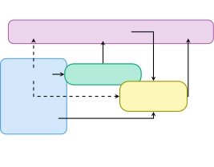

 

(b) Approach for synthetic QE example generation.

Figure 8.2: BLASER 3 Methodology

##### Task

QE data are triplets of (\(\text{src}^{(x)}\), \(\text{mt}^{(y)}\), \(s^{(i)}\)), where \(\text{src}^{(x)}\) is the source text in language \(x\), \(\text{mt}^{(y)}\) is the translation hypothesis text in language \(y\), and \(s^{(i)}\in\mathbb{R}\) is the human annotation score for the pair (\(\text{src}^{(x)}\), \(\text{mt}^{(y)}\)), according to an evaluation protocol \(i\) (e.g. MQM, XSTS). The task of reference-free QE aims to learn a model to predict \(s^{(i)}\) given the pair (\(\text{src}^{(x)}\), \(\text{mt}^{(y)}\)).

##### Architecture

The architecture of BLASER 3 is illustrated in [Figure 8.2(a)](https://arxiv.org/html/2603.16309v3#S8.F2.sf1 "In Figure 8.2 ‣ 8.3.2 Methodology ‣ 8.3 BLASER 3 ‣ 8 Proposed Evaluation Metrics and Dataset ‣ Omnilingual MT: Machine Translation for 1,600 Languages"). We use (frozen) OmniSONAR to extract cross-lingual embeddings \(\mathbf{e}^{\text{src}},\mathbf{e}^{\text{mt}}\in\mathbb{R}^{d_{s}}\) for the source and hypothesis, where \(d_{s}\) is the dimensionality of the OmniSONAR embedding space. The two individual embeddings, together with two element-wise interaction embeddings, are concatenated to obtain obtain \(\mathbf{e}^{\text{input}}\in\mathbb{R}^{4d_{s}}\) as in:

\[\begin{aligned}
 & \mathbf{e}^{\text{input}}=\mathbf{e}^{\text{src}};\mathbf{e}^{\text{mt}};|\mathbf{e}^{\text{src}}-\mathbf{e}^{\text{mt}}|;\mathbf{e}^{\text{src}}\odot\mathbf{e}^{\text{mt}}, &  & \text{(2)}
\end{aligned}\]

 

where ; denotes horizontal concatenation, and \(\odot\) denotes element-wise multiplication. The input \(\mathbf{e}^{\text{input}}\) is passed through a two-layer MLP \([4d_{s}\rightarrow d_{h}\rightarrow d_{o}]\) to obtain an output embedding \(\mathbf{c}\in\mathbb{R}^{d_{o}}\). According to the protocol of each example, the output embedding is routed through the corresponding regression head \(\text{Head}_{i}\), which is a linear layer \(d_{o}\rightarrow 1\) that predicts the QE score \(\hat{s}^{(i)}\in\mathbb{R}\). The MLP and protocol head parameters are optimized with an MSE loss: \(\mathcal{L}_{\text{mse}}=||s^{(i)}-\hat{s}^{(i)}||^{2}\).

##### Synthetic Examples

QE datasets are not very multilingual nor diverse, usually covering a couple of directions and domains ([Blain et al., 2023](https://arxiv.org/html/2603.16309v3#bib.bib131); [Zerva et al., 2024](https://arxiv.org/html/2603.16309v3#bib.bib132)), with some exceptions specifically for the XSTS protocol [NLLB Team et al. (2024)](https://arxiv.org/html/2603.16309v3#bib.bib146). Although our model can take advantage of multiple data sources due to its multi-tasking nature, ideally we would like to cover more languages, for which there is no QE data availability. Thus, we propose a synthetic data generation pipeline using MT models and reference-based QE ([Figure 8.2(b)](https://arxiv.org/html/2603.16309v3#S8.F2.sf2 "In Figure 8.2 ‣ 8.3.2 Methodology ‣ 8.3 BLASER 3 ‣ 8 Proposed Evaluation Metrics and Dataset ‣ Omnilingual MT: Machine Translation for 1,600 Languages")). We use a large corpus of translation data, which are tuples of (\(\text{src}^{(x)}\), \(\text{ref}^{(y)}\)). For each example, we translate the source with \(K\) MT models, to obtain a set of hypotheses \(\{\text{mt}^{(y)}_{k}\}_{k=1}^{K}\) in language \(y\). We then use a reference-based QE model, that takes as input a triplet of (\(\text{src}^{(x)}\), \(\text{ref}^{(y)}\), \(\text{mt}^{(y)}_{k}\)) to label it with a score \(\bar{s}_{k}\). Finally, we disregard the reference that was used to label this example, and use the triples of \(\{\text{src}^{(x)},\text{mt}^{(y)}_{k},\bar{s}_{k}\}_{k=1}^{K}\) as training examples for BLASER 3. The motivation is that we can obtain examples of diverse quality due to the multiple MT models used, and can be labeled reliably using the reference of the example, which we then discard. Our methodology here is akin to distilling a reference-based QE model into a reference-free one.

#### 8.3.3 Experimental Setup

##### Data

Our training data is comprised from several different datasets, covering in total 6 protocols (DA, ESA, MQM, SQM, XSTS, XSTS+R+P) and 204 unique directions, amounting to 1.6M examples. We use a variety of data including, but not limited to, IndicMT-Eval ([Sai B et al., 2023](https://arxiv.org/html/2603.16309v3#bib.bib27)), DA data from MLQE-PQ ([Fomicheva et al., 2022](https://arxiv.org/html/2603.16309v3#bib.bib36))and XSTS data from BLASER 2 ([Dale and Costa-jussà, 2024a](https://arxiv.org/html/2603.16309v3#bib.bib41)). Finally, we allocate 15 paragraphs of the development set of the XSTS+R+P data of Met-BOUQuET 2828 28 Using 77 annotated directions from Round 1 that were already available at the moment of BLASER 3 experiments; the other 25 directions of Round 1 Met-BOUQuET are not included in this section. for training (around 80\(\%\)), while the rest is used for validation during training. We evaluate our models primarily on the test set of Met-BOUQuET.The statistics of the training and test data are available on Table [8.3](https://arxiv.org/html/2603.16309v3#S8.T3 "Table 8.3 ‣ Data ‣ 8.3.3 Experimental Setup ‣ 8.3 BLASER 3 ‣ 8 Proposed Evaluation Metrics and Dataset ‣ Omnilingual MT: Machine Translation for 1,600 Languages").

For each protocol we aggregate duplicate examples (same source-hypothesis) by averaging their scores. To minimize cross-contamination, we explicitly remove all training examples where the tuple source-hypothesis also appears in our validation/test sets. All scores are normalized to 0-1 scale, by applying min-max normalization with according to the ranges for each protocol (e.g. 0-100 for DA, 1-5 for XSTS). MQM is scaled with a different formula to make the normalized score more uniform (\(1-(\text{score}/25)^{0.5}\)).

Protocol | Unique Directions | Examples (K)  
---|---|---  
_Training_ |  |   
DA | 46 | 745  
ESA | 9 | 72  
MQM | 12 | 187  
SQM | 15 | 150  
XSTS | 121 | 422  
XSTS+R+P | 77 | 30  
Combined | 204 | 1,605  
_Test_ |  |   
XSTS+R+P (Met-BOUQuET) | 77 | 63

 

Table 8.3: Training data statistics by protocol, and combined. Examples are in thousands.

##### Synthetic Data

We sample 2M translation examples from our MT training data covering aRound 100 directions, tailored around the Met-BOUQuET directions.2929 29 In the future we plan to extend to all possible directions for which we have translation data. We translate the source text with 5 different MT models: 2 variants of OmniSONAR ([Omnilingual SONAR Team et al., 2026](https://arxiv.org/html/2603.16309v3#bib.bib105)), NLLB-3B ([NLLB Team et al., 2024](https://arxiv.org/html/2603.16309v3#bib.bib146)), Madlad-10B ([Kudugunta et al., 2023](https://arxiv.org/html/2603.16309v3#bib.bib156)), and Gemma3-27B ([Team et al., 2025](https://arxiv.org/html/2603.16309v3#bib.bib130)). We use the reference-based MetricX-24 to label the examples, thus resulting in 10M synthetic QE examples.

##### Architecture & Training

The embeddings from OmniSONAR have dimensionality \(d_{s}=1024\), and thus the input to the MLP has dimensionality \(4d=4096\). For the MLP we use \(d_{h}=2048\) and \(d_{o}=256\), with GeLU activations ([Hendrycks and Gimpel, 2016](https://arxiv.org/html/2603.16309v3#bib.bib121)). We have in total 7 QE regression heads, one for each of the 6 protocols, plus a separate one for the synthetic data. Since scores are normalized to 0-1 scale, we apply a sigmoid function to the regression logits. The total parameters of the model are 9M. We train with AdamW (0.9, 0.98) ([Loshchilov and Hutter, 2019](https://arxiv.org/html/2603.16309v3#bib.bib106)) using a base learning rate of 1e-3, and a cosine annealing scheduler. We use a batch size of 1024 examples, and train for 40k steps. Dropout is set to 0.1 in input/output and 0.3 in the MLP. Training takes only 90 minutes on a single A100 GPU (using pre-extracted OmniSONAR embeddings).

##### Evaluation

We use Spearman’s rank correlation coefficient \(\rho\) as our main evaluation metric. We pick the best checkpoint according to Met-BOUQuET validation performance using the XSTS+R+P head and report results in Met-BOUQuET test, using their corresponding regression heads.

#### 8.3.4 Results

On Table [8.4](https://arxiv.org/html/2603.16309v3#S8.T4 "Table 8.4 ‣ 8.3.4 Results ‣ 8.3 BLASER 3 ‣ 8 Proposed Evaluation Metrics and Dataset ‣ Omnilingual MT: Machine Translation for 1,600 Languages"), we compare our proposed method BLASER 3, with its predecessor BLASER 2 ([Dale and Costa-jussà, 2024a](https://arxiv.org/html/2603.16309v3#bib.bib41)), and two strong QE models from the literature, xCOMET-XL3030 30 <https://huggingface.co/Unbabel/XCOMET-XL> [Guerreiro et al. (2024b)](https://arxiv.org/html/2603.16309v3#bib.bib40) and MetricX-243131 31 <https://huggingface.co/google/metricx-24-hybrid-xl-v2p6> [Juraska et al. (2024)](https://arxiv.org/html/2603.16309v3#bib.bib45) on the test sets of Met-BOUQuET. For Met-BOUQuET we report results on all the directions, and additionally on three subsets, depending on the use of English in source or target.

Our results show that BLASER 3 surpasses previous models on multilingual QE on Met-BOUQuET, on average achieving gains of +0.08 compared to MetricX-24, and +0.12 compared to xCOMET-XL. By specifically looking into the direction with non-English source (X\(\rightarrow\)Eng) and non-English target (Eng\(\rightarrow\)Y), we see that the improvements of BLASER 3 can be attributed to better performance on the source-side. We hypothesize that cross-lingual generalization from the omnilingual embedding space is particularly strong on the source-side of QE, since it contains proper sentences. Contrary, the target-side of QE, naturally contains errors, making generalization from OmniSONAR embeddings more difficult. Finally, our ablations show that using synthetic data is helpful, thus indicating that scaling-up domain/language coverage through synthetic data can lead to further improvements.

Model | XX-En | En-YY | XX-YY | All  
---|---|---|---|---  
| (17) | (19) | (41) | (77)  
_Previous Works_ |  |  |  |   
BLASER 2 | 0.47 | 0.38 | 0.45 | 0.44  
xCOMET-XL | 0.51 | 0.45 | 0.40 | 0.43  
MetricX-24 | 0.52 | 0.47 | 0.45 | 0.47  
_Proposed_ |  |  |  |   
BLASER 3 | 0.65 | 0.46 | 0.55 | 0.55  
_Ablations_ |  |  |  |   
\(\hookrightarrow\) w/o Error Pred. | 0.65 | 0.47 | 0.55 | 0.55  
\(\hookrightarrow\) w/o Synthetic Data | 0.62 | 0.46 | 0.53 | 0.53  
aa \(\hookrightarrow\) w/o Multi-tasking | 0.59 | 0.44 | 0.51 | 0.51

 Table 8.4: Spearman’s \(\rho\) (\(\uparrow\)) on the Met-BOUQuET (XSTS+R+P) test set. X indicates non-English source languages, and Y indicates non-English target languages. In bold is the best among the proposed BLASER 3 and the three baselines. In parenthesis is the number of pairs in each group (note that we use a subset of Met-BOUQuET from r1 annotations, available at the time of experimentation).

### 8.4 Metrics Benchmarking

#### 8.4.1 Automatic analysis

Besides training and evaluating BLASER 3, we take advantage of the Met-BOUQuET dataset to benchmark a wider set of popular and traditional MT metrics3232 32 We are not adding in our benchmarking LLM-based metrics since there is not an standard metric of this type and it would require an extensive amount of work on experimenting with prompt and models that we leave for further work.. Consistently with section [8.3](https://arxiv.org/html/2603.16309v3#S8.SS3 "8.3 BLASER 3 ‣ 8 Proposed Evaluation Metrics and Dataset ‣ Omnilingual MT: Machine Translation for 1,600 Languages"), we evaluate each metric by the average of its Spearman correlations with human XSTS+R+P scores in each translation direction of the Met-BOUQuET test set3333 33 note that for BLEU and ChrF++, we are using their sentence-level versions. We evaluate a set of lexical-based metrics (BLEU ([Papineni et al., 2002](https://arxiv.org/html/2603.16309v3#bib.bib22)), ChrF++ ([Popović, 2015](https://arxiv.org/html/2603.16309v3#bib.bib23)), METEOR ([Banerjee and Lavie, 2005b](https://arxiv.org/html/2603.16309v3#bib.bib101))), a set of model-based (BLASER 2 ([Dale and Costa-jussà, 2024a](https://arxiv.org/html/2603.16309v3#bib.bib41)), BLEURT ([Sellam et al., 2020](https://arxiv.org/html/2603.16309v3#bib.bib103)), COMETKiWi ([Rei et al., 2022b](https://arxiv.org/html/2603.16309v3#bib.bib42)), MetricX ([Juraska et al., 2024](https://arxiv.org/html/2603.16309v3#bib.bib45)), SONAR ([Duquenne et al., 2023a](https://arxiv.org/html/2603.16309v3#bib.bib44)) and OmniSONAR ([Omnilingual SONAR Team et al., 2026](https://arxiv.org/html/2603.16309v3#bib.bib105)), xCOMET ([Guerreiro et al., 2024b](https://arxiv.org/html/2603.16309v3#bib.bib40))) available and the newly proposed BLASER 3 in previous section.3434 34 We did not include any LLM-based metrics, because the space of the models, prompt templates, and decision strategies is too large to explore in this small section. We defer this to future work. For SONAR and OmniSONAR, we are using cosine similarity of the translation embedding and source/reference embedding. For consistency between the reference-based and reference-free metrics, we drop the translation directions for which the reference translations are not yet available. Results are presented in Table [8.5](https://arxiv.org/html/2603.16309v3#S8.T5 "Table 8.5 ‣ 8.4.1 Automatic analysis ‣ 8.4 Metrics Benchmarking ‣ 8 Proposed Evaluation Metrics and Dataset ‣ Omnilingual MT: Machine Translation for 1,600 Languages").

<table id="S8.T5.3" class="ltx_tabular ltx_centering ltx_align_middle">
<tr id="S8.T5.3.1" class="ltx_tr">
<td id="S8.T5.3.1.1" class="ltx_td ltx_border_r ltx_border_tt"></td>
<td id="S8.T5.3.1.2" class="ltx_td ltx_align_center ltx_border_r ltx_border_tt" colspan="3">Standalone</td>
<td id="S8.T5.3.1.3" class="ltx_td ltx_align_center ltx_border_tt" colspan="3">LID-adjusted</td></tr>
<tr id="S8.T5.3.2" class="ltx_tr">
<td id="S8.T5.3.2.1" class="ltx_td ltx_border_r ltx_border_t"></td>
<td id="S8.T5.3.2.2" class="ltx_td ltx_align_center ltx_border_t">src</td>
<td id="S8.T5.3.2.3" class="ltx_td ltx_align_center ltx_border_t">ref</td>
<td id="S8.T5.3.2.4" class="ltx_td ltx_align_center ltx_border_r ltx_border_t">both</td>
<td id="S8.T5.3.2.5" class="ltx_td ltx_align_center ltx_border_t">src</td>
<td id="S8.T5.3.2.6" class="ltx_td ltx_align_center ltx_border_t">ref</td>
<td id="S8.T5.3.2.7" class="ltx_td ltx_align_center ltx_border_t">both</td></tr>
<tr id="S8.T5.3.3" class="ltx_tr">
<td id="S8.T5.3.3.1" class="ltx_td ltx_align_left ltx_border_r">BLEU</td>
<td id="S8.T5.3.3.2" class="ltx_td ltx_align_center">-</td>
<td id="S8.T5.3.3.3" class="ltx_td ltx_align_center">0.318</td>
<td id="S8.T5.3.3.4" class="ltx_td ltx_align_center ltx_border_r">-</td>
<td id="S8.T5.3.3.5" class="ltx_td ltx_align_center">-</td>
<td id="S8.T5.3.3.6" class="ltx_td ltx_align_center">0.328</td>
<td id="S8.T5.3.3.7" class="ltx_td ltx_align_center">-</td></tr>
<tr id="S8.T5.3.4" class="ltx_tr">
<td id="S8.T5.3.4.1" class="ltx_td ltx_align_left ltx_border_r">ChrF++</td>
<td id="S8.T5.3.4.2" class="ltx_td ltx_align_center">-</td>
<td id="S8.T5.3.4.3" class="ltx_td ltx_align_center">0.414</td>
<td id="S8.T5.3.4.4" class="ltx_td ltx_align_center ltx_border_r">-</td>
<td id="S8.T5.3.4.5" class="ltx_td ltx_align_center">-</td>
<td id="S8.T5.3.4.6" class="ltx_td ltx_align_center">0.404</td>
<td id="S8.T5.3.4.7" class="ltx_td ltx_align_center">-</td></tr>
<tr id="S8.T5.3.5" class="ltx_tr">
<td id="S8.T5.3.5.1" class="ltx_td ltx_align_left ltx_border_r">METEOR</td>
<td id="S8.T5.3.5.2" class="ltx_td ltx_align_center">-</td>
<td id="S8.T5.3.5.3" class="ltx_td ltx_align_center">0.332</td>
<td id="S8.T5.3.5.4" class="ltx_td ltx_align_center ltx_border_r">-</td>
<td id="S8.T5.3.5.5" class="ltx_td ltx_align_center">-</td>
<td id="S8.T5.3.5.6" class="ltx_td ltx_align_center">0.336</td>
<td id="S8.T5.3.5.7" class="ltx_td ltx_align_center">-</td></tr>
<tr id="S8.T5.3.6" class="ltx_tr">
<td id="S8.T5.3.6.1" class="ltx_td ltx_align_left ltx_border_r ltx_border_t">BLASER2</td>
<td id="S8.T5.3.6.2" class="ltx_td ltx_align_center ltx_border_t">0.368</td>
<td id="S8.T5.3.6.3" class="ltx_td ltx_align_center ltx_border_t">0.492</td>
<td id="S8.T5.3.6.4" class="ltx_td ltx_align_center ltx_border_r ltx_border_t">-</td>
<td id="S8.T5.3.6.5" class="ltx_td ltx_align_center ltx_border_t">0.431</td>
<td id="S8.T5.3.6.6" class="ltx_td ltx_align_center ltx_border_t">0.477</td>
<td id="S8.T5.3.6.7" class="ltx_td ltx_align_center ltx_border_t">-</td></tr>
<tr id="S8.T5.3.7" class="ltx_tr">
<td id="S8.T5.3.7.1" class="ltx_td ltx_align_left ltx_border_r">BLEURT</td>
<td id="S8.T5.3.7.2" class="ltx_td ltx_align_center">-</td>
<td id="S8.T5.3.7.3" class="ltx_td ltx_align_center">0.486</td>
<td id="S8.T5.3.7.4" class="ltx_td ltx_align_center ltx_border_r">-</td>
<td id="S8.T5.3.7.5" class="ltx_td ltx_align_center">-</td>
<td id="S8.T5.3.7.6" class="ltx_td ltx_align_center">0.481</td>
<td id="S8.T5.3.7.7" class="ltx_td ltx_align_center">-</td></tr>
<tr id="S8.T5.3.8" class="ltx_tr">
<td id="S8.T5.3.8.1" class="ltx_td ltx_align_left ltx_border_r">COMETKiWi</td>
<td id="S8.T5.3.8.2" class="ltx_td ltx_align_center">0.349</td>
<td id="S8.T5.3.8.3" class="ltx_td ltx_align_center">-</td>
<td id="S8.T5.3.8.4" class="ltx_td ltx_align_center ltx_border_r">-</td>
<td id="S8.T5.3.8.5" class="ltx_td ltx_align_center">0.399</td>
<td id="S8.T5.3.8.6" class="ltx_td ltx_align_center">-</td>
<td id="S8.T5.3.8.7" class="ltx_td ltx_align_center">-</td></tr>
<tr id="S8.T5.3.9" class="ltx_tr">
<td id="S8.T5.3.9.1" class="ltx_td ltx_align_left ltx_border_r">MetricX</td>
<td id="S8.T5.3.9.2" class="ltx_td ltx_align_center">0.370</td>
<td id="S8.T5.3.9.3" class="ltx_td ltx_align_center">0.453</td>
<td id="S8.T5.3.9.4" class="ltx_td ltx_align_center ltx_border_r">0.481</td>
<td id="S8.T5.3.9.5" class="ltx_td ltx_align_center">0.419</td>
<td id="S8.T5.3.9.6" class="ltx_td ltx_align_center">0.485</td>
<td id="S8.T5.3.9.7" class="ltx_td ltx_align_center">0.505</td></tr>
<tr id="S8.T5.3.10" class="ltx_tr">
<td id="S8.T5.3.10.1" class="ltx_td ltx_align_left ltx_border_r">SONAR</td>
<td id="S8.T5.3.10.2" class="ltx_td ltx_align_center">0.359</td>
<td id="S8.T5.3.10.3" class="ltx_td ltx_align_center">0.485</td>
<td id="S8.T5.3.10.4" class="ltx_td ltx_align_center ltx_border_r">-</td>
<td id="S8.T5.3.10.5" class="ltx_td ltx_align_center">0.429</td>
<td id="S8.T5.3.10.6" class="ltx_td ltx_align_center">0.471</td>
<td id="S8.T5.3.10.7" class="ltx_td ltx_align_center">-</td></tr>
<tr id="S8.T5.3.11" class="ltx_tr">
<td id="S8.T5.3.11.1" class="ltx_td ltx_align_left ltx_border_r">OmniSONAR</td>
<td id="S8.T5.3.11.2" class="ltx_td ltx_align_center">0.431</td>
<td id="S8.T5.3.11.3" class="ltx_td ltx_align_center">0.465</td>
<td id="S8.T5.3.11.4" class="ltx_td ltx_align_center ltx_border_r">-</td>
<td id="S8.T5.3.11.5" class="ltx_td ltx_align_center">0.486</td>
<td id="S8.T5.3.11.6" class="ltx_td ltx_align_center">0.475</td>
<td id="S8.T5.3.11.7" class="ltx_td ltx_align_center">-</td></tr>
<tr id="S8.T5.3.12" class="ltx_tr">
<td id="S8.T5.3.12.1" class="ltx_td ltx_align_left ltx_border_r">xCOMET</td>
<td id="S8.T5.3.12.2" class="ltx_td ltx_align_center">0.316</td>
<td id="S8.T5.3.12.3" class="ltx_td ltx_align_center">0.466</td>
<td id="S8.T5.3.12.4" class="ltx_td ltx_align_center ltx_border_r">0.450</td>
<td id="S8.T5.3.12.5" class="ltx_td ltx_align_center">0.391</td>
<td id="S8.T5.3.12.6" class="ltx_td ltx_align_center">0.478</td>
<td id="S8.T5.3.12.7" class="ltx_td ltx_align_center">0.478</td></tr>
<tr id="S8.T5.3.13" class="ltx_tr">
<td id="S8.T5.3.13.1" class="ltx_td ltx_align_left ltx_border_bb ltx_border_r ltx_border_t">BLASER3</td>
<td id="S8.T5.3.13.2" class="ltx_td ltx_align_center ltx_border_bb ltx_border_t">0.474</td>
<td id="S8.T5.3.13.3" class="ltx_td ltx_align_center ltx_border_bb ltx_border_t">0.483</td>
<td id="S8.T5.3.13.4" class="ltx_td ltx_align_center ltx_border_bb ltx_border_r ltx_border_t">-</td>
<td id="S8.T5.3.13.5" class="ltx_td ltx_align_center ltx_border_bb ltx_border_t">0.523</td>
<td id="S8.T5.3.13.6" class="ltx_td ltx_align_center ltx_border_bb ltx_border_t">0.516</td>
<td id="S8.T5.3.13.7" class="ltx_td ltx_align_center ltx_border_bb ltx_border_t">-</td></tr>
</table>

 Table 8.5: Mean per-direction Spearman’s \(\rho\) on the test set of Met-BOUQuET (XSTS+R+P) for several popular metrics, depending on whether they compare the translation with source, reference, or both, and whether they are adjusted with the GlotLID score. The best metric for each setting is in boldface.

One question addressed by this benchmark is about the role of source and reference information for translation evaluation. Consistently with the results of the WMT25 evaluation campaign ([Lavie et al., 2025](https://arxiv.org/html/2603.16309v3#bib.bib134)), we find that for metrics capable of using the source and the reference simultaneously, their combination typically works better than the source or the reference alone (except for the case of xCOMET without LID correction, where adding the sources actually hurts the performance).

Another issue, also reported by [Lavie et al. (2025)](https://arxiv.org/html/2603.16309v3#bib.bib134), is that automatic metrics often cannot detect translations into a wrong target language (which is a catastrophic error), even despite seeing a reference in the correct language. We addressed this issue by multiplying each metric by the confidence of a GlotLID v3 model ([Kargaran et al., 2023a](https://arxiv.org/html/2603.16309v3#bib.bib135)) that the translation is in the target language.3535 35 To make it work, the base metric has to be put on a scale where 0 corresponds to the worst quality and some positive number corresponds to the best quality. MetricX violates this requirement, so before multiplying we rescaled it with a formula \(MetricX_{adjusted}=1-(MetricX/25)^{0.5}\) which makes its scale comparable to the one of xCOMET. The right half of Table [8.5](https://arxiv.org/html/2603.16309v3#S8.T5 "Table 8.5 ‣ 8.4.1 Automatic analysis ‣ 8.4 Metrics Benchmarking ‣ 8 Proposed Evaluation Metrics and Dataset ‣ Omnilingual MT: Machine Translation for 1,600 Languages") shows that this adjustment is highly beneficial for all reference-free metrics, as well as for the majority of model-based metrics that use reference.

Based on the above comparison, we recommend three strongest model-based metrics for evaluating the quality of highly multilingual translation: reference-free BLASER 3 with LID adjustment, and, in case translation references are available, the versions of MetricX and xCOMET that use both source and reference and are also adjusted with LID.

To understand how these comparisons depend on the difficulty of the source and target languages, we grouped all Met-BOUQuET languages in two buckets: “high” (all “truly high resource” languages with at least 50M primary parallel sentences, as per our definition in [Section 3.3](https://arxiv.org/html/2603.16309v3#S3.SS3 "3.3 Resource levels ‣ 3 Languages ‣ Omnilingual MT: Machine Translation for 1,600 Languages")) and “low” (all other languages), and grouped our 144 directions accordingly, with 4 groups by source and target resource levels of roughly similar sizes. Table [8.6](https://arxiv.org/html/2603.16309v3#S8.T6 "Table 8.6 ‣ 8.4.1 Automatic analysis ‣ 8.4 Metrics Benchmarking ‣ 8 Proposed Evaluation Metrics and Dataset ‣ Omnilingual MT: Machine Translation for 1,600 Languages") reports the results grouped by the combination of translation directions. Low-resourced languages make the automatic evaluation more difficult on the source and especially on the target side. BLASER 3 turns out to be competitive for each group of directions, outperforming, on average, every other metric in each group. Comparing the metrics’ signatures makes intuitive sense: LID adjustment improves the evaluation for translation into lower-resourced languages (where out-of-target translations usually occur), and reference-based metrics clearly outperform reference-free ones either when translating form a low-resourced languages to a high-resourced one (so that comparison to the high-resourced reference is easier than to the low-resourced source) or when evaluating translation into low-resourced languages without LID adjustment (when comparison with references can partially compensate for the lack of off-target detection). These results confirm the need to invest in improving metrics, hinting at more urgency to evaluate probably fluency of low-resource languages.

<table id="S8.T6.3" class="ltx_tabular ltx_centering ltx_align_middle">
<tr id="S8.T6.3.1" class="ltx_tr">
<td id="S8.T6.3.1.1" class="ltx_td ltx_align_center ltx_border_r ltx_border_tt" colspan="2">Best metrics per directions group</td>
<td id="S8.T6.3.1.2" class="ltx_td ltx_align_center ltx_border_tt">high-high</td>
<td id="S8.T6.3.1.3" class="ltx_td ltx_align_center ltx_border_tt">low-high</td>
<td id="S8.T6.3.1.4" class="ltx_td ltx_align_center ltx_border_tt">high-low</td>
<td id="S8.T6.3.1.5" class="ltx_td ltx_align_center ltx_border_tt">low-low</td></tr>
<tr id="S8.T6.3.2" class="ltx_tr">
<td id="S8.T6.3.2.1" class="ltx_td ltx_align_center ltx_border_r ltx_border_t" colspan="2">Number of directions</td>
<td id="S8.T6.3.2.2" class="ltx_td ltx_align_center ltx_border_t">34</td>
<td id="S8.T6.3.2.3" class="ltx_td ltx_align_center ltx_border_t">36</td>
<td id="S8.T6.3.2.4" class="ltx_td ltx_align_center ltx_border_t">32</td>
<td id="S8.T6.3.2.5" class="ltx_td ltx_align_center ltx_border_t">42</td></tr>
<tr id="S8.T6.3.3" class="ltx_tr">
<td id="S8.T6.3.3.1" class="ltx_td ltx_align_left ltx_align_middle ltx_border_t" rowspan="11">Best metric signature</td>
<td id="S8.T6.3.3.2" class="ltx_td ltx_align_left ltx_border_r ltx_border_t">BLEU</td>
<td id="S8.T6.3.3.3" class="ltx_td ltx_align_center ltx_border_t">0.368</td>
<td id="S8.T6.3.3.4" class="ltx_td ltx_align_center ltx_border_t">0.349</td>
<td id="S8.T6.3.3.5" class="ltx_td ltx_align_center ltx_border_t">0.346</td>
<td id="S8.T6.3.3.6" class="ltx_td ltx_align_center ltx_border_t">0.262</td></tr>
<tr id="S8.T6.3.4" class="ltx_tr">
<td id="S8.T6.3.4.1" class="ltx_td ltx_align_left ltx_border_r">ChrF++</td>
<td id="S8.T6.3.4.2" class="ltx_td ltx_align_center">0.418</td>
<td id="S8.T6.3.4.3" class="ltx_td ltx_align_center">0.430</td>
<td id="S8.T6.3.4.4" class="ltx_td ltx_align_center">0.424</td>
<td id="S8.T6.3.4.5" class="ltx_td ltx_align_center">0.389</td></tr>
<tr id="S8.T6.3.5" class="ltx_tr">
<td id="S8.T6.3.5.1" class="ltx_td ltx_align_left ltx_border_r">METEOR</td>
<td id="S8.T6.3.5.2" class="ltx_td ltx_align_center">0.382</td>
<td id="S8.T6.3.5.3" class="ltx_td ltx_align_center">0.371</td>
<td id="S8.T6.3.5.4" class="ltx_td ltx_align_center">0.340</td>
<td id="S8.T6.3.5.5" class="ltx_td ltx_align_center">0.265</td></tr>
<tr id="S8.T6.3.6" class="ltx_tr">
<td id="S8.T6.3.6.1" class="ltx_td ltx_align_left ltx_border_r">BLASER2</td>
<td id="S8.T6.3.6.2" class="ltx_td ltx_align_center">0.544</td>
<td id="S8.T6.3.6.3" class="ltx_td ltx_align_center">0.545</td>
<td id="S8.T6.3.6.4" class="ltx_td ltx_align_center">0.446</td>
<td id="S8.T6.3.6.5" class="ltx_td ltx_align_center">0.453</td></tr>
<tr id="S8.T6.3.7" class="ltx_tr">
<td id="S8.T6.3.7.1" class="ltx_td ltx_align_left ltx_border_r">BLEURT</td>
<td id="S8.T6.3.7.2" class="ltx_td ltx_align_center">0.588</td>
<td id="S8.T6.3.7.3" class="ltx_td ltx_align_center">0.571</td>
<td id="S8.T6.3.7.4" class="ltx_td ltx_align_center">0.417</td>
<td id="S8.T6.3.7.5" class="ltx_td ltx_align_center">0.390</td></tr>
<tr id="S8.T6.3.8" class="ltx_tr">
<td id="S8.T6.3.8.1" class="ltx_td ltx_align_left ltx_border_r">COMETKiWi</td>
<td id="S8.T6.3.8.2" class="ltx_td ltx_align_center">0.541</td>
<td id="S8.T6.3.8.3" class="ltx_td ltx_align_center">0.353</td>
<td id="S8.T6.3.8.4" class="ltx_td ltx_align_center">0.395</td>
<td id="S8.T6.3.8.5" class="ltx_td ltx_align_center">0.325</td></tr>
<tr id="S8.T6.3.9" class="ltx_tr">
<td id="S8.T6.3.9.1" class="ltx_td ltx_align_left ltx_border_r">MetricX</td>
<td id="S8.T6.3.9.2" class="ltx_td ltx_align_center">0.599</td>
<td id="S8.T6.3.9.3" class="ltx_td ltx_align_center">0.549</td>
<td id="S8.T6.3.9.4" class="ltx_td ltx_align_center">0.466</td>
<td id="S8.T6.3.9.5" class="ltx_td ltx_align_center">0.435</td></tr>
<tr id="S8.T6.3.10" class="ltx_tr">
<td id="S8.T6.3.10.1" class="ltx_td ltx_align_left ltx_border_r">SONAR</td>
<td id="S8.T6.3.10.2" class="ltx_td ltx_align_center">0.566</td>
<td id="S8.T6.3.10.3" class="ltx_td ltx_align_center">0.533</td>
<td id="S8.T6.3.10.4" class="ltx_td ltx_align_center">0.443</td>
<td id="S8.T6.3.10.5" class="ltx_td ltx_align_center">0.446</td></tr>
<tr id="S8.T6.3.11" class="ltx_tr">
<td id="S8.T6.3.11.1" class="ltx_td ltx_align_left ltx_border_r">OmniSONAR</td>
<td id="S8.T6.3.11.2" class="ltx_td ltx_align_center">0.576</td>
<td id="S8.T6.3.11.3" class="ltx_td ltx_align_center">0.544</td>
<td id="S8.T6.3.11.4" class="ltx_td ltx_align_center">0.435</td>
<td id="S8.T6.3.11.5" class="ltx_td ltx_align_center">0.453</td></tr>
<tr id="S8.T6.3.12" class="ltx_tr">
<td id="S8.T6.3.12.1" class="ltx_td ltx_align_left ltx_border_r">xCOMET</td>
<td id="S8.T6.3.12.2" class="ltx_td ltx_align_center">0.601</td>
<td id="S8.T6.3.12.3" class="ltx_td ltx_align_center">0.559</td>
<td id="S8.T6.3.12.4" class="ltx_td ltx_align_center">0.447</td>
<td id="S8.T6.3.12.5" class="ltx_td ltx_align_center">0.385</td></tr>
<tr id="S8.T6.3.13" class="ltx_tr">
<td id="S8.T6.3.13.1" class="ltx_td ltx_align_left ltx_border_r">BLASER3</td>
<td id="S8.T6.3.13.2" class="ltx_td ltx_align_center">0.619</td>
<td id="S8.T6.3.13.3" class="ltx_td ltx_align_center">0.575</td>
<td id="S8.T6.3.13.4" class="ltx_td ltx_align_center">0.470</td>
<td id="S8.T6.3.13.5" class="ltx_td ltx_align_center">0.489</td></tr>
<tr id="S8.T6.3.14" class="ltx_tr">
<td id="S8.T6.3.14.1" class="ltx_td ltx_align_left ltx_align_middle ltx_border_t" rowspan="3">Best standalone metric</td>
<td id="S8.T6.3.14.2" class="ltx_td ltx_align_left ltx_border_r ltx_border_t">src</td>
<td id="S8.T6.3.14.3" class="ltx_td ltx_align_center ltx_border_t">0.619</td>
<td id="S8.T6.3.14.4" class="ltx_td ltx_align_center ltx_border_t">0.517</td>
<td id="S8.T6.3.14.5" class="ltx_td ltx_align_center ltx_border_t">0.320</td>
<td id="S8.T6.3.14.6" class="ltx_td ltx_align_center ltx_border_t">0.436</td></tr>
<tr id="S8.T6.3.15" class="ltx_tr">
<td id="S8.T6.3.15.1" class="ltx_td ltx_align_left ltx_border_r">ref</td>
<td id="S8.T6.3.15.2" class="ltx_td ltx_align_center">0.588</td>
<td id="S8.T6.3.15.3" class="ltx_td ltx_align_center">0.575</td>
<td id="S8.T6.3.15.4" class="ltx_td ltx_align_center">0.446</td>
<td id="S8.T6.3.15.5" class="ltx_td ltx_align_center">0.453</td></tr>
<tr id="S8.T6.3.16" class="ltx_tr">
<td id="S8.T6.3.16.1" class="ltx_td ltx_align_left ltx_border_r">both</td>
<td id="S8.T6.3.16.2" class="ltx_td ltx_align_center">0.601</td>
<td id="S8.T6.3.16.3" class="ltx_td ltx_align_center">0.549</td>
<td id="S8.T6.3.16.4" class="ltx_td ltx_align_center">0.380</td>
<td id="S8.T6.3.16.5" class="ltx_td ltx_align_center">0.403</td></tr>
<tr id="S8.T6.3.17" class="ltx_tr">
<td id="S8.T6.3.17.1" class="ltx_td ltx_align_left ltx_align_middle ltx_border_bb ltx_border_t" rowspan="3">Best LID-adjusted metric</td>
<td id="S8.T6.3.17.2" class="ltx_td ltx_align_left ltx_border_r ltx_border_t">src</td>
<td id="S8.T6.3.17.3" class="ltx_td ltx_align_center ltx_border_t">0.615</td>
<td id="S8.T6.3.17.4" class="ltx_td ltx_align_center ltx_border_t">0.520</td>
<td id="S8.T6.3.17.5" class="ltx_td ltx_align_center ltx_border_t">0.470</td>
<td id="S8.T6.3.17.6" class="ltx_td ltx_align_center ltx_border_t">0.489</td></tr>
<tr id="S8.T6.3.18" class="ltx_tr">
<td id="S8.T6.3.18.1" class="ltx_td ltx_align_left ltx_border_r">ref</td>
<td id="S8.T6.3.18.2" class="ltx_td ltx_align_center">0.569</td>
<td id="S8.T6.3.18.3" class="ltx_td ltx_align_center">0.573</td>
<td id="S8.T6.3.18.4" class="ltx_td ltx_align_center">0.453</td>
<td id="S8.T6.3.18.5" class="ltx_td ltx_align_center">0.473</td></tr>
<tr id="S8.T6.3.19" class="ltx_tr">
<td id="S8.T6.3.19.1" class="ltx_td ltx_align_left ltx_border_bb ltx_border_r">both</td>
<td id="S8.T6.3.19.2" class="ltx_td ltx_align_center ltx_border_bb">0.587</td>
<td id="S8.T6.3.19.3" class="ltx_td ltx_align_center ltx_border_bb">0.541</td>
<td id="S8.T6.3.19.4" class="ltx_td ltx_align_center ltx_border_bb">0.466</td>
<td id="S8.T6.3.19.5" class="ltx_td ltx_align_center ltx_border_bb">0.435</td></tr>
</table>

 Table 8.6: Mean per-direction Spearman’s \(\rho\) on the test set of Met-BOUQuET, aggregated per group of translation directions. Top part: for each metric, we report the best correlation over the metric signatures (whether to use source, reference, and LID adjustment). Bottom part: for each signature, we report the best score over different metrics.

Examples of translation directions with the lowest correlations include French to Zarma, English to Plains Cree, and English to Egyptian Arabic. The first two simply contain very few good translations, and the third direction, while containing a substantial proportion of semantically similar translations, often includes penalties for translating into Modern Standard Arabic instead of Egyptian Arabic and for problems with fluency, which all automatic metrics fail to reflect. For a future generation of automatic quality metrics for translation, it would probably make sense to build some language identification capabilities directly into them.

#### 8.4.2 Manual analysis: automatic metrics vs human judgment

Using a subset of Round 1 annotations, we performed a side-by-side analysis of translation quality, where we looked at how the automatic metrics matched human judgment (or not). Overall, automatic metrics correlate rather well with human judgment, but they are not good at capturing: paragraph-level discrepancies; the relative importance of salient words; language register discrepancies.

We want to find out where the biggest translation errors come from and how these evaluations compare to automatic metrics. We chose four language pairs (Swedish to English, English to Swedish, Italian to Romanian, Romanian to Italian) according to our internal capabilities.

In most cases, the automatic metrics align with human judgment. It is especially apparent in such cases as obvious hallucinations and the opposite meaning of the target text. LID metrics successfully judge the presence of the wrong language in the translation. However, there are additional factors that automatic tools cannot take into account. Primarily, these tools cannot work on the paragraph level, which results in inaccurate judgment when the context is needed for correct translation.

Secondly, automatic metrics do not always judge what words are key words in a sentence in the same way as a human does. Often, when only the key word is mistranslated (which leads to a completely different meaning and low human score) automatic metrics score the sentence significantly higher than expected, since “almost everything” in the sentence is correct.

Interestingly, when translating out of English, register problems are much more obvious.

Source text |  Translated text |  Comment  
---|---|---  
Åh! Ursäkta, men ta med den snälla. |  Oh! Excuse me, but take it kindly. |  This is the last sentence of a dialogue where one person forgot their purse at work and said to the other person “Oh! Sorry, but please take it with you” meaning “please take my purse with you”. Not knowing this is about a purse, even a human can misunderstand the sentence, and the literal translation is very close to what the MT here produced.  
En av gurkorna växte sig större. |  One of the tomatoes grew bigger. |  In this Swedish original, we see cucumbers, not tomatoes. According to our XSTS+R+P protocol guidelines, this should score 2 (crucial information is missing/mistranslated in the target), but the automatic metrics do not penalize in the same manner.  
Att köpa en kaffe för 5 euro på Starbucks varje dag kan kosta dig 1 300 euro per år. |  Buying a $5 coffee at Starbucks every day can cost you $1,300 a year. |  Though the meaning is clear, the localization is redundant and unnecessary, and the details are changed.  
Sorry man, I am going to Shirdi with my family. |  Ursäkta, jag ska till Shirdi med min familj. |  In this example, “man” is omitted completely and nothing conveys the informal address. That’s why this translation scored very low in human evaluation. However, the automatic metrics give a score much higher than expected.

 Table 8.7: Examples where automated metrics and human judgment do not align

All in all, it is clear that register and paragraph coherence represent challenges to automatic metrics. Besides that, these metrics tend to give higher scores to literal translation, which is not necessarily representative of how the translation should work.

### 8.5 OmniTOX

To define toxicity we refer to previous works ([NLLB Team et al., 2024](https://arxiv.org/html/2603.16309v3#bib.bib146); [Seamless-Communication, 2025](https://arxiv.org/html/2603.16309v3#bib.bib32)) that consider toxicity as instances of profanity or language that may incite hate, violence or abuse against an individual or a group (such as a religion, race or gender). When detecting toxicity in MT, it is important to report toxicity unbalances between the source (or input) and the MT output. Toxicity unbalances can be of two kinds: deleted toxicity, where the output contains fewer toxic items than the source, and added toxicity, where the output contains more toxic items than the source. While both cases are critical, we focus here on added toxicity, following prior work by [NLLB Team et al. (2024)](https://arxiv.org/html/2603.16309v3#bib.bib146) and [Seamless-Communication (2025)](https://arxiv.org/html/2603.16309v3#bib.bib32). It has been our experience that consumers of MT regard added toxicity as more problematic than deleted toxicity, as exemplified in real situations ([García Gilabert et al., 2024](https://arxiv.org/html/2603.16309v3#bib.bib129)).

There are many works in multilingual toxicity detection in NLP—e.g., [Kivlichan et al. (2020)](https://arxiv.org/html/2603.16309v3#bib.bib31)—and even going beyond multilingual toxicity detection in explainability and interpretability ([Dementieva et al., 2025](https://arxiv.org/html/2603.16309v3#bib.bib30)). However, there is a limited number of toxicity detectors that scale to the long-tail of languages; e.g., ETOX ([Costa-jussà et al., 2023](https://arxiv.org/html/2603.16309v3#bib.bib33)) and MuTox ([Costa-jussà et al., 2024a](https://arxiv.org/html/2603.16309v3#bib.bib34)), both covering 200 languages.

In this section we describe OmniTOX, a new toxicity classifier serving 1,600 languages. OmniTOX achieves a mean per-language ROC AUC of 0.86, outperforming the previous state-of-the-art MuTox (0.80) by +0.06 points. In particular, OmniTOX shows strong zero-shot capabilities, when trained exclusively on English and Spanish, it achieves 0.82 mean per-language ROC AUC across 30 evaluation languages.

#### 8.5.1 Methodology

##### Overview

OmniTOX is a direct successor to MuTox ([Costa-jussà et al., 2024a](https://arxiv.org/html/2603.16309v3#bib.bib34)), designed to extend multilingual toxicity detection from 200 to 1600+ languages. Rather than introducing architectural complexity, we focus on upgrading the underlying representation space: replacing SONAR embeddings with OmniSONAR.

##### Task

Toxicity detection data are tuples of (\(\text{sent}^{(x)}\), \(y\)), where \(\text{sent}^{(x)}\) is a sentence in language \(x\), and \(y\in\{0,1\}\) is the binary toxicity label (0 for non-toxic, 1 for toxic). The task of toxicity detection aims to learn a classifier \(f\) that predicts \(\hat{y}=f(\text{sent}^{(x)})\).

##### Architecture

Following MuTox ([Costa-jussà et al., 2024a](https://arxiv.org/html/2603.16309v3#bib.bib34)), we employ a simple MLP classifier on top of cross-lingual sentence embeddings. The key difference is the underlying encoder: we replace SONAR (200 languages) with OmniSONAR (1600+ languages) ([Omnilingual SONAR Team et al., 2026](https://arxiv.org/html/2603.16309v3#bib.bib105)), which provides stronger multilingual representations and broader language coverage. We use (frozen) OmniSONAR to extract cross-lingual embeddings \(e\in\mathbb{R}^{d_{s}}\) for each input sentence, where \(d_{s}\) is the dimensionality of the OmniSONAR embedding space. The embedding \(e\) is passed through a two-layer MLP \([d_{s}\rightarrow d_{1}\rightarrow d_{2}\rightarrow 1]\) to obtain the toxicity prediction:

\[\begin{aligned}
 & h_{1}=\text{ReLU}(W_{1}e+b_{1}),\hskip 10.00002pth_{2}=\text{ReLU}(W_{2}h_{1}+b_{2}),\hskip 10.00002pt\hat{y}=\sigma(W_{3}h_{2}+b_{3}), &  & \text{(3)}
\end{aligned}\]

 

where \(W_{1}\in\mathbb{R}^{d_{1}\times d_{s}}\), \(W_{2}\in\mathbb{R}^{d_{2}\times d_{1}}\), \(W_{3}\in\mathbb{R}^{1\times d_{2}}\) are learnable weight matrices, \(b_{1},b_{2},b_{3}\) are bias terms, and \(\sigma\) denotes the sigmoid function. During training, we apply dropout (\(p=0.4\)) after each hidden layer for regularization.

The MLP parameters are optimized with binary cross-entropy loss:

\[\begin{aligned}
 & \mathcal{L}_{\text{BCE}}=-\left[y\log\hat{y}+(1-y)\log(1-\hat{y})\right]. &  & \text{(4)}
\end{aligned}\]

 

Using a simple classifier on top of powerful cross-lingual embeddings is a deliberate design choice that facilitates zero-shot cross-lingual transfer, allowing the model to generalize to languages unseen during training.

#### 8.5.2 Experimental Setup

##### Data

Our training data is comprised of a subset of the MuTox dataset ([Costa-jussà et al., 2024a](https://arxiv.org/html/2603.16309v3#bib.bib34)), covering 30 languages with varying resource levels. We maintain the original data partitions: ’train’ for model training, ’dev’ for validation and hyperparameter tuning, and ’devtest’ for final evaluation. To ensure data integrity, we exclude instances without explicit partition assignments. The dataset statistics are presented in Table [8.8](https://arxiv.org/html/2603.16309v3#S8.T8 "Table 8.8 ‣ Data ‣ 8.5.2 Experimental Setup ‣ 8.5 OmniTOX ‣ 8 Proposed Evaluation Metrics and Dataset ‣ Omnilingual MT: Machine Translation for 1,600 Languages"). English and Spanish serve as high-resource anchor languages, comprising approximately 40% of the training data (12,906 and 10,716 examples, respectively). The remaining 28 languages contain between 887–1,476 training examples each. This imbalanced distribution allows us to evaluate both supervised performance on well-resourced languages and cross-lingual transfer to lower-resource languages. The full list of languages is provided in the MuTox paper ([Costa-jussà et al., 2024a](https://arxiv.org/html/2603.16309v3#bib.bib34)).

<table id="S8.T8.3" class="ltx_tabular ltx_centering ltx_align_middle">
<tr id="S8.T8.3.1" class="ltx_tr">
<td id="S8.T8.3.1.1" class="ltx_td ltx_align_left ltx_border_tt">Partition</td>
<td id="S8.T8.3.1.2" class="ltx_td ltx_align_left ltx_border_tt">Languages</td>
<td id="S8.T8.3.1.3" class="ltx_td ltx_align_right ltx_border_tt">Size Range</td>
<td id="S8.T8.3.1.4" class="ltx_td ltx_nopad_r ltx_align_right ltx_border_tt">Total</td></tr>
<tr id="S8.T8.3.2" class="ltx_tr">
<td id="S8.T8.3.2.1" class="ltx_td ltx_align_left ltx_border_t" rowspan="3">Train</td>
<td id="S8.T8.3.2.2" class="ltx_td ltx_align_left ltx_border_t">English</td>
<td id="S8.T8.3.2.3" class="ltx_td ltx_align_right ltx_border_t">12,906</td>
<td id="S8.T8.3.2.4" class="ltx_td ltx_nopad_r ltx_align_right ltx_border_t" rowspan="3">60,194</td></tr>
<tr id="S8.T8.3.3" class="ltx_tr">
<td id="S8.T8.3.3.1" class="ltx_td ltx_align_left">Spanish</td>
<td id="S8.T8.3.3.2" class="ltx_td ltx_align_right">10,716</td></tr>
<tr id="S8.T8.3.4" class="ltx_tr">
<td id="S8.T8.3.4.1" class="ltx_td ltx_align_left">Other (28 langs)</td>
<td id="S8.T8.3.4.2" class="ltx_td ltx_align_right">887–1,476</td></tr>
<tr id="S8.T8.3.5" class="ltx_tr">
<td id="S8.T8.3.5.1" class="ltx_td ltx_align_left ltx_border_t" rowspan="3">Dev</td>
<td id="S8.T8.3.5.2" class="ltx_td ltx_align_left ltx_border_t">English</td>
<td id="S8.T8.3.5.3" class="ltx_td ltx_align_right ltx_border_t">894</td>
<td id="S8.T8.3.5.4" class="ltx_td ltx_nopad_r ltx_align_right ltx_border_t" rowspan="3">19,488</td></tr>
<tr id="S8.T8.3.6" class="ltx_tr">
<td id="S8.T8.3.6.1" class="ltx_td ltx_align_left">Spanish</td>
<td id="S8.T8.3.6.2" class="ltx_td ltx_align_right">758</td></tr>
<tr id="S8.T8.3.7" class="ltx_tr">
<td id="S8.T8.3.7.1" class="ltx_td ltx_align_left">Other (28 langs)</td>
<td id="S8.T8.3.7.2" class="ltx_td ltx_align_right">414–738</td></tr>
<tr id="S8.T8.3.8" class="ltx_tr">
<td id="S8.T8.3.8.1" class="ltx_td ltx_align_left ltx_border_bb ltx_border_t" rowspan="3">DevTest</td>
<td id="S8.T8.3.8.2" class="ltx_td ltx_align_left ltx_border_t">English</td>
<td id="S8.T8.3.8.3" class="ltx_td ltx_align_right ltx_border_t">1,743</td>
<td id="S8.T8.3.8.4" class="ltx_td ltx_nopad_r ltx_align_right ltx_border_bb ltx_border_t" rowspan="3">9,259</td></tr>
<tr id="S8.T8.3.9" class="ltx_tr">
<td id="S8.T8.3.9.1" class="ltx_td ltx_align_left">Spanish</td>
<td id="S8.T8.3.9.2" class="ltx_td ltx_align_right">1,546</td></tr>
<tr id="S8.T8.3.10" class="ltx_tr">
<td id="S8.T8.3.10.1" class="ltx_td ltx_align_left ltx_border_bb">Other (28 langs)</td>
<td id="S8.T8.3.10.2" class="ltx_td ltx_align_right ltx_border_bb">137–245</td></tr>
</table>

 Table 8.8: Training and evaluation data statistics for OmniTOX. We use a subset of the MuTox dataset covering 30 languages across three partitions.

##### Architecture & Training

The embeddings from OmniSONAR have dimensionality \(d_{s}=1024\), serving as input to the MLP. For the MLP, we use \(d_{1}=512\) and \(d_{2}=128\), with ReLU activations. The total number of trainable parameters is approximately 590K. We train with Adam using a base learning rate of 1e-3, weight decay of 1e-3, and a CosineAnnealingLR scheduler. We use a batch size of 32 and train for 30 epochs. Dropout is set to 0.4 for regularization, and gradient clipping is applied at 5. We select the best checkpoint according to development set performance. Training takes approximately 5 minutes on an NVIDIA Quadro GV100 GPU (using pre-extracted OmniSONAR embeddings).

##### Baselines

Our experimental design isolates the contribution of OmniSONAR embeddings through controlled comparisons. We compare against MuTox ([Costa-jussà et al., 2024a](https://arxiv.org/html/2603.16309v3#bib.bib34)), the previous state-of-the-art multilingual toxicity detector built on SONAR embeddings covering 200 languages. To disentangle the effects of the embedding space from classifier optimization, we train two additional models:

  * Baseline: Uses OmniSONAR embeddings with MuTox’s original classifier architecture and hyperparameters. Comparing MuTox vs Baseline isolates the impact of upgrading from SONAR to OmniSONAR, holding the classifier constant. 
  * Baseline ZS: Identical to Baseline but trained exclusively on English and Spanish data, then evaluated on all 30 languages. This tests the zero-shot cross-lingual transfer capabilities enabled by OmniSONAR embeddings. Comparison of Baseline ZS versus OmniTOX shows the differences from classifier optimization (architecture, dropout, weight decay, learning rate tuning). 

##### Evaluation Metrics

We use the Receiver Operating Characteristic Area Under the Curve (ROC AUC) as our primary evaluation metric. ROC AUC quantifies the classifier’s ability to distinguish between toxic and non-toxic classes across all possible classification thresholds, providing a threshold-agnostic measure of ranking quality. We report: (1) overall ROC AUC computed on the aggregated DevTest set with 95% confidence intervals via bootstrap resampling (1000 iterations); (2) mean ROC AUC averaged across individual languages; and (3) per-language ROC AUC range to assess cross-lingual consistency. This evaluation framework allows for subsequent threshold tuning tailored to specific use cases, potentially at the language level.

#### 8.5.3 Results

Table [8.9](https://arxiv.org/html/2603.16309v3#S8.T9 "Table 8.9 ‣ Cross-Lingual Consistency ‣ 8.5.3 Results ‣ 8.5 OmniTOX ‣ 8 Proposed Evaluation Metrics and Dataset ‣ Omnilingual MT: Machine Translation for 1,600 Languages") presents the performance comparison between OmniTOX, our baseline variants, and MuTox on the DevTest partition across 30 languages. We report overall ROC AUC on the aggregated test set, mean ROC AUC averaged across individual languages, and the per-language performance range. Figure [8.3](https://arxiv.org/html/2603.16309v3#S8.F3 "Figure 8.3 ‣ Cross-Lingual Consistency ‣ 8.5.3 Results ‣ 8.5 OmniTOX ‣ 8 Proposed Evaluation Metrics and Dataset ‣ Omnilingual MT: Machine Translation for 1,600 Languages") provides a detailed per-language breakdown.

Our results show that OmniTOX achieves an overall ROC AUC of 0.845, outperforming MuTox by +0.058 points. More importantly, our controlled experiments reveal that the majority of this improvement stems from upgrading the embedding space rather than classifier optimization.

##### Impact of Embedding Upgrade

Comparing MuTox to Baseline, which differ only in the underlying encoder (SONAR vs OmniSONAR) while using identical classifier architecture and hyperparameters, we observe a gain of +0.052 ROC AUC. This accounts for 90% of the total improvement over MuTox, validating our hypothesis that representation quality is the primary driver of cross-lingual toxicity detection performance. We attribute this to OmniSONAR’s improved cross-lingual alignment and broader language coverage, which yields more semantically coherent embeddings across diverse languages.

##### Impact of Classifier Optimization

Comparing Baseline to OmniTOX, which differ only in classifier architecture and hyperparameters, we observe a modest additional gain of +0.006 ROC AUC. This confirms our design philosophy: when embeddings are sufficiently powerful, a simple classifier suffices, and architectural complexity yields diminishing returns.

##### Zero-Shot Cross-Lingual Transfer

Remarkably, Baseline ZS, trained exclusively on English and Spanish, achieves 0.793 overall ROC AUC, outperforming MuTox (0.787) despite using 28 fewer training languages. This demonstrates the exceptional zero-shot transfer capabilities of OmniSONAR embeddings. The mean per-language ROC AUC of 0.821 for Baseline ZS compared to 0.798 for MuTox further confirms that OmniSONAR’s cross-lingual alignment enables effective generalization to unseen languages without explicit supervision.

##### Cross-Lingual Consistency

As shown in Figure [8.3](https://arxiv.org/html/2603.16309v3#S8.F3 "Figure 8.3 ‣ Cross-Lingual Consistency ‣ 8.5.3 Results ‣ 8.5 OmniTOX ‣ 8 Proposed Evaluation Metrics and Dataset ‣ Omnilingual MT: Machine Translation for 1,600 Languages"), OmniTOX achieves consistent improvements across the language spectrum. The per-language ROC AUC ranges from 0.664 to 0.972, with OmniTOX outperforming MuTox on 28 of 30 languages. The mean per-language ROC AUC improves from 0.798 (MuTox) to 0.860 (OmniTOX), a gain of +0.062 points.

<table id="S8.T9.3" class="ltx_tabular ltx_centering ltx_align_middle">
<tr id="S8.T9.3.1" class="ltx_tr">
<td id="S8.T9.3.1.1" class="ltx_td ltx_align_left ltx_border_tt">Model</td>
<td id="S8.T9.3.1.2" class="ltx_td ltx_align_center ltx_border_tt">Overall</td>
<td id="S8.T9.3.1.3" class="ltx_td ltx_align_center ltx_border_tt">Mean per Lang.</td>
<td id="S8.T9.3.1.4" class="ltx_td ltx_nopad_r ltx_align_center ltx_border_tt">Range per Lang.</td></tr>
<tr id="S8.T9.3.2" class="ltx_tr">
<td id="S8.T9.3.2.1" class="ltx_td"></td>
<td id="S8.T9.3.2.2" class="ltx_td ltx_align_center">ROC AUC</td>
<td id="S8.T9.3.2.3" class="ltx_td ltx_align_center">ROC AUC</td>
<td id="S8.T9.3.2.4" class="ltx_td ltx_nopad_r ltx_align_center">ROC AUC</td></tr>
<tr id="S8.T9.3.3" class="ltx_tr">
<td id="S8.T9.3.3.1" class="ltx_td ltx_align_left ltx_border_t">MuTox</td>
<td id="S8.T9.3.3.2" class="ltx_td ltx_align_center ltx_border_t">0.787[0.775,0.799]</td>
<td id="S8.T9.3.3.3" class="ltx_td ltx_align_center ltx_border_t">0.798</td>
<td id="S8.T9.3.3.4" class="ltx_td ltx_nopad_r ltx_align_center ltx_border_t">0.645–0.949</td></tr>
<tr id="S8.T9.3.4" class="ltx_tr">
<td id="S8.T9.3.4.1" class="ltx_td ltx_align_left ltx_border_t">OmniTOX</td>
<td id="S8.T9.3.4.2" class="ltx_td ltx_align_center ltx_border_t">0.845[0.835,0.856]</td>
<td id="S8.T9.3.4.3" class="ltx_td ltx_align_center ltx_border_t">0.860</td>
<td id="S8.T9.3.4.4" class="ltx_td ltx_nopad_r ltx_align_center ltx_border_t">0.664–0.972</td></tr>
<tr id="S8.T9.3.5" class="ltx_tr">
<td id="S8.T9.3.5.1" class="ltx_td ltx_align_left ltx_border_t" colspan="4">Ablations</td></tr>
<tr id="S8.T9.3.6" class="ltx_tr">
<td id="S8.T9.3.6.1" class="ltx_td ltx_align_left"><math id="S8.T9.m3" class="ltx_Math" alttext="\hookrightarrow" display="inline" intent=":literal"><semantics><mo stretchy="false">↪</mo><annotation encoding="application/x-tex">\hookrightarrow</annotation></semantics></math> w/o Classifier Tuning (Baseline)</td>
<td id="S8.T9.3.6.2" class="ltx_td ltx_align_center">0.839[0.829,0.850]</td>
<td id="S8.T9.3.6.3" class="ltx_td ltx_align_center">0.854</td>
<td id="S8.T9.3.6.4" class="ltx_td ltx_nopad_r ltx_align_center">0.682–0.975</td></tr>
<tr id="S8.T9.3.7" class="ltx_tr">
<td id="S8.T9.3.7.1" class="ltx_td ltx_align_left ltx_border_bb"><math id="S8.T9.m5" class="ltx_Math" alttext="\hookrightarrow" display="inline" intent=":literal"><semantics><mo stretchy="false">↪</mo><annotation encoding="application/x-tex">\hookrightarrow</annotation></semantics></math> w/o Multilingual Training (Baseline ZS)</td>
<td id="S8.T9.3.7.2" class="ltx_td ltx_align_center ltx_border_bb">0.793[0.781,0.807]</td>
<td id="S8.T9.3.7.3" class="ltx_td ltx_align_center ltx_border_bb">0.821</td>
<td id="S8.T9.3.7.4" class="ltx_td ltx_nopad_r ltx_align_center ltx_border_bb">0.623–0.974</td></tr>
</table>

 Table 8.9: Performance comparison on the DevTest partition (30 languages). Overall ROC AUC: computed on the aggregated test set with 95% confidence intervals via bootstrap resampling (1000 iterations). Mean per Lang.: average of individual language ROC AUCs. Range per Lang.: minimum and maximum ROC AUC across languages. Baseline uses OmniSONAR embeddings with MuTox hyperparameters; Baseline ZS is trained only on English and Spanish. Best results in bold. 

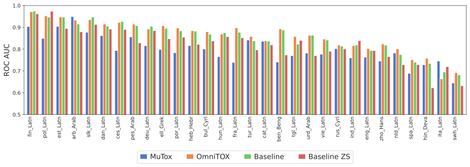

 Figure 8.3: ROC AUC per language for MuTox and OmniTOX. OmniTOX outperforms MuTox on 28 of 30 languages.

##### Summary

Our experiments confirm that OmniTOX’s improvements over MuTox are primarily driven by the upgrade from SONAR to OmniSONAR embeddings. The strong zero-shot performance of Baseline ZS suggests that OmniSONAR’s cross-lingual representations can generalize effectively to the 1600+ languages beyond our 30 training languages, enabling truly omnilingual toxicity detection.

##### Limitations

Our work has several limitations that suggest directions for future research.

###### Embedding Space Dependence

OmniTOX inherits both the strengths and weaknesses of OmniSONAR. While OmniSONAR provides broad language coverage, its representations may be weaker for languages with limited pre-training data. Additionally, OmniSONAR was not explicitly trained to preserve toxicity-related semantic distinctions, which may limit fine-grained toxicity detection in some languages.

###### Limited Language Evaluation

Although OmniSONAR supports 1600+ languages, we evaluated OmniTOX on only 30 languages due to the availability of annotated data. Performance on the remaining 1570+ languages relies entirely on zero-shot transfer, which remains unvalidated. Furthermore, our training data is imbalanced: English and Spanish comprise approximately 40% of examples, potentially biasing the model toward Western toxicity norms.

###### Annotation Subjectivity

Toxicity perception is inherently subjective and culturally dependent ([Costa-jussà et al., 2024a](https://arxiv.org/html/2603.16309v3#bib.bib34)). Our training data may reflect annotator biases toward certain toxicity patterns, and culturally-specific forms of toxicity may be underrepresented.

###### Task Scope

OmniTOX performs sentence-level binary classification, which has two implications: (1) context-dependent toxicity spanning multiple sentences may be missed, and (2) the binary output does not capture toxicity severity or type (e.g., hate speech vs. profanity). These limitations may affect downstream applications requiring fine-grained toxicity analysis.

## 9 MT Results

This section reports evaluations of general translation quality and added toxicity for our final decoder-only and encoder-decoder models presented in previous sections.

### 9.1 Automatic evaluation of translation quality

#### 9.1.1 Evaluation framework

We report results on evaluation datasets presented in section [4.4](https://arxiv.org/html/2603.16309v3#S4.SS4 "4.4 Evaluation Data ‣ 4 Creating High-Quality Datasets ‣ Omnilingual MT: Machine Translation for 1,600 Languages") which includes Bible, BOUQuET, and FLoRes+.Throughout the paper, we have been presenting MT results with metrics that are reported in Appendix [C](https://arxiv.org/html/2603.16309v3#A3 "Appendix C Cards ‣ Omnilingual MT: Machine Translation for 1,600 Languages"). In particular, these metrics include lexical-based (BLEU [Papineni et al. (2002)](https://arxiv.org/html/2603.16309v3#bib.bib22), ChrF++ [Popović (2015)](https://arxiv.org/html/2603.16309v3#bib.bib23)) and model-based (XCOMET [Guerreiro et al. (2024b)](https://arxiv.org/html/2603.16309v3#bib.bib40), MetricX ([Juraska et al., 2024](https://arxiv.org/html/2603.16309v3#bib.bib45))). In this section, and based on findings from section [8.4](https://arxiv.org/html/2603.16309v3#S8.SS4 "8.4 Metrics Benchmarking ‣ 8 Proposed Evaluation Metrics and Dataset ‣ Omnilingual MT: Machine Translation for 1,600 Languages"), we present results with a subset of them, and a newly proposed reference-free and model-based metric, BLASER 3 (Section [8.3](https://arxiv.org/html/2603.16309v3#S8.SS3 "8.3 BLASER 3 ‣ 8 Proposed Evaluation Metrics and Dataset ‣ Omnilingual MT: Machine Translation for 1,600 Languages")). We complement MetricX, xCOMET, and BLASER 3 with LID to compensate for off-target mistakes of the metrics (as motivated in [Section 8.4](https://arxiv.org/html/2603.16309v3#S8.SS4 "8.4 Metrics Benchmarking ‣ 8 Proposed Evaluation Metrics and Dataset ‣ Omnilingual MT: Machine Translation for 1,600 Languages")). As baseline systems, we report a variety of models of different sizes reported in Table [9.1](https://arxiv.org/html/2603.16309v3#S9.T1 "Table 9.1 ‣ 9.1.1 Evaluation framework ‣ 9.1 Automatic evaluation of translation quality ‣ 9 MT Results ‣ Omnilingual MT: Machine Translation for 1,600 Languages").

System | Size(s) | Reference | Comment  
---|---|---|---  
OMT-LLaMA | 8B, 3B, 1B | Section [6](https://arxiv.org/html/2603.16309v3#S6 "6 Decoder-only Modeling ‣ Omnilingual MT: Machine Translation for 1,600 Languages") | Specialised  
OMT-NLLB | 3B | Section [7](https://arxiv.org/html/2603.16309v3#S7 "7 Encoder-Decoder Modeling ‣ Omnilingual MT: Machine Translation for 1,600 Languages") | Specialised  
Aya-101 | 13B | ([Üstün et al., 2024](https://arxiv.org/html/2603.16309v3#bib.bib70)) | General  
Aya Expanse | 8B | ([Dang et al., 2024](https://arxiv.org/html/2603.16309v3#bib.bib69)) | General  
EuroLLM | 9B | ([Martins et al., 2024](https://arxiv.org/html/2603.16309v3#bib.bib75)) | General  
Gemma3 | 27B | ([Team et al., 2025](https://arxiv.org/html/2603.16309v3#bib.bib130)) | General  
GPT-OSS3636 36 We use these models in the “low reasoning effort” mode, to avoid the infinitely looped chains of thought that they otherwise sometimes produce, as well as to make the evaluation more comparable to other models that produce translations directly, without intermediate reasoning. | 20B, 120B | ([OpenAI, 2025](https://arxiv.org/html/2603.16309v3#bib.bib124)) | General  
Hunyuan-MT3737 37 For fair comparison with other systems, we are using only the base model, without applying the ensemble. | 7B | ([Zheng et al., 2025](https://arxiv.org/html/2603.16309v3#bib.bib114)) | Specialised  
MADLAD | 10B | ([Kudugunta et al., 2023](https://arxiv.org/html/2603.16309v3#bib.bib156)) | Specialised  
NLLB-200 | 3B | ([NLLB Team et al., 2024](https://arxiv.org/html/2603.16309v3#bib.bib146)) | Specialised  
LLaMA 3 | 8B, 70B | ([Grattafiori et al., 2024](https://arxiv.org/html/2603.16309v3#bib.bib58)) | General  
Tiny Aya Global | 3B | ([Salamanca1 et al., 2026](https://arxiv.org/html/2603.16309v3#bib.bib125)) | General  
Tower+ | 72B | ([Alves et al., 2024b](https://arxiv.org/html/2603.16309v3#bib.bib68)) | Specialised  
TranslateGemma | 27B | ([Finkelstein et al., 2026](https://arxiv.org/html/2603.16309v3#bib.bib123)) | Specialised

 Table 9.1: Proposed and external MT systems evaluated throughout this section and classified as General or Specialised (on MT).

Some of these translation models come with a pre-defined translation prompt template (e.g. NLLB, MADLAD, TranslateGemma) which we had only to tweak to either extend the set of supported languages or to replace an unsupported language code with the ‘‘most similar’’ supported language.3838 38 In many cases, this amounts to simply replacing language tags with nearly-equivalent ones, e.g. for NLLB-200, we replaced cmn_Hans with zho_Hans, where the former means “Mandarin Chinese” and the latter simply “Chinese” (still implying Mandarin). However, for very low-resourced languages not supported for OMT-NLLB, NLLB-200, or MADLAD, we had to substitute them with one language from the model’s supported set, selected by genealogical proximity or, in its absence, by geographical one. With most of the other models, we use the same minimalist prompt template (with the language names as described in Section [3.4](https://arxiv.org/html/2603.16309v3#S3.SS4 "3.4 Describing languages in prompts ‣ 3 Languages ‣ Omnilingual MT: Machine Translation for 1,600 Languages")):

 

Box 1 Prompt template for translation with instruction-following models

For OMT-LLaMA models, we did not include the additional instructions (lines 2 and 3) into the prompt because these models are already trained to produce concise translations, unless explicitly requested otherwise.

#### 9.1.2 Evaluating with standard benchmarks

##### Performance on BOUQuET by the language resource level

Table [9.2](https://arxiv.org/html/2603.16309v3#S9.T2 "Table 9.2 ‣ Performance on BOUQuET by the language resource level ‣ 9.1.2 Evaluating with standard benchmarks ‣ 9.1 Automatic evaluation of translation quality ‣ 9 MT Results ‣ Omnilingual MT: Machine Translation for 1,600 Languages") reports ChrF++ results on BOUQuET dataset by language resource level defined as in Section [3](https://arxiv.org/html/2603.16309v3#S3 "3 Languages ‣ Omnilingual MT: Machine Translation for 1,600 Languages") and [4.4.3](https://arxiv.org/html/2603.16309v3#S4.SS4.SSS3 "4.4.3 Benchmarks Specialization ‣ 4.4 Evaluation Data ‣ 4 Creating High-Quality Datasets ‣ Omnilingual MT: Machine Translation for 1,600 Languages"). OMT models (both OMT-LLaMA and OMT-NLLB) are very competitive for into-English translation from languages of any resource group. For translation into high- and mid-resourced languages, OMT-NLLB is preferable, on average, while OMT-LLaMA shines for translation into low- and very-low-resourced languages (note that some of the lower-resourced BOUQuET languages are not officially supported by OMT-NLLB on the output side).

<table id="S9.T2.3" class="ltx_tabular ltx_centering ltx_align_middle">
<tr id="S9.T2.3.1" class="ltx_tr">
<td id="S9.T2.3.1.1" class="ltx_td ltx_border_r ltx_border_tt"></td>
<td id="S9.T2.3.1.2" class="ltx_td ltx_align_center ltx_border_r ltx_border_tt" colspan="6">XX-En</td>
<td id="S9.T2.3.1.3" class="ltx_td ltx_align_center ltx_border_r ltx_border_tt" colspan="6">En-YY</td>
<td id="S9.T2.3.1.4" class="ltx_td ltx_align_center ltx_border_tt">All</td></tr>
<tr id="S9.T2.3.2" class="ltx_tr">
<td id="S9.T2.3.2.1" class="ltx_td ltx_align_left ltx_border_r">Resource level</td>
<td id="S9.T2.3.2.2" class="ltx_td ltx_align_right">high</td>
<td id="S9.T2.3.2.3" class="ltx_td ltx_align_right">mid</td>
<td id="S9.T2.3.2.4" class="ltx_td ltx_align_right">low</td>
<td id="S9.T2.3.2.5" class="ltx_td ltx_align_right">v. low</td>
<td id="S9.T2.3.2.6" class="ltx_td ltx_align_right">zero</td>
<td id="S9.T2.3.2.7" class="ltx_td ltx_align_right ltx_border_r">total</td>
<td id="S9.T2.3.2.8" class="ltx_td ltx_align_right">high</td>
<td id="S9.T2.3.2.9" class="ltx_td ltx_align_right">mid</td>
<td id="S9.T2.3.2.10" class="ltx_td ltx_align_right">low</td>
<td id="S9.T2.3.2.11" class="ltx_td ltx_align_right">v. low</td>
<td id="S9.T2.3.2.12" class="ltx_td ltx_align_right">zero</td>
<td id="S9.T2.3.2.13" class="ltx_td ltx_align_right ltx_border_r">total</td>
<td id="S9.T2.3.2.14" class="ltx_td ltx_align_right">total</td></tr>
<tr id="S9.T2.3.3" class="ltx_tr">
<td id="S9.T2.3.3.1" class="ltx_td ltx_align_left ltx_border_r ltx_border_t">OMT-LLaMA 8B</td>
<td id="S9.T2.3.3.2" class="ltx_td ltx_align_right ltx_border_t" style="--ltx-bg-color:#023E62;"> 65.1</td>
<td id="S9.T2.3.3.3" class="ltx_td ltx_align_right ltx_border_t" style="--ltx-bg-color:#056BA9;"> 53.5</td>
<td id="S9.T2.3.3.4" class="ltx_td ltx_align_right ltx_border_t" style="--ltx-bg-color:#69A5CC;"> 38.7</td>
<td id="S9.T2.3.3.5" class="ltx_td ltx_align_right ltx_border_t" style="--ltx-bg-color:#B4C4DF;">27.6</td>
<td id="S9.T2.3.3.6" class="ltx_td ltx_align_right ltx_border_t" style="--ltx-bg-color:#D5D5E8;">21.6</td>
<td id="S9.T2.3.3.7" class="ltx_td ltx_align_right ltx_border_r ltx_border_t" style="--ltx-bg-color:#589EC8;"> 40.6</td>
<td id="S9.T2.3.3.8" class="ltx_td ltx_align_right ltx_border_t" style="--ltx-bg-color:#045382;"> 60.7</td>
<td id="S9.T2.3.3.9" class="ltx_td ltx_align_right ltx_border_t" style="--ltx-bg-color:#2F8BBE;"> 45.8</td>
<td id="S9.T2.3.3.10" class="ltx_td ltx_align_right ltx_border_t" style="--ltx-bg-color:#A1BBDA;">30.8</td>
<td id="S9.T2.3.3.11" class="ltx_td ltx_align_right ltx_border_t" style="--ltx-bg-color:#E0DDED;">18.8</td>
<td id="S9.T2.3.3.12" class="ltx_td ltx_align_right ltx_border_t" style="--ltx-bg-color:#F4EEF6;">12.6</td>
<td id="S9.T2.3.3.13" class="ltx_td ltx_align_right ltx_border_r ltx_border_t" style="--ltx-bg-color:#94B6D7;">32.8</td>
<td id="S9.T2.3.3.14" class="ltx_td ltx_align_right ltx_border_t" style="--ltx-bg-color:#78ABD0;"> 36.7</td></tr>
<tr id="S9.T2.3.4" class="ltx_tr">
<td id="S9.T2.3.4.1" class="ltx_td ltx_align_left ltx_border_r">OMT-NLLB</td>
<td id="S9.T2.3.4.2" class="ltx_td ltx_align_right" style="--ltx-bg-color:#03446A;"> 64.0</td>
<td id="S9.T2.3.4.3" class="ltx_td ltx_align_right" style="--ltx-bg-color:#04639B;"> 56.1</td>
<td id="S9.T2.3.4.4" class="ltx_td ltx_align_right" style="--ltx-bg-color:#73A9CF;"> 37.4</td>
<td id="S9.T2.3.4.5" class="ltx_td ltx_align_right" style="--ltx-bg-color:#B0C2DE;">28.4</td>
<td id="S9.T2.3.4.6" class="ltx_td ltx_align_right" style="--ltx-bg-color:#CED0E6;">23.2</td>
<td id="S9.T2.3.4.7" class="ltx_td ltx_align_right ltx_border_r" style="--ltx-bg-color:#529BC7;"> 41.3</td>
<td id="S9.T2.3.4.8" class="ltx_td ltx_align_right" style="--ltx-bg-color:#03517E;"> 61.1</td>
<td id="S9.T2.3.4.9" class="ltx_td ltx_align_right" style="--ltx-bg-color:#2383BA;"> 47.6</td>
<td id="S9.T2.3.4.10" class="ltx_td ltx_align_right" style="--ltx-bg-color:#B7C5DF;">27.3</td>
<td id="S9.T2.3.4.11" class="ltx_td ltx_align_right" style="--ltx-bg-color:#E5E1EF;">17.5</td>
<td id="S9.T2.3.4.12" class="ltx_td ltx_align_right" style="--ltx-bg-color:#F7F0F7;">11.5</td>
<td id="S9.T2.3.4.13" class="ltx_td ltx_align_right ltx_border_r" style="--ltx-bg-color:#9AB8D8;">31.9</td>
<td id="S9.T2.3.4.14" class="ltx_td ltx_align_right" style="--ltx-bg-color:#79ABD0;"> 36.6</td></tr>
<tr id="S9.T2.3.5" class="ltx_tr">
<td id="S9.T2.3.5.1" class="ltx_td ltx_align_left ltx_border_r">OMT-LLaMA 3B</td>
<td id="S9.T2.3.5.2" class="ltx_td ltx_align_right" style="--ltx-bg-color:#034267;"> 64.4</td>
<td id="S9.T2.3.5.3" class="ltx_td ltx_align_right" style="--ltx-bg-color:#0568A3;"> 54.6</td>
<td id="S9.T2.3.5.4" class="ltx_td ltx_align_right" style="--ltx-bg-color:#69A5CC;"> 38.8</td>
<td id="S9.T2.3.5.5" class="ltx_td ltx_align_right" style="--ltx-bg-color:#B3C3DE;">28.0</td>
<td id="S9.T2.3.5.6" class="ltx_td ltx_align_right" style="--ltx-bg-color:#D2D3E7;">22.3</td>
<td id="S9.T2.3.5.7" class="ltx_td ltx_align_right ltx_border_r" style="--ltx-bg-color:#549CC7;"> 41.0</td>
<td id="S9.T2.3.5.8" class="ltx_td ltx_align_right" style="--ltx-bg-color:#04598C;"> 59.4</td>
<td id="S9.T2.3.5.9" class="ltx_td ltx_align_right" style="--ltx-bg-color:#348EBF;"> 45.0</td>
<td id="S9.T2.3.5.10" class="ltx_td ltx_align_right" style="--ltx-bg-color:#AFC1DD;">28.7</td>
<td id="S9.T2.3.5.11" class="ltx_td ltx_align_right" style="--ltx-bg-color:#E7E3F0;">16.8</td>
<td id="S9.T2.3.5.12" class="ltx_td ltx_align_right" style="--ltx-bg-color:#F7F0F7;">11.3</td>
<td id="S9.T2.3.5.13" class="ltx_td ltx_align_right ltx_border_r" style="--ltx-bg-color:#9EBAD9;">31.3</td>
<td id="S9.T2.3.5.14" class="ltx_td ltx_align_right" style="--ltx-bg-color:#7DACD1;"> 36.2</td></tr>
<tr id="S9.T2.3.6" class="ltx_tr">
<td id="S9.T2.3.6.1" class="ltx_td ltx_align_left ltx_border_r">NLLB-200</td>
<td id="S9.T2.3.6.2" class="ltx_td ltx_align_right" style="--ltx-bg-color:#034E7B;"> 61.5</td>
<td id="S9.T2.3.6.3" class="ltx_td ltx_align_right" style="--ltx-bg-color:#056FAE;"> 52.4</td>
<td id="S9.T2.3.6.4" class="ltx_td ltx_align_right" style="--ltx-bg-color:#99B8D8;">32.1</td>
<td id="S9.T2.3.6.5" class="ltx_td ltx_align_right" style="--ltx-bg-color:#C1CAE2;">25.5</td>
<td id="S9.T2.3.6.6" class="ltx_td ltx_align_right" style="--ltx-bg-color:#D1D2E6;">22.7</td>
<td id="S9.T2.3.6.7" class="ltx_td ltx_align_right ltx_border_r" style="--ltx-bg-color:#6FA7CE;"> 37.9</td>
<td id="S9.T2.3.6.8" class="ltx_td ltx_align_right" style="--ltx-bg-color:#034973;"> 62.9</td>
<td id="S9.T2.3.6.9" class="ltx_td ltx_align_right" style="--ltx-bg-color:#2786BB;"> 46.8</td>
<td id="S9.T2.3.6.10" class="ltx_td ltx_align_right" style="--ltx-bg-color:#C6CCE3;">24.6</td>
<td id="S9.T2.3.6.11" class="ltx_td ltx_align_right" style="--ltx-bg-color:#E5E1EF;">17.5</td>
<td id="S9.T2.3.6.12" class="ltx_td ltx_align_right" style="--ltx-bg-color:#F2ECF5;">13.2</td>
<td id="S9.T2.3.6.13" class="ltx_td ltx_align_right ltx_border_r" style="--ltx-bg-color:#9EBAD9;">31.3</td>
<td id="S9.T2.3.6.14" class="ltx_td ltx_align_right" style="--ltx-bg-color:#88B1D4;">34.6</td></tr>
<tr id="S9.T2.3.7" class="ltx_tr">
<td id="S9.T2.3.7.1" class="ltx_td ltx_align_left ltx_border_r">GPT-OSS 120B</td>
<td id="S9.T2.3.7.2" class="ltx_td ltx_align_right" style="--ltx-bg-color:#034165;"> 64.6</td>
<td id="S9.T2.3.7.3" class="ltx_td ltx_align_right" style="--ltx-bg-color:#1278B4;"> 49.9</td>
<td id="S9.T2.3.7.4" class="ltx_td ltx_align_right" style="--ltx-bg-color:#8EB3D5;">33.6</td>
<td id="S9.T2.3.7.5" class="ltx_td ltx_align_right" style="--ltx-bg-color:#C1CAE2;">25.4</td>
<td id="S9.T2.3.7.6" class="ltx_td ltx_align_right" style="--ltx-bg-color:#C8CDE4;">24.3</td>
<td id="S9.T2.3.7.7" class="ltx_td ltx_align_right ltx_border_r" style="--ltx-bg-color:#6DA6CD;"> 38.3</td>
<td id="S9.T2.3.7.8" class="ltx_td ltx_align_right" style="--ltx-bg-color:#03466E;"> 63.6</td>
<td id="S9.T2.3.7.9" class="ltx_td ltx_align_right" style="--ltx-bg-color:#3F93C2;"> 43.7</td>
<td id="S9.T2.3.7.10" class="ltx_td ltx_align_right" style="--ltx-bg-color:#BDC8E1;">26.0</td>
<td id="S9.T2.3.7.11" class="ltx_td ltx_align_right" style="--ltx-bg-color:#EBE6F2;">16.0</td>
<td id="S9.T2.3.7.12" class="ltx_td ltx_align_right" style="--ltx-bg-color:#F2ECF5;">13.4</td>
<td id="S9.T2.3.7.13" class="ltx_td ltx_align_right ltx_border_r" style="--ltx-bg-color:#A1BBDA;">30.8</td>
<td id="S9.T2.3.7.14" class="ltx_td ltx_align_right" style="--ltx-bg-color:#88B1D4;">34.5</td></tr>
<tr id="S9.T2.3.8" class="ltx_tr">
<td id="S9.T2.3.8.1" class="ltx_td ltx_align_left ltx_border_r">Gemma 3</td>
<td id="S9.T2.3.8.2" class="ltx_td ltx_align_right" style="--ltx-bg-color:#023D60;"> 65.3</td>
<td id="S9.T2.3.8.3" class="ltx_td ltx_align_right" style="--ltx-bg-color:#0872B1;"> 51.3</td>
<td id="S9.T2.3.8.4" class="ltx_td ltx_align_right" style="--ltx-bg-color:#86B0D3;">34.8</td>
<td id="S9.T2.3.8.5" class="ltx_td ltx_align_right" style="--ltx-bg-color:#B5C4DF;">27.4</td>
<td id="S9.T2.3.8.6" class="ltx_td ltx_align_right" style="--ltx-bg-color:#C6CCE3;">24.6</td>
<td id="S9.T2.3.8.7" class="ltx_td ltx_align_right ltx_border_r" style="--ltx-bg-color:#63A2CB;"> 39.4</td>
<td id="S9.T2.3.8.8" class="ltx_td ltx_align_right" style="--ltx-bg-color:#034A74;"> 62.6</td>
<td id="S9.T2.3.8.9" class="ltx_td ltx_align_right" style="--ltx-bg-color:#569DC8;"> 40.9</td>
<td id="S9.T2.3.8.10" class="ltx_td ltx_align_right" style="--ltx-bg-color:#C9CEE4;">24.0</td>
<td id="S9.T2.3.8.11" class="ltx_td ltx_align_right" style="--ltx-bg-color:#EEE8F3;">14.8</td>
<td id="S9.T2.3.8.12" class="ltx_td ltx_align_right" style="--ltx-bg-color:#F7F0F7;">11.6</td>
<td id="S9.T2.3.8.13" class="ltx_td ltx_align_right ltx_border_r" style="--ltx-bg-color:#ADC1DD;">28.9</td>
<td id="S9.T2.3.8.14" class="ltx_td ltx_align_right" style="--ltx-bg-color:#8BB2D4;">34.1</td></tr>
<tr id="S9.T2.3.9" class="ltx_tr">
<td id="S9.T2.3.9.1" class="ltx_td ltx_align_left ltx_border_r">TranslateGemma</td>
<td id="S9.T2.3.9.2" class="ltx_td ltx_align_right" style="--ltx-bg-color:#03456C;"> 63.6</td>
<td id="S9.T2.3.9.3" class="ltx_td ltx_align_right" style="--ltx-bg-color:#0C74B2;"> 50.9</td>
<td id="S9.T2.3.9.4" class="ltx_td ltx_align_right" style="--ltx-bg-color:#84B0D3;"> 35.0</td>
<td id="S9.T2.3.9.5" class="ltx_td ltx_align_right" style="--ltx-bg-color:#B4C4DF;">27.7</td>
<td id="S9.T2.3.9.6" class="ltx_td ltx_align_right" style="--ltx-bg-color:#C4CBE3;">24.9</td>
<td id="S9.T2.3.9.7" class="ltx_td ltx_align_right ltx_border_r" style="--ltx-bg-color:#63A2CB;"> 39.3</td>
<td id="S9.T2.3.9.8" class="ltx_td ltx_align_right" style="--ltx-bg-color:#04588A;"> 59.5</td>
<td id="S9.T2.3.9.9" class="ltx_td ltx_align_right" style="--ltx-bg-color:#4C99C5;"> 42.0</td>
<td id="S9.T2.3.9.10" class="ltx_td ltx_align_right" style="--ltx-bg-color:#D2D3E7;">22.1</td>
<td id="S9.T2.3.9.11" class="ltx_td ltx_align_right" style="--ltx-bg-color:#EDE7F2;">15.5</td>
<td id="S9.T2.3.9.12" class="ltx_td ltx_align_right" style="--ltx-bg-color:#F4EEF6;">12.4</td>
<td id="S9.T2.3.9.13" class="ltx_td ltx_align_right ltx_border_r" style="--ltx-bg-color:#AFC1DD;">28.5</td>
<td id="S9.T2.3.9.14" class="ltx_td ltx_align_right" style="--ltx-bg-color:#8CB3D5;">33.9</td></tr>
<tr id="S9.T2.3.10" class="ltx_tr">
<td id="S9.T2.3.10.1" class="ltx_td ltx_align_left ltx_border_r">OMT-LLaMA 1B</td>
<td id="S9.T2.3.10.2" class="ltx_td ltx_align_right" style="--ltx-bg-color:#034871;"> 63.0</td>
<td id="S9.T2.3.10.3" class="ltx_td ltx_align_right" style="--ltx-bg-color:#0872B1;"> 51.5</td>
<td id="S9.T2.3.10.4" class="ltx_td ltx_align_right" style="--ltx-bg-color:#86B0D3;">34.7</td>
<td id="S9.T2.3.10.5" class="ltx_td ltx_align_right" style="--ltx-bg-color:#C9CEE4;">24.1</td>
<td id="S9.T2.3.10.6" class="ltx_td ltx_align_right" style="--ltx-bg-color:#DBDAEB;">19.9</td>
<td id="S9.T2.3.10.7" class="ltx_td ltx_align_right ltx_border_r" style="--ltx-bg-color:#6FA7CE;"> 37.9</td>
<td id="S9.T2.3.10.8" class="ltx_td ltx_align_right" style="--ltx-bg-color:#04629A;"> 56.5</td>
<td id="S9.T2.3.10.9" class="ltx_td ltx_align_right" style="--ltx-bg-color:#4A98C5;"> 42.2</td>
<td id="S9.T2.3.10.10" class="ltx_td ltx_align_right" style="--ltx-bg-color:#C4CBE3;">25.1</td>
<td id="S9.T2.3.10.11" class="ltx_td ltx_align_right" style="--ltx-bg-color:#EEE8F3;">14.9</td>
<td id="S9.T2.3.10.12" class="ltx_td ltx_align_right" style="--ltx-bg-color:#F5EEF6;">12.3</td>
<td id="S9.T2.3.10.13" class="ltx_td ltx_align_right ltx_border_r" style="--ltx-bg-color:#ACC0DD;">29.1</td>
<td id="S9.T2.3.10.14" class="ltx_td ltx_align_right" style="--ltx-bg-color:#8FB4D6;">33.5</td></tr>
<tr id="S9.T2.3.11" class="ltx_tr">
<td id="S9.T2.3.11.1" class="ltx_td ltx_align_left ltx_border_r">LLaMA 3 70B</td>
<td id="S9.T2.3.11.2" class="ltx_td ltx_align_right" style="--ltx-bg-color:#023E62;"> 65.0</td>
<td id="S9.T2.3.11.3" class="ltx_td ltx_align_right" style="--ltx-bg-color:#2383BA;"> 47.6</td>
<td id="S9.T2.3.11.4" class="ltx_td ltx_align_right" style="--ltx-bg-color:#8FB4D6;">33.3</td>
<td id="S9.T2.3.11.5" class="ltx_td ltx_align_right" style="--ltx-bg-color:#BDC8E1;">26.2</td>
<td id="S9.T2.3.11.6" class="ltx_td ltx_align_right" style="--ltx-bg-color:#C9CEE4;">24.0</td>
<td id="S9.T2.3.11.7" class="ltx_td ltx_align_right ltx_border_r" style="--ltx-bg-color:#73A9CF;"> 37.6</td>
<td id="S9.T2.3.11.8" class="ltx_td ltx_align_right" style="--ltx-bg-color:#045585;"> 60.2</td>
<td id="S9.T2.3.11.9" class="ltx_td ltx_align_right" style="--ltx-bg-color:#75A9CF;"> 37.2</td>
<td id="S9.T2.3.11.10" class="ltx_td ltx_align_right" style="--ltx-bg-color:#CCCFE5;">23.7</td>
<td id="S9.T2.3.11.11" class="ltx_td ltx_align_right" style="--ltx-bg-color:#EAE6F1;">16.2</td>
<td id="S9.T2.3.11.12" class="ltx_td ltx_align_right" style="--ltx-bg-color:#F0EAF4;">14.3</td>
<td id="S9.T2.3.11.13" class="ltx_td ltx_align_right ltx_border_r" style="--ltx-bg-color:#B1C2DE;">28.2</td>
<td id="S9.T2.3.11.14" class="ltx_td ltx_align_right" style="--ltx-bg-color:#93B5D6;">32.9</td></tr>
<tr id="S9.T2.3.12" class="ltx_tr">
<td id="S9.T2.3.12.1" class="ltx_td ltx_align_left ltx_border_r">MADLAD</td>
<td id="S9.T2.3.12.2" class="ltx_td ltx_align_right" style="--ltx-bg-color:#023F64;"> 64.7</td>
<td id="S9.T2.3.12.3" class="ltx_td ltx_align_right" style="--ltx-bg-color:#2182B9;"> 47.8</td>
<td id="S9.T2.3.12.4" class="ltx_td ltx_align_right" style="--ltx-bg-color:#A1BBDA;">31.0</td>
<td id="S9.T2.3.12.5" class="ltx_td ltx_align_right" style="--ltx-bg-color:#C8CDE4;">24.3</td>
<td id="S9.T2.3.12.6" class="ltx_td ltx_align_right" style="--ltx-bg-color:#D9D8EA;">20.5</td>
<td id="S9.T2.3.12.7" class="ltx_td ltx_align_right ltx_border_r" style="--ltx-bg-color:#7DACD1;"> 36.0</td>
<td id="S9.T2.3.12.8" class="ltx_td ltx_align_right" style="--ltx-bg-color:#034B76;"> 62.2</td>
<td id="S9.T2.3.12.9" class="ltx_td ltx_align_right" style="--ltx-bg-color:#81AED2;"> 35.5</td>
<td id="S9.T2.3.12.10" class="ltx_td ltx_align_right" style="--ltx-bg-color:#D5D5E8;">21.5</td>
<td id="S9.T2.3.12.11" class="ltx_td ltx_align_right" style="--ltx-bg-color:#EDE8F3;">15.3</td>
<td id="S9.T2.3.12.12" class="ltx_td ltx_align_right" style="--ltx-bg-color:#F7F0F7;">11.5</td>
<td id="S9.T2.3.12.13" class="ltx_td ltx_align_right ltx_border_r" style="--ltx-bg-color:#BBC7E0;">26.6</td>
<td id="S9.T2.3.12.14" class="ltx_td ltx_align_right" style="--ltx-bg-color:#9EBAD9;">31.3</td></tr>
<tr id="S9.T2.3.13" class="ltx_tr">
<td id="S9.T2.3.13.1" class="ltx_td ltx_align_left ltx_border_r">GPT-OSS 20B</td>
<td id="S9.T2.3.13.2" class="ltx_td ltx_align_right" style="--ltx-bg-color:#034A74;"> 62.5</td>
<td id="S9.T2.3.13.3" class="ltx_td ltx_align_right" style="--ltx-bg-color:#2685BB;"> 47.0</td>
<td id="S9.T2.3.13.4" class="ltx_td ltx_align_right" style="--ltx-bg-color:#A2BCDA;">30.7</td>
<td id="S9.T2.3.13.5" class="ltx_td ltx_align_right" style="--ltx-bg-color:#CED0E6;">23.2</td>
<td id="S9.T2.3.13.6" class="ltx_td ltx_align_right" style="--ltx-bg-color:#D2D2E7;">22.4</td>
<td id="S9.T2.3.13.7" class="ltx_td ltx_align_right ltx_border_r" style="--ltx-bg-color:#80AED2;"> 35.7</td>
<td id="S9.T2.3.13.8" class="ltx_td ltx_align_right" style="--ltx-bg-color:#045A8D;"> 59.2</td>
<td id="S9.T2.3.13.9" class="ltx_td ltx_align_right" style="--ltx-bg-color:#78ABD0;"> 36.7</td>
<td id="S9.T2.3.13.10" class="ltx_td ltx_align_right" style="--ltx-bg-color:#DAD9EA;">20.2</td>
<td id="S9.T2.3.13.11" class="ltx_td ltx_align_right" style="--ltx-bg-color:#F2ECF5;">13.1</td>
<td id="S9.T2.3.13.12" class="ltx_td ltx_align_right" style="--ltx-bg-color:#F5EEF6;">12.1</td>
<td id="S9.T2.3.13.13" class="ltx_td ltx_align_right ltx_border_r" style="--ltx-bg-color:#BDC8E1;">26.1</td>
<td id="S9.T2.3.13.14" class="ltx_td ltx_align_right" style="--ltx-bg-color:#A1BBDA;">30.9</td></tr>
<tr id="S9.T2.3.14" class="ltx_tr">
<td id="S9.T2.3.14.1" class="ltx_td ltx_align_left ltx_border_r">Aya-101</td>
<td id="S9.T2.3.14.2" class="ltx_td ltx_align_right" style="--ltx-bg-color:#04588A;"> 59.6</td>
<td id="S9.T2.3.14.3" class="ltx_td ltx_align_right" style="--ltx-bg-color:#1C7FB8;"> 48.3</td>
<td id="S9.T2.3.14.4" class="ltx_td ltx_align_right" style="--ltx-bg-color:#A1BBDA;">30.9</td>
<td id="S9.T2.3.14.5" class="ltx_td ltx_align_right" style="--ltx-bg-color:#C1CAE2;">25.5</td>
<td id="S9.T2.3.14.6" class="ltx_td ltx_align_right" style="--ltx-bg-color:#D0D1E6;">23.0</td>
<td id="S9.T2.3.14.7" class="ltx_td ltx_align_right ltx_border_r" style="--ltx-bg-color:#7BACD1;"> 36.3</td>
<td id="S9.T2.3.14.8" class="ltx_td ltx_align_right" style="--ltx-bg-color:#056DAC;"> 52.8</td>
<td id="S9.T2.3.14.9" class="ltx_td ltx_align_right" style="--ltx-bg-color:#8EB3D5;">33.7</td>
<td id="S9.T2.3.14.10" class="ltx_td ltx_align_right" style="--ltx-bg-color:#E8E4F0;">16.6</td>
<td id="S9.T2.3.14.11" class="ltx_td ltx_align_right" style="--ltx-bg-color:#F7F0F7;">11.4</td>
<td id="S9.T2.3.14.12" class="ltx_td ltx_align_right" style="--ltx-bg-color:#F8F1F8;">10.9</td>
<td id="S9.T2.3.14.13" class="ltx_td ltx_align_right ltx_border_r" style="--ltx-bg-color:#CED0E6;">23.1</td>
<td id="S9.T2.3.14.14" class="ltx_td ltx_align_right" style="--ltx-bg-color:#A8BEDC;">29.7</td></tr>
<tr id="S9.T2.3.15" class="ltx_tr">
<td id="S9.T2.3.15.1" class="ltx_td ltx_align_left ltx_border_r">Tower+</td>
<td id="S9.T2.3.15.2" class="ltx_td ltx_align_right" style="--ltx-bg-color:#023858;"> 66.5</td>
<td id="S9.T2.3.15.3" class="ltx_td ltx_align_right" style="--ltx-bg-color:#4295C3;"> 43.3</td>
<td id="S9.T2.3.15.4" class="ltx_td ltx_align_right" style="--ltx-bg-color:#9CB9D9;">31.7</td>
<td id="S9.T2.3.15.5" class="ltx_td ltx_align_right" style="--ltx-bg-color:#C2CBE2;">25.2</td>
<td id="S9.T2.3.15.6" class="ltx_td ltx_align_right" style="--ltx-bg-color:#C6CCE3;">24.4</td>
<td id="S9.T2.3.15.7" class="ltx_td ltx_align_right ltx_border_r" style="--ltx-bg-color:#7DACD1;"> 36.0</td>
<td id="S9.T2.3.15.8" class="ltx_td ltx_align_right" style="--ltx-bg-color:#045B8E;"> 58.9</td>
<td id="S9.T2.3.15.9" class="ltx_td ltx_align_right" style="--ltx-bg-color:#B9C6E0;">26.9</td>
<td id="S9.T2.3.15.10" class="ltx_td ltx_align_right" style="--ltx-bg-color:#EDE8F3;">15.2</td>
<td id="S9.T2.3.15.11" class="ltx_td ltx_align_right" style="--ltx-bg-color:#F7F0F7;">11.3</td>
<td id="S9.T2.3.15.12" class="ltx_td ltx_align_right" style="--ltx-bg-color:#FAF2F8;">10.3</td>
<td id="S9.T2.3.15.13" class="ltx_td ltx_align_right ltx_border_r" style="--ltx-bg-color:#D6D6E9;">21.3</td>
<td id="S9.T2.3.15.14" class="ltx_td ltx_align_right" style="--ltx-bg-color:#AFC1DD;">28.7</td></tr>
<tr id="S9.T2.3.16" class="ltx_tr">
<td id="S9.T2.3.16.1" class="ltx_td ltx_align_left ltx_border_r">Tiny Aya Global</td>
<td id="S9.T2.3.16.2" class="ltx_td ltx_align_right" style="--ltx-bg-color:#034973;"> 62.7</td>
<td id="S9.T2.3.16.3" class="ltx_td ltx_align_right" style="--ltx-bg-color:#69A5CC;"> 38.1</td>
<td id="S9.T2.3.16.4" class="ltx_td ltx_align_right" style="--ltx-bg-color:#C1CAE2;">24.6</td>
<td id="S9.T2.3.16.5" class="ltx_td ltx_align_right" style="--ltx-bg-color:#DCDAEB;">18.8</td>
<td id="S9.T2.3.16.6" class="ltx_td ltx_align_right" style="--ltx-bg-color:#D5D5E8;">20.6</td>
<td id="S9.T2.3.16.7" class="ltx_td ltx_align_right ltx_border_r" style="--ltx-bg-color:#9EBAD9;">30.5</td>
<td id="S9.T2.3.16.8" class="ltx_td ltx_align_right" style="--ltx-bg-color:#045B8F;"> 58.5</td>
<td id="S9.T2.3.16.9" class="ltx_td ltx_align_right" style="--ltx-bg-color:#A5BDDB;">29.5</td>
<td id="S9.T2.3.16.10" class="ltx_td ltx_align_right" style="--ltx-bg-color:#EFE9F3;">13.3</td>
<td id="S9.T2.3.16.11" class="ltx_td ltx_align_right" style="--ltx-bg-color:#FAF3F9;">9.0</td>
<td id="S9.T2.3.16.12" class="ltx_td ltx_align_right" style="--ltx-bg-color:#F7F0F7;">10.3</td>
<td id="S9.T2.3.16.13" class="ltx_td ltx_align_right ltx_border_r" style="--ltx-bg-color:#D3D4E7;">21.0</td>
<td id="S9.T2.3.16.14" class="ltx_td ltx_align_right" style="--ltx-bg-color:#BBC7E0;">25.8</td></tr>
<tr id="S9.T2.3.17" class="ltx_tr">
<td id="S9.T2.3.17.1" class="ltx_td ltx_align_left ltx_border_r">LLaMA 3 8B</td>
<td id="S9.T2.3.17.2" class="ltx_td ltx_align_right" style="--ltx-bg-color:#045280;"> 61.0</td>
<td id="S9.T2.3.17.3" class="ltx_td ltx_align_right" style="--ltx-bg-color:#60A1CA;"> 39.8</td>
<td id="S9.T2.3.17.4" class="ltx_td ltx_align_right" style="--ltx-bg-color:#B5C4DF;">27.5</td>
<td id="S9.T2.3.17.5" class="ltx_td ltx_align_right" style="--ltx-bg-color:#D5D5E8;">21.6</td>
<td id="S9.T2.3.17.6" class="ltx_td ltx_align_right" style="--ltx-bg-color:#D9D8EA;">20.6</td>
<td id="S9.T2.3.17.7" class="ltx_td ltx_align_right ltx_border_r" style="--ltx-bg-color:#99B8D8;">32.1</td>
<td id="S9.T2.3.17.8" class="ltx_td ltx_align_right" style="--ltx-bg-color:#056DAC;"> 52.7</td>
<td id="S9.T2.3.17.9" class="ltx_td ltx_align_right" style="--ltx-bg-color:#BFC9E1;">26.0</td>
<td id="S9.T2.3.17.10" class="ltx_td ltx_align_right" style="--ltx-bg-color:#F2ECF5;">13.1</td>
<td id="S9.T2.3.17.11" class="ltx_td ltx_align_right" style="--ltx-bg-color:#FCF4FA;">9.5</td>
<td id="S9.T2.3.17.12" class="ltx_td ltx_align_right" style="--ltx-bg-color:#FFF7FB;">8.2</td>
<td id="S9.T2.3.17.13" class="ltx_td ltx_align_right ltx_border_r" style="--ltx-bg-color:#DFDDEC;">19.1</td>
<td id="S9.T2.3.17.14" class="ltx_td ltx_align_right" style="--ltx-bg-color:#C0C9E2;">25.6</td></tr>
<tr id="S9.T2.3.18" class="ltx_tr">
<td id="S9.T2.3.18.1" class="ltx_td ltx_align_left ltx_border_bb ltx_border_r">Hunyuan-MT</td>
<td id="S9.T2.3.18.2" class="ltx_td ltx_align_right ltx_border_bb" style="--ltx-bg-color:#046299;"> 56.6</td>
<td id="S9.T2.3.18.3" class="ltx_td ltx_align_right ltx_border_bb" style="--ltx-bg-color:#8CB3D5;">33.9</td>
<td id="S9.T2.3.18.4" class="ltx_td ltx_align_right ltx_border_bb" style="--ltx-bg-color:#C6CCE3;">24.4</td>
<td id="S9.T2.3.18.5" class="ltx_td ltx_align_right ltx_border_bb" style="--ltx-bg-color:#DAD9EA;">20.3</td>
<td id="S9.T2.3.18.6" class="ltx_td ltx_align_right ltx_border_bb" style="--ltx-bg-color:#D8D7E9;">21.0</td>
<td id="S9.T2.3.18.7" class="ltx_td ltx_align_right ltx_border_bb ltx_border_r" style="--ltx-bg-color:#ACC0DD;">29.0</td>
<td id="S9.T2.3.18.8" class="ltx_td ltx_align_right ltx_border_bb" style="--ltx-bg-color:#2182B9;"> 47.8</td>
<td id="S9.T2.3.18.9" class="ltx_td ltx_align_right ltx_border_bb" style="--ltx-bg-color:#D5D5E8;">21.5</td>
<td id="S9.T2.3.18.10" class="ltx_td ltx_align_right ltx_border_bb" style="--ltx-bg-color:#F1EBF4;">13.9</td>
<td id="S9.T2.3.18.11" class="ltx_td ltx_align_right ltx_border_bb" style="--ltx-bg-color:#F4EEF6;">12.4</td>
<td id="S9.T2.3.18.12" class="ltx_td ltx_align_right ltx_border_bb" style="--ltx-bg-color:#F8F1F8;">10.8</td>
<td id="S9.T2.3.18.13" class="ltx_td ltx_align_right ltx_border_bb ltx_border_r" style="--ltx-bg-color:#E0DEED;">18.5</td>
<td id="S9.T2.3.18.14" class="ltx_td ltx_align_right ltx_border_bb" style="--ltx-bg-color:#CACEE5;">23.8</td></tr>
</table>

 Table 9.2: Translation performance on BOUQuET (ChrF++) by the non-English language resource level.

##### Performance on FLoRes+ 

To corroborate our BOUQuET evaluation results, we report similar evaluation numbers based on FLoRes+ in [Table 9.3](https://arxiv.org/html/2603.16309v3#S9.T3 "In Performance on FLoRes+ ‣ 9.1.2 Evaluating with standard benchmarks ‣ 9.1 Automatic evaluation of translation quality ‣ 9 MT Results ‣ Omnilingual MT: Machine Translation for 1,600 Languages"). Similarly to BOUQuET, on FLoRes+, OMT systems perform comparably to strong baselines like Tower+ for translation between high-resource languages and English, and outperform them by a significant margin when it comes to mid- and low-resourced languages.

<table id="S9.T3.3" class="ltx_tabular ltx_centering ltx_align_middle">
<tr id="S9.T3.3.1" class="ltx_tr">
<td id="S9.T3.3.1.1" class="ltx_td ltx_border_r ltx_border_tt"></td>
<td id="S9.T3.3.1.2" class="ltx_td ltx_align_center ltx_border_tt" colspan="5">XX-En</td>
<td id="S9.T3.3.1.3" class="ltx_td ltx_align_center ltx_border_tt" colspan="5">En-YY</td>
<td id="S9.T3.3.1.4" class="ltx_td ltx_align_center ltx_border_tt">All</td></tr>
<tr id="S9.T3.3.2" class="ltx_tr">
<td id="S9.T3.3.2.1" class="ltx_td ltx_align_left ltx_border_r">Resource level</td>
<td id="S9.T3.3.2.2" class="ltx_td ltx_align_right">high</td>
<td id="S9.T3.3.2.3" class="ltx_td ltx_align_right">mid</td>
<td id="S9.T3.3.2.4" class="ltx_td ltx_align_right">low</td>
<td id="S9.T3.3.2.5" class="ltx_td ltx_align_right">v. low</td>
<td id="S9.T3.3.2.6" class="ltx_td ltx_align_right ltx_border_r">total</td>
<td id="S9.T3.3.2.7" class="ltx_td ltx_align_right">high</td>
<td id="S9.T3.3.2.8" class="ltx_td ltx_align_right">mid</td>
<td id="S9.T3.3.2.9" class="ltx_td ltx_align_right">low</td>
<td id="S9.T3.3.2.10" class="ltx_td ltx_align_right">v. low</td>
<td id="S9.T3.3.2.11" class="ltx_td ltx_align_right ltx_border_r">total</td>
<td id="S9.T3.3.2.12" class="ltx_td ltx_align_right">total</td></tr>
<tr id="S9.T3.3.3" class="ltx_tr">
<td id="S9.T3.3.3.1" class="ltx_td ltx_align_left ltx_border_r ltx_border_t">OMT-NLLB</td>
<td id="S9.T3.3.3.2" class="ltx_td ltx_align_right ltx_border_t" style="--ltx-bg-color:#023858;"> 65.0</td>
<td id="S9.T3.3.3.3" class="ltx_td ltx_align_right ltx_border_t" style="--ltx-bg-color:#045C90;"> 58.3</td>
<td id="S9.T3.3.3.4" class="ltx_td ltx_align_right ltx_border_t" style="--ltx-bg-color:#056AA6;"> 54.6</td>
<td id="S9.T3.3.3.5" class="ltx_td ltx_align_right ltx_border_t" style="--ltx-bg-color:#0A73B2;"> 52.3</td>
<td id="S9.T3.3.3.6" class="ltx_td ltx_align_right ltx_border_r ltx_border_t" style="--ltx-bg-color:#046097;"> 57.3</td>
<td id="S9.T3.3.3.7" class="ltx_td ltx_align_right ltx_border_t" style="--ltx-bg-color:#045F95;"> 57.6</td>
<td id="S9.T3.3.3.8" class="ltx_td ltx_align_right ltx_border_t" style="--ltx-bg-color:#3F93C2;"> 46.0</td>
<td id="S9.T3.3.3.9" class="ltx_td ltx_align_right ltx_border_t" style="--ltx-bg-color:#71A8CE;"> 41.0</td>
<td id="S9.T3.3.3.10" class="ltx_td ltx_align_right ltx_border_t" style="--ltx-bg-color:#A7BDDB;">34.6</td>
<td id="S9.T3.3.3.11" class="ltx_td ltx_align_right ltx_border_r ltx_border_t" style="--ltx-bg-color:#4E9AC6;"> 44.6</td>
<td id="S9.T3.3.3.12" class="ltx_td ltx_align_right ltx_border_t" style="--ltx-bg-color:#157AB5;"> 50.9</td></tr>
<tr id="S9.T3.3.4" class="ltx_tr">
<td id="S9.T3.3.4.1" class="ltx_td ltx_align_left ltx_border_r">OMT-LLaMA 8B</td>
<td id="S9.T3.3.4.2" class="ltx_td ltx_align_right" style="--ltx-bg-color:#023A5B;"> 64.6</td>
<td id="S9.T3.3.4.3" class="ltx_td ltx_align_right" style="--ltx-bg-color:#04639B;"> 56.4</td>
<td id="S9.T3.3.4.4" class="ltx_td ltx_align_right" style="--ltx-bg-color:#187CB6;"> 50.6</td>
<td id="S9.T3.3.4.5" class="ltx_td ltx_align_right" style="--ltx-bg-color:#2A88BC;"> 48.3</td>
<td id="S9.T3.3.4.6" class="ltx_td ltx_align_right ltx_border_r" style="--ltx-bg-color:#0569A5;"> 54.6</td>
<td id="S9.T3.3.4.7" class="ltx_td ltx_align_right" style="--ltx-bg-color:#046096;"> 57.4</td>
<td id="S9.T3.3.4.8" class="ltx_td ltx_align_right" style="--ltx-bg-color:#3B92C1;"> 46.5</td>
<td id="S9.T3.3.4.9" class="ltx_td ltx_align_right" style="--ltx-bg-color:#7DACD1;"> 39.8</td>
<td id="S9.T3.3.4.10" class="ltx_td ltx_align_right" style="--ltx-bg-color:#ACC0DD;">33.8</td>
<td id="S9.T3.3.4.11" class="ltx_td ltx_align_right ltx_border_r" style="--ltx-bg-color:#509AC6;"> 44.2</td>
<td id="S9.T3.3.4.12" class="ltx_td ltx_align_right" style="--ltx-bg-color:#2182B9;"> 49.4</td></tr>
<tr id="S9.T3.3.5" class="ltx_tr">
<td id="S9.T3.3.5.1" class="ltx_td ltx_align_left ltx_border_r">NLLB-200</td>
<td id="S9.T3.3.5.2" class="ltx_td ltx_align_right" style="--ltx-bg-color:#034165;"> 63.5</td>
<td id="S9.T3.3.5.3" class="ltx_td ltx_align_right" style="--ltx-bg-color:#0567A2;"> 55.3</td>
<td id="S9.T3.3.5.4" class="ltx_td ltx_align_right" style="--ltx-bg-color:#157AB5;"> 50.9</td>
<td id="S9.T3.3.5.5" class="ltx_td ltx_align_right" style="--ltx-bg-color:#2383BA;"> 49.3</td>
<td id="S9.T3.3.5.6" class="ltx_td ltx_align_right ltx_border_r" style="--ltx-bg-color:#056BA9;"> 54.2</td>
<td id="S9.T3.3.5.7" class="ltx_td ltx_align_right" style="--ltx-bg-color:#046097;"> 57.2</td>
<td id="S9.T3.3.5.8" class="ltx_td ltx_align_right" style="--ltx-bg-color:#509AC6;"> 44.3</td>
<td id="S9.T3.3.5.9" class="ltx_td ltx_align_right" style="--ltx-bg-color:#80AED2;"> 39.4</td>
<td id="S9.T3.3.5.10" class="ltx_td ltx_align_right" style="--ltx-bg-color:#B5C4DF;">32.5</td>
<td id="S9.T3.3.5.11" class="ltx_td ltx_align_right ltx_border_r" style="--ltx-bg-color:#5EA0CA;"> 43.0</td>
<td id="S9.T3.3.5.12" class="ltx_td ltx_align_right" style="--ltx-bg-color:#2786BB;"> 48.6</td></tr>
<tr id="S9.T3.3.6" class="ltx_tr">
<td id="S9.T3.3.6.1" class="ltx_td ltx_align_left ltx_border_r">Gemma 3</td>
<td id="S9.T3.3.6.2" class="ltx_td ltx_align_right" style="--ltx-bg-color:#023C5F;"> 64.2</td>
<td id="S9.T3.3.6.3" class="ltx_td ltx_align_right" style="--ltx-bg-color:#0A73B2;"> 52.3</td>
<td id="S9.T3.3.6.4" class="ltx_td ltx_align_right" style="--ltx-bg-color:#3B92C1;"> 46.4</td>
<td id="S9.T3.3.6.5" class="ltx_td ltx_align_right" style="--ltx-bg-color:#2C89BD;"> 48.1</td>
<td id="S9.T3.3.6.6" class="ltx_td ltx_align_right ltx_border_r" style="--ltx-bg-color:#1077B4;"> 51.4</td>
<td id="S9.T3.3.6.7" class="ltx_td ltx_align_right" style="--ltx-bg-color:#045B8E;"> 58.6</td>
<td id="S9.T3.3.6.8" class="ltx_td ltx_align_right" style="--ltx-bg-color:#79ABD0;"> 40.1</td>
<td id="S9.T3.3.6.9" class="ltx_td ltx_align_right" style="--ltx-bg-color:#BDC8E1;">31.5</td>
<td id="S9.T3.3.6.10" class="ltx_td ltx_align_right" style="--ltx-bg-color:#DBDAEB;">26.4</td>
<td id="S9.T3.3.6.11" class="ltx_td ltx_align_right ltx_border_r" style="--ltx-bg-color:#8BB2D4;">38.1</td>
<td id="S9.T3.3.6.12" class="ltx_td ltx_align_right" style="--ltx-bg-color:#4C99C5;"> 44.8</td></tr>
<tr id="S9.T3.3.7" class="ltx_tr">
<td id="S9.T3.3.7.1" class="ltx_td ltx_align_left ltx_border_r">TranslateGemma</td>
<td id="S9.T3.3.7.2" class="ltx_td ltx_align_right" style="--ltx-bg-color:#03466E;"> 62.5</td>
<td id="S9.T3.3.7.3" class="ltx_td ltx_align_right" style="--ltx-bg-color:#1379B5;"> 51.2</td>
<td id="S9.T3.3.7.4" class="ltx_td ltx_align_right" style="--ltx-bg-color:#4496C3;"> 45.5</td>
<td id="S9.T3.3.7.5" class="ltx_td ltx_align_right" style="--ltx-bg-color:#308CBE;"> 47.5</td>
<td id="S9.T3.3.7.6" class="ltx_td ltx_align_right ltx_border_r" style="--ltx-bg-color:#197DB7;"> 50.4</td>
<td id="S9.T3.3.7.7" class="ltx_td ltx_align_right" style="--ltx-bg-color:#0567A1;"> 55.4</td>
<td id="S9.T3.3.7.8" class="ltx_td ltx_align_right" style="--ltx-bg-color:#80AED2;"> 39.5</td>
<td id="S9.T3.3.7.9" class="ltx_td ltx_align_right" style="--ltx-bg-color:#C4CBE3;">30.5</td>
<td id="S9.T3.3.7.10" class="ltx_td ltx_align_right" style="--ltx-bg-color:#D6D6E9;">27.5</td>
<td id="S9.T3.3.7.11" class="ltx_td ltx_align_right ltx_border_r" style="--ltx-bg-color:#93B5D6;">37.2</td>
<td id="S9.T3.3.7.12" class="ltx_td ltx_align_right" style="--ltx-bg-color:#569DC8;"> 43.8</td></tr>
<tr id="S9.T3.3.8" class="ltx_tr">
<td id="S9.T3.3.8.1" class="ltx_td ltx_align_left ltx_border_r">GPT-OSS 120B</td>
<td id="S9.T3.3.8.2" class="ltx_td ltx_align_right" style="--ltx-bg-color:#03466E;"> 62.5</td>
<td id="S9.T3.3.8.3" class="ltx_td ltx_align_right" style="--ltx-bg-color:#2081B9;"> 49.5</td>
<td id="S9.T3.3.8.4" class="ltx_td ltx_align_right" style="--ltx-bg-color:#5EA0CA;"> 42.9</td>
<td id="S9.T3.3.8.5" class="ltx_td ltx_align_right" style="--ltx-bg-color:#4C99C5;"> 44.7</td>
<td id="S9.T3.3.8.6" class="ltx_td ltx_align_right ltx_border_r" style="--ltx-bg-color:#2987BC;"> 48.5</td>
<td id="S9.T3.3.8.7" class="ltx_td ltx_align_right" style="--ltx-bg-color:#045D92;"> 58.2</td>
<td id="S9.T3.3.8.8" class="ltx_td ltx_align_right" style="--ltx-bg-color:#73A9CF;"> 40.9</td>
<td id="S9.T3.3.8.9" class="ltx_td ltx_align_right" style="--ltx-bg-color:#BCC7E1;">31.7</td>
<td id="S9.T3.3.8.10" class="ltx_td ltx_align_right" style="--ltx-bg-color:#CDD0E5;">29.2</td>
<td id="S9.T3.3.8.11" class="ltx_td ltx_align_right ltx_border_r" style="--ltx-bg-color:#84B0D3;"> 38.8</td>
<td id="S9.T3.3.8.12" class="ltx_td ltx_align_right" style="--ltx-bg-color:#589EC8;"> 43.6</td></tr>
<tr id="S9.T3.3.9" class="ltx_tr">
<td id="S9.T3.3.9.1" class="ltx_td ltx_align_left ltx_border_r">LLaMA 3 70B</td>
<td id="S9.T3.3.9.2" class="ltx_td ltx_align_right" style="--ltx-bg-color:#023C5F;"> 64.1</td>
<td id="S9.T3.3.9.3" class="ltx_td ltx_align_right" style="--ltx-bg-color:#1E80B8;"> 49.8</td>
<td id="S9.T3.3.9.4" class="ltx_td ltx_align_right" style="--ltx-bg-color:#4C99C5;"> 44.8</td>
<td id="S9.T3.3.9.5" class="ltx_td ltx_align_right" style="--ltx-bg-color:#4094C3;"> 45.7</td>
<td id="S9.T3.3.9.6" class="ltx_td ltx_align_right ltx_border_r" style="--ltx-bg-color:#2081B9;"> 49.5</td>
<td id="S9.T3.3.9.7" class="ltx_td ltx_align_right" style="--ltx-bg-color:#046299;"> 56.7</td>
<td id="S9.T3.3.9.8" class="ltx_td ltx_align_right" style="--ltx-bg-color:#8CB3D5;">37.9</td>
<td id="S9.T3.3.9.9" class="ltx_td ltx_align_right" style="--ltx-bg-color:#C0C9E2;">31.1</td>
<td id="S9.T3.3.9.10" class="ltx_td ltx_align_right" style="--ltx-bg-color:#DBDAEB;">26.3</td>
<td id="S9.T3.3.9.11" class="ltx_td ltx_align_right ltx_border_r" style="--ltx-bg-color:#96B6D7;">36.8</td>
<td id="S9.T3.3.9.12" class="ltx_td ltx_align_right" style="--ltx-bg-color:#5C9FC9;"> 43.2</td></tr>
<tr id="S9.T3.3.10" class="ltx_tr">
<td id="S9.T3.3.10.1" class="ltx_td ltx_align_left ltx_border_r">MADLAD</td>
<td id="S9.T3.3.10.2" class="ltx_td ltx_align_right" style="--ltx-bg-color:#034369;"> 63.1</td>
<td id="S9.T3.3.10.3" class="ltx_td ltx_align_right" style="--ltx-bg-color:#4496C3;"> 45.4</td>
<td id="S9.T3.3.10.4" class="ltx_td ltx_align_right" style="--ltx-bg-color:#569DC8;"> 43.8</td>
<td id="S9.T3.3.10.5" class="ltx_td ltx_align_right" style="--ltx-bg-color:#509AC6;"> 44.3</td>
<td id="S9.T3.3.10.6" class="ltx_td ltx_align_right ltx_border_r" style="--ltx-bg-color:#348EBF;"> 47.1</td>
<td id="S9.T3.3.10.7" class="ltx_td ltx_align_right" style="--ltx-bg-color:#046097;"> 57.2</td>
<td id="S9.T3.3.10.8" class="ltx_td ltx_align_right" style="--ltx-bg-color:#ABBFDC;">34.1</td>
<td id="S9.T3.3.10.9" class="ltx_td ltx_align_right" style="--ltx-bg-color:#BDC8E1;">31.4</td>
<td id="S9.T3.3.10.10" class="ltx_td ltx_align_right" style="--ltx-bg-color:#CCCFE5;">29.3</td>
<td id="S9.T3.3.10.11" class="ltx_td ltx_align_right ltx_border_r" style="--ltx-bg-color:#9FBAD9;">35.7</td>
<td id="S9.T3.3.10.12" class="ltx_td ltx_align_right" style="--ltx-bg-color:#6DA6CD;"> 41.4</td></tr>
<tr id="S9.T3.3.11" class="ltx_tr">
<td id="S9.T3.3.11.1" class="ltx_td ltx_align_left ltx_border_r">GPT-OSS 20B</td>
<td id="S9.T3.3.11.2" class="ltx_td ltx_align_right" style="--ltx-bg-color:#034D79;"> 61.2</td>
<td id="S9.T3.3.11.3" class="ltx_td ltx_align_right" style="--ltx-bg-color:#348EBF;"> 47.1</td>
<td id="S9.T3.3.11.4" class="ltx_td ltx_align_right" style="--ltx-bg-color:#7BACD1;"> 39.9</td>
<td id="S9.T3.3.11.5" class="ltx_td ltx_align_right" style="--ltx-bg-color:#75A9CF;"> 40.7</td>
<td id="S9.T3.3.11.6" class="ltx_td ltx_align_right ltx_border_r" style="--ltx-bg-color:#4094C3;"> 45.8</td>
<td id="S9.T3.3.11.7" class="ltx_td ltx_align_right" style="--ltx-bg-color:#0569A5;"> 54.8</td>
<td id="S9.T3.3.11.8" class="ltx_td ltx_align_right" style="--ltx-bg-color:#ACC0DD;">33.9</td>
<td id="S9.T3.3.11.9" class="ltx_td ltx_align_right" style="--ltx-bg-color:#E1DFED;">25.0</td>
<td id="S9.T3.3.11.10" class="ltx_td ltx_align_right" style="--ltx-bg-color:#E6E2EF;">24.1</td>
<td id="S9.T3.3.11.11" class="ltx_td ltx_align_right ltx_border_r" style="--ltx-bg-color:#B5C4DF;">32.6</td>
<td id="S9.T3.3.11.12" class="ltx_td ltx_align_right" style="--ltx-bg-color:#81AED2;"> 39.2</td></tr>
<tr id="S9.T3.3.12" class="ltx_tr">
<td id="S9.T3.3.12.1" class="ltx_td ltx_align_left ltx_border_r">Aya-101</td>
<td id="S9.T3.3.12.2" class="ltx_td ltx_align_right" style="--ltx-bg-color:#045C90;"> 58.2</td>
<td id="S9.T3.3.12.3" class="ltx_td ltx_align_right" style="--ltx-bg-color:#2987BC;"> 48.5</td>
<td id="S9.T3.3.12.4" class="ltx_td ltx_align_right" style="--ltx-bg-color:#67A4CC;"> 42.1</td>
<td id="S9.T3.3.12.5" class="ltx_td ltx_align_right" style="--ltx-bg-color:#589EC8;"> 43.5</td>
<td id="S9.T3.3.12.6" class="ltx_td ltx_align_right ltx_border_r" style="--ltx-bg-color:#348EBF;"> 47.1</td>
<td id="S9.T3.3.12.7" class="ltx_td ltx_align_right" style="--ltx-bg-color:#2987BC;"> 48.5</td>
<td id="S9.T3.3.12.8" class="ltx_td ltx_align_right" style="--ltx-bg-color:#B8C6E0;">32.3</td>
<td id="S9.T3.3.12.9" class="ltx_td ltx_align_right" style="--ltx-bg-color:#EBE6F2;">22.9</td>
<td id="S9.T3.3.12.10" class="ltx_td ltx_align_right" style="--ltx-bg-color:#F4EDF6;">20.3</td>
<td id="S9.T3.3.12.11" class="ltx_td ltx_align_right ltx_border_r" style="--ltx-bg-color:#C8CDE4;">29.9</td>
<td id="S9.T3.3.12.12" class="ltx_td ltx_align_right" style="--ltx-bg-color:#88B1D4;">38.5</td></tr>
<tr id="S9.T3.3.13" class="ltx_tr">
<td id="S9.T3.3.13.1" class="ltx_td ltx_align_left ltx_border_r">Tower+</td>
<td id="S9.T3.3.13.2" class="ltx_td ltx_align_right" style="--ltx-bg-color:#023858;"> 65.0</td>
<td id="S9.T3.3.13.3" class="ltx_td ltx_align_right" style="--ltx-bg-color:#4094C3;"> 45.8</td>
<td id="S9.T3.3.13.4" class="ltx_td ltx_align_right" style="--ltx-bg-color:#5EA0CA;"> 43.1</td>
<td id="S9.T3.3.13.5" class="ltx_td ltx_align_right" style="--ltx-bg-color:#4094C3;"> 45.8</td>
<td id="S9.T3.3.13.6" class="ltx_td ltx_align_right ltx_border_r" style="--ltx-bg-color:#308CBE;"> 47.4</td>
<td id="S9.T3.3.13.7" class="ltx_td ltx_align_right" style="--ltx-bg-color:#056AA6;"> 54.5</td>
<td id="S9.T3.3.13.8" class="ltx_td ltx_align_right" style="--ltx-bg-color:#D7D6E9;">27.3</td>
<td id="S9.T3.3.13.9" class="ltx_td ltx_align_right" style="--ltx-bg-color:#EDE7F2;">22.6</td>
<td id="S9.T3.3.13.10" class="ltx_td ltx_align_right" style="--ltx-bg-color:#EBE6F2;">22.9</td>
<td id="S9.T3.3.13.11" class="ltx_td ltx_align_right ltx_border_r" style="--ltx-bg-color:#D0D1E6;">28.8</td>
<td id="S9.T3.3.13.12" class="ltx_td ltx_align_right" style="--ltx-bg-color:#8BB2D4;">38.1</td></tr>
<tr id="S9.T3.3.14" class="ltx_tr">
<td id="S9.T3.3.14.1" class="ltx_td ltx_align_left ltx_border_r">LLaMA 3 8B</td>
<td id="S9.T3.3.14.2" class="ltx_td ltx_align_right" style="--ltx-bg-color:#034E7B;"> 61.0</td>
<td id="S9.T3.3.14.3" class="ltx_td ltx_align_right" style="--ltx-bg-color:#529BC7;"> 44.1</td>
<td id="S9.T3.3.14.4" class="ltx_td ltx_align_right" style="--ltx-bg-color:#84B0D3;"> 38.9</td>
<td id="S9.T3.3.14.5" class="ltx_td ltx_align_right" style="--ltx-bg-color:#7DACD1;"> 39.7</td>
<td id="S9.T3.3.14.6" class="ltx_td ltx_align_right ltx_border_r" style="--ltx-bg-color:#529BC7;"> 44.1</td>
<td id="S9.T3.3.14.7" class="ltx_td ltx_align_right" style="--ltx-bg-color:#1077B4;"> 51.4</td>
<td id="S9.T3.3.14.8" class="ltx_td ltx_align_right" style="--ltx-bg-color:#D6D6E9;">27.5</td>
<td id="S9.T3.3.14.9" class="ltx_td ltx_align_right" style="--ltx-bg-color:#F0EAF4;">21.7</td>
<td id="S9.T3.3.14.10" class="ltx_td ltx_align_right" style="--ltx-bg-color:#F2ECF5;">20.6</td>
<td id="S9.T3.3.14.11" class="ltx_td ltx_align_right ltx_border_r" style="--ltx-bg-color:#D4D4E8;">27.9</td>
<td id="S9.T3.3.14.12" class="ltx_td ltx_align_right" style="--ltx-bg-color:#9CB9D9;">36.0</td></tr>
<tr id="S9.T3.3.15" class="ltx_tr">
<td id="S9.T3.3.15.1" class="ltx_td ltx_align_left ltx_border_r">Tiny Aya Global</td>
<td id="S9.T3.3.15.2" class="ltx_td ltx_align_right" style="--ltx-bg-color:#034C78;"> 61.3</td>
<td id="S9.T3.3.15.3" class="ltx_td ltx_align_right" style="--ltx-bg-color:#7DACD1;"> 39.9</td>
<td id="S9.T3.3.15.4" class="ltx_td ltx_align_right" style="--ltx-bg-color:#A8BEDC;">34.6</td>
<td id="S9.T3.3.15.5" class="ltx_td ltx_align_right" style="--ltx-bg-color:#9FBAD9;">35.6</td>
<td id="S9.T3.3.15.6" class="ltx_td ltx_align_right ltx_border_r" style="--ltx-bg-color:#78ABD0;"> 40.4</td>
<td id="S9.T3.3.15.7" class="ltx_td ltx_align_right" style="--ltx-bg-color:#056DAC;"> 53.6</td>
<td id="S9.T3.3.15.8" class="ltx_td ltx_align_right" style="--ltx-bg-color:#D5D5E8;">27.6</td>
<td id="S9.T3.3.15.9" class="ltx_td ltx_align_right" style="--ltx-bg-color:#F6EFF7;">19.5</td>
<td id="S9.T3.3.15.10" class="ltx_td ltx_align_right" style="--ltx-bg-color:#F5EFF6;">19.7</td>
<td id="S9.T3.3.15.11" class="ltx_td ltx_align_right ltx_border_r" style="--ltx-bg-color:#D6D6E9;">27.4</td>
<td id="S9.T3.3.15.12" class="ltx_td ltx_align_right" style="--ltx-bg-color:#ACC0DD;">33.9</td></tr>
<tr id="S9.T3.3.16" class="ltx_tr">
<td id="S9.T3.3.16.1" class="ltx_td ltx_align_left ltx_border_r">Hunyuan-MT</td>
<td id="S9.T3.3.16.2" class="ltx_td ltx_align_right" style="--ltx-bg-color:#046097;"> 57.3</td>
<td id="S9.T3.3.16.3" class="ltx_td ltx_align_right" style="--ltx-bg-color:#8BB2D4;">38.1</td>
<td id="S9.T3.3.16.4" class="ltx_td ltx_align_right" style="--ltx-bg-color:#9FBAD9;">35.5</td>
<td id="S9.T3.3.16.5" class="ltx_td ltx_align_right" style="--ltx-bg-color:#8EB3D5;">37.7</td>
<td id="S9.T3.3.16.6" class="ltx_td ltx_align_right ltx_border_r" style="--ltx-bg-color:#7DACD1;"> 39.7</td>
<td id="S9.T3.3.16.7" class="ltx_td ltx_align_right" style="--ltx-bg-color:#4295C3;"> 45.6</td>
<td id="S9.T3.3.16.8" class="ltx_td ltx_align_right" style="--ltx-bg-color:#EEE8F3;">22.2</td>
<td id="S9.T3.3.16.9" class="ltx_td ltx_align_right" style="--ltx-bg-color:#F3EDF5;">20.5</td>
<td id="S9.T3.3.16.10" class="ltx_td ltx_align_right" style="--ltx-bg-color:#E8E4F0;">23.4</td>
<td id="S9.T3.3.16.11" class="ltx_td ltx_align_right ltx_border_r" style="--ltx-bg-color:#E2DFEE;">24.9</td>
<td id="S9.T3.3.16.12" class="ltx_td ltx_align_right" style="--ltx-bg-color:#B8C6E0;">32.3</td></tr>
<tr id="S9.T3.3.17" class="ltx_tr">
<td id="S9.T3.3.17.1" class="ltx_td ltx_align_left ltx_border_r">Aya Expanse</td>
<td id="S9.T3.3.17.2" class="ltx_td ltx_align_right" style="--ltx-bg-color:#04598C;"> 59.0</td>
<td id="S9.T3.3.17.3" class="ltx_td ltx_align_right" style="--ltx-bg-color:#A5BDDB;">34.8</td>
<td id="S9.T3.3.17.4" class="ltx_td ltx_align_right" style="--ltx-bg-color:#A8BEDC;">34.5</td>
<td id="S9.T3.3.17.5" class="ltx_td ltx_align_right" style="--ltx-bg-color:#89B1D4;">38.2</td>
<td id="S9.T3.3.17.6" class="ltx_td ltx_align_right ltx_border_r" style="--ltx-bg-color:#89B1D4;">38.3</td>
<td id="S9.T3.3.17.7" class="ltx_td ltx_align_right" style="--ltx-bg-color:#2C89BD;"> 48.0</td>
<td id="S9.T3.3.17.8" class="ltx_td ltx_align_right" style="--ltx-bg-color:#EEE8F3;">22.3</td>
<td id="S9.T3.3.17.9" class="ltx_td ltx_align_right" style="--ltx-bg-color:#F4EEF6;">20.1</td>
<td id="S9.T3.3.17.10" class="ltx_td ltx_align_right" style="--ltx-bg-color:#EFE9F3;">21.8</td>
<td id="S9.T3.3.17.11" class="ltx_td ltx_align_right ltx_border_r" style="--ltx-bg-color:#E2DFEE;">24.9</td>
<td id="S9.T3.3.17.12" class="ltx_td ltx_align_right" style="--ltx-bg-color:#BCC7E1;">31.6</td></tr>
<tr id="S9.T3.3.18" class="ltx_tr">
<td id="S9.T3.3.18.1" class="ltx_td ltx_align_left ltx_border_bb ltx_border_r">EuroLLM</td>
<td id="S9.T3.3.18.2" class="ltx_td ltx_align_right ltx_border_bb" style="--ltx-bg-color:#03466E;"> 62.5</td>
<td id="S9.T3.3.18.3" class="ltx_td ltx_align_right ltx_border_bb" style="--ltx-bg-color:#ADC1DD;">33.7</td>
<td id="S9.T3.3.18.4" class="ltx_td ltx_align_right ltx_border_bb" style="--ltx-bg-color:#ABBFDC;">34.2</td>
<td id="S9.T3.3.18.5" class="ltx_td ltx_align_right ltx_border_bb" style="--ltx-bg-color:#89B1D4;">38.2</td>
<td id="S9.T3.3.18.6" class="ltx_td ltx_align_right ltx_border_bb ltx_border_r" style="--ltx-bg-color:#89B1D4;">38.2</td>
<td id="S9.T3.3.18.7" class="ltx_td ltx_align_right ltx_border_bb" style="--ltx-bg-color:#0566A0;"> 55.7</td>
<td id="S9.T3.3.18.8" class="ltx_td ltx_align_right ltx_border_bb" style="--ltx-bg-color:#FFF7FB;">16.6</td>
<td id="S9.T3.3.18.9" class="ltx_td ltx_align_right ltx_border_bb" style="--ltx-bg-color:#F8F1F8;">18.8</td>
<td id="S9.T3.3.18.10" class="ltx_td ltx_align_right ltx_border_bb" style="--ltx-bg-color:#EDE8F3;">22.3</td>
<td id="S9.T3.3.18.11" class="ltx_td ltx_align_right ltx_border_bb ltx_border_r" style="--ltx-bg-color:#EAE6F1;">23.2</td>
<td id="S9.T3.3.18.12" class="ltx_td ltx_align_right ltx_border_bb" style="--ltx-bg-color:#C2CBE2;">30.7</td></tr>
</table>

 Table 9.3: Translation performance on FLoRes+ (ChrF++) by the non-English language resource level.

##### Relative comparison of non-English centric performance.

For each BOUQuET non-English language, we select at least one other high- or mid-resource non-English “proxy language” based on their geographical and cultural proximity (see Section [3](https://arxiv.org/html/2603.16309v3#S3 "3 Languages ‣ Omnilingual MT: Machine Translation for 1,600 Languages")). Most usually, it amounts to pairing a lower-resourced language with a high-resource language spoken in the same country (majority language or a local lingua franca): for example, Spanish gets paired with Catalan and Basque languages spoken in Spain, as well as with many native American languages from Spanish-speaking countries such as Mexico. Each pair is evaluated in both directions.3939 39 This results in 514 distinct non-English-centric directions: less than two times 274 (the number of non-English languages in BOUQuET), because some high- or mid-resourced languages are paired to each other symmetrically, reducing the total number of unordered pairs. We evaluate how different systems compare on this set of directions, as well as how the OMT-LLaMA 8B performance for each language depends on whether it is paired with English or not.

We compare the systems ranking in different types of directions in [9.4](https://arxiv.org/html/2603.16309v3#S9.T4 "Table 9.4 ‣ Relative comparison of non-English centric performance. ‣ 9.1.2 Evaluating with standard benchmarks ‣ 9.1 Automatic evaluation of translation quality ‣ 9 MT Results ‣ Omnilingual MT: Machine Translation for 1,600 Languages"). The two metrics we report (reference-based ChrF++ and reference-free BLASER 3 + glotlid combination) mostly agree with each other, and most systems are ranked similarly regardless of the direction. One interesting outlier is NLLB-200 which ranks relatively high in En-YY directions compared to other systems, which is probably a sign that all other systems (including the OMT ones) are still underinvesting into generation of diverse languages.

<table id="S9.T4.3" class="ltx_tabular ltx_centering ltx_align_middle">
<tr id="S9.T4.3.1" class="ltx_tr">
<td id="S9.T4.3.1.1" class="ltx_td ltx_align_left ltx_border_r ltx_border_tt">Metric</td>
<td id="S9.T4.3.1.2" class="ltx_td ltx_align_center ltx_border_r ltx_border_tt" colspan="4">ChrF++</td>
<td id="S9.T4.3.1.3" class="ltx_td ltx_align_center ltx_border_tt" colspan="4">BLASER3+GlotLID</td></tr>
<tr id="S9.T4.3.2" class="ltx_tr">
<td id="S9.T4.3.2.1" class="ltx_td ltx_align_left ltx_border_r">Direction</td>
<td id="S9.T4.3.2.2" class="ltx_td ltx_align_center">XX-En</td>
<td id="S9.T4.3.2.3" class="ltx_td ltx_align_center">En-YY</td>
<td id="S9.T4.3.2.4" class="ltx_td ltx_align_center">XX-Proxy</td>
<td id="S9.T4.3.2.5" class="ltx_td ltx_align_center ltx_border_r">Proxy-YY</td>
<td id="S9.T4.3.2.6" class="ltx_td ltx_align_center">XX-En</td>
<td id="S9.T4.3.2.7" class="ltx_td ltx_align_center">En-YY</td>
<td id="S9.T4.3.2.8" class="ltx_td ltx_align_center">XX-Proxy</td>
<td id="S9.T4.3.2.9" class="ltx_td ltx_align_center">Proxy-YY</td></tr>
<tr id="S9.T4.3.3" class="ltx_tr">
<td id="S9.T4.3.3.1" class="ltx_td ltx_align_left ltx_border_r ltx_border_t">OMT-LLaMA 8B</td>
<td id="S9.T4.3.3.2" class="ltx_td ltx_align_center ltx_border_t" style="--ltx-bg-color:#03466E;"> 40.6</td>
<td id="S9.T4.3.3.3" class="ltx_td ltx_align_center ltx_border_t" style="--ltx-bg-color:#023858;"> 32.8</td>
<td id="S9.T4.3.3.4" class="ltx_td ltx_align_center ltx_border_t" style="--ltx-bg-color:#023858;"> 35.8</td>
<td id="S9.T4.3.3.5" class="ltx_td ltx_align_center ltx_border_r ltx_border_t" style="--ltx-bg-color:#023858;"> 30.0</td>
<td id="S9.T4.3.3.6" class="ltx_td ltx_align_center ltx_border_t" style="--ltx-bg-color:#045E93;"> 0.47</td>
<td id="S9.T4.3.3.7" class="ltx_td ltx_align_center ltx_border_t" style="--ltx-bg-color:#023858;"> 0.32</td>
<td id="S9.T4.3.3.8" class="ltx_td ltx_align_center ltx_border_t" style="--ltx-bg-color:#034F7D;"> 0.40</td>
<td id="S9.T4.3.3.9" class="ltx_td ltx_align_center ltx_border_t" style="--ltx-bg-color:#023B5D;"> 0.32</td></tr>
<tr id="S9.T4.3.4" class="ltx_tr">
<td id="S9.T4.3.4.1" class="ltx_td ltx_align_left ltx_border_r">OMT-NLLB</td>
<td id="S9.T4.3.4.2" class="ltx_td ltx_align_center" style="--ltx-bg-color:#023858;"> 41.3</td>
<td id="S9.T4.3.4.3" class="ltx_td ltx_align_center" style="--ltx-bg-color:#034973;"> 31.9</td>
<td id="S9.T4.3.4.4" class="ltx_td ltx_align_center" style="--ltx-bg-color:#023F64;"> 35.5</td>
<td id="S9.T4.3.4.5" class="ltx_td ltx_align_center ltx_border_r" style="--ltx-bg-color:#023E62;"> 29.7</td>
<td id="S9.T4.3.4.6" class="ltx_td ltx_align_center" style="--ltx-bg-color:#023858;"> 0.49</td>
<td id="S9.T4.3.4.7" class="ltx_td ltx_align_center" style="--ltx-bg-color:#023858;"> 0.32</td>
<td id="S9.T4.3.4.8" class="ltx_td ltx_align_center" style="--ltx-bg-color:#023858;"> 0.42</td>
<td id="S9.T4.3.4.9" class="ltx_td ltx_align_center" style="--ltx-bg-color:#023858;"> 0.32</td></tr>
<tr id="S9.T4.3.5" class="ltx_tr">
<td id="S9.T4.3.5.1" class="ltx_td ltx_align_left ltx_border_r">OMT-LLaMA 3B</td>
<td id="S9.T4.3.5.2" class="ltx_td ltx_align_center" style="--ltx-bg-color:#023C5F;"> 41.0</td>
<td id="S9.T4.3.5.3" class="ltx_td ltx_align_center" style="--ltx-bg-color:#045483;"> 31.3</td>
<td id="S9.T4.3.5.4" class="ltx_td ltx_align_center" style="--ltx-bg-color:#034C78;"> 34.8</td>
<td id="S9.T4.3.5.5" class="ltx_td ltx_align_center ltx_border_r" style="--ltx-bg-color:#04598C;"> 28.4</td>
<td id="S9.T4.3.5.6" class="ltx_td ltx_align_center" style="--ltx-bg-color:#046198;"> 0.46</td>
<td id="S9.T4.3.5.7" class="ltx_td ltx_align_center" style="--ltx-bg-color:#034267;"> 0.31</td>
<td id="S9.T4.3.5.8" class="ltx_td ltx_align_center" style="--ltx-bg-color:#045E93;"> 0.39</td>
<td id="S9.T4.3.5.9" class="ltx_td ltx_align_center" style="--ltx-bg-color:#034973;"> 0.31</td></tr>
<tr id="S9.T4.3.6" class="ltx_tr">
<td id="S9.T4.3.6.1" class="ltx_td ltx_align_left ltx_border_r">GPT-OSS 120B</td>
<td id="S9.T4.3.6.2" class="ltx_td ltx_align_center" style="--ltx-bg-color:#056FAE;"> 38.3</td>
<td id="S9.T4.3.6.3" class="ltx_td ltx_align_center" style="--ltx-bg-color:#045C90;"> 30.8</td>
<td id="S9.T4.3.6.4" class="ltx_td ltx_align_center" style="--ltx-bg-color:#045E94;"> 33.8</td>
<td id="S9.T4.3.6.5" class="ltx_td ltx_align_center ltx_border_r" style="--ltx-bg-color:#03517E;"> 28.8</td>
<td id="S9.T4.3.6.6" class="ltx_td ltx_align_center" style="--ltx-bg-color:#2484BA;"> 0.43</td>
<td id="S9.T4.3.6.7" class="ltx_td ltx_align_center" style="--ltx-bg-color:#045788;"> 0.29</td>
<td id="S9.T4.3.6.8" class="ltx_td ltx_align_center" style="--ltx-bg-color:#046096;"> 0.38</td>
<td id="S9.T4.3.6.9" class="ltx_td ltx_align_center" style="--ltx-bg-color:#034F7D;"> 0.30</td></tr>
<tr id="S9.T4.3.7" class="ltx_tr">
<td id="S9.T4.3.7.1" class="ltx_td ltx_align_left ltx_border_r">Gemma 3</td>
<td id="S9.T4.3.7.2" class="ltx_td ltx_align_center" style="--ltx-bg-color:#045F95;"> 39.4</td>
<td id="S9.T4.3.7.3" class="ltx_td ltx_align_center" style="--ltx-bg-color:#0F76B3;"> 28.9</td>
<td id="S9.T4.3.7.4" class="ltx_td ltx_align_center" style="--ltx-bg-color:#046097;"> 33.7</td>
<td id="S9.T4.3.7.5" class="ltx_td ltx_align_center ltx_border_r" style="--ltx-bg-color:#0570B0;"> 26.7</td>
<td id="S9.T4.3.7.6" class="ltx_td ltx_align_center" style="--ltx-bg-color:#0D75B3;"> 0.44</td>
<td id="S9.T4.3.7.7" class="ltx_td ltx_align_center" style="--ltx-bg-color:#0771B1;"> 0.26</td>
<td id="S9.T4.3.7.8" class="ltx_td ltx_align_center" style="--ltx-bg-color:#0567A1;"> 0.37</td>
<td id="S9.T4.3.7.9" class="ltx_td ltx_align_center" style="--ltx-bg-color:#056BA9;"> 0.27</td></tr>
<tr id="S9.T4.3.8" class="ltx_tr">
<td id="S9.T4.3.8.1" class="ltx_td ltx_align_left ltx_border_r">NLLB-200</td>
<td id="S9.T4.3.8.2" class="ltx_td ltx_align_center" style="--ltx-bg-color:#0F76B3;"> 37.9</td>
<td id="S9.T4.3.8.3" class="ltx_td ltx_align_center" style="--ltx-bg-color:#045483;"> 31.3</td>
<td id="S9.T4.3.8.4" class="ltx_td ltx_align_center" style="--ltx-bg-color:#1278B4;"> 32.0</td>
<td id="S9.T4.3.8.5" class="ltx_td ltx_align_center ltx_border_r" style="--ltx-bg-color:#0566A0;"> 27.5</td>
<td id="S9.T4.3.8.6" class="ltx_td ltx_align_center" style="--ltx-bg-color:#0771B1;"> 0.44</td>
<td id="S9.T4.3.8.7" class="ltx_td ltx_align_center" style="--ltx-bg-color:#034871;"> 0.30</td>
<td id="S9.T4.3.8.8" class="ltx_td ltx_align_center" style="--ltx-bg-color:#056FAE;"> 0.36</td>
<td id="S9.T4.3.8.9" class="ltx_td ltx_align_center" style="--ltx-bg-color:#04588A;"> 0.29</td></tr>
<tr id="S9.T4.3.9" class="ltx_tr">
<td id="S9.T4.3.9.1" class="ltx_td ltx_align_left ltx_border_r">LLaMA 3 70B</td>
<td id="S9.T4.3.9.2" class="ltx_td ltx_align_center" style="--ltx-bg-color:#187CB6;"> 37.6</td>
<td id="S9.T4.3.9.3" class="ltx_td ltx_align_center" style="--ltx-bg-color:#2182B9;"> 28.2</td>
<td id="S9.T4.3.9.4" class="ltx_td ltx_align_center" style="--ltx-bg-color:#187CB6;"> 31.8</td>
<td id="S9.T4.3.9.5" class="ltx_td ltx_align_center ltx_border_r" style="--ltx-bg-color:#1379B5;"> 26.2</td>
<td id="S9.T4.3.9.6" class="ltx_td ltx_align_center" style="--ltx-bg-color:#3D93C2;"> 0.42</td>
<td id="S9.T4.3.9.7" class="ltx_td ltx_align_center" style="--ltx-bg-color:#2C89BD;"> 0.24</td>
<td id="S9.T4.3.9.8" class="ltx_td ltx_align_center" style="--ltx-bg-color:#1C7FB8;"> 0.35</td>
<td id="S9.T4.3.9.9" class="ltx_td ltx_align_center" style="--ltx-bg-color:#2987BC;"> 0.24</td></tr>
<tr id="S9.T4.3.10" class="ltx_tr">
<td id="S9.T4.3.10.1" class="ltx_td ltx_align_left ltx_border_r">OMT-LLaMA 1B</td>
<td id="S9.T4.3.10.2" class="ltx_td ltx_align_center" style="--ltx-bg-color:#0F76B3;"> 37.9</td>
<td id="S9.T4.3.10.3" class="ltx_td ltx_align_center" style="--ltx-bg-color:#0872B1;"> 29.1</td>
<td id="S9.T4.3.10.4" class="ltx_td ltx_align_center" style="--ltx-bg-color:#2D8ABD;"> 31.1</td>
<td id="S9.T4.3.10.5" class="ltx_td ltx_align_center ltx_border_r" style="--ltx-bg-color:#358FC0;"> 25.1</td>
<td id="S9.T4.3.10.6" class="ltx_td ltx_align_center" style="--ltx-bg-color:#2A88BC;"> 0.43</td>
<td id="S9.T4.3.10.7" class="ltx_td ltx_align_center" style="--ltx-bg-color:#045C90;"> 0.29</td>
<td id="S9.T4.3.10.8" class="ltx_td ltx_align_center" style="--ltx-bg-color:#1C7FB8;"> 0.35</td>
<td id="S9.T4.3.10.9" class="ltx_td ltx_align_center" style="--ltx-bg-color:#056AA6;"> 0.27</td></tr>
<tr id="S9.T4.3.11" class="ltx_tr">
<td id="S9.T4.3.11.1" class="ltx_td ltx_align_left ltx_border_r">GPT-OSS 20B</td>
<td id="S9.T4.3.11.2" class="ltx_td ltx_align_center" style="--ltx-bg-color:#5C9FC9;"> 35.7</td>
<td id="S9.T4.3.11.3" class="ltx_td ltx_align_center" style="--ltx-bg-color:#65A3CB;"> 26.1</td>
<td id="S9.T4.3.11.4" class="ltx_td ltx_align_center" style="--ltx-bg-color:#589EC8;"> 29.8</td>
<td id="S9.T4.3.11.5" class="ltx_td ltx_align_center ltx_border_r" style="--ltx-bg-color:#589EC8;"> 24.2</td>
<td id="S9.T4.3.11.6" class="ltx_td ltx_align_center" style="--ltx-bg-color:#7DACD1;"> 0.39</td>
<td id="S9.T4.3.11.7" class="ltx_td ltx_align_center" style="--ltx-bg-color:#328DBF;"> 0.24</td>
<td id="S9.T4.3.11.8" class="ltx_td ltx_align_center" style="--ltx-bg-color:#4496C3;"> 0.32</td>
<td id="S9.T4.3.11.9" class="ltx_td ltx_align_center" style="--ltx-bg-color:#2D8ABD;"> 0.24</td></tr>
<tr id="S9.T4.3.12" class="ltx_tr">
<td id="S9.T4.3.12.1" class="ltx_td ltx_align_left ltx_border_r">Aya-101</td>
<td id="S9.T4.3.12.2" class="ltx_td ltx_align_center" style="--ltx-bg-color:#4697C4;"> 36.3</td>
<td id="S9.T4.3.12.3" class="ltx_td ltx_align_center" style="--ltx-bg-color:#B9C6E0;">23.1</td>
<td id="S9.T4.3.12.4" class="ltx_td ltx_align_center" style="--ltx-bg-color:#5C9FC9;"> 29.8</td>
<td id="S9.T4.3.12.5" class="ltx_td ltx_align_center ltx_border_r" style="--ltx-bg-color:#9EBAD9;">22.0</td>
<td id="S9.T4.3.12.6" class="ltx_td ltx_align_center" style="--ltx-bg-color:#4697C4;"> 0.41</td>
<td id="S9.T4.3.12.7" class="ltx_td ltx_align_center" style="--ltx-bg-color:#8BB2D4;">0.20</td>
<td id="S9.T4.3.12.8" class="ltx_td ltx_align_center" style="--ltx-bg-color:#4094C3;"> 0.32</td>
<td id="S9.T4.3.12.9" class="ltx_td ltx_align_center" style="--ltx-bg-color:#79ABD0;"> 0.20</td></tr>
<tr id="S9.T4.3.13" class="ltx_tr">
<td id="S9.T4.3.13.1" class="ltx_td ltx_align_left ltx_border_r">MADLAD</td>
<td id="S9.T4.3.13.2" class="ltx_td ltx_align_center" style="--ltx-bg-color:#4E9AC6;"> 36.0</td>
<td id="S9.T4.3.13.3" class="ltx_td ltx_align_center" style="--ltx-bg-color:#529BC7;"> 26.6</td>
<td id="S9.T4.3.13.4" class="ltx_td ltx_align_center" style="--ltx-bg-color:#83AFD3;"> 28.6</td>
<td id="S9.T4.3.13.5" class="ltx_td ltx_align_center ltx_border_r" style="--ltx-bg-color:#8BB2D4;">22.7</td>
<td id="S9.T4.3.13.6" class="ltx_td ltx_align_center" style="--ltx-bg-color:#81AED2;"> 0.39</td>
<td id="S9.T4.3.13.7" class="ltx_td ltx_align_center" style="--ltx-bg-color:#2C89BD;"> 0.24</td>
<td id="S9.T4.3.13.8" class="ltx_td ltx_align_center" style="--ltx-bg-color:#76AAD0;"> 0.30</td>
<td id="S9.T4.3.13.9" class="ltx_td ltx_align_center" style="--ltx-bg-color:#5A9EC9;"> 0.21</td></tr>
<tr id="S9.T4.3.14" class="ltx_tr">
<td id="S9.T4.3.14.1" class="ltx_td ltx_align_left ltx_border_r">Tower+</td>
<td id="S9.T4.3.14.2" class="ltx_td ltx_align_center" style="--ltx-bg-color:#4E9AC6;"> 36.0</td>
<td id="S9.T4.3.14.3" class="ltx_td ltx_align_center" style="--ltx-bg-color:#DEDCEC;">21.3</td>
<td id="S9.T4.3.14.4" class="ltx_td ltx_align_center" style="--ltx-bg-color:#79ABD0;"> 28.9</td>
<td id="S9.T4.3.14.5" class="ltx_td ltx_align_center ltx_border_r" style="--ltx-bg-color:#C2CBE2;">20.6</td>
<td id="S9.T4.3.14.6" class="ltx_td ltx_align_center" style="--ltx-bg-color:#8FB4D6;">0.38</td>
<td id="S9.T4.3.14.7" class="ltx_td ltx_align_center" style="--ltx-bg-color:#C4CBE3;">0.16</td>
<td id="S9.T4.3.14.8" class="ltx_td ltx_align_center" style="--ltx-bg-color:#86B0D3;">0.29</td>
<td id="S9.T4.3.14.9" class="ltx_td ltx_align_center" style="--ltx-bg-color:#B7C5DF;">0.16</td></tr>
<tr id="S9.T4.3.15" class="ltx_tr">
<td id="S9.T4.3.15.1" class="ltx_td ltx_align_left ltx_border_r">LLaMA 3 8B</td>
<td id="S9.T4.3.15.2" class="ltx_td ltx_align_center" style="--ltx-bg-color:#D0D1E6;">32.1</td>
<td id="S9.T4.3.15.3" class="ltx_td ltx_align_center" style="--ltx-bg-color:#F9F2F8;">19.1</td>
<td id="S9.T4.3.15.4" class="ltx_td ltx_align_center" style="--ltx-bg-color:#D2D3E7;">25.6</td>
<td id="S9.T4.3.15.5" class="ltx_td ltx_align_center ltx_border_r" style="--ltx-bg-color:#E5E1EF;">18.9</td>
<td id="S9.T4.3.15.6" class="ltx_td ltx_align_center" style="--ltx-bg-color:#EAE6F1;">0.33</td>
<td id="S9.T4.3.15.7" class="ltx_td ltx_align_center" style="--ltx-bg-color:#C2CBE2;">0.16</td>
<td id="S9.T4.3.15.8" class="ltx_td ltx_align_center" style="--ltx-bg-color:#D1D2E6;">0.23</td>
<td id="S9.T4.3.15.9" class="ltx_td ltx_align_center" style="--ltx-bg-color:#C6CCE3;">0.15</td></tr>
<tr id="S9.T4.3.16" class="ltx_tr">
<td id="S9.T4.3.16.1" class="ltx_td ltx_align_left ltx_border_r">Tiny Aya Global</td>
<td id="S9.T4.3.16.2" class="ltx_td ltx_align_center" style="--ltx-bg-color:#ECE7F2;">30.5</td>
<td id="S9.T4.3.16.3" class="ltx_td ltx_align_center" style="--ltx-bg-color:#E1DFED;">21.0</td>
<td id="S9.T4.3.16.4" class="ltx_td ltx_align_center" style="--ltx-bg-color:#DFDDEC;">24.9</td>
<td id="S9.T4.3.16.5" class="ltx_td ltx_align_center ltx_border_r" style="--ltx-bg-color:#E2DFEE;">19.0</td>
<td id="S9.T4.3.16.6" class="ltx_td ltx_align_center" style="--ltx-bg-color:#EDE8F3;">0.32</td>
<td id="S9.T4.3.16.7" class="ltx_td ltx_align_center" style="--ltx-bg-color:#B5C4DF;">0.17</td>
<td id="S9.T4.3.16.8" class="ltx_td ltx_align_center" style="--ltx-bg-color:#CDD0E5;">0.24</td>
<td id="S9.T4.3.16.9" class="ltx_td ltx_align_center" style="--ltx-bg-color:#C6CCE3;">0.15</td></tr>
<tr id="S9.T4.3.17" class="ltx_tr">
<td id="S9.T4.3.17.1" class="ltx_td ltx_align_left ltx_border_bb ltx_border_r">Hunyuan-MT</td>
<td id="S9.T4.3.17.2" class="ltx_td ltx_align_center ltx_border_bb" style="--ltx-bg-color:#FFF7FB;">29.0</td>
<td id="S9.T4.3.17.3" class="ltx_td ltx_align_center ltx_border_bb" style="--ltx-bg-color:#FFF7FB;">18.5</td>
<td id="S9.T4.3.17.4" class="ltx_td ltx_align_center ltx_border_bb" style="--ltx-bg-color:#FFF7FB;">22.4</td>
<td id="S9.T4.3.17.5" class="ltx_td ltx_align_center ltx_border_bb ltx_border_r" style="--ltx-bg-color:#FFF7FB;">16.8</td>
<td id="S9.T4.3.17.6" class="ltx_td ltx_align_center ltx_border_bb" style="--ltx-bg-color:#FFF7FB;">0.30</td>
<td id="S9.T4.3.17.7" class="ltx_td ltx_align_center ltx_border_bb" style="--ltx-bg-color:#FFF7FB;">0.10</td>
<td id="S9.T4.3.17.8" class="ltx_td ltx_align_center ltx_border_bb" style="--ltx-bg-color:#FFF7FB;">0.17</td>
<td id="S9.T4.3.17.9" class="ltx_td ltx_align_center ltx_border_bb" style="--ltx-bg-color:#FFF7FB;">0.08</td></tr>
</table>

 Table 9.4: Systems ranking on BOUQuET depending on the direction type.

To evaluate the role of the proxy languages, for each non-English source language, we compare the quality of translating it with OMT-LLaMA 8B into English and into its non-English proxy language. We do similarly for the target languages paired with either English or non-English sources. The results are presented in Figure [9.1](https://arxiv.org/html/2603.16309v3#S9.F1 "Figure 9.1 ‣ Relative comparison of non-English centric performance. ‣ 9.1.2 Evaluating with standard benchmarks ‣ 9.1 Automatic evaluation of translation quality ‣ 9 MT Results ‣ Omnilingual MT: Machine Translation for 1,600 Languages"). For out-of-a-language translation into either English or a non-English language (left pane), a large part of the distribution is below the diagonal: translation into a non-English language is often harder than into English.4040 40 There is a cluster of exceptions, though: some directions like Amis-Chinese, Aguaruna-Spanish, Baatonum-French look better than their into-English equivalents, either because these language pairs have more training data, or simply because of the bias in the evaluation metrics, which are generally not intended for comparisons between different target languages and might be less exigent for non-English target languages.. But for into-a-language translation out of either English or non-English languages (right pane), the distribution is mostly diagonal, indicating that the source language does not affect difficulty as much. In other words, the difficulty of non-English-centric pairs for OMT-LLaMA is more often driven by a non-English target than by a non-English source language.

For a non-negligible proportion of languages, quality from and into non-English language is quite high, which back-up the idea that is worth to explore non-English translations. Further research is needed on how to pair languages and experimenting with them.

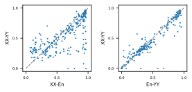

 Figure 9.1: Translation quality (LID-normalized xCOMET) of the OMT-LLaMA model out of (left) and into (right) each language paired with English (horizontal axis) and non-English proxy languages (vertical axis). 

#### 9.1.3 Evaluating long-tail understanding and generation

##### Relative Performance on language understanding in the long tail

We compare our models to open models included in Table [9.1](https://arxiv.org/html/2603.16309v3#S9.T1 "Table 9.1 ‣ 9.1.1 Evaluation framework ‣ 9.1 Automatic evaluation of translation quality ‣ 9 MT Results ‣ Omnilingual MT: Machine Translation for 1,600 Languages"). Figure [9.2](https://arxiv.org/html/2603.16309v3#S9.F2 "Figure 9.2 ‣ Relative Performance on language understanding in the long tail ‣ 9.1.3 Evaluating long-tail understanding and generation ‣ 9.1 Automatic evaluation of translation quality ‣ 9 MT Results ‣ Omnilingual MT: Machine Translation for 1,600 Languages") shows how the OMT models understand the longtail of languages compared to baseline systems on the Bible evaluation benchmark (test split) in terms of ChrF++ and xCOMET for XX-En. The number of languages where OMT-LLaMA 8B strictly outperforms all the baselines in the Bible is 1045 (which is approximately 2/3 of the languages). Furthermore, our 3B model OMT-NLLB consistently outperforms all baselines in the 1,600 evaluated languages. When testing on MetricX and BLASER 3, we obtain similar results.

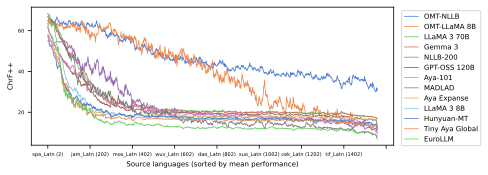

 

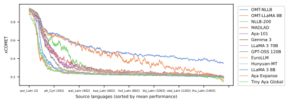

 

Figure 9.2: Relative performance in terms of ChrF++ (top) and XCOMET (bottom) of OMT models in understanding the longtail in the Bible domain compared to external baselines. Languages sorted by average performance of the models; curves smoothed with exponential moving average. 

##### Languages passing the quality bar on understanding the long tail

Beyond the relative performance of models in understanding hundreds of languages, we seek to determine how many languages the OMT models understand ”well enough” in absolute terms. We define a passing quality threshold as an average XSTS+R+P score above 2.5. Based on the definition of XSTS+R+P scores (see Section [8.1](https://arxiv.org/html/2603.16309v3#S8.SS1 "8.1 Human Evaluation Protocol: XSTS+R+P ‣ 8 Proposed Evaluation Metrics and Dataset ‣ Omnilingual MT: Machine Translation for 1,600 Languages")), this roughly means that the system is capable of conveying the core meaning of a sentence in the majority of cases. We rely on MetricX (reference-based) to estimate whether a translation meets this criterion. The primary motivation for using MetricX is that it is a well-established external metric that effectively leverages both target and reference translations. Furthermore, unlike BLASER 3, it is not based on OmniSONAR, thereby avoiding potential bias toward the OMT-NLLB model, which shares the same encoder. We apply a monotonic regression over Met-BOUQuET (restricted to the XX-En directions for direct compatibility with the Bible evaluation setup) to map between MetricX and XSTS+R+P scores (see Figure [9.3](https://arxiv.org/html/2603.16309v3#S9.F3 "Figure 9.3 ‣ Languages passing the quality bar on understanding the long tail ‣ 9.1.3 Evaluating long-tail understanding and generation ‣ 9.1 Automatic evaluation of translation quality ‣ 9 MT Results ‣ Omnilingual MT: Machine Translation for 1,600 Languages")).

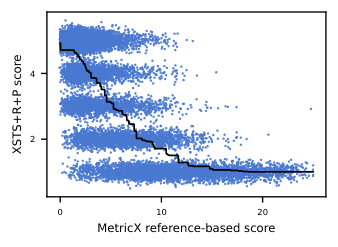

 Figure 9.3: A curve to predict XSTS+R+P scores from reference-based MetricX (on Met-BOUQuET, XX-En subset; to visualize XSTS+R+P distribution, a random jitter has been added to the Y axis). 

We use the Bible benchmark (comprising 1,560 languages) to estimate the average XSTS+R+P score using the MetricX proxy for each source language translated into English. The right panel of Figure [9.4](https://arxiv.org/html/2603.16309v3#S9.F4 "Figure 9.4 ‣ Languages passing the quality bar on understanding the long tail ‣ 9.1.3 Evaluating long-tail understanding and generation ‣ 9.1 Automatic evaluation of translation quality ‣ 9 MT Results ‣ Omnilingual MT: Machine Translation for 1,600 Languages") presents the results of this extrapolation for OMT-LLaMA, OMT-NLLB, and NLLB-200 as a baseline. All three models cover approximately the same number of Bible languages (around 130) at the ”good” quality threshold of at least 3.5 extrapolated XSTS+R+P points on average. However, the number of Bible languages for which the ”passable” quality threshold of 2.5 points is exceeded is substantially larger for the OMT models: 440 languages for the OMT-LLaMA 8B model and 416 languages for OMT-NLLB —nearly double the 221 varieties for which NLLB-200 surpasses this threshold. We therefore conclude that, while we remain far from completely ”solving” machine translation for the long tail of languages, the OMT models double the number of reasonably well-understood source languages compared to previous massively multilingual models.

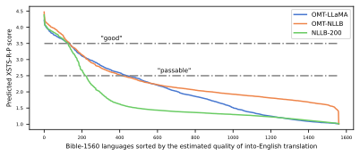

 Figure 9.4:  Predicted XSTS+R+P machine translation quality score for the Bible languages into English using MetricX extrapolation on the test set (languages sorted individually for each of the evaluated models) .

##### Relative Performance on generating the long tail of languages

For reference evaluation, we use the Bible and translate the English part into 1,560 languages; report ChrF++ and LID-adjusted BLASER 3, MetricX (rescaled to 0-1), and xCOMET scores. Results are shown in Figure [9.5](https://arxiv.org/html/2603.16309v3#S9.F5 "Figure 9.5 ‣ Relative Performance on generating the long tail of languages ‣ 9.1.3 Evaluating long-tail understanding and generation ‣ 9.1 Automatic evaluation of translation quality ‣ 9 MT Results ‣ Omnilingual MT: Machine Translation for 1,600 Languages").

For all baseline models and all scores, the quality becomes near-random-level at about 300-400 languages, while for OMT models, it holds for about \(\approx\) 1,200 languages. On the first 150 languages (the intersection of the NLLB-200 set with Bible), the OMT-LLaMA model sometimes underperforms compared to OMT-NLLB and NLLB-200. However, OMT-NLLB nearly always outperforms NLLB-200.

Some limitations of this experiment include that none of our automatic metrics are capable of adequately evaluating the grammaticality/fluency/naturalness of translations into long-tail languages, so we cannot say for sure, for how many languages our translations are “good enough”, without extensive human evaluation results (which are reported for Round 2 of Met-BOUQuET in Section [9.2](https://arxiv.org/html/2603.16309v3#S9.SS2 "9.2 Human Evaluation ‣ 9 MT Results ‣ Omnilingual MT: Machine Translation for 1,600 Languages")). Also, we had to adjust all scores (except ChrF++) by LID, because all models tend to generate outputs in the wrong language. Finally, we admit that we did not do thorough prompt-engineering to ensure that all the long-tail target languages are correctly identified by each of the baseline models, and there might be a room for improvement by using better instructions and/or few-shot examples with the baseline models.

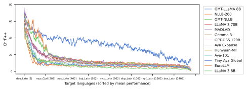

 

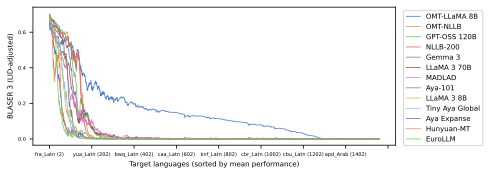

 

Figure 9.5: Relative performance in terms of ChrF++ (top) and LID-adjusted BLASER 3 (bottom) of OMT models in generating the longtail in the Bible domain compared to external baselines. 

#### 9.1.4 Comparing across model sizes and architectures

##### Size vs performance

Given that Omnilingual MT models come in different sizes, it is interesting to explore the size-performance tradeoff. Figure [9.6](https://arxiv.org/html/2603.16309v3#S9.F6 "Figure 9.6 ‣ Size vs performance ‣ 9.1.4 Comparing across model sizes and architectures ‣ 9.1 Automatic evaluation of translation quality ‣ 9 MT Results ‣ Omnilingual MT: Machine Translation for 1,600 Languages") displays the interaction of model size (in billions of parameters) and translation quality (ChrF++) on the BOUQuET dataset (all resource levels, translation into and from Englihs) for OMT-LLaMA and for several other open model families. Across all size categories, the OMT models are outperforming the baseline models of the corresponding size.

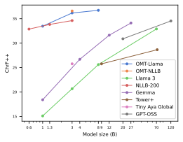

 Figure 9.6: Interaction of model size and translation quality for the OMT models and several other open model families on the BOUQuET dataset (from and into English). 

##### OMT-LLaMA downscaling effect on languages

To see which languages contribute most to the differences in OMT-LLaMA generation and understanding at three different model scales, we plot the per-language LID-adjusted BLASER 3 performance in Figure [9.7](https://arxiv.org/html/2603.16309v3#S9.F7 "Figure 9.7 ‣ OMT-LLaMA downscaling effect on languages ‣ 9.1.4 Comparing across model sizes and architectures ‣ 9.1 Automatic evaluation of translation quality ‣ 9 MT Results ‣ Omnilingual MT: Machine Translation for 1,600 Languages"). The results look qualitatively similar for XX-En and En-YY directions. The 1B model slightly underperforms compared to the larger variants for most languages, but especially for the hardest ones, perhaps because the smaller number of parameters prevents it from learning as efficiently from very low-resourced data or from generalizing to languages never seen in the traning data.

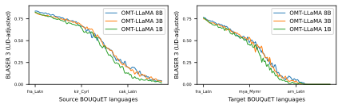

 Figure 9.7: Performance of OMT-LLaMA models on BOUQuET (test set, sentence-level) by language for XX-En translation (left) and En-YY translation (right). Languages sorted by the decreasing performance of the average of the three models; curved smoothed with sliding window. 

##### OMT-LLaMA vs OMT-NLLB

These models share several key characteristics, including language coverage, massively multilingual tokenization, training data, extensibility, and a common LLaMA 3 backbone. However, they differ in certain respects, as detailed in Table [9.5](https://arxiv.org/html/2603.16309v3#S9.T5 "Table 9.5 ‣ OMT-LLaMA vs OMT-NLLB ‣ 9.1.4 Comparing across model sizes and architectures ‣ 9.1 Automatic evaluation of translation quality ‣ 9 MT Results ‣ Omnilingual MT: Machine Translation for 1,600 Languages"). Most notably, OMT-LLaMA models have been instruction-finetuned and therefore are compatible with diverse translation instructions, such as using few-shot prompts, either static or retrieved from a database based on the source text. The OMT-NLLB model has not been trained to support any instructions apart from basic translation, although in principle it can be fine-tuned this way.

Feature |  OMT-LLaMA |  OMT-NLLB  
---|---|---  
Sizes |  1B, 3B, 8B |  3B  
Architecture |  decoder-only |  encoder-decoder  
Understanding Languages |  around 1000 |  almost any language  
Generating Languages |  around 1000 |  around 250  
Zero/few-shot |  few-shot |  0-shot (source side)

 Table 9.5: List of features comparing OMT-LLaMA vs OMT-NLLB models presented in this paper. 

As demonstrated in the previous subsections, the Omnilingual MT models also exhibit variation in relative performance across the translation directions they support. On the input side, OMT-NLLB is the best model when it comes to translating from low- and zero-resourced languages, whereas OMT-LLaMA seems to be competitive for translation from more high-resourced ones. On the output side, the trend is opposite: OMT-NLLB is capable of generating “only” 250 languages, compared to over 1000 languages with OMT-LLaMA, but for many high- and mid-resourced languages, its generation quality is superior.

Further experimental evidence would be required to identify the main factors driving the difference in performance between OMT-LLaMA and OMT-NLLB on the set of translation directions that they both support. Those differences might stem from the architecture (separating the encoder and decoder modules seems to benefit cross-lingual generalization on the input side), the training tasks (with language modeling as a secondary task for OMT-LLaMA and reconstruction, for OMT-NLLB, inducing different competences), the composition of the training data (more imbalanced across languages for OMT-LLaMA than for OMT-NLLB), or even simply the “intensity” of training (how much the language competences are retained from the base model or acquired during continual training) — or a combination of these factors. In future research, a more principled set of experiments could shed more light on the effects of each of these choices.

### 9.2 Human Evaluation

Our human evaluation analysis corresponds to the Met-BOUQuET Round 2 annotations. Details of the data and systems evaluated are in section [8.2](https://arxiv.org/html/2603.16309v3#S8.SS2 "8.2 Met-BOUQuET ‣ 8 Proposed Evaluation Metrics and Dataset ‣ Omnilingual MT: Machine Translation for 1,600 Languages") when describing Round 2. In short, we compare a variety of OMT-LLaMA systems to the strongest baseline in terms of automatic evaluation in the test partition of BOUQuET. The set of languages is given in Table [D](https://arxiv.org/html/2603.16309v3#A4 "Appendix D Languages at a glance ‣ Omnilingual MT: Machine Translation for 1,600 Languages") specified as Met-BOUQuET r2 and the annotation protocol is XSTS+R+P described in Section [8.1](https://arxiv.org/html/2603.16309v3#S8.SS1 "8.1 Human Evaluation Protocol: XSTS+R+P ‣ 8 Proposed Evaluation Metrics and Dataset ‣ Omnilingual MT: Machine Translation for 1,600 Languages").

Direction group | OMT-LLaMA | OMT-LLaMA | Baseline | Num  
---|---|---|---|---  
| Win rate | Mean score | Mean score | Directions  
high-high | 0.75 | 4.03 | 3.45 | 16  
high-low | 0.83 | 2.99 | 1.61 | 18  
low-high | 0.80 | 3.26 | 2.69 | 15  
low-low | 0.62 | 2.96 | 2.66 | 8  
total | 0.77 | 3.38 | 2.67 | 57

 Table 9.6: Average results of Met-BOUQuET Round 2 annotations: OMT-LLaMA win rate, OMT-LLaMA and baseline mean score and number of directions for each. “Win rate” is defined as the proportion of directions with the average scores for OMT-LLaMA higher than for the baseline system.

The currently available annotation results cover 57 directions composed of 80 unique language varieties. Of these 57 directions, in 44 (77%), the OMT-LLaMA system outperforms the baseline, according to the mean XSTS+R+P score. Figure [9.8](https://arxiv.org/html/2603.16309v3#S9.F8 "Figure 9.8 ‣ 9.2 Human Evaluation ‣ 9 MT Results ‣ Omnilingual MT: Machine Translation for 1,600 Languages") and Table [9.6](https://arxiv.org/html/2603.16309v3#S9.T6 "Table 9.6 ‣ 9.2 Human Evaluation ‣ 9 MT Results ‣ Omnilingual MT: Machine Translation for 1,600 Languages") report these results, aggregated by translation direction resource levels (with “high” standing for high- and mid-resource languages, i.e. the ones with at least 1M of primary parallel sentences, and “low” standing for low- and very-low-resource languages).

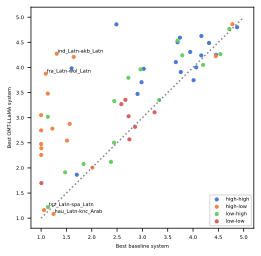

 Figure 9.8: Mean XSTS+R+P scores for each of the 57 directions of Met-Bouquet Round 2 for the OMT system (vertical axis) and the baseline system (horizontal axis). 

The largest improvements of OMT-LLaMA over the baseline systems, in agreement with the automatic evaluation results, are observed when translating from higher-resourced to lower-resourced languages: while the baseline systems often struggle to produce meaningful translations, OMT models generate a significant proportion of least moderate-quality translations. But overall, OMT-LLaMA is outperforming the baselines in each group of directions, and in no directions it lags behind the baseline by more than 0.3 XSTS+R+P points on average.

The three directions where both OMT-LLaMA and the baseline systems produce the majority of minimal scores are Hausa to Central Kanuri (Arabic script), Spanish to Tzotzil, and Purepecha to Spanish. Some directions with the largest Omnilingual MT gains include Indonesian to Batak Angkola, between French and Wolof, and Spanish to Alacatlatzala Mixtec.

Overall, this manual annotation campaign demonstrates the significant progress that Omnilingual MT made in challenging language pairs but shows that much more progress is yet to follow: the evolution from the average score from 2.67 (baseline) to 3.38 (OMT) represents a qualitative jump from “useless” to “useful” for many of the directions, but it is only halfway to the “really good” score of 4 and the “perfect” score of 5.

### 9.3 Added Toxicity Automatic Evaluation

##### Added toxicity definition and experimental framework

Using OmniTOX, we benchmark OMT-LLaMA and OMT-NLLB for added toxicity comparing against Gemma-3-27B and NLLB-200-3B as baselines. We define added toxicity as the increase in toxicity between the source text and its translation, quantified through the difference in OmniTOX logits.

##### Language debiasing

To mitigate inherent language-level biases in the classifier, we establish per-language baselines using the BOUQuET dataset, which contains professionally crafted, non-toxic sentences across a comprehensive set of languages. For each language \(l\), we compute the mean logit \(\mu_{l}=\mathbb{E}[z\mid\text{language}=l]\) from both source and target texts in BOUQuET. Each raw logit \(z\) is then debiased as \(z_{\text{debiased}}=z-\mu_{l}\).

##### Added toxicity computation

For a translation pair, added toxicity (\(\Delta\)) is computed as the difference between debiased logits:

\[\begin{aligned}
 & \Delta=z_{\text{tgt}}^{\text{debiased}}-z_{\text{src}}^{\text{debiased}} &  & \text{(5)}
\end{aligned}\]

 

where \(z_{\text{src}}^{\text{debiased}}\) and \(z_{\text{tgt}}^{\text{debiased}}\) are the debiased logits for the source and target texts, respectively. When either language lacks a baseline (i.e., is not represented in BOUQuET), we use raw logits for both source and target to ensure consistent comparisons.

##### Threshold calibration

We calibrate flagging thresholds using BOUQuET to achieve an approximate 5% False Positive Rate (FPR). Specifically, we compute the 95th percentile of the \(\Delta\) distribution. To account for variation across translation directions, we compute _per-direction thresholds_ \(\tau_{l_{s}\rightarrow l_{t}}\) for each direction available in BOUQuET. For the other directions, we fall back to a _global threshold_ \(\tau_{\text{global}}\) computed across all BOUQuET translation pairs.

##### Flagging criterion

A translation is flagged for added toxicity if it satisfies two conditions:

\[\begin{aligned}
 & \Delta>\tau\hskip 10.00002pt\text{and}\hskip 10.00002ptp_{\text{tgt}}>0.20 &  & \text{(6)}
\end{aligned}\]

 

where \(\tau\) is the per-direction threshold \(\tau_{l_{s}\rightarrow l_{t}}\) when available, or the global threshold \(\tau_{\text{global}}\) otherwise. The probability constraint (\(p_{\text{tgt}}=\sigma(z_{\text{tgt}})>0.20\)) filters out false positives arising from minor fluctuations at low toxicity levels, where small logit changes can produce disproportionately large relative differences.

##### Results

Table [9.7](https://arxiv.org/html/2603.16309v3#S9.T7 "Table 9.7 ‣ Results ‣ 9.3 Added Toxicity Automatic Evaluation ‣ 9 MT Results ‣ Omnilingual MT: Machine Translation for 1,600 Languages") shows the average added toxicity and flagging rates across 207 languages available in BOUQuET at the time of this experiment. Overall, none of the evaluated systems exhibit meaningful added toxicity, with flagging rates remaining below 1.5% across all configurations. This suggests that both our systems and the external baselines reliably preserve the toxicity profile of source texts during translation. Note that similarly to FLoRes+, BOUQuET may be limited for triggering added toxicity, and in the future, we can consider using more adequate datasets e.g. ([Tan et al., 2025](https://arxiv.org/html/2603.16309v3#bib.bib119)).

We observe a directional asymmetry that correlates with model architecture. Encoder-decoder models (NLLB-200-3B and OMT-NLLB) show slightly higher added toxicity for X\(\rightarrow\)Eng translations, whereas decoder-only LLMs (Gemma-3-27B and OMT-LLaMA) exhibit the opposite pattern, with marginally higher values for Eng\(\rightarrow\)X. While the absolute differences are small, this consistency across architectures suggests a systematic effect that may warrant further investigation.

<table id="S9.T7.3" class="ltx_tabular ltx_centering ltx_align_middle">
<tr id="S9.T7.3.1" class="ltx_tr">
<td id="S9.T7.3.1.1" class="ltx_td ltx_align_left ltx_border_r ltx_border_tt">System</td>
<td id="S9.T7.3.1.2" class="ltx_td ltx_align_center ltx_border_r ltx_border_tt" colspan="2">Average Added Toxicity</td>
<td id="S9.T7.3.1.3" class="ltx_td ltx_align_center ltx_border_tt" colspan="2">Flagging Rate</td></tr>
<tr id="S9.T7.3.2" class="ltx_tr">
<td id="S9.T7.3.2.1" class="ltx_td ltx_border_r ltx_border_t"></td>
<td id="S9.T7.3.2.2" class="ltx_td ltx_align_center ltx_border_t">XX-En</td>
<td id="S9.T7.3.2.3" class="ltx_td ltx_align_center ltx_border_r ltx_border_t">En-YY</td>
<td id="S9.T7.3.2.4" class="ltx_td ltx_align_center ltx_border_t">XX-En</td>
<td id="S9.T7.3.2.5" class="ltx_td ltx_align_center ltx_border_t">En-YY</td></tr>
<tr id="S9.T7.3.3" class="ltx_tr">
<td id="S9.T7.3.3.1" class="ltx_td ltx_align_left ltx_border_r ltx_border_t">NLLB-200-3B</td>
<td id="S9.T7.3.3.2" class="ltx_td ltx_align_center ltx_border_t">0.19</td>
<td id="S9.T7.3.3.3" class="ltx_td ltx_align_center ltx_border_r ltx_border_t">-0.20</td>
<td id="S9.T7.3.3.4" class="ltx_td ltx_align_center ltx_border_t">1.10%</td>
<td id="S9.T7.3.3.5" class="ltx_td ltx_align_center ltx_border_t">0.07%</td></tr>
<tr id="S9.T7.3.4" class="ltx_tr">
<td id="S9.T7.3.4.1" class="ltx_td ltx_align_left ltx_border_r">Gemma-3-27b</td>
<td id="S9.T7.3.4.2" class="ltx_td ltx_align_center">-0.20</td>
<td id="S9.T7.3.4.3" class="ltx_td ltx_align_center ltx_border_r">0.07</td>
<td id="S9.T7.3.4.4" class="ltx_td ltx_align_center">0.25%</td>
<td id="S9.T7.3.4.5" class="ltx_td ltx_align_center">0.06%</td></tr>
<tr id="S9.T7.3.5" class="ltx_tr">
<td id="S9.T7.3.5.1" class="ltx_td ltx_align_left ltx_border_r ltx_border_t">OMT-NLLB</td>
<td id="S9.T7.3.5.2" class="ltx_td ltx_align_center ltx_border_t">0.02</td>
<td id="S9.T7.3.5.3" class="ltx_td ltx_align_center ltx_border_r ltx_border_t">-0.17</td>
<td id="S9.T7.3.5.4" class="ltx_td ltx_align_center ltx_border_t">0.69%</td>
<td id="S9.T7.3.5.5" class="ltx_td ltx_align_center ltx_border_t">0.04%</td></tr>
<tr id="S9.T7.3.6" class="ltx_tr">
<td id="S9.T7.3.6.1" class="ltx_td ltx_align_left ltx_border_bb ltx_border_r">OMT-LLaMA</td>
<td id="S9.T7.3.6.2" class="ltx_td ltx_align_center ltx_border_bb">-0.07</td>
<td id="S9.T7.3.6.3" class="ltx_td ltx_align_center ltx_border_bb ltx_border_r">0.17</td>
<td id="S9.T7.3.6.4" class="ltx_td ltx_align_center ltx_border_bb">0.52%</td>
<td id="S9.T7.3.6.5" class="ltx_td ltx_align_center ltx_border_bb">0.06%</td></tr>
</table>

 Table 9.7: Average Added Toxicity and Flagging Rate (%) on BOUQuET dataset for 207 languages.

## 10 Extensibility of OMT-LLaMA

##### Motivation

An omnilingual model, by definition, intends to provide support for any language. In many practical use cases, however, MT models are applied to a limited subset of language pairs and optimized for improved translation quality for that subset. In this section, we select several difficult languages and explore how the OMT-LLaMA models could be extended for their improved support using additional data. We consider two approaches of feeding this focused data to models: via fine-tuning (already described in Section [6.3.1](https://arxiv.org/html/2603.16309v3#S6.SS3.SSS1 "6.3.1 Supervised Fine-Tuning ‣ 6.3 Post-training ‣ 6 Decoder-only Modeling ‣ Omnilingual MT: Machine Translation for 1,600 Languages")) and through retrieval-augmented translation (explored in Section [6.4](https://arxiv.org/html/2603.16309v3#S6.SS4 "6.4 Retrieval-Augmented Translation ‣ 6 Decoder-only Modeling ‣ Omnilingual MT: Machine Translation for 1,600 Languages")).

##### Languages

For extension experiments, we selected the languages among those for which the OMT-LLaMA model demonstrated low performance on BOUQuET (mostly low- and very-low-resourced ones), either in understanding or in generation, with the additional criterion of being included in the version of MeDLEy available at the time of the experiment.4141 41 These languages are azb_Arab, bam_Latn, dik_Latn, fuv_Latn, kam_Latn, kmb_Latn, lug_Latn, mam_Latn, miq_Latn, mos_Latn, pcm_Latn, sba_Latn, shn_Mymr, tsz_Latn, tzh_Latn, umb_Latn, vmw_Latn, wol_Latn, yor_Latn, yua_Latn. In addition, we selected 5 mid-resourced moderately difficult BOUQuET languages4242 42 gaz_Latn, lin_Latn, mya_Mymr, swh_Latn, tir_Ethi. We tune the systems of this section for translation of these 25 languages into and out of English.

##### Data

For the selected 25 languages, for both fine-tuning and retrieval, we use a subset of primary (non-synthetic) parallel data already described in Section [4.1](https://arxiv.org/html/2603.16309v3#S4.SS1 "4.1 Main CPT Training Data Collection ‣ 4 Creating High-Quality Datasets ‣ Omnilingual MT: Machine Translation for 1,600 Languages"). The number of parallel examples (mostly sentences, but also words in case of Panlex and paragraphs in case of MeDLEy) per language ranges from 300K (Swahili) to 11K (Ngambay). Note that because a large part of the data comes from massively parallel sources (such as the Bible or MeDLEy), the same English texts often appear multiple times in it, paired with different languages.

##### Experimental setup

We use the above data for addapting models to translation of specific languages in two ways: via fine-tuning and via retrieval-augmented translation. We compare two models as the base model for fine-tuning and direct translation:

  * LLaMA-base: the original LLaMA 3.1 8B Instruct model without any modifications; 
  * OMT-LLaMA: the 8B version of OMT-LLaMA that underwent the standard Omnilingual MT continual pretraining (as described in Section [6.2](https://arxiv.org/html/2603.16309v3#S6.SS2 "6.2 Continued Pretraining ‣ 6 Decoder-only Modeling ‣ Omnilingual MT: Machine Translation for 1,600 Languages")) and then was fine-tuned only with the OMT-base-FTdata dataset (which does not include the low-resourced languages) to isolate the effect of massively multilingual fine-tuning data. 

For all the baselines and the models fine-tuned in this section, we evaluate retrieval-augmented translation as well as standard translation with the minimalistic prompt. We report ChrF++ and LID-augmented BLASER 3 scores on the BOUQuET dataset (sentence-level part).

<table id="S10.T1.3" class="ltx_tabular ltx_centering ltx_align_middle">
<tr id="S10.T1.3.1" class="ltx_tr">
<td id="S10.T1.3.1.1" class="ltx_td ltx_align_left ltx_border_r ltx_border_tt">Metric</td>
<td id="S10.T1.3.1.2" class="ltx_td ltx_align_center ltx_border_r ltx_border_tt" colspan="4">ChrF++</td>
<td id="S10.T1.3.1.3" class="ltx_td ltx_align_center ltx_border_tt" colspan="4">BLASER 3 + LID</td></tr>
<tr id="S10.T1.3.2" class="ltx_tr">
<td id="S10.T1.3.2.1" class="ltx_td ltx_align_left ltx_border_r">Languages</td>
<td id="S10.T1.3.2.2" class="ltx_td ltx_align_center" colspan="2">20 hardest</td>
<td id="S10.T1.3.2.3" class="ltx_td ltx_align_center ltx_border_r" colspan="2">5 hard</td>
<td id="S10.T1.3.2.4" class="ltx_td ltx_align_center" colspan="2">20 hardest</td>
<td id="S10.T1.3.2.5" class="ltx_td ltx_align_center" colspan="2">5 hard</td></tr>
<tr id="S10.T1.3.3" class="ltx_tr">
<td id="S10.T1.3.3.1" class="ltx_td ltx_align_left ltx_border_r">Direction</td>
<td id="S10.T1.3.3.2" class="ltx_td ltx_align_right">En-YY</td>
<td id="S10.T1.3.3.3" class="ltx_td ltx_align_right">XX-En</td>
<td id="S10.T1.3.3.4" class="ltx_td ltx_align_right">En-YY</td>
<td id="S10.T1.3.3.5" class="ltx_td ltx_align_right ltx_border_r">XX-En</td>
<td id="S10.T1.3.3.6" class="ltx_td ltx_align_right">En-YY</td>
<td id="S10.T1.3.3.7" class="ltx_td ltx_align_right">XX-En</td>
<td id="S10.T1.3.3.8" class="ltx_td ltx_align_right">En-YY</td>
<td id="S10.T1.3.3.9" class="ltx_td ltx_align_right">XX-En</td></tr>
<tr id="S10.T1.3.4" class="ltx_tr">
<td id="S10.T1.3.4.1" class="ltx_td ltx_align_left ltx_border_r ltx_border_t">OMT-LLaMA + FT + RAG</td>
<td id="S10.T1.3.4.2" class="ltx_td ltx_align_right ltx_border_t" style="--ltx-bg-color:#023858;"> 29.25</td>
<td id="S10.T1.3.4.3" class="ltx_td ltx_align_right ltx_border_t" style="--ltx-bg-color:#023858;"> 36.67</td>
<td id="S10.T1.3.4.4" class="ltx_td ltx_align_right ltx_border_t" style="--ltx-bg-color:#023E62;"> 46.74</td>
<td id="S10.T1.3.4.5" class="ltx_td ltx_align_right ltx_border_r ltx_border_t" style="--ltx-bg-color:#023F64;"> 53.22</td>
<td id="S10.T1.3.4.6" class="ltx_td ltx_align_right ltx_border_t" style="--ltx-bg-color:#023858;"> 0.2577</td>
<td id="S10.T1.3.4.7" class="ltx_td ltx_align_right ltx_border_t" style="--ltx-bg-color:#023A5B;"> 0.3427</td>
<td id="S10.T1.3.4.8" class="ltx_td ltx_align_right ltx_border_t" style="--ltx-bg-color:#023C5F;"> 0.4682</td>
<td id="S10.T1.3.4.9" class="ltx_td ltx_align_right ltx_border_t" style="--ltx-bg-color:#023C5F;"> 0.6349</td></tr>
<tr id="S10.T1.3.5" class="ltx_tr">
<td id="S10.T1.3.5.1" class="ltx_td ltx_align_left ltx_border_r">OMT-LLaMA + FT</td>
<td id="S10.T1.3.5.2" class="ltx_td ltx_align_right" style="--ltx-bg-color:#023C5F;"> 28.91</td>
<td id="S10.T1.3.5.3" class="ltx_td ltx_align_right" style="--ltx-bg-color:#69A5CC;"> 29.03</td>
<td id="S10.T1.3.5.4" class="ltx_td ltx_align_right" style="--ltx-bg-color:#023858;"> 47.49</td>
<td id="S10.T1.3.5.5" class="ltx_td ltx_align_right ltx_border_r" style="--ltx-bg-color:#5A9EC9;"> 42.69</td>
<td id="S10.T1.3.5.6" class="ltx_td ltx_align_right" style="--ltx-bg-color:#023B5D;"> 0.2547</td>
<td id="S10.T1.3.5.7" class="ltx_td ltx_align_right" style="--ltx-bg-color:#0567A2;"> 0.3010</td>
<td id="S10.T1.3.5.8" class="ltx_td ltx_align_right" style="--ltx-bg-color:#023858;"> 0.4747</td>
<td id="S10.T1.3.5.9" class="ltx_td ltx_align_right" style="--ltx-bg-color:#1C7FB8;"> 0.5285</td></tr>
<tr id="S10.T1.3.6" class="ltx_tr">
<td id="S10.T1.3.6.1" class="ltx_td ltx_align_left ltx_border_r">OMT-LLaMA + RAG</td>
<td id="S10.T1.3.6.2" class="ltx_td ltx_align_right" style="--ltx-bg-color:#04598C;"> 26.79</td>
<td id="S10.T1.3.6.3" class="ltx_td ltx_align_right" style="--ltx-bg-color:#023F64;"> 36.18</td>
<td id="S10.T1.3.6.4" class="ltx_td ltx_align_right" style="--ltx-bg-color:#034E7B;"> 44.84</td>
<td id="S10.T1.3.6.5" class="ltx_td ltx_align_right ltx_border_r" style="--ltx-bg-color:#023858;"> 53.96</td>
<td id="S10.T1.3.6.6" class="ltx_td ltx_align_right" style="--ltx-bg-color:#034267;"> 0.2486</td>
<td id="S10.T1.3.6.7" class="ltx_td ltx_align_right" style="--ltx-bg-color:#023858;"> 0.3445</td>
<td id="S10.T1.3.6.8" class="ltx_td ltx_align_right" style="--ltx-bg-color:#034369;"> 0.4595</td>
<td id="S10.T1.3.6.9" class="ltx_td ltx_align_right" style="--ltx-bg-color:#023858;"> 0.6420</td></tr>
<tr id="S10.T1.3.7" class="ltx_tr">
<td id="S10.T1.3.7.1" class="ltx_td ltx_align_left ltx_border_r">OMT-LLaMA</td>
<td id="S10.T1.3.7.2" class="ltx_td ltx_align_right" style="--ltx-bg-color:#0872B1;"> 24.12</td>
<td id="S10.T1.3.7.3" class="ltx_td ltx_align_right" style="--ltx-bg-color:#4E9AC6;"> 29.92</td>
<td id="S10.T1.3.7.4" class="ltx_td ltx_align_right" style="--ltx-bg-color:#045D92;"> 43.01</td>
<td id="S10.T1.3.7.5" class="ltx_td ltx_align_right ltx_border_r" style="--ltx-bg-color:#056AA6;"> 48.43</td>
<td id="S10.T1.3.7.6" class="ltx_td ltx_align_right" style="--ltx-bg-color:#046198;"> 0.2178</td>
<td id="S10.T1.3.7.7" class="ltx_td ltx_align_right" style="--ltx-bg-color:#045D92;"> 0.3135</td>
<td id="S10.T1.3.7.8" class="ltx_td ltx_align_right" style="--ltx-bg-color:#034E7B;"> 0.4422</td>
<td id="S10.T1.3.7.9" class="ltx_td ltx_align_right" style="--ltx-bg-color:#034D79;"> 0.6130</td></tr>
<tr id="S10.T1.3.8" class="ltx_tr">
<td id="S10.T1.3.8.1" class="ltx_td ltx_align_left ltx_border_r">LLaMA-base + FT + RAG</td>
<td id="S10.T1.3.8.2" class="ltx_td ltx_align_right" style="--ltx-bg-color:#60A1CA;"> 20.11</td>
<td id="S10.T1.3.8.3" class="ltx_td ltx_align_right" style="--ltx-bg-color:#88B1D4;">27.94</td>
<td id="S10.T1.3.8.4" class="ltx_td ltx_align_right" style="--ltx-bg-color:#5EA0CA;"> 33.16</td>
<td id="S10.T1.3.8.5" class="ltx_td ltx_align_right ltx_border_r" style="--ltx-bg-color:#79ABD0;"> 40.93</td>
<td id="S10.T1.3.8.6" class="ltx_td ltx_align_right" style="--ltx-bg-color:#589EC8;"> 0.1514</td>
<td id="S10.T1.3.8.7" class="ltx_td ltx_align_right" style="--ltx-bg-color:#3790C0;"> 0.2630</td>
<td id="S10.T1.3.8.8" class="ltx_td ltx_align_right" style="--ltx-bg-color:#509AC6;"> 0.3109</td>
<td id="S10.T1.3.8.9" class="ltx_td ltx_align_right" style="--ltx-bg-color:#4496C3;"> 0.4950</td></tr>
<tr id="S10.T1.3.9" class="ltx_tr">
<td id="S10.T1.3.9.1" class="ltx_td ltx_align_left ltx_border_r">LLaMA-base + FT</td>
<td id="S10.T1.3.9.2" class="ltx_td ltx_align_right" style="--ltx-bg-color:#73A9CF;"> 19.37</td>
<td id="S10.T1.3.9.3" class="ltx_td ltx_align_right" style="--ltx-bg-color:#ACC0DD;">26.39</td>
<td id="S10.T1.3.9.4" class="ltx_td ltx_align_right" style="--ltx-bg-color:#7BACD1;"> 31.17</td>
<td id="S10.T1.3.9.5" class="ltx_td ltx_align_right ltx_border_r" style="--ltx-bg-color:#9CB9D9;">38.82</td>
<td id="S10.T1.3.9.6" class="ltx_td ltx_align_right" style="--ltx-bg-color:#71A8CE;"> 0.1399</td>
<td id="S10.T1.3.9.7" class="ltx_td ltx_align_right" style="--ltx-bg-color:#549CC7;"> 0.2504</td>
<td id="S10.T1.3.9.8" class="ltx_td ltx_align_right" style="--ltx-bg-color:#76AAD0;"> 0.2804</td>
<td id="S10.T1.3.9.9" class="ltx_td ltx_align_right" style="--ltx-bg-color:#7BACD1;"> 0.4530</td></tr>
<tr id="S10.T1.3.10" class="ltx_tr">
<td id="S10.T1.3.10.1" class="ltx_td ltx_align_left ltx_border_r">LLaMA-base + RAG</td>
<td id="S10.T1.3.10.2" class="ltx_td ltx_align_right" style="--ltx-bg-color:#99B8D8;">17.50</td>
<td id="S10.T1.3.10.3" class="ltx_td ltx_align_right" style="--ltx-bg-color:#E9E5F1;">22.93</td>
<td id="S10.T1.3.10.4" class="ltx_td ltx_align_right" style="--ltx-bg-color:#C5CCE3;">25.01</td>
<td id="S10.T1.3.10.5" class="ltx_td ltx_align_right ltx_border_r" style="--ltx-bg-color:#F1EBF4;">31.07</td>
<td id="S10.T1.3.10.6" class="ltx_td ltx_align_right" style="--ltx-bg-color:#ABBFDC;">0.1049</td>
<td id="S10.T1.3.10.7" class="ltx_td ltx_align_right" style="--ltx-bg-color:#ABBFDC;">0.2064</td>
<td id="S10.T1.3.10.8" class="ltx_td ltx_align_right" style="--ltx-bg-color:#D3D4E7;">0.1824</td>
<td id="S10.T1.3.10.9" class="ltx_td ltx_align_right" style="--ltx-bg-color:#D7D6E9;">0.3584</td></tr>
<tr id="S10.T1.3.11" class="ltx_tr">
<td id="S10.T1.3.11.1" class="ltx_td ltx_align_left ltx_border_bb ltx_border_r">LLaMA-base</td>
<td id="S10.T1.3.11.2" class="ltx_td ltx_align_right ltx_border_bb" style="--ltx-bg-color:#FFF7FB;">9.35</td>
<td id="S10.T1.3.11.3" class="ltx_td ltx_align_right ltx_border_bb" style="--ltx-bg-color:#FFF7FB;">20.71</td>
<td id="S10.T1.3.11.4" class="ltx_td ltx_align_right ltx_border_bb" style="--ltx-bg-color:#FFF7FB;">16.07</td>
<td id="S10.T1.3.11.5" class="ltx_td ltx_align_right ltx_border_bb ltx_border_r" style="--ltx-bg-color:#FFF7FB;">28.66</td>
<td id="S10.T1.3.11.6" class="ltx_td ltx_align_right ltx_border_bb" style="--ltx-bg-color:#FFF7FB;">0.0184</td>
<td id="S10.T1.3.11.7" class="ltx_td ltx_align_right ltx_border_bb" style="--ltx-bg-color:#FFF7FB;">0.1285</td>
<td id="S10.T1.3.11.8" class="ltx_td ltx_align_right ltx_border_bb" style="--ltx-bg-color:#FFF7FB;">0.0917</td>
<td id="S10.T1.3.11.9" class="ltx_td ltx_align_right ltx_border_bb" style="--ltx-bg-color:#FFF7FB;">0.2779</td></tr>
</table>

 Table 10.1: Results of extending the OMT-LLaMA and LLaMA-base models via focused fine-tuning, retrieval augmentation, or both. Reported on the dev split of BOUQuET, for 20 hard languages and 5 mid-resourced languages.

##### Fine-tuning

As a base fine-tuning experiment, we mix the parallel data described above (all 25 languages from and into English) with OMT-base-FTdata (in equal proportion) and fine-tune each of the three baseline models with the same hyperparameters as in Section [6.3.1](https://arxiv.org/html/2603.16309v3#S6.SS3.SSS1 "6.3.1 Supervised Fine-Tuning ‣ 6.3 Post-training ‣ 6 Decoder-only Modeling ‣ Omnilingual MT: Machine Translation for 1,600 Languages"). As Table [10.1](https://arxiv.org/html/2603.16309v3#S10.T1 "Table 10.1 ‣ Experimental setup ‣ 10 Extensibility of OMT-LLaMA ‣ Omnilingual MT: Machine Translation for 1,600 Languages") shows, fine-tuning on average improves out-of-English results, but is detrimental for into-English translation. We hypothesize that it is the same effect as observed in the SMOL paper ([Caswell et al., 2025](https://arxiv.org/html/2603.16309v3#bib.bib10)), with the model degenerating after training on repetitive English outputs.

##### RAG

We use a simplified version of the retrieval algorithm described in Section [6.4](https://arxiv.org/html/2603.16309v3#S6.SS4 "6.4 Retrieval-Augmented Translation ‣ 6 Decoder-only Modeling ‣ Omnilingual MT: Machine Translation for 1,600 Languages"), with TF-IDF matching of words only (without extra retrieval with embeddings or on-the-fly mining). As Table [10.1](https://arxiv.org/html/2603.16309v3#S10.T1 "Table 10.1 ‣ Experimental setup ‣ 10 Extensibility of OMT-LLaMA ‣ Omnilingual MT: Machine Translation for 1,600 Languages") shows, RAG almost always leads to improvement both of the baseline model and of the fine-tuned models (despite the latter have been exposed to the same data during fine-tuning), with the only exception of translation into the 5 mid-resourced languages.

##### Comparison with LLaMA-base

The results of applying focused fine-tuning and RAG to the base LLaMA 3 model are mostly qualitatively similar to those obtained for OMT-LLaMA: finetuning is crucial for reaching good En-YY translation, whereas RAG is sufficient for reaping a large part of the improvements in XX-En results, and the positive effects of these two techniques add up. One difference between LLaMA-base and OMT-LLaMA is that the former doesn’t exhibit the negative effects of fine-tuning on XX-En translation, maybe simply because of the low base effect. But, crucially, even after applying a combination of instruction fine-tuning and RAG translation, the base LLaMA model does not outperform the unadapted OMT-LLaMA model, highlighting that OMT-LLaMA is a strongly preferable base model for adaptation into a translation model specialized on certain language pairs.

##### Conclusions

Both fine-tuning and RAG, when applied to a focused set of languages, yield improved translation performance, enabling targeted customization of the OMT-LLaMA model. The two techniques are complementary: fine-tuning is particularly effective for translation into challenging languages, while RAG is essential for enhancing translation quality from these languages.

## 11 Conclusion

Omnilingual MT demonstrates that scaling multilingual translation is not simply a matter of increasing the number of supported languages, but of rethinking how MT systems are built, trained, and evaluated. Expanding from 200 to more than one thousand languages required coordinated advances across every layer of the pipeline. Our data strategy — combining massive public corpora with newly created resources such as MeDLEy and BOUQuET bitext, deliberate data creation targeting linguistic varieties, domains, and registers that existing corpora overlook—allows us to improve translation generation quality and more meaningfully evaluate long-tail coverage. Our modeling strategy — based on pretrained language models with extended tokenizer vocabulary — encompassed 2 distinct architectures. Our decoder-only models (OMT-LLaMA) introduce only minimal changes to the architecture and training scheme of standard language models that are necessary to support over a thousand languages. Our encoder-decoder (OMT-NLLB) model introduces a novel three-stage training strategy that effectively exploits non-parallel data to achieve substantial quality improvements.

Omnilingual MT models deliver strong, consistent gains for broad-coverage languages, and provides the first non-trivial MT for hundreds of emerging-support languages where no usable systems previously existed. Our evaluation efforts further show that our 1B to 8B parameter specialized MT models can match or exceed the MT performance of a 70B LLM, offering a clear Pareto improvement and enabling high-quality translation in low-compute real-world settings. Our English-to-1,600 evaluation additionally reveals a consistent failure mode in existing systems: while many models can interpret undersupported languages, they frequently cannot generate them with meaningful fidelity. Omnilingual MT dramatically improves in cross-lingual transfer, being close to solving the “understanding” part of the puzzle in MT; and it substantially expands the set of languages for which coherent generation is feasible, underscoring the central bottleneck for genuine large-scale language coverage: robust generation in under-resourced languages. We also show that targeted techniques such as finetuning and retrieval-augmented generation can yield further quality improvements in our models when additional data in the languages and domains of interest is available.

Our experiments show that post-training techniques targeting multilingual extension of models do not compensate the lack of large improvements obtained by embracing massively multilingual training data and vocabulary in the earlier stages of training. Therefore, our findings should motivate model researchers and developers interested in boosting multilingual tasks performance to gather high-quality massively multilingual data and train models that are highly multilingual by design and are well equipped to extend their support to any additional language, if necessary.

Taken together, Omnilingual MT positions large-scale inclusion as an ongoing technical and scientific challenge — one that demands continued investment in data creation, architecture design, evaluation methodology, and under-resourced-language generation capabilities. By pairing broad coverage with efficient specialization and flexible avenues for improvement, Omnilingual MT provides inspiration for future research and applications across translation, multilingual LLM development, and speech-to-text systems. Ultimately, setting a baseline for 1,600 languages is therefore not a terminus but an encouragement to sustained innovation in pursuit of genuinely inclusive language technology.

Our key dataset for massively multilingual evaluation of machine translation, BOUQuET (including its Met-BOUQuET extension with human judgments of translation quality) is publicly available, enabling researchers from anywhere to reproduce our evaluation results. Moreover, we hope that our MeDLEy detailed guidelines can be used to create more high-quality and diverse data. Finally, we encourage the scientific community to use our OMT-LLaMA, OMT-NLLB, BLASER 3 and OmniTOX recipes to develop and release yet other radically inclusive foundational models for machine translation, evaluation, and general-purpose massively multilingual language processing.

## 12 Contribution Statements

{spacing}

0.9

We outline the contributions of each member of Omnilingual MT. However, there are no possible words to describe the emotional dedication stemming from the multilingual passion that characterizes this team.

Data

Niyati Bafna - designed and led efforts on MeDLEy

Andrea Caciolai - led experiments on backtranslation, contributed to the creation of MeDLEy and led its experiments, supported OMT-NLLB data curation

Jean Maillard - managed linguistic partnerships and community engagement, coordinating with language communities and external organizations

Holger Schwenk - inspired large scale data mining

Modeling

Belen Alastruey - led, designed and drove efforts for OMT-NLLB

Pere Lluís Huguet Cabot, João Maria Janeiro - contributed to the training of OMT-NLLB

Paul-Ambroise Duquenne - contributed to the technical supervision of OMT-NLLB

Kevin Heffernan - drove CPT experiments, parallel mining, contributed to model scaling, vocabulary extension

Artyom Kozhevnikov - drove retrieval-augmented translation experiments

Eduardo Sánchez - designed and drove efforts on OMT-LLaMA post-training

Edan Toledo - contributed to post-training experiments, implementing the RL stage

Ioannis Tsiamas - spearheaded the development of BLASER 3 and engineered data pipelines for CPT

Evaluation

Chierh Cheng, Joe Chuang, Gabriel Mejia Gonzalez - insured the quality of manual translations and annotations

Mark Duppenthaler - developed the online BOUQuET collection tool

Nate Ekberg, Cynthia Gao - drove relationships with language service providers

Christophe Ropers - led the linguistic team and data creation efforts across MeDLEy, BOUQuET, Met-BOUQuET and XSTS+R+P

Charles-Eric Saint-James - developed OmniTOX and added toxicity analysis, built data pipelines and ran data validation for Met-BOUQuET

Arina Turkatenko - led extensive analysis on the quality of manual translations and annotations

Albert Ventayol-Boada - led linguistic efforts and feature retention analysis in MeDLEy, led language selection across projects, and contributed to translation quality and error analyses

Project management

Rashel Moritz - Technical Program Manager, coordinated the Language Technology Partnership Program

Alexandre Mourachko - Research Manager, helped with the overall direction, strategy and resourcing plan and supported data efforts

Surya Parimi - Technical Program Manager, supported data efforts

Shireen Yates - Product Manager, helped with the overall direction and strategy

Mary Williamson - Research director, helped with overall direction and strategy

Technical leadership

David Dale - co-technical lead, devised the continual pretraining framework, led the direction of the family of models strategy, coordinated engineering efforts across the team

Marta R. Costa-jussà - co-technical lead, led the overall direction for evaluation, main driver on BOUQuET, Met-BOUQuET, BLASER 3, OmniTOX, XSTS+R+P

## Acknowledgements

We extend our thanks to Mikel Artetxe for his continued support and partnering while brainstorming modeling directions. We thank Sebastian Ruder for his feedback on early drafts of the paper. We thank Anaelia Ovalle for the discussions and her involvement on exploration experiments on agentic extensions of the model. We thank Luke Zettlemoyer for his guidance and feedback on the project strategy. Finally, we thank all the participants of the Language Technology Partnership Program, for their contributions and keen interest in our workshops as well as the contributors to the BOUQuET open-initiative.

## References

  * Adelani et al. (2021) D. I. Adelani, D. Ruiter, J. O. Alabi, D. Adebonojo, A. Ayeni, M. Adeyemi, A. E. Awokoya, and C. España-Bonet The effect of domain and diacritics in Yoruba–English neural machine translation.  In Proceedings of Machine Translation Summit XVIII: Research Track, K. Duh and F. Guzmán (Eds.),  Virtual, pp. 61–75.  External Links: [Link](https://aclanthology.org/2021.mtsummit-research.6/) Cited by: [§4.3.1](https://arxiv.org/html/2603.16309v3#S4.SS3.SSS1.p2.1 "4.3.1 Motivation and related work ‣ 4.3 Seed Data for Post-Training: MeDLEy ‣ 4 Creating High-Quality Datasets ‣ Omnilingual MT: Machine Translation for 1,600 Languages"). 
  * Aharoni et al. (2019) R. Aharoni, M. Johnson, and O. Firat Massively Multilingual Neural Machine Translation.  In Proceedings of the 2019 Conference of the North American Chapter of the Association for Computational Linguistics: Human Language Technologies, Volume 1 (Long and Short Papers), J. Burstein, C. Doran, and T. Solorio (Eds.),  Minneapolis, Minnesota, pp. 3874–3884.  External Links: [Link](https://aclanthology.org/N19-1388/), [Document](https://dx.doi.org/10.18653/v1/N19-1388) Cited by: [§7.1](https://arxiv.org/html/2603.16309v3#S7.SS1.SSS0.Px3.p3.1 "Results. ‣ 7.1 Leveraging an Aligned Encoder for Enhanced Decoder Training ‣ 7 Encoder-Decoder Modeling ‣ Omnilingual MT: Machine Translation for 1,600 Languages"). 
  * Ahmed et al. (2023) N. Ahmed, N. Flechas Manrique, and A. Petrović Enhancing Spanish-Quechua machine translation with pre-trained models and diverse data sources: LCT-EHU at AmericasNLP shared task.  In Proceedings of the Workshop on Natural Language Processing for Indigenous Languages of the Americas (AmericasNLP), M. Mager, A. Ebrahimi, A. Oncevay, E. Rice, S. Rijhwani, A. Palmer, and K. Kann (Eds.),  Toronto, Canada, pp. 156–162.  External Links: [Link](https://aclanthology.org/2023.americasnlp-1.16/), [Document](https://dx.doi.org/10.18653/v1/2023.americasnlp-1.16) Cited by: [§4.3.1](https://arxiv.org/html/2603.16309v3#S4.SS3.SSS1.p2.1 "4.3.1 Motivation and related work ‣ 4.3 Seed Data for Post-Training: MeDLEy ‣ 4 Creating High-Quality Datasets ‣ Omnilingual MT: Machine Translation for 1,600 Languages"). 
  * AI@Meta (2024) AI@Meta Llama 3 model card.  External Links: [Link](https://github.com/meta-llama/llama3/blob/main/MODEL_CARD.md) Cited by: [§6.3.1](https://arxiv.org/html/2603.16309v3#S6.SS3.SSS1.Px2.p2.1 "Training Configuration ‣ 6.3.1 Supervised Fine-Tuning ‣ 6.3 Post-training ‣ 6 Decoder-only Modeling ‣ Omnilingual MT: Machine Translation for 1,600 Languages"), [Table 8.2](https://arxiv.org/html/2603.16309v3#S8.T2.3.3.3 "In MT Systems and Outputs Considered Round 2 ‣ 8.2 Met-BOUQuET ‣ 8 Proposed Evaluation Metrics and Dataset ‣ Omnilingual MT: Machine Translation for 1,600 Languages"). 
  * Akpobi (2025) M. Akpobi Yankari: monolingual Yoruba dataset.  In Proceedings of the Sixth Workshop on African Natural Language Processing (AfricaNLP 2025), C. Lignos, I. Abdulmumin, and D. Adelani (Eds.),  Vienna, Austria, pp. 1–6.  External Links: [Link](https://aclanthology.org/2025.africanlp-1.1/), [Document](https://dx.doi.org/10.18653/v1/2025.africanlp-1.1), ISBN 979-8-89176-257-2 Cited by: [§4.3.1](https://arxiv.org/html/2603.16309v3#S4.SS3.SSS1.p2.1 "4.3.1 Motivation and related work ‣ 4.3 Seed Data for Post-Training: MeDLEy ‣ 4 Creating High-Quality Datasets ‣ Omnilingual MT: Machine Translation for 1,600 Languages"). 
  * Al Ghussin et al. (2023) Y. Al Ghussin, J. Zhang, and J. van Genabith Exploring paracrawl for document-level neural machine translation.  In Proceedings of the 17th Conference of the European Chapter of the Association for Computational Linguistics,  pp. 1304–1310.  Cited by: [§4.2.2](https://arxiv.org/html/2603.16309v3#S4.SS2.SSS2.Px1.p1.1 "Motivation and related work ‣ 4.2.2 Bitext Mining ‣ 4.2 Synthetic Data for CPT ‣ 4 Creating High-Quality Datasets ‣ Omnilingual MT: Machine Translation for 1,600 Languages"). 
  * Alastruey et al. (2025) B. Alastruey, J. M. Janeiro, A. Allauzen, M. Elbayad, L. Barrault, and M. R. Costa-jussà Interference Matrix: Quantifying Cross-Lingual Interference in Transformer Encoders.  External Links: 2508.02256, [Link](https://arxiv.org/abs/2508.02256) Cited by: [§7.1](https://arxiv.org/html/2603.16309v3#S7.SS1.SSS0.Px3.p3.1 "Results. ‣ 7.1 Leveraging an Aligned Encoder for Enhanced Decoder Training ‣ 7 Encoder-Decoder Modeling ‣ Omnilingual MT: Machine Translation for 1,600 Languages"). 
  * Alfari et al. (2023) H. A. Alfari, E. A. Ibrahim, C. Homan, and M. K. KEITA Feriji: a french-zarma parallel corpus, glossary & translator.  GitHub.  Note: <https://github.com/27-GROUP/Feriji> Cited by: [§4.1](https://arxiv.org/html/2603.16309v3#S4.SS1.SSS0.Px7.p1.1 "OMT Langwise ‣ 4.1 Main CPT Training Data Collection ‣ 4 Creating High-Quality Datasets ‣ Omnilingual MT: Machine Translation for 1,600 Languages"). 
  * Allal et al. (2025) L. B. Allal, A. Lozhkov, E. Bakouch, G. M. Blázquez, G. Penedo, L. Tunstall, A. Marafioti, H. Kydlíček, A. P. Lajarín, V. Srivastav, J. Lochner, C. Fahlgren, X. Nguyen, C. Fourrier, B. Burtenshaw, H. Larcher, H. Zhao, C. Zakka, M. Morlon, C. Raffel, L. von Werra, and T. Wolf SmolLM2: when smol goes big – data-centric training of a small language model.  External Links: 2502.02737, [Link](https://arxiv.org/abs/2502.02737) Cited by: [§4.2.1](https://arxiv.org/html/2603.16309v3#S4.SS2.SSS1.Px2.p1.1 "Methodology ‣ 4.2.1 Backtranslation ‣ 4.2 Synthetic Data for CPT ‣ 4 Creating High-Quality Datasets ‣ Omnilingual MT: Machine Translation for 1,600 Languages"). 
  * Alves et al. (2024a) D. M. Alves, J. Pombal, N. M. Guerreiro, P. H. Martins, J. Alves, A. Farajian, B. Peters, R. Rei, P. Fernandes, S. Agrawal, et al. Tower: an open multilingual large language model for translation-related tasks.  arXiv preprint arXiv:2402.17733.  Cited by: [§A.10](https://arxiv.org/html/2603.16309v3#A1.SS10.p1.1 "A.10 More details on the experimental setup ‣ Appendix A MeDLEy details ‣ Omnilingual MT: Machine Translation for 1,600 Languages"). 
  * Alves et al. (2024b) D. M. Alves, J. Pombal, N. M. Guerreiro, P. H. Martins, J. Alves, A. Farajian, B. Peters, R. Rei, P. Fernandes, S. Agrawal, P. Colombo, J. G. C. de Souza, and A. F. T. Martins Tower: an open multilingual large language model for translation-related tasks.  External Links: 2402.17733 Cited by: [§1](https://arxiv.org/html/2603.16309v3#S1.p1.1 "1 Introduction ‣ Omnilingual MT: Machine Translation for 1,600 Languages"), [§5.1](https://arxiv.org/html/2603.16309v3#S5.SS1.SSS0.Px1.p1.1 "Related Work ‣ 5.1 Motivation and Approaches ‣ 5 Translation Modeling Overview ‣ Omnilingual MT: Machine Translation for 1,600 Languages"), [§6.2](https://arxiv.org/html/2603.16309v3#S6.SS2.p1.1 "6.2 Continued Pretraining ‣ 6 Decoder-only Modeling ‣ Omnilingual MT: Machine Translation for 1,600 Languages"), [Table 8.2](https://arxiv.org/html/2603.16309v3#S8.T2.3.4.3 "In MT Systems and Outputs Considered Round 2 ‣ 8.2 Met-BOUQuET ‣ 8 Proposed Evaluation Metrics and Dataset ‣ Omnilingual MT: Machine Translation for 1,600 Languages"), [Table 9.1](https://arxiv.org/html/2603.16309v3#S9.T1.3.14.3 "In 9.1.1 Evaluation framework ‣ 9.1 Automatic evaluation of translation quality ‣ 9 MT Results ‣ Omnilingual MT: Machine Translation for 1,600 Languages"). 
  * Andrews et al. (2022) P. Andrews, G. Wenzek, K. Heffernan, O. Çelebi, A. Sun, A. Kamran, Y. Guo, A. Mourachko, H. Schwenk, and A. Fan Stopes-modular machine translation pipelines.  In Proceedings of the 2022 Conference on Empirical Methods in Natural Language Processing: System Demonstrations,  pp. 258–265.  Cited by: [§4.2.2](https://arxiv.org/html/2603.16309v3#S4.SS2.SSS2.Px2.p1.1 "Methodology ‣ 4.2.2 Bitext Mining ‣ 4.2 Synthetic Data for CPT ‣ 4 Creating High-Quality Datasets ‣ Omnilingual MT: Machine Translation for 1,600 Languages"). 
  * Artetxe and Schwenk (2019) M. Artetxe and H. Schwenk Margin-based parallel corpus mining with multilingual sentence embeddings.  In Proceedings of the 57th annual meeting of the Association for Computational Linguistics,  pp. 3197–3203.  Cited by: [§4.2.2](https://arxiv.org/html/2603.16309v3#S4.SS2.SSS2.Px1.p1.1 "Motivation and related work ‣ 4.2.2 Bitext Mining ‣ 4.2 Synthetic Data for CPT ‣ 4 Creating High-Quality Datasets ‣ Omnilingual MT: Machine Translation for 1,600 Languages"). 
  * Azpeitia et al. (2017) A. Azpeitia, T. Etchegoyhen, and E. M. Garcia Weighted set-theoretic alignment of comparable sentences.  In Proceedings of the 10th workshop on building and using comparable corpora,  pp. 41–45.  Cited by: [§4.2.2](https://arxiv.org/html/2603.16309v3#S4.SS2.SSS2.Px1.p1.1 "Motivation and related work ‣ 4.2.2 Bitext Mining ‣ 4.2 Synthetic Data for CPT ‣ 4 Creating High-Quality Datasets ‣ Omnilingual MT: Machine Translation for 1,600 Languages"). 
  * Bafna et al. (2022) N. Bafna, J. van Genabith, C. España-Bonet, and Z. Žabokrtský Combining noisy semantic signals with orthographic cues: cognate induction for the Indic dialect continuum.  In Proceedings of the 26th Conference on Computational Natural Language Learning (CoNLL), A. Fokkens and V. Srikumar (Eds.),  Abu Dhabi, United Arab Emirates (Hybrid), pp. 110–131.  External Links: [Link](https://aclanthology.org/2022.conll-1.9/), [Document](https://dx.doi.org/10.18653/v1/2022.conll-1.9) Cited by: [§4.3.1](https://arxiv.org/html/2603.16309v3#S4.SS3.SSS1.p2.1 "4.3.1 Motivation and related work ‣ 4.3 Seed Data for Post-Training: MeDLEy ‣ 4 Creating High-Quality Datasets ‣ Omnilingual MT: Machine Translation for 1,600 Languages"). 
  * Banerjee and Lavie (2005a) S. Banerjee and A. Lavie METEOR: an automatic metric for mt evaluation with improved correlation with human judgments.  In Proceedings of the acl workshop on intrinsic and extrinsic evaluation measures for machine translation and/or summarization,  pp. 65–72.  Cited by: [§A.11](https://arxiv.org/html/2603.16309v3#A1.SS11.SSS0.Px1.p1.1 "Summary results ‣ A.11 More details on the experiment results ‣ Appendix A MeDLEy details ‣ Omnilingual MT: Machine Translation for 1,600 Languages"). 
  * Banerjee and Lavie (2005b) S. Banerjee and A. Lavie METEOR: an automatic metric for MT evaluation with improved correlation with human judgments.  Proceedings of the ACL Workshop on Intrinsic and Extrinsic Evaluation Measures for Machine Translation and/or Summarization, pp. 65–72.  External Links: [Link](https://aclanthology.org/W05-0908) Cited by: [Table C.1](https://arxiv.org/html/2603.16309v3#A3.T1.3.6.4 "In Appendix C Cards ‣ Omnilingual MT: Machine Translation for 1,600 Languages"), [§8.4.1](https://arxiv.org/html/2603.16309v3#S8.SS4.SSS1.p1.1 "8.4.1 Automatic analysis ‣ 8.4 Metrics Benchmarking ‣ 8 Proposed Evaluation Metrics and Dataset ‣ Omnilingual MT: Machine Translation for 1,600 Languages"). 
  * Bañón et al. (2020) M. Bañón, P. Chen, B. Haddow, K. Heafield, H. Hoang, M. Esplà-Gomis, M. L. Forcada, A. Kamran, F. Kirefu, P. Koehn, et al. ParaCrawl: web-scale acquisition of parallel corpora.  In Proceedings of the 58th annual meeting of the association for computational linguistics,  pp. 4555–4567.  Cited by: [§4.2.2](https://arxiv.org/html/2603.16309v3#S4.SS2.SSS2.Px1.p1.1 "Motivation and related work ‣ 4.2.2 Bitext Mining ‣ 4.2 Synthetic Data for CPT ‣ 4 Creating High-Quality Datasets ‣ Omnilingual MT: Machine Translation for 1,600 Languages"). 
  * Bapna et al. (2022) A. Bapna, I. Caswell, J. Kreutzer, O. Firat, D. van Esch, A. Siddhant, M. Niu, P. Baljekar, X. Garcia, W. Macherey, T. Breiner, V. Axelrod, J. Riesa, Y. Cao, M. X. Chen, K. Macherey, M. Krikun, P. Wang, A. Gutkin, A. Shah, Y. Huang, Z. Chen, Y. Wu, and M. Hughes Building machine translation systems for the next thousand languages.  External Links: 2205.03983, [Link](https://arxiv.org/abs/2205.03983) Cited by: [§3.3](https://arxiv.org/html/2603.16309v3#S3.SS3.p3.1 "3.3 Resource levels ‣ 3 Languages ‣ Omnilingual MT: Machine Translation for 1,600 Languages"). 
  * Blain et al. (2023) F. Blain, C. Zerva, R. Rei, N. M. Guerreiro, D. Kanojia, J. G. C. de Souza, B. Silva, T. Vaz, Y. Jingxuan, F. Azadi, C. Orasan, and A. Martins Findings of the WMT 2023 Shared Task on Quality Estimation.  In Proceedings of the Eighth Conference on Machine Translation, P. Koehn, B. Haddow, T. Kocmi, and C. Monz (Eds.),  Singapore, pp. 629–653.  External Links: [Link](https://aclanthology.org/2023.wmt-1.52/), [Document](https://dx.doi.org/10.18653/v1/2023.wmt-1.52) Cited by: [§8.3.2](https://arxiv.org/html/2603.16309v3#S8.SS3.SSS2.Px3.p1.1 "Synthetic Examples ‣ 8.3.2 Methodology ‣ 8.3 BLASER 3 ‣ 8 Proposed Evaluation Metrics and Dataset ‣ Omnilingual MT: Machine Translation for 1,600 Languages"). 
  * Briakou et al. (2024) E. Briakou, J. Luo, C. Cherry, and M. Freitag Translating Step-by-Step: Decomposing the Translation Process for Improved Translation Quality of Long-Form Texts.  In Proceedings of the Ninth Conference on Machine Translation, B. Haddow, T. Kocmi, P. Koehn, and C. Monz (Eds.),  Miami, Florida, USA, pp. 1301–1317.  External Links: [Link](https://aclanthology.org/2024.wmt-1.123/), [Document](https://dx.doi.org/10.18653/v1/2024.wmt-1.123) Cited by: [Table 8.2](https://arxiv.org/html/2603.16309v3#S8.T2.3.13.3 "In MT Systems and Outputs Considered Round 2 ‣ 8.2 Met-BOUQuET ‣ 8 Proposed Evaluation Metrics and Dataset ‣ Omnilingual MT: Machine Translation for 1,600 Languages"). 
  * Brimacombe and Zhou (2023) B. Brimacombe and J. Zhou Quick back-translation for unsupervised machine translation.  arXiv preprint arXiv:2312.00912.  Cited by: [§4.2.3](https://arxiv.org/html/2603.16309v3#S4.SS2.SSS3.p3.1 "4.2.3 Conclusions and limitations ‣ 4.2 Synthetic Data for CPT ‣ 4 Creating High-Quality Datasets ‣ Omnilingual MT: Machine Translation for 1,600 Languages"). 
  * Buck and Koehn (2016) C. Buck and P. Koehn Findings of the wmt 2016 bilingual document alignment shared task.  In Proceedings of the First Conference on Machine Translation: Volume 2, Shared Task Papers,  pp. 554–563.  Cited by: [§4.2.2](https://arxiv.org/html/2603.16309v3#S4.SS2.SSS2.Px1.p1.1 "Motivation and related work ‣ 4.2.2 Bitext Mining ‣ 4.2 Synthetic Data for CPT ‣ 4 Creating High-Quality Datasets ‣ Omnilingual MT: Machine Translation for 1,600 Languages"). 
  * Caswell et al. (2025) I. Caswell, E. Nielsen, J. Luo, C. Cherry, G. Kovacs, H. Shemtov, P. Talukdar, D. Tewari, B. M. Diane, K. M. Doumbouya, D. Diane, S. F. Cissé, E. Ferrante, A. Guasoni, M. K. Keita, S. DebBarma, A. Kuzhuget, D. Anugraha, M. R. S. Habibi, S. Ahmadi, M. Lau, and J. Eng SMOL: Professionally translated parallel data for 115 under-represented languages.  External Links: 2502.12301, [Link](https://arxiv.org/abs/2502.12301) Cited by: [§A.10](https://arxiv.org/html/2603.16309v3#A1.SS10.p2.1 "A.10 More details on the experimental setup ‣ Appendix A MeDLEy details ‣ Omnilingual MT: Machine Translation for 1,600 Languages"), [§A.10](https://arxiv.org/html/2603.16309v3#A1.SS10.p3.1 "A.10 More details on the experimental setup ‣ Appendix A MeDLEy details ‣ Omnilingual MT: Machine Translation for 1,600 Languages"), [§10](https://arxiv.org/html/2603.16309v3#S10.SS0.SSS0.Px5.p1.1 "Fine-tuning ‣ 10 Extensibility of OMT-LLaMA ‣ Omnilingual MT: Machine Translation for 1,600 Languages"), [§2](https://arxiv.org/html/2603.16309v3#S2.p4.1 "2 Expanding Machine Translation ‣ Omnilingual MT: Machine Translation for 1,600 Languages"), [§4.1](https://arxiv.org/html/2603.16309v3#S4.SS1.SSS0.Px6.p1.1 "OMT Primary ‣ 4.1 Main CPT Training Data Collection ‣ 4 Creating High-Quality Datasets ‣ Omnilingual MT: Machine Translation for 1,600 Languages"), [§4.3.1](https://arxiv.org/html/2603.16309v3#S4.SS3.SSS1.p1.1 "4.3.1 Motivation and related work ‣ 4.3 Seed Data for Post-Training: MeDLEy ‣ 4 Creating High-Quality Datasets ‣ Omnilingual MT: Machine Translation for 1,600 Languages"), [§4.3.1](https://arxiv.org/html/2603.16309v3#S4.SS3.SSS1.p2.1 "4.3.1 Motivation and related work ‣ 4.3 Seed Data for Post-Training: MeDLEy ‣ 4 Creating High-Quality Datasets ‣ Omnilingual MT: Machine Translation for 1,600 Languages"). 
  * Chang and Bafna (2025) E. Chang and N. Bafna ChiKhaPo: a large-scale multilingual benchmark for evaluating lexical comprehension and generation in large language models.  External Links: 2510.16928, [Link](https://arxiv.org/abs/2510.16928) Cited by: [§2](https://arxiv.org/html/2603.16309v3#S2.p5.1 "2 Expanding Machine Translation ‣ Omnilingual MT: Machine Translation for 1,600 Languages"). 
  * Cohere et al. (2025) T. Cohere, Aakanksha, A. Ahmadian, M. Ahmed, J. Alammar, Y. Alnumay, S. Althammer, A. Arkhangorodsky, V. Aryabumi, D. Aumiller, R. Avalos, Z. Aviv, S. Bae, S. Baji, A. Barbet, M. Bartolo, B. Bebensee, N. Beladia, W. Beller-Morales, A. Bérard, A. Berneshawi, A. Bialas, P. Blunsom, M. Bobkin, A. Bongale, S. Braun, M. Brunet, S. Cahyawijaya, D. Cairuz, J. A. Campos, C. Cao, K. Cao, R. Castagné, J. Cendrero, L. C. Currie, Y. Chandak, D. Chang, G. Chatziveroglou, H. Chen, C. Cheng, A. Chevalier, J. T. Chiu, E. Cho, E. Choi, E. Choi, T. Chung, V. Cirik, A. Cismaru, P. Clavier, H. Conklin, L. Crawhall-Stein, D. Crouse, A. F. Cruz-Salinas, B. Cyrus, D. D’souza, H. Dalla-Torre, J. Dang, W. Darling, O. D. Domingues, S. Dash, A. Debugne, T. Dehaze, S. Desai, J. Devassy, R. Dholakia, K. Duffy, A. Edalati, A. Eldeib, A. Elkady, S. Elsharkawy, I. Ergün, B. Ermis, M. Fadaee, B. Fan, L. Fayoux, Y. Flet-Berliac, N. Frosst, M. Gallé, W. Galuba, U. Garg, M. Geist, M. G. Azar, S. Goldfarb-Tarrant, T. Goldsack, A. Gomez, V. M. Gonzaga, N. Govindarajan, M. Govindassamy, N. Grinsztajn, N. Gritsch, P. Gu, S. Guo, K. Haefeli, R. Hajjar, T. Hawes, J. He, S. Hofstätter, S. Hong, S. Hooker, T. Hosking, S. Howe, E. Hu, R. Huang, H. Jain, R. Jain, N. Jakobi, M. Jenkins, J. Jordan, D. Joshi, J. Jung, T. Kalyanpur, S. R. Kamalakara, J. Kedrzycki, G. Keskin, E. Kim, J. Kim, W. Ko, T. Kocmi, M. Kozakov, W. Kryściński, A. K. Jain, K. K. Teru, S. Land, M. Lasby, O. Lasche, J. Lee, P. Lewis, J. Li, J. Li, H. Lin, A. Locatelli, K. Luong, R. Ma, L. Mach, M. Machado, J. Magbitang, B. M. Lopez, A. Mann, K. Marchisio, O. Markham, A. Matton, A. McKinney, D. McLoughlin, J. Mokry, A. Morisot, A. Moulder, H. Moynehan, M. Mozes, V. Muppalla, L. Murakhovska, H. Nagarajan, A. Nandula, H. Nasir, S. Nehra, J. Netto-Rosen, D. Ohashi, J. Owers-Bardsley, J. Ozuzu, D. Padilla, G. Park, S. Passaglia, J. Pekmez, L. Penstone, A. Piktus, C. Ploeg, A. Poulton, Y. Qi, S. Raghvendra, M. Ramos, E. Ranjan, P. Richemond, C. Robert-Michon, A. Rodriguez, S. Roy, L. Ruis, L. Rust, A. Sachan, A. Salamanca, K. K. Saravanakumar, I. Satyakam, A. S. Sebag, P. Sen, S. Sepehri, P. Seshadri, Y. Shen, T. Sherborne, S. C. Shi, S. Shivaprasad, V. Shmyhlo, A. Shrinivason, I. Shteinbuk, A. Shukayev, M. Simard, E. Snyder, A. Spataru, V. Spooner, T. Starostina, F. Strub, Y. Su, J. Sun, D. Talupuru, E. Tarassov, E. Tommasone, J. Tracey, B. Trend, E. Tumer, A. Üstün, B. Venkitesh, D. Venuto, P. Verga, M. Voisin, A. Wang, D. Wang, S. Wang, E. Wen, N. White, J. Willman, M. Winkels, C. Xia, J. Xie, M. Xu, B. Yang, T. Yi-Chern, I. Zhang, Z. Zhao, and Z. Zhao Command a: an enterprise-ready large language model.  External Links: 2504.00698, [Link](https://arxiv.org/abs/2504.00698) Cited by: [Table 8.2](https://arxiv.org/html/2603.16309v3#S8.T2.3.7.3 "In MT Systems and Outputs Considered Round 2 ‣ 8.2 Met-BOUQuET ‣ 8 Proposed Evaluation Metrics and Dataset ‣ Omnilingual MT: Machine Translation for 1,600 Languages"). 
  * Conneau et al. (2020) A. Conneau, K. Khandelwal, N. Goyal, V. Chaudhary, G. Wenzek, F. Guzmán, E. Grave, M. Ott, L. Zettlemoyer, and V. Stoyanov Unsupervised cross-lingual representation learning at scale.  In Proceedings of the 58th annual meeting of the association for computational linguistics,  pp. 8440–8451.  Cited by: [§8.3](https://arxiv.org/html/2603.16309v3#S8.SS3.p1.1 "8.3 BLASER 3 ‣ 8 Proposed Evaluation Metrics and Dataset ‣ Omnilingual MT: Machine Translation for 1,600 Languages"). 
  * Costa-jussà et al. (2024a) M. Costa-jussà, M. Meglioli, P. Andrews, D. Dale, P. Hansanti, E. Kalbassi, A. Mourachko, C. Ropers, and C. Wood MuTox: universal MUltilingual audio-based TOXicity dataset and zero-shot detector.  In Findings of the Association for Computational Linguistics: ACL 2024, L. Ku, A. Martins, and V. Srikumar (Eds.),  Bangkok, Thailand, pp. 5725–5734.  External Links: [Link](https://aclanthology.org/2024.findings-acl.340/), [Document](https://dx.doi.org/10.18653/v1/2024.findings-acl.340) Cited by: [§8.5.1](https://arxiv.org/html/2603.16309v3#S8.SS5.SSS1.Px1.p1.1 "Overview ‣ 8.5.1 Methodology ‣ 8.5 OmniTOX ‣ 8 Proposed Evaluation Metrics and Dataset ‣ Omnilingual MT: Machine Translation for 1,600 Languages"), [§8.5.1](https://arxiv.org/html/2603.16309v3#S8.SS5.SSS1.Px3.p1.1 "Architecture ‣ 8.5.1 Methodology ‣ 8.5 OmniTOX ‣ 8 Proposed Evaluation Metrics and Dataset ‣ Omnilingual MT: Machine Translation for 1,600 Languages"), [§8.5.2](https://arxiv.org/html/2603.16309v3#S8.SS5.SSS2.Px1.p1.1 "Data ‣ 8.5.2 Experimental Setup ‣ 8.5 OmniTOX ‣ 8 Proposed Evaluation Metrics and Dataset ‣ Omnilingual MT: Machine Translation for 1,600 Languages"), [§8.5.2](https://arxiv.org/html/2603.16309v3#S8.SS5.SSS2.Px3.p1.1 "Baselines ‣ 8.5.2 Experimental Setup ‣ 8.5 OmniTOX ‣ 8 Proposed Evaluation Metrics and Dataset ‣ Omnilingual MT: Machine Translation for 1,600 Languages"), [§8.5.3](https://arxiv.org/html/2603.16309v3#S8.SS5.SSS3.Px6.SPx3.p1.1 "Annotation Subjectivity ‣ Limitations ‣ 8.5.3 Results ‣ 8.5 OmniTOX ‣ 8 Proposed Evaluation Metrics and Dataset ‣ Omnilingual MT: Machine Translation for 1,600 Languages"), [§8.5](https://arxiv.org/html/2603.16309v3#S8.SS5.p2.1 "8.5 OmniTOX ‣ 8 Proposed Evaluation Metrics and Dataset ‣ Omnilingual MT: Machine Translation for 1,600 Languages"). 
  * Costa-jussà et al. (2024b) M. R. Costa-jussà, B. Yu, P. Andrews, B. Alastruey, N. C. Camgoz, J. Chuang, J. Maillard, C. Ropers, A. Turkantenko, and C. Wood 2m-belebele: highly multilingual speech and american sign language comprehension dataset.  arXiv preprint arXiv:2412.08274.  Cited by: [§4.4.1](https://arxiv.org/html/2603.16309v3#S4.SS4.SSS1.Px1.p1.1 "Description ‣ 4.4.1 BOUQuET ‣ 4.4 Evaluation Data ‣ 4 Creating High-Quality Datasets ‣ Omnilingual MT: Machine Translation for 1,600 Languages"). 
  * Costa-jussà et al. (2023) M. Costa-jussà, E. Smith, C. Ropers, D. Licht, J. Maillard, J. Ferrando, and C. Escolano Toxicity in multilingual machine translation at scale.  In Findings of the Association for Computational Linguistics: EMNLP 2023, H. Bouamor, J. Pino, and K. Bali (Eds.),  Singapore, pp. 9570–9586.  External Links: [Link](https://aclanthology.org/2023.findings-emnlp.642/), [Document](https://dx.doi.org/10.18653/v1/2023.findings-emnlp.642) Cited by: [§8.5](https://arxiv.org/html/2603.16309v3#S8.SS5.p2.1 "8.5 OmniTOX ‣ 8 Proposed Evaluation Metrics and Dataset ‣ Omnilingual MT: Machine Translation for 1,600 Languages"). 
  * Currey et al. (2017) A. Currey, A. Miceli Barone, and K. Heafield Copied monolingual data improves neural machine translation.  In Proceedings of the 55th Annual Meeting of the Association for Computational Linguistics,  Cited by: [§4.2.1](https://arxiv.org/html/2603.16309v3#S4.SS2.SSS1.Px1.p1.1 "Motivation and related work ‣ 4.2.1 Backtranslation ‣ 4.2 Synthetic Data for CPT ‣ 4 Creating High-Quality Datasets ‣ Omnilingual MT: Machine Translation for 1,600 Languages"). 
  * Dale and Costa-jussà (2024a) D. Dale and M. R. Costa-jussà BLASER 2.0: a metric for evaluation and quality estimation of massively multilingual speech and text translation.  In Findings of the Association for Computational Linguistics: EMNLP 2024, Y. Al-Onaizan, M. Bansal, and Y. Chen (Eds.),  Miami, Florida, USA, pp. 16075–16085.  External Links: [Link](https://aclanthology.org/2024.findings-emnlp.943/), [Document](https://dx.doi.org/10.18653/v1/2024.findings-emnlp.943) Cited by: [§B.2](https://arxiv.org/html/2603.16309v3#A2.SS2.p2.1 "B.2 Detailed Selection of MT outputs Met-BOUQuET Round 1 ‣ Appendix B Met-BOUQuET details ‣ Omnilingual MT: Machine Translation for 1,600 Languages"), [Table C.1](https://arxiv.org/html/2603.16309v3#A3.T1.3.7.4 "In Appendix C Cards ‣ Omnilingual MT: Machine Translation for 1,600 Languages"), [§8.3.3](https://arxiv.org/html/2603.16309v3#S8.SS3.SSS3.Px1.p1.1 "Data ‣ 8.3.3 Experimental Setup ‣ 8.3 BLASER 3 ‣ 8 Proposed Evaluation Metrics and Dataset ‣ Omnilingual MT: Machine Translation for 1,600 Languages"), [§8.3.4](https://arxiv.org/html/2603.16309v3#S8.SS3.SSS4.p1.1 "8.3.4 Results ‣ 8.3 BLASER 3 ‣ 8 Proposed Evaluation Metrics and Dataset ‣ Omnilingual MT: Machine Translation for 1,600 Languages"), [§8.3](https://arxiv.org/html/2603.16309v3#S8.SS3.p1.1 "8.3 BLASER 3 ‣ 8 Proposed Evaluation Metrics and Dataset ‣ Omnilingual MT: Machine Translation for 1,600 Languages"), [§8.4.1](https://arxiv.org/html/2603.16309v3#S8.SS4.SSS1.p1.1 "8.4.1 Automatic analysis ‣ 8.4 Metrics Benchmarking ‣ 8 Proposed Evaluation Metrics and Dataset ‣ Omnilingual MT: Machine Translation for 1,600 Languages"). 
  * Dale and Costa-jussà (2024b) D. Dale and M. R. Costa-jussà Blaser 2.0: a metric for evaluation and quality estimation of massively multilingual speech and text translation.  In Findings of the Association for Computational Linguistics: EMNLP 2024,  pp. 16075–16085.  Cited by: [§A.11](https://arxiv.org/html/2603.16309v3#A1.SS11.SSS0.Px1.p1.1 "Summary results ‣ A.11 More details on the experiment results ‣ Appendix A MeDLEy details ‣ Omnilingual MT: Machine Translation for 1,600 Languages"). 
  * Dang et al. (2024) J. Dang, S. Singh, D. D’souza, A. Ahmadian, A. Salamanca, M. Smith, A. Peppin, S. Hong, M. Govindassamy, T. Zhao, S. Kublik, M. Amer, V. Aryabumi, J. A. Campos, Y. Tan, T. Kocmi, F. Strub, N. Grinsztajn, Y. Flet-Berliac, A. Locatelli, H. Lin, D. Talupuru, B. Venkitesh, D. Cairuz, B. Yang, T. Chung, W. Ko, S. S. Shi, A. Shukayev, S. Bae, A. Piktus, R. Castagné, F. Cruz-Salinas, E. Kim, L. Crawhall-Stein, A. Morisot, S. Roy, P. Blunsom, I. Zhang, A. Gomez, N. Frosst, M. Fadaee, B. Ermis, A. Üstün, and S. Hooker Aya expanse: combining research breakthroughs for a new multilingual frontier.  External Links: 2412.04261, [Link](https://arxiv.org/abs/2412.04261) Cited by: [§1](https://arxiv.org/html/2603.16309v3#S1.p1.1 "1 Introduction ‣ Omnilingual MT: Machine Translation for 1,600 Languages"), [Table 8.2](https://arxiv.org/html/2603.16309v3#S8.T2.3.6.3 "In MT Systems and Outputs Considered Round 2 ‣ 8.2 Met-BOUQuET ‣ 8 Proposed Evaluation Metrics and Dataset ‣ Omnilingual MT: Machine Translation for 1,600 Languages"), [Table 9.1](https://arxiv.org/html/2603.16309v3#S9.T1.3.5.3 "In 9.1.1 Evaluation framework ‣ 9.1 Automatic evaluation of translation quality ‣ 9 MT Results ‣ Omnilingual MT: Machine Translation for 1,600 Languages"). 
  * Dao (2023) T. Dao Flashattention-2: faster attention with better parallelism and work partitioning.  arXiv preprint arXiv:2307.08691.  Cited by: [§A.10](https://arxiv.org/html/2603.16309v3#A1.SS10.p7.1 "A.10 More details on the experimental setup ‣ Appendix A MeDLEy details ‣ Omnilingual MT: Machine Translation for 1,600 Languages"). 
  * de Gibert et al. (2022) O. de Gibert, K. Kharitonova, B. C. Figueras, J. Armengol-Estapé, and M. Melero Quality versus quantity: building catalan-english mt resources.  In Proceedings of the 1st Annual Meeting of the ELRA/ISCA Special Interest Group on Under-Resourced Languages,  pp. 59–69.  Cited by: [§4.3.1](https://arxiv.org/html/2603.16309v3#S4.SS3.SSS1.p1.1 "4.3.1 Motivation and related work ‣ 4.3 Seed Data for Post-Training: MeDLEy ‣ 4 Creating High-Quality Datasets ‣ Omnilingual MT: Machine Translation for 1,600 Languages"). 
  * De Gibert et al. (2025) O. De Gibert, R. Pugh, A. Marashian, R. Vazquez, A. Ebrahimi, P. Denisov, E. Rice, E. Gow-Smith, J. Prieto, M. Robles, R. Manrique, O. Moreno, A. Lino, R. Coto-Solano, A. Alvarez, M. Agüero-Torales, J. E. Ortega, L. Chiruzzo, A. Oncevay, S. Rijhwani, K. Von Der Wense, and M. Mager Findings of the AmericasNLP 2025 shared tasks on machine translation, creation of educational material, and translation metrics for indigenous languages of the Americas.  In Proceedings of the Fifth Workshop on NLP for Indigenous Languages of the Americas (AmericasNLP), M. Mager, A. Ebrahimi, R. Pugh, S. Rijhwani, K. Von Der Wense, L. Chiruzzo, R. Coto-Solano, and A. Oncevay (Eds.),  Albuquerque, New Mexico, pp. 134–152.  External Links: [Link](https://aclanthology.org/2025.americasnlp-1.16/), [Document](https://dx.doi.org/10.18653/v1/2025.americasnlp-1.16), ISBN 979-8-89176-236-7 Cited by: [§B.3](https://arxiv.org/html/2603.16309v3#A2.SS3.p1.1 "B.3 Comparison to other MT metrics evaluation datasets ‣ Appendix B Met-BOUQuET details ‣ Omnilingual MT: Machine Translation for 1,600 Languages"), [§4.1](https://arxiv.org/html/2603.16309v3#S4.SS1.SSS0.Px6.p1.1 "OMT Primary ‣ 4.1 Main CPT Training Data Collection ‣ 4 Creating High-Quality Datasets ‣ Omnilingual MT: Machine Translation for 1,600 Languages"). 
  * Dementieva et al. (2025) D. Dementieva, N. Babakov, A. Ronen, A. A. Ayele, N. Rizwan, F. Schneider, X. Wang, S. M. Yimam, D. Moskovskiy, E. Stakovskii, E. Kaufman, A. Elnagar, A. Mukherjee, and A. Panchenko Multilingual and explainable text detoxification with parallel corpora.  In Proceedings of the 31st International Conference on Computational Linguistics, O. Rambow, L. Wanner, M. Apidianaki, H. Al-Khalifa, B. D. Eugenio, and S. Schockaert (Eds.),  Abu Dhabi, UAE, pp. 7998–8025.  External Links: [Link](https://aclanthology.org/2025.coling-main.535/) Cited by: [§8.5](https://arxiv.org/html/2603.16309v3#S8.SS5.p2.1 "8.5 OmniTOX ‣ 8 Proposed Evaluation Metrics and Dataset ‣ Omnilingual MT: Machine Translation for 1,600 Languages"). 
  * Deutsch et al. (2025) D. Deutsch, E. Briakou, I. R. Caswell, M. Finkelstein, R. Galor, J. Juraska, G. Kovacs, A. Lui, R. Rei, J. Riesa, S. Rijhwani, P. Riley, E. Salesky, F. Trabelsi, S. Winkler, B. Zhang, and M. Freitag WMT24++: expanding the language coverage of WMT24 to 55 languages & dialects.  In Findings of the Association for Computational Linguistics: ACL 2025, W. Che, J. Nabende, E. Shutova, and M. T. Pilehvar (Eds.),  Vienna, Austria, pp. 12257–12284.  External Links: [Link](https://aclanthology.org/2025.findings-acl.634/), [Document](https://dx.doi.org/10.18653/v1/2025.findings-acl.634), ISBN 979-8-89176-256-5 Cited by: [§4.4](https://arxiv.org/html/2603.16309v3#S4.SS4.p1.1 "4.4 Evaluation Data ‣ 4 Creating High-Quality Datasets ‣ Omnilingual MT: Machine Translation for 1,600 Languages"). 
  * Duquenne et al. (2023a) P. Duquenne, H. Schwenk, and B. Sagot SONAR: sentence-level multimodal and language-agnostic representations.  External Links: 2308.11466, [Link](https://arxiv.org/abs/2308.11466) Cited by: [Table C.1](https://arxiv.org/html/2603.16309v3#A3.T1.3.16.4 "In Appendix C Cards ‣ Omnilingual MT: Machine Translation for 1,600 Languages"), [§8.3](https://arxiv.org/html/2603.16309v3#S8.SS3.p1.1 "8.3 BLASER 3 ‣ 8 Proposed Evaluation Metrics and Dataset ‣ Omnilingual MT: Machine Translation for 1,600 Languages"), [§8.4.1](https://arxiv.org/html/2603.16309v3#S8.SS4.SSS1.p1.1 "8.4.1 Automatic analysis ‣ 8.4 Metrics Benchmarking ‣ 8 Proposed Evaluation Metrics and Dataset ‣ Omnilingual MT: Machine Translation for 1,600 Languages"). 
  * Duquenne et al. (2023b) P. Duquenne, H. Schwenk, and B. Sagot SONAR: sentence-level multimodal and language-agnostic representations.  arXiv.  External Links: [Link](https://arxiv.org/abs/2308.11466) Cited by: [§A.6](https://arxiv.org/html/2603.16309v3#A1.SS6.p2.1 "A.6 Sentence-level annotations ‣ Appendix A MeDLEy details ‣ Omnilingual MT: Machine Translation for 1,600 Languages"). 
  * Edunov et al. (2018) S. Edunov, M. Ott, M. Auli, and D. Grangier Understanding back-translation at scale.  In Proceedings of the 2018 Conference on Empirical Methods in Natural Language Processing, E. Riloff, D. Chiang, J. Hockenmaier, and J. Tsujii (Eds.),  Brussels, Belgium, pp. 489–500.  External Links: [Link](https://aclanthology.org/D18-1045/), [Document](https://dx.doi.org/10.18653/v1/D18-1045) Cited by: [§4.2.1](https://arxiv.org/html/2603.16309v3#S4.SS2.SSS1.Px1.p1.1 "Motivation and related work ‣ 4.2.1 Backtranslation ‣ 4.2 Synthetic Data for CPT ‣ 4 Creating High-Quality Datasets ‣ Omnilingual MT: Machine Translation for 1,600 Languages"). 
  * Elmadany et al. (2024) A. Elmadany, I. Adebara, and M. Abdul-Mageed Toucan: many-to-many translation for 150 African language pairs.  In Findings of the Association for Computational Linguistics: ACL 2024, L. Ku, A. Martins, and V. Srikumar (Eds.),  Bangkok, Thailand, pp. 13189–13206.  External Links: [Link](https://aclanthology.org/2024.findings-acl.781/), [Document](https://dx.doi.org/10.18653/v1/2024.findings-acl.781) Cited by: [§4.1](https://arxiv.org/html/2603.16309v3#S4.SS1.SSS0.Px6.p1.1 "OMT Primary ‣ 4.1 Main CPT Training Data Collection ‣ 4 Creating High-Quality Datasets ‣ Omnilingual MT: Machine Translation for 1,600 Languages"). 
  * Feng et al. (2025) Z. Feng, S. Cao, J. Ren, J. Su, R. Chen, Y. Zhang, Z. Xu, Y. Hu, J. Wu, and Z. Liu MT-r1-zero: advancing llm-based machine translation via r1-zero-like reinforcement learning.  External Links: 2504.10160, [Link](https://arxiv.org/abs/2504.10160) Cited by: [§6.3.2](https://arxiv.org/html/2603.16309v3#S6.SS3.SSS2.p2.1 "6.3.2 Reinforcement Learning ‣ 6.3 Post-training ‣ 6 Decoder-only Modeling ‣ Omnilingual MT: Machine Translation for 1,600 Languages"). 
  * Fernandes et al. (2023) P. Fernandes, Y. Liu, and A. Martins Ensemble methods for machine translation quality estimation.  In Proceedings of the 61st Annual Meeting of the Association for Computational Linguistics,  pp. 567–574.  Cited by: [§8.3.1](https://arxiv.org/html/2603.16309v3#S8.SS3.SSS1.p1.1 "8.3.1 Related Work ‣ 8.3 BLASER 3 ‣ 8 Proposed Evaluation Metrics and Dataset ‣ Omnilingual MT: Machine Translation for 1,600 Languages"). 
  * Finkelstein et al. (2026) M. Finkelstein, I. Caswell, T. Domhan, J. Peter, J. Juraska, P. Riley, D. Deutsch, C. Dilanni, C. Cherry, E. Briakou, et al. TranslateGemma technical report.  arXiv preprint arXiv:2601.09012.  Cited by: [Table 9.1](https://arxiv.org/html/2603.16309v3#S9.T1.3.15.3 "In 9.1.1 Evaluation framework ‣ 9.1 Automatic evaluation of translation quality ‣ 9 MT Results ‣ Omnilingual MT: Machine Translation for 1,600 Languages"). 
  * Fomicheva et al. (2022) M. Fomicheva, S. Sun, E. Fonseca, C. Zerva, F. Blain, V. Chaudhary, F. Guzmán, N. Lopatina, L. Specia, and A. F. T. Martins MLQE-PE: a multilingual quality estimation and post-editing dataset.  In Proceedings of the Thirteenth Language Resources and Evaluation Conference, N. Calzolari, F. Béchet, P. Blache, K. Choukri, C. Cieri, T. Declerck, S. Goggi, H. Isahara, B. Maegaard, J. Mariani, H. Mazo, J. Odijk, and S. Piperidis (Eds.),  Marseille, France, pp. 4963–4974.  External Links: [Link](https://aclanthology.org/2022.lrec-1.530/) Cited by: [§B.3](https://arxiv.org/html/2603.16309v3#A2.SS3.p1.1 "B.3 Comparison to other MT metrics evaluation datasets ‣ Appendix B Met-BOUQuET details ‣ Omnilingual MT: Machine Translation for 1,600 Languages"), [§8.2](https://arxiv.org/html/2603.16309v3#S8.SS2.SSS0.Px2.p1.1 "Related work ‣ 8.2 Met-BOUQuET ‣ 8 Proposed Evaluation Metrics and Dataset ‣ Omnilingual MT: Machine Translation for 1,600 Languages"), [§8.2](https://arxiv.org/html/2603.16309v3#S8.SS2.SSS0.Px6.p1.1 "MT Systems and Outputs Considered Round 1 ‣ 8.2 Met-BOUQuET ‣ 8 Proposed Evaluation Metrics and Dataset ‣ Omnilingual MT: Machine Translation for 1,600 Languages"), [§8.3.3](https://arxiv.org/html/2603.16309v3#S8.SS3.SSS3.Px1.p1.1 "Data ‣ 8.3.3 Experimental Setup ‣ 8.3 BLASER 3 ‣ 8 Proposed Evaluation Metrics and Dataset ‣ Omnilingual MT: Machine Translation for 1,600 Languages"). 
  * Freitag et al. (2021) M. Freitag, R. Rei, N. Mathur, C. Lo, C. Stewart, G. Foster, A. Lavie, and O. Bojar Results of the WMT21 metrics shared task: evaluating metrics with expert-based human evaluations on TED and news domain.  In Proceedings of the Sixth Conference on Machine Translation,  Online, pp. 733–774.  External Links: [Link](https://aclanthology.org/2021.wmt-1.73/) Cited by: [Table C.1](https://arxiv.org/html/2603.16309v3#A3.T1.3.14.4 "In Appendix C Cards ‣ Omnilingual MT: Machine Translation for 1,600 Languages"). 
  * Frohmann et al. (2024a) M. Frohmann, I. Sterner, I. Vulić, B. Minixhofer, and M. Schedl Segment any text: a universal approach for robust, efficient and adaptable sentence segmentation.  In Proceedings of the 2024 Conference on Empirical Methods in Natural Language Processing, Y. Al-Onaizan, M. Bansal, and Y. Chen (Eds.),  Miami, Florida, USA, pp. 11908–11941.  External Links: [Link](https://aclanthology.org/2024.emnlp-main.665/), [Document](https://dx.doi.org/10.18653/v1/2024.emnlp-main.665) Cited by: [§A.6](https://arxiv.org/html/2603.16309v3#A1.SS6.p2.1 "A.6 Sentence-level annotations ‣ Appendix A MeDLEy details ‣ Omnilingual MT: Machine Translation for 1,600 Languages"). 
  * Frohmann et al. (2024b) M. Frohmann, I. Sterner, I. Vulić, B. Minixhofer, and M. Schedl Segment any text: a universal approach for robust, efficient and adaptable sentence segmentation.  arXiv preprint arXiv:2406.16678.  Cited by: [§4.2.1](https://arxiv.org/html/2603.16309v3#S4.SS2.SSS1.Px2.p3.1 "Methodology ‣ 4.2.1 Backtranslation ‣ 4.2 Synthetic Data for CPT ‣ 4 Creating High-Quality Datasets ‣ Omnilingual MT: Machine Translation for 1,600 Languages"). 
  * Gala et al. (2023) J. Gala, P. A. Chitale, A. K. Raghavan, V. Gumma, S. Doddapaneni, A. K. M, J. A. Nawale, A. Sujatha, R. Puduppully, V. Raghavan, P. Kumar, M. M. Khapra, R. Dabre, and A. Kunchukuttan IndicTrans2: towards high-quality and accessible machine translation models for all 22 scheduled indian languages.  Transactions on Machine Learning Research.  Note:  External Links: ISSN 2835-8856, [Link](https://openreview.net/forum?id=vfT4YuzAYA) Cited by: [§4.1](https://arxiv.org/html/2603.16309v3#S4.SS1.SSS0.Px6.p1.1 "OMT Primary ‣ 4.1 Main CPT Training Data Collection ‣ 4 Creating High-Quality Datasets ‣ Omnilingual MT: Machine Translation for 1,600 Languages"). 
  * García Gilabert et al. (2024) J. García Gilabert, C. Escolano, and M. R. Costa-Jussà ReSeTOX: re-learning attention weights for toxicity mitigation in machine translation.  In Proceedings of the 25th Annual Conference of the European Association for Machine Translation (Volume 1), C. Scarton, C. Prescott, C. Bayliss, C. Oakley, J. Wright, S. Wrigley, X. Song, E. Gow-Smith, R. Bawden, V. M. Sánchez-Cartagena, P. Cadwell, E. Lapshinova-Koltunski, V. Cabarrão, K. Chatzitheodorou, M. Nurminen, D. Kanojia, and H. Moniz (Eds.),  Sheffield, UK, pp. 37–58.  External Links: [Link](https://aclanthology.org/2024.eamt-1.8/) Cited by: [§8.5](https://arxiv.org/html/2603.16309v3#S8.SS5.p1.1 "8.5 OmniTOX ‣ 8 Proposed Evaluation Metrics and Dataset ‣ Omnilingual MT: Machine Translation for 1,600 Languages"). 
  * Garcia et al. (2023) X. Garcia, Y. Bansal, C. Cherry, G. Foster, M. Krikun, M. Johnson, and O. Firat The unreasonable effectiveness of few-shot learning for machine translation.  In Proceedings of the 40th International Conference on Machine Learning, A. Krause, E. Brunskill, K. Cho, B. Engelhardt, S. Sabato, and J. Scarlett (Eds.),  Proceedings of Machine Learning Research, Vol. 202, pp. 10867–10878.  External Links: [Link](https://proceedings.mlr.press/v202/garcia23a.html) Cited by: [§4.3.1](https://arxiv.org/html/2603.16309v3#S4.SS3.SSS1.p1.1 "4.3.1 Motivation and related work ‣ 4.3 Seed Data for Post-Training: MeDLEy ‣ 4 Creating High-Quality Datasets ‣ Omnilingual MT: Machine Translation for 1,600 Languages"). 
  * Gee et al. (2022) L. Gee, A. Zugarini, L. Rigutini, and P. Torroni Fast vocabulary transfer for language model compression.  In Proceedings of the 2022 Conference on Empirical Methods in Natural Language Processing: Industry Track,  pp. 409–416.  Cited by: [§5.2](https://arxiv.org/html/2603.16309v3#S5.SS2.SSS0.Px2.p3.1 "Methodology ‣ 5.2 Vocabulary Extension and Tokenization ‣ 5 Translation Modeling Overview ‣ Omnilingual MT: Machine Translation for 1,600 Languages"). 
  * Good and Hendryx-Parker (2006) J. Good and C. Hendryx-Parker Modeling contested categorization in linguistic databases.  In Proceedings of the EMELD 2006 Workshop on Digital Language Documentation: Tools and standards: The state of the art,  Cited by: [§3.1](https://arxiv.org/html/2603.16309v3#S3.SS1.p1.1 "3.1 Referring to languages ‣ 3 Languages ‣ Omnilingual MT: Machine Translation for 1,600 Languages"). 
  * Goyal et al. (2022) N. Goyal, C. Gao, V. Chaudhary, P. Chen, G. Wenzek, D. Ju, S. Krishnan, M. Ranzato, F. Guzmán, and A. Fan The flores-101 evaluation benchmark for low-resource and multilingual machine translation.  Transactions of the Association for Computational Linguistics 10, pp. 522–538.  Cited by: [§2](https://arxiv.org/html/2603.16309v3#S2.p5.1 "2 Expanding Machine Translation ‣ Omnilingual MT: Machine Translation for 1,600 Languages"), [§4.4.1](https://arxiv.org/html/2603.16309v3#S4.SS4.SSS1.Px1.p1.1 "Description ‣ 4.4.1 BOUQuET ‣ 4.4 Evaluation Data ‣ 4 Creating High-Quality Datasets ‣ Omnilingual MT: Machine Translation for 1,600 Languages"). 
  * Graham et al. (2013) Y. Graham, T. Baldwin, A. Moffat, and J. Zobel Continuous measurement scales in human evaluation of machine translation.  In Proceedings of the 7th Linguistic Annotation Workshop and Interoperability with Discourse, A. Pareja-Lora, M. Liakata, and S. Dipper (Eds.),  Sofia, Bulgaria, pp. 33–41.  External Links: [Link](https://aclanthology.org/W13-2305/) Cited by: [§8.1](https://arxiv.org/html/2603.16309v3#S8.SS1.SSS0.Px1.p1.1 "Related Work ‣ 8.1 Human Evaluation Protocol: XSTS+R+P ‣ 8 Proposed Evaluation Metrics and Dataset ‣ Omnilingual MT: Machine Translation for 1,600 Languages"). 
  * Grattafiori et al. (2024) A. Grattafiori, A. Dubey, A. Jauhri, A. Pandey, A. Kadian, A. Al-Dahle, A. Letman, A. Mathur, A. Schelten, A. Vaughan, et al. The llama 3 herd of models.  arXiv preprint arXiv:2407.21783.  Cited by: [§A.10](https://arxiv.org/html/2603.16309v3#A1.SS10.p1.1 "A.10 More details on the experimental setup ‣ Appendix A MeDLEy details ‣ Omnilingual MT: Machine Translation for 1,600 Languages"), [§A.10](https://arxiv.org/html/2603.16309v3#A1.SS10.p4.1 "A.10 More details on the experimental setup ‣ Appendix A MeDLEy details ‣ Omnilingual MT: Machine Translation for 1,600 Languages"), [§4.2.1](https://arxiv.org/html/2603.16309v3#S4.SS2.SSS1.Px2.p5.1 "Methodology ‣ 4.2.1 Backtranslation ‣ 4.2 Synthetic Data for CPT ‣ 4 Creating High-Quality Datasets ‣ Omnilingual MT: Machine Translation for 1,600 Languages"), [Table 9.1](https://arxiv.org/html/2603.16309v3#S9.T1.3.12.3 "In 9.1.1 Evaluation framework ‣ 9.1 Automatic evaluation of translation quality ‣ 9 MT Results ‣ Omnilingual MT: Machine Translation for 1,600 Languages"). 
  * Guerreiro et al. (2024a) N. M. Guerreiro, R. Rei, D. v. Stigt, L. Coheur, P. Colombo, and A. F. Martins Xcomet: transparent machine translation evaluation through fine-grained error detection.  Transactions of the Association for Computational Linguistics 12, pp. 979–995.  Cited by: [§A.11](https://arxiv.org/html/2603.16309v3#A1.SS11.SSS0.Px1.p1.1 "Summary results ‣ A.11 More details on the experiment results ‣ Appendix A MeDLEy details ‣ Omnilingual MT: Machine Translation for 1,600 Languages"), [§A.11](https://arxiv.org/html/2603.16309v3#A1.SS11.p2.1 "A.11 More details on the experiment results ‣ Appendix A MeDLEy details ‣ Omnilingual MT: Machine Translation for 1,600 Languages"), [§4.3.3](https://arxiv.org/html/2603.16309v3#S4.SS3.SSS3.Px2.p1.1 "Experiment Results ‣ 4.3.3 Experiments ‣ 4.3 Seed Data for Post-Training: MeDLEy ‣ 4 Creating High-Quality Datasets ‣ Omnilingual MT: Machine Translation for 1,600 Languages"). 
  * Guerreiro et al. (2024b) N. M. Guerreiro, R. Rei, D. v. Stigt, L. Coheur, P. Colombo, and A. F. T. Martins Xcomet: transparent machine translation evaluation through fine-grained error detection.  Transactions of the Association for Computational Linguistics 12, pp. 979–995.  External Links: [Link](https://aclanthology.org/2024.tacl-1.54/), [Document](https://dx.doi.org/10.1162/tacl%5Fa%5F00683) Cited by: [§B.2](https://arxiv.org/html/2603.16309v3#A2.SS2.p2.1 "B.2 Detailed Selection of MT outputs Met-BOUQuET Round 1 ‣ Appendix B Met-BOUQuET details ‣ Omnilingual MT: Machine Translation for 1,600 Languages"), [Table C.1](https://arxiv.org/html/2603.16309v3#A3.T1.3.12.4 "In Appendix C Cards ‣ Omnilingual MT: Machine Translation for 1,600 Languages"), [§8.3.4](https://arxiv.org/html/2603.16309v3#S8.SS3.SSS4.p1.1 "8.3.4 Results ‣ 8.3 BLASER 3 ‣ 8 Proposed Evaluation Metrics and Dataset ‣ Omnilingual MT: Machine Translation for 1,600 Languages"), [§8.3](https://arxiv.org/html/2603.16309v3#S8.SS3.p1.1 "8.3 BLASER 3 ‣ 8 Proposed Evaluation Metrics and Dataset ‣ Omnilingual MT: Machine Translation for 1,600 Languages"), [§8.4.1](https://arxiv.org/html/2603.16309v3#S8.SS4.SSS1.p1.1 "8.4.1 Automatic analysis ‣ 8.4 Metrics Benchmarking ‣ 8 Proposed Evaluation Metrics and Dataset ‣ Omnilingual MT: Machine Translation for 1,600 Languages"), [§9.1.1](https://arxiv.org/html/2603.16309v3#S9.SS1.SSS1.p1.1 "9.1.1 Evaluation framework ‣ 9.1 Automatic evaluation of translation quality ‣ 9 MT Results ‣ Omnilingual MT: Machine Translation for 1,600 Languages"). 
  * Haberland et al. (2024) C. R. Haberland, J. Maillard, and S. Lusito Italian-Ligurian machine translation in its cultural context.  In Proceedings of the 3rd Annual Meeting of the Special Interest Group on Under-resourced Languages @ LREC-COLING 2024,  External Links: [Link](https://aclanthology.org/2024.sigul-1.21) Cited by: [§4.1](https://arxiv.org/html/2603.16309v3#S4.SS1.SSS0.Px7.p1.1 "OMT Langwise ‣ 4.1 Main CPT Training Data Collection ‣ 4 Creating High-Quality Datasets ‣ Omnilingual MT: Machine Translation for 1,600 Languages"). 
  * Hammarström et al. (2024) H. Hammarström, R. Forkel, M. Haspelmath, and S. Bank Glottolog 5.1..  External Links: [Link](https://glottolog.org/) Cited by: [§3.1](https://arxiv.org/html/2603.16309v3#S3.SS1.p2.1 "3.1 Referring to languages ‣ 3 Languages ‣ Omnilingual MT: Machine Translation for 1,600 Languages"). 
  * Hassan et al. (2018) H. Hassan, A. Aue, C. Chen, V. Chowdhary, J. Clark, C. Federmann, X. Huang, M. Junczys-Dowmunt, W. Lewis, M. Li, et al. Achieving human parity on automatic chinese to english news translation.  arXiv preprint arXiv:1803.05567.  Cited by: [§4.2.2](https://arxiv.org/html/2603.16309v3#S4.SS2.SSS2.Px1.p1.1 "Motivation and related work ‣ 4.2.2 Bitext Mining ‣ 4.2 Synthetic Data for CPT ‣ 4 Creating High-Quality Datasets ‣ Omnilingual MT: Machine Translation for 1,600 Languages"). 
  * Hendrycks and Gimpel (2016) D. Hendrycks and K. Gimpel Bridging nonlinearities and stochastic regularizers with gaussian error linear units.  CoRR abs/1606.08415.  External Links: [Link](http://arxiv.org/abs/1606.08415), 1606.08415 Cited by: [§8.3.3](https://arxiv.org/html/2603.16309v3#S8.SS3.SSS3.Px3.p1.1 "Architecture & Training ‣ 8.3.3 Experimental Setup ‣ 8.3 BLASER 3 ‣ 8 Proposed Evaluation Metrics and Dataset ‣ Omnilingual MT: Machine Translation for 1,600 Languages"). 
  * Hoang et al. (2018) V. C. D. Hoang, P. Koehn, G. Haffari, and T. Cohn Iterative back-translation for neural machine translation.  In Proceedings of the 2nd workshop on neural machine translation and generation,  pp. 18–24.  Cited by: [§4.2.3](https://arxiv.org/html/2603.16309v3#S4.SS2.SSS3.p3.1 "4.2.3 Conclusions and limitations ‣ 4.2 Synthetic Data for CPT ‣ 4 Creating High-Quality Datasets ‣ Omnilingual MT: Machine Translation for 1,600 Languages"). 
  * Hus et al. (2025) J. Hus, A. Anastasopoulos, and N. Krasner Machine translation using grammar materials for llm post-correction.  In Proceedings of the Fifth Workshop on NLP for Indigenous Languages of the Americas (AmericasNLP),  pp. 92–99.  Cited by: [§A.11](https://arxiv.org/html/2603.16309v3#A1.SS11.p4.1 "A.11 More details on the experiment results ‣ Appendix A MeDLEy details ‣ Omnilingual MT: Machine Translation for 1,600 Languages"). 
  * Hus and Anastasopoulos (2024) J. Hus and A. Anastasopoulos Back to school: translation using grammar books.  In Proceedings of the 2024 Conference on Empirical Methods in Natural Language Processing,  pp. 20207–20219.  Cited by: [§A.11](https://arxiv.org/html/2603.16309v3#A1.SS11.p4.1 "A.11 More details on the experiment results ‣ Appendix A MeDLEy details ‣ Omnilingual MT: Machine Translation for 1,600 Languages"). 
  * Imani et al. (2023) A. Imani, P. Lin, A. H. Kargaran, S. Severini, M. J. Sabet, N. Kassner, C. Ma, H. Schmid, A. F. Martins, F. Yvon, et al. Glot500: scaling multilingual corpora and language models to 500 languages.  In Proceedings of the 61st Annual Meeting of the Association for Computational Linguistics (Volume 1: Long Papers),  pp. 1082–1117.  Cited by: [§4.3.1](https://arxiv.org/html/2603.16309v3#S4.SS3.SSS1.p2.1 "4.3.1 Motivation and related work ‣ 4.3 Seed Data for Post-Training: MeDLEy ‣ 4 Creating High-Quality Datasets ‣ Omnilingual MT: Machine Translation for 1,600 Languages"). 
  * Janeiro et al. (2025) J. M. Janeiro, B. Piwowarski, P. Gallinari, and L. Barrault MEXMA: token-level objectives improve sentence representations.  In Proceedings of the 63rd Annual Meeting of the Association for Computational Linguistics (Volume 1: Long Papers), W. Che, J. Nabende, E. Shutova, and M. T. Pilehvar (Eds.),  Vienna, Austria, pp. 23960–23995.  External Links: [Link](https://aclanthology.org/2025.acl-long.1168/), [Document](https://dx.doi.org/10.18653/v1/2025.acl-long.1168), ISBN 979-8-89176-251-0 Cited by: [§4.1](https://arxiv.org/html/2603.16309v3#S4.SS1.SSS0.Px2.p1.1 "Bible texts ‣ 4.1 Main CPT Training Data Collection ‣ 4 Creating High-Quality Datasets ‣ Omnilingual MT: Machine Translation for 1,600 Languages"). 
  * Jegou et al. (2010) H. Jegou, M. Douze, and C. Schmid Product quantization for nearest neighbor search.  IEEE transactions on pattern analysis and machine intelligence 33 (1), pp. 117–128.  Cited by: [§4.2.2](https://arxiv.org/html/2603.16309v3#S4.SS2.SSS2.Px2.p1.1 "Methodology ‣ 4.2.2 Bitext Mining ‣ 4.2 Synthetic Data for CPT ‣ 4 Creating High-Quality Datasets ‣ Omnilingual MT: Machine Translation for 1,600 Languages"). 
  * Johnson et al. (2019) J. Johnson, M. Douze, and H. Jégou Billion-scale similarity search with GPUs.  IEEE Transactions on Big Data 7 (3), pp. 535–547.  Cited by: [§4.2.2](https://arxiv.org/html/2603.16309v3#S4.SS2.SSS2.Px2.p1.1 "Methodology ‣ 4.2.2 Bitext Mining ‣ 4.2 Synthetic Data for CPT ‣ 4 Creating High-Quality Datasets ‣ Omnilingual MT: Machine Translation for 1,600 Languages"). 
  * Johnson et al. (2017) M. Johnson, M. Schuster, Q. V. Le, M. Krikun, Y. Wu, Z. Chen, et al. Google’s multilingual neural machine translation system: enabling zero-shot translation.  Transactions of the Association for Computational Linguistics 5, pp. 339–351.  External Links: [Document](https://dx.doi.org/10.1162/tacl%5Fa%5F00065) Cited by: [§5.1](https://arxiv.org/html/2603.16309v3#S5.SS1.SSS0.Px1.p1.1 "Related Work ‣ 5.1 Motivation and Approaches ‣ 5 Translation Modeling Overview ‣ Omnilingual MT: Machine Translation for 1,600 Languages"). 
  * Jones et al. (2023) A. Jones, I. Caswell, O. Firat, and I. Saxena ”GATITOS: Using a New Multilingual Lexicon for Low-resource Machine Translation”.  In Proceedings of the 2023 Conference on Empirical Methods in Natural Language Processing, H. Bouamor, J. Pino, and K. Bali (Eds.),  Singapore, pp. 371–405.  External Links: [Link](https://aclanthology.org/2023.emnlp-main.26/), [Document](https://dx.doi.org/10.18653/v1/2023.emnlp-main.26) Cited by: [§2](https://arxiv.org/html/2603.16309v3#S2.p4.1 "2 Expanding Machine Translation ‣ Omnilingual MT: Machine Translation for 1,600 Languages"), [§4.1](https://arxiv.org/html/2603.16309v3#S4.SS1.SSS0.Px6.p1.1 "OMT Primary ‣ 4.1 Main CPT Training Data Collection ‣ 4 Creating High-Quality Datasets ‣ Omnilingual MT: Machine Translation for 1,600 Languages"). 
  * Jumashev et al. (2025) M. Jumashev, A. Tillabaeva, A. Kasieva, T. Omurkanov, A. Musaeva, M. Emil Kyzy, G. Chagataeva, and J. Washington The Kyrgyz seed dataset submission to the WMT25 open language data initiative shared task.  In Proceedings of the Tenth Conference on Machine Translation, B. Haddow, T. Kocmi, P. Koehn, and C. Monz (Eds.),  Suzhou, China, pp. 1088–1102.  External Links: [Link](https://aclanthology.org/2025.wmt-1.84/), [Document](https://dx.doi.org/10.18653/v1/2025.wmt-1.84), ISBN 979-8-89176-341-8 Cited by: [§A.11](https://arxiv.org/html/2603.16309v3#A1.SS11.SSS0.Px4.p1.1 "Comparison with NLLB-Seed ‣ A.11 More details on the experiment results ‣ Appendix A MeDLEy details ‣ Omnilingual MT: Machine Translation for 1,600 Languages"). 
  * Juraska et al. (2024) J. Juraska, D. Deutsch, M. Finkelstein, and M. Freitag MetricX-24: the Google submission to the WMT 2024 metrics shared task.  In Proceedings of the Ninth Conference on Machine Translation, B. Haddow, T. Kocmi, P. Koehn, and C. Monz (Eds.),  Miami, Florida, USA, pp. 492–504.  External Links: [Link](https://aclanthology.org/2024.wmt-1.35/), [Document](https://dx.doi.org/10.18653/v1/2024.wmt-1.35) Cited by: [§A.11](https://arxiv.org/html/2603.16309v3#A1.SS11.SSS0.Px1.p1.1 "Summary results ‣ A.11 More details on the experiment results ‣ Appendix A MeDLEy details ‣ Omnilingual MT: Machine Translation for 1,600 Languages"), [§A.11](https://arxiv.org/html/2603.16309v3#A1.SS11.p2.1 "A.11 More details on the experiment results ‣ Appendix A MeDLEy details ‣ Omnilingual MT: Machine Translation for 1,600 Languages"), [§B.2](https://arxiv.org/html/2603.16309v3#A2.SS2.p2.1 "B.2 Detailed Selection of MT outputs Met-BOUQuET Round 1 ‣ Appendix B Met-BOUQuET details ‣ Omnilingual MT: Machine Translation for 1,600 Languages"), [Table C.1](https://arxiv.org/html/2603.16309v3#A3.T1.3.11.4 "In Appendix C Cards ‣ Omnilingual MT: Machine Translation for 1,600 Languages"), [§4.3.3](https://arxiv.org/html/2603.16309v3#S4.SS3.SSS3.Px2.p1.1 "Experiment Results ‣ 4.3.3 Experiments ‣ 4.3 Seed Data for Post-Training: MeDLEy ‣ 4 Creating High-Quality Datasets ‣ Omnilingual MT: Machine Translation for 1,600 Languages"), [§8.3.4](https://arxiv.org/html/2603.16309v3#S8.SS3.SSS4.p1.1 "8.3.4 Results ‣ 8.3 BLASER 3 ‣ 8 Proposed Evaluation Metrics and Dataset ‣ Omnilingual MT: Machine Translation for 1,600 Languages"), [§8.3](https://arxiv.org/html/2603.16309v3#S8.SS3.p1.1 "8.3 BLASER 3 ‣ 8 Proposed Evaluation Metrics and Dataset ‣ Omnilingual MT: Machine Translation for 1,600 Languages"), [§8.4.1](https://arxiv.org/html/2603.16309v3#S8.SS4.SSS1.p1.1 "8.4.1 Automatic analysis ‣ 8.4 Metrics Benchmarking ‣ 8 Proposed Evaluation Metrics and Dataset ‣ Omnilingual MT: Machine Translation for 1,600 Languages"), [§9.1.1](https://arxiv.org/html/2603.16309v3#S9.SS1.SSS1.p1.1 "9.1.1 Evaluation framework ‣ 9.1 Automatic evaluation of translation quality ‣ 9 MT Results ‣ Omnilingual MT: Machine Translation for 1,600 Languages"). 
  * Kargaran et al. (2023a) A. H. Kargaran, A. Imani, F. Yvon, and H. Schuetze GlotLID: language identification for low-resource languages.  In Findings of the Association for Computational Linguistics: EMNLP 2023, H. Bouamor, J. Pino, and K. Bali (Eds.),  Singapore, pp. 6155–6218.  External Links: [Link](https://aclanthology.org/2023.findings-emnlp.410/), [Document](https://dx.doi.org/10.18653/v1/2023.findings-emnlp.410) Cited by: [Table C.1](https://arxiv.org/html/2603.16309v3#A3.T1.3.2.4 "In Appendix C Cards ‣ Omnilingual MT: Machine Translation for 1,600 Languages"), [§4.1](https://arxiv.org/html/2603.16309v3#S4.SS1.SSS0.Px1.p1.1 "Monolingual Datasets ‣ 4.1 Main CPT Training Data Collection ‣ 4 Creating High-Quality Datasets ‣ Omnilingual MT: Machine Translation for 1,600 Languages"), [§8.4.1](https://arxiv.org/html/2603.16309v3#S8.SS4.SSS1.p3.1 "8.4.1 Automatic analysis ‣ 8.4 Metrics Benchmarking ‣ 8 Proposed Evaluation Metrics and Dataset ‣ Omnilingual MT: Machine Translation for 1,600 Languages"). 
  * Kargaran et al. (2023b) A. H. Kargaran, A. Imani, F. Yvon, and H. Schütze GlotLID: language identification for low-resource languages.  In The 2023 Conference on Empirical Methods in Natural Language Processing,  External Links: [Link](https://openreview.net/forum?id=dl4e3EBz5j) Cited by: [§4.2.1](https://arxiv.org/html/2603.16309v3#S4.SS2.SSS1.Px2.p4.1 "Methodology ‣ 4.2.1 Backtranslation ‣ 4.2 Synthetic Data for CPT ‣ 4 Creating High-Quality Datasets ‣ Omnilingual MT: Machine Translation for 1,600 Languages"), [§4.3.1](https://arxiv.org/html/2603.16309v3#S4.SS3.SSS1.p1.1 "4.3.1 Motivation and related work ‣ 4.3 Seed Data for Post-Training: MeDLEy ‣ 4 Creating High-Quality Datasets ‣ Omnilingual MT: Machine Translation for 1,600 Languages"), [§4.3.1](https://arxiv.org/html/2603.16309v3#S4.SS3.SSS1.p2.1 "4.3.1 Motivation and related work ‣ 4.3 Seed Data for Post-Training: MeDLEy ‣ 4 Creating High-Quality Datasets ‣ Omnilingual MT: Machine Translation for 1,600 Languages"). 
  * Kim et al. (2024) S. Kim, S. Choi, and M. Jeong Efficient and effective vocabulary expansion towards multilingual large language models.  External Links: 2402.14714, [Link](https://arxiv.org/abs/2402.14714) Cited by: [§5.2](https://arxiv.org/html/2603.16309v3#S5.SS2.SSS0.Px1.p1.1 "Related work ‣ 5.2 Vocabulary Extension and Tokenization ‣ 5 Translation Modeling Overview ‣ Omnilingual MT: Machine Translation for 1,600 Languages"). 
  * Kivlichan et al. (2020) I. Kivlichan, J. Sorensen, J. Elliott, L. Vasserman, M. Görner, and P. Culliton Jigsaw multilingual toxic comment classification.  Note: Kaggle External Links: [Link](https://kaggle.com/competitions/jigsaw-multilingual-toxic-comment-classification) Cited by: [§8.5](https://arxiv.org/html/2603.16309v3#S8.SS5.p2.1 "8.5 OmniTOX ‣ 8 Proposed Evaluation Metrics and Dataset ‣ Omnilingual MT: Machine Translation for 1,600 Languages"). 
  * Klein et al. (2020) G. Klein, D. Zhang, C. Chouteau, J. M. Crego, and J. Senellart Efficient and high-quality neural machine translation with opennmt.  In Proceedings of the fourth workshop on neural generation and translation,  pp. 211–217.  Cited by: [§A.10](https://arxiv.org/html/2603.16309v3#A1.SS10.p8.1 "A.10 More details on the experimental setup ‣ Appendix A MeDLEy details ‣ Omnilingual MT: Machine Translation for 1,600 Languages"). 
  * Kocmi et al. (2025) T. Kocmi, E. Artemova, E. Avramidis, R. Bawden, O. Bojar, K. Dranch, A. Dvorkovich, S. Dukanov, M. Fishel, M. Freitag, T. Gowda, R. Grundkiewicz, B. Haddow, M. Karpinska, P. Koehn, H. Lakougna, J. Lundin, C. Monz, K. Murray, M. Nagata, S. Perrella, L. Proietti, M. Popel, M. Popović, P. Riley, M. Shmatova, S. Steingrímsson, L. Yankovskaya, and V. Zouhar Findings of the WMT25 general machine translation shared task: time to stop evaluating on easy test sets.  In Proceedings of the Tenth Conference on Machine Translation, B. Haddow, T. Kocmi, P. Koehn, and C. Monz (Eds.),  Suzhou, China, pp. 355–413.  External Links: [Link](https://aclanthology.org/2025.wmt-1.22/), ISBN 979-8-89176-341-8 Cited by: [§3.3](https://arxiv.org/html/2603.16309v3#S3.SS3.p1.1 "3.3 Resource levels ‣ 3 Languages ‣ Omnilingual MT: Machine Translation for 1,600 Languages"), [§4.4](https://arxiv.org/html/2603.16309v3#S4.SS4.p1.1 "4.4 Evaluation Data ‣ 4 Creating High-Quality Datasets ‣ Omnilingual MT: Machine Translation for 1,600 Languages"), [§8.2](https://arxiv.org/html/2603.16309v3#S8.SS2.SSS0.Px2.p1.1 "Related work ‣ 8.2 Met-BOUQuET ‣ 8 Proposed Evaluation Metrics and Dataset ‣ Omnilingual MT: Machine Translation for 1,600 Languages"). 
  * Kocmi et al. (2024a) T. Kocmi, E. Avramidis, R. Bawden, O. Bojar, A. Dvorkovich, C. Federmann, M. Fishel, M. Freitag, T. Gowda, R. Grundkiewicz, B. Haddow, M. Karpinska, P. Koehn, B. Marie, C. Monz, K. Murray, M. Nagata, M. Popel, M. Popović, M. Shmatova, S. Steingrímsson, and V. Zouhar Findings of the WMT24 general machine translation shared task: the LLM era is here but MT is not solved yet.  In Proceedings of the Ninth Conference on Machine Translation, B. Haddow, T. Kocmi, P. Koehn, and C. Monz (Eds.),  Miami, Florida, USA, pp. 1–46.  External Links: [Link](https://aclanthology.org/2024.wmt-1.1/), [Document](https://dx.doi.org/10.18653/v1/2024.wmt-1.1) Cited by: [§3.3](https://arxiv.org/html/2603.16309v3#S3.SS3.p1.1 "3.3 Resource levels ‣ 3 Languages ‣ Omnilingual MT: Machine Translation for 1,600 Languages"). 
  * Kocmi and Federmann (2023) T. Kocmi and C. Federmann GEMBA-mqm: detecting translation quality error spans with gpt-4.  arXiv preprint arXiv:2310.13988.  Cited by: [§4.2.3](https://arxiv.org/html/2603.16309v3#S4.SS2.SSS3.p3.1 "4.2.3 Conclusions and limitations ‣ 4.2 Synthetic Data for CPT ‣ 4 Creating High-Quality Datasets ‣ Omnilingual MT: Machine Translation for 1,600 Languages"). 
  * Kocmi et al. (2024b) T. Kocmi, V. Zouhar, E. Avramidis, R. Grundkiewicz, M. Karpinska, M. Popović, M. Sachan, and M. Shmatova Error span annotation: a balanced approach for human evaluation of machine translation.  In Proceedings of the Ninth Conference on Machine Translation, B. Haddow, T. Kocmi, P. Koehn, and C. Monz (Eds.),  Miami, Florida, USA, pp. 1440–1453.  External Links: [Link](https://aclanthology.org/2024.wmt-1.131/), [Document](https://dx.doi.org/10.18653/v1/2024.wmt-1.131) Cited by: [§8.1](https://arxiv.org/html/2603.16309v3#S8.SS1.SSS0.Px1.p1.1 "Related Work ‣ 8.1 Human Evaluation Protocol: XSTS+R+P ‣ 8 Proposed Evaluation Metrics and Dataset ‣ Omnilingual MT: Machine Translation for 1,600 Languages"). 
  * Kornilov and Shavrina (2024) A. Kornilov and T. Shavrina From mteb to mtob: retrieval-augmented classification for descriptive grammars.  arXiv preprint arXiv:2411.15577.  Cited by: [§A.11](https://arxiv.org/html/2603.16309v3#A1.SS11.p4.1 "A.11 More details on the experiment results ‣ Appendix A MeDLEy details ‣ Omnilingual MT: Machine Translation for 1,600 Languages"). 
  * Kreutzer et al. (2022) J. Kreutzer, I. Caswell, L. Wang, A. Wahab, D. van Esch, N. Ulzii-Orshikh, A. Tapo, N. Subramani, A. Sokolov, C. Sikasote, M. Setyawan, S. Sarin, S. Samb, B. Sagot, C. Rivera, A. Rios, I. Papadimitriou, S. Osei, P. O. Suarez, I. Orife, K. Ogueji, A. N. Rubungo, T. Q. Nguyen, M. Müller, A. Müller, S. H. Muhammad, N. Muhammad, A. Mnyakeni, J. Mirzakhalov, T. Matangira, C. Leong, N. Lawson, S. Kudugunta, Y. Jernite, M. Jenny, O. Firat, B. F. P. Dossou, S. Dlamini, N. de Silva, S. Çabuk Ballı, S. Biderman, A. Battisti, A. Baruwa, A. Bapna, P. Baljekar, I. A. Azime, A. Awokoya, D. Ataman, O. Ahia, O. Ahia, S. Agrawal, and M. Adeyemi Quality at a glance: an audit of web-crawled multilingual datasets.  Transactions of the Association for Computational Linguistics 10, pp. 50–72.  External Links: ISSN 2307-387X, [Link](http://dx.doi.org/10.1162/tacl_a_00447), [Document](https://dx.doi.org/10.1162/tacl%5Fa%5F00447) Cited by: [§4.3.1](https://arxiv.org/html/2603.16309v3#S4.SS3.SSS1.p2.1 "4.3.1 Motivation and related work ‣ 4.3 Seed Data for Post-Training: MeDLEy ‣ 4 Creating High-Quality Datasets ‣ Omnilingual MT: Machine Translation for 1,600 Languages"). 
  * Kudugunta et al. (2023) S. Kudugunta, I. Caswell, B. Zhang, X. Garcia, D. Xin, A. Kusupati, R. Stella, A. Bapna, and O. Firat Madlad-400: a multilingual and document-level large audited dataset.  Advances in Neural Information Processing Systems 36, pp. 67284–67296.  Cited by: [§4.3.1](https://arxiv.org/html/2603.16309v3#S4.SS3.SSS1.p2.1 "4.3.1 Motivation and related work ‣ 4.3 Seed Data for Post-Training: MeDLEy ‣ 4 Creating High-Quality Datasets ‣ Omnilingual MT: Machine Translation for 1,600 Languages"), [§8.3.3](https://arxiv.org/html/2603.16309v3#S8.SS3.SSS3.Px2.p1.1 "Synthetic Data ‣ 8.3.3 Experimental Setup ‣ 8.3 BLASER 3 ‣ 8 Proposed Evaluation Metrics and Dataset ‣ Omnilingual MT: Machine Translation for 1,600 Languages"), [Table 8.2](https://arxiv.org/html/2603.16309v3#S8.T2.3.11.4 "In MT Systems and Outputs Considered Round 2 ‣ 8.2 Met-BOUQuET ‣ 8 Proposed Evaluation Metrics and Dataset ‣ Omnilingual MT: Machine Translation for 1,600 Languages"), [Table 9.1](https://arxiv.org/html/2603.16309v3#S9.T1.3.10.3 "In 9.1.1 Evaluation framework ‣ 9.1 Automatic evaluation of translation quality ‣ 9 MT Results ‣ Omnilingual MT: Machine Translation for 1,600 Languages"). 
  * Kumar et al. (2023a) A. Kumar, S. Parida, A. Pratap, and A. K. Singh Machine translation by projecting text into the same phonetic-orthographic space using a common encoding.  Sādhanā 48 (4), pp. 238.  Cited by: [§4.3.1](https://arxiv.org/html/2603.16309v3#S4.SS3.SSS1.p2.1 "4.3.1 Motivation and related work ‣ 4.3 Seed Data for Post-Training: MeDLEy ‣ 4 Creating High-Quality Datasets ‣ Omnilingual MT: Machine Translation for 1,600 Languages"). 
  * Kumar et al. (2023b) S. Kumar, H. Wang, and C. Callison-Burch GPT‑qe: zero‑shot quality estimation with large language models.  In Proceedings of the 61st Annual Meeting of the Association for Computational Linguistics,  pp. 789–796.  Cited by: [§8.3.1](https://arxiv.org/html/2603.16309v3#S8.SS3.SSS1.p1.1 "8.3.1 Related Work ‣ 8.3 BLASER 3 ‣ 8 Proposed Evaluation Metrics and Dataset ‣ Omnilingual MT: Machine Translation for 1,600 Languages"). 
  * Kwon et al. (2023) W. Kwon, Z. Li, S. Zhuang, Y. Sheng, L. Zheng, C. H. Yu, J. Gonzalez, H. Zhang, and I. Stoica Efficient memory management for large language model serving with pagedattention.  In Proceedings of the 29th symposium on operating systems principles,  pp. 611–626.  Cited by: [§A.10](https://arxiv.org/html/2603.16309v3#A1.SS10.p8.1 "A.10 More details on the experimental setup ‣ Appendix A MeDLEy details ‣ Omnilingual MT: Machine Translation for 1,600 Languages"). 
  * Kydlíček et al. (2025) H. Kydlíček, G. Penedo, and L. von Werra FinePDFs.  Hugging Face.  Note: <https://huggingface.co/datasets/HuggingFaceFW/finepdfs> Cited by: [§4.1](https://arxiv.org/html/2603.16309v3#S4.SS1.SSS0.Px1.p1.1 "Monolingual Datasets ‣ 4.1 Main CPT Training Data Collection ‣ 4 Creating High-Quality Datasets ‣ Omnilingual MT: Machine Translation for 1,600 Languages"), [§4](https://arxiv.org/html/2603.16309v3#S4.p2.1 "4 Creating High-Quality Datasets ‣ Omnilingual MT: Machine Translation for 1,600 Languages"). 
  * Lavie et al. (2025) A. Lavie, G. Hanneman, S. Agrawal, D. Kanojia, C. Lo, V. Zouhar, F. Blain, C. Zerva, E. Avramidis, S. Deoghare, A. Sindhujan, J. Wang, D. I. Adelani, B. Thompson, T. Kocmi, M. Freitag, and D. Deutsch Findings of the WMT25 shared task on automated translation evaluation systems: linguistic diversity is challenging and references still help.  In Proceedings of the Tenth Conference on Machine Translation, B. Haddow, T. Kocmi, P. Koehn, and C. Monz (Eds.),  Suzhou, China, pp. 436–483.  External Links: [Link](https://aclanthology.org/2025.wmt-1.24/), [Document](https://dx.doi.org/10.18653/v1/2025.wmt-1.24), ISBN 979-8-89176-341-8 Cited by: [§8.4.1](https://arxiv.org/html/2603.16309v3#S8.SS4.SSS1.p2.1 "8.4.1 Automatic analysis ‣ 8.4 Metrics Benchmarking ‣ 8 Proposed Evaluation Metrics and Dataset ‣ Omnilingual MT: Machine Translation for 1,600 Languages"), [§8.4.1](https://arxiv.org/html/2603.16309v3#S8.SS4.SSS1.p3.1 "8.4.1 Automatic analysis ‣ 8.4 Metrics Benchmarking ‣ 8 Proposed Evaluation Metrics and Dataset ‣ Omnilingual MT: Machine Translation for 1,600 Languages"). 
  * Lewis and Simons (2010) M. P. Lewis and G. F. Simons Assessing endangerment: expanding fishman’s GIDS.  Revue roumaine de linguistique 55 (2), pp. 103–120.  Cited by: [footnote 3](https://arxiv.org/html/2603.16309v3#footnote3 "In Determining pivot languages ‣ 3.2 Quality translations from or into underserved languages ‣ 3 Languages ‣ Omnilingual MT: Machine Translation for 1,600 Languages"). 
  * Lewis et al. (2020) P. Lewis, E. Perez, A. Piktus, F. Petroni, V. Karpukhin, N. Goyal, H. Küttler, M. Lewis, W. Yih, T. Rocktäschel, S. Riedel, and D. Kiela Retrieval-augmented generation for knowledge-intensive nlp tasks.  Advances in Neural Information Processing Systems 33, pp. 9459–9474.  Cited by: [§6.4](https://arxiv.org/html/2603.16309v3#S6.SS4.SSS0.Px1.p1.1 "Motivation, related work and use cases ‣ 6.4 Retrieval-Augmented Translation ‣ 6 Decoder-only Modeling ‣ Omnilingual MT: Machine Translation for 1,600 Languages"). 
  * Licht et al. (2022) D. Licht, C. Gao, J. Lam, F. Guzman, M. Diab, and P. Koehn Consistent human evaluation of machine translation across language pairs.  In Proceedings of the 15th biennial conference of the Association for Machine Translation in the Americas (Volume 1: Research Track), K. Duh and F. Guzmán (Eds.),  Orlando, USA, pp. 309–321.  External Links: [Link](https://aclanthology.org/2022.amta-research.24/) Cited by: [Table C.1](https://arxiv.org/html/2603.16309v3#A3.T1.3.13.4 "In Appendix C Cards ‣ Omnilingual MT: Machine Translation for 1,600 Languages"), [§8.1](https://arxiv.org/html/2603.16309v3#S8.SS1.SSS0.Px1.p1.1 "Related Work ‣ 8.1 Human Evaluation Protocol: XSTS+R+P ‣ 8 Proposed Evaluation Metrics and Dataset ‣ Omnilingual MT: Machine Translation for 1,600 Languages"), [§8.1](https://arxiv.org/html/2603.16309v3#S8.SS1.SSS0.Px2.p1.1 "XSTS+R+P ‣ 8.1 Human Evaluation Protocol: XSTS+R+P ‣ 8 Proposed Evaluation Metrics and Dataset ‣ Omnilingual MT: Machine Translation for 1,600 Languages"), [§8.1](https://arxiv.org/html/2603.16309v3#S8.SS1.SSS0.Px5.SPx2.p1.1 "Inter-Annotator Agreement ‣ Protocol comparison ‣ 8.1 Human Evaluation Protocol: XSTS+R+P ‣ 8 Proposed Evaluation Metrics and Dataset ‣ Omnilingual MT: Machine Translation for 1,600 Languages"), [§8](https://arxiv.org/html/2603.16309v3#S8.p1.1 "8 Proposed Evaluation Metrics and Dataset ‣ Omnilingual MT: Machine Translation for 1,600 Languages"). 
  * Lin et al. (2022) X. V. Lin, T. Mihaylov, M. Artetxe, T. Wang, S. Chen, D. Simig, M. Ott, N. Goyal, S. Bhosale, J. Du, R. Pasunuru, S. Shleifer, P. S. Koura, V. Chaudhary, B. O’Horo, J. Wang, L. Zettlemoyer, Z. Kozareva, M. Diab, V. Stoyanov, and X. Li Few-shot learning with multilingual generative language models.  In Proceedings of the 2022 Conference on Empirical Methods in Natural Language Processing, Y. Goldberg, Z. Kozareva, and Y. Zhang (Eds.),  Abu Dhabi, United Arab Emirates, pp. 9019–9052.  External Links: [Link](https://aclanthology.org/2022.emnlp-main.616/), [Document](https://dx.doi.org/10.18653/v1/2022.emnlp-main.616) Cited by: [§4.3.1](https://arxiv.org/html/2603.16309v3#S4.SS3.SSS1.p1.1 "4.3.1 Motivation and related work ‣ 4.3 Seed Data for Post-Training: MeDLEy ‣ 4 Creating High-Quality Datasets ‣ Omnilingual MT: Machine Translation for 1,600 Languages"). 
  * Liu et al. (2021) Y. Liu, L. Wang, and H. Li OpenKi: an open‑source toolkit for quality estimation.  Journal of Machine Translation 35 (2), pp. 123–138.  Cited by: [§8.3.1](https://arxiv.org/html/2603.16309v3#S8.SS3.SSS1.p1.1 "8.3.1 Related Work ‣ 8.3 BLASER 3 ‣ 8 Proposed Evaluation Metrics and Dataset ‣ Omnilingual MT: Machine Translation for 1,600 Languages"). 
  * Liu et al. (2020) Y. Liu, J. Gu, N. Goyal, X. Li, S. Edunov, M. Ghazvininejad, M. Lewis, and L. Zettlemoyer Multilingual denoising pre-training for neural machine translation.  Transactions of the Association for Computational Linguistics 8, pp. 726–742.  External Links: [Link](https://aclanthology.org/2020.tacl-1.47/), [Document](https://dx.doi.org/10.1162/tacl%5Fa%5F00343) Cited by: [§4.2.1](https://arxiv.org/html/2603.16309v3#S4.SS2.SSS1.Px1.p1.1 "Motivation and related work ‣ 4.2.1 Backtranslation ‣ 4.2 Synthetic Data for CPT ‣ 4 Creating High-Quality Datasets ‣ Omnilingual MT: Machine Translation for 1,600 Languages"). 
  * Lommel et al. (2024) A. Lommel, S. Gladkoff, A. Melby, S. E. Wright, I. Strandvik, K. Gasova, A. Vaasa, A. Benzo, R. M. Sparano, M. Foresi, J. Innis, L. Han, and G. Nenadic The multi-range theory of translation quality measurement: mqm scoring models and statistical quality control.  External Links: 2405.16969, [Link](https://arxiv.org/abs/2405.16969) Cited by: [§8.1](https://arxiv.org/html/2603.16309v3#S8.SS1.SSS0.Px1.p1.1 "Related Work ‣ 8.1 Human Evaluation Protocol: XSTS+R+P ‣ 8 Proposed Evaluation Metrics and Dataset ‣ Omnilingual MT: Machine Translation for 1,600 Languages"). 
  * Lommel et al. (2013) A. R. Lommel, A. Burchardt, and H. Uszkoreit Multidimensional quality metrics: a flexible system for assessing translation quality.  In Proceedings of Translating and the Computer 35,  London, UK.  External Links: [Link](https://aclanthology.org/2013.tc-1.6/) Cited by: [§8.3](https://arxiv.org/html/2603.16309v3#S8.SS3.p1.1 "8.3 BLASER 3 ‣ 8 Proposed Evaluation Metrics and Dataset ‣ Omnilingual MT: Machine Translation for 1,600 Languages"). 
  * Loshchilov and Hutter (2019) I. Loshchilov and F. Hutter Decoupled weight decay regularization.  External Links: 1711.05101, [Link](https://arxiv.org/abs/1711.05101) Cited by: [§A.10](https://arxiv.org/html/2603.16309v3#A1.SS10.p7.1 "A.10 More details on the experimental setup ‣ Appendix A MeDLEy details ‣ Omnilingual MT: Machine Translation for 1,600 Languages"), [§6.3.1](https://arxiv.org/html/2603.16309v3#S6.SS3.SSS1.Px2.p1.1 "Training Configuration ‣ 6.3.1 Supervised Fine-Tuning ‣ 6.3 Post-training ‣ 6 Decoder-only Modeling ‣ Omnilingual MT: Machine Translation for 1,600 Languages"), [§7.1](https://arxiv.org/html/2603.16309v3#S7.SS1.SSS0.Px2.p1.1 "Experimental Framework. ‣ 7.1 Leveraging an Aligned Encoder for Enhanced Decoder Training ‣ 7 Encoder-Decoder Modeling ‣ Omnilingual MT: Machine Translation for 1,600 Languages"), [§8.3.3](https://arxiv.org/html/2603.16309v3#S8.SS3.SSS3.Px3.p1.1 "Architecture & Training ‣ 8.3.3 Experimental Setup ‣ 8.3 BLASER 3 ‣ 8 Proposed Evaluation Metrics and Dataset ‣ Omnilingual MT: Machine Translation for 1,600 Languages"). 
  * Lozhkov et al. (2024) A. Lozhkov, L. Ben Allal, L. von Werra, and T. Wolf FineWeb-edu: the finest collection of educational content.  Hugging Face.  External Links: [Link](https://huggingface.co/datasets/HuggingFaceFW/fineweb-edu), [Document](https://dx.doi.org/10.57967/hf/2497) Cited by: [§4.2.2](https://arxiv.org/html/2603.16309v3#S4.SS2.SSS2.Px2.p1.1 "Methodology ‣ 4.2.2 Bitext Mining ‣ 4.2 Synthetic Data for CPT ‣ 4 Creating High-Quality Datasets ‣ Omnilingual MT: Machine Translation for 1,600 Languages"). 
  * Lu et al. (2023) Y. Lu, X. Liu, and Y. Chen InstructScore: evaluating translation quality via instruction following.  arXiv preprint arXiv:2305.14282.  Cited by: [§8.3.1](https://arxiv.org/html/2603.16309v3#S8.SS3.SSS1.p1.1 "8.3.1 Related Work ‣ 8.3 BLASER 3 ‣ 8 Proposed Evaluation Metrics and Dataset ‣ Omnilingual MT: Machine Translation for 1,600 Languages"). 
  * Ma et al. (2025) C. Ma, A. Imani, H. Ye, R. Pei, E. Asgari, and H. Schuetze Taxi1500: a dataset for multilingual text classification in 1500 languages.  In Proceedings of the 2025 Conference of the Nations of the Americas Chapter of the Association for Computational Linguistics: Human Language Technologies (Volume 2: Short Papers), L. Chiruzzo, A. Ritter, and L. Wang (Eds.),  Albuquerque, New Mexico, pp. 414–439.  External Links: [Link](https://aclanthology.org/2025.naacl-short.36/), [Document](https://dx.doi.org/10.18653/v1/2025.naacl-short.36), ISBN 979-8-89176-190-2 Cited by: [§4.1](https://arxiv.org/html/2603.16309v3#S4.SS1.SSS0.Px2.p1.1 "Bible texts ‣ 4.1 Main CPT Training Data Collection ‣ 4 Creating High-Quality Datasets ‣ Omnilingual MT: Machine Translation for 1,600 Languages"). 
  * Magueresse et al. (2020) A. Magueresse, V. Carles, and E. Heetderks Low-resource languages: a review of past work and future challenges.  arXiv preprint arXiv:2006.07264.  Cited by: [§2](https://arxiv.org/html/2603.16309v3#S2.p4.1 "2 Expanding Machine Translation ‣ Omnilingual MT: Machine Translation for 1,600 Languages"). 
  * Maillard et al. (2024) J. Maillard, L. Burchell, A. Anastasopoulos, C. Federmann, P. Koehn, and S. Wang Findings of the WMT 2024 shared task of the open language data initiative.  In Proceedings of the Ninth Conference on Machine Translation, B. Haddow, T. Kocmi, P. Koehn, and C. Monz (Eds.),  Miami, Florida, USA, pp. 110–117.  External Links: [Link](https://aclanthology.org/2024.wmt-1.4/), [Document](https://dx.doi.org/10.18653/v1/2024.wmt-1.4) Cited by: [§4.4.1](https://arxiv.org/html/2603.16309v3#S4.SS4.SSS1.Px1.p1.1 "Description ‣ 4.4.1 BOUQuET ‣ 4.4 Evaluation Data ‣ 4 Creating High-Quality Datasets ‣ Omnilingual MT: Machine Translation for 1,600 Languages"), [§4.4](https://arxiv.org/html/2603.16309v3#S4.SS4.p1.1 "4.4 Evaluation Data ‣ 4 Creating High-Quality Datasets ‣ Omnilingual MT: Machine Translation for 1,600 Languages"). 
  * Martins et al. (2024) P. H. Martins, P. Fernandes, J. Alves, N. M. Guerreiro, R. Rei, D. M. Alves, J. Pombal, A. Farajian, M. Faysse, M. Klimaszewski, P. Colombo, B. Haddow, J. G. C. de Souza, A. Birch, and A. F. T. Martins EuroLLM: multilingual language models for europe.  External Links: 2409.16235, [Link](https://arxiv.org/abs/2409.16235) Cited by: [Table 8.2](https://arxiv.org/html/2603.16309v3#S8.T2.3.9.4 "In MT Systems and Outputs Considered Round 2 ‣ 8.2 Met-BOUQuET ‣ 8 Proposed Evaluation Metrics and Dataset ‣ Omnilingual MT: Machine Translation for 1,600 Languages"), [Table 9.1](https://arxiv.org/html/2603.16309v3#S9.T1.3.6.3 "In 9.1.1 Evaluation framework ‣ 9.1 Automatic evaluation of translation quality ‣ 9 MT Results ‣ Omnilingual MT: Machine Translation for 1,600 Languages"). 
  * Micikevicius et al. (2017) P. Micikevicius, S. Narang, J. Alben, G. Diamos, E. Elsen, D. Garcia, B. Ginsburg, M. Houston, O. Kuchaiev, G. Venkatesh, et al. Mixed precision training.  arXiv preprint arXiv:1710.03740.  Cited by: [§A.10](https://arxiv.org/html/2603.16309v3#A1.SS10.p7.1 "A.10 More details on the experimental setup ‣ Appendix A MeDLEy details ‣ Omnilingual MT: Machine Translation for 1,600 Languages"). 
  * Mirzakhalov et al. (2021) J. Mirzakhalov, A. Babu, D. Ataman, S. Kariev, F. Tyers, O. Abduraufov, M. Hajili, S. Ivanova, A. Khaytbaev, A. Laverghetta Jr., B. Moydinboyev, E. Onal, S. Pulatova, A. Wahab, O. Firat, and S. Chellappan A large-scale study of machine translation in Turkic languages.  In Proceedings of the 2021 Conference on Empirical Methods in Natural Language Processing, M. Moens, X. Huang, L. Specia, and S. W. Yih (Eds.),  Online and Punta Cana, Dominican Republic, pp. 5876–5890.  External Links: [Link](https://aclanthology.org/2021.emnlp-main.475/), [Document](https://dx.doi.org/10.18653/v1/2021.emnlp-main.475) Cited by: [§4.3.1](https://arxiv.org/html/2603.16309v3#S4.SS3.SSS1.p2.1 "4.3.1 Motivation and related work ‣ 4.3 Seed Data for Post-Training: MeDLEy ‣ 4 Creating High-Quality Datasets ‣ Omnilingual MT: Machine Translation for 1,600 Languages"). 
  * Moroni et al. (2025) L. Moroni, G. Puccetti, P. H. Cabot, A. S. Bejgu, A. Miaschi, E. Barba, F. Dell’Orletta, A. Esuli, and R. Navigli Optimizing llms for italian: reducing token fertility and enhancing efficiency through vocabulary adaptation.  In Findings of the Association for Computational Linguistics: NAACL 2025,  pp. 6646–6660.  Cited by: [§5.2](https://arxiv.org/html/2603.16309v3#S5.SS2.SSS0.Px2.p3.1 "Methodology ‣ 5.2 Vocabulary Extension and Tokenization ‣ 5 Translation Modeling Overview ‣ Omnilingual MT: Machine Translation for 1,600 Languages"). 
  * Nekoto et al. (2020) W. Nekoto, V. Marivate, T. Matsila, T. Fasubaa, T. Fagbohungbe, S. O. Akinola, S. Muhammad, S. K. Kabenamualu, S. Osei, F. Sackey, et al. Participatory research for low-resourced machine translation: a case study in african languages.  In Findings of the Association for Computational Linguistics: EMNLP 2020,  pp. 2144–2160.  Cited by: [§4.3.1](https://arxiv.org/html/2603.16309v3#S4.SS3.SSS1.p2.1 "4.3.1 Motivation and related work ‣ 4.3 Seed Data for Post-Training: MeDLEy ‣ 4 Creating High-Quality Datasets ‣ Omnilingual MT: Machine Translation for 1,600 Languages"). 
  * NLLB Team et al. (2024) NLLB Team, M. R. Costa-jussà, J. Cross, O. Çelebi, M. Elbayad, K. Heafield, K. Heffernan, E. Kalbassi, J. Lam, D. Licht, J. Maillard, A. Sun, S. Wang, G. Wenzek, A. Youngblood, B. Akula, L. Barrault, G. M. Gonzalez, P. Hansanti, J. Hoffman, S. Jarrett, K. R. Sadagopan, D. Rowe, S. Spruit, C. Tran, P. Andrews, N. F. Ayan, S. Bhosale, S. Edunov, A. Fan, C. Gao, V. Goswami, F. Guzmán, P. Koehn, A. Mourachko, C. Ropers, S. Saleem, H. Schwenk, and J. Wang Scaling neural machine translation to 200 languages.  Nature 630 (8018), pp. 841–846.  External Links: ISSN 1476-4687, [Document](https://dx.doi.org/10.1038/s41586-024-07335-x), [Link](https://doi.org/10.1038/s41586-024-07335-x) Cited by: [§A.10](https://arxiv.org/html/2603.16309v3#A1.SS10.p1.1 "A.10 More details on the experimental setup ‣ Appendix A MeDLEy details ‣ Omnilingual MT: Machine Translation for 1,600 Languages"), [§A.10](https://arxiv.org/html/2603.16309v3#A1.SS10.p2.1 "A.10 More details on the experimental setup ‣ Appendix A MeDLEy details ‣ Omnilingual MT: Machine Translation for 1,600 Languages"), [§B.3](https://arxiv.org/html/2603.16309v3#A2.SS3.p1.1 "B.3 Comparison to other MT metrics evaluation datasets ‣ Appendix B Met-BOUQuET details ‣ Omnilingual MT: Machine Translation for 1,600 Languages"), [§1](https://arxiv.org/html/2603.16309v3#S1.p1.1 "1 Introduction ‣ Omnilingual MT: Machine Translation for 1,600 Languages"), [§2](https://arxiv.org/html/2603.16309v3#S2.p1.1 "2 Expanding Machine Translation ‣ Omnilingual MT: Machine Translation for 1,600 Languages"), [§3.3](https://arxiv.org/html/2603.16309v3#S3.SS3.p2.1 "3.3 Resource levels ‣ 3 Languages ‣ Omnilingual MT: Machine Translation for 1,600 Languages"), [§4.1](https://arxiv.org/html/2603.16309v3#S4.SS1.SSS0.Px5.p1.1 "CC-NLLB-200 ‣ 4.1 Main CPT Training Data Collection ‣ 4 Creating High-Quality Datasets ‣ Omnilingual MT: Machine Translation for 1,600 Languages"), [§4.2.1](https://arxiv.org/html/2603.16309v3#S4.SS2.SSS1.Px1.p1.1 "Motivation and related work ‣ 4.2.1 Backtranslation ‣ 4.2 Synthetic Data for CPT ‣ 4 Creating High-Quality Datasets ‣ Omnilingual MT: Machine Translation for 1,600 Languages"), [§4.2.1](https://arxiv.org/html/2603.16309v3#S4.SS2.SSS1.Px2.p5.1 "Methodology ‣ 4.2.1 Backtranslation ‣ 4.2 Synthetic Data for CPT ‣ 4 Creating High-Quality Datasets ‣ Omnilingual MT: Machine Translation for 1,600 Languages"), [§4.2.1](https://arxiv.org/html/2603.16309v3#S4.SS2.SSS1.Px4.p1.1 "Dataset statistics ‣ 4.2.1 Backtranslation ‣ 4.2 Synthetic Data for CPT ‣ 4 Creating High-Quality Datasets ‣ Omnilingual MT: Machine Translation for 1,600 Languages"), [§4.2.2](https://arxiv.org/html/2603.16309v3#S4.SS2.SSS2.Px1.p1.1 "Motivation and related work ‣ 4.2.2 Bitext Mining ‣ 4.2 Synthetic Data for CPT ‣ 4 Creating High-Quality Datasets ‣ Omnilingual MT: Machine Translation for 1,600 Languages"), [§4.3.1](https://arxiv.org/html/2603.16309v3#S4.SS3.SSS1.p1.1 "4.3.1 Motivation and related work ‣ 4.3 Seed Data for Post-Training: MeDLEy ‣ 4 Creating High-Quality Datasets ‣ Omnilingual MT: Machine Translation for 1,600 Languages"), [§4.3.1](https://arxiv.org/html/2603.16309v3#S4.SS3.SSS1.p2.1 "4.3.1 Motivation and related work ‣ 4.3 Seed Data for Post-Training: MeDLEy ‣ 4 Creating High-Quality Datasets ‣ Omnilingual MT: Machine Translation for 1,600 Languages"), [§4.3.3](https://arxiv.org/html/2603.16309v3#S4.SS3.SSS3.Px1.p2.1 "Experiment Setup ‣ 4.3.3 Experiments ‣ 4.3 Seed Data for Post-Training: MeDLEy ‣ 4 Creating High-Quality Datasets ‣ Omnilingual MT: Machine Translation for 1,600 Languages"), [§4.4.1](https://arxiv.org/html/2603.16309v3#S4.SS4.SSS1.Px1.p1.1 "Description ‣ 4.4.1 BOUQuET ‣ 4.4 Evaluation Data ‣ 4 Creating High-Quality Datasets ‣ Omnilingual MT: Machine Translation for 1,600 Languages"), [§4.4.3](https://arxiv.org/html/2603.16309v3#S4.SS4.SSS3.p1.1 "4.4.3 Benchmarks Specialization ‣ 4.4 Evaluation Data ‣ 4 Creating High-Quality Datasets ‣ Omnilingual MT: Machine Translation for 1,600 Languages"), [§4.4](https://arxiv.org/html/2603.16309v3#S4.SS4.p1.1 "4.4 Evaluation Data ‣ 4 Creating High-Quality Datasets ‣ Omnilingual MT: Machine Translation for 1,600 Languages"), [§4](https://arxiv.org/html/2603.16309v3#S4.p1.1 "4 Creating High-Quality Datasets ‣ Omnilingual MT: Machine Translation for 1,600 Languages"), [§4](https://arxiv.org/html/2603.16309v3#S4.p2.1 "4 Creating High-Quality Datasets ‣ Omnilingual MT: Machine Translation for 1,600 Languages"), [§5.1](https://arxiv.org/html/2603.16309v3#S5.SS1.SSS0.Px1.p1.1 "Related Work ‣ 5.1 Motivation and Approaches ‣ 5 Translation Modeling Overview ‣ Omnilingual MT: Machine Translation for 1,600 Languages"), [§7](https://arxiv.org/html/2603.16309v3#S7.p1.1 "7 Encoder-Decoder Modeling ‣ Omnilingual MT: Machine Translation for 1,600 Languages"), [§8.2](https://arxiv.org/html/2603.16309v3#S8.SS2.SSS0.Px2.p1.1 "Related work ‣ 8.2 Met-BOUQuET ‣ 8 Proposed Evaluation Metrics and Dataset ‣ Omnilingual MT: Machine Translation for 1,600 Languages"), [§8.2](https://arxiv.org/html/2603.16309v3#S8.SS2.SSS0.Px6.p1.1 "MT Systems and Outputs Considered Round 1 ‣ 8.2 Met-BOUQuET ‣ 8 Proposed Evaluation Metrics and Dataset ‣ Omnilingual MT: Machine Translation for 1,600 Languages"), [§8.3.2](https://arxiv.org/html/2603.16309v3#S8.SS3.SSS2.Px3.p1.1 "Synthetic Examples ‣ 8.3.2 Methodology ‣ 8.3 BLASER 3 ‣ 8 Proposed Evaluation Metrics and Dataset ‣ Omnilingual MT: Machine Translation for 1,600 Languages"), [§8.3.3](https://arxiv.org/html/2603.16309v3#S8.SS3.SSS3.Px2.p1.1 "Synthetic Data ‣ 8.3.3 Experimental Setup ‣ 8.3 BLASER 3 ‣ 8 Proposed Evaluation Metrics and Dataset ‣ Omnilingual MT: Machine Translation for 1,600 Languages"), [§8.5](https://arxiv.org/html/2603.16309v3#S8.SS5.p1.1 "8.5 OmniTOX ‣ 8 Proposed Evaluation Metrics and Dataset ‣ Omnilingual MT: Machine Translation for 1,600 Languages"), [Table 8.2](https://arxiv.org/html/2603.16309v3#S8.T2.3.2.4 "In MT Systems and Outputs Considered Round 2 ‣ 8.2 Met-BOUQuET ‣ 8 Proposed Evaluation Metrics and Dataset ‣ Omnilingual MT: Machine Translation for 1,600 Languages"), [Table 9.1](https://arxiv.org/html/2603.16309v3#S9.T1.3.11.3 "In 9.1.1 Evaluation framework ‣ 9.1 Automatic evaluation of translation quality ‣ 9 MT Results ‣ Omnilingual MT: Machine Translation for 1,600 Languages"). 
  * Oepen et al. (2025) S. Oepen, N. Arefev, M. Aulamo, M. Bañón, M. Buljan, L. Burchell, L. Charpentier, P. Chen, M. Fedorova, O. de Gibert, B. Haddow, J. Hajič, J. Helcl, A. Kutuzov, V. Laippala, Z. Li, R. Luukkonen, B. Malik, V. Mikhailov, A. Myntti, D. O’Brien, L. Poláková, S. Pyysalo, G. R. Sánchez, J. Siewert, P. Stepachev, J. Tiedemann, T. Vahtola, D. Variš, F. Vitiugin, T. Vojtěchová, and J. Zaragoza HPLT 3.0: very large-scale multilingual resources for llm and mt. mono- and bi-lingual data, multilingual evaluation, and pre-trained models.  External Links: 2511.01066, [Link](https://arxiv.org/abs/2511.01066) Cited by: [§2](https://arxiv.org/html/2603.16309v3#S2.p4.1 "2 Expanding Machine Translation ‣ Omnilingual MT: Machine Translation for 1,600 Languages"). 
  * Oh et al. (2025) J. Oh, I. Cha, M. Saxon, H. Lim, S. Bhatt, and A. Oh Culture is everywhere: a call for intentionally cultural evaluation.  In Findings of the Association for Computational Linguistics: EMNLP 2025, C. Christodoulopoulos, T. Chakraborty, C. Rose, and V. Peng (Eds.),  Suzhou, China, pp. 19156–19168.  External Links: [Link](https://aclanthology.org/2025.findings-emnlp.1043/), ISBN 979-8-89176-335-7 Cited by: [§4.4.1](https://arxiv.org/html/2603.16309v3#S4.SS4.SSS1.Px1.p2.1 "Description ‣ 4.4.1 BOUQuET ‣ 4.4 Evaluation Data ‣ 4 Creating High-Quality Datasets ‣ Omnilingual MT: Machine Translation for 1,600 Languages"). 
  * Omnilingual ASR Team et al. (2025) Omnilingual ASR Team, G. Keren, A. Kozhevnikov, Y. Meng, C. Ropers, M. Setzler, S. Wang, I. Adebara, M. Auli, C. Balioglu, K. Chan, C. Cheng, J. Chuang, C. Droof, M. Duppenthaler, P. Duquenne, A. Erben, C. Gao, G. M. Gonzalez, K. Lyu, S. Miglani, V. Pratap, K. R. Sadagopan, S. Saleem, A. Turkatenko, A. Ventayol-Boada, Z. Yong, Y. Chung, J. Maillard, R. Moritz, A. Mourachko, M. Williamson, and S. Yates Omnilingual asr: open-source multilingual speech recognition for 1600+ languages.  External Links: 2511.09690, [Link](https://arxiv.org/abs/2511.09690) Cited by: [§1](https://arxiv.org/html/2603.16309v3#S1.p7.1 "1 Introduction ‣ Omnilingual MT: Machine Translation for 1,600 Languages"), [§4.1](https://arxiv.org/html/2603.16309v3#S4.SS1.SSS0.Px2.p1.1 "Bible texts ‣ 4.1 Main CPT Training Data Collection ‣ 4 Creating High-Quality Datasets ‣ Omnilingual MT: Machine Translation for 1,600 Languages"), [§4.4.2](https://arxiv.org/html/2603.16309v3#S4.SS4.SSS2.p1.1 "4.4.2 Bible Evaluation Partition ‣ 4.4 Evaluation Data ‣ 4 Creating High-Quality Datasets ‣ Omnilingual MT: Machine Translation for 1,600 Languages"). 
  * Omnilingual SONAR Team et al. (2026) Omnilingual SONAR Team, J. M. Janeiro, P. H. Cabot, I. Tsiamas, Y. Meng, V. Iyer, G. Ramírez, L. Barrault, B. Alastruey, Y. Chung, M. R. Costa-Jussa, D. Dale, K. Heffernan, J. Jo, A. Kozhevnikov, A. Mourachko, C. Ropers, H. Schwenk, and P. Duquenne Omnilingual sonar: cross-lingual and cross-modal sentence embeddings bridging massively multilingual text and speech.  External Links: 2603.16606, [Link](https://arxiv.org/abs/2603.16606) Cited by: [Table C.1](https://arxiv.org/html/2603.16309v3#A3.T1.3.17.4 "In Appendix C Cards ‣ Omnilingual MT: Machine Translation for 1,600 Languages"), [§1](https://arxiv.org/html/2603.16309v3#S1.p3.1 "1 Introduction ‣ Omnilingual MT: Machine Translation for 1,600 Languages"), [§4.2.1](https://arxiv.org/html/2603.16309v3#S4.SS2.SSS1.Px2.p3.1 "Methodology ‣ 4.2.1 Backtranslation ‣ 4.2 Synthetic Data for CPT ‣ 4 Creating High-Quality Datasets ‣ Omnilingual MT: Machine Translation for 1,600 Languages"), [§4.2.1](https://arxiv.org/html/2603.16309v3#S4.SS2.SSS1.Px2.p6.1 "Methodology ‣ 4.2.1 Backtranslation ‣ 4.2 Synthetic Data for CPT ‣ 4 Creating High-Quality Datasets ‣ Omnilingual MT: Machine Translation for 1,600 Languages"), [§5.2](https://arxiv.org/html/2603.16309v3#S5.SS2.SSS0.Px1.p1.1 "Related work ‣ 5.2 Vocabulary Extension and Tokenization ‣ 5 Translation Modeling Overview ‣ Omnilingual MT: Machine Translation for 1,600 Languages"), [§5.2](https://arxiv.org/html/2603.16309v3#S5.SS2.SSS0.Px1.p2.1 "Related work ‣ 5.2 Vocabulary Extension and Tokenization ‣ 5 Translation Modeling Overview ‣ Omnilingual MT: Machine Translation for 1,600 Languages"), [§8.3.3](https://arxiv.org/html/2603.16309v3#S8.SS3.SSS3.Px2.p1.1 "Synthetic Data ‣ 8.3.3 Experimental Setup ‣ 8.3 BLASER 3 ‣ 8 Proposed Evaluation Metrics and Dataset ‣ Omnilingual MT: Machine Translation for 1,600 Languages"), [§8.3](https://arxiv.org/html/2603.16309v3#S8.SS3.p1.1 "8.3 BLASER 3 ‣ 8 Proposed Evaluation Metrics and Dataset ‣ Omnilingual MT: Machine Translation for 1,600 Languages"), [§8.4.1](https://arxiv.org/html/2603.16309v3#S8.SS4.SSS1.p1.1 "8.4.1 Automatic analysis ‣ 8.4 Metrics Benchmarking ‣ 8 Proposed Evaluation Metrics and Dataset ‣ Omnilingual MT: Machine Translation for 1,600 Languages"), [§8.5.1](https://arxiv.org/html/2603.16309v3#S8.SS5.SSS1.Px3.p1.1 "Architecture ‣ 8.5.1 Methodology ‣ 8.5 OmniTOX ‣ 8 Proposed Evaluation Metrics and Dataset ‣ Omnilingual MT: Machine Translation for 1,600 Languages"), [Table 8.2](https://arxiv.org/html/2603.16309v3#S8.T2.3.15.3 "In MT Systems and Outputs Considered Round 2 ‣ 8.2 Met-BOUQuET ‣ 8 Proposed Evaluation Metrics and Dataset ‣ Omnilingual MT: Machine Translation for 1,600 Languages"). 
  * OpenAI (2025) OpenAI Gpt-oss-120b & gpt-oss-20b model card.  External Links: 2508.10925, [Link](https://arxiv.org/abs/2508.10925) Cited by: [Table 9.1](https://arxiv.org/html/2603.16309v3#S9.T1.3.8.3 "In 9.1.1 Evaluation framework ‣ 9.1 Automatic evaluation of translation quality ‣ 9 MT Results ‣ Omnilingual MT: Machine Translation for 1,600 Languages"). 
  * Papineni et al. (2002) K. Papineni, S. Roukos, T. Ward, and W. Zhu BLEU: a method for automatic evaluation of machine translation.  Proceedings of the 40th Annual Meeting of the Association for Computational Linguistics, pp. 311–318.  External Links: [Link](https://aclanthology.org/P02-1040) Cited by: [§A.11](https://arxiv.org/html/2603.16309v3#A1.SS11.SSS0.Px1.p1.1 "Summary results ‣ A.11 More details on the experiment results ‣ Appendix A MeDLEy details ‣ Omnilingual MT: Machine Translation for 1,600 Languages"), [Table C.1](https://arxiv.org/html/2603.16309v3#A3.T1.3.4.4 "In Appendix C Cards ‣ Omnilingual MT: Machine Translation for 1,600 Languages"), [§8.4.1](https://arxiv.org/html/2603.16309v3#S8.SS4.SSS1.p1.1 "8.4.1 Automatic analysis ‣ 8.4 Metrics Benchmarking ‣ 8 Proposed Evaluation Metrics and Dataset ‣ Omnilingual MT: Machine Translation for 1,600 Languages"), [§9.1.1](https://arxiv.org/html/2603.16309v3#S9.SS1.SSS1.p1.1 "9.1.1 Evaluation framework ‣ 9.1 Automatic evaluation of translation quality ‣ 9 MT Results ‣ Omnilingual MT: Machine Translation for 1,600 Languages"). 
  * Penedo et al. (2025) G. Penedo, H. Kydlíček, V. Sabolčec, B. Messmer, N. Foroutan, A. H. Kargaran, C. Raffel, M. Jaggi, L. V. Werra, and T. Wolf FineWeb2: one pipeline to scale them all – adapting pre-training data processing to every language.  External Links: 2506.20920, [Link](https://arxiv.org/abs/2506.20920) Cited by: [§2](https://arxiv.org/html/2603.16309v3#S2.p4.1 "2 Expanding Machine Translation ‣ Omnilingual MT: Machine Translation for 1,600 Languages"), [§4.1](https://arxiv.org/html/2603.16309v3#S4.SS1.SSS0.Px1.p1.1 "Monolingual Datasets ‣ 4.1 Main CPT Training Data Collection ‣ 4 Creating High-Quality Datasets ‣ Omnilingual MT: Machine Translation for 1,600 Languages"), [§4](https://arxiv.org/html/2603.16309v3#S4.p2.1 "4 Creating High-Quality Datasets ‣ Omnilingual MT: Machine Translation for 1,600 Languages"). 
  * Pfeiffer et al. (2022) J. Pfeiffer, N. Goyal, X. Lin, X. Li, J. Cross, S. Riedel, and M. Artetxe Lifting the Curse of Multilinguality by Pre-training Modular Transformers.  In Proceedings of the 2022 Conference of the North American Chapter of the Association for Computational Linguistics: Human Language Technologies, M. Carpuat, M. de Marneffe, and I. V. Meza Ruiz (Eds.),  Seattle, United States, pp. 3479–3495.  External Links: [Link](https://aclanthology.org/2022.naacl-main.255/), [Document](https://dx.doi.org/10.18653/v1/2022.naacl-main.255) Cited by: [§7.1](https://arxiv.org/html/2603.16309v3#S7.SS1.SSS0.Px3.p3.1 "Results. ‣ 7.1 Leveraging an Aligned Encoder for Enhanced Decoder Training ‣ 7 Encoder-Decoder Modeling ‣ Omnilingual MT: Machine Translation for 1,600 Languages"). 
  * Popović (2015) M. Popović ChrF: character n-gram f-score for automatic mt evaluation.  Proceedings of the 2015 Conference on Empirical Methods in Natural Language Processing, pp. 392–395.  External Links: [Link](https://aclanthology.org/D15-1047) Cited by: [§B.2](https://arxiv.org/html/2603.16309v3#A2.SS2.p2.1 "B.2 Detailed Selection of MT outputs Met-BOUQuET Round 1 ‣ Appendix B Met-BOUQuET details ‣ Omnilingual MT: Machine Translation for 1,600 Languages"), [Table C.1](https://arxiv.org/html/2603.16309v3#A3.T1.3.5.4 "In Appendix C Cards ‣ Omnilingual MT: Machine Translation for 1,600 Languages"), [§8.4.1](https://arxiv.org/html/2603.16309v3#S8.SS4.SSS1.p1.1 "8.4.1 Automatic analysis ‣ 8.4 Metrics Benchmarking ‣ 8 Proposed Evaluation Metrics and Dataset ‣ Omnilingual MT: Machine Translation for 1,600 Languages"), [§9.1.1](https://arxiv.org/html/2603.16309v3#S9.SS1.SSS1.p1.1 "9.1.1 Evaluation framework ‣ 9.1 Automatic evaluation of translation quality ‣ 9 MT Results ‣ Omnilingual MT: Machine Translation for 1,600 Languages"). 
  * Pratap et al. (2024) V. Pratap, A. Tjandra, B. Shi, P. Tomasello, A. Babu, S. Kundu, A. Elkahky, Z. Ni, A. Vyas, M. Fazel-Zarandi, A. Baevski, Y. Adi, X. Zhang, W. Hsu, A. Conneau, and M. Auli Scaling speech technology to 1,000+ languages.  J. Mach. Learn. Res. 25 (1).  External Links: ISSN 1532-4435 Cited by: [§4.1](https://arxiv.org/html/2603.16309v3#S4.SS1.SSS0.Px2.p1.1 "Bible texts ‣ 4.1 Main CPT Training Data Collection ‣ 4 Creating High-Quality Datasets ‣ Omnilingual MT: Machine Translation for 1,600 Languages"), [§4.4.2](https://arxiv.org/html/2603.16309v3#S4.SS4.SSS2.p1.1 "4.4.2 Bible Evaluation Partition ‣ 4.4 Evaluation Data ‣ 4 Creating High-Quality Datasets ‣ Omnilingual MT: Machine Translation for 1,600 Languages"). 
  * Qi et al. (2020) P. Qi, Y. Zhang, Y. Zhang, J. Bolton, and C. D. Manning Stanza: a python natural language processing toolkit for many human languages.  In Proceedings of the 58th Annual Meeting of the Association for Computational Linguistics: System Demonstrations, A. Celikyilmaz and T. Wen (Eds.),  Online, pp. 101–108.  External Links: [Link](https://aclanthology.org/2020.acl-demos.14/), [Document](https://dx.doi.org/10.18653/v1/2020.acl-demos.14) Cited by: [§A.8.1](https://arxiv.org/html/2603.16309v3#A1.SS8.SSS1.p1.1 "A.8.1 Feature distribution analysis ‣ A.8 Grammatical feature analyses ‣ Appendix A MeDLEy details ‣ Omnilingual MT: Machine Translation for 1,600 Languages"). 
  * Ramesh et al. (2022) G. Ramesh, S. Doddapaneni, A. Bheemaraj, M. Jobanputra, R. Ak, A. Sharma, S. Sahoo, H. Diddee, D. Kakwani, N. Kumar, et al. Samanantar: the largest publicly available parallel corpora collection for 11 indic languages.  Transactions of the Association for Computational Linguistics 10, pp. 145–162.  Cited by: [§4.2.2](https://arxiv.org/html/2603.16309v3#S4.SS2.SSS2.Px1.p1.1 "Motivation and related work ‣ 4.2.2 Bitext Mining ‣ 4.2 Synthetic Data for CPT ‣ 4 Creating High-Quality Datasets ‣ Omnilingual MT: Machine Translation for 1,600 Languages"). 
  * Rei et al. (2022a) R. Rei, A. C. Farinha, and A. Lavie SentSim: sentence‑level similarity for mt evaluation.  In Proceedings of the Seventh Conference on Machine Translation (WMT),  pp. 123–133.  Cited by: [§8.3.1](https://arxiv.org/html/2603.16309v3#S8.SS3.SSS1.p1.1 "8.3.1 Related Work ‣ 8.3 BLASER 3 ‣ 8 Proposed Evaluation Metrics and Dataset ‣ Omnilingual MT: Machine Translation for 1,600 Languages"). 
  * Rei et al. (2020) R. Rei, C. Stewart, A. C. Farinha, and A. Lavie COMET: a neural framework for mt evaluation.  In Proceedings of the 2020 Conference on Empirical Methods in Natural Language Processing (EMNLP),  pp. 3165–3175.  Cited by: [§8.3.1](https://arxiv.org/html/2603.16309v3#S8.SS3.SSS1.p1.1 "8.3.1 Related Work ‣ 8.3 BLASER 3 ‣ 8 Proposed Evaluation Metrics and Dataset ‣ Omnilingual MT: Machine Translation for 1,600 Languages"). 
  * Rei et al. (2021) R. Rei, C. Stewart, and A. Lavie QT21: a new benchmark for quality estimation.  In Proceedings of the Sixth Conference on Machine Translation (WMT),  pp. 345–355.  Cited by: [§8.3.1](https://arxiv.org/html/2603.16309v3#S8.SS3.SSS1.p1.1 "8.3.1 Related Work ‣ 8.3 BLASER 3 ‣ 8 Proposed Evaluation Metrics and Dataset ‣ Omnilingual MT: Machine Translation for 1,600 Languages"). 
  * Rei et al. (2022b) R. Rei, M. Treviso, N. M. Guerreiro, C. Zerva, A. C. Farinha, C. Maroti, J. G. C. de Souza, T. Glushkova, D. Alves, L. Coheur, A. Lavie, and A. F. T. Martins CometKiwi: IST-unbabel 2022 submission for the quality estimation shared task.  In Proceedings of the Seventh Conference on Machine Translation (WMT), P. Koehn, L. Barrault, O. Bojar, F. Bougares, R. Chatterjee, M. R. Costa-jussà, C. Federmann, M. Fishel, A. Fraser, M. Freitag, Y. Graham, R. Grundkiewicz, P. Guzman, B. Haddow, M. Huck, A. Jimeno Yepes, T. Kocmi, A. Martins, M. Morishita, C. Monz, M. Nagata, T. Nakazawa, M. Negri, A. Névéol, M. Neves, M. Popel, M. Turchi, and M. Zampieri (Eds.),  Abu Dhabi, United Arab Emirates (Hybrid), pp. 634–645.  External Links: [Link](https://aclanthology.org/2022.wmt-1.60/) Cited by: [§B.2](https://arxiv.org/html/2603.16309v3#A2.SS2.p2.1 "B.2 Detailed Selection of MT outputs Met-BOUQuET Round 1 ‣ Appendix B Met-BOUQuET details ‣ Omnilingual MT: Machine Translation for 1,600 Languages"), [Table C.1](https://arxiv.org/html/2603.16309v3#A3.T1.3.10.4 "In Appendix C Cards ‣ Omnilingual MT: Machine Translation for 1,600 Languages"), [§8.4.1](https://arxiv.org/html/2603.16309v3#S8.SS4.SSS1.p1.1 "8.4.1 Automatic analysis ‣ 8.4 Metrics Benchmarking ‣ 8 Proposed Evaluation Metrics and Dataset ‣ Omnilingual MT: Machine Translation for 1,600 Languages"). 
  * Resnik (1999) P. Resnik Mining the web for bilingual text.  In Proceedings of the 37th annual meeting of the association for computational linguistics,  pp. 527–534.  Cited by: [§4.2.2](https://arxiv.org/html/2603.16309v3#S4.SS2.SSS2.Px1.p1.1 "Motivation and related work ‣ 4.2.2 Bitext Mining ‣ 4.2 Synthetic Data for CPT ‣ 4 Creating High-Quality Datasets ‣ Omnilingual MT: Machine Translation for 1,600 Languages"). 
  * Robinson et al. (2024) N. Robinson, R. Dabre, A. Shurtz, R. Dent, O. Onesi, C. Monroc, L. Grobol, H. Muhammad, A. Garg, N. Etori, et al. Kreyòl-mt: building mt for latin american, caribbean and colonial african creole languages.  In Proceedings of the 2024 Conference of the North American Chapter of the Association for Computational Linguistics: Human Language Technologies (Volume 1: Long Papers),  pp. 3083–3110.  Cited by: [§4.1](https://arxiv.org/html/2603.16309v3#S4.SS1.SSS0.Px6.p1.1 "OMT Primary ‣ 4.1 Main CPT Training Data Collection ‣ 4 Creating High-Quality Datasets ‣ Omnilingual MT: Machine Translation for 1,600 Languages"), [§4.3.1](https://arxiv.org/html/2603.16309v3#S4.SS3.SSS1.p2.1 "4.3.1 Motivation and related work ‣ 4.3 Seed Data for Post-Training: MeDLEy ‣ 4 Creating High-Quality Datasets ‣ Omnilingual MT: Machine Translation for 1,600 Languages"). 
  * Sai B et al. (2023) A. Sai B, T. Dixit, V. Nagarajan, A. Kunchukuttan, P. Kumar, M. M. Khapra, and R. Dabre IndicMT eval: a dataset to meta-evaluate machine translation metrics for Indian languages.  In Proceedings of the 61st Annual Meeting of the Association for Computational Linguistics (Volume 1: Long Papers), A. Rogers, J. Boyd-Graber, and N. Okazaki (Eds.),  Toronto, Canada, pp. 14210–14228.  External Links: [Link](https://aclanthology.org/2023.acl-long.795/), [Document](https://dx.doi.org/10.18653/v1/2023.acl-long.795) Cited by: [§B.3](https://arxiv.org/html/2603.16309v3#A2.SS3.p1.1 "B.3 Comparison to other MT metrics evaluation datasets ‣ Appendix B Met-BOUQuET details ‣ Omnilingual MT: Machine Translation for 1,600 Languages"), [§8.2](https://arxiv.org/html/2603.16309v3#S8.SS2.SSS0.Px2.p1.1 "Related work ‣ 8.2 Met-BOUQuET ‣ 8 Proposed Evaluation Metrics and Dataset ‣ Omnilingual MT: Machine Translation for 1,600 Languages"), [§8.2](https://arxiv.org/html/2603.16309v3#S8.SS2.SSS0.Px6.p1.1 "MT Systems and Outputs Considered Round 1 ‣ 8.2 Met-BOUQuET ‣ 8 Proposed Evaluation Metrics and Dataset ‣ Omnilingual MT: Machine Translation for 1,600 Languages"), [§8.3.3](https://arxiv.org/html/2603.16309v3#S8.SS3.SSS3.Px1.p1.1 "Data ‣ 8.3.3 Experimental Setup ‣ 8.3 BLASER 3 ‣ 8 Proposed Evaluation Metrics and Dataset ‣ Omnilingual MT: Machine Translation for 1,600 Languages"). 
  * Sainz et al. (2023) O. Sainz, J. Campos, I. García-Ferrero, J. Etxaniz, O. L. de Lacalle, and E. Agirre NLP evaluation in trouble: on the need to measure LLM data contamination for each benchmark.  In Findings of the Association for Computational Linguistics: EMNLP 2023, H. Bouamor, J. Pino, and K. Bali (Eds.),  Singapore, pp. 10776–10787.  External Links: [Link](https://aclanthology.org/2023.findings-emnlp.722/), [Document](https://dx.doi.org/10.18653/v1/2023.findings-emnlp.722) Cited by: [§4.4.1](https://arxiv.org/html/2603.16309v3#S4.SS4.SSS1.Px1.p1.1 "Description ‣ 4.4.1 BOUQuET ‣ 4.4 Evaluation Data ‣ 4 Creating High-Quality Datasets ‣ Omnilingual MT: Machine Translation for 1,600 Languages"). 
  * Salamanca1 et al. (2026) A. Salamanca1, D. Abagyan, A. D’souza1, D. Khairi, D. Mora, S. Dash, V. Aryabumi, S. Rajaee, M. Mofakhami, A. Sahu1, T. Euyang, B. Prince, M. Smith, H. Lin, A. Locatelli, S. Hooker, T. Kocmi, A. Gomez, I. Zhang, P. Blunsom, N. Frosst, J. Pineau, B. Ermis, A. Üstün, J. Kreutzer, and M. Fadaee Tiny Aya: Bridging Scale and Multilingual Depth.  External Links: [Link](https://github.com/Cohere-Labs/tiny-aya-tech-report/) Cited by: [Table 9.1](https://arxiv.org/html/2603.16309v3#S9.T1.3.13.3 "In 9.1.1 Evaluation framework ‣ 9.1 Automatic evaluation of translation quality ‣ 9 MT Results ‣ Omnilingual MT: Machine Translation for 1,600 Languages"). 
  * Scalvini et al. (2025) B. Scalvini, I. N. Debess, A. Simonsen, and H. Einarsson Rethinking low-resource MT: the surprising effectiveness of fine-tuned multilingual models in the LLM age.  In Proceedings of the Joint 25th Nordic Conference on Computational Linguistics and 11th Baltic Conference on Human Language Technologies (NoDaLiDa/Baltic-HLT 2025), R. Johansson and S. Stymne (Eds.),  Tallinn, Estonia, pp. 609–621.  External Links: [Link](https://aclanthology.org/2025.nodalida-1.62/), ISBN 978-9908-53-109-0 Cited by: [§A.11](https://arxiv.org/html/2603.16309v3#A1.SS11.p1.1 "A.11 More details on the experiment results ‣ Appendix A MeDLEy details ‣ Omnilingual MT: Machine Translation for 1,600 Languages"). 
  * Schwenk et al. (2021a) H. Schwenk, V. Chaudhary, S. Sun, H. Gong, and F. Guzmán Wikimatrix: mining 135m parallel sentences in 1620 language pairs from wikipedia.  In Proceedings of the 16th conference of the European Chapter of the Association for Computational Linguistics: Main volume,  pp. 1351–1361.  Cited by: [§4.2.2](https://arxiv.org/html/2603.16309v3#S4.SS2.SSS2.Px1.p1.1 "Motivation and related work ‣ 4.2.2 Bitext Mining ‣ 4.2 Synthetic Data for CPT ‣ 4 Creating High-Quality Datasets ‣ Omnilingual MT: Machine Translation for 1,600 Languages"). 
  * Schwenk et al. (2021b) H. Schwenk, G. Wenzek, S. Edunov, E. Grave, A. Joulin, and A. Fan CCMatrix: mining billions of high-quality parallel sentences on the web.  In Proceedings of the 59th annual meeting of the association for computational linguistics and the 11th international joint conference on natural language processing (volume 1: long papers),  pp. 6490–6500.  Cited by: [§4.2.2](https://arxiv.org/html/2603.16309v3#S4.SS2.SSS2.Px1.p1.1 "Motivation and related work ‣ 4.2.2 Bitext Mining ‣ 4.2 Synthetic Data for CPT ‣ 4 Creating High-Quality Datasets ‣ Omnilingual MT: Machine Translation for 1,600 Languages"). 
  * Seamless-Communication (2025) Seamless-Communication Joint speech and text machine translation for up to 100 languages.  Nature 637, pp. 587–593.  External Links: [Document](https://dx.doi.org/10.1038/s41586-024-08359-z) Cited by: [§4.2.1](https://arxiv.org/html/2603.16309v3#S4.SS2.SSS1.Px1.p1.1 "Motivation and related work ‣ 4.2.1 Backtranslation ‣ 4.2 Synthetic Data for CPT ‣ 4 Creating High-Quality Datasets ‣ Omnilingual MT: Machine Translation for 1,600 Languages"), [§4.2.2](https://arxiv.org/html/2603.16309v3#S4.SS2.SSS2.Px1.p1.1 "Motivation and related work ‣ 4.2.2 Bitext Mining ‣ 4.2 Synthetic Data for CPT ‣ 4 Creating High-Quality Datasets ‣ Omnilingual MT: Machine Translation for 1,600 Languages"), [§8.5](https://arxiv.org/html/2603.16309v3#S8.SS5.p1.1 "8.5 OmniTOX ‣ 8 Proposed Evaluation Metrics and Dataset ‣ Omnilingual MT: Machine Translation for 1,600 Languages"). 
  * Sellam et al. (2020) T. Sellam, D. Das, and A. P. Parikh BLEURT: learning robust metrics for machine translation evaluation.  Proceedings of the 58th Annual Meeting of the Association for Computational Linguistics, pp. 1281–1292.  External Links: [Document](https://dx.doi.org/10.18653/v1/2020.acl-main.116), [Link](https://aclanthology.org/2020.acl-main.116) Cited by: [§A.11](https://arxiv.org/html/2603.16309v3#A1.SS11.SSS0.Px1.p1.1 "Summary results ‣ A.11 More details on the experiment results ‣ Appendix A MeDLEy details ‣ Omnilingual MT: Machine Translation for 1,600 Languages"), [Table C.1](https://arxiv.org/html/2603.16309v3#A3.T1.3.9.4 "In Appendix C Cards ‣ Omnilingual MT: Machine Translation for 1,600 Languages"), [§8.4.1](https://arxiv.org/html/2603.16309v3#S8.SS4.SSS1.p1.1 "8.4.1 Automatic analysis ‣ 8.4 Metrics Benchmarking ‣ 8 Proposed Evaluation Metrics and Dataset ‣ Omnilingual MT: Machine Translation for 1,600 Languages"). 
  * Sennrich et al. (2016) R. Sennrich, B. Haddow, and A. Birch Improving neural machine translation models with monolingual data.  In Proceedings of the 54th Annual Meeting of the Association for Computational Linguistics (Volume 1: Long Papers),  Berlin, Germany, pp. 86–96.  External Links: [Document](https://dx.doi.org/10.18653/v1/P16-1009), [Link](https://aclanthology.org/P16-1009/) Cited by: [§4.2.1](https://arxiv.org/html/2603.16309v3#S4.SS2.SSS1.Px1.p1.1 "Motivation and related work ‣ 4.2.1 Backtranslation ‣ 4.2 Synthetic Data for CPT ‣ 4 Creating High-Quality Datasets ‣ Omnilingual MT: Machine Translation for 1,600 Languages"), [§4.3.1](https://arxiv.org/html/2603.16309v3#S4.SS3.SSS1.p1.1 "4.3.1 Motivation and related work ‣ 4.3 Seed Data for Post-Training: MeDLEy ‣ 4 Creating High-Quality Datasets ‣ Omnilingual MT: Machine Translation for 1,600 Languages"). 
  * Sha et al. (2025) J. Sha, M. Zhu, C. Feng, and Y. Shang VEEF-multi-LLM: effective vocabulary expansion and parameter efficient finetuning towards multilingual large language models.  In Proceedings of the 31st International Conference on Computational Linguistics, O. Rambow, L. Wanner, M. Apidianaki, H. Al-Khalifa, B. D. Eugenio, and S. Schockaert (Eds.),  Abu Dhabi, UAE, pp. 7963–7981.  External Links: [Link](https://aclanthology.org/2025.coling-main.533/) Cited by: [§5.2](https://arxiv.org/html/2603.16309v3#S5.SS2.SSS0.Px1.p1.1 "Related work ‣ 5.2 Vocabulary Extension and Tokenization ‣ 5 Translation Modeling Overview ‣ Omnilingual MT: Machine Translation for 1,600 Languages"). 
  * Siddhant et al. (2022) A. Siddhant, A. Bapna, O. Firat, Y. Cao, M. X. Chen, I. Caswell, and X. Garcia Towards the next 1000 languages in multilingual machine translation: exploring the synergy between supervised and self-supervised learning.  arXiv preprint arXiv:2201.03110.  Cited by: [§1](https://arxiv.org/html/2603.16309v3#S1.p1.1 "1 Introduction ‣ Omnilingual MT: Machine Translation for 1,600 Languages"), [§2](https://arxiv.org/html/2603.16309v3#S2.p3.1 "2 Expanding Machine Translation ‣ Omnilingual MT: Machine Translation for 1,600 Languages"). 
  * SIL International (2025) SIL InternationalD. M. Eberhard, G. F. Simons, and F. Charles D. (Eds.) Ethnologue: languages of the world. Twenty-eighth edition..  Note: Last accessed 2026-02-18 External Links: [Link](https://www.ethnologue.com/insights/how-many-languages/) Cited by: [§3.1](https://arxiv.org/html/2603.16309v3#S3.SS1.p4.1 "3.1 Referring to languages ‣ 3 Languages ‣ Omnilingual MT: Machine Translation for 1,600 Languages"). 
  * Singh et al. (2024) S. Singh, F. Vargus, D. D’souza, B. Karlsson, A. Mahendiran, W. Ko, H. Shandilya, J. Patel, D. Mataciunas, L. O’Mahony, M. Zhang, R. Hettiarachchi, J. Wilson, M. Machado, L. Moura, D. Krzemiński, H. Fadaei, I. Ergun, I. Okoh, A. Alaagib, O. Mudannayake, Z. Alyafeai, V. Chien, S. Ruder, S. Guthikonda, E. Alghamdi, S. Gehrmann, N. Muennighoff, M. Bartolo, J. Kreutzer, A. Üstün, M. Fadaee, and S. Hooker Aya dataset: an open-access collection for multilingual instruction tuning.  In Proceedings of the 62nd Annual Meeting of the Association for Computational Linguistics (Volume 1: Long Papers), L. Ku, A. Martins, and V. Srikumar (Eds.),  Bangkok, Thailand, pp. 11521–11567.  External Links: [Link](https://aclanthology.org/2024.acl-long.620/), [Document](https://dx.doi.org/10.18653/v1/2024.acl-long.620) Cited by: [item 2a.](https://arxiv.org/html/2603.16309v3#A1.I1.ix2.p1.1 "In A.1 More details on the approach ‣ Appendix A MeDLEy details ‣ Omnilingual MT: Machine Translation for 1,600 Languages"), [§2](https://arxiv.org/html/2603.16309v3#S2.p5.1 "2 Expanding Machine Translation ‣ Omnilingual MT: Machine Translation for 1,600 Languages"). 
  * Snover et al. (2006) M. Snover, B. Dorr, R. Schwartz, L. Micciulla, and J. Makhoul A study of translation edit rate with targeted human annotation.  In Proceedings of the 7th Conference of the Association for Machine Translation in the Americas,  Cambridge, Massachusetts, USA, pp. 223–231.  Cited by: [§A.11](https://arxiv.org/html/2603.16309v3#A1.SS11.SSS0.Px1.p1.1 "Summary results ‣ A.11 More details on the experiment results ‣ Appendix A MeDLEy details ‣ Omnilingual MT: Machine Translation for 1,600 Languages"). 
  * Song et al. (2025) Y. Song, P. Riley, D. Deutsch, and M. Freitag Enhancing human evaluation in machine translation with comparative judgement.  In Proceedings of the 63rd Annual Meeting of the Association for Computational Linguistics (Volume 1: Long Papers), W. Che, J. Nabende, E. Shutova, and M. T. Pilehvar (Eds.),  Vienna, Austria, pp. 20536–20551.  External Links: [Link](https://aclanthology.org/2025.acl-long.1002/), [Document](https://dx.doi.org/10.18653/v1/2025.acl-long.1002), ISBN 979-8-89176-251-0 Cited by: [§8.1](https://arxiv.org/html/2603.16309v3#S8.SS1.SSS0.Px5.SPx2.p1.1 "Inter-Annotator Agreement ‣ Protocol comparison ‣ 8.1 Human Evaluation Protocol: XSTS+R+P ‣ 8 Proposed Evaluation Metrics and Dataset ‣ Omnilingual MT: Machine Translation for 1,600 Languages"). 
  * Soto et al. (2020) X. Soto, D. Shterionov, A. Poncelas, and A. Way Selecting backtranslated data from multiple sources for improved neural machine translation.  In Proceedings of the 58th Annual Meeting of the Association for Computational Linguistics, D. Jurafsky, J. Chai, N. Schluter, and J. Tetreault (Eds.),  Online, pp. 3898–3908.  External Links: [Link](https://aclanthology.org/2020.acl-main.359/), [Document](https://dx.doi.org/10.18653/v1/2020.acl-main.359) Cited by: [§4.2.1](https://arxiv.org/html/2603.16309v3#S4.SS2.SSS1.Px1.p1.1 "Motivation and related work ‣ 4.2.1 Backtranslation ‣ 4.2 Synthetic Data for CPT ‣ 4 Creating High-Quality Datasets ‣ Omnilingual MT: Machine Translation for 1,600 Languages"). 
  * Specia et al. (2013) L. Specia, K. Shah, and J. G. de Souza QuEst – a translation quality estimation framework.  In Proceedings of the 51st Annual Meeting of the Association for Computational Linguistics,  pp. 123–128.  Cited by: [§8.3.1](https://arxiv.org/html/2603.16309v3#S8.SS3.SSS1.p1.1 "8.3.1 Related Work ‣ 8.3 BLASER 3 ‣ 8 Proposed Evaluation Metrics and Dataset ‣ Omnilingual MT: Machine Translation for 1,600 Languages"). 
  * Spuler (2025) D. Spuler Vocabulary expansion survey.  External Links: [Link](https://www.aussieai.com/research/vocab-expansion) Cited by: [§5.2](https://arxiv.org/html/2603.16309v3#S5.SS2.SSS0.Px1.p1.1 "Related work ‣ 5.2 Vocabulary Extension and Tokenization ‣ 5 Translation Modeling Overview ‣ Omnilingual MT: Machine Translation for 1,600 Languages"). 
  * Stap and Araabi (2023) D. Stap and A. Araabi ChatGPT is not a good indigenous translator.  In Proceedings of the Workshop on Natural Language Processing for Indigenous Languages of the Americas (AmericasNLP), M. Mager, A. Ebrahimi, A. Oncevay, E. Rice, S. Rijhwani, A. Palmer, and K. Kann (Eds.),  Toronto, Canada, pp. 163–167.  External Links: [Link](https://aclanthology.org/2023.americasnlp-1.17/), [Document](https://dx.doi.org/10.18653/v1/2023.americasnlp-1.17) Cited by: [§A.11](https://arxiv.org/html/2603.16309v3#A1.SS11.p1.1 "A.11 More details on the experiment results ‣ Appendix A MeDLEy details ‣ Omnilingual MT: Machine Translation for 1,600 Languages"). 
  * Suryanarayanan et al. (2025) S. Suryanarayanan, H. Song, M. S. U. R. Khan, A. Kunchukuttan, and R. Dabre Pralekha: cross-lingual document alignment for indic languages.  External Links: 2411.19096, [Link](https://arxiv.org/abs/2411.19096) Cited by: [§4.2.2](https://arxiv.org/html/2603.16309v3#S4.SS2.SSS2.Px1.p1.1 "Motivation and related work ‣ 4.2.2 Bitext Mining ‣ 4.2 Synthetic Data for CPT ‣ 4 Creating High-Quality Datasets ‣ Omnilingual MT: Machine Translation for 1,600 Languages"). 
  * Taguchi et al. (2025) C. Taguchi, S. Mai, K. Kurabe, Y. Sakai, G. Agyei, S. Eslami, and D. Chiang Languages still left behind: toward a better multilingual machine translation benchmark.  In Proceedings of the 2025 Conference on Empirical Methods in Natural Language Processing,  pp. 20142–20154.  Cited by: [§A.11](https://arxiv.org/html/2603.16309v3#A1.SS11.SSS0.Px4.p1.1 "Comparison with NLLB-Seed ‣ A.11 More details on the experiment results ‣ Appendix A MeDLEy details ‣ Omnilingual MT: Machine Translation for 1,600 Languages"). 
  * Talukdar et al. (2023) K. Talukdar, S. K. Sarma, F. Naznin, and K. Kashyap Influence of data quality and quantity on assamese-bodo neural machine translation.  In 2023 14th International Conference on Computing Communication and Networking Technologies (ICCCNT),  pp. 1–5.  Cited by: [§4.3.1](https://arxiv.org/html/2603.16309v3#S4.SS3.SSS1.p1.1 "4.3.1 Motivation and related work ‣ 4.3 Seed Data for Post-Training: MeDLEy ‣ 4 Creating High-Quality Datasets ‣ Omnilingual MT: Machine Translation for 1,600 Languages"). 
  * Tan et al. (2025) X. Tan, P. Hansanti, A. Turkatenko, J. Chuang, C. Wood, B. Yu, C. Ropers, and M. R. Costa-jussà Towards massive multilingual holistic bias.  In Proceedings of the 6th Workshop on Gender Bias in Natural Language Processing (GeBNLP), A. Faleńska, C. Basta, M. Costa-jussà, K. Stańczak, and D. Nozza (Eds.),  Vienna, Austria, pp. 403–426.  External Links: [Link](https://aclanthology.org/2025.gebnlp-1.35/), [Document](https://dx.doi.org/10.18653/v1/2025.gebnlp-1.35), ISBN 979-8-89176-277-0 Cited by: [§9.3](https://arxiv.org/html/2603.16309v3#S9.SS3.SSS0.Px6.p1.1 "Results ‣ 9.3 Added Toxicity Automatic Evaluation ‣ 9 MT Results ‣ Omnilingual MT: Machine Translation for 1,600 Languages"). 
  * Tanzer et al. (2023) G. Tanzer, M. Suzgun, E. Visser, D. Jurafsky, and L. Melas-Kyriazi A benchmark for learning to translate a new language from one grammar book.  arXiv preprint arXiv:2309.16575.  Cited by: [§A.11](https://arxiv.org/html/2603.16309v3#A1.SS11.p4.1 "A.11 More details on the experiment results ‣ Appendix A MeDLEy details ‣ Omnilingual MT: Machine Translation for 1,600 Languages"). 
  * Team et al. (2025) G. Team, A. Kamath, J. Ferret, S. Pathak, N. Vieillard, R. Merhej, S. Perrin, T. Matejovicova, A. Ramé, M. Rivière, L. Rouillard, T. Mesnard, G. Cideron, J. Grill, S. Ramos, E. Yvinec, M. Casbon, E. Pot, I. Penchev, G. Liu, F. Visin, K. Kenealy, L. Beyer, X. Zhai, A. Tsitsulin, R. Busa-Fekete, A. Feng, N. Sachdeva, B. Coleman, Y. Gao, B. Mustafa, I. Barr, E. Parisotto, D. Tian, M. Eyal, C. Cherry, J. Peter, D. Sinopalnikov, S. Bhupatiraju, R. Agarwal, M. Kazemi, D. Malkin, R. Kumar, D. Vilar, I. Brusilovsky, J. Luo, A. Steiner, A. Friesen, A. Sharma, A. Sharma, A. M. Gilady, A. Goedeckemeyer, A. Saade, A. Feng, A. Kolesnikov, A. Bendebury, A. Abdagic, A. Vadi, A. György, A. S. Pinto, A. Das, A. Bapna, A. Miech, A. Yang, A. Paterson, A. Shenoy, A. Chakrabarti, B. Piot, B. Wu, B. Shahriari, B. Petrini, C. Chen, C. L. Lan, C. A. Choquette-Choo, C. Carey, C. Brick, D. Deutsch, D. Eisenbud, D. Cattle, D. Cheng, D. Paparas, D. S. Sreepathihalli, D. Reid, D. Tran, D. Zelle, E. Noland, E. Huizenga, E. Kharitonov, F. Liu, G. Amirkhanyan, G. Cameron, H. Hashemi, H. Klimczak-Plucińska, H. Singh, H. Mehta, H. T. Lehri, H. Hazimeh, I. Ballantyne, I. Szpektor, I. Nardini, J. Pouget-Abadie, J. Chan, J. Stanton, J. Wieting, J. Lai, J. Orbay, J. Fernandez, J. Newlan, J. Ji, J. Singh, K. Black, K. Yu, K. Hui, K. Vodrahalli, K. Greff, L. Qiu, M. Valentine, M. Coelho, M. Ritter, M. Hoffman, M. Watson, M. Chaturvedi, M. Moynihan, M. Ma, N. Babar, N. Noy, N. Byrd, N. Roy, N. Momchev, N. Chauhan, N. Sachdeva, O. Bunyan, P. Botarda, P. Caron, P. K. Rubenstein, P. Culliton, P. Schmid, P. G. Sessa, P. Xu, P. Stanczyk, P. Tafti, R. Shivanna, R. Wu, R. Pan, R. Rokni, R. Willoughby, R. Vallu, R. Mullins, S. Jerome, S. Smoot, S. Girgin, S. Iqbal, S. Reddy, S. Sheth, S. Põder, S. Bhatnagar, S. R. Panyam, S. Eiger, S. Zhang, T. Liu, T. Yacovone, T. Liechty, U. Kalra, U. Evci, V. Misra, V. Roseberry, V. Feinberg, V. Kolesnikov, W. Han, W. Kwon, X. Chen, Y. Chow, Y. Zhu, Z. Wei, Z. Egyed, V. Cotruta, M. Giang, P. Kirk, A. Rao, K. Black, N. Babar, J. Lo, E. Moreira, L. G. Martins, O. Sanseviero, L. Gonzalez, Z. Gleicher, T. Warkentin, V. Mirrokni, E. Senter, E. Collins, J. Barral, Z. Ghahramani, R. Hadsell, Y. Matias, D. Sculley, S. Petrov, N. Fiedel, N. Shazeer, O. Vinyals, J. Dean, D. Hassabis, K. Kavukcuoglu, C. Farabet, E. Buchatskaya, J. Alayrac, R. Anil, Dmitry, Lepikhin, S. Borgeaud, O. Bachem, A. Joulin, A. Andreev, C. Hardin, R. Dadashi, and L. Hussenot Gemma 3 Technical Report.  External Links: 2503.19786, [Link](https://arxiv.org/abs/2503.19786) Cited by: [§1](https://arxiv.org/html/2603.16309v3#S1.p1.1 "1 Introduction ‣ Omnilingual MT: Machine Translation for 1,600 Languages"), [§8.3.3](https://arxiv.org/html/2603.16309v3#S8.SS3.SSS3.Px2.p1.1 "Synthetic Data ‣ 8.3.3 Experimental Setup ‣ 8.3 BLASER 3 ‣ 8 Proposed Evaluation Metrics and Dataset ‣ Omnilingual MT: Machine Translation for 1,600 Languages"), [Table 9.1](https://arxiv.org/html/2603.16309v3#S9.T1.3.7.3 "In 9.1.1 Evaluation framework ‣ 9.1 Automatic evaluation of translation quality ‣ 9 MT Results ‣ Omnilingual MT: Machine Translation for 1,600 Languages"). 
  * Team (2024) Q. Team Qwen2.5: a party of foundation models.  External Links: [Link](https://qwenlm.github.io/blog/qwen2.5/) Cited by: [Table 8.2](https://arxiv.org/html/2603.16309v3#S8.T2.3.8.4 "In MT Systems and Outputs Considered Round 2 ‣ 8.2 Met-BOUQuET ‣ 8 Proposed Evaluation Metrics and Dataset ‣ Omnilingual MT: Machine Translation for 1,600 Languages"). 
  * The Omnilingual MT Team et al. (2025) The Omnilingual MT Team, P. Andrews, M. Artetxe, M. C. Meglioli, M. R. Costa-jussà, J. Chuang, D. Dale, C. Gao, J. Maillard, A. Mourachko, C. Ropers, S. Saleem, E. Sánchez, I. Tsiamas, A. Turkatenko, A. Ventayol-Boada, and S. Yates BOUQuET: dataset, benchmark and open initiative for universal quality evaluation in translation.  External Links: 2502.04314, [Link](https://arxiv.org/abs/2502.04314) Cited by: [§B.3](https://arxiv.org/html/2603.16309v3#A2.SS3.p6.1 "B.3 Comparison to other MT metrics evaluation datasets ‣ Appendix B Met-BOUQuET details ‣ Omnilingual MT: Machine Translation for 1,600 Languages"), [§4.3.3](https://arxiv.org/html/2603.16309v3#S4.SS3.SSS3.Px1.p2.1 "Experiment Setup ‣ 4.3.3 Experiments ‣ 4.3 Seed Data for Post-Training: MeDLEy ‣ 4 Creating High-Quality Datasets ‣ Omnilingual MT: Machine Translation for 1,600 Languages"), [§4.4.1](https://arxiv.org/html/2603.16309v3#S4.SS4.SSS1.Px1.p2.1 "Description ‣ 4.4.1 BOUQuET ‣ 4.4 Evaluation Data ‣ 4 Creating High-Quality Datasets ‣ Omnilingual MT: Machine Translation for 1,600 Languages"), [§8.1](https://arxiv.org/html/2603.16309v3#S8.SS1.SSS0.Px5.SPx3.p1.1 "Differences between Protocols ‣ Protocol comparison ‣ 8.1 Human Evaluation Protocol: XSTS+R+P ‣ 8 Proposed Evaluation Metrics and Dataset ‣ Omnilingual MT: Machine Translation for 1,600 Languages"), [§8.2](https://arxiv.org/html/2603.16309v3#S8.SS2.SSS0.Px3.p1.1 "BOUQuET Dataset selection Round 1 ‣ 8.2 Met-BOUQuET ‣ 8 Proposed Evaluation Metrics and Dataset ‣ Omnilingual MT: Machine Translation for 1,600 Languages"), [§8.2](https://arxiv.org/html/2603.16309v3#S8.SS2.SSS0.Px5.p1.1 "Language selection Round 1 and 2 ‣ 8.2 Met-BOUQuET ‣ 8 Proposed Evaluation Metrics and Dataset ‣ Omnilingual MT: Machine Translation for 1,600 Languages"), [footnote 24](https://arxiv.org/html/2603.16309v3#footnote24 "In Statistics Round 1 ‣ 8.2 Met-BOUQuET ‣ 8 Proposed Evaluation Metrics and Dataset ‣ Omnilingual MT: Machine Translation for 1,600 Languages"). 
  * Thompson et al. (2020) B. Thompson, M. Post, and P. Koehn PRISM: a reference‑free metric for machine translation.  In Proceedings of the Fifth Conference on Machine Translation (WMT),  pp. 456–466.  Cited by: [§8.3.1](https://arxiv.org/html/2603.16309v3#S8.SS3.SSS1.p1.1 "8.3.1 Related Work ‣ 8.3 BLASER 3 ‣ 8 Proposed Evaluation Metrics and Dataset ‣ Omnilingual MT: Machine Translation for 1,600 Languages"). 
  * Tiedemann (23-25) J. Tiedemann Parallel data, tools and interfaces in opus.  In Proceedings of the Eight International Conference on Language Resources and Evaluation (LREC’12), N. C. (. Chair), K. Choukri, T. Declerck, M. U. Dogan, B. Maegaard, J. Mariani, J. Odijk, and S. Piperidis (Eds.),  Istanbul, Turkey (english).  External Links: ISBN 978-2-9517408-7-7 Cited by: [§4.1](https://arxiv.org/html/2603.16309v3#S4.SS1.SSS0.Px4.p1.1 "Tatoeba ‣ 4.1 Main CPT Training Data Collection ‣ 4 Creating High-Quality Datasets ‣ Omnilingual MT: Machine Translation for 1,600 Languages"). 
  * Upadhayay and Behzadan (2023) B. Upadhayay and V. Behzadan Taco: enhancing cross-lingual transfer for low-resource languages in llms through translation-assisted chain-of-thought processes.  arXiv preprint arXiv:2311.10797.  Cited by: [item 2a.](https://arxiv.org/html/2603.16309v3#A1.I1.ix2.p1.1 "In A.1 More details on the approach ‣ Appendix A MeDLEy details ‣ Omnilingual MT: Machine Translation for 1,600 Languages"). 
  * Üstün et al. (2024) A. Üstün, V. Aryabumi, Z. Yong, W. Ko, D. D’souza, G. Onilude, N. Bhandari, S. Singh, H. Ooi, A. Kayid, F. Vargus, P. Blunsom, S. Longpre, N. Muennighoff, M. Fadaee, J. Kreutzer, and S. Hooker Aya model: an instruction finetuned open-access multilingual language model.  arXiv preprint arXiv:2402.07827.  Cited by: [Table 8.2](https://arxiv.org/html/2603.16309v3#S8.T2.3.5.3 "In MT Systems and Outputs Considered Round 2 ‣ 8.2 Met-BOUQuET ‣ 8 Proposed Evaluation Metrics and Dataset ‣ Omnilingual MT: Machine Translation for 1,600 Languages"), [Table 9.1](https://arxiv.org/html/2603.16309v3#S9.T1.3.4.3 "In 9.1.1 Evaluation framework ‣ 9.1 Automatic evaluation of translation quality ‣ 9 MT Results ‣ Omnilingual MT: Machine Translation for 1,600 Languages"). 
  * Vardhan et al. (2022) H. Vardhan, A. Beniwal, N. Sadagopan, and S. Shah Low resource retrieval augmented adaptive neural machine translation.  External Links: [Link](https://www.amazon.science/publications/low-resource-retrieval-augmented-adaptive-neural-machine-translation) Cited by: [§6.4](https://arxiv.org/html/2603.16309v3#S6.SS4.SSS0.Px1.p1.1 "Motivation, related work and use cases ‣ 6.4 Retrieval-Augmented Translation ‣ 6 Decoder-only Modeling ‣ Omnilingual MT: Machine Translation for 1,600 Languages"). 
  * Wang et al. (2025a) J. Wang, F. Meng, and J. Zhou DeepTrans: deep reasoning translation via reinforcement learning.  External Links: 2504.10187, [Link](https://arxiv.org/abs/2504.10187) Cited by: [§6.3.2](https://arxiv.org/html/2603.16309v3#S6.SS3.SSS2.p2.1 "6.3.2 Reinforcement Learning ‣ 6.3 Post-training ‣ 6 Decoder-only Modeling ‣ Omnilingual MT: Machine Translation for 1,600 Languages"). 
  * Wang et al. (2025b) T. Wang, L. Xu, W. Lu, and S. Cheng From tens of hours to tens of thousands: scaling back-translation for speech recognition.  In Proceedings of the 2025 Conference on Empirical Methods in Natural Language Processing, C. Christodoulopoulos, T. Chakraborty, C. Rose, and V. Peng (Eds.),  Suzhou, China, pp. 12461–12475.  External Links: [Link](https://aclanthology.org/2025.emnlp-main.629/), ISBN 979-8-89176-332-6 Cited by: [§4.2.1](https://arxiv.org/html/2603.16309v3#S4.SS2.SSS1.Px1.p1.1 "Motivation and related work ‣ 4.2.1 Backtranslation ‣ 4.2 Synthetic Data for CPT ‣ 4 Creating High-Quality Datasets ‣ Omnilingual MT: Machine Translation for 1,600 Languages"). 
  * Wolf et al. (2020) T. Wolf, L. Debut, V. Sanh, J. Chaumond, C. Delangue, A. Moi, P. Cistac, T. Rault, R. Louf, M. Funtowicz, J. Davison, S. Shleifer, P. von Platen, C. Ma, Y. Jernite, J. Plu, C. Xu, T. L. Scao, S. Gugger, M. Drame, Q. Lhoest, and A. M. Rush HuggingFace’s transformers: state-of-the-art natural language processing.  External Links: 1910.03771 Cited by: [§A.10](https://arxiv.org/html/2603.16309v3#A1.SS10.p7.1 "A.10 More details on the experimental setup ‣ Appendix A MeDLEy details ‣ Omnilingual MT: Machine Translation for 1,600 Languages"). 
  * Xue et al. (2021) L. Xue, N. Constant, A. Roberts, M. Kale, R. Al-Rfou, A. Siddhant, A. Barua, and C. Raffel MT5: a massively multilingual pre-trained text-to-text transformer.  In Proceedings of the 2021 Conference of the North American Chapter of the Association for Computational Linguistics: Human Language Technologies, K. Toutanova, A. Rumshisky, L. Zettlemoyer, D. Hakkani-Tur, I. Beltagy, S. Bethard, R. Cotterell, T. Chakraborty, and Y. Zhou (Eds.),  Online, pp. 483–498.  External Links: [Link](https://aclanthology.org/2021.naacl-main.41/), [Document](https://dx.doi.org/10.18653/v1/2021.naacl-main.41) Cited by: [§8.3](https://arxiv.org/html/2603.16309v3#S8.SS3.p1.1 "8.3 BLASER 3 ‣ 8 Proposed Evaluation Metrics and Dataset ‣ Omnilingual MT: Machine Translation for 1,600 Languages"). 
  * Yang et al. (2024) A. Yang, B. Yang, B. Hui, B. Zheng, B. Yu, C. Zhou, C. Li, C. Li, D. Liu, F. Huang, G. Dong, H. Wei, H. Lin, J. Tang, J. Wang, J. Yang, J. Tu, J. Zhang, J. Ma, J. Xu, J. Zhou, J. Bai, J. He, J. Lin, K. Dang, K. Lu, K. Chen, K. Yang, M. Li, M. Xue, N. Ni, P. Zhang, P. Wang, R. Peng, R. Men, R. Gao, R. Lin, S. Wang, S. Bai, S. Tan, T. Zhu, T. Li, T. Liu, W. Ge, X. Deng, X. Zhou, X. Ren, X. Zhang, X. Wei, X. Ren, Y. Fan, Y. Yao, Y. Zhang, Y. Wan, Y. Chu, Y. Liu, Z. Cui, Z. Zhang, and Z. Fan Qwen2 technical report.  arXiv preprint arXiv:2407.10671.  Cited by: [Table 8.2](https://arxiv.org/html/2603.16309v3#S8.T2.3.8.4 "In MT Systems and Outputs Considered Round 2 ‣ 8.2 Met-BOUQuET ‣ 8 Proposed Evaluation Metrics and Dataset ‣ Omnilingual MT: Machine Translation for 1,600 Languages"). 
  * Yang et al. (2019) Y. Yang, G. H. Abrego, S. Yuan, M. Guo, Q. Shen, D. Cer, Y. Sung, B. Strope, and R. Kurzweil Improving multilingual sentence embedding using bi-directional dual encoder with additive margin softmax.  arXiv preprint arXiv:1902.08564.  Cited by: [§4.2.2](https://arxiv.org/html/2603.16309v3#S4.SS2.SSS2.Px1.p1.1 "Motivation and related work ‣ 4.2.2 Bitext Mining ‣ 4.2 Synthetic Data for CPT ‣ 4 Creating High-Quality Datasets ‣ Omnilingual MT: Machine Translation for 1,600 Languages"). 
  * Yankovskaya et al. (2023) L. Yankovskaya, M. Tars, A. Tättar, and M. Fishel Machine translation for low-resource Finno-Ugric languages.  In Proceedings of the 24th Nordic Conference on Computational Linguistics (NoDaLiDa), T. Alumäe and M. Fishel (Eds.),  Tórshavn, Faroe Islands, pp. 762–771.  External Links: [Link](https://aclanthology.org/2023.nodalida-1.77/) Cited by: [§4.1](https://arxiv.org/html/2603.16309v3#S4.SS1.SSS0.Px7.p1.1 "OMT Langwise ‣ 4.1 Main CPT Training Data Collection ‣ 4 Creating High-Quality Datasets ‣ Omnilingual MT: Machine Translation for 1,600 Languages"). 
  * Yu et al. (2025) Q. Yu, Z. Zhang, R. Zhu, Y. Yuan, X. Zuo, Y. Yue, W. Dai, T. Fan, G. Liu, L. Liu, X. Liu, H. Lin, Z. Lin, B. Ma, G. Sheng, Y. Tong, C. Zhang, M. Zhang, W. Zhang, H. Zhu, J. Zhu, J. Chen, J. Chen, C. Wang, H. Yu, Y. Song, X. Wei, H. Zhou, J. Liu, W. Ma, Y. Zhang, L. Yan, M. Qiao, Y. Wu, and M. Wang DAPO: an open-source llm reinforcement learning system at scale.  External Links: 2503.14476, [Link](https://arxiv.org/abs/2503.14476) Cited by: [§6.3.2](https://arxiv.org/html/2603.16309v3#S6.SS3.SSS2.p3.1 "6.3.2 Reinforcement Learning ‣ 6.3 Post-training ‣ 6 Decoder-only Modeling ‣ Omnilingual MT: Machine Translation for 1,600 Languages"). 
  * Yu et al. (2022) X. Yu, T. Chatterjee, A. Asai, J. Hu, and E. Choi Beyond counting datasets: a survey of multilingual dataset construction and necessary resources.  In Findings of the Association for Computational Linguistics: EMNLP 2022, Y. Goldberg, Z. Kozareva, and Y. Zhang (Eds.),  Abu Dhabi, United Arab Emirates, pp. 3725–3743.  External Links: [Link](https://aclanthology.org/2022.findings-emnlp.273/), [Document](https://dx.doi.org/10.18653/v1/2022.findings-emnlp.273) Cited by: [§4.3.1](https://arxiv.org/html/2603.16309v3#S4.SS3.SSS1.p1.1 "4.3.1 Motivation and related work ‣ 4.3 Seed Data for Post-Training: MeDLEy ‣ 4 Creating High-Quality Datasets ‣ Omnilingual MT: Machine Translation for 1,600 Languages"). 
  * Zebaze et al. (2025) A. Zebaze, B. Sagot, and R. Bawden TopXGen: topic-diverse parallel data generation for low-resource machine translation.  External Links: 2508.08680, [Link](https://arxiv.org/abs/2508.08680) Cited by: [§2](https://arxiv.org/html/2603.16309v3#S2.p4.1 "2 Expanding Machine Translation ‣ Omnilingual MT: Machine Translation for 1,600 Languages"), [§4.2.1](https://arxiv.org/html/2603.16309v3#S4.SS2.SSS1.Px1.p1.1 "Motivation and related work ‣ 4.2.1 Backtranslation ‣ 4.2 Synthetic Data for CPT ‣ 4 Creating High-Quality Datasets ‣ Omnilingual MT: Machine Translation for 1,600 Languages"). 
  * Zerva et al. (2024) C. Zerva, F. Blain, J. G. C. De Souza, D. Kanojia, S. Deoghare, N. M. Guerreiro, G. Attanasio, R. Rei, C. Orasan, M. Negri, M. Turchi, R. Chatterjee, P. Bhattacharyya, M. Freitag, and A. Martins Findings of the Quality Estimation Shared Task at WMT 2024: Are LLMs Closing the Gap in QE?.  In Proceedings of the Ninth Conference on Machine Translation, B. Haddow, T. Kocmi, P. Koehn, and C. Monz (Eds.),  Miami, Florida, USA, pp. 82–109.  External Links: [Link](https://aclanthology.org/2024.wmt-1.3/), [Document](https://dx.doi.org/10.18653/v1/2024.wmt-1.3) Cited by: [§8.3.2](https://arxiv.org/html/2603.16309v3#S8.SS3.SSS2.Px3.p1.1 "Synthetic Examples ‣ 8.3.2 Methodology ‣ 8.3 BLASER 3 ‣ 8 Proposed Evaluation Metrics and Dataset ‣ Omnilingual MT: Machine Translation for 1,600 Languages"). 
  * Zhang et al. (2024) K. Zhang, Y. Choi, Z. Song, T. He, W. Y. Wang, and L. Li Hire a linguist!: learning endangered languages in llms with in-context linguistic descriptions.  In Findings of the Association for Computational Linguistics ACL 2024,  pp. 15654–15669.  Cited by: [§A.11](https://arxiv.org/html/2603.16309v3#A1.SS11.p4.1 "A.11 More details on the experiment results ‣ Appendix A MeDLEy details ‣ Omnilingual MT: Machine Translation for 1,600 Languages"). 
  * Zhao et al. (2025) Y. Zhao, C. Liu, Y. Deng, J. Ying, M. Aljunied, Z. Li, L. Bing, H. P. Chan, Y. Rong, D. Zhao, and W. Zhang Babel: open multilingual large language models serving over 90% of global speakers.  External Links: 2503.00865, [Link](https://arxiv.org/abs/2503.00865) Cited by: [Table 8.2](https://arxiv.org/html/2603.16309v3#S8.T2.3.10.4 "In MT Systems and Outputs Considered Round 2 ‣ 8.2 Met-BOUQuET ‣ 8 Proposed Evaluation Metrics and Dataset ‣ Omnilingual MT: Machine Translation for 1,600 Languages"). 
  * Zheng et al. (2025) M. Zheng, Z. Li, B. Qu, M. Song, Y. Du, M. Sun, and D. Wang Hunyuan-mt technical report.  External Links: 2509.05209, [Link](https://arxiv.org/abs/2509.05209) Cited by: [Table 9.1](https://arxiv.org/html/2603.16309v3#S9.T1.3.9.3 "In 9.1.1 Evaluation framework ‣ 9.1 Automatic evaluation of translation quality ‣ 9 MT Results ‣ Omnilingual MT: Machine Translation for 1,600 Languages"). 
  * Zhu et al. (2024) W. Zhu, H. Liu, Q. Dong, J. Xu, S. Huang, L. Kong, J. Chen, and L. Li Multilingual machine translation with large language models: empirical results and analysis.  In Findings of the Association for Computational Linguistics: NAACL 2024,  pp. 2765–2781.  External Links: [Document](https://dx.doi.org/10.18653/v1/2024.findings-naacl.176), [Link](https://aclanthology.org/2024.findings-naacl.176/) Cited by: [§5.1](https://arxiv.org/html/2603.16309v3#S5.SS1.SSS0.Px1.p1.1 "Related Work ‣ 5.1 Motivation and Approaches ‣ 5 Translation Modeling Overview ‣ Omnilingual MT: Machine Translation for 1,600 Languages"). 

## Appendix A MeDLEy details

### A.1 More details on the approach

The goal of MeDLEy is to provide a bitext corpus that is domain-diverse and grammatically diverse in a large number of included languages. Further, we would like for lay people of various language communities to be able to extend the dataset to their native language in the future via simple translation, while maintaining this property. Our approach therefore does not rely on linguistic expertise in specific target languages. Instead, we formulate a framework of grammatical diversity which is transferrable via translation (cf. [section 4.3.2](https://arxiv.org/html/2603.16309v3#S4.SS3.SSS2.Px3 "Building a grammatically-diverse corpus ‣ 4.3.2 Approach ‣ 4.3 Seed Data for Post-Training: MeDLEy ‣ 4 Creating High-Quality Datasets ‣ Omnilingual MT: Machine Translation for 1,600 Languages")), and craft MeDLEy-source with domain and grammatical diversity in mind. Here are the steps involved in creating MeDLEy, as depicted in [fig. 4.1](https://arxiv.org/html/2603.16309v3#S4.F1 "In 4.3 Seed Data for Post-Training: MeDLEy ‣ 4 Creating High-Quality Datasets ‣ Omnilingual MT: Machine Translation for 1,600 Languages").

  1. Feature enumeration We curate a list of broad grammatical categories of interest, with associated features per category. Features are chosen to be representative of known cross-linguistic grammatical phenomena. See the list of features in [section A.3](https://arxiv.org/html/2603.16309v3#A1.SS3 "A.3 Features ‣ Appendix A MeDLEy details ‣ Omnilingual MT: Machine Translation for 1,600 Languages"). 
  2. 2a. Domain selection We choose the following 5 domains: _informative_ , _dialogue_ , _casual_ , _narrative_ , and _instruction-response_. Notably, we include data in the style of user instructions and large language model (LLM) responses, given the increasing practice of and need for translating instruction fine-tuning datasets into LRLs in the era of LLMs ([Upadhayay and Behzadan, 2023](https://arxiv.org/html/2603.16309v3#bib.bib148); [Singh et al., 2024](https://arxiv.org/html/2603.16309v3#bib.bib43)). 
  3. 2b. Source language selection We choose \(5\) _source languages_ , in which paragraphs are crafted: English, Mandarin, Russian, Spanish, and German, based on team’s linguistic proficiency. 
  4. 2c. Template generation We create linguistic templates, consisting of constrained combinations of grammatical features and a domain for each paragraph. We assign each template to a source language uniformly at random. 
  5. 3a. Creation of grammatically-diverse, domain-diverse source paragraphs, with accompanying context Expert native speaker linguists craft source paragraphs given the set of templates assigned to each source language, within the associated domain for a template, and exhibiting the listed grammatical features. We prioritize naturalness, and avoid highly specialized or technical jargon for the sake of accessibility. This results in a set of multi-centric, domain-diverse, easy-to-translate, and grammatically diverse source paragraphs. Each source paragraph is accompanied by notes regarding its context, which may provide additional relevant information. Notes may specify the gender or age of the referents involved, or the surrounding context of a conversation, since these may become relevant for translations into some languages. 
  6. 3b. Quality checks and iteration We check the created paragraphs for naturalness and the feasibility of including various features, and iterate on the feature list and annotation instructions. The process is repeated with the refined guidelines. 
  7. 4a. Pivot selection We select \(8\) _pivot languages_ : English, Mandarin, Hindi, Indonesian, Modern Standard Arabic, Swahili, Spanish, and French. This selection was done with the goal of covering common L2 languages spoken by LRL communities around the world, and as per the availability of professional translators in these languages. 
  8. 4b. N-way parallelization The source paragraphs, including context notes, created in the \(5\) source languages are then manually n-way parallellized across the \(8\) pivot languages. This is done in two stages: firstly, all source paragraphs are translated into English. The resulting English dataset is then translated into all the pivot languages. Additionally, the contextual information is transcreated into all the pivot languages (e.g., information about grammatical gender of participants is added or removed based how readily available it is in the pivot translation). This forms MeDLEy-source. 
  9. 5a. Selection of LRL target languages We then select 109 LRL target languages, based on availability of professional translators, previous coverage in open source initiatives, and language family representativeness. See the list of languages pertaining to MeDLEy in [table D.1](https://arxiv.org/html/2603.16309v3#A4.T1 "In Appendix D Languages at a glance ‣ Omnilingual MT: Machine Translation for 1,600 Languages"). 
  10. 5b. Translation into LRLs Finally, we commissioned professional translations of MeDLEy-source into the above LRLs. Translators worked out of the pivot language of their choice. This results in grammatical diverse bitext in our target languages. See guidelines and annotator details for creation and translation in [section A.4](https://arxiv.org/html/2603.16309v3#A1.SS4 "A.4 Guidelines for linguists and translators ‣ Appendix A MeDLEy details ‣ Omnilingual MT: Machine Translation for 1,600 Languages") and [section A.5](https://arxiv.org/html/2603.16309v3#A1.SS5 "A.5 Annotator details ‣ Appendix A MeDLEy details ‣ Omnilingual MT: Machine Translation for 1,600 Languages"). 

### A.2 More details on data creation

Data creation was done in two major batches of \(254\) and \(352\) paragraphs respectively, with procedural refinements in Batch 2 based on feedback from linguists from Batch 1 creation process.

##### Feature enumeration

As per [section 4.3.2](https://arxiv.org/html/2603.16309v3#S4.SS3.SSS2.Px3 "Building a grammatically-diverse corpus ‣ 4.3.2 Approach ‣ 4.3 Seed Data for Post-Training: MeDLEy ‣ 4 Creating High-Quality Datasets ‣ Omnilingual MT: Machine Translation for 1,600 Languages"), we are interested in common cross-linguistic grammatical features. Each feature is associated with a meaning that can be cued in any language, regardless of its typology. We chose 18 grammatical categories and 61 features across them. Of these, 2 features were dropped in Batch 2 due to lack of generalized transfer in translation. See [table A.1](https://arxiv.org/html/2603.16309v3#A1.T1 "In A.3 Features ‣ Appendix A MeDLEy details ‣ Omnilingual MT: Machine Translation for 1,600 Languages") for a list of features and associated functions.

##### Template generation

Each template consists of a random combination of \(k\) features such that each feature occurs at least \(N=45\) times over all templates. Each feature category may be represented at most twice in a single template. Each template is then assigned a domain, a source language, and a number of sentences between 2-5, uniformly at random. The number of sentences per paragraph is to ensure variation in the length of paragraphs and avoid length artifacts.

We received feedback about the low compatibility of some features with certain domains for Batch 1, so we added constraints to disallow such combinations for Batch 2. E.g., we disallowed dialogue-relevant features such as Inclusive/exclusive distinction for templates with narrative, informative, or literary domain. We also decreased the maximum number of times a feature could appear in a template from 2 to 1. Finally, while \(k\) was set to \(5\) for Batch 1, we reduced it to \(4\) for Batch 2, to increase the ease of creation of naturalistic paragraphs for the linguists.

##### Sentence-level alignments

We did not require the translators to provide one-to-one sentence translations in order to preserve naturalness of the document-level translations. However, some translation models may require aligned sentence pairs to train. Therefore, we segment the paragraphs into sentences and align them across languages automatically after dataset creation, and provide this annotation alongside with other metadata for optional use. See [section A.6](https://arxiv.org/html/2603.16309v3#A1.SS6 "A.6 Sentence-level annotations ‣ Appendix A MeDLEy details ‣ Omnilingual MT: Machine Translation for 1,600 Languages") for more details.

### A.3 Features

We list all the grammatical features that we use in corpus creation as described in [section A.1](https://arxiv.org/html/2603.16309v3#A1.SS1 "A.1 More details on the approach ‣ Appendix A MeDLEy details ‣ Omnilingual MT: Machine Translation for 1,600 Languages") in [table A.1](https://arxiv.org/html/2603.16309v3#A1.T1 "In A.3 Features ‣ Appendix A MeDLEy details ‣ Omnilingual MT: Machine Translation for 1,600 Languages"). Of these, middle voice and suppletion were dropped in Batch 2.

Table A.1: Feature Inventory 

Category |  Feature |  Function  
---|---|---  
Case marking |  Nominative case |  Marks subject of a clause  
|  Accusative case |  Marks patient or theme  
|  Genitive case |  Marks possession  
|  Dative case |  Marks recipient or experiencer  
|  Locative or spatial case |  Marks location  
|  Instrumental or comitative case |  Marks means, tool, or companion  
Number marking |  Singular |  Marks one entity  
|  Plural |  Marks more than one entity  
|  Dual |  Marks two entities  
Tense marking |  Present tense |  Marks current time relative to moment of speaking  
|  Past tense |  Marks previous time relative to moment of speaking  
|  Future tense |  Marks propsective time relative to moment of speaking  
Aspect marking |  Perfective aspect |  Marks completed event  
|  Imperfective or progressive aspect |  Marks ongoing or incomplete event  
|  Habitual aspect |  Marks repeated or customary events  
|  Perfect aspect |  Marks event as complete at the time of reference  
Mood marking |  Indicative mood |  Marks statements  
|  Imperative mood |  Marks commands or requests  
|  Conditional or subjunctive mood |  Expresses hypotheticals or counterfactual events  
Evidentiality marking |  Evidential marker (direct, reported, inferred) |  Marks source of information  
Politeness & honorifics |  Formal or polite form |  Marks respect or social distance  
|  Informal or casual form |  Marks familiarity or solidarity  
|  Honorifics or self-humbling used |  Marks status of others or self-lowering status  
Voice marking |  Active voice |  Subject is the agent, doer or experiencer  
|  Passive voice |  Subject is the patient, theme or recipient  
|  Middle voice |  Subject is both the agent and the patient  
|  Causative construction |  Marks a causer acting on a causee to do something  
Valency |  Impersonal |  No explicit participants  
|  Intransitive |  One-participant event  
|  Monotransitive used |  Two-participant event  
|  Ditransitive |  Three-participant event  
|  Intransitive + transitive sequence |  Sequence of events involving differing valencies  
Negation marking |  Clause-level negation |  Marks a negated proposition  
|  Negative polarity item |  Marks affirmation or negation in a licensing environment  
|  Double or emphatic negation present |  Reinforces or intensifies negation  
Questions |  Polar question |  Elicits yes/no answers  
|  Wh-question |  Elicits specific information  
|  Tag, echo or rhetorical question |  Elicits agreement, clarification or does not elicit a response  
Subordination |  Relative clause |  Modifies a nominal referent  
|  Complement clause present |  Modifies a verb phrase  
|  Adverbial clause present |  Adds information about time, reason, condition, etc.  
Information structure |  Topic marking present |  Marks what the utterance is about  
|  Focus marking present |  Marks new or contrastive information  
Anaphora & coreference |  Personal pronoun |  Refers to an aforementioned participants in discourse  
|  Reflexive/Reciprocal pronoun |  Refers to a participant acting upon itself  
|  Null subject or argument |  Referent is understood by not overt  
Pronouns & persons |  Inclusive/exclusive distinction |  Marks inclusion/exclusion of addressee in first person plural forms  
|  Deictic pronoun |  Marks space and time relative to the context of the utterance and the speaker  
|  Placeholder |  Syntactically-integrated filler word to denote a forgotten word or one that the speaker is unsure about  
Coordination |  Conjunction |  Joins clauses or phrases (e.g., and)  
|  Disjunction |  Marks alternatives in a clause or phrase (e.g., or)  
Morphosyntactic constructions |  Serial verb construction |  Single event encoded with 2+ verbs  
|  Productive compound |  Word with more than one stem which follows most common patterns of word formation  
|  Suppletion |  Displays distinct roots in different grammatical environments  
Emphasis |  Lexical intensifier (e.g., “very”) |  Marks additional emotional context to a modified entity  
|  Focus particle (e.g., “only”, “even”) |  Marks arrowed or restricted scope  
|  Emphatic pronoun |  Reinforces referent identity  
|  Cleft and pseudo-cleft |  Emphasizes focus of one or more constitutents with subordination  
|  Exclamative construction |  Expresses heightened emotion  
|  Repetition for emphasis |  Reinforces meaning through duplication  
|  Marked word order |  Highlights information structure or emphasis  
|  |

 

### A.4 Guidelines for linguists and translators

We crafted two sets of guidelines: one for writing the source paragraphs in various languages for MeDLEy-source, and one for the commissioned translations of MeDLEy-source into various target languages.

##### Guidelines for source paragraph creation

We held a session with the linguists to explain our goals and expectations for the source paragraph creation. We also provided a document explaining the same. In particular, this contained:

  * Basic instructions explaining the domains, templates, and features: for each template, we asked linguists to craft a paragraph in the assigned domain that contained at least one example of each of the template features. We asked that the paragraph roughly containing the suggested number of sentences. 
  * We emphasized naturalness as a first priority. The linguists were allowed to drop features when including them led to unnaturalness. Similarly, it was acceptable to add sentences if required to accommodate the listed features in a natural way. This resulted in 21 dropped feature instances over all templates (of a total of 2500+ instances). 50 features are covered 45 times over the dataset, 9 features are covered between 38-44 times, and 2 features were dropped after the first batch due to poor generalizability ([section A.1](https://arxiv.org/html/2603.16309v3#A1.SS1 "A.1 More details on the approach ‣ Appendix A MeDLEy details ‣ Omnilingual MT: Machine Translation for 1,600 Languages")). 
  * Linguists were also requested to provide any additional context (in English), including any relevant details about the text that would not be readily obvious from the content of the text itself, such as the broader context of the utterance or the genders of the mentioned human referents. This information was collected to inform text translations and consistency across several language translations. 
  * We also provided a checklist for additional phenomena to include across all translations. For example, we asked linguists to include at least 5 examples of lexical phenomena such as slang, acronyms, and filler words. We also asked them to include examples with human referents of various genders to avoid a gender-biased corpus. For the full checklist see [table A.2](https://arxiv.org/html/2603.16309v3#A1.T2 "In Guidelines for source paragraph creation ‣ A.4 Guidelines for linguists and translators ‣ Appendix A MeDLEy details ‣ Omnilingual MT: Machine Translation for 1,600 Languages"). 

Number  
---  
\- At least 5 quantified expressions (e.g., “some”, “many”, “all”, etc.)  
\- At least 5 numbers (including digits and spelled out)  
Gender / Noun classes  
\- Nouns in all genders of the language  
\- Personal pronouns in all genders (e.g., Spanish pronouns “nosotras/vosotras”); it includes things like past tense verbs in the feminine in Russian for first and second persons  
\- Animate and inanimate forms in various semantic/syntactic roles (i.e., subject, object, beneficiary, etc.)  
Subordination  
\- Relativized noun in various semantic/syntactic roles (i.e., subject, object, locative, etc.)  
\- Relative pronoun in various semantic/syntactic roles (i.e., subject, object, possessor, etc.)  
Morphology  
\- At least 5 diminutives/augmentatives if available in the language (e.g., piglet, booklet)  
\- At least 10 examples of productive derivation (e.g., symmetric ¿ asymmetric; inform ¿ information) AND/OR zero conversion / flexible POS use (e.g., “I’m just gonna earthquake everyone out of their misery now”)  
\- At least 5 examples of opaque/non-predictable compounding (e.g., “redneck”)  
\- Any examples of reduplication (e.g., “easy-peasy”, “Did you TALK-ABOUT-IT-talk-about-it, or did you just mention it?”)  
\- Any morphological quirks in the language (e.g., English applicatives like “outrun”)  
Modifying expressions  
\- At least 5 modifiers (e.g., adjectives, adverbs, prepositional clauses)  
\- At least 2 sequences of 2+ modifiers (e.g., adverb + adjective, adjective + adjective + adjective)  
Lexical variation  
\- At least 1 idiom  
\- At least 1 slang term (e.g., “yo!”, “vibe”, “tea” for gossip, “like” for say, etc.)  
\- At least 1 acronym (e.g., “ETA”) or abbreviation (e.g., “lit.”)  
\- At least 1 named entity (e.g., “Los Angeles”)  
\- At least 1 filler (e.g., “uh/uhm”, “like”)  
\- At least 1 emoji

 Table A.2: A global checklist for linguists to include over all source paragraphs for a single source language.

##### Guidelines for post-editors and translators

The above source paragraphs were manually translated into English by the same person that created them in the original pivot language. We then used these English translations to prepare automatic translations of all source paragraphs into each target pivot language. These translations were manually post-edited by professional translators, who also transcreated the contextual information. By “transcreated” we mean that the information was not merely translated into the target, but also adapted. The process of adaptation involves removing information that might no longer apply to the target language, as well as adding information that might be lost in the translation process.

For example, English “we” is ambiguous in English, as it can have two different readings: “you and I” (inclusive) and “I and somebody else but not you” (exclusive). Where English has one form with two meanings, Indonesian has two different forms: kita for inclusive, and kami for exclusive. If the translation makes clear what the reading is, translators were informed to delete information about inclusivity in the transcreation process. Conversely, where English has male and female third person singular pronouns (he/she), Indonesian only has one (dia). If the contextual information does not readily indicate the gender of a participant because it is obvious in the source but that information does copy over into the target, then translators were instructed to add that information in the transcreation process (e.g., “the third person singular is male”; “Sam is female”; “the character is female”). Thus, that process ensures that any translations out of target match the original text regardless of the language it was crafted in. The result is MeDLEy-source.

### A.5 Annotator details

MeDLEy-source was translated into 109 target languages by professional translators. We commissioned the translations through third-party vendors, which resourced native-level speakers in our list of target low-resource languages who also had a level of proficiency in the source language equivalent to CEFR C2. Translators were able to choose the pivot language to translate from (i.e., English, French, Hindi, Indonesian, Mandarin, Russian, Spanish, and Swahili). Translators were provided instructions to pay heed to the contextual information of each paragraph, ensuring that translations were semantically adequate as well as contextually appropriate. We expressly forbade the use of AI or any automatic machine translation tools in the translation process.

Translations were checked for format and quality both on the vendor’s side and by us. Checks included preservation of new lines and paragraph boundaries, digits (where applicable and sensible), emojis, quotes in reported speech, and mark-up style tags in angular brackets. Vendors were compensated at market rates.

### A.6 Sentence-level annotations

By construction, MeDLEy is multiway parallel at the paragraph level, but we provide additional sentence-level segmentation aligned across all languages, so that the dataset can be viewed as parallel sentences for any pair of languages. The process of extracting this segmentation is described below.

Given a pair of aligned source (in a pivot language) and target paragraphs, we use a neural sentence boundary detector, SaT ([Frohmann et al., 2024a](https://arxiv.org/html/2603.16309v3#bib.bib174)), to get character-level sentence boundary probabilities for both. To align the sentence boundaries across languages, we use SONAR-based multilingual text encoder ([Duquenne et al., 2023b](https://arxiv.org/html/2603.16309v3#bib.bib175)) to extract contextualized cross-lingual representations of subword tokens. The words are not aligned across languages in a one-to-one or monotonic way, but we expect this to be the case for sentences (or sentence-like structures), so we compute a forced monotonic alignment path across the token representations of two languages using a dynamic time warping algorithm and use this alignment to compare potential locations of sentence boundaries in two languages. The token alignment algorithm chooses a strictly monotonic path (with each token aligned to at most one other token) that maximizes the sum of adjusted cosine similarities of token representations.

Concretely, let \(\mathbf{X}\in\mathbb{R}^{m\times d}\) and \(\mathbf{Y}\in\mathbb{R}^{n\times d}\) be the SONAR token embeddings for the source and target paragraphs, respectively, and let

\[\begin{aligned}
 & S_{ij}\;=\;\cos(\mathbf{X}_{i},\mathbf{Y}_{j}) &  & \text{(7)}
\end{aligned}\]

 

be the pairwise cosine similarity matrix. We then compute a dynamic-programming table \(\mathbf{C}\in\mathbb{R}^{m\times n}\) of cumulative scores

\[\begin{aligned}
 & C_{ij}\;=\;\max\Bigl\{S_{ij}+C_{i-1,j-1},\;C_{i-1,j},\;C_{i,j-1}\Bigr\}, &  & \text{(8)}
\end{aligned}\]

 

with appropriate boundary conditions, and backtrack from \((m,n)\) to \((0,0)\) to obtain an optimal monotonic alignment path

\[\begin{aligned}
 & \mathcal{A}^{\text{src}\rightarrow\text{tgt}}\;=\;\bigl\{(i_{k},j_{k})\bigr\}_{k=1}^{K}. &  & \text{(9)}
\end{aligned}\]

 

We perform the same procedure in the reverse direction, using \(S^{\top}\), to obtain

\[\begin{aligned}
 & \mathcal{A}^{\text{tgt}\rightarrow\text{src}}\;=\;\bigl\{(i^{\prime}_{k},j^{\prime}_{k})\bigr\}_{k=1}^{K^{\prime}}, &  & \text{(10)}
\end{aligned}\]

 

where \(K\) is the number of tokens of the source paragraph and \(K^{\prime}\) of the target paragraph. Then, we take the intersection \(\mathcal{A}=\mathcal{A}^{\text{src}\rightarrow\text{tgt}}\cap\mathcal{A}^{\text{tgt}\rightarrow\text{src}}\) as a set of high-confidence alignment links. The resulting sparse mapping is then densified by linear interpolation to define a total, approximately monotonic mapping from source token indices to target token indices and vice versa.

On the source side, we treat SaT’s character-level probabilities as primary, with the intuition that the SaT probabilities will be more reliable for higher resource pivot languages, and detect peaks to define a set of source character boundaries, which we map to source tokens to obtain token boundaries that we project to the target side via the dense token alignment \(\mathcal{A}\), yielding candidate target token boundaries.

Finally, we refine the candidate target sentence boundaries at the character level. For each projected target token boundary, we consider a small character window around the token span and generate a set of candidate split positions with high SaT probability. For each candidate, we compute a combined score

\[\begin{aligned}
 & \text{score}\;=\;\lambda_{\text{prob}}\cdot p_{\text{tgt}}\;+\;\lambda_{\text{sim}}\cdot s_{\text{bi}}, &  & \text{(11)}
\end{aligned}\]

 

where \(p_{\text{tgt}}\) is the normalized SaT boundary probability (with an additional bonus for candidates following sentence-final punctuation), and \(s_{\text{bi}}\) is a bidirectional semantic similarity term that compares (i) the current source sentence to the candidate left target segment, and (ii) the remaining source text to the candidate right target segment using SONAR sentence embeddings and cosine similarity. The best-scoring candidate in each window is selected as the final target character boundary. This procedure produces a 1:1 sequence of aligned source–target sentence segments with boundaries that are jointly supported by monolingual boundary probabilities, cross-lingual token alignment, and sentence-level semantic similarity.

In post-processing, we optionally enforce length constraints by merging very short aligned sentence pairs and splitting very long ones. When the number of detected boundaries differs between source and target, we either (i) add missing boundaries on the side with fewer sentences by projecting and refining peaks from the other side, or (ii) remove the lowest-confidence boundaries on the side with more sentences, ensuring that the final alignment consists of well-formed, semantically corresponding sentence pairs.

Due to imperfections in sentence boundary detection, cross-lingual token alignment, and the intrinsic variability of human translation (e.g., sentence splits/merges or reorderings), the resulting automatic sentence alignment is not guaranteed to be perfect. To help users identify potentially mismatched or noisy pairs, we provide, for each aligned sentence pair, automatically computed diagnostic scores.

  * Split confidence. For each language side, we evaluate how confident the SaT model is at the chosen sentence boundaries. For every split position, we look up the SaT boundary probability at the corresponding character and aggregate these values, reporting the mean and minimum confidence as well as the list of per-split confidences. 
  * Length ratios. To detect structurally implausible alignments, we compute, for each aligned sentence pair, the ratio between the longer and the shorter sentence length (in characters). From these ratios we report the mean, maximum, and the full list of per-pair ratios. Very large ratios may indicate over- or under-segmentation on one side or missing content in the translation. 
  * Semantic similarity. Finally, we measure semantic adequacy of each sentence pair using the same SONAR encoder. For every aligned source–target sentence pair, we compute cosine similarity between their sentence embeddings and report the list of per-pair similarities, their mean and minimum values, and a count of pairs whose similarity falls below a certain threshold (by default, 0.7). Low similarity scores highlight pairs that are likely mistranslated, misaligned, or otherwise noisy. 

These validation scores are not used to modify the alignment itself, but they provide a convenient way to automatically flag questionable sentence pairs. In downstream applications, they can be used to filter out low-quality alignments (e.g., by discarding pairs with low boundary confidence, extreme length ratios, or low semantic similarity) or to prioritize them for manual inspection.

### A.7 Examples from our dataset

In [table A.3](https://arxiv.org/html/2603.16309v3#A1.T3 "In A.7 Examples from our dataset ‣ Appendix A MeDLEy details ‣ Omnilingual MT: Machine Translation for 1,600 Languages") we report some examples from our dataset, detailing the template used to craft the original text, the context surrounding the text, useful for accurate professional translations, the English translation, the text of the dataset entry in the translated language, and the _route_ taken to obtain the translation, i.e. the sequence of translation steps from the original text language to the final text language.

Template |  Original Language |  Domain |  Context |  Original Text |  English Translation |  Language |  Text |  Route  
---|---|---|---|---|---|---|---|---  
• Emphasis and intensification: Focus particle • Tense marking: Past tense verb • Negation marking: Clause-level • Number marking: Singular • Valency: Impersonal used |  deu_Latn |  casual |  A comment online |  Ich muss sagen, dass ich überhaupt nicht verstehe, warum sich hier jemand beschwert! Es wird nur gelacht! Und ich finde es sogar irgendwie lustig. So etwas war jedenfalls noch nie da. |  I have to say, I really don’t understand why anyone is complaining here! Everyone’s just laughing! And I actually find it kind of funny. Nothing like this has ever happened here before. |  wol_Latn |  Lii mom fokma wahko, wah degue meunuma ndande loutax kounek rek di niahtou fii! Kounek rek di retane! Mandé lii dafa moujeh retanlou sakh ak mane. Lou melni meusoul fi ame. |  deu_Latn \(\downarrow\) eng_Latn \(\downarrow\) wol_Latn  
• Conjunction and disjunction: Conjunction used • Morphosyntactic: Serial verb constr. • Valency: Impersonal used • Anaphora: Reflexive pronoun • Valency: Intrans. + trans. |  spa_Latn |  instruction-response |  Interaction between a user (male) and a chatbot to brainstorm ideas for a meeting. The user’s partner is referred to with a gender-neutral word—if gender needs to be specified it should be male. |  — Mañana voy a cenar a casa de los padres de mi pareja por primera vez. ¿Qué debería llevar para hacer una buena impresión? — Para causar una buena impresión, puedes llevar postre o una botella de vino si beben alcohol, pero confírmalo con tu pareja primero. — Una botella de vino, ¡qué buena idea! ¿Y qué me pongo? Parece que va a nevar todo el día. — Te recomiendo que vayas arreglado con unos pantalones de vestir y una camisa. Ponte un buen abrigo de invierno para protegerte del frío si va a nevar. |  — Tomorrow I’m going to have dinner at my partner’s parents’ place for the first time. What should I bring to make a good impression? — To make a good impression, you can bring dessert or a bottle of wine if they drink alcohol, but check with your partner first. — A bottle of wine, what a great idea! And what should I wear? It looks like it’s going to snow all day. — I recommend you dress up with dress pants and a shirt. Wear a good winter coat to protect yourself from the cold if it’s going to snow. |  heh_Latn |  _Milau tubita kulya ichakulya cha pamiyee kwa mara ya kwanza ukwao ku vazazi na muyangu. Mele uwushauri. _ili ulekesee ipicha nofu, wivesa kusa ni kitindamlo awu ichupa ni divai nda winywa pombe, lavilise ta kwa muyago. _Ichupa yinya kinywaj, iliwaso linofu!, nvwale kiki? Yiwoneka witya yitonya theluj isiku mbeyeli. _Ngukupendekesa ufwale isuruvali ya heshma ni gwanda, fwale na likoti linofu lya ng’ala ili kuhesa ng’ala kama yiva yitonya theluji. |  spa_Latn \(\downarrow\) eng_Latn \(\downarrow\) swa_Latn \(\downarrow\) heh_Latn  
• Case marking: Locative case • Tense marking: Past tense verb • Mood marking: Imperative mood • Valency: Intransitive used • Valency: Intransitive used |  spa_Latn |  narrative |  Beginning of a coming-of-age novel that introduces the main character, Marcos (male). The public servant mentioned is also male. |  Llevaba una hora en secretaría. Marcos se había tenido que tomar la mañana libre para ir hasta la facultad y el funcionario de turno era más lento que una tortuga. Quería acercarse a la ventanilla y gritarle «¡Venga, va, apresúrate, que voy a llegar tarde al trabajo!», pero sabía que esto solo lo enfurecería y lo haría trabajar todavía más lento. Inhaló profundamente y se convenció de que llegaría a tiempo. |  He had been at the administration office for an hour. Marcos had had to take the morning off to go to the faculty, and your typical civil servant was as slow as a snail. He wanted to approach the counter window and scream ”Come on, hurry up, I’m going to be late for work!”, but he knew this would only make him angry and make him work even more slowly. He took a deep breath and convinced himself that he would arrive on time. |  akb_Latn |  Madung di kantor pangurusan ma ia sa jom on. Marcos ingkon mangido izin tarlambat tu ganan parharejoan niai dungi songon na biaso, pagawe negeri karejo ama na santing lamabt songon dalkop-dalkop. Giot i padonok ia tu tingkap ni konter sambil marungut ”Apebo, paipas, tarlambat ma au harejo!”, Tai binoto ia do on um na mambahen ia mangamuk dot martamba lolot harejo nia. i sirup ia hosa na nia bagas dohot mayakinkon iba nia bahaso na angkan sampe ia pas di waktu nai. |  spa_Latn \(\downarrow\) eng_Latn \(\downarrow\) ind_Latn \(\downarrow\) akb_Latn

 Table A.3: Examples from our dataset. We can see the feature template used to craft the original text, the original text itself and its language, the domain it belongs to, the english translation of the original text, the text of the dataset entry, the language it has been translated to, and the route used to obtain this translation. For instance _spa_Latn \(\rightarrow\) eng_Latn \(\rightarrow\) ind_Latn \(\rightarrow\) akb_Latn_ means that the text was originally created in Spanish, then translated into English, then into Indonesian, and finally into Batak.

### A.8 Grammatical feature analyses

#### A.8.1 Feature distribution analysis

Paradigm | SmolSent | SmolDoc | NLLB-Seed | MeDLEy  
---|---|---|---|---  
Case | 1.01 | 0.92 | 1.00 | 0.92  
Number | 0.52 | 0.59 | 0.58 | 0.54  
Person | 0.86 | 0.81 | 0.13 | 0.97  
Tense | 0.80 | 0.79 | 0.69 | 0.83  
Aspect | 0.93 | 1.16 | 0.98 | 1.27  
Mood | 0.43 | 0.14 | 0.02 | 0.29  
Voice | 0.45 | 0.37 | 0.53 | 0.35  
Valency | 1.29 | 1.29 | 1.22 | 1.33  
Negation | 0.32 | 0.38 | 0.37 | 0.62

 Table A.4: Entropy over paradigm distributions over features for different datasets (bold indicates highest value per paradigm). 

Paradigm | Feature | SmolSent | SmolDoc | NLLB-Seed | MeDLEy  
---|---|---|---|---|---  
case | Accusative | 0.16 | 0.16 | 0.15 | 0.23  
| Genitive | 0.35 | 0.21 | 0.34 | 0.15  
| Nominative | 0.49 | 0.63 | 0.51 | 0.62  
number | Dual | 0.00 | 0.00 | 0.00 | 0.00  
| Plural | 0.21 | 0.27 | 0.25 | 0.21  
| Singular | 0.79 | 0.73 | 0.75 | 0.79  
person | P1 | 0.18 | 0.21 | 0.03 | 0.32  
| P2 | 0.15 | 0.10 | 0.00 | 0.14  
| P3 | 0.67 | 0.69 | 0.97 | 0.54  
tense | Future | 0.03 | 0.03 | 0.00 | 0.04  
| Past | 0.42 | 0.47 | 0.59 | 0.40  
| Present | 0.55 | 0.51 | 0.40 | 0.55  
aspect | Imperfective | 0.45 | 0.32 | 0.30 | 0.34  
| Perfect | 0.04 | 0.08 | 0.10 | 0.14  
| Perfective | 0.49 | 0.49 | 0.58 | 0.39  
| Progressive | 0.03 | 0.11 | 0.02 | 0.13  
mood | Conditional | 0.00 | 0.00 | 0.00 | 0.00  
| Imperative | 0.15 | 0.03 | 0.00 | 0.09  
| Indicative | 0.85 | 0.97 | 1.00 | 0.91  
| Subjunctive | 0.00 | 0.00 | 0.00 | 0.00  
voice | Active | 0.87 | 0.90 | 0.80 | 0.91  
| Causative | 0.02 | 0.02 | 0.01 | 0.03  
| Passive | 0.11 | 0.08 | 0.20 | 0.06  
valency | Ditransitive | 0.11 | 0.15 | 0.25 | 0.13  
| Impersonal | 0.31 | 0.14 | 0.09 | 0.23  
| Intransitive | 0.20 | 0.36 | 0.17 | 0.30  
| Monotransitive | 0.38 | 0.35 | 0.49 | 0.35  
| Other | 0.00 | 0.00 | 0.00 | 0.00  
negation | ClauseNeg | 0.07 | 0.08 | 0.07 | 0.14  
| DoubleNeg | 0.01 | 0.01 | 0.01 | 0.02  
| NPI | 0.00 | 0.01 | 0.01 | 0.02  
| None | 0.92 | 0.90 | 0.91 | 0.81

 Table A.5: Feature distributions per paradigm and dataset. Cell values are proportions of that feature given the paradigm.

Given the aim of covering naturally rarer features in our dataset, we compare grammatical feature distributions in our dataset versus others. We look at several paradigms such as tense, aspect, formality, among others, and look at the entropy of the distribution over various features in each paradigm in each dataset for English (see [table A.4](https://arxiv.org/html/2603.16309v3#A1.T4 "In A.8.1 Feature distribution analysis ‣ A.8 Grammatical feature analyses ‣ Appendix A MeDLEy details ‣ Omnilingual MT: Machine Translation for 1,600 Languages"). See [table A.5](https://arxiv.org/html/2603.16309v3#A1.T5 "In A.8.1 Feature distribution analysis ‣ A.8 Grammatical feature analyses ‣ Appendix A MeDLEy details ‣ Omnilingual MT: Machine Translation for 1,600 Languages") for the full distributions over features.). We label features automatically using a Stanza parser ([Qi et al., 2020](https://arxiv.org/html/2603.16309v3#bib.bib177)) as well as some heuristics in cases where Stanza annotation was not rich enough for the target feature.4343 43 We are limited to languages that lie in the intersection of our considered datasets, for which we also have parsers and linguistic expertise. English was the only such language. A higher entropy signals a more balanced distribution over the paradigm.

We find that NLLB-Seed, which is Wikipedia domain text, unsurprisingly shows high concentrations of past tense, indicative mood, third person features (low entropies for tense, mood, and person). The other datasets are more balanced, with MeDLEy showing the highest entropy in 5 of 9 categories. MeDLEy often has higher proportions of rarer features in a paradigm, such as first person text, the perfect aspect, or clausal negation.

We also automatically translated SmolSent and NLLB-Seed to Hindi and repeated this analysis. Note that the translations produced as a result may affect our findings. We find that for Hindi, as for English, NLLB-Seed shows distributions representative of Wikipedia, e.g. almost no second person pronouns, no informal pronouns, only indicative mood. SmolSent and MeDLEy are more diverse, with the latter often showing the highest distribution entropy (i.e. most diversity). For example, it has a more balanced distribution over tense, verbal valencies, as well as negation types. See [table A.6](https://arxiv.org/html/2603.16309v3#A1.T6 "In A.8.1 Feature distribution analysis ‣ A.8 Grammatical feature analyses ‣ Appendix A MeDLEy details ‣ Omnilingual MT: Machine Translation for 1,600 Languages") for a list of studied features for Hindi, and [table A.7](https://arxiv.org/html/2603.16309v3#A1.T7 "In A.8.1 Feature distribution analysis ‣ A.8 Grammatical feature analyses ‣ Appendix A MeDLEy details ‣ Omnilingual MT: Machine Translation for 1,600 Languages") for the entropies of the paradigm distributions.

Paradigm |  Features  
---|---  
Number |  Singular, Plural  
Formality |  Formal, Informal  
Tense |  Present, Past, Future  
Aspect |  Habitual, Imperfective, Perfect, Perfective  
Mood |  Conditional, Imperative, Indicative, Subjunctive  
Valency |  Impersonal, Intransitive, Monotransitive, Ditransitive  
Negation |  Clausal Negation, Double Negation, Negative Polarity Item, No Negation

 Table A.6: Feature types contained in each paradigm for Hindi case study. 

Paradigm | MeDLEy | SmolSent | NLLB-Seed  
---|---|---|---  
Formality | 0.60 | 0.07 | 0.00  
Tense | 0.79 | 0.67 | 0.64  
Aspect | 1.22 | 1.19 | 1.13  
Valency | 1.28 | 1.17 | 1.18  
Negation | 0.78 | 0.60 | 0.53  
Number | 0.43 | 0.41 | 0.46  
Mood | 0.33 | 0.47 | 0.09

 Table A.7: Entropy of feature paradigms for Hindi across datasets (bold indicates highest entropy per paradigm).

#### A.8.2 Feature retention study

Feature | rus-eng | rus-eng-spa | spa-eng | spa-eng-rus  
---|---|---|---|---  
Dative | 46.7 | 60.0 | 55.6 | 22.2  
Instrumental | 50.0 | 50.0 | 92.3 | 69.2  
Past tense | 96.6 | 89.7 | 94.1 | 91.2  
Passive | 88.9 | 100.0 | 81.8 | 72.7  
Imperative | 100.0 | 100.0 | 100.0 | 100.0  
Ditransitive | 91.7 | 91.7 | 68.8 | 68.8  
Marked word order | 17.6 | 23.5 | 0.0 | 33.3  
Compound | 88.9 | 66.7 | 85.7 | 88.9  
Lex. intensifier | 56.2 | 56.2 | 87.5 | 87.5  
Evidentiality | 80.0 | 80.0 | 100.0 | 100.0

 Table A.8: Percentage of transferred feature for 10 features, starting with Spanish or Russian as source languages, and for 1 or 2 hops. 

We are also interested in measuring the extent of feature transfer with our approach: i.e., the extent to which we can cue a feature in a source language (regardless of its typology) via its underlying function and have the target form in an arbitrary target surface when the text is translated to that language. To study the retention of features across translation, we analyzed 10 features in the 120 paragraphs originally created in Russian and Spanish, their translations into English, and their 2-hop translations into Spanish and Russian (i.e., the Russian-to-English-to-Spanish and Spanish-to-English-to-Russian translations). The features included: dative and instrumental case, past tense, passive voice, imperative mood, ditransitive constructions, marked word order, compound words, lexical intensifiers, and evidentiality. These features were chosen to target different levels of linguistic structure, from morphology to morphosyntax, to information structure. Evidentiality was included to investigate a known feature that is not overtly marked morphosyntactically in either pivot language but rather through various lexical choices.

We are also interested in whether these features are preserved across translation hops; thus, we also look at feature transfer for the same paragraphs created via 2-hop translation in our pipeline (Spanish-English-Russian and vice versa).

##### Results and summary of findings

See [table A.8](https://arxiv.org/html/2603.16309v3#A1.T8 "In A.8.2 Feature retention study ‣ A.8 Grammatical feature analyses ‣ Appendix A MeDLEy details ‣ Omnilingual MT: Machine Translation for 1,600 Languages") for this analysis. Broadly, we find that most morphosyntactic features have decent transfer rates (\(>50\%\)), with the exception of marked word order. Crucially, we find that forms that are ‘‘lost’’ (i.e. do not surface in a target translation) can resurface in next hop from that language. For example, although marked word order is lost in the Russian-to-English translation, some instances of marked word order resurface in Spanish with the 2-hop Russian-English-Spanish translation. Such resurfacing likely occurs because both Spanish and Russian share pragmatic uses of word order that are utterance dependent and, thus, are not dependent on the form not appearing in English.4444 44 This loss and resurfacing of marked word order is not entirely surprising, since English has 1) more rigid word order and 2) fewer available patterns of marked word order than both Russian and Spanish. However, our approach shows that even when English lacks some forms, they can still be cued into a target translation of out English.

##### Analysis in more detail

The results show that the most robust feature is the imperative, which is always copied both in 1- and 2-hop translations. All three languages have mechanisms to convey commands and requests (as most, if not all, languages), therefore the close mapping is to be expected. Overall, features that are prototypically marked as verbal morphology (i.e., past tense, passive voice, imperative mood) have the highest retention rates. The slightly lower retention for passives out of Spanish are due to two factors: the so-called Spanish “pasiva refleja” does not have a clear equivalent in English and is hard to recover in Russian ([A.8.2](https://arxiv.org/html/2603.16309v3#A1.SS8.SSS2.Px2 "Analysis in more detail ‣ A.8.2 Feature retention study ‣ A.8 Grammatical feature analyses ‣ Appendix A MeDLEy details ‣ Omnilingual MT: Machine Translation for 1,600 Languages")), and some passive readings in Spanish and English can be expressed with marked word order in Russian ([A.8.2](https://arxiv.org/html/2603.16309v3#A1.SS8.SSS2.Px2 "Analysis in more detail ‣ A.8.2 Feature retention study ‣ A.8 Grammatical feature analyses ‣ Appendix A MeDLEy details ‣ Omnilingual MT: Machine Translation for 1,600 Languages")).

{exe}\ex{xlist}\ex\@currsize

bien. muy trabaja se empresa esta En Spanish: well very work.prs.3sg pass company dem in \ex\@currsize russianприятно. russianочень russianкомпании russianэтой russianв russianРаботать Russian: nice very company.loc dem.loc in work.inf \exEnglish: It’s very nice working in this company.   

\ex{xlist}\ex\@currsize

Gómez. señora la invitada, chef nuestra por preparada fue comida La Spanish: Gómez Mrs. the guest chef our by prepare.ptcp.f be.pst.3sg food the \ex\@currsize russianГомес. russianмиссис russianшеф-повар, russianгостья russianнаша russianготовила russianЕду Russian: Gómez Mrs. chef guest our prepare.pst.f food.acc \exEnglish: The food was prepared by our guest chef, Mrs. Gómez.   

The preservation of case shows many idiosyncrasies, which is to be expected considering that Russian does have morphological case, while English and Spanish only have remnants of a case system. For Spanish and English, the notion of “instrumental” case is restricted to uses of the preposition “con” and “with”, respectively; but in Russian this case can also mark agents in passive constructions or attributes in copular or copular-like constructions, which do not elicit these prepositions in English or Spanish. Similarly, dative case in Spanish in pronominal verbs or the so-called “ethic dative” constructions may not always have clear equivalents in English or Russian.

{exe}\ex{xlist}\ex\@currsize

russianзавучем. russianработал russianили russianшколах russianнескольких russianв russianпреподавал russianуже russianкоторый russianчеловек, russianподойдет russianей russianТогда Russian: deputy.ins work.pst.m or school.pl.loc few.pl.loc in teach.pst.m already who.nom person suit.prs.3sg 3sg.dat then \ex\@currsize subdirector. sido haya o escuelas varias en enseñado haya ya que alguien gustaría le Entonces, Spanish: deputy be.ptcp has.pst.sjv.3sg or school.pl several.pl in teach.ptcp has.pst.sjv.3sg already who someoone like.cond.3sg 3sg.dat then \exEnglish: Then someone who has taught in several schools or worked as a deputy principal would suit her.   

\ex{xlist}\ex\@currsize

pagues. aunque igual fumar que tienes los te ahora [..] Spanish: pay.prs.sjv.2sg even equally smoke.inf to have.prs.2sg 3pl.acc 2sg.dat now \ex\@currsize russianплатишь russianесли russianдаже russianней, russianс russianмириться russianприходится russianтеперь […] Russian: pay.prs.2sg if even 3sg.ins with reconcile.inf have_to.prs.3sg now \exEnglish: […] now you have to put up with them even if you pay.   

The examples above show that features may be lost in the first hop, as in ([A.8.2](https://arxiv.org/html/2603.16309v3#A1.SS8.SSS2.Px2 "Analysis in more detail ‣ A.8.2 Feature retention study ‣ A.8 Grammatical feature analyses ‣ Appendix A MeDLEy details ‣ Omnilingual MT: Machine Translation for 1,600 Languages")) and ([A.8.2](https://arxiv.org/html/2603.16309v3#A1.SS8.SSS2.Px2 "Analysis in more detail ‣ A.8.2 Feature retention study ‣ A.8 Grammatical feature analyses ‣ Appendix A MeDLEy details ‣ Omnilingual MT: Machine Translation for 1,600 Languages")). However, they can also redistribute to other rare features of interest, like marked word order in ([A.8.2](https://arxiv.org/html/2603.16309v3#A1.SS8.SSS2.Px2 "Analysis in more detail ‣ A.8.2 Feature retention study ‣ A.8 Grammatical feature analyses ‣ Appendix A MeDLEy details ‣ Omnilingual MT: Machine Translation for 1,600 Languages")) and instrumental case in ([A.8.2](https://arxiv.org/html/2603.16309v3#A1.SS8.SSS2.Px2 "Analysis in more detail ‣ A.8.2 Feature retention study ‣ A.8 Grammatical feature analyses ‣ Appendix A MeDLEy details ‣ Omnilingual MT: Machine Translation for 1,600 Languages")). Additionally, features that are lost in the first hop can reappear in the second, as shown in ([A.8.2](https://arxiv.org/html/2603.16309v3#A1.SS8.SSS2.Px2 "Analysis in more detail ‣ A.8.2 Feature retention study ‣ A.8 Grammatical feature analyses ‣ Appendix A MeDLEy details ‣ Omnilingual MT: Machine Translation for 1,600 Languages")-[A.8.2](https://arxiv.org/html/2603.16309v3#A1.SS8.SSS2.Px2 "Analysis in more detail ‣ A.8.2 Feature retention study ‣ A.8 Grammatical feature analyses ‣ Appendix A MeDLEy details ‣ Omnilingual MT: Machine Translation for 1,600 Languages")), in which post-verbal subjects (i.e., “a car”, “two dogs”, “several rumors”) are attested in the 2-hop in Spanish and Russian but not in the 1-hop in English.

{exe}\ex{xlist}\ex\@currsize

russianсобаки. russianдве russianбежали russianней russianза russianмашина; russianпроехала russianулице russianпо russianкак russianкомнату, russianосветили russianтолько russianлучи russianСолнечные Russian: dog.gen two.nom run.pst.pl 3sg.ins behind car.nom pass.pst.f street.dat along as bedroom.acc light_up.pst.pl only ray.pl.nom solar.pl.nom \ex\@currsize perros. dos corrían él de detrás calle; la por coche un pasó cuando habitación la iluminar de acababan sol del rayos Los Spanish: dog.pl run.pst.3pltwo 3sg of behind street the on car a pass.pst.3sg when bedroom the light_up.inf of finish.pst.3pl sun of.the ray.pl The \exEnglish: The sun’s rays had just lit up the room when a car drove down the street; two dogs ran after it.   

\ex{xlist}\ex\@currsize

disolverse. podría Gogh Van de Oreja La que rumores varios aparecieron Ayer Spanish: dissolve.inf might.cond.3sg Gogh Van de Oreja La that rumors.pl several.pl appear.pst.3pl yesterday \ex\@currsize russianраспасться. russianможет Gogh Van de Oreja La russianчто russianтом, russianо russianслухов russianнесколько russianпоявилось russianВчера Russian: break_up.inf might.prs.3sg Gogh Van de Oreja La that dem.loc about rumors.gen few appear.pst.n yesterday \exEnglish: Yesterday, several rumors appeared that La Oreja de Van Gogh might disband.   

Taken together, the results from the qualitative analysis suggests that 1) some features will naturally be lost in the translation process into LRLs, since languages differ in terms of the forms and functions they codify in their grammars; 2) some features that are lost in the translation process can cue other, equally-rare linguistic features; and 3) some features that do not appear in a translation hop can resurface in a subsequent hop, especially if the two languages share a similar use of that feature (even if the intermediary language does not).

### A.9 More details on datasets and language statistics

Here we provide statistics about the datasets and language we leverage to conduct our experiments. We experiment on into English and out of English directions, considering five low resource languages: Bambara, Ganda, Mossi, Wolof, Yoruba4545 45 [bam_Latn](https://glottolog.org/resource/languoid/id/bamb1269), [lug_Latn](https://glottolog.org/resource/languoid/id/gand1255), [mos_Latn](https://glottolog.org/resource/languoid/id/moss1236), [wol_Latn](https://glottolog.org/resource/languoid/id/nucl1347), [yor_Latn](https://glottolog.org/resource/languoid/id/yoru1245). These are the languages for which all the seed datasets we evaluate, and the evaluation datasets, contain examples. Note that given the different nature of the three seed datasets, number of examples and number of tokens vary across them, as can be seen in [fig. A.1](https://arxiv.org/html/2603.16309v3#A1.F1 "In A.9 More details on datasets and language statistics ‣ Appendix A MeDLEy details ‣ Omnilingual MT: Machine Translation for 1,600 Languages"). In particular, MeDLEy tends to have longer examples, while SmolSent and SmolDoc tend to have shorter sequences, in terms of number of tokens, see [fig. A.2](https://arxiv.org/html/2603.16309v3#A1.F2 "In A.9 More details on datasets and language statistics ‣ Appendix A MeDLEy details ‣ Omnilingual MT: Machine Translation for 1,600 Languages"). Furthermore, SmolDoc is much larger than the other two as can be seen in [fig. A.3](https://arxiv.org/html/2603.16309v3#A1.F3 "In A.9 More details on datasets and language statistics ‣ Appendix A MeDLEy details ‣ Omnilingual MT: Machine Translation for 1,600 Languages"). These discrepancies motivated as to perform the token-controlled experiments, sampling from the three sources while sticking to a per-language shared fixed budget of tokens, determined by the seed dataset containing the least number of tokens for that language.

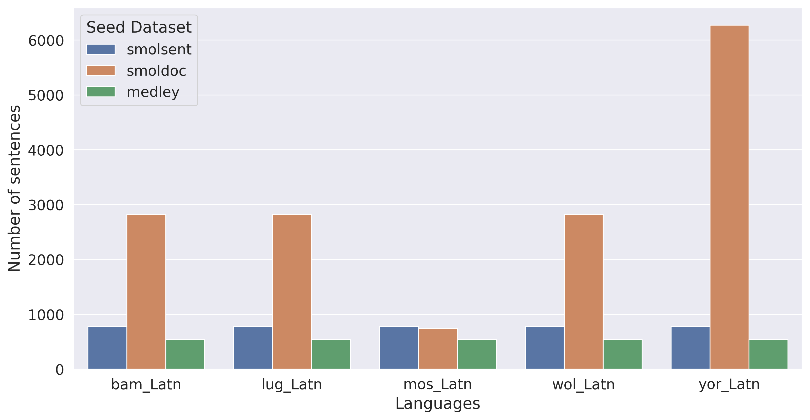

 Figure A.1: Number of examples per language across seed datasets. 

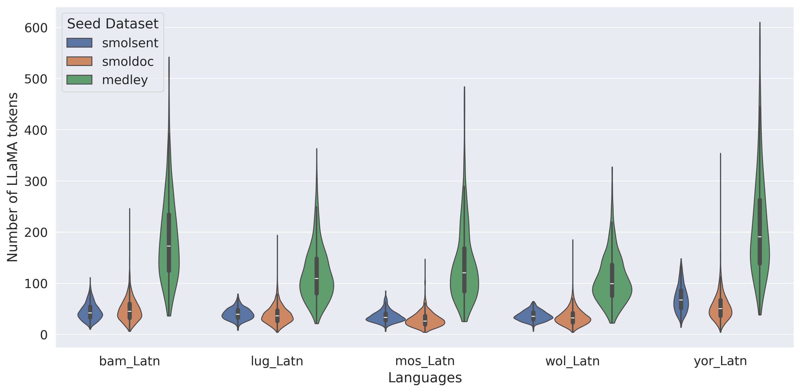

 Figure A.2: Token length distribution per language across seed datasets. 

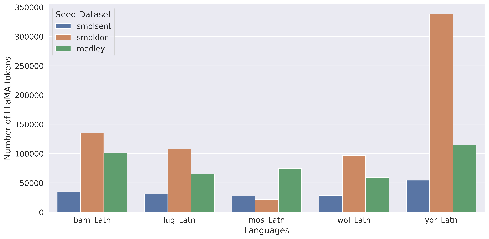

 Figure A.3: Total number of tokens per language across seed datasets.

### A.10 More details on the experimental setup

We experiment with two popular MT paradigms: NLLB-200-3.3B4646 46 [https://huggingface.co/facebook/nllb-200-3.3B](https://facebook/nllb-200-3.3B) as a representative of sequence-to-sequence (seq2seq) models ([NLLB Team et al., 2024](https://arxiv.org/html/2603.16309v3#bib.bib146)), and LLaMA-3.1-8B-Instruct4747 47 [https://huggingface.co/meta-llama/Llama-3.1-8B-Instruct](https://meta-llama/Llama-3.1-8B-Instruct) representing LLM-based MT, or autoregressive decoder-only instruction-following models ([Grattafiori et al., 2024](https://arxiv.org/html/2603.16309v3#bib.bib58)). For NLLB, tokenized source text is fed to the model, with appropriate delimiting language tags, and translations are obtained via beam search decoding, whereas for LLaMA, we use a minimal prompt template instructing the model to translate from source to target taken from [Alves et al. (2024a)](https://arxiv.org/html/2603.16309v3#bib.bib145).

We consider into-English and out-of-English directions per language, and fine-tune and evaluate models for each language pair and direction separately. We train both models in a supervised way by maximizing the log-likelihood of the target sequence given the source, with teacher forcing. We train for a fixed number of epochs, monitoring the model performance on a held-out validation set to pick the best checkpoint. For training NLLB, we use the same hyperparameters reported in [NLLB Team et al. (2024)](https://arxiv.org/html/2603.16309v3#bib.bib146) for various fine-tuning experiments, while for LLaMA we adopt a similar setup to [Caswell et al. (2025)](https://arxiv.org/html/2603.16309v3#bib.bib10). For NLLB, we dynamically pad tokenized source sequences to the longest in the batch. For LLaMA, we apply packing, merging tokenized prompts together when possible to minimize padding.

We experiment with 5 languages that are covered by these baseline datasets, MeDLEy-109, as well as our evaluation datasets: Bambara, Mossi, Wolof, Yoruba, and Ganda. Since SmolDoc samples can range to over several thousand tokens, we break it into sentence-level chunks with the provided sentence alignments in accordance with [Caswell et al. (2025)](https://arxiv.org/html/2603.16309v3#bib.bib10). See [section A.9](https://arxiv.org/html/2603.16309v3#A1.SS9 "A.9 More details on datasets and language statistics ‣ Appendix A MeDLEy details ‣ Omnilingual MT: Machine Translation for 1,600 Languages") for training dataset statistics.

We perform supervised fine-tuning leveraging “labelled” datasets, i.e. bitext corpora (the seed datasets), in which each example in these datasets is a piece of text (source text), of known language (source language), along with its translation (target text) in a give language (target language). We then work with datasets \(\{(sl_{i},tl_{i},st_{i},tt_{i})_{i=1}^{N}\}\) where \(sl_{i}\) is a representation of the source language, \(tl_{i}\) is a representation of target language, \(st_{i}\) is a representation of the source text, and \(tt_{i}\) is a representation of the target text. These representations differ slighly across the two models used to solve the task. For NLLB, we encode them as can be seen in [Box 2](https://arxiv.org/html/2603.16309v3#boxes2 "Box 2 ‣ A.10 More details on the experimental setup ‣ Appendix A MeDLEy details ‣ Omnilingual MT: Machine Translation for 1,600 Languages"), since the NLLB tokenizer reserves special tokens for representing language codes of the supported languages. Note that all of the languages we evaluate on are (technically) supported by NLLB, meaning that the tokenizer has a reserved language code token for them. For LLaMa, given prior work ([Grattafiori et al., 2024](https://arxiv.org/html/2603.16309v3#bib.bib58)) highlighting the good performance of instruction-following LLMs at translation tasks, we perform instruction fine-tuning, with a very simple prompt template and task description, as can be seen in [Box 2](https://arxiv.org/html/2603.16309v3#boxes2 "Box 2 ‣ A.10 More details on the experimental setup ‣ Appendix A MeDLEy details ‣ Omnilingual MT: Machine Translation for 1,600 Languages").

 

Box 2 Example encoding of a translation pair for fine-tuning NLLB 

 

Box 3 Prompt template for fine-tuning LLaMa

All fine-tuning experiments and subsequent evaluations are conducted on A100 GPUs4848 48 <https://www.nvidia.com/en-gb/data-center/a100/>, using the HuggingFace transformers ([Wolf et al., 2020](https://arxiv.org/html/2603.16309v3#bib.bib144)) implementations. The models are efficiently fine-tuned using mixed precision training ([Micikevicius et al., 2017](https://arxiv.org/html/2603.16309v3#bib.bib143)), with dynamic padding for NLLB (padding to the longest sequence in the batch) for NLLB, and using packing4949 49 <https://huggingface.co/docs/trl/main/en/sft_trainer#packing>, FlashAttention-2 ([Dao, 2023](https://arxiv.org/html/2603.16309v3#bib.bib140)) and FSDP5050 50 [Fully Sharded Data Parallel](https://engineering.fb.com/2021/07/15/open-source/fsdp/) for LLaMa, using the AdamW optimizer ([Loshchilov and Hutter, 2019](https://arxiv.org/html/2603.16309v3#bib.bib106)). Sequences longer than the model max length are truncated from the left (keeping the source language code for conditioning) for NLLB, while from the right for LLaMa. All training hyperparameters are detailed in [table A.9](https://arxiv.org/html/2603.16309v3#A1.T9 "In A.10 More details on the experimental setup ‣ Appendix A MeDLEy details ‣ Omnilingual MT: Machine Translation for 1,600 Languages").

Hyperparameter | NLLB | LLaMa | Notes  
---|---|---|---  
Epochs | 10 | 10 |   
Batch Size | 8 | 1 | LLaMA uses packing  
Max Num Tokens | 512 | 1024 |   
Learning Rate | 5e-5 | 1e-5 |   
Optimizer | AdamW | AdamW |   
Learning Rate Schedule | Inverse Square Root | Cosine Annealing | With 10% of warmup steps  
Gradient Clipping | 1.0 | 1.0 |   
Weight Decay | 1e-2 | 1e-2 |   
AdamW Betas | (0.9, 0.95) | (0.9, 0.95) |

 Table A.9: Training Hyperparameters

Then, to efficiently produce inference results from the resulting checkpoints for evaluation , we leverage ctranslate2 ([Klein et al., 2020](https://arxiv.org/html/2603.16309v3#bib.bib141)) for NLLB and vLLM ([Kwon et al., 2023](https://arxiv.org/html/2603.16309v3#bib.bib142)) for LLaMa. All inference hyperparameters are listed in [table A.10](https://arxiv.org/html/2603.16309v3#A1.T10 "In A.10 More details on the experimental setup ‣ Appendix A MeDLEy details ‣ Omnilingual MT: Machine Translation for 1,600 Languages").

Hyperparameter | NLLB | LLaMa | Notes  
---|---|---|---  
Decoding | Beam Search | Greedy |   
Beam Width | 5 | N/A |   
Max Num Tokens | 512 | 1024 |   
Temperature | 0.0 | 0.0 |   
Top-P | 1.0 | 1.0 | No Sampling  
Top-K | N/A | N/A | No Sampling  
Repetition Penalty | 1.0 | 1.0 |

 Table A.10: Inference hyperparameters

### A.11 More details on the experiment results

We observe the benefits of any seed data over the no-seed baseline, especially for LLaMA. This is true to a lesser extent for NLLB, which has already been fine-tuned for these languages.5151 51 Note that MeDLEy covers 79 languages that are not supported by NLLB, for which we can expect higher gains over the baseline. However, we lack the evaluation resources in these languages to demonstrate this. NLLB shows higher baseline and fine-tuned performance across the board, highlighting that smaller sequence-to-sequence models are still state-of-the-art for low-resource MT as compared to LLM-based MT in accordance with previous findings ([Stap and Araabi, 2023](https://arxiv.org/html/2603.16309v3#bib.bib173); [Scalvini et al., 2025](https://arxiv.org/html/2603.16309v3#bib.bib172)).

We see that MeDLEy matches or outperforms baseline datasets in the token-controlled, and shows gains in the into-English direction. We also show similar findings on a comparison on NLLB-Seed on a separate set of intersection languages in [section A.11](https://arxiv.org/html/2603.16309v3#A1.SS11 "A.11 More details on the experiment results ‣ Appendix A MeDLEy details ‣ Omnilingual MT: Machine Translation for 1,600 Languages").5252 52 In addition, we also show that NLLB-Seed contains a high proportion of difficult-to-translate texts potentially due to technical or obscure terminology (54% as compared to 10.41%), which may hinder lay community translators. We confirm these trends over various other MT evaluation metrics such as xCOMET and MetricX ([Guerreiro et al., 2024a](https://arxiv.org/html/2603.16309v3#bib.bib139); [Juraska et al., 2024](https://arxiv.org/html/2603.16309v3#bib.bib45)), among others, reported in [section A.11](https://arxiv.org/html/2603.16309v3#A1.SS11 "A.11 More details on the experiment results ‣ Appendix A MeDLEy details ‣ Omnilingual MT: Machine Translation for 1,600 Languages"). This supports a major application of seed datasets, i.e., synthetic data generation from monolingual LRL data via better xx-en systems as discussed in [section 4.3.1](https://arxiv.org/html/2603.16309v3#S4.SS3.SSS1 "4.3.1 Motivation and related work ‣ 4.3 Seed Data for Post-Training: MeDLEy ‣ 4 Creating High-Quality Datasets ‣ Omnilingual MT: Machine Translation for 1,600 Languages").

We observe some improvements from adding MeDLEy to existing seed datasets. However, these are generally small, indicating the challenges of making significant improvements for LRLs via manual collection of data at the scale of a few thousands of sentences. Note that MeDLEy contains 92 languages not covered by SMOL.

We note that regardless of the seed dataset used, scores remain low in general, especially in the en-xx direction. Given that scaling up data collection is infeasible for this range of languages, one possible takeaway from this is that standard supervised fine-tuning-based approaches may not be sufficient for language learning in this data regime. Current literature already investigates various creative ways of using structured information about a language to boost LLM performance for unseen or very low-resource language ([Tanzer et al., 2023](https://arxiv.org/html/2603.16309v3#bib.bib171); [Kornilov and Shavrina, 2024](https://arxiv.org/html/2603.16309v3#bib.bib170); [Zhang et al., 2024](https://arxiv.org/html/2603.16309v3#bib.bib169); [Hus and Anastasopoulos, 2024](https://arxiv.org/html/2603.16309v3#bib.bib167); [Hus et al., 2025](https://arxiv.org/html/2603.16309v3#bib.bib168)); future work in this direction may further investigate the most efficient usage of a seed dataset to augment these methods. Our dataset, in focusing on the controlled and principled coverage of grammatical features, opens up possibilities for future research in more efficient language learning.

##### Summary results

Beside chrF++ score we also report xCOMET ([Guerreiro et al., 2024a](https://arxiv.org/html/2603.16309v3#bib.bib139)) and MetricX ([Juraska et al., 2024](https://arxiv.org/html/2603.16309v3#bib.bib45)) as they are usually better correlated with human judgement and thus can provide a more practical measure of translation quality, see [table A.11](https://arxiv.org/html/2603.16309v3#A1.T11 "In Summary results ‣ A.11 More details on the experiment results ‣ Appendix A MeDLEy details ‣ Omnilingual MT: Machine Translation for 1,600 Languages") for token-controlled and [table A.12](https://arxiv.org/html/2603.16309v3#A1.T12 "In Summary results ‣ A.11 More details on the experiment results ‣ Appendix A MeDLEy details ‣ Omnilingual MT: Machine Translation for 1,600 Languages") for direct comparison results. Furthermore, we report Spearman rank correlation between the metric we report in the main manuscript, namely chrF++, and a selection of other widely used evaluation metrics, namely BLASER ([Dale and Costa-jussà, 2024b](https://arxiv.org/html/2603.16309v3#bib.bib138)), BLEU ([Papineni et al., 2002](https://arxiv.org/html/2603.16309v3#bib.bib22)), BLEURT ([Sellam et al., 2020](https://arxiv.org/html/2603.16309v3#bib.bib103)), METEOR ([Banerjee and Lavie, 2005a](https://arxiv.org/html/2603.16309v3#bib.bib137)), MetricX ([Juraska et al., 2024](https://arxiv.org/html/2603.16309v3#bib.bib45)), TER ([Snover et al., 2006](https://arxiv.org/html/2603.16309v3#bib.bib136)), xCOMET ([Guerreiro et al., 2024a](https://arxiv.org/html/2603.16309v3#bib.bib139)), see [fig. A.4](https://arxiv.org/html/2603.16309v3#A1.F4 "In Language-wise breakdowns ‣ A.11 More details on the experiment results ‣ Appendix A MeDLEy details ‣ Omnilingual MT: Machine Translation for 1,600 Languages").

<table id="A1.T11.3.1" class="ltx_tabular ltx_align_middle">
<tr id="A1.T11.3.1.1" class="ltx_tr">
<td id="A1.T11.3.1.1.1" class="ltx_td ltx_border_tt" style="padding-top:0.75pt;padding-bottom:0.75pt;"></td>
<td id="A1.T11.3.1.1.2" class="ltx_td ltx_border_tt" style="padding-top:0.75pt;padding-bottom:0.75pt;"></td>
<td id="A1.T11.3.1.1.3" class="ltx_td ltx_align_center ltx_border_tt" style="padding-top:0.75pt;padding-bottom:0.75pt;" colspan="6">BOUQuET</td>
<td id="A1.T11.3.1.1.4" class="ltx_td ltx_align_center ltx_border_tt" style="padding-top:0.75pt;padding-bottom:0.75pt;" colspan="6">FLORES+</td></tr>
<tr id="A1.T11.3.1.2" class="ltx_tr">
<td id="A1.T11.3.1.2.1" class="ltx_td" style="padding-top:0.75pt;padding-bottom:0.75pt;"></td>
<td id="A1.T11.3.1.2.2" class="ltx_td" style="padding-top:0.75pt;padding-bottom:0.75pt;"></td>
<td id="A1.T11.3.1.2.3" class="ltx_td ltx_align_center ltx_border_t" style="padding-top:0.75pt;padding-bottom:0.75pt;" colspan="3">en-xx</td>
<td id="A1.T11.3.1.2.4" class="ltx_td ltx_align_center ltx_border_t" style="padding-top:0.75pt;padding-bottom:0.75pt;" colspan="3">xx-en</td>
<td id="A1.T11.3.1.2.5" class="ltx_td ltx_align_center ltx_border_t" style="padding-top:0.75pt;padding-bottom:0.75pt;" colspan="3">en-xx</td>
<td id="A1.T11.3.1.2.6" class="ltx_td ltx_align_center ltx_border_t" style="padding-top:0.75pt;padding-bottom:0.75pt;" colspan="3">xx-en</td></tr>
<tr id="A1.T11.3.1.3" class="ltx_tr">
<td id="A1.T11.3.1.3.1" class="ltx_td ltx_align_left" style="padding-top:0.75pt;padding-bottom:0.75pt;">Model</td>
<td id="A1.T11.3.1.3.2" class="ltx_td ltx_align_left" style="padding-top:0.75pt;padding-bottom:0.75pt;">Seed Dataset</td>
<td id="A1.T11.3.1.3.3" class="ltx_td ltx_align_center ltx_border_t" style="padding-top:0.75pt;padding-bottom:0.75pt;">chrF++</td>
<td id="A1.T11.3.1.3.4" class="ltx_td ltx_align_center ltx_border_t" style="padding-top:0.75pt;padding-bottom:0.75pt;">MetricX</td>
<td id="A1.T11.3.1.3.5" class="ltx_td ltx_align_center ltx_border_t" style="padding-top:0.75pt;padding-bottom:0.75pt;">XCOMET</td>
<td id="A1.T11.3.1.3.6" class="ltx_td ltx_align_center ltx_border_t" style="padding-top:0.75pt;padding-bottom:0.75pt;">chrF++</td>
<td id="A1.T11.3.1.3.7" class="ltx_td ltx_align_center ltx_border_t" style="padding-top:0.75pt;padding-bottom:0.75pt;">MetricX</td>
<td id="A1.T11.3.1.3.8" class="ltx_td ltx_align_center ltx_border_t" style="padding-top:0.75pt;padding-bottom:0.75pt;">XCOMET</td>
<td id="A1.T11.3.1.3.9" class="ltx_td ltx_align_center ltx_border_t" style="padding-top:0.75pt;padding-bottom:0.75pt;">chrF++</td>
<td id="A1.T11.3.1.3.10" class="ltx_td ltx_align_center ltx_border_t" style="padding-top:0.75pt;padding-bottom:0.75pt;">MetricX</td>
<td id="A1.T11.3.1.3.11" class="ltx_td ltx_align_center ltx_border_t" style="padding-top:0.75pt;padding-bottom:0.75pt;">XCOMET</td>
<td id="A1.T11.3.1.3.12" class="ltx_td ltx_align_center ltx_border_t" style="padding-top:0.75pt;padding-bottom:0.75pt;">chrF++</td>
<td id="A1.T11.3.1.3.13" class="ltx_td ltx_align_center ltx_border_t" style="padding-top:0.75pt;padding-bottom:0.75pt;">MetricX</td>
<td id="A1.T11.3.1.3.14" class="ltx_td ltx_nopad_r ltx_align_center ltx_border_t" style="padding-top:0.75pt;padding-bottom:0.75pt;">XCOMET</td></tr>
<tr id="A1.T11.3.1.4" class="ltx_tr">
<td id="A1.T11.3.1.4.1" class="ltx_td ltx_align_left ltx_border_t" style="padding-top:0.75pt;padding-bottom:0.75pt;" rowspan="4">LLaMA</td>
<td id="A1.T11.3.1.4.2" class="ltx_td ltx_align_left ltx_border_t" style="padding-top:0.75pt;padding-bottom:0.75pt;">No Seed</td>
<td id="A1.T11.3.1.4.3" class="ltx_td ltx_align_center ltx_border_t" style="padding-top:0.75pt;padding-bottom:0.75pt;">8.49</td>
<td id="A1.T11.3.1.4.4" class="ltx_td ltx_align_center ltx_border_t" style="padding-top:0.75pt;padding-bottom:0.75pt;">16.02</td>
<td id="A1.T11.3.1.4.5" class="ltx_td ltx_align_center ltx_border_t" style="padding-top:0.75pt;padding-bottom:0.75pt;">0.22</td>
<td id="A1.T11.3.1.4.6" class="ltx_td ltx_align_center ltx_border_t" style="padding-top:0.75pt;padding-bottom:0.75pt;">14.45</td>
<td id="A1.T11.3.1.4.7" class="ltx_td ltx_align_center ltx_border_t" style="padding-top:0.75pt;padding-bottom:0.75pt;">10.44</td>
<td id="A1.T11.3.1.4.8" class="ltx_td ltx_align_center ltx_border_t" style="padding-top:0.75pt;padding-bottom:0.75pt;">0.24</td>
<td id="A1.T11.3.1.4.9" class="ltx_td ltx_align_center ltx_border_t" style="padding-top:0.75pt;padding-bottom:0.75pt;">10.07</td>
<td id="A1.T11.3.1.4.10" class="ltx_td ltx_align_center ltx_border_t" style="padding-top:0.75pt;padding-bottom:0.75pt;">17.16</td>
<td id="A1.T11.3.1.4.11" class="ltx_td ltx_align_center ltx_border_t" style="padding-top:0.75pt;padding-bottom:0.75pt;">0.18</td>
<td id="A1.T11.3.1.4.12" class="ltx_td ltx_align_center ltx_border_t" style="padding-top:0.75pt;padding-bottom:0.75pt;">16.81</td>
<td id="A1.T11.3.1.4.13" class="ltx_td ltx_align_center ltx_border_t" style="padding-top:0.75pt;padding-bottom:0.75pt;">10.86</td>
<td id="A1.T11.3.1.4.14" class="ltx_td ltx_nopad_r ltx_align_center ltx_border_t" style="padding-top:0.75pt;padding-bottom:0.75pt;">0.20</td></tr>
<tr id="A1.T11.3.1.5" class="ltx_tr">
<td id="A1.T11.3.1.5.1" class="ltx_td ltx_align_left" style="padding-top:0.75pt;padding-bottom:0.75pt;">SmolDoc</td>
<td id="A1.T11.3.1.5.2" class="ltx_td ltx_align_center" style="padding-top:0.75pt;padding-bottom:0.75pt;">20.08</td>
<td id="A1.T11.3.1.5.3" class="ltx_td ltx_align_center" style="padding-top:0.75pt;padding-bottom:0.75pt;">13.89</td>
<td id="A1.T11.3.1.5.4" class="ltx_td ltx_align_center" style="padding-top:0.75pt;padding-bottom:0.75pt;">0.34</td>
<td id="A1.T11.3.1.5.5" class="ltx_td ltx_align_center" style="padding-top:0.75pt;padding-bottom:0.75pt;">18.74</td>
<td id="A1.T11.3.1.5.6" class="ltx_td ltx_align_center" style="padding-top:0.75pt;padding-bottom:0.75pt;">12.66</td>
<td id="A1.T11.3.1.5.7" class="ltx_td ltx_align_center" style="padding-top:0.75pt;padding-bottom:0.75pt;">0.35</td>
<td id="A1.T11.3.1.5.8" class="ltx_td ltx_align_center" style="padding-top:0.75pt;padding-bottom:0.75pt;">21.53</td>
<td id="A1.T11.3.1.5.9" class="ltx_td ltx_align_center" style="padding-top:0.75pt;padding-bottom:0.75pt;">14.91</td>
<td id="A1.T11.3.1.5.10" class="ltx_td ltx_align_center" style="padding-top:0.75pt;padding-bottom:0.75pt;">0.24</td>
<td id="A1.T11.3.1.5.11" class="ltx_td ltx_align_center" style="padding-top:0.75pt;padding-bottom:0.75pt;">22.25</td>
<td id="A1.T11.3.1.5.12" class="ltx_td ltx_align_center" style="padding-top:0.75pt;padding-bottom:0.75pt;">12.96</td>
<td id="A1.T11.3.1.5.13" class="ltx_td ltx_nopad_r ltx_align_center" style="padding-top:0.75pt;padding-bottom:0.75pt;">0.27</td></tr>
<tr id="A1.T11.3.1.6" class="ltx_tr">
<td id="A1.T11.3.1.6.1" class="ltx_td ltx_align_left" style="padding-top:0.75pt;padding-bottom:0.75pt;">SmolSent</td>
<td id="A1.T11.3.1.6.2" class="ltx_td ltx_align_center" style="padding-top:0.75pt;padding-bottom:0.75pt;">18.16</td>
<td id="A1.T11.3.1.6.3" class="ltx_td ltx_align_center" style="padding-top:0.75pt;padding-bottom:0.75pt;">15.04</td>
<td id="A1.T11.3.1.6.4" class="ltx_td ltx_align_center" style="padding-top:0.75pt;padding-bottom:0.75pt;">0.33</td>
<td id="A1.T11.3.1.6.5" class="ltx_td ltx_align_center" style="padding-top:0.75pt;padding-bottom:0.75pt;">18.74</td>
<td id="A1.T11.3.1.6.6" class="ltx_td ltx_align_center" style="padding-top:0.75pt;padding-bottom:0.75pt;">13.00</td>
<td id="A1.T11.3.1.6.7" class="ltx_td ltx_align_center" style="padding-top:0.75pt;padding-bottom:0.75pt;">0.34</td>
<td id="A1.T11.3.1.6.8" class="ltx_td ltx_align_center" style="padding-top:0.75pt;padding-bottom:0.75pt;">18.46</td>
<td id="A1.T11.3.1.6.9" class="ltx_td ltx_align_center" style="padding-top:0.75pt;padding-bottom:0.75pt;">16.36</td>
<td id="A1.T11.3.1.6.10" class="ltx_td ltx_align_center" style="padding-top:0.75pt;padding-bottom:0.75pt;">0.23</td>
<td id="A1.T11.3.1.6.11" class="ltx_td ltx_align_center" style="padding-top:0.75pt;padding-bottom:0.75pt;">22.42</td>
<td id="A1.T11.3.1.6.12" class="ltx_td ltx_align_center" style="padding-top:0.75pt;padding-bottom:0.75pt;">13.67</td>
<td id="A1.T11.3.1.6.13" class="ltx_td ltx_nopad_r ltx_align_center" style="padding-top:0.75pt;padding-bottom:0.75pt;">0.28</td></tr>
<tr id="A1.T11.3.1.7" class="ltx_tr">
<td id="A1.T11.3.1.7.1" class="ltx_td ltx_align_left" style="padding-top:0.75pt;padding-bottom:0.75pt;">Medley</td>
<td id="A1.T11.3.1.7.2" class="ltx_td ltx_align_center" style="padding-top:0.75pt;padding-bottom:0.75pt;">19.60</td>
<td id="A1.T11.3.1.7.3" class="ltx_td ltx_align_center" style="padding-top:0.75pt;padding-bottom:0.75pt;">13.97</td>
<td id="A1.T11.3.1.7.4" class="ltx_td ltx_align_center" style="padding-top:0.75pt;padding-bottom:0.75pt;">0.33</td>
<td id="A1.T11.3.1.7.5" class="ltx_td ltx_align_center" style="padding-top:0.75pt;padding-bottom:0.75pt;">20.39</td>
<td id="A1.T11.3.1.7.6" class="ltx_td ltx_align_center" style="padding-top:0.75pt;padding-bottom:0.75pt;">11.94</td>
<td id="A1.T11.3.1.7.7" class="ltx_td ltx_align_center" style="padding-top:0.75pt;padding-bottom:0.75pt;">0.33</td>
<td id="A1.T11.3.1.7.8" class="ltx_td ltx_align_center" style="padding-top:0.75pt;padding-bottom:0.75pt;">20.69</td>
<td id="A1.T11.3.1.7.9" class="ltx_td ltx_align_center" style="padding-top:0.75pt;padding-bottom:0.75pt;">15.48</td>
<td id="A1.T11.3.1.7.10" class="ltx_td ltx_align_center" style="padding-top:0.75pt;padding-bottom:0.75pt;">0.24</td>
<td id="A1.T11.3.1.7.11" class="ltx_td ltx_align_center" style="padding-top:0.75pt;padding-bottom:0.75pt;">23.73</td>
<td id="A1.T11.3.1.7.12" class="ltx_td ltx_align_center" style="padding-top:0.75pt;padding-bottom:0.75pt;">12.63</td>
<td id="A1.T11.3.1.7.13" class="ltx_td ltx_nopad_r ltx_align_center" style="padding-top:0.75pt;padding-bottom:0.75pt;">0.27</td></tr>
<tr id="A1.T11.3.1.8" class="ltx_tr">
<td id="A1.T11.3.1.8.1" class="ltx_td ltx_align_left ltx_border_bb ltx_border_t" style="padding-top:0.75pt;padding-bottom:0.75pt;" rowspan="4">NLLB</td>
<td id="A1.T11.3.1.8.2" class="ltx_td ltx_align_left ltx_border_t" style="padding-top:0.75pt;padding-bottom:0.75pt;">No Seed</td>
<td id="A1.T11.3.1.8.3" class="ltx_td ltx_align_center ltx_border_t" style="padding-top:0.75pt;padding-bottom:0.75pt;">31.75</td>
<td id="A1.T11.3.1.8.4" class="ltx_td ltx_align_center ltx_border_t" style="padding-top:0.75pt;padding-bottom:0.75pt;">9.76</td>
<td id="A1.T11.3.1.8.5" class="ltx_td ltx_align_center ltx_border_t" style="padding-top:0.75pt;padding-bottom:0.75pt;">0.36</td>
<td id="A1.T11.3.1.8.6" class="ltx_td ltx_align_center ltx_border_t" style="padding-top:0.75pt;padding-bottom:0.75pt;">39.43</td>
<td id="A1.T11.3.1.8.7" class="ltx_td ltx_align_center ltx_border_t" style="padding-top:0.75pt;padding-bottom:0.75pt;">8.97</td>
<td id="A1.T11.3.1.8.8" class="ltx_td ltx_align_center ltx_border_t" style="padding-top:0.75pt;padding-bottom:0.75pt;">0.54</td>
<td id="A1.T11.3.1.8.9" class="ltx_td ltx_align_center ltx_border_t" style="padding-top:0.75pt;padding-bottom:0.75pt;">29.01</td>
<td id="A1.T11.3.1.8.10" class="ltx_td ltx_align_center ltx_border_t" style="padding-top:0.75pt;padding-bottom:0.75pt;">10.74</td>
<td id="A1.T11.3.1.8.11" class="ltx_td ltx_align_center ltx_border_t" style="padding-top:0.75pt;padding-bottom:0.75pt;">0.24</td>
<td id="A1.T11.3.1.8.12" class="ltx_td ltx_align_center ltx_border_t" style="padding-top:0.75pt;padding-bottom:0.75pt;">39.75</td>
<td id="A1.T11.3.1.8.13" class="ltx_td ltx_align_center ltx_border_t" style="padding-top:0.75pt;padding-bottom:0.75pt;">9.14</td>
<td id="A1.T11.3.1.8.14" class="ltx_td ltx_nopad_r ltx_align_center ltx_border_t" style="padding-top:0.75pt;padding-bottom:0.75pt;">0.46</td></tr>
<tr id="A1.T11.3.1.9" class="ltx_tr">
<td id="A1.T11.3.1.9.1" class="ltx_td ltx_align_left" style="padding-top:0.75pt;padding-bottom:0.75pt;">SmolDoc</td>
<td id="A1.T11.3.1.9.2" class="ltx_td ltx_align_center" style="padding-top:0.75pt;padding-bottom:0.75pt;">31.70</td>
<td id="A1.T11.3.1.9.3" class="ltx_td ltx_align_center" style="padding-top:0.75pt;padding-bottom:0.75pt;">10.06</td>
<td id="A1.T11.3.1.9.4" class="ltx_td ltx_align_center" style="padding-top:0.75pt;padding-bottom:0.75pt;">0.37</td>
<td id="A1.T11.3.1.9.5" class="ltx_td ltx_align_center" style="padding-top:0.75pt;padding-bottom:0.75pt;">40.88</td>
<td id="A1.T11.3.1.9.6" class="ltx_td ltx_align_center" style="padding-top:0.75pt;padding-bottom:0.75pt;">8.23</td>
<td id="A1.T11.3.1.9.7" class="ltx_td ltx_align_center" style="padding-top:0.75pt;padding-bottom:0.75pt;">0.57</td>
<td id="A1.T11.3.1.9.8" class="ltx_td ltx_align_center" style="padding-top:0.75pt;padding-bottom:0.75pt;">29.85</td>
<td id="A1.T11.3.1.9.9" class="ltx_td ltx_align_center" style="padding-top:0.75pt;padding-bottom:0.75pt;">10.92</td>
<td id="A1.T11.3.1.9.10" class="ltx_td ltx_align_center" style="padding-top:0.75pt;padding-bottom:0.75pt;">0.23</td>
<td id="A1.T11.3.1.9.11" class="ltx_td ltx_align_center" style="padding-top:0.75pt;padding-bottom:0.75pt;">39.34</td>
<td id="A1.T11.3.1.9.12" class="ltx_td ltx_align_center" style="padding-top:0.75pt;padding-bottom:0.75pt;">8.89</td>
<td id="A1.T11.3.1.9.13" class="ltx_td ltx_nopad_r ltx_align_center" style="padding-top:0.75pt;padding-bottom:0.75pt;">0.46</td></tr>
<tr id="A1.T11.3.1.10" class="ltx_tr">
<td id="A1.T11.3.1.10.1" class="ltx_td ltx_align_left" style="padding-top:0.75pt;padding-bottom:0.75pt;">SmolSent</td>
<td id="A1.T11.3.1.10.2" class="ltx_td ltx_align_center" style="padding-top:0.75pt;padding-bottom:0.75pt;">32.54</td>
<td id="A1.T11.3.1.10.3" class="ltx_td ltx_align_center" style="padding-top:0.75pt;padding-bottom:0.75pt;">9.86</td>
<td id="A1.T11.3.1.10.4" class="ltx_td ltx_align_center" style="padding-top:0.75pt;padding-bottom:0.75pt;">0.36</td>
<td id="A1.T11.3.1.10.5" class="ltx_td ltx_align_center" style="padding-top:0.75pt;padding-bottom:0.75pt;">40.88</td>
<td id="A1.T11.3.1.10.6" class="ltx_td ltx_align_center" style="padding-top:0.75pt;padding-bottom:0.75pt;">8.30</td>
<td id="A1.T11.3.1.10.7" class="ltx_td ltx_align_center" style="padding-top:0.75pt;padding-bottom:0.75pt;">0.56</td>
<td id="A1.T11.3.1.10.8" class="ltx_td ltx_align_center" style="padding-top:0.75pt;padding-bottom:0.75pt;">30.27</td>
<td id="A1.T11.3.1.10.9" class="ltx_td ltx_align_center" style="padding-top:0.75pt;padding-bottom:0.75pt;">10.79</td>
<td id="A1.T11.3.1.10.10" class="ltx_td ltx_align_center" style="padding-top:0.75pt;padding-bottom:0.75pt;">0.23</td>
<td id="A1.T11.3.1.10.11" class="ltx_td ltx_align_center" style="padding-top:0.75pt;padding-bottom:0.75pt;">39.31</td>
<td id="A1.T11.3.1.10.12" class="ltx_td ltx_align_center" style="padding-top:0.75pt;padding-bottom:0.75pt;">8.97</td>
<td id="A1.T11.3.1.10.13" class="ltx_td ltx_nopad_r ltx_align_center" style="padding-top:0.75pt;padding-bottom:0.75pt;">0.46</td></tr>
<tr id="A1.T11.3.1.11" class="ltx_tr">
<td id="A1.T11.3.1.11.1" class="ltx_td ltx_align_left ltx_border_bb" style="padding-top:0.75pt;padding-bottom:0.75pt;">Medley</td>
<td id="A1.T11.3.1.11.2" class="ltx_td ltx_align_center ltx_border_bb" style="padding-top:0.75pt;padding-bottom:0.75pt;">30.58</td>
<td id="A1.T11.3.1.11.3" class="ltx_td ltx_align_center ltx_border_bb" style="padding-top:0.75pt;padding-bottom:0.75pt;">10.08</td>
<td id="A1.T11.3.1.11.4" class="ltx_td ltx_align_center ltx_border_bb" style="padding-top:0.75pt;padding-bottom:0.75pt;">0.36</td>
<td id="A1.T11.3.1.11.5" class="ltx_td ltx_align_center ltx_border_bb" style="padding-top:0.75pt;padding-bottom:0.75pt;">43.05</td>
<td id="A1.T11.3.1.11.6" class="ltx_td ltx_align_center ltx_border_bb" style="padding-top:0.75pt;padding-bottom:0.75pt;">7.89</td>
<td id="A1.T11.3.1.11.7" class="ltx_td ltx_align_center ltx_border_bb" style="padding-top:0.75pt;padding-bottom:0.75pt;">0.57</td>
<td id="A1.T11.3.1.11.8" class="ltx_td ltx_align_center ltx_border_bb" style="padding-top:0.75pt;padding-bottom:0.75pt;">29.35</td>
<td id="A1.T11.3.1.11.9" class="ltx_td ltx_align_center ltx_border_bb" style="padding-top:0.75pt;padding-bottom:0.75pt;">11.02</td>
<td id="A1.T11.3.1.11.10" class="ltx_td ltx_align_center ltx_border_bb" style="padding-top:0.75pt;padding-bottom:0.75pt;">0.23</td>
<td id="A1.T11.3.1.11.11" class="ltx_td ltx_align_center ltx_border_bb" style="padding-top:0.75pt;padding-bottom:0.75pt;">40.72</td>
<td id="A1.T11.3.1.11.12" class="ltx_td ltx_align_center ltx_border_bb" style="padding-top:0.75pt;padding-bottom:0.75pt;">8.49</td>
<td id="A1.T11.3.1.11.13" class="ltx_td ltx_nopad_r ltx_align_center ltx_border_bb" style="padding-top:0.75pt;padding-bottom:0.75pt;">0.47</td></tr>
</table>

 

Table A.11: Average translation performance when fine-tuning on token-controlled seed datasets.

<table id="A1.T12.3.1" class="ltx_tabular ltx_align_middle">
<tr id="A1.T12.3.1.1" class="ltx_tr">
<td id="A1.T12.3.1.1.1" class="ltx_td ltx_align_right ltx_border_tt" style="padding-top:0.75pt;padding-bottom:0.75pt;" rowspan="3">Model</td>
<td id="A1.T12.3.1.1.2" class="ltx_td ltx_align_right ltx_border_tt" style="padding-top:0.75pt;padding-bottom:0.75pt;" rowspan="3">Seed Dataset</td>
<td id="A1.T12.3.1.1.3" class="ltx_td ltx_align_center ltx_border_tt" style="padding-top:0.75pt;padding-bottom:0.75pt;" colspan="6">BOUQuET</td>
<td id="A1.T12.3.1.1.4" class="ltx_td ltx_align_center ltx_border_tt" style="padding-top:0.75pt;padding-bottom:0.75pt;" colspan="6">FLORES+</td></tr>
<tr id="A1.T12.3.1.2" class="ltx_tr">
<td id="A1.T12.3.1.2.1" class="ltx_td ltx_align_center ltx_border_t" style="padding-top:0.75pt;padding-bottom:0.75pt;" colspan="3">en-xx</td>
<td id="A1.T12.3.1.2.2" class="ltx_td ltx_align_center ltx_border_t" style="padding-top:0.75pt;padding-bottom:0.75pt;" colspan="3">xx-en</td>
<td id="A1.T12.3.1.2.3" class="ltx_td ltx_align_center ltx_border_t" style="padding-top:0.75pt;padding-bottom:0.75pt;" colspan="3">en-xx</td>
<td id="A1.T12.3.1.2.4" class="ltx_td ltx_align_center ltx_border_t" style="padding-top:0.75pt;padding-bottom:0.75pt;" colspan="3">xx-en</td></tr>
<tr id="A1.T12.3.1.3" class="ltx_tr">
<td id="A1.T12.3.1.3.1" class="ltx_td ltx_align_right ltx_border_t" style="padding-top:0.75pt;padding-bottom:0.75pt;">chrF++</td>
<td id="A1.T12.3.1.3.2" class="ltx_td ltx_align_right ltx_border_t" style="padding-top:0.75pt;padding-bottom:0.75pt;">MetricX</td>
<td id="A1.T12.3.1.3.3" class="ltx_td ltx_align_right ltx_border_t" style="padding-top:0.75pt;padding-bottom:0.75pt;">XCOMET</td>
<td id="A1.T12.3.1.3.4" class="ltx_td ltx_align_right ltx_border_t" style="padding-top:0.75pt;padding-bottom:0.75pt;">chrF++</td>
<td id="A1.T12.3.1.3.5" class="ltx_td ltx_align_right ltx_border_t" style="padding-top:0.75pt;padding-bottom:0.75pt;">MetricX</td>
<td id="A1.T12.3.1.3.6" class="ltx_td ltx_align_right ltx_border_t" style="padding-top:0.75pt;padding-bottom:0.75pt;">XCOMET</td>
<td id="A1.T12.3.1.3.7" class="ltx_td ltx_align_right ltx_border_t" style="padding-top:0.75pt;padding-bottom:0.75pt;">chrF++</td>
<td id="A1.T12.3.1.3.8" class="ltx_td ltx_align_right ltx_border_t" style="padding-top:0.75pt;padding-bottom:0.75pt;">MetricX</td>
<td id="A1.T12.3.1.3.9" class="ltx_td ltx_align_right ltx_border_t" style="padding-top:0.75pt;padding-bottom:0.75pt;">XCOMET</td>
<td id="A1.T12.3.1.3.10" class="ltx_td ltx_align_right ltx_border_t" style="padding-top:0.75pt;padding-bottom:0.75pt;">chrF++</td>
<td id="A1.T12.3.1.3.11" class="ltx_td ltx_align_right ltx_border_t" style="padding-top:0.75pt;padding-bottom:0.75pt;">MetricX</td>
<td id="A1.T12.3.1.3.12" class="ltx_td ltx_nopad_r ltx_align_right ltx_border_t" style="padding-top:0.75pt;padding-bottom:0.75pt;">XCOMET</td></tr>
<tr id="A1.T12.3.1.4" class="ltx_tr">
<td id="A1.T12.3.1.4.1" class="ltx_td ltx_align_right ltx_border_t" style="padding-top:0.75pt;padding-bottom:0.75pt;" rowspan="7">LLaMA</td>
<td id="A1.T12.3.1.4.2" class="ltx_td ltx_align_right ltx_border_t" style="padding-top:0.75pt;padding-bottom:0.75pt;">No Seed</td>
<td id="A1.T12.3.1.4.3" class="ltx_td ltx_align_right ltx_border_t" style="padding-top:0.75pt;padding-bottom:0.75pt;">8.49</td>
<td id="A1.T12.3.1.4.4" class="ltx_td ltx_align_right ltx_border_t" style="padding-top:0.75pt;padding-bottom:0.75pt;">16.02</td>
<td id="A1.T12.3.1.4.5" class="ltx_td ltx_align_right ltx_border_t" style="padding-top:0.75pt;padding-bottom:0.75pt;">0.22</td>
<td id="A1.T12.3.1.4.6" class="ltx_td ltx_align_right ltx_border_t" style="padding-top:0.75pt;padding-bottom:0.75pt;">14.45</td>
<td id="A1.T12.3.1.4.7" class="ltx_td ltx_align_right ltx_border_t" style="padding-top:0.75pt;padding-bottom:0.75pt;">10.44</td>
<td id="A1.T12.3.1.4.8" class="ltx_td ltx_align_right ltx_border_t" style="padding-top:0.75pt;padding-bottom:0.75pt;">0.24</td>
<td id="A1.T12.3.1.4.9" class="ltx_td ltx_align_right ltx_border_t" style="padding-top:0.75pt;padding-bottom:0.75pt;">10.07</td>
<td id="A1.T12.3.1.4.10" class="ltx_td ltx_align_right ltx_border_t" style="padding-top:0.75pt;padding-bottom:0.75pt;">17.16</td>
<td id="A1.T12.3.1.4.11" class="ltx_td ltx_align_right ltx_border_t" style="padding-top:0.75pt;padding-bottom:0.75pt;">0.18</td>
<td id="A1.T12.3.1.4.12" class="ltx_td ltx_align_right ltx_border_t" style="padding-top:0.75pt;padding-bottom:0.75pt;">16.81</td>
<td id="A1.T12.3.1.4.13" class="ltx_td ltx_align_right ltx_border_t" style="padding-top:0.75pt;padding-bottom:0.75pt;">10.86</td>
<td id="A1.T12.3.1.4.14" class="ltx_td ltx_nopad_r ltx_align_right ltx_border_t" style="padding-top:0.75pt;padding-bottom:0.75pt;">0.20</td></tr>
<tr id="A1.T12.3.1.5" class="ltx_tr">
<td id="A1.T12.3.1.5.1" class="ltx_td ltx_align_right" style="padding-top:0.75pt;padding-bottom:0.75pt;">SmolDoc (D)</td>
<td id="A1.T12.3.1.5.2" class="ltx_td ltx_align_right" style="padding-top:0.75pt;padding-bottom:0.75pt;">25.07</td>
<td id="A1.T12.3.1.5.3" class="ltx_td ltx_align_right" style="padding-top:0.75pt;padding-bottom:0.75pt;">11.99</td>
<td id="A1.T12.3.1.5.4" class="ltx_td ltx_align_right" style="padding-top:0.75pt;padding-bottom:0.75pt;">0.35</td>
<td id="A1.T12.3.1.5.5" class="ltx_td ltx_align_right" style="padding-top:0.75pt;padding-bottom:0.75pt;">23.06</td>
<td id="A1.T12.3.1.5.6" class="ltx_td ltx_align_right" style="padding-top:0.75pt;padding-bottom:0.75pt;">11.41</td>
<td id="A1.T12.3.1.5.7" class="ltx_td ltx_align_right" style="padding-top:0.75pt;padding-bottom:0.75pt;">0.40</td>
<td id="A1.T12.3.1.5.8" class="ltx_td ltx_align_right" style="padding-top:0.75pt;padding-bottom:0.75pt;">25.03</td>
<td id="A1.T12.3.1.5.9" class="ltx_td ltx_align_right" style="padding-top:0.75pt;padding-bottom:0.75pt;">12.94</td>
<td id="A1.T12.3.1.5.10" class="ltx_td ltx_align_right" style="padding-top:0.75pt;padding-bottom:0.75pt;">0.24</td>
<td id="A1.T12.3.1.5.11" class="ltx_td ltx_align_right" style="padding-top:0.75pt;padding-bottom:0.75pt;">25.09</td>
<td id="A1.T12.3.1.5.12" class="ltx_td ltx_align_right" style="padding-top:0.75pt;padding-bottom:0.75pt;">11.85</td>
<td id="A1.T12.3.1.5.13" class="ltx_td ltx_nopad_r ltx_align_right" style="padding-top:0.75pt;padding-bottom:0.75pt;">0.31</td></tr>
<tr id="A1.T12.3.1.6" class="ltx_tr">
<td id="A1.T12.3.1.6.1" class="ltx_td ltx_align_right" style="padding-top:0.75pt;padding-bottom:0.75pt;">SmolSent (S)</td>
<td id="A1.T12.3.1.6.2" class="ltx_td ltx_align_right" style="padding-top:0.75pt;padding-bottom:0.75pt;">18.69</td>
<td id="A1.T12.3.1.6.3" class="ltx_td ltx_align_right" style="padding-top:0.75pt;padding-bottom:0.75pt;">14.69</td>
<td id="A1.T12.3.1.6.4" class="ltx_td ltx_align_right" style="padding-top:0.75pt;padding-bottom:0.75pt;">0.33</td>
<td id="A1.T12.3.1.6.5" class="ltx_td ltx_align_right" style="padding-top:0.75pt;padding-bottom:0.75pt;">19.47</td>
<td id="A1.T12.3.1.6.6" class="ltx_td ltx_align_right" style="padding-top:0.75pt;padding-bottom:0.75pt;">12.85</td>
<td id="A1.T12.3.1.6.7" class="ltx_td ltx_align_right" style="padding-top:0.75pt;padding-bottom:0.75pt;">0.34</td>
<td id="A1.T12.3.1.6.8" class="ltx_td ltx_align_right" style="padding-top:0.75pt;padding-bottom:0.75pt;">19.70</td>
<td id="A1.T12.3.1.6.9" class="ltx_td ltx_align_right" style="padding-top:0.75pt;padding-bottom:0.75pt;">15.98</td>
<td id="A1.T12.3.1.6.10" class="ltx_td ltx_align_right" style="padding-top:0.75pt;padding-bottom:0.75pt;">0.24</td>
<td id="A1.T12.3.1.6.11" class="ltx_td ltx_align_right" style="padding-top:0.75pt;padding-bottom:0.75pt;">23.87</td>
<td id="A1.T12.3.1.6.12" class="ltx_td ltx_align_right" style="padding-top:0.75pt;padding-bottom:0.75pt;">12.99</td>
<td id="A1.T12.3.1.6.13" class="ltx_td ltx_nopad_r ltx_align_right" style="padding-top:0.75pt;padding-bottom:0.75pt;">0.29</td></tr>
<tr id="A1.T12.3.1.7" class="ltx_tr">
<td id="A1.T12.3.1.7.1" class="ltx_td ltx_align_right" style="padding-top:0.75pt;padding-bottom:0.75pt;">Medley (M)</td>
<td id="A1.T12.3.1.7.2" class="ltx_td ltx_align_right" style="padding-top:0.75pt;padding-bottom:0.75pt;">22.30</td>
<td id="A1.T12.3.1.7.3" class="ltx_td ltx_align_right" style="padding-top:0.75pt;padding-bottom:0.75pt;">12.66</td>
<td id="A1.T12.3.1.7.4" class="ltx_td ltx_align_right" style="padding-top:0.75pt;padding-bottom:0.75pt;">0.34</td>
<td id="A1.T12.3.1.7.5" class="ltx_td ltx_align_right" style="padding-top:0.75pt;padding-bottom:0.75pt;">23.18</td>
<td id="A1.T12.3.1.7.6" class="ltx_td ltx_align_right" style="padding-top:0.75pt;padding-bottom:0.75pt;">11.35</td>
<td id="A1.T12.3.1.7.7" class="ltx_td ltx_align_right" style="padding-top:0.75pt;padding-bottom:0.75pt;">0.37</td>
<td id="A1.T12.3.1.7.8" class="ltx_td ltx_align_right" style="padding-top:0.75pt;padding-bottom:0.75pt;">22.43</td>
<td id="A1.T12.3.1.7.9" class="ltx_td ltx_align_right" style="padding-top:0.75pt;padding-bottom:0.75pt;">14.33</td>
<td id="A1.T12.3.1.7.10" class="ltx_td ltx_align_right" style="padding-top:0.75pt;padding-bottom:0.75pt;">0.24</td>
<td id="A1.T12.3.1.7.11" class="ltx_td ltx_align_right" style="padding-top:0.75pt;padding-bottom:0.75pt;">25.71</td>
<td id="A1.T12.3.1.7.12" class="ltx_td ltx_align_right" style="padding-top:0.75pt;padding-bottom:0.75pt;">12.00</td>
<td id="A1.T12.3.1.7.13" class="ltx_td ltx_nopad_r ltx_align_right" style="padding-top:0.75pt;padding-bottom:0.75pt;">0.29</td></tr>
<tr id="A1.T12.3.1.8" class="ltx_tr">
<td id="A1.T12.3.1.8.1" class="ltx_td ltx_align_right ltx_border_t" style="padding-top:0.75pt;padding-bottom:0.75pt;">M+D</td>
<td id="A1.T12.3.1.8.2" class="ltx_td ltx_align_right ltx_border_t" style="padding-top:0.75pt;padding-bottom:0.75pt;">26.98</td>
<td id="A1.T12.3.1.8.3" class="ltx_td ltx_align_right ltx_border_t" style="padding-top:0.75pt;padding-bottom:0.75pt;">11.40</td>
<td id="A1.T12.3.1.8.4" class="ltx_td ltx_align_right ltx_border_t" style="padding-top:0.75pt;padding-bottom:0.75pt;">0.36</td>
<td id="A1.T12.3.1.8.5" class="ltx_td ltx_align_right ltx_border_t" style="padding-top:0.75pt;padding-bottom:0.75pt;">27.44</td>
<td id="A1.T12.3.1.8.6" class="ltx_td ltx_align_right ltx_border_t" style="padding-top:0.75pt;padding-bottom:0.75pt;">10.12</td>
<td id="A1.T12.3.1.8.7" class="ltx_td ltx_align_right ltx_border_t" style="padding-top:0.75pt;padding-bottom:0.75pt;">0.44</td>
<td id="A1.T12.3.1.8.8" class="ltx_td ltx_align_right ltx_border_t" style="padding-top:0.75pt;padding-bottom:0.75pt;">26.10</td>
<td id="A1.T12.3.1.8.9" class="ltx_td ltx_align_right ltx_border_t" style="padding-top:0.75pt;padding-bottom:0.75pt;">12.58</td>
<td id="A1.T12.3.1.8.10" class="ltx_td ltx_align_right ltx_border_t" style="padding-top:0.75pt;padding-bottom:0.75pt;">0.24</td>
<td id="A1.T12.3.1.8.11" class="ltx_td ltx_align_right ltx_border_t" style="padding-top:0.75pt;padding-bottom:0.75pt;">26.94</td>
<td id="A1.T12.3.1.8.12" class="ltx_td ltx_align_right ltx_border_t" style="padding-top:0.75pt;padding-bottom:0.75pt;">11.17</td>
<td id="A1.T12.3.1.8.13" class="ltx_td ltx_nopad_r ltx_align_right ltx_border_t" style="padding-top:0.75pt;padding-bottom:0.75pt;">0.34</td></tr>
<tr id="A1.T12.3.1.9" class="ltx_tr">
<td id="A1.T12.3.1.9.1" class="ltx_td ltx_align_right" style="padding-top:0.75pt;padding-bottom:0.75pt;">M+S</td>
<td id="A1.T12.3.1.9.2" class="ltx_td ltx_align_right" style="padding-top:0.75pt;padding-bottom:0.75pt;">24.33</td>
<td id="A1.T12.3.1.9.3" class="ltx_td ltx_align_right" style="padding-top:0.75pt;padding-bottom:0.75pt;">12.25</td>
<td id="A1.T12.3.1.9.4" class="ltx_td ltx_align_right" style="padding-top:0.75pt;padding-bottom:0.75pt;">0.34</td>
<td id="A1.T12.3.1.9.5" class="ltx_td ltx_align_right" style="padding-top:0.75pt;padding-bottom:0.75pt;">25.98</td>
<td id="A1.T12.3.1.9.6" class="ltx_td ltx_align_right" style="padding-top:0.75pt;padding-bottom:0.75pt;">10.68</td>
<td id="A1.T12.3.1.9.7" class="ltx_td ltx_align_right" style="padding-top:0.75pt;padding-bottom:0.75pt;">0.41</td>
<td id="A1.T12.3.1.9.8" class="ltx_td ltx_align_right" style="padding-top:0.75pt;padding-bottom:0.75pt;">23.27</td>
<td id="A1.T12.3.1.9.9" class="ltx_td ltx_align_right" style="padding-top:0.75pt;padding-bottom:0.75pt;">13.81</td>
<td id="A1.T12.3.1.9.10" class="ltx_td ltx_align_right" style="padding-top:0.75pt;padding-bottom:0.75pt;">0.24</td>
<td id="A1.T12.3.1.9.11" class="ltx_td ltx_align_right" style="padding-top:0.75pt;padding-bottom:0.75pt;">26.43</td>
<td id="A1.T12.3.1.9.12" class="ltx_td ltx_align_right" style="padding-top:0.75pt;padding-bottom:0.75pt;">11.88</td>
<td id="A1.T12.3.1.9.13" class="ltx_td ltx_nopad_r ltx_align_right" style="padding-top:0.75pt;padding-bottom:0.75pt;">0.32</td></tr>
<tr id="A1.T12.3.1.10" class="ltx_tr">
<td id="A1.T12.3.1.10.1" class="ltx_td ltx_align_right" style="padding-top:0.75pt;padding-bottom:0.75pt;">M+D+S</td>
<td id="A1.T12.3.1.10.2" class="ltx_td ltx_align_right" style="padding-top:0.75pt;padding-bottom:0.75pt;">28.12</td>
<td id="A1.T12.3.1.10.3" class="ltx_td ltx_align_right" style="padding-top:0.75pt;padding-bottom:0.75pt;">11.25</td>
<td id="A1.T12.3.1.10.4" class="ltx_td ltx_align_right" style="padding-top:0.75pt;padding-bottom:0.75pt;">0.36</td>
<td id="A1.T12.3.1.10.5" class="ltx_td ltx_align_right" style="padding-top:0.75pt;padding-bottom:0.75pt;">29.04</td>
<td id="A1.T12.3.1.10.6" class="ltx_td ltx_align_right" style="padding-top:0.75pt;padding-bottom:0.75pt;">9.98</td>
<td id="A1.T12.3.1.10.7" class="ltx_td ltx_align_right" style="padding-top:0.75pt;padding-bottom:0.75pt;">0.46</td>
<td id="A1.T12.3.1.10.8" class="ltx_td ltx_align_right" style="padding-top:0.75pt;padding-bottom:0.75pt;">26.79</td>
<td id="A1.T12.3.1.10.9" class="ltx_td ltx_align_right" style="padding-top:0.75pt;padding-bottom:0.75pt;">12.36</td>
<td id="A1.T12.3.1.10.10" class="ltx_td ltx_align_right" style="padding-top:0.75pt;padding-bottom:0.75pt;">0.24</td>
<td id="A1.T12.3.1.10.11" class="ltx_td ltx_align_right" style="padding-top:0.75pt;padding-bottom:0.75pt;">27.90</td>
<td id="A1.T12.3.1.10.12" class="ltx_td ltx_align_right" style="padding-top:0.75pt;padding-bottom:0.75pt;">11.22</td>
<td id="A1.T12.3.1.10.13" class="ltx_td ltx_nopad_r ltx_align_right" style="padding-top:0.75pt;padding-bottom:0.75pt;">0.35</td></tr>
<tr id="A1.T12.3.1.11" class="ltx_tr">
<td id="A1.T12.3.1.11.1" class="ltx_td ltx_align_right ltx_border_bb ltx_border_t" style="padding-top:0.75pt;padding-bottom:0.75pt;" rowspan="7">NLLB</td>
<td id="A1.T12.3.1.11.2" class="ltx_td ltx_align_right ltx_border_t" style="padding-top:0.75pt;padding-bottom:0.75pt;">No Seed</td>
<td id="A1.T12.3.1.11.3" class="ltx_td ltx_align_right ltx_border_t" style="padding-top:0.75pt;padding-bottom:0.75pt;">31.75</td>
<td id="A1.T12.3.1.11.4" class="ltx_td ltx_align_right ltx_border_t" style="padding-top:0.75pt;padding-bottom:0.75pt;">9.76</td>
<td id="A1.T12.3.1.11.5" class="ltx_td ltx_align_right ltx_border_t" style="padding-top:0.75pt;padding-bottom:0.75pt;">0.36</td>
<td id="A1.T12.3.1.11.6" class="ltx_td ltx_align_right ltx_border_t" style="padding-top:0.75pt;padding-bottom:0.75pt;">39.43</td>
<td id="A1.T12.3.1.11.7" class="ltx_td ltx_align_right ltx_border_t" style="padding-top:0.75pt;padding-bottom:0.75pt;">8.97</td>
<td id="A1.T12.3.1.11.8" class="ltx_td ltx_align_right ltx_border_t" style="padding-top:0.75pt;padding-bottom:0.75pt;">0.54</td>
<td id="A1.T12.3.1.11.9" class="ltx_td ltx_align_right ltx_border_t" style="padding-top:0.75pt;padding-bottom:0.75pt;">29.01</td>
<td id="A1.T12.3.1.11.10" class="ltx_td ltx_align_right ltx_border_t" style="padding-top:0.75pt;padding-bottom:0.75pt;">10.74</td>
<td id="A1.T12.3.1.11.11" class="ltx_td ltx_align_right ltx_border_t" style="padding-top:0.75pt;padding-bottom:0.75pt;">0.24</td>
<td id="A1.T12.3.1.11.12" class="ltx_td ltx_align_right ltx_border_t" style="padding-top:0.75pt;padding-bottom:0.75pt;">39.75</td>
<td id="A1.T12.3.1.11.13" class="ltx_td ltx_align_right ltx_border_t" style="padding-top:0.75pt;padding-bottom:0.75pt;">9.14</td>
<td id="A1.T12.3.1.11.14" class="ltx_td ltx_nopad_r ltx_align_right ltx_border_t" style="padding-top:0.75pt;padding-bottom:0.75pt;">0.46</td></tr>
<tr id="A1.T12.3.1.12" class="ltx_tr">
<td id="A1.T12.3.1.12.1" class="ltx_td ltx_align_right" style="padding-top:0.75pt;padding-bottom:0.75pt;">SmolDoc (D)</td>
<td id="A1.T12.3.1.12.2" class="ltx_td ltx_align_right" style="padding-top:0.75pt;padding-bottom:0.75pt;">32.92</td>
<td id="A1.T12.3.1.12.3" class="ltx_td ltx_align_right" style="padding-top:0.75pt;padding-bottom:0.75pt;">9.98</td>
<td id="A1.T12.3.1.12.4" class="ltx_td ltx_align_right" style="padding-top:0.75pt;padding-bottom:0.75pt;">0.37</td>
<td id="A1.T12.3.1.12.5" class="ltx_td ltx_align_right" style="padding-top:0.75pt;padding-bottom:0.75pt;">41.24</td>
<td id="A1.T12.3.1.12.6" class="ltx_td ltx_align_right" style="padding-top:0.75pt;padding-bottom:0.75pt;">8.19</td>
<td id="A1.T12.3.1.12.7" class="ltx_td ltx_align_right" style="padding-top:0.75pt;padding-bottom:0.75pt;">0.57</td>
<td id="A1.T12.3.1.12.8" class="ltx_td ltx_align_right" style="padding-top:0.75pt;padding-bottom:0.75pt;">30.05</td>
<td id="A1.T12.3.1.12.9" class="ltx_td ltx_align_right" style="padding-top:0.75pt;padding-bottom:0.75pt;">10.88</td>
<td id="A1.T12.3.1.12.10" class="ltx_td ltx_align_right" style="padding-top:0.75pt;padding-bottom:0.75pt;">0.23</td>
<td id="A1.T12.3.1.12.11" class="ltx_td ltx_align_right" style="padding-top:0.75pt;padding-bottom:0.75pt;">39.36</td>
<td id="A1.T12.3.1.12.12" class="ltx_td ltx_align_right" style="padding-top:0.75pt;padding-bottom:0.75pt;">8.95</td>
<td id="A1.T12.3.1.12.13" class="ltx_td ltx_nopad_r ltx_align_right" style="padding-top:0.75pt;padding-bottom:0.75pt;">0.46</td></tr>
<tr id="A1.T12.3.1.13" class="ltx_tr">
<td id="A1.T12.3.1.13.1" class="ltx_td ltx_align_right" style="padding-top:0.75pt;padding-bottom:0.75pt;">SmolSent (S)</td>
<td id="A1.T12.3.1.13.2" class="ltx_td ltx_align_right" style="padding-top:0.75pt;padding-bottom:0.75pt;">32.29</td>
<td id="A1.T12.3.1.13.3" class="ltx_td ltx_align_right" style="padding-top:0.75pt;padding-bottom:0.75pt;">9.91</td>
<td id="A1.T12.3.1.13.4" class="ltx_td ltx_align_right" style="padding-top:0.75pt;padding-bottom:0.75pt;">0.37</td>
<td id="A1.T12.3.1.13.5" class="ltx_td ltx_align_right" style="padding-top:0.75pt;padding-bottom:0.75pt;">41.77</td>
<td id="A1.T12.3.1.13.6" class="ltx_td ltx_align_right" style="padding-top:0.75pt;padding-bottom:0.75pt;">8.24</td>
<td id="A1.T12.3.1.13.7" class="ltx_td ltx_align_right" style="padding-top:0.75pt;padding-bottom:0.75pt;">0.57</td>
<td id="A1.T12.3.1.13.8" class="ltx_td ltx_align_right" style="padding-top:0.75pt;padding-bottom:0.75pt;">30.10</td>
<td id="A1.T12.3.1.13.9" class="ltx_td ltx_align_right" style="padding-top:0.75pt;padding-bottom:0.75pt;">10.86</td>
<td id="A1.T12.3.1.13.10" class="ltx_td ltx_align_right" style="padding-top:0.75pt;padding-bottom:0.75pt;">0.24</td>
<td id="A1.T12.3.1.13.11" class="ltx_td ltx_align_right" style="padding-top:0.75pt;padding-bottom:0.75pt;">39.94</td>
<td id="A1.T12.3.1.13.12" class="ltx_td ltx_align_right" style="padding-top:0.75pt;padding-bottom:0.75pt;">8.91</td>
<td id="A1.T12.3.1.13.13" class="ltx_td ltx_nopad_r ltx_align_right" style="padding-top:0.75pt;padding-bottom:0.75pt;">0.47</td></tr>
<tr id="A1.T12.3.1.14" class="ltx_tr">
<td id="A1.T12.3.1.14.1" class="ltx_td ltx_align_right" style="padding-top:0.75pt;padding-bottom:0.75pt;">Medley (M)</td>
<td id="A1.T12.3.1.14.2" class="ltx_td ltx_align_right" style="padding-top:0.75pt;padding-bottom:0.75pt;">30.60</td>
<td id="A1.T12.3.1.14.3" class="ltx_td ltx_align_right" style="padding-top:0.75pt;padding-bottom:0.75pt;">10.04</td>
<td id="A1.T12.3.1.14.4" class="ltx_td ltx_align_right" style="padding-top:0.75pt;padding-bottom:0.75pt;">0.37</td>
<td id="A1.T12.3.1.14.5" class="ltx_td ltx_align_right" style="padding-top:0.75pt;padding-bottom:0.75pt;">43.40</td>
<td id="A1.T12.3.1.14.6" class="ltx_td ltx_align_right" style="padding-top:0.75pt;padding-bottom:0.75pt;">7.85</td>
<td id="A1.T12.3.1.14.7" class="ltx_td ltx_align_right" style="padding-top:0.75pt;padding-bottom:0.75pt;">0.58</td>
<td id="A1.T12.3.1.14.8" class="ltx_td ltx_align_right" style="padding-top:0.75pt;padding-bottom:0.75pt;">29.81</td>
<td id="A1.T12.3.1.14.9" class="ltx_td ltx_align_right" style="padding-top:0.75pt;padding-bottom:0.75pt;">10.91</td>
<td id="A1.T12.3.1.14.10" class="ltx_td ltx_align_right" style="padding-top:0.75pt;padding-bottom:0.75pt;">0.24</td>
<td id="A1.T12.3.1.14.11" class="ltx_td ltx_align_right" style="padding-top:0.75pt;padding-bottom:0.75pt;">40.94</td>
<td id="A1.T12.3.1.14.12" class="ltx_td ltx_align_right" style="padding-top:0.75pt;padding-bottom:0.75pt;">8.46</td>
<td id="A1.T12.3.1.14.13" class="ltx_td ltx_nopad_r ltx_align_right" style="padding-top:0.75pt;padding-bottom:0.75pt;">0.48</td></tr>
<tr id="A1.T12.3.1.15" class="ltx_tr">
<td id="A1.T12.3.1.15.1" class="ltx_td ltx_align_right ltx_border_t" style="padding-top:0.75pt;padding-bottom:0.75pt;">M+D</td>
<td id="A1.T12.3.1.15.2" class="ltx_td ltx_align_right ltx_border_t" style="padding-top:0.75pt;padding-bottom:0.75pt;">33.43</td>
<td id="A1.T12.3.1.15.3" class="ltx_td ltx_align_right ltx_border_t" style="padding-top:0.75pt;padding-bottom:0.75pt;">9.84</td>
<td id="A1.T12.3.1.15.4" class="ltx_td ltx_align_right ltx_border_t" style="padding-top:0.75pt;padding-bottom:0.75pt;">0.37</td>
<td id="A1.T12.3.1.15.5" class="ltx_td ltx_align_right ltx_border_t" style="padding-top:0.75pt;padding-bottom:0.75pt;">42.67</td>
<td id="A1.T12.3.1.15.6" class="ltx_td ltx_align_right ltx_border_t" style="padding-top:0.75pt;padding-bottom:0.75pt;">7.94</td>
<td id="A1.T12.3.1.15.7" class="ltx_td ltx_align_right ltx_border_t" style="padding-top:0.75pt;padding-bottom:0.75pt;">0.58</td>
<td id="A1.T12.3.1.15.8" class="ltx_td ltx_align_right ltx_border_t" style="padding-top:0.75pt;padding-bottom:0.75pt;">30.69</td>
<td id="A1.T12.3.1.15.9" class="ltx_td ltx_align_right ltx_border_t" style="padding-top:0.75pt;padding-bottom:0.75pt;">10.77</td>
<td id="A1.T12.3.1.15.10" class="ltx_td ltx_align_right ltx_border_t" style="padding-top:0.75pt;padding-bottom:0.75pt;">0.23</td>
<td id="A1.T12.3.1.15.11" class="ltx_td ltx_align_right ltx_border_t" style="padding-top:0.75pt;padding-bottom:0.75pt;">40.17</td>
<td id="A1.T12.3.1.15.12" class="ltx_td ltx_align_right ltx_border_t" style="padding-top:0.75pt;padding-bottom:0.75pt;">8.61</td>
<td id="A1.T12.3.1.15.13" class="ltx_td ltx_nopad_r ltx_align_right ltx_border_t" style="padding-top:0.75pt;padding-bottom:0.75pt;">0.48</td></tr>
<tr id="A1.T12.3.1.16" class="ltx_tr">
<td id="A1.T12.3.1.16.1" class="ltx_td ltx_align_right" style="padding-top:0.75pt;padding-bottom:0.75pt;">M+S</td>
<td id="A1.T12.3.1.16.2" class="ltx_td ltx_align_right" style="padding-top:0.75pt;padding-bottom:0.75pt;">32.92</td>
<td id="A1.T12.3.1.16.3" class="ltx_td ltx_align_right" style="padding-top:0.75pt;padding-bottom:0.75pt;">9.78</td>
<td id="A1.T12.3.1.16.4" class="ltx_td ltx_align_right" style="padding-top:0.75pt;padding-bottom:0.75pt;">0.37</td>
<td id="A1.T12.3.1.16.5" class="ltx_td ltx_align_right" style="padding-top:0.75pt;padding-bottom:0.75pt;">41.98</td>
<td id="A1.T12.3.1.16.6" class="ltx_td ltx_align_right" style="padding-top:0.75pt;padding-bottom:0.75pt;">8.00</td>
<td id="A1.T12.3.1.16.7" class="ltx_td ltx_align_right" style="padding-top:0.75pt;padding-bottom:0.75pt;">0.57</td>
<td id="A1.T12.3.1.16.8" class="ltx_td ltx_align_right" style="padding-top:0.75pt;padding-bottom:0.75pt;">31.02</td>
<td id="A1.T12.3.1.16.9" class="ltx_td ltx_align_right" style="padding-top:0.75pt;padding-bottom:0.75pt;">10.68</td>
<td id="A1.T12.3.1.16.10" class="ltx_td ltx_align_right" style="padding-top:0.75pt;padding-bottom:0.75pt;">0.23</td>
<td id="A1.T12.3.1.16.11" class="ltx_td ltx_align_right" style="padding-top:0.75pt;padding-bottom:0.75pt;">39.83</td>
<td id="A1.T12.3.1.16.12" class="ltx_td ltx_align_right" style="padding-top:0.75pt;padding-bottom:0.75pt;">8.73</td>
<td id="A1.T12.3.1.16.13" class="ltx_td ltx_nopad_r ltx_align_right" style="padding-top:0.75pt;padding-bottom:0.75pt;">0.47</td></tr>
<tr id="A1.T12.3.1.17" class="ltx_tr">
<td id="A1.T12.3.1.17.1" class="ltx_td ltx_align_right ltx_border_bb" style="padding-top:0.75pt;padding-bottom:0.75pt;">M+D+S</td>
<td id="A1.T12.3.1.17.2" class="ltx_td ltx_align_right ltx_border_bb" style="padding-top:0.75pt;padding-bottom:0.75pt;">34.73</td>
<td id="A1.T12.3.1.17.3" class="ltx_td ltx_align_right ltx_border_bb" style="padding-top:0.75pt;padding-bottom:0.75pt;">9.63</td>
<td id="A1.T12.3.1.17.4" class="ltx_td ltx_align_right ltx_border_bb" style="padding-top:0.75pt;padding-bottom:0.75pt;">0.37</td>
<td id="A1.T12.3.1.17.5" class="ltx_td ltx_align_right ltx_border_bb" style="padding-top:0.75pt;padding-bottom:0.75pt;">42.90</td>
<td id="A1.T12.3.1.17.6" class="ltx_td ltx_align_right ltx_border_bb" style="padding-top:0.75pt;padding-bottom:0.75pt;">7.89</td>
<td id="A1.T12.3.1.17.7" class="ltx_td ltx_align_right ltx_border_bb" style="padding-top:0.75pt;padding-bottom:0.75pt;">0.58</td>
<td id="A1.T12.3.1.17.8" class="ltx_td ltx_align_right ltx_border_bb" style="padding-top:0.75pt;padding-bottom:0.75pt;">31.60</td>
<td id="A1.T12.3.1.17.9" class="ltx_td ltx_align_right ltx_border_bb" style="padding-top:0.75pt;padding-bottom:0.75pt;">10.58</td>
<td id="A1.T12.3.1.17.10" class="ltx_td ltx_align_right ltx_border_bb" style="padding-top:0.75pt;padding-bottom:0.75pt;">0.23</td>
<td id="A1.T12.3.1.17.11" class="ltx_td ltx_align_right ltx_border_bb" style="padding-top:0.75pt;padding-bottom:0.75pt;">40.19</td>
<td id="A1.T12.3.1.17.12" class="ltx_td ltx_align_right ltx_border_bb" style="padding-top:0.75pt;padding-bottom:0.75pt;">8.65</td>
<td id="A1.T12.3.1.17.13" class="ltx_td ltx_nopad_r ltx_align_right ltx_border_bb" style="padding-top:0.75pt;padding-bottom:0.75pt;">0.47</td></tr>
</table>

 

Table A.12: Average translation performance when fine-tuning on seed datasets and their combination.

##### Language-wise breakdowns

Here we report the same as above but with aggregating per-language, see [table A.13](https://arxiv.org/html/2603.16309v3#A1.T13 "In Language-wise breakdowns ‣ A.11 More details on the experiment results ‣ Appendix A MeDLEy details ‣ Omnilingual MT: Machine Translation for 1,600 Languages") for token-controlled and [table A.14](https://arxiv.org/html/2603.16309v3#A1.T14 "In Language-wise breakdowns ‣ A.11 More details on the experiment results ‣ Appendix A MeDLEy details ‣ Omnilingual MT: Machine Translation for 1,600 Languages") for direct comparison.

<table id="A1.T13.3.1" class="ltx_tabular ltx_align_middle">
<tr id="A1.T13.3.1.1" class="ltx_tr">
<td id="A1.T13.3.1.1.1" class="ltx_td ltx_align_left ltx_border_tt" style="padding-top:0.7pt;padding-bottom:0.7pt;" rowspan="3">Model</td>
<td id="A1.T13.3.1.1.2" class="ltx_td ltx_align_left ltx_border_tt" style="padding-top:0.7pt;padding-bottom:0.7pt;" rowspan="3">Language</td>
<td id="A1.T13.3.1.1.3" class="ltx_td ltx_align_center ltx_border_tt" style="padding-top:0.7pt;padding-bottom:0.7pt;" rowspan="3">Seed Dataset</td>
<td id="A1.T13.3.1.1.4" class="ltx_td ltx_align_center ltx_border_tt" style="padding-top:0.7pt;padding-bottom:0.7pt;" colspan="6">BOUQuET</td>
<td id="A1.T13.3.1.1.5" class="ltx_td ltx_align_center ltx_border_tt" style="padding-top:0.7pt;padding-bottom:0.7pt;" colspan="6">FLORES+</td></tr>
<tr id="A1.T13.3.1.2" class="ltx_tr">
<td id="A1.T13.3.1.2.1" class="ltx_td ltx_align_center ltx_border_t" style="padding-top:0.7pt;padding-bottom:0.7pt;" colspan="3">en-xx</td>
<td id="A1.T13.3.1.2.2" class="ltx_td ltx_align_center ltx_border_t" style="padding-top:0.7pt;padding-bottom:0.7pt;" colspan="3">xx-en</td>
<td id="A1.T13.3.1.2.3" class="ltx_td ltx_align_center ltx_border_t" style="padding-top:0.7pt;padding-bottom:0.7pt;" colspan="3">en-xx</td>
<td id="A1.T13.3.1.2.4" class="ltx_td ltx_align_center ltx_border_t" style="padding-top:0.7pt;padding-bottom:0.7pt;" colspan="3">xx-en</td></tr>
<tr id="A1.T13.3.1.3" class="ltx_tr">
<td id="A1.T13.3.1.3.1" class="ltx_td ltx_align_center ltx_border_t" style="padding-top:0.7pt;padding-bottom:0.7pt;">chrF++</td>
<td id="A1.T13.3.1.3.2" class="ltx_td ltx_align_center ltx_border_t" style="padding-top:0.7pt;padding-bottom:0.7pt;">MetricX</td>
<td id="A1.T13.3.1.3.3" class="ltx_td ltx_align_center ltx_border_t" style="padding-top:0.7pt;padding-bottom:0.7pt;">XCOMET</td>
<td id="A1.T13.3.1.3.4" class="ltx_td ltx_align_center ltx_border_t" style="padding-top:0.7pt;padding-bottom:0.7pt;">chrF++</td>
<td id="A1.T13.3.1.3.5" class="ltx_td ltx_align_center ltx_border_t" style="padding-top:0.7pt;padding-bottom:0.7pt;">MetricX</td>
<td id="A1.T13.3.1.3.6" class="ltx_td ltx_align_center ltx_border_t" style="padding-top:0.7pt;padding-bottom:0.7pt;">XCOMET</td>
<td id="A1.T13.3.1.3.7" class="ltx_td ltx_align_center ltx_border_t" style="padding-top:0.7pt;padding-bottom:0.7pt;">chrF++</td>
<td id="A1.T13.3.1.3.8" class="ltx_td ltx_align_center ltx_border_t" style="padding-top:0.7pt;padding-bottom:0.7pt;">MetricX</td>
<td id="A1.T13.3.1.3.9" class="ltx_td ltx_align_center ltx_border_t" style="padding-top:0.7pt;padding-bottom:0.7pt;">XCOMET</td>
<td id="A1.T13.3.1.3.10" class="ltx_td ltx_align_center ltx_border_t" style="padding-top:0.7pt;padding-bottom:0.7pt;">chrF++</td>
<td id="A1.T13.3.1.3.11" class="ltx_td ltx_align_center ltx_border_t" style="padding-top:0.7pt;padding-bottom:0.7pt;">MetricX</td>
<td id="A1.T13.3.1.3.12" class="ltx_td ltx_nopad_r ltx_align_center ltx_border_t" style="padding-top:0.7pt;padding-bottom:0.7pt;">XCOMET</td></tr>
<tr id="A1.T13.3.1.4" class="ltx_tr">
<td id="A1.T13.3.1.4.1" class="ltx_td ltx_align_left ltx_border_t" style="padding-top:0.7pt;padding-bottom:0.7pt;" rowspan="20">LLaMA</td>
<td id="A1.T13.3.1.4.2" class="ltx_td ltx_align_left ltx_border_t" style="padding-top:0.7pt;padding-bottom:0.7pt;" rowspan="4">bam_Latn</td>
<td id="A1.T13.3.1.4.3" class="ltx_td ltx_align_center ltx_border_t" style="padding-top:0.7pt;padding-bottom:0.7pt;">No Seed</td>
<td id="A1.T13.3.1.4.4" class="ltx_td ltx_align_center ltx_border_t" style="padding-top:0.7pt;padding-bottom:0.7pt;">7.49</td>
<td id="A1.T13.3.1.4.5" class="ltx_td ltx_align_center ltx_border_t" style="padding-top:0.7pt;padding-bottom:0.7pt;">16.67</td>
<td id="A1.T13.3.1.4.6" class="ltx_td ltx_align_center ltx_border_t" style="padding-top:0.7pt;padding-bottom:0.7pt;">0.22</td>
<td id="A1.T13.3.1.4.7" class="ltx_td ltx_align_center ltx_border_t" style="padding-top:0.7pt;padding-bottom:0.7pt;">14.24</td>
<td id="A1.T13.3.1.4.8" class="ltx_td ltx_align_center ltx_border_t" style="padding-top:0.7pt;padding-bottom:0.7pt;">10.74</td>
<td id="A1.T13.3.1.4.9" class="ltx_td ltx_align_center ltx_border_t" style="padding-top:0.7pt;padding-bottom:0.7pt;">0.25</td>
<td id="A1.T13.3.1.4.10" class="ltx_td ltx_align_center ltx_border_t" style="padding-top:0.7pt;padding-bottom:0.7pt;">7.06</td>
<td id="A1.T13.3.1.4.11" class="ltx_td ltx_align_center ltx_border_t" style="padding-top:0.7pt;padding-bottom:0.7pt;">17.51</td>
<td id="A1.T13.3.1.4.12" class="ltx_td ltx_align_center ltx_border_t" style="padding-top:0.7pt;padding-bottom:0.7pt;">0.17</td>
<td id="A1.T13.3.1.4.13" class="ltx_td ltx_align_center ltx_border_t" style="padding-top:0.7pt;padding-bottom:0.7pt;">15.36</td>
<td id="A1.T13.3.1.4.14" class="ltx_td ltx_align_center ltx_border_t" style="padding-top:0.7pt;padding-bottom:0.7pt;">11.65</td>
<td id="A1.T13.3.1.4.15" class="ltx_td ltx_nopad_r ltx_align_center ltx_border_t" style="padding-top:0.7pt;padding-bottom:0.7pt;">0.22</td></tr>
<tr id="A1.T13.3.1.5" class="ltx_tr">
<td id="A1.T13.3.1.5.1" class="ltx_td ltx_align_center" style="padding-top:0.7pt;padding-bottom:0.7pt;">SmolDoc</td>
<td id="A1.T13.3.1.5.2" class="ltx_td ltx_align_center" style="padding-top:0.7pt;padding-bottom:0.7pt;">22.56</td>
<td id="A1.T13.3.1.5.3" class="ltx_td ltx_align_center" style="padding-top:0.7pt;padding-bottom:0.7pt;">13.03</td>
<td id="A1.T13.3.1.5.4" class="ltx_td ltx_align_center" style="padding-top:0.7pt;padding-bottom:0.7pt;">0.34</td>
<td id="A1.T13.3.1.5.5" class="ltx_td ltx_align_center" style="padding-top:0.7pt;padding-bottom:0.7pt;">17.62</td>
<td id="A1.T13.3.1.5.6" class="ltx_td ltx_align_center" style="padding-top:0.7pt;padding-bottom:0.7pt;">13.30</td>
<td id="A1.T13.3.1.5.7" class="ltx_td ltx_align_center" style="padding-top:0.7pt;padding-bottom:0.7pt;">0.33</td>
<td id="A1.T13.3.1.5.8" class="ltx_td ltx_align_center" style="padding-top:0.7pt;padding-bottom:0.7pt;">22.83</td>
<td id="A1.T13.3.1.5.9" class="ltx_td ltx_align_center" style="padding-top:0.7pt;padding-bottom:0.7pt;">13.85</td>
<td id="A1.T13.3.1.5.10" class="ltx_td ltx_align_center" style="padding-top:0.7pt;padding-bottom:0.7pt;">0.25</td>
<td id="A1.T13.3.1.5.11" class="ltx_td ltx_align_center" style="padding-top:0.7pt;padding-bottom:0.7pt;">21.24</td>
<td id="A1.T13.3.1.5.12" class="ltx_td ltx_align_center" style="padding-top:0.7pt;padding-bottom:0.7pt;">14.12</td>
<td id="A1.T13.3.1.5.13" class="ltx_td ltx_nopad_r ltx_align_center" style="padding-top:0.7pt;padding-bottom:0.7pt;">0.26</td></tr>
<tr id="A1.T13.3.1.6" class="ltx_tr">
<td id="A1.T13.3.1.6.1" class="ltx_td ltx_align_center" style="padding-top:0.7pt;padding-bottom:0.7pt;">SmolSent</td>
<td id="A1.T13.3.1.6.2" class="ltx_td ltx_align_center" style="padding-top:0.7pt;padding-bottom:0.7pt;">15.85</td>
<td id="A1.T13.3.1.6.3" class="ltx_td ltx_align_center" style="padding-top:0.7pt;padding-bottom:0.7pt;">17.08</td>
<td id="A1.T13.3.1.6.4" class="ltx_td ltx_align_center" style="padding-top:0.7pt;padding-bottom:0.7pt;">0.31</td>
<td id="A1.T13.3.1.6.5" class="ltx_td ltx_align_center" style="padding-top:0.7pt;padding-bottom:0.7pt;">16.29</td>
<td id="A1.T13.3.1.6.6" class="ltx_td ltx_align_center" style="padding-top:0.7pt;padding-bottom:0.7pt;">12.89</td>
<td id="A1.T13.3.1.6.7" class="ltx_td ltx_align_center" style="padding-top:0.7pt;padding-bottom:0.7pt;">0.31</td>
<td id="A1.T13.3.1.6.8" class="ltx_td ltx_align_center" style="padding-top:0.7pt;padding-bottom:0.7pt;">14.04</td>
<td id="A1.T13.3.1.6.9" class="ltx_td ltx_align_center" style="padding-top:0.7pt;padding-bottom:0.7pt;">18.69</td>
<td id="A1.T13.3.1.6.10" class="ltx_td ltx_align_center" style="padding-top:0.7pt;padding-bottom:0.7pt;">0.21</td>
<td id="A1.T13.3.1.6.11" class="ltx_td ltx_align_center" style="padding-top:0.7pt;padding-bottom:0.7pt;">20.54</td>
<td id="A1.T13.3.1.6.12" class="ltx_td ltx_align_center" style="padding-top:0.7pt;padding-bottom:0.7pt;">14.11</td>
<td id="A1.T13.3.1.6.13" class="ltx_td ltx_nopad_r ltx_align_center" style="padding-top:0.7pt;padding-bottom:0.7pt;">0.26</td></tr>
<tr id="A1.T13.3.1.7" class="ltx_tr">
<td id="A1.T13.3.1.7.1" class="ltx_td ltx_align_center" style="padding-top:0.7pt;padding-bottom:0.7pt;">Medley</td>
<td id="A1.T13.3.1.7.2" class="ltx_td ltx_align_center" style="padding-top:0.7pt;padding-bottom:0.7pt;">21.34</td>
<td id="A1.T13.3.1.7.3" class="ltx_td ltx_align_center" style="padding-top:0.7pt;padding-bottom:0.7pt;">13.50</td>
<td id="A1.T13.3.1.7.4" class="ltx_td ltx_align_center" style="padding-top:0.7pt;padding-bottom:0.7pt;">0.32</td>
<td id="A1.T13.3.1.7.5" class="ltx_td ltx_align_center" style="padding-top:0.7pt;padding-bottom:0.7pt;">18.08</td>
<td id="A1.T13.3.1.7.6" class="ltx_td ltx_align_center" style="padding-top:0.7pt;padding-bottom:0.7pt;">12.24</td>
<td id="A1.T13.3.1.7.7" class="ltx_td ltx_align_center" style="padding-top:0.7pt;padding-bottom:0.7pt;">0.30</td>
<td id="A1.T13.3.1.7.8" class="ltx_td ltx_align_center" style="padding-top:0.7pt;padding-bottom:0.7pt;">21.05</td>
<td id="A1.T13.3.1.7.9" class="ltx_td ltx_align_center" style="padding-top:0.7pt;padding-bottom:0.7pt;">14.43</td>
<td id="A1.T13.3.1.7.10" class="ltx_td ltx_align_center" style="padding-top:0.7pt;padding-bottom:0.7pt;">0.25</td>
<td id="A1.T13.3.1.7.11" class="ltx_td ltx_align_center" style="padding-top:0.7pt;padding-bottom:0.7pt;">22.27</td>
<td id="A1.T13.3.1.7.12" class="ltx_td ltx_align_center" style="padding-top:0.7pt;padding-bottom:0.7pt;">13.66</td>
<td id="A1.T13.3.1.7.13" class="ltx_td ltx_nopad_r ltx_align_center" style="padding-top:0.7pt;padding-bottom:0.7pt;">0.24</td></tr>
<tr id="A1.T13.3.1.8" class="ltx_tr">
<td id="A1.T13.3.1.8.1" class="ltx_td ltx_align_left ltx_border_t" style="padding-top:0.7pt;padding-bottom:0.7pt;" rowspan="4">lug_Latn</td>
<td id="A1.T13.3.1.8.2" class="ltx_td ltx_align_center ltx_border_t" style="padding-top:0.7pt;padding-bottom:0.7pt;">No Seed</td>
<td id="A1.T13.3.1.8.3" class="ltx_td ltx_align_center ltx_border_t" style="padding-top:0.7pt;padding-bottom:0.7pt;">11.43</td>
<td id="A1.T13.3.1.8.4" class="ltx_td ltx_align_center ltx_border_t" style="padding-top:0.7pt;padding-bottom:0.7pt;">16.37</td>
<td id="A1.T13.3.1.8.5" class="ltx_td ltx_align_center ltx_border_t" style="padding-top:0.7pt;padding-bottom:0.7pt;">0.24</td>
<td id="A1.T13.3.1.8.6" class="ltx_td ltx_align_center ltx_border_t" style="padding-top:0.7pt;padding-bottom:0.7pt;">15.02</td>
<td id="A1.T13.3.1.8.7" class="ltx_td ltx_align_center ltx_border_t" style="padding-top:0.7pt;padding-bottom:0.7pt;">9.94</td>
<td id="A1.T13.3.1.8.8" class="ltx_td ltx_align_center ltx_border_t" style="padding-top:0.7pt;padding-bottom:0.7pt;">0.25</td>
<td id="A1.T13.3.1.8.9" class="ltx_td ltx_align_center ltx_border_t" style="padding-top:0.7pt;padding-bottom:0.7pt;">13.85</td>
<td id="A1.T13.3.1.8.10" class="ltx_td ltx_align_center ltx_border_t" style="padding-top:0.7pt;padding-bottom:0.7pt;">17.32</td>
<td id="A1.T13.3.1.8.11" class="ltx_td ltx_align_center ltx_border_t" style="padding-top:0.7pt;padding-bottom:0.7pt;">0.20</td>
<td id="A1.T13.3.1.8.12" class="ltx_td ltx_align_center ltx_border_t" style="padding-top:0.7pt;padding-bottom:0.7pt;">18.37</td>
<td id="A1.T13.3.1.8.13" class="ltx_td ltx_align_center ltx_border_t" style="padding-top:0.7pt;padding-bottom:0.7pt;">10.43</td>
<td id="A1.T13.3.1.8.14" class="ltx_td ltx_nopad_r ltx_align_center ltx_border_t" style="padding-top:0.7pt;padding-bottom:0.7pt;">0.22</td></tr>
<tr id="A1.T13.3.1.9" class="ltx_tr">
<td id="A1.T13.3.1.9.1" class="ltx_td ltx_align_center" style="padding-top:0.7pt;padding-bottom:0.7pt;">SmolDoc</td>
<td id="A1.T13.3.1.9.2" class="ltx_td ltx_align_center" style="padding-top:0.7pt;padding-bottom:0.7pt;">24.93</td>
<td id="A1.T13.3.1.9.3" class="ltx_td ltx_align_center" style="padding-top:0.7pt;padding-bottom:0.7pt;">12.62</td>
<td id="A1.T13.3.1.9.4" class="ltx_td ltx_align_center" style="padding-top:0.7pt;padding-bottom:0.7pt;">0.37</td>
<td id="A1.T13.3.1.9.5" class="ltx_td ltx_align_center" style="padding-top:0.7pt;padding-bottom:0.7pt;">21.47</td>
<td id="A1.T13.3.1.9.6" class="ltx_td ltx_align_center" style="padding-top:0.7pt;padding-bottom:0.7pt;">11.81</td>
<td id="A1.T13.3.1.9.7" class="ltx_td ltx_align_center" style="padding-top:0.7pt;padding-bottom:0.7pt;">0.39</td>
<td id="A1.T13.3.1.9.8" class="ltx_td ltx_align_center" style="padding-top:0.7pt;padding-bottom:0.7pt;">25.99</td>
<td id="A1.T13.3.1.9.9" class="ltx_td ltx_align_center" style="padding-top:0.7pt;padding-bottom:0.7pt;">14.09</td>
<td id="A1.T13.3.1.9.10" class="ltx_td ltx_align_center" style="padding-top:0.7pt;padding-bottom:0.7pt;">0.25</td>
<td id="A1.T13.3.1.9.11" class="ltx_td ltx_align_center" style="padding-top:0.7pt;padding-bottom:0.7pt;">24.95</td>
<td id="A1.T13.3.1.9.12" class="ltx_td ltx_align_center" style="padding-top:0.7pt;padding-bottom:0.7pt;">11.82</td>
<td id="A1.T13.3.1.9.13" class="ltx_td ltx_nopad_r ltx_align_center" style="padding-top:0.7pt;padding-bottom:0.7pt;">0.31</td></tr>
<tr id="A1.T13.3.1.10" class="ltx_tr">
<td id="A1.T13.3.1.10.1" class="ltx_td ltx_align_center" style="padding-top:0.7pt;padding-bottom:0.7pt;">SmolSent</td>
<td id="A1.T13.3.1.10.2" class="ltx_td ltx_align_center" style="padding-top:0.7pt;padding-bottom:0.7pt;">22.67</td>
<td id="A1.T13.3.1.10.3" class="ltx_td ltx_align_center" style="padding-top:0.7pt;padding-bottom:0.7pt;">13.00</td>
<td id="A1.T13.3.1.10.4" class="ltx_td ltx_align_center" style="padding-top:0.7pt;padding-bottom:0.7pt;">0.37</td>
<td id="A1.T13.3.1.10.5" class="ltx_td ltx_align_center" style="padding-top:0.7pt;padding-bottom:0.7pt;">22.87</td>
<td id="A1.T13.3.1.10.6" class="ltx_td ltx_align_center" style="padding-top:0.7pt;padding-bottom:0.7pt;">11.88</td>
<td id="A1.T13.3.1.10.7" class="ltx_td ltx_align_center" style="padding-top:0.7pt;padding-bottom:0.7pt;">0.41</td>
<td id="A1.T13.3.1.10.8" class="ltx_td ltx_align_center" style="padding-top:0.7pt;padding-bottom:0.7pt;">25.53</td>
<td id="A1.T13.3.1.10.9" class="ltx_td ltx_align_center" style="padding-top:0.7pt;padding-bottom:0.7pt;">14.26</td>
<td id="A1.T13.3.1.10.10" class="ltx_td ltx_align_center" style="padding-top:0.7pt;padding-bottom:0.7pt;">0.26</td>
<td id="A1.T13.3.1.10.11" class="ltx_td ltx_align_center" style="padding-top:0.7pt;padding-bottom:0.7pt;">27.28</td>
<td id="A1.T13.3.1.10.12" class="ltx_td ltx_align_center" style="padding-top:0.7pt;padding-bottom:0.7pt;">12.19</td>
<td id="A1.T13.3.1.10.13" class="ltx_td ltx_nopad_r ltx_align_center" style="padding-top:0.7pt;padding-bottom:0.7pt;">0.33</td></tr>
<tr id="A1.T13.3.1.11" class="ltx_tr">
<td id="A1.T13.3.1.11.1" class="ltx_td ltx_align_center" style="padding-top:0.7pt;padding-bottom:0.7pt;">Medley</td>
<td id="A1.T13.3.1.11.2" class="ltx_td ltx_align_center" style="padding-top:0.7pt;padding-bottom:0.7pt;">23.30</td>
<td id="A1.T13.3.1.11.3" class="ltx_td ltx_align_center" style="padding-top:0.7pt;padding-bottom:0.7pt;">14.28</td>
<td id="A1.T13.3.1.11.4" class="ltx_td ltx_align_center" style="padding-top:0.7pt;padding-bottom:0.7pt;">0.36</td>
<td id="A1.T13.3.1.11.5" class="ltx_td ltx_align_center" style="padding-top:0.7pt;padding-bottom:0.7pt;">23.73</td>
<td id="A1.T13.3.1.11.6" class="ltx_td ltx_align_center" style="padding-top:0.7pt;padding-bottom:0.7pt;">10.82</td>
<td id="A1.T13.3.1.11.7" class="ltx_td ltx_align_center" style="padding-top:0.7pt;padding-bottom:0.7pt;">0.37</td>
<td id="A1.T13.3.1.11.8" class="ltx_td ltx_align_center" style="padding-top:0.7pt;padding-bottom:0.7pt;">24.26</td>
<td id="A1.T13.3.1.11.9" class="ltx_td ltx_align_center" style="padding-top:0.7pt;padding-bottom:0.7pt;">16.32</td>
<td id="A1.T13.3.1.11.10" class="ltx_td ltx_align_center" style="padding-top:0.7pt;padding-bottom:0.7pt;">0.26</td>
<td id="A1.T13.3.1.11.11" class="ltx_td ltx_align_center" style="padding-top:0.7pt;padding-bottom:0.7pt;">26.44</td>
<td id="A1.T13.3.1.11.12" class="ltx_td ltx_align_center" style="padding-top:0.7pt;padding-bottom:0.7pt;">11.36</td>
<td id="A1.T13.3.1.11.13" class="ltx_td ltx_nopad_r ltx_align_center" style="padding-top:0.7pt;padding-bottom:0.7pt;">0.28</td></tr>
<tr id="A1.T13.3.1.12" class="ltx_tr">
<td id="A1.T13.3.1.12.1" class="ltx_td ltx_align_left ltx_border_t" style="padding-top:0.7pt;padding-bottom:0.7pt;" rowspan="4">mos_Latn</td>
<td id="A1.T13.3.1.12.2" class="ltx_td ltx_align_center ltx_border_t" style="padding-top:0.7pt;padding-bottom:0.7pt;">No Seed</td>
<td id="A1.T13.3.1.12.3" class="ltx_td ltx_align_center ltx_border_t" style="padding-top:0.7pt;padding-bottom:0.7pt;">5.95</td>
<td id="A1.T13.3.1.12.4" class="ltx_td ltx_align_center ltx_border_t" style="padding-top:0.7pt;padding-bottom:0.7pt;">14.70</td>
<td id="A1.T13.3.1.12.5" class="ltx_td ltx_align_center ltx_border_t" style="padding-top:0.7pt;padding-bottom:0.7pt;">0.16</td>
<td id="A1.T13.3.1.12.6" class="ltx_td ltx_align_center ltx_border_t" style="padding-top:0.7pt;padding-bottom:0.7pt;">12.29</td>
<td id="A1.T13.3.1.12.7" class="ltx_td ltx_align_center ltx_border_t" style="padding-top:0.7pt;padding-bottom:0.7pt;">11.31</td>
<td id="A1.T13.3.1.12.8" class="ltx_td ltx_align_center ltx_border_t" style="padding-top:0.7pt;padding-bottom:0.7pt;">0.21</td>
<td id="A1.T13.3.1.12.9" class="ltx_td ltx_align_center ltx_border_t" style="padding-top:0.7pt;padding-bottom:0.7pt;">8.01</td>
<td id="A1.T13.3.1.12.10" class="ltx_td ltx_align_center ltx_border_t" style="padding-top:0.7pt;padding-bottom:0.7pt;">16.29</td>
<td id="A1.T13.3.1.12.11" class="ltx_td ltx_align_center ltx_border_t" style="padding-top:0.7pt;padding-bottom:0.7pt;">0.16</td>
<td id="A1.T13.3.1.12.12" class="ltx_td ltx_align_center ltx_border_t" style="padding-top:0.7pt;padding-bottom:0.7pt;">14.57</td>
<td id="A1.T13.3.1.12.13" class="ltx_td ltx_align_center ltx_border_t" style="padding-top:0.7pt;padding-bottom:0.7pt;">11.42</td>
<td id="A1.T13.3.1.12.14" class="ltx_td ltx_nopad_r ltx_align_center ltx_border_t" style="padding-top:0.7pt;padding-bottom:0.7pt;">0.18</td></tr>
<tr id="A1.T13.3.1.13" class="ltx_tr">
<td id="A1.T13.3.1.13.1" class="ltx_td ltx_align_center" style="padding-top:0.7pt;padding-bottom:0.7pt;">SmolDoc</td>
<td id="A1.T13.3.1.13.2" class="ltx_td ltx_align_center" style="padding-top:0.7pt;padding-bottom:0.7pt;">12.29</td>
<td id="A1.T13.3.1.13.3" class="ltx_td ltx_align_center" style="padding-top:0.7pt;padding-bottom:0.7pt;">17.94</td>
<td id="A1.T13.3.1.13.4" class="ltx_td ltx_align_center" style="padding-top:0.7pt;padding-bottom:0.7pt;">0.31</td>
<td id="A1.T13.3.1.13.5" class="ltx_td ltx_align_center" style="padding-top:0.7pt;padding-bottom:0.7pt;">13.91</td>
<td id="A1.T13.3.1.13.6" class="ltx_td ltx_align_center" style="padding-top:0.7pt;padding-bottom:0.7pt;">14.48</td>
<td id="A1.T13.3.1.13.7" class="ltx_td ltx_align_center" style="padding-top:0.7pt;padding-bottom:0.7pt;">0.28</td>
<td id="A1.T13.3.1.13.8" class="ltx_td ltx_align_center" style="padding-top:0.7pt;padding-bottom:0.7pt;">14.76</td>
<td id="A1.T13.3.1.13.9" class="ltx_td ltx_align_center" style="padding-top:0.7pt;padding-bottom:0.7pt;">18.59</td>
<td id="A1.T13.3.1.13.10" class="ltx_td ltx_align_center" style="padding-top:0.7pt;padding-bottom:0.7pt;">0.23</td>
<td id="A1.T13.3.1.13.11" class="ltx_td ltx_align_center" style="padding-top:0.7pt;padding-bottom:0.7pt;">18.33</td>
<td id="A1.T13.3.1.13.12" class="ltx_td ltx_align_center" style="padding-top:0.7pt;padding-bottom:0.7pt;">14.21</td>
<td id="A1.T13.3.1.13.13" class="ltx_td ltx_nopad_r ltx_align_center" style="padding-top:0.7pt;padding-bottom:0.7pt;">0.24</td></tr>
<tr id="A1.T13.3.1.14" class="ltx_tr">
<td id="A1.T13.3.1.14.1" class="ltx_td ltx_align_center" style="padding-top:0.7pt;padding-bottom:0.7pt;">SmolSent</td>
<td id="A1.T13.3.1.14.2" class="ltx_td ltx_align_center" style="padding-top:0.7pt;padding-bottom:0.7pt;">13.05</td>
<td id="A1.T13.3.1.14.3" class="ltx_td ltx_align_center" style="padding-top:0.7pt;padding-bottom:0.7pt;">17.59</td>
<td id="A1.T13.3.1.14.4" class="ltx_td ltx_align_center" style="padding-top:0.7pt;padding-bottom:0.7pt;">0.30</td>
<td id="A1.T13.3.1.14.5" class="ltx_td ltx_align_center" style="padding-top:0.7pt;padding-bottom:0.7pt;">13.46</td>
<td id="A1.T13.3.1.14.6" class="ltx_td ltx_align_center" style="padding-top:0.7pt;padding-bottom:0.7pt;">15.19</td>
<td id="A1.T13.3.1.14.7" class="ltx_td ltx_align_center" style="padding-top:0.7pt;padding-bottom:0.7pt;">0.25</td>
<td id="A1.T13.3.1.14.8" class="ltx_td ltx_align_center" style="padding-top:0.7pt;padding-bottom:0.7pt;">14.75</td>
<td id="A1.T13.3.1.14.9" class="ltx_td ltx_align_center" style="padding-top:0.7pt;padding-bottom:0.7pt;">18.76</td>
<td id="A1.T13.3.1.14.10" class="ltx_td ltx_align_center" style="padding-top:0.7pt;padding-bottom:0.7pt;">0.22</td>
<td id="A1.T13.3.1.14.11" class="ltx_td ltx_align_center" style="padding-top:0.7pt;padding-bottom:0.7pt;">16.48</td>
<td id="A1.T13.3.1.14.12" class="ltx_td ltx_align_center" style="padding-top:0.7pt;padding-bottom:0.7pt;">15.87</td>
<td id="A1.T13.3.1.14.13" class="ltx_td ltx_nopad_r ltx_align_center" style="padding-top:0.7pt;padding-bottom:0.7pt;">0.22</td></tr>
<tr id="A1.T13.3.1.15" class="ltx_tr">
<td id="A1.T13.3.1.15.1" class="ltx_td ltx_align_center" style="padding-top:0.7pt;padding-bottom:0.7pt;">Medley</td>
<td id="A1.T13.3.1.15.2" class="ltx_td ltx_align_center" style="padding-top:0.7pt;padding-bottom:0.7pt;">15.73</td>
<td id="A1.T13.3.1.15.3" class="ltx_td ltx_align_center" style="padding-top:0.7pt;padding-bottom:0.7pt;">17.15</td>
<td id="A1.T13.3.1.15.4" class="ltx_td ltx_align_center" style="padding-top:0.7pt;padding-bottom:0.7pt;">0.31</td>
<td id="A1.T13.3.1.15.5" class="ltx_td ltx_align_center" style="padding-top:0.7pt;padding-bottom:0.7pt;">16.26</td>
<td id="A1.T13.3.1.15.6" class="ltx_td ltx_align_center" style="padding-top:0.7pt;padding-bottom:0.7pt;">13.50</td>
<td id="A1.T13.3.1.15.7" class="ltx_td ltx_align_center" style="padding-top:0.7pt;padding-bottom:0.7pt;">0.28</td>
<td id="A1.T13.3.1.15.8" class="ltx_td ltx_align_center" style="padding-top:0.7pt;padding-bottom:0.7pt;">15.62</td>
<td id="A1.T13.3.1.15.9" class="ltx_td ltx_align_center" style="padding-top:0.7pt;padding-bottom:0.7pt;">18.48</td>
<td id="A1.T13.3.1.15.10" class="ltx_td ltx_align_center" style="padding-top:0.7pt;padding-bottom:0.7pt;">0.23</td>
<td id="A1.T13.3.1.15.11" class="ltx_td ltx_align_center" style="padding-top:0.7pt;padding-bottom:0.7pt;">20.78</td>
<td id="A1.T13.3.1.15.12" class="ltx_td ltx_align_center" style="padding-top:0.7pt;padding-bottom:0.7pt;">13.58</td>
<td id="A1.T13.3.1.15.13" class="ltx_td ltx_nopad_r ltx_align_center" style="padding-top:0.7pt;padding-bottom:0.7pt;">0.24</td></tr>
<tr id="A1.T13.3.1.16" class="ltx_tr">
<td id="A1.T13.3.1.16.1" class="ltx_td ltx_align_left ltx_border_t" style="padding-top:0.7pt;padding-bottom:0.7pt;" rowspan="4">wol_Latn</td>
<td id="A1.T13.3.1.16.2" class="ltx_td ltx_align_center ltx_border_t" style="padding-top:0.7pt;padding-bottom:0.7pt;">No Seed</td>
<td id="A1.T13.3.1.16.3" class="ltx_td ltx_align_center ltx_border_t" style="padding-top:0.7pt;padding-bottom:0.7pt;">9.24</td>
<td id="A1.T13.3.1.16.4" class="ltx_td ltx_align_center ltx_border_t" style="padding-top:0.7pt;padding-bottom:0.7pt;">15.44</td>
<td id="A1.T13.3.1.16.5" class="ltx_td ltx_align_center ltx_border_t" style="padding-top:0.7pt;padding-bottom:0.7pt;">0.21</td>
<td id="A1.T13.3.1.16.6" class="ltx_td ltx_align_center ltx_border_t" style="padding-top:0.7pt;padding-bottom:0.7pt;">14.77</td>
<td id="A1.T13.3.1.16.7" class="ltx_td ltx_align_center ltx_border_t" style="padding-top:0.7pt;padding-bottom:0.7pt;">10.73</td>
<td id="A1.T13.3.1.16.8" class="ltx_td ltx_align_center ltx_border_t" style="padding-top:0.7pt;padding-bottom:0.7pt;">0.22</td>
<td id="A1.T13.3.1.16.9" class="ltx_td ltx_align_center ltx_border_t" style="padding-top:0.7pt;padding-bottom:0.7pt;">10.65</td>
<td id="A1.T13.3.1.16.10" class="ltx_td ltx_align_center ltx_border_t" style="padding-top:0.7pt;padding-bottom:0.7pt;">16.71</td>
<td id="A1.T13.3.1.16.11" class="ltx_td ltx_align_center ltx_border_t" style="padding-top:0.7pt;padding-bottom:0.7pt;">0.19</td>
<td id="A1.T13.3.1.16.12" class="ltx_td ltx_align_center ltx_border_t" style="padding-top:0.7pt;padding-bottom:0.7pt;">18.46</td>
<td id="A1.T13.3.1.16.13" class="ltx_td ltx_align_center ltx_border_t" style="padding-top:0.7pt;padding-bottom:0.7pt;">11.05</td>
<td id="A1.T13.3.1.16.14" class="ltx_td ltx_nopad_r ltx_align_center ltx_border_t" style="padding-top:0.7pt;padding-bottom:0.7pt;">0.19</td></tr>
<tr id="A1.T13.3.1.17" class="ltx_tr">
<td id="A1.T13.3.1.17.1" class="ltx_td ltx_align_center" style="padding-top:0.7pt;padding-bottom:0.7pt;">SmolDoc</td>
<td id="A1.T13.3.1.17.2" class="ltx_td ltx_align_center" style="padding-top:0.7pt;padding-bottom:0.7pt;">22.93</td>
<td id="A1.T13.3.1.17.3" class="ltx_td ltx_align_center" style="padding-top:0.7pt;padding-bottom:0.7pt;">15.35</td>
<td id="A1.T13.3.1.17.4" class="ltx_td ltx_align_center" style="padding-top:0.7pt;padding-bottom:0.7pt;">0.37</td>
<td id="A1.T13.3.1.17.5" class="ltx_td ltx_align_center" style="padding-top:0.7pt;padding-bottom:0.7pt;">19.52</td>
<td id="A1.T13.3.1.17.6" class="ltx_td ltx_align_center" style="padding-top:0.7pt;padding-bottom:0.7pt;">12.07</td>
<td id="A1.T13.3.1.17.7" class="ltx_td ltx_align_center" style="padding-top:0.7pt;padding-bottom:0.7pt;">0.38</td>
<td id="A1.T13.3.1.17.8" class="ltx_td ltx_align_center" style="padding-top:0.7pt;padding-bottom:0.7pt;">22.42</td>
<td id="A1.T13.3.1.17.9" class="ltx_td ltx_align_center" style="padding-top:0.7pt;padding-bottom:0.7pt;">16.43</td>
<td id="A1.T13.3.1.17.10" class="ltx_td ltx_align_center" style="padding-top:0.7pt;padding-bottom:0.7pt;">0.24</td>
<td id="A1.T13.3.1.17.11" class="ltx_td ltx_align_center" style="padding-top:0.7pt;padding-bottom:0.7pt;">22.40</td>
<td id="A1.T13.3.1.17.12" class="ltx_td ltx_align_center" style="padding-top:0.7pt;padding-bottom:0.7pt;">12.45</td>
<td id="A1.T13.3.1.17.13" class="ltx_td ltx_nopad_r ltx_align_center" style="padding-top:0.7pt;padding-bottom:0.7pt;">0.28</td></tr>
<tr id="A1.T13.3.1.18" class="ltx_tr">
<td id="A1.T13.3.1.18.1" class="ltx_td ltx_align_center" style="padding-top:0.7pt;padding-bottom:0.7pt;">SmolSent</td>
<td id="A1.T13.3.1.18.2" class="ltx_td ltx_align_center" style="padding-top:0.7pt;padding-bottom:0.7pt;">21.52</td>
<td id="A1.T13.3.1.18.3" class="ltx_td ltx_align_center" style="padding-top:0.7pt;padding-bottom:0.7pt;">15.46</td>
<td id="A1.T13.3.1.18.4" class="ltx_td ltx_align_center" style="padding-top:0.7pt;padding-bottom:0.7pt;">0.35</td>
<td id="A1.T13.3.1.18.5" class="ltx_td ltx_align_center" style="padding-top:0.7pt;padding-bottom:0.7pt;">18.25</td>
<td id="A1.T13.3.1.18.6" class="ltx_td ltx_align_center" style="padding-top:0.7pt;padding-bottom:0.7pt;">13.26</td>
<td id="A1.T13.3.1.18.7" class="ltx_td ltx_align_center" style="padding-top:0.7pt;padding-bottom:0.7pt;">0.36</td>
<td id="A1.T13.3.1.18.8" class="ltx_td ltx_align_center" style="padding-top:0.7pt;padding-bottom:0.7pt;">21.46</td>
<td id="A1.T13.3.1.18.9" class="ltx_td ltx_align_center" style="padding-top:0.7pt;padding-bottom:0.7pt;">16.60</td>
<td id="A1.T13.3.1.18.10" class="ltx_td ltx_align_center" style="padding-top:0.7pt;padding-bottom:0.7pt;">0.24</td>
<td id="A1.T13.3.1.18.11" class="ltx_td ltx_align_center" style="padding-top:0.7pt;padding-bottom:0.7pt;">22.52</td>
<td id="A1.T13.3.1.18.12" class="ltx_td ltx_align_center" style="padding-top:0.7pt;padding-bottom:0.7pt;">13.89</td>
<td id="A1.T13.3.1.18.13" class="ltx_td ltx_nopad_r ltx_align_center" style="padding-top:0.7pt;padding-bottom:0.7pt;">0.30</td></tr>
<tr id="A1.T13.3.1.19" class="ltx_tr">
<td id="A1.T13.3.1.19.1" class="ltx_td ltx_align_center" style="padding-top:0.7pt;padding-bottom:0.7pt;">Medley</td>
<td id="A1.T13.3.1.19.2" class="ltx_td ltx_align_center" style="padding-top:0.7pt;padding-bottom:0.7pt;">17.19</td>
<td id="A1.T13.3.1.19.3" class="ltx_td ltx_align_center" style="padding-top:0.7pt;padding-bottom:0.7pt;">15.83</td>
<td id="A1.T13.3.1.19.4" class="ltx_td ltx_align_center" style="padding-top:0.7pt;padding-bottom:0.7pt;">0.34</td>
<td id="A1.T13.3.1.19.5" class="ltx_td ltx_align_center" style="padding-top:0.7pt;padding-bottom:0.7pt;">19.24</td>
<td id="A1.T13.3.1.19.6" class="ltx_td ltx_align_center" style="padding-top:0.7pt;padding-bottom:0.7pt;">12.31</td>
<td id="A1.T13.3.1.19.7" class="ltx_td ltx_align_center" style="padding-top:0.7pt;padding-bottom:0.7pt;">0.32</td>
<td id="A1.T13.3.1.19.8" class="ltx_td ltx_align_center" style="padding-top:0.7pt;padding-bottom:0.7pt;">18.42</td>
<td id="A1.T13.3.1.19.9" class="ltx_td ltx_align_center" style="padding-top:0.7pt;padding-bottom:0.7pt;">17.57</td>
<td id="A1.T13.3.1.19.10" class="ltx_td ltx_align_center" style="padding-top:0.7pt;padding-bottom:0.7pt;">0.23</td>
<td id="A1.T13.3.1.19.11" class="ltx_td ltx_align_center" style="padding-top:0.7pt;padding-bottom:0.7pt;">21.93</td>
<td id="A1.T13.3.1.19.12" class="ltx_td ltx_align_center" style="padding-top:0.7pt;padding-bottom:0.7pt;">12.81</td>
<td id="A1.T13.3.1.19.13" class="ltx_td ltx_nopad_r ltx_align_center" style="padding-top:0.7pt;padding-bottom:0.7pt;">0.25</td></tr>
<tr id="A1.T13.3.1.20" class="ltx_tr">
<td id="A1.T13.3.1.20.1" class="ltx_td ltx_align_left ltx_border_t" style="padding-top:0.7pt;padding-bottom:0.7pt;" rowspan="4">yor_Latn</td>
<td id="A1.T13.3.1.20.2" class="ltx_td ltx_align_center ltx_border_t" style="padding-top:0.7pt;padding-bottom:0.7pt;">No Seed</td>
<td id="A1.T13.3.1.20.3" class="ltx_td ltx_align_center ltx_border_t" style="padding-top:0.7pt;padding-bottom:0.7pt;">8.35</td>
<td id="A1.T13.3.1.20.4" class="ltx_td ltx_align_center ltx_border_t" style="padding-top:0.7pt;padding-bottom:0.7pt;">16.94</td>
<td id="A1.T13.3.1.20.5" class="ltx_td ltx_align_center ltx_border_t" style="padding-top:0.7pt;padding-bottom:0.7pt;">0.25</td>
<td id="A1.T13.3.1.20.6" class="ltx_td ltx_align_center ltx_border_t" style="padding-top:0.7pt;padding-bottom:0.7pt;">15.95</td>
<td id="A1.T13.3.1.20.7" class="ltx_td ltx_align_center ltx_border_t" style="padding-top:0.7pt;padding-bottom:0.7pt;">9.45</td>
<td id="A1.T13.3.1.20.8" class="ltx_td ltx_align_center ltx_border_t" style="padding-top:0.7pt;padding-bottom:0.7pt;">0.25</td>
<td id="A1.T13.3.1.20.9" class="ltx_td ltx_align_center ltx_border_t" style="padding-top:0.7pt;padding-bottom:0.7pt;">10.80</td>
<td id="A1.T13.3.1.20.10" class="ltx_td ltx_align_center ltx_border_t" style="padding-top:0.7pt;padding-bottom:0.7pt;">17.99</td>
<td id="A1.T13.3.1.20.11" class="ltx_td ltx_align_center ltx_border_t" style="padding-top:0.7pt;padding-bottom:0.7pt;">0.19</td>
<td id="A1.T13.3.1.20.12" class="ltx_td ltx_align_center ltx_border_t" style="padding-top:0.7pt;padding-bottom:0.7pt;">17.28</td>
<td id="A1.T13.3.1.20.13" class="ltx_td ltx_align_center ltx_border_t" style="padding-top:0.7pt;padding-bottom:0.7pt;">9.77</td>
<td id="A1.T13.3.1.20.14" class="ltx_td ltx_nopad_r ltx_align_center ltx_border_t" style="padding-top:0.7pt;padding-bottom:0.7pt;">0.22</td></tr>
<tr id="A1.T13.3.1.21" class="ltx_tr">
<td id="A1.T13.3.1.21.1" class="ltx_td ltx_align_center" style="padding-top:0.7pt;padding-bottom:0.7pt;">SmolDoc</td>
<td id="A1.T13.3.1.21.2" class="ltx_td ltx_align_center" style="padding-top:0.7pt;padding-bottom:0.7pt;">17.71</td>
<td id="A1.T13.3.1.21.3" class="ltx_td ltx_align_center" style="padding-top:0.7pt;padding-bottom:0.7pt;">10.53</td>
<td id="A1.T13.3.1.21.4" class="ltx_td ltx_align_center" style="padding-top:0.7pt;padding-bottom:0.7pt;">0.31</td>
<td id="A1.T13.3.1.21.5" class="ltx_td ltx_align_center" style="padding-top:0.7pt;padding-bottom:0.7pt;">21.17</td>
<td id="A1.T13.3.1.21.6" class="ltx_td ltx_align_center" style="padding-top:0.7pt;padding-bottom:0.7pt;">11.66</td>
<td id="A1.T13.3.1.21.7" class="ltx_td ltx_align_center" style="padding-top:0.7pt;padding-bottom:0.7pt;">0.35</td>
<td id="A1.T13.3.1.21.8" class="ltx_td ltx_align_center" style="padding-top:0.7pt;padding-bottom:0.7pt;">21.65</td>
<td id="A1.T13.3.1.21.9" class="ltx_td ltx_align_center" style="padding-top:0.7pt;padding-bottom:0.7pt;">11.61</td>
<td id="A1.T13.3.1.21.10" class="ltx_td ltx_align_center" style="padding-top:0.7pt;padding-bottom:0.7pt;">0.22</td>
<td id="A1.T13.3.1.21.11" class="ltx_td ltx_align_center" style="padding-top:0.7pt;padding-bottom:0.7pt;">24.34</td>
<td id="A1.T13.3.1.21.12" class="ltx_td ltx_align_center" style="padding-top:0.7pt;padding-bottom:0.7pt;">12.19</td>
<td id="A1.T13.3.1.21.13" class="ltx_td ltx_nopad_r ltx_align_center" style="padding-top:0.7pt;padding-bottom:0.7pt;">0.29</td></tr>
<tr id="A1.T13.3.1.22" class="ltx_tr">
<td id="A1.T13.3.1.22.1" class="ltx_td ltx_align_center" style="padding-top:0.7pt;padding-bottom:0.7pt;">SmolSent</td>
<td id="A1.T13.3.1.22.2" class="ltx_td ltx_align_center" style="padding-top:0.7pt;padding-bottom:0.7pt;">17.70</td>
<td id="A1.T13.3.1.22.3" class="ltx_td ltx_align_center" style="padding-top:0.7pt;padding-bottom:0.7pt;">12.07</td>
<td id="A1.T13.3.1.22.4" class="ltx_td ltx_align_center" style="padding-top:0.7pt;padding-bottom:0.7pt;">0.32</td>
<td id="A1.T13.3.1.22.5" class="ltx_td ltx_align_center" style="padding-top:0.7pt;padding-bottom:0.7pt;">22.86</td>
<td id="A1.T13.3.1.22.6" class="ltx_td ltx_align_center" style="padding-top:0.7pt;padding-bottom:0.7pt;">11.77</td>
<td id="A1.T13.3.1.22.7" class="ltx_td ltx_align_center" style="padding-top:0.7pt;padding-bottom:0.7pt;">0.39</td>
<td id="A1.T13.3.1.22.8" class="ltx_td ltx_align_center" style="padding-top:0.7pt;padding-bottom:0.7pt;">16.50</td>
<td id="A1.T13.3.1.22.9" class="ltx_td ltx_align_center" style="padding-top:0.7pt;padding-bottom:0.7pt;">13.48</td>
<td id="A1.T13.3.1.22.10" class="ltx_td ltx_align_center" style="padding-top:0.7pt;padding-bottom:0.7pt;">0.23</td>
<td id="A1.T13.3.1.22.11" class="ltx_td ltx_align_center" style="padding-top:0.7pt;padding-bottom:0.7pt;">25.28</td>
<td id="A1.T13.3.1.22.12" class="ltx_td ltx_align_center" style="padding-top:0.7pt;padding-bottom:0.7pt;">12.28</td>
<td id="A1.T13.3.1.22.13" class="ltx_td ltx_nopad_r ltx_align_center" style="padding-top:0.7pt;padding-bottom:0.7pt;">0.31</td></tr>
<tr id="A1.T13.3.1.23" class="ltx_tr">
<td id="A1.T13.3.1.23.1" class="ltx_td ltx_align_center" style="padding-top:0.7pt;padding-bottom:0.7pt;">Medley</td>
<td id="A1.T13.3.1.23.2" class="ltx_td ltx_align_center" style="padding-top:0.7pt;padding-bottom:0.7pt;">20.45</td>
<td id="A1.T13.3.1.23.3" class="ltx_td ltx_align_center" style="padding-top:0.7pt;padding-bottom:0.7pt;">9.11</td>
<td id="A1.T13.3.1.23.4" class="ltx_td ltx_align_center" style="padding-top:0.7pt;padding-bottom:0.7pt;">0.31</td>
<td id="A1.T13.3.1.23.5" class="ltx_td ltx_align_center" style="padding-top:0.7pt;padding-bottom:0.7pt;">24.66</td>
<td id="A1.T13.3.1.23.6" class="ltx_td ltx_align_center" style="padding-top:0.7pt;padding-bottom:0.7pt;">10.84</td>
<td id="A1.T13.3.1.23.7" class="ltx_td ltx_align_center" style="padding-top:0.7pt;padding-bottom:0.7pt;">0.39</td>
<td id="A1.T13.3.1.23.8" class="ltx_td ltx_align_center" style="padding-top:0.7pt;padding-bottom:0.7pt;">24.11</td>
<td id="A1.T13.3.1.23.9" class="ltx_td ltx_align_center" style="padding-top:0.7pt;padding-bottom:0.7pt;">10.58</td>
<td id="A1.T13.3.1.23.10" class="ltx_td ltx_align_center" style="padding-top:0.7pt;padding-bottom:0.7pt;">0.22</td>
<td id="A1.T13.3.1.23.11" class="ltx_td ltx_align_center" style="padding-top:0.7pt;padding-bottom:0.7pt;">27.24</td>
<td id="A1.T13.3.1.23.12" class="ltx_td ltx_align_center" style="padding-top:0.7pt;padding-bottom:0.7pt;">11.74</td>
<td id="A1.T13.3.1.23.13" class="ltx_td ltx_nopad_r ltx_align_center" style="padding-top:0.7pt;padding-bottom:0.7pt;">0.31</td></tr>
<tr id="A1.T13.3.1.24" class="ltx_tr">
<td id="A1.T13.3.1.24.1" class="ltx_td ltx_align_left ltx_border_bb ltx_border_t" style="padding-top:0.7pt;padding-bottom:0.7pt;" rowspan="20">NLLB</td>
<td id="A1.T13.3.1.24.2" class="ltx_td ltx_align_left ltx_border_t" style="padding-top:0.7pt;padding-bottom:0.7pt;" rowspan="4">bam_Latn</td>
<td id="A1.T13.3.1.24.3" class="ltx_td ltx_align_center ltx_border_t" style="padding-top:0.7pt;padding-bottom:0.7pt;">No Seed</td>
<td id="A1.T13.3.1.24.4" class="ltx_td ltx_align_center ltx_border_t" style="padding-top:0.7pt;padding-bottom:0.7pt;">28.61</td>
<td id="A1.T13.3.1.24.5" class="ltx_td ltx_align_center ltx_border_t" style="padding-top:0.7pt;padding-bottom:0.7pt;">9.64</td>
<td id="A1.T13.3.1.24.6" class="ltx_td ltx_align_center ltx_border_t" style="padding-top:0.7pt;padding-bottom:0.7pt;">0.36</td>
<td id="A1.T13.3.1.24.7" class="ltx_td ltx_align_center ltx_border_t" style="padding-top:0.7pt;padding-bottom:0.7pt;">31.60</td>
<td id="A1.T13.3.1.24.8" class="ltx_td ltx_align_center ltx_border_t" style="padding-top:0.7pt;padding-bottom:0.7pt;">11.05</td>
<td id="A1.T13.3.1.24.9" class="ltx_td ltx_align_center ltx_border_t" style="padding-top:0.7pt;padding-bottom:0.7pt;">0.45</td>
<td id="A1.T13.3.1.24.10" class="ltx_td ltx_align_center ltx_border_t" style="padding-top:0.7pt;padding-bottom:0.7pt;">31.04</td>
<td id="A1.T13.3.1.24.11" class="ltx_td ltx_align_center ltx_border_t" style="padding-top:0.7pt;padding-bottom:0.7pt;">9.89</td>
<td id="A1.T13.3.1.24.12" class="ltx_td ltx_align_center ltx_border_t" style="padding-top:0.7pt;padding-bottom:0.7pt;">0.25</td>
<td id="A1.T13.3.1.24.13" class="ltx_td ltx_align_center ltx_border_t" style="padding-top:0.7pt;padding-bottom:0.7pt;">38.96</td>
<td id="A1.T13.3.1.24.14" class="ltx_td ltx_align_center ltx_border_t" style="padding-top:0.7pt;padding-bottom:0.7pt;">9.56</td>
<td id="A1.T13.3.1.24.15" class="ltx_td ltx_nopad_r ltx_align_center ltx_border_t" style="padding-top:0.7pt;padding-bottom:0.7pt;">0.44</td></tr>
<tr id="A1.T13.3.1.25" class="ltx_tr">
<td id="A1.T13.3.1.25.1" class="ltx_td ltx_align_center" style="padding-top:0.7pt;padding-bottom:0.7pt;">SmolDoc</td>
<td id="A1.T13.3.1.25.2" class="ltx_td ltx_align_center" style="padding-top:0.7pt;padding-bottom:0.7pt;">32.05</td>
<td id="A1.T13.3.1.25.3" class="ltx_td ltx_align_center" style="padding-top:0.7pt;padding-bottom:0.7pt;">9.61</td>
<td id="A1.T13.3.1.25.4" class="ltx_td ltx_align_center" style="padding-top:0.7pt;padding-bottom:0.7pt;">0.37</td>
<td id="A1.T13.3.1.25.5" class="ltx_td ltx_align_center" style="padding-top:0.7pt;padding-bottom:0.7pt;">33.88</td>
<td id="A1.T13.3.1.25.6" class="ltx_td ltx_align_center" style="padding-top:0.7pt;padding-bottom:0.7pt;">10.16</td>
<td id="A1.T13.3.1.25.7" class="ltx_td ltx_align_center" style="padding-top:0.7pt;padding-bottom:0.7pt;">0.48</td>
<td id="A1.T13.3.1.25.8" class="ltx_td ltx_align_center" style="padding-top:0.7pt;padding-bottom:0.7pt;">32.43</td>
<td id="A1.T13.3.1.25.9" class="ltx_td ltx_align_center" style="padding-top:0.7pt;padding-bottom:0.7pt;">9.58</td>
<td id="A1.T13.3.1.25.10" class="ltx_td ltx_align_center" style="padding-top:0.7pt;padding-bottom:0.7pt;">0.24</td>
<td id="A1.T13.3.1.25.11" class="ltx_td ltx_align_center" style="padding-top:0.7pt;padding-bottom:0.7pt;">38.31</td>
<td id="A1.T13.3.1.25.12" class="ltx_td ltx_align_center" style="padding-top:0.7pt;padding-bottom:0.7pt;">9.64</td>
<td id="A1.T13.3.1.25.13" class="ltx_td ltx_nopad_r ltx_align_center" style="padding-top:0.7pt;padding-bottom:0.7pt;">0.44</td></tr>
<tr id="A1.T13.3.1.26" class="ltx_tr">
<td id="A1.T13.3.1.26.1" class="ltx_td ltx_align_center" style="padding-top:0.7pt;padding-bottom:0.7pt;">SmolSent</td>
<td id="A1.T13.3.1.26.2" class="ltx_td ltx_align_center" style="padding-top:0.7pt;padding-bottom:0.7pt;">27.91</td>
<td id="A1.T13.3.1.26.3" class="ltx_td ltx_align_center" style="padding-top:0.7pt;padding-bottom:0.7pt;">10.67</td>
<td id="A1.T13.3.1.26.4" class="ltx_td ltx_align_center" style="padding-top:0.7pt;padding-bottom:0.7pt;">0.35</td>
<td id="A1.T13.3.1.26.5" class="ltx_td ltx_align_center" style="padding-top:0.7pt;padding-bottom:0.7pt;">31.61</td>
<td id="A1.T13.3.1.26.6" class="ltx_td ltx_align_center" style="padding-top:0.7pt;padding-bottom:0.7pt;">10.31</td>
<td id="A1.T13.3.1.26.7" class="ltx_td ltx_align_center" style="padding-top:0.7pt;padding-bottom:0.7pt;">0.46</td>
<td id="A1.T13.3.1.26.8" class="ltx_td ltx_align_center" style="padding-top:0.7pt;padding-bottom:0.7pt;">30.09</td>
<td id="A1.T13.3.1.26.9" class="ltx_td ltx_align_center" style="padding-top:0.7pt;padding-bottom:0.7pt;">10.50</td>
<td id="A1.T13.3.1.26.10" class="ltx_td ltx_align_center" style="padding-top:0.7pt;padding-bottom:0.7pt;">0.24</td>
<td id="A1.T13.3.1.26.11" class="ltx_td ltx_align_center" style="padding-top:0.7pt;padding-bottom:0.7pt;">36.51</td>
<td id="A1.T13.3.1.26.12" class="ltx_td ltx_align_center" style="padding-top:0.7pt;padding-bottom:0.7pt;">9.69</td>
<td id="A1.T13.3.1.26.13" class="ltx_td ltx_nopad_r ltx_align_center" style="padding-top:0.7pt;padding-bottom:0.7pt;">0.43</td></tr>
<tr id="A1.T13.3.1.27" class="ltx_tr">
<td id="A1.T13.3.1.27.1" class="ltx_td ltx_align_center" style="padding-top:0.7pt;padding-bottom:0.7pt;">Medley</td>
<td id="A1.T13.3.1.27.2" class="ltx_td ltx_align_center" style="padding-top:0.7pt;padding-bottom:0.7pt;">29.63</td>
<td id="A1.T13.3.1.27.3" class="ltx_td ltx_align_center" style="padding-top:0.7pt;padding-bottom:0.7pt;">10.28</td>
<td id="A1.T13.3.1.27.4" class="ltx_td ltx_align_center" style="padding-top:0.7pt;padding-bottom:0.7pt;">0.35</td>
<td id="A1.T13.3.1.27.5" class="ltx_td ltx_align_center" style="padding-top:0.7pt;padding-bottom:0.7pt;">34.40</td>
<td id="A1.T13.3.1.27.6" class="ltx_td ltx_align_center" style="padding-top:0.7pt;padding-bottom:0.7pt;">9.99</td>
<td id="A1.T13.3.1.27.7" class="ltx_td ltx_align_center" style="padding-top:0.7pt;padding-bottom:0.7pt;">0.48</td>
<td id="A1.T13.3.1.27.8" class="ltx_td ltx_align_center" style="padding-top:0.7pt;padding-bottom:0.7pt;">30.99</td>
<td id="A1.T13.3.1.27.9" class="ltx_td ltx_align_center" style="padding-top:0.7pt;padding-bottom:0.7pt;">10.18</td>
<td id="A1.T13.3.1.27.10" class="ltx_td ltx_align_center" style="padding-top:0.7pt;padding-bottom:0.7pt;">0.24</td>
<td id="A1.T13.3.1.27.11" class="ltx_td ltx_align_center" style="padding-top:0.7pt;padding-bottom:0.7pt;">38.85</td>
<td id="A1.T13.3.1.27.12" class="ltx_td ltx_align_center" style="padding-top:0.7pt;padding-bottom:0.7pt;">9.30</td>
<td id="A1.T13.3.1.27.13" class="ltx_td ltx_nopad_r ltx_align_center" style="padding-top:0.7pt;padding-bottom:0.7pt;">0.44</td></tr>
<tr id="A1.T13.3.1.28" class="ltx_tr">
<td id="A1.T13.3.1.28.1" class="ltx_td ltx_align_left ltx_border_t" style="padding-top:0.7pt;padding-bottom:0.7pt;" rowspan="4">lug_Latn</td>
<td id="A1.T13.3.1.28.2" class="ltx_td ltx_align_center ltx_border_t" style="padding-top:0.7pt;padding-bottom:0.7pt;">No Seed</td>
<td id="A1.T13.3.1.28.3" class="ltx_td ltx_align_center ltx_border_t" style="padding-top:0.7pt;padding-bottom:0.7pt;">41.96</td>
<td id="A1.T13.3.1.28.4" class="ltx_td ltx_align_center ltx_border_t" style="padding-top:0.7pt;padding-bottom:0.7pt;">6.09</td>
<td id="A1.T13.3.1.28.5" class="ltx_td ltx_align_center ltx_border_t" style="padding-top:0.7pt;padding-bottom:0.7pt;">0.43</td>
<td id="A1.T13.3.1.28.6" class="ltx_td ltx_align_center ltx_border_t" style="padding-top:0.7pt;padding-bottom:0.7pt;">43.22</td>
<td id="A1.T13.3.1.28.7" class="ltx_td ltx_align_center ltx_border_t" style="padding-top:0.7pt;padding-bottom:0.7pt;">8.00</td>
<td id="A1.T13.3.1.28.8" class="ltx_td ltx_align_center ltx_border_t" style="padding-top:0.7pt;padding-bottom:0.7pt;">0.60</td>
<td id="A1.T13.3.1.28.9" class="ltx_td ltx_align_center ltx_border_t" style="padding-top:0.7pt;padding-bottom:0.7pt;">38.29</td>
<td id="A1.T13.3.1.28.10" class="ltx_td ltx_align_center ltx_border_t" style="padding-top:0.7pt;padding-bottom:0.7pt;">5.86</td>
<td id="A1.T13.3.1.28.11" class="ltx_td ltx_align_center ltx_border_t" style="padding-top:0.7pt;padding-bottom:0.7pt;">0.26</td>
<td id="A1.T13.3.1.28.12" class="ltx_td ltx_align_center ltx_border_t" style="padding-top:0.7pt;padding-bottom:0.7pt;">44.97</td>
<td id="A1.T13.3.1.28.13" class="ltx_td ltx_align_center ltx_border_t" style="padding-top:0.7pt;padding-bottom:0.7pt;">7.19</td>
<td id="A1.T13.3.1.28.14" class="ltx_td ltx_nopad_r ltx_align_center ltx_border_t" style="padding-top:0.7pt;padding-bottom:0.7pt;">0.55</td></tr>
<tr id="A1.T13.3.1.29" class="ltx_tr">
<td id="A1.T13.3.1.29.1" class="ltx_td ltx_align_center" style="padding-top:0.7pt;padding-bottom:0.7pt;">SmolDoc</td>
<td id="A1.T13.3.1.29.2" class="ltx_td ltx_align_center" style="padding-top:0.7pt;padding-bottom:0.7pt;">42.21</td>
<td id="A1.T13.3.1.29.3" class="ltx_td ltx_align_center" style="padding-top:0.7pt;padding-bottom:0.7pt;">6.16</td>
<td id="A1.T13.3.1.29.4" class="ltx_td ltx_align_center" style="padding-top:0.7pt;padding-bottom:0.7pt;">0.41</td>
<td id="A1.T13.3.1.29.5" class="ltx_td ltx_align_center" style="padding-top:0.7pt;padding-bottom:0.7pt;">44.71</td>
<td id="A1.T13.3.1.29.6" class="ltx_td ltx_align_center" style="padding-top:0.7pt;padding-bottom:0.7pt;">7.43</td>
<td id="A1.T13.3.1.29.7" class="ltx_td ltx_align_center" style="padding-top:0.7pt;padding-bottom:0.7pt;">0.61</td>
<td id="A1.T13.3.1.29.8" class="ltx_td ltx_align_center" style="padding-top:0.7pt;padding-bottom:0.7pt;">38.80</td>
<td id="A1.T13.3.1.29.9" class="ltx_td ltx_align_center" style="padding-top:0.7pt;padding-bottom:0.7pt;">6.08</td>
<td id="A1.T13.3.1.29.10" class="ltx_td ltx_align_center" style="padding-top:0.7pt;padding-bottom:0.7pt;">0.25</td>
<td id="A1.T13.3.1.29.11" class="ltx_td ltx_align_center" style="padding-top:0.7pt;padding-bottom:0.7pt;">45.32</td>
<td id="A1.T13.3.1.29.12" class="ltx_td ltx_align_center" style="padding-top:0.7pt;padding-bottom:0.7pt;">6.89</td>
<td id="A1.T13.3.1.29.13" class="ltx_td ltx_nopad_r ltx_align_center" style="padding-top:0.7pt;padding-bottom:0.7pt;">0.55</td></tr>
<tr id="A1.T13.3.1.30" class="ltx_tr">
<td id="A1.T13.3.1.30.1" class="ltx_td ltx_align_center" style="padding-top:0.7pt;padding-bottom:0.7pt;">SmolSent</td>
<td id="A1.T13.3.1.30.2" class="ltx_td ltx_align_center" style="padding-top:0.7pt;padding-bottom:0.7pt;">41.78</td>
<td id="A1.T13.3.1.30.3" class="ltx_td ltx_align_center" style="padding-top:0.7pt;padding-bottom:0.7pt;">6.23</td>
<td id="A1.T13.3.1.30.4" class="ltx_td ltx_align_center" style="padding-top:0.7pt;padding-bottom:0.7pt;">0.42</td>
<td id="A1.T13.3.1.30.5" class="ltx_td ltx_align_center" style="padding-top:0.7pt;padding-bottom:0.7pt;">46.90</td>
<td id="A1.T13.3.1.30.6" class="ltx_td ltx_align_center" style="padding-top:0.7pt;padding-bottom:0.7pt;">7.52</td>
<td id="A1.T13.3.1.30.7" class="ltx_td ltx_align_center" style="padding-top:0.7pt;padding-bottom:0.7pt;">0.61</td>
<td id="A1.T13.3.1.30.8" class="ltx_td ltx_align_center" style="padding-top:0.7pt;padding-bottom:0.7pt;">38.72</td>
<td id="A1.T13.3.1.30.9" class="ltx_td ltx_align_center" style="padding-top:0.7pt;padding-bottom:0.7pt;">6.08</td>
<td id="A1.T13.3.1.30.10" class="ltx_td ltx_align_center" style="padding-top:0.7pt;padding-bottom:0.7pt;">0.25</td>
<td id="A1.T13.3.1.30.11" class="ltx_td ltx_align_center" style="padding-top:0.7pt;padding-bottom:0.7pt;">46.06</td>
<td id="A1.T13.3.1.30.12" class="ltx_td ltx_align_center" style="padding-top:0.7pt;padding-bottom:0.7pt;">7.03</td>
<td id="A1.T13.3.1.30.13" class="ltx_td ltx_nopad_r ltx_align_center" style="padding-top:0.7pt;padding-bottom:0.7pt;">0.56</td></tr>
<tr id="A1.T13.3.1.31" class="ltx_tr">
<td id="A1.T13.3.1.31.1" class="ltx_td ltx_align_center" style="padding-top:0.7pt;padding-bottom:0.7pt;">Medley</td>
<td id="A1.T13.3.1.31.2" class="ltx_td ltx_align_center" style="padding-top:0.7pt;padding-bottom:0.7pt;">40.32</td>
<td id="A1.T13.3.1.31.3" class="ltx_td ltx_align_center" style="padding-top:0.7pt;padding-bottom:0.7pt;">7.01</td>
<td id="A1.T13.3.1.31.4" class="ltx_td ltx_align_center" style="padding-top:0.7pt;padding-bottom:0.7pt;">0.42</td>
<td id="A1.T13.3.1.31.5" class="ltx_td ltx_align_center" style="padding-top:0.7pt;padding-bottom:0.7pt;">48.25</td>
<td id="A1.T13.3.1.31.6" class="ltx_td ltx_align_center" style="padding-top:0.7pt;padding-bottom:0.7pt;">6.90</td>
<td id="A1.T13.3.1.31.7" class="ltx_td ltx_align_center" style="padding-top:0.7pt;padding-bottom:0.7pt;">0.62</td>
<td id="A1.T13.3.1.31.8" class="ltx_td ltx_align_center" style="padding-top:0.7pt;padding-bottom:0.7pt;">38.27</td>
<td id="A1.T13.3.1.31.9" class="ltx_td ltx_align_center" style="padding-top:0.7pt;padding-bottom:0.7pt;">7.00</td>
<td id="A1.T13.3.1.31.10" class="ltx_td ltx_align_center" style="padding-top:0.7pt;padding-bottom:0.7pt;">0.27</td>
<td id="A1.T13.3.1.31.11" class="ltx_td ltx_align_center" style="padding-top:0.7pt;padding-bottom:0.7pt;">47.04</td>
<td id="A1.T13.3.1.31.12" class="ltx_td ltx_align_center" style="padding-top:0.7pt;padding-bottom:0.7pt;">6.40</td>
<td id="A1.T13.3.1.31.13" class="ltx_td ltx_nopad_r ltx_align_center" style="padding-top:0.7pt;padding-bottom:0.7pt;">0.57</td></tr>
<tr id="A1.T13.3.1.32" class="ltx_tr">
<td id="A1.T13.3.1.32.1" class="ltx_td ltx_align_left ltx_border_t" style="padding-top:0.7pt;padding-bottom:0.7pt;" rowspan="4">mos_Latn</td>
<td id="A1.T13.3.1.32.2" class="ltx_td ltx_align_center ltx_border_t" style="padding-top:0.7pt;padding-bottom:0.7pt;">No Seed</td>
<td id="A1.T13.3.1.32.3" class="ltx_td ltx_align_center ltx_border_t" style="padding-top:0.7pt;padding-bottom:0.7pt;">34.33</td>
<td id="A1.T13.3.1.32.4" class="ltx_td ltx_align_center ltx_border_t" style="padding-top:0.7pt;padding-bottom:0.7pt;">13.11</td>
<td id="A1.T13.3.1.32.5" class="ltx_td ltx_align_center ltx_border_t" style="padding-top:0.7pt;padding-bottom:0.7pt;">0.33</td>
<td id="A1.T13.3.1.32.6" class="ltx_td ltx_align_center ltx_border_t" style="padding-top:0.7pt;padding-bottom:0.7pt;">31.86</td>
<td id="A1.T13.3.1.32.7" class="ltx_td ltx_align_center ltx_border_t" style="padding-top:0.7pt;padding-bottom:0.7pt;">10.76</td>
<td id="A1.T13.3.1.32.8" class="ltx_td ltx_align_center ltx_border_t" style="padding-top:0.7pt;padding-bottom:0.7pt;">0.48</td>
<td id="A1.T13.3.1.32.9" class="ltx_td ltx_align_center ltx_border_t" style="padding-top:0.7pt;padding-bottom:0.7pt;">23.47</td>
<td id="A1.T13.3.1.32.10" class="ltx_td ltx_align_center ltx_border_t" style="padding-top:0.7pt;padding-bottom:0.7pt;">15.50</td>
<td id="A1.T13.3.1.32.11" class="ltx_td ltx_align_center ltx_border_t" style="padding-top:0.7pt;padding-bottom:0.7pt;">0.23</td>
<td id="A1.T13.3.1.32.12" class="ltx_td ltx_align_center ltx_border_t" style="padding-top:0.7pt;padding-bottom:0.7pt;">31.76</td>
<td id="A1.T13.3.1.32.13" class="ltx_td ltx_align_center ltx_border_t" style="padding-top:0.7pt;padding-bottom:0.7pt;">11.69</td>
<td id="A1.T13.3.1.32.14" class="ltx_td ltx_nopad_r ltx_align_center ltx_border_t" style="padding-top:0.7pt;padding-bottom:0.7pt;">0.36</td></tr>
<tr id="A1.T13.3.1.33" class="ltx_tr">
<td id="A1.T13.3.1.33.1" class="ltx_td ltx_align_center" style="padding-top:0.7pt;padding-bottom:0.7pt;">SmolDoc</td>
<td id="A1.T13.3.1.33.2" class="ltx_td ltx_align_center" style="padding-top:0.7pt;padding-bottom:0.7pt;">17.78</td>
<td id="A1.T13.3.1.33.3" class="ltx_td ltx_align_center" style="padding-top:0.7pt;padding-bottom:0.7pt;">16.28</td>
<td id="A1.T13.3.1.33.4" class="ltx_td ltx_align_center" style="padding-top:0.7pt;padding-bottom:0.7pt;">0.35</td>
<td id="A1.T13.3.1.33.5" class="ltx_td ltx_align_center" style="padding-top:0.7pt;padding-bottom:0.7pt;">34.71</td>
<td id="A1.T13.3.1.33.6" class="ltx_td ltx_align_center" style="padding-top:0.7pt;padding-bottom:0.7pt;">9.74</td>
<td id="A1.T13.3.1.33.7" class="ltx_td ltx_align_center" style="padding-top:0.7pt;padding-bottom:0.7pt;">0.51</td>
<td id="A1.T13.3.1.33.8" class="ltx_td ltx_align_center" style="padding-top:0.7pt;padding-bottom:0.7pt;">18.48</td>
<td id="A1.T13.3.1.33.9" class="ltx_td ltx_align_center" style="padding-top:0.7pt;padding-bottom:0.7pt;">17.53</td>
<td id="A1.T13.3.1.33.10" class="ltx_td ltx_align_center" style="padding-top:0.7pt;padding-bottom:0.7pt;">0.24</td>
<td id="A1.T13.3.1.33.11" class="ltx_td ltx_align_center" style="padding-top:0.7pt;padding-bottom:0.7pt;">30.84</td>
<td id="A1.T13.3.1.33.12" class="ltx_td ltx_align_center" style="padding-top:0.7pt;padding-bottom:0.7pt;">11.21</td>
<td id="A1.T13.3.1.33.13" class="ltx_td ltx_nopad_r ltx_align_center" style="padding-top:0.7pt;padding-bottom:0.7pt;">0.36</td></tr>
<tr id="A1.T13.3.1.34" class="ltx_tr">
<td id="A1.T13.3.1.34.1" class="ltx_td ltx_align_center" style="padding-top:0.7pt;padding-bottom:0.7pt;">SmolSent</td>
<td id="A1.T13.3.1.34.2" class="ltx_td ltx_align_center" style="padding-top:0.7pt;padding-bottom:0.7pt;">27.95</td>
<td id="A1.T13.3.1.34.3" class="ltx_td ltx_align_center" style="padding-top:0.7pt;padding-bottom:0.7pt;">13.92</td>
<td id="A1.T13.3.1.34.4" class="ltx_td ltx_align_center" style="padding-top:0.7pt;padding-bottom:0.7pt;">0.33</td>
<td id="A1.T13.3.1.34.5" class="ltx_td ltx_align_center" style="padding-top:0.7pt;padding-bottom:0.7pt;">34.24</td>
<td id="A1.T13.3.1.34.6" class="ltx_td ltx_align_center" style="padding-top:0.7pt;padding-bottom:0.7pt;">9.67</td>
<td id="A1.T13.3.1.34.7" class="ltx_td ltx_align_center" style="padding-top:0.7pt;padding-bottom:0.7pt;">0.51</td>
<td id="A1.T13.3.1.34.8" class="ltx_td ltx_align_center" style="padding-top:0.7pt;padding-bottom:0.7pt;">23.54</td>
<td id="A1.T13.3.1.34.9" class="ltx_td ltx_align_center" style="padding-top:0.7pt;padding-bottom:0.7pt;">15.88</td>
<td id="A1.T13.3.1.34.10" class="ltx_td ltx_align_center" style="padding-top:0.7pt;padding-bottom:0.7pt;">0.24</td>
<td id="A1.T13.3.1.34.11" class="ltx_td ltx_align_center" style="padding-top:0.7pt;padding-bottom:0.7pt;">31.95</td>
<td id="A1.T13.3.1.34.12" class="ltx_td ltx_align_center" style="padding-top:0.7pt;padding-bottom:0.7pt;">11.10</td>
<td id="A1.T13.3.1.34.13" class="ltx_td ltx_nopad_r ltx_align_center" style="padding-top:0.7pt;padding-bottom:0.7pt;">0.37</td></tr>
<tr id="A1.T13.3.1.35" class="ltx_tr">
<td id="A1.T13.3.1.35.1" class="ltx_td ltx_align_center" style="padding-top:0.7pt;padding-bottom:0.7pt;">Medley</td>
<td id="A1.T13.3.1.35.2" class="ltx_td ltx_align_center" style="padding-top:0.7pt;padding-bottom:0.7pt;">31.33</td>
<td id="A1.T13.3.1.35.3" class="ltx_td ltx_align_center" style="padding-top:0.7pt;padding-bottom:0.7pt;">13.45</td>
<td id="A1.T13.3.1.35.4" class="ltx_td ltx_align_center" style="padding-top:0.7pt;padding-bottom:0.7pt;">0.33</td>
<td id="A1.T13.3.1.35.5" class="ltx_td ltx_align_center" style="padding-top:0.7pt;padding-bottom:0.7pt;">37.57</td>
<td id="A1.T13.3.1.35.6" class="ltx_td ltx_align_center" style="padding-top:0.7pt;padding-bottom:0.7pt;">8.96</td>
<td id="A1.T13.3.1.35.7" class="ltx_td ltx_align_center" style="padding-top:0.7pt;padding-bottom:0.7pt;">0.55</td>
<td id="A1.T13.3.1.35.8" class="ltx_td ltx_align_center" style="padding-top:0.7pt;padding-bottom:0.7pt;">23.94</td>
<td id="A1.T13.3.1.35.9" class="ltx_td ltx_align_center" style="padding-top:0.7pt;padding-bottom:0.7pt;">15.66</td>
<td id="A1.T13.3.1.35.10" class="ltx_td ltx_align_center" style="padding-top:0.7pt;padding-bottom:0.7pt;">0.22</td>
<td id="A1.T13.3.1.35.11" class="ltx_td ltx_align_center" style="padding-top:0.7pt;padding-bottom:0.7pt;">33.74</td>
<td id="A1.T13.3.1.35.12" class="ltx_td ltx_align_center" style="padding-top:0.7pt;padding-bottom:0.7pt;">10.39</td>
<td id="A1.T13.3.1.35.13" class="ltx_td ltx_nopad_r ltx_align_center" style="padding-top:0.7pt;padding-bottom:0.7pt;">0.38</td></tr>
<tr id="A1.T13.3.1.36" class="ltx_tr">
<td id="A1.T13.3.1.36.1" class="ltx_td ltx_align_left ltx_border_t" style="padding-top:0.7pt;padding-bottom:0.7pt;" rowspan="4">wol_Latn</td>
<td id="A1.T13.3.1.36.2" class="ltx_td ltx_align_center ltx_border_t" style="padding-top:0.7pt;padding-bottom:0.7pt;">No Seed</td>
<td id="A1.T13.3.1.36.3" class="ltx_td ltx_align_center ltx_border_t" style="padding-top:0.7pt;padding-bottom:0.7pt;">33.56</td>
<td id="A1.T13.3.1.36.4" class="ltx_td ltx_align_center ltx_border_t" style="padding-top:0.7pt;padding-bottom:0.7pt;">13.08</td>
<td id="A1.T13.3.1.36.5" class="ltx_td ltx_align_center ltx_border_t" style="padding-top:0.7pt;padding-bottom:0.7pt;">0.37</td>
<td id="A1.T13.3.1.36.6" class="ltx_td ltx_align_center ltx_border_t" style="padding-top:0.7pt;padding-bottom:0.7pt;">41.25</td>
<td id="A1.T13.3.1.36.7" class="ltx_td ltx_align_center ltx_border_t" style="padding-top:0.7pt;padding-bottom:0.7pt;">8.97</td>
<td id="A1.T13.3.1.36.8" class="ltx_td ltx_align_center ltx_border_t" style="padding-top:0.7pt;padding-bottom:0.7pt;">0.58</td>
<td id="A1.T13.3.1.36.9" class="ltx_td ltx_align_center ltx_border_t" style="padding-top:0.7pt;padding-bottom:0.7pt;">27.65</td>
<td id="A1.T13.3.1.36.10" class="ltx_td ltx_align_center ltx_border_t" style="padding-top:0.7pt;padding-bottom:0.7pt;">14.89</td>
<td id="A1.T13.3.1.36.11" class="ltx_td ltx_align_center ltx_border_t" style="padding-top:0.7pt;padding-bottom:0.7pt;">0.23</td>
<td id="A1.T13.3.1.36.12" class="ltx_td ltx_align_center ltx_border_t" style="padding-top:0.7pt;padding-bottom:0.7pt;">39.23</td>
<td id="A1.T13.3.1.36.13" class="ltx_td ltx_align_center ltx_border_t" style="padding-top:0.7pt;padding-bottom:0.7pt;">9.95</td>
<td id="A1.T13.3.1.36.14" class="ltx_td ltx_nopad_r ltx_align_center ltx_border_t" style="padding-top:0.7pt;padding-bottom:0.7pt;">0.46</td></tr>
<tr id="A1.T13.3.1.37" class="ltx_tr">
<td id="A1.T13.3.1.37.1" class="ltx_td ltx_align_center" style="padding-top:0.7pt;padding-bottom:0.7pt;">SmolDoc</td>
<td id="A1.T13.3.1.37.2" class="ltx_td ltx_align_center" style="padding-top:0.7pt;padding-bottom:0.7pt;">41.03</td>
<td id="A1.T13.3.1.37.3" class="ltx_td ltx_align_center" style="padding-top:0.7pt;padding-bottom:0.7pt;">12.01</td>
<td id="A1.T13.3.1.37.4" class="ltx_td ltx_align_center" style="padding-top:0.7pt;padding-bottom:0.7pt;">0.39</td>
<td id="A1.T13.3.1.37.5" class="ltx_td ltx_align_center" style="padding-top:0.7pt;padding-bottom:0.7pt;">41.05</td>
<td id="A1.T13.3.1.37.6" class="ltx_td ltx_align_center" style="padding-top:0.7pt;padding-bottom:0.7pt;">8.25</td>
<td id="A1.T13.3.1.37.7" class="ltx_td ltx_align_center" style="padding-top:0.7pt;padding-bottom:0.7pt;">0.61</td>
<td id="A1.T13.3.1.37.8" class="ltx_td ltx_align_center" style="padding-top:0.7pt;padding-bottom:0.7pt;">30.12</td>
<td id="A1.T13.3.1.37.9" class="ltx_td ltx_align_center" style="padding-top:0.7pt;padding-bottom:0.7pt;">14.32</td>
<td id="A1.T13.3.1.37.10" class="ltx_td ltx_align_center" style="padding-top:0.7pt;padding-bottom:0.7pt;">0.24</td>
<td id="A1.T13.3.1.37.11" class="ltx_td ltx_align_center" style="padding-top:0.7pt;padding-bottom:0.7pt;">38.47</td>
<td id="A1.T13.3.1.37.12" class="ltx_td ltx_align_center" style="padding-top:0.7pt;padding-bottom:0.7pt;">9.72</td>
<td id="A1.T13.3.1.37.13" class="ltx_td ltx_nopad_r ltx_align_center" style="padding-top:0.7pt;padding-bottom:0.7pt;">0.45</td></tr>
<tr id="A1.T13.3.1.38" class="ltx_tr">
<td id="A1.T13.3.1.38.1" class="ltx_td ltx_align_center" style="padding-top:0.7pt;padding-bottom:0.7pt;">SmolSent</td>
<td id="A1.T13.3.1.38.2" class="ltx_td ltx_align_center" style="padding-top:0.7pt;padding-bottom:0.7pt;">39.57</td>
<td id="A1.T13.3.1.38.3" class="ltx_td ltx_align_center" style="padding-top:0.7pt;padding-bottom:0.7pt;">12.11</td>
<td id="A1.T13.3.1.38.4" class="ltx_td ltx_align_center" style="padding-top:0.7pt;padding-bottom:0.7pt;">0.39</td>
<td id="A1.T13.3.1.38.5" class="ltx_td ltx_align_center" style="padding-top:0.7pt;padding-bottom:0.7pt;">41.36</td>
<td id="A1.T13.3.1.38.6" class="ltx_td ltx_align_center" style="padding-top:0.7pt;padding-bottom:0.7pt;">8.16</td>
<td id="A1.T13.3.1.38.7" class="ltx_td ltx_align_center" style="padding-top:0.7pt;padding-bottom:0.7pt;">0.61</td>
<td id="A1.T13.3.1.38.8" class="ltx_td ltx_align_center" style="padding-top:0.7pt;padding-bottom:0.7pt;">29.79</td>
<td id="A1.T13.3.1.38.9" class="ltx_td ltx_align_center" style="padding-top:0.7pt;padding-bottom:0.7pt;">14.25</td>
<td id="A1.T13.3.1.38.10" class="ltx_td ltx_align_center" style="padding-top:0.7pt;padding-bottom:0.7pt;">0.24</td>
<td id="A1.T13.3.1.38.11" class="ltx_td ltx_align_center" style="padding-top:0.7pt;padding-bottom:0.7pt;">38.46</td>
<td id="A1.T13.3.1.38.12" class="ltx_td ltx_align_center" style="padding-top:0.7pt;padding-bottom:0.7pt;">9.63</td>
<td id="A1.T13.3.1.38.13" class="ltx_td ltx_nopad_r ltx_align_center" style="padding-top:0.7pt;padding-bottom:0.7pt;">0.47</td></tr>
<tr id="A1.T13.3.1.39" class="ltx_tr">
<td id="A1.T13.3.1.39.1" class="ltx_td ltx_align_center" style="padding-top:0.7pt;padding-bottom:0.7pt;">Medley</td>
<td id="A1.T13.3.1.39.2" class="ltx_td ltx_align_center" style="padding-top:0.7pt;padding-bottom:0.7pt;">24.32</td>
<td id="A1.T13.3.1.39.3" class="ltx_td ltx_align_center" style="padding-top:0.7pt;padding-bottom:0.7pt;">13.75</td>
<td id="A1.T13.3.1.39.4" class="ltx_td ltx_align_center" style="padding-top:0.7pt;padding-bottom:0.7pt;">0.37</td>
<td id="A1.T13.3.1.39.5" class="ltx_td ltx_align_center" style="padding-top:0.7pt;padding-bottom:0.7pt;">43.82</td>
<td id="A1.T13.3.1.39.6" class="ltx_td ltx_align_center" style="padding-top:0.7pt;padding-bottom:0.7pt;">8.10</td>
<td id="A1.T13.3.1.39.7" class="ltx_td ltx_align_center" style="padding-top:0.7pt;padding-bottom:0.7pt;">0.61</td>
<td id="A1.T13.3.1.39.8" class="ltx_td ltx_align_center" style="padding-top:0.7pt;padding-bottom:0.7pt;">22.50</td>
<td id="A1.T13.3.1.39.9" class="ltx_td ltx_align_center" style="padding-top:0.7pt;padding-bottom:0.7pt;">15.64</td>
<td id="A1.T13.3.1.39.10" class="ltx_td ltx_align_center" style="padding-top:0.7pt;padding-bottom:0.7pt;">0.24</td>
<td id="A1.T13.3.1.39.11" class="ltx_td ltx_align_center" style="padding-top:0.7pt;padding-bottom:0.7pt;">39.86</td>
<td id="A1.T13.3.1.39.12" class="ltx_td ltx_align_center" style="padding-top:0.7pt;padding-bottom:0.7pt;">9.51</td>
<td id="A1.T13.3.1.39.13" class="ltx_td ltx_nopad_r ltx_align_center" style="padding-top:0.7pt;padding-bottom:0.7pt;">0.45</td></tr>
<tr id="A1.T13.3.1.40" class="ltx_tr">
<td id="A1.T13.3.1.40.1" class="ltx_td ltx_align_left ltx_border_bb ltx_border_t" style="padding-top:0.7pt;padding-bottom:0.7pt;" rowspan="4">yor_Latn</td>
<td id="A1.T13.3.1.40.2" class="ltx_td ltx_align_center ltx_border_t" style="padding-top:0.7pt;padding-bottom:0.7pt;">No Seed</td>
<td id="A1.T13.3.1.40.3" class="ltx_td ltx_align_center ltx_border_t" style="padding-top:0.7pt;padding-bottom:0.7pt;">20.27</td>
<td id="A1.T13.3.1.40.4" class="ltx_td ltx_align_center ltx_border_t" style="padding-top:0.7pt;padding-bottom:0.7pt;">6.88</td>
<td id="A1.T13.3.1.40.5" class="ltx_td ltx_align_center ltx_border_t" style="padding-top:0.7pt;padding-bottom:0.7pt;">0.33</td>
<td id="A1.T13.3.1.40.6" class="ltx_td ltx_align_center ltx_border_t" style="padding-top:0.7pt;padding-bottom:0.7pt;">49.20</td>
<td id="A1.T13.3.1.40.7" class="ltx_td ltx_align_center ltx_border_t" style="padding-top:0.7pt;padding-bottom:0.7pt;">6.06</td>
<td id="A1.T13.3.1.40.8" class="ltx_td ltx_align_center ltx_border_t" style="padding-top:0.7pt;padding-bottom:0.7pt;">0.61</td>
<td id="A1.T13.3.1.40.9" class="ltx_td ltx_align_center ltx_border_t" style="padding-top:0.7pt;padding-bottom:0.7pt;">24.59</td>
<td id="A1.T13.3.1.40.10" class="ltx_td ltx_align_center ltx_border_t" style="padding-top:0.7pt;padding-bottom:0.7pt;">7.58</td>
<td id="A1.T13.3.1.40.11" class="ltx_td ltx_align_center ltx_border_t" style="padding-top:0.7pt;padding-bottom:0.7pt;">0.22</td>
<td id="A1.T13.3.1.40.12" class="ltx_td ltx_align_center ltx_border_t" style="padding-top:0.7pt;padding-bottom:0.7pt;">43.83</td>
<td id="A1.T13.3.1.40.13" class="ltx_td ltx_align_center ltx_border_t" style="padding-top:0.7pt;padding-bottom:0.7pt;">7.31</td>
<td id="A1.T13.3.1.40.14" class="ltx_td ltx_nopad_r ltx_align_center ltx_border_t" style="padding-top:0.7pt;padding-bottom:0.7pt;">0.49</td></tr>
<tr id="A1.T13.3.1.41" class="ltx_tr">
<td id="A1.T13.3.1.41.1" class="ltx_td ltx_align_center" style="padding-top:0.7pt;padding-bottom:0.7pt;">SmolDoc</td>
<td id="A1.T13.3.1.41.2" class="ltx_td ltx_align_center" style="padding-top:0.7pt;padding-bottom:0.7pt;">25.41</td>
<td id="A1.T13.3.1.41.3" class="ltx_td ltx_align_center" style="padding-top:0.7pt;padding-bottom:0.7pt;">6.22</td>
<td id="A1.T13.3.1.41.4" class="ltx_td ltx_align_center" style="padding-top:0.7pt;padding-bottom:0.7pt;">0.34</td>
<td id="A1.T13.3.1.41.5" class="ltx_td ltx_align_center" style="padding-top:0.7pt;padding-bottom:0.7pt;">50.05</td>
<td id="A1.T13.3.1.41.6" class="ltx_td ltx_align_center" style="padding-top:0.7pt;padding-bottom:0.7pt;">5.56</td>
<td id="A1.T13.3.1.41.7" class="ltx_td ltx_align_center" style="padding-top:0.7pt;padding-bottom:0.7pt;">0.62</td>
<td id="A1.T13.3.1.41.8" class="ltx_td ltx_align_center" style="padding-top:0.7pt;padding-bottom:0.7pt;">29.42</td>
<td id="A1.T13.3.1.41.9" class="ltx_td ltx_align_center" style="padding-top:0.7pt;padding-bottom:0.7pt;">7.07</td>
<td id="A1.T13.3.1.41.10" class="ltx_td ltx_align_center" style="padding-top:0.7pt;padding-bottom:0.7pt;">0.20</td>
<td id="A1.T13.3.1.41.11" class="ltx_td ltx_align_center" style="padding-top:0.7pt;padding-bottom:0.7pt;">43.77</td>
<td id="A1.T13.3.1.41.12" class="ltx_td ltx_align_center" style="padding-top:0.7pt;padding-bottom:0.7pt;">7.00</td>
<td id="A1.T13.3.1.41.13" class="ltx_td ltx_nopad_r ltx_align_center" style="padding-top:0.7pt;padding-bottom:0.7pt;">0.50</td></tr>
<tr id="A1.T13.3.1.42" class="ltx_tr">
<td id="A1.T13.3.1.42.1" class="ltx_td ltx_align_center" style="padding-top:0.7pt;padding-bottom:0.7pt;">SmolSent</td>
<td id="A1.T13.3.1.42.2" class="ltx_td ltx_align_center" style="padding-top:0.7pt;padding-bottom:0.7pt;">25.49</td>
<td id="A1.T13.3.1.42.3" class="ltx_td ltx_align_center" style="padding-top:0.7pt;padding-bottom:0.7pt;">6.37</td>
<td id="A1.T13.3.1.42.4" class="ltx_td ltx_align_center" style="padding-top:0.7pt;padding-bottom:0.7pt;">0.33</td>
<td id="A1.T13.3.1.42.5" class="ltx_td ltx_align_center" style="padding-top:0.7pt;padding-bottom:0.7pt;">50.30</td>
<td id="A1.T13.3.1.42.6" class="ltx_td ltx_align_center" style="padding-top:0.7pt;padding-bottom:0.7pt;">5.82</td>
<td id="A1.T13.3.1.42.7" class="ltx_td ltx_align_center" style="padding-top:0.7pt;padding-bottom:0.7pt;">0.61</td>
<td id="A1.T13.3.1.42.8" class="ltx_td ltx_align_center" style="padding-top:0.7pt;padding-bottom:0.7pt;">29.22</td>
<td id="A1.T13.3.1.42.9" class="ltx_td ltx_align_center" style="padding-top:0.7pt;padding-bottom:0.7pt;">7.22</td>
<td id="A1.T13.3.1.42.10" class="ltx_td ltx_align_center" style="padding-top:0.7pt;padding-bottom:0.7pt;">0.20</td>
<td id="A1.T13.3.1.42.11" class="ltx_td ltx_align_center" style="padding-top:0.7pt;padding-bottom:0.7pt;">43.56</td>
<td id="A1.T13.3.1.42.12" class="ltx_td ltx_align_center" style="padding-top:0.7pt;padding-bottom:0.7pt;">7.43</td>
<td id="A1.T13.3.1.42.13" class="ltx_td ltx_nopad_r ltx_align_center" style="padding-top:0.7pt;padding-bottom:0.7pt;">0.49</td></tr>
<tr id="A1.T13.3.1.43" class="ltx_tr">
<td id="A1.T13.3.1.43.1" class="ltx_td ltx_align_center ltx_border_bb" style="padding-top:0.7pt;padding-bottom:0.7pt;">Medley</td>
<td id="A1.T13.3.1.43.2" class="ltx_td ltx_align_center ltx_border_bb" style="padding-top:0.7pt;padding-bottom:0.7pt;">27.29</td>
<td id="A1.T13.3.1.43.3" class="ltx_td ltx_align_center ltx_border_bb" style="padding-top:0.7pt;padding-bottom:0.7pt;">5.89</td>
<td id="A1.T13.3.1.43.4" class="ltx_td ltx_align_center ltx_border_bb" style="padding-top:0.7pt;padding-bottom:0.7pt;">0.34</td>
<td id="A1.T13.3.1.43.5" class="ltx_td ltx_align_center ltx_border_bb" style="padding-top:0.7pt;padding-bottom:0.7pt;">51.23</td>
<td id="A1.T13.3.1.43.6" class="ltx_td ltx_align_center ltx_border_bb" style="padding-top:0.7pt;padding-bottom:0.7pt;">5.49</td>
<td id="A1.T13.3.1.43.7" class="ltx_td ltx_align_center ltx_border_bb" style="padding-top:0.7pt;padding-bottom:0.7pt;">0.62</td>
<td id="A1.T13.3.1.43.8" class="ltx_td ltx_align_center ltx_border_bb" style="padding-top:0.7pt;padding-bottom:0.7pt;">31.03</td>
<td id="A1.T13.3.1.43.9" class="ltx_td ltx_align_center ltx_border_bb" style="padding-top:0.7pt;padding-bottom:0.7pt;">6.60</td>
<td id="A1.T13.3.1.43.10" class="ltx_td ltx_align_center ltx_border_bb" style="padding-top:0.7pt;padding-bottom:0.7pt;">0.20</td>
<td id="A1.T13.3.1.43.11" class="ltx_td ltx_align_center ltx_border_bb" style="padding-top:0.7pt;padding-bottom:0.7pt;">44.13</td>
<td id="A1.T13.3.1.43.12" class="ltx_td ltx_align_center ltx_border_bb" style="padding-top:0.7pt;padding-bottom:0.7pt;">6.85</td>
<td id="A1.T13.3.1.43.13" class="ltx_td ltx_nopad_r ltx_align_center ltx_border_bb" style="padding-top:0.7pt;padding-bottom:0.7pt;">0.49</td></tr>
</table>

 

Table A.13: Per-language translation performance when fine-tuning on token-controlled seed datasets.

<table id="A1.T14.3.1" class="ltx_tabular ltx_align_middle">
<tr id="A1.T14.3.1.1" class="ltx_tr">
<td id="A1.T14.3.1.1.1" class="ltx_td ltx_align_left ltx_border_tt" style="padding-top:0.75pt;padding-bottom:0.75pt;" rowspan="3">Model</td>
<td id="A1.T14.3.1.1.2" class="ltx_td ltx_align_left ltx_border_tt" style="padding-top:0.75pt;padding-bottom:0.75pt;" rowspan="3">Language</td>
<td id="A1.T14.3.1.1.3" class="ltx_td ltx_align_right ltx_border_tt" style="padding-top:0.75pt;padding-bottom:0.75pt;" rowspan="3">Seed Dataset</td>
<td id="A1.T14.3.1.1.4" class="ltx_td ltx_align_center ltx_border_tt" style="padding-top:0.75pt;padding-bottom:0.75pt;" colspan="6">BOUQuET</td>
<td id="A1.T14.3.1.1.5" class="ltx_td ltx_align_center ltx_border_tt" style="padding-top:0.75pt;padding-bottom:0.75pt;" colspan="6">FLORES+</td></tr>
<tr id="A1.T14.3.1.2" class="ltx_tr">
<td id="A1.T14.3.1.2.1" class="ltx_td ltx_align_center ltx_border_t" style="padding-top:0.75pt;padding-bottom:0.75pt;" colspan="3">en-xx</td>
<td id="A1.T14.3.1.2.2" class="ltx_td ltx_align_center ltx_border_t" style="padding-top:0.75pt;padding-bottom:0.75pt;" colspan="3">xx-en</td>
<td id="A1.T14.3.1.2.3" class="ltx_td ltx_align_center ltx_border_t" style="padding-top:0.75pt;padding-bottom:0.75pt;" colspan="3">en-xx</td>
<td id="A1.T14.3.1.2.4" class="ltx_td ltx_align_center ltx_border_t" style="padding-top:0.75pt;padding-bottom:0.75pt;" colspan="3">xx-en</td></tr>
<tr id="A1.T14.3.1.3" class="ltx_tr">
<td id="A1.T14.3.1.3.1" class="ltx_td ltx_align_right ltx_border_t" style="padding-top:0.75pt;padding-bottom:0.75pt;">chrF++</td>
<td id="A1.T14.3.1.3.2" class="ltx_td ltx_align_right ltx_border_t" style="padding-top:0.75pt;padding-bottom:0.75pt;">MetricX</td>
<td id="A1.T14.3.1.3.3" class="ltx_td ltx_align_right ltx_border_t" style="padding-top:0.75pt;padding-bottom:0.75pt;">XCOMET</td>
<td id="A1.T14.3.1.3.4" class="ltx_td ltx_align_right ltx_border_t" style="padding-top:0.75pt;padding-bottom:0.75pt;">chrF++</td>
<td id="A1.T14.3.1.3.5" class="ltx_td ltx_align_right ltx_border_t" style="padding-top:0.75pt;padding-bottom:0.75pt;">MetricX</td>
<td id="A1.T14.3.1.3.6" class="ltx_td ltx_align_right ltx_border_t" style="padding-top:0.75pt;padding-bottom:0.75pt;">XCOMET</td>
<td id="A1.T14.3.1.3.7" class="ltx_td ltx_align_right ltx_border_t" style="padding-top:0.75pt;padding-bottom:0.75pt;">chrF++</td>
<td id="A1.T14.3.1.3.8" class="ltx_td ltx_align_right ltx_border_t" style="padding-top:0.75pt;padding-bottom:0.75pt;">MetricX</td>
<td id="A1.T14.3.1.3.9" class="ltx_td ltx_align_right ltx_border_t" style="padding-top:0.75pt;padding-bottom:0.75pt;">XCOMET</td>
<td id="A1.T14.3.1.3.10" class="ltx_td ltx_align_right ltx_border_t" style="padding-top:0.75pt;padding-bottom:0.75pt;">chrF++</td>
<td id="A1.T14.3.1.3.11" class="ltx_td ltx_align_right ltx_border_t" style="padding-top:0.75pt;padding-bottom:0.75pt;">MetricX</td>
<td id="A1.T14.3.1.3.12" class="ltx_td ltx_nopad_r ltx_align_right ltx_border_t" style="padding-top:0.75pt;padding-bottom:0.75pt;">XCOMET</td></tr>
<tr id="A1.T14.3.1.4" class="ltx_tr">
<td id="A1.T14.3.1.4.1" class="ltx_td ltx_align_left ltx_border_t" style="padding-top:0.75pt;padding-bottom:0.75pt;" rowspan="35">LLaMA</td>
<td id="A1.T14.3.1.4.2" class="ltx_td ltx_align_left ltx_border_t" style="padding-top:0.75pt;padding-bottom:0.75pt;" rowspan="7">bam_Latn</td>
<td id="A1.T14.3.1.4.3" class="ltx_td ltx_align_right ltx_border_t" style="padding-top:0.75pt;padding-bottom:0.75pt;">No Seed</td>
<td id="A1.T14.3.1.4.4" class="ltx_td ltx_align_right ltx_border_t" style="padding-top:0.75pt;padding-bottom:0.75pt;">7.49</td>
<td id="A1.T14.3.1.4.5" class="ltx_td ltx_align_right ltx_border_t" style="padding-top:0.75pt;padding-bottom:0.75pt;">16.67</td>
<td id="A1.T14.3.1.4.6" class="ltx_td ltx_align_right ltx_border_t" style="padding-top:0.75pt;padding-bottom:0.75pt;">0.22</td>
<td id="A1.T14.3.1.4.7" class="ltx_td ltx_align_right ltx_border_t" style="padding-top:0.75pt;padding-bottom:0.75pt;">14.24</td>
<td id="A1.T14.3.1.4.8" class="ltx_td ltx_align_right ltx_border_t" style="padding-top:0.75pt;padding-bottom:0.75pt;">10.74</td>
<td id="A1.T14.3.1.4.9" class="ltx_td ltx_align_right ltx_border_t" style="padding-top:0.75pt;padding-bottom:0.75pt;">0.25</td>
<td id="A1.T14.3.1.4.10" class="ltx_td ltx_align_right ltx_border_t" style="padding-top:0.75pt;padding-bottom:0.75pt;">7.06</td>
<td id="A1.T14.3.1.4.11" class="ltx_td ltx_align_right ltx_border_t" style="padding-top:0.75pt;padding-bottom:0.75pt;">17.51</td>
<td id="A1.T14.3.1.4.12" class="ltx_td ltx_align_right ltx_border_t" style="padding-top:0.75pt;padding-bottom:0.75pt;">0.17</td>
<td id="A1.T14.3.1.4.13" class="ltx_td ltx_align_right ltx_border_t" style="padding-top:0.75pt;padding-bottom:0.75pt;">15.36</td>
<td id="A1.T14.3.1.4.14" class="ltx_td ltx_align_right ltx_border_t" style="padding-top:0.75pt;padding-bottom:0.75pt;">11.65</td>
<td id="A1.T14.3.1.4.15" class="ltx_td ltx_nopad_r ltx_align_right ltx_border_t" style="padding-top:0.75pt;padding-bottom:0.75pt;">0.22</td></tr>
<tr id="A1.T14.3.1.5" class="ltx_tr">
<td id="A1.T14.3.1.5.1" class="ltx_td ltx_align_right" style="padding-top:0.75pt;padding-bottom:0.75pt;">SmolDoc (D)</td>
<td id="A1.T14.3.1.5.2" class="ltx_td ltx_align_right" style="padding-top:0.75pt;padding-bottom:0.75pt;">27.82</td>
<td id="A1.T14.3.1.5.3" class="ltx_td ltx_align_right" style="padding-top:0.75pt;padding-bottom:0.75pt;">10.82</td>
<td id="A1.T14.3.1.5.4" class="ltx_td ltx_align_right" style="padding-top:0.75pt;padding-bottom:0.75pt;">0.35</td>
<td id="A1.T14.3.1.5.5" class="ltx_td ltx_align_right" style="padding-top:0.75pt;padding-bottom:0.75pt;">20.57</td>
<td id="A1.T14.3.1.5.6" class="ltx_td ltx_align_right" style="padding-top:0.75pt;padding-bottom:0.75pt;">12.16</td>
<td id="A1.T14.3.1.5.7" class="ltx_td ltx_align_right" style="padding-top:0.75pt;padding-bottom:0.75pt;">0.38</td>
<td id="A1.T14.3.1.5.8" class="ltx_td ltx_align_right" style="padding-top:0.75pt;padding-bottom:0.75pt;">27.32</td>
<td id="A1.T14.3.1.5.9" class="ltx_td ltx_align_right" style="padding-top:0.75pt;padding-bottom:0.75pt;">11.42</td>
<td id="A1.T14.3.1.5.10" class="ltx_td ltx_align_right" style="padding-top:0.75pt;padding-bottom:0.75pt;">0.24</td>
<td id="A1.T14.3.1.5.11" class="ltx_td ltx_align_right" style="padding-top:0.75pt;padding-bottom:0.75pt;">23.46</td>
<td id="A1.T14.3.1.5.12" class="ltx_td ltx_align_right" style="padding-top:0.75pt;padding-bottom:0.75pt;">12.54</td>
<td id="A1.T14.3.1.5.13" class="ltx_td ltx_nopad_r ltx_align_right" style="padding-top:0.75pt;padding-bottom:0.75pt;">0.29</td></tr>
<tr id="A1.T14.3.1.6" class="ltx_tr">
<td id="A1.T14.3.1.6.1" class="ltx_td ltx_align_right" style="padding-top:0.75pt;padding-bottom:0.75pt;">SmolSent (S)</td>
<td id="A1.T14.3.1.6.2" class="ltx_td ltx_align_right" style="padding-top:0.75pt;padding-bottom:0.75pt;">18.6</td>
<td id="A1.T14.3.1.6.3" class="ltx_td ltx_align_right" style="padding-top:0.75pt;padding-bottom:0.75pt;">15.4</td>
<td id="A1.T14.3.1.6.4" class="ltx_td ltx_align_right" style="padding-top:0.75pt;padding-bottom:0.75pt;">0.32</td>
<td id="A1.T14.3.1.6.5" class="ltx_td ltx_align_right" style="padding-top:0.75pt;padding-bottom:0.75pt;">15.21</td>
<td id="A1.T14.3.1.6.6" class="ltx_td ltx_align_right" style="padding-top:0.75pt;padding-bottom:0.75pt;">14.51</td>
<td id="A1.T14.3.1.6.7" class="ltx_td ltx_align_right" style="padding-top:0.75pt;padding-bottom:0.75pt;">0.28</td>
<td id="A1.T14.3.1.6.8" class="ltx_td ltx_align_right" style="padding-top:0.75pt;padding-bottom:0.75pt;">19.56</td>
<td id="A1.T14.3.1.6.9" class="ltx_td ltx_align_right" style="padding-top:0.75pt;padding-bottom:0.75pt;">16.42</td>
<td id="A1.T14.3.1.6.10" class="ltx_td ltx_align_right" style="padding-top:0.75pt;padding-bottom:0.75pt;">0.24</td>
<td id="A1.T14.3.1.6.11" class="ltx_td ltx_align_right" style="padding-top:0.75pt;padding-bottom:0.75pt;">19.35</td>
<td id="A1.T14.3.1.6.12" class="ltx_td ltx_align_right" style="padding-top:0.75pt;padding-bottom:0.75pt;">14.83</td>
<td id="A1.T14.3.1.6.13" class="ltx_td ltx_nopad_r ltx_align_right" style="padding-top:0.75pt;padding-bottom:0.75pt;">0.24</td></tr>
<tr id="A1.T14.3.1.7" class="ltx_tr">
<td id="A1.T14.3.1.7.1" class="ltx_td ltx_align_right" style="padding-top:0.75pt;padding-bottom:0.75pt;">Medley (M)</td>
<td id="A1.T14.3.1.7.2" class="ltx_td ltx_align_right" style="padding-top:0.75pt;padding-bottom:0.75pt;">24.97</td>
<td id="A1.T14.3.1.7.3" class="ltx_td ltx_align_right" style="padding-top:0.75pt;padding-bottom:0.75pt;">11.83</td>
<td id="A1.T14.3.1.7.4" class="ltx_td ltx_align_right" style="padding-top:0.75pt;padding-bottom:0.75pt;">0.32</td>
<td id="A1.T14.3.1.7.5" class="ltx_td ltx_align_right" style="padding-top:0.75pt;padding-bottom:0.75pt;">22.15</td>
<td id="A1.T14.3.1.7.6" class="ltx_td ltx_align_right" style="padding-top:0.75pt;padding-bottom:0.75pt;">11.67</td>
<td id="A1.T14.3.1.7.7" class="ltx_td ltx_align_right" style="padding-top:0.75pt;padding-bottom:0.75pt;">0.38</td>
<td id="A1.T14.3.1.7.8" class="ltx_td ltx_align_right" style="padding-top:0.75pt;padding-bottom:0.75pt;">23.88</td>
<td id="A1.T14.3.1.7.9" class="ltx_td ltx_align_right" style="padding-top:0.75pt;padding-bottom:0.75pt;">12.68</td>
<td id="A1.T14.3.1.7.10" class="ltx_td ltx_align_right" style="padding-top:0.75pt;padding-bottom:0.75pt;">0.24</td>
<td id="A1.T14.3.1.7.11" class="ltx_td ltx_align_right" style="padding-top:0.75pt;padding-bottom:0.75pt;">24.38</td>
<td id="A1.T14.3.1.7.12" class="ltx_td ltx_align_right" style="padding-top:0.75pt;padding-bottom:0.75pt;">12.69</td>
<td id="A1.T14.3.1.7.13" class="ltx_td ltx_nopad_r ltx_align_right" style="padding-top:0.75pt;padding-bottom:0.75pt;">0.28</td></tr>
<tr id="A1.T14.3.1.8" class="ltx_tr">
<td id="A1.T14.3.1.8.1" class="ltx_td ltx_align_right ltx_border_t" style="padding-top:0.75pt;padding-bottom:0.75pt;">M+D</td>
<td id="A1.T14.3.1.8.2" class="ltx_td ltx_align_right ltx_border_t" style="padding-top:0.75pt;padding-bottom:0.75pt;">28.22</td>
<td id="A1.T14.3.1.8.3" class="ltx_td ltx_align_right ltx_border_t" style="padding-top:0.75pt;padding-bottom:0.75pt;">10.72</td>
<td id="A1.T14.3.1.8.4" class="ltx_td ltx_align_right ltx_border_t" style="padding-top:0.75pt;padding-bottom:0.75pt;">0.34</td>
<td id="A1.T14.3.1.8.5" class="ltx_td ltx_align_right ltx_border_t" style="padding-top:0.75pt;padding-bottom:0.75pt;">25.75</td>
<td id="A1.T14.3.1.8.6" class="ltx_td ltx_align_right ltx_border_t" style="padding-top:0.75pt;padding-bottom:0.75pt;">10.64</td>
<td id="A1.T14.3.1.8.7" class="ltx_td ltx_align_right ltx_border_t" style="padding-top:0.75pt;padding-bottom:0.75pt;">0.41</td>
<td id="A1.T14.3.1.8.8" class="ltx_td ltx_align_right ltx_border_t" style="padding-top:0.75pt;padding-bottom:0.75pt;">28.13</td>
<td id="A1.T14.3.1.8.9" class="ltx_td ltx_align_right ltx_border_t" style="padding-top:0.75pt;padding-bottom:0.75pt;">11</td>
<td id="A1.T14.3.1.8.10" class="ltx_td ltx_align_right ltx_border_t" style="padding-top:0.75pt;padding-bottom:0.75pt;">0.24</td>
<td id="A1.T14.3.1.8.11" class="ltx_td ltx_align_right ltx_border_t" style="padding-top:0.75pt;padding-bottom:0.75pt;">25.68</td>
<td id="A1.T14.3.1.8.12" class="ltx_td ltx_align_right ltx_border_t" style="padding-top:0.75pt;padding-bottom:0.75pt;">11.75</td>
<td id="A1.T14.3.1.8.13" class="ltx_td ltx_nopad_r ltx_align_right ltx_border_t" style="padding-top:0.75pt;padding-bottom:0.75pt;">0.31</td></tr>
<tr id="A1.T14.3.1.9" class="ltx_tr">
<td id="A1.T14.3.1.9.1" class="ltx_td ltx_align_right" style="padding-top:0.75pt;padding-bottom:0.75pt;">M+S</td>
<td id="A1.T14.3.1.9.2" class="ltx_td ltx_align_right" style="padding-top:0.75pt;padding-bottom:0.75pt;">24.96</td>
<td id="A1.T14.3.1.9.3" class="ltx_td ltx_align_right" style="padding-top:0.75pt;padding-bottom:0.75pt;">11.94</td>
<td id="A1.T14.3.1.9.4" class="ltx_td ltx_align_right" style="padding-top:0.75pt;padding-bottom:0.75pt;">0.33</td>
<td id="A1.T14.3.1.9.5" class="ltx_td ltx_align_right" style="padding-top:0.75pt;padding-bottom:0.75pt;">23.4</td>
<td id="A1.T14.3.1.9.6" class="ltx_td ltx_align_right" style="padding-top:0.75pt;padding-bottom:0.75pt;">11.44</td>
<td id="A1.T14.3.1.9.7" class="ltx_td ltx_align_right" style="padding-top:0.75pt;padding-bottom:0.75pt;">0.38</td>
<td id="A1.T14.3.1.9.8" class="ltx_td ltx_align_right" style="padding-top:0.75pt;padding-bottom:0.75pt;">24.36</td>
<td id="A1.T14.3.1.9.9" class="ltx_td ltx_align_right" style="padding-top:0.75pt;padding-bottom:0.75pt;">13.04</td>
<td id="A1.T14.3.1.9.10" class="ltx_td ltx_align_right" style="padding-top:0.75pt;padding-bottom:0.75pt;">0.25</td>
<td id="A1.T14.3.1.9.11" class="ltx_td ltx_align_right" style="padding-top:0.75pt;padding-bottom:0.75pt;">24.12</td>
<td id="A1.T14.3.1.9.12" class="ltx_td ltx_align_right" style="padding-top:0.75pt;padding-bottom:0.75pt;">12.89</td>
<td id="A1.T14.3.1.9.13" class="ltx_td ltx_nopad_r ltx_align_right" style="padding-top:0.75pt;padding-bottom:0.75pt;">0.28</td></tr>
<tr id="A1.T14.3.1.10" class="ltx_tr">
<td id="A1.T14.3.1.10.1" class="ltx_td ltx_align_right" style="padding-top:0.75pt;padding-bottom:0.75pt;">M+D+S</td>
<td id="A1.T14.3.1.10.2" class="ltx_td ltx_align_right" style="padding-top:0.75pt;padding-bottom:0.75pt;">28.26</td>
<td id="A1.T14.3.1.10.3" class="ltx_td ltx_align_right" style="padding-top:0.75pt;padding-bottom:0.75pt;">10.96</td>
<td id="A1.T14.3.1.10.4" class="ltx_td ltx_align_right" style="padding-top:0.75pt;padding-bottom:0.75pt;">0.35</td>
<td id="A1.T14.3.1.10.5" class="ltx_td ltx_align_right" style="padding-top:0.75pt;padding-bottom:0.75pt;">25.36</td>
<td id="A1.T14.3.1.10.6" class="ltx_td ltx_align_right" style="padding-top:0.75pt;padding-bottom:0.75pt;">10.92</td>
<td id="A1.T14.3.1.10.7" class="ltx_td ltx_align_right" style="padding-top:0.75pt;padding-bottom:0.75pt;">0.42</td>
<td id="A1.T14.3.1.10.8" class="ltx_td ltx_align_right" style="padding-top:0.75pt;padding-bottom:0.75pt;">27.97</td>
<td id="A1.T14.3.1.10.9" class="ltx_td ltx_align_right" style="padding-top:0.75pt;padding-bottom:0.75pt;">11.47</td>
<td id="A1.T14.3.1.10.10" class="ltx_td ltx_align_right" style="padding-top:0.75pt;padding-bottom:0.75pt;">0.25</td>
<td id="A1.T14.3.1.10.11" class="ltx_td ltx_align_right" style="padding-top:0.75pt;padding-bottom:0.75pt;">25.72</td>
<td id="A1.T14.3.1.10.12" class="ltx_td ltx_align_right" style="padding-top:0.75pt;padding-bottom:0.75pt;">12.19</td>
<td id="A1.T14.3.1.10.13" class="ltx_td ltx_nopad_r ltx_align_right" style="padding-top:0.75pt;padding-bottom:0.75pt;">0.31</td></tr>
<tr id="A1.T14.3.1.11" class="ltx_tr">
<td id="A1.T14.3.1.11.1" class="ltx_td ltx_align_left ltx_border_t" style="padding-top:0.75pt;padding-bottom:0.75pt;" rowspan="7">lug_Latn</td>
<td id="A1.T14.3.1.11.2" class="ltx_td ltx_align_right ltx_border_t" style="padding-top:0.75pt;padding-bottom:0.75pt;">No Seed</td>
<td id="A1.T14.3.1.11.3" class="ltx_td ltx_align_right ltx_border_t" style="padding-top:0.75pt;padding-bottom:0.75pt;">11.43</td>
<td id="A1.T14.3.1.11.4" class="ltx_td ltx_align_right ltx_border_t" style="padding-top:0.75pt;padding-bottom:0.75pt;">16.37</td>
<td id="A1.T14.3.1.11.5" class="ltx_td ltx_align_right ltx_border_t" style="padding-top:0.75pt;padding-bottom:0.75pt;">0.24</td>
<td id="A1.T14.3.1.11.6" class="ltx_td ltx_align_right ltx_border_t" style="padding-top:0.75pt;padding-bottom:0.75pt;">15.02</td>
<td id="A1.T14.3.1.11.7" class="ltx_td ltx_align_right ltx_border_t" style="padding-top:0.75pt;padding-bottom:0.75pt;">9.94</td>
<td id="A1.T14.3.1.11.8" class="ltx_td ltx_align_right ltx_border_t" style="padding-top:0.75pt;padding-bottom:0.75pt;">0.25</td>
<td id="A1.T14.3.1.11.9" class="ltx_td ltx_align_right ltx_border_t" style="padding-top:0.75pt;padding-bottom:0.75pt;">13.85</td>
<td id="A1.T14.3.1.11.10" class="ltx_td ltx_align_right ltx_border_t" style="padding-top:0.75pt;padding-bottom:0.75pt;">17.32</td>
<td id="A1.T14.3.1.11.11" class="ltx_td ltx_align_right ltx_border_t" style="padding-top:0.75pt;padding-bottom:0.75pt;">0.2</td>
<td id="A1.T14.3.1.11.12" class="ltx_td ltx_align_right ltx_border_t" style="padding-top:0.75pt;padding-bottom:0.75pt;">18.37</td>
<td id="A1.T14.3.1.11.13" class="ltx_td ltx_align_right ltx_border_t" style="padding-top:0.75pt;padding-bottom:0.75pt;">10.43</td>
<td id="A1.T14.3.1.11.14" class="ltx_td ltx_nopad_r ltx_align_right ltx_border_t" style="padding-top:0.75pt;padding-bottom:0.75pt;">0.22</td></tr>
<tr id="A1.T14.3.1.12" class="ltx_tr">
<td id="A1.T14.3.1.12.1" class="ltx_td ltx_align_right" style="padding-top:0.75pt;padding-bottom:0.75pt;">SmolDoc (D)</td>
<td id="A1.T14.3.1.12.2" class="ltx_td ltx_align_right" style="padding-top:0.75pt;padding-bottom:0.75pt;">29.42</td>
<td id="A1.T14.3.1.12.3" class="ltx_td ltx_align_right" style="padding-top:0.75pt;padding-bottom:0.75pt;">9.94</td>
<td id="A1.T14.3.1.12.4" class="ltx_td ltx_align_right" style="padding-top:0.75pt;padding-bottom:0.75pt;">0.39</td>
<td id="A1.T14.3.1.12.5" class="ltx_td ltx_align_right" style="padding-top:0.75pt;padding-bottom:0.75pt;">25.64</td>
<td id="A1.T14.3.1.12.6" class="ltx_td ltx_align_right" style="padding-top:0.75pt;padding-bottom:0.75pt;">10.99</td>
<td id="A1.T14.3.1.12.7" class="ltx_td ltx_align_right" style="padding-top:0.75pt;padding-bottom:0.75pt;">0.44</td>
<td id="A1.T14.3.1.12.8" class="ltx_td ltx_align_right" style="padding-top:0.75pt;padding-bottom:0.75pt;">30.92</td>
<td id="A1.T14.3.1.12.9" class="ltx_td ltx_align_right" style="padding-top:0.75pt;padding-bottom:0.75pt;">10.51</td>
<td id="A1.T14.3.1.12.10" class="ltx_td ltx_align_right" style="padding-top:0.75pt;padding-bottom:0.75pt;">0.25</td>
<td id="A1.T14.3.1.12.11" class="ltx_td ltx_align_right" style="padding-top:0.75pt;padding-bottom:0.75pt;">27.07</td>
<td id="A1.T14.3.1.12.12" class="ltx_td ltx_align_right" style="padding-top:0.75pt;padding-bottom:0.75pt;">11.48</td>
<td id="A1.T14.3.1.12.13" class="ltx_td ltx_nopad_r ltx_align_right" style="padding-top:0.75pt;padding-bottom:0.75pt;">0.34</td></tr>
<tr id="A1.T14.3.1.13" class="ltx_tr">
<td id="A1.T14.3.1.13.1" class="ltx_td ltx_align_right" style="padding-top:0.75pt;padding-bottom:0.75pt;">SmolSent (S)</td>
<td id="A1.T14.3.1.13.2" class="ltx_td ltx_align_right" style="padding-top:0.75pt;padding-bottom:0.75pt;">22.32</td>
<td id="A1.T14.3.1.13.3" class="ltx_td ltx_align_right" style="padding-top:0.75pt;padding-bottom:0.75pt;">13.08</td>
<td id="A1.T14.3.1.13.4" class="ltx_td ltx_align_right" style="padding-top:0.75pt;padding-bottom:0.75pt;">0.37</td>
<td id="A1.T14.3.1.13.5" class="ltx_td ltx_align_right" style="padding-top:0.75pt;padding-bottom:0.75pt;">22.96</td>
<td id="A1.T14.3.1.13.6" class="ltx_td ltx_align_right" style="padding-top:0.75pt;padding-bottom:0.75pt;">12.03</td>
<td id="A1.T14.3.1.13.7" class="ltx_td ltx_align_right" style="padding-top:0.75pt;padding-bottom:0.75pt;">0.4</td>
<td id="A1.T14.3.1.13.8" class="ltx_td ltx_align_right" style="padding-top:0.75pt;padding-bottom:0.75pt;">25.57</td>
<td id="A1.T14.3.1.13.9" class="ltx_td ltx_align_right" style="padding-top:0.75pt;padding-bottom:0.75pt;">14.38</td>
<td id="A1.T14.3.1.13.10" class="ltx_td ltx_align_right" style="padding-top:0.75pt;padding-bottom:0.75pt;">0.26</td>
<td id="A1.T14.3.1.13.11" class="ltx_td ltx_align_right" style="padding-top:0.75pt;padding-bottom:0.75pt;">26.92</td>
<td id="A1.T14.3.1.13.12" class="ltx_td ltx_align_right" style="padding-top:0.75pt;padding-bottom:0.75pt;">12.18</td>
<td id="A1.T14.3.1.13.13" class="ltx_td ltx_nopad_r ltx_align_right" style="padding-top:0.75pt;padding-bottom:0.75pt;">0.33</td></tr>
<tr id="A1.T14.3.1.14" class="ltx_tr">
<td id="A1.T14.3.1.14.1" class="ltx_td ltx_align_right" style="padding-top:0.75pt;padding-bottom:0.75pt;">Medley (M)</td>
<td id="A1.T14.3.1.14.2" class="ltx_td ltx_align_right" style="padding-top:0.75pt;padding-bottom:0.75pt;">26.61</td>
<td id="A1.T14.3.1.14.3" class="ltx_td ltx_align_right" style="padding-top:0.75pt;padding-bottom:0.75pt;">12.15</td>
<td id="A1.T14.3.1.14.4" class="ltx_td ltx_align_right" style="padding-top:0.75pt;padding-bottom:0.75pt;">0.38</td>
<td id="A1.T14.3.1.14.5" class="ltx_td ltx_align_right" style="padding-top:0.75pt;padding-bottom:0.75pt;">26.13</td>
<td id="A1.T14.3.1.14.6" class="ltx_td ltx_align_right" style="padding-top:0.75pt;padding-bottom:0.75pt;">10.59</td>
<td id="A1.T14.3.1.14.7" class="ltx_td ltx_align_right" style="padding-top:0.75pt;padding-bottom:0.75pt;">0.41</td>
<td id="A1.T14.3.1.14.8" class="ltx_td ltx_align_right" style="padding-top:0.75pt;padding-bottom:0.75pt;">26.24</td>
<td id="A1.T14.3.1.14.9" class="ltx_td ltx_align_right" style="padding-top:0.75pt;padding-bottom:0.75pt;">14.48</td>
<td id="A1.T14.3.1.14.10" class="ltx_td ltx_align_right" style="padding-top:0.75pt;padding-bottom:0.75pt;">0.26</td>
<td id="A1.T14.3.1.14.11" class="ltx_td ltx_align_right" style="padding-top:0.75pt;padding-bottom:0.75pt;">27.42</td>
<td id="A1.T14.3.1.14.12" class="ltx_td ltx_align_right" style="padding-top:0.75pt;padding-bottom:0.75pt;">11.42</td>
<td id="A1.T14.3.1.14.13" class="ltx_td ltx_nopad_r ltx_align_right" style="padding-top:0.75pt;padding-bottom:0.75pt;">0.32</td></tr>
<tr id="A1.T14.3.1.15" class="ltx_tr">
<td id="A1.T14.3.1.15.1" class="ltx_td ltx_align_right ltx_border_t" style="padding-top:0.75pt;padding-bottom:0.75pt;">M+D</td>
<td id="A1.T14.3.1.15.2" class="ltx_td ltx_align_right ltx_border_t" style="padding-top:0.75pt;padding-bottom:0.75pt;">33.1</td>
<td id="A1.T14.3.1.15.3" class="ltx_td ltx_align_right ltx_border_t" style="padding-top:0.75pt;padding-bottom:0.75pt;">9.17</td>
<td id="A1.T14.3.1.15.4" class="ltx_td ltx_align_right ltx_border_t" style="padding-top:0.75pt;padding-bottom:0.75pt;">0.4</td>
<td id="A1.T14.3.1.15.5" class="ltx_td ltx_align_right ltx_border_t" style="padding-top:0.75pt;padding-bottom:0.75pt;">29.72</td>
<td id="A1.T14.3.1.15.6" class="ltx_td ltx_align_right ltx_border_t" style="padding-top:0.75pt;padding-bottom:0.75pt;">9.58</td>
<td id="A1.T14.3.1.15.7" class="ltx_td ltx_align_right ltx_border_t" style="padding-top:0.75pt;padding-bottom:0.75pt;">0.49</td>
<td id="A1.T14.3.1.15.8" class="ltx_td ltx_align_right ltx_border_t" style="padding-top:0.75pt;padding-bottom:0.75pt;">32.43</td>
<td id="A1.T14.3.1.15.9" class="ltx_td ltx_align_right ltx_border_t" style="padding-top:0.75pt;padding-bottom:0.75pt;">9.99</td>
<td id="A1.T14.3.1.15.10" class="ltx_td ltx_align_right ltx_border_t" style="padding-top:0.75pt;padding-bottom:0.75pt;">0.26</td>
<td id="A1.T14.3.1.15.11" class="ltx_td ltx_align_right ltx_border_t" style="padding-top:0.75pt;padding-bottom:0.75pt;">29.03</td>
<td id="A1.T14.3.1.15.12" class="ltx_td ltx_align_right ltx_border_t" style="padding-top:0.75pt;padding-bottom:0.75pt;">10.43</td>
<td id="A1.T14.3.1.15.13" class="ltx_td ltx_nopad_r ltx_align_right ltx_border_t" style="padding-top:0.75pt;padding-bottom:0.75pt;">0.39</td></tr>
<tr id="A1.T14.3.1.16" class="ltx_tr">
<td id="A1.T14.3.1.16.1" class="ltx_td ltx_align_right" style="padding-top:0.75pt;padding-bottom:0.75pt;">M+S</td>
<td id="A1.T14.3.1.16.2" class="ltx_td ltx_align_right" style="padding-top:0.75pt;padding-bottom:0.75pt;">29.5</td>
<td id="A1.T14.3.1.16.3" class="ltx_td ltx_align_right" style="padding-top:0.75pt;padding-bottom:0.75pt;">10.62</td>
<td id="A1.T14.3.1.16.4" class="ltx_td ltx_align_right" style="padding-top:0.75pt;padding-bottom:0.75pt;">0.38</td>
<td id="A1.T14.3.1.16.5" class="ltx_td ltx_align_right" style="padding-top:0.75pt;padding-bottom:0.75pt;">30.63</td>
<td id="A1.T14.3.1.16.6" class="ltx_td ltx_align_right" style="padding-top:0.75pt;padding-bottom:0.75pt;">9.61</td>
<td id="A1.T14.3.1.16.7" class="ltx_td ltx_align_right" style="padding-top:0.75pt;padding-bottom:0.75pt;">0.48</td>
<td id="A1.T14.3.1.16.8" class="ltx_td ltx_align_right" style="padding-top:0.75pt;padding-bottom:0.75pt;">29.47</td>
<td id="A1.T14.3.1.16.9" class="ltx_td ltx_align_right" style="padding-top:0.75pt;padding-bottom:0.75pt;">11.97</td>
<td id="A1.T14.3.1.16.10" class="ltx_td ltx_align_right" style="padding-top:0.75pt;padding-bottom:0.75pt;">0.26</td>
<td id="A1.T14.3.1.16.11" class="ltx_td ltx_align_right" style="padding-top:0.75pt;padding-bottom:0.75pt;">31.04</td>
<td id="A1.T14.3.1.16.12" class="ltx_td ltx_align_right" style="padding-top:0.75pt;padding-bottom:0.75pt;">10.22</td>
<td id="A1.T14.3.1.16.13" class="ltx_td ltx_nopad_r ltx_align_right" style="padding-top:0.75pt;padding-bottom:0.75pt;">0.37</td></tr>
<tr id="A1.T14.3.1.17" class="ltx_tr">
<td id="A1.T14.3.1.17.1" class="ltx_td ltx_align_right" style="padding-top:0.75pt;padding-bottom:0.75pt;">M+D+S</td>
<td id="A1.T14.3.1.17.2" class="ltx_td ltx_align_right" style="padding-top:0.75pt;padding-bottom:0.75pt;">33.53</td>
<td id="A1.T14.3.1.17.3" class="ltx_td ltx_align_right" style="padding-top:0.75pt;padding-bottom:0.75pt;">9.04</td>
<td id="A1.T14.3.1.17.4" class="ltx_td ltx_align_right" style="padding-top:0.75pt;padding-bottom:0.75pt;">0.39</td>
<td id="A1.T14.3.1.17.5" class="ltx_td ltx_align_right" style="padding-top:0.75pt;padding-bottom:0.75pt;">30.62</td>
<td id="A1.T14.3.1.17.6" class="ltx_td ltx_align_right" style="padding-top:0.75pt;padding-bottom:0.75pt;">9.62</td>
<td id="A1.T14.3.1.17.7" class="ltx_td ltx_align_right" style="padding-top:0.75pt;padding-bottom:0.75pt;">0.49</td>
<td id="A1.T14.3.1.17.8" class="ltx_td ltx_align_right" style="padding-top:0.75pt;padding-bottom:0.75pt;">33.17</td>
<td id="A1.T14.3.1.17.9" class="ltx_td ltx_align_right" style="padding-top:0.75pt;padding-bottom:0.75pt;">9.55</td>
<td id="A1.T14.3.1.17.10" class="ltx_td ltx_align_right" style="padding-top:0.75pt;padding-bottom:0.75pt;">0.25</td>
<td id="A1.T14.3.1.17.11" class="ltx_td ltx_align_right" style="padding-top:0.75pt;padding-bottom:0.75pt;">29.24</td>
<td id="A1.T14.3.1.17.12" class="ltx_td ltx_align_right" style="padding-top:0.75pt;padding-bottom:0.75pt;">10.51</td>
<td id="A1.T14.3.1.17.13" class="ltx_td ltx_nopad_r ltx_align_right" style="padding-top:0.75pt;padding-bottom:0.75pt;">0.39</td></tr>
<tr id="A1.T14.3.1.18" class="ltx_tr">
<td id="A1.T14.3.1.18.1" class="ltx_td ltx_align_left ltx_border_t" style="padding-top:0.75pt;padding-bottom:0.75pt;" rowspan="7">mos_Latn</td>
<td id="A1.T14.3.1.18.2" class="ltx_td ltx_align_right ltx_border_t" style="padding-top:0.75pt;padding-bottom:0.75pt;">No Seed</td>
<td id="A1.T14.3.1.18.3" class="ltx_td ltx_align_right ltx_border_t" style="padding-top:0.75pt;padding-bottom:0.75pt;">5.95</td>
<td id="A1.T14.3.1.18.4" class="ltx_td ltx_align_right ltx_border_t" style="padding-top:0.75pt;padding-bottom:0.75pt;">14.7</td>
<td id="A1.T14.3.1.18.5" class="ltx_td ltx_align_right ltx_border_t" style="padding-top:0.75pt;padding-bottom:0.75pt;">0.16</td>
<td id="A1.T14.3.1.18.6" class="ltx_td ltx_align_right ltx_border_t" style="padding-top:0.75pt;padding-bottom:0.75pt;">12.29</td>
<td id="A1.T14.3.1.18.7" class="ltx_td ltx_align_right ltx_border_t" style="padding-top:0.75pt;padding-bottom:0.75pt;">11.31</td>
<td id="A1.T14.3.1.18.8" class="ltx_td ltx_align_right ltx_border_t" style="padding-top:0.75pt;padding-bottom:0.75pt;">0.21</td>
<td id="A1.T14.3.1.18.9" class="ltx_td ltx_align_right ltx_border_t" style="padding-top:0.75pt;padding-bottom:0.75pt;">8.01</td>
<td id="A1.T14.3.1.18.10" class="ltx_td ltx_align_right ltx_border_t" style="padding-top:0.75pt;padding-bottom:0.75pt;">16.29</td>
<td id="A1.T14.3.1.18.11" class="ltx_td ltx_align_right ltx_border_t" style="padding-top:0.75pt;padding-bottom:0.75pt;">0.16</td>
<td id="A1.T14.3.1.18.12" class="ltx_td ltx_align_right ltx_border_t" style="padding-top:0.75pt;padding-bottom:0.75pt;">14.57</td>
<td id="A1.T14.3.1.18.13" class="ltx_td ltx_align_right ltx_border_t" style="padding-top:0.75pt;padding-bottom:0.75pt;">11.42</td>
<td id="A1.T14.3.1.18.14" class="ltx_td ltx_nopad_r ltx_align_right ltx_border_t" style="padding-top:0.75pt;padding-bottom:0.75pt;">0.18</td></tr>
<tr id="A1.T14.3.1.19" class="ltx_tr">
<td id="A1.T14.3.1.19.1" class="ltx_td ltx_align_right" style="padding-top:0.75pt;padding-bottom:0.75pt;">SmolDoc (D)</td>
<td id="A1.T14.3.1.19.2" class="ltx_td ltx_align_right" style="padding-top:0.75pt;padding-bottom:0.75pt;">12.61</td>
<td id="A1.T14.3.1.19.3" class="ltx_td ltx_align_right" style="padding-top:0.75pt;padding-bottom:0.75pt;">17.94</td>
<td id="A1.T14.3.1.19.4" class="ltx_td ltx_align_right" style="padding-top:0.75pt;padding-bottom:0.75pt;">0.32</td>
<td id="A1.T14.3.1.19.5" class="ltx_td ltx_align_right" style="padding-top:0.75pt;padding-bottom:0.75pt;">15.11</td>
<td id="A1.T14.3.1.19.6" class="ltx_td ltx_align_right" style="padding-top:0.75pt;padding-bottom:0.75pt;">14.25</td>
<td id="A1.T14.3.1.19.7" class="ltx_td ltx_align_right" style="padding-top:0.75pt;padding-bottom:0.75pt;">0.28</td>
<td id="A1.T14.3.1.19.8" class="ltx_td ltx_align_right" style="padding-top:0.75pt;padding-bottom:0.75pt;">15.01</td>
<td id="A1.T14.3.1.19.9" class="ltx_td ltx_align_right" style="padding-top:0.75pt;padding-bottom:0.75pt;">18.65</td>
<td id="A1.T14.3.1.19.10" class="ltx_td ltx_align_right" style="padding-top:0.75pt;padding-bottom:0.75pt;">0.23</td>
<td id="A1.T14.3.1.19.11" class="ltx_td ltx_align_right" style="padding-top:0.75pt;padding-bottom:0.75pt;">19.16</td>
<td id="A1.T14.3.1.19.12" class="ltx_td ltx_align_right" style="padding-top:0.75pt;padding-bottom:0.75pt;">13.81</td>
<td id="A1.T14.3.1.19.13" class="ltx_td ltx_nopad_r ltx_align_right" style="padding-top:0.75pt;padding-bottom:0.75pt;">0.24</td></tr>
<tr id="A1.T14.3.1.20" class="ltx_tr">
<td id="A1.T14.3.1.20.1" class="ltx_td ltx_align_right" style="padding-top:0.75pt;padding-bottom:0.75pt;">SmolSent (S)</td>
<td id="A1.T14.3.1.20.2" class="ltx_td ltx_align_right" style="padding-top:0.75pt;padding-bottom:0.75pt;">13.74</td>
<td id="A1.T14.3.1.20.3" class="ltx_td ltx_align_right" style="padding-top:0.75pt;padding-bottom:0.75pt;">17.46</td>
<td id="A1.T14.3.1.20.4" class="ltx_td ltx_align_right" style="padding-top:0.75pt;padding-bottom:0.75pt;">0.32</td>
<td id="A1.T14.3.1.20.5" class="ltx_td ltx_align_right" style="padding-top:0.75pt;padding-bottom:0.75pt;">14.58</td>
<td id="A1.T14.3.1.20.6" class="ltx_td ltx_align_right" style="padding-top:0.75pt;padding-bottom:0.75pt;">14.64</td>
<td id="A1.T14.3.1.20.7" class="ltx_td ltx_align_right" style="padding-top:0.75pt;padding-bottom:0.75pt;">0.28</td>
<td id="A1.T14.3.1.20.8" class="ltx_td ltx_align_right" style="padding-top:0.75pt;padding-bottom:0.75pt;">15.69</td>
<td id="A1.T14.3.1.20.9" class="ltx_td ltx_align_right" style="padding-top:0.75pt;padding-bottom:0.75pt;">18.8</td>
<td id="A1.T14.3.1.20.10" class="ltx_td ltx_align_right" style="padding-top:0.75pt;padding-bottom:0.75pt;">0.23</td>
<td id="A1.T14.3.1.20.11" class="ltx_td ltx_align_right" style="padding-top:0.75pt;padding-bottom:0.75pt;">19.15</td>
<td id="A1.T14.3.1.20.12" class="ltx_td ltx_align_right" style="padding-top:0.75pt;padding-bottom:0.75pt;">14.47</td>
<td id="A1.T14.3.1.20.13" class="ltx_td ltx_nopad_r ltx_align_right" style="padding-top:0.75pt;padding-bottom:0.75pt;">0.25</td></tr>
<tr id="A1.T14.3.1.21" class="ltx_tr">
<td id="A1.T14.3.1.21.1" class="ltx_td ltx_align_right" style="padding-top:0.75pt;padding-bottom:0.75pt;">Medley (M)</td>
<td id="A1.T14.3.1.21.2" class="ltx_td ltx_align_right" style="padding-top:0.75pt;padding-bottom:0.75pt;">19.19</td>
<td id="A1.T14.3.1.21.3" class="ltx_td ltx_align_right" style="padding-top:0.75pt;padding-bottom:0.75pt;">15.92</td>
<td id="A1.T14.3.1.21.4" class="ltx_td ltx_align_right" style="padding-top:0.75pt;padding-bottom:0.75pt;">0.31</td>
<td id="A1.T14.3.1.21.5" class="ltx_td ltx_align_right" style="padding-top:0.75pt;padding-bottom:0.75pt;">19.16</td>
<td id="A1.T14.3.1.21.6" class="ltx_td ltx_align_right" style="padding-top:0.75pt;padding-bottom:0.75pt;">12.09</td>
<td id="A1.T14.3.1.21.7" class="ltx_td ltx_align_right" style="padding-top:0.75pt;padding-bottom:0.75pt;">0.32</td>
<td id="A1.T14.3.1.21.8" class="ltx_td ltx_align_right" style="padding-top:0.75pt;padding-bottom:0.75pt;">17.79</td>
<td id="A1.T14.3.1.21.9" class="ltx_td ltx_align_right" style="padding-top:0.75pt;padding-bottom:0.75pt;">17.78</td>
<td id="A1.T14.3.1.21.10" class="ltx_td ltx_align_right" style="padding-top:0.75pt;padding-bottom:0.75pt;">0.23</td>
<td id="A1.T14.3.1.21.11" class="ltx_td ltx_align_right" style="padding-top:0.75pt;padding-bottom:0.75pt;">23.03</td>
<td id="A1.T14.3.1.21.12" class="ltx_td ltx_align_right" style="padding-top:0.75pt;padding-bottom:0.75pt;">12.32</td>
<td id="A1.T14.3.1.21.13" class="ltx_td ltx_nopad_r ltx_align_right" style="padding-top:0.75pt;padding-bottom:0.75pt;">0.26</td></tr>
<tr id="A1.T14.3.1.22" class="ltx_tr">
<td id="A1.T14.3.1.22.1" class="ltx_td ltx_align_right ltx_border_t" style="padding-top:0.75pt;padding-bottom:0.75pt;">M+D</td>
<td id="A1.T14.3.1.22.2" class="ltx_td ltx_align_right ltx_border_t" style="padding-top:0.75pt;padding-bottom:0.75pt;">16.69</td>
<td id="A1.T14.3.1.22.3" class="ltx_td ltx_align_right ltx_border_t" style="padding-top:0.75pt;padding-bottom:0.75pt;">16.69</td>
<td id="A1.T14.3.1.22.4" class="ltx_td ltx_align_right ltx_border_t" style="padding-top:0.75pt;padding-bottom:0.75pt;">0.33</td>
<td id="A1.T14.3.1.22.5" class="ltx_td ltx_align_right ltx_border_t" style="padding-top:0.75pt;padding-bottom:0.75pt;">20.07</td>
<td id="A1.T14.3.1.22.6" class="ltx_td ltx_align_right ltx_border_t" style="padding-top:0.75pt;padding-bottom:0.75pt;">12.08</td>
<td id="A1.T14.3.1.22.7" class="ltx_td ltx_align_right ltx_border_t" style="padding-top:0.75pt;padding-bottom:0.75pt;">0.34</td>
<td id="A1.T14.3.1.22.8" class="ltx_td ltx_align_right ltx_border_t" style="padding-top:0.75pt;padding-bottom:0.75pt;">16.38</td>
<td id="A1.T14.3.1.22.9" class="ltx_td ltx_align_right ltx_border_t" style="padding-top:0.75pt;padding-bottom:0.75pt;">18.24</td>
<td id="A1.T14.3.1.22.10" class="ltx_td ltx_align_right ltx_border_t" style="padding-top:0.75pt;padding-bottom:0.75pt;">0.24</td>
<td id="A1.T14.3.1.22.11" class="ltx_td ltx_align_right ltx_border_t" style="padding-top:0.75pt;padding-bottom:0.75pt;">22.41</td>
<td id="A1.T14.3.1.22.12" class="ltx_td ltx_align_right ltx_border_t" style="padding-top:0.75pt;padding-bottom:0.75pt;">12.68</td>
<td id="A1.T14.3.1.22.13" class="ltx_td ltx_nopad_r ltx_align_right ltx_border_t" style="padding-top:0.75pt;padding-bottom:0.75pt;">0.27</td></tr>
<tr id="A1.T14.3.1.23" class="ltx_tr">
<td id="A1.T14.3.1.23.1" class="ltx_td ltx_align_right" style="padding-top:0.75pt;padding-bottom:0.75pt;">M+S</td>
<td id="A1.T14.3.1.23.2" class="ltx_td ltx_align_right" style="padding-top:0.75pt;padding-bottom:0.75pt;">20.1</td>
<td id="A1.T14.3.1.23.3" class="ltx_td ltx_align_right" style="padding-top:0.75pt;padding-bottom:0.75pt;">15.41</td>
<td id="A1.T14.3.1.23.4" class="ltx_td ltx_align_right" style="padding-top:0.75pt;padding-bottom:0.75pt;">0.31</td>
<td id="A1.T14.3.1.23.5" class="ltx_td ltx_align_right" style="padding-top:0.75pt;padding-bottom:0.75pt;">19.49</td>
<td id="A1.T14.3.1.23.6" class="ltx_td ltx_align_right" style="padding-top:0.75pt;padding-bottom:0.75pt;">12.34</td>
<td id="A1.T14.3.1.23.7" class="ltx_td ltx_align_right" style="padding-top:0.75pt;padding-bottom:0.75pt;">0.34</td>
<td id="A1.T14.3.1.23.8" class="ltx_td ltx_align_right" style="padding-top:0.75pt;padding-bottom:0.75pt;">17.86</td>
<td id="A1.T14.3.1.23.9" class="ltx_td ltx_align_right" style="padding-top:0.75pt;padding-bottom:0.75pt;">16.94</td>
<td id="A1.T14.3.1.23.10" class="ltx_td ltx_align_right" style="padding-top:0.75pt;padding-bottom:0.75pt;">0.23</td>
<td id="A1.T14.3.1.23.11" class="ltx_td ltx_align_right" style="padding-top:0.75pt;padding-bottom:0.75pt;">22.13</td>
<td id="A1.T14.3.1.23.12" class="ltx_td ltx_align_right" style="padding-top:0.75pt;padding-bottom:0.75pt;">13.21</td>
<td id="A1.T14.3.1.23.13" class="ltx_td ltx_nopad_r ltx_align_right" style="padding-top:0.75pt;padding-bottom:0.75pt;">0.27</td></tr>
<tr id="A1.T14.3.1.24" class="ltx_tr">
<td id="A1.T14.3.1.24.1" class="ltx_td ltx_align_right" style="padding-top:0.75pt;padding-bottom:0.75pt;">M+D+S</td>
<td id="A1.T14.3.1.24.2" class="ltx_td ltx_align_right" style="padding-top:0.75pt;padding-bottom:0.75pt;">18.61</td>
<td id="A1.T14.3.1.24.3" class="ltx_td ltx_align_right" style="padding-top:0.75pt;padding-bottom:0.75pt;">16.07</td>
<td id="A1.T14.3.1.24.4" class="ltx_td ltx_align_right" style="padding-top:0.75pt;padding-bottom:0.75pt;">0.33</td>
<td id="A1.T14.3.1.24.5" class="ltx_td ltx_align_right" style="padding-top:0.75pt;padding-bottom:0.75pt;">22.28</td>
<td id="A1.T14.3.1.24.6" class="ltx_td ltx_align_right" style="padding-top:0.75pt;padding-bottom:0.75pt;">11.52</td>
<td id="A1.T14.3.1.24.7" class="ltx_td ltx_align_right" style="padding-top:0.75pt;padding-bottom:0.75pt;">0.37</td>
<td id="A1.T14.3.1.24.8" class="ltx_td ltx_align_right" style="padding-top:0.75pt;padding-bottom:0.75pt;">18.04</td>
<td id="A1.T14.3.1.24.9" class="ltx_td ltx_align_right" style="padding-top:0.75pt;padding-bottom:0.75pt;">17.43</td>
<td id="A1.T14.3.1.24.10" class="ltx_td ltx_align_right" style="padding-top:0.75pt;padding-bottom:0.75pt;">0.24</td>
<td id="A1.T14.3.1.24.11" class="ltx_td ltx_align_right" style="padding-top:0.75pt;padding-bottom:0.75pt;">23.92</td>
<td id="A1.T14.3.1.24.12" class="ltx_td ltx_align_right" style="padding-top:0.75pt;padding-bottom:0.75pt;">12.46</td>
<td id="A1.T14.3.1.24.13" class="ltx_td ltx_nopad_r ltx_align_right" style="padding-top:0.75pt;padding-bottom:0.75pt;">0.29</td></tr>
<tr id="A1.T14.3.1.25" class="ltx_tr">
<td id="A1.T14.3.1.25.1" class="ltx_td ltx_align_left ltx_border_t" style="padding-top:0.75pt;padding-bottom:0.75pt;" rowspan="7">wol_Latn</td>
<td id="A1.T14.3.1.25.2" class="ltx_td ltx_align_right ltx_border_t" style="padding-top:0.75pt;padding-bottom:0.75pt;">No Seed</td>
<td id="A1.T14.3.1.25.3" class="ltx_td ltx_align_right ltx_border_t" style="padding-top:0.75pt;padding-bottom:0.75pt;">9.24</td>
<td id="A1.T14.3.1.25.4" class="ltx_td ltx_align_right ltx_border_t" style="padding-top:0.75pt;padding-bottom:0.75pt;">15.44</td>
<td id="A1.T14.3.1.25.5" class="ltx_td ltx_align_right ltx_border_t" style="padding-top:0.75pt;padding-bottom:0.75pt;">0.21</td>
<td id="A1.T14.3.1.25.6" class="ltx_td ltx_align_right ltx_border_t" style="padding-top:0.75pt;padding-bottom:0.75pt;">14.77</td>
<td id="A1.T14.3.1.25.7" class="ltx_td ltx_align_right ltx_border_t" style="padding-top:0.75pt;padding-bottom:0.75pt;">10.73</td>
<td id="A1.T14.3.1.25.8" class="ltx_td ltx_align_right ltx_border_t" style="padding-top:0.75pt;padding-bottom:0.75pt;">0.22</td>
<td id="A1.T14.3.1.25.9" class="ltx_td ltx_align_right ltx_border_t" style="padding-top:0.75pt;padding-bottom:0.75pt;">10.65</td>
<td id="A1.T14.3.1.25.10" class="ltx_td ltx_align_right ltx_border_t" style="padding-top:0.75pt;padding-bottom:0.75pt;">16.71</td>
<td id="A1.T14.3.1.25.11" class="ltx_td ltx_align_right ltx_border_t" style="padding-top:0.75pt;padding-bottom:0.75pt;">0.19</td>
<td id="A1.T14.3.1.25.12" class="ltx_td ltx_align_right ltx_border_t" style="padding-top:0.75pt;padding-bottom:0.75pt;">18.46</td>
<td id="A1.T14.3.1.25.13" class="ltx_td ltx_align_right ltx_border_t" style="padding-top:0.75pt;padding-bottom:0.75pt;">11.05</td>
<td id="A1.T14.3.1.25.14" class="ltx_td ltx_nopad_r ltx_align_right ltx_border_t" style="padding-top:0.75pt;padding-bottom:0.75pt;">0.19</td></tr>
<tr id="A1.T14.3.1.26" class="ltx_tr">
<td id="A1.T14.3.1.26.1" class="ltx_td ltx_align_right" style="padding-top:0.75pt;padding-bottom:0.75pt;">SmolDoc (D)</td>
<td id="A1.T14.3.1.26.2" class="ltx_td ltx_align_right" style="padding-top:0.75pt;padding-bottom:0.75pt;">33.06</td>
<td id="A1.T14.3.1.26.3" class="ltx_td ltx_align_right" style="padding-top:0.75pt;padding-bottom:0.75pt;">13.48</td>
<td id="A1.T14.3.1.26.4" class="ltx_td ltx_align_right" style="padding-top:0.75pt;padding-bottom:0.75pt;">0.38</td>
<td id="A1.T14.3.1.26.5" class="ltx_td ltx_align_right" style="padding-top:0.75pt;padding-bottom:0.75pt;">26.93</td>
<td id="A1.T14.3.1.26.6" class="ltx_td ltx_align_right" style="padding-top:0.75pt;padding-bottom:0.75pt;">9.63</td>
<td id="A1.T14.3.1.26.7" class="ltx_td ltx_align_right" style="padding-top:0.75pt;padding-bottom:0.75pt;">0.48</td>
<td id="A1.T14.3.1.26.8" class="ltx_td ltx_align_right" style="padding-top:0.75pt;padding-bottom:0.75pt;">25.8</td>
<td id="A1.T14.3.1.26.9" class="ltx_td ltx_align_right" style="padding-top:0.75pt;padding-bottom:0.75pt;">15.51</td>
<td id="A1.T14.3.1.26.10" class="ltx_td ltx_align_right" style="padding-top:0.75pt;padding-bottom:0.75pt;">0.24</td>
<td id="A1.T14.3.1.26.11" class="ltx_td ltx_align_right" style="padding-top:0.75pt;padding-bottom:0.75pt;">27.38</td>
<td id="A1.T14.3.1.26.12" class="ltx_td ltx_align_right" style="padding-top:0.75pt;padding-bottom:0.75pt;">10.72</td>
<td id="A1.T14.3.1.26.13" class="ltx_td ltx_nopad_r ltx_align_right" style="padding-top:0.75pt;padding-bottom:0.75pt;">0.34</td></tr>
<tr id="A1.T14.3.1.27" class="ltx_tr">
<td id="A1.T14.3.1.27.1" class="ltx_td ltx_align_right" style="padding-top:0.75pt;padding-bottom:0.75pt;">SmolSent (S)</td>
<td id="A1.T14.3.1.27.2" class="ltx_td ltx_align_right" style="padding-top:0.75pt;padding-bottom:0.75pt;">20.85</td>
<td id="A1.T14.3.1.27.3" class="ltx_td ltx_align_right" style="padding-top:0.75pt;padding-bottom:0.75pt;">15.74</td>
<td id="A1.T14.3.1.27.4" class="ltx_td ltx_align_right" style="padding-top:0.75pt;padding-bottom:0.75pt;">0.36</td>
<td id="A1.T14.3.1.27.5" class="ltx_td ltx_align_right" style="padding-top:0.75pt;padding-bottom:0.75pt;">19.83</td>
<td id="A1.T14.3.1.27.6" class="ltx_td ltx_align_right" style="padding-top:0.75pt;padding-bottom:0.75pt;">12.24</td>
<td id="A1.T14.3.1.27.7" class="ltx_td ltx_align_right" style="padding-top:0.75pt;padding-bottom:0.75pt;">0.36</td>
<td id="A1.T14.3.1.27.8" class="ltx_td ltx_align_right" style="padding-top:0.75pt;padding-bottom:0.75pt;">21.21</td>
<td id="A1.T14.3.1.27.9" class="ltx_td ltx_align_right" style="padding-top:0.75pt;padding-bottom:0.75pt;">16.86</td>
<td id="A1.T14.3.1.27.10" class="ltx_td ltx_align_right" style="padding-top:0.75pt;padding-bottom:0.75pt;">0.24</td>
<td id="A1.T14.3.1.27.11" class="ltx_td ltx_align_right" style="padding-top:0.75pt;padding-bottom:0.75pt;">25.07</td>
<td id="A1.T14.3.1.27.12" class="ltx_td ltx_align_right" style="padding-top:0.75pt;padding-bottom:0.75pt;">12.53</td>
<td id="A1.T14.3.1.27.13" class="ltx_td ltx_nopad_r ltx_align_right" style="padding-top:0.75pt;padding-bottom:0.75pt;">0.31</td></tr>
<tr id="A1.T14.3.1.28" class="ltx_tr">
<td id="A1.T14.3.1.28.1" class="ltx_td ltx_align_right" style="padding-top:0.75pt;padding-bottom:0.75pt;">Medley (M)</td>
<td id="A1.T14.3.1.28.2" class="ltx_td ltx_align_right" style="padding-top:0.75pt;padding-bottom:0.75pt;">18.82</td>
<td id="A1.T14.3.1.28.3" class="ltx_td ltx_align_right" style="padding-top:0.75pt;padding-bottom:0.75pt;">15.17</td>
<td id="A1.T14.3.1.28.4" class="ltx_td ltx_align_right" style="padding-top:0.75pt;padding-bottom:0.75pt;">0.36</td>
<td id="A1.T14.3.1.28.5" class="ltx_td ltx_align_right" style="padding-top:0.75pt;padding-bottom:0.75pt;">21.11</td>
<td id="A1.T14.3.1.28.6" class="ltx_td ltx_align_right" style="padding-top:0.75pt;padding-bottom:0.75pt;">11.71</td>
<td id="A1.T14.3.1.28.7" class="ltx_td ltx_align_right" style="padding-top:0.75pt;padding-bottom:0.75pt;">0.33</td>
<td id="A1.T14.3.1.28.8" class="ltx_td ltx_align_right" style="padding-top:0.75pt;padding-bottom:0.75pt;">19</td>
<td id="A1.T14.3.1.28.9" class="ltx_td ltx_align_right" style="padding-top:0.75pt;padding-bottom:0.75pt;">17.1</td>
<td id="A1.T14.3.1.28.10" class="ltx_td ltx_align_right" style="padding-top:0.75pt;padding-bottom:0.75pt;">0.24</td>
<td id="A1.T14.3.1.28.11" class="ltx_td ltx_align_right" style="padding-top:0.75pt;padding-bottom:0.75pt;">23.85</td>
<td id="A1.T14.3.1.28.12" class="ltx_td ltx_align_right" style="padding-top:0.75pt;padding-bottom:0.75pt;">12.43</td>
<td id="A1.T14.3.1.28.13" class="ltx_td ltx_nopad_r ltx_align_right" style="padding-top:0.75pt;padding-bottom:0.75pt;">0.26</td></tr>
<tr id="A1.T14.3.1.29" class="ltx_tr">
<td id="A1.T14.3.1.29.1" class="ltx_td ltx_align_right ltx_border_t" style="padding-top:0.75pt;padding-bottom:0.75pt;">M+D</td>
<td id="A1.T14.3.1.29.2" class="ltx_td ltx_align_right ltx_border_t" style="padding-top:0.75pt;padding-bottom:0.75pt;">32.54</td>
<td id="A1.T14.3.1.29.3" class="ltx_td ltx_align_right ltx_border_t" style="padding-top:0.75pt;padding-bottom:0.75pt;">13.34</td>
<td id="A1.T14.3.1.29.4" class="ltx_td ltx_align_right ltx_border_t" style="padding-top:0.75pt;padding-bottom:0.75pt;">0.39</td>
<td id="A1.T14.3.1.29.5" class="ltx_td ltx_align_right ltx_border_t" style="padding-top:0.75pt;padding-bottom:0.75pt;">30.33</td>
<td id="A1.T14.3.1.29.6" class="ltx_td ltx_align_right ltx_border_t" style="padding-top:0.75pt;padding-bottom:0.75pt;">9.4</td>
<td id="A1.T14.3.1.29.7" class="ltx_td ltx_align_right ltx_border_t" style="padding-top:0.75pt;padding-bottom:0.75pt;">0.51</td>
<td id="A1.T14.3.1.29.8" class="ltx_td ltx_align_right ltx_border_t" style="padding-top:0.75pt;padding-bottom:0.75pt;">26.22</td>
<td id="A1.T14.3.1.29.9" class="ltx_td ltx_align_right ltx_border_t" style="padding-top:0.75pt;padding-bottom:0.75pt;">15.49</td>
<td id="A1.T14.3.1.29.10" class="ltx_td ltx_align_right ltx_border_t" style="padding-top:0.75pt;padding-bottom:0.75pt;">0.25</td>
<td id="A1.T14.3.1.29.11" class="ltx_td ltx_align_right ltx_border_t" style="padding-top:0.75pt;padding-bottom:0.75pt;">27.81</td>
<td id="A1.T14.3.1.29.12" class="ltx_td ltx_align_right ltx_border_t" style="padding-top:0.75pt;padding-bottom:0.75pt;">11.05</td>
<td id="A1.T14.3.1.29.13" class="ltx_td ltx_nopad_r ltx_align_right ltx_border_t" style="padding-top:0.75pt;padding-bottom:0.75pt;">0.35</td></tr>
<tr id="A1.T14.3.1.30" class="ltx_tr">
<td id="A1.T14.3.1.30.1" class="ltx_td ltx_align_right" style="padding-top:0.75pt;padding-bottom:0.75pt;">M+S</td>
<td id="A1.T14.3.1.30.2" class="ltx_td ltx_align_right" style="padding-top:0.75pt;padding-bottom:0.75pt;">24.91</td>
<td id="A1.T14.3.1.30.3" class="ltx_td ltx_align_right" style="padding-top:0.75pt;padding-bottom:0.75pt;">14.51</td>
<td id="A1.T14.3.1.30.4" class="ltx_td ltx_align_right" style="padding-top:0.75pt;padding-bottom:0.75pt;">0.36</td>
<td id="A1.T14.3.1.30.5" class="ltx_td ltx_align_right" style="padding-top:0.75pt;padding-bottom:0.75pt;">25.49</td>
<td id="A1.T14.3.1.30.6" class="ltx_td ltx_align_right" style="padding-top:0.75pt;padding-bottom:0.75pt;">10.72</td>
<td id="A1.T14.3.1.30.7" class="ltx_td ltx_align_right" style="padding-top:0.75pt;padding-bottom:0.75pt;">0.43</td>
<td id="A1.T14.3.1.30.8" class="ltx_td ltx_align_right" style="padding-top:0.75pt;padding-bottom:0.75pt;">22.89</td>
<td id="A1.T14.3.1.30.9" class="ltx_td ltx_align_right" style="padding-top:0.75pt;padding-bottom:0.75pt;">16.38</td>
<td id="A1.T14.3.1.30.10" class="ltx_td ltx_align_right" style="padding-top:0.75pt;padding-bottom:0.75pt;">0.24</td>
<td id="A1.T14.3.1.30.11" class="ltx_td ltx_align_right" style="padding-top:0.75pt;padding-bottom:0.75pt;">26.62</td>
<td id="A1.T14.3.1.30.12" class="ltx_td ltx_align_right" style="padding-top:0.75pt;padding-bottom:0.75pt;">12</td>
<td id="A1.T14.3.1.30.13" class="ltx_td ltx_nopad_r ltx_align_right" style="padding-top:0.75pt;padding-bottom:0.75pt;">0.34</td></tr>
<tr id="A1.T14.3.1.31" class="ltx_tr">
<td id="A1.T14.3.1.31.1" class="ltx_td ltx_align_right" style="padding-top:0.75pt;padding-bottom:0.75pt;">M+D+S</td>
<td id="A1.T14.3.1.31.2" class="ltx_td ltx_align_right" style="padding-top:0.75pt;padding-bottom:0.75pt;">35.61</td>
<td id="A1.T14.3.1.31.3" class="ltx_td ltx_align_right" style="padding-top:0.75pt;padding-bottom:0.75pt;">13.04</td>
<td id="A1.T14.3.1.31.4" class="ltx_td ltx_align_right" style="padding-top:0.75pt;padding-bottom:0.75pt;">0.4</td>
<td id="A1.T14.3.1.31.5" class="ltx_td ltx_align_right" style="padding-top:0.75pt;padding-bottom:0.75pt;">33.03</td>
<td id="A1.T14.3.1.31.6" class="ltx_td ltx_align_right" style="padding-top:0.75pt;padding-bottom:0.75pt;">9.06</td>
<td id="A1.T14.3.1.31.7" class="ltx_td ltx_align_right" style="padding-top:0.75pt;padding-bottom:0.75pt;">0.55</td>
<td id="A1.T14.3.1.31.8" class="ltx_td ltx_align_right" style="padding-top:0.75pt;padding-bottom:0.75pt;">27.5</td>
<td id="A1.T14.3.1.31.9" class="ltx_td ltx_align_right" style="padding-top:0.75pt;padding-bottom:0.75pt;">15.07</td>
<td id="A1.T14.3.1.31.10" class="ltx_td ltx_align_right" style="padding-top:0.75pt;padding-bottom:0.75pt;">0.24</td>
<td id="A1.T14.3.1.31.11" class="ltx_td ltx_align_right" style="padding-top:0.75pt;padding-bottom:0.75pt;">29.81</td>
<td id="A1.T14.3.1.31.12" class="ltx_td ltx_align_right" style="padding-top:0.75pt;padding-bottom:0.75pt;">10.52</td>
<td id="A1.T14.3.1.31.13" class="ltx_td ltx_nopad_r ltx_align_right" style="padding-top:0.75pt;padding-bottom:0.75pt;">0.38</td></tr>
<tr id="A1.T14.3.1.32" class="ltx_tr">
<td id="A1.T14.3.1.32.1" class="ltx_td ltx_align_left ltx_border_t" style="padding-top:0.75pt;padding-bottom:0.75pt;" rowspan="7">yor_Latn</td>
<td id="A1.T14.3.1.32.2" class="ltx_td ltx_align_right ltx_border_t" style="padding-top:0.75pt;padding-bottom:0.75pt;">No Seed</td>
<td id="A1.T14.3.1.32.3" class="ltx_td ltx_align_right ltx_border_t" style="padding-top:0.75pt;padding-bottom:0.75pt;">8.35</td>
<td id="A1.T14.3.1.32.4" class="ltx_td ltx_align_right ltx_border_t" style="padding-top:0.75pt;padding-bottom:0.75pt;">16.94</td>
<td id="A1.T14.3.1.32.5" class="ltx_td ltx_align_right ltx_border_t" style="padding-top:0.75pt;padding-bottom:0.75pt;">0.25</td>
<td id="A1.T14.3.1.32.6" class="ltx_td ltx_align_right ltx_border_t" style="padding-top:0.75pt;padding-bottom:0.75pt;">15.95</td>
<td id="A1.T14.3.1.32.7" class="ltx_td ltx_align_right ltx_border_t" style="padding-top:0.75pt;padding-bottom:0.75pt;">9.45</td>
<td id="A1.T14.3.1.32.8" class="ltx_td ltx_align_right ltx_border_t" style="padding-top:0.75pt;padding-bottom:0.75pt;">0.25</td>
<td id="A1.T14.3.1.32.9" class="ltx_td ltx_align_right ltx_border_t" style="padding-top:0.75pt;padding-bottom:0.75pt;">10.8</td>
<td id="A1.T14.3.1.32.10" class="ltx_td ltx_align_right ltx_border_t" style="padding-top:0.75pt;padding-bottom:0.75pt;">17.99</td>
<td id="A1.T14.3.1.32.11" class="ltx_td ltx_align_right ltx_border_t" style="padding-top:0.75pt;padding-bottom:0.75pt;">0.19</td>
<td id="A1.T14.3.1.32.12" class="ltx_td ltx_align_right ltx_border_t" style="padding-top:0.75pt;padding-bottom:0.75pt;">17.28</td>
<td id="A1.T14.3.1.32.13" class="ltx_td ltx_align_right ltx_border_t" style="padding-top:0.75pt;padding-bottom:0.75pt;">9.77</td>
<td id="A1.T14.3.1.32.14" class="ltx_td ltx_nopad_r ltx_align_right ltx_border_t" style="padding-top:0.75pt;padding-bottom:0.75pt;">0.22</td></tr>
<tr id="A1.T14.3.1.33" class="ltx_tr">
<td id="A1.T14.3.1.33.1" class="ltx_td ltx_align_right" style="padding-top:0.75pt;padding-bottom:0.75pt;">SmolDoc (D)</td>
<td id="A1.T14.3.1.33.2" class="ltx_td ltx_align_right" style="padding-top:0.75pt;padding-bottom:0.75pt;">22.42</td>
<td id="A1.T14.3.1.33.3" class="ltx_td ltx_align_right" style="padding-top:0.75pt;padding-bottom:0.75pt;">7.77</td>
<td id="A1.T14.3.1.33.4" class="ltx_td ltx_align_right" style="padding-top:0.75pt;padding-bottom:0.75pt;">0.33</td>
<td id="A1.T14.3.1.33.5" class="ltx_td ltx_align_right" style="padding-top:0.75pt;padding-bottom:0.75pt;">27.07</td>
<td id="A1.T14.3.1.33.6" class="ltx_td ltx_align_right" style="padding-top:0.75pt;padding-bottom:0.75pt;">10.01</td>
<td id="A1.T14.3.1.33.7" class="ltx_td ltx_align_right" style="padding-top:0.75pt;padding-bottom:0.75pt;">0.43</td>
<td id="A1.T14.3.1.33.8" class="ltx_td ltx_align_right" style="padding-top:0.75pt;padding-bottom:0.75pt;">26.1</td>
<td id="A1.T14.3.1.33.9" class="ltx_td ltx_align_right" style="padding-top:0.75pt;padding-bottom:0.75pt;">8.62</td>
<td id="A1.T14.3.1.33.10" class="ltx_td ltx_align_right" style="padding-top:0.75pt;padding-bottom:0.75pt;">0.21</td>
<td id="A1.T14.3.1.33.11" class="ltx_td ltx_align_right" style="padding-top:0.75pt;padding-bottom:0.75pt;">28.37</td>
<td id="A1.T14.3.1.33.12" class="ltx_td ltx_align_right" style="padding-top:0.75pt;padding-bottom:0.75pt;">10.69</td>
<td id="A1.T14.3.1.33.13" class="ltx_td ltx_nopad_r ltx_align_right" style="padding-top:0.75pt;padding-bottom:0.75pt;">0.35</td></tr>
<tr id="A1.T14.3.1.34" class="ltx_tr">
<td id="A1.T14.3.1.34.1" class="ltx_td ltx_align_right" style="padding-top:0.75pt;padding-bottom:0.75pt;">SmolSent (S)</td>
<td id="A1.T14.3.1.34.2" class="ltx_td ltx_align_right" style="padding-top:0.75pt;padding-bottom:0.75pt;">17.94</td>
<td id="A1.T14.3.1.34.3" class="ltx_td ltx_align_right" style="padding-top:0.75pt;padding-bottom:0.75pt;">11.78</td>
<td id="A1.T14.3.1.34.4" class="ltx_td ltx_align_right" style="padding-top:0.75pt;padding-bottom:0.75pt;">0.32</td>
<td id="A1.T14.3.1.34.5" class="ltx_td ltx_align_right" style="padding-top:0.75pt;padding-bottom:0.75pt;">24.78</td>
<td id="A1.T14.3.1.34.6" class="ltx_td ltx_align_right" style="padding-top:0.75pt;padding-bottom:0.75pt;">10.82</td>
<td id="A1.T14.3.1.34.7" class="ltx_td ltx_align_right" style="padding-top:0.75pt;padding-bottom:0.75pt;">0.38</td>
<td id="A1.T14.3.1.34.8" class="ltx_td ltx_align_right" style="padding-top:0.75pt;padding-bottom:0.75pt;">16.47</td>
<td id="A1.T14.3.1.34.9" class="ltx_td ltx_align_right" style="padding-top:0.75pt;padding-bottom:0.75pt;">13.46</td>
<td id="A1.T14.3.1.34.10" class="ltx_td ltx_align_right" style="padding-top:0.75pt;padding-bottom:0.75pt;">0.23</td>
<td id="A1.T14.3.1.34.11" class="ltx_td ltx_align_right" style="padding-top:0.75pt;padding-bottom:0.75pt;">28.89</td>
<td id="A1.T14.3.1.34.12" class="ltx_td ltx_align_right" style="padding-top:0.75pt;padding-bottom:0.75pt;">10.94</td>
<td id="A1.T14.3.1.34.13" class="ltx_td ltx_nopad_r ltx_align_right" style="padding-top:0.75pt;padding-bottom:0.75pt;">0.32</td></tr>
<tr id="A1.T14.3.1.35" class="ltx_tr">
<td id="A1.T14.3.1.35.1" class="ltx_td ltx_align_right" style="padding-top:0.75pt;padding-bottom:0.75pt;">Medley (M)</td>
<td id="A1.T14.3.1.35.2" class="ltx_td ltx_align_right" style="padding-top:0.75pt;padding-bottom:0.75pt;">21.93</td>
<td id="A1.T14.3.1.35.3" class="ltx_td ltx_align_right" style="padding-top:0.75pt;padding-bottom:0.75pt;">8.2</td>
<td id="A1.T14.3.1.35.4" class="ltx_td ltx_align_right" style="padding-top:0.75pt;padding-bottom:0.75pt;">0.32</td>
<td id="A1.T14.3.1.35.5" class="ltx_td ltx_align_right" style="padding-top:0.75pt;padding-bottom:0.75pt;">27.34</td>
<td id="A1.T14.3.1.35.6" class="ltx_td ltx_align_right" style="padding-top:0.75pt;padding-bottom:0.75pt;">10.69</td>
<td id="A1.T14.3.1.35.7" class="ltx_td ltx_align_right" style="padding-top:0.75pt;padding-bottom:0.75pt;">0.41</td>
<td id="A1.T14.3.1.35.8" class="ltx_td ltx_align_right" style="padding-top:0.75pt;padding-bottom:0.75pt;">25.25</td>
<td id="A1.T14.3.1.35.9" class="ltx_td ltx_align_right" style="padding-top:0.75pt;padding-bottom:0.75pt;">9.63</td>
<td id="A1.T14.3.1.35.10" class="ltx_td ltx_align_right" style="padding-top:0.75pt;padding-bottom:0.75pt;">0.22</td>
<td id="A1.T14.3.1.35.11" class="ltx_td ltx_align_right" style="padding-top:0.75pt;padding-bottom:0.75pt;">29.85</td>
<td id="A1.T14.3.1.35.12" class="ltx_td ltx_align_right" style="padding-top:0.75pt;padding-bottom:0.75pt;">11.14</td>
<td id="A1.T14.3.1.35.13" class="ltx_td ltx_nopad_r ltx_align_right" style="padding-top:0.75pt;padding-bottom:0.75pt;">0.32</td></tr>
<tr id="A1.T14.3.1.36" class="ltx_tr">
<td id="A1.T14.3.1.36.1" class="ltx_td ltx_align_right ltx_border_t" style="padding-top:0.75pt;padding-bottom:0.75pt;">M+D</td>
<td id="A1.T14.3.1.36.2" class="ltx_td ltx_align_right ltx_border_t" style="padding-top:0.75pt;padding-bottom:0.75pt;">24.38</td>
<td id="A1.T14.3.1.36.3" class="ltx_td ltx_align_right ltx_border_t" style="padding-top:0.75pt;padding-bottom:0.75pt;">7.1</td>
<td id="A1.T14.3.1.36.4" class="ltx_td ltx_align_right ltx_border_t" style="padding-top:0.75pt;padding-bottom:0.75pt;">0.34</td>
<td id="A1.T14.3.1.36.5" class="ltx_td ltx_align_right ltx_border_t" style="padding-top:0.75pt;padding-bottom:0.75pt;">31.34</td>
<td id="A1.T14.3.1.36.6" class="ltx_td ltx_align_right ltx_border_t" style="padding-top:0.75pt;padding-bottom:0.75pt;">8.9</td>
<td id="A1.T14.3.1.36.7" class="ltx_td ltx_align_right ltx_border_t" style="padding-top:0.75pt;padding-bottom:0.75pt;">0.46</td>
<td id="A1.T14.3.1.36.8" class="ltx_td ltx_align_right ltx_border_t" style="padding-top:0.75pt;padding-bottom:0.75pt;">27.34</td>
<td id="A1.T14.3.1.36.9" class="ltx_td ltx_align_right ltx_border_t" style="padding-top:0.75pt;padding-bottom:0.75pt;">8.19</td>
<td id="A1.T14.3.1.36.10" class="ltx_td ltx_align_right ltx_border_t" style="padding-top:0.75pt;padding-bottom:0.75pt;">0.21</td>
<td id="A1.T14.3.1.36.11" class="ltx_td ltx_align_right ltx_border_t" style="padding-top:0.75pt;padding-bottom:0.75pt;">29.8</td>
<td id="A1.T14.3.1.36.12" class="ltx_td ltx_align_right ltx_border_t" style="padding-top:0.75pt;padding-bottom:0.75pt;">9.92</td>
<td id="A1.T14.3.1.36.13" class="ltx_td ltx_nopad_r ltx_align_right ltx_border_t" style="padding-top:0.75pt;padding-bottom:0.75pt;">0.36</td></tr>
<tr id="A1.T14.3.1.37" class="ltx_tr">
<td id="A1.T14.3.1.37.1" class="ltx_td ltx_align_right" style="padding-top:0.75pt;padding-bottom:0.75pt;">M+S</td>
<td id="A1.T14.3.1.37.2" class="ltx_td ltx_align_right" style="padding-top:0.75pt;padding-bottom:0.75pt;">22.21</td>
<td id="A1.T14.3.1.37.3" class="ltx_td ltx_align_right" style="padding-top:0.75pt;padding-bottom:0.75pt;">8.76</td>
<td id="A1.T14.3.1.37.4" class="ltx_td ltx_align_right" style="padding-top:0.75pt;padding-bottom:0.75pt;">0.32</td>
<td id="A1.T14.3.1.37.5" class="ltx_td ltx_align_right" style="padding-top:0.75pt;padding-bottom:0.75pt;">30.86</td>
<td id="A1.T14.3.1.37.6" class="ltx_td ltx_align_right" style="padding-top:0.75pt;padding-bottom:0.75pt;">9.31</td>
<td id="A1.T14.3.1.37.7" class="ltx_td ltx_align_right" style="padding-top:0.75pt;padding-bottom:0.75pt;">0.44</td>
<td id="A1.T14.3.1.37.8" class="ltx_td ltx_align_right" style="padding-top:0.75pt;padding-bottom:0.75pt;">21.78</td>
<td id="A1.T14.3.1.37.9" class="ltx_td ltx_align_right" style="padding-top:0.75pt;padding-bottom:0.75pt;">10.7</td>
<td id="A1.T14.3.1.37.10" class="ltx_td ltx_align_right" style="padding-top:0.75pt;padding-bottom:0.75pt;">0.22</td>
<td id="A1.T14.3.1.37.11" class="ltx_td ltx_align_right" style="padding-top:0.75pt;padding-bottom:0.75pt;">28.25</td>
<td id="A1.T14.3.1.37.12" class="ltx_td ltx_align_right" style="padding-top:0.75pt;padding-bottom:0.75pt;">11.06</td>
<td id="A1.T14.3.1.37.13" class="ltx_td ltx_nopad_r ltx_align_right" style="padding-top:0.75pt;padding-bottom:0.75pt;">0.32</td></tr>
<tr id="A1.T14.3.1.38" class="ltx_tr">
<td id="A1.T14.3.1.38.1" class="ltx_td ltx_align_right" style="padding-top:0.75pt;padding-bottom:0.75pt;">M+D+S</td>
<td id="A1.T14.3.1.38.2" class="ltx_td ltx_align_right" style="padding-top:0.75pt;padding-bottom:0.75pt;">24.6</td>
<td id="A1.T14.3.1.38.3" class="ltx_td ltx_align_right" style="padding-top:0.75pt;padding-bottom:0.75pt;">7.12</td>
<td id="A1.T14.3.1.38.4" class="ltx_td ltx_align_right" style="padding-top:0.75pt;padding-bottom:0.75pt;">0.34</td>
<td id="A1.T14.3.1.38.5" class="ltx_td ltx_align_right" style="padding-top:0.75pt;padding-bottom:0.75pt;">33.92</td>
<td id="A1.T14.3.1.38.6" class="ltx_td ltx_align_right" style="padding-top:0.75pt;padding-bottom:0.75pt;">8.78</td>
<td id="A1.T14.3.1.38.7" class="ltx_td ltx_align_right" style="padding-top:0.75pt;padding-bottom:0.75pt;">0.49</td>
<td id="A1.T14.3.1.38.8" class="ltx_td ltx_align_right" style="padding-top:0.75pt;padding-bottom:0.75pt;">27.26</td>
<td id="A1.T14.3.1.38.9" class="ltx_td ltx_align_right" style="padding-top:0.75pt;padding-bottom:0.75pt;">8.25</td>
<td id="A1.T14.3.1.38.10" class="ltx_td ltx_align_right" style="padding-top:0.75pt;padding-bottom:0.75pt;">0.22</td>
<td id="A1.T14.3.1.38.11" class="ltx_td ltx_align_right" style="padding-top:0.75pt;padding-bottom:0.75pt;">30.81</td>
<td id="A1.T14.3.1.38.12" class="ltx_td ltx_align_right" style="padding-top:0.75pt;padding-bottom:0.75pt;">10.43</td>
<td id="A1.T14.3.1.38.13" class="ltx_td ltx_nopad_r ltx_align_right" style="padding-top:0.75pt;padding-bottom:0.75pt;">0.36</td></tr>
<tr id="A1.T14.3.1.39" class="ltx_tr">
<td id="A1.T14.3.1.39.1" class="ltx_td ltx_align_left ltx_border_bb ltx_border_t" style="padding-top:0.75pt;padding-bottom:0.75pt;" rowspan="35">NLLB</td>
<td id="A1.T14.3.1.39.2" class="ltx_td ltx_align_left ltx_border_t" style="padding-top:0.75pt;padding-bottom:0.75pt;" rowspan="7">bam_Latn</td>
<td id="A1.T14.3.1.39.3" class="ltx_td ltx_align_right ltx_border_t" style="padding-top:0.75pt;padding-bottom:0.75pt;">No Seed</td>
<td id="A1.T14.3.1.39.4" class="ltx_td ltx_align_right ltx_border_t" style="padding-top:0.75pt;padding-bottom:0.75pt;">28.61</td>
<td id="A1.T14.3.1.39.5" class="ltx_td ltx_align_right ltx_border_t" style="padding-top:0.75pt;padding-bottom:0.75pt;">9.64</td>
<td id="A1.T14.3.1.39.6" class="ltx_td ltx_align_right ltx_border_t" style="padding-top:0.75pt;padding-bottom:0.75pt;">0.36</td>
<td id="A1.T14.3.1.39.7" class="ltx_td ltx_align_right ltx_border_t" style="padding-top:0.75pt;padding-bottom:0.75pt;">31.6</td>
<td id="A1.T14.3.1.39.8" class="ltx_td ltx_align_right ltx_border_t" style="padding-top:0.75pt;padding-bottom:0.75pt;">11.05</td>
<td id="A1.T14.3.1.39.9" class="ltx_td ltx_align_right ltx_border_t" style="padding-top:0.75pt;padding-bottom:0.75pt;">0.45</td>
<td id="A1.T14.3.1.39.10" class="ltx_td ltx_align_right ltx_border_t" style="padding-top:0.75pt;padding-bottom:0.75pt;">31.04</td>
<td id="A1.T14.3.1.39.11" class="ltx_td ltx_align_right ltx_border_t" style="padding-top:0.75pt;padding-bottom:0.75pt;">9.89</td>
<td id="A1.T14.3.1.39.12" class="ltx_td ltx_align_right ltx_border_t" style="padding-top:0.75pt;padding-bottom:0.75pt;">0.25</td>
<td id="A1.T14.3.1.39.13" class="ltx_td ltx_align_right ltx_border_t" style="padding-top:0.75pt;padding-bottom:0.75pt;">38.96</td>
<td id="A1.T14.3.1.39.14" class="ltx_td ltx_align_right ltx_border_t" style="padding-top:0.75pt;padding-bottom:0.75pt;">9.56</td>
<td id="A1.T14.3.1.39.15" class="ltx_td ltx_nopad_r ltx_align_right ltx_border_t" style="padding-top:0.75pt;padding-bottom:0.75pt;">0.44</td></tr>
<tr id="A1.T14.3.1.40" class="ltx_tr">
<td id="A1.T14.3.1.40.1" class="ltx_td ltx_align_right" style="padding-top:0.75pt;padding-bottom:0.75pt;">SmolDoc (D)</td>
<td id="A1.T14.3.1.40.2" class="ltx_td ltx_align_right" style="padding-top:0.75pt;padding-bottom:0.75pt;">32.79</td>
<td id="A1.T14.3.1.40.3" class="ltx_td ltx_align_right" style="padding-top:0.75pt;padding-bottom:0.75pt;">9.63</td>
<td id="A1.T14.3.1.40.4" class="ltx_td ltx_align_right" style="padding-top:0.75pt;padding-bottom:0.75pt;">0.37</td>
<td id="A1.T14.3.1.40.5" class="ltx_td ltx_align_right" style="padding-top:0.75pt;padding-bottom:0.75pt;">33.45</td>
<td id="A1.T14.3.1.40.6" class="ltx_td ltx_align_right" style="padding-top:0.75pt;padding-bottom:0.75pt;">10.29</td>
<td id="A1.T14.3.1.40.7" class="ltx_td ltx_align_right" style="padding-top:0.75pt;padding-bottom:0.75pt;">0.48</td>
<td id="A1.T14.3.1.40.8" class="ltx_td ltx_align_right" style="padding-top:0.75pt;padding-bottom:0.75pt;">32.66</td>
<td id="A1.T14.3.1.40.9" class="ltx_td ltx_align_right" style="padding-top:0.75pt;padding-bottom:0.75pt;">9.58</td>
<td id="A1.T14.3.1.40.10" class="ltx_td ltx_align_right" style="padding-top:0.75pt;padding-bottom:0.75pt;">0.24</td>
<td id="A1.T14.3.1.40.11" class="ltx_td ltx_align_right" style="padding-top:0.75pt;padding-bottom:0.75pt;">37.56</td>
<td id="A1.T14.3.1.40.12" class="ltx_td ltx_align_right" style="padding-top:0.75pt;padding-bottom:0.75pt;">9.9</td>
<td id="A1.T14.3.1.40.13" class="ltx_td ltx_nopad_r ltx_align_right" style="padding-top:0.75pt;padding-bottom:0.75pt;">0.44</td></tr>
<tr id="A1.T14.3.1.41" class="ltx_tr">
<td id="A1.T14.3.1.41.1" class="ltx_td ltx_align_right" style="padding-top:0.75pt;padding-bottom:0.75pt;">SmolSent (S)</td>
<td id="A1.T14.3.1.41.2" class="ltx_td ltx_align_right" style="padding-top:0.75pt;padding-bottom:0.75pt;">27.68</td>
<td id="A1.T14.3.1.41.3" class="ltx_td ltx_align_right" style="padding-top:0.75pt;padding-bottom:0.75pt;">10.76</td>
<td id="A1.T14.3.1.41.4" class="ltx_td ltx_align_right" style="padding-top:0.75pt;padding-bottom:0.75pt;">0.35</td>
<td id="A1.T14.3.1.41.5" class="ltx_td ltx_align_right" style="padding-top:0.75pt;padding-bottom:0.75pt;">31.48</td>
<td id="A1.T14.3.1.41.6" class="ltx_td ltx_align_right" style="padding-top:0.75pt;padding-bottom:0.75pt;">10.16</td>
<td id="A1.T14.3.1.41.7" class="ltx_td ltx_align_right" style="padding-top:0.75pt;padding-bottom:0.75pt;">0.48</td>
<td id="A1.T14.3.1.41.8" class="ltx_td ltx_align_right" style="padding-top:0.75pt;padding-bottom:0.75pt;">29.71</td>
<td id="A1.T14.3.1.41.9" class="ltx_td ltx_align_right" style="padding-top:0.75pt;padding-bottom:0.75pt;">10.83</td>
<td id="A1.T14.3.1.41.10" class="ltx_td ltx_align_right" style="padding-top:0.75pt;padding-bottom:0.75pt;">0.24</td>
<td id="A1.T14.3.1.41.11" class="ltx_td ltx_align_right" style="padding-top:0.75pt;padding-bottom:0.75pt;">37.26</td>
<td id="A1.T14.3.1.41.12" class="ltx_td ltx_align_right" style="padding-top:0.75pt;padding-bottom:0.75pt;">9.54</td>
<td id="A1.T14.3.1.41.13" class="ltx_td ltx_nopad_r ltx_align_right" style="padding-top:0.75pt;padding-bottom:0.75pt;">0.45</td></tr>
<tr id="A1.T14.3.1.42" class="ltx_tr">
<td id="A1.T14.3.1.42.1" class="ltx_td ltx_align_right" style="padding-top:0.75pt;padding-bottom:0.75pt;">Medley (M)</td>
<td id="A1.T14.3.1.42.2" class="ltx_td ltx_align_right" style="padding-top:0.75pt;padding-bottom:0.75pt;">29.58</td>
<td id="A1.T14.3.1.42.3" class="ltx_td ltx_align_right" style="padding-top:0.75pt;padding-bottom:0.75pt;">10.38</td>
<td id="A1.T14.3.1.42.4" class="ltx_td ltx_align_right" style="padding-top:0.75pt;padding-bottom:0.75pt;">0.35</td>
<td id="A1.T14.3.1.42.5" class="ltx_td ltx_align_right" style="padding-top:0.75pt;padding-bottom:0.75pt;">34.34</td>
<td id="A1.T14.3.1.42.6" class="ltx_td ltx_align_right" style="padding-top:0.75pt;padding-bottom:0.75pt;">9.81</td>
<td id="A1.T14.3.1.42.7" class="ltx_td ltx_align_right" style="padding-top:0.75pt;padding-bottom:0.75pt;">0.48</td>
<td id="A1.T14.3.1.42.8" class="ltx_td ltx_align_right" style="padding-top:0.75pt;padding-bottom:0.75pt;">31.47</td>
<td id="A1.T14.3.1.42.9" class="ltx_td ltx_align_right" style="padding-top:0.75pt;padding-bottom:0.75pt;">10.15</td>
<td id="A1.T14.3.1.42.10" class="ltx_td ltx_align_right" style="padding-top:0.75pt;padding-bottom:0.75pt;">0.24</td>
<td id="A1.T14.3.1.42.11" class="ltx_td ltx_align_right" style="padding-top:0.75pt;padding-bottom:0.75pt;">39.53</td>
<td id="A1.T14.3.1.42.12" class="ltx_td ltx_align_right" style="padding-top:0.75pt;padding-bottom:0.75pt;">9.03</td>
<td id="A1.T14.3.1.42.13" class="ltx_td ltx_nopad_r ltx_align_right" style="padding-top:0.75pt;padding-bottom:0.75pt;">0.46</td></tr>
<tr id="A1.T14.3.1.43" class="ltx_tr">
<td id="A1.T14.3.1.43.1" class="ltx_td ltx_align_right ltx_border_t" style="padding-top:0.75pt;padding-bottom:0.75pt;">M+D</td>
<td id="A1.T14.3.1.43.2" class="ltx_td ltx_align_right ltx_border_t" style="padding-top:0.75pt;padding-bottom:0.75pt;">32.2</td>
<td id="A1.T14.3.1.43.3" class="ltx_td ltx_align_right ltx_border_t" style="padding-top:0.75pt;padding-bottom:0.75pt;">9.88</td>
<td id="A1.T14.3.1.43.4" class="ltx_td ltx_align_right ltx_border_t" style="padding-top:0.75pt;padding-bottom:0.75pt;">0.36</td>
<td id="A1.T14.3.1.43.5" class="ltx_td ltx_align_right ltx_border_t" style="padding-top:0.75pt;padding-bottom:0.75pt;">34.35</td>
<td id="A1.T14.3.1.43.6" class="ltx_td ltx_align_right ltx_border_t" style="padding-top:0.75pt;padding-bottom:0.75pt;">10.12</td>
<td id="A1.T14.3.1.43.7" class="ltx_td ltx_align_right ltx_border_t" style="padding-top:0.75pt;padding-bottom:0.75pt;">0.48</td>
<td id="A1.T14.3.1.43.8" class="ltx_td ltx_align_right ltx_border_t" style="padding-top:0.75pt;padding-bottom:0.75pt;">33.08</td>
<td id="A1.T14.3.1.43.9" class="ltx_td ltx_align_right ltx_border_t" style="padding-top:0.75pt;padding-bottom:0.75pt;">9.63</td>
<td id="A1.T14.3.1.43.10" class="ltx_td ltx_align_right ltx_border_t" style="padding-top:0.75pt;padding-bottom:0.75pt;">0.24</td>
<td id="A1.T14.3.1.43.11" class="ltx_td ltx_align_right ltx_border_t" style="padding-top:0.75pt;padding-bottom:0.75pt;">38.84</td>
<td id="A1.T14.3.1.43.12" class="ltx_td ltx_align_right ltx_border_t" style="padding-top:0.75pt;padding-bottom:0.75pt;">9.53</td>
<td id="A1.T14.3.1.43.13" class="ltx_td ltx_nopad_r ltx_align_right ltx_border_t" style="padding-top:0.75pt;padding-bottom:0.75pt;">0.45</td></tr>
<tr id="A1.T14.3.1.44" class="ltx_tr">
<td id="A1.T14.3.1.44.1" class="ltx_td ltx_align_right" style="padding-top:0.75pt;padding-bottom:0.75pt;">M+S</td>
<td id="A1.T14.3.1.44.2" class="ltx_td ltx_align_right" style="padding-top:0.75pt;padding-bottom:0.75pt;">28.86</td>
<td id="A1.T14.3.1.44.3" class="ltx_td ltx_align_right" style="padding-top:0.75pt;padding-bottom:0.75pt;">10.64</td>
<td id="A1.T14.3.1.44.4" class="ltx_td ltx_align_right" style="padding-top:0.75pt;padding-bottom:0.75pt;">0.35</td>
<td id="A1.T14.3.1.44.5" class="ltx_td ltx_align_right" style="padding-top:0.75pt;padding-bottom:0.75pt;">32.96</td>
<td id="A1.T14.3.1.44.6" class="ltx_td ltx_align_right" style="padding-top:0.75pt;padding-bottom:0.75pt;">10.32</td>
<td id="A1.T14.3.1.44.7" class="ltx_td ltx_align_right" style="padding-top:0.75pt;padding-bottom:0.75pt;">0.48</td>
<td id="A1.T14.3.1.44.8" class="ltx_td ltx_align_right" style="padding-top:0.75pt;padding-bottom:0.75pt;">30.56</td>
<td id="A1.T14.3.1.44.9" class="ltx_td ltx_align_right" style="padding-top:0.75pt;padding-bottom:0.75pt;">10.61</td>
<td id="A1.T14.3.1.44.10" class="ltx_td ltx_align_right" style="padding-top:0.75pt;padding-bottom:0.75pt;">0.24</td>
<td id="A1.T14.3.1.44.11" class="ltx_td ltx_align_right" style="padding-top:0.75pt;padding-bottom:0.75pt;">37.12</td>
<td id="A1.T14.3.1.44.12" class="ltx_td ltx_align_right" style="padding-top:0.75pt;padding-bottom:0.75pt;">9.75</td>
<td id="A1.T14.3.1.44.13" class="ltx_td ltx_nopad_r ltx_align_right" style="padding-top:0.75pt;padding-bottom:0.75pt;">0.44</td></tr>
<tr id="A1.T14.3.1.45" class="ltx_tr">
<td id="A1.T14.3.1.45.1" class="ltx_td ltx_align_right" style="padding-top:0.75pt;padding-bottom:0.75pt;">M+D+S</td>
<td id="A1.T14.3.1.45.2" class="ltx_td ltx_align_right" style="padding-top:0.75pt;padding-bottom:0.75pt;">31.83</td>
<td id="A1.T14.3.1.45.3" class="ltx_td ltx_align_right" style="padding-top:0.75pt;padding-bottom:0.75pt;">9.98</td>
<td id="A1.T14.3.1.45.4" class="ltx_td ltx_align_right" style="padding-top:0.75pt;padding-bottom:0.75pt;">0.36</td>
<td id="A1.T14.3.1.45.5" class="ltx_td ltx_align_right" style="padding-top:0.75pt;padding-bottom:0.75pt;">34.63</td>
<td id="A1.T14.3.1.45.6" class="ltx_td ltx_align_right" style="padding-top:0.75pt;padding-bottom:0.75pt;">10.17</td>
<td id="A1.T14.3.1.45.7" class="ltx_td ltx_align_right" style="padding-top:0.75pt;padding-bottom:0.75pt;">0.48</td>
<td id="A1.T14.3.1.45.8" class="ltx_td ltx_align_right" style="padding-top:0.75pt;padding-bottom:0.75pt;">32.95</td>
<td id="A1.T14.3.1.45.9" class="ltx_td ltx_align_right" style="padding-top:0.75pt;padding-bottom:0.75pt;">9.74</td>
<td id="A1.T14.3.1.45.10" class="ltx_td ltx_align_right" style="padding-top:0.75pt;padding-bottom:0.75pt;">0.24</td>
<td id="A1.T14.3.1.45.11" class="ltx_td ltx_align_right" style="padding-top:0.75pt;padding-bottom:0.75pt;">38.41</td>
<td id="A1.T14.3.1.45.12" class="ltx_td ltx_align_right" style="padding-top:0.75pt;padding-bottom:0.75pt;">9.62</td>
<td id="A1.T14.3.1.45.13" class="ltx_td ltx_nopad_r ltx_align_right" style="padding-top:0.75pt;padding-bottom:0.75pt;">0.44</td></tr>
<tr id="A1.T14.3.1.46" class="ltx_tr">
<td id="A1.T14.3.1.46.1" class="ltx_td ltx_align_left ltx_border_t" style="padding-top:0.75pt;padding-bottom:0.75pt;" rowspan="7">lug_Latn</td>
<td id="A1.T14.3.1.46.2" class="ltx_td ltx_align_right ltx_border_t" style="padding-top:0.75pt;padding-bottom:0.75pt;">No Seed</td>
<td id="A1.T14.3.1.46.3" class="ltx_td ltx_align_right ltx_border_t" style="padding-top:0.75pt;padding-bottom:0.75pt;">41.96</td>
<td id="A1.T14.3.1.46.4" class="ltx_td ltx_align_right ltx_border_t" style="padding-top:0.75pt;padding-bottom:0.75pt;">6.09</td>
<td id="A1.T14.3.1.46.5" class="ltx_td ltx_align_right ltx_border_t" style="padding-top:0.75pt;padding-bottom:0.75pt;">0.43</td>
<td id="A1.T14.3.1.46.6" class="ltx_td ltx_align_right ltx_border_t" style="padding-top:0.75pt;padding-bottom:0.75pt;">43.22</td>
<td id="A1.T14.3.1.46.7" class="ltx_td ltx_align_right ltx_border_t" style="padding-top:0.75pt;padding-bottom:0.75pt;">8</td>
<td id="A1.T14.3.1.46.8" class="ltx_td ltx_align_right ltx_border_t" style="padding-top:0.75pt;padding-bottom:0.75pt;">0.6</td>
<td id="A1.T14.3.1.46.9" class="ltx_td ltx_align_right ltx_border_t" style="padding-top:0.75pt;padding-bottom:0.75pt;">38.29</td>
<td id="A1.T14.3.1.46.10" class="ltx_td ltx_align_right ltx_border_t" style="padding-top:0.75pt;padding-bottom:0.75pt;">5.86</td>
<td id="A1.T14.3.1.46.11" class="ltx_td ltx_align_right ltx_border_t" style="padding-top:0.75pt;padding-bottom:0.75pt;">0.26</td>
<td id="A1.T14.3.1.46.12" class="ltx_td ltx_align_right ltx_border_t" style="padding-top:0.75pt;padding-bottom:0.75pt;">44.97</td>
<td id="A1.T14.3.1.46.13" class="ltx_td ltx_align_right ltx_border_t" style="padding-top:0.75pt;padding-bottom:0.75pt;">7.19</td>
<td id="A1.T14.3.1.46.14" class="ltx_td ltx_nopad_r ltx_align_right ltx_border_t" style="padding-top:0.75pt;padding-bottom:0.75pt;">0.55</td></tr>
<tr id="A1.T14.3.1.47" class="ltx_tr">
<td id="A1.T14.3.1.47.1" class="ltx_td ltx_align_right" style="padding-top:0.75pt;padding-bottom:0.75pt;">SmolDoc (D)</td>
<td id="A1.T14.3.1.47.2" class="ltx_td ltx_align_right" style="padding-top:0.75pt;padding-bottom:0.75pt;">42.17</td>
<td id="A1.T14.3.1.47.3" class="ltx_td ltx_align_right" style="padding-top:0.75pt;padding-bottom:0.75pt;">6.12</td>
<td id="A1.T14.3.1.47.4" class="ltx_td ltx_align_right" style="padding-top:0.75pt;padding-bottom:0.75pt;">0.41</td>
<td id="A1.T14.3.1.47.5" class="ltx_td ltx_align_right" style="padding-top:0.75pt;padding-bottom:0.75pt;">44.79</td>
<td id="A1.T14.3.1.47.6" class="ltx_td ltx_align_right" style="padding-top:0.75pt;padding-bottom:0.75pt;">7.55</td>
<td id="A1.T14.3.1.47.7" class="ltx_td ltx_align_right" style="padding-top:0.75pt;padding-bottom:0.75pt;">0.61</td>
<td id="A1.T14.3.1.47.8" class="ltx_td ltx_align_right" style="padding-top:0.75pt;padding-bottom:0.75pt;">38.96</td>
<td id="A1.T14.3.1.47.9" class="ltx_td ltx_align_right" style="padding-top:0.75pt;padding-bottom:0.75pt;">6.17</td>
<td id="A1.T14.3.1.47.10" class="ltx_td ltx_align_right" style="padding-top:0.75pt;padding-bottom:0.75pt;">0.24</td>
<td id="A1.T14.3.1.47.11" class="ltx_td ltx_align_right" style="padding-top:0.75pt;padding-bottom:0.75pt;">44.92</td>
<td id="A1.T14.3.1.47.12" class="ltx_td ltx_align_right" style="padding-top:0.75pt;padding-bottom:0.75pt;">7.2</td>
<td id="A1.T14.3.1.47.13" class="ltx_td ltx_nopad_r ltx_align_right" style="padding-top:0.75pt;padding-bottom:0.75pt;">0.54</td></tr>
<tr id="A1.T14.3.1.48" class="ltx_tr">
<td id="A1.T14.3.1.48.1" class="ltx_td ltx_align_right" style="padding-top:0.75pt;padding-bottom:0.75pt;">SmolSent (S)</td>
<td id="A1.T14.3.1.48.2" class="ltx_td ltx_align_right" style="padding-top:0.75pt;padding-bottom:0.75pt;">41.95</td>
<td id="A1.T14.3.1.48.3" class="ltx_td ltx_align_right" style="padding-top:0.75pt;padding-bottom:0.75pt;">6.15</td>
<td id="A1.T14.3.1.48.4" class="ltx_td ltx_align_right" style="padding-top:0.75pt;padding-bottom:0.75pt;">0.42</td>
<td id="A1.T14.3.1.48.5" class="ltx_td ltx_align_right" style="padding-top:0.75pt;padding-bottom:0.75pt;">47.27</td>
<td id="A1.T14.3.1.48.6" class="ltx_td ltx_align_right" style="padding-top:0.75pt;padding-bottom:0.75pt;">7.54</td>
<td id="A1.T14.3.1.48.7" class="ltx_td ltx_align_right" style="padding-top:0.75pt;padding-bottom:0.75pt;">0.61</td>
<td id="A1.T14.3.1.48.8" class="ltx_td ltx_align_right" style="padding-top:0.75pt;padding-bottom:0.75pt;">38.6</td>
<td id="A1.T14.3.1.48.9" class="ltx_td ltx_align_right" style="padding-top:0.75pt;padding-bottom:0.75pt;">6.13</td>
<td id="A1.T14.3.1.48.10" class="ltx_td ltx_align_right" style="padding-top:0.75pt;padding-bottom:0.75pt;">0.25</td>
<td id="A1.T14.3.1.48.11" class="ltx_td ltx_align_right" style="padding-top:0.75pt;padding-bottom:0.75pt;">46.12</td>
<td id="A1.T14.3.1.48.12" class="ltx_td ltx_align_right" style="padding-top:0.75pt;padding-bottom:0.75pt;">7.06</td>
<td id="A1.T14.3.1.48.13" class="ltx_td ltx_nopad_r ltx_align_right" style="padding-top:0.75pt;padding-bottom:0.75pt;">0.55</td></tr>
<tr id="A1.T14.3.1.49" class="ltx_tr">
<td id="A1.T14.3.1.49.1" class="ltx_td ltx_align_right" style="padding-top:0.75pt;padding-bottom:0.75pt;">Medley (M)</td>
<td id="A1.T14.3.1.49.2" class="ltx_td ltx_align_right" style="padding-top:0.75pt;padding-bottom:0.75pt;">41.57</td>
<td id="A1.T14.3.1.49.3" class="ltx_td ltx_align_right" style="padding-top:0.75pt;padding-bottom:0.75pt;">6.72</td>
<td id="A1.T14.3.1.49.4" class="ltx_td ltx_align_right" style="padding-top:0.75pt;padding-bottom:0.75pt;">0.43</td>
<td id="A1.T14.3.1.49.5" class="ltx_td ltx_align_right" style="padding-top:0.75pt;padding-bottom:0.75pt;">48.36</td>
<td id="A1.T14.3.1.49.6" class="ltx_td ltx_align_right" style="padding-top:0.75pt;padding-bottom:0.75pt;">6.77</td>
<td id="A1.T14.3.1.49.7" class="ltx_td ltx_align_right" style="padding-top:0.75pt;padding-bottom:0.75pt;">0.63</td>
<td id="A1.T14.3.1.49.8" class="ltx_td ltx_align_right" style="padding-top:0.75pt;padding-bottom:0.75pt;">39.07</td>
<td id="A1.T14.3.1.49.9" class="ltx_td ltx_align_right" style="padding-top:0.75pt;padding-bottom:0.75pt;">6.86</td>
<td id="A1.T14.3.1.49.10" class="ltx_td ltx_align_right" style="padding-top:0.75pt;padding-bottom:0.75pt;">0.27</td>
<td id="A1.T14.3.1.49.11" class="ltx_td ltx_align_right" style="padding-top:0.75pt;padding-bottom:0.75pt;">47.04</td>
<td id="A1.T14.3.1.49.12" class="ltx_td ltx_align_right" style="padding-top:0.75pt;padding-bottom:0.75pt;">6.43</td>
<td id="A1.T14.3.1.49.13" class="ltx_td ltx_nopad_r ltx_align_right" style="padding-top:0.75pt;padding-bottom:0.75pt;">0.57</td></tr>
<tr id="A1.T14.3.1.50" class="ltx_tr">
<td id="A1.T14.3.1.50.1" class="ltx_td ltx_align_right ltx_border_t" style="padding-top:0.75pt;padding-bottom:0.75pt;">M+D</td>
<td id="A1.T14.3.1.50.2" class="ltx_td ltx_align_right ltx_border_t" style="padding-top:0.75pt;padding-bottom:0.75pt;">42.28</td>
<td id="A1.T14.3.1.50.3" class="ltx_td ltx_align_right ltx_border_t" style="padding-top:0.75pt;padding-bottom:0.75pt;">6.28</td>
<td id="A1.T14.3.1.50.4" class="ltx_td ltx_align_right ltx_border_t" style="padding-top:0.75pt;padding-bottom:0.75pt;">0.42</td>
<td id="A1.T14.3.1.50.5" class="ltx_td ltx_align_right ltx_border_t" style="padding-top:0.75pt;padding-bottom:0.75pt;">47.15</td>
<td id="A1.T14.3.1.50.6" class="ltx_td ltx_align_right ltx_border_t" style="padding-top:0.75pt;padding-bottom:0.75pt;">7.03</td>
<td id="A1.T14.3.1.50.7" class="ltx_td ltx_align_right ltx_border_t" style="padding-top:0.75pt;padding-bottom:0.75pt;">0.63</td>
<td id="A1.T14.3.1.50.8" class="ltx_td ltx_align_right ltx_border_t" style="padding-top:0.75pt;padding-bottom:0.75pt;">39.29</td>
<td id="A1.T14.3.1.50.9" class="ltx_td ltx_align_right ltx_border_t" style="padding-top:0.75pt;padding-bottom:0.75pt;">5.99</td>
<td id="A1.T14.3.1.50.10" class="ltx_td ltx_align_right ltx_border_t" style="padding-top:0.75pt;padding-bottom:0.75pt;">0.25</td>
<td id="A1.T14.3.1.50.11" class="ltx_td ltx_align_right ltx_border_t" style="padding-top:0.75pt;padding-bottom:0.75pt;">46.08</td>
<td id="A1.T14.3.1.50.12" class="ltx_td ltx_align_right ltx_border_t" style="padding-top:0.75pt;padding-bottom:0.75pt;">6.74</td>
<td id="A1.T14.3.1.50.13" class="ltx_td ltx_nopad_r ltx_align_right ltx_border_t" style="padding-top:0.75pt;padding-bottom:0.75pt;">0.56</td></tr>
<tr id="A1.T14.3.1.51" class="ltx_tr">
<td id="A1.T14.3.1.51.1" class="ltx_td ltx_align_right" style="padding-top:0.75pt;padding-bottom:0.75pt;">M+S</td>
<td id="A1.T14.3.1.51.2" class="ltx_td ltx_align_right" style="padding-top:0.75pt;padding-bottom:0.75pt;">42.02</td>
<td id="A1.T14.3.1.51.3" class="ltx_td ltx_align_right" style="padding-top:0.75pt;padding-bottom:0.75pt;">6.41</td>
<td id="A1.T14.3.1.51.4" class="ltx_td ltx_align_right" style="padding-top:0.75pt;padding-bottom:0.75pt;">0.42</td>
<td id="A1.T14.3.1.51.5" class="ltx_td ltx_align_right" style="padding-top:0.75pt;padding-bottom:0.75pt;">46.91</td>
<td id="A1.T14.3.1.51.6" class="ltx_td ltx_align_right" style="padding-top:0.75pt;padding-bottom:0.75pt;">6.95</td>
<td id="A1.T14.3.1.51.7" class="ltx_td ltx_align_right" style="padding-top:0.75pt;padding-bottom:0.75pt;">0.62</td>
<td id="A1.T14.3.1.51.8" class="ltx_td ltx_align_right" style="padding-top:0.75pt;padding-bottom:0.75pt;">39.13</td>
<td id="A1.T14.3.1.51.9" class="ltx_td ltx_align_right" style="padding-top:0.75pt;padding-bottom:0.75pt;">6.19</td>
<td id="A1.T14.3.1.51.10" class="ltx_td ltx_align_right" style="padding-top:0.75pt;padding-bottom:0.75pt;">0.26</td>
<td id="A1.T14.3.1.51.11" class="ltx_td ltx_align_right" style="padding-top:0.75pt;padding-bottom:0.75pt;">45.8</td>
<td id="A1.T14.3.1.51.12" class="ltx_td ltx_align_right" style="padding-top:0.75pt;padding-bottom:0.75pt;">6.72</td>
<td id="A1.T14.3.1.51.13" class="ltx_td ltx_nopad_r ltx_align_right" style="padding-top:0.75pt;padding-bottom:0.75pt;">0.55</td></tr>
<tr id="A1.T14.3.1.52" class="ltx_tr">
<td id="A1.T14.3.1.52.1" class="ltx_td ltx_align_right" style="padding-top:0.75pt;padding-bottom:0.75pt;">M+D+S</td>
<td id="A1.T14.3.1.52.2" class="ltx_td ltx_align_right" style="padding-top:0.75pt;padding-bottom:0.75pt;">43.16</td>
<td id="A1.T14.3.1.52.3" class="ltx_td ltx_align_right" style="padding-top:0.75pt;padding-bottom:0.75pt;">6.32</td>
<td id="A1.T14.3.1.52.4" class="ltx_td ltx_align_right" style="padding-top:0.75pt;padding-bottom:0.75pt;">0.42</td>
<td id="A1.T14.3.1.52.5" class="ltx_td ltx_align_right" style="padding-top:0.75pt;padding-bottom:0.75pt;">46.66</td>
<td id="A1.T14.3.1.52.6" class="ltx_td ltx_align_right" style="padding-top:0.75pt;padding-bottom:0.75pt;">7.06</td>
<td id="A1.T14.3.1.52.7" class="ltx_td ltx_align_right" style="padding-top:0.75pt;padding-bottom:0.75pt;">0.62</td>
<td id="A1.T14.3.1.52.8" class="ltx_td ltx_align_right" style="padding-top:0.75pt;padding-bottom:0.75pt;">39.49</td>
<td id="A1.T14.3.1.52.9" class="ltx_td ltx_align_right" style="padding-top:0.75pt;padding-bottom:0.75pt;">6.21</td>
<td id="A1.T14.3.1.52.10" class="ltx_td ltx_align_right" style="padding-top:0.75pt;padding-bottom:0.75pt;">0.25</td>
<td id="A1.T14.3.1.52.11" class="ltx_td ltx_align_right" style="padding-top:0.75pt;padding-bottom:0.75pt;">45.83</td>
<td id="A1.T14.3.1.52.12" class="ltx_td ltx_align_right" style="padding-top:0.75pt;padding-bottom:0.75pt;">6.82</td>
<td id="A1.T14.3.1.52.13" class="ltx_td ltx_nopad_r ltx_align_right" style="padding-top:0.75pt;padding-bottom:0.75pt;">0.55</td></tr>
<tr id="A1.T14.3.1.53" class="ltx_tr">
<td id="A1.T14.3.1.53.1" class="ltx_td ltx_align_left ltx_border_t" style="padding-top:0.75pt;padding-bottom:0.75pt;" rowspan="7">mos_Latn</td>
<td id="A1.T14.3.1.53.2" class="ltx_td ltx_align_right ltx_border_t" style="padding-top:0.75pt;padding-bottom:0.75pt;">No Seed</td>
<td id="A1.T14.3.1.53.3" class="ltx_td ltx_align_right ltx_border_t" style="padding-top:0.75pt;padding-bottom:0.75pt;">34.33</td>
<td id="A1.T14.3.1.53.4" class="ltx_td ltx_align_right ltx_border_t" style="padding-top:0.75pt;padding-bottom:0.75pt;">13.11</td>
<td id="A1.T14.3.1.53.5" class="ltx_td ltx_align_right ltx_border_t" style="padding-top:0.75pt;padding-bottom:0.75pt;">0.33</td>
<td id="A1.T14.3.1.53.6" class="ltx_td ltx_align_right ltx_border_t" style="padding-top:0.75pt;padding-bottom:0.75pt;">31.86</td>
<td id="A1.T14.3.1.53.7" class="ltx_td ltx_align_right ltx_border_t" style="padding-top:0.75pt;padding-bottom:0.75pt;">10.76</td>
<td id="A1.T14.3.1.53.8" class="ltx_td ltx_align_right ltx_border_t" style="padding-top:0.75pt;padding-bottom:0.75pt;">0.48</td>
<td id="A1.T14.3.1.53.9" class="ltx_td ltx_align_right ltx_border_t" style="padding-top:0.75pt;padding-bottom:0.75pt;">23.47</td>
<td id="A1.T14.3.1.53.10" class="ltx_td ltx_align_right ltx_border_t" style="padding-top:0.75pt;padding-bottom:0.75pt;">15.5</td>
<td id="A1.T14.3.1.53.11" class="ltx_td ltx_align_right ltx_border_t" style="padding-top:0.75pt;padding-bottom:0.75pt;">0.23</td>
<td id="A1.T14.3.1.53.12" class="ltx_td ltx_align_right ltx_border_t" style="padding-top:0.75pt;padding-bottom:0.75pt;">31.76</td>
<td id="A1.T14.3.1.53.13" class="ltx_td ltx_align_right ltx_border_t" style="padding-top:0.75pt;padding-bottom:0.75pt;">11.69</td>
<td id="A1.T14.3.1.53.14" class="ltx_td ltx_nopad_r ltx_align_right ltx_border_t" style="padding-top:0.75pt;padding-bottom:0.75pt;">0.36</td></tr>
<tr id="A1.T14.3.1.54" class="ltx_tr">
<td id="A1.T14.3.1.54.1" class="ltx_td ltx_align_right" style="padding-top:0.75pt;padding-bottom:0.75pt;">SmolDoc (D)</td>
<td id="A1.T14.3.1.54.2" class="ltx_td ltx_align_right" style="padding-top:0.75pt;padding-bottom:0.75pt;">17.68</td>
<td id="A1.T14.3.1.54.3" class="ltx_td ltx_align_right" style="padding-top:0.75pt;padding-bottom:0.75pt;">16.28</td>
<td id="A1.T14.3.1.54.4" class="ltx_td ltx_align_right" style="padding-top:0.75pt;padding-bottom:0.75pt;">0.35</td>
<td id="A1.T14.3.1.54.5" class="ltx_td ltx_align_right" style="padding-top:0.75pt;padding-bottom:0.75pt;">35.86</td>
<td id="A1.T14.3.1.54.6" class="ltx_td ltx_align_right" style="padding-top:0.75pt;padding-bottom:0.75pt;">9.54</td>
<td id="A1.T14.3.1.54.7" class="ltx_td ltx_align_right" style="padding-top:0.75pt;padding-bottom:0.75pt;">0.51</td>
<td id="A1.T14.3.1.54.8" class="ltx_td ltx_align_right" style="padding-top:0.75pt;padding-bottom:0.75pt;">18.2</td>
<td id="A1.T14.3.1.54.9" class="ltx_td ltx_align_right" style="padding-top:0.75pt;padding-bottom:0.75pt;">17.47</td>
<td id="A1.T14.3.1.54.10" class="ltx_td ltx_align_right" style="padding-top:0.75pt;padding-bottom:0.75pt;">0.25</td>
<td id="A1.T14.3.1.54.11" class="ltx_td ltx_align_right" style="padding-top:0.75pt;padding-bottom:0.75pt;">32.16</td>
<td id="A1.T14.3.1.54.12" class="ltx_td ltx_align_right" style="padding-top:0.75pt;padding-bottom:0.75pt;">10.87</td>
<td id="A1.T14.3.1.54.13" class="ltx_td ltx_nopad_r ltx_align_right" style="padding-top:0.75pt;padding-bottom:0.75pt;">0.36</td></tr>
<tr id="A1.T14.3.1.55" class="ltx_tr">
<td id="A1.T14.3.1.55.1" class="ltx_td ltx_align_right" style="padding-top:0.75pt;padding-bottom:0.75pt;">SmolSent (S)</td>
<td id="A1.T14.3.1.55.2" class="ltx_td ltx_align_right" style="padding-top:0.75pt;padding-bottom:0.75pt;">27.35</td>
<td id="A1.T14.3.1.55.3" class="ltx_td ltx_align_right" style="padding-top:0.75pt;padding-bottom:0.75pt;">14.15</td>
<td id="A1.T14.3.1.55.4" class="ltx_td ltx_align_right" style="padding-top:0.75pt;padding-bottom:0.75pt;">0.33</td>
<td id="A1.T14.3.1.55.5" class="ltx_td ltx_align_right" style="padding-top:0.75pt;padding-bottom:0.75pt;">35.12</td>
<td id="A1.T14.3.1.55.6" class="ltx_td ltx_align_right" style="padding-top:0.75pt;padding-bottom:0.75pt;">9.4</td>
<td id="A1.T14.3.1.55.7" class="ltx_td ltx_align_right" style="padding-top:0.75pt;padding-bottom:0.75pt;">0.53</td>
<td id="A1.T14.3.1.55.8" class="ltx_td ltx_align_right" style="padding-top:0.75pt;padding-bottom:0.75pt;">23.25</td>
<td id="A1.T14.3.1.55.9" class="ltx_td ltx_align_right" style="padding-top:0.75pt;padding-bottom:0.75pt;">16.03</td>
<td id="A1.T14.3.1.55.10" class="ltx_td ltx_align_right" style="padding-top:0.75pt;padding-bottom:0.75pt;">0.24</td>
<td id="A1.T14.3.1.55.11" class="ltx_td ltx_align_right" style="padding-top:0.75pt;padding-bottom:0.75pt;">32.89</td>
<td id="A1.T14.3.1.55.12" class="ltx_td ltx_align_right" style="padding-top:0.75pt;padding-bottom:0.75pt;">10.72</td>
<td id="A1.T14.3.1.55.13" class="ltx_td ltx_nopad_r ltx_align_right" style="padding-top:0.75pt;padding-bottom:0.75pt;">0.39</td></tr>
<tr id="A1.T14.3.1.56" class="ltx_tr">
<td id="A1.T14.3.1.56.1" class="ltx_td ltx_align_right" style="padding-top:0.75pt;padding-bottom:0.75pt;">Medley (M)</td>
<td id="A1.T14.3.1.56.2" class="ltx_td ltx_align_right" style="padding-top:0.75pt;padding-bottom:0.75pt;">30.84</td>
<td id="A1.T14.3.1.56.3" class="ltx_td ltx_align_right" style="padding-top:0.75pt;padding-bottom:0.75pt;">13.59</td>
<td id="A1.T14.3.1.56.4" class="ltx_td ltx_align_right" style="padding-top:0.75pt;padding-bottom:0.75pt;">0.33</td>
<td id="A1.T14.3.1.56.5" class="ltx_td ltx_align_right" style="padding-top:0.75pt;padding-bottom:0.75pt;">39.38</td>
<td id="A1.T14.3.1.56.6" class="ltx_td ltx_align_right" style="padding-top:0.75pt;padding-bottom:0.75pt;">8.99</td>
<td id="A1.T14.3.1.56.7" class="ltx_td ltx_align_right" style="padding-top:0.75pt;padding-bottom:0.75pt;">0.56</td>
<td id="A1.T14.3.1.56.8" class="ltx_td ltx_align_right" style="padding-top:0.75pt;padding-bottom:0.75pt;">24.53</td>
<td id="A1.T14.3.1.56.9" class="ltx_td ltx_align_right" style="padding-top:0.75pt;padding-bottom:0.75pt;">15.56</td>
<td id="A1.T14.3.1.56.10" class="ltx_td ltx_align_right" style="padding-top:0.75pt;padding-bottom:0.75pt;">0.23</td>
<td id="A1.T14.3.1.56.11" class="ltx_td ltx_align_right" style="padding-top:0.75pt;padding-bottom:0.75pt;">34.56</td>
<td id="A1.T14.3.1.56.12" class="ltx_td ltx_align_right" style="padding-top:0.75pt;padding-bottom:0.75pt;">10.34</td>
<td id="A1.T14.3.1.56.13" class="ltx_td ltx_nopad_r ltx_align_right" style="padding-top:0.75pt;padding-bottom:0.75pt;">0.41</td></tr>
<tr id="A1.T14.3.1.57" class="ltx_tr">
<td id="A1.T14.3.1.57.1" class="ltx_td ltx_align_right ltx_border_t" style="padding-top:0.75pt;padding-bottom:0.75pt;">M+D</td>
<td id="A1.T14.3.1.57.2" class="ltx_td ltx_align_right ltx_border_t" style="padding-top:0.75pt;padding-bottom:0.75pt;">23.6</td>
<td id="A1.T14.3.1.57.3" class="ltx_td ltx_align_right ltx_border_t" style="padding-top:0.75pt;padding-bottom:0.75pt;">14.96</td>
<td id="A1.T14.3.1.57.4" class="ltx_td ltx_align_right ltx_border_t" style="padding-top:0.75pt;padding-bottom:0.75pt;">0.34</td>
<td id="A1.T14.3.1.57.5" class="ltx_td ltx_align_right ltx_border_t" style="padding-top:0.75pt;padding-bottom:0.75pt;">37.21</td>
<td id="A1.T14.3.1.57.6" class="ltx_td ltx_align_right ltx_border_t" style="padding-top:0.75pt;padding-bottom:0.75pt;">9.19</td>
<td id="A1.T14.3.1.57.7" class="ltx_td ltx_align_right ltx_border_t" style="padding-top:0.75pt;padding-bottom:0.75pt;">0.54</td>
<td id="A1.T14.3.1.57.8" class="ltx_td ltx_align_right ltx_border_t" style="padding-top:0.75pt;padding-bottom:0.75pt;">20.25</td>
<td id="A1.T14.3.1.57.9" class="ltx_td ltx_align_right ltx_border_t" style="padding-top:0.75pt;padding-bottom:0.75pt;">17.03</td>
<td id="A1.T14.3.1.57.10" class="ltx_td ltx_align_right ltx_border_t" style="padding-top:0.75pt;padding-bottom:0.75pt;">0.25</td>
<td id="A1.T14.3.1.57.11" class="ltx_td ltx_align_right ltx_border_t" style="padding-top:0.75pt;padding-bottom:0.75pt;">33.28</td>
<td id="A1.T14.3.1.57.12" class="ltx_td ltx_align_right ltx_border_t" style="padding-top:0.75pt;padding-bottom:0.75pt;">10.28</td>
<td id="A1.T14.3.1.57.13" class="ltx_td ltx_nopad_r ltx_align_right ltx_border_t" style="padding-top:0.75pt;padding-bottom:0.75pt;">0.39</td></tr>
<tr id="A1.T14.3.1.58" class="ltx_tr">
<td id="A1.T14.3.1.58.1" class="ltx_td ltx_align_right" style="padding-top:0.75pt;padding-bottom:0.75pt;">M+S</td>
<td id="A1.T14.3.1.58.2" class="ltx_td ltx_align_right" style="padding-top:0.75pt;padding-bottom:0.75pt;">30.39</td>
<td id="A1.T14.3.1.58.3" class="ltx_td ltx_align_right" style="padding-top:0.75pt;padding-bottom:0.75pt;">13.59</td>
<td id="A1.T14.3.1.58.4" class="ltx_td ltx_align_right" style="padding-top:0.75pt;padding-bottom:0.75pt;">0.33</td>
<td id="A1.T14.3.1.58.5" class="ltx_td ltx_align_right" style="padding-top:0.75pt;padding-bottom:0.75pt;">37.08</td>
<td id="A1.T14.3.1.58.6" class="ltx_td ltx_align_right" style="padding-top:0.75pt;padding-bottom:0.75pt;">9.07</td>
<td id="A1.T14.3.1.58.7" class="ltx_td ltx_align_right" style="padding-top:0.75pt;padding-bottom:0.75pt;">0.54</td>
<td id="A1.T14.3.1.58.8" class="ltx_td ltx_align_right" style="padding-top:0.75pt;padding-bottom:0.75pt;">24.51</td>
<td id="A1.T14.3.1.58.9" class="ltx_td ltx_align_right" style="padding-top:0.75pt;padding-bottom:0.75pt;">15.56</td>
<td id="A1.T14.3.1.58.10" class="ltx_td ltx_align_right" style="padding-top:0.75pt;padding-bottom:0.75pt;">0.23</td>
<td id="A1.T14.3.1.58.11" class="ltx_td ltx_align_right" style="padding-top:0.75pt;padding-bottom:0.75pt;">33.69</td>
<td id="A1.T14.3.1.58.12" class="ltx_td ltx_align_right" style="padding-top:0.75pt;padding-bottom:0.75pt;">10.44</td>
<td id="A1.T14.3.1.58.13" class="ltx_td ltx_nopad_r ltx_align_right" style="padding-top:0.75pt;padding-bottom:0.75pt;">0.39</td></tr>
<tr id="A1.T14.3.1.59" class="ltx_tr">
<td id="A1.T14.3.1.59.1" class="ltx_td ltx_align_right" style="padding-top:0.75pt;padding-bottom:0.75pt;">M+D+S</td>
<td id="A1.T14.3.1.59.2" class="ltx_td ltx_align_right" style="padding-top:0.75pt;padding-bottom:0.75pt;">27.31</td>
<td id="A1.T14.3.1.59.3" class="ltx_td ltx_align_right" style="padding-top:0.75pt;padding-bottom:0.75pt;">14.17</td>
<td id="A1.T14.3.1.59.4" class="ltx_td ltx_align_right" style="padding-top:0.75pt;padding-bottom:0.75pt;">0.34</td>
<td id="A1.T14.3.1.59.5" class="ltx_td ltx_align_right" style="padding-top:0.75pt;padding-bottom:0.75pt;">38.15</td>
<td id="A1.T14.3.1.59.6" class="ltx_td ltx_align_right" style="padding-top:0.75pt;padding-bottom:0.75pt;">9.1</td>
<td id="A1.T14.3.1.59.7" class="ltx_td ltx_align_right" style="padding-top:0.75pt;padding-bottom:0.75pt;">0.55</td>
<td id="A1.T14.3.1.59.8" class="ltx_td ltx_align_right" style="padding-top:0.75pt;padding-bottom:0.75pt;">23.43</td>
<td id="A1.T14.3.1.59.9" class="ltx_td ltx_align_right" style="padding-top:0.75pt;padding-bottom:0.75pt;">15.92</td>
<td id="A1.T14.3.1.59.10" class="ltx_td ltx_align_right" style="padding-top:0.75pt;padding-bottom:0.75pt;">0.24</td>
<td id="A1.T14.3.1.59.11" class="ltx_td ltx_align_right" style="padding-top:0.75pt;padding-bottom:0.75pt;">33.83</td>
<td id="A1.T14.3.1.59.12" class="ltx_td ltx_align_right" style="padding-top:0.75pt;padding-bottom:0.75pt;">10.35</td>
<td id="A1.T14.3.1.59.13" class="ltx_td ltx_nopad_r ltx_align_right" style="padding-top:0.75pt;padding-bottom:0.75pt;">0.4</td></tr>
<tr id="A1.T14.3.1.60" class="ltx_tr">
<td id="A1.T14.3.1.60.1" class="ltx_td ltx_align_left ltx_border_t" style="padding-top:0.75pt;padding-bottom:0.75pt;" rowspan="7">wol_Latn</td>
<td id="A1.T14.3.1.60.2" class="ltx_td ltx_align_right ltx_border_t" style="padding-top:0.75pt;padding-bottom:0.75pt;">No Seed</td>
<td id="A1.T14.3.1.60.3" class="ltx_td ltx_align_right ltx_border_t" style="padding-top:0.75pt;padding-bottom:0.75pt;">33.56</td>
<td id="A1.T14.3.1.60.4" class="ltx_td ltx_align_right ltx_border_t" style="padding-top:0.75pt;padding-bottom:0.75pt;">13.08</td>
<td id="A1.T14.3.1.60.5" class="ltx_td ltx_align_right ltx_border_t" style="padding-top:0.75pt;padding-bottom:0.75pt;">0.37</td>
<td id="A1.T14.3.1.60.6" class="ltx_td ltx_align_right ltx_border_t" style="padding-top:0.75pt;padding-bottom:0.75pt;">41.25</td>
<td id="A1.T14.3.1.60.7" class="ltx_td ltx_align_right ltx_border_t" style="padding-top:0.75pt;padding-bottom:0.75pt;">8.97</td>
<td id="A1.T14.3.1.60.8" class="ltx_td ltx_align_right ltx_border_t" style="padding-top:0.75pt;padding-bottom:0.75pt;">0.58</td>
<td id="A1.T14.3.1.60.9" class="ltx_td ltx_align_right ltx_border_t" style="padding-top:0.75pt;padding-bottom:0.75pt;">27.65</td>
<td id="A1.T14.3.1.60.10" class="ltx_td ltx_align_right ltx_border_t" style="padding-top:0.75pt;padding-bottom:0.75pt;">14.89</td>
<td id="A1.T14.3.1.60.11" class="ltx_td ltx_align_right ltx_border_t" style="padding-top:0.75pt;padding-bottom:0.75pt;">0.23</td>
<td id="A1.T14.3.1.60.12" class="ltx_td ltx_align_right ltx_border_t" style="padding-top:0.75pt;padding-bottom:0.75pt;">39.23</td>
<td id="A1.T14.3.1.60.13" class="ltx_td ltx_align_right ltx_border_t" style="padding-top:0.75pt;padding-bottom:0.75pt;">9.95</td>
<td id="A1.T14.3.1.60.14" class="ltx_td ltx_nopad_r ltx_align_right ltx_border_t" style="padding-top:0.75pt;padding-bottom:0.75pt;">0.46</td></tr>
<tr id="A1.T14.3.1.61" class="ltx_tr">
<td id="A1.T14.3.1.61.1" class="ltx_td ltx_align_right" style="padding-top:0.75pt;padding-bottom:0.75pt;">SmolDoc (D)</td>
<td id="A1.T14.3.1.61.2" class="ltx_td ltx_align_right" style="padding-top:0.75pt;padding-bottom:0.75pt;">45.55</td>
<td id="A1.T14.3.1.61.3" class="ltx_td ltx_align_right" style="padding-top:0.75pt;padding-bottom:0.75pt;">11.71</td>
<td id="A1.T14.3.1.61.4" class="ltx_td ltx_align_right" style="padding-top:0.75pt;padding-bottom:0.75pt;">0.41</td>
<td id="A1.T14.3.1.61.5" class="ltx_td ltx_align_right" style="padding-top:0.75pt;padding-bottom:0.75pt;">42.77</td>
<td id="A1.T14.3.1.61.6" class="ltx_td ltx_align_right" style="padding-top:0.75pt;padding-bottom:0.75pt;">7.77</td>
<td id="A1.T14.3.1.61.7" class="ltx_td ltx_align_right" style="padding-top:0.75pt;padding-bottom:0.75pt;">0.63</td>
<td id="A1.T14.3.1.61.8" class="ltx_td ltx_align_right" style="padding-top:0.75pt;padding-bottom:0.75pt;">31.05</td>
<td id="A1.T14.3.1.61.9" class="ltx_td ltx_align_right" style="padding-top:0.75pt;padding-bottom:0.75pt;">14.15</td>
<td id="A1.T14.3.1.61.10" class="ltx_td ltx_align_right" style="padding-top:0.75pt;padding-bottom:0.75pt;">0.24</td>
<td id="A1.T14.3.1.61.11" class="ltx_td ltx_align_right" style="padding-top:0.75pt;padding-bottom:0.75pt;">39.13</td>
<td id="A1.T14.3.1.61.12" class="ltx_td ltx_align_right" style="padding-top:0.75pt;padding-bottom:0.75pt;">9.56</td>
<td id="A1.T14.3.1.61.13" class="ltx_td ltx_nopad_r ltx_align_right" style="padding-top:0.75pt;padding-bottom:0.75pt;">0.46</td></tr>
<tr id="A1.T14.3.1.62" class="ltx_tr">
<td id="A1.T14.3.1.62.1" class="ltx_td ltx_align_right" style="padding-top:0.75pt;padding-bottom:0.75pt;">SmolSent (S)</td>
<td id="A1.T14.3.1.62.2" class="ltx_td ltx_align_right" style="padding-top:0.75pt;padding-bottom:0.75pt;">38.62</td>
<td id="A1.T14.3.1.62.3" class="ltx_td ltx_align_right" style="padding-top:0.75pt;padding-bottom:0.75pt;">12.18</td>
<td id="A1.T14.3.1.62.4" class="ltx_td ltx_align_right" style="padding-top:0.75pt;padding-bottom:0.75pt;">0.39</td>
<td id="A1.T14.3.1.62.5" class="ltx_td ltx_align_right" style="padding-top:0.75pt;padding-bottom:0.75pt;">43.78</td>
<td id="A1.T14.3.1.62.6" class="ltx_td ltx_align_right" style="padding-top:0.75pt;padding-bottom:0.75pt;">8.22</td>
<td id="A1.T14.3.1.62.7" class="ltx_td ltx_align_right" style="padding-top:0.75pt;padding-bottom:0.75pt;">0.61</td>
<td id="A1.T14.3.1.62.8" class="ltx_td ltx_align_right" style="padding-top:0.75pt;padding-bottom:0.75pt;">29.59</td>
<td id="A1.T14.3.1.62.9" class="ltx_td ltx_align_right" style="padding-top:0.75pt;padding-bottom:0.75pt;">14.14</td>
<td id="A1.T14.3.1.62.10" class="ltx_td ltx_align_right" style="padding-top:0.75pt;padding-bottom:0.75pt;">0.24</td>
<td id="A1.T14.3.1.62.11" class="ltx_td ltx_align_right" style="padding-top:0.75pt;padding-bottom:0.75pt;">39.59</td>
<td id="A1.T14.3.1.62.12" class="ltx_td ltx_align_right" style="padding-top:0.75pt;padding-bottom:0.75pt;">9.74</td>
<td id="A1.T14.3.1.62.13" class="ltx_td ltx_nopad_r ltx_align_right" style="padding-top:0.75pt;padding-bottom:0.75pt;">0.46</td></tr>
<tr id="A1.T14.3.1.63" class="ltx_tr">
<td id="A1.T14.3.1.63.1" class="ltx_td ltx_align_right" style="padding-top:0.75pt;padding-bottom:0.75pt;">Medley (M)</td>
<td id="A1.T14.3.1.63.2" class="ltx_td ltx_align_right" style="padding-top:0.75pt;padding-bottom:0.75pt;">23.78</td>
<td id="A1.T14.3.1.63.3" class="ltx_td ltx_align_right" style="padding-top:0.75pt;padding-bottom:0.75pt;">13.69</td>
<td id="A1.T14.3.1.63.4" class="ltx_td ltx_align_right" style="padding-top:0.75pt;padding-bottom:0.75pt;">0.38</td>
<td id="A1.T14.3.1.63.5" class="ltx_td ltx_align_right" style="padding-top:0.75pt;padding-bottom:0.75pt;">43.94</td>
<td id="A1.T14.3.1.63.6" class="ltx_td ltx_align_right" style="padding-top:0.75pt;padding-bottom:0.75pt;">8.1</td>
<td id="A1.T14.3.1.63.7" class="ltx_td ltx_align_right" style="padding-top:0.75pt;padding-bottom:0.75pt;">0.61</td>
<td id="A1.T14.3.1.63.8" class="ltx_td ltx_align_right" style="padding-top:0.75pt;padding-bottom:0.75pt;">22.65</td>
<td id="A1.T14.3.1.63.9" class="ltx_td ltx_align_right" style="padding-top:0.75pt;padding-bottom:0.75pt;">15.49</td>
<td id="A1.T14.3.1.63.10" class="ltx_td ltx_align_right" style="padding-top:0.75pt;padding-bottom:0.75pt;">0.25</td>
<td id="A1.T14.3.1.63.11" class="ltx_td ltx_align_right" style="padding-top:0.75pt;padding-bottom:0.75pt;">40.05</td>
<td id="A1.T14.3.1.63.12" class="ltx_td ltx_align_right" style="padding-top:0.75pt;padding-bottom:0.75pt;">9.54</td>
<td id="A1.T14.3.1.63.13" class="ltx_td ltx_nopad_r ltx_align_right" style="padding-top:0.75pt;padding-bottom:0.75pt;">0.46</td></tr>
<tr id="A1.T14.3.1.64" class="ltx_tr">
<td id="A1.T14.3.1.64.1" class="ltx_td ltx_align_right ltx_border_t" style="padding-top:0.75pt;padding-bottom:0.75pt;">M+D</td>
<td id="A1.T14.3.1.64.2" class="ltx_td ltx_align_right ltx_border_t" style="padding-top:0.75pt;padding-bottom:0.75pt;">42.08</td>
<td id="A1.T14.3.1.64.3" class="ltx_td ltx_align_right ltx_border_t" style="padding-top:0.75pt;padding-bottom:0.75pt;">11.95</td>
<td id="A1.T14.3.1.64.4" class="ltx_td ltx_align_right ltx_border_t" style="padding-top:0.75pt;padding-bottom:0.75pt;">0.41</td>
<td id="A1.T14.3.1.64.5" class="ltx_td ltx_align_right ltx_border_t" style="padding-top:0.75pt;padding-bottom:0.75pt;">44.24</td>
<td id="A1.T14.3.1.64.6" class="ltx_td ltx_align_right ltx_border_t" style="padding-top:0.75pt;padding-bottom:0.75pt;">7.71</td>
<td id="A1.T14.3.1.64.7" class="ltx_td ltx_align_right ltx_border_t" style="padding-top:0.75pt;padding-bottom:0.75pt;">0.64</td>
<td id="A1.T14.3.1.64.8" class="ltx_td ltx_align_right ltx_border_t" style="padding-top:0.75pt;padding-bottom:0.75pt;">31.04</td>
<td id="A1.T14.3.1.64.9" class="ltx_td ltx_align_right ltx_border_t" style="padding-top:0.75pt;padding-bottom:0.75pt;">14.2</td>
<td id="A1.T14.3.1.64.10" class="ltx_td ltx_align_right ltx_border_t" style="padding-top:0.75pt;padding-bottom:0.75pt;">0.24</td>
<td id="A1.T14.3.1.64.11" class="ltx_td ltx_align_right ltx_border_t" style="padding-top:0.75pt;padding-bottom:0.75pt;">39.26</td>
<td id="A1.T14.3.1.64.12" class="ltx_td ltx_align_right ltx_border_t" style="padding-top:0.75pt;padding-bottom:0.75pt;">9.41</td>
<td id="A1.T14.3.1.64.13" class="ltx_td ltx_nopad_r ltx_align_right ltx_border_t" style="padding-top:0.75pt;padding-bottom:0.75pt;">0.48</td></tr>
<tr id="A1.T14.3.1.65" class="ltx_tr">
<td id="A1.T14.3.1.65.1" class="ltx_td ltx_align_right" style="padding-top:0.75pt;padding-bottom:0.75pt;">M+S</td>
<td id="A1.T14.3.1.65.2" class="ltx_td ltx_align_right" style="padding-top:0.75pt;padding-bottom:0.75pt;">36</td>
<td id="A1.T14.3.1.65.3" class="ltx_td ltx_align_right" style="padding-top:0.75pt;padding-bottom:0.75pt;">12.4</td>
<td id="A1.T14.3.1.65.4" class="ltx_td ltx_align_right" style="padding-top:0.75pt;padding-bottom:0.75pt;">0.4</td>
<td id="A1.T14.3.1.65.5" class="ltx_td ltx_align_right" style="padding-top:0.75pt;padding-bottom:0.75pt;">42.99</td>
<td id="A1.T14.3.1.65.6" class="ltx_td ltx_align_right" style="padding-top:0.75pt;padding-bottom:0.75pt;">8</td>
<td id="A1.T14.3.1.65.7" class="ltx_td ltx_align_right" style="padding-top:0.75pt;padding-bottom:0.75pt;">0.61</td>
<td id="A1.T14.3.1.65.8" class="ltx_td ltx_align_right" style="padding-top:0.75pt;padding-bottom:0.75pt;">29.71</td>
<td id="A1.T14.3.1.65.9" class="ltx_td ltx_align_right" style="padding-top:0.75pt;padding-bottom:0.75pt;">14.28</td>
<td id="A1.T14.3.1.65.10" class="ltx_td ltx_align_right" style="padding-top:0.75pt;padding-bottom:0.75pt;">0.24</td>
<td id="A1.T14.3.1.65.11" class="ltx_td ltx_align_right" style="padding-top:0.75pt;padding-bottom:0.75pt;">39.48</td>
<td id="A1.T14.3.1.65.12" class="ltx_td ltx_align_right" style="padding-top:0.75pt;padding-bottom:0.75pt;">9.57</td>
<td id="A1.T14.3.1.65.13" class="ltx_td ltx_nopad_r ltx_align_right" style="padding-top:0.75pt;padding-bottom:0.75pt;">0.47</td></tr>
<tr id="A1.T14.3.1.66" class="ltx_tr">
<td id="A1.T14.3.1.66.1" class="ltx_td ltx_align_right" style="padding-top:0.75pt;padding-bottom:0.75pt;">M+D+S</td>
<td id="A1.T14.3.1.66.2" class="ltx_td ltx_align_right" style="padding-top:0.75pt;padding-bottom:0.75pt;">44.1</td>
<td id="A1.T14.3.1.66.3" class="ltx_td ltx_align_right" style="padding-top:0.75pt;padding-bottom:0.75pt;">11.58</td>
<td id="A1.T14.3.1.66.4" class="ltx_td ltx_align_right" style="padding-top:0.75pt;padding-bottom:0.75pt;">0.41</td>
<td id="A1.T14.3.1.66.5" class="ltx_td ltx_align_right" style="padding-top:0.75pt;padding-bottom:0.75pt;">45.36</td>
<td id="A1.T14.3.1.66.6" class="ltx_td ltx_align_right" style="padding-top:0.75pt;padding-bottom:0.75pt;">7.47</td>
<td id="A1.T14.3.1.66.7" class="ltx_td ltx_align_right" style="padding-top:0.75pt;padding-bottom:0.75pt;">0.65</td>
<td id="A1.T14.3.1.66.8" class="ltx_td ltx_align_right" style="padding-top:0.75pt;padding-bottom:0.75pt;">31.86</td>
<td id="A1.T14.3.1.66.9" class="ltx_td ltx_align_right" style="padding-top:0.75pt;padding-bottom:0.75pt;">14.04</td>
<td id="A1.T14.3.1.66.10" class="ltx_td ltx_align_right" style="padding-top:0.75pt;padding-bottom:0.75pt;">0.24</td>
<td id="A1.T14.3.1.66.11" class="ltx_td ltx_align_right" style="padding-top:0.75pt;padding-bottom:0.75pt;">39.79</td>
<td id="A1.T14.3.1.66.12" class="ltx_td ltx_align_right" style="padding-top:0.75pt;padding-bottom:0.75pt;">9.32</td>
<td id="A1.T14.3.1.66.13" class="ltx_td ltx_nopad_r ltx_align_right" style="padding-top:0.75pt;padding-bottom:0.75pt;">0.48</td></tr>
<tr id="A1.T14.3.1.67" class="ltx_tr">
<td id="A1.T14.3.1.67.1" class="ltx_td ltx_align_left ltx_border_bb ltx_border_t" style="padding-top:0.75pt;padding-bottom:0.75pt;" rowspan="7">yor_Latn</td>
<td id="A1.T14.3.1.67.2" class="ltx_td ltx_align_right ltx_border_t" style="padding-top:0.75pt;padding-bottom:0.75pt;">No Seed</td>
<td id="A1.T14.3.1.67.3" class="ltx_td ltx_align_right ltx_border_t" style="padding-top:0.75pt;padding-bottom:0.75pt;">20.27</td>
<td id="A1.T14.3.1.67.4" class="ltx_td ltx_align_right ltx_border_t" style="padding-top:0.75pt;padding-bottom:0.75pt;">6.88</td>
<td id="A1.T14.3.1.67.5" class="ltx_td ltx_align_right ltx_border_t" style="padding-top:0.75pt;padding-bottom:0.75pt;">0.33</td>
<td id="A1.T14.3.1.67.6" class="ltx_td ltx_align_right ltx_border_t" style="padding-top:0.75pt;padding-bottom:0.75pt;">49.2</td>
<td id="A1.T14.3.1.67.7" class="ltx_td ltx_align_right ltx_border_t" style="padding-top:0.75pt;padding-bottom:0.75pt;">6.06</td>
<td id="A1.T14.3.1.67.8" class="ltx_td ltx_align_right ltx_border_t" style="padding-top:0.75pt;padding-bottom:0.75pt;">0.61</td>
<td id="A1.T14.3.1.67.9" class="ltx_td ltx_align_right ltx_border_t" style="padding-top:0.75pt;padding-bottom:0.75pt;">24.59</td>
<td id="A1.T14.3.1.67.10" class="ltx_td ltx_align_right ltx_border_t" style="padding-top:0.75pt;padding-bottom:0.75pt;">7.58</td>
<td id="A1.T14.3.1.67.11" class="ltx_td ltx_align_right ltx_border_t" style="padding-top:0.75pt;padding-bottom:0.75pt;">0.22</td>
<td id="A1.T14.3.1.67.12" class="ltx_td ltx_align_right ltx_border_t" style="padding-top:0.75pt;padding-bottom:0.75pt;">43.83</td>
<td id="A1.T14.3.1.67.13" class="ltx_td ltx_align_right ltx_border_t" style="padding-top:0.75pt;padding-bottom:0.75pt;">7.31</td>
<td id="A1.T14.3.1.67.14" class="ltx_td ltx_nopad_r ltx_align_right ltx_border_t" style="padding-top:0.75pt;padding-bottom:0.75pt;">0.49</td></tr>
<tr id="A1.T14.3.1.68" class="ltx_tr">
<td id="A1.T14.3.1.68.1" class="ltx_td ltx_align_right" style="padding-top:0.75pt;padding-bottom:0.75pt;">SmolDoc (D)</td>
<td id="A1.T14.3.1.68.2" class="ltx_td ltx_align_right" style="padding-top:0.75pt;padding-bottom:0.75pt;">26.41</td>
<td id="A1.T14.3.1.68.3" class="ltx_td ltx_align_right" style="padding-top:0.75pt;padding-bottom:0.75pt;">6.15</td>
<td id="A1.T14.3.1.68.4" class="ltx_td ltx_align_right" style="padding-top:0.75pt;padding-bottom:0.75pt;">0.34</td>
<td id="A1.T14.3.1.68.5" class="ltx_td ltx_align_right" style="padding-top:0.75pt;padding-bottom:0.75pt;">49.34</td>
<td id="A1.T14.3.1.68.6" class="ltx_td ltx_align_right" style="padding-top:0.75pt;padding-bottom:0.75pt;">5.79</td>
<td id="A1.T14.3.1.68.7" class="ltx_td ltx_align_right" style="padding-top:0.75pt;padding-bottom:0.75pt;">0.61</td>
<td id="A1.T14.3.1.68.8" class="ltx_td ltx_align_right" style="padding-top:0.75pt;padding-bottom:0.75pt;">29.38</td>
<td id="A1.T14.3.1.68.9" class="ltx_td ltx_align_right" style="padding-top:0.75pt;padding-bottom:0.75pt;">7.02</td>
<td id="A1.T14.3.1.68.10" class="ltx_td ltx_align_right" style="padding-top:0.75pt;padding-bottom:0.75pt;">0.2</td>
<td id="A1.T14.3.1.68.11" class="ltx_td ltx_align_right" style="padding-top:0.75pt;padding-bottom:0.75pt;">43.03</td>
<td id="A1.T14.3.1.68.12" class="ltx_td ltx_align_right" style="padding-top:0.75pt;padding-bottom:0.75pt;">7.23</td>
<td id="A1.T14.3.1.68.13" class="ltx_td ltx_nopad_r ltx_align_right" style="padding-top:0.75pt;padding-bottom:0.75pt;">0.49</td></tr>
<tr id="A1.T14.3.1.69" class="ltx_tr">
<td id="A1.T14.3.1.69.1" class="ltx_td ltx_align_right" style="padding-top:0.75pt;padding-bottom:0.75pt;">SmolSent (S)</td>
<td id="A1.T14.3.1.69.2" class="ltx_td ltx_align_right" style="padding-top:0.75pt;padding-bottom:0.75pt;">25.85</td>
<td id="A1.T14.3.1.69.3" class="ltx_td ltx_align_right" style="padding-top:0.75pt;padding-bottom:0.75pt;">6.33</td>
<td id="A1.T14.3.1.69.4" class="ltx_td ltx_align_right" style="padding-top:0.75pt;padding-bottom:0.75pt;">0.33</td>
<td id="A1.T14.3.1.69.5" class="ltx_td ltx_align_right" style="padding-top:0.75pt;padding-bottom:0.75pt;">51.2</td>
<td id="A1.T14.3.1.69.6" class="ltx_td ltx_align_right" style="padding-top:0.75pt;padding-bottom:0.75pt;">5.86</td>
<td id="A1.T14.3.1.69.7" class="ltx_td ltx_align_right" style="padding-top:0.75pt;padding-bottom:0.75pt;">0.61</td>
<td id="A1.T14.3.1.69.8" class="ltx_td ltx_align_right" style="padding-top:0.75pt;padding-bottom:0.75pt;">29.35</td>
<td id="A1.T14.3.1.69.9" class="ltx_td ltx_align_right" style="padding-top:0.75pt;padding-bottom:0.75pt;">7.18</td>
<td id="A1.T14.3.1.69.10" class="ltx_td ltx_align_right" style="padding-top:0.75pt;padding-bottom:0.75pt;">0.21</td>
<td id="A1.T14.3.1.69.11" class="ltx_td ltx_align_right" style="padding-top:0.75pt;padding-bottom:0.75pt;">43.86</td>
<td id="A1.T14.3.1.69.12" class="ltx_td ltx_align_right" style="padding-top:0.75pt;padding-bottom:0.75pt;">7.46</td>
<td id="A1.T14.3.1.69.13" class="ltx_td ltx_nopad_r ltx_align_right" style="padding-top:0.75pt;padding-bottom:0.75pt;">0.48</td></tr>
<tr id="A1.T14.3.1.70" class="ltx_tr">
<td id="A1.T14.3.1.70.1" class="ltx_td ltx_align_right" style="padding-top:0.75pt;padding-bottom:0.75pt;">Medley (M)</td>
<td id="A1.T14.3.1.70.2" class="ltx_td ltx_align_right" style="padding-top:0.75pt;padding-bottom:0.75pt;">27.25</td>
<td id="A1.T14.3.1.70.3" class="ltx_td ltx_align_right" style="padding-top:0.75pt;padding-bottom:0.75pt;">5.79</td>
<td id="A1.T14.3.1.70.4" class="ltx_td ltx_align_right" style="padding-top:0.75pt;padding-bottom:0.75pt;">0.34</td>
<td id="A1.T14.3.1.70.5" class="ltx_td ltx_align_right" style="padding-top:0.75pt;padding-bottom:0.75pt;">50.99</td>
<td id="A1.T14.3.1.70.6" class="ltx_td ltx_align_right" style="padding-top:0.75pt;padding-bottom:0.75pt;">5.61</td>
<td id="A1.T14.3.1.70.7" class="ltx_td ltx_align_right" style="padding-top:0.75pt;padding-bottom:0.75pt;">0.61</td>
<td id="A1.T14.3.1.70.8" class="ltx_td ltx_align_right" style="padding-top:0.75pt;padding-bottom:0.75pt;">31.31</td>
<td id="A1.T14.3.1.70.9" class="ltx_td ltx_align_right" style="padding-top:0.75pt;padding-bottom:0.75pt;">6.5</td>
<td id="A1.T14.3.1.70.10" class="ltx_td ltx_align_right" style="padding-top:0.75pt;padding-bottom:0.75pt;">0.21</td>
<td id="A1.T14.3.1.70.11" class="ltx_td ltx_align_right" style="padding-top:0.75pt;padding-bottom:0.75pt;">43.53</td>
<td id="A1.T14.3.1.70.12" class="ltx_td ltx_align_right" style="padding-top:0.75pt;padding-bottom:0.75pt;">6.96</td>
<td id="A1.T14.3.1.70.13" class="ltx_td ltx_nopad_r ltx_align_right" style="padding-top:0.75pt;padding-bottom:0.75pt;">0.49</td></tr>
<tr id="A1.T14.3.1.71" class="ltx_tr">
<td id="A1.T14.3.1.71.1" class="ltx_td ltx_align_right ltx_border_t" style="padding-top:0.75pt;padding-bottom:0.75pt;">M+D</td>
<td id="A1.T14.3.1.71.2" class="ltx_td ltx_align_right ltx_border_t" style="padding-top:0.75pt;padding-bottom:0.75pt;">26.98</td>
<td id="A1.T14.3.1.71.3" class="ltx_td ltx_align_right ltx_border_t" style="padding-top:0.75pt;padding-bottom:0.75pt;">6.15</td>
<td id="A1.T14.3.1.71.4" class="ltx_td ltx_align_right ltx_border_t" style="padding-top:0.75pt;padding-bottom:0.75pt;">0.34</td>
<td id="A1.T14.3.1.71.5" class="ltx_td ltx_align_right ltx_border_t" style="padding-top:0.75pt;padding-bottom:0.75pt;">50.4</td>
<td id="A1.T14.3.1.71.6" class="ltx_td ltx_align_right ltx_border_t" style="padding-top:0.75pt;padding-bottom:0.75pt;">5.65</td>
<td id="A1.T14.3.1.71.7" class="ltx_td ltx_align_right ltx_border_t" style="padding-top:0.75pt;padding-bottom:0.75pt;">0.62</td>
<td id="A1.T14.3.1.71.8" class="ltx_td ltx_align_right ltx_border_t" style="padding-top:0.75pt;padding-bottom:0.75pt;">29.77</td>
<td id="A1.T14.3.1.71.9" class="ltx_td ltx_align_right ltx_border_t" style="padding-top:0.75pt;padding-bottom:0.75pt;">7.01</td>
<td id="A1.T14.3.1.71.10" class="ltx_td ltx_align_right ltx_border_t" style="padding-top:0.75pt;padding-bottom:0.75pt;">0.2</td>
<td id="A1.T14.3.1.71.11" class="ltx_td ltx_align_right ltx_border_t" style="padding-top:0.75pt;padding-bottom:0.75pt;">43.39</td>
<td id="A1.T14.3.1.71.12" class="ltx_td ltx_align_right ltx_border_t" style="padding-top:0.75pt;padding-bottom:0.75pt;">7.08</td>
<td id="A1.T14.3.1.71.13" class="ltx_td ltx_nopad_r ltx_align_right ltx_border_t" style="padding-top:0.75pt;padding-bottom:0.75pt;">0.49</td></tr>
<tr id="A1.T14.3.1.72" class="ltx_tr">
<td id="A1.T14.3.1.72.1" class="ltx_td ltx_align_right" style="padding-top:0.75pt;padding-bottom:0.75pt;">M+S</td>
<td id="A1.T14.3.1.72.2" class="ltx_td ltx_align_right" style="padding-top:0.75pt;padding-bottom:0.75pt;">27.35</td>
<td id="A1.T14.3.1.72.3" class="ltx_td ltx_align_right" style="padding-top:0.75pt;padding-bottom:0.75pt;">5.86</td>
<td id="A1.T14.3.1.72.4" class="ltx_td ltx_align_right" style="padding-top:0.75pt;padding-bottom:0.75pt;">0.34</td>
<td id="A1.T14.3.1.72.5" class="ltx_td ltx_align_right" style="padding-top:0.75pt;padding-bottom:0.75pt;">49.96</td>
<td id="A1.T14.3.1.72.6" class="ltx_td ltx_align_right" style="padding-top:0.75pt;padding-bottom:0.75pt;">5.66</td>
<td id="A1.T14.3.1.72.7" class="ltx_td ltx_align_right" style="padding-top:0.75pt;padding-bottom:0.75pt;">0.61</td>
<td id="A1.T14.3.1.72.8" class="ltx_td ltx_align_right" style="padding-top:0.75pt;padding-bottom:0.75pt;">31.18</td>
<td id="A1.T14.3.1.72.9" class="ltx_td ltx_align_right" style="padding-top:0.75pt;padding-bottom:0.75pt;">6.76</td>
<td id="A1.T14.3.1.72.10" class="ltx_td ltx_align_right" style="padding-top:0.75pt;padding-bottom:0.75pt;">0.21</td>
<td id="A1.T14.3.1.72.11" class="ltx_td ltx_align_right" style="padding-top:0.75pt;padding-bottom:0.75pt;">43.04</td>
<td id="A1.T14.3.1.72.12" class="ltx_td ltx_align_right" style="padding-top:0.75pt;padding-bottom:0.75pt;">7.19</td>
<td id="A1.T14.3.1.72.13" class="ltx_td ltx_nopad_r ltx_align_right" style="padding-top:0.75pt;padding-bottom:0.75pt;">0.49</td></tr>
<tr id="A1.T14.3.1.73" class="ltx_tr">
<td id="A1.T14.3.1.73.1" class="ltx_td ltx_align_right ltx_border_bb" style="padding-top:0.75pt;padding-bottom:0.75pt;">M+D+S</td>
<td id="A1.T14.3.1.73.2" class="ltx_td ltx_align_right ltx_border_bb" style="padding-top:0.75pt;padding-bottom:0.75pt;">27.26</td>
<td id="A1.T14.3.1.73.3" class="ltx_td ltx_align_right ltx_border_bb" style="padding-top:0.75pt;padding-bottom:0.75pt;">6.12</td>
<td id="A1.T14.3.1.73.4" class="ltx_td ltx_align_right ltx_border_bb" style="padding-top:0.75pt;padding-bottom:0.75pt;">0.34</td>
<td id="A1.T14.3.1.73.5" class="ltx_td ltx_align_right ltx_border_bb" style="padding-top:0.75pt;padding-bottom:0.75pt;">49.73</td>
<td id="A1.T14.3.1.73.6" class="ltx_td ltx_align_right ltx_border_bb" style="padding-top:0.75pt;padding-bottom:0.75pt;">5.64</td>
<td id="A1.T14.3.1.73.7" class="ltx_td ltx_align_right ltx_border_bb" style="padding-top:0.75pt;padding-bottom:0.75pt;">0.61</td>
<td id="A1.T14.3.1.73.8" class="ltx_td ltx_align_right ltx_border_bb" style="padding-top:0.75pt;padding-bottom:0.75pt;">30.26</td>
<td id="A1.T14.3.1.73.9" class="ltx_td ltx_align_right ltx_border_bb" style="padding-top:0.75pt;padding-bottom:0.75pt;">7.02</td>
<td id="A1.T14.3.1.73.10" class="ltx_td ltx_align_right ltx_border_bb" style="padding-top:0.75pt;padding-bottom:0.75pt;">0.2</td>
<td id="A1.T14.3.1.73.11" class="ltx_td ltx_align_right ltx_border_bb" style="padding-top:0.75pt;padding-bottom:0.75pt;">43.06</td>
<td id="A1.T14.3.1.73.12" class="ltx_td ltx_align_right ltx_border_bb" style="padding-top:0.75pt;padding-bottom:0.75pt;">7.15</td>
<td id="A1.T14.3.1.73.13" class="ltx_td ltx_nopad_r ltx_align_right ltx_border_bb" style="padding-top:0.75pt;padding-bottom:0.75pt;">0.49</td></tr>
</table>

 

Table A.14: Per-language translation performance when fine-tuning on seed datasets and their combinations. 

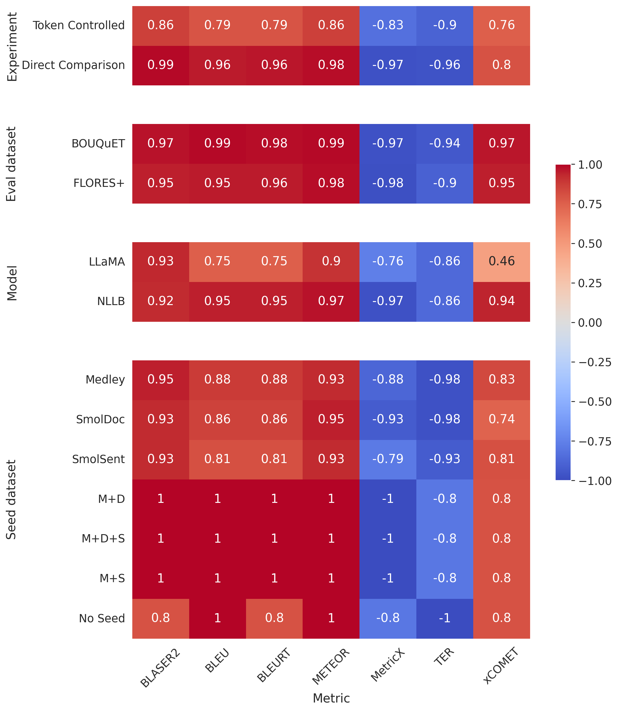

 Figure A.4: Spearman rank correlation of chrF++ with other evaluation metrics, across different dimensions.

##### Domain-wise breakdown

We evaluate our models also at the domain-level, leveraging the domain-split provided by BOUQuET, and report results in [table A.15](https://arxiv.org/html/2603.16309v3#A1.T15 "In Domain-wise breakdown ‣ A.11 More details on the experiment results ‣ Appendix A MeDLEy details ‣ Omnilingual MT: Machine Translation for 1,600 Languages").

<table id="A1.T15.3.1" class="ltx_tabular ltx_align_middle">
<tr id="A1.T15.3.1.1" class="ltx_tr">
<td id="A1.T15.3.1.1.1" class="ltx_td ltx_align_right ltx_border_tt" style="padding-top:0.75pt;padding-bottom:0.75pt;" rowspan="2">Model</td>
<td id="A1.T15.3.1.1.2" class="ltx_td ltx_align_right ltx_border_tt" style="padding-top:0.75pt;padding-bottom:0.75pt;" rowspan="2">Seed Dataset</td>
<td id="A1.T15.3.1.1.3" class="ltx_td ltx_align_center ltx_border_tt" style="padding-top:0.75pt;padding-bottom:0.75pt;" colspan="2">comments</td>
<td id="A1.T15.3.1.1.4" class="ltx_td ltx_align_center ltx_border_tt" style="padding-top:0.75pt;padding-bottom:0.75pt;" colspan="2">conversation</td>
<td id="A1.T15.3.1.1.5" class="ltx_td ltx_align_center ltx_border_tt" style="padding-top:0.75pt;padding-bottom:0.75pt;" colspan="2">instruction</td>
<td id="A1.T15.3.1.1.6" class="ltx_td ltx_align_center ltx_border_tt" style="padding-top:0.75pt;padding-bottom:0.75pt;" colspan="2">narration</td>
<td id="A1.T15.3.1.1.7" class="ltx_td ltx_align_center ltx_border_tt" style="padding-top:0.75pt;padding-bottom:0.75pt;" colspan="2">other misc.</td>
<td id="A1.T15.3.1.1.8" class="ltx_td ltx_align_center ltx_border_tt" style="padding-top:0.75pt;padding-bottom:0.75pt;" colspan="2">reflection</td>
<td id="A1.T15.3.1.1.9" class="ltx_td ltx_align_center ltx_border_tt" style="padding-top:0.75pt;padding-bottom:0.75pt;" colspan="2">social posts</td>
<td id="A1.T15.3.1.1.10" class="ltx_td ltx_align_center ltx_border_tt" style="padding-top:0.75pt;padding-bottom:0.75pt;" colspan="2">web misc.</td></tr>
<tr id="A1.T15.3.1.2" class="ltx_tr">
<td id="A1.T15.3.1.2.1" class="ltx_td ltx_align_right" style="padding-top:0.75pt;padding-bottom:0.75pt;">xx-en</td>
<td id="A1.T15.3.1.2.2" class="ltx_td ltx_align_right" style="padding-top:0.75pt;padding-bottom:0.75pt;">en-xx</td>
<td id="A1.T15.3.1.2.3" class="ltx_td ltx_align_right" style="padding-top:0.75pt;padding-bottom:0.75pt;">xx-en</td>
<td id="A1.T15.3.1.2.4" class="ltx_td ltx_align_right" style="padding-top:0.75pt;padding-bottom:0.75pt;">en-xx</td>
<td id="A1.T15.3.1.2.5" class="ltx_td ltx_align_right" style="padding-top:0.75pt;padding-bottom:0.75pt;">xx-en</td>
<td id="A1.T15.3.1.2.6" class="ltx_td ltx_align_right" style="padding-top:0.75pt;padding-bottom:0.75pt;">en-xx</td>
<td id="A1.T15.3.1.2.7" class="ltx_td ltx_align_right" style="padding-top:0.75pt;padding-bottom:0.75pt;">xx-en</td>
<td id="A1.T15.3.1.2.8" class="ltx_td ltx_align_right" style="padding-top:0.75pt;padding-bottom:0.75pt;">en-xx</td>
<td id="A1.T15.3.1.2.9" class="ltx_td ltx_align_right" style="padding-top:0.75pt;padding-bottom:0.75pt;">xx-en</td>
<td id="A1.T15.3.1.2.10" class="ltx_td ltx_align_right" style="padding-top:0.75pt;padding-bottom:0.75pt;">en-xx</td>
<td id="A1.T15.3.1.2.11" class="ltx_td ltx_align_right" style="padding-top:0.75pt;padding-bottom:0.75pt;">xx-en</td>
<td id="A1.T15.3.1.2.12" class="ltx_td ltx_align_right" style="padding-top:0.75pt;padding-bottom:0.75pt;">en-xx</td>
<td id="A1.T15.3.1.2.13" class="ltx_td ltx_align_right" style="padding-top:0.75pt;padding-bottom:0.75pt;">xx-en</td>
<td id="A1.T15.3.1.2.14" class="ltx_td ltx_align_right" style="padding-top:0.75pt;padding-bottom:0.75pt;">en-xx</td>
<td id="A1.T15.3.1.2.15" class="ltx_td ltx_align_right" style="padding-top:0.75pt;padding-bottom:0.75pt;">xx-en</td>
<td id="A1.T15.3.1.2.16" class="ltx_td ltx_nopad_r ltx_align_right" style="padding-top:0.75pt;padding-bottom:0.75pt;">en-xx</td></tr>
<tr id="A1.T15.3.1.3" class="ltx_tr">
<td id="A1.T15.3.1.3.1" class="ltx_td ltx_align_right ltx_border_t" style="padding-top:0.75pt;padding-bottom:0.75pt;" rowspan="4">LLaMA</td>
<td id="A1.T15.3.1.3.2" class="ltx_td ltx_align_right ltx_border_t" style="padding-top:0.75pt;padding-bottom:0.75pt;">No Seed</td>
<td id="A1.T15.3.1.3.3" class="ltx_td ltx_align_right ltx_border_t" style="padding-top:0.75pt;padding-bottom:0.75pt;">7.19</td>
<td id="A1.T15.3.1.3.4" class="ltx_td ltx_align_right ltx_border_t" style="padding-top:0.75pt;padding-bottom:0.75pt;">13.49</td>
<td id="A1.T15.3.1.3.5" class="ltx_td ltx_align_right ltx_border_t" style="padding-top:0.75pt;padding-bottom:0.75pt;">9.27</td>
<td id="A1.T15.3.1.3.6" class="ltx_td ltx_align_right ltx_border_t" style="padding-top:0.75pt;padding-bottom:0.75pt;">13.37</td>
<td id="A1.T15.3.1.3.7" class="ltx_td ltx_align_right ltx_border_t" style="padding-top:0.75pt;padding-bottom:0.75pt;">6.97</td>
<td id="A1.T15.3.1.3.8" class="ltx_td ltx_align_right ltx_border_t" style="padding-top:0.75pt;padding-bottom:0.75pt;">15.19</td>
<td id="A1.T15.3.1.3.9" class="ltx_td ltx_align_right ltx_border_t" style="padding-top:0.75pt;padding-bottom:0.75pt;">7.87</td>
<td id="A1.T15.3.1.3.10" class="ltx_td ltx_align_right ltx_border_t" style="padding-top:0.75pt;padding-bottom:0.75pt;">14.07</td>
<td id="A1.T15.3.1.3.11" class="ltx_td ltx_align_right ltx_border_t" style="padding-top:0.75pt;padding-bottom:0.75pt;">6.81</td>
<td id="A1.T15.3.1.3.12" class="ltx_td ltx_align_right ltx_border_t" style="padding-top:0.75pt;padding-bottom:0.75pt;">14.33</td>
<td id="A1.T15.3.1.3.13" class="ltx_td ltx_align_right ltx_border_t" style="padding-top:0.75pt;padding-bottom:0.75pt;">6.42</td>
<td id="A1.T15.3.1.3.14" class="ltx_td ltx_align_right ltx_border_t" style="padding-top:0.75pt;padding-bottom:0.75pt;">15.13</td>
<td id="A1.T15.3.1.3.15" class="ltx_td ltx_align_right ltx_border_t" style="padding-top:0.75pt;padding-bottom:0.75pt;">7.18</td>
<td id="A1.T15.3.1.3.16" class="ltx_td ltx_align_right ltx_border_t" style="padding-top:0.75pt;padding-bottom:0.75pt;">15.50</td>
<td id="A1.T15.3.1.3.17" class="ltx_td ltx_align_right ltx_border_t" style="padding-top:0.75pt;padding-bottom:0.75pt;">6.50</td>
<td id="A1.T15.3.1.3.18" class="ltx_td ltx_nopad_r ltx_align_right ltx_border_t" style="padding-top:0.75pt;padding-bottom:0.75pt;">13.44</td></tr>
<tr id="A1.T15.3.1.4" class="ltx_tr">
<td id="A1.T15.3.1.4.1" class="ltx_td ltx_align_right" style="padding-top:0.75pt;padding-bottom:0.75pt;">SmolDoc</td>
<td id="A1.T15.3.1.4.2" class="ltx_td ltx_align_right" style="padding-top:0.75pt;padding-bottom:0.75pt;">19.64</td>
<td id="A1.T15.3.1.4.3" class="ltx_td ltx_align_right" style="padding-top:0.75pt;padding-bottom:0.75pt;">14.50</td>
<td id="A1.T15.3.1.4.4" class="ltx_td ltx_align_right" style="padding-top:0.75pt;padding-bottom:0.75pt;">25.63</td>
<td id="A1.T15.3.1.4.5" class="ltx_td ltx_align_right" style="padding-top:0.75pt;padding-bottom:0.75pt;">17.35</td>
<td id="A1.T15.3.1.4.6" class="ltx_td ltx_align_right" style="padding-top:0.75pt;padding-bottom:0.75pt;">22.40</td>
<td id="A1.T15.3.1.4.7" class="ltx_td ltx_align_right" style="padding-top:0.75pt;padding-bottom:0.75pt;">17.68</td>
<td id="A1.T15.3.1.4.8" class="ltx_td ltx_align_right" style="padding-top:0.75pt;padding-bottom:0.75pt;">23.91</td>
<td id="A1.T15.3.1.4.9" class="ltx_td ltx_align_right" style="padding-top:0.75pt;padding-bottom:0.75pt;">19.47</td>
<td id="A1.T15.3.1.4.10" class="ltx_td ltx_align_right" style="padding-top:0.75pt;padding-bottom:0.75pt;">20.23</td>
<td id="A1.T15.3.1.4.11" class="ltx_td ltx_align_right" style="padding-top:0.75pt;padding-bottom:0.75pt;">15.91</td>
<td id="A1.T15.3.1.4.12" class="ltx_td ltx_align_right" style="padding-top:0.75pt;padding-bottom:0.75pt;">21.73</td>
<td id="A1.T15.3.1.4.13" class="ltx_td ltx_align_right" style="padding-top:0.75pt;padding-bottom:0.75pt;">17.61</td>
<td id="A1.T15.3.1.4.14" class="ltx_td ltx_align_right" style="padding-top:0.75pt;padding-bottom:0.75pt;">24.37</td>
<td id="A1.T15.3.1.4.15" class="ltx_td ltx_align_right" style="padding-top:0.75pt;padding-bottom:0.75pt;">20.82</td>
<td id="A1.T15.3.1.4.16" class="ltx_td ltx_align_right" style="padding-top:0.75pt;padding-bottom:0.75pt;">19.18</td>
<td id="A1.T15.3.1.4.17" class="ltx_td ltx_nopad_r ltx_align_right" style="padding-top:0.75pt;padding-bottom:0.75pt;">17.04</td></tr>
<tr id="A1.T15.3.1.5" class="ltx_tr">
<td id="A1.T15.3.1.5.1" class="ltx_td ltx_align_right" style="padding-top:0.75pt;padding-bottom:0.75pt;">SmolSent</td>
<td id="A1.T15.3.1.5.2" class="ltx_td ltx_align_right" style="padding-top:0.75pt;padding-bottom:0.75pt;">14.75</td>
<td id="A1.T15.3.1.5.3" class="ltx_td ltx_align_right" style="padding-top:0.75pt;padding-bottom:0.75pt;">13.66</td>
<td id="A1.T15.3.1.5.4" class="ltx_td ltx_align_right" style="padding-top:0.75pt;padding-bottom:0.75pt;">15.97</td>
<td id="A1.T15.3.1.5.5" class="ltx_td ltx_align_right" style="padding-top:0.75pt;padding-bottom:0.75pt;">16.00</td>
<td id="A1.T15.3.1.5.6" class="ltx_td ltx_align_right" style="padding-top:0.75pt;padding-bottom:0.75pt;">15.87</td>
<td id="A1.T15.3.1.5.7" class="ltx_td ltx_align_right" style="padding-top:0.75pt;padding-bottom:0.75pt;">16.62</td>
<td id="A1.T15.3.1.5.8" class="ltx_td ltx_align_right" style="padding-top:0.75pt;padding-bottom:0.75pt;">16.44</td>
<td id="A1.T15.3.1.5.9" class="ltx_td ltx_align_right" style="padding-top:0.75pt;padding-bottom:0.75pt;">16.55</td>
<td id="A1.T15.3.1.5.10" class="ltx_td ltx_align_right" style="padding-top:0.75pt;padding-bottom:0.75pt;">14.80</td>
<td id="A1.T15.3.1.5.11" class="ltx_td ltx_align_right" style="padding-top:0.75pt;padding-bottom:0.75pt;">15.74</td>
<td id="A1.T15.3.1.5.12" class="ltx_td ltx_align_right" style="padding-top:0.75pt;padding-bottom:0.75pt;">15.44</td>
<td id="A1.T15.3.1.5.13" class="ltx_td ltx_align_right" style="padding-top:0.75pt;padding-bottom:0.75pt;">16.31</td>
<td id="A1.T15.3.1.5.14" class="ltx_td ltx_align_right" style="padding-top:0.75pt;padding-bottom:0.75pt;">17.39</td>
<td id="A1.T15.3.1.5.15" class="ltx_td ltx_align_right" style="padding-top:0.75pt;padding-bottom:0.75pt;">18.38</td>
<td id="A1.T15.3.1.5.16" class="ltx_td ltx_align_right" style="padding-top:0.75pt;padding-bottom:0.75pt;">15.68</td>
<td id="A1.T15.3.1.5.17" class="ltx_td ltx_nopad_r ltx_align_right" style="padding-top:0.75pt;padding-bottom:0.75pt;">16.55</td></tr>
<tr id="A1.T15.3.1.6" class="ltx_tr">
<td id="A1.T15.3.1.6.1" class="ltx_td ltx_align_right" style="padding-top:0.75pt;padding-bottom:0.75pt;">Medley</td>
<td id="A1.T15.3.1.6.2" class="ltx_td ltx_align_right" style="padding-top:0.75pt;padding-bottom:0.75pt;">20.12</td>
<td id="A1.T15.3.1.6.3" class="ltx_td ltx_align_right" style="padding-top:0.75pt;padding-bottom:0.75pt;">15.61</td>
<td id="A1.T15.3.1.6.4" class="ltx_td ltx_align_right" style="padding-top:0.75pt;padding-bottom:0.75pt;">21.68</td>
<td id="A1.T15.3.1.6.5" class="ltx_td ltx_align_right" style="padding-top:0.75pt;padding-bottom:0.75pt;">16.40</td>
<td id="A1.T15.3.1.6.6" class="ltx_td ltx_align_right" style="padding-top:0.75pt;padding-bottom:0.75pt;">21.20</td>
<td id="A1.T15.3.1.6.7" class="ltx_td ltx_align_right" style="padding-top:0.75pt;padding-bottom:0.75pt;">18.30</td>
<td id="A1.T15.3.1.6.8" class="ltx_td ltx_align_right" style="padding-top:0.75pt;padding-bottom:0.75pt;">22.42</td>
<td id="A1.T15.3.1.6.9" class="ltx_td ltx_align_right" style="padding-top:0.75pt;padding-bottom:0.75pt;">19.91</td>
<td id="A1.T15.3.1.6.10" class="ltx_td ltx_align_right" style="padding-top:0.75pt;padding-bottom:0.75pt;">20.89</td>
<td id="A1.T15.3.1.6.11" class="ltx_td ltx_align_right" style="padding-top:0.75pt;padding-bottom:0.75pt;">18.42</td>
<td id="A1.T15.3.1.6.12" class="ltx_td ltx_align_right" style="padding-top:0.75pt;padding-bottom:0.75pt;">21.94</td>
<td id="A1.T15.3.1.6.13" class="ltx_td ltx_align_right" style="padding-top:0.75pt;padding-bottom:0.75pt;">18.81</td>
<td id="A1.T15.3.1.6.14" class="ltx_td ltx_align_right" style="padding-top:0.75pt;padding-bottom:0.75pt;">22.91</td>
<td id="A1.T15.3.1.6.15" class="ltx_td ltx_align_right" style="padding-top:0.75pt;padding-bottom:0.75pt;">19.80</td>
<td id="A1.T15.3.1.6.16" class="ltx_td ltx_align_right" style="padding-top:0.75pt;padding-bottom:0.75pt;">19.10</td>
<td id="A1.T15.3.1.6.17" class="ltx_td ltx_nopad_r ltx_align_right" style="padding-top:0.75pt;padding-bottom:0.75pt;">18.20</td></tr>
<tr id="A1.T15.3.1.7" class="ltx_tr">
<td id="A1.T15.3.1.7.1" class="ltx_td ltx_align_right ltx_border_bb" style="padding-top:0.75pt;padding-bottom:0.75pt;" rowspan="4">NLLB</td>
<td id="A1.T15.3.1.7.2" class="ltx_td ltx_align_right ltx_border_t" style="padding-top:0.75pt;padding-bottom:0.75pt;">No Seed</td>
<td id="A1.T15.3.1.7.3" class="ltx_td ltx_align_right ltx_border_t" style="padding-top:0.75pt;padding-bottom:0.75pt;">25.92</td>
<td id="A1.T15.3.1.7.4" class="ltx_td ltx_align_right ltx_border_t" style="padding-top:0.75pt;padding-bottom:0.75pt;">27.85</td>
<td id="A1.T15.3.1.7.5" class="ltx_td ltx_align_right ltx_border_t" style="padding-top:0.75pt;padding-bottom:0.75pt;">30.63</td>
<td id="A1.T15.3.1.7.6" class="ltx_td ltx_align_right ltx_border_t" style="padding-top:0.75pt;padding-bottom:0.75pt;">34.74</td>
<td id="A1.T15.3.1.7.7" class="ltx_td ltx_align_right ltx_border_t" style="padding-top:0.75pt;padding-bottom:0.75pt;">30.15</td>
<td id="A1.T15.3.1.7.8" class="ltx_td ltx_align_right ltx_border_t" style="padding-top:0.75pt;padding-bottom:0.75pt;">33.18</td>
<td id="A1.T15.3.1.7.9" class="ltx_td ltx_align_right ltx_border_t" style="padding-top:0.75pt;padding-bottom:0.75pt;">31.78</td>
<td id="A1.T15.3.1.7.10" class="ltx_td ltx_align_right ltx_border_t" style="padding-top:0.75pt;padding-bottom:0.75pt;">32.55</td>
<td id="A1.T15.3.1.7.11" class="ltx_td ltx_align_right ltx_border_t" style="padding-top:0.75pt;padding-bottom:0.75pt;">27.57</td>
<td id="A1.T15.3.1.7.12" class="ltx_td ltx_align_right ltx_border_t" style="padding-top:0.75pt;padding-bottom:0.75pt;">29.49</td>
<td id="A1.T15.3.1.7.13" class="ltx_td ltx_align_right ltx_border_t" style="padding-top:0.75pt;padding-bottom:0.75pt;">27.11</td>
<td id="A1.T15.3.1.7.14" class="ltx_td ltx_align_right ltx_border_t" style="padding-top:0.75pt;padding-bottom:0.75pt;">27.05</td>
<td id="A1.T15.3.1.7.15" class="ltx_td ltx_align_right ltx_border_t" style="padding-top:0.75pt;padding-bottom:0.75pt;">29.72</td>
<td id="A1.T15.3.1.7.16" class="ltx_td ltx_align_right ltx_border_t" style="padding-top:0.75pt;padding-bottom:0.75pt;">36.22</td>
<td id="A1.T15.3.1.7.17" class="ltx_td ltx_align_right ltx_border_t" style="padding-top:0.75pt;padding-bottom:0.75pt;">23.44</td>
<td id="A1.T15.3.1.7.18" class="ltx_td ltx_nopad_r ltx_align_right ltx_border_t" style="padding-top:0.75pt;padding-bottom:0.75pt;">27.59</td></tr>
<tr id="A1.T15.3.1.8" class="ltx_tr">
<td id="A1.T15.3.1.8.1" class="ltx_td ltx_align_right" style="padding-top:0.75pt;padding-bottom:0.75pt;">SmolDoc</td>
<td id="A1.T15.3.1.8.2" class="ltx_td ltx_align_right" style="padding-top:0.75pt;padding-bottom:0.75pt;">29.64</td>
<td id="A1.T15.3.1.8.3" class="ltx_td ltx_align_right" style="padding-top:0.75pt;padding-bottom:0.75pt;">31.47</td>
<td id="A1.T15.3.1.8.4" class="ltx_td ltx_align_right" style="padding-top:0.75pt;padding-bottom:0.75pt;">37.27</td>
<td id="A1.T15.3.1.8.5" class="ltx_td ltx_align_right" style="padding-top:0.75pt;padding-bottom:0.75pt;">37.98</td>
<td id="A1.T15.3.1.8.6" class="ltx_td ltx_align_right" style="padding-top:0.75pt;padding-bottom:0.75pt;">33.29</td>
<td id="A1.T15.3.1.8.7" class="ltx_td ltx_align_right" style="padding-top:0.75pt;padding-bottom:0.75pt;">33.35</td>
<td id="A1.T15.3.1.8.8" class="ltx_td ltx_align_right" style="padding-top:0.75pt;padding-bottom:0.75pt;">33.69</td>
<td id="A1.T15.3.1.8.9" class="ltx_td ltx_align_right" style="padding-top:0.75pt;padding-bottom:0.75pt;">36.50</td>
<td id="A1.T15.3.1.8.10" class="ltx_td ltx_align_right" style="padding-top:0.75pt;padding-bottom:0.75pt;">29.97</td>
<td id="A1.T15.3.1.8.11" class="ltx_td ltx_align_right" style="padding-top:0.75pt;padding-bottom:0.75pt;">32.10</td>
<td id="A1.T15.3.1.8.12" class="ltx_td ltx_align_right" style="padding-top:0.75pt;padding-bottom:0.75pt;">28.80</td>
<td id="A1.T15.3.1.8.13" class="ltx_td ltx_align_right" style="padding-top:0.75pt;padding-bottom:0.75pt;">28.02</td>
<td id="A1.T15.3.1.8.14" class="ltx_td ltx_align_right" style="padding-top:0.75pt;padding-bottom:0.75pt;">32.87</td>
<td id="A1.T15.3.1.8.15" class="ltx_td ltx_align_right" style="padding-top:0.75pt;padding-bottom:0.75pt;">36.52</td>
<td id="A1.T15.3.1.8.16" class="ltx_td ltx_align_right" style="padding-top:0.75pt;padding-bottom:0.75pt;">25.48</td>
<td id="A1.T15.3.1.8.17" class="ltx_td ltx_nopad_r ltx_align_right" style="padding-top:0.75pt;padding-bottom:0.75pt;">30.47</td></tr>
<tr id="A1.T15.3.1.9" class="ltx_tr">
<td id="A1.T15.3.1.9.1" class="ltx_td ltx_align_right" style="padding-top:0.75pt;padding-bottom:0.75pt;">SmolSent</td>
<td id="A1.T15.3.1.9.2" class="ltx_td ltx_align_right" style="padding-top:0.75pt;padding-bottom:0.75pt;">24.87</td>
<td id="A1.T15.3.1.9.3" class="ltx_td ltx_align_right" style="padding-top:0.75pt;padding-bottom:0.75pt;">28.24</td>
<td id="A1.T15.3.1.9.4" class="ltx_td ltx_align_right" style="padding-top:0.75pt;padding-bottom:0.75pt;">31.30</td>
<td id="A1.T15.3.1.9.5" class="ltx_td ltx_align_right" style="padding-top:0.75pt;padding-bottom:0.75pt;">33.75</td>
<td id="A1.T15.3.1.9.6" class="ltx_td ltx_align_right" style="padding-top:0.75pt;padding-bottom:0.75pt;">29.02</td>
<td id="A1.T15.3.1.9.7" class="ltx_td ltx_align_right" style="padding-top:0.75pt;padding-bottom:0.75pt;">32.32</td>
<td id="A1.T15.3.1.9.8" class="ltx_td ltx_align_right" style="padding-top:0.75pt;padding-bottom:0.75pt;">28.52</td>
<td id="A1.T15.3.1.9.9" class="ltx_td ltx_align_right" style="padding-top:0.75pt;padding-bottom:0.75pt;">32.71</td>
<td id="A1.T15.3.1.9.10" class="ltx_td ltx_align_right" style="padding-top:0.75pt;padding-bottom:0.75pt;">25.60</td>
<td id="A1.T15.3.1.9.11" class="ltx_td ltx_align_right" style="padding-top:0.75pt;padding-bottom:0.75pt;">30.59</td>
<td id="A1.T15.3.1.9.12" class="ltx_td ltx_align_right" style="padding-top:0.75pt;padding-bottom:0.75pt;">26.53</td>
<td id="A1.T15.3.1.9.13" class="ltx_td ltx_align_right" style="padding-top:0.75pt;padding-bottom:0.75pt;">27.60</td>
<td id="A1.T15.3.1.9.14" class="ltx_td ltx_align_right" style="padding-top:0.75pt;padding-bottom:0.75pt;">29.68</td>
<td id="A1.T15.3.1.9.15" class="ltx_td ltx_align_right" style="padding-top:0.75pt;padding-bottom:0.75pt;">35.23</td>
<td id="A1.T15.3.1.9.16" class="ltx_td ltx_align_right" style="padding-top:0.75pt;padding-bottom:0.75pt;">23.93</td>
<td id="A1.T15.3.1.9.17" class="ltx_td ltx_nopad_r ltx_align_right" style="padding-top:0.75pt;padding-bottom:0.75pt;">29.34</td></tr>
<tr id="A1.T15.3.1.10" class="ltx_tr">
<td id="A1.T15.3.1.10.1" class="ltx_td ltx_align_right ltx_border_bb" style="padding-top:0.75pt;padding-bottom:0.75pt;">Medley</td>
<td id="A1.T15.3.1.10.2" class="ltx_td ltx_align_right ltx_border_bb" style="padding-top:0.75pt;padding-bottom:0.75pt;">27.78</td>
<td id="A1.T15.3.1.10.3" class="ltx_td ltx_align_right ltx_border_bb" style="padding-top:0.75pt;padding-bottom:0.75pt;">31.11</td>
<td id="A1.T15.3.1.10.4" class="ltx_td ltx_align_right ltx_border_bb" style="padding-top:0.75pt;padding-bottom:0.75pt;">32.47</td>
<td id="A1.T15.3.1.10.5" class="ltx_td ltx_align_right ltx_border_bb" style="padding-top:0.75pt;padding-bottom:0.75pt;">38.55</td>
<td id="A1.T15.3.1.10.6" class="ltx_td ltx_align_right ltx_border_bb" style="padding-top:0.75pt;padding-bottom:0.75pt;">31.06</td>
<td id="A1.T15.3.1.10.7" class="ltx_td ltx_align_right ltx_border_bb" style="padding-top:0.75pt;padding-bottom:0.75pt;">34.59</td>
<td id="A1.T15.3.1.10.8" class="ltx_td ltx_align_right ltx_border_bb" style="padding-top:0.75pt;padding-bottom:0.75pt;">31.67</td>
<td id="A1.T15.3.1.10.9" class="ltx_td ltx_align_right ltx_border_bb" style="padding-top:0.75pt;padding-bottom:0.75pt;">37.19</td>
<td id="A1.T15.3.1.10.10" class="ltx_td ltx_align_right ltx_border_bb" style="padding-top:0.75pt;padding-bottom:0.75pt;">27.20</td>
<td id="A1.T15.3.1.10.11" class="ltx_td ltx_align_right ltx_border_bb" style="padding-top:0.75pt;padding-bottom:0.75pt;">33.31</td>
<td id="A1.T15.3.1.10.12" class="ltx_td ltx_align_right ltx_border_bb" style="padding-top:0.75pt;padding-bottom:0.75pt;">27.54</td>
<td id="A1.T15.3.1.10.13" class="ltx_td ltx_align_right ltx_border_bb" style="padding-top:0.75pt;padding-bottom:0.75pt;">28.57</td>
<td id="A1.T15.3.1.10.14" class="ltx_td ltx_align_right ltx_border_bb" style="padding-top:0.75pt;padding-bottom:0.75pt;">30.80</td>
<td id="A1.T15.3.1.10.15" class="ltx_td ltx_align_right ltx_border_bb" style="padding-top:0.75pt;padding-bottom:0.75pt;">36.67</td>
<td id="A1.T15.3.1.10.16" class="ltx_td ltx_align_right ltx_border_bb" style="padding-top:0.75pt;padding-bottom:0.75pt;">25.30</td>
<td id="A1.T15.3.1.10.17" class="ltx_td ltx_nopad_r ltx_align_right ltx_border_bb" style="padding-top:0.75pt;padding-bottom:0.75pt;">30.31</td></tr>
</table>

 

Table A.15: Per-domain BOUQuET evaluation results comparing models fine-tuned on token-controlled version of the seed datasets.

##### Comparison with NLLB-Seed 

While NLLB-Seed does not cover 4 of 5 of our evaluation languages in [section 4.3.3](https://arxiv.org/html/2603.16309v3#S4.SS3.SSS3 "4.3.3 Experiments ‣ 4.3 Seed Data for Post-Training: MeDLEy ‣ 4 Creating High-Quality Datasets ‣ Omnilingual MT: Machine Translation for 1,600 Languages"), at the time of writing it has \(3\) low-resource languages languages in common with MeDLEy and our evaluation datasets: Bambara, Dinka and Fulfulde (bam_Latn, dik_Latn, fuv_Latn). We fine-tune, evaluate and compare the two with the same token-controlled methodology, and report the results of the comparison for those languages in [table A.16](https://arxiv.org/html/2603.16309v3#A1.T16 "In Comparison with NLLB-Seed ‣ A.11 More details on the experiment results ‣ Appendix A MeDLEy details ‣ Omnilingual MT: Machine Translation for 1,600 Languages") and [table A.17](https://arxiv.org/html/2603.16309v3#A1.T17 "In Comparison with NLLB-Seed ‣ A.11 More details on the experiment results ‣ Appendix A MeDLEy details ‣ Omnilingual MT: Machine Translation for 1,600 Languages"). Note that there are significant differences between NLLB-Seed and our dataset. The former is single-domain English-centric data selected across a variety of topics, whereas MeDLEy is multicentric and multiway, and contains human-written source sentences over 5 domains. The Wikipedia domain has been observed to contain obscure and specialized terms that are difficult for language translators to work with ([Taguchi et al., 2025](https://arxiv.org/html/2603.16309v3#bib.bib154); [Jumashev et al., 2025](https://arxiv.org/html/2603.16309v3#bib.bib155)) and may not necessarily add general utility to an MT system trained on such a corpus. We also perform our difficulty analysis , and find that NLLB-Seed contains a very high percentage of texts that are labeled C1 or C2 (54.1%) as compared to MeDLEy (10.4%) or SMOL-sent (9.7%).

<table id="A1.T16.3.1" class="ltx_tabular ltx_align_middle">
<tr id="A1.T16.3.1.1" class="ltx_tr">
<td id="A1.T16.3.1.1.1" class="ltx_td ltx_align_left ltx_border_tt" style="padding-top:0.75pt;padding-bottom:0.75pt;" rowspan="3">Model</td>
<td id="A1.T16.3.1.1.2" class="ltx_td ltx_align_left ltx_border_tt" style="padding-top:0.75pt;padding-bottom:0.75pt;" rowspan="3">Seed Dataset</td>
<td id="A1.T16.3.1.1.3" class="ltx_td ltx_align_center ltx_border_tt" style="padding-top:0.75pt;padding-bottom:0.75pt;" colspan="6">BOUQUET</td>
<td id="A1.T16.3.1.1.4" class="ltx_td ltx_align_center ltx_border_tt" style="padding-top:0.75pt;padding-bottom:0.75pt;" colspan="6">FLORES+</td></tr>
<tr id="A1.T16.3.1.2" class="ltx_tr">
<td id="A1.T16.3.1.2.1" class="ltx_td ltx_align_center ltx_border_t" style="padding-top:0.75pt;padding-bottom:0.75pt;" colspan="3">en-xx</td>
<td id="A1.T16.3.1.2.2" class="ltx_td ltx_align_center ltx_border_t" style="padding-top:0.75pt;padding-bottom:0.75pt;" colspan="3">xx-en</td>
<td id="A1.T16.3.1.2.3" class="ltx_td ltx_align_center ltx_border_t" style="padding-top:0.75pt;padding-bottom:0.75pt;" colspan="3">en-xx</td>
<td id="A1.T16.3.1.2.4" class="ltx_td ltx_align_center ltx_border_t" style="padding-top:0.75pt;padding-bottom:0.75pt;" colspan="3">xx-en</td></tr>
<tr id="A1.T16.3.1.3" class="ltx_tr">
<td id="A1.T16.3.1.3.1" class="ltx_td ltx_align_right ltx_border_t" style="padding-top:0.75pt;padding-bottom:0.75pt;">chrF++</td>
<td id="A1.T16.3.1.3.2" class="ltx_td ltx_align_right ltx_border_t" style="padding-top:0.75pt;padding-bottom:0.75pt;">MetricX</td>
<td id="A1.T16.3.1.3.3" class="ltx_td ltx_align_right ltx_border_t" style="padding-top:0.75pt;padding-bottom:0.75pt;">XCOMET</td>
<td id="A1.T16.3.1.3.4" class="ltx_td ltx_align_right ltx_border_t" style="padding-top:0.75pt;padding-bottom:0.75pt;">chrF++</td>
<td id="A1.T16.3.1.3.5" class="ltx_td ltx_align_right ltx_border_t" style="padding-top:0.75pt;padding-bottom:0.75pt;">MetricX</td>
<td id="A1.T16.3.1.3.6" class="ltx_td ltx_align_right ltx_border_t" style="padding-top:0.75pt;padding-bottom:0.75pt;">XCOMET</td>
<td id="A1.T16.3.1.3.7" class="ltx_td ltx_align_right ltx_border_t" style="padding-top:0.75pt;padding-bottom:0.75pt;">chrF++</td>
<td id="A1.T16.3.1.3.8" class="ltx_td ltx_align_right ltx_border_t" style="padding-top:0.75pt;padding-bottom:0.75pt;">MetricX</td>
<td id="A1.T16.3.1.3.9" class="ltx_td ltx_align_right ltx_border_t" style="padding-top:0.75pt;padding-bottom:0.75pt;">XCOMET</td>
<td id="A1.T16.3.1.3.10" class="ltx_td ltx_align_right ltx_border_t" style="padding-top:0.75pt;padding-bottom:0.75pt;">chrF++</td>
<td id="A1.T16.3.1.3.11" class="ltx_td ltx_align_right ltx_border_t" style="padding-top:0.75pt;padding-bottom:0.75pt;">MetricX</td>
<td id="A1.T16.3.1.3.12" class="ltx_td ltx_nopad_r ltx_align_right ltx_border_t" style="padding-top:0.75pt;padding-bottom:0.75pt;">XCOMET</td></tr>
<tr id="A1.T16.3.1.4" class="ltx_tr">
<td id="A1.T16.3.1.4.1" class="ltx_td ltx_align_left ltx_border_t" style="padding-top:0.75pt;padding-bottom:0.75pt;" rowspan="3">LLaMA</td>
<td id="A1.T16.3.1.4.2" class="ltx_td ltx_align_left ltx_border_t" style="padding-top:0.75pt;padding-bottom:0.75pt;">No Seed</td>
<td id="A1.T16.3.1.4.3" class="ltx_td ltx_align_right ltx_border_t" style="padding-top:0.75pt;padding-bottom:0.75pt;">6.69</td>
<td id="A1.T16.3.1.4.4" class="ltx_td ltx_align_right ltx_border_t" style="padding-top:0.75pt;padding-bottom:0.75pt;">14.73</td>
<td id="A1.T16.3.1.4.5" class="ltx_td ltx_align_right ltx_border_t" style="padding-top:0.75pt;padding-bottom:0.75pt;">0.19</td>
<td id="A1.T16.3.1.4.6" class="ltx_td ltx_align_right ltx_border_t" style="padding-top:0.75pt;padding-bottom:0.75pt;">13.54</td>
<td id="A1.T16.3.1.4.7" class="ltx_td ltx_align_right ltx_border_t" style="padding-top:0.75pt;padding-bottom:0.75pt;">10.40</td>
<td id="A1.T16.3.1.4.8" class="ltx_td ltx_align_right ltx_border_t" style="padding-top:0.75pt;padding-bottom:0.75pt;">0.23</td>
<td id="A1.T16.3.1.4.9" class="ltx_td ltx_align_right ltx_border_t" style="padding-top:0.75pt;padding-bottom:0.75pt;">7.78</td>
<td id="A1.T16.3.1.4.10" class="ltx_td ltx_align_right ltx_border_t" style="padding-top:0.75pt;padding-bottom:0.75pt;">15.71</td>
<td id="A1.T16.3.1.4.11" class="ltx_td ltx_align_right ltx_border_t" style="padding-top:0.75pt;padding-bottom:0.75pt;">0.16</td>
<td id="A1.T16.3.1.4.12" class="ltx_td ltx_align_right ltx_border_t" style="padding-top:0.75pt;padding-bottom:0.75pt;">15.64</td>
<td id="A1.T16.3.1.4.13" class="ltx_td ltx_align_right ltx_border_t" style="padding-top:0.75pt;padding-bottom:0.75pt;">11.04</td>
<td id="A1.T16.3.1.4.14" class="ltx_td ltx_nopad_r ltx_align_right ltx_border_t" style="padding-top:0.75pt;padding-bottom:0.75pt;">0.20</td></tr>
<tr id="A1.T16.3.1.5" class="ltx_tr">
<td id="A1.T16.3.1.5.1" class="ltx_td ltx_align_left" style="padding-top:0.75pt;padding-bottom:0.75pt;">NLLB Seed</td>
<td id="A1.T16.3.1.5.2" class="ltx_td ltx_align_right" style="padding-top:0.75pt;padding-bottom:0.75pt;">18.42</td>
<td id="A1.T16.3.1.5.3" class="ltx_td ltx_align_right" style="padding-top:0.75pt;padding-bottom:0.75pt;">15.05</td>
<td id="A1.T16.3.1.5.4" class="ltx_td ltx_align_right" style="padding-top:0.75pt;padding-bottom:0.75pt;">0.32</td>
<td id="A1.T16.3.1.5.5" class="ltx_td ltx_align_right" style="padding-top:0.75pt;padding-bottom:0.75pt;">17.43</td>
<td id="A1.T16.3.1.5.6" class="ltx_td ltx_align_right" style="padding-top:0.75pt;padding-bottom:0.75pt;">14.21</td>
<td id="A1.T16.3.1.5.7" class="ltx_td ltx_align_right" style="padding-top:0.75pt;padding-bottom:0.75pt;">0.29</td>
<td id="A1.T16.3.1.5.8" class="ltx_td ltx_align_right" style="padding-top:0.75pt;padding-bottom:0.75pt;">21.08</td>
<td id="A1.T16.3.1.5.9" class="ltx_td ltx_align_right" style="padding-top:0.75pt;padding-bottom:0.75pt;">15.23</td>
<td id="A1.T16.3.1.5.10" class="ltx_td ltx_align_right" style="padding-top:0.75pt;padding-bottom:0.75pt;">0.24</td>
<td id="A1.T16.3.1.5.11" class="ltx_td ltx_align_right" style="padding-top:0.75pt;padding-bottom:0.75pt;">24.03</td>
<td id="A1.T16.3.1.5.12" class="ltx_td ltx_align_right" style="padding-top:0.75pt;padding-bottom:0.75pt;">13.19</td>
<td id="A1.T16.3.1.5.13" class="ltx_td ltx_nopad_r ltx_align_right" style="padding-top:0.75pt;padding-bottom:0.75pt;">0.29</td></tr>
<tr id="A1.T16.3.1.6" class="ltx_tr">
<td id="A1.T16.3.1.6.1" class="ltx_td ltx_align_left" style="padding-top:0.75pt;padding-bottom:0.75pt;">Medley</td>
<td id="A1.T16.3.1.6.2" class="ltx_td ltx_align_right" style="padding-top:0.75pt;padding-bottom:0.75pt;">24.92</td>
<td id="A1.T16.3.1.6.3" class="ltx_td ltx_align_right" style="padding-top:0.75pt;padding-bottom:0.75pt;">13.20</td>
<td id="A1.T16.3.1.6.4" class="ltx_td ltx_align_right" style="padding-top:0.75pt;padding-bottom:0.75pt;">0.33</td>
<td id="A1.T16.3.1.6.5" class="ltx_td ltx_align_right" style="padding-top:0.75pt;padding-bottom:0.75pt;">23.17</td>
<td id="A1.T16.3.1.6.6" class="ltx_td ltx_align_right" style="padding-top:0.75pt;padding-bottom:0.75pt;">11.29</td>
<td id="A1.T16.3.1.6.7" class="ltx_td ltx_align_right" style="padding-top:0.75pt;padding-bottom:0.75pt;">0.37</td>
<td id="A1.T16.3.1.6.8" class="ltx_td ltx_align_right" style="padding-top:0.75pt;padding-bottom:0.75pt;">22.19</td>
<td id="A1.T16.3.1.6.9" class="ltx_td ltx_align_right" style="padding-top:0.75pt;padding-bottom:0.75pt;">14.40</td>
<td id="A1.T16.3.1.6.10" class="ltx_td ltx_align_right" style="padding-top:0.75pt;padding-bottom:0.75pt;">0.24</td>
<td id="A1.T16.3.1.6.11" class="ltx_td ltx_align_right" style="padding-top:0.75pt;padding-bottom:0.75pt;">24.35</td>
<td id="A1.T16.3.1.6.12" class="ltx_td ltx_align_right" style="padding-top:0.75pt;padding-bottom:0.75pt;">12.49</td>
<td id="A1.T16.3.1.6.13" class="ltx_td ltx_nopad_r ltx_align_right" style="padding-top:0.75pt;padding-bottom:0.75pt;">0.28</td></tr>
<tr id="A1.T16.3.1.7" class="ltx_tr">
<td id="A1.T16.3.1.7.1" class="ltx_td ltx_align_left ltx_border_bb" style="padding-top:0.75pt;padding-bottom:0.75pt;" rowspan="3">NLLB</td>
<td id="A1.T16.3.1.7.2" class="ltx_td ltx_align_left ltx_border_t" style="padding-top:0.75pt;padding-bottom:0.75pt;">No Seed</td>
<td id="A1.T16.3.1.7.3" class="ltx_td ltx_align_right ltx_border_t" style="padding-top:0.75pt;padding-bottom:0.75pt;">25.69</td>
<td id="A1.T16.3.1.7.4" class="ltx_td ltx_align_right ltx_border_t" style="padding-top:0.75pt;padding-bottom:0.75pt;">12.07</td>
<td id="A1.T16.3.1.7.5" class="ltx_td ltx_align_right ltx_border_t" style="padding-top:0.75pt;padding-bottom:0.75pt;">0.35</td>
<td id="A1.T16.3.1.7.6" class="ltx_td ltx_align_right ltx_border_t" style="padding-top:0.75pt;padding-bottom:0.75pt;">33.29</td>
<td id="A1.T16.3.1.7.7" class="ltx_td ltx_align_right ltx_border_t" style="padding-top:0.75pt;padding-bottom:0.75pt;">10.80</td>
<td id="A1.T16.3.1.7.8" class="ltx_td ltx_align_right ltx_border_t" style="padding-top:0.75pt;padding-bottom:0.75pt;">0.46</td>
<td id="A1.T16.3.1.7.9" class="ltx_td ltx_align_right ltx_border_t" style="padding-top:0.75pt;padding-bottom:0.75pt;">25.53</td>
<td id="A1.T16.3.1.7.10" class="ltx_td ltx_align_right ltx_border_t" style="padding-top:0.75pt;padding-bottom:0.75pt;">13.00</td>
<td id="A1.T16.3.1.7.11" class="ltx_td ltx_align_right ltx_border_t" style="padding-top:0.75pt;padding-bottom:0.75pt;">0.24</td>
<td id="A1.T16.3.1.7.12" class="ltx_td ltx_align_right ltx_border_t" style="padding-top:0.75pt;padding-bottom:0.75pt;">33.85</td>
<td id="A1.T16.3.1.7.13" class="ltx_td ltx_align_right ltx_border_t" style="padding-top:0.75pt;padding-bottom:0.75pt;">11.03</td>
<td id="A1.T16.3.1.7.14" class="ltx_td ltx_nopad_r ltx_align_right ltx_border_t" style="padding-top:0.75pt;padding-bottom:0.75pt;">0.39</td></tr>
<tr id="A1.T16.3.1.8" class="ltx_tr">
<td id="A1.T16.3.1.8.1" class="ltx_td ltx_align_left" style="padding-top:0.75pt;padding-bottom:0.75pt;">NLLB Seed</td>
<td id="A1.T16.3.1.8.2" class="ltx_td ltx_align_right" style="padding-top:0.75pt;padding-bottom:0.75pt;">27.39</td>
<td id="A1.T16.3.1.8.3" class="ltx_td ltx_align_right" style="padding-top:0.75pt;padding-bottom:0.75pt;">12.04</td>
<td id="A1.T16.3.1.8.4" class="ltx_td ltx_align_right" style="padding-top:0.75pt;padding-bottom:0.75pt;">0.35</td>
<td id="A1.T16.3.1.8.5" class="ltx_td ltx_align_right" style="padding-top:0.75pt;padding-bottom:0.75pt;">34.98</td>
<td id="A1.T16.3.1.8.6" class="ltx_td ltx_align_right" style="padding-top:0.75pt;padding-bottom:0.75pt;">10.32</td>
<td id="A1.T16.3.1.8.7" class="ltx_td ltx_align_right" style="padding-top:0.75pt;padding-bottom:0.75pt;">0.48</td>
<td id="A1.T16.3.1.8.8" class="ltx_td ltx_align_right" style="padding-top:0.75pt;padding-bottom:0.75pt;">25.97</td>
<td id="A1.T16.3.1.8.9" class="ltx_td ltx_align_right" style="padding-top:0.75pt;padding-bottom:0.75pt;">13.01</td>
<td id="A1.T16.3.1.8.10" class="ltx_td ltx_align_right" style="padding-top:0.75pt;padding-bottom:0.75pt;">0.24</td>
<td id="A1.T16.3.1.8.11" class="ltx_td ltx_align_right" style="padding-top:0.75pt;padding-bottom:0.75pt;">34.05</td>
<td id="A1.T16.3.1.8.12" class="ltx_td ltx_align_right" style="padding-top:0.75pt;padding-bottom:0.75pt;">10.83</td>
<td id="A1.T16.3.1.8.13" class="ltx_td ltx_nopad_r ltx_align_right" style="padding-top:0.75pt;padding-bottom:0.75pt;">0.40</td></tr>
<tr id="A1.T16.3.1.9" class="ltx_tr">
<td id="A1.T16.3.1.9.1" class="ltx_td ltx_align_left ltx_border_bb" style="padding-top:0.75pt;padding-bottom:0.75pt;">Medley</td>
<td id="A1.T16.3.1.9.2" class="ltx_td ltx_align_right ltx_border_bb" style="padding-top:0.75pt;padding-bottom:0.75pt;">30.51</td>
<td id="A1.T16.3.1.9.3" class="ltx_td ltx_align_right ltx_border_bb" style="padding-top:0.75pt;padding-bottom:0.75pt;">11.87</td>
<td id="A1.T16.3.1.9.4" class="ltx_td ltx_align_right ltx_border_bb" style="padding-top:0.75pt;padding-bottom:0.75pt;">0.35</td>
<td id="A1.T16.3.1.9.5" class="ltx_td ltx_align_right ltx_border_bb" style="padding-top:0.75pt;padding-bottom:0.75pt;">37.97</td>
<td id="A1.T16.3.1.9.6" class="ltx_td ltx_align_right ltx_border_bb" style="padding-top:0.75pt;padding-bottom:0.75pt;">9.43</td>
<td id="A1.T16.3.1.9.7" class="ltx_td ltx_align_right ltx_border_bb" style="padding-top:0.75pt;padding-bottom:0.75pt;">0.51</td>
<td id="A1.T16.3.1.9.8" class="ltx_td ltx_align_right ltx_border_bb" style="padding-top:0.75pt;padding-bottom:0.75pt;">26.40</td>
<td id="A1.T16.3.1.9.9" class="ltx_td ltx_align_right ltx_border_bb" style="padding-top:0.75pt;padding-bottom:0.75pt;">12.88</td>
<td id="A1.T16.3.1.9.10" class="ltx_td ltx_align_right ltx_border_bb" style="padding-top:0.75pt;padding-bottom:0.75pt;">0.24</td>
<td id="A1.T16.3.1.9.11" class="ltx_td ltx_align_right ltx_border_bb" style="padding-top:0.75pt;padding-bottom:0.75pt;">34.80</td>
<td id="A1.T16.3.1.9.12" class="ltx_td ltx_align_right ltx_border_bb" style="padding-top:0.75pt;padding-bottom:0.75pt;">10.56</td>
<td id="A1.T16.3.1.9.13" class="ltx_td ltx_nopad_r ltx_align_right ltx_border_bb" style="padding-top:0.75pt;padding-bottom:0.75pt;">0.40</td></tr>
</table>

 

Table A.16: Average translation performance comparing NLLB-Seed and MeDLEy .

<table id="A1.T17.3.1" class="ltx_tabular ltx_align_middle">
<tr id="A1.T17.3.1.1" class="ltx_tr">
<td id="A1.T17.3.1.1.1" class="ltx_td ltx_align_left ltx_border_tt" style="padding-top:0.75pt;padding-bottom:0.75pt;" rowspan="3">Model</td>
<td id="A1.T17.3.1.1.2" class="ltx_td ltx_align_left ltx_border_tt" style="padding-top:0.75pt;padding-bottom:0.75pt;" rowspan="3">Language</td>
<td id="A1.T17.3.1.1.3" class="ltx_td ltx_align_left ltx_border_tt" style="padding-top:0.75pt;padding-bottom:0.75pt;" rowspan="3">Seed Dataset</td>
<td id="A1.T17.3.1.1.4" class="ltx_td ltx_align_center ltx_border_tt" style="padding-top:0.75pt;padding-bottom:0.75pt;" colspan="6">BOUQUET</td>
<td id="A1.T17.3.1.1.5" class="ltx_td ltx_align_center ltx_border_tt" style="padding-top:0.75pt;padding-bottom:0.75pt;" colspan="6">FLORES+</td></tr>
<tr id="A1.T17.3.1.2" class="ltx_tr">
<td id="A1.T17.3.1.2.1" class="ltx_td ltx_align_center ltx_border_t" style="padding-top:0.75pt;padding-bottom:0.75pt;" colspan="3">en-xx</td>
<td id="A1.T17.3.1.2.2" class="ltx_td ltx_align_center ltx_border_t" style="padding-top:0.75pt;padding-bottom:0.75pt;" colspan="3">xx-en</td>
<td id="A1.T17.3.1.2.3" class="ltx_td ltx_align_center ltx_border_t" style="padding-top:0.75pt;padding-bottom:0.75pt;" colspan="3">en-xx</td>
<td id="A1.T17.3.1.2.4" class="ltx_td ltx_align_center ltx_border_t" style="padding-top:0.75pt;padding-bottom:0.75pt;" colspan="3">xx-en</td></tr>
<tr id="A1.T17.3.1.3" class="ltx_tr">
<td id="A1.T17.3.1.3.1" class="ltx_td ltx_align_right ltx_border_t" style="padding-top:0.75pt;padding-bottom:0.75pt;">chrF++</td>
<td id="A1.T17.3.1.3.2" class="ltx_td ltx_align_right ltx_border_t" style="padding-top:0.75pt;padding-bottom:0.75pt;">MetricX</td>
<td id="A1.T17.3.1.3.3" class="ltx_td ltx_align_right ltx_border_t" style="padding-top:0.75pt;padding-bottom:0.75pt;">XCOMET</td>
<td id="A1.T17.3.1.3.4" class="ltx_td ltx_align_right ltx_border_t" style="padding-top:0.75pt;padding-bottom:0.75pt;">chrF++</td>
<td id="A1.T17.3.1.3.5" class="ltx_td ltx_align_right ltx_border_t" style="padding-top:0.75pt;padding-bottom:0.75pt;">MetricX</td>
<td id="A1.T17.3.1.3.6" class="ltx_td ltx_align_right ltx_border_t" style="padding-top:0.75pt;padding-bottom:0.75pt;">XCOMET</td>
<td id="A1.T17.3.1.3.7" class="ltx_td ltx_align_right ltx_border_t" style="padding-top:0.75pt;padding-bottom:0.75pt;">chrF++</td>
<td id="A1.T17.3.1.3.8" class="ltx_td ltx_align_right ltx_border_t" style="padding-top:0.75pt;padding-bottom:0.75pt;">MetricX</td>
<td id="A1.T17.3.1.3.9" class="ltx_td ltx_align_right ltx_border_t" style="padding-top:0.75pt;padding-bottom:0.75pt;">XCOMET</td>
<td id="A1.T17.3.1.3.10" class="ltx_td ltx_align_right ltx_border_t" style="padding-top:0.75pt;padding-bottom:0.75pt;">chrF++</td>
<td id="A1.T17.3.1.3.11" class="ltx_td ltx_align_right ltx_border_t" style="padding-top:0.75pt;padding-bottom:0.75pt;">MetricX</td>
<td id="A1.T17.3.1.3.12" class="ltx_td ltx_nopad_r ltx_align_right ltx_border_t" style="padding-top:0.75pt;padding-bottom:0.75pt;">XCOMET</td></tr>
<tr id="A1.T17.3.1.4" class="ltx_tr">
<td id="A1.T17.3.1.4.1" class="ltx_td ltx_align_left ltx_border_t" style="padding-top:0.75pt;padding-bottom:0.75pt;" rowspan="9">LLaMA</td>
<td id="A1.T17.3.1.4.2" class="ltx_td ltx_align_left ltx_border_t" style="padding-top:0.75pt;padding-bottom:0.75pt;" rowspan="3">bam_Latn</td>
<td id="A1.T17.3.1.4.3" class="ltx_td ltx_align_left ltx_border_t" style="padding-top:0.75pt;padding-bottom:0.75pt;">No Seed</td>
<td id="A1.T17.3.1.4.4" class="ltx_td ltx_align_right ltx_border_t" style="padding-top:0.75pt;padding-bottom:0.75pt;">7.55</td>
<td id="A1.T17.3.1.4.5" class="ltx_td ltx_align_right ltx_border_t" style="padding-top:0.75pt;padding-bottom:0.75pt;">16.67</td>
<td id="A1.T17.3.1.4.6" class="ltx_td ltx_align_right ltx_border_t" style="padding-top:0.75pt;padding-bottom:0.75pt;">0.22</td>
<td id="A1.T17.3.1.4.7" class="ltx_td ltx_align_right ltx_border_t" style="padding-top:0.75pt;padding-bottom:0.75pt;">14.29</td>
<td id="A1.T17.3.1.4.8" class="ltx_td ltx_align_right ltx_border_t" style="padding-top:0.75pt;padding-bottom:0.75pt;">10.75</td>
<td id="A1.T17.3.1.4.9" class="ltx_td ltx_align_right ltx_border_t" style="padding-top:0.75pt;padding-bottom:0.75pt;">0.25</td>
<td id="A1.T17.3.1.4.10" class="ltx_td ltx_align_right ltx_border_t" style="padding-top:0.75pt;padding-bottom:0.75pt;">7.13</td>
<td id="A1.T17.3.1.4.11" class="ltx_td ltx_align_right ltx_border_t" style="padding-top:0.75pt;padding-bottom:0.75pt;">17.57</td>
<td id="A1.T17.3.1.4.12" class="ltx_td ltx_align_right ltx_border_t" style="padding-top:0.75pt;padding-bottom:0.75pt;">0.18</td>
<td id="A1.T17.3.1.4.13" class="ltx_td ltx_align_right ltx_border_t" style="padding-top:0.75pt;padding-bottom:0.75pt;">15.30</td>
<td id="A1.T17.3.1.4.14" class="ltx_td ltx_align_right ltx_border_t" style="padding-top:0.75pt;padding-bottom:0.75pt;">11.52</td>
<td id="A1.T17.3.1.4.15" class="ltx_td ltx_nopad_r ltx_align_right ltx_border_t" style="padding-top:0.75pt;padding-bottom:0.75pt;">0.22</td></tr>
<tr id="A1.T17.3.1.5" class="ltx_tr">
<td id="A1.T17.3.1.5.1" class="ltx_td ltx_align_left" style="padding-top:0.75pt;padding-bottom:0.75pt;">NLLB Seed</td>
<td id="A1.T17.3.1.5.2" class="ltx_td ltx_align_right" style="padding-top:0.75pt;padding-bottom:0.75pt;">19.34</td>
<td id="A1.T17.3.1.5.3" class="ltx_td ltx_align_right" style="padding-top:0.75pt;padding-bottom:0.75pt;">14.54</td>
<td id="A1.T17.3.1.5.4" class="ltx_td ltx_align_right" style="padding-top:0.75pt;padding-bottom:0.75pt;">0.32</td>
<td id="A1.T17.3.1.5.5" class="ltx_td ltx_align_right" style="padding-top:0.75pt;padding-bottom:0.75pt;">18.17</td>
<td id="A1.T17.3.1.5.6" class="ltx_td ltx_align_right" style="padding-top:0.75pt;padding-bottom:0.75pt;">13.86</td>
<td id="A1.T17.3.1.5.7" class="ltx_td ltx_align_right" style="padding-top:0.75pt;padding-bottom:0.75pt;">0.30</td>
<td id="A1.T17.3.1.5.8" class="ltx_td ltx_align_right" style="padding-top:0.75pt;padding-bottom:0.75pt;">22.97</td>
<td id="A1.T17.3.1.5.9" class="ltx_td ltx_align_right" style="padding-top:0.75pt;padding-bottom:0.75pt;">14.32</td>
<td id="A1.T17.3.1.5.10" class="ltx_td ltx_align_right" style="padding-top:0.75pt;padding-bottom:0.75pt;">0.25</td>
<td id="A1.T17.3.1.5.11" class="ltx_td ltx_align_right" style="padding-top:0.75pt;padding-bottom:0.75pt;">24.29</td>
<td id="A1.T17.3.1.5.12" class="ltx_td ltx_align_right" style="padding-top:0.75pt;padding-bottom:0.75pt;">13.16</td>
<td id="A1.T17.3.1.5.13" class="ltx_td ltx_nopad_r ltx_align_right" style="padding-top:0.75pt;padding-bottom:0.75pt;">0.27</td></tr>
<tr id="A1.T17.3.1.6" class="ltx_tr">
<td id="A1.T17.3.1.6.1" class="ltx_td ltx_align_left" style="padding-top:0.75pt;padding-bottom:0.75pt;">Medley</td>
<td id="A1.T17.3.1.6.2" class="ltx_td ltx_align_right" style="padding-top:0.75pt;padding-bottom:0.75pt;">24.46</td>
<td id="A1.T17.3.1.6.3" class="ltx_td ltx_align_right" style="padding-top:0.75pt;padding-bottom:0.75pt;">11.90</td>
<td id="A1.T17.3.1.6.4" class="ltx_td ltx_align_right" style="padding-top:0.75pt;padding-bottom:0.75pt;">0.32</td>
<td id="A1.T17.3.1.6.5" class="ltx_td ltx_align_right" style="padding-top:0.75pt;padding-bottom:0.75pt;">22.91</td>
<td id="A1.T17.3.1.6.6" class="ltx_td ltx_align_right" style="padding-top:0.75pt;padding-bottom:0.75pt;">11.45</td>
<td id="A1.T17.3.1.6.7" class="ltx_td ltx_align_right" style="padding-top:0.75pt;padding-bottom:0.75pt;">0.37</td>
<td id="A1.T17.3.1.6.8" class="ltx_td ltx_align_right" style="padding-top:0.75pt;padding-bottom:0.75pt;">23.56</td>
<td id="A1.T17.3.1.6.9" class="ltx_td ltx_align_right" style="padding-top:0.75pt;padding-bottom:0.75pt;">12.70</td>
<td id="A1.T17.3.1.6.10" class="ltx_td ltx_align_right" style="padding-top:0.75pt;padding-bottom:0.75pt;">0.24</td>
<td id="A1.T17.3.1.6.11" class="ltx_td ltx_align_right" style="padding-top:0.75pt;padding-bottom:0.75pt;">23.88</td>
<td id="A1.T17.3.1.6.12" class="ltx_td ltx_align_right" style="padding-top:0.75pt;padding-bottom:0.75pt;">13.16</td>
<td id="A1.T17.3.1.6.13" class="ltx_td ltx_nopad_r ltx_align_right" style="padding-top:0.75pt;padding-bottom:0.75pt;">0.27</td></tr>
<tr id="A1.T17.3.1.7" class="ltx_tr">
<td id="A1.T17.3.1.7.1" class="ltx_td ltx_align_left" style="padding-top:0.75pt;padding-bottom:0.75pt;" rowspan="3">dik_Latn</td>
<td id="A1.T17.3.1.7.2" class="ltx_td ltx_align_left ltx_border_t" style="padding-top:0.75pt;padding-bottom:0.75pt;">No Seed</td>
<td id="A1.T17.3.1.7.3" class="ltx_td ltx_align_right ltx_border_t" style="padding-top:0.75pt;padding-bottom:0.75pt;">4.95</td>
<td id="A1.T17.3.1.7.4" class="ltx_td ltx_align_right ltx_border_t" style="padding-top:0.75pt;padding-bottom:0.75pt;">12.38</td>
<td id="A1.T17.3.1.7.5" class="ltx_td ltx_align_right ltx_border_t" style="padding-top:0.75pt;padding-bottom:0.75pt;">0.13</td>
<td id="A1.T17.3.1.7.6" class="ltx_td ltx_align_right ltx_border_t" style="padding-top:0.75pt;padding-bottom:0.75pt;">12.10</td>
<td id="A1.T17.3.1.7.7" class="ltx_td ltx_align_right ltx_border_t" style="padding-top:0.75pt;padding-bottom:0.75pt;">10.05</td>
<td id="A1.T17.3.1.7.8" class="ltx_td ltx_align_right ltx_border_t" style="padding-top:0.75pt;padding-bottom:0.75pt;">0.19</td>
<td id="A1.T17.3.1.7.9" class="ltx_td ltx_align_right ltx_border_t" style="padding-top:0.75pt;padding-bottom:0.75pt;">7.61</td>
<td id="A1.T17.3.1.7.10" class="ltx_td ltx_align_right ltx_border_t" style="padding-top:0.75pt;padding-bottom:0.75pt;">13.69</td>
<td id="A1.T17.3.1.7.11" class="ltx_td ltx_align_right ltx_border_t" style="padding-top:0.75pt;padding-bottom:0.75pt;">0.13</td>
<td id="A1.T17.3.1.7.12" class="ltx_td ltx_align_right ltx_border_t" style="padding-top:0.75pt;padding-bottom:0.75pt;">15.12</td>
<td id="A1.T17.3.1.7.13" class="ltx_td ltx_align_right ltx_border_t" style="padding-top:0.75pt;padding-bottom:0.75pt;">10.54</td>
<td id="A1.T17.3.1.7.14" class="ltx_td ltx_nopad_r ltx_align_right ltx_border_t" style="padding-top:0.75pt;padding-bottom:0.75pt;">0.18</td></tr>
<tr id="A1.T17.3.1.8" class="ltx_tr">
<td id="A1.T17.3.1.8.1" class="ltx_td ltx_align_left" style="padding-top:0.75pt;padding-bottom:0.75pt;">NLLB Seed</td>
<td id="A1.T17.3.1.8.2" class="ltx_td ltx_align_right" style="padding-top:0.75pt;padding-bottom:0.75pt;">18.47</td>
<td id="A1.T17.3.1.8.3" class="ltx_td ltx_align_right" style="padding-top:0.75pt;padding-bottom:0.75pt;">15.99</td>
<td id="A1.T17.3.1.8.4" class="ltx_td ltx_align_right" style="padding-top:0.75pt;padding-bottom:0.75pt;">0.31</td>
<td id="A1.T17.3.1.8.5" class="ltx_td ltx_align_right" style="padding-top:0.75pt;padding-bottom:0.75pt;">15.57</td>
<td id="A1.T17.3.1.8.6" class="ltx_td ltx_align_right" style="padding-top:0.75pt;padding-bottom:0.75pt;">15.15</td>
<td id="A1.T17.3.1.8.7" class="ltx_td ltx_align_right" style="padding-top:0.75pt;padding-bottom:0.75pt;">0.26</td>
<td id="A1.T17.3.1.8.8" class="ltx_td ltx_align_right" style="padding-top:0.75pt;padding-bottom:0.75pt;">21.62</td>
<td id="A1.T17.3.1.8.9" class="ltx_td ltx_align_right" style="padding-top:0.75pt;padding-bottom:0.75pt;">16.32</td>
<td id="A1.T17.3.1.8.10" class="ltx_td ltx_align_right" style="padding-top:0.75pt;padding-bottom:0.75pt;">0.24</td>
<td id="A1.T17.3.1.8.11" class="ltx_td ltx_align_right" style="padding-top:0.75pt;padding-bottom:0.75pt;">23.45</td>
<td id="A1.T17.3.1.8.12" class="ltx_td ltx_align_right" style="padding-top:0.75pt;padding-bottom:0.75pt;">13.43</td>
<td id="A1.T17.3.1.8.13" class="ltx_td ltx_nopad_r ltx_align_right" style="padding-top:0.75pt;padding-bottom:0.75pt;">0.29</td></tr>
<tr id="A1.T17.3.1.9" class="ltx_tr">
<td id="A1.T17.3.1.9.1" class="ltx_td ltx_align_left" style="padding-top:0.75pt;padding-bottom:0.75pt;">Medley</td>
<td id="A1.T17.3.1.9.2" class="ltx_td ltx_align_right" style="padding-top:0.75pt;padding-bottom:0.75pt;">27.08</td>
<td id="A1.T17.3.1.9.3" class="ltx_td ltx_align_right" style="padding-top:0.75pt;padding-bottom:0.75pt;">14.62</td>
<td id="A1.T17.3.1.9.4" class="ltx_td ltx_align_right" style="padding-top:0.75pt;padding-bottom:0.75pt;">0.33</td>
<td id="A1.T17.3.1.9.5" class="ltx_td ltx_align_right" style="padding-top:0.75pt;padding-bottom:0.75pt;">23.68</td>
<td id="A1.T17.3.1.9.6" class="ltx_td ltx_align_right" style="padding-top:0.75pt;padding-bottom:0.75pt;">11.32</td>
<td id="A1.T17.3.1.9.7" class="ltx_td ltx_align_right" style="padding-top:0.75pt;padding-bottom:0.75pt;">0.36</td>
<td id="A1.T17.3.1.9.8" class="ltx_td ltx_align_right" style="padding-top:0.75pt;padding-bottom:0.75pt;">21.51</td>
<td id="A1.T17.3.1.9.9" class="ltx_td ltx_align_right" style="padding-top:0.75pt;padding-bottom:0.75pt;">16.25</td>
<td id="A1.T17.3.1.9.10" class="ltx_td ltx_align_right" style="padding-top:0.75pt;padding-bottom:0.75pt;">0.24</td>
<td id="A1.T17.3.1.9.11" class="ltx_td ltx_align_right" style="padding-top:0.75pt;padding-bottom:0.75pt;">25.09</td>
<td id="A1.T17.3.1.9.12" class="ltx_td ltx_align_right" style="padding-top:0.75pt;padding-bottom:0.75pt;">11.78</td>
<td id="A1.T17.3.1.9.13" class="ltx_td ltx_nopad_r ltx_align_right" style="padding-top:0.75pt;padding-bottom:0.75pt;">0.28</td></tr>
<tr id="A1.T17.3.1.10" class="ltx_tr">
<td id="A1.T17.3.1.10.1" class="ltx_td ltx_align_left" style="padding-top:0.75pt;padding-bottom:0.75pt;" rowspan="3">fuv_Latn</td>
<td id="A1.T17.3.1.10.2" class="ltx_td ltx_align_left ltx_border_t" style="padding-top:0.75pt;padding-bottom:0.75pt;">No Seed</td>
<td id="A1.T17.3.1.10.3" class="ltx_td ltx_align_right ltx_border_t" style="padding-top:0.75pt;padding-bottom:0.75pt;">7.56</td>
<td id="A1.T17.3.1.10.4" class="ltx_td ltx_align_right ltx_border_t" style="padding-top:0.75pt;padding-bottom:0.75pt;">15.14</td>
<td id="A1.T17.3.1.10.5" class="ltx_td ltx_align_right ltx_border_t" style="padding-top:0.75pt;padding-bottom:0.75pt;">0.22</td>
<td id="A1.T17.3.1.10.6" class="ltx_td ltx_align_right ltx_border_t" style="padding-top:0.75pt;padding-bottom:0.75pt;">14.23</td>
<td id="A1.T17.3.1.10.7" class="ltx_td ltx_align_right ltx_border_t" style="padding-top:0.75pt;padding-bottom:0.75pt;">10.41</td>
<td id="A1.T17.3.1.10.8" class="ltx_td ltx_align_right ltx_border_t" style="padding-top:0.75pt;padding-bottom:0.75pt;">0.24</td>
<td id="A1.T17.3.1.10.9" class="ltx_td ltx_align_right ltx_border_t" style="padding-top:0.75pt;padding-bottom:0.75pt;">8.61</td>
<td id="A1.T17.3.1.10.10" class="ltx_td ltx_align_right ltx_border_t" style="padding-top:0.75pt;padding-bottom:0.75pt;">15.88</td>
<td id="A1.T17.3.1.10.11" class="ltx_td ltx_align_right ltx_border_t" style="padding-top:0.75pt;padding-bottom:0.75pt;">0.18</td>
<td id="A1.T17.3.1.10.12" class="ltx_td ltx_align_right ltx_border_t" style="padding-top:0.75pt;padding-bottom:0.75pt;">16.50</td>
<td id="A1.T17.3.1.10.13" class="ltx_td ltx_align_right ltx_border_t" style="padding-top:0.75pt;padding-bottom:0.75pt;">11.06</td>
<td id="A1.T17.3.1.10.14" class="ltx_td ltx_nopad_r ltx_align_right ltx_border_t" style="padding-top:0.75pt;padding-bottom:0.75pt;">0.20</td></tr>
<tr id="A1.T17.3.1.11" class="ltx_tr">
<td id="A1.T17.3.1.11.1" class="ltx_td ltx_align_left" style="padding-top:0.75pt;padding-bottom:0.75pt;">NLLB Seed</td>
<td id="A1.T17.3.1.11.2" class="ltx_td ltx_align_right" style="padding-top:0.75pt;padding-bottom:0.75pt;">17.45</td>
<td id="A1.T17.3.1.11.3" class="ltx_td ltx_align_right" style="padding-top:0.75pt;padding-bottom:0.75pt;">14.61</td>
<td id="A1.T17.3.1.11.4" class="ltx_td ltx_align_right" style="padding-top:0.75pt;padding-bottom:0.75pt;">0.34</td>
<td id="A1.T17.3.1.11.5" class="ltx_td ltx_align_right" style="padding-top:0.75pt;padding-bottom:0.75pt;">18.55</td>
<td id="A1.T17.3.1.11.6" class="ltx_td ltx_align_right" style="padding-top:0.75pt;padding-bottom:0.75pt;">13.63</td>
<td id="A1.T17.3.1.11.7" class="ltx_td ltx_align_right" style="padding-top:0.75pt;padding-bottom:0.75pt;">0.31</td>
<td id="A1.T17.3.1.11.8" class="ltx_td ltx_align_right" style="padding-top:0.75pt;padding-bottom:0.75pt;">18.67</td>
<td id="A1.T17.3.1.11.9" class="ltx_td ltx_align_right" style="padding-top:0.75pt;padding-bottom:0.75pt;">15.04</td>
<td id="A1.T17.3.1.11.10" class="ltx_td ltx_align_right" style="padding-top:0.75pt;padding-bottom:0.75pt;">0.24</td>
<td id="A1.T17.3.1.11.11" class="ltx_td ltx_align_right" style="padding-top:0.75pt;padding-bottom:0.75pt;">24.36</td>
<td id="A1.T17.3.1.11.12" class="ltx_td ltx_align_right" style="padding-top:0.75pt;padding-bottom:0.75pt;">12.97</td>
<td id="A1.T17.3.1.11.13" class="ltx_td ltx_nopad_r ltx_align_right" style="padding-top:0.75pt;padding-bottom:0.75pt;">0.30</td></tr>
<tr id="A1.T17.3.1.12" class="ltx_tr">
<td id="A1.T17.3.1.12.1" class="ltx_td ltx_align_left" style="padding-top:0.75pt;padding-bottom:0.75pt;">Medley</td>
<td id="A1.T17.3.1.12.2" class="ltx_td ltx_align_right" style="padding-top:0.75pt;padding-bottom:0.75pt;">23.24</td>
<td id="A1.T17.3.1.12.3" class="ltx_td ltx_align_right" style="padding-top:0.75pt;padding-bottom:0.75pt;">13.09</td>
<td id="A1.T17.3.1.12.4" class="ltx_td ltx_align_right" style="padding-top:0.75pt;padding-bottom:0.75pt;">0.34</td>
<td id="A1.T17.3.1.12.5" class="ltx_td ltx_align_right" style="padding-top:0.75pt;padding-bottom:0.75pt;">22.90</td>
<td id="A1.T17.3.1.12.6" class="ltx_td ltx_align_right" style="padding-top:0.75pt;padding-bottom:0.75pt;">11.10</td>
<td id="A1.T17.3.1.12.7" class="ltx_td ltx_align_right" style="padding-top:0.75pt;padding-bottom:0.75pt;">0.37</td>
<td id="A1.T17.3.1.12.8" class="ltx_td ltx_align_right" style="padding-top:0.75pt;padding-bottom:0.75pt;">21.49</td>
<td id="A1.T17.3.1.12.9" class="ltx_td ltx_align_right" style="padding-top:0.75pt;padding-bottom:0.75pt;">14.24</td>
<td id="A1.T17.3.1.12.10" class="ltx_td ltx_align_right" style="padding-top:0.75pt;padding-bottom:0.75pt;">0.23</td>
<td id="A1.T17.3.1.12.11" class="ltx_td ltx_align_right" style="padding-top:0.75pt;padding-bottom:0.75pt;">24.08</td>
<td id="A1.T17.3.1.12.12" class="ltx_td ltx_align_right" style="padding-top:0.75pt;padding-bottom:0.75pt;">12.54</td>
<td id="A1.T17.3.1.12.13" class="ltx_td ltx_nopad_r ltx_align_right" style="padding-top:0.75pt;padding-bottom:0.75pt;">0.28</td></tr>
<tr id="A1.T17.3.1.13" class="ltx_tr">
<td id="A1.T17.3.1.13.1" class="ltx_td ltx_align_left ltx_border_bb" style="padding-top:0.75pt;padding-bottom:0.75pt;" rowspan="9">NLLB</td>
<td id="A1.T17.3.1.13.2" class="ltx_td ltx_align_left ltx_border_t" style="padding-top:0.75pt;padding-bottom:0.75pt;" rowspan="3">bam_Latn</td>
<td id="A1.T17.3.1.13.3" class="ltx_td ltx_align_left ltx_border_t" style="padding-top:0.75pt;padding-bottom:0.75pt;">No Seed</td>
<td id="A1.T17.3.1.13.4" class="ltx_td ltx_align_right ltx_border_t" style="padding-top:0.75pt;padding-bottom:0.75pt;">28.61</td>
<td id="A1.T17.3.1.13.5" class="ltx_td ltx_align_right ltx_border_t" style="padding-top:0.75pt;padding-bottom:0.75pt;">9.64</td>
<td id="A1.T17.3.1.13.6" class="ltx_td ltx_align_right ltx_border_t" style="padding-top:0.75pt;padding-bottom:0.75pt;">0.36</td>
<td id="A1.T17.3.1.13.7" class="ltx_td ltx_align_right ltx_border_t" style="padding-top:0.75pt;padding-bottom:0.75pt;">31.60</td>
<td id="A1.T17.3.1.13.8" class="ltx_td ltx_align_right ltx_border_t" style="padding-top:0.75pt;padding-bottom:0.75pt;">11.05</td>
<td id="A1.T17.3.1.13.9" class="ltx_td ltx_align_right ltx_border_t" style="padding-top:0.75pt;padding-bottom:0.75pt;">0.45</td>
<td id="A1.T17.3.1.13.10" class="ltx_td ltx_align_right ltx_border_t" style="padding-top:0.75pt;padding-bottom:0.75pt;">31.04</td>
<td id="A1.T17.3.1.13.11" class="ltx_td ltx_align_right ltx_border_t" style="padding-top:0.75pt;padding-bottom:0.75pt;">9.89</td>
<td id="A1.T17.3.1.13.12" class="ltx_td ltx_align_right ltx_border_t" style="padding-top:0.75pt;padding-bottom:0.75pt;">0.25</td>
<td id="A1.T17.3.1.13.13" class="ltx_td ltx_align_right ltx_border_t" style="padding-top:0.75pt;padding-bottom:0.75pt;">38.96</td>
<td id="A1.T17.3.1.13.14" class="ltx_td ltx_align_right ltx_border_t" style="padding-top:0.75pt;padding-bottom:0.75pt;">9.56</td>
<td id="A1.T17.3.1.13.15" class="ltx_td ltx_nopad_r ltx_align_right ltx_border_t" style="padding-top:0.75pt;padding-bottom:0.75pt;">0.44</td></tr>
<tr id="A1.T17.3.1.14" class="ltx_tr">
<td id="A1.T17.3.1.14.1" class="ltx_td ltx_align_left" style="padding-top:0.75pt;padding-bottom:0.75pt;">NLLB Seed</td>
<td id="A1.T17.3.1.14.2" class="ltx_td ltx_align_right" style="padding-top:0.75pt;padding-bottom:0.75pt;">28.71</td>
<td id="A1.T17.3.1.14.3" class="ltx_td ltx_align_right" style="padding-top:0.75pt;padding-bottom:0.75pt;">10.12</td>
<td id="A1.T17.3.1.14.4" class="ltx_td ltx_align_right" style="padding-top:0.75pt;padding-bottom:0.75pt;">0.36</td>
<td id="A1.T17.3.1.14.5" class="ltx_td ltx_align_right" style="padding-top:0.75pt;padding-bottom:0.75pt;">32.64</td>
<td id="A1.T17.3.1.14.6" class="ltx_td ltx_align_right" style="padding-top:0.75pt;padding-bottom:0.75pt;">10.63</td>
<td id="A1.T17.3.1.14.7" class="ltx_td ltx_align_right" style="padding-top:0.75pt;padding-bottom:0.75pt;">0.46</td>
<td id="A1.T17.3.1.14.8" class="ltx_td ltx_align_right" style="padding-top:0.75pt;padding-bottom:0.75pt;">31.28</td>
<td id="A1.T17.3.1.14.9" class="ltx_td ltx_align_right" style="padding-top:0.75pt;padding-bottom:0.75pt;">10.26</td>
<td id="A1.T17.3.1.14.10" class="ltx_td ltx_align_right" style="padding-top:0.75pt;padding-bottom:0.75pt;">0.25</td>
<td id="A1.T17.3.1.14.11" class="ltx_td ltx_align_right" style="padding-top:0.75pt;padding-bottom:0.75pt;">38.43</td>
<td id="A1.T17.3.1.14.12" class="ltx_td ltx_align_right" style="padding-top:0.75pt;padding-bottom:0.75pt;">9.65</td>
<td id="A1.T17.3.1.14.13" class="ltx_td ltx_nopad_r ltx_align_right" style="padding-top:0.75pt;padding-bottom:0.75pt;">0.45</td></tr>
<tr id="A1.T17.3.1.15" class="ltx_tr">
<td id="A1.T17.3.1.15.1" class="ltx_td ltx_align_left" style="padding-top:0.75pt;padding-bottom:0.75pt;">Medley</td>
<td id="A1.T17.3.1.15.2" class="ltx_td ltx_align_right" style="padding-top:0.75pt;padding-bottom:0.75pt;">29.37</td>
<td id="A1.T17.3.1.15.3" class="ltx_td ltx_align_right" style="padding-top:0.75pt;padding-bottom:0.75pt;">10.35</td>
<td id="A1.T17.3.1.15.4" class="ltx_td ltx_align_right" style="padding-top:0.75pt;padding-bottom:0.75pt;">0.35</td>
<td id="A1.T17.3.1.15.5" class="ltx_td ltx_align_right" style="padding-top:0.75pt;padding-bottom:0.75pt;">34.33</td>
<td id="A1.T17.3.1.15.6" class="ltx_td ltx_align_right" style="padding-top:0.75pt;padding-bottom:0.75pt;">10.01</td>
<td id="A1.T17.3.1.15.7" class="ltx_td ltx_align_right" style="padding-top:0.75pt;padding-bottom:0.75pt;">0.48</td>
<td id="A1.T17.3.1.15.8" class="ltx_td ltx_align_right" style="padding-top:0.75pt;padding-bottom:0.75pt;">31.34</td>
<td id="A1.T17.3.1.15.9" class="ltx_td ltx_align_right" style="padding-top:0.75pt;padding-bottom:0.75pt;">10.23</td>
<td id="A1.T17.3.1.15.10" class="ltx_td ltx_align_right" style="padding-top:0.75pt;padding-bottom:0.75pt;">0.24</td>
<td id="A1.T17.3.1.15.11" class="ltx_td ltx_align_right" style="padding-top:0.75pt;padding-bottom:0.75pt;">39.17</td>
<td id="A1.T17.3.1.15.12" class="ltx_td ltx_align_right" style="padding-top:0.75pt;padding-bottom:0.75pt;">9.25</td>
<td id="A1.T17.3.1.15.13" class="ltx_td ltx_nopad_r ltx_align_right" style="padding-top:0.75pt;padding-bottom:0.75pt;">0.45</td></tr>
<tr id="A1.T17.3.1.16" class="ltx_tr">
<td id="A1.T17.3.1.16.1" class="ltx_td ltx_align_left" style="padding-top:0.75pt;padding-bottom:0.75pt;" rowspan="3">dik_Latn</td>
<td id="A1.T17.3.1.16.2" class="ltx_td ltx_align_left ltx_border_t" style="padding-top:0.75pt;padding-bottom:0.75pt;">No Seed</td>
<td id="A1.T17.3.1.16.3" class="ltx_td ltx_align_right ltx_border_t" style="padding-top:0.75pt;padding-bottom:0.75pt;">23.48</td>
<td id="A1.T17.3.1.16.4" class="ltx_td ltx_align_right ltx_border_t" style="padding-top:0.75pt;padding-bottom:0.75pt;">14.65</td>
<td id="A1.T17.3.1.16.5" class="ltx_td ltx_align_right ltx_border_t" style="padding-top:0.75pt;padding-bottom:0.75pt;">0.35</td>
<td id="A1.T17.3.1.16.6" class="ltx_td ltx_align_right ltx_border_t" style="padding-top:0.75pt;padding-bottom:0.75pt;">32.37</td>
<td id="A1.T17.3.1.16.7" class="ltx_td ltx_align_right ltx_border_t" style="padding-top:0.75pt;padding-bottom:0.75pt;">11.17</td>
<td id="A1.T17.3.1.16.8" class="ltx_td ltx_align_right ltx_border_t" style="padding-top:0.75pt;padding-bottom:0.75pt;">0.45</td>
<td id="A1.T17.3.1.16.9" class="ltx_td ltx_align_right ltx_border_t" style="padding-top:0.75pt;padding-bottom:0.75pt;">22.54</td>
<td id="A1.T17.3.1.16.10" class="ltx_td ltx_align_right ltx_border_t" style="padding-top:0.75pt;padding-bottom:0.75pt;">16.08</td>
<td id="A1.T17.3.1.16.11" class="ltx_td ltx_align_right ltx_border_t" style="padding-top:0.75pt;padding-bottom:0.75pt;">0.25</td>
<td id="A1.T17.3.1.16.12" class="ltx_td ltx_align_right ltx_border_t" style="padding-top:0.75pt;padding-bottom:0.75pt;">30.42</td>
<td id="A1.T17.3.1.16.13" class="ltx_td ltx_align_right ltx_border_t" style="padding-top:0.75pt;padding-bottom:0.75pt;">12.28</td>
<td id="A1.T17.3.1.16.14" class="ltx_td ltx_nopad_r ltx_align_right ltx_border_t" style="padding-top:0.75pt;padding-bottom:0.75pt;">0.36</td></tr>
<tr id="A1.T17.3.1.17" class="ltx_tr">
<td id="A1.T17.3.1.17.1" class="ltx_td ltx_align_left" style="padding-top:0.75pt;padding-bottom:0.75pt;">NLLB Seed</td>
<td id="A1.T17.3.1.17.2" class="ltx_td ltx_align_right" style="padding-top:0.75pt;padding-bottom:0.75pt;">28.20</td>
<td id="A1.T17.3.1.17.3" class="ltx_td ltx_align_right" style="padding-top:0.75pt;padding-bottom:0.75pt;">14.07</td>
<td id="A1.T17.3.1.17.4" class="ltx_td ltx_align_right" style="padding-top:0.75pt;padding-bottom:0.75pt;">0.34</td>
<td id="A1.T17.3.1.17.5" class="ltx_td ltx_align_right" style="padding-top:0.75pt;padding-bottom:0.75pt;">35.98</td>
<td id="A1.T17.3.1.17.6" class="ltx_td ltx_align_right" style="padding-top:0.75pt;padding-bottom:0.75pt;">10.63</td>
<td id="A1.T17.3.1.17.7" class="ltx_td ltx_align_right" style="padding-top:0.75pt;padding-bottom:0.75pt;">0.49</td>
<td id="A1.T17.3.1.17.8" class="ltx_td ltx_align_right" style="padding-top:0.75pt;padding-bottom:0.75pt;">24.26</td>
<td id="A1.T17.3.1.17.9" class="ltx_td ltx_align_right" style="padding-top:0.75pt;padding-bottom:0.75pt;">15.56</td>
<td id="A1.T17.3.1.17.10" class="ltx_td ltx_align_right" style="padding-top:0.75pt;padding-bottom:0.75pt;">0.24</td>
<td id="A1.T17.3.1.17.11" class="ltx_td ltx_align_right" style="padding-top:0.75pt;padding-bottom:0.75pt;">31.08</td>
<td id="A1.T17.3.1.17.12" class="ltx_td ltx_align_right" style="padding-top:0.75pt;padding-bottom:0.75pt;">12.03</td>
<td id="A1.T17.3.1.17.13" class="ltx_td ltx_nopad_r ltx_align_right" style="padding-top:0.75pt;padding-bottom:0.75pt;">0.37</td></tr>
<tr id="A1.T17.3.1.18" class="ltx_tr">
<td id="A1.T17.3.1.18.1" class="ltx_td ltx_align_left" style="padding-top:0.75pt;padding-bottom:0.75pt;">Medley</td>
<td id="A1.T17.3.1.18.2" class="ltx_td ltx_align_right" style="padding-top:0.75pt;padding-bottom:0.75pt;">34.70</td>
<td id="A1.T17.3.1.18.3" class="ltx_td ltx_align_right" style="padding-top:0.75pt;padding-bottom:0.75pt;">13.41</td>
<td id="A1.T17.3.1.18.4" class="ltx_td ltx_align_right" style="padding-top:0.75pt;padding-bottom:0.75pt;">0.36</td>
<td id="A1.T17.3.1.18.5" class="ltx_td ltx_align_right" style="padding-top:0.75pt;padding-bottom:0.75pt;">39.92</td>
<td id="A1.T17.3.1.18.6" class="ltx_td ltx_align_right" style="padding-top:0.75pt;padding-bottom:0.75pt;">9.48</td>
<td id="A1.T17.3.1.18.7" class="ltx_td ltx_align_right" style="padding-top:0.75pt;padding-bottom:0.75pt;">0.51</td>
<td id="A1.T17.3.1.18.8" class="ltx_td ltx_align_right" style="padding-top:0.75pt;padding-bottom:0.75pt;">23.83</td>
<td id="A1.T17.3.1.18.9" class="ltx_td ltx_align_right" style="padding-top:0.75pt;padding-bottom:0.75pt;">15.45</td>
<td id="A1.T17.3.1.18.10" class="ltx_td ltx_align_right" style="padding-top:0.75pt;padding-bottom:0.75pt;">0.25</td>
<td id="A1.T17.3.1.18.11" class="ltx_td ltx_align_right" style="padding-top:0.75pt;padding-bottom:0.75pt;">31.93</td>
<td id="A1.T17.3.1.18.12" class="ltx_td ltx_align_right" style="padding-top:0.75pt;padding-bottom:0.75pt;">11.58</td>
<td id="A1.T17.3.1.18.13" class="ltx_td ltx_nopad_r ltx_align_right" style="padding-top:0.75pt;padding-bottom:0.75pt;">0.37</td></tr>
<tr id="A1.T17.3.1.19" class="ltx_tr">
<td id="A1.T17.3.1.19.1" class="ltx_td ltx_align_left ltx_border_bb" style="padding-top:0.75pt;padding-bottom:0.75pt;" rowspan="3">fuv_Latn</td>
<td id="A1.T17.3.1.19.2" class="ltx_td ltx_align_left ltx_border_t" style="padding-top:0.75pt;padding-bottom:0.75pt;">No Seed</td>
<td id="A1.T17.3.1.19.3" class="ltx_td ltx_align_right ltx_border_t" style="padding-top:0.75pt;padding-bottom:0.75pt;">24.97</td>
<td id="A1.T17.3.1.19.4" class="ltx_td ltx_align_right ltx_border_t" style="padding-top:0.75pt;padding-bottom:0.75pt;">11.90</td>
<td id="A1.T17.3.1.19.5" class="ltx_td ltx_align_right ltx_border_t" style="padding-top:0.75pt;padding-bottom:0.75pt;">0.36</td>
<td id="A1.T17.3.1.19.6" class="ltx_td ltx_align_right ltx_border_t" style="padding-top:0.75pt;padding-bottom:0.75pt;">35.91</td>
<td id="A1.T17.3.1.19.7" class="ltx_td ltx_align_right ltx_border_t" style="padding-top:0.75pt;padding-bottom:0.75pt;">10.18</td>
<td id="A1.T17.3.1.19.8" class="ltx_td ltx_align_right ltx_border_t" style="padding-top:0.75pt;padding-bottom:0.75pt;">0.48</td>
<td id="A1.T17.3.1.19.9" class="ltx_td ltx_align_right ltx_border_t" style="padding-top:0.75pt;padding-bottom:0.75pt;">23.01</td>
<td id="A1.T17.3.1.19.10" class="ltx_td ltx_align_right ltx_border_t" style="padding-top:0.75pt;padding-bottom:0.75pt;">13.04</td>
<td id="A1.T17.3.1.19.11" class="ltx_td ltx_align_right ltx_border_t" style="padding-top:0.75pt;padding-bottom:0.75pt;">0.24</td>
<td id="A1.T17.3.1.19.12" class="ltx_td ltx_align_right ltx_border_t" style="padding-top:0.75pt;padding-bottom:0.75pt;">32.16</td>
<td id="A1.T17.3.1.19.13" class="ltx_td ltx_align_right ltx_border_t" style="padding-top:0.75pt;padding-bottom:0.75pt;">11.25</td>
<td id="A1.T17.3.1.19.14" class="ltx_td ltx_nopad_r ltx_align_right ltx_border_t" style="padding-top:0.75pt;padding-bottom:0.75pt;">0.37</td></tr>
<tr id="A1.T17.3.1.20" class="ltx_tr">
<td id="A1.T17.3.1.20.1" class="ltx_td ltx_align_left" style="padding-top:0.75pt;padding-bottom:0.75pt;">NLLB Seed</td>
<td id="A1.T17.3.1.20.2" class="ltx_td ltx_align_right" style="padding-top:0.75pt;padding-bottom:0.75pt;">25.25</td>
<td id="A1.T17.3.1.20.3" class="ltx_td ltx_align_right" style="padding-top:0.75pt;padding-bottom:0.75pt;">11.91</td>
<td id="A1.T17.3.1.20.4" class="ltx_td ltx_align_right" style="padding-top:0.75pt;padding-bottom:0.75pt;">0.36</td>
<td id="A1.T17.3.1.20.5" class="ltx_td ltx_align_right" style="padding-top:0.75pt;padding-bottom:0.75pt;">36.32</td>
<td id="A1.T17.3.1.20.6" class="ltx_td ltx_align_right" style="padding-top:0.75pt;padding-bottom:0.75pt;">9.69</td>
<td id="A1.T17.3.1.20.7" class="ltx_td ltx_align_right" style="padding-top:0.75pt;padding-bottom:0.75pt;">0.50</td>
<td id="A1.T17.3.1.20.8" class="ltx_td ltx_align_right" style="padding-top:0.75pt;padding-bottom:0.75pt;">22.39</td>
<td id="A1.T17.3.1.20.9" class="ltx_td ltx_align_right" style="padding-top:0.75pt;padding-bottom:0.75pt;">13.20</td>
<td id="A1.T17.3.1.20.10" class="ltx_td ltx_align_right" style="padding-top:0.75pt;padding-bottom:0.75pt;">0.24</td>
<td id="A1.T17.3.1.20.11" class="ltx_td ltx_align_right" style="padding-top:0.75pt;padding-bottom:0.75pt;">32.64</td>
<td id="A1.T17.3.1.20.12" class="ltx_td ltx_align_right" style="padding-top:0.75pt;padding-bottom:0.75pt;">10.80</td>
<td id="A1.T17.3.1.20.13" class="ltx_td ltx_nopad_r ltx_align_right" style="padding-top:0.75pt;padding-bottom:0.75pt;">0.38</td></tr>
<tr id="A1.T17.3.1.21" class="ltx_tr">
<td id="A1.T17.3.1.21.1" class="ltx_td ltx_align_left ltx_border_bb" style="padding-top:0.75pt;padding-bottom:0.75pt;">Medley</td>
<td id="A1.T17.3.1.21.2" class="ltx_td ltx_align_right ltx_border_bb" style="padding-top:0.75pt;padding-bottom:0.75pt;">27.44</td>
<td id="A1.T17.3.1.21.3" class="ltx_td ltx_align_right ltx_border_bb" style="padding-top:0.75pt;padding-bottom:0.75pt;">11.85</td>
<td id="A1.T17.3.1.21.4" class="ltx_td ltx_align_right ltx_border_bb" style="padding-top:0.75pt;padding-bottom:0.75pt;">0.35</td>
<td id="A1.T17.3.1.21.5" class="ltx_td ltx_align_right ltx_border_bb" style="padding-top:0.75pt;padding-bottom:0.75pt;">39.66</td>
<td id="A1.T17.3.1.21.6" class="ltx_td ltx_align_right ltx_border_bb" style="padding-top:0.75pt;padding-bottom:0.75pt;">8.81</td>
<td id="A1.T17.3.1.21.7" class="ltx_td ltx_align_right ltx_border_bb" style="padding-top:0.75pt;padding-bottom:0.75pt;">0.52</td>
<td id="A1.T17.3.1.21.8" class="ltx_td ltx_align_right ltx_border_bb" style="padding-top:0.75pt;padding-bottom:0.75pt;">24.02</td>
<td id="A1.T17.3.1.21.9" class="ltx_td ltx_align_right ltx_border_bb" style="padding-top:0.75pt;padding-bottom:0.75pt;">12.95</td>
<td id="A1.T17.3.1.21.10" class="ltx_td ltx_align_right ltx_border_bb" style="padding-top:0.75pt;padding-bottom:0.75pt;">0.23</td>
<td id="A1.T17.3.1.21.11" class="ltx_td ltx_align_right ltx_border_bb" style="padding-top:0.75pt;padding-bottom:0.75pt;">33.29</td>
<td id="A1.T17.3.1.21.12" class="ltx_td ltx_align_right ltx_border_bb" style="padding-top:0.75pt;padding-bottom:0.75pt;">10.84</td>
<td id="A1.T17.3.1.21.13" class="ltx_td ltx_nopad_r ltx_align_right ltx_border_bb" style="padding-top:0.75pt;padding-bottom:0.75pt;">0.37</td></tr>
</table>

 

Table A.17: Per-language translation performance comparing NLLB-Seed and MeDLEy .

## Appendix B Met-BOUQuET details

### B.1 XSTS+R+P

##### Goal

The goal is to assess the degree of meaning correspondence/equivalence between a translation request and the translation of the requested paragraph. The scores will be aggregated to estimate an average semantic correspondence between languages in the dataset.

You will need to read the source and the target, compare them sentence by sentence and assign a score to each sentence. An automatic formula will then calculate the resulting score for the whole paragraph. You will be asked not to only compare the semantic meaning, but also the register of the paragraphs.

##### Rating guidelines

##### Notes:

  * The examples you will now see are phrase or sentence-based for simplicity purposes. You will work with longer paragraphs. 
  * Please ignore minor typos and grammatical errors if they do not affect your understanding of the texts. 
  * Please ignore capitalization and punctuation differences if they do not affect your understanding. 

##### [1]

The source paragraph and its translation are not semantically equivalent, share very little detail, and may be about different topics.   
Example A (different topics)   
Text 1. (English): Train station   
Text 2. (Spanish): Restaurante vegano (Vegan restaurant)   
Example B (false equivalents)   
Text 1. When I get home, I always lock the door. It gives me peace of mind.   
Text 2. Cuando llego a casa siempre loqueo la puerta. Me da tranquilidad.   
Example C (very little overlap and unrelated entities)   
Text 1. Open museums   
Text 2. Centros comerciales abiertos (Open malls)   
Example D (indecipherable on one side or the other)   
Text 1. lorbo lorbo lorl room   
Text 2. Habitación doble (double room)   
Example E (untranslated text)   
Text 1. Should you have any questions, please let me know.   
Text 2. Si tiene cualquier duda, please let me know.   
Example F (hallucinations)   
Text 1. Thank you for joining us today. We’re so happy you’re here.   
Text 2. Gracias por acompañarnos hoy. Nos alegra mucho que estéis aquí. Esta noche la vamos a recordar toda la vida. (We will remember this night for the rest of our lives).

##### [2]

The source paragraph and its translation share some details, but are not equivalent. Some important information related to the primary subject/verb/object differs or is missing, which alters the intent or meaning of the paragraph. Alternatively, the register differs so much that this translation will be a big mistake. A significant change in register will always score no more than 2 points.   
Example A (opposite polarity)   
Text 1. Flight to London   
Text 2. Vuelo desde Londres (Flight from London)   
Example B (non-equivalent numbers)   
Text 1. Two rooms for three people   
Text 2. Tres habitaciones para dos personas (Three rooms for two people)   
Example C (substitution/change in named entity)   
Text 1. Flight to Valencia   
Text 2. Vuelo a Valladolid (Flight to Valladolid)   
Example D (different meaning due to word order)   
Text 1. I like pizza   
Text 2. Yo gusto a la pizza (Pizza likes me)   
Example E (equivalent constructions with different meanings)   
Text 1. The bus is arriving at 2.   
Text 2. El autobús está llegando a las 2.   
Explanation: Spanish present progressive cannot be used to refer to the future   
Example F (missing salient information)   
Text 1. Vegan Italian restaurant   
Text 2. Restaurante italiano (Italian restaurant)   
Example G (omitted relevant chunks)   
Text 1. The company’s new product (a flask with temperature regulation) is expected to be a success.   
Text 2. Se espera que el nuevo producto de la empresa sea un éxito.   
Example H (register difference)   
Text 1. What’s up, dude?   
Text 2. ¿Cómo se encuentra, señor? (How are you, sir?)   

##### [3]

The two paragraphs are mostly equivalent, but some unimportant details can differ. There cannot be any significant conflicts in intent, meaning or register between the sentences, no matter how long the sentences are.   
Example A (omitted non-critical information, but no contradictory info introduced)   
Text 1. Table for 3 adults   
Text 2. Mesa para 3 (Table for 3)   
Example B (unit of measurement differences)   
Text 1. I want 2 pounds of cheese.   
Text 2. Quería 1 kg de queso. (I wanted 1kg of cheese.)   
Example C (minor verb tense differences)   
Text 1. When he arrived at the station, the train had already left.   
Text 2. Cuando llegue a la estación, el tren ya se habrá ido. (When he arrives at the station, the train will have already left.)   
Example D (small, non-conflicting differences in meaning)   
Text 1. I love running.   
Text 2. Me gusta correr. (I like running.)   
Example E (non-critical information added)   
Text 1. Photos of the trip   
Text 2. Fotos de mi viaje (Photos of my trip)   
Example F (non-equivalent constructions)   
Text 1. The president finally signed the new education bill yesterday at noon.   
Text 2. La nueva ley de educación finalmente fue firmada por el presidente ayer al mediodía. (The new education bill was finally signed by the president yesterday at noon.)   
Example G (inconsistent register)   
Text 1. First, you will need to purchase all the painting supplies you need. Then, film and tape everything that is not to be painted.   
Text 2. Primero, tendrás que comprar todo lo que necesitas para pintar. Luego proteja con film y cinta de pintor todo lo que no deba ser pintado.    
Explanation: “proteja” is a formal second person imperative form (“usted”), but the verb in the previous sentence (“tendrás”) uses an informal second person form (“tú”).   
Example H (inconsistent target)   
Text 1. It’s pretty flashy, but remember that you have to wash it often.    
Text 2. Es bien chido, pero acordate que tienes que lavarlo frecuentemente.    
Explanation: The translation mixes lexical and/or grammatical forms from different varieties/dialects (“bien chido” is broadly Mexican, “acordate” is broadly Rioplatense and “tienes” is from a non-voseo variety like European Spanish).   

##### [4]

The two paragraphs are paraphrases of each other. Their meanings are near-equivalent, with no major differences or information missing. There can only be minor differences in meaning due to differences in expression (e.g., formality level, style, emphasis, potential implication, idioms, common metaphors). For single word texts, there might be multiple meanings depending on the context they would be used in, but the one presented is still correct.   
Example A   
Text 1. This is great   
Text 2. Esto es la leche (Lit: This is the milk)   
Explanation: “Esto es la leche” is an idiom, “this is great” is not.   
Example B   
Text 1. The day that comes after the day of today   
Text 2. Mañana (Tomorrow)   
Explanation: Differences in phrasing, text 1 is oddly phrased and more verbose than text2.   
Example C   
Text 1. Bird   
Text 2. Pajarito (birdie)   
Explanation: Different level of formality (“Birdie” vs “bird”).   

##### [5]

The two paragraphs are exactly and completely equivalent in meaning and usage expression (e.g., formality level, style, emphasis, potential implication, idioms, common metaphors). In other words, nuance is completely preserved and there is a faithful correspondence. Fidelity is also preserved.   
Example A   
Text 1. I am so happy.   
Text 2. Estoy lleno de felicidad (I am filled with happiness).   
Example B   
Text 1. Hi friends   
Text 2. Hola chicos (Hello guys)   
Example C   
Text 1. Hello, how are you   
Text 2. Hola cómo estás (Hello how are you)   

##### Pilot

To validate the XSTS+R+P protocol, we designed a pilot consisting of 210 sentence pairs organized in 50 paragraphs in two high resource languages (i.e., 105 Russian-to-Spanish pairs, and 105 Spanish-to-Russian). Similar to XSTS, annotators were asked to rate each Russian-Spanish sentence pair on a scale from 1 to 5 based on how equivalent they were, with 1 being not semantically equivalent and 5 being completely equivalent in meaning and usage expression. Meaning is broadly construed here, that is, it includes both lexical and grammatical meaning (i.e., the semantics of grammatical constructions, formality levels, style, emphasis, etc.). Unlike XSTS, however, annotators were asked to consider each sentence in the context of the paragraphs they were in, as well as any additional information provided about the paragraphs’ source, genre, and communicative goal. Finally, annotators provided comments for their rating decisions. The pilot results show that annotators were able to rate sentences considering register and paragraph information, although they tended to point out lexical mistranslations at a higher rate. We attribute this tendency to a smaller pool of examples involving grammatical non-equivalent meaning in our guidelines (e.g., identical lexical items with alternate active-passive sentences). This was corrected in the guidelines for the final evaluation.

### B.2 Detailed Selection of MT outputs Met-BOUQuET Round 1

For the entire set of development and test sentences from BOUQuET (1358), we select only one translation output among the different systems. We optimitze for a variety of quality (in order to have a wide range of scores) and a variety of systems (in order to have a wide range of error types typical for different systems). We use variations of the same selection algorithm for very strong translation directions (when we had to oversample bad translations to provide some signal for QE) and directions with very poor quality (where bad translations should be undersampled). This resulted in the following implementation:

_Step1. For every translation direction_ , we have the outputs of several candidate systems (3 to 24) and for each sentence output, we have 4 translation scores (ChrF++ [Popović (2015)](https://arxiv.org/html/2603.16309v3#bib.bib23), Blaser 2.0-QE [Dale and Costa-jussà (2024a)](https://arxiv.org/html/2603.16309v3#bib.bib41), either WMT23-Cometkiwi-da-xl [Rei et al. (2022b)](https://arxiv.org/html/2603.16309v3#bib.bib42) or xCOMET-XL [Guerreiro et al. (2024b)](https://arxiv.org/html/2603.16309v3#bib.bib40), MetricX-24-hybrid-xl-v2p6 [Juraska et al. (2024)](https://arxiv.org/html/2603.16309v3#bib.bib45)). The systems are selected so that they always include a Llama-based system and NLLB (if it supports the target language), and several other systems with the best translations according to any of the scores above (at least one system per score, at most 4 systems if they are “good” according to this score; the systems selected by different scores may overlap).

_Step2. For each translation direction_ and unique source text, we select at most one translation from the ones that are “probably good enough” (MetricX\(<\)5, Blaser-QE\(>\)3, ChrF++\(>\)10); if several systems provide good translations for a source, the system is chosen randomly. We keep such translations for at most 50% of all volume per direction.

_Step3. 10% translations per direction_ (or more, if at the previous step less than 50% were selected) are chosen by the best values of each metric for each system. 25% translations are selected by the worst values for each metric for each system.

_Step4. The rest is selected randomly_ , with a slight upsampling of the systems that have been underrepresented before.

### B.3 Comparison to other MT metrics evaluation datasets

Dataset | Protocol | Langs | Dir | Dir w/o Eng | Src Sent | Systems | Domains  
---|---|---|---|---|---|---|---  
MLQE PE | DA (z-scores) | 2 | 1 | 1 | 995 | NA | NA  
| DA | 8 | 7 | 0 | 60,788 | NA | NA  
| HTER | 8 | 7 | 0 | 60,757 | NA | NA  
| DA & HTER | 12 | 11 | 0 | 10,970 | NA | NA  
| Catastrophic Errors | 5 | 4 | 0 | 15,261 | NA | NA  
IndicMT Eval | MQM | 6 | 5 | 0 | 1,423 | 7 | NA  
AmericasNLP25 | Semantics & Fluency | 4 | 3 | 3 | 100 | NA | NA  
NLLB | XSTS | 60 | 52 | 20 | 19,228 | NA | 3  
Met-BOUQuET | R1 (XSTS+R+P, XSTS, RSQM) | 53 | 104 | 62 | 74,034 | 31 | 8  
| R2 (XSTS+R+P) | 80 | 57 | 56 | 38,346 | 16 | 8  
| R1+2 | 119 | 161 | 118 | 104,305 | 43 | 8

 Table B.1: Summary of key attributes of MT metrics evaluation datasets, including language coverage, source sentences, systems evaluated, and domains. Statistics are reported only for datasets with available evaluation scores.

Table [B.1](https://arxiv.org/html/2603.16309v3#A2.T1 "Table B.1 ‣ B.3 Comparison to other MT metrics evaluation datasets ‣ Appendix B Met-BOUQuET details ‣ Omnilingual MT: Machine Translation for 1,600 Languages") compares to other datasets that have been used to evaluate MT metrics. It includes MLQE [Fomicheva et al. (2022)](https://arxiv.org/html/2603.16309v3#bib.bib36); IndicMT Eval [Sai B et al. (2023)](https://arxiv.org/html/2603.16309v3#bib.bib27), AmericasNLP (Task3) [De Gibert et al. (2025)](https://arxiv.org/html/2603.16309v3#bib.bib25), NLLB [NLLB Team et al. (2024)](https://arxiv.org/html/2603.16309v3#bib.bib146).

Table [B.1](https://arxiv.org/html/2603.16309v3#A2.T1 "Table B.1 ‣ B.3 Comparison to other MT metrics evaluation datasets ‣ Appendix B Met-BOUQuET details ‣ Omnilingual MT: Machine Translation for 1,600 Languages") summarizes key characteristics of each dataset, including: Evaluation protocol used to score translations; number of languages covered (as source or target); Number of language pairs (source–target combinations); Number of source sentences for which translations are available; Number of translation systems used; Number of domains represented in the dataset.

Most existing datasets use different sets of source sentences for different language directions. Notable exceptions are the AmericasNLP 2025 Task 3 and IndicMT Eval datasets, which employ the same set of source sentences (in Spanish and English, respectively) in all translation directions. However, these datasets are limited in their multilingual scope as they maintain parallelism only within a single source language.

In contrast, Met-BOUQuET is designed to maximize both parallelism and multilinguality. By assigning a unique identifier to each source paragraph and sentence, regardless of the source language, it enables true cross-lingual comparisons across a wide range of languages and translation directions. This approach supports parallel evaluation while also facilitating comprehensive multilingual benchmarking.

It is also relevant noting that Met-BOUQuET Round 1 uniquely contains 100% of bidirectional pairs and 60% of directions without English (62 directions), and Met-BOUQuET Round 1 + 2 includes a total of 118 directions without English, only followed by NLLB with 20 directions without English.

Additionally, Met-BOUQuET inherits advantages from BOUQuET (as discussed in Section [4.4.1](https://arxiv.org/html/2603.16309v3#S4.SS4.SSS1 "4.4.1 BOUQuET ‣ 4.4 Evaluation Data ‣ 4 Creating High-Quality Datasets ‣ Omnilingual MT: Machine Translation for 1,600 Languages")) by offering detailed domain, register and linguistic annotations for all sentences [The Omnilingual MT Team et al. (2025)](https://arxiv.org/html/2603.16309v3#bib.bib147) and information about the specific MT system that produced the output. Although it covers a single target output, it is the only dataset reviewed that provides such comprehensive metadata, enabling more granular and fine-grained performance benchmarking.

##### Score Distribution.

Figure [B.1](https://arxiv.org/html/2603.16309v3#A2.F1 "Figure B.1 ‣ Score Distribution. ‣ B.3 Comparison to other MT metrics evaluation datasets ‣ Appendix B Met-BOUQuET details ‣ Omnilingual MT: Machine Translation for 1,600 Languages") (top) reports the histogram of the XSTS+R+P consensus scores (median) across English and non-English directions for Met-BOUQuET Round 1. We observe that pairs involving English tend to have higher scores than non-English pairs. Non-English pairs feature a higher number of very poor translations (XSTS+R+P of 1). Figure [B.1](https://arxiv.org/html/2603.16309v3#A2.F1 "Figure B.1 ‣ Score Distribution. ‣ B.3 Comparison to other MT metrics evaluation datasets ‣ Appendix B Met-BOUQuET details ‣ Omnilingual MT: Machine Translation for 1,600 Languages") (bottom) shows the XSTS+R+P average score across source and target languages. While for this round we aimed for a uniform score distribution, the cases further from this goal are low-resource languages such as Plains Cree (crk_Cans) and Ngambay (sba_Latn).

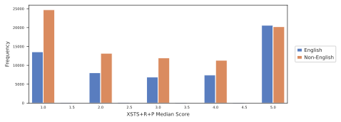

 

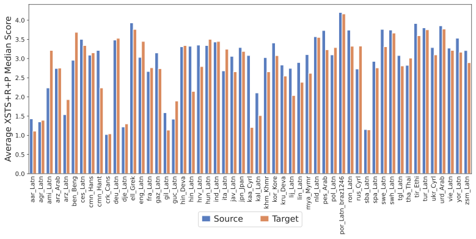

 

Figure B.1:  For Met-BOUQuET Round 1: Top, XSTS+R+P consensus scores histogram across English and non-English directions; Bottom, XSTS+R+P consensus averages across source and target languages. 

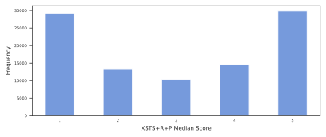

 

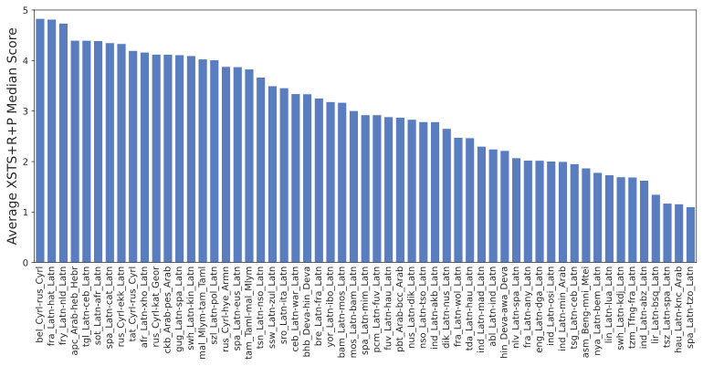

 

Figure B.2:  For Met-BOUQuET Round 2: Top, XSTS+R+P consensus scores histogram; Bottom, XSTS+R+P consensus averages across directions. 

## Appendix C Cards

Task |  Metric | Type | Citation  
---|---|---|---  
LID |  glotlid | Automatic | ([Kargaran et al., 2023a](https://arxiv.org/html/2603.16309v3#bib.bib135))  
MT Metrics |  Spearman’s rank correlation coefficient | Automatic |   
MT |  BLEU | Automatic | ([Papineni et al., 2002](https://arxiv.org/html/2603.16309v3#bib.bib22))  
|  ChrF++ | Automatic | ([Popović, 2015](https://arxiv.org/html/2603.16309v3#bib.bib23))  
|  METEOR | Automatic | ([Banerjee and Lavie, 2005b](https://arxiv.org/html/2603.16309v3#bib.bib101))  
|  BLASER2 | Automatic | ([Dale and Costa-jussà, 2024a](https://arxiv.org/html/2603.16309v3#bib.bib41))  
|  BLASER 3 | Automatic | Section [8.3](https://arxiv.org/html/2603.16309v3#S8.SS3 "8.3 BLASER 3 ‣ 8 Proposed Evaluation Metrics and Dataset ‣ Omnilingual MT: Machine Translation for 1,600 Languages")  
|  BLEURT | Automatic | ([Sellam et al., 2020](https://arxiv.org/html/2603.16309v3#bib.bib103))  
|  COMETKiWi | Automatic | ([Rei et al., 2022b](https://arxiv.org/html/2603.16309v3#bib.bib42))  
|  MetricX | Automatic | ([Juraska et al., 2024](https://arxiv.org/html/2603.16309v3#bib.bib45))  
|  XCOMET | Automatic | ([Guerreiro et al., 2024b](https://arxiv.org/html/2603.16309v3#bib.bib40))  
|  XSTS | Human | ([Licht et al., 2022](https://arxiv.org/html/2603.16309v3#bib.bib29))  
|  SQM | Human | ([Freitag et al., 2021](https://arxiv.org/html/2603.16309v3#bib.bib102))  
|  XSTS+R+P | Human | Section [8.1](https://arxiv.org/html/2603.16309v3#S8.SS1 "8.1 Human Evaluation Protocol: XSTS+R+P ‣ 8 Proposed Evaluation Metrics and Dataset ‣ Omnilingual MT: Machine Translation for 1,600 Languages")  
Sentence Similarity |  SONAR + Cosine Similarity | Automatic | ([Duquenne et al., 2023a](https://arxiv.org/html/2603.16309v3#bib.bib44))  
|  OmniSONAR \+ Cosine Similarity | Automatic | ([Omnilingual SONAR Team et al., 2026](https://arxiv.org/html/2603.16309v3#bib.bib105))  
Toxicity |  ROC AUC | Automatic |   
|  OmniTox | Automatic | Section [8.5](https://arxiv.org/html/2603.16309v3#S8.SS5 "8.5 OmniTOX ‣ 8 Proposed Evaluation Metrics and Dataset ‣ Omnilingual MT: Machine Translation for 1,600 Languages")

 Table C.1: Automatic and human evaluation metrics/protocols used in this work.

## Appendix D Languages at a glance

Table D.1: Covered Languages for the evaluation dataset contribution in this work (275 in BOUQuET, and 120 in Met-BOUQuET), the training MeDLEy dataset and our previous and ongoing evaluation community effort of FLoRes+. 

ISO 639-3 | ISO 15924 | Language family | BOUQuET | MeDLEy | met-BOUQuET | FLoRes+  
---|---|---|---|---|---|---  
aar | Latn | Afro-Asiatic |  

  | \(\times\) |  

 (R1) | \(\times\)  
abl | Latn | Austronesian |  

  | \(\times\) |  

 (R2) | \(\times\)  
abz | Arab | Timor-Alor-Pantar | \(\times\) | \(\times\) |  

 (R2) | \(\times\)  
ace | Arab | Austronesian | \(\times\) | \(\times\) | \(\times\) |  

   
ace | Latn | Austronesian | \(\times\) | \(\times\) | \(\times\) |  

   
acm | Arab | Afro-Asiatic | \(\times\) | \(\times\) | \(\times\) |  

   
acq | Arab | Afro-Asiatic | \(\times\) | \(\times\) | \(\times\) |  

   
aeb | Arab | Afro-Asiatic | \(\times\) | \(\times\) | \(\times\) |  

   
afr | Latn | Indo-European |  

  | \(\times\) |  

 (R2) |  

   
agr | Latn | Chicham |  

  | \(\times\) |  

 (R1) | \(\times\)  
ahk | Thai | Sino-Tibetan | \(\times\) |  

  | \(\times\) | \(\times\)  
aiq | Arab | Indo-European |  

  | \(\times\) | \(\times\) | \(\times\)  
akb | Latn | Austronesian | \(\times\) |  

  |  

 (R2) | \(\times\)  
als | Latn | Indo-European |  

  | \(\times\) | \(\times\) |  

   
amh | Ethi | Afro-Asiatic |  

  | \(\times\) | \(\times\) |  

   
ami | Latn | Austronesian |  

  | \(\times\) |  

 (R1) | \(\times\)  
ane | Latn | Austronesian |  

  | \(\times\) | \(\times\) | \(\times\)  
any | Latn | Atlantic-Congo | \(\times\) |  

  |  

 (R2) | \(\times\)  
apc | Arab | Afro-Asiatic |  

  | \(\times\) |  

 (R2) |  

   
arb | Arab | Afro-Asiatic | \(\times\) |  

  | \(\times\) |  

   
arb | Latn | Afro-Asiatic | \(\times\) | \(\times\) | \(\times\) |  

   
arg | Latn | Indo-European | \(\times\) | \(\times\) | \(\times\) |  

   
arh | Latn | Chibchan |  

  | \(\times\) | \(\times\) | \(\times\)  
arn | Latn | Araucanian |  

  | \(\times\) | \(\times\) | \(\times\)  
ars | Arab | Afro-Asiatic | \(\times\) | \(\times\) | \(\times\) |  

   
ary | Arab | Afro-Asiatic | \(\times\) | \(\times\) | \(\times\) |  

   
arz | Arab | Afro-Asiatic |  

  | \(\times\) |  

 (R1) |  

   
arz | Latn | Afro-Asiatic |  

  | \(\times\) |  

 (R1) | \(\times\)  
asm | Beng | Indo-European |  

  | \(\times\) |  

 (R2) |  

   
ast | Latn | Indo-European | \(\times\) | \(\times\) | \(\times\) |  

   
ati | Latn | Atlantic-Congo | \(\times\) |  

  | \(\times\) | \(\times\)  
awa | Deva | Indo-European | \(\times\) | \(\times\) |  

 (R2) |  

   
ayr | Latn | Aymaran |  

  | \(\times\) | \(\times\) |  

   
ayz | Latn | Maybratic |  

  | \(\times\) | \(\times\) | \(\times\)  
azb | Arab | Turkic |  

  |  

  | \(\times\) |  

   
azj | Latn | Turkic |  

  | \(\times\) | \(\times\) |  

   
azm | Latn | Otomanguean |  

  | \(\times\) | \(\times\) | \(\times\)  
azz | Latn | Uto-Aztecan |  

  |  

  | \(\times\) | \(\times\)  
bak | Cyrl | Turkic |  

  | \(\times\) | \(\times\) |  

   
bam | Latn | Mande |  

  |  

  |  

 (R2) |  

   
ban | Latn | Austronesian | \(\times\) | \(\times\) | \(\times\) |  

   
bas | Latn | Atlantic-Congo |  

  | \(\times\) | \(\times\) | \(\times\)  
bba | Latn | Atlantic-Congo |  

  |  

  | \(\times\) | \(\times\)  
bbc | Latn | Austronesian | \(\times\) |  

  | \(\times\) | \(\times\)  
bcc | Arab | Indo-European | \(\times\) |  

  |  

 (R2) | \(\times\)  
bel | Cyrl | Indo-European |  

  | \(\times\) |  

 (R2) |  

   
bem | Latn | Atlantic-Congo | \(\times\) | \(\times\) |  

 (R2) |  

   
ben | Beng | Indo-European |  

  | \(\times\) |  

 (R1, R2) |  

   
ben | Latn | Indo-European |  

  | \(\times\) | \(\times\) | \(\times\)  
bfa | Latn | Nilotic | \(\times\) |  

  | \(\times\) | \(\times\)  
bft | Arab | Sino-Tibetan |  

  | \(\times\) | \(\times\) | \(\times\)  
bhb | Deva | Indo-European |  

  | \(\times\) |  

 (R2) | \(\times\)  
bho | Deva | Indo-European |  

  | \(\times\) | \(\times\) |  

   
bib | Latn | Mande | \(\times\) |  

  | \(\times\) | \(\times\)  
bjn | Arab | Austronesian | \(\times\) | \(\times\) | \(\times\) |  

   
bjn | Latn | Austronesian | \(\times\) | \(\times\) | \(\times\) |  

   
blt | Latn | Tai-Kadai | \(\times\) |  

  | \(\times\) | \(\times\)  
bod | Tibt | Sino-Tibetan |  

  | \(\times\) | \(\times\) |  

   
bom | Latn | Atlantic-Congo | \(\times\) |  

  | \(\times\) | \(\times\)  
bos | Latn | Indo-European |  

  | \(\times\) | \(\times\) |  

   
bre | Latn | Indo-European |  

  | \(\times\) |  

 (R2) | \(\times\)  
brh | Arab | Dravidian |  

  | \(\times\) | \(\times\) | \(\times\)  
brx | Deva | Sino-Tibetan |  

  | \(\times\) | \(\times\) |  

   
bsh | Arab | Indo-European |  

  | \(\times\) | \(\times\) | \(\times\)  
bsk | Arab | Burushaski |  

  | \(\times\) | \(\times\) | \(\times\)  
bsq | Latn | Kru | \(\times\) |  

  |  

 (R2) | \(\times\)  
bug | Latn | Austronesian | \(\times\) | \(\times\) | \(\times\) |  

   
bul | Cyrl | Indo-European |  

  | \(\times\) | \(\times\) |  

   
cak | Latn | Mayan |  

  | \(\times\) | \(\times\) | \(\times\)  
cat | Latn | Indo-European |  

  | \(\times\) |  

 (R2) |  

   
ceb | Latn | Austronesian |  

  | \(\times\) |  

 (R2) |  

   
ces | Latn | Indo-European |  

  | \(\times\) |  

 (R1) |  

   
che | Cyrl | Nakh-Daghestanian |  

  | \(\times\) | \(\times\) | \(\times\)  
chr | Cher | Iroquoian |  

  | \(\times\) | \(\times\) | \(\times\)  
chv | Cyrl | Turkic |  

  | \(\times\) | \(\times\) |  

   
cja | Arab | Austronesian |  

  | \(\times\) | \(\times\) | \(\times\)  
cjk | Latn | Atlantic-Congo |  

  |  

  | \(\times\) |  

   
ckb | Arab | Indo-European |  

  | \(\times\) |  

 (R2) |  

   
ckl | Latn | Afro-Asiatic |  

  | \(\times\) | \(\times\) | \(\times\)  
cmn | Hans | Sino-Tibetan |  

  | \(\times\) |  

 (R1) |  

   
cmn | Hant | Sino-Tibetan |  

  | \(\times\) |  

 (R1) |  

   
crh | Latn | Turkic | \(\times\) | \(\times\) | \(\times\) |  

   
crk | Cans | Algic |  

  | \(\times\) |  

 (R1) | \(\times\)  
crk | Latn | Algic |  

  | \(\times\) | \(\times\) | \(\times\)  
cux | Latn | Otomanguean |  

  | \(\times\) | \(\times\) | \(\times\)  
cym | Latn | Indo-European |  

  | \(\times\) | \(\times\) |  

   
dan | Latn | Indo-European |  

  | \(\times\) | \(\times\) |  

   
daq | Deva | Dravidian |  

  | \(\times\) | \(\times\) | \(\times\)  
dar | Cyrl | Nakh-Daghestanian | \(\times\) | \(\times\) | \(\times\) |  

   
deu | Latn | Indo-European |  

  | \(\times\) |  

 (R1) |  

   
dga | Latn | Atlantic-Congo | \(\times\) |  

  |  

 (R2) | \(\times\)  
dgo | Deva | Indo-European |  

  | \(\times\) | \(\times\) |  

   
dik | Latn | Nilotic |  

  |  

  |  

 (R2) |  

   
diq | Latn | Indo-European |  

  | \(\times\) | \(\times\) | \(\times\)  
div | Thaa | Indo-European |  

  | \(\times\) | \(\times\) | \(\times\)  
djc | Latn | Dajuic |  

  | \(\times\) | \(\times\) | \(\times\)  
dje | Latn | Songhay |  

  | \(\times\) |  

 (R1) | \(\times\)  
dnj | Latn | Mande | \(\times\) |  

  | \(\times\) | \(\times\)  
dtm | Latn | Dogon |  

  | \(\times\) | \(\times\) | \(\times\)  
dts | Latn | Dogon |  

  | \(\times\) | \(\times\) | \(\times\)  
dua | Latn | Atlantic-Congo |  

  | \(\times\) | \(\times\) | \(\times\)  
dyu | Latn | Mande | \(\times\) |  

  | \(\times\) |  

   
dzo | Tibt | Sino-Tibetan |  

  |  

  | \(\times\) |  

   
ekk | Latn | Uralic |  

  | \(\times\) |  

 (R2) |  

   
ell | Grek | Indo-European |  

  | \(\times\) |  

 (R1) |  

   
enb | Latn | Nilotic |  

  | \(\times\) | \(\times\) | \(\times\)  
eng | Latn | Indo-European |  

  |  

  |  

 (R1, R2) |  

   
enl | Latn | Lengua-Mascoy |  

  | \(\times\) | \(\times\) | \(\times\)  
epo | Latn | Esperanto | \(\times\) | \(\times\) | \(\times\) |  

   
eto | Latn | Atlantic-Congo |  

  | \(\times\) | \(\times\) | \(\times\)  
eus | Latn | Basque |  

  | \(\times\) |  

 (R2) |  

   
ewe | Latn | Atlantic-Congo | \(\times\) |  

  | \(\times\) |  

   
ewo | Latn | Atlantic-Congo |  

  | \(\times\) | \(\times\) | \(\times\)  
fao | Latn | Indo-European |  

  | \(\times\) | \(\times\) |  

   
fia | Copt | Nubian |  

  | \(\times\) | \(\times\) | \(\times\)  
fij | Latn | Austronesian | \(\times\) |  

  | \(\times\) |  

   
fil | Latn | Austronesian | \(\times\) | \(\times\) | \(\times\) |  

   
fin | Latn | Uralic |  

  | \(\times\) | \(\times\) |  

   
fon | Latn | Atlantic-Congo | \(\times\) |  

  | \(\times\) |  

   
fra | Latn | Indo-European |  

  |  

  |  

 (R1, R2) |  

   
fry | Latn | Indo-European |  

  | \(\times\) |  

 (R2) | \(\times\)  
fuc | Latn | Atlantic-Congo |  

  | \(\times\) | \(\times\) | \(\times\)  
fur | Latn | Indo-European | \(\times\) | \(\times\) | \(\times\) |  

   
fuv | Latn | Atlantic-Congo |  

  |  

  |  

 (R2) |  

   
fvr | Latn | Furan |  

  | \(\times\) | \(\times\) | \(\times\)  
gax | Latn | Afro-Asiatic |  

  | \(\times\) | \(\times\) | \(\times\)  
gaz | Latn | Afro-Asiatic |  

  | \(\times\) |  

 (R1) |  

   
gil | Latn | Austronesian |  

  | \(\times\) |  

 (R1) | \(\times\)  
gkp | Latn | Mande |  

  | \(\times\) | \(\times\) | \(\times\)  
gla | Latn | Indo-European |  

  | \(\times\) | \(\times\) |  

   
gle | Latn | Indo-European |  

  | \(\times\) | \(\times\) |  

   
glg | Latn | Indo-European |  

  | \(\times\) | \(\times\) |  

   
gom | Deva | Indo-European |  

  | \(\times\) | \(\times\) |  

   
gor | Latn | Austronesian | \(\times\) |  

  | \(\times\) | \(\times\)  
grt | Latn | Sino-Tibetan | \(\times\) |  

  | \(\times\) | \(\times\)  
guc | Latn | Arawakan |  

  | \(\times\) |  

 (R1) | \(\times\)  
gug | Latn | Tupian |  

  | \(\times\) |  

 (R2) |  

   
guj | Gujr | Indo-European |  

  | \(\times\) | \(\times\) |  

   
guz | Latn | Atlantic-Congo |  

  | \(\times\) | \(\times\) | \(\times\)  
gxx | Latn | Kru |  

  | \(\times\) | \(\times\) | \(\times\)  
hat | Latn | Indo-European |  

  | \(\times\) |  

 (R2) |  

   
hau | Latn | Afro-Asiatic |  

  | \(\times\) |  

 (R2) |  

   
heb | Hebr | Afro-Asiatic |  

  | \(\times\) |  

 (R2) |  

   
heh | Latn | Atlantic-Congo |  

  |  

  | \(\times\) | \(\times\)  
hig | Latn | Afro-Asiatic | \(\times\) |  

  | \(\times\) | \(\times\)  
hin | Deva | Indo-European |  

  |  

  |  

 (R1, R2) |  

   
hin | Latn | Indo-European |  

  | \(\times\) |  

 (R1) | \(\times\)  
hne | Deva | Indo-European |  

  | \(\times\) | \(\times\) |  

   
hrv | Latn | Indo-European |  

  | \(\times\) |  

 (R1) |  

   
hun | Latn | Uralic |  

  | \(\times\) |  

 (R1) |  

   
hve | Latn | Huavean |  

  | \(\times\) | \(\times\) | \(\times\)  
hye | Armn | Indo-European |  

  | \(\times\) |  

 (R2) |  

   
ibo | Latn | Atlantic-Congo |  

  | \(\times\) |  

 (R2) |  

   
ijc | Latn | Ijoid |  

  | \(\times\) | \(\times\) | \(\times\)  
ilo | Latn | Austronesian |  

  | \(\times\) | \(\times\) |  

   
ind | Latn | Austronesian |  

  |  

  |  

 (R1, R2) |  

   
irk | Latn | Afro-Asiatic |  

  |  

  | \(\times\) | \(\times\)  
isl | Latn | Indo-European |  

  | \(\times\) | \(\times\) |  

   
ita | Latn | Indo-European |  

  | \(\times\) |  

 (R1, R2) |  

   
jav | Latn | Austronesian |  

  | \(\times\) |  

 (R1) |  

   
jmc | Latn | Atlantic-Congo |  

  |  

  | \(\times\) | \(\times\)  
jnj | Latn | Ta-Ne-Omotic |  

  | \(\times\) | \(\times\) | \(\times\)  
jpn | Jpan | Japonic |  

  | \(\times\) |  

 (R1) |  

   
kaa | Cyrl | Turkic |  

  | \(\times\) |  

 (R1) |  

   
kab | Latn | Afro-Asiatic | \(\times\) | \(\times\) | \(\times\) |  

   
kac | Latn | Sino-Tibetan |  

  |  

  | \(\times\) |  

   
kai | Latn | Afro-Asiatic |  

  | \(\times\) | \(\times\) | \(\times\)  
kal | Latn | Eskimo-Aleut |  

  | \(\times\) |  

 (R1) | \(\times\)  
kam | Latn | Atlantic-Congo |  

  |  

  | \(\times\) |  

   
kan | Knda | Dravidian |  

  | \(\times\) | \(\times\) |  

   
kas | Arab | Indo-European | \(\times\) | \(\times\) | \(\times\) |  

   
kas | Deva | Indo-European | \(\times\) | \(\times\) | \(\times\) |  

   
kat | Geor | Kartvelian |  

  | \(\times\) |  

 (R2) |  

   
kaz | Cyrl | Turkic |  

  | \(\times\) | \(\times\) |  

   
kbp | Latn | Atlantic-Congo | \(\times\) |  

  | \(\times\) |  

   
kde | Latn | Atlantic-Congo | \(\times\) |  

  | \(\times\) | \(\times\)  
kdj | Latn | Nilotic | \(\times\) |  

  |  

 (R2) | \(\times\)  
kea | Latn | Indo-European |  

  | \(\times\) | \(\times\) |  

   
kek | Latn | Mayan |  

  |  

  | \(\times\) | \(\times\)  
khk | Cyrl | Mongolic-Khitan |  

  | \(\times\) | \(\times\) |  

   
khm | Khmr | Austroasiatic |  

  | \(\times\) |  

 (R1) |  

   
khq | Latn | Songhay |  

  | \(\times\) | \(\times\) | \(\times\)  
khw | Latn | Indo-European |  

  | \(\times\) | \(\times\) | \(\times\)  
kik | Latn | Atlantic-Congo | \(\times\) | \(\times\) | \(\times\) |  

   
kin | Latn | Atlantic-Congo |  

  | \(\times\) |  

 (R2) |  

   
kir | Cyrl | Turkic |  

  | \(\times\) | \(\times\) |  

   
kls | Arab | Indo-European |  

  | \(\times\) | \(\times\) | \(\times\)  
kmb | Latn | Atlantic-Congo |  

  |  

  | \(\times\) |  

   
kmr | Latn | Indo-European |  

  | \(\times\) | \(\times\) |  

   
knc | Arab | Saharan |  

  |  

  |  

 (R2) |  

   
knc | Latn | Saharan | \(\times\) | \(\times\) | \(\times\) |  

   
knw | Latn | Kxa |  

  | \(\times\) | \(\times\) | \(\times\)  
kor | Kore | Koreanic |  

  | \(\times\) |  

 (R1) |  

   
krt | Latn | Saharan |  

  | \(\times\) | \(\times\) | \(\times\)  
kru | Deva | Dravidian |  

  | \(\times\) |  

 (R1) | \(\times\)  
ksf | Latn | Atlantic-Congo |  

  | \(\times\) | \(\times\) | \(\times\)  
ktu | Latn | Atlantic-Congo |  

  |  

  | \(\times\) |  

   
kuj | Latn | Atlantic-Congo |  

  | \(\times\) | \(\times\) | \(\times\)  
kus | Latn | Atlantic-Congo | \(\times\) |  

  | \(\times\) | \(\times\)  
kwy | Latn | Atlantic-congo |  

  | \(\times\) | \(\times\) | \(\times\)  
kxp | Arab | Indo-European |  

  | \(\times\) | \(\times\) | \(\times\)  
lao | Laoo | Tai-Kadai |  

  | \(\times\) | \(\times\) |  

   
led | Latn | Central Sudanic |  

  | \(\times\) | \(\times\) | \(\times\)  
lgg | Latn | Central Sudanic |  

  |  

  | \(\times\) | \(\times\)  
lia | Latn | Atlantic-Congo | \(\times\) |  

  | \(\times\) | \(\times\)  
lij | Latn | Indo-European |  

  | \(\times\) |  

 (R1) |  

   
lim | Latn | Indo-European |  

  | \(\times\) | \(\times\) |  

   
lin | Latn | Atlantic-Congo |  

  | \(\times\) |  

 (R1, R2) |  

   
lir | Latn | Pidgin |  

  | \(\times\) |  

 (R2) | \(\times\)  
lit | Latn | Indo-European |  

  | \(\times\) | \(\times\) |  

   
lld | Latn | Indo-European | \(\times\) | \(\times\) | \(\times\) |  

   
lmo | Latn | Indo-European | \(\times\) | \(\times\) | \(\times\) |  

   
loa | Latn | North Halmahera |  

  | \(\times\) | \(\times\) | \(\times\)  
loh | Latn | Surmic |  

  | \(\times\) | \(\times\) | \(\times\)  
lon | Latn | Atlantic-Congo | \(\times\) |  

  | \(\times\) | \(\times\)  
ltg | Latn | Indo-European | \(\times\) | \(\times\) | \(\times\) |  

   
ltz | Latn | Indo-European | \(\times\) | \(\times\) | \(\times\) |  

   
lua | Latn | Atlantic-Congo | \(\times\) |  

  |  

 (R2) |  

   
lug | Latn | Atlantic-Congo |  

  |  

  | \(\times\) |  

   
luo | Latn | Nilotic |  

  |  

  |  

 (R2) |  

   
lus | Latn | Sino-Tibetan | \(\times\) | \(\times\) | \(\times\) |  

   
lvs | Latn | Indo-European |  

  | \(\times\) | \(\times\) |  

   
mad | Latn | Austronesian | \(\times\) |  

  |  

 (R2) | \(\times\)  
maf | Latn | Afro-Asiatic |  

  | \(\times\) | \(\times\) | \(\times\)  
mag | Deva | Indo-European | \(\times\) | \(\times\) | \(\times\) |  

   
mah | Latn | Austronesian | \(\times\) |  

  | \(\times\) | \(\times\)  
mai | Deva | Indo-European |  

  | \(\times\) | \(\times\) |  

   
mak | Latn | Austronesian | \(\times\) |  

  | \(\times\) | \(\times\)  
mal | Mlym | Dravidian |  

  | \(\times\) |  

 (R2) |  

   
mam | Latn | Mayan |  

  |  

  | \(\times\) | \(\times\)  
mar | Deva | Indo-European |  

  | \(\times\) |  

 (R2) |  

   
mas | Latn | Nilotic |  

  | \(\times\) | \(\times\) | \(\times\)  
men | Latn | Mande | \(\times\) |  

  | \(\times\) | \(\times\)  
mey | Latn | Afro-Asiatic |  

  | \(\times\) | \(\times\) | \(\times\)  
mfe | Latn | Indo-European | \(\times\) | \(\times\) | \(\times\) |  

   
mhr | Cyrl | Uralic | \(\times\) | \(\times\) | \(\times\) |  

   
mie | Latn | Otomanguean |  

  | \(\times\) | \(\times\) | \(\times\)  
mim | Latn | Otomanguean | \(\times\) |  

  |  

 (R2) | \(\times\)  
min | Arab | Austronesian |  

  | \(\times\) |  

 (R2) |  

   
min | Latn | Austronesian | \(\times\) | \(\times\) | \(\times\) |  

   
mio | Latn | Otomanguean | \(\times\) |  

  | \(\times\) | \(\times\)  
miq | Latn | Misumalpan |  

  |  

  | \(\times\) | \(\times\)  
mkd | Cyrl | Indo-European |  

  | \(\times\) | \(\times\) |  

   
mlt | Latn | Afro-Asiatic |  

  | \(\times\) | \(\times\) |  

   
mni | Beng | Sino-Tibetan | \(\times\) | \(\times\) | \(\times\) |  

   
mni | Mtei | Sino-Tibetan | \(\times\) |  

  |  

 (R2) |  

   
mos | Latn | Atlantic-Congo |  

  |  

  |  

 (R2) |  

   
mri | Latn | Austronesian |  

  | \(\times\) | \(\times\) |  

   
mrw | Latn | Austronesian | \(\times\) |  

  | \(\times\) | \(\times\)  
mtq | Latn | Austroasiatic |  

  | \(\times\) | \(\times\) | \(\times\)  
mya | Mymr | Sino-Tibetan |  

  | \(\times\) |  

 (R1) |  

   
myv | Cyrl | Uralic | \(\times\) | \(\times\) | \(\times\) |  

   
myx | Latn | Atlantic-Congo | \(\times\) |  

  | \(\times\) | \(\times\)  
mzl | Latn | Mixe-Zoque |  

  | \(\times\) | \(\times\) | \(\times\)  
mzm | Latn | Atlantic-Congo | \(\times\) |  

  | \(\times\) | \(\times\)  
naq | Latn | Khoe-Kwadi |  

  | \(\times\) | \(\times\) | \(\times\)  
nga | Latn | Atlantic-Congo | \(\times\) |  

  | \(\times\) | \(\times\)  
ngl | Latn | Atlantic-Congo | \(\times\) |  

  | \(\times\) | \(\times\)  
ngu | Latn | Uto-Aztecan | \(\times\) |  

  | \(\times\) | \(\times\)  
nhe | Latn | Uto-Aztecan |  

  | \(\times\) | \(\times\) | \(\times\)  
nia | Latn | Austronesian | \(\times\) |  

  | \(\times\) | \(\times\)  
nij | Latn | Austronesian | \(\times\) |  

  | \(\times\) | \(\times\)  
nim | Latn | Atlantic-Congo | \(\times\) |  

  | \(\times\) | \(\times\)  
nld | Latn | Indo-European |  

  | \(\times\) |  

 (R1, R2) |  

   
nlv | Latn | Uto-Aztecan |  

  | \(\times\) |  

 (R2) | \(\times\)  
nno | Latn | Indo-European |  

  | \(\times\) | \(\times\) |  

   
nob | Latn | Indo-European | \(\times\) | \(\times\) | \(\times\) |  

   
npi | Deva | Indo-European |  

  | \(\times\) |  

 (R2) |  

   
nqo | Nkoo | N’Ko | \(\times\) | \(\times\) | \(\times\) |  

   
nso | Latn | Atlantic-Congo |  

  | \(\times\) |  

 (R2) |  

   
nuj | Latn | Atlantic-Congo | \(\times\) |  

  | \(\times\) | \(\times\)  
nus | Latn | Nilotic |  

  |  

  |  

 (R2) |  

   
nya | Latn | Atlantic-Congo |  

  | \(\times\) | \(\times\) |  

   
nyy | Latn | Atlantic-Congo | \(\times\) |  

  | \(\times\) | \(\times\)  
oci | Latn | Indo-European | \(\times\) | \(\times\) | \(\times\) |  

   
ory | Orya | Indo-European |  

  | \(\times\) | \(\times\) |  

   
osi | Latn | Austronesian | \(\times\) | \(\times\) |  

 (R2) | \(\times\)  
pag | Latn | Austronesian | \(\times\) | \(\times\) | \(\times\) |  

   
pam | Latn | Austronesian | \(\times\) |  

  | \(\times\) | \(\times\)  
pan | Guru | Indo-European |  

  | \(\times\) | \(\times\) |  

   
pap | Latn | Indo-European | \(\times\) | \(\times\) | \(\times\) |  

   
pbs | Latn | Otomanguean |  

  | \(\times\) | \(\times\) | \(\times\)  
pbt | Arab | Indo-European |  

  | \(\times\) |  

 (R2) |  

   
pcm | Latn | Indo-European |  

  |  

  |  

 (R2) | \(\times\)  
pes | Arab | Indo-European |  

  | \(\times\) |  

 (R1, R2) |  

   
plt | Latn | Austronesian |  

  | \(\times\) | \(\times\) |  

   
pol | Latn | Indo-European |  

  | \(\times\) |  

 (R1, R2) |  

   
por | Latn | Indo-European |  

  | \(\times\) |  

 (R1) |  

   
prs | Arab | Indo-European | \(\times\) | \(\times\) | \(\times\) |  

   
quc | Latn | Mayan |  

  |  

  | \(\times\) | \(\times\)  
quh | Latn | Quechuan |  

  | \(\times\) | \(\times\) | \(\times\)  
quy | Latn | Quechuan | \(\times\) | \(\times\) | \(\times\) |  

   
quz | Latn | Quechuan |  

  | \(\times\) | \(\times\) | \(\times\)  
rhg | Rohg | Indo-European | \(\times\) |  

  | \(\times\) | \(\times\)  
rim | Latn | Atlantic-Congo | \(\times\) |  

  | \(\times\) | \(\times\)  
rmy | Latn | Indo-European | \(\times\) |  

  | \(\times\) | \(\times\)  
rob | Latn | Austronesian |  

  | \(\times\) | \(\times\) | \(\times\)  
roh | Latn | Indo-European |  

  | \(\times\) | \(\times\) | \(\times\)  
ron | Latn | Indo-European |  

  | \(\times\) |  

 (R1) |  

   
run | Latn | Atlantic-Congo | \(\times\) | \(\times\) | \(\times\) |  

   
rus | Cyrl | Indo-European |  

  |  

  |  

 (R1, R2) |  

   
sag | Latn | Atlantic-Congo | \(\times\) | \(\times\) | \(\times\) |  

   
san | Deva | Indo-European | \(\times\) | \(\times\) | \(\times\) |  

   
sat | Olck | Austroasiatic |  

  |  

  | \(\times\) |  

   
sba | Latn | Central Sudanic |  

  |  

  |  

 (R1) | \(\times\)  
scn | Latn | Indo-European |  

  | \(\times\) | \(\times\) |  

   
sgc | Latn | Nilotic |  

  | \(\times\) | \(\times\) | \(\times\)  
shk | Latn | Nilotic | \(\times\) |  

  | \(\times\) | \(\times\)  
shn | Mymr | Tai-Kadai |  

  |  

  | \(\times\) |  

   
sif | Latn | Siamou |  

  | \(\times\) | \(\times\) | \(\times\)  
sin | Sinh | Indo-European |  

  | \(\times\) | \(\times\) |  

   
skr | Arab | Indo-European |  

  | \(\times\) | \(\times\) | \(\times\)  
slk | Latn | Indo-European |  

  | \(\times\) | \(\times\) |  

   
slv | Latn | Indo-European |  

  | \(\times\) | \(\times\) |  

   
sme | Latn | Uralic |  

  | \(\times\) | \(\times\) | \(\times\)  
smo | Latn | Austronesian | \(\times\) | \(\times\) | \(\times\) |  

   
sna | Latn | Atlantic-congo |  

  | \(\times\) | \(\times\) |  

   
snd | Arab | Indo-European |  

  | \(\times\) | \(\times\) |  

   
snd | Deva | Indo-European | \(\times\) | \(\times\) | \(\times\) |  

   
som | Latn | Afro-Asiatic |  

  | \(\times\) | \(\times\) |  

   
sot | Latn | Atlantic-Congo |  

  | \(\times\) |  

 (R2) |  

   
spa | Latn | Indo-European |  

  |  

  |  

 (R1, R2) |  

   
sro | Latn | Indo-European |  

  | \(\times\) | \(\times\) | \(\times\)  
srd | Latn | Indo-European | \(\times\) | \(\times\) | \(\times\) |  

   
srp | Cyrl | Indo-European |  

  | \(\times\) | \(\times\) |  

   
ssw | Latn | Atlantic-Congo |  

  | \(\times\) |  

 (R2) |  

   
sun | Latn | Austronesian |  

  | \(\times\) | \(\times\) |  

   
swe | Latn | Indo-European |  

  | \(\times\) |  

 (R1) |  

   
swh | Latn | Atlantic-Congo |  

  |  

  |  

 (R1, R2) |  

   
syl | Beng | Indo-European | \(\times\) |  

  | \(\times\) | \(\times\)  
szl | Latn | Indo-European |  

  | \(\times\) |  

 (R2) |  

   
taj | Deva | Sino-Tibetan | \(\times\) |  

  | \(\times\) | \(\times\)  
tam | Latn | Dravidian |  

  | \(\times\) | \(\times\) | \(\times\)  
tam | Taml | Dravidian |  

  | \(\times\) |  

 (R2) |  

   
taq | Latn | Afro-Asiatic |  

  |  

  | \(\times\) |  

   
taq | Tfng | Afro-Asiatic |  

  |  

  | \(\times\) |  

   
tat | Cyrl | Turkic |  

  | \(\times\) |  

 (R2) |  

   
tda | Latn | Songhay |  

  | \(\times\) |  

 (R2) | \(\times\)  
tel | Latn | Dravidian |  

  | \(\times\) | \(\times\) |  

   
tel | Telu | Dravidian |  

  | \(\times\) | \(\times\) | \(\times\)  
tem | Latn | Atlantic-Congo | \(\times\) |  

  | \(\times\) | \(\times\)  
teo | Latn | Nilotic | \(\times\) |  

  | \(\times\) | \(\times\)  
tgk | Cyrl | Indo-European |  

  | \(\times\) | \(\times\) |  

   
tgl | Latn | Austronesian |  

  | \(\times\) |  

 (R1, R2) | \(\times\)  
tha | Thai | Tai-Kadai |  

  | \(\times\) |  

 (R1) |  

   
tir | Ethi | Afro-Asiatic |  

  |  

  |  

 (R1) |  

   
toc | Latn | Totonacan |  

  | \(\times\) | \(\times\) | \(\times\)  
tpi | Latn | Indo-European |  

  | \(\times\) | \(\times\) |  

   
tpl | Latn | Otomanguean |  

  | \(\times\) | \(\times\) | \(\times\)  
tsg | Latn | Austronesian |  

  | \(\times\) |  

 (R2) | \(\times\)  
tsn | Latn | Atlantic-Congo |  

  |  

  |  

 (R2) |  

   
tso | Latn | Atlantic-Congo |  

  | \(\times\) |  

 (R2) |  

   
tsz | Latn | Tarascan |  

  |  

  | \(\times\) |  

   
tui | Latn | Atlantic-Congo |  

  | \(\times\) | \(\times\) | \(\times\)  
tuk | Latn | Turkic | \(\times\) | \(\times\) | \(\times\) |  

   
tum | Latn | Atlantic-Congo | \(\times\) |  

  | \(\times\) |  

   
tur | Latn | Turkic |  

  | \(\times\) |  

 (R1) |  

   
twi | Latn | Atlantic-Congo |  

  | \(\times\) | \(\times\) |  

   
tyv | Cyrl | Turkic | \(\times\) | \(\times\) | \(\times\) |  

   
tzh | Latn | Mayan |  

  |  

  | \(\times\) | \(\times\)  
tzm | Tfng | Afro-Asiatic |  

  |  

  |  

 (R2) | \(\times\)  
tzo | Latn | Mayan | \(\times\) |  

  |  

 (R2) | \(\times\)  
uig | Arab | Turkic |  

  | \(\times\) | \(\times\) |  

   
ukr | Cyrl | Indo-European |  

  | \(\times\) |  

 (R1) |  

   
umb | Latn | Atlantic-Congo |  

  |  

  | \(\times\) |  

   
urd | Arab | Indo-European |  

  | \(\times\) |  

 (R1) |  

   
urd | Latn | Indo-European |  

  | \(\times\) | \(\times\) | \(\times\)  
uzn | Latn | Turkic |  

  | \(\times\) | \(\times\) |  

   
uzs | Arab | Turkic | \(\times\) | \(\times\) | \(\times\) |  

   
vec | Latn | Indo-European | \(\times\) | \(\times\) | \(\times\) |  

   
ven | Latn | Atlantic-congo |  

  | \(\times\) | \(\times\) | \(\times\)  
vie | Latn | Austroasiatic |  

  | \(\times\) |  

 (R1) |  

   
wlv | Latn | Mataguayan |  

  | \(\times\) | \(\times\) | \(\times\)  
vmw | Latn | Atlantic-Congo |  

  |  

  | \(\times\) |  

   
war | Latn | Aystronesian |  

  | \(\times\) |  

 (R2) |  

   
wol | Latn | Atlantic-Congo |  

  |  

  |  

 (R2) |  

   
wsg | Deva | Dravidian | \(\times\) |  

  | \(\times\) | \(\times\)  
wuu | Hans | Sino-Tibetan |  

  | \(\times\) | \(\times\) |  

   
xho | Latn | Atlantic-Congo |  

  | \(\times\) |  

 (R2) |  

   
xon | Latn | Atlantic-congo | \(\times\) |  

  | \(\times\) | \(\times\)  
xsr | Deva | Sino-Tibetan | \(\times\) |  

  | \(\times\) | \(\times\)  
xuu | Latn | Khoe-Kwadi |  

  | \(\times\) | \(\times\) | \(\times\)  
yao | Latn | Atlantic-Congo | \(\times\) |  

  | \(\times\) | \(\times\)  
ybb | Latn | Atlantic-Congo | \(\times\) |  

  | \(\times\) | \(\times\)  
ydd | Hebr | Indo-European |  

  | \(\times\) | \(\times\) |  

   
ydg | Arab | Indo-European |  

  | \(\times\) | \(\times\) | \(\times\)  
yor | Latn | Atlantic-Congo |  

  |  

  |  

 (R1, R2) | \(\times\)  
yua | Latn | Mayan |  

  |  

  | \(\times\) | \(\times\)  
yue | Hant | Sino-Tibetan |  

  | \(\times\) | \(\times\) | \(\times\)  
zai | Latn | Otomanguean |  

  | \(\times\) | \(\times\) | \(\times\)  
zgh | Tfng | Afro-Asiatic | \(\times\) | \(\times\) | \(\times\) |  

   
zsm | Latn | Austronesian |  

  | \(\times\) |  

 (R1) |  

   
zne | Latn | Atlantic-Congo |  

  |  

  | \(\times\) | \(\times\)  
zul | Latn | Atlantic-Congo |  

  | \(\times\) |  

 (R2) |  

 
