**Source:** *TranslatePsy-AfriSLM: High-Quality Data Scaling For Low-Resource Machine Translation* — [PDF](https://arxiv.org/pdf/2608.18655v2) · [arXiv](https://arxiv.org/abs/2608.18655v2)

# TranslatePsy-AfriSLM: High-Quality Data Scaling   
For Low-Resource Machine Translation

Milan Gritta ††thanks:  Equal contribution. Patrik Lambert11footnotemark:  1 Jihye Back11footnotemark:  1 Amril Nazir  Affiliation: Tether AI Research  Affiliation: {milan.gritta, patrik.lambert, jihye.back, amril.nazir}@tether.io

###### Abstract

The rapid progress in Artificial Intelligence has largely bypassed African languages, creating a digital divide that limits AI adoption on the continent. Recent open-source LLMs systematically underperform on African language machine translation, while the lack of large-scale, high-quality, open-source parallel data has constrained the development of competitive small language models (SLMs). We introduce TranslatePsy-AfriSLM, a collection of open-source machine translation resources for 19 Sub-Saharan African languages, including curated parallel data, African-specialized synthetic data, and a family of fine-tuned SLMs. Our empirical study shows that unified quality-estimation filtering removes up to 96% of training tokens without degrading quality, and that filtered synthetic data dominates the quality-efficiency Pareto frontier. Fine-tuned on the resulting data mixture, TranslatePsy-AfriSLMs outperform substantially larger systems, including TranslateGemma-27B and Qwen3.5-122B-A10B, with as few as 0.8B parameters.

## 1 Introduction

The AI underinvestment on the African continent [Nwagbala et al. (2025)](https://arxiv.org/html/2608.18655v2#bib.bib15); [Diallo et al. (2025)](https://arxiv.org/html/2608.18655v2#bib.bib39); [Isangula (2025)](https://arxiv.org/html/2608.18655v2#bib.bib40) has created a significant adoption barrier for over a billion people, preventing them from fully exploiting the productivity and collaboration benefits that AI can offer [Maluleke (2025)](https://arxiv.org/html/2608.18655v2#bib.bib38). A prime example of this is a lack of performant SLMs for Machine Translation (MT), a critical utility for facilitating cross-border communication, trade, and education [Ssemugabi (2025)](https://arxiv.org/html/2608.18655v2#bib.bib41); [Moukatib and Seddik (2026)](https://arxiv.org/html/2608.18655v2#bib.bib42). However, most frontier open-source LLMs such as Apertus [Hernández-Cano et al. (2025)](https://arxiv.org/html/2608.18655v2#bib.bib44), Qwen3 [Yang et al. (2025)](https://arxiv.org/html/2608.18655v2#bib.bib3), TranslateGemma [Finkelstein et al. (2026)](https://arxiv.org/html/2608.18655v2#bib.bib2), Hunyuan-MT [Zheng et al. (2025)](https://arxiv.org/html/2608.18655v2#bib.bib20) or Qwen3.5 [Team (2026)](https://arxiv.org/html/2608.18655v2#bib.bib19) systematically underperform on African language MT, see Figure [1](https://arxiv.org/html/2608.18655v2#S1.F1 "Figure 1 ‣ 1 Introduction ‣ TranslatePsy-AfriSLM: High-Quality Data Scaling For Low-Resource Machine Translation"), while incurring substantial running costs due to large parameter counts.

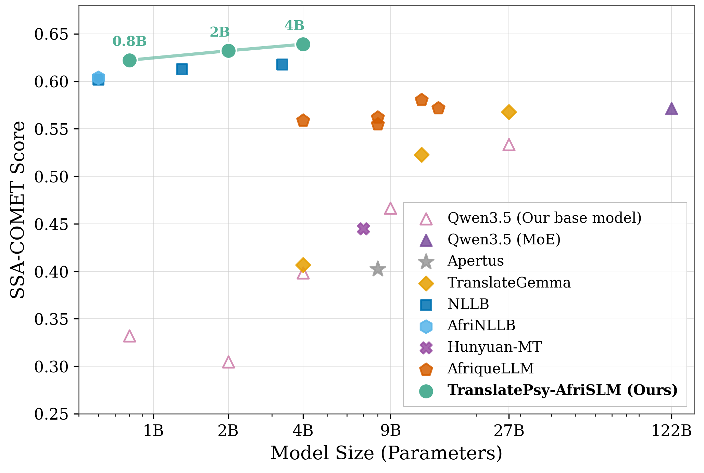

 Figure 1: TranslatePsy-AfriSLMs outperform frontier LLMs such as TranslateGemma-27B. Figure shows SSA-COMET scores on the BOUQuET benchmark.  

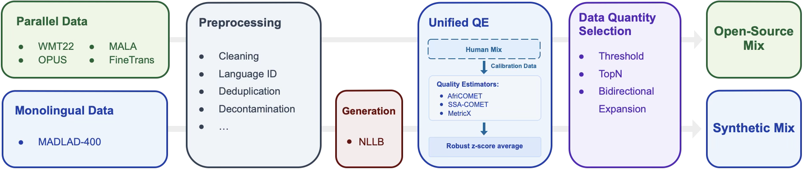

 Figure 2: TranslatePsy-AfriSLM data pipeline. Parallel and monolingual sources are unified through preprocessing, QE filtering, calibrated on the Human Mix. Finally, the optimal Open-Source and Synthetic mixes are selected.

Furthermore, efficiently adapting existing SLMs to support this task remains challenging due to the scarcity of high-quality, open-source data in sufficient quantities, as our survey shows in Background (§[2](https://arxiv.org/html/2608.18655v2#S2 "2 Background ‣ TranslatePsy-AfriSLM: High-Quality Data Scaling For Low-Resource Machine Translation")). Large internet repositories are highly unstructured and noisy, the training signal is sparse and the token budget dramatically inflated. Existing curated datasets and human-quality translations are too small, offering only modest improvements. Therefore, to support efficient model adaptation for low-resource MT, we introduce TranslatePsy-AfriSLM11 1 <https://huggingface.co/collections/qvac/translatepsy-afrislm>, an open-source African language MT resource comprising high-quality parallel data for 19 Sub-Saharan African languages and a family of highly-capable SLMs (Table [3](https://arxiv.org/html/2608.18655v2#S5.T3 "Table 3 ‣ 5.4 Can SLMs Beat Frontier LLMs? ‣ 5 Results and Analysis ‣ TranslatePsy-AfriSLM: High-Quality Data Scaling For Low-Resource Machine Translation") and Figure [1](https://arxiv.org/html/2608.18655v2#S1.F1 "Figure 1 ‣ 1 Introduction ‣ TranslatePsy-AfriSLM: High-Quality Data Scaling For Low-Resource Machine Translation")). Our approach is systematically validated on key benchmarks, with deep insights and analyses that can guide future research. TranslatePsy-AfriSLM models exceed African language translation skills of frontier LLMs such as TranslateGemma-27B and Qwen3.5-27B (and 122B-A10B) with only 0.8B parameters. Our smallest model even outperforms the dedicated NLLB encoder-decoder models while preserving conversational capabilities (Figure [15](https://arxiv.org/html/2608.18655v2#A5.F15 "Figure 15 ‣ E.4 LLM-as-a-Judge Evaluation ‣ Appendix E Additional Evaluation and Robustness ‣ TranslatePsy-AfriSLM: High-Quality Data Scaling For Low-Resource Machine Translation")).

## 2 Background

### 2.1 African language MT Training Resources

Existing African MT datasets reveal a persistent trade-off between scale, coverage, and translation quality. We broadly group them into 3 categories: large but unstructured repositories, medium-sized curated corpora, and small, human-quality datasets.

#### Large but Unstructured.

Data repositories such as OPUS [Tiedemann (2012)](https://arxiv.org/html/2608.18655v2#bib.bib14), MALA [Ji et al. (2024)](https://arxiv.org/html/2608.18655v2#bib.bib18), WMT22 [Adelani et al. (2022b)](https://arxiv.org/html/2608.18655v2#bib.bib17) and Fine Translations [Penedo et al. (2026)](https://arxiv.org/html/2608.18655v2#bib.bib16) contain large quantities of parallel data. However, they vary widely in volume, language coverage, and translation direction, while also suffering from high duplication rates, test set contamination, and noisy text. NLLB [Team et al. (2022)](https://arxiv.org/html/2608.18655v2#bib.bib21) leveraged approximately 18 billion sentence pairs across 200 languages, but did not release a fixed, high-quality corpus suitable for the token-efficient adaptation of African language MT models.

#### Medium-Sized and Curated.

AfriNLLB22 2 <https://huggingface.co/datasets/AfriNLP/AfriNLLB-train> is currently the only readily available, medium-sized, curated dataset for MT [Moslem et al. (2026)](https://arxiv.org/html/2608.18655v2#bib.bib4). However, it covers only 9 African languages, and approximately 50% of its \(\sim\)3 million pairs include Arabic or European languages. AfriqueLLM [Yu et al. (2026)](https://arxiv.org/html/2608.18655v2#bib.bib5) adapts frontier LLMs for African languages through continued pretraining. While its general-purpose scope significantly improves MT, its training data was not publicly released (a gap we aim to fill). We report comparisons with AfriqueLLM models in Figure [1](https://arxiv.org/html/2608.18655v2#S1.F1 "Figure 1 ‣ 1 Introduction ‣ TranslatePsy-AfriSLM: High-Quality Data Scaling For Low-Resource Machine Translation") and SLMs trained on AfriNLLB data in Section [5.4](https://arxiv.org/html/2608.18655v2#S5.SS4 "5.4 Can SLMs Beat Frontier LLMs? ‣ 5 Results and Analysis ‣ TranslatePsy-AfriSLM: High-Quality Data Scaling For Low-Resource Machine Translation").

#### Small but Human-Quality.

Several datasets are available in this subset, e.g. MMT-Africa [Emezue and Dossou (2021)](https://arxiv.org/html/2608.18655v2#bib.bib45), AfriDOC-MT [Alabi et al. (2025)](https://arxiv.org/html/2608.18655v2#bib.bib12), SMOL [Caswell et al. (2025)](https://arxiv.org/html/2608.18655v2#bib.bib11), LAFAND-MT [Adelani et al. (2022a)](https://arxiv.org/html/2608.18655v2#bib.bib46), WMT24pp [Deutsch et al. (2025)](https://arxiv.org/html/2608.18655v2#bib.bib10), MENYO-MT [Adelani et al. (2021)](https://arxiv.org/html/2608.18655v2#bib.bib53). However, they occur in limited quantities and have uneven language coverage. We show that despite their high-quality translations, such mixtures yield only modest improvements (§[5.3](https://arxiv.org/html/2608.18655v2#S5.SS3 "5.3 Which Dataset\(s\) Should We Use? ‣ 5 Results and Analysis ‣ TranslatePsy-AfriSLM: High-Quality Data Scaling For Low-Resource Machine Translation")), smaller than AfriNLLB and substantially smaller than our best TranslatePsy-AfriSLM mixes. This further motivates our large-scale, quality-focused data curation.

### 2.2 Quality Estimation for Data Filtering

Afri-COMET [Wang et al. (2024)](https://arxiv.org/html/2608.18655v2#bib.bib6) and more recently, SSA-COMET [Li et al. (2025)](https://arxiv.org/html/2608.18655v2#bib.bib35) were introduced as African-centric, reference-free alternatives to COMET [Rei et al. (2020)](https://arxiv.org/html/2608.18655v2#bib.bib47), COMET-KIWI [Rei et al. (2022b)](https://arxiv.org/html/2608.18655v2#bib.bib37) and MetricX [Juraska et al. (2023)](https://arxiv.org/html/2608.18655v2#bib.bib9). Prior works have used them to filter parallel text in African languages [Yu et al. (2026)](https://arxiv.org/html/2608.18655v2#bib.bib5); [Uemura et al. (2026)](https://arxiv.org/html/2608.18655v2#bib.bib49); [Moslem et al. (2026)](https://arxiv.org/html/2608.18655v2#bib.bib4). However, two questions remain unanswered: (1) the comparative usefulness of each metric _as a training data filter_ , as opposed to an evaluation metric, validated on large-scale African language MT; and (2) whether a combination of individual metrics would perform more consistently, and if so, how to effectively combine multiple QE metrics (§[3](https://arxiv.org/html/2608.18655v2#S3 "3 TranslatePsy-AfriSLM ‣ TranslatePsy-AfriSLM: High-Quality Data Scaling For Low-Resource Machine Translation")).

## 3 TranslatePsy-AfriSLM

We address the heterogeneity of African language MT data with a multi-step curation pipeline (Figure [2](https://arxiv.org/html/2608.18655v2#S1.F2 "Figure 2 ‣ 1 Introduction ‣ TranslatePsy-AfriSLM: High-Quality Data Scaling For Low-Resource Machine Translation")) applied to open-source and synthetic sentence pairs (§[3.1](https://arxiv.org/html/2608.18655v2#S3.SS1 "3.1 Data Sources ‣ 3 TranslatePsy-AfriSLM ‣ TranslatePsy-AfriSLM: High-Quality Data Scaling For Low-Resource Machine Translation")). After standard structural preprocessing, we score raw pairs using Unified Quality Estimation (§[3.2](https://arxiv.org/html/2608.18655v2#S3.SS2 "3.2 Unified Quality Estimation ‣ 3 TranslatePsy-AfriSLM ‣ TranslatePsy-AfriSLM: High-Quality Data Scaling For Low-Resource Machine Translation")), a robust z-score that aggregates multiple QE metrics. We then study data quantity selection methods for post-training (§[3.3](https://arxiv.org/html/2608.18655v2#S3.SS3 "3.3 Data Quantity Selection ‣ 3 TranslatePsy-AfriSLM ‣ TranslatePsy-AfriSLM: High-Quality Data Scaling For Low-Resource Machine Translation")).

### 3.1 Data Sources

#### Parallel Data.

We source data from four large, open-source repositories: WMT22 [Adelani et al. (2022b)](https://arxiv.org/html/2608.18655v2#bib.bib17), MALA [Ji et al. (2024)](https://arxiv.org/html/2608.18655v2#bib.bib18), OPUS [Tiedemann (2012)](https://arxiv.org/html/2608.18655v2#bib.bib14) and Fine Translations [Penedo et al. (2026)](https://arxiv.org/html/2608.18655v2#bib.bib16). Unlike synthetic data, where we can control generation volume and direction, open-source corpora have fixed and often highly uneven distributions across languages and translation directions. As a result, these variables can vary significantly between sources. Therefore, we cap each language pair to a maximum of 5 million sentence pairs to mitigate ’winner-takes-all’ effects. This process gives us approximately 427 million raw sentence pairs, see Table [5](https://arxiv.org/html/2608.18655v2#A1.T5 "Table 5 ‣ Processing steps: ‣ A.1 Synthetic and Open-Source Mixes ‣ Appendix A Appendix ‣ TranslatePsy-AfriSLM: High-Quality Data Scaling For Low-Resource Machine Translation") for a per-language breakdown.

#### Monolingual Data.

We used the MADLAD-400 corpus [Kudugunta et al. (2023)](https://arxiv.org/html/2608.18655v2#bib.bib1) to source synthetic data, see "Synthetic Data Generation" below. For each of the 19 African languages considered in this work, we processed all available data. For English, due to the vast volume of data available, we randomly sampled 3.6 million documents. We report detailed, per-language statistics in Table [6](https://arxiv.org/html/2608.18655v2#A1.T6 "Table 6 ‣ Processing steps: ‣ A.1 Synthetic and Open-Source Mixes ‣ Appendix A Appendix ‣ TranslatePsy-AfriSLM: High-Quality Data Scaling For Low-Resource Machine Translation").

#### Preprocessing.

This includes standard cleaning, language checks, deduplication, and test set decontamination. Details are provided in Appendix [A.1](https://arxiv.org/html/2608.18655v2#A1.SS1 "A.1 Synthetic and Open-Source Mixes ‣ Appendix A Appendix ‣ TranslatePsy-AfriSLM: High-Quality Data Scaling For Low-Resource Machine Translation").

#### Synthetic Data Generation

To generate synthetic data, we translated the monolingual data with the NLLB-3.3B encoder-decoder, selected as the teacher model based on our benchmarks in Table [24](https://arxiv.org/html/2608.18655v2#A5.T24 "Table 24 ‣ E.4 LLM-as-a-Judge Evaluation ‣ Appendix E Additional Evaluation and Robustness ‣ TranslatePsy-AfriSLM: High-Quality Data Scaling For Low-Resource Machine Translation"). See Appendix [A.1](https://arxiv.org/html/2608.18655v2#A1.SS1 "A.1 Synthetic and Open-Source Mixes ‣ Appendix A Appendix ‣ TranslatePsy-AfriSLM: High-Quality Data Scaling For Low-Resource Machine Translation") for generation settings.

### 3.2 Unified Quality Estimation

We aim to filter the open-source and synthetic data with AfriCOMET,33 3 <https://huggingface.co/Masakhane/africomet-qe-stl-1.1> SSA-COMET44 4 <https://huggingface.co/McGill-NLP/ssa-comet-mtl> \- according to [Li et al. (2025)](https://arxiv.org/html/2608.18655v2#bib.bib35), this model achieves better results than ssa-comet-qe. and MetricX55 5 <https://huggingface.co/google/metricx-24-hybrid-xl-v2p6withoutreference.> QE metrics66 6 Note: These metrics are used for both quality estimation and reference-based evaluation. We use the names interchangeably depending on local context.. As we show later (§[5.1](https://arxiv.org/html/2608.18655v2#S5.SS1 "5.1 Quality Estimation: Which is Best? ‣ 5 Results and Analysis ‣ TranslatePsy-AfriSLM: High-Quality Data Scaling For Low-Resource Machine Translation")), no single quality estimator consistently performs best across all evaluation metrics. This motivates aggregating all three estimators into a single score for more consistent filtering. However, a naïve aggregation seems impractical, as the scores have distinct polarities (higher- versus lower-is-better) and their ranges vary across QE models, language directions and training corpora. To address this, we unify the quality estimates from AfriCOMET, SSA-COMET and MetricX by mapping them into a shared robust z-score (Eq. [2](https://arxiv.org/html/2608.18655v2#S3.E2 "In Average Robust z-score. ‣ 3.2 Unified Quality Estimation ‣ 3 TranslatePsy-AfriSLM ‣ TranslatePsy-AfriSLM: High-Quality Data Scaling For Low-Resource Machine Translation")), calibrated on the following dataset.

#### Human Mix.

We compiled ~352 k high-quality, human-translated pairs from two datasets (see Appendix [A.2](https://arxiv.org/html/2608.18655v2#A1.SS2 "A.2 Human Mix ‣ Appendix A Appendix ‣ TranslatePsy-AfriSLM: High-Quality Data Scaling For Low-Resource Machine Translation") for details) for two distinct purposes: a) to provide a human-quality reference for the robust z-score parameters, and b) to show that high-quality but limited-scale human-translated data alone is insufficient for effective post-training adaptation.

#### Average Robust z-score.

For each translation direction \(d\) and for each metric \(m\), we compute Human Mix calibration statistics: the median \(\mathrm{\tilde{x}_{d,m}}\) and the Median Absolute Deviation (MAD):

\[\begin{aligned}
 & \mathrm{\operatorname{MAD}_{d,m}=\operatorname{median}\!\left(\left|x_{i}-\tilde{x}_{d,m}\right|\right).} &  & \text{(1)}
\end{aligned}\]

 

Each candidate QE score \(\mathrm{x_{i,d,m}}\) is then normalized against these statistics:

\[\begin{aligned}
 & \mathrm{z_{i,d,m}=s_{m}\cdot\frac{0.6745\,(x_{i,d,m}-\tilde{x}_{d,m})}{\operatorname{MAD}_{d,m}}} &  & \text{(2)}
\end{aligned}\]

 

where \(\mathrm{s_{m}\in\{+1,-1\}}\) flips lower-is-better metrics such as MetricX, so that higher values always indicate higher quality. By calibrating each score against the same Human Mix statistics (Eq. [2](https://arxiv.org/html/2608.18655v2#S3.E2 "In Average Robust z-score. ‣ 3.2 Unified Quality Estimation ‣ 3 TranslatePsy-AfriSLM ‣ TranslatePsy-AfriSLM: High-Quality Data Scaling For Low-Resource Machine Translation")), this normalization places heterogeneous data sources, translation directions, and QE metrics on a common quality scale relative to human-translated data. They can now be aggregated by computing the average of the per-metric normalized scores in Equation [3](https://arxiv.org/html/2608.18655v2#S3.E3 "In Average Robust z-score. ‣ 3.2 Unified Quality Estimation ‣ 3 TranslatePsy-AfriSLM ‣ TranslatePsy-AfriSLM: High-Quality Data Scaling For Low-Resource Machine Translation"). We adopt this average robust z-score as a unified QE metric, henceforth denoted simply as \(\mathrm{\bar{z}}\):

\[\begin{aligned}
 & \mathrm{\bar{z}_{i,d}=\frac{1}{3}\sum_{m=1}^{3}z_{i,d,m}} &  & \text{(3)}
\end{aligned}\]

 

This unified score provides a more consistent basis for filtering heterogeneous parallel data.

#### Directional Filtering.

Quality estimation scores are not symmetric with respect to their argument order; consequently, for any training pair \(\mathrm{(X,Y)}\) the score \(\mathrm{\bar{z}(X,Y)}\) typically differs from \(\mathrm{\bar{z}(Y,X)}\). The choice of scoring direction therefore determines which sentence pairs pass the filter. We investigate the following strategies for filtering:

  * Aligned: \(\mathrm{\bar{z}(X,Y)}\), train \(\mathrm{X\rightarrow Y}\) 
  * Reversed: \(\mathrm{\bar{z}(Y,X)}\), train \(\mathrm{X\rightarrow Y}\) 
  * Mean: \(\mathrm{\tfrac{1}{2}\bigl(\bar{z}(X,Y)+\bar{z}(Y,X)\bigr)}\), train \(\mathrm{X\rightarrow Y}\) 

The aligned strategy scores each pair in the training direction, whereas the reversed strategy scores it in the opposite direction. The mean strategy averages the z-scores from both directions, potentially providing a balanced alternative that we also explore.

### 3.3 Data Quantity Selection

Once the QE strategy is determined, we need to investigate methods of selecting training data quantities: 1) Threshold filters out sentence pairs below a given \(\bar{z}\) score, 2) TopN extends the threshold filter by limiting any single language pair to a maximum of top-N examples to mitigate large imbalances between languages, 3) Bidirectional expansion is an orthogonal data augmentation step that reverses each sentence pair \(\mathrm{\mathrm{(X,Y)\rightarrow(Y,X)}}\) to balance translation directions during training.

### 3.4 Auxiliary Data Mixes

In addition to the open-source and synthetic mixes, we include two auxiliary mixtures to maintain capabilities related to broader machine translation.

#### Instruct Mix

is our multilingual instruction-following dataset with approximately 50% African-language content, totalling 4.6 million examples. We include it to preserve general conversational abilities and to extend translation to multi-turn settings. The dataset composition is provided in §[A.3](https://arxiv.org/html/2608.18655v2#A1.SS3 "A.3 Instruct Mix ‣ Appendix A Appendix ‣ TranslatePsy-AfriSLM: High-Quality Data Scaling For Low-Resource Machine Translation").

#### Asia-Europe Mix

covers 38 languages (\(\sim\)24 million examples). We include it to preserve translation quality on medium- and high-resource languages and to study whether such data mitigates catastrophic forgetting (dataset details in §[A.4](https://arxiv.org/html/2608.18655v2#A1.SS4 "A.4 Asia-Europe Mix ‣ Appendix A Appendix ‣ TranslatePsy-AfriSLM: High-Quality Data Scaling For Low-Resource Machine Translation")).

## 4 Experimental Setup

### 4.1 Supervised Fine-Tuning (SFT)

We post-train Qwen3.5 [Team (2026)](https://arxiv.org/html/2608.18655v2#bib.bib19) models using Supervised Fine-Tuning (SFT), as they consistently outperform other general-purpose SLMs in our preliminary benchmarks.77 7 We have omitted larger African-specialized models like AfriqueLLM as backbones because TranslatePsy-AfriSLM targets high-performing SLMs deployable on low-cost devices. AfriqueLLMs start at over 4 billion parameters, hence the inference cost is likely prohibitive for our intended users. Each model undergoes (full-parameter) fine-tuning for one epoch on the final training mixture selected from our data analyses in §[5.2](https://arxiv.org/html/2608.18655v2#S5.SS2 "5.2 How to Select Data? ‣ 5 Results and Analysis ‣ TranslatePsy-AfriSLM: High-Quality Data Scaling For Low-Resource Machine Translation"), with loss computed only on assistant tokens. Details are provided in Appendix [B.3](https://arxiv.org/html/2608.18655v2#A2.SS3 "B.3 Training Hyperparameters ‣ Appendix B Additional Experimental Setup ‣ TranslatePsy-AfriSLM: High-Quality Data Scaling For Low-Resource Machine Translation").

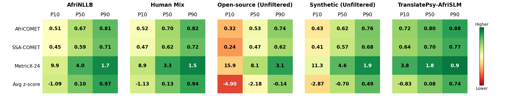

 Figure 3: Comparison of data quality across data sources. Each column shows the P10, P50, and P90 percentiles for AfriCOMET, SSA-COMET and MetricX, which are then normalised into a mean robust z-score (bottom row).

### 4.2 Evaluation

#### Language groups.

We evaluate MT on 19 languages covered in the TranslatePsy-AfriSLM data mixes, labelled Africa-IID88 8 Africa-IID: Afrikaans (afr), Amharic (amh), Hausa (hau), Igbo (ibo), Kinyarwanda (kin), Lingala (lin), Luganda (lug), Malagasy (plt/mlg), Nyanja (nya), Oromo (orm), Nigerian Pidgin (pcm), Shona (sna), Somali (som), Southern Sotho (sot), Swahili (swh/swa), Tswana (tsn), Wolof (wol), Xhosa (xho), Yoruba (yor), Zulu (zul); see <https://en.wikipedia.org/wiki/ISO_639-3>., and an additional set of 8 unseen languages, labelled Africa-OOD99 9 Africa-OOD: Nigerian Pidgin (pcm), Sudanese Arabic (apd), Akan (aka), Tamazight (ber), Kituba (ktu), Bambara (bam), Sepedi (nso) and Mooré (mos)., to assess generalisation to out-of-domain languages.

#### Benchmarks.

We evaluate on three translation benchmarks: Flores-200 [Team et al. (2022)](https://arxiv.org/html/2608.18655v2#bib.bib21), BOUQuET [Team et al. (2026)](https://arxiv.org/html/2608.18655v2#bib.bib28), and Smol [Caswell et al. (2025)](https://arxiv.org/html/2608.18655v2#bib.bib11). Flores-200 is the most widely used benchmark (devtest split, 1,012 sentences), enabling comparison with prior work. BOUQuET is the most recent, linguist-curated multi-way benchmark (test split, 854 sentences) with broad typological coverage. Smol (smolsent split, 863 sentences) provides professionally translated data across 89 languages, used exclusively for evaluation. Each benchmark covers all 19 Africa-IID languages.

#### Metrics.

We evaluate translation quality using five complementary metrics. We report three learned metrics: COMET-221010 10 <https://huggingface.co/Unbabel/wmt22-comet-da> [Rei et al. (2022a)](https://arxiv.org/html/2608.18655v2#bib.bib7), a neural metric trained on human direct assessments, abbreviated to C22; SSA-COMET1111 11 <https://huggingface.co/McGill-NLP/ssa-comet-mtl> [Li et al. (2025)](https://arxiv.org/html/2608.18655v2#bib.bib35), an AfroXLM-R-based COMET variant developed for evaluating African languages, abbreviated to SSA; and MetricX1212 12 <https://huggingface.co/google/metricx-24-hybrid-xl-v2p6> [Juraska et al. (2024)](https://arxiv.org/html/2608.18655v2#bib.bib8), an mT5-based regression metric fine-tuned on DA and MQM ratings, abbreviated to MX. We additionally report two reference-based metrics that are not used for QE-based filtering: chrF++1313 13 SacreBLEU with character order 6, word order 2, beta 2, case-sensitive evaluation, whitespace excluded, and epsilon smoothing disabled [Popović (2017)](https://arxiv.org/html/2608.18655v2#bib.bib43), a character- and word-based n-gram F-score, and spBLEU1414 14 SacreBLEU using the Flores-200 tokenizer and its SentencePiece model [Goyal et al. (2021)](https://arxiv.org/html/2608.18655v2#bib.bib54), BLEU computed over SentencePiece-tokenized text using the Flores-200 tokenizer. COMET-22 and SSA-COMET are reported on a 0–1 scale (higher is better), chrF++ and spBLEU on a 0–100 scale (higher is better), and MetricX on a 0–25 scale (lower is better). Since some of the learned metrics used for evaluation overlap with the QE estimators used for data selection, chrF++ and spBLEU provide complementary signals independent of the filtering process. This allows us to assess whether the observed improvements generalize beyond the metrics involved in QE-based filtering.

#### Baselines

We benchmark our SLMs against (1) General-purpose LLMs: Qwen3 [Yang et al. (2025)](https://arxiv.org/html/2608.18655v2#bib.bib3) and Qwen3.5 [Team (2026)](https://arxiv.org/html/2608.18655v2#bib.bib19), two strong general-purpose multilingual LLM families, and Apertus [Hernández-Cano et al. (2025)](https://arxiv.org/html/2608.18655v2#bib.bib44), a massively multilingual model covering 1,800+ languages. Among these, Qwen3.5 achieves the strongest performance, motivating its use as our backbone and enabling a direct measurement of gains from our methodology. (2) Dedicated translation models: NLLB [Team et al. (2022)](https://arxiv.org/html/2608.18655v2#bib.bib21), an encoder–decoder model trained on large-scale parallel data; AfriNLLB [Moslem et al. (2026)](https://arxiv.org/html/2608.18655v2#bib.bib4), an African-centric variant of NLLB; TranslateGemma [Finkelstein et al. (2026)](https://arxiv.org/html/2608.18655v2#bib.bib2) and Hunyuan-MT [Zheng et al. (2025)](https://arxiv.org/html/2608.18655v2#bib.bib20), decoder-only LLMs post-trained for translation. (3) African language-specialized models: AfriqueLLM [Yu et al. (2026)](https://arxiv.org/html/2608.18655v2#bib.bib5), which adapts Gemma-3, Qwen3, and LLaMA-3.1 via continued pretraining on approximately 26B tokens.

## 5 Results and Analysis

### 5.1 Quality Estimation: Which is Best?

We first study which quality estimation strategy is most effective for data filtering. All experiments in this section use synthetic data from English into African languages, the only corpus large enough to support controlled comparisons across all 19 language pairs, with over 135 million examples.

#### No Single Estimator Is Optimal.

We compare SSA-COMET, AfriCOMET, and MetricX as individual quality estimators for filtering data. For each estimator, we score the full training pool, select the top 2 million examples per language, and use them to fine-tune Qwen3.5-2B. Table [1](https://arxiv.org/html/2608.18655v2#S5.T1 "Table 1 ‣ No Single Estimator Is Optimal. ‣ 5.1 Quality Estimation: Which is Best? ‣ 5 Results and Analysis ‣ TranslatePsy-AfriSLM: High-Quality Data Scaling For Low-Resource Machine Translation") shows the relative performance gains over a randomly selected baseline, averaged across BOUQuET, Flores-200, and Smol test sets.1515 15 In the appendix, Table [21](https://arxiv.org/html/2608.18655v2#A4.T21 "Table 21 ‣ D.2 Zero-Shot African-to-African Translation ‣ Appendix D Additional Results ‣ TranslatePsy-AfriSLM: High-Quality Data Scaling For Low-Resource Machine Translation") shows the metrics scores, and Table [22](https://arxiv.org/html/2608.18655v2#A4.T22 "Table 22 ‣ D.2 Zero-Shot African-to-African Translation ‣ Appendix D Additional Results ‣ TranslatePsy-AfriSLM: High-Quality Data Scaling For Low-Resource Machine Translation") paired bootstrap significance tests. First, filtered data yield better translation scores than randomly selected data in nearly all cases. For example, even data selected using MetricX achieve a higher SSA-COMET score than the baseline. However, the overall impact of filtering is moderate, suggesting that the initial quality of the synthetic training pool was already strong. Second, each estimator performs best when evaluated by its corresponding metric. For instance, the SSA-COMET estimator consistently achieves the top SSA-COMET score, and the same holds for MetricX. Similarly, the AfriCOMET estimator outperforms MetricX QE when evaluated via COMET variants. Consequently, no single estimator dominates across all evaluation metrics. However, the \(\bar{z}\) score does provide a balanced alternative, achieving at least the second best score across every metric. We therefore adopt it as our QE metric for the remainder of the paper.

Estimator | C22 | SSA | MX | chrF++  
---|---|---|---|---  
Random | 0 | 0 | 0 | 0  
z-score | +1.08% | +4.32% | +9.57% | +0.73%  
SSA-COMET | +0.94% | +4.85% | +5.84% | +1.22%  
AfriCOMET | +0.80% | +3.02% | +4.52% | 0  
MetricX | +0.28% | +2.25% | +13.3% | -0.16%

 

Table 1: Translation quality with individual QE versus unified QE metrics. Values represent the relative improvement of QE-filtered data over a randomly selected (training data) baseline for English–African language translation, averaged across all test sets.

#### Aligned QE Is Best.

We evaluate whether QE filtering should be applied: 1) in the training direction (aligned), 2) in the opposite of training direction (reversed) or 3) both (mean) directions. This issue arises in back-translation workflows, where synthetic pairs may be generated and filtered in one direction, then reversed to form training examples in the opposite direction. In such cases, the QE scoring direction becomes reversed relative to the final training direction. To test this, we compare otherwise identical models filtered using the aligned, reversed, and mean strategies defined in §[3.2](https://arxiv.org/html/2608.18655v2#S3.SS2 "3.2 Unified Quality Estimation ‣ 3 TranslatePsy-AfriSLM ‣ TranslatePsy-AfriSLM: High-Quality Data Scaling For Low-Resource Machine Translation"). Results in Table [2](https://arxiv.org/html/2608.18655v2#S5.T2 "Table 2 ‣ Aligned QE Is Best. ‣ 5.1 Quality Estimation: Which is Best? ‣ 5 Results and Analysis ‣ TranslatePsy-AfriSLM: High-Quality Data Scaling For Low-Resource Machine Translation"), averaged across translation directions and test sets, show that reversed filtering substantially degrades performance, especially on MetricX (\(-12.0\%\)) and SSA-COMET (\(-3.1\%\)), while the mean strategy is closer but still generally below the aligned reference. This indicates that QE filtering should be aligned with the final training direction, even when synthetic data is generated through back-translation. We thus use aligned QE filtering for the remainder of the paper.

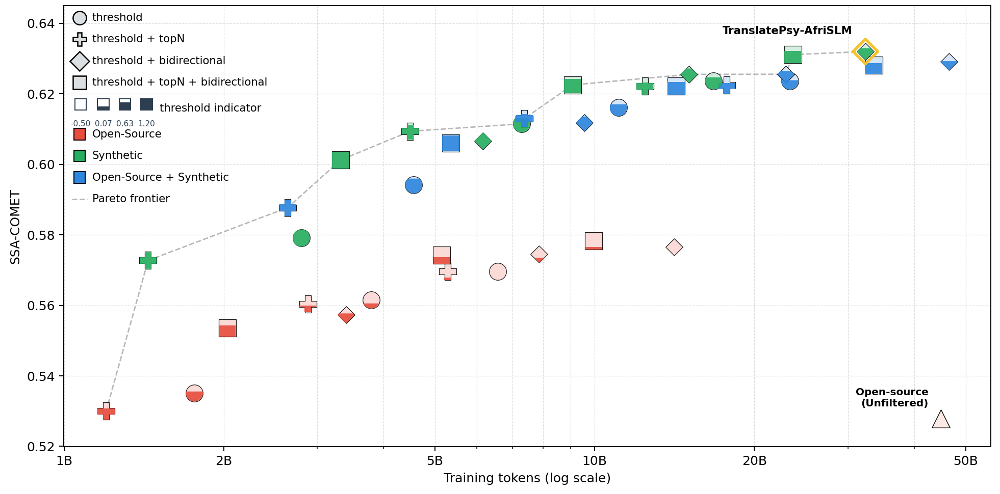

 Figure 4: The Pareto frontier of performance (SSA-COMET) versus training tokens on BOUQuET. Each shape is a fine-tuned model configuration. Colours indicate data source, shapes indicate the filtering strategy, and the shape fill indicates the threshold (the fuller the shape, the higher the threshold). Detailed plots for each metric and each dataset are shown in Figure [14](https://arxiv.org/html/2608.18655v2#A5.F14 "Figure 14 ‣ E.4 LLM-as-a-Judge Evaluation ‣ Appendix E Additional Evaluation and Robustness ‣ TranslatePsy-AfriSLM: High-Quality Data Scaling For Low-Resource Machine Translation"). The full training budgets and threshold details are reported in Table [17](https://arxiv.org/html/2608.18655v2#A4.T17 "Table 17 ‣ Appendix D Additional Results ‣ TranslatePsy-AfriSLM: High-Quality Data Scaling For Low-Resource Machine Translation").

Direction | C22 | SSA | MX | chrF++  
---|---|---|---|---  
Aligned (Ref.) | 0 | 0 | 0 | 0  
Mean | -0.4% | -0.9% | -3.9% | +0.7%  
Reversed | -1.5% | -3.1% | -12.0% | +0.1%

 

Table 2: Training versus QE scoring directions. Percentages show average differences to aligned reference.

### 5.2 How to Select Data?

With unified QE established, we study how training performance changes as a function of data quality and quantity. We sweep the z-score thresholds and combine them with the three strategies introduced in §[3.3](https://arxiv.org/html/2608.18655v2#S3.SS3 "3.3 Data Quantity Selection ‣ 3 TranslatePsy-AfriSLM ‣ TranslatePsy-AfriSLM: High-Quality Data Scaling For Low-Resource Machine Translation") across open-source, synthetic and combined data sources. For each mix, we fine-tune Qwen3.5-2B under the same recipe. Our key observations:

  1. Quality filtering is highly effective. Figure [4](https://arxiv.org/html/2608.18655v2#S5.F4 "Figure 4 ‣ Aligned QE Is Best. ‣ 5.1 Quality Estimation: Which is Best? ‣ 5 Results and Analysis ‣ TranslatePsy-AfriSLM: High-Quality Data Scaling For Low-Resource Machine Translation") (bottom right) shows the “Open-source (Unfiltered)” model trained only on raw sentence pairs, totalling 44.93B tokens. Its lower relative quality can clearly be seen in Figure [3](https://arxiv.org/html/2608.18655v2#S4.F3 "Figure 3 ‣ 4.1 Supervised Fine-Tuning \(SFT\) ‣ 4 Experimental Setup ‣ TranslatePsy-AfriSLM: High-Quality Data Scaling For Low-Resource Machine Translation"). In contrast, a filtered configuration (bottom left) reaches a comparable SSA-COMET score (0.530 vs. 0.528) with only 1.76B tokens—a 96% reduction. This shows that raw open-source data contains a weak training signal that can be concentrated via dedicated curation, and that scaling _usable_ tokens matters more than simply increasing token budgets. The breakdown of our best open-source configuration is detailed in Table [5](https://arxiv.org/html/2608.18655v2#A1.T5 "Table 5 ‣ Processing steps: ‣ A.1 Synthetic and Open-Source Mixes ‣ Appendix A Appendix ‣ TranslatePsy-AfriSLM: High-Quality Data Scaling For Low-Resource Machine Translation"). 
  2. Synthetic data provides better quality and a higher volume. Because it is generated at a larger scale, using a relatively high-quality teacher model, its unfiltered sentence pairs already benefit from higher quality scores than raw open-source pairs (Figure [3](https://arxiv.org/html/2608.18655v2#S4.F3 "Figure 3 ‣ 4.1 Supervised Fine-Tuning \(SFT\) ‣ 4 Experimental Setup ‣ TranslatePsy-AfriSLM: High-Quality Data Scaling For Low-Resource Machine Translation")). This allows us to apply much stricter \(\mathrm{\bar{z}}\) score thresholds while still retaining sufficient training data. In competitive configurations, open-source mixes typically require relatively permissive thresholds around \(\mathrm{\bar{z}\in[-0.5,0.5]}\), whereas synthetic mixes remain viable under substantially stricter thresholds, from \(\mathrm{\bar{z}\geq 0.68}\) to \(\mathrm{\bar{z}\geq 1.2}\). As a result, synthetic mixes dominate open-source mixes across nearly all training-token budgets. 
  3. Combining open-source and synthetic mixes may help at smaller scales. Combined mixes can outperform synthetic-only mixes at smaller token budgets, but this advantage generally dematerialises as the budget is increased. For example, the best large combined mix uses more tokens and a lower threshold than the final synthetic mix (46.49B tokens, \(\mathrm{\bar{z}\geq 0.41}\) vs. 32.37B tokens, \(\mathrm{\bar{z}\geq 0.68}\)), yet performs slightly worse. This suggests that once enough high-quality synthetic data is available, adding lower-quality open-source data can dilute the training signal. 
  4. TopN capping is associated with better token efficiency. Incorporating topN with threshold-only configurations as a means to limit the influence of well-resourced language pairs tends to underperform in absolute terms although it tends to deliver a higher relative performance (per token). However, the effect is weak, therefore, restricted computational budgets should generally consider the topN capping option. 
  5. Bidirectional expansion as a robust strategy. Across open-source, synthetic, and combined mixes, configurations with bidirectional expansion always improve compared to the equivalent configuration without expansion. This suggests that expanding selected examples to both translation directions improves coverage and keeps the data more balanced. Because filtering is still aligned with the final training direction, bidirectional expansion preserves QE reliability without the degradation caused by reversed filtering. 

Based on these observations, we choose the best-performing configuration (threshold + bidirectional expansion) as our final TranslatePsy-AfriSLM synthetic mix with 32.37B tokens, reaching a score of 0.632 SSA-COMET.

### 5.3 Which Dataset(s) Should We Use?

In this section, we evaluate several datasets in isolation to investigate their contribution to MT.

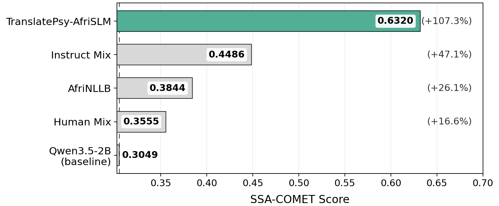

 

Figure 5: Single-source SFT ablation on BOUQuET (Qwen3.5-2B). Each model is fine-tuned using a single data component and evaluated with SSA-COMET. The percentages indicate relative gains over the baseline.

#### AfriNLLB

was the largest open-source, curated dataset1616 16 Refer to Appendix [A.5](https://arxiv.org/html/2608.18655v2#A1.SS5 "A.5 AfriNLLB ‣ Appendix A Appendix ‣ TranslatePsy-AfriSLM: High-Quality Data Scaling For Low-Resource Machine Translation") for dataset preparation. to date, hence we positioned it as our most competitive baseline in Figure [5](https://arxiv.org/html/2608.18655v2#S5.F5 "Figure 5 ‣ 5.3 Which Dataset\(s\) Should We Use? ‣ 5 Results and Analysis ‣ TranslatePsy-AfriSLM: High-Quality Data Scaling For Low-Resource Machine Translation"). While it is more beneficial than the human mix, its contribution only has a moderate effect on African language MT.

#### Human Mix

is our highest-quality data, as it comes from projects with a high emphasis on human-quality translations. Figure [3](https://arxiv.org/html/2608.18655v2#S4.F3 "Figure 3 ‣ 4.1 Supervised Fine-Tuning \(SFT\) ‣ 4 Experimental Setup ‣ TranslatePsy-AfriSLM: High-Quality Data Scaling For Low-Resource Machine Translation") shows that the Human Mix receives higher QE scores than AfriNLLB, which helps explain the fact that it achieves comparable performance despite being much smaller (60.2M versus 535M tokens). This suggests that human-quality data is highly valuable per token, but its limited scale makes it insufficient for effective SLM post-training on its own.

#### Instruct-Mix

The primary reason for including this dataset in the final TranslatePsy-AfriSLM mix is to preserve the conversational skills of our SLMs, see Figure [15](https://arxiv.org/html/2608.18655v2#A5.F15 "Figure 15 ‣ E.4 LLM-as-a-Judge Evaluation ‣ Appendix E Additional Evaluation and Robustness ‣ TranslatePsy-AfriSLM: High-Quality Data Scaling For Low-Resource Machine Translation") for a short demo. However, we observe that it unexpectedly benefits machine translation as well, even more so than a dedicated AfriNLLB corpus (Figure [5](https://arxiv.org/html/2608.18655v2#S5.F5 "Figure 5 ‣ 5.3 Which Dataset\(s\) Should We Use? ‣ 5 Results and Analysis ‣ TranslatePsy-AfriSLM: High-Quality Data Scaling For Low-Resource Machine Translation")). This is almost certainly due to the 2.3M examples (around 50% of total) of diverse tasks in African languages. This effect is similar to the AfriqueLLM [Yu et al. (2026)](https://arxiv.org/html/2608.18655v2#bib.bib5) continued pre-training findings, which also observed an improvement in MT via instruction-following SFT.

#### TranslatePsy-AfriSLM 

Our data1717 17 The best synthetic mix, highlighted in Figure [4](https://arxiv.org/html/2608.18655v2#S5.F4 "Figure 4 ‣ Aligned QE Is Best. ‣ 5.1 Quality Estimation: Which is Best? ‣ 5 Results and Analysis ‣ TranslatePsy-AfriSLM: High-Quality Data Scaling For Low-Resource Machine Translation") (top right). emerges as a powerful contributor to African language MT. It combines scale and quality more effectively than prior sources, retains enough data under strict filtering (Figure [4](https://arxiv.org/html/2608.18655v2#S5.F4 "Figure 4 ‣ Aligned QE Is Best. ‣ 5.1 Quality Estimation: Which is Best? ‣ 5 Results and Analysis ‣ TranslatePsy-AfriSLM: High-Quality Data Scaling For Low-Resource Machine Translation")) and achieves higher QE scores than both AfriNLLB and the Human Mix (Figure [3](https://arxiv.org/html/2608.18655v2#S4.F3 "Figure 3 ‣ 4.1 Supervised Fine-Tuning \(SFT\) ‣ 4 Experimental Setup ‣ TranslatePsy-AfriSLM: High-Quality Data Scaling For Low-Resource Machine Translation")). This makes it especially effective for African language MT adaptation. The detailed statistics of this mix are given in Table [6](https://arxiv.org/html/2608.18655v2#A1.T6 "Table 6 ‣ Processing steps: ‣ A.1 Synthetic and Open-Source Mixes ‣ Appendix A Appendix ‣ TranslatePsy-AfriSLM: High-Quality Data Scaling For Low-Resource Machine Translation") in the Appendix.

### 5.4 Can SLMs Beat Frontier LLMs?

<table id="S5.T3.2.1" class="ltx_tabular ltx_align_middle">
<tr id="S5.T3.2.1.1" class="ltx_tr">
<td id="S5.T3.2.1.1.1" class="ltx_td ltx_align_left ltx_border_tt">Model</td>
<td id="S5.T3.2.1.1.2" class="ltx_td ltx_align_center ltx_border_tt">Flores-200</td>
<td id="S5.T3.2.1.1.3" class="ltx_td ltx_align_center ltx_border_tt">BOUQuET</td>
<td id="S5.T3.2.1.1.4" class="ltx_td ltx_align_center ltx_border_tt">Smol</td></tr>
<tr id="S5.T3.2.1.2" class="ltx_tr">
<td id="S5.T3.2.1.2.1" class="ltx_td ltx_align_left ltx_border_t" colspan="4">General-purpose LLMs</td></tr>
<tr id="S5.T3.2.1.3" class="ltx_tr">
<td id="S5.T3.2.1.3.1" class="ltx_td ltx_align_left ltx_border_t">Apertus-8B</td>
<td id="S5.T3.2.1.3.2" class="ltx_td ltx_align_center ltx_border_t">0.3814</td>
<td id="S5.T3.2.1.3.3" class="ltx_td ltx_align_center ltx_border_t">0.4024</td>
<td id="S5.T3.2.1.3.4" class="ltx_td ltx_align_center ltx_border_t">0.3246</td></tr>
<tr id="S5.T3.2.1.4" class="ltx_tr">
<td id="S5.T3.2.1.4.1" class="ltx_td ltx_align_left">Qwen3.5-27B</td>
<td id="S5.T3.2.1.4.2" class="ltx_td ltx_align_center">0.5132</td>
<td id="S5.T3.2.1.4.3" class="ltx_td ltx_align_center">0.5336</td>
<td id="S5.T3.2.1.4.4" class="ltx_td ltx_align_center">0.4279</td></tr>
<tr id="S5.T3.2.1.5" class="ltx_tr">
<td id="S5.T3.2.1.5.1" class="ltx_td ltx_align_left">Qwen3.5-122B-A10B</td>
<td id="S5.T3.2.1.5.2" class="ltx_td ltx_align_center">0.5505</td>
<td id="S5.T3.2.1.5.3" class="ltx_td ltx_align_center">0.5716</td>
<td id="S5.T3.2.1.5.4" class="ltx_td ltx_align_center">0.4574</td></tr>
<tr id="S5.T3.2.1.6" class="ltx_tr">
<td id="S5.T3.2.1.6.1" class="ltx_td ltx_align_left ltx_border_t" colspan="4">Dedicated translation models</td></tr>
<tr id="S5.T3.2.1.7" class="ltx_tr">
<td id="S5.T3.2.1.7.1" class="ltx_td ltx_align_left ltx_border_t">AfriNLLB-600M</td>
<td id="S5.T3.2.1.7.2" class="ltx_td ltx_align_center ltx_border_t">0.5729</td>
<td id="S5.T3.2.1.7.3" class="ltx_td ltx_align_center ltx_border_t">0.6038</td>
<td id="S5.T3.2.1.7.4" class="ltx_td ltx_align_center ltx_border_t">0.4748</td></tr>
<tr id="S5.T3.2.1.8" class="ltx_tr">
<td id="S5.T3.2.1.8.1" class="ltx_td ltx_align_left">NLLB-1.3B</td>
<td id="S5.T3.2.1.8.2" class="ltx_td ltx_align_center">0.5878</td>
<td id="S5.T3.2.1.8.3" class="ltx_td ltx_align_center">0.6130</td>
<td id="S5.T3.2.1.8.4" class="ltx_td ltx_align_center">0.4850</td></tr>
<tr id="S5.T3.2.1.9" class="ltx_tr">
<td id="S5.T3.2.1.9.1" class="ltx_td ltx_align_left">NLLB-3.3B</td>
<td id="S5.T3.2.1.9.2" class="ltx_td ltx_align_center">0.5944</td>
<td id="S5.T3.2.1.9.3" class="ltx_td ltx_align_center">0.6178</td>
<td id="S5.T3.2.1.9.4" class="ltx_td ltx_align_center">0.4909</td></tr>
<tr id="S5.T3.2.1.10" class="ltx_tr">
<td id="S5.T3.2.1.10.1" class="ltx_td ltx_align_left">Hunyuan-MT-7B</td>
<td id="S5.T3.2.1.10.2" class="ltx_td ltx_align_center">0.4450</td>
<td id="S5.T3.2.1.10.3" class="ltx_td ltx_align_center">0.4451</td>
<td id="S5.T3.2.1.10.4" class="ltx_td ltx_align_center">0.3784</td></tr>
<tr id="S5.T3.2.1.11" class="ltx_tr">
<td id="S5.T3.2.1.11.1" class="ltx_td ltx_align_left">TranslateGemma-4B</td>
<td id="S5.T3.2.1.11.2" class="ltx_td ltx_align_center">0.3913</td>
<td id="S5.T3.2.1.11.3" class="ltx_td ltx_align_center">0.4069</td>
<td id="S5.T3.2.1.11.4" class="ltx_td ltx_align_center">0.3384</td></tr>
<tr id="S5.T3.2.1.12" class="ltx_tr">
<td id="S5.T3.2.1.12.1" class="ltx_td ltx_align_left">TranslateGemma-27B</td>
<td id="S5.T3.2.1.12.2" class="ltx_td ltx_align_center">0.5455</td>
<td id="S5.T3.2.1.12.3" class="ltx_td ltx_align_center">0.5677</td>
<td id="S5.T3.2.1.12.4" class="ltx_td ltx_align_center">0.4608</td></tr>
<tr id="S5.T3.2.1.13" class="ltx_tr">
<td id="S5.T3.2.1.13.1" class="ltx_td ltx_align_left ltx_border_t" colspan="4">African language-specialized models</td></tr>
<tr id="S5.T3.2.1.14" class="ltx_tr">
<td id="S5.T3.2.1.14.1" class="ltx_td ltx_align_left ltx_border_t">AfriqueLlama-8B</td>
<td id="S5.T3.2.1.14.2" class="ltx_td ltx_align_center ltx_border_t">0.5513</td>
<td id="S5.T3.2.1.14.3" class="ltx_td ltx_align_center ltx_border_t">0.5772</td>
<td id="S5.T3.2.1.14.4" class="ltx_td ltx_align_center ltx_border_t">0.4555</td></tr>
<tr id="S5.T3.2.1.15" class="ltx_tr">
<td id="S5.T3.2.1.15.1" class="ltx_td ltx_align_left">AfriqueGemma-12B</td>
<td id="S5.T3.2.1.15.2" class="ltx_td ltx_align_center">0.5655</td>
<td id="S5.T3.2.1.15.3" class="ltx_td ltx_align_center">0.5892</td>
<td id="S5.T3.2.1.15.4" class="ltx_td ltx_align_center">0.4649</td></tr>
<tr id="S5.T3.2.1.16" class="ltx_tr">
<td id="S5.T3.2.1.16.1" class="ltx_td ltx_align_left">AfriqueQwen-14B</td>
<td id="S5.T3.2.1.16.2" class="ltx_td ltx_align_center">0.5569</td>
<td id="S5.T3.2.1.16.3" class="ltx_td ltx_align_center">0.5817</td>
<td id="S5.T3.2.1.16.4" class="ltx_td ltx_align_center">0.4605</td></tr>
<tr id="S5.T3.2.1.17" class="ltx_tr">
<td id="S5.T3.2.1.17.1" class="ltx_td ltx_align_left ltx_border_t" colspan="4">Ours</td></tr>
<tr id="S5.T3.2.1.18" class="ltx_tr">
<td id="S5.T3.2.1.18.1" class="ltx_td ltx_align_left ltx_border_t">TranslatePsy-AfriSLM-0.8B</td>
<td id="S5.T3.2.1.18.2" class="ltx_td ltx_align_center ltx_border_t">0.5944</td>
<td id="S5.T3.2.1.18.3" class="ltx_td ltx_align_center ltx_border_t">0.6223</td>
<td id="S5.T3.2.1.18.4" class="ltx_td ltx_align_center ltx_border_t">0.4973</td></tr>
<tr id="S5.T3.2.1.19" class="ltx_tr">
<td id="S5.T3.2.1.19.1" class="ltx_td ltx_align_left">TranslatePsy-AfriSLM-2B</td>
<td id="S5.T3.2.1.19.2" class="ltx_td ltx_align_center">0.6070</td>
<td id="S5.T3.2.1.19.3" class="ltx_td ltx_align_center">0.6322</td>
<td id="S5.T3.2.1.19.4" class="ltx_td ltx_align_center">0.5074</td></tr>
<tr id="S5.T3.2.1.20" class="ltx_tr">
<td id="S5.T3.2.1.20.1" class="ltx_td ltx_align_left ltx_border_bb">TranslatePsy-AfriSLM-4B</td>
<td id="S5.T3.2.1.20.2" class="ltx_td ltx_align_center ltx_border_bb">0.6143</td>
<td id="S5.T3.2.1.20.3" class="ltx_td ltx_align_center ltx_border_bb">0.6391</td>
<td id="S5.T3.2.1.20.4" class="ltx_td ltx_align_center ltx_border_bb">0.5136</td></tr>
</table>

 

Table 3: TranslatePsy-AfriSLM compared to LLMs and specialised translators on Flores-200, BOUQuET, Smol (SSA-COMET). Full results in tables [24](https://arxiv.org/html/2608.18655v2#A5.T24 "Table 24 ‣ E.4 LLM-as-a-Judge Evaluation ‣ Appendix E Additional Evaluation and Robustness ‣ TranslatePsy-AfriSLM: High-Quality Data Scaling For Low-Resource Machine Translation") and [25](https://arxiv.org/html/2608.18655v2#A5.T25 "Table 25 ‣ E.4 LLM-as-a-Judge Evaluation ‣ Appendix E Additional Evaluation and Robustness ‣ TranslatePsy-AfriSLM: High-Quality Data Scaling For Low-Resource Machine Translation").

In this section, we combine TranslatePsy-AfriSLM with the Instruct-Mix and Asia-Europe Mix to improve real-world usability and contrast our performance with results from related methodologies.

#### Africa-IID

Table [3](https://arxiv.org/html/2608.18655v2#S5.T3 "Table 3 ‣ 5.4 Can SLMs Beat Frontier LLMs? ‣ 5 Results and Analysis ‣ TranslatePsy-AfriSLM: High-Quality Data Scaling For Low-Resource Machine Translation") summarizes SSA-COMET performance across three benchmarks; full results across all four metrics are reported in Tables [24](https://arxiv.org/html/2608.18655v2#A5.T24 "Table 24 ‣ E.4 LLM-as-a-Judge Evaluation ‣ Appendix E Additional Evaluation and Robustness ‣ TranslatePsy-AfriSLM: High-Quality Data Scaling For Low-Resource Machine Translation") and [25](https://arxiv.org/html/2608.18655v2#A5.T25 "Table 25 ‣ E.4 LLM-as-a-Judge Evaluation ‣ Appendix E Additional Evaluation and Robustness ‣ TranslatePsy-AfriSLM: High-Quality Data Scaling For Low-Resource Machine Translation") (Appendix [D](https://arxiv.org/html/2608.18655v2#A4 "Appendix D Additional Results ‣ TranslatePsy-AfriSLM: High-Quality Data Scaling For Low-Resource Machine Translation")). (1) General-purpose LLMs underperform, even at frontier scale. Qwen3.5-122B-A10B is surpassed by our 0.8B model on Flores-200, BOUQuET, and Smol, suggesting that model scale alone is insufficient for African language MT. (2) Dedicated translation models also lag behind our SLMs. TranslatePsy-AfriSLM-0.8B outperforms AfriNLLB-600M and TranslateGemma-27B across all benchmarks. Notably, our 0.8B model also exceeds NLLB-3.3B on BOUQuET and Smol and matches it on Flores-200, despite using roughly a quarter of its parameters. This demonstrates that our curated post-training data can produce powerful and efficient translation SLMs. (3) African-centric LLMs narrow the gap but cannot match our SLMs. AfriqueGemma-12B and AfriqueQwen-14B remain below TranslatePsy-AfriSLM-0.8B on the reported benchmarks, while requiring substantially more compute for training and inference.

#### Statistical significance.

Paired bootstrap tests confirm that the main rankings in Table [3](https://arxiv.org/html/2608.18655v2#S5.T3 "Table 3 ‣ 5.4 Can SLMs Beat Frontier LLMs? ‣ 5 Results and Analysis ‣ TranslatePsy-AfriSLM: High-Quality Data Scaling For Low-Resource Machine Translation") are statistically reliable (Appendix [E.2](https://arxiv.org/html/2608.18655v2#A5.SS2 "E.2 Statistical Significance \(Bootstrap\) ‣ Appendix E Additional Evaluation and Robustness ‣ TranslatePsy-AfriSLM: High-Quality Data Scaling For Low-Resource Machine Translation")). The results show that TranslatePsy-AfriSLM-0.8B significantly outperforms much larger LLM baselines on most settings, while TranslatePsy-AfriSLM-2B consistently surpasses dedicated NLLB models. We also observe statistically significant gains from TranslatePsy-AfriSLM-0.8B to 2B and 4B.

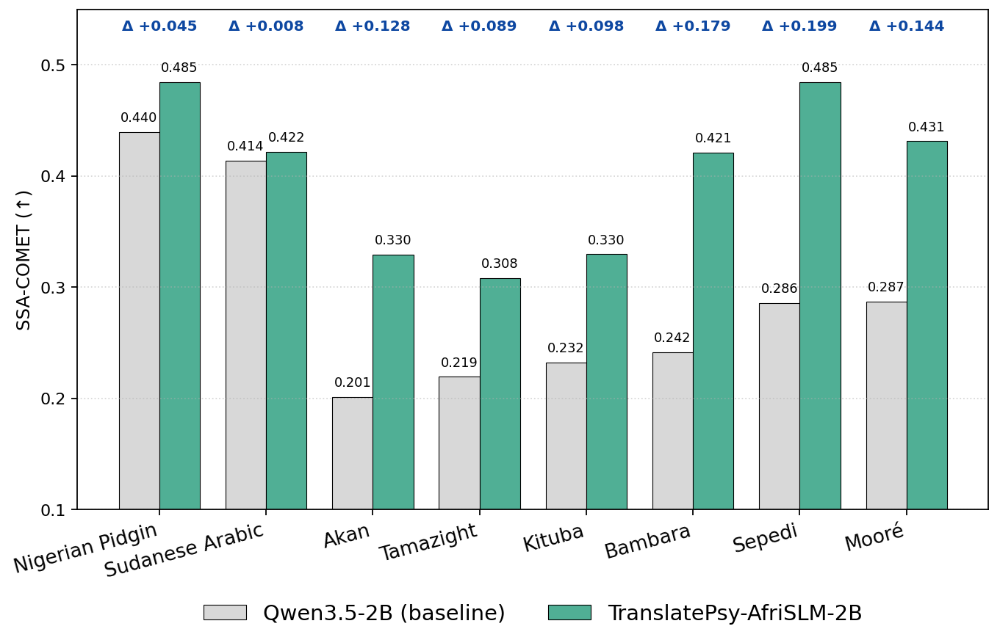

 Figure 6: Africa-OOD performance (SSA-COMET). Qwen3.5-2B versus TranslatePsy-AfriSLM-2B. Scores are averaged over translation directions and all datasets.

#### Metric circularity

Since our fine-tuning data was filtered using quality estimators which overlap with our evaluation metrics, we acknowledge the potential for a circular evaluation bias. In order to ensure that this does not artificially distort model rankings, we confirm that held-out lexical metrics (chrF++ and spBLEU) strongly correlate with our primary evaluation metrics (Table [4](https://arxiv.org/html/2608.18655v2#S5.T4 "Table 4 ‣ Metric circularity ‣ 5.4 Can SLMs Beat Frontier LLMs? ‣ 5 Results and Analysis ‣ TranslatePsy-AfriSLM: High-Quality Data Scaling For Low-Resource Machine Translation")). Across system rankings, neural and surface-level metrics move in tight alignment (all \(p\ll 0.001\)). Because these rankings hold under metrics outside of the filtering family, our performance gains are highly unlikely to be an artifact of metric-specific optimization.

Spearman \(\rho\) | C22 | chrF++ | SSA | MX (\(\downarrow\)) | spBLEU  
---|---|---|---|---|---  
C22 | 1 | 0.984 | 0.967 | \(-0.978\) | 0.971  
chrF++ | — | 1 | 0.958 | \(-0.968\) | 0.989  
SSA | — | — | 1 | \(-0.985\) | 0.952  
MX (\(\downarrow\)) | — | — | — | 1 | \(-0.970\)  
spBLEU | — | — | — | — | 1

 

Table 4: Spearman correlation (\(\rho\)) matrix.

#### LLM-as-a-judge

We present further evidence against any ranking distortions by the means of evaluating TranslatePsy-AfriSLM-2B against NLLB-3.3B and TranslateGemma-27B using LLM-as-a-judge. We used two frontier models, GPT-5.5 and Claude Opus 4.8, to provide an independent, semantic assessment of model performance. For each language pair, we randomly selected 100 sentences from the BOUQuET test set for which the three assessed models had different outputs. We asked the judge LLMs to perform pairwise evaluations, amounting to 300 assessments for each language pair and each judge. Figure [7](https://arxiv.org/html/2608.18655v2#S5.F7 "Figure 7 ‣ LLM-as-a-judge ‣ 5.4 Can SLMs Beat Frontier LLMs? ‣ 5 Results and Analysis ‣ TranslatePsy-AfriSLM: High-Quality Data Scaling For Low-Resource Machine Translation") plots the number of times each engine was ranked #1, #2 or #3, for all into-English and from-English language pairs (1900 sentences in each direction). Figure [7](https://arxiv.org/html/2608.18655v2#S5.F7 "Figure 7 ‣ LLM-as-a-judge ‣ 5.4 Can SLMs Beat Frontier LLMs? ‣ 5 Results and Analysis ‣ TranslatePsy-AfriSLM: High-Quality Data Scaling For Low-Resource Machine Translation") shows that the rankings match automatic evaluation metric rankings (Tables [24](https://arxiv.org/html/2608.18655v2#A5.T24 "Table 24 ‣ E.4 LLM-as-a-Judge Evaluation ‣ Appendix E Additional Evaluation and Robustness ‣ TranslatePsy-AfriSLM: High-Quality Data Scaling For Low-Resource Machine Translation") and [25](https://arxiv.org/html/2608.18655v2#A5.T25 "Table 25 ‣ E.4 LLM-as-a-Judge Evaluation ‣ Appendix E Additional Evaluation and Robustness ‣ TranslatePsy-AfriSLM: High-Quality Data Scaling For Low-Resource Machine Translation")). Full details (including per language) are shown in §[E.4](https://arxiv.org/html/2608.18655v2#A5.SS4 "E.4 LLM-as-a-Judge Evaluation ‣ Appendix E Additional Evaluation and Robustness ‣ TranslatePsy-AfriSLM: High-Quality Data Scaling For Low-Resource Machine Translation").

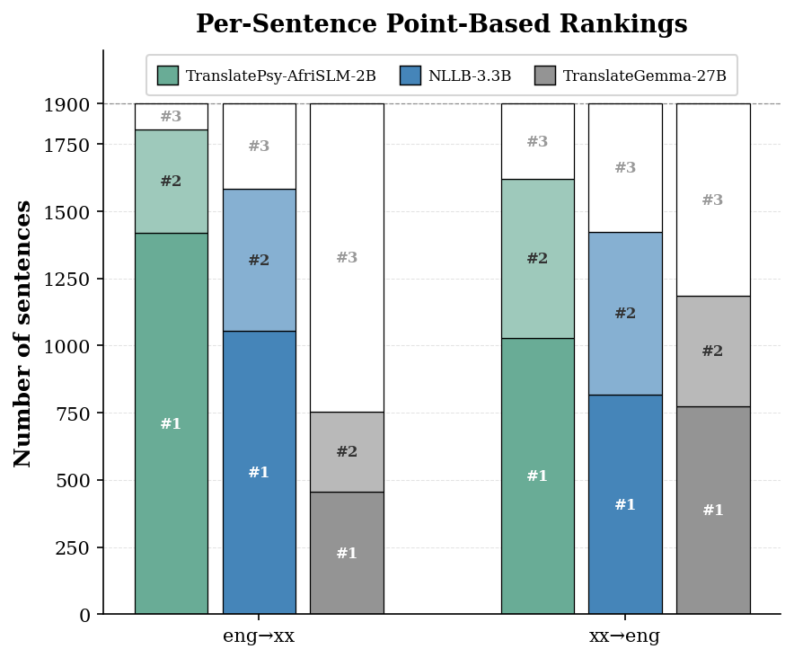

 Figure 7: LLM-as-a-judge results. Showing the number of times each model was ranked #1 (darker shade), #2 (lighter) or #3 (gap up to the dotted line) for into-English and from-English language pairs.

#### Africa-OOD

We use this eight language subset to evaluate if training on our 19 target languages transfers MT to unseen languages. Under SSA-COMET, TranslatePsy-AfriSLM-2B improves over Qwen3.5-2B on all eight held-out languages, with particularly large gains for lower-resource languages such as Sepedi, Bambara, and Akan, shown in Figure [6](https://arxiv.org/html/2608.18655v2#S5.F6 "Figure 6 ‣ Statistical significance. ‣ 5.4 Can SLMs Beat Frontier LLMs? ‣ 5 Results and Analysis ‣ TranslatePsy-AfriSLM: High-Quality Data Scaling For Low-Resource Machine Translation"). Further per-language analyses show similar trends across COMET-22, MetricX, and chrF++ (Figure [13](https://arxiv.org/html/2608.18655v2#A5.F13 "Figure 13 ‣ E.4 LLM-as-a-Judge Evaluation ‣ Appendix E Additional Evaluation and Robustness ‣ TranslatePsy-AfriSLM: High-Quality Data Scaling For Low-Resource Machine Translation"); Appendix [D.1](https://arxiv.org/html/2608.18655v2#A4.SS1 "D.1 Per-Language Performance Analysis ‣ Appendix D Additional Results ‣ TranslatePsy-AfriSLM: High-Quality Data Scaling For Low-Resource Machine Translation")). These results suggest meaningful cross-lingual transfer beyond the training data but less uniform than IID gains.

#### Catastrophic Forgetting

We include the Asia-Europe Mix (§[3.4](https://arxiv.org/html/2608.18655v2#S3.SS4 "3.4 Auxiliary Data Mixes ‣ 3 TranslatePsy-AfriSLM ‣ TranslatePsy-AfriSLM: High-Quality Data Scaling For Low-Resource Machine Translation")) to mitigate catastrophic forgetting on non-African languages. Figure [8](https://arxiv.org/html/2608.18655v2#S5.F8 "Figure 8 ‣ Catastrophic Forgetting ‣ 5.4 Can SLMs Beat Frontier LLMs? ‣ 5 Results and Analysis ‣ TranslatePsy-AfriSLM: High-Quality Data Scaling For Low-Resource Machine Translation") shows that SFT without this data causes substantial degradation on Asian and European languages, most notably under MetricX (\(-86.0\%\)). Adding our Asia-Europe Mix reduces this to \(-10.3\%\) and also mitigates degradation measured by COMET-22, SSA-COMET, and chrF++. These results indicate that non-African parallel data helps preserve broader multilingual translation ability without sacrificing Africa-IID performance; in fact, we observe a small improvement on Africa-IID pairs (Appendix [C](https://arxiv.org/html/2608.18655v2#A3 "Appendix C Catastrophic Forgetting Analysis ‣ TranslatePsy-AfriSLM: High-Quality Data Scaling For Low-Resource Machine Translation")).

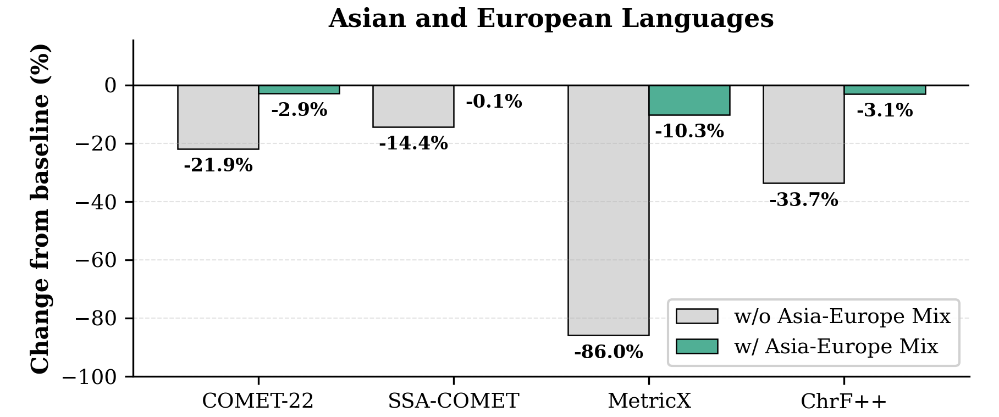

 Figure 8: Catastrophic forgetting on 38 Asian and European languages. The bars show the percentage change from baseline after SFT, with/without the mix.

## 6 Conclusions

We have introduced TranslatePsy-AfriSLM, a comprehensive investigation of training data curation aimed at improving machine translation for 19 Sub-Saharan languages. Our results lead to two main conclusions: 1) Combining multiple QE metrics with robust \(\bar{z}\) score normalization, and scoring examples in the same direction as training, yields more consistent filtering than relying on any single metric. This allows us to reduce the number of training tokens by up to 96% while maintaining comparable performance, 2) Across the 1B--50B token range, filtered synthetic data dominates the quality-efficiency Pareto frontier, while open-source data appears to saturate early due to quality limitations. Given the current shortage of high-quality open-source parallel data for African language MT, filtered synthetic generation seems to be the most practical path forward. Guided by these findings, we post-trained TranslatePsy-AfriSLM SLMs on our highest-quality data, outperforming much larger models, including TranslateGemma-27B and Qwen3.5-122B-A10B, with as few as 0.8B parameters. We open-source1818 18 <https://huggingface.co/collections/qvac/translatepsy-afrislm> our data to support future work on making African language MT a default capability in multilingual models.

## Limitations

#### The Need for Human Evaluation.

One notable finding that warrants future investigation is the challenge of determining absolute translation quality for African languages. Using the reference-free quality estimators from prior work, it appears that our TranslatePsy-AfriSLM data is comparable to human translated pairs in quality but it comes in quantities that are orders of magnitude larger. Still, the performance, as indicated by the reference-based evaluation metrics (produced by same model families as QE) suggests that we have not yet reached the translation quality of European and Asian languages. Therefore, conducting purely quantitative data scaling efforts using existing tools may run into unknown absolute performance limitations. The reason(s) behind this can only be resolved by analysing each step in the pipeline [data collection and training of QE models, correlation with human judgement, data collection and training of evaluation models, their correlation with ground truth], leveraging expert human annotators to identify any errors that have the capacity to compound over multiple steps during a large-scale data curation. A specific target for human evaluation is investigating the discrepancy between covered and uncovered languages within current QE estimators. Although we filter training data across all language pairs evaluated in this work, these estimators were trained only on a subset of those. A study on the impact of filtering languages absent from QE training would be an insightful direction for future work.

## Ethics Statement

#### Data licensing

All primary sources are open-source and publicly available under permissive attribution-based licenses — ODC-By v1.0 (Fine Translations, MADLAD-400) and CC BY 4.0 (MaLA Corpus), alongside research-permissive aggregates from OPUS and WMT22. The synthetic TranslatePsy-AfriSLM mix will be released under the CC-BY-NC 4.0 license, for safe, lawful, and reproducible low-resource NLP research.

#### Dialectal representativeness

The exact dialect tracking is unavailable for our web-curated corpora; models may over-reflect standardized written forms and under-represent regional dialects or oral traditions. We advise auditing trained models for localized sensitivity before deployment.

#### Synthetic content

In our "open-source" mix, the Fine Translations corpus is entirely synthetic. Because large internet repositories involve data recycling, mixing, duplication, and some LLM-based corrections and paraphrasing, an unknown portion of the "open-source" subset should be treated as at least partially synthetic. The open-source mix will not be released due to licensing/provenance issues.

## References

  * Adebara et al. (2022) I. Adebara, A. Elmadany, M. Abdul-Mageed, and A. Inciarte AfroLID: a neural language identification tool for African languages.  In Proceedings of the 2022 Conference on Empirical Methods in Natural Language Processing, Y. Goldberg, Z. Kozareva, and Y. Zhang (Eds.),  Abu Dhabi, United Arab Emirates, pp. 1958–1981.  External Links: [Link](https://aclanthology.org/2022.emnlp-main.128/), [Document](https://dx.doi.org/10.18653/v1/2022.emnlp-main.128) Cited by: [item 3](https://arxiv.org/html/2608.18655v2#A1.I1.i3.p1.1 "In Processing steps: ‣ A.1 Synthetic and Open-Source Mixes ‣ Appendix A Appendix ‣ TranslatePsy-AfriSLM: High-Quality Data Scaling For Low-Resource Machine Translation"). 
  * Adelani et al. (2022a) D. I. Adelani, J. O. Alabi, A. Fan, J. Kreutzer, X. Shen, M. Reid, D. Ruiter, D. Klakow, P. Nabende, E. Chang, T. Gwadabe, F. Sackey, B. F. P. Dossou, C. Emezue, C. Leong, M. Beukman, S. H. Muhammad, G. D. Jarso, O. Yousuf, A. N. Niyongabo Rubungo, G. Hacheme, E. P. Wairagala, M. U. Nasir, B. A. Ajibade, T. O. Ajayi, Y. W. Gitau, J. Abbott, M. Ahmed, M. Ochieng, A. Aremu, P. Ogayo, J. Mukiibi, F. Ouoba Kabore, G. K. Kalipe, D. Mbaye, A. A. Tapo, V. M. Memdjokam Koagne, E. Munkoh-Buabeng, V. Wagner, I. Abdulmumin, A. Awokoya, H. Buzaaba, B. Sibanda, A. Bukula, and S. Manthalu A few thousand translations go a long way! leveraging pre-trained models for African news translation.  In Proceedings of the 2022 Conference of the North American Chapter of the Association for Computational Linguistics: Human Language Technologies, M. Carpuat, M. de Marneffe, and I. V. Meza Ruiz (Eds.),  Seattle, United States, pp. 3053–3070.  External Links: [Link](https://aclanthology.org/2022.naacl-main.223/), [Document](https://dx.doi.org/10.18653/v1/2022.naacl-main.223) Cited by: [§2.1](https://arxiv.org/html/2608.18655v2#S2.SS1.SSS0.Px3.p1.1 "Small but Human-Quality. ‣ 2.1 African language MT Training Resources ‣ 2 Background ‣ TranslatePsy-AfriSLM: High-Quality Data Scaling For Low-Resource Machine Translation"). 
  * Adelani et al. (2022b) D. I. Adelani, M. M. I. Alam, A. Anastasopoulos, A. Bhagia, M. R. Costa-jussà, J. Dodge, F. Faisal, C. Federmann, N. Fedorova, F. Guzmán, S. Koshelev, J. Maillard, V. Marivate, J. Mbuya, A. Mourachko, S. Saleem, H. Schwenk, and G. Wenzek Findings of the WMT’22 shared task on large-scale machine translation evaluation for African languages.  In Proceedings of the Seventh Conference on Machine Translation (WMT), P. Koehn, L. Barrault, O. Bojar, F. Bougares, R. Chatterjee, M. R. Costa-jussà, C. Federmann, M. Fishel, A. Fraser, M. Freitag, Y. Graham, R. Grundkiewicz, P. Guzman, B. Haddow, M. Huck, A. Jimeno Yepes, T. Kocmi, A. Martins, M. Morishita, C. Monz, M. Nagata, T. Nakazawa, M. Negri, A. Névéol, M. Neves, M. Popel, M. Turchi, and M. Zampieri (Eds.),  Abu Dhabi, United Arab Emirates (Hybrid), pp. 773–800.  External Links: [Link](https://aclanthology.org/2022.wmt-1.72/), [Document](https://dx.doi.org/10.18653/v1/2022.wmt-1.72) Cited by: [§2.1](https://arxiv.org/html/2608.18655v2#S2.SS1.SSS0.Px1.p1.1 "Large but Unstructured. ‣ 2.1 African language MT Training Resources ‣ 2 Background ‣ TranslatePsy-AfriSLM: High-Quality Data Scaling For Low-Resource Machine Translation"), [§3.1](https://arxiv.org/html/2608.18655v2#S3.SS1.SSS0.Px1.p1.1 "Parallel Data. ‣ 3.1 Data Sources ‣ 3 TranslatePsy-AfriSLM ‣ TranslatePsy-AfriSLM: High-Quality Data Scaling For Low-Resource Machine Translation"). 
  * Adelani et al. (2023) D. I. Adelani, M. Masiak, I. A. Azime, J. O. Alabi, A. L. Tonja, C. Mwase, O. Ogundepo, B. F. P. Dossou, A. Oladipo, D. Nixdorf, C. C. Emezue, S. S. al-azzawi, B. K. Sibanda, D. David, L. Ndolela, J. Mukiibi, T. O. Ajayi, T. M. Ngoli, B. Odhiambo, A. T. Owodunni, N. C. Obiefuna, S. H. Muhammad, S. S. Abdullahi, M. G. Yigezu, T. Gwadabe, I. Abdulmumin, M. T. Bame, O. O. Awoyomi, I. Shode, T. A. Adelani, H. A. Kailani, A. Omotayo, A. Adeeko, A. Abeeb, A. Aremu, O. Samuel, C. Siro, W. Kimotho, O. R. Ogbu, C. E. Mbonu, C. I. Chukwuneke, S. Fanijo, J. Ojo, O. F. Awosan, T. K. Guge, S. T. Sari, P. Nyatsine, F. Sidume, O. Yousuf, M. Oduwole, U. Kimanuka, K. P. Tshinu, T. Diko, S. Nxakama, A. T. Johar, S. Gebre, M. Mohamed, S. A. Mohamed, F. M. Hassan, M. A. Mehamed, E. Ngabire, J. Jules, I. Ssenkungu, and P. Stenetorp MasakhaNEWS: news topic classification for African languages.  In Proceedings of the 13th International Joint Conference on Natural Language Processing and the 3rd Conference of the Asia-Pacific Chapter of the Association for Computational Linguistics (Volume 1: Long Papers), J. C. Park, Y. Arase, B. Hu, W. Lu, D. Wijaya, A. Purwarianti, and A. A. Krisnadhi (Eds.),  Nusa Dua, Bali, pp. 144–159.  External Links: [Link](https://aclanthology.org/2023.ijcnlp-main.10/), [Document](https://dx.doi.org/10.18653/v1/2023.ijcnlp-main.10) Cited by: [§A.3](https://arxiv.org/html/2608.18655v2#A1.SS3.SSS0.Px1.p1.1 "Afri-Instruct Mix ‣ A.3 Instruct Mix ‣ Appendix A Appendix ‣ TranslatePsy-AfriSLM: High-Quality Data Scaling For Low-Resource Machine Translation"). 
  * Adelani et al. (2025) D. I. Adelani, J. Ojo, I. A. Azime, J. Y. Zhuang, J. Alabi, X. He, M. Ochieng, S. Hooker, A. Bukula, E. A. Lee, et al. Irokobench: a new benchmark for african languages in the age of large language models.  In Proceedings of the 2025 Conference of the Nations of the Americas Chapter of the Association for Computational Linguistics: Human Language Technologies (Volume 1: Long Papers),  pp. 2732–2757.  External Links: [Link](https://aclanthology.org/2025.naacl-long.139/) Cited by: [§A.3](https://arxiv.org/html/2608.18655v2#A1.SS3.SSS0.Px1.p1.1 "Afri-Instruct Mix ‣ A.3 Instruct Mix ‣ Appendix A Appendix ‣ TranslatePsy-AfriSLM: High-Quality Data Scaling For Low-Resource Machine Translation"). 
  * Adelani et al. (2021) D. Adelani, D. Ruiter, J. Alabi, D. Adebonojo, A. Ayeni, M. Adeyemi, A. E. Awokoya, and C. España-Bonet The effect of domain and diacritics in Yoruba–English neural machine translation.  In Proceedings of the 18th Biennial Machine Translation Summit (Volume 1: Research Track),  Virtual, pp. 61–75.  External Links: [Link](https://aclanthology.org/2021.mtsummit-research.6) Cited by: [§2.1](https://arxiv.org/html/2608.18655v2#S2.SS1.SSS0.Px3.p1.1 "Small but Human-Quality. ‣ 2.1 African language MT Training Resources ‣ 2 Background ‣ TranslatePsy-AfriSLM: High-Quality Data Scaling For Low-Resource Machine Translation"). 
  * Alabi et al. (2025) J. Alabi, I. A. Azime, M. Zhang, C. España-Bonet, R. Bawden, D. Zhu, D. I. Adelani, C. O. Odoje, I. Akinade, I. Maab, et al. AFRIDOC-MT: document-level MT corpus for African languages.  In Proceedings of the 2025 Conference on Empirical Methods in Natural Language Processing,  pp. 27758–27794.  External Links: [Link](https://aclanthology.org/2025.emnlp-main.1413/) Cited by: [§A.2](https://arxiv.org/html/2608.18655v2#A1.SS2.p1.1 "A.2 Human Mix ‣ Appendix A Appendix ‣ TranslatePsy-AfriSLM: High-Quality Data Scaling For Low-Resource Machine Translation"), [§2.1](https://arxiv.org/html/2608.18655v2#S2.SS1.SSS0.Px3.p1.1 "Small but Human-Quality. ‣ 2.1 African language MT Training Resources ‣ 2 Background ‣ TranslatePsy-AfriSLM: High-Quality Data Scaling For Low-Resource Machine Translation"). 
  * Bakouch et al. (2025) E. Bakouch, L. Ben Allal, A. Lozhkov, N. Tazi, L. Tunstall, C. M. Patiño, E. Beeching, A. Roucher, A. J. Reedi, Q. Gallouédec, K. Rasul, N. Habib, C. Fourrier, H. Kydlicek, G. Penedo, H. Larcher, M. Morlon, V. Srivastav, J. Lochner, X. Nguyen, C. Raffel, L. von Werra, and T. Wolf SmolLM3: smol, multilingual, long-context reasoner.  Note: <https://huggingface.co/blog/smollm3> Cited by: [§A.3](https://arxiv.org/html/2608.18655v2#A1.SS3.SSS0.Px3.p1.1 "General-Instruct Mix ‣ A.3 Instruct Mix ‣ Appendix A Appendix ‣ TranslatePsy-AfriSLM: High-Quality Data Scaling For Low-Resource Machine Translation"). 
  * Caswell et al. (2025) I. Caswell, E. Nielsen, J. Luo, C. Cherry, G. Kovacs, H. Shemtov, P. Talukdar, D. Tewari, B. M. Diane, K. M. Doumbouya, D. Diane, S. F. Cissé, E. Ferrante, A. Guasoni, M. K. Keita, S. DebBarma, A. Kuzhuget, D. Anugraha, M. R. S. Habibi, S. Ahmadi, M. Lau, and J. Eng SMOL: Professionally translated parallel data for 115 under-represented languages.  External Links: 2502.12301, [Link](https://arxiv.org/abs/2502.12301) Cited by: [§A.2](https://arxiv.org/html/2608.18655v2#A1.SS2.p1.1 "A.2 Human Mix ‣ Appendix A Appendix ‣ TranslatePsy-AfriSLM: High-Quality Data Scaling For Low-Resource Machine Translation"), [§2.1](https://arxiv.org/html/2608.18655v2#S2.SS1.SSS0.Px3.p1.1 "Small but Human-Quality. ‣ 2.1 African language MT Training Resources ‣ 2 Background ‣ TranslatePsy-AfriSLM: High-Quality Data Scaling For Low-Resource Machine Translation"), [§4.2](https://arxiv.org/html/2608.18655v2#S4.SS2.SSS0.Px2.p1.1 "Benchmarks. ‣ 4.2 Evaluation ‣ 4 Experimental Setup ‣ TranslatePsy-AfriSLM: High-Quality Data Scaling For Low-Resource Machine Translation"). 
  * Deutsch et al. (2025) D. Deutsch, E. Briakou, I. Caswell, M. Finkelstein, R. Galor, J. Juraska, G. Kovacs, A. Lui, R. Rei, J. Riesa, S. Rijhwani, P. Riley, E. Salesky, F. Trabelsi, S. Winkler, B. Zhang, and M. Freitag WMT24++: Expanding the Language Coverage of WMT24 to 55 Languages & Dialects.  External Links: 2502.12404, [Link](https://arxiv.org/abs/2502.12404) Cited by: [§2.1](https://arxiv.org/html/2608.18655v2#S2.SS1.SSS0.Px3.p1.1 "Small but Human-Quality. ‣ 2.1 African language MT Training Resources ‣ 2 Background ‣ TranslatePsy-AfriSLM: High-Quality Data Scaling For Low-Resource Machine Translation"). 
  * Devine et al. (2026) P. Devine, M. Sanni, F. Adilazuarda, J. G. Loizaga, and B. Haddow Kakugo: distillation of low-resource languages into small language models.  External Links: 2601.14051, [Link](https://arxiv.org/abs/2601.14051) Cited by: [§A.3](https://arxiv.org/html/2608.18655v2#A1.SS3.SSS0.Px1.p1.1 "Afri-Instruct Mix ‣ A.3 Instruct Mix ‣ Appendix A Appendix ‣ TranslatePsy-AfriSLM: High-Quality Data Scaling For Low-Resource Machine Translation"). 
  * Diallo et al. (2025) K. Diallo, J. Smith, C. T. Okolo, D. Nyamwaya, J. Kgomo, and R. Ngamita Case studies of AI policy development in Africa.  Data & Policy 7, pp. e15.  Cited by: [§1](https://arxiv.org/html/2608.18655v2#S1.p1.1 "1 Introduction ‣ TranslatePsy-AfriSLM: High-Quality Data Scaling For Low-Resource Machine Translation"). 
  * Ding et al. (2023) N. Ding, Y. Chen, B. Xu, Y. Qin, Z. Zheng, S. Hu, Z. Liu, M. Sun, and B. Zhou Enhancing chat language models by scaling high-quality instructional conversations.  In Proceedings of the 2023 Conference on Empirical Methods in Natural Language Processing,  Singapore, pp. 3029–3051.  External Links: [Link](https://aclanthology.org/2023.emnlp-main.183/) Cited by: [§A.3](https://arxiv.org/html/2608.18655v2#A1.SS3.SSS0.Px1.p1.1 "Afri-Instruct Mix ‣ A.3 Instruct Mix ‣ Appendix A Appendix ‣ TranslatePsy-AfriSLM: High-Quality Data Scaling For Low-Resource Machine Translation"). 
  * Emezue and Dossou (2021) C. C. Emezue and B. F. P. Dossou MMTAfrica: multilingual machine translation for African languages.  In Proceedings of the Sixth Conference on Machine Translation, L. Barrault, O. Bojar, F. Bougares, R. Chatterjee, M. R. Costa-jussa, C. Federmann, M. Fishel, A. Fraser, M. Freitag, Y. Graham, R. Grundkiewicz, P. Guzman, B. Haddow, M. Huck, A. J. Yepes, P. Koehn, T. Kocmi, A. Martins, M. Morishita, and C. Monz (Eds.),  Online, pp. 398–411.  External Links: [Link](https://aclanthology.org/2021.wmt-1.48/) Cited by: [§2.1](https://arxiv.org/html/2608.18655v2#S2.SS1.SSS0.Px3.p1.1 "Small but Human-Quality. ‣ 2.1 African language MT Training Resources ‣ 2 Background ‣ TranslatePsy-AfriSLM: High-Quality Data Scaling For Low-Resource Machine Translation"). 
  * Finkelstein et al. (2026) M. Finkelstein, I. Caswell, T. Domhan, J. Peter, J. Juraska, P. Riley, D. Deutsch, C. Dilanni, C. Cherry, E. Briakou, et al. TranslateGemma technical report.  arXiv preprint arXiv:2601.09012.  External Links: [Link](https://arxiv.org/abs/2601.09012) Cited by: [§1](https://arxiv.org/html/2608.18655v2#S1.p1.1 "1 Introduction ‣ TranslatePsy-AfriSLM: High-Quality Data Scaling For Low-Resource Machine Translation"), [§4.2](https://arxiv.org/html/2608.18655v2#S4.SS2.SSS0.Px4.p1.1 "Baselines ‣ 4.2 Evaluation ‣ 4 Experimental Setup ‣ TranslatePsy-AfriSLM: High-Quality Data Scaling For Low-Resource Machine Translation"). 
  * Goyal et al. (2021) N. Goyal, C. Gao, V. Chaudhary, P. Chen, G. Wenzek, D. Ju, S. Krishnan, M. Ranzato, F. Guzman, and A. Fan The Flores-101 evaluation benchmark for low-resource and multilingual machine translation.  Transactions of the Association for Computational Linguistics 10, pp. 522–538.  External Links: [Link](https://aclanthology.org/2022.tacl-1.30/) Cited by: [§4.2](https://arxiv.org/html/2608.18655v2#S4.SS2.SSS0.Px3.p1.1 "Metrics. ‣ 4.2 Evaluation ‣ 4 Experimental Setup ‣ TranslatePsy-AfriSLM: High-Quality Data Scaling For Low-Resource Machine Translation"). 
  * Hasan et al. (2021) T. Hasan, A. Bhattacharjee, Md. S. Islam, K. Mubasshir, Y. Li, Y. Kang, M. S. Rahman, and R. Shahriyar XL-sum: large-scale multilingual abstractive summarization for 44 languages.  In Findings of the Association for Computational Linguistics: ACL-IJCNLP 2021,  Online, pp. 4693–4703.  External Links: [Link](https://aclanthology.org/2021.findings-acl.413) Cited by: [§A.3](https://arxiv.org/html/2608.18655v2#A1.SS3.SSS0.Px1.p1.1 "Afri-Instruct Mix ‣ A.3 Instruct Mix ‣ Appendix A Appendix ‣ TranslatePsy-AfriSLM: High-Quality Data Scaling For Low-Resource Machine Translation"). 
  * Hernández-Cano et al. (2025) A. Hernández-Cano, A. Hägele, A. H. Huang, A. Romanou, A. Solergibert, B. Pasztor, B. Messmer, D. Garbaya, E. F. Ďurech, I. Hakimi, J. G. Giraldo, M. Ismayilzada, N. Foroutan, S. Moalla, T. Chen, V. Sabolčec, Y. Xu, M. Aerni, B. AlKhamissi, I. A. Marinas, M. H. Amani, M. Ansaripour, I. Badanin, H. Benoit, E. Boros, N. Browning, F. Bösch, M. Böther, N. Canova, C. Challier, C. Charmillot, J. Coles, J. Deriu, A. Devos, L. Drescher, D. Dzenhaliou, M. Ehrmann, D. Fan, S. Fan, S. Gao, M. Gila, M. Grandury, D. Hashemi, A. Hoyle, J. Jiang, M. Klein, A. Kucharavy, A. Kucherenko, F. Lübeck, R. Machacek, T. Manitaras, A. Marfurt, K. Matoba, S. Matrenok, H. Mendoncça, F. R. Mohamed, S. Montariol, L. Mouchel, S. Najem-Meyer, J. Ni, G. Oliva, M. Pagliardini, E. Palme, A. Panferov, L. Paoletti, M. Passerini, I. Pavlov, A. Poiroux, K. Ponkshe, N. Ranchin, J. Rando, M. Sauser, J. Saydaliev, M. A. Sayfiddinov, M. Schneider, S. Schuppli, M. Scialanga, A. Semenov, K. Shridhar, R. Singhal, A. Sotnikova, A. Sternfeld, A. K. Tarun, P. Teiletche, J. Vamvas, X. Yao, H. Z. A. Ilic, A. Klimovic, A. Krause, C. Gulcehre, D. Rosenthal, E. Ash, F. Tramèr, J. VandeVondele, L. Veraldi, M. Rajman, T. Schulthess, T. Hoefler, A. Bosselut, M. Jaggi, and I. Schlag Apertus: Democratizing Open and Compliant LLMs for Global Language Environments.  Note: <https://arxiv.org/abs/2509.14233> Cited by: [§1](https://arxiv.org/html/2608.18655v2#S1.p1.1 "1 Introduction ‣ TranslatePsy-AfriSLM: High-Quality Data Scaling For Low-Resource Machine Translation"), [§4.2](https://arxiv.org/html/2608.18655v2#S4.SS2.SSS0.Px4.p1.1 "Baselines ‣ 4.2 Evaluation ‣ 4 Experimental Setup ‣ TranslatePsy-AfriSLM: High-Quality Data Scaling For Low-Resource Machine Translation"). 
  * Isangula (2025) K. G. Isangula Navigating barriers: challenges and strategies for adopting artificial intelligence in qualitative research in low-income African contexts.  Tanzania Journal of Health Research 25 (3), pp. 2048–2059.  Cited by: [§1](https://arxiv.org/html/2608.18655v2#S1.p1.1 "1 Introduction ‣ TranslatePsy-AfriSLM: High-Quality Data Scaling For Low-Resource Machine Translation"). 
  * Ji et al. (2024) S. Ji, Z. Li, I. Paul, J. Paavola, P. Lin, P. Chen, D. O’Brien, H. Luo, H. Schütze, J. Tiedemann, and B. Haddow EMMA-500: enhancing massively multilingual adaptation of large language models.  arXiv preprint 2409.17892.  External Links: [Link](https://arxiv.org/abs/2409.17892) Cited by: [§2.1](https://arxiv.org/html/2608.18655v2#S2.SS1.SSS0.Px1.p1.1 "Large but Unstructured. ‣ 2.1 African language MT Training Resources ‣ 2 Background ‣ TranslatePsy-AfriSLM: High-Quality Data Scaling For Low-Resource Machine Translation"), [§3.1](https://arxiv.org/html/2608.18655v2#S3.SS1.SSS0.Px1.p1.1 "Parallel Data. ‣ 3.1 Data Sources ‣ 3 TranslatePsy-AfriSLM ‣ TranslatePsy-AfriSLM: High-Quality Data Scaling For Low-Resource Machine Translation"). 
  * Joulin et al. (2017) A. Joulin, E. Grave, P. Bojanowski, and T. Mikolov Bag of tricks for efficient text classification.  In Proceedings of the 15th Conference of the European Chapter of the Association for Computational Linguistics: Volume 2, Short Papers,  pp. 427–431.  External Links: [Link](https://aclanthology.org/E17-2068/) Cited by: [item 3](https://arxiv.org/html/2608.18655v2#A1.I1.i3.p1.1 "In Processing steps: ‣ A.1 Synthetic and Open-Source Mixes ‣ Appendix A Appendix ‣ TranslatePsy-AfriSLM: High-Quality Data Scaling For Low-Resource Machine Translation"). 
  * Juraska et al. (2024) J. Juraska, D. Deutsch, M. Finkelstein, and M. Freitag MetricX-24: the Google submission to the WMT 2024 metrics shared task.  In Proceedings of the Ninth Conference on Machine Translation, B. Haddow, T. Kocmi, P. Koehn, and C. Monz (Eds.),  Miami, Florida, USA, pp. 492–504.  External Links: [Link](https://aclanthology.org/2024.wmt-1.35) Cited by: [§4.2](https://arxiv.org/html/2608.18655v2#S4.SS2.SSS0.Px3.p1.1 "Metrics. ‣ 4.2 Evaluation ‣ 4 Experimental Setup ‣ TranslatePsy-AfriSLM: High-Quality Data Scaling For Low-Resource Machine Translation"). 
  * Juraska et al. (2023) J. Juraska, M. Finkelstein, D. Deutsch, A. Siddhant, M. Mirzazadeh, and M. Freitag MetricX-23: The Google Submission to the WMT 2023 Metrics Shared Task.  In Proceedings of the Eighth Conference on Machine Translation, P. Koehn, B. Haddow, T. Kocmi, and C. Monz (Eds.),  Singapore, pp. 756–767.  External Links: [Link](https://aclanthology.org/2023.wmt-1.63), [Document](https://dx.doi.org/10.18653/v1/2023.wmt-1.63) Cited by: [§2.2](https://arxiv.org/html/2608.18655v2#S2.SS2.p1.1 "2.2 Quality Estimation for Data Filtering ‣ 2 Background ‣ TranslatePsy-AfriSLM: High-Quality Data Scaling For Low-Resource Machine Translation"). 
  * Kudugunta et al. (2023) S. Kudugunta, I. Caswell, B. Zhang, X. Garcia, C. A. Choquette-Choo, K. Lee, D. Xin, A. Kusupati, R. Stella, A. Bapna, and O. Firat MADLAD-400: a multilingual and document-level large audited dataset.  External Links: 2309.04662, [Link](https://arxiv.org/abs/2309.04662) Cited by: [§3.1](https://arxiv.org/html/2608.18655v2#S3.SS1.SSS0.Px2.p1.1 "Monolingual Data. ‣ 3.1 Data Sources ‣ 3 TranslatePsy-AfriSLM ‣ TranslatePsy-AfriSLM: High-Quality Data Scaling For Low-Resource Machine Translation"). 
  * Li et al. (2025) S. Li, J. Wang, F. D. M. A. Ali, C. Cherry, D. Deutsch, E. Briakou, R. Sousa-Silva, H. Lopes Cardoso, P. Stenetorp, and D. I. Adelani SSA-COMET: do LLMs outperform learned metrics in evaluating MT for under-resourced African languages?.  In Proceedings of the 2025 Conference on Empirical Methods in Natural Language Processing, C. Christodoulopoulos, T. Chakraborty, C. Rose, and V. Peng (Eds.),  Suzhou, China, pp. 12979–12998.  External Links: [Link](https://aclanthology.org/2025.emnlp-main.656/), [Document](https://dx.doi.org/10.18653/v1/2025.emnlp-main.656), ISBN 979-8-89176-332-6 Cited by: [§2.2](https://arxiv.org/html/2608.18655v2#S2.SS2.p1.1 "2.2 Quality Estimation for Data Filtering ‣ 2 Background ‣ TranslatePsy-AfriSLM: High-Quality Data Scaling For Low-Resource Machine Translation"), [§4.2](https://arxiv.org/html/2608.18655v2#S4.SS2.SSS0.Px3.p1.1 "Metrics. ‣ 4.2 Evaluation ‣ 4 Experimental Setup ‣ TranslatePsy-AfriSLM: High-Quality Data Scaling For Low-Resource Machine Translation"), [footnote 4](https://arxiv.org/html/2608.18655v2#footnote4 "In 3.2 Unified Quality Estimation ‣ 3 TranslatePsy-AfriSLM ‣ TranslatePsy-AfriSLM: High-Quality Data Scaling For Low-Resource Machine Translation"). 
  * Maluleke (2025) A. F. Maluleke AI adoption in African higher education: a systematic review of benefits and ethical implications.  Interdisciplinary Journal of Education Research 7 (2), pp. a05–a05.  Cited by: [§1](https://arxiv.org/html/2608.18655v2#S1.p1.1 "1 Introduction ‣ TranslatePsy-AfriSLM: High-Quality Data Scaling For Low-Resource Machine Translation"). 
  * Moslem et al. (2026) Y. Moslem, A. K. Wassie, and A. G. Abebe AfriNLLB: efficient translation models for African languages.  In Proceedings of the 7th Workshop on African Natural Language Processing (AfricaNLP 2026),  Rabat, Morocco, pp. 281–292.  External Links: [Link](https://aclanthology.org/2026.africanlp-main.30/) Cited by: [§2.1](https://arxiv.org/html/2608.18655v2#S2.SS1.SSS0.Px2.p1.1 "Medium-Sized and Curated. ‣ 2.1 African language MT Training Resources ‣ 2 Background ‣ TranslatePsy-AfriSLM: High-Quality Data Scaling For Low-Resource Machine Translation"), [§2.2](https://arxiv.org/html/2608.18655v2#S2.SS2.p1.1 "2.2 Quality Estimation for Data Filtering ‣ 2 Background ‣ TranslatePsy-AfriSLM: High-Quality Data Scaling For Low-Resource Machine Translation"), [§4.2](https://arxiv.org/html/2608.18655v2#S4.SS2.SSS0.Px4.p1.1 "Baselines ‣ 4.2 Evaluation ‣ 4 Experimental Setup ‣ TranslatePsy-AfriSLM: High-Quality Data Scaling For Low-Resource Machine Translation"). 
  * Moukatib and Seddik (2026) M. Moukatib and A. B. Seddik The the role of AI in translator training: assessing AI’s influence on translation education and professional training.  International Journal of Linguistics and Translation Studies 7 (1), pp. 136–151.  External Links: [Link](https://ijlts.org/index.php/ijlts/article/view/669) Cited by: [§1](https://arxiv.org/html/2608.18655v2#S1.p1.1 "1 Introduction ‣ TranslatePsy-AfriSLM: High-Quality Data Scaling For Low-Resource Machine Translation"). 
  * Muhammad et al. (2023) S. H. Muhammad, I. Abdulmumin, S. M. Yimam, D. I. Adelani, I. S. Ahmad, N. Ousidhoum, A. Ayele, S. M. Mohammad, and M. Beloucif SemEval-2023 task 12: sentiment analysis for African languages (AfriSenti-SemEval).  In Proceedings of the 17th International Workshop on Semantic Evaluation (SemEval-2023),  Toronto, Canada, pp. 2319–2337.  External Links: [Link](https://aclanthology.org/2023.semeval-1.315/), [Document](https://dx.doi.org/10.18653/v1/2023.semeval-1.315) Cited by: [§A.3](https://arxiv.org/html/2608.18655v2#A1.SS3.SSS0.Px1.p1.1 "Afri-Instruct Mix ‣ A.3 Instruct Mix ‣ Appendix A Appendix ‣ TranslatePsy-AfriSLM: High-Quality Data Scaling For Low-Resource Machine Translation"). 
  * NVIDIA (2024) NVIDIA NeMo curator: gpu-accelerated data curation for training ai models.  External Links: [Link](https://github.com/NVIDIA-NeMo/Curator) Cited by: [§A.1](https://arxiv.org/html/2608.18655v2#A1.SS1.p1.1 "A.1 Synthetic and Open-Source Mixes ‣ Appendix A Appendix ‣ TranslatePsy-AfriSLM: High-Quality Data Scaling For Low-Resource Machine Translation"). 
  * Nwagbala et al. (2025) S. C. Nwagbala, F. N. Ezeanokwasa, R. Nwachukwu, N. J. Uzodike, and O. P. Nwosu AI adoption and sustainability of SMES in Africa: opportunities and challenges.  International Journal of Science and Research Archive 14 (1), pp. 467–475.  External Links: [Link](https://ijsra.net/content/ai-adoption-and-sustainability-smes-africa-opportunities-and-challenges) Cited by: [§1](https://arxiv.org/html/2608.18655v2#S1.p1.1 "1 Introduction ‣ TranslatePsy-AfriSLM: High-Quality Data Scaling For Low-Resource Machine Translation"). 
  * Ogundepo et al. (2023) O. Ogundepo, T. R. Gwadabe, C. E. Rivera, J. H. Clark, S. Ruder, D. I. Adelani, B. F. P. Dossou, A. A. DIOP, C. Sikasote, G. Hacheme, H. Buzaaba, I. Ezeani, R. Mabuya, S. Osei, C. Emezue, A. N. Kahira, S. H. Muhammad, A. Oladipo, A. T. Owodunni, A. L. Tonja, I. Shode, A. Asai, T. O. Ajayi, C. Siro, S. Arthur, M. Adeyemi, O. Ahia, A. Anuoluwapo, O. Awosan, C. Chukwuneke, B. Opoku, A. Ayodele, V. Otiende, C. Mwase, B. Sinkala, A. N. Rubungo, D. A. Ajisafe, E. F. Onwuegbuzia, H. Mbow, E. Niyomutabazi, E. Mukonde, F. I. Lawan, I. S. Ahmad, J. O. Alabi, M. Namukombo, M. Chinedu, M. Phiri, N. Putini, N. Mngoma, P. A. Amuok, R. N. Iro, and S. Adhiambo AfriQA: cross-lingual open-retrieval question answering for African languages.  In Findings of the Association for Computational Linguistics: EMNLP 2023,  Singapore, pp. 14957–14972.  External Links: [Link](https://aclanthology.org/2023.findings-emnlp.997/), [Document](https://dx.doi.org/10.18653/v1/2023.findings-emnlp.997) Cited by: [§A.3](https://arxiv.org/html/2608.18655v2#A1.SS3.SSS0.Px1.p1.1 "Afri-Instruct Mix ‣ A.3 Instruct Mix ‣ Appendix A Appendix ‣ TranslatePsy-AfriSLM: High-Quality Data Scaling For Low-Resource Machine Translation"). 
  * Ojo et al. (2025) J. Ojo, O. Ogundepo, A. Oladipo, K. Ogueji, J. Lin, P. Stenetorp, and D. I. Adelani AfroBench: how good are large language models on African languages?.  In Findings of the Association for Computational Linguistics: ACL 2025,  Vienna, Austria, pp. 19048–19095.  External Links: [Link](https://aclanthology.org/2025.findings-acl.976/) Cited by: [§A.3](https://arxiv.org/html/2608.18655v2#A1.SS3.SSS0.Px1.p1.1 "Afri-Instruct Mix ‣ A.3 Instruct Mix ‣ Appendix A Appendix ‣ TranslatePsy-AfriSLM: High-Quality Data Scaling For Low-Resource Machine Translation"). 
  * Olmo et al. (2025) T. Olmo, A. Ettinger, A. Bertsch, B. Kuehl, D. Graham, D. Heineman, D. Groeneveld, F. Brahman, F. Timbers, H. Ivison, J. Morrison, J. Poznanski, K. Lo, L. Soldaini, M. Jordan, M. Chen, M. Noukhovitch, N. Lambert, P. Walsh, P. Dasigi, R. Berry, S. Malik, S. Shah, S. Geng, S. Arora, S. Gupta, T. Anderson, T. Xiao, T. Murray, T. Romero, V. Graf, A. Asai, A. Bhagia, A. Wettig, A. Liu, A. Rangapur, C. Anastasiades, C. Huang, D. Schwenk, H. Trivedi, I. Magnusson, J. Lochner, J. Liu, L. J. V. Miranda, M. Sap, M. Morgan, M. Schmitz, M. Guerquin, M. Wilson, R. Huff, R. L. Bras, R. Xin, R. Shao, S. Skjonsberg, S. Z. Shen, S. S. Li, T. Wilde, V. Pyatkin, W. Merrill, Y. Chang, Y. Gu, Z. Zeng, A. Sabharwal, L. Zettlemoyer, P. W. Koh, A. Farhadi, N. A. Smith, and H. Hajishirzi Olmo 3.  External Links: 2512.13961, [Link](https://arxiv.org/abs/2512.13961) Cited by: [§A.3](https://arxiv.org/html/2608.18655v2#A1.SS3.SSS0.Px3.p1.1 "General-Instruct Mix ‣ A.3 Instruct Mix ‣ Appendix A Appendix ‣ TranslatePsy-AfriSLM: High-Quality Data Scaling For Low-Resource Machine Translation"). 
  * Owusu (2025) M. Owusu Afri code datasets collection.  Hugging Face.  Note: A collection of datasets featuring coding conversations translated into 55 African languages External Links: [Link](https://huggingface.co/collections/michsethowusu/afri-code-datasets) Cited by: [§A.3](https://arxiv.org/html/2608.18655v2#A1.SS3.SSS0.Px1.p1.1 "Afri-Instruct Mix ‣ A.3 Instruct Mix ‣ Appendix A Appendix ‣ TranslatePsy-AfriSLM: High-Quality Data Scaling For Low-Resource Machine Translation"). 
  * Penedo et al. (2026) G. Penedo, H. Kydlíček, A. H. Kargaran, and L. von Werra FineTranslations.  Hugging Face.  Note: <https://huggingface.co/datasets/HuggingFaceFW/finetranslations> Cited by: [§2.1](https://arxiv.org/html/2608.18655v2#S2.SS1.SSS0.Px1.p1.1 "Large but Unstructured. ‣ 2.1 African language MT Training Resources ‣ 2 Background ‣ TranslatePsy-AfriSLM: High-Quality Data Scaling For Low-Resource Machine Translation"), [§3.1](https://arxiv.org/html/2608.18655v2#S3.SS1.SSS0.Px1.p1.1 "Parallel Data. ‣ 3.1 Data Sources ‣ 3 TranslatePsy-AfriSLM ‣ TranslatePsy-AfriSLM: High-Quality Data Scaling For Low-Resource Machine Translation"). 
  * Popović (2017) M. Popović ChrF++: words helping character n-grams.  In Proceedings of the Second Conference on Machine Translation, O. Bojar, C. Buck, R. Chatterjee, C. Federmann, Y. Graham, B. Haddow, M. Huck, A. J. Yepes, P. Koehn, and J. Kreutzer (Eds.),  Copenhagen, Denmark, pp. 612–618.  External Links: [Link](https://aclanthology.org/W17-4770/), [Document](https://dx.doi.org/10.18653/v1/W17-4770) Cited by: [§4.2](https://arxiv.org/html/2608.18655v2#S4.SS2.SSS0.Px3.p1.1 "Metrics. ‣ 4.2 Evaluation ‣ 4 Experimental Setup ‣ TranslatePsy-AfriSLM: High-Quality Data Scaling For Low-Resource Machine Translation"). 
  * Rei et al. (2022a) R. Rei, J. G. C. de Souza, D. Alves, C. Zerva, A. C. Farinha, T. Glushkova, A. Lavie, L. Coheur, and A. F. T. Martins COMET-22: unbabel-IST 2022 submission for the metrics shared task.  In Proceedings of the Seventh Conference on Machine Translation (WMT), P. Koehn, L. Barrault, O. Bojar, F. Bougares, R. Chatterjee, M. R. Costa-jussà, C. Federmann, M. Fishel, A. Fraser, M. Freitag, Y. Graham, R. Grundkiewicz, P. Guzman, B. Haddow, M. Huck, A. Jimeno Yepes, T. Kocmi, A. Martins, M. Morishita, C. Monz, M. Nagata, T. Nakazawa, M. Negri, A. Névéol, M. Neves, M. Popel, M. Turchi, and M. Zampieri (Eds.),  Abu Dhabi, United Arab Emirates (Hybrid), pp. 578–585.  External Links: [Link](https://aclanthology.org/2022.wmt-1.52/), [Document](https://dx.doi.org/10.18653/v1/2022.wmt-1.52) Cited by: [§4.2](https://arxiv.org/html/2608.18655v2#S4.SS2.SSS0.Px3.p1.1 "Metrics. ‣ 4.2 Evaluation ‣ 4 Experimental Setup ‣ TranslatePsy-AfriSLM: High-Quality Data Scaling For Low-Resource Machine Translation"). 
  * Rei et al. (2020) R. Rei, C. Stewart, A. C. Farinha, and A. Lavie COMET: a neural framework for MT evaluation.  In Proceedings of the 2020 Conference on Empirical Methods in Natural Language Processing (EMNLP), B. Webber, T. Cohn, Y. He, and Y. Liu (Eds.),  Online, pp. 2685–2702.  External Links: [Link](https://aclanthology.org/2020.emnlp-main.213/), [Document](https://dx.doi.org/10.18653/v1/2020.emnlp-main.213) Cited by: [§2.2](https://arxiv.org/html/2608.18655v2#S2.SS2.p1.1 "2.2 Quality Estimation for Data Filtering ‣ 2 Background ‣ TranslatePsy-AfriSLM: High-Quality Data Scaling For Low-Resource Machine Translation"). 
  * Rei et al. (2022b) R. Rei, M. Treviso, N. M. Guerreiro, C. Zerva, A. C. Farinha, C. Maroti, J. G. C. de Souza, T. Glushkova, D. Alves, L. Coheur, A. Lavie, and A. F. T. Martins CometKiwi: IST-unbabel 2022 submission for the quality estimation shared task.  In Proceedings of the Seventh Conference on Machine Translation (WMT), P. Koehn, L. Barrault, O. Bojar, F. Bougares, R. Chatterjee, M. R. Costa-jussà, C. Federmann, M. Fishel, A. Fraser, M. Freitag, Y. Graham, R. Grundkiewicz, P. Guzman, B. Haddow, M. Huck, A. Jimeno Yepes, T. Kocmi, A. Martins, M. Morishita, C. Monz, M. Nagata, T. Nakazawa, M. Negri, A. Névéol, M. Neves, M. Popel, M. Turchi, and M. Zampieri (Eds.),  Abu Dhabi, United Arab Emirates (Hybrid), pp. 634–645.  External Links: [Link](https://aclanthology.org/2022.wmt-1.60/), [Document](https://dx.doi.org/10.18653/v1/2022.wmt-1.60) Cited by: [item 1](https://arxiv.org/html/2608.18655v2#A1.I5.i1.p1.1 "In Processing Steps: ‣ A.4 Asia-Europe Mix ‣ Appendix A Appendix ‣ TranslatePsy-AfriSLM: High-Quality Data Scaling For Low-Resource Machine Translation"), [§2.2](https://arxiv.org/html/2608.18655v2#S2.SS2.p1.1 "2.2 Quality Estimation for Data Filtering ‣ 2 Background ‣ TranslatePsy-AfriSLM: High-Quality Data Scaling For Low-Resource Machine Translation"). 
  * Sadvilkar and Neumann (2020) N. Sadvilkar and M. Neumann PySBD: pragmatic sentence boundary disambiguation.  In Proceedings of Second Workshop for NLP Open Source Software (NLP-OSS),  Online, pp. 110–114.  External Links: [Link](https://www.aclweb.org/anthology/2020.nlposs-1.15) Cited by: [item 4](https://arxiv.org/html/2608.18655v2#A1.I1.i4.p1.1 "In Processing steps: ‣ A.1 Synthetic and Open-Source Mixes ‣ Appendix A Appendix ‣ TranslatePsy-AfriSLM: High-Quality Data Scaling For Low-Resource Machine Translation"). 
  * Singh et al. (2024) S. Singh, F. Vargus, D. Dsouza, B. F. Karlsson, A. Mahendiran, W. Ko, H. Shandilya, J. Patel, D. Mataciunas, L. OMahony, M. Zhang, R. Hettiarachchi, J. Wilson, M. Machado, L. S. Moura, D. Krzemiński, H. Fadaei, I. Ergün, I. Okoh, A. Alaagib, O. Mudannayake, Z. Alyafeai, V. M. Chien, S. Ruder, S. Guthikonda, E. A. Alghamdi, S. Gehrmann, N. Muennighoff, M. Bartolo, J. Kreutzer, A. Üstün, M. Fadaee, and S. Hooker Aya dataset: an open-access collection for multilingual instruction tuning.  External Links: 2402.06619 Cited by: [§A.3](https://arxiv.org/html/2608.18655v2#A1.SS3.SSS0.Px1.p1.1 "Afri-Instruct Mix ‣ A.3 Instruct Mix ‣ Appendix A Appendix ‣ TranslatePsy-AfriSLM: High-Quality Data Scaling For Low-Resource Machine Translation"). 
  * Ssemugabi (2025) S. Ssemugabi The role of AI in modern language translation and its societal applications: a systematic literature review.  In Southern African Conference for Artificial Intelligence Research,  Cham, pp. 390–404.  Cited by: [§1](https://arxiv.org/html/2608.18655v2#S1.p1.1 "1 Introduction ‣ TranslatePsy-AfriSLM: High-Quality Data Scaling For Low-Resource Machine Translation"). 
  * Taori et al. (2023) R. Taori, I. Gulrajani, T. Zhang, Y. Dubois, X. Li, C. Guestrin, P. Liang, and T. B. Hashimoto Stanford alpaca: an instruction-following llama model.  GitHub.  Note: <https://github.com/tatsu-lab/stanford_alpaca> Cited by: [§A.3](https://arxiv.org/html/2608.18655v2#A1.SS3.SSS0.Px1.p1.1 "Afri-Instruct Mix ‣ A.3 Instruct Mix ‣ Appendix A Appendix ‣ TranslatePsy-AfriSLM: High-Quality Data Scaling For Low-Resource Machine Translation"). 
  * Team et al. (2022) N. Team, M. R. Costa-jussà, J. Cross, O. Çelebi, M. Elbayad, K. Heafield, K. Heffernan, E. Kalbassi, J. Lam, D. Licht, J. Maillard, A. Sun, S. Wang, G. Wenzek, A. Youngblood, B. Akula, L. Barrault, G. M. Gonzalez, P. Hansanti, J. Hoffman, S. Jarrett, K. R. Sadagopan, D. Rowe, S. Spruit, C. Tran, P. Andrews, N. F. Ayan, S. Bhosale, S. Edunov, A. Fan, C. Gao, V. Goswami, F. Guzmán, P. Koehn, A. Mourachko, C. Ropers, S. Saleem, H. Schwenk, and J. Wang No language left behind: scaling human-centered machine translation.  arXiv preprint arXiv: 2207.04672.  External Links: [Link](https://arxiv.org/abs/2207.04672) Cited by: [§2.1](https://arxiv.org/html/2608.18655v2#S2.SS1.SSS0.Px1.p1.1 "Large but Unstructured. ‣ 2.1 African language MT Training Resources ‣ 2 Background ‣ TranslatePsy-AfriSLM: High-Quality Data Scaling For Low-Resource Machine Translation"), [§4.2](https://arxiv.org/html/2608.18655v2#S4.SS2.SSS0.Px2.p1.1 "Benchmarks. ‣ 4.2 Evaluation ‣ 4 Experimental Setup ‣ TranslatePsy-AfriSLM: High-Quality Data Scaling For Low-Resource Machine Translation"), [§4.2](https://arxiv.org/html/2608.18655v2#S4.SS2.SSS0.Px4.p1.1 "Baselines ‣ 4.2 Evaluation ‣ 4 Experimental Setup ‣ TranslatePsy-AfriSLM: High-Quality Data Scaling For Low-Resource Machine Translation"). 
  * Team (2026) Q. Team Qwen3.5: accelerating productivity with native multimodal agents.  External Links: [Link](https://qwen.ai/blog?id=qwen3.5) Cited by: [§1](https://arxiv.org/html/2608.18655v2#S1.p1.1 "1 Introduction ‣ TranslatePsy-AfriSLM: High-Quality Data Scaling For Low-Resource Machine Translation"), [§4.1](https://arxiv.org/html/2608.18655v2#S4.SS1.p1.1 "4.1 Supervised Fine-Tuning \(SFT\) ‣ 4 Experimental Setup ‣ TranslatePsy-AfriSLM: High-Quality Data Scaling For Low-Resource Machine Translation"), [§4.2](https://arxiv.org/html/2608.18655v2#S4.SS2.SSS0.Px4.p1.1 "Baselines ‣ 4.2 Evaluation ‣ 4 Experimental Setup ‣ TranslatePsy-AfriSLM: High-Quality Data Scaling For Low-Resource Machine Translation"). 
  * Team et al. (2026) T. O. M. Team, B. Alastruey, N. Bafna, A. Caciolai, K. Heffernan, A. Kozhevnikov, C. Ropers, E. Sánchez, C. Saint-James, I. Tsiamas, C. Cheng, J. Chuang, P. Duquenne, M. Duppenthaler, N. Ekberg, C. Gao, P. L. H. Cabot, J. M. Janeiro, J. Maillard, G. M. Gonzalez, H. Schwenk, E. Toledo, A. Turkatenko, A. Ventayol-Boada, R. Moritz, A. Mourachko, S. Parimi, M. Williamson, S. Yates, D. Dale, and M. R. Costa-jussà Omnilingual MT: machine translation for 1,600 languages.  External Links: , [Link](https://arxiv.org/abs/2603.16309) Cited by: [§4.2](https://arxiv.org/html/2608.18655v2#S4.SS2.SSS0.Px2.p1.1 "Benchmarks. ‣ 4.2 Evaluation ‣ 4 Experimental Setup ‣ TranslatePsy-AfriSLM: High-Quality Data Scaling For Low-Resource Machine Translation"). 
  * Tiedemann (2012) J. Tiedemann Parallel data, tools and interfaces in OPUS.  In Proceedings of the Eighth International Conference on Language Resources and Evaluation (LREC’12), N. Calzolari, K. Choukri, T. Declerck, M. U. Doğan, B. Maegaard, J. Mariani, A. Moreno, J. Odijk, and S. Piperidis (Eds.),  Istanbul, Turkey, pp. 2214–2218.  External Links: [Link](http://www.lrec-conf.org/proceedings/lrec2012/pdf/463_Paper.pdf) Cited by: [§A.4](https://arxiv.org/html/2608.18655v2#A1.SS4.p1.1 "A.4 Asia-Europe Mix ‣ Appendix A Appendix ‣ TranslatePsy-AfriSLM: High-Quality Data Scaling For Low-Resource Machine Translation"), [§2.1](https://arxiv.org/html/2608.18655v2#S2.SS1.SSS0.Px1.p1.1 "Large but Unstructured. ‣ 2.1 African language MT Training Resources ‣ 2 Background ‣ TranslatePsy-AfriSLM: High-Quality Data Scaling For Low-Resource Machine Translation"), [§3.1](https://arxiv.org/html/2608.18655v2#S3.SS1.SSS0.Px1.p1.1 "Parallel Data. ‣ 3.1 Data Sources ‣ 3 TranslatePsy-AfriSLM ‣ TranslatePsy-AfriSLM: High-Quality Data Scaling For Low-Resource Machine Translation"). 
  * Uemura et al. (2026) K. Uemura, M. Zhang, and D. I. Adelani AfriMTEB and AfriE5: benchmarking and adapting text embedding models for African languages.  In Proceedings of the 19th Conference of the European Chapter of the Association for Computational Linguistics (Volume 1: Long Papers), V. Demberg, K. Inui, and L. Marquez (Eds.),  Rabat, Morocco, pp. 3697–3717.  External Links: [Link](https://aclanthology.org/2026.eacl-long.171/), [Document](https://dx.doi.org/10.18653/v1/2026.eacl-long.171) Cited by: [§2.2](https://arxiv.org/html/2608.18655v2#S2.SS2.p1.1 "2.2 Quality Estimation for Data Filtering ‣ 2 Background ‣ TranslatePsy-AfriSLM: High-Quality Data Scaling For Low-Resource Machine Translation"). 
  * Wang et al. (2024) J. Wang, D. I. Adelani, S. Agrawal, M. Masiak, R. Rei, E. Briakou, M. Carpuat, X. He, S. Bourhim, A. Bukula, et al. AfriMTE and AfriCOMET: enhancing COMET to embrace under-resourced African languages.  In Proceedings of the 2024 Conference of the North American Chapter of the Association for Computational Linguistics: Human Language Technologies (Volume 1: Long Papers),  Mexico City, Mexico, pp. 5997–60235997–6023.  External Links: [Link](https://aclanthology.org/2024.naacl-long.334/), [Document](https://dx.doi.org/10.18653/v1/2024.naacl-long.334) Cited by: [§2.2](https://arxiv.org/html/2608.18655v2#S2.SS2.p1.1 "2.2 Quality Estimation for Data Filtering ‣ 2 Background ‣ TranslatePsy-AfriSLM: High-Quality Data Scaling For Low-Resource Machine Translation"). 
  * Yang et al. (2025) A. Yang, A. Li, B. Yang, B. Zhang, B. Hui, B. Zheng, B. Yu, C. Gao, C. Huang, C. Lv, et al. Qwen3 technical report.  arXiv preprint arXiv:2505.09388.  External Links: 2505.09388, [Link](https://arxiv.org/abs/2505.09388) Cited by: [§1](https://arxiv.org/html/2608.18655v2#S1.p1.1 "1 Introduction ‣ TranslatePsy-AfriSLM: High-Quality Data Scaling For Low-Resource Machine Translation"), [§4.2](https://arxiv.org/html/2608.18655v2#S4.SS2.SSS0.Px4.p1.1 "Baselines ‣ 4.2 Evaluation ‣ 4 Experimental Setup ‣ TranslatePsy-AfriSLM: High-Quality Data Scaling For Low-Resource Machine Translation"). 
  * Yu et al. (2026) H. Yu, T. Xu, M. A. Hedderich, W. Hamidouche, S. W. Zamir, and D. I. Adelani AfriqueLLM: how data mixing and model architecture impact continued pre-training for African languages.  arXiv preprint arXiv:2601.06395.  External Links: 2601.06395, [Link](https://arxiv.org/abs/2601.06395) Cited by: [§2.1](https://arxiv.org/html/2608.18655v2#S2.SS1.SSS0.Px2.p1.1 "Medium-Sized and Curated. ‣ 2.1 African language MT Training Resources ‣ 2 Background ‣ TranslatePsy-AfriSLM: High-Quality Data Scaling For Low-Resource Machine Translation"), [§2.2](https://arxiv.org/html/2608.18655v2#S2.SS2.p1.1 "2.2 Quality Estimation for Data Filtering ‣ 2 Background ‣ TranslatePsy-AfriSLM: High-Quality Data Scaling For Low-Resource Machine Translation"), [§4.2](https://arxiv.org/html/2608.18655v2#S4.SS2.SSS0.Px4.p1.1 "Baselines ‣ 4.2 Evaluation ‣ 4 Experimental Setup ‣ TranslatePsy-AfriSLM: High-Quality Data Scaling For Low-Resource Machine Translation"), [§5.3](https://arxiv.org/html/2608.18655v2#S5.SS3.SSS0.Px3.p1.1 "Instruct-Mix ‣ 5.3 Which Dataset\(s\) Should We Use? ‣ 5 Results and Analysis ‣ TranslatePsy-AfriSLM: High-Quality Data Scaling For Low-Resource Machine Translation"). 
  * Zhang et al. (2020) B. Zhang, P. Williams, I. Titov, and R. Sennrich Improving massively multilingual neural machine translation and zero-shot translation.  In Proceedings of the 58th Annual Meeting of the Association for Computational Linguistics, D. Jurafsky, J. Chai, N. Schluter, and J. Tetreault (Eds.),  Online, pp. 1628–1639.  External Links: [Link](https://aclanthology.org/2020.acl-main.148), [Document](https://dx.doi.org/10.18653/v1/2020.acl-main.148) Cited by: [§A.4](https://arxiv.org/html/2608.18655v2#A1.SS4.p1.1 "A.4 Asia-Europe Mix ‣ Appendix A Appendix ‣ TranslatePsy-AfriSLM: High-Quality Data Scaling For Low-Resource Machine Translation"). 
  * Zheng et al. (2025) M. Zheng, Z. Li, B. Qu, M. Song, Y. Du, M. Sun, and D. Wang Hunyuan-MT technical report.  arXiv preprint arXiv:2509.05209.  External Links: 2509.05209, [Link](https://arxiv.org/abs/2509.05209) Cited by: [§1](https://arxiv.org/html/2608.18655v2#S1.p1.1 "1 Introduction ‣ TranslatePsy-AfriSLM: High-Quality Data Scaling For Low-Resource Machine Translation"), [§4.2](https://arxiv.org/html/2608.18655v2#S4.SS2.SSS0.Px4.p1.1 "Baselines ‣ 4.2 Evaluation ‣ 4 Experimental Setup ‣ TranslatePsy-AfriSLM: High-Quality Data Scaling For Low-Resource Machine Translation"). 

## Appendix A Appendix

### A.1 Synthetic and Open-Source Mixes

The corpora composing these mixes are described in §[3.1](https://arxiv.org/html/2608.18655v2#S3.SS1 "3.1 Data Sources ‣ 3 TranslatePsy-AfriSLM ‣ TranslatePsy-AfriSLM: High-Quality Data Scaling For Low-Resource Machine Translation"). Here, we give more details of the processing steps and data statistics. The preprocessing steps (up to decontamination) were implemented with NeMo Curator [NVIDIA (2024)](https://arxiv.org/html/2608.18655v2#bib.bib50). In Tables [5](https://arxiv.org/html/2608.18655v2#A1.T5 "Table 5 ‣ Processing steps: ‣ A.1 Synthetic and Open-Source Mixes ‣ Appendix A Appendix ‣ TranslatePsy-AfriSLM: High-Quality Data Scaling For Low-Resource Machine Translation") and [6](https://arxiv.org/html/2608.18655v2#A1.T6 "Table 6 ‣ Processing steps: ‣ A.1 Synthetic and Open-Source Mixes ‣ Appendix A Appendix ‣ TranslatePsy-AfriSLM: High-Quality Data Scaling For Low-Resource Machine Translation"), "Clean" means before deduplication, "Preproc" after decontamination, "Filtered" after QE filtering, and "Bidir." after bidirectional expansion.

#### Processing steps:

  1. Document Splitting:1919 19 Document and sentence splitting was performed only on monolingual source texts to be translated for synthetic parallel data generation, because the teacher is not accurate/designed for paragraph-long input texts. has divided documents into paragraphs (splitting at newlines). 
  2. Cleaning: removed Unicode artifacts, extra newlines, markup, and URLs. 
  3. Language Identification: via AfroLID [Adebara et al. (2022)](https://arxiv.org/html/2608.18655v2#bib.bib36) for African languages and FastText [Joulin et al. (2017)](https://arxiv.org/html/2608.18655v2#bib.bib51) for English. 
  4. Sentence Splitting:00footnotemark:  0 was performed using pySBD [Sadvilkar and Neumann (2020)](https://arxiv.org/html/2608.18655v2#bib.bib52). 
  5. Filtering: removed non-alphanumeric content and boilerplate text. 
  6. Deduplication: with exact & fuzzy matching. 
  7. Eval-set Decontamination: removed sentences similar to our test sets (§[A.6](https://arxiv.org/html/2608.18655v2#A1.SS6 "A.6 Data Decontamination ‣ Appendix A Appendix ‣ TranslatePsy-AfriSLM: High-Quality Data Scaling For Low-Resource Machine Translation")). 
  8. Synthetic Data Generation The monolingual data (§[3.1](https://arxiv.org/html/2608.18655v2#S3.SS1 "3.1 Data Sources ‣ 3 TranslatePsy-AfriSLM ‣ TranslatePsy-AfriSLM: High-Quality Data Scaling For Low-Resource Machine Translation")) was translated with the NLLB-3.3B model,2020 20 <https://huggingface.co/facebook/nllb-200-3.3B> decoded with the c-translate2 decoder2121 21 <https://github.com/OpenNMT/CTranslate2> with "int8_float16" quantisation and beam size 3. We discarded the 54B MoE model because the MoE architecture is not supported by fast decoders. 
  9. Quality Estimation (QE): For open-source data, the input to the QE stage is the parallel pre-processed text. For the synthetic data, it is the monolingual pre-processed source text together with its translation. For each pair, MetricX, AfriCOMET, SSA-COMET scores and the z-score were calculated in the source-target and target-source directions. Aligned filtering was applied (§[3.2](https://arxiv.org/html/2608.18655v2#S3.SS2 "3.2 Unified Quality Estimation ‣ 3 TranslatePsy-AfriSLM ‣ TranslatePsy-AfriSLM: High-Quality Data Scaling For Low-Resource Machine Translation")), and pairs with a z-score below the threshold were discarded. 

<table id="A1.T5.2.1" class="ltx_tabular ltx_align_middle">
<tr id="A1.T5.2.1.1" class="ltx_tr">
<td id="A1.T5.2.1.1.1" class="ltx_td ltx_border_tt"></td>
<td id="A1.T5.2.1.1.2" class="ltx_td ltx_border_tt"></td>
<td id="A1.T5.2.1.1.3" class="ltx_td ltx_border_tt"></td>
<td id="A1.T5.2.1.1.4" class="ltx_td ltx_border_tt"></td>
<td id="A1.T5.2.1.1.5" class="ltx_td ltx_align_center ltx_border_tt" colspan="4">QE Filtered</td></tr>
<tr id="A1.T5.2.1.2" class="ltx_tr">
<td id="A1.T5.2.1.2.1" class="ltx_td ltx_align_left">Lang.</td>
<td id="A1.T5.2.1.2.2" class="ltx_td ltx_align_right">Raw</td>
<td id="A1.T5.2.1.2.3" class="ltx_td ltx_align_right">Clean</td>
<td id="A1.T5.2.1.2.4" class="ltx_td ltx_align_right">Preproc</td>
<td id="A1.T5.2.1.2.5" class="ltx_td ltx_align_right ltx_border_t">en<math id="A1.T5.m1" class="ltx_Math" alttext="\to" display="inline" intent=":literal"><semantics><mo stretchy="false">→</mo><annotation encoding="application/x-tex">\to</annotation></semantics></math>xx</td>
<td id="A1.T5.2.1.2.6" class="ltx_td ltx_align_right ltx_border_t">xx<math id="A1.T5.m2" class="ltx_Math" alttext="\to" display="inline" intent=":literal"><semantics><mo stretchy="false">→</mo><annotation encoding="application/x-tex">\to</annotation></semantics></math>en</td>
<td id="A1.T5.2.1.2.7" class="ltx_td ltx_align_right ltx_border_t">xx<math id="A1.T5.m3" class="ltx_Math" alttext="\to" display="inline" intent=":literal"><semantics><mo stretchy="false">→</mo><annotation encoding="application/x-tex">\to</annotation></semantics></math>yy</td>
<td id="A1.T5.2.1.2.8" class="ltx_td ltx_nopad_r ltx_align_right ltx_border_t">Bidir.</td></tr>
<tr id="A1.T5.2.1.3" class="ltx_tr">
<td id="A1.T5.2.1.3.1" class="ltx_td ltx_align_left ltx_border_t">afr</td>
<td id="A1.T5.2.1.3.2" class="ltx_td ltx_align_right ltx_border_t">66,089</td>
<td id="A1.T5.2.1.3.3" class="ltx_td ltx_align_right ltx_border_t">48,932</td>
<td id="A1.T5.2.1.3.4" class="ltx_td ltx_align_right ltx_border_t">43,060</td>
<td id="A1.T5.2.1.3.5" class="ltx_td ltx_align_right ltx_border_t">1,500</td>
<td id="A1.T5.2.1.3.6" class="ltx_td ltx_align_right ltx_border_t">1,000</td>
<td id="A1.T5.2.1.3.7" class="ltx_td ltx_align_right ltx_border_t">2,248</td>
<td id="A1.T5.2.1.3.8" class="ltx_td ltx_nopad_r ltx_align_right ltx_border_t">7,425</td></tr>
<tr id="A1.T5.2.1.4" class="ltx_tr">
<td id="A1.T5.2.1.4.1" class="ltx_td ltx_align_left">amh</td>
<td id="A1.T5.2.1.4.2" class="ltx_td ltx_align_right">41,109</td>
<td id="A1.T5.2.1.4.3" class="ltx_td ltx_align_right">36,935</td>
<td id="A1.T5.2.1.4.4" class="ltx_td ltx_align_right">30,542</td>
<td id="A1.T5.2.1.4.5" class="ltx_td ltx_align_right">1,020</td>
<td id="A1.T5.2.1.4.6" class="ltx_td ltx_align_right">776</td>
<td id="A1.T5.2.1.4.7" class="ltx_td ltx_align_right">2,841</td>
<td id="A1.T5.2.1.4.8" class="ltx_td ltx_nopad_r ltx_align_right">6,518</td></tr>
<tr id="A1.T5.2.1.5" class="ltx_tr">
<td id="A1.T5.2.1.5.1" class="ltx_td ltx_align_left">hau</td>
<td id="A1.T5.2.1.5.2" class="ltx_td ltx_align_right">33,515</td>
<td id="A1.T5.2.1.5.3" class="ltx_td ltx_align_right">24,380</td>
<td id="A1.T5.2.1.5.4" class="ltx_td ltx_align_right">22,537</td>
<td id="A1.T5.2.1.5.5" class="ltx_td ltx_align_right">1,230</td>
<td id="A1.T5.2.1.5.6" class="ltx_td ltx_align_right">42</td>
<td id="A1.T5.2.1.5.7" class="ltx_td ltx_align_right">1,453</td>
<td id="A1.T5.2.1.5.8" class="ltx_td ltx_nopad_r ltx_align_right">4,162</td></tr>
<tr id="A1.T5.2.1.6" class="ltx_tr">
<td id="A1.T5.2.1.6.1" class="ltx_td ltx_align_left">ibo</td>
<td id="A1.T5.2.1.6.2" class="ltx_td ltx_align_right">17,550</td>
<td id="A1.T5.2.1.6.3" class="ltx_td ltx_align_right">15,378</td>
<td id="A1.T5.2.1.6.4" class="ltx_td ltx_align_right">14,385</td>
<td id="A1.T5.2.1.6.5" class="ltx_td ltx_align_right">1,500</td>
<td id="A1.T5.2.1.6.6" class="ltx_td ltx_align_right">17</td>
<td id="A1.T5.2.1.6.7" class="ltx_td ltx_align_right">309</td>
<td id="A1.T5.2.1.6.8" class="ltx_td ltx_nopad_r ltx_align_right">3,458</td></tr>
<tr id="A1.T5.2.1.7" class="ltx_tr">
<td id="A1.T5.2.1.7.1" class="ltx_td ltx_align_left">kin</td>
<td id="A1.T5.2.1.7.2" class="ltx_td ltx_align_right">21,855</td>
<td id="A1.T5.2.1.7.3" class="ltx_td ltx_align_right">16,425</td>
<td id="A1.T5.2.1.7.4" class="ltx_td ltx_align_right">15,484</td>
<td id="A1.T5.2.1.7.5" class="ltx_td ltx_align_right">1,500</td>
<td id="A1.T5.2.1.7.6" class="ltx_td ltx_align_right">0</td>
<td id="A1.T5.2.1.7.7" class="ltx_td ltx_align_right">280</td>
<td id="A1.T5.2.1.7.8" class="ltx_td ltx_nopad_r ltx_align_right">2,989</td></tr>
<tr id="A1.T5.2.1.8" class="ltx_tr">
<td id="A1.T5.2.1.8.1" class="ltx_td ltx_align_left">lin</td>
<td id="A1.T5.2.1.8.2" class="ltx_td ltx_align_right">9,992</td>
<td id="A1.T5.2.1.8.3" class="ltx_td ltx_align_right">6,169</td>
<td id="A1.T5.2.1.8.4" class="ltx_td ltx_align_right">5,727</td>
<td id="A1.T5.2.1.8.5" class="ltx_td ltx_align_right">1,500</td>
<td id="A1.T5.2.1.8.6" class="ltx_td ltx_align_right">1</td>
<td id="A1.T5.2.1.8.7" class="ltx_td ltx_align_right">0</td>
<td id="A1.T5.2.1.8.8" class="ltx_td ltx_nopad_r ltx_align_right">2,217</td></tr>
<tr id="A1.T5.2.1.9" class="ltx_tr">
<td id="A1.T5.2.1.9.1" class="ltx_td ltx_align_left">lug</td>
<td id="A1.T5.2.1.9.2" class="ltx_td ltx_align_right">14,257</td>
<td id="A1.T5.2.1.9.3" class="ltx_td ltx_align_right">8,175</td>
<td id="A1.T5.2.1.9.4" class="ltx_td ltx_align_right">7,528</td>
<td id="A1.T5.2.1.9.5" class="ltx_td ltx_align_right">1,302</td>
<td id="A1.T5.2.1.9.6" class="ltx_td ltx_align_right">4</td>
<td id="A1.T5.2.1.9.7" class="ltx_td ltx_align_right">80</td>
<td id="A1.T5.2.1.9.8" class="ltx_td ltx_nopad_r ltx_align_right">1,922</td></tr>
<tr id="A1.T5.2.1.10" class="ltx_tr">
<td id="A1.T5.2.1.10.1" class="ltx_td ltx_align_left">mlg</td>
<td id="A1.T5.2.1.10.2" class="ltx_td ltx_align_right">11,106</td>
<td id="A1.T5.2.1.10.3" class="ltx_td ltx_align_right">8,336</td>
<td id="A1.T5.2.1.10.4" class="ltx_td ltx_align_right">7,829</td>
<td id="A1.T5.2.1.10.5" class="ltx_td ltx_align_right">1,394</td>
<td id="A1.T5.2.1.10.6" class="ltx_td ltx_align_right">10</td>
<td id="A1.T5.2.1.10.7" class="ltx_td ltx_align_right">19</td>
<td id="A1.T5.2.1.10.8" class="ltx_td ltx_nopad_r ltx_align_right">2,477</td></tr>
<tr id="A1.T5.2.1.11" class="ltx_tr">
<td id="A1.T5.2.1.11.1" class="ltx_td ltx_align_left">nya</td>
<td id="A1.T5.2.1.11.2" class="ltx_td ltx_align_right">14,655</td>
<td id="A1.T5.2.1.11.3" class="ltx_td ltx_align_right">10,715</td>
<td id="A1.T5.2.1.11.4" class="ltx_td ltx_align_right">9,804</td>
<td id="A1.T5.2.1.11.5" class="ltx_td ltx_align_right">586</td>
<td id="A1.T5.2.1.11.6" class="ltx_td ltx_align_right">14</td>
<td id="A1.T5.2.1.11.7" class="ltx_td ltx_align_right">537</td>
<td id="A1.T5.2.1.11.8" class="ltx_td ltx_nopad_r ltx_align_right">1,952</td></tr>
<tr id="A1.T5.2.1.12" class="ltx_tr">
<td id="A1.T5.2.1.12.1" class="ltx_td ltx_align_left">orm</td>
<td id="A1.T5.2.1.12.2" class="ltx_td ltx_align_right">11,949</td>
<td id="A1.T5.2.1.12.3" class="ltx_td ltx_align_right">5,703</td>
<td id="A1.T5.2.1.12.4" class="ltx_td ltx_align_right">5,517</td>
<td id="A1.T5.2.1.12.5" class="ltx_td ltx_align_right">892</td>
<td id="A1.T5.2.1.12.6" class="ltx_td ltx_align_right">8</td>
<td id="A1.T5.2.1.12.7" class="ltx_td ltx_align_right">7</td>
<td id="A1.T5.2.1.12.8" class="ltx_td ltx_nopad_r ltx_align_right">1,175</td></tr>
<tr id="A1.T5.2.1.13" class="ltx_tr">
<td id="A1.T5.2.1.13.1" class="ltx_td ltx_align_left">sna</td>
<td id="A1.T5.2.1.13.2" class="ltx_td ltx_align_right">21,477</td>
<td id="A1.T5.2.1.13.3" class="ltx_td ltx_align_right">12,676</td>
<td id="A1.T5.2.1.13.4" class="ltx_td ltx_align_right">11,744</td>
<td id="A1.T5.2.1.13.5" class="ltx_td ltx_align_right">1,391</td>
<td id="A1.T5.2.1.13.6" class="ltx_td ltx_align_right">11</td>
<td id="A1.T5.2.1.13.7" class="ltx_td ltx_align_right">510</td>
<td id="A1.T5.2.1.13.8" class="ltx_td ltx_nopad_r ltx_align_right">3,488</td></tr>
<tr id="A1.T5.2.1.14" class="ltx_tr">
<td id="A1.T5.2.1.14.1" class="ltx_td ltx_align_left">som</td>
<td id="A1.T5.2.1.14.2" class="ltx_td ltx_align_right">26,157</td>
<td id="A1.T5.2.1.14.3" class="ltx_td ltx_align_right">22,432</td>
<td id="A1.T5.2.1.14.4" class="ltx_td ltx_align_right">20,068</td>
<td id="A1.T5.2.1.14.5" class="ltx_td ltx_align_right">1,388</td>
<td id="A1.T5.2.1.14.6" class="ltx_td ltx_align_right">39</td>
<td id="A1.T5.2.1.14.7" class="ltx_td ltx_align_right">292</td>
<td id="A1.T5.2.1.14.8" class="ltx_td ltx_nopad_r ltx_align_right">3,425</td></tr>
<tr id="A1.T5.2.1.15" class="ltx_tr">
<td id="A1.T5.2.1.15.1" class="ltx_td ltx_align_left">sot</td>
<td id="A1.T5.2.1.15.2" class="ltx_td ltx_align_right">4,517</td>
<td id="A1.T5.2.1.15.3" class="ltx_td ltx_align_right">3,676</td>
<td id="A1.T5.2.1.15.4" class="ltx_td ltx_align_right">3,491</td>
<td id="A1.T5.2.1.15.5" class="ltx_td ltx_align_right">23</td>
<td id="A1.T5.2.1.15.6" class="ltx_td ltx_align_right">1</td>
<td id="A1.T5.2.1.15.7" class="ltx_td ltx_align_right">0</td>
<td id="A1.T5.2.1.15.8" class="ltx_td ltx_nopad_r ltx_align_right">55</td></tr>
<tr id="A1.T5.2.1.16" class="ltx_tr">
<td id="A1.T5.2.1.16.1" class="ltx_td ltx_align_left">swa</td>
<td id="A1.T5.2.1.16.2" class="ltx_td ltx_align_right">37,664</td>
<td id="A1.T5.2.1.16.3" class="ltx_td ltx_align_right">30,784</td>
<td id="A1.T5.2.1.16.4" class="ltx_td ltx_align_right">28,223</td>
<td id="A1.T5.2.1.16.5" class="ltx_td ltx_align_right">1,500</td>
<td id="A1.T5.2.1.16.6" class="ltx_td ltx_align_right">41</td>
<td id="A1.T5.2.1.16.7" class="ltx_td ltx_align_right">697</td>
<td id="A1.T5.2.1.16.8" class="ltx_td ltx_nopad_r ltx_align_right">5,947</td></tr>
<tr id="A1.T5.2.1.17" class="ltx_tr">
<td id="A1.T5.2.1.17.1" class="ltx_td ltx_align_left">tsn</td>
<td id="A1.T5.2.1.17.2" class="ltx_td ltx_align_right">14,595</td>
<td id="A1.T5.2.1.17.3" class="ltx_td ltx_align_right">9,325</td>
<td id="A1.T5.2.1.17.4" class="ltx_td ltx_align_right">8,520</td>
<td id="A1.T5.2.1.17.5" class="ltx_td ltx_align_right">1,609</td>
<td id="A1.T5.2.1.17.6" class="ltx_td ltx_align_right">25</td>
<td id="A1.T5.2.1.17.7" class="ltx_td ltx_align_right">63</td>
<td id="A1.T5.2.1.17.8" class="ltx_td ltx_nopad_r ltx_align_right">3,085</td></tr>
<tr id="A1.T5.2.1.18" class="ltx_tr">
<td id="A1.T5.2.1.18.1" class="ltx_td ltx_align_left">wol</td>
<td id="A1.T5.2.1.18.2" class="ltx_td ltx_align_right">4,342</td>
<td id="A1.T5.2.1.18.3" class="ltx_td ltx_align_right">3,506</td>
<td id="A1.T5.2.1.18.4" class="ltx_td ltx_align_right">3,280</td>
<td id="A1.T5.2.1.18.5" class="ltx_td ltx_align_right">868</td>
<td id="A1.T5.2.1.18.6" class="ltx_td ltx_align_right">1</td>
<td id="A1.T5.2.1.18.7" class="ltx_td ltx_align_right">14</td>
<td id="A1.T5.2.1.18.8" class="ltx_td ltx_nopad_r ltx_align_right">1,218</td></tr>
<tr id="A1.T5.2.1.19" class="ltx_tr">
<td id="A1.T5.2.1.19.1" class="ltx_td ltx_align_left">xho</td>
<td id="A1.T5.2.1.19.2" class="ltx_td ltx_align_right">22,971</td>
<td id="A1.T5.2.1.19.3" class="ltx_td ltx_align_right">14,435</td>
<td id="A1.T5.2.1.19.4" class="ltx_td ltx_align_right">13,534</td>
<td id="A1.T5.2.1.19.5" class="ltx_td ltx_align_right">1,500</td>
<td id="A1.T5.2.1.19.6" class="ltx_td ltx_align_right">13</td>
<td id="A1.T5.2.1.19.7" class="ltx_td ltx_align_right">200</td>
<td id="A1.T5.2.1.19.8" class="ltx_td ltx_nopad_r ltx_align_right">3,595</td></tr>
<tr id="A1.T5.2.1.20" class="ltx_tr">
<td id="A1.T5.2.1.20.1" class="ltx_td ltx_align_left">yor</td>
<td id="A1.T5.2.1.20.2" class="ltx_td ltx_align_right">13,909</td>
<td id="A1.T5.2.1.20.3" class="ltx_td ltx_align_right">9,052</td>
<td id="A1.T5.2.1.20.4" class="ltx_td ltx_align_right">8,091</td>
<td id="A1.T5.2.1.20.5" class="ltx_td ltx_align_right">411</td>
<td id="A1.T5.2.1.20.6" class="ltx_td ltx_align_right">67</td>
<td id="A1.T5.2.1.20.7" class="ltx_td ltx_align_right">69</td>
<td id="A1.T5.2.1.20.8" class="ltx_td ltx_nopad_r ltx_align_right">1,999</td></tr>
<tr id="A1.T5.2.1.21" class="ltx_tr">
<td id="A1.T5.2.1.21.1" class="ltx_td ltx_align_left">zul</td>
<td id="A1.T5.2.1.21.2" class="ltx_td ltx_align_right">24,476</td>
<td id="A1.T5.2.1.21.3" class="ltx_td ltx_align_right">13,709</td>
<td id="A1.T5.2.1.21.4" class="ltx_td ltx_align_right">12,950</td>
<td id="A1.T5.2.1.21.5" class="ltx_td ltx_align_right">1,132</td>
<td id="A1.T5.2.1.21.6" class="ltx_td ltx_align_right">15</td>
<td id="A1.T5.2.1.21.7" class="ltx_td ltx_align_right">3</td>
<td id="A1.T5.2.1.21.8" class="ltx_td ltx_nopad_r ltx_align_right">3,196</td></tr>
<tr id="A1.T5.2.1.22" class="ltx_tr">
<td id="A1.T5.2.1.22.1" class="ltx_td ltx_align_left">others</td>
<td id="A1.T5.2.1.22.2" class="ltx_td ltx_align_right">15,004</td>
<td id="A1.T5.2.1.22.3" class="ltx_td ltx_align_right">14,828</td>
<td id="A1.T5.2.1.22.4" class="ltx_td ltx_align_right">14,292</td>
<td id="A1.T5.2.1.22.5" class="ltx_td ltx_align_right">1,500</td>
<td id="A1.T5.2.1.22.6" class="ltx_td ltx_align_right">1,000</td>
<td id="A1.T5.2.1.22.7" class="ltx_td ltx_align_right">0</td>
<td id="A1.T5.2.1.22.8" class="ltx_td ltx_nopad_r ltx_align_right">5,000</td></tr>
<tr id="A1.T5.2.1.23" class="ltx_tr">
<td id="A1.T5.2.1.23.1" class="ltx_td ltx_align_left ltx_border_bb ltx_border_t">Total</td>
<td id="A1.T5.2.1.23.2" class="ltx_td ltx_align_right ltx_border_bb ltx_border_t">427,187</td>
<td id="A1.T5.2.1.23.3" class="ltx_td ltx_align_right ltx_border_bb ltx_border_t">315,571</td>
<td id="A1.T5.2.1.23.4" class="ltx_td ltx_align_right ltx_border_bb ltx_border_t">286,606</td>
<td id="A1.T5.2.1.23.5" class="ltx_td ltx_align_right ltx_border_bb ltx_border_t">23,747</td>
<td id="A1.T5.2.1.23.6" class="ltx_td ltx_align_right ltx_border_bb ltx_border_t">3,085</td>
<td id="A1.T5.2.1.23.7" class="ltx_td ltx_align_right ltx_border_bb ltx_border_t">9,623</td>
<td id="A1.T5.2.1.23.8" class="ltx_td ltx_nopad_r ltx_align_right ltx_border_bb ltx_border_t">65,304</td></tr>
</table>

 

Table 5: Open-Source mix (line counts in thousands).

<table id="A1.T6.2.1" class="ltx_tabular ltx_align_middle">
<tr id="A1.T6.2.1.1" class="ltx_tr">
<td id="A1.T6.2.1.1.1" class="ltx_td ltx_border_tt"></td>
<td id="A1.T6.2.1.1.2" class="ltx_td ltx_align_center ltx_border_tt" colspan="3">Monolingual</td>
<td id="A1.T6.2.1.1.3" class="ltx_td ltx_align_center ltx_border_tt" colspan="3">Parallel, QE Filtered</td></tr>
<tr id="A1.T6.2.1.2" class="ltx_tr">
<td id="A1.T6.2.1.2.1" class="ltx_td ltx_align_left">Lang.</td>
<td id="A1.T6.2.1.2.2" class="ltx_td ltx_align_right ltx_border_t">Raw</td>
<td id="A1.T6.2.1.2.3" class="ltx_td ltx_align_right ltx_border_t">Clean</td>
<td id="A1.T6.2.1.2.4" class="ltx_td ltx_align_right ltx_border_t">Preproc</td>
<td id="A1.T6.2.1.2.5" class="ltx_td ltx_align_right ltx_border_t">eng<math id="A1.T6.m1" class="ltx_Math" alttext="\to" display="inline" intent=":literal"><semantics><mo stretchy="false">→</mo><annotation encoding="application/x-tex">\to</annotation></semantics></math>xx</td>
<td id="A1.T6.2.1.2.6" class="ltx_td ltx_align_right ltx_border_t">xx<math id="A1.T6.m2" class="ltx_Math" alttext="\to" display="inline" intent=":literal"><semantics><mo stretchy="false">→</mo><annotation encoding="application/x-tex">\to</annotation></semantics></math>eng</td>
<td id="A1.T6.2.1.2.7" class="ltx_td ltx_nopad_r ltx_align_right ltx_border_t">Bidir.</td></tr>
<tr id="A1.T6.2.1.3" class="ltx_tr">
<td id="A1.T6.2.1.3.1" class="ltx_td ltx_align_left ltx_border_t">eng</td>
<td id="A1.T6.2.1.3.2" class="ltx_td ltx_align_right ltx_border_t">145,726</td>
<td id="A1.T6.2.1.3.3" class="ltx_td ltx_align_right ltx_border_t">145,688</td>
<td id="A1.T6.2.1.3.4" class="ltx_td ltx_align_right ltx_border_t">136,482</td>
<td id="A1.T6.2.1.3.5" class="ltx_td ltx_align_right ltx_border_t">—</td>
<td id="A1.T6.2.1.3.6" class="ltx_td ltx_align_right ltx_border_t">—</td>
<td id="A1.T6.2.1.3.7" class="ltx_td ltx_nopad_r ltx_align_right ltx_border_t">—</td></tr>
<tr id="A1.T6.2.1.4" class="ltx_tr">
<td id="A1.T6.2.1.4.1" class="ltx_td ltx_align_left">afr</td>
<td id="A1.T6.2.1.4.2" class="ltx_td ltx_align_right">24,062</td>
<td id="A1.T6.2.1.4.3" class="ltx_td ltx_align_right">23,384</td>
<td id="A1.T6.2.1.4.4" class="ltx_td ltx_align_right">11,139</td>
<td id="A1.T6.2.1.4.5" class="ltx_td ltx_align_right">1,009</td>
<td id="A1.T6.2.1.4.6" class="ltx_td ltx_align_right">1,875</td>
<td id="A1.T6.2.1.4.7" class="ltx_td ltx_nopad_r ltx_align_right">6,974</td></tr>
<tr id="A1.T6.2.1.5" class="ltx_tr">
<td id="A1.T6.2.1.5.1" class="ltx_td ltx_align_left">amh</td>
<td id="A1.T6.2.1.5.2" class="ltx_td ltx_align_right">3,704</td>
<td id="A1.T6.2.1.5.3" class="ltx_td ltx_align_right">3,576</td>
<td id="A1.T6.2.1.5.4" class="ltx_td ltx_align_right">3,379</td>
<td id="A1.T6.2.1.5.5" class="ltx_td ltx_align_right">4,897</td>
<td id="A1.T6.2.1.5.6" class="ltx_td ltx_align_right">569</td>
<td id="A1.T6.2.1.5.7" class="ltx_td ltx_nopad_r ltx_align_right">10,786</td></tr>
<tr id="A1.T6.2.1.6" class="ltx_tr">
<td id="A1.T6.2.1.6.1" class="ltx_td ltx_align_left">hau</td>
<td id="A1.T6.2.1.6.2" class="ltx_td ltx_align_right">5,002</td>
<td id="A1.T6.2.1.6.3" class="ltx_td ltx_align_right">4,729</td>
<td id="A1.T6.2.1.6.4" class="ltx_td ltx_align_right">4,420</td>
<td id="A1.T6.2.1.6.5" class="ltx_td ltx_align_right">6,697</td>
<td id="A1.T6.2.1.6.6" class="ltx_td ltx_align_right">1,306</td>
<td id="A1.T6.2.1.6.7" class="ltx_td ltx_nopad_r ltx_align_right">17,261</td></tr>
<tr id="A1.T6.2.1.7" class="ltx_tr">
<td id="A1.T6.2.1.7.1" class="ltx_td ltx_align_left">ibo</td>
<td id="A1.T6.2.1.7.2" class="ltx_td ltx_align_right">2,450</td>
<td id="A1.T6.2.1.7.3" class="ltx_td ltx_align_right">2,351</td>
<td id="A1.T6.2.1.7.4" class="ltx_td ltx_align_right">2,222</td>
<td id="A1.T6.2.1.7.5" class="ltx_td ltx_align_right">5,964</td>
<td id="A1.T6.2.1.7.6" class="ltx_td ltx_align_right">639</td>
<td id="A1.T6.2.1.7.7" class="ltx_td ltx_nopad_r ltx_align_right">12,659</td></tr>
<tr id="A1.T6.2.1.8" class="ltx_tr">
<td id="A1.T6.2.1.8.1" class="ltx_td ltx_align_left">kin</td>
<td id="A1.T6.2.1.8.2" class="ltx_td ltx_align_right">5,211</td>
<td id="A1.T6.2.1.8.3" class="ltx_td ltx_align_right">4,699</td>
<td id="A1.T6.2.1.8.4" class="ltx_td ltx_align_right">4,219</td>
<td id="A1.T6.2.1.8.5" class="ltx_td ltx_align_right">2,536</td>
<td id="A1.T6.2.1.8.6" class="ltx_td ltx_align_right">847</td>
<td id="A1.T6.2.1.8.7" class="ltx_td ltx_nopad_r ltx_align_right">8,102</td></tr>
<tr id="A1.T6.2.1.9" class="ltx_tr">
<td id="A1.T6.2.1.9.1" class="ltx_td ltx_align_left">lin</td>
<td id="A1.T6.2.1.9.2" class="ltx_td ltx_align_right">153</td>
<td id="A1.T6.2.1.9.3" class="ltx_td ltx_align_right">145</td>
<td id="A1.T6.2.1.9.4" class="ltx_td ltx_align_right">135</td>
<td id="A1.T6.2.1.9.5" class="ltx_td ltx_align_right">5,056</td>
<td id="A1.T6.2.1.9.6" class="ltx_td ltx_align_right">36</td>
<td id="A1.T6.2.1.9.7" class="ltx_td ltx_nopad_r ltx_align_right">7,482</td></tr>
<tr id="A1.T6.2.1.10" class="ltx_tr">
<td id="A1.T6.2.1.10.1" class="ltx_td ltx_align_left">lug</td>
<td id="A1.T6.2.1.10.2" class="ltx_td ltx_align_right">378</td>
<td id="A1.T6.2.1.10.3" class="ltx_td ltx_align_right">358</td>
<td id="A1.T6.2.1.10.4" class="ltx_td ltx_align_right">332</td>
<td id="A1.T6.2.1.10.5" class="ltx_td ltx_align_right">5,586</td>
<td id="A1.T6.2.1.10.6" class="ltx_td ltx_align_right">48</td>
<td id="A1.T6.2.1.10.7" class="ltx_td ltx_nopad_r ltx_align_right">10,089</td></tr>
<tr id="A1.T6.2.1.11" class="ltx_tr">
<td id="A1.T6.2.1.11.1" class="ltx_td ltx_align_left">mlg</td>
<td id="A1.T6.2.1.11.2" class="ltx_td ltx_align_right">3,521</td>
<td id="A1.T6.2.1.11.3" class="ltx_td ltx_align_right">2,690</td>
<td id="A1.T6.2.1.11.4" class="ltx_td ltx_align_right">2,464</td>
<td id="A1.T6.2.1.11.5" class="ltx_td ltx_align_right">1,010</td>
<td id="A1.T6.2.1.11.6" class="ltx_td ltx_align_right">470</td>
<td id="A1.T6.2.1.11.7" class="ltx_td ltx_nopad_r ltx_align_right">4,168</td></tr>
<tr id="A1.T6.2.1.12" class="ltx_tr">
<td id="A1.T6.2.1.12.1" class="ltx_td ltx_align_left">nya</td>
<td id="A1.T6.2.1.12.2" class="ltx_td ltx_align_right">2,292</td>
<td id="A1.T6.2.1.12.3" class="ltx_td ltx_align_right">1,846</td>
<td id="A1.T6.2.1.12.4" class="ltx_td ltx_align_right">1,768</td>
<td id="A1.T6.2.1.12.5" class="ltx_td ltx_align_right">3,575</td>
<td id="A1.T6.2.1.12.6" class="ltx_td ltx_align_right">439</td>
<td id="A1.T6.2.1.12.7" class="ltx_td ltx_nopad_r ltx_align_right">8,060</td></tr>
<tr id="A1.T6.2.1.13" class="ltx_tr">
<td id="A1.T6.2.1.13.1" class="ltx_td ltx_align_left">orm</td>
<td id="A1.T6.2.1.13.2" class="ltx_td ltx_align_right">75</td>
<td id="A1.T6.2.1.13.3" class="ltx_td ltx_align_right">70</td>
<td id="A1.T6.2.1.13.4" class="ltx_td ltx_align_right">68</td>
<td id="A1.T6.2.1.13.5" class="ltx_td ltx_align_right">4,817</td>
<td id="A1.T6.2.1.13.6" class="ltx_td ltx_align_right">10</td>
<td id="A1.T6.2.1.13.7" class="ltx_td ltx_nopad_r ltx_align_right">7,580</td></tr>
<tr id="A1.T6.2.1.14" class="ltx_tr">
<td id="A1.T6.2.1.14.1" class="ltx_td ltx_align_left">sna</td>
<td id="A1.T6.2.1.14.2" class="ltx_td ltx_align_right">426</td>
<td id="A1.T6.2.1.14.3" class="ltx_td ltx_align_right">344</td>
<td id="A1.T6.2.1.14.4" class="ltx_td ltx_align_right">335</td>
<td id="A1.T6.2.1.14.5" class="ltx_td ltx_align_right">2,490</td>
<td id="A1.T6.2.1.14.6" class="ltx_td ltx_align_right">92</td>
<td id="A1.T6.2.1.14.7" class="ltx_td ltx_nopad_r ltx_align_right">5,829</td></tr>
<tr id="A1.T6.2.1.15" class="ltx_tr">
<td id="A1.T6.2.1.15.1" class="ltx_td ltx_align_left">som</td>
<td id="A1.T6.2.1.15.2" class="ltx_td ltx_align_right">6,981</td>
<td id="A1.T6.2.1.15.3" class="ltx_td ltx_align_right">6,616</td>
<td id="A1.T6.2.1.15.4" class="ltx_td ltx_align_right">5,967</td>
<td id="A1.T6.2.1.15.5" class="ltx_td ltx_align_right">2,744</td>
<td id="A1.T6.2.1.15.6" class="ltx_td ltx_align_right">851</td>
<td id="A1.T6.2.1.15.7" class="ltx_td ltx_nopad_r ltx_align_right">7,381</td></tr>
<tr id="A1.T6.2.1.16" class="ltx_tr">
<td id="A1.T6.2.1.16.1" class="ltx_td ltx_align_left">sot</td>
<td id="A1.T6.2.1.16.2" class="ltx_td ltx_align_right">1,980</td>
<td id="A1.T6.2.1.16.3" class="ltx_td ltx_align_right">1,851</td>
<td id="A1.T6.2.1.16.4" class="ltx_td ltx_align_right">1,754</td>
<td id="A1.T6.2.1.16.5" class="ltx_td ltx_align_right">4,576</td>
<td id="A1.T6.2.1.16.6" class="ltx_td ltx_align_right">503</td>
<td id="A1.T6.2.1.16.7" class="ltx_td ltx_nopad_r ltx_align_right">8,495</td></tr>
<tr id="A1.T6.2.1.17" class="ltx_tr">
<td id="A1.T6.2.1.17.1" class="ltx_td ltx_align_left">swa</td>
<td id="A1.T6.2.1.17.2" class="ltx_td ltx_align_right">18,080</td>
<td id="A1.T6.2.1.17.3" class="ltx_td ltx_align_right">17,559</td>
<td id="A1.T6.2.1.17.4" class="ltx_td ltx_align_right">15,834</td>
<td id="A1.T6.2.1.17.5" class="ltx_td ltx_align_right">3,598</td>
<td id="A1.T6.2.1.17.6" class="ltx_td ltx_align_right">2,776</td>
<td id="A1.T6.2.1.17.7" class="ltx_td ltx_nopad_r ltx_align_right">17,670</td></tr>
<tr id="A1.T6.2.1.18" class="ltx_tr">
<td id="A1.T6.2.1.18.1" class="ltx_td ltx_align_left">tsn</td>
<td id="A1.T6.2.1.18.2" class="ltx_td ltx_align_right">22</td>
<td id="A1.T6.2.1.18.3" class="ltx_td ltx_align_right">21</td>
<td id="A1.T6.2.1.18.4" class="ltx_td ltx_align_right">20</td>
<td id="A1.T6.2.1.18.5" class="ltx_td ltx_align_right">3,506</td>
<td id="A1.T6.2.1.18.6" class="ltx_td ltx_align_right">7</td>
<td id="A1.T6.2.1.18.7" class="ltx_td ltx_nopad_r ltx_align_right">6,033</td></tr>
<tr id="A1.T6.2.1.19" class="ltx_tr">
<td id="A1.T6.2.1.19.1" class="ltx_td ltx_align_left">wol</td>
<td id="A1.T6.2.1.19.2" class="ltx_td ltx_align_right">45</td>
<td id="A1.T6.2.1.19.3" class="ltx_td ltx_align_right">43</td>
<td id="A1.T6.2.1.19.4" class="ltx_td ltx_align_right">39</td>
<td id="A1.T6.2.1.19.5" class="ltx_td ltx_align_right">13,256</td>
<td id="A1.T6.2.1.19.6" class="ltx_td ltx_align_right">7</td>
<td id="A1.T6.2.1.19.7" class="ltx_td ltx_nopad_r ltx_align_right">23,615</td></tr>
<tr id="A1.T6.2.1.20" class="ltx_tr">
<td id="A1.T6.2.1.20.1" class="ltx_td ltx_align_left">xho</td>
<td id="A1.T6.2.1.20.2" class="ltx_td ltx_align_right">2,219</td>
<td id="A1.T6.2.1.20.3" class="ltx_td ltx_align_right">2,040</td>
<td id="A1.T6.2.1.20.4" class="ltx_td ltx_align_right">1,915</td>
<td id="A1.T6.2.1.20.5" class="ltx_td ltx_align_right">4,414</td>
<td id="A1.T6.2.1.20.6" class="ltx_td ltx_align_right">465</td>
<td id="A1.T6.2.1.20.7" class="ltx_td ltx_nopad_r ltx_align_right">7,962</td></tr>
<tr id="A1.T6.2.1.21" class="ltx_tr">
<td id="A1.T6.2.1.21.1" class="ltx_td ltx_align_left">yor</td>
<td id="A1.T6.2.1.21.2" class="ltx_td ltx_align_right">2,345</td>
<td id="A1.T6.2.1.21.3" class="ltx_td ltx_align_right">2,109</td>
<td id="A1.T6.2.1.21.4" class="ltx_td ltx_align_right">2,007</td>
<td id="A1.T6.2.1.21.5" class="ltx_td ltx_align_right">13,464</td>
<td id="A1.T6.2.1.21.6" class="ltx_td ltx_align_right">1,128</td>
<td id="A1.T6.2.1.21.7" class="ltx_td ltx_nopad_r ltx_align_right">27,140</td></tr>
<tr id="A1.T6.2.1.22" class="ltx_tr">
<td id="A1.T6.2.1.22.1" class="ltx_td ltx_align_left">zul</td>
<td id="A1.T6.2.1.22.2" class="ltx_td ltx_align_right">2,118</td>
<td id="A1.T6.2.1.22.3" class="ltx_td ltx_align_right">1,737</td>
<td id="A1.T6.2.1.22.4" class="ltx_td ltx_align_right">1,662</td>
<td id="A1.T6.2.1.22.5" class="ltx_td ltx_align_right">9,115</td>
<td id="A1.T6.2.1.22.6" class="ltx_td ltx_align_right">519</td>
<td id="A1.T6.2.1.22.7" class="ltx_td ltx_nopad_r ltx_align_right">18,367</td></tr>
<tr id="A1.T6.2.1.23" class="ltx_tr">
<td id="A1.T6.2.1.23.1" class="ltx_td ltx_align_left ltx_border_bb ltx_border_t">Total</td>
<td id="A1.T6.2.1.23.2" class="ltx_td ltx_align_right ltx_border_bb ltx_border_t">226,790</td>
<td id="A1.T6.2.1.23.3" class="ltx_td ltx_align_right ltx_border_bb ltx_border_t">221,856</td>
<td id="A1.T6.2.1.23.4" class="ltx_td ltx_align_right ltx_border_bb ltx_border_t">196,162</td>
<td id="A1.T6.2.1.23.5" class="ltx_td ltx_align_right ltx_border_bb ltx_border_t">98,312</td>
<td id="A1.T6.2.1.23.6" class="ltx_td ltx_align_right ltx_border_bb ltx_border_t">12,589</td>
<td id="A1.T6.2.1.23.7" class="ltx_td ltx_nopad_r ltx_align_right ltx_border_bb ltx_border_t">215,653</td></tr>
</table>

 

Table 6: Synthetic-Mix: i.e. the TranslatePsy-AfriSLM training data by language (line counts in thousands). 

<table id="A1.T7.2" class="ltx_tabular ltx_centering ltx_align_middle">
<tr id="A1.T7.2.1" class="ltx_tr">
<td id="A1.T7.2.1.1" class="ltx_td ltx_align_left ltx_border_tt">Quality estimator</td>
<td id="A1.T7.2.1.2" class="ltx_td ltx_align_center ltx_border_tt">C22</td>
<td id="A1.T7.2.1.3" class="ltx_td ltx_align_center ltx_border_tt">SSA</td>
<td id="A1.T7.2.1.4" class="ltx_td ltx_align_center ltx_border_tt">MX</td>
<td id="A1.T7.2.1.5" class="ltx_td ltx_align_center ltx_border_tt">chrF++</td></tr>
<tr id="A1.T7.2.2" class="ltx_tr">
<td id="A1.T7.2.2.1" class="ltx_td ltx_align_center ltx_border_t" colspan="5">eng-xx (English <math id="A1.T7.m1" class="ltx_Math" alttext="\rightarrow" display="inline" intent=":literal"><semantics><mo stretchy="false">→</mo><annotation encoding="application/x-tex">\rightarrow</annotation></semantics></math> African language(s))</td></tr>
<tr id="A1.T7.2.3" class="ltx_tr">
<td id="A1.T7.2.3.1" class="ltx_td ltx_align_left ltx_border_t">Random</td>
<td id="A1.T7.2.3.2" class="ltx_td ltx_align_center ltx_border_t">0.727</td>
<td id="A1.T7.2.3.3" class="ltx_td ltx_align_center ltx_border_t">0.590</td>
<td id="A1.T7.2.3.4" class="ltx_td ltx_align_center ltx_border_t">5.22</td>
<td id="A1.T7.2.3.5" class="ltx_td ltx_align_center ltx_border_t">45.1</td></tr>
<tr id="A1.T7.2.4" class="ltx_tr">
<td id="A1.T7.2.4.1" class="ltx_td ltx_align_left">z-score</td>
<td id="A1.T7.2.4.2" class="ltx_td ltx_align_center">0.737</td>
<td id="A1.T7.2.4.3" class="ltx_td ltx_align_center">0.617</td>
<td id="A1.T7.2.4.4" class="ltx_td ltx_align_center">4.52</td>
<td id="A1.T7.2.4.5" class="ltx_td ltx_align_center">45.7</td></tr>
<tr id="A1.T7.2.5" class="ltx_tr">
<td id="A1.T7.2.5.1" class="ltx_td ltx_align_left">SSA-COMET</td>
<td id="A1.T7.2.5.2" class="ltx_td ltx_align_center">0.736</td>
<td id="A1.T7.2.5.3" class="ltx_td ltx_align_center">0.620</td>
<td id="A1.T7.2.5.4" class="ltx_td ltx_align_center">4.73</td>
<td id="A1.T7.2.5.5" class="ltx_td ltx_align_center">45.9</td></tr>
<tr id="A1.T7.2.6" class="ltx_tr">
<td id="A1.T7.2.6.1" class="ltx_td ltx_align_left">AfriCOMET</td>
<td id="A1.T7.2.6.2" class="ltx_td ltx_align_center">0.735</td>
<td id="A1.T7.2.6.3" class="ltx_td ltx_align_center">0.609</td>
<td id="A1.T7.2.6.4" class="ltx_td ltx_align_center">4.87</td>
<td id="A1.T7.2.6.5" class="ltx_td ltx_align_center">45.3</td></tr>
<tr id="A1.T7.2.7" class="ltx_tr">
<td id="A1.T7.2.7.1" class="ltx_td ltx_align_left">MetricX</td>
<td id="A1.T7.2.7.2" class="ltx_td ltx_align_center">0.730</td>
<td id="A1.T7.2.7.3" class="ltx_td ltx_align_center">0.605</td>
<td id="A1.T7.2.7.4" class="ltx_td ltx_align_center">4.29</td>
<td id="A1.T7.2.7.5" class="ltx_td ltx_align_center">45.2</td></tr>
<tr id="A1.T7.2.8" class="ltx_tr">
<td id="A1.T7.2.8.1" class="ltx_td ltx_align_center ltx_border_t" colspan="5">xx-eng (African language(s) <math id="A1.T7.m2" class="ltx_Math" alttext="\rightarrow" display="inline" intent=":literal"><semantics><mo stretchy="false">→</mo><annotation encoding="application/x-tex">\rightarrow</annotation></semantics></math> English)</td></tr>
<tr id="A1.T7.2.9" class="ltx_tr">
<td id="A1.T7.2.9.1" class="ltx_td ltx_align_left ltx_border_t">Random</td>
<td id="A1.T7.2.9.2" class="ltx_td ltx_align_center ltx_border_t">0.741</td>
<td id="A1.T7.2.9.3" class="ltx_td ltx_align_center ltx_border_t">0.566</td>
<td id="A1.T7.2.9.4" class="ltx_td ltx_align_center ltx_border_t">6.20</td>
<td id="A1.T7.2.9.5" class="ltx_td ltx_align_center ltx_border_t">52.9</td></tr>
<tr id="A1.T7.2.10" class="ltx_tr">
<td id="A1.T7.2.10.1" class="ltx_td ltx_align_left">z-score</td>
<td id="A1.T7.2.10.2" class="ltx_td ltx_align_center">0.754</td>
<td id="A1.T7.2.10.3" class="ltx_td ltx_align_center">0.581</td>
<td id="A1.T7.2.10.4" class="ltx_td ltx_align_center">5.30</td>
<td id="A1.T7.2.10.5" class="ltx_td ltx_align_center">52.0</td></tr>
<tr id="A1.T7.2.11" class="ltx_tr">
<td id="A1.T7.2.11.1" class="ltx_td ltx_align_left">SSA-COMET</td>
<td id="A1.T7.2.11.2" class="ltx_td ltx_align_center">0.746</td>
<td id="A1.T7.2.11.3" class="ltx_td ltx_align_center">0.581</td>
<td id="A1.T7.2.11.4" class="ltx_td ltx_align_center">5.79</td>
<td id="A1.T7.2.11.5" class="ltx_td ltx_align_center">51.9</td></tr>
<tr id="A1.T7.2.12" class="ltx_tr">
<td id="A1.T7.2.12.1" class="ltx_td ltx_align_left">AfriCOMET</td>
<td id="A1.T7.2.12.2" class="ltx_td ltx_align_center">0.756</td>
<td id="A1.T7.2.12.3" class="ltx_td ltx_align_center">0.579</td>
<td id="A1.T7.2.12.4" class="ltx_td ltx_align_center">5.40</td>
<td id="A1.T7.2.12.5" class="ltx_td ltx_align_center">52.3</td></tr>
<tr id="A1.T7.2.13" class="ltx_tr">
<td id="A1.T7.2.13.1" class="ltx_td ltx_align_left ltx_border_bb">MetricX</td>
<td id="A1.T7.2.13.2" class="ltx_td ltx_align_center ltx_border_bb">0.749</td>
<td id="A1.T7.2.13.3" class="ltx_td ltx_align_center ltx_border_bb">0.573</td>
<td id="A1.T7.2.13.4" class="ltx_td ltx_align_center ltx_border_bb">5.27</td>
<td id="A1.T7.2.13.5" class="ltx_td ltx_align_center ltx_border_bb">51.7</td></tr>
</table>

 Table 7: Translation quality with individual versus unified QE metrics over Flores-200 test set. 

<table id="A1.T8.2" class="ltx_tabular ltx_centering ltx_align_middle">
<tr id="A1.T8.2.1" class="ltx_tr">
<td id="A1.T8.2.1.1" class="ltx_td ltx_align_left ltx_border_tt">Quality estimator</td>
<td id="A1.T8.2.1.2" class="ltx_td ltx_align_center ltx_border_tt">C22</td>
<td id="A1.T8.2.1.3" class="ltx_td ltx_align_center ltx_border_tt">SSA</td>
<td id="A1.T8.2.1.4" class="ltx_td ltx_align_center ltx_border_tt">MX</td>
<td id="A1.T8.2.1.5" class="ltx_td ltx_align_center ltx_border_tt">chrF++</td></tr>
<tr id="A1.T8.2.2" class="ltx_tr">
<td id="A1.T8.2.2.1" class="ltx_td ltx_align_center ltx_border_t" colspan="5">eng-xx (English <math id="A1.T8.m1" class="ltx_Math" alttext="\rightarrow" display="inline" intent=":literal"><semantics><mo stretchy="false">→</mo><annotation encoding="application/x-tex">\rightarrow</annotation></semantics></math> African language(s))</td></tr>
<tr id="A1.T8.2.3" class="ltx_tr">
<td id="A1.T8.2.3.1" class="ltx_td ltx_align_left ltx_border_t">Random</td>
<td id="A1.T8.2.3.2" class="ltx_td ltx_align_center ltx_border_t">0.646</td>
<td id="A1.T8.2.3.3" class="ltx_td ltx_align_center ltx_border_t">0.476</td>
<td id="A1.T8.2.3.4" class="ltx_td ltx_align_center ltx_border_t">9.59</td>
<td id="A1.T8.2.3.5" class="ltx_td ltx_align_center ltx_border_t">27.8</td></tr>
<tr id="A1.T8.2.4" class="ltx_tr">
<td id="A1.T8.2.4.1" class="ltx_td ltx_align_left">z-score</td>
<td id="A1.T8.2.4.2" class="ltx_td ltx_align_center">0.655</td>
<td id="A1.T8.2.4.3" class="ltx_td ltx_align_center">0.503</td>
<td id="A1.T8.2.4.4" class="ltx_td ltx_align_center">8.88</td>
<td id="A1.T8.2.4.5" class="ltx_td ltx_align_center">28.0</td></tr>
<tr id="A1.T8.2.5" class="ltx_tr">
<td id="A1.T8.2.5.1" class="ltx_td ltx_align_left">SSA-COMET</td>
<td id="A1.T8.2.5.2" class="ltx_td ltx_align_center">0.652</td>
<td id="A1.T8.2.5.3" class="ltx_td ltx_align_center">0.505</td>
<td id="A1.T8.2.5.4" class="ltx_td ltx_align_center">9.22</td>
<td id="A1.T8.2.5.5" class="ltx_td ltx_align_center">28.0</td></tr>
<tr id="A1.T8.2.6" class="ltx_tr">
<td id="A1.T8.2.6.1" class="ltx_td ltx_align_left">AfriCOMET</td>
<td id="A1.T8.2.6.2" class="ltx_td ltx_align_center">0.653</td>
<td id="A1.T8.2.6.3" class="ltx_td ltx_align_center">0.495</td>
<td id="A1.T8.2.6.4" class="ltx_td ltx_align_center">9.26</td>
<td id="A1.T8.2.6.5" class="ltx_td ltx_align_center">27.8</td></tr>
<tr id="A1.T8.2.7" class="ltx_tr">
<td id="A1.T8.2.7.1" class="ltx_td ltx_align_left">MetricX</td>
<td id="A1.T8.2.7.2" class="ltx_td ltx_align_center">0.650</td>
<td id="A1.T8.2.7.3" class="ltx_td ltx_align_center">0.491</td>
<td id="A1.T8.2.7.4" class="ltx_td ltx_align_center">8.58</td>
<td id="A1.T8.2.7.5" class="ltx_td ltx_align_center">27.9</td></tr>
<tr id="A1.T8.2.8" class="ltx_tr">
<td id="A1.T8.2.8.1" class="ltx_td ltx_align_center ltx_border_t" colspan="5">xx-eng (African language(s) <math id="A1.T8.m2" class="ltx_Math" alttext="\rightarrow" display="inline" intent=":literal"><semantics><mo stretchy="false">→</mo><annotation encoding="application/x-tex">\rightarrow</annotation></semantics></math> English)</td></tr>
<tr id="A1.T8.2.9" class="ltx_tr">
<td id="A1.T8.2.9.1" class="ltx_td ltx_align_left ltx_border_t">Random</td>
<td id="A1.T8.2.9.2" class="ltx_td ltx_align_center ltx_border_t">0.563</td>
<td id="A1.T8.2.9.3" class="ltx_td ltx_align_center ltx_border_t">0.482</td>
<td id="A1.T8.2.9.4" class="ltx_td ltx_align_center ltx_border_t">10.93</td>
<td id="A1.T8.2.9.5" class="ltx_td ltx_align_center ltx_border_t">30.1</td></tr>
<tr id="A1.T8.2.10" class="ltx_tr">
<td id="A1.T8.2.10.1" class="ltx_td ltx_align_left">z-score</td>
<td id="A1.T8.2.10.2" class="ltx_td ltx_align_center">0.570</td>
<td id="A1.T8.2.10.3" class="ltx_td ltx_align_center">0.500</td>
<td id="A1.T8.2.10.4" class="ltx_td ltx_align_center">10.25</td>
<td id="A1.T8.2.10.5" class="ltx_td ltx_align_center">29.1</td></tr>
<tr id="A1.T8.2.11" class="ltx_tr">
<td id="A1.T8.2.11.1" class="ltx_td ltx_align_left">SSA-COMET</td>
<td id="A1.T8.2.11.2" class="ltx_td ltx_align_center">0.565</td>
<td id="A1.T8.2.11.3" class="ltx_td ltx_align_center">0.498</td>
<td id="A1.T8.2.11.4" class="ltx_td ltx_align_center">10.65</td>
<td id="A1.T8.2.11.5" class="ltx_td ltx_align_center">29.2</td></tr>
<tr id="A1.T8.2.12" class="ltx_tr">
<td id="A1.T8.2.12.1" class="ltx_td ltx_align_left">AfriCOMET</td>
<td id="A1.T8.2.12.2" class="ltx_td ltx_align_center">0.570</td>
<td id="A1.T8.2.12.3" class="ltx_td ltx_align_center">0.497</td>
<td id="A1.T8.2.12.4" class="ltx_td ltx_align_center">10.40</td>
<td id="A1.T8.2.12.5" class="ltx_td ltx_align_center">29.3</td></tr>
<tr id="A1.T8.2.13" class="ltx_tr">
<td id="A1.T8.2.13.1" class="ltx_td ltx_align_left ltx_border_bb">MetricX</td>
<td id="A1.T8.2.13.2" class="ltx_td ltx_align_center ltx_border_bb">0.568</td>
<td id="A1.T8.2.13.3" class="ltx_td ltx_align_center ltx_border_bb">0.491</td>
<td id="A1.T8.2.13.4" class="ltx_td ltx_align_center ltx_border_bb">10.14</td>
<td id="A1.T8.2.13.5" class="ltx_td ltx_align_center ltx_border_bb">29.2</td></tr>
</table>

 Table 8: Translation quality with individual versus unified QE metrics over the Smol test set.

### A.2 Human Mix

We compiled 352,582 human-translated, high-quality parallel sentences focused on African languages from AfriDOC-MT [Alabi et al. (2025)](https://arxiv.org/html/2608.18655v2#bib.bib12) and SMOL2222 22 Excluding our evaluation set (smolsent). [Caswell et al. (2025)](https://arxiv.org/html/2608.18655v2#bib.bib11). Table [9](https://arxiv.org/html/2608.18655v2#A1.T9 "Table 9 ‣ Processing Steps: ‣ A.2 Human Mix ‣ Appendix A Appendix ‣ TranslatePsy-AfriSLM: High-Quality Data Scaling For Low-Resource Machine Translation") summarizes the high-level statistics. The SmolDoc subset of SMOL2323 23 <https://huggingface.co/datasets/google/smol> was flattened to sentence-level pairs.

#### Processing Steps:

  1. Bidirectional expansion: Both directions (eng\(\rightarrow\)xx and xx\(\rightarrow\)eng) were used for training. 
  2. Global exact deduplication: Identical pairs were removed. 
  3. Eval-set decontamination: Removed sentences similar to our evaluation data. 
  4. Global approximate deduplication: MinHash applied to remove similar examples. 

Filter Type | Kept | Removed | Retained %  
---|---|---|---  
Raw sentence pairs | 180,540 | – | 100.00%  
(1) After bidirectional expansion | 361,080 | – | 200.00%  
(2) After global exact deduplication | 357,584 | 3,496 | 99.03%  
(3) After eval-set decontamination | 357,402 | 182 | 99.95%  
(4) After global approximate deduplication | 352,582 | 4,820 | 98.65%

 

Table 9: Filtering summary for the human translations.

### A.3 Instruct Mix

#### Afri-Instruct Mix

This dataset is a heterogeneous mixture of open-ended instruction data aggregated from 11 publicly available HuggingFace datasets [Singh et al. (2024)](https://arxiv.org/html/2608.18655v2#bib.bib22); [Taori et al. (2023)](https://arxiv.org/html/2608.18655v2#bib.bib23); [Devine et al. (2026)](https://arxiv.org/html/2608.18655v2#bib.bib24); [Owusu (2025)](https://arxiv.org/html/2608.18655v2#bib.bib48); [Muhammad et al. (2023)](https://arxiv.org/html/2608.18655v2#bib.bib25); [Adelani et al. (2023)](https://arxiv.org/html/2608.18655v2#bib.bib26); [Ogundepo et al. (2023)](https://arxiv.org/html/2608.18655v2#bib.bib29); [Adelani et al. (2025)](https://arxiv.org/html/2608.18655v2#bib.bib30); [Ojo et al. (2025)](https://arxiv.org/html/2608.18655v2#bib.bib31); [Hasan et al. (2021)](https://arxiv.org/html/2608.18655v2#bib.bib27); [Ding et al. (2023)](https://arxiv.org/html/2608.18655v2#bib.bib32). Table [10](https://arxiv.org/html/2608.18655v2#A1.T10 "Table 10 ‣ Processing Steps: ‣ A.3 Instruct Mix ‣ Appendix A Appendix ‣ TranslatePsy-AfriSLM: High-Quality Data Scaling For Low-Resource Machine Translation") summarizes each data source. The final mixture contains 2,306,800 examples designed to maintain/extend essential instruction-following abilities to African language MT, e.g. open-ended instruction and chat data, which contributes 1,553,944 examples (67.36%), followed by code-assistance data with 521,389 examples (22.60%). Smaller portions come from classification and other structured prediction tasks with 123,448 examples (5.35%), summarization and headline generation with 74,581 examples (3.23%), and question answering plus cross-lingual QA with 33,438 examples (1.45%).

#### Processing Steps:

  1. Format standardization: Each dataset was converted to a multi-turn chat format with system, user, and assistant roles. Appropriate system prompts were added (e.g., “You are a sentiment classifier” for AfriSenti, “You are a summarization assistant” for XLSum), etc. 
  2. Quality filtering: Samples with empty user or assistant messages were removed. 
  3. Task expansion: AfriQA was expanded into three task types: machine translation pairs, monolingual QA, and cross-lingual QA, tripling its effective sample count. 
  4. Sampling: For Afri-Code datasets, a maximum of 30,000 samples per language were randomly sampled to reduce repetition. 

Dataset | Source | Count | Languages  
---|---|---|---  
African-UltraChat | masakhane/african-ultrachat | 54,994 | 11  
African-Alpaca | masakhane/african-translated-alpaca | 832,029 | 16  
Kakugo | ptrdvn/kakugo-{lang} | 464,569 | 12  
Aya Dataset | CohereLabs/aya_dataset | 202,352 | 65  
Afri-Code | michsethowusu/Code-170k-{lang} | 521,389 | 18  
AfriSenti | shmuhammad/AfriSenti-twitter-sentiment | 83,688 | 8  
MasakhaNEWS | masakhane/masakhanews | 21,296 | 12  
XLSum | csebuetnlp/xlsum | 53,285 | 7  
AfriADR | masakhane/AfriADR | 26,110 | 3  
AfriXNLI | masakhane/afrixnli | 13,650 | 13  
AfriQA | masakhane/afriqa | 33,438 | 7  
Total | - | 2,306,800 | -

 

Table 10: Data sources for the Afri-Instruct data mix.

#### General-Instruct Mix

Additional instruction-following training examples (mostly English-centric) come from two public HuggingFace datasets: smoltalk2, the post-training data of SmolLM3 [Bakouch et al. (2025)](https://arxiv.org/html/2608.18655v2#bib.bib33) and Dolci-Instruct, the OLMO-3 supervised fine-tuning data [Olmo et al. (2025)](https://arxiv.org/html/2608.18655v2#bib.bib34). Table [11](https://arxiv.org/html/2608.18655v2#A1.T11 "Table 11 ‣ Processing Steps: ‣ A.3 Instruct Mix ‣ Appendix A Appendix ‣ TranslatePsy-AfriSLM: High-Quality Data Scaling For Low-Resource Machine Translation") summarizes each data source. Exact deduplication removed 85,982 examples. Due to the exclusion of reasoning data in TranslatePsy-AfriSLM training, it does not retain the ’thinking’ capability of its base model.

#### Processing Steps:

  1. Format standardization: Datasets were converted to a unified chat format. A system prompt (“You are a helpful assistant.”) was added to conversations from Dolci-Instruct. 
  2. Exact deduplication: Identical examples were removed. 

Dataset | Source | Splits  
---|---|---  
SmolTalk2 | HuggingFaceTB/smoltalk2 (SFT) |  multilingual_8languages_lang_5_no_think smollm3_systemchats_30k_no_think smollm3_everyday_conversations_no_think smollm3_explore_instruct_rewriting_no_think smollm3_smol_rewrite_no_think smollm3_smol_summarize_no_think  
Dolci-Instruct | allenai/Dolci-Instruct-SFT-No-Tools | train  
Total | - | 2,308,569

 

Table 11: Data sources for the General Instruct mix.

### A.4 Asia-Europe Mix

In order to mitigate catastrophic forgetting, we included a broad selection of 38 medium-high resource languages2424 24 <https://huggingface.co/datasets/Helsinki-NLP/opus-100> from OPUS-100 [Zhang et al. (2020)](https://arxiv.org/html/2608.18655v2#bib.bib13); [Tiedemann (2012)](https://arxiv.org/html/2608.18655v2#bib.bib14). The final dataset comprises 24,114,303 parallel sentences. We only use en \(\rightarrow\) xx pairs as the xx \(\rightarrow\) en direction is robust to large-scale African language post-training. Including this data has negligible impact on African language translation quality, while it plays a crucial role in preserving Asian and European language performance (Appendix [C](https://arxiv.org/html/2608.18655v2#A3 "Appendix C Catastrophic Forgetting Analysis ‣ TranslatePsy-AfriSLM: High-Quality Data Scaling For Low-Resource Machine Translation")). Table [12](https://arxiv.org/html/2608.18655v2#A1.T12 "Table 12 ‣ Processing Steps: ‣ A.4 Asia-Europe Mix ‣ Appendix A Appendix ‣ TranslatePsy-AfriSLM: High-Quality Data Scaling For Low-Resource Machine Translation") provides an aggregate summary while Table [13](https://arxiv.org/html/2608.18655v2#A1.T13 "Table 13 ‣ Processing Steps: ‣ A.4 Asia-Europe Mix ‣ Appendix A Appendix ‣ TranslatePsy-AfriSLM: High-Quality Data Scaling For Low-Resource Machine Translation") in summarizes the per-language statistics.

#### Processing Steps:

  1. Quality filtering: Samples were filtered to only those with a mean bidirectional COMET2525 25 <https://huggingface.co/Unbabel/wmt22-cometkiwi-da> [Rei et al. (2022b)](https://arxiv.org/html/2608.18655v2#bib.bib37) score \(\geq 0.6\). 
  2. Approximate deduplication: MinHash was applied using 128 permutations and a Jaccard similarity of 0.8 on character 4-grams. 
  3. Eval-set decontamination: Sentences similar to our evaluation sets were removed. 
  4. Global approximate deduplication: BPE-unigram MinHash deduplication (256 permutations, Jaccard threshold 0.8) was applied globally to remove similar examples. 

Filter Type | Kept | Removed | Retained %  
---|---|---|---  
Raw sentence pairs | 36,347,268 | – | 100.00%  
After COMET mean \(\geq 0.6\) | 30,112,876 | 6,234,392 | 82.85%  
After pair-level (local) MinHash deduplication | 25,439,466 | 4,673,410 | 84.48%  
After eval-set decontamination | 25,429,129 | 10,337 | 99.96%  
After MinHash deduplication | 24,114,303 | 1,314,826 | 94.83%

 

Table 12: Filtering summary for Europe/Asia mix.

Pair | RAW | COMET | DEDUP | Pair | RAW | COMET | DEDUP  
---|---|---|---|---|---|---|---  
en-zh | 1,000k | 837k | 767k | en-sv | 1,000k | 828k | 725k  
en-ja | 1,000k | 788k | 669k | en-hr | 1,000k | 829k | 738k  
en-it | 1,000k | 843k | 752k | en-is | 1,000k | 650k | 485k  
en-ru | 1,000k | 817k | 751k | en-lt | 1,000k | 879k | 650k  
en-es | 1,000k | 879k | 791k | en-ms | 1,000k | 815k | 634k  
en-tr | 1,000k | 880k | 778k | en-id | 1,000k | 860k | 720k  
en-fr | 1,000k | 839k | 789k | en-si | 979k | 829k | 475k  
en-pl | 1,000k | 787k | 695k | en-hi | 534k | 474k | 298k  
en-ar | 1,000k | 809k | 751k | en-bn | 1,000k | 896k | 604k  
en-uk | 1,000k | 803k | 578k | en-ur | 754k | 727k | 603k  
en-pt | 1,000k | 848k | 748k | en-fa | 1,000k | 813k | 730k  
en-sk | 1,000k | 860k | 716k | en-kk | 80k | 57k | 41k  
en-de | 1,000k | 773k | 720k | en-ro | 1,000k | 831k | 725k  
en-hu | 1,000k | 828k | 732k | en-bg | 1,000k | 814k | 718k  
en-el | 1,000k | 822k | 735k | en-cs | 1,000k | 814k | 720k  
en-ko | 1,000k | 726k | 617k | en-da | 1,000k | 820k | 712k  
en-vi | 1,000k | 863k | 729k | en-lv | 1,000k | 879k | 652k  
en-th | 1,000k | 841k | 721k | en-nl | 1,000k | 830k | 747k  
en-fi | 1,000k | 810k | 732k | en-et | 1,000k | 814k | 691k

 

Table 13: Language statistics for Asia-Europe data.

### A.5 AfriNLLB

We apply only test data decontamination and minimal approximate deduplication, see Table [14](https://arxiv.org/html/2608.18655v2#A1.T14 "Table 14 ‣ Processing Steps: ‣ A.5 AfriNLLB ‣ Appendix A Appendix ‣ TranslatePsy-AfriSLM: High-Quality Data Scaling For Low-Resource Machine Translation").

#### Processing Steps:

  1. Approximate deduplication: MinHash was applied using 128 permutations and a Jaccard similarity of 0.8 on character 4-grams. 
  2. Eval-set decontamination: Sentences similar to our evaluation sets were removed. 

Filter Type | Kept | Removed | Retained %  
---|---|---|---  
Original AfriNLLB pairs | 3,218,822 | – | 100.00%  
After eval-set decontamination | 3,206,918 | 11,904 | 99.63%  
After approximate deduplication | 3,129,175 | 77,743 | 97.58%

 

Table 14: AfriNLLB preprocessing steps.

### A.6 Data Decontamination

As an essential part of our preprocessing steps, we decontaminate our training data against all evaluation sentences, languages and dataset splits, totaling over 850K sentences. We used a BPE-unigram (Qwen3.5) MinHash (LSH) deduplication with a Jaccard similarity threshold of 0.9 to filter training data on an individual sentence level rather than a pair level for the most granular detection possible.

## Appendix B Additional Experimental Setup

  Figure 9: Training and evaluation prompt template.

### B.1 Translation Prompt

Training and evaluation examples were structured as shown in Figure [9](https://arxiv.org/html/2608.18655v2#A2.F9 "Figure 9 ‣ Appendix B Additional Experimental Setup ‣ TranslatePsy-AfriSLM: High-Quality Data Scaling For Low-Resource Machine Translation") where SOURCE_LANG and TARGET_LANG denote the source and target language names while SOURCE_TEXT and TARGET_TEXT represent the input/output texts in each language, respectively. Finally, a model-specific chat template was applied.

Model family |  Prompt / template |  Decoding  
---|---|---  
General instruction-tuned LLMs (incl. ours) |  Native chat template, thinking disabled, our prompt (Fig. [9](https://arxiv.org/html/2608.18655v2#A2.F9 "Figure 9 ‣ Appendix B Additional Experimental Setup ‣ TranslatePsy-AfriSLM: High-Quality Data Scaling For Low-Resource Machine Translation")) |  Greedy, max_new_tokens=256  
TranslateGemma |  Official chat template/prompt |  Greedy, max_new_tokens=256  
NLLB / AfriNLLB |  Raw source with src_lang and forced target BOS token |  Greedy  
Afrique-LLM |  [5-shot examples]\n   
{src} sentence: {text}\n   
{tgt} sentence: |  Greedy, max_new_tokens=256

 

Table 15: Prompting and decoding configuration per baseline family.

### B.2 Baseline Prompting and Decoding

We use model-appropriate prompting and decoding configurations rather than a single setup across all systems (Table [15](https://arxiv.org/html/2608.18655v2#A2.T15 "Table 15 ‣ B.1 Translation Prompt ‣ Appendix B Additional Experimental Setup ‣ TranslatePsy-AfriSLM: High-Quality Data Scaling For Low-Resource Machine Translation")). General instruction-tuned LLMs, including ours, use their native chat templates with thinking disabled and the translation prompt in Figure [9](https://arxiv.org/html/2608.18655v2#A2.F9 "Figure 9 ‣ Appendix B Additional Experimental Setup ‣ TranslatePsy-AfriSLM: High-Quality Data Scaling For Low-Resource Machine Translation"), while specialized translation models follow their corresponding prompting and decoding formats. The prompts did not include few-shot examples, except for AfriqueLLM models, which are base models and explicitly recommend using 5-shot examples in their instructions. In this case, the examples were selected randomly from Flores-200 dev split (the one used for evaluation is devtest). We evaluate the sensitivity of the main results to alternative prompting and decoding choices in Appendix [E.1](https://arxiv.org/html/2608.18655v2#A5.SS1 "E.1 Prompt and Decoding Sensitivity ‣ Appendix E Additional Evaluation and Robustness ‣ TranslatePsy-AfriSLM: High-Quality Data Scaling For Low-Resource Machine Translation").

### B.3 Training Hyperparameters

#### Optimization.

Full fine-tuning uses peak learning rate of \(1.25\times 10^{-5}\); fused AdamW, a linear schedule with 1% warmup, gradient clipping at 1.0, and gradient checkpointing, with a global batch size of 256.

#### Data formatting.

All training samples are first converted into the translation prompt format shown in Figure [9](https://arxiv.org/html/2608.18655v2#A2.F9 "Figure 9 ‣ Appendix B Additional Experimental Setup ‣ TranslatePsy-AfriSLM: High-Quality Data Scaling For Low-Resource Machine Translation"), and then wrapped with the model-specific chat template. Sequences exceeding 2,048 tokens are filtered, and remaining samples are packed via best-fit decreasing.

#### Infrastructure.

All experiments use PyTorch, HuggingFace Transformers, TRL, and DeepSpeed ZeRO-2 in bfloat16 on 32 NVIDIA H100 GPUs.

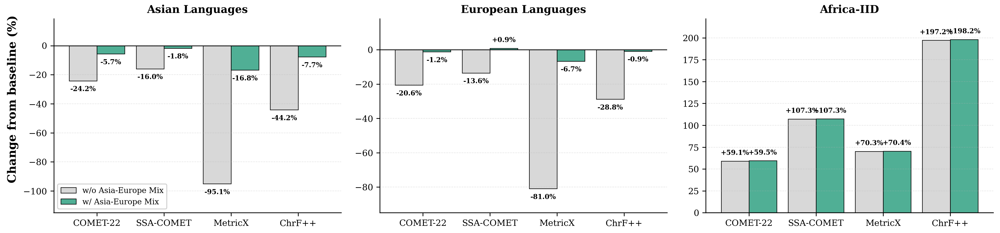

 Figure 10: Effect of the Asia-Europe Mix on catastrophic forgetting and Africa-IID performance. Bars show the percentage change from the Qwen3.5-2B baseline after SFT. The Asia-Europe Mix substantially reduces degradation on Asian and European language pairs while preserving nearly identical gains on the Africa-IID pairs.

## Appendix C Catastrophic Forgetting Analysis

We further analyze whether the Asia-Europe Mix mitigates catastrophic forgetting on non-African languages without compromising African language MT performance. The mix contains bidirectional parallel data between English and non-African languages, covering both Asian2626 26 Asian: sin, hin, ben, urd, fas, kaz, tur, zho, jpn, kor, vie, tha, ind, msa, fil. and European2727 27 European: fra, spa, ita, por, ron, ell, lit, lav, rus, ukr, pol, slk, hrv, ces, srp, bul, deu, swe, isl, dan, nld, hun, fin, est.  language groups.

Figure [10](https://arxiv.org/html/2608.18655v2#A2.F10 "Figure 10 ‣ Infrastructure. ‣ B.3 Training Hyperparameters ‣ Appendix B Additional Experimental Setup ‣ TranslatePsy-AfriSLM: High-Quality Data Scaling For Low-Resource Machine Translation") shows that fine-tuning without the Asia-Europe Mix substantially degrades performance on Asian and European language pairs, indicating catastrophic forgetting outside the African language training distribution. Adding the mix consistently reduces this degradation across all metrics and both language groups. For example, the MetricX-24 drop is reduced from \(-95.1\%\) to \(-16.8\%\) for Asian languages and from \(-81.0\%\) to \(-6.7\%\) for European languages. This retention does not come at the cost of Africa-IID performance: models with and without the Asia-Europe Mix achieve nearly identical gains on African language pairs across all metrics. We therefore retain the Asia-Europe Mix in the final TranslatePsy-AfriSLM recipe, not to improve African language MT directly, but to preserve broader multilingual translation while maintaining the gains on the Africa-IID group.

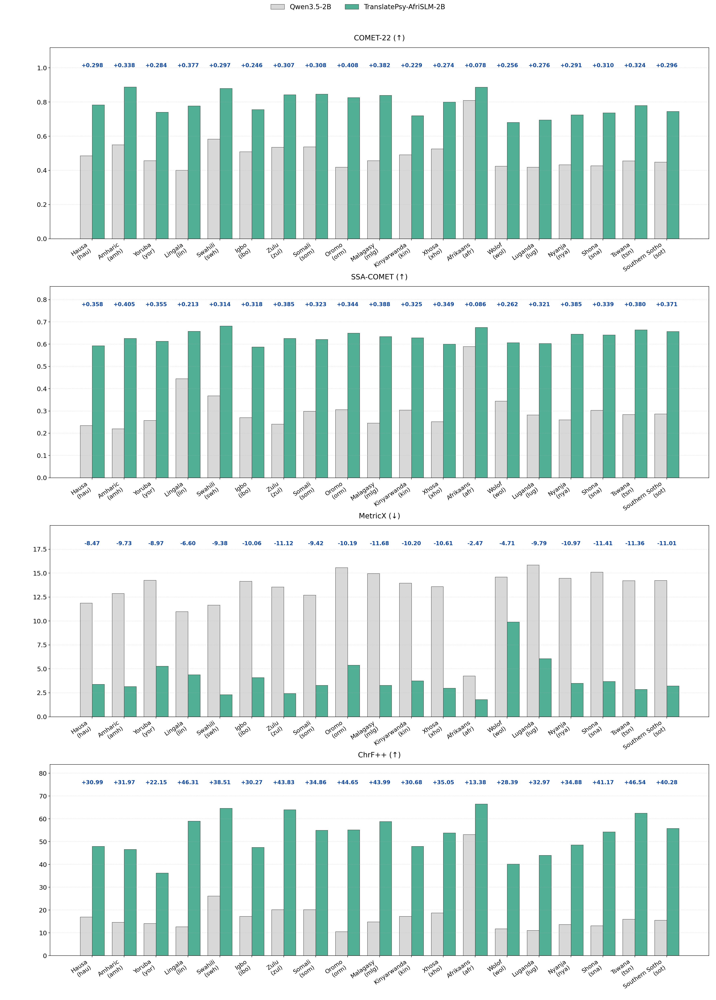

 Figure 11: AFRICA-IID BOUQuET results. Per-language scores for 19 target African languages on BOUQuET, comparing Qwen3.5-2B and TranslatePsy-AfriSLM-2B across four evaluation metrics. Scores are averaged over both translation directions where available. \(\Delta\) = TranslatePsy-AfriSLM-2B \(-\) baseline model scores.

## Appendix D Additional Results

AFRICA-OOD lang. | Flores-200 | BOUQuET | Smol  
---|---|---|---  
Nigerian Pidgin (pcm) |  | ✓ | ✓  
Sudanese Arabic (apd) |  |  | ✓  
Akan (aka) | ✓ | ✓ | ✓  
Tamazight (ber) | ✓ | ✓ | ✓  
Kituba (ktu) |  |  | ✓  
Bambara (bam) | ✓ | ✓ | ✓  
Sepedi (nso) | ✓ | ✓ | ✓  
Mooré (mos) | ✓ | ✓ | ✓  
# Langs. | 5 | 6 | 8  
# Directions | 10 | 12 | 16

 

Table 16: AFRICA-OOD language coverage by evaluation set. The number of directions counts both eng-to-xx and xx-to-eng directions.

Data Source | Configuration | Threshold | Tokens | Threshold | Tokens | Threshold | Tokens  
---|---|---|---|---|---|---|---  
Open-Source | threshold | -0.50 | 6.57B | 0.00 | 3.79B | 0.50 | 1.76B  
| threshold + top-\(N\) | -0.28 | 5.28B | 0.16 | 2.88B | 0.61 | 1.20B  
| threshold + bidirectional | -0.50 | 14.12B | 0.00 | 7.86B | 0.50 | 3.40B  
| threshold + top-\(N\) + bidirectional | -0.28 | 9.95B | 0.16 | 5.15B | 0.61 | 2.03B  
Synthetic | threshold | 0.68 | 16.75B | 0.93 | 7.28B | 1.19 | 2.80B  
| threshold + top-\(N\) | 0.71 | 12.43B | 0.93 | 4.49B | 1.18 | 1.44B  
| threshold + bidirectional | 0.68 | 32.37B | 0.93 | 15.05B | 1.19 | 6.16B  
| threshold + top-\(N\) + bidirectional | 0.71 | 23.62B | 0.93 | 9.09B | 1.18 | 3.32B  
Open-Source + Synthetic | threshold | 0.41 | 23.32B | 0.67 | 11.08B | 0.97 | 4.56B  
| threshold + top-\(N\) | 0.55 | 17.71B | 0.78 | 7.37B | 1.07 | 2.64B  
| threshold + bidirectional | 0.41 | 46.49B | 0.67 | 22.92B | 0.97 | 9.56B  
| threshold + top-\(N\) + bidirectional | 0.55 | 33.57B | 0.78 | 14.24B | 1.07 | 5.35B

 

Table 17: Threshold values and training token counts for each data source, configuration, and filtering level (for the datasets plotted in Figure [4](https://arxiv.org/html/2608.18655v2#S5.F4 "Figure 4 ‣ Aligned QE Is Best. ‣ 5.1 Quality Estimation: Which is Best? ‣ 5 Results and Analysis ‣ TranslatePsy-AfriSLM: High-Quality Data Scaling For Low-Resource Machine Translation")). Since the threshold may vary depending on the data mix and language direction, and topN changes the effective threshold, the value shown is an average weighted by the number of example pairs at each actual threshold. The bolded configuration indicates the TranslatePsy-AfriSLM data mix used for final training.

### D.1 Per-Language Performance Analysis

#### Africa-IID

Figure [11](https://arxiv.org/html/2608.18655v2#A3.F11 "Figure 11 ‣ Appendix C Catastrophic Forgetting Analysis ‣ TranslatePsy-AfriSLM: High-Quality Data Scaling For Low-Resource Machine Translation") shows per-language results on the Africa-IID BOUQuET benchmark, averaging scores over both eng-xx and xx-eng directions. TranslatePsy-AfriSLM-2B consistently improves over the Qwen3.5-2B baseline across the 19 in-distribution languages and all four evaluation metrics. The largest gains appear for low-baseline languages such as Oromo, Malagasy, Lingala, Tswana, and Zulu, while Afrikaans shows smaller gains due to its stronger baseline.

#### Africa-OOD

Figure [13](https://arxiv.org/html/2608.18655v2#A5.F13 "Figure 13 ‣ E.4 LLM-as-a-Judge Evaluation ‣ Appendix E Additional Evaluation and Robustness ‣ TranslatePsy-AfriSLM: High-Quality Data Scaling For Low-Resource Machine Translation") reports results for Africa-OOD languages held out from fine-tuning. Because Flores-200, BOUQuET, and Smol cover different subsets of OOD languages, scores are averaged over both directions and available evaluation sets, as summarized in Table [16](https://arxiv.org/html/2608.18655v2#A4.T16 "Table 16 ‣ Appendix D Additional Results ‣ TranslatePsy-AfriSLM: High-Quality Data Scaling For Low-Resource Machine Translation"). Although the OOD languages are held out from fine-tuning, TranslatePsy-AfriSLM-2B still improves overall performance, suggesting meaningful transfer beyond the languages seen during post-training. The strongest gains appear for Sepedi, Bambara, Akan, and Mooré, while improvements are smaller and more heterogeneous than in the IID setting, with some metric-specific regressions for Nigerian Pidgin, Sudanese Arabic, and Tamazight.

<table id="A4.T18.2.1" class="ltx_tabular ltx_align_middle">
<tr id="A4.T18.2.1.1" class="ltx_tr">
<td id="A4.T18.2.1.1.1" class="ltx_td ltx_align_left ltx_border_tt">Model</td>
<td id="A4.T18.2.1.1.2" class="ltx_td ltx_align_center ltx_border_tt">C22 (<math id="A4.T18.m1" class="ltx_Math" alttext="\uparrow" display="inline" intent=":literal"><semantics><mo stretchy="false">↑</mo><annotation encoding="application/x-tex">\uparrow</annotation></semantics></math>)</td>
<td id="A4.T18.2.1.1.3" class="ltx_td ltx_align_center ltx_border_tt">SSA (<math id="A4.T18.m2" class="ltx_Math" alttext="\uparrow" display="inline" intent=":literal"><semantics><mo stretchy="false">↑</mo><annotation encoding="application/x-tex">\uparrow</annotation></semantics></math>)</td>
<td id="A4.T18.2.1.1.4" class="ltx_td ltx_align_center ltx_border_tt">MX (<math id="A4.T18.m3" class="ltx_Math" alttext="\downarrow" display="inline" intent=":literal"><semantics><mo stretchy="false">↓</mo><annotation encoding="application/x-tex">\downarrow</annotation></semantics></math>)</td>
<td id="A4.T18.2.1.1.5" class="ltx_td ltx_align_center ltx_border_tt">chrF++ (<math id="A4.T18.m4" class="ltx_Math" alttext="\uparrow" display="inline" intent=":literal"><semantics><mo stretchy="false">↑</mo><annotation encoding="application/x-tex">\uparrow</annotation></semantics></math>)</td></tr>
<tr id="A4.T18.2.1.2" class="ltx_tr">
<td id="A4.T18.2.1.2.1" class="ltx_td ltx_align_center ltx_border_t" colspan="5">General-purpose LLMs</td></tr>
<tr id="A4.T18.2.1.3" class="ltx_tr">
<td id="A4.T18.2.1.3.1" class="ltx_td ltx_align_left ltx_border_t">Apertus-8B</td>
<td id="A4.T18.2.1.3.2" class="ltx_td ltx_align_center ltx_border_t">0.4624</td>
<td id="A4.T18.2.1.3.3" class="ltx_td ltx_align_center ltx_border_t">0.2737</td>
<td id="A4.T18.2.1.3.4" class="ltx_td ltx_align_center ltx_border_t">14.973</td>
<td id="A4.T18.2.1.3.5" class="ltx_td ltx_align_center ltx_border_t">11.141</td></tr>
<tr id="A4.T18.2.1.4" class="ltx_tr">
<td id="A4.T18.2.1.4.1" class="ltx_td ltx_align_left ltx_border_t">Qwen3.5-0.8B</td>
<td id="A4.T18.2.1.4.2" class="ltx_td ltx_align_center ltx_border_t">0.3716</td>
<td id="A4.T18.2.1.4.3" class="ltx_td ltx_align_center ltx_border_t">0.3089</td>
<td id="A4.T18.2.1.4.4" class="ltx_td ltx_align_center ltx_border_t">16.627</td>
<td id="A4.T18.2.1.4.5" class="ltx_td ltx_align_center ltx_border_t">5.285</td></tr>
<tr id="A4.T18.2.1.5" class="ltx_tr">
<td id="A4.T18.2.1.5.1" class="ltx_td ltx_align_left">Qwen3.5-2B</td>
<td id="A4.T18.2.1.5.2" class="ltx_td ltx_align_center">0.4086</td>
<td id="A4.T18.2.1.5.3" class="ltx_td ltx_align_center">0.2925</td>
<td id="A4.T18.2.1.5.4" class="ltx_td ltx_align_center">16.523</td>
<td id="A4.T18.2.1.5.5" class="ltx_td ltx_align_center">7.418</td></tr>
<tr id="A4.T18.2.1.6" class="ltx_tr">
<td id="A4.T18.2.1.6.1" class="ltx_td ltx_align_left">Qwen3.5-4B</td>
<td id="A4.T18.2.1.6.2" class="ltx_td ltx_align_center">0.4805</td>
<td id="A4.T18.2.1.6.3" class="ltx_td ltx_align_center">0.3079</td>
<td id="A4.T18.2.1.6.4" class="ltx_td ltx_align_center">15.035</td>
<td id="A4.T18.2.1.6.5" class="ltx_td ltx_align_center">10.871</td></tr>
<tr id="A4.T18.2.1.7" class="ltx_tr">
<td id="A4.T18.2.1.7.1" class="ltx_td ltx_align_left">Qwen3.5-27B</td>
<td id="A4.T18.2.1.7.2" class="ltx_td ltx_align_center">0.6883</td>
<td id="A4.T18.2.1.7.3" class="ltx_td ltx_align_center">0.4117</td>
<td id="A4.T18.2.1.7.4" class="ltx_td ltx_align_center">8.050</td>
<td id="A4.T18.2.1.7.5" class="ltx_td ltx_align_center">26.303</td></tr>
<tr id="A4.T18.2.1.8" class="ltx_tr">
<td id="A4.T18.2.1.8.1" class="ltx_td ltx_align_left">Qwen3.5-122B-A10B</td>
<td id="A4.T18.2.1.8.2" class="ltx_td ltx_align_center">0.7214</td>
<td id="A4.T18.2.1.8.3" class="ltx_td ltx_align_center">0.4602</td>
<td id="A4.T18.2.1.8.4" class="ltx_td ltx_align_center">6.525</td>
<td id="A4.T18.2.1.8.5" class="ltx_td ltx_align_center">29.842</td></tr>
<tr id="A4.T18.2.1.9" class="ltx_tr">
<td id="A4.T18.2.1.9.1" class="ltx_td ltx_align_center ltx_border_t" colspan="5">Dedicated translation models</td></tr>
<tr id="A4.T18.2.1.10" class="ltx_tr">
<td id="A4.T18.2.1.10.1" class="ltx_td ltx_align_left ltx_border_t">AfriNLLB-600M</td>
<td id="A4.T18.2.1.10.2" class="ltx_td ltx_align_center ltx_border_t">0.7683</td>
<td id="A4.T18.2.1.10.3" class="ltx_td ltx_align_center ltx_border_t">0.4974</td>
<td id="A4.T18.2.1.10.4" class="ltx_td ltx_align_center ltx_border_t">5.777</td>
<td id="A4.T18.2.1.10.5" class="ltx_td ltx_align_center ltx_border_t">34.715</td></tr>
<tr id="A4.T18.2.1.11" class="ltx_tr">
<td id="A4.T18.2.1.11.1" class="ltx_td ltx_align_left">NLLB-1.3B</td>
<td id="A4.T18.2.1.11.2" class="ltx_td ltx_align_center">0.7555</td>
<td id="A4.T18.2.1.11.3" class="ltx_td ltx_align_center">0.4821</td>
<td id="A4.T18.2.1.11.4" class="ltx_td ltx_align_center">6.299</td>
<td id="A4.T18.2.1.11.5" class="ltx_td ltx_align_center">32.758</td></tr>
<tr id="A4.T18.2.1.12" class="ltx_tr">
<td id="A4.T18.2.1.12.1" class="ltx_td ltx_align_left">NLLB-3.3B</td>
<td id="A4.T18.2.1.12.2" class="ltx_td ltx_align_center">0.7582</td>
<td id="A4.T18.2.1.12.3" class="ltx_td ltx_align_center">0.4907</td>
<td id="A4.T18.2.1.12.4" class="ltx_td ltx_align_center">5.987</td>
<td id="A4.T18.2.1.12.5" class="ltx_td ltx_align_center">33.317</td></tr>
<tr id="A4.T18.2.1.13" class="ltx_tr">
<td id="A4.T18.2.1.13.1" class="ltx_td ltx_align_left ltx_border_t">Hunyuan-MT-7B</td>
<td id="A4.T18.2.1.13.2" class="ltx_td ltx_align_center ltx_border_t">0.4187</td>
<td id="A4.T18.2.1.13.3" class="ltx_td ltx_align_center ltx_border_t">0.4163</td>
<td id="A4.T18.2.1.13.4" class="ltx_td ltx_align_center ltx_border_t">12.812</td>
<td id="A4.T18.2.1.13.5" class="ltx_td ltx_align_center ltx_border_t">9.077</td></tr>
<tr id="A4.T18.2.1.14" class="ltx_tr">
<td id="A4.T18.2.1.14.1" class="ltx_td ltx_align_left ltx_border_t">TranslateGemma-4B</td>
<td id="A4.T18.2.1.14.2" class="ltx_td ltx_align_center ltx_border_t">0.4691</td>
<td id="A4.T18.2.1.14.3" class="ltx_td ltx_align_center ltx_border_t">0.2650</td>
<td id="A4.T18.2.1.14.4" class="ltx_td ltx_align_center ltx_border_t">12.688</td>
<td id="A4.T18.2.1.14.5" class="ltx_td ltx_align_center ltx_border_t">10.384</td></tr>
<tr id="A4.T18.2.1.15" class="ltx_tr">
<td id="A4.T18.2.1.15.1" class="ltx_td ltx_align_left">TranslateGemma-27B</td>
<td id="A4.T18.2.1.15.2" class="ltx_td ltx_align_center">0.7590</td>
<td id="A4.T18.2.1.15.3" class="ltx_td ltx_align_center">0.4878</td>
<td id="A4.T18.2.1.15.4" class="ltx_td ltx_align_center">6.058</td>
<td id="A4.T18.2.1.15.5" class="ltx_td ltx_align_center">31.922</td></tr>
<tr id="A4.T18.2.1.16" class="ltx_tr">
<td id="A4.T18.2.1.16.1" class="ltx_td ltx_align_center ltx_border_t" colspan="5">African language-specialized models</td></tr>
<tr id="A4.T18.2.1.17" class="ltx_tr">
<td id="A4.T18.2.1.17.1" class="ltx_td ltx_align_left ltx_border_t">AfriqueLlama-8B</td>
<td id="A4.T18.2.1.17.2" class="ltx_td ltx_align_center ltx_border_t">0.7035</td>
<td id="A4.T18.2.1.17.3" class="ltx_td ltx_align_center ltx_border_t">0.4674</td>
<td id="A4.T18.2.1.17.4" class="ltx_td ltx_align_center ltx_border_t">6.315</td>
<td id="A4.T18.2.1.17.5" class="ltx_td ltx_align_center ltx_border_t">28.910</td></tr>
<tr id="A4.T18.2.1.18" class="ltx_tr">
<td id="A4.T18.2.1.18.1" class="ltx_td ltx_align_left">AfriqueGemma-12B</td>
<td id="A4.T18.2.1.18.2" class="ltx_td ltx_align_center">0.7317</td>
<td id="A4.T18.2.1.18.3" class="ltx_td ltx_align_center">0.5009</td>
<td id="A4.T18.2.1.18.4" class="ltx_td ltx_align_center">5.360</td>
<td id="A4.T18.2.1.18.5" class="ltx_td ltx_align_center">33.213</td></tr>
<tr id="A4.T18.2.1.19" class="ltx_tr">
<td id="A4.T18.2.1.19.1" class="ltx_td ltx_align_left">AfriqueQwen-14B</td>
<td id="A4.T18.2.1.19.2" class="ltx_td ltx_align_center">0.7278</td>
<td id="A4.T18.2.1.19.3" class="ltx_td ltx_align_center">0.4876</td>
<td id="A4.T18.2.1.19.4" class="ltx_td ltx_align_center">5.604</td>
<td id="A4.T18.2.1.19.5" class="ltx_td ltx_align_center">31.196</td></tr>
<tr id="A4.T18.2.1.20" class="ltx_tr">
<td id="A4.T18.2.1.20.1" class="ltx_td ltx_align_center ltx_border_t" colspan="5">Ours</td></tr>
<tr id="A4.T18.2.1.21" class="ltx_tr">
<td id="A4.T18.2.1.21.1" class="ltx_td ltx_align_left ltx_border_t">TranslatePsy-AfriSLM-0.8B</td>
<td id="A4.T18.2.1.21.2" class="ltx_td ltx_align_center ltx_border_t">0.7276</td>
<td id="A4.T18.2.1.21.3" class="ltx_td ltx_align_center ltx_border_t">0.4810</td>
<td id="A4.T18.2.1.21.4" class="ltx_td ltx_align_center ltx_border_t">6.990</td>
<td id="A4.T18.2.1.21.5" class="ltx_td ltx_align_center ltx_border_t">28.576</td></tr>
<tr id="A4.T18.2.1.22" class="ltx_tr">
<td id="A4.T18.2.1.22.1" class="ltx_td ltx_align_left">TranslatePsy-AfriSLM-2B</td>
<td id="A4.T18.2.1.22.2" class="ltx_td ltx_align_center">0.7694</td>
<td id="A4.T18.2.1.22.3" class="ltx_td ltx_align_center">0.5271</td>
<td id="A4.T18.2.1.22.4" class="ltx_td ltx_align_center">5.333</td>
<td id="A4.T18.2.1.22.5" class="ltx_td ltx_align_center">34.039</td></tr>
<tr id="A4.T18.2.1.23" class="ltx_tr">
<td id="A4.T18.2.1.23.1" class="ltx_td ltx_align_left ltx_border_bb">TranslatePsy-AfriSLM-4B</td>
<td id="A4.T18.2.1.23.2" class="ltx_td ltx_align_center ltx_border_bb">0.7855</td>
<td id="A4.T18.2.1.23.3" class="ltx_td ltx_align_center ltx_border_bb">0.5503</td>
<td id="A4.T18.2.1.23.4" class="ltx_td ltx_align_center ltx_border_bb">4.617</td>
<td id="A4.T18.2.1.23.5" class="ltx_td ltx_align_center ltx_border_bb">36.749</td></tr>
</table>

 

Table 18: African-to-African language translation results on BOUQuET, averaged over all 20 directions among the five highest-resource hub languages (swh, hau, yor, zul, amh). None of these xx\(\to\)yy directions appear in training (zero-shot). Best per column in bold.

src \(\downarrow\) / tgt \(\rightarrow\) | swh | hau | yor | zul | amh  
---|---|---|---|---|---  
swh | – | 0.5746 | 0.5994 | 0.6123 | 0.6096  
hau | 0.5856 | – | 0.5173 | 0.5090 | 0.5211  
yor | 0.5633 | 0.4483 | – | 0.4665 | 0.4896  
zul | 0.6346 | 0.5148 | 0.5457 | – | 0.5507  
amh | 0.6157 | 0.5192 | 0.5843 | 0.5450 | –

 

Table 19: Per-direction SSA-COMET (\(\uparrow\)) for TranslatePsy-AfriSLM-4B on BOUQuET African-to-African language translation. Rows are source, columns are target languages; the model is never trained on any xx\(\to\)yy pair.

### D.2 Zero-Shot African-to-African Translation

Our training data consists solely of English\(\leftrightarrow\)African language (en\(\leftrightarrow\)xx) synthetic pairs; thus, direct African-to-African language (xx\(\to\)yy) translation directions are never observed during training. We evaluate whether the improvements obtained from our training pipeline transfer to these unseen directions, an important but under-served translation setting.

We evaluate on BOUQuET over all 20 ordered directions (\(5\times 4\)) among five high-resource African hub languages: Swahili (swh), Hausa (hau), Yoruba (yor), Zulu (zul), and Amharic (amh). Table [18](https://arxiv.org/html/2608.18655v2#A4.T18 "Table 18 ‣ Africa-OOD ‣ D.1 Per-Language Performance Analysis ‣ Appendix D Additional Results ‣ TranslatePsy-AfriSLM: High-Quality Data Scaling For Low-Resource Machine Translation") reports results averaged across the 20 directions, while Table [19](https://arxiv.org/html/2608.18655v2#A4.T19 "Table 19 ‣ Africa-OOD ‣ D.1 Per-Language Performance Analysis ‣ Appendix D Additional Results ‣ TranslatePsy-AfriSLM: High-Quality Data Scaling For Low-Resource Machine Translation") provides the per-direction SSA-COMET scores for TranslatePsy-AfriSLM-4B.

Despite having no direct African-to-African language training pairs, TranslatePsy-AfriSLM-4B achieves the best aggregate performance on all four metrics, outperforming the strongest baselines across general-purpose LLMs, dedicated translation models, and African language-specialized models. These results suggest that the gains from our training pipeline transfer beyond the en\(\leftrightarrow\)xx directions seen during training to unseen African-to-African language translation directions.

<table id="A4.T20.2.1" class="ltx_tabular ltx_align_middle">
<tr id="A4.T20.2.1.1" class="ltx_tr">
<td id="A4.T20.2.1.1.1" class="ltx_td ltx_align_left ltx_border_tt">Model</td>
<td id="A4.T20.2.1.1.2" class="ltx_td ltx_align_left ltx_border_tt">Variant</td>
<td id="A4.T20.2.1.1.3" class="ltx_td ltx_align_center ltx_border_tt">COMET-22</td>
<td id="A4.T20.2.1.1.4" class="ltx_td ltx_align_center ltx_border_tt">SSA-COMET</td>
<td id="A4.T20.2.1.1.5" class="ltx_td ltx_align_center ltx_border_tt">MetricX<math id="A4.T20.m1" class="ltx_Math" alttext="\downarrow" display="inline" intent=":literal"><semantics><mo stretchy="false">↓</mo><annotation encoding="application/x-tex">\downarrow</annotation></semantics></math></td>
<td id="A4.T20.2.1.1.6" class="ltx_td ltx_nopad_r ltx_align_center ltx_border_tt">chrF++</td></tr>
<tr id="A4.T20.2.1.2" class="ltx_tr">
<td id="A4.T20.2.1.2.1" class="ltx_td ltx_align_left ltx_border_t" rowspan="3">Qwen3.5-27B</td>
<td id="A4.T20.2.1.2.2" class="ltx_td ltx_align_left ltx_border_t">Default</td>
<td id="A4.T20.2.1.2.3" class="ltx_td ltx_align_center ltx_border_t">78.0</td>
<td id="A4.T20.2.1.2.4" class="ltx_td ltx_align_center ltx_border_t">53.8</td>
<td id="A4.T20.2.1.2.5" class="ltx_td ltx_align_center ltx_border_t">5.52</td>
<td id="A4.T20.2.1.2.6" class="ltx_td ltx_nopad_r ltx_align_center ltx_border_t">44.7</td></tr>
<tr id="A4.T20.2.1.3" class="ltx_tr">
<td id="A4.T20.2.1.3.1" class="ltx_td ltx_align_left">Minimal</td>
<td id="A4.T20.2.1.3.2" class="ltx_td ltx_align_center">78.0</td>
<td id="A4.T20.2.1.3.3" class="ltx_td ltx_align_center">53.7</td>
<td id="A4.T20.2.1.3.4" class="ltx_td ltx_align_center">5.62</td>
<td id="A4.T20.2.1.3.5" class="ltx_td ltx_nopad_r ltx_align_center">45.6</td></tr>
<tr id="A4.T20.2.1.4" class="ltx_tr">
<td id="A4.T20.2.1.4.1" class="ltx_td ltx_align_left">Structured</td>
<td id="A4.T20.2.1.4.2" class="ltx_td ltx_align_center">78.1</td>
<td id="A4.T20.2.1.4.3" class="ltx_td ltx_align_center">53.8</td>
<td id="A4.T20.2.1.4.4" class="ltx_td ltx_align_center">5.53</td>
<td id="A4.T20.2.1.4.5" class="ltx_td ltx_nopad_r ltx_align_center">45.3</td></tr>
<tr id="A4.T20.2.1.5" class="ltx_tr">
<td id="A4.T20.2.1.5.1" class="ltx_td ltx_align_left ltx_border_bb ltx_border_t" rowspan="3">TranslateGemma-27B</td>
<td id="A4.T20.2.1.5.2" class="ltx_td ltx_align_left ltx_border_t">Official, greedy</td>
<td id="A4.T20.2.1.5.3" class="ltx_td ltx_align_center ltx_border_t">80.0</td>
<td id="A4.T20.2.1.5.4" class="ltx_td ltx_align_center ltx_border_t">57.5</td>
<td id="A4.T20.2.1.5.5" class="ltx_td ltx_align_center ltx_border_t">4.54</td>
<td id="A4.T20.2.1.5.6" class="ltx_td ltx_nopad_r ltx_align_center ltx_border_t">46.5</td></tr>
<tr id="A4.T20.2.1.6" class="ltx_tr">
<td id="A4.T20.2.1.6.1" class="ltx_td ltx_align_left">Official, sampling</td>
<td id="A4.T20.2.1.6.2" class="ltx_td ltx_align_center">79.8</td>
<td id="A4.T20.2.1.6.3" class="ltx_td ltx_align_center">56.9</td>
<td id="A4.T20.2.1.6.4" class="ltx_td ltx_align_center">4.68</td>
<td id="A4.T20.2.1.6.5" class="ltx_td ltx_nopad_r ltx_align_center">46.0</td></tr>
<tr id="A4.T20.2.1.7" class="ltx_tr">
<td id="A4.T20.2.1.7.1" class="ltx_td ltx_align_left ltx_border_bb">Generic, no chat template</td>
<td id="A4.T20.2.1.7.2" class="ltx_td ltx_align_center ltx_border_bb">80.0</td>
<td id="A4.T20.2.1.7.3" class="ltx_td ltx_align_center ltx_border_bb">57.6</td>
<td id="A4.T20.2.1.7.4" class="ltx_td ltx_align_center ltx_border_bb">4.49</td>
<td id="A4.T20.2.1.7.5" class="ltx_td ltx_nopad_r ltx_align_center ltx_border_bb">47.4</td></tr>
</table>

 

Table 20: Sensitivity to prompt/decoding variants on 10 Flores-200 SSA pairs. Main-table ordering is unchanged across all settings. 

<table id="A4.T21.2" class="ltx_tabular ltx_centering ltx_align_middle">
<tr id="A4.T21.2.1" class="ltx_tr">
<td id="A4.T21.2.1.1" class="ltx_td ltx_align_left ltx_border_tt">Quality estimator</td>
<td id="A4.T21.2.1.2" class="ltx_td ltx_align_center ltx_border_tt">C22</td>
<td id="A4.T21.2.1.3" class="ltx_td ltx_align_center ltx_border_tt">SSA</td>
<td id="A4.T21.2.1.4" class="ltx_td ltx_align_center ltx_border_tt">MX</td>
<td id="A4.T21.2.1.5" class="ltx_td ltx_align_center ltx_border_tt">chrF++</td></tr>
<tr id="A4.T21.2.2" class="ltx_tr">
<td id="A4.T21.2.2.1" class="ltx_td ltx_align_center ltx_border_t" colspan="5">Results on BOUQuET test set.</td></tr>
<tr id="A4.T21.2.3" class="ltx_tr">
<td id="A4.T21.2.3.1" class="ltx_td ltx_align_left ltx_border_t">Random</td>
<td id="A4.T21.2.3.2" class="ltx_td ltx_align_center ltx_border_t">0.761</td>
<td id="A4.T21.2.3.3" class="ltx_td ltx_align_center ltx_border_t">0.624</td>
<td id="A4.T21.2.3.4" class="ltx_td ltx_align_center ltx_border_t">4.21</td>
<td id="A4.T21.2.3.5" class="ltx_td ltx_align_center ltx_border_t">50.0</td></tr>
<tr id="A4.T21.2.4" class="ltx_tr">
<td id="A4.T21.2.4.1" class="ltx_td ltx_align_left">z-score</td>
<td id="A4.T21.2.4.2" class="ltx_td ltx_align_center">0.765</td>
<td id="A4.T21.2.4.3" class="ltx_td ltx_align_center">0.643</td>
<td id="A4.T21.2.4.4" class="ltx_td ltx_align_center">3.80</td>
<td id="A4.T21.2.4.5" class="ltx_td ltx_align_center">50.1</td></tr>
<tr id="A4.T21.2.5" class="ltx_tr">
<td id="A4.T21.2.5.1" class="ltx_td ltx_align_left">SSA-COMET</td>
<td id="A4.T21.2.5.2" class="ltx_td ltx_align_center">0.766</td>
<td id="A4.T21.2.5.3" class="ltx_td ltx_align_center">0.647</td>
<td id="A4.T21.2.5.4" class="ltx_td ltx_align_center">3.96</td>
<td id="A4.T21.2.5.5" class="ltx_td ltx_align_center">50.5</td></tr>
<tr id="A4.T21.2.6" class="ltx_tr">
<td id="A4.T21.2.6.1" class="ltx_td ltx_align_left">AfriCOMET</td>
<td id="A4.T21.2.6.2" class="ltx_td ltx_align_center">0.763</td>
<td id="A4.T21.2.6.3" class="ltx_td ltx_align_center">0.637</td>
<td id="A4.T21.2.6.4" class="ltx_td ltx_align_center">4.03</td>
<td id="A4.T21.2.6.5" class="ltx_td ltx_align_center">49.8</td></tr>
<tr id="A4.T21.2.7" class="ltx_tr">
<td id="A4.T21.2.7.1" class="ltx_td ltx_align_left">MetricX</td>
<td id="A4.T21.2.7.2" class="ltx_td ltx_align_center">0.760</td>
<td id="A4.T21.2.7.3" class="ltx_td ltx_align_center">0.632</td>
<td id="A4.T21.2.7.4" class="ltx_td ltx_align_center">3.62</td>
<td id="A4.T21.2.7.5" class="ltx_td ltx_align_center">49.6</td></tr>
<tr id="A4.T21.2.8" class="ltx_tr">
<td id="A4.T21.2.8.1" class="ltx_td ltx_align_center ltx_border_t" colspan="5">Results on Flores-200 test set.</td></tr>
<tr id="A4.T21.2.9" class="ltx_tr">
<td id="A4.T21.2.9.1" class="ltx_td ltx_align_left ltx_border_t">Random</td>
<td id="A4.T21.2.9.2" class="ltx_td ltx_align_center ltx_border_t">0.727</td>
<td id="A4.T21.2.9.3" class="ltx_td ltx_align_center ltx_border_t">0.590</td>
<td id="A4.T21.2.9.4" class="ltx_td ltx_align_center ltx_border_t">5.22</td>
<td id="A4.T21.2.9.5" class="ltx_td ltx_align_center ltx_border_t">45.1</td></tr>
<tr id="A4.T21.2.10" class="ltx_tr">
<td id="A4.T21.2.10.1" class="ltx_td ltx_align_left">z-score</td>
<td id="A4.T21.2.10.2" class="ltx_td ltx_align_center">0.737</td>
<td id="A4.T21.2.10.3" class="ltx_td ltx_align_center">0.617</td>
<td id="A4.T21.2.10.4" class="ltx_td ltx_align_center">4.52</td>
<td id="A4.T21.2.10.5" class="ltx_td ltx_align_center">45.7</td></tr>
<tr id="A4.T21.2.11" class="ltx_tr">
<td id="A4.T21.2.11.1" class="ltx_td ltx_align_left">SSA-COMET</td>
<td id="A4.T21.2.11.2" class="ltx_td ltx_align_center">0.736</td>
<td id="A4.T21.2.11.3" class="ltx_td ltx_align_center">0.620</td>
<td id="A4.T21.2.11.4" class="ltx_td ltx_align_center">4.73</td>
<td id="A4.T21.2.11.5" class="ltx_td ltx_align_center">45.9</td></tr>
<tr id="A4.T21.2.12" class="ltx_tr">
<td id="A4.T21.2.12.1" class="ltx_td ltx_align_left">AfriCOMET</td>
<td id="A4.T21.2.12.2" class="ltx_td ltx_align_center">0.735</td>
<td id="A4.T21.2.12.3" class="ltx_td ltx_align_center">0.609</td>
<td id="A4.T21.2.12.4" class="ltx_td ltx_align_center">4.87</td>
<td id="A4.T21.2.12.5" class="ltx_td ltx_align_center">45.3</td></tr>
<tr id="A4.T21.2.13" class="ltx_tr">
<td id="A4.T21.2.13.1" class="ltx_td ltx_align_left">MetricX</td>
<td id="A4.T21.2.13.2" class="ltx_td ltx_align_center">0.730</td>
<td id="A4.T21.2.13.3" class="ltx_td ltx_align_center">0.605</td>
<td id="A4.T21.2.13.4" class="ltx_td ltx_align_center">4.29</td>
<td id="A4.T21.2.13.5" class="ltx_td ltx_align_center">45.2</td></tr>
<tr id="A4.T21.2.14" class="ltx_tr">
<td id="A4.T21.2.14.1" class="ltx_td ltx_align_center ltx_border_t" colspan="5">Results on Smol test set.</td></tr>
<tr id="A4.T21.2.15" class="ltx_tr">
<td id="A4.T21.2.15.1" class="ltx_td ltx_align_left ltx_border_t">Random</td>
<td id="A4.T21.2.15.2" class="ltx_td ltx_align_center ltx_border_t">0.646</td>
<td id="A4.T21.2.15.3" class="ltx_td ltx_align_center ltx_border_t">0.476</td>
<td id="A4.T21.2.15.4" class="ltx_td ltx_align_center ltx_border_t">9.59</td>
<td id="A4.T21.2.15.5" class="ltx_td ltx_align_center ltx_border_t">27.8</td></tr>
<tr id="A4.T21.2.16" class="ltx_tr">
<td id="A4.T21.2.16.1" class="ltx_td ltx_align_left">z-score</td>
<td id="A4.T21.2.16.2" class="ltx_td ltx_align_center">0.655</td>
<td id="A4.T21.2.16.3" class="ltx_td ltx_align_center">0.503</td>
<td id="A4.T21.2.16.4" class="ltx_td ltx_align_center">8.88</td>
<td id="A4.T21.2.16.5" class="ltx_td ltx_align_center">28.0</td></tr>
<tr id="A4.T21.2.17" class="ltx_tr">
<td id="A4.T21.2.17.1" class="ltx_td ltx_align_left">SSA-COMET</td>
<td id="A4.T21.2.17.2" class="ltx_td ltx_align_center">0.652</td>
<td id="A4.T21.2.17.3" class="ltx_td ltx_align_center">0.505</td>
<td id="A4.T21.2.17.4" class="ltx_td ltx_align_center">9.22</td>
<td id="A4.T21.2.17.5" class="ltx_td ltx_align_center">28.0</td></tr>
<tr id="A4.T21.2.18" class="ltx_tr">
<td id="A4.T21.2.18.1" class="ltx_td ltx_align_left">AfriCOMET</td>
<td id="A4.T21.2.18.2" class="ltx_td ltx_align_center">0.653</td>
<td id="A4.T21.2.18.3" class="ltx_td ltx_align_center">0.495</td>
<td id="A4.T21.2.18.4" class="ltx_td ltx_align_center">9.26</td>
<td id="A4.T21.2.18.5" class="ltx_td ltx_align_center">27.8</td></tr>
<tr id="A4.T21.2.19" class="ltx_tr">
<td id="A4.T21.2.19.1" class="ltx_td ltx_align_left ltx_border_bb">MetricX</td>
<td id="A4.T21.2.19.2" class="ltx_td ltx_align_center ltx_border_bb">0.650</td>
<td id="A4.T21.2.19.3" class="ltx_td ltx_align_center ltx_border_bb">0.491</td>
<td id="A4.T21.2.19.4" class="ltx_td ltx_align_center ltx_border_bb">8.58</td>
<td id="A4.T21.2.19.5" class="ltx_td ltx_align_center ltx_border_bb">27.9</td></tr>
</table>

 Table 21: Translation quality with individual versus unified QE for English–African language translation.

<table id="A4.T22.2.1" class="ltx_tabular ltx_align_middle">
<tr id="A4.T22.2.1.1" class="ltx_tr">
<td id="A4.T22.2.1.1.1" class="ltx_td ltx_border_tt"></td>
<td id="A4.T22.2.1.1.2" class="ltx_td ltx_align_center ltx_border_tt" colspan="2">C22</td>
<td id="A4.T22.2.1.1.3" class="ltx_td ltx_align_center ltx_border_tt" colspan="2">SSA</td>
<td id="A4.T22.2.1.1.4" class="ltx_td ltx_align_center ltx_border_tt" colspan="2">MX</td>
<td id="A4.T22.2.1.1.5" class="ltx_td ltx_align_center ltx_border_tt" colspan="2">chrF++</td></tr>
<tr id="A4.T22.2.1.2" class="ltx_tr">
<td id="A4.T22.2.1.2.1" class="ltx_td ltx_align_left">

Comparison
(<math id="A4.T22.m1" class="ltx_Math" alttext="\bar{z}" display="inline" intent=":literal"><semantics><mover accent="true"><mi>z</mi><mo>¯</mo></mover><annotation encoding="application/x-tex">\bar{z}</annotation></semantics></math> vs. metric)
</td>
<td id="A4.T22.2.1.2.2" class="ltx_td ltx_align_center ltx_border_t"><math id="A4.T22.m2" class="ltx_Math" alttext="\Delta" display="inline" intent=":literal"><semantics><mi mathvariant="normal">Δ</mi><annotation encoding="application/x-tex">\Delta</annotation></semantics></math></td>
<td id="A4.T22.2.1.2.3" class="ltx_td ltx_align_center ltx_border_t"><math id="A4.T22.m3" class="ltx_Math" alttext="p" display="inline" intent=":literal"><semantics><mi>p</mi><annotation encoding="application/x-tex">p</annotation></semantics></math></td>
<td id="A4.T22.2.1.2.4" class="ltx_td ltx_align_center ltx_border_t"><math id="A4.T22.m4" class="ltx_Math" alttext="\Delta" display="inline" intent=":literal"><semantics><mi mathvariant="normal">Δ</mi><annotation encoding="application/x-tex">\Delta</annotation></semantics></math></td>
<td id="A4.T22.2.1.2.5" class="ltx_td ltx_align_center ltx_border_t"><math id="A4.T22.m5" class="ltx_Math" alttext="p" display="inline" intent=":literal"><semantics><mi>p</mi><annotation encoding="application/x-tex">p</annotation></semantics></math></td>
<td id="A4.T22.2.1.2.6" class="ltx_td ltx_align_center ltx_border_t"><math id="A4.T22.m6" class="ltx_Math" alttext="\Delta" display="inline" intent=":literal"><semantics><mi mathvariant="normal">Δ</mi><annotation encoding="application/x-tex">\Delta</annotation></semantics></math></td>
<td id="A4.T22.2.1.2.7" class="ltx_td ltx_align_center ltx_border_t"><math id="A4.T22.m7" class="ltx_Math" alttext="p" display="inline" intent=":literal"><semantics><mi>p</mi><annotation encoding="application/x-tex">p</annotation></semantics></math></td>
<td id="A4.T22.2.1.2.8" class="ltx_td ltx_align_center ltx_border_t"><math id="A4.T22.m8" class="ltx_Math" alttext="\Delta" display="inline" intent=":literal"><semantics><mi mathvariant="normal">Δ</mi><annotation encoding="application/x-tex">\Delta</annotation></semantics></math></td>
<td id="A4.T22.2.1.2.9" class="ltx_td ltx_align_center ltx_border_t"><math id="A4.T22.m9" class="ltx_Math" alttext="p" display="inline" intent=":literal"><semantics><mi>p</mi><annotation encoding="application/x-tex">p</annotation></semantics></math></td></tr>
<tr id="A4.T22.2.1.3" class="ltx_tr">
<td id="A4.T22.2.1.3.1" class="ltx_td ltx_align_center ltx_border_t" colspan="9">BOUQuET</td></tr>
<tr id="A4.T22.2.1.4" class="ltx_tr">
<td id="A4.T22.2.1.4.1" class="ltx_td ltx_align_left ltx_border_t"><math id="A4.T22.m10" class="ltx_Math" alttext="\bar{z}" display="inline" intent=":literal"><semantics><mover accent="true"><mi>z</mi><mo>¯</mo></mover><annotation encoding="application/x-tex">\bar{z}</annotation></semantics></math> vs. SSA-COMET</td>
<td id="A4.T22.2.1.4.2" class="ltx_td ltx_align_center ltx_border_t">-0.001</td>
<td id="A4.T22.2.1.4.3" class="ltx_td ltx_align_center ltx_border_t">0.004</td>
<td id="A4.T22.2.1.4.4" class="ltx_td ltx_align_center ltx_border_t">-0.004</td>
<td id="A4.T22.2.1.4.5" class="ltx_td ltx_align_center ltx_border_t"><math id="A4.T22.m11" class="ltx_Math" alttext="&lt;" display="inline" intent=":literal"><semantics><mo>&lt;</mo><annotation encoding="application/x-tex">&lt;</annotation></semantics></math>0.001</td>
<td id="A4.T22.2.1.4.6" class="ltx_td ltx_align_center ltx_border_t">-0.16</td>
<td id="A4.T22.2.1.4.7" class="ltx_td ltx_align_center ltx_border_t"><math id="A4.T22.m12" class="ltx_Math" alttext="&lt;" display="inline" intent=":literal"><semantics><mo>&lt;</mo><annotation encoding="application/x-tex">&lt;</annotation></semantics></math>0.001</td>
<td id="A4.T22.2.1.4.8" class="ltx_td ltx_align_center ltx_border_t">-0.5</td>
<td id="A4.T22.2.1.4.9" class="ltx_td ltx_align_center ltx_border_t"><math id="A4.T22.m13" class="ltx_Math" alttext="&lt;" display="inline" intent=":literal"><semantics><mo>&lt;</mo><annotation encoding="application/x-tex">&lt;</annotation></semantics></math>0.001</td></tr>
<tr id="A4.T22.2.1.5" class="ltx_tr">
<td id="A4.T22.2.1.5.1" class="ltx_td ltx_align_left"><math id="A4.T22.m14" class="ltx_Math" alttext="\bar{z}" display="inline" intent=":literal"><semantics><mover accent="true"><mi>z</mi><mo>¯</mo></mover><annotation encoding="application/x-tex">\bar{z}</annotation></semantics></math> vs. AfriCOMET</td>
<td id="A4.T22.2.1.5.2" class="ltx_td ltx_align_center">+0.002</td>
<td id="A4.T22.2.1.5.3" class="ltx_td ltx_align_center"><math id="A4.T22.m15" class="ltx_Math" alttext="&lt;" display="inline" intent=":literal"><semantics><mo>&lt;</mo><annotation encoding="application/x-tex">&lt;</annotation></semantics></math>0.001</td>
<td id="A4.T22.2.1.5.4" class="ltx_td ltx_align_center">+0.006</td>
<td id="A4.T22.2.1.5.5" class="ltx_td ltx_align_center"><math id="A4.T22.m16" class="ltx_Math" alttext="&lt;" display="inline" intent=":literal"><semantics><mo>&lt;</mo><annotation encoding="application/x-tex">&lt;</annotation></semantics></math>0.001</td>
<td id="A4.T22.2.1.5.6" class="ltx_td ltx_align_center">-0.22</td>
<td id="A4.T22.2.1.5.7" class="ltx_td ltx_align_center"><math id="A4.T22.m17" class="ltx_Math" alttext="&lt;" display="inline" intent=":literal"><semantics><mo>&lt;</mo><annotation encoding="application/x-tex">&lt;</annotation></semantics></math>0.001</td>
<td id="A4.T22.2.1.5.8" class="ltx_td ltx_align_center">+0.3</td>
<td id="A4.T22.2.1.5.9" class="ltx_td ltx_align_center"><math id="A4.T22.m18" class="ltx_Math" alttext="&lt;" display="inline" intent=":literal"><semantics><mo>&lt;</mo><annotation encoding="application/x-tex">&lt;</annotation></semantics></math>0.001</td></tr>
<tr id="A4.T22.2.1.6" class="ltx_tr">
<td id="A4.T22.2.1.6.1" class="ltx_td ltx_align_left"><math id="A4.T22.m19" class="ltx_Math" alttext="\bar{z}" display="inline" intent=":literal"><semantics><mover accent="true"><mi>z</mi><mo>¯</mo></mover><annotation encoding="application/x-tex">\bar{z}</annotation></semantics></math> vs. MetricX</td>
<td id="A4.T22.2.1.6.2" class="ltx_td ltx_align_center">+0.005</td>
<td id="A4.T22.2.1.6.3" class="ltx_td ltx_align_center"><math id="A4.T22.m20" class="ltx_Math" alttext="&lt;" display="inline" intent=":literal"><semantics><mo>&lt;</mo><annotation encoding="application/x-tex">&lt;</annotation></semantics></math>0.001</td>
<td id="A4.T22.2.1.6.4" class="ltx_td ltx_align_center">+0.011</td>
<td id="A4.T22.2.1.6.5" class="ltx_td ltx_align_center"><math id="A4.T22.m21" class="ltx_Math" alttext="&lt;" display="inline" intent=":literal"><semantics><mo>&lt;</mo><annotation encoding="application/x-tex">&lt;</annotation></semantics></math>0.001</td>
<td id="A4.T22.2.1.6.6" class="ltx_td ltx_align_center">+0.19</td>
<td id="A4.T22.2.1.6.7" class="ltx_td ltx_align_center"><math id="A4.T22.m22" class="ltx_Math" alttext="&lt;" display="inline" intent=":literal"><semantics><mo>&lt;</mo><annotation encoding="application/x-tex">&lt;</annotation></semantics></math>0.001</td>
<td id="A4.T22.2.1.6.8" class="ltx_td ltx_align_center">+0.4</td>
<td id="A4.T22.2.1.6.9" class="ltx_td ltx_align_center"><math id="A4.T22.m23" class="ltx_Math" alttext="&lt;" display="inline" intent=":literal"><semantics><mo>&lt;</mo><annotation encoding="application/x-tex">&lt;</annotation></semantics></math>0.001</td></tr>
<tr id="A4.T22.2.1.7" class="ltx_tr">
<td id="A4.T22.2.1.7.1" class="ltx_td ltx_align_center ltx_border_t" colspan="9">Flores-200</td></tr>
<tr id="A4.T22.2.1.8" class="ltx_tr">
<td id="A4.T22.2.1.8.1" class="ltx_td ltx_align_left ltx_border_t"><math id="A4.T22.m24" class="ltx_Math" alttext="\bar{z}" display="inline" intent=":literal"><semantics><mover accent="true"><mi>z</mi><mo>¯</mo></mover><annotation encoding="application/x-tex">\bar{z}</annotation></semantics></math> vs. SSA-COMET</td>
<td id="A4.T22.2.1.8.2" class="ltx_td ltx_align_center ltx_border_t">0.000</td>
<td id="A4.T22.2.1.8.3" class="ltx_td ltx_align_center ltx_border_t">0.113</td>
<td id="A4.T22.2.1.8.4" class="ltx_td ltx_align_center ltx_border_t">-0.003</td>
<td id="A4.T22.2.1.8.5" class="ltx_td ltx_align_center ltx_border_t"><math id="A4.T22.m25" class="ltx_Math" alttext="&lt;" display="inline" intent=":literal"><semantics><mo>&lt;</mo><annotation encoding="application/x-tex">&lt;</annotation></semantics></math>0.001</td>
<td id="A4.T22.2.1.8.6" class="ltx_td ltx_align_center ltx_border_t">-0.22</td>
<td id="A4.T22.2.1.8.7" class="ltx_td ltx_align_center ltx_border_t"><math id="A4.T22.m26" class="ltx_Math" alttext="&lt;" display="inline" intent=":literal"><semantics><mo>&lt;</mo><annotation encoding="application/x-tex">&lt;</annotation></semantics></math>0.001</td>
<td id="A4.T22.2.1.8.8" class="ltx_td ltx_align_center ltx_border_t">-0.2</td>
<td id="A4.T22.2.1.8.9" class="ltx_td ltx_align_center ltx_border_t"><math id="A4.T22.m27" class="ltx_Math" alttext="&lt;" display="inline" intent=":literal"><semantics><mo>&lt;</mo><annotation encoding="application/x-tex">&lt;</annotation></semantics></math>0.001</td></tr>
<tr id="A4.T22.2.1.9" class="ltx_tr">
<td id="A4.T22.2.1.9.1" class="ltx_td ltx_align_left"><math id="A4.T22.m28" class="ltx_Math" alttext="\bar{z}" display="inline" intent=":literal"><semantics><mover accent="true"><mi>z</mi><mo>¯</mo></mover><annotation encoding="application/x-tex">\bar{z}</annotation></semantics></math> vs. AfriCOMET</td>
<td id="A4.T22.2.1.9.2" class="ltx_td ltx_align_center">+0.002</td>
<td id="A4.T22.2.1.9.3" class="ltx_td ltx_align_center"><math id="A4.T22.m29" class="ltx_Math" alttext="&lt;" display="inline" intent=":literal"><semantics><mo>&lt;</mo><annotation encoding="application/x-tex">&lt;</annotation></semantics></math>0.001</td>
<td id="A4.T22.2.1.9.4" class="ltx_td ltx_align_center">+0.008</td>
<td id="A4.T22.2.1.9.5" class="ltx_td ltx_align_center"><math id="A4.T22.m30" class="ltx_Math" alttext="&lt;" display="inline" intent=":literal"><semantics><mo>&lt;</mo><annotation encoding="application/x-tex">&lt;</annotation></semantics></math>0.001</td>
<td id="A4.T22.2.1.9.6" class="ltx_td ltx_align_center">-0.36</td>
<td id="A4.T22.2.1.9.7" class="ltx_td ltx_align_center"><math id="A4.T22.m31" class="ltx_Math" alttext="&lt;" display="inline" intent=":literal"><semantics><mo>&lt;</mo><annotation encoding="application/x-tex">&lt;</annotation></semantics></math>0.001</td>
<td id="A4.T22.2.1.9.8" class="ltx_td ltx_align_center">+0.4</td>
<td id="A4.T22.2.1.9.9" class="ltx_td ltx_align_center"><math id="A4.T22.m32" class="ltx_Math" alttext="&lt;" display="inline" intent=":literal"><semantics><mo>&lt;</mo><annotation encoding="application/x-tex">&lt;</annotation></semantics></math>0.001</td></tr>
<tr id="A4.T22.2.1.10" class="ltx_tr">
<td id="A4.T22.2.1.10.1" class="ltx_td ltx_align_left"><math id="A4.T22.m33" class="ltx_Math" alttext="\bar{z}" display="inline" intent=":literal"><semantics><mover accent="true"><mi>z</mi><mo>¯</mo></mover><annotation encoding="application/x-tex">\bar{z}</annotation></semantics></math> vs. MetricX</td>
<td id="A4.T22.2.1.10.2" class="ltx_td ltx_align_center">+0.006</td>
<td id="A4.T22.2.1.10.3" class="ltx_td ltx_align_center"><math id="A4.T22.m34" class="ltx_Math" alttext="&lt;" display="inline" intent=":literal"><semantics><mo>&lt;</mo><annotation encoding="application/x-tex">&lt;</annotation></semantics></math>0.001</td>
<td id="A4.T22.2.1.10.4" class="ltx_td ltx_align_center">+0.013</td>
<td id="A4.T22.2.1.10.5" class="ltx_td ltx_align_center"><math id="A4.T22.m35" class="ltx_Math" alttext="&lt;" display="inline" intent=":literal"><semantics><mo>&lt;</mo><annotation encoding="application/x-tex">&lt;</annotation></semantics></math>0.001</td>
<td id="A4.T22.2.1.10.6" class="ltx_td ltx_align_center">+0.23</td>
<td id="A4.T22.2.1.10.7" class="ltx_td ltx_align_center"><math id="A4.T22.m36" class="ltx_Math" alttext="&lt;" display="inline" intent=":literal"><semantics><mo>&lt;</mo><annotation encoding="application/x-tex">&lt;</annotation></semantics></math>0.001</td>
<td id="A4.T22.2.1.10.8" class="ltx_td ltx_align_center">+0.4</td>
<td id="A4.T22.2.1.10.9" class="ltx_td ltx_align_center"><math id="A4.T22.m37" class="ltx_Math" alttext="&lt;" display="inline" intent=":literal"><semantics><mo>&lt;</mo><annotation encoding="application/x-tex">&lt;</annotation></semantics></math>0.001</td></tr>
<tr id="A4.T22.2.1.11" class="ltx_tr">
<td id="A4.T22.2.1.11.1" class="ltx_td ltx_align_center ltx_border_t" colspan="9">Smol</td></tr>
<tr id="A4.T22.2.1.12" class="ltx_tr">
<td id="A4.T22.2.1.12.1" class="ltx_td ltx_align_left ltx_border_t"><math id="A4.T22.m38" class="ltx_Math" alttext="\bar{z}" display="inline" intent=":literal"><semantics><mover accent="true"><mi>z</mi><mo>¯</mo></mover><annotation encoding="application/x-tex">\bar{z}</annotation></semantics></math> vs. SSA-COMET</td>
<td id="A4.T22.2.1.12.2" class="ltx_td ltx_align_center ltx_border_t">+0.003</td>
<td id="A4.T22.2.1.12.3" class="ltx_td ltx_align_center ltx_border_t"><math id="A4.T22.m39" class="ltx_Math" alttext="&lt;" display="inline" intent=":literal"><semantics><mo>&lt;</mo><annotation encoding="application/x-tex">&lt;</annotation></semantics></math>0.001</td>
<td id="A4.T22.2.1.12.4" class="ltx_td ltx_align_center ltx_border_t">-0.002</td>
<td id="A4.T22.2.1.12.5" class="ltx_td ltx_align_center ltx_border_t"><math id="A4.T22.m40" class="ltx_Math" alttext="&lt;" display="inline" intent=":literal"><semantics><mo>&lt;</mo><annotation encoding="application/x-tex">&lt;</annotation></semantics></math>0.001</td>
<td id="A4.T22.2.1.12.6" class="ltx_td ltx_align_center ltx_border_t">-0.34</td>
<td id="A4.T22.2.1.12.7" class="ltx_td ltx_align_center ltx_border_t"><math id="A4.T22.m41" class="ltx_Math" alttext="&lt;" display="inline" intent=":literal"><semantics><mo>&lt;</mo><annotation encoding="application/x-tex">&lt;</annotation></semantics></math>0.001</td>
<td id="A4.T22.2.1.12.8" class="ltx_td ltx_align_center ltx_border_t">0.0</td>
<td id="A4.T22.2.1.12.9" class="ltx_td ltx_align_center ltx_border_t">0.348</td></tr>
<tr id="A4.T22.2.1.13" class="ltx_tr">
<td id="A4.T22.2.1.13.1" class="ltx_td ltx_align_left"><math id="A4.T22.m42" class="ltx_Math" alttext="\bar{z}" display="inline" intent=":literal"><semantics><mover accent="true"><mi>z</mi><mo>¯</mo></mover><annotation encoding="application/x-tex">\bar{z}</annotation></semantics></math> vs. AfriCOMET</td>
<td id="A4.T22.2.1.13.2" class="ltx_td ltx_align_center">+0.001</td>
<td id="A4.T22.2.1.13.3" class="ltx_td ltx_align_center">0.005</td>
<td id="A4.T22.2.1.13.4" class="ltx_td ltx_align_center">+0.009</td>
<td id="A4.T22.2.1.13.5" class="ltx_td ltx_align_center"><math id="A4.T22.m43" class="ltx_Math" alttext="&lt;" display="inline" intent=":literal"><semantics><mo>&lt;</mo><annotation encoding="application/x-tex">&lt;</annotation></semantics></math>0.001</td>
<td id="A4.T22.2.1.13.6" class="ltx_td ltx_align_center">-0.37</td>
<td id="A4.T22.2.1.13.7" class="ltx_td ltx_align_center"><math id="A4.T22.m44" class="ltx_Math" alttext="&lt;" display="inline" intent=":literal"><semantics><mo>&lt;</mo><annotation encoding="application/x-tex">&lt;</annotation></semantics></math>0.001</td>
<td id="A4.T22.2.1.13.8" class="ltx_td ltx_align_center">+0.1</td>
<td id="A4.T22.2.1.13.9" class="ltx_td ltx_align_center"><math id="A4.T22.m45" class="ltx_Math" alttext="&lt;" display="inline" intent=":literal"><semantics><mo>&lt;</mo><annotation encoding="application/x-tex">&lt;</annotation></semantics></math>0.001</td></tr>
<tr id="A4.T22.2.1.14" class="ltx_tr">
<td id="A4.T22.2.1.14.1" class="ltx_td ltx_align_left ltx_border_bb"><math id="A4.T22.m46" class="ltx_Math" alttext="\bar{z}" display="inline" intent=":literal"><semantics><mover accent="true"><mi>z</mi><mo>¯</mo></mover><annotation encoding="application/x-tex">\bar{z}</annotation></semantics></math> vs. MetricX</td>
<td id="A4.T22.2.1.14.2" class="ltx_td ltx_align_center ltx_border_bb">+0.004</td>
<td id="A4.T22.2.1.14.3" class="ltx_td ltx_align_center ltx_border_bb"><math id="A4.T22.m47" class="ltx_Math" alttext="&lt;" display="inline" intent=":literal"><semantics><mo>&lt;</mo><annotation encoding="application/x-tex">&lt;</annotation></semantics></math>0.001</td>
<td id="A4.T22.2.1.14.4" class="ltx_td ltx_align_center ltx_border_bb">+0.012</td>
<td id="A4.T22.2.1.14.5" class="ltx_td ltx_align_center ltx_border_bb"><math id="A4.T22.m48" class="ltx_Math" alttext="&lt;" display="inline" intent=":literal"><semantics><mo>&lt;</mo><annotation encoding="application/x-tex">&lt;</annotation></semantics></math>0.001</td>
<td id="A4.T22.2.1.14.6" class="ltx_td ltx_align_center ltx_border_bb">+0.30</td>
<td id="A4.T22.2.1.14.7" class="ltx_td ltx_align_center ltx_border_bb"><math id="A4.T22.m49" class="ltx_Math" alttext="&lt;" display="inline" intent=":literal"><semantics><mo>&lt;</mo><annotation encoding="application/x-tex">&lt;</annotation></semantics></math>0.001</td>
<td id="A4.T22.2.1.14.8" class="ltx_td ltx_align_center ltx_border_bb">+0.1</td>
<td id="A4.T22.2.1.14.9" class="ltx_td ltx_align_center ltx_border_bb">0.034</td></tr>
</table>

 

Table 22: Paired significance tests for the QE-metric ablation (\(B=10{,}000\)). \(\Delta\) is \(\bar{z}\) minus the individual filter. Blue/red denotes better/worse \(\bar{z}\) performance (lower is better for MetricX); bold denotes \(p\geq 0.05\).

## Appendix E Additional Evaluation and Robustness

### E.1 Prompt and Decoding Sensitivity

To assess whether our baseline comparisons are sensitive to prompting or decoding choices, we evaluate three variants each for Qwen3.5-27B and TranslateGemma-27B on 10 Flores-200 SSA language pairs (Table [20](https://arxiv.org/html/2608.18655v2#A4.T20 "Table 20 ‣ D.2 Zero-Shot African-to-African Translation ‣ Appendix D Additional Results ‣ TranslatePsy-AfriSLM: High-Quality Data Scaling For Low-Resource Machine Translation")). For Qwen3.5-27B, we compare the default prompt with minimal and structured variants. For TranslateGemma-27B, we compare the official greedy setup with sampling and a generic plain-completion prompt without the chat template. Across these variants, the maximum differences are 0.2 COMET-22, 0.7 SSA-COMET, 0.19 MetricX, and 1.4 chrF++. Importantly, the main-table ordering remains unchanged, and TranslateGemma-27B remains among the strongest baselines across all tested settings. These results indicate that our baseline comparisons are robust to the prompting and decoding variations considered here.

### E.2 Statistical Significance (Bootstrap)

We assess statistical significance using paired bootstrap resampling over sentence pairs. For each model pair, dataset, and metric, we align common translation directions, pair sentence-level scores, and draw \(B=10{,}000\) bootstrap samples with replacement. We report \(\Delta\) as the mean score difference and compute \(p\) as the fraction of bootstrap samples that do not support the observed direction of improvement. For MetricX, lower scores are better; for all other metrics, higher scores are better.

Table [23](https://arxiv.org/html/2608.18655v2#A5.T23 "Table 23 ‣ E.2 Statistical Significance \(Bootstrap\) ‣ Appendix E Additional Evaluation and Robustness ‣ TranslatePsy-AfriSLM: High-Quality Data Scaling For Low-Resource Machine Translation") shows that the main rankings are highly stable across benchmarks and metrics. TranslatePsy-AfriSLM-0.8B substantially outperforms the much larger general-purpose Qwen3.5-122B on SSA-COMET, MetricX, and chrF++, and remains competitive on COMET-22. It also consistently surpasses TranslateGemma-27B and AfriqueGemma-12B across all reported settings. Against NLLB, TranslatePsy-AfriSLM-0.8B is competitive but mixed, whereas TranslatePsy-AfriSLM-2B significantly outperforms both NLLB-1.3B and NLLB-3.3B across every benchmark–metric combination. Within the TranslatePsy-AfriSLM family, scaling from 0.8B to 2B and from 2B to 4B yields monotonic and statistically significant gains. Overall, the bootstrap results confirm that the observed improvements are stable under paired sentence-level resampling rather than being driven by evaluation noise.

<table id="A5.T23.2.1" class="ltx_tabular ltx_align_middle">
<tr id="A5.T23.2.1.1" class="ltx_tr">
<td id="A5.T23.2.1.1.1" class="ltx_td ltx_border_tt"></td>
<td id="A5.T23.2.1.1.2" class="ltx_td ltx_border_tt"></td>
<td id="A5.T23.2.1.1.3" class="ltx_td ltx_align_center ltx_border_tt" colspan="2">FLORES-200</td>
<td id="A5.T23.2.1.1.4" class="ltx_td ltx_align_center ltx_border_tt" colspan="2">BOUQuET</td>
<td id="A5.T23.2.1.1.5" class="ltx_td ltx_align_center ltx_border_tt" colspan="2">SMOL</td></tr>
<tr id="A5.T23.2.1.2" class="ltx_tr">
<td id="A5.T23.2.1.2.1" class="ltx_td ltx_align_left">Comparison</td>
<td id="A5.T23.2.1.2.2" class="ltx_td ltx_align_left">Metric</td>
<td id="A5.T23.2.1.2.3" class="ltx_td ltx_align_center ltx_border_t"><math id="A5.T23.m1" class="ltx_Math" alttext="\Delta" display="inline" intent=":literal"><semantics><mi mathvariant="normal">Δ</mi><annotation encoding="application/x-tex">\Delta</annotation></semantics></math></td>
<td id="A5.T23.2.1.2.4" class="ltx_td ltx_align_center ltx_border_t"><math id="A5.T23.m2" class="ltx_Math" alttext="p" display="inline" intent=":literal"><semantics><mi>p</mi><annotation encoding="application/x-tex">p</annotation></semantics></math></td>
<td id="A5.T23.2.1.2.5" class="ltx_td ltx_align_center ltx_border_t"><math id="A5.T23.m3" class="ltx_Math" alttext="\Delta" display="inline" intent=":literal"><semantics><mi mathvariant="normal">Δ</mi><annotation encoding="application/x-tex">\Delta</annotation></semantics></math></td>
<td id="A5.T23.2.1.2.6" class="ltx_td ltx_align_center ltx_border_t"><math id="A5.T23.m4" class="ltx_Math" alttext="p" display="inline" intent=":literal"><semantics><mi>p</mi><annotation encoding="application/x-tex">p</annotation></semantics></math></td>
<td id="A5.T23.2.1.2.7" class="ltx_td ltx_align_center ltx_border_t"><math id="A5.T23.m5" class="ltx_Math" alttext="\Delta" display="inline" intent=":literal"><semantics><mi mathvariant="normal">Δ</mi><annotation encoding="application/x-tex">\Delta</annotation></semantics></math></td>
<td id="A5.T23.2.1.2.8" class="ltx_td ltx_align_center ltx_border_t"><math id="A5.T23.m6" class="ltx_Math" alttext="p" display="inline" intent=":literal"><semantics><mi>p</mi><annotation encoding="application/x-tex">p</annotation></semantics></math></td></tr>
<tr id="A5.T23.2.1.3" class="ltx_tr">
<td id="A5.T23.2.1.3.1" class="ltx_td ltx_align_left ltx_border_t" colspan="8">vs. General-purpose LLM</td></tr>
<tr id="A5.T23.2.1.4" class="ltx_tr">
<td id="A5.T23.2.1.4.1" class="ltx_td ltx_align_left ltx_border_t">TranslatePsy-AfriSLM-0.8B vs. Qwen3.5-122B</td>
<td id="A5.T23.2.1.4.2" class="ltx_td ltx_align_left ltx_border_t">COMET-22</td>
<td id="A5.T23.2.1.4.3" class="ltx_td ltx_align_center ltx_border_t">-0.0001</td>
<td id="A5.T23.2.1.4.4" class="ltx_td ltx_align_center ltx_border_t">0.452</td>
<td id="A5.T23.2.1.4.5" class="ltx_td ltx_align_center ltx_border_t">+0.0135</td>
<td id="A5.T23.2.1.4.6" class="ltx_td ltx_align_center ltx_border_t"><math id="A5.T23.m7" class="ltx_Math" alttext="&lt;" display="inline" intent=":literal"><semantics><mo>&lt;</mo><annotation encoding="application/x-tex">&lt;</annotation></semantics></math>0.001</td>
<td id="A5.T23.2.1.4.7" class="ltx_td ltx_align_center ltx_border_t">+0.0017</td>
<td id="A5.T23.2.1.4.8" class="ltx_td ltx_align_center ltx_border_t"><math id="A5.T23.m8" class="ltx_Math" alttext="&lt;" display="inline" intent=":literal"><semantics><mo>&lt;</mo><annotation encoding="application/x-tex">&lt;</annotation></semantics></math>0.001</td></tr>
<tr id="A5.T23.2.1.5" class="ltx_tr">
<td id="A5.T23.2.1.5.1" class="ltx_td ltx_align_left">TranslatePsy-AfriSLM-0.8B vs. Qwen3.5-122B</td>
<td id="A5.T23.2.1.5.2" class="ltx_td ltx_align_left">SSA-COMET</td>
<td id="A5.T23.2.1.5.3" class="ltx_td ltx_align_center">+0.0413</td>
<td id="A5.T23.2.1.5.4" class="ltx_td ltx_align_center"><math id="A5.T23.m9" class="ltx_Math" alttext="&lt;" display="inline" intent=":literal"><semantics><mo>&lt;</mo><annotation encoding="application/x-tex">&lt;</annotation></semantics></math>0.001</td>
<td id="A5.T23.2.1.5.5" class="ltx_td ltx_align_center">+0.0379</td>
<td id="A5.T23.2.1.5.6" class="ltx_td ltx_align_center"><math id="A5.T23.m10" class="ltx_Math" alttext="&lt;" display="inline" intent=":literal"><semantics><mo>&lt;</mo><annotation encoding="application/x-tex">&lt;</annotation></semantics></math>0.001</td>
<td id="A5.T23.2.1.5.7" class="ltx_td ltx_align_center">+0.0286</td>
<td id="A5.T23.2.1.5.8" class="ltx_td ltx_align_center"><math id="A5.T23.m11" class="ltx_Math" alttext="&lt;" display="inline" intent=":literal"><semantics><mo>&lt;</mo><annotation encoding="application/x-tex">&lt;</annotation></semantics></math>0.001</td></tr>
<tr id="A5.T23.2.1.6" class="ltx_tr">
<td id="A5.T23.2.1.6.1" class="ltx_td ltx_align_left">TranslatePsy-AfriSLM-0.8B vs. Qwen3.5-122B</td>
<td id="A5.T23.2.1.6.2" class="ltx_td ltx_align_left">MetricX</td>
<td id="A5.T23.2.1.6.3" class="ltx_td ltx_align_center">-0.548</td>
<td id="A5.T23.2.1.6.4" class="ltx_td ltx_align_center"><math id="A5.T23.m12" class="ltx_Math" alttext="&lt;" display="inline" intent=":literal"><semantics><mo>&lt;</mo><annotation encoding="application/x-tex">&lt;</annotation></semantics></math>0.001</td>
<td id="A5.T23.2.1.6.5" class="ltx_td ltx_align_center">-0.723</td>
<td id="A5.T23.2.1.6.6" class="ltx_td ltx_align_center"><math id="A5.T23.m13" class="ltx_Math" alttext="&lt;" display="inline" intent=":literal"><semantics><mo>&lt;</mo><annotation encoding="application/x-tex">&lt;</annotation></semantics></math>0.001</td>
<td id="A5.T23.2.1.6.7" class="ltx_td ltx_align_center">-0.506</td>
<td id="A5.T23.2.1.6.8" class="ltx_td ltx_align_center"><math id="A5.T23.m14" class="ltx_Math" alttext="&lt;" display="inline" intent=":literal"><semantics><mo>&lt;</mo><annotation encoding="application/x-tex">&lt;</annotation></semantics></math>0.001</td></tr>
<tr id="A5.T23.2.1.7" class="ltx_tr">
<td id="A5.T23.2.1.7.1" class="ltx_td ltx_align_left">TranslatePsy-AfriSLM-0.8B vs. Qwen3.5-122B</td>
<td id="A5.T23.2.1.7.2" class="ltx_td ltx_align_left">chrF++</td>
<td id="A5.T23.2.1.7.3" class="ltx_td ltx_align_center">+3.30</td>
<td id="A5.T23.2.1.7.4" class="ltx_td ltx_align_center"><math id="A5.T23.m15" class="ltx_Math" alttext="&lt;" display="inline" intent=":literal"><semantics><mo>&lt;</mo><annotation encoding="application/x-tex">&lt;</annotation></semantics></math>0.001</td>
<td id="A5.T23.2.1.7.5" class="ltx_td ltx_align_center">+5.33</td>
<td id="A5.T23.2.1.7.6" class="ltx_td ltx_align_center"><math id="A5.T23.m16" class="ltx_Math" alttext="&lt;" display="inline" intent=":literal"><semantics><mo>&lt;</mo><annotation encoding="application/x-tex">&lt;</annotation></semantics></math>0.001</td>
<td id="A5.T23.2.1.7.7" class="ltx_td ltx_align_center">+1.29</td>
<td id="A5.T23.2.1.7.8" class="ltx_td ltx_align_center"><math id="A5.T23.m17" class="ltx_Math" alttext="&lt;" display="inline" intent=":literal"><semantics><mo>&lt;</mo><annotation encoding="application/x-tex">&lt;</annotation></semantics></math>0.001</td></tr>
<tr id="A5.T23.2.1.8" class="ltx_tr">
<td id="A5.T23.2.1.8.1" class="ltx_td ltx_align_left">TranslatePsy-AfriSLM-0.8B vs. Qwen3.5-122B</td>
<td id="A5.T23.2.1.8.2" class="ltx_td ltx_align_left">spBLEU</td>
<td id="A5.T23.2.1.8.3" class="ltx_td ltx_align_center">+3.95</td>
<td id="A5.T23.2.1.8.4" class="ltx_td ltx_align_center"><math id="A5.T23.m18" class="ltx_Math" alttext="&lt;" display="inline" intent=":literal"><semantics><mo>&lt;</mo><annotation encoding="application/x-tex">&lt;</annotation></semantics></math>0.001</td>
<td id="A5.T23.2.1.8.5" class="ltx_td ltx_align_center">+7.38</td>
<td id="A5.T23.2.1.8.6" class="ltx_td ltx_align_center"><math id="A5.T23.m19" class="ltx_Math" alttext="&lt;" display="inline" intent=":literal"><semantics><mo>&lt;</mo><annotation encoding="application/x-tex">&lt;</annotation></semantics></math>0.001</td>
<td id="A5.T23.2.1.8.7" class="ltx_td ltx_align_center">+1.88</td>
<td id="A5.T23.2.1.8.8" class="ltx_td ltx_align_center"><math id="A5.T23.m20" class="ltx_Math" alttext="&lt;" display="inline" intent=":literal"><semantics><mo>&lt;</mo><annotation encoding="application/x-tex">&lt;</annotation></semantics></math>0.001</td></tr>
<tr id="A5.T23.2.1.9" class="ltx_tr">
<td id="A5.T23.2.1.9.1" class="ltx_td ltx_align_left ltx_border_t" colspan="8">vs. Dedicated Translation</td></tr>
<tr id="A5.T23.2.1.10" class="ltx_tr">
<td id="A5.T23.2.1.10.1" class="ltx_td ltx_align_left ltx_border_t">TranslatePsy-AfriSLM-0.8B vs. NLLB-1.3B</td>
<td id="A5.T23.2.1.10.2" class="ltx_td ltx_align_left ltx_border_t">COMET-22</td>
<td id="A5.T23.2.1.10.3" class="ltx_td ltx_align_center ltx_border_t">-0.0039</td>
<td id="A5.T23.2.1.10.4" class="ltx_td ltx_align_center ltx_border_t"><math id="A5.T23.m21" class="ltx_Math" alttext="&lt;" display="inline" intent=":literal"><semantics><mo>&lt;</mo><annotation encoding="application/x-tex">&lt;</annotation></semantics></math>0.001</td>
<td id="A5.T23.2.1.10.5" class="ltx_td ltx_align_center ltx_border_t">+0.0011</td>
<td id="A5.T23.2.1.10.6" class="ltx_td ltx_align_center ltx_border_t">0.017</td>
<td id="A5.T23.2.1.10.7" class="ltx_td ltx_align_center ltx_border_t">+0.0021</td>
<td id="A5.T23.2.1.10.8" class="ltx_td ltx_align_center ltx_border_t"><math id="A5.T23.m22" class="ltx_Math" alttext="&lt;" display="inline" intent=":literal"><semantics><mo>&lt;</mo><annotation encoding="application/x-tex">&lt;</annotation></semantics></math>0.001</td></tr>
<tr id="A5.T23.2.1.11" class="ltx_tr">
<td id="A5.T23.2.1.11.1" class="ltx_td ltx_align_left">TranslatePsy-AfriSLM-0.8B vs. NLLB-1.3B</td>
<td id="A5.T23.2.1.11.2" class="ltx_td ltx_align_left">SSA-COMET</td>
<td id="A5.T23.2.1.11.3" class="ltx_td ltx_align_center">+0.0066</td>
<td id="A5.T23.2.1.11.4" class="ltx_td ltx_align_center"><math id="A5.T23.m23" class="ltx_Math" alttext="&lt;" display="inline" intent=":literal"><semantics><mo>&lt;</mo><annotation encoding="application/x-tex">&lt;</annotation></semantics></math>0.001</td>
<td id="A5.T23.2.1.11.5" class="ltx_td ltx_align_center">+0.0086</td>
<td id="A5.T23.2.1.11.6" class="ltx_td ltx_align_center"><math id="A5.T23.m24" class="ltx_Math" alttext="&lt;" display="inline" intent=":literal"><semantics><mo>&lt;</mo><annotation encoding="application/x-tex">&lt;</annotation></semantics></math>0.001</td>
<td id="A5.T23.2.1.11.7" class="ltx_td ltx_align_center">+0.0122</td>
<td id="A5.T23.2.1.11.8" class="ltx_td ltx_align_center"><math id="A5.T23.m25" class="ltx_Math" alttext="&lt;" display="inline" intent=":literal"><semantics><mo>&lt;</mo><annotation encoding="application/x-tex">&lt;</annotation></semantics></math>0.001</td></tr>
<tr id="A5.T23.2.1.12" class="ltx_tr">
<td id="A5.T23.2.1.12.1" class="ltx_td ltx_align_left">TranslatePsy-AfriSLM-0.8B vs. NLLB-1.3B</td>
<td id="A5.T23.2.1.12.2" class="ltx_td ltx_align_left">MetricX</td>
<td id="A5.T23.2.1.12.3" class="ltx_td ltx_align_center">+0.038</td>
<td id="A5.T23.2.1.12.4" class="ltx_td ltx_align_center">0.002</td>
<td id="A5.T23.2.1.12.5" class="ltx_td ltx_align_center">-0.154</td>
<td id="A5.T23.2.1.12.6" class="ltx_td ltx_align_center"><math id="A5.T23.m26" class="ltx_Math" alttext="&lt;" display="inline" intent=":literal"><semantics><mo>&lt;</mo><annotation encoding="application/x-tex">&lt;</annotation></semantics></math>0.001</td>
<td id="A5.T23.2.1.12.7" class="ltx_td ltx_align_center">-0.242</td>
<td id="A5.T23.2.1.12.8" class="ltx_td ltx_align_center"><math id="A5.T23.m27" class="ltx_Math" alttext="&lt;" display="inline" intent=":literal"><semantics><mo>&lt;</mo><annotation encoding="application/x-tex">&lt;</annotation></semantics></math>0.001</td></tr>
<tr id="A5.T23.2.1.13" class="ltx_tr">
<td id="A5.T23.2.1.13.1" class="ltx_td ltx_align_left">TranslatePsy-AfriSLM-0.8B vs. NLLB-1.3B</td>
<td id="A5.T23.2.1.13.2" class="ltx_td ltx_align_left">chrF++</td>
<td id="A5.T23.2.1.13.3" class="ltx_td ltx_align_center">-0.40</td>
<td id="A5.T23.2.1.13.4" class="ltx_td ltx_align_center"><math id="A5.T23.m28" class="ltx_Math" alttext="&lt;" display="inline" intent=":literal"><semantics><mo>&lt;</mo><annotation encoding="application/x-tex">&lt;</annotation></semantics></math>0.001</td>
<td id="A5.T23.2.1.13.5" class="ltx_td ltx_align_center">+0.48</td>
<td id="A5.T23.2.1.13.6" class="ltx_td ltx_align_center"><math id="A5.T23.m29" class="ltx_Math" alttext="&lt;" display="inline" intent=":literal"><semantics><mo>&lt;</mo><annotation encoding="application/x-tex">&lt;</annotation></semantics></math>0.001</td>
<td id="A5.T23.2.1.13.7" class="ltx_td ltx_align_center">-0.01</td>
<td id="A5.T23.2.1.13.8" class="ltx_td ltx_align_center">0.395</td></tr>
<tr id="A5.T23.2.1.14" class="ltx_tr">
<td id="A5.T23.2.1.14.1" class="ltx_td ltx_align_left">TranslatePsy-AfriSLM-0.8B vs. NLLB-1.3B</td>
<td id="A5.T23.2.1.14.2" class="ltx_td ltx_align_left">spBLEU</td>
<td id="A5.T23.2.1.14.3" class="ltx_td ltx_align_center">+0.16</td>
<td id="A5.T23.2.1.14.4" class="ltx_td ltx_align_center">0.004</td>
<td id="A5.T23.2.1.14.5" class="ltx_td ltx_align_center">+1.57</td>
<td id="A5.T23.2.1.14.6" class="ltx_td ltx_align_center"><math id="A5.T23.m30" class="ltx_Math" alttext="&lt;" display="inline" intent=":literal"><semantics><mo>&lt;</mo><annotation encoding="application/x-tex">&lt;</annotation></semantics></math>0.001</td>
<td id="A5.T23.2.1.14.7" class="ltx_td ltx_align_center">+0.24</td>
<td id="A5.T23.2.1.14.8" class="ltx_td ltx_align_center"><math id="A5.T23.m31" class="ltx_Math" alttext="&lt;" display="inline" intent=":literal"><semantics><mo>&lt;</mo><annotation encoding="application/x-tex">&lt;</annotation></semantics></math>0.001</td></tr>
<tr id="A5.T23.2.1.15" class="ltx_tr">
<td id="A5.T23.2.1.15.1" class="ltx_td ltx_align_left ltx_border_t">TranslatePsy-AfriSLM-0.8B vs. NLLB-3.3B</td>
<td id="A5.T23.2.1.15.2" class="ltx_td ltx_align_left ltx_border_t">COMET-22</td>
<td id="A5.T23.2.1.15.3" class="ltx_td ltx_align_center ltx_border_t">-0.0093</td>
<td id="A5.T23.2.1.15.4" class="ltx_td ltx_align_center ltx_border_t"><math id="A5.T23.m32" class="ltx_Math" alttext="&lt;" display="inline" intent=":literal"><semantics><mo>&lt;</mo><annotation encoding="application/x-tex">&lt;</annotation></semantics></math>0.001</td>
<td id="A5.T23.2.1.15.5" class="ltx_td ltx_align_center ltx_border_t">+0.0064</td>
<td id="A5.T23.2.1.15.6" class="ltx_td ltx_align_center ltx_border_t"><math id="A5.T23.m33" class="ltx_Math" alttext="&lt;" display="inline" intent=":literal"><semantics><mo>&lt;</mo><annotation encoding="application/x-tex">&lt;</annotation></semantics></math>0.001</td>
<td id="A5.T23.2.1.15.7" class="ltx_td ltx_align_center ltx_border_t">+0.0011</td>
<td id="A5.T23.2.1.15.8" class="ltx_td ltx_align_center ltx_border_t">0.002</td></tr>
<tr id="A5.T23.2.1.16" class="ltx_tr">
<td id="A5.T23.2.1.16.1" class="ltx_td ltx_align_left">TranslatePsy-AfriSLM-0.8B vs. NLLB-3.3B</td>
<td id="A5.T23.2.1.16.2" class="ltx_td ltx_align_left">SSA-COMET</td>
<td id="A5.T23.2.1.16.3" class="ltx_td ltx_align_center">+0.0000</td>
<td id="A5.T23.2.1.16.4" class="ltx_td ltx_align_center">0.483</td>
<td id="A5.T23.2.1.16.5" class="ltx_td ltx_align_center">+0.0133</td>
<td id="A5.T23.2.1.16.6" class="ltx_td ltx_align_center"><math id="A5.T23.m34" class="ltx_Math" alttext="&lt;" display="inline" intent=":literal"><semantics><mo>&lt;</mo><annotation encoding="application/x-tex">&lt;</annotation></semantics></math>0.001</td>
<td id="A5.T23.2.1.16.7" class="ltx_td ltx_align_center">+0.0124</td>
<td id="A5.T23.2.1.16.8" class="ltx_td ltx_align_center"><math id="A5.T23.m35" class="ltx_Math" alttext="&lt;" display="inline" intent=":literal"><semantics><mo>&lt;</mo><annotation encoding="application/x-tex">&lt;</annotation></semantics></math>0.001</td></tr>
<tr id="A5.T23.2.1.17" class="ltx_tr">
<td id="A5.T23.2.1.17.1" class="ltx_td ltx_align_left">TranslatePsy-AfriSLM-0.8B vs. NLLB-3.3B</td>
<td id="A5.T23.2.1.17.2" class="ltx_td ltx_align_left">MetricX</td>
<td id="A5.T23.2.1.17.3" class="ltx_td ltx_align_center">+0.284</td>
<td id="A5.T23.2.1.17.4" class="ltx_td ltx_align_center"><math id="A5.T23.m36" class="ltx_Math" alttext="&lt;" display="inline" intent=":literal"><semantics><mo>&lt;</mo><annotation encoding="application/x-tex">&lt;</annotation></semantics></math>0.001</td>
<td id="A5.T23.2.1.17.5" class="ltx_td ltx_align_center">-0.007</td>
<td id="A5.T23.2.1.17.6" class="ltx_td ltx_align_center">0.314</td>
<td id="A5.T23.2.1.17.7" class="ltx_td ltx_align_center">+0.004</td>
<td id="A5.T23.2.1.17.8" class="ltx_td ltx_align_center">0.385</td></tr>
<tr id="A5.T23.2.1.18" class="ltx_tr">
<td id="A5.T23.2.1.18.1" class="ltx_td ltx_align_left">TranslatePsy-AfriSLM-0.8B vs. NLLB-3.3B</td>
<td id="A5.T23.2.1.18.2" class="ltx_td ltx_align_left">chrF++</td>
<td id="A5.T23.2.1.18.3" class="ltx_td ltx_align_center">-1.45</td>
<td id="A5.T23.2.1.18.4" class="ltx_td ltx_align_center"><math id="A5.T23.m37" class="ltx_Math" alttext="&lt;" display="inline" intent=":literal"><semantics><mo>&lt;</mo><annotation encoding="application/x-tex">&lt;</annotation></semantics></math>0.001</td>
<td id="A5.T23.2.1.18.5" class="ltx_td ltx_align_center">+0.12</td>
<td id="A5.T23.2.1.18.6" class="ltx_td ltx_align_center">0.101</td>
<td id="A5.T23.2.1.18.7" class="ltx_td ltx_align_center">-0.19</td>
<td id="A5.T23.2.1.18.8" class="ltx_td ltx_align_center"><math id="A5.T23.m38" class="ltx_Math" alttext="&lt;" display="inline" intent=":literal"><semantics><mo>&lt;</mo><annotation encoding="application/x-tex">&lt;</annotation></semantics></math>0.001</td></tr>
<tr id="A5.T23.2.1.19" class="ltx_tr">
<td id="A5.T23.2.1.19.1" class="ltx_td ltx_align_left">TranslatePsy-AfriSLM-0.8B vs. NLLB-3.3B</td>
<td id="A5.T23.2.1.19.2" class="ltx_td ltx_align_left">spBLEU</td>
<td id="A5.T23.2.1.19.3" class="ltx_td ltx_align_center">-0.93</td>
<td id="A5.T23.2.1.19.4" class="ltx_td ltx_align_center"><math id="A5.T23.m39" class="ltx_Math" alttext="&lt;" display="inline" intent=":literal"><semantics><mo>&lt;</mo><annotation encoding="application/x-tex">&lt;</annotation></semantics></math>0.001</td>
<td id="A5.T23.2.1.19.5" class="ltx_td ltx_align_center">-0.30</td>
<td id="A5.T23.2.1.19.6" class="ltx_td ltx_align_center">0.005</td>
<td id="A5.T23.2.1.19.7" class="ltx_td ltx_align_center">-0.10</td>
<td id="A5.T23.2.1.19.8" class="ltx_td ltx_align_center">0.027</td></tr>
<tr id="A5.T23.2.1.20" class="ltx_tr">
<td id="A5.T23.2.1.20.1" class="ltx_td ltx_align_left ltx_border_t">TranslatePsy-AfriSLM-2B vs. NLLB-1.3B</td>
<td id="A5.T23.2.1.20.2" class="ltx_td ltx_align_left ltx_border_t">COMET-22</td>
<td id="A5.T23.2.1.20.3" class="ltx_td ltx_align_center ltx_border_t">+0.0081</td>
<td id="A5.T23.2.1.20.4" class="ltx_td ltx_align_center ltx_border_t"><math id="A5.T23.m40" class="ltx_Math" alttext="&lt;" display="inline" intent=":literal"><semantics><mo>&lt;</mo><annotation encoding="application/x-tex">&lt;</annotation></semantics></math>0.001</td>
<td id="A5.T23.2.1.20.5" class="ltx_td ltx_align_center ltx_border_t">+0.0119</td>
<td id="A5.T23.2.1.20.6" class="ltx_td ltx_align_center ltx_border_t"><math id="A5.T23.m41" class="ltx_Math" alttext="&lt;" display="inline" intent=":literal"><semantics><mo>&lt;</mo><annotation encoding="application/x-tex">&lt;</annotation></semantics></math>0.001</td>
<td id="A5.T23.2.1.20.7" class="ltx_td ltx_align_center ltx_border_t">+0.0091</td>
<td id="A5.T23.2.1.20.8" class="ltx_td ltx_align_center ltx_border_t"><math id="A5.T23.m42" class="ltx_Math" alttext="&lt;" display="inline" intent=":literal"><semantics><mo>&lt;</mo><annotation encoding="application/x-tex">&lt;</annotation></semantics></math>0.001</td></tr>
<tr id="A5.T23.2.1.21" class="ltx_tr">
<td id="A5.T23.2.1.21.1" class="ltx_td ltx_align_left">TranslatePsy-AfriSLM-2B vs. NLLB-1.3B</td>
<td id="A5.T23.2.1.21.2" class="ltx_td ltx_align_left">SSA-COMET</td>
<td id="A5.T23.2.1.21.3" class="ltx_td ltx_align_center">+0.0193</td>
<td id="A5.T23.2.1.21.4" class="ltx_td ltx_align_center"><math id="A5.T23.m43" class="ltx_Math" alttext="&lt;" display="inline" intent=":literal"><semantics><mo>&lt;</mo><annotation encoding="application/x-tex">&lt;</annotation></semantics></math>0.001</td>
<td id="A5.T23.2.1.21.5" class="ltx_td ltx_align_center">+0.0189</td>
<td id="A5.T23.2.1.21.6" class="ltx_td ltx_align_center"><math id="A5.T23.m44" class="ltx_Math" alttext="&lt;" display="inline" intent=":literal"><semantics><mo>&lt;</mo><annotation encoding="application/x-tex">&lt;</annotation></semantics></math>0.001</td>
<td id="A5.T23.2.1.21.7" class="ltx_td ltx_align_center">+0.0227</td>
<td id="A5.T23.2.1.21.8" class="ltx_td ltx_align_center"><math id="A5.T23.m45" class="ltx_Math" alttext="&lt;" display="inline" intent=":literal"><semantics><mo>&lt;</mo><annotation encoding="application/x-tex">&lt;</annotation></semantics></math>0.001</td></tr>
<tr id="A5.T23.2.1.22" class="ltx_tr">
<td id="A5.T23.2.1.22.1" class="ltx_td ltx_align_left">TranslatePsy-AfriSLM-2B vs. NLLB-1.3B</td>
<td id="A5.T23.2.1.22.2" class="ltx_td ltx_align_left">MetricX</td>
<td id="A5.T23.2.1.22.3" class="ltx_td ltx_align_center">-0.522</td>
<td id="A5.T23.2.1.22.4" class="ltx_td ltx_align_center"><math id="A5.T23.m46" class="ltx_Math" alttext="&lt;" display="inline" intent=":literal"><semantics><mo>&lt;</mo><annotation encoding="application/x-tex">&lt;</annotation></semantics></math>0.001</td>
<td id="A5.T23.2.1.22.5" class="ltx_td ltx_align_center">-0.565</td>
<td id="A5.T23.2.1.22.6" class="ltx_td ltx_align_center"><math id="A5.T23.m47" class="ltx_Math" alttext="&lt;" display="inline" intent=":literal"><semantics><mo>&lt;</mo><annotation encoding="application/x-tex">&lt;</annotation></semantics></math>0.001</td>
<td id="A5.T23.2.1.22.7" class="ltx_td ltx_align_center">-0.624</td>
<td id="A5.T23.2.1.22.8" class="ltx_td ltx_align_center"><math id="A5.T23.m48" class="ltx_Math" alttext="&lt;" display="inline" intent=":literal"><semantics><mo>&lt;</mo><annotation encoding="application/x-tex">&lt;</annotation></semantics></math>0.001</td></tr>
<tr id="A5.T23.2.1.23" class="ltx_tr">
<td id="A5.T23.2.1.23.1" class="ltx_td ltx_align_left">TranslatePsy-AfriSLM-2B vs. NLLB-1.3B</td>
<td id="A5.T23.2.1.23.2" class="ltx_td ltx_align_left">chrF++</td>
<td id="A5.T23.2.1.23.3" class="ltx_td ltx_align_center">+1.28</td>
<td id="A5.T23.2.1.23.4" class="ltx_td ltx_align_center"><math id="A5.T23.m49" class="ltx_Math" alttext="&lt;" display="inline" intent=":literal"><semantics><mo>&lt;</mo><annotation encoding="application/x-tex">&lt;</annotation></semantics></math>0.001</td>
<td id="A5.T23.2.1.23.5" class="ltx_td ltx_align_center">+2.42</td>
<td id="A5.T23.2.1.23.6" class="ltx_td ltx_align_center"><math id="A5.T23.m50" class="ltx_Math" alttext="&lt;" display="inline" intent=":literal"><semantics><mo>&lt;</mo><annotation encoding="application/x-tex">&lt;</annotation></semantics></math>0.001</td>
<td id="A5.T23.2.1.23.7" class="ltx_td ltx_align_center">+0.75</td>
<td id="A5.T23.2.1.23.8" class="ltx_td ltx_align_center"><math id="A5.T23.m51" class="ltx_Math" alttext="&lt;" display="inline" intent=":literal"><semantics><mo>&lt;</mo><annotation encoding="application/x-tex">&lt;</annotation></semantics></math>0.001</td></tr>
<tr id="A5.T23.2.1.24" class="ltx_tr">
<td id="A5.T23.2.1.24.1" class="ltx_td ltx_align_left">TranslatePsy-AfriSLM-2B vs. NLLB-1.3B</td>
<td id="A5.T23.2.1.24.2" class="ltx_td ltx_align_left">spBLEU</td>
<td id="A5.T23.2.1.24.3" class="ltx_td ltx_align_center">+2.00</td>
<td id="A5.T23.2.1.24.4" class="ltx_td ltx_align_center"><math id="A5.T23.m52" class="ltx_Math" alttext="&lt;" display="inline" intent=":literal"><semantics><mo>&lt;</mo><annotation encoding="application/x-tex">&lt;</annotation></semantics></math>0.001</td>
<td id="A5.T23.2.1.24.5" class="ltx_td ltx_align_center">+3.76</td>
<td id="A5.T23.2.1.24.6" class="ltx_td ltx_align_center"><math id="A5.T23.m53" class="ltx_Math" alttext="&lt;" display="inline" intent=":literal"><semantics><mo>&lt;</mo><annotation encoding="application/x-tex">&lt;</annotation></semantics></math>0.001</td>
<td id="A5.T23.2.1.24.7" class="ltx_td ltx_align_center">+0.96</td>
<td id="A5.T23.2.1.24.8" class="ltx_td ltx_align_center"><math id="A5.T23.m54" class="ltx_Math" alttext="&lt;" display="inline" intent=":literal"><semantics><mo>&lt;</mo><annotation encoding="application/x-tex">&lt;</annotation></semantics></math>0.001</td></tr>
<tr id="A5.T23.2.1.25" class="ltx_tr">
<td id="A5.T23.2.1.25.1" class="ltx_td ltx_align_left ltx_border_t">TranslatePsy-AfriSLM-2B vs. NLLB-3.3B</td>
<td id="A5.T23.2.1.25.2" class="ltx_td ltx_align_left ltx_border_t">COMET-22</td>
<td id="A5.T23.2.1.25.3" class="ltx_td ltx_align_center ltx_border_t">+0.0027</td>
<td id="A5.T23.2.1.25.4" class="ltx_td ltx_align_center ltx_border_t"><math id="A5.T23.m55" class="ltx_Math" alttext="&lt;" display="inline" intent=":literal"><semantics><mo>&lt;</mo><annotation encoding="application/x-tex">&lt;</annotation></semantics></math>0.001</td>
<td id="A5.T23.2.1.25.5" class="ltx_td ltx_align_center ltx_border_t">+0.0172</td>
<td id="A5.T23.2.1.25.6" class="ltx_td ltx_align_center ltx_border_t"><math id="A5.T23.m56" class="ltx_Math" alttext="&lt;" display="inline" intent=":literal"><semantics><mo>&lt;</mo><annotation encoding="application/x-tex">&lt;</annotation></semantics></math>0.001</td>
<td id="A5.T23.2.1.25.7" class="ltx_td ltx_align_center ltx_border_t">+0.0081</td>
<td id="A5.T23.2.1.25.8" class="ltx_td ltx_align_center ltx_border_t"><math id="A5.T23.m57" class="ltx_Math" alttext="&lt;" display="inline" intent=":literal"><semantics><mo>&lt;</mo><annotation encoding="application/x-tex">&lt;</annotation></semantics></math>0.001</td></tr>
<tr id="A5.T23.2.1.26" class="ltx_tr">
<td id="A5.T23.2.1.26.1" class="ltx_td ltx_align_left">TranslatePsy-AfriSLM-2B vs. NLLB-3.3B</td>
<td id="A5.T23.2.1.26.2" class="ltx_td ltx_align_left">SSA-COMET</td>
<td id="A5.T23.2.1.26.3" class="ltx_td ltx_align_center">+0.0126</td>
<td id="A5.T23.2.1.26.4" class="ltx_td ltx_align_center"><math id="A5.T23.m58" class="ltx_Math" alttext="&lt;" display="inline" intent=":literal"><semantics><mo>&lt;</mo><annotation encoding="application/x-tex">&lt;</annotation></semantics></math>0.001</td>
<td id="A5.T23.2.1.26.5" class="ltx_td ltx_align_center">+0.0237</td>
<td id="A5.T23.2.1.26.6" class="ltx_td ltx_align_center"><math id="A5.T23.m59" class="ltx_Math" alttext="&lt;" display="inline" intent=":literal"><semantics><mo>&lt;</mo><annotation encoding="application/x-tex">&lt;</annotation></semantics></math>0.001</td>
<td id="A5.T23.2.1.26.7" class="ltx_td ltx_align_center">+0.0229</td>
<td id="A5.T23.2.1.26.8" class="ltx_td ltx_align_center"><math id="A5.T23.m60" class="ltx_Math" alttext="&lt;" display="inline" intent=":literal"><semantics><mo>&lt;</mo><annotation encoding="application/x-tex">&lt;</annotation></semantics></math>0.001</td></tr>
<tr id="A5.T23.2.1.27" class="ltx_tr">
<td id="A5.T23.2.1.27.1" class="ltx_td ltx_align_left">TranslatePsy-AfriSLM-2B vs. NLLB-3.3B</td>
<td id="A5.T23.2.1.27.2" class="ltx_td ltx_align_left">MetricX</td>
<td id="A5.T23.2.1.27.3" class="ltx_td ltx_align_center">-0.276</td>
<td id="A5.T23.2.1.27.4" class="ltx_td ltx_align_center"><math id="A5.T23.m61" class="ltx_Math" alttext="&lt;" display="inline" intent=":literal"><semantics><mo>&lt;</mo><annotation encoding="application/x-tex">&lt;</annotation></semantics></math>0.001</td>
<td id="A5.T23.2.1.27.5" class="ltx_td ltx_align_center">-0.419</td>
<td id="A5.T23.2.1.27.6" class="ltx_td ltx_align_center"><math id="A5.T23.m62" class="ltx_Math" alttext="&lt;" display="inline" intent=":literal"><semantics><mo>&lt;</mo><annotation encoding="application/x-tex">&lt;</annotation></semantics></math>0.001</td>
<td id="A5.T23.2.1.27.7" class="ltx_td ltx_align_center">-0.378</td>
<td id="A5.T23.2.1.27.8" class="ltx_td ltx_align_center"><math id="A5.T23.m63" class="ltx_Math" alttext="&lt;" display="inline" intent=":literal"><semantics><mo>&lt;</mo><annotation encoding="application/x-tex">&lt;</annotation></semantics></math>0.001</td></tr>
<tr id="A5.T23.2.1.28" class="ltx_tr">
<td id="A5.T23.2.1.28.1" class="ltx_td ltx_align_left">TranslatePsy-AfriSLM-2B vs. NLLB-3.3B</td>
<td id="A5.T23.2.1.28.2" class="ltx_td ltx_align_left">chrF++</td>
<td id="A5.T23.2.1.28.3" class="ltx_td ltx_align_center">+0.24</td>
<td id="A5.T23.2.1.28.4" class="ltx_td ltx_align_center"><math id="A5.T23.m64" class="ltx_Math" alttext="&lt;" display="inline" intent=":literal"><semantics><mo>&lt;</mo><annotation encoding="application/x-tex">&lt;</annotation></semantics></math>0.001</td>
<td id="A5.T23.2.1.28.5" class="ltx_td ltx_align_center">+2.06</td>
<td id="A5.T23.2.1.28.6" class="ltx_td ltx_align_center"><math id="A5.T23.m65" class="ltx_Math" alttext="&lt;" display="inline" intent=":literal"><semantics><mo>&lt;</mo><annotation encoding="application/x-tex">&lt;</annotation></semantics></math>0.001</td>
<td id="A5.T23.2.1.28.7" class="ltx_td ltx_align_center">+0.57</td>
<td id="A5.T23.2.1.28.8" class="ltx_td ltx_align_center"><math id="A5.T23.m66" class="ltx_Math" alttext="&lt;" display="inline" intent=":literal"><semantics><mo>&lt;</mo><annotation encoding="application/x-tex">&lt;</annotation></semantics></math>0.001</td></tr>
<tr id="A5.T23.2.1.29" class="ltx_tr">
<td id="A5.T23.2.1.29.1" class="ltx_td ltx_align_left">TranslatePsy-AfriSLM-2B vs. NLLB-3.3B</td>
<td id="A5.T23.2.1.29.2" class="ltx_td ltx_align_left">spBLEU</td>
<td id="A5.T23.2.1.29.3" class="ltx_td ltx_align_center">+0.90</td>
<td id="A5.T23.2.1.29.4" class="ltx_td ltx_align_center"><math id="A5.T23.m67" class="ltx_Math" alttext="&lt;" display="inline" intent=":literal"><semantics><mo>&lt;</mo><annotation encoding="application/x-tex">&lt;</annotation></semantics></math>0.001</td>
<td id="A5.T23.2.1.29.5" class="ltx_td ltx_align_center">+1.89</td>
<td id="A5.T23.2.1.29.6" class="ltx_td ltx_align_center"><math id="A5.T23.m68" class="ltx_Math" alttext="&lt;" display="inline" intent=":literal"><semantics><mo>&lt;</mo><annotation encoding="application/x-tex">&lt;</annotation></semantics></math>0.001</td>
<td id="A5.T23.2.1.29.7" class="ltx_td ltx_align_center">+0.62</td>
<td id="A5.T23.2.1.29.8" class="ltx_td ltx_align_center"><math id="A5.T23.m69" class="ltx_Math" alttext="&lt;" display="inline" intent=":literal"><semantics><mo>&lt;</mo><annotation encoding="application/x-tex">&lt;</annotation></semantics></math>0.001</td></tr>
<tr id="A5.T23.2.1.30" class="ltx_tr">
<td id="A5.T23.2.1.30.1" class="ltx_td ltx_align_left ltx_border_t">TranslatePsy-AfriSLM-0.8B vs. TranslateGemma-27B</td>
<td id="A5.T23.2.1.30.2" class="ltx_td ltx_align_left ltx_border_t">COMET-22</td>
<td id="A5.T23.2.1.30.3" class="ltx_td ltx_align_center ltx_border_t">+0.0097</td>
<td id="A5.T23.2.1.30.4" class="ltx_td ltx_align_center ltx_border_t"><math id="A5.T23.m70" class="ltx_Math" alttext="&lt;" display="inline" intent=":literal"><semantics><mo>&lt;</mo><annotation encoding="application/x-tex">&lt;</annotation></semantics></math>0.001</td>
<td id="A5.T23.2.1.30.5" class="ltx_td ltx_align_center ltx_border_t">+0.0272</td>
<td id="A5.T23.2.1.30.6" class="ltx_td ltx_align_center ltx_border_t"><math id="A5.T23.m71" class="ltx_Math" alttext="&lt;" display="inline" intent=":literal"><semantics><mo>&lt;</mo><annotation encoding="application/x-tex">&lt;</annotation></semantics></math>0.001</td>
<td id="A5.T23.2.1.30.7" class="ltx_td ltx_align_center ltx_border_t">+0.0018</td>
<td id="A5.T23.2.1.30.8" class="ltx_td ltx_align_center ltx_border_t"><math id="A5.T23.m72" class="ltx_Math" alttext="&lt;" display="inline" intent=":literal"><semantics><mo>&lt;</mo><annotation encoding="application/x-tex">&lt;</annotation></semantics></math>0.001</td></tr>
<tr id="A5.T23.2.1.31" class="ltx_tr">
<td id="A5.T23.2.1.31.1" class="ltx_td ltx_align_left">TranslatePsy-AfriSLM-0.8B vs. TranslateGemma-27B</td>
<td id="A5.T23.2.1.31.2" class="ltx_td ltx_align_left">SSA-COMET</td>
<td id="A5.T23.2.1.31.3" class="ltx_td ltx_align_center">+0.0489</td>
<td id="A5.T23.2.1.31.4" class="ltx_td ltx_align_center"><math id="A5.T23.m73" class="ltx_Math" alttext="&lt;" display="inline" intent=":literal"><semantics><mo>&lt;</mo><annotation encoding="application/x-tex">&lt;</annotation></semantics></math>0.001</td>
<td id="A5.T23.2.1.31.5" class="ltx_td ltx_align_center">+0.0547</td>
<td id="A5.T23.2.1.31.6" class="ltx_td ltx_align_center"><math id="A5.T23.m74" class="ltx_Math" alttext="&lt;" display="inline" intent=":literal"><semantics><mo>&lt;</mo><annotation encoding="application/x-tex">&lt;</annotation></semantics></math>0.001</td>
<td id="A5.T23.2.1.31.7" class="ltx_td ltx_align_center">+0.0365</td>
<td id="A5.T23.2.1.31.8" class="ltx_td ltx_align_center"><math id="A5.T23.m75" class="ltx_Math" alttext="&lt;" display="inline" intent=":literal"><semantics><mo>&lt;</mo><annotation encoding="application/x-tex">&lt;</annotation></semantics></math>0.001</td></tr>
<tr id="A5.T23.2.1.32" class="ltx_tr">
<td id="A5.T23.2.1.32.1" class="ltx_td ltx_align_left">TranslatePsy-AfriSLM-0.8B vs. TranslateGemma-27B</td>
<td id="A5.T23.2.1.32.2" class="ltx_td ltx_align_left">MetricX</td>
<td id="A5.T23.2.1.32.3" class="ltx_td ltx_align_center">-0.945</td>
<td id="A5.T23.2.1.32.4" class="ltx_td ltx_align_center"><math id="A5.T23.m76" class="ltx_Math" alttext="&lt;" display="inline" intent=":literal"><semantics><mo>&lt;</mo><annotation encoding="application/x-tex">&lt;</annotation></semantics></math>0.001</td>
<td id="A5.T23.2.1.32.5" class="ltx_td ltx_align_center">-1.190</td>
<td id="A5.T23.2.1.32.6" class="ltx_td ltx_align_center"><math id="A5.T23.m77" class="ltx_Math" alttext="&lt;" display="inline" intent=":literal"><semantics><mo>&lt;</mo><annotation encoding="application/x-tex">&lt;</annotation></semantics></math>0.001</td>
<td id="A5.T23.2.1.32.7" class="ltx_td ltx_align_center">-0.643</td>
<td id="A5.T23.2.1.32.8" class="ltx_td ltx_align_center"><math id="A5.T23.m78" class="ltx_Math" alttext="&lt;" display="inline" intent=":literal"><semantics><mo>&lt;</mo><annotation encoding="application/x-tex">&lt;</annotation></semantics></math>0.001</td></tr>
<tr id="A5.T23.2.1.33" class="ltx_tr">
<td id="A5.T23.2.1.33.1" class="ltx_td ltx_align_left">TranslatePsy-AfriSLM-0.8B vs. TranslateGemma-27B</td>
<td id="A5.T23.2.1.33.2" class="ltx_td ltx_align_left">chrF++</td>
<td id="A5.T23.2.1.33.3" class="ltx_td ltx_align_center">+5.08</td>
<td id="A5.T23.2.1.33.4" class="ltx_td ltx_align_center"><math id="A5.T23.m79" class="ltx_Math" alttext="&lt;" display="inline" intent=":literal"><semantics><mo>&lt;</mo><annotation encoding="application/x-tex">&lt;</annotation></semantics></math>0.001</td>
<td id="A5.T23.2.1.33.5" class="ltx_td ltx_align_center">+7.79</td>
<td id="A5.T23.2.1.33.6" class="ltx_td ltx_align_center"><math id="A5.T23.m80" class="ltx_Math" alttext="&lt;" display="inline" intent=":literal"><semantics><mo>&lt;</mo><annotation encoding="application/x-tex">&lt;</annotation></semantics></math>0.001</td>
<td id="A5.T23.2.1.33.7" class="ltx_td ltx_align_center">+2.33</td>
<td id="A5.T23.2.1.33.8" class="ltx_td ltx_align_center"><math id="A5.T23.m81" class="ltx_Math" alttext="&lt;" display="inline" intent=":literal"><semantics><mo>&lt;</mo><annotation encoding="application/x-tex">&lt;</annotation></semantics></math>0.001</td></tr>
<tr id="A5.T23.2.1.34" class="ltx_tr">
<td id="A5.T23.2.1.34.1" class="ltx_td ltx_align_left">TranslatePsy-AfriSLM-0.8B vs. TranslateGemma-27B</td>
<td id="A5.T23.2.1.34.2" class="ltx_td ltx_align_left">spBLEU</td>
<td id="A5.T23.2.1.34.3" class="ltx_td ltx_align_center">+5.30</td>
<td id="A5.T23.2.1.34.4" class="ltx_td ltx_align_center"><math id="A5.T23.m82" class="ltx_Math" alttext="&lt;" display="inline" intent=":literal"><semantics><mo>&lt;</mo><annotation encoding="application/x-tex">&lt;</annotation></semantics></math>0.001</td>
<td id="A5.T23.2.1.34.5" class="ltx_td ltx_align_center">+7.85</td>
<td id="A5.T23.2.1.34.6" class="ltx_td ltx_align_center"><math id="A5.T23.m83" class="ltx_Math" alttext="&lt;" display="inline" intent=":literal"><semantics><mo>&lt;</mo><annotation encoding="application/x-tex">&lt;</annotation></semantics></math>0.001</td>
<td id="A5.T23.2.1.34.7" class="ltx_td ltx_align_center">+2.53</td>
<td id="A5.T23.2.1.34.8" class="ltx_td ltx_align_center"><math id="A5.T23.m84" class="ltx_Math" alttext="&lt;" display="inline" intent=":literal"><semantics><mo>&lt;</mo><annotation encoding="application/x-tex">&lt;</annotation></semantics></math>0.001</td></tr>
<tr id="A5.T23.2.1.35" class="ltx_tr">
<td id="A5.T23.2.1.35.1" class="ltx_td ltx_align_left ltx_border_t" colspan="8">vs. African-Specialized</td></tr>
<tr id="A5.T23.2.1.36" class="ltx_tr">
<td id="A5.T23.2.1.36.1" class="ltx_td ltx_align_left ltx_border_t">TranslatePsy-AfriSLM-0.8B vs. AfriqueGemma-12B</td>
<td id="A5.T23.2.1.36.2" class="ltx_td ltx_align_left ltx_border_t">COMET-22</td>
<td id="A5.T23.2.1.36.3" class="ltx_td ltx_align_center ltx_border_t">+0.0301</td>
<td id="A5.T23.2.1.36.4" class="ltx_td ltx_align_center ltx_border_t"><math id="A5.T23.m85" class="ltx_Math" alttext="&lt;" display="inline" intent=":literal"><semantics><mo>&lt;</mo><annotation encoding="application/x-tex">&lt;</annotation></semantics></math>0.001</td>
<td id="A5.T23.2.1.36.5" class="ltx_td ltx_align_center ltx_border_t">+0.0204</td>
<td id="A5.T23.2.1.36.6" class="ltx_td ltx_align_center ltx_border_t"><math id="A5.T23.m86" class="ltx_Math" alttext="&lt;" display="inline" intent=":literal"><semantics><mo>&lt;</mo><annotation encoding="application/x-tex">&lt;</annotation></semantics></math>0.001</td>
<td id="A5.T23.2.1.36.7" class="ltx_td ltx_align_center ltx_border_t">+0.0212</td>
<td id="A5.T23.2.1.36.8" class="ltx_td ltx_align_center ltx_border_t"><math id="A5.T23.m87" class="ltx_Math" alttext="&lt;" display="inline" intent=":literal"><semantics><mo>&lt;</mo><annotation encoding="application/x-tex">&lt;</annotation></semantics></math>0.001</td></tr>
<tr id="A5.T23.2.1.37" class="ltx_tr">
<td id="A5.T23.2.1.37.1" class="ltx_td ltx_align_left">TranslatePsy-AfriSLM-0.8B vs. AfriqueGemma-12B</td>
<td id="A5.T23.2.1.37.2" class="ltx_td ltx_align_left">SSA-COMET</td>
<td id="A5.T23.2.1.37.3" class="ltx_td ltx_align_center">+0.0414</td>
<td id="A5.T23.2.1.37.4" class="ltx_td ltx_align_center"><math id="A5.T23.m88" class="ltx_Math" alttext="&lt;" display="inline" intent=":literal"><semantics><mo>&lt;</mo><annotation encoding="application/x-tex">&lt;</annotation></semantics></math>0.001</td>
<td id="A5.T23.2.1.37.5" class="ltx_td ltx_align_center">+0.0306</td>
<td id="A5.T23.2.1.37.6" class="ltx_td ltx_align_center"><math id="A5.T23.m89" class="ltx_Math" alttext="&lt;" display="inline" intent=":literal"><semantics><mo>&lt;</mo><annotation encoding="application/x-tex">&lt;</annotation></semantics></math>0.001</td>
<td id="A5.T23.2.1.37.7" class="ltx_td ltx_align_center">+0.0284</td>
<td id="A5.T23.2.1.37.8" class="ltx_td ltx_align_center"><math id="A5.T23.m90" class="ltx_Math" alttext="&lt;" display="inline" intent=":literal"><semantics><mo>&lt;</mo><annotation encoding="application/x-tex">&lt;</annotation></semantics></math>0.001</td></tr>
<tr id="A5.T23.2.1.38" class="ltx_tr">
<td id="A5.T23.2.1.38.1" class="ltx_td ltx_align_left">TranslatePsy-AfriSLM-0.8B vs. AfriqueGemma-12B</td>
<td id="A5.T23.2.1.38.2" class="ltx_td ltx_align_left">MetricX</td>
<td id="A5.T23.2.1.38.3" class="ltx_td ltx_align_center">-0.664</td>
<td id="A5.T23.2.1.38.4" class="ltx_td ltx_align_center"><math id="A5.T23.m91" class="ltx_Math" alttext="&lt;" display="inline" intent=":literal"><semantics><mo>&lt;</mo><annotation encoding="application/x-tex">&lt;</annotation></semantics></math>0.001</td>
<td id="A5.T23.2.1.38.5" class="ltx_td ltx_align_center">-0.531</td>
<td id="A5.T23.2.1.38.6" class="ltx_td ltx_align_center"><math id="A5.T23.m92" class="ltx_Math" alttext="&lt;" display="inline" intent=":literal"><semantics><mo>&lt;</mo><annotation encoding="application/x-tex">&lt;</annotation></semantics></math>0.001</td>
<td id="A5.T23.2.1.38.7" class="ltx_td ltx_align_center">-0.444</td>
<td id="A5.T23.2.1.38.8" class="ltx_td ltx_align_center"><math id="A5.T23.m93" class="ltx_Math" alttext="&lt;" display="inline" intent=":literal"><semantics><mo>&lt;</mo><annotation encoding="application/x-tex">&lt;</annotation></semantics></math>0.001</td></tr>
<tr id="A5.T23.2.1.39" class="ltx_tr">
<td id="A5.T23.2.1.39.1" class="ltx_td ltx_align_left">TranslatePsy-AfriSLM-0.8B vs. AfriqueGemma-12B</td>
<td id="A5.T23.2.1.39.2" class="ltx_td ltx_align_left">chrF++</td>
<td id="A5.T23.2.1.39.3" class="ltx_td ltx_align_center">+3.57</td>
<td id="A5.T23.2.1.39.4" class="ltx_td ltx_align_center"><math id="A5.T23.m94" class="ltx_Math" alttext="&lt;" display="inline" intent=":literal"><semantics><mo>&lt;</mo><annotation encoding="application/x-tex">&lt;</annotation></semantics></math>0.001</td>
<td id="A5.T23.2.1.39.5" class="ltx_td ltx_align_center">+3.19</td>
<td id="A5.T23.2.1.39.6" class="ltx_td ltx_align_center"><math id="A5.T23.m95" class="ltx_Math" alttext="&lt;" display="inline" intent=":literal"><semantics><mo>&lt;</mo><annotation encoding="application/x-tex">&lt;</annotation></semantics></math>0.001</td>
<td id="A5.T23.2.1.39.7" class="ltx_td ltx_align_center">+2.03</td>
<td id="A5.T23.2.1.39.8" class="ltx_td ltx_align_center"><math id="A5.T23.m96" class="ltx_Math" alttext="&lt;" display="inline" intent=":literal"><semantics><mo>&lt;</mo><annotation encoding="application/x-tex">&lt;</annotation></semantics></math>0.001</td></tr>
<tr id="A5.T23.2.1.40" class="ltx_tr">
<td id="A5.T23.2.1.40.1" class="ltx_td ltx_align_left">TranslatePsy-AfriSLM-0.8B vs. AfriqueGemma-12B</td>
<td id="A5.T23.2.1.40.2" class="ltx_td ltx_align_left">spBLEU</td>
<td id="A5.T23.2.1.40.3" class="ltx_td ltx_align_center">+1.43</td>
<td id="A5.T23.2.1.40.4" class="ltx_td ltx_align_center"><math id="A5.T23.m97" class="ltx_Math" alttext="&lt;" display="inline" intent=":literal"><semantics><mo>&lt;</mo><annotation encoding="application/x-tex">&lt;</annotation></semantics></math>0.001</td>
<td id="A5.T23.2.1.40.5" class="ltx_td ltx_align_center">+1.69</td>
<td id="A5.T23.2.1.40.6" class="ltx_td ltx_align_center"><math id="A5.T23.m98" class="ltx_Math" alttext="&lt;" display="inline" intent=":literal"><semantics><mo>&lt;</mo><annotation encoding="application/x-tex">&lt;</annotation></semantics></math>0.001</td>
<td id="A5.T23.2.1.40.7" class="ltx_td ltx_align_center">+0.94</td>
<td id="A5.T23.2.1.40.8" class="ltx_td ltx_align_center"><math id="A5.T23.m99" class="ltx_Math" alttext="&lt;" display="inline" intent=":literal"><semantics><mo>&lt;</mo><annotation encoding="application/x-tex">&lt;</annotation></semantics></math>0.001</td></tr>
<tr id="A5.T23.2.1.41" class="ltx_tr">
<td id="A5.T23.2.1.41.1" class="ltx_td ltx_align_left ltx_border_t" colspan="8">Scaling Effect</td></tr>
<tr id="A5.T23.2.1.42" class="ltx_tr">
<td id="A5.T23.2.1.42.1" class="ltx_td ltx_align_left ltx_border_t">TranslatePsy-AfriSLM-4B vs. TranslatePsy-AfriSLM-2B</td>
<td id="A5.T23.2.1.42.2" class="ltx_td ltx_align_left ltx_border_t">COMET-22</td>
<td id="A5.T23.2.1.42.3" class="ltx_td ltx_align_center ltx_border_t">+0.0077</td>
<td id="A5.T23.2.1.42.4" class="ltx_td ltx_align_center ltx_border_t"><math id="A5.T23.m100" class="ltx_Math" alttext="&lt;" display="inline" intent=":literal"><semantics><mo>&lt;</mo><annotation encoding="application/x-tex">&lt;</annotation></semantics></math>0.001</td>
<td id="A5.T23.2.1.42.5" class="ltx_td ltx_align_center ltx_border_t">+0.0080</td>
<td id="A5.T23.2.1.42.6" class="ltx_td ltx_align_center ltx_border_t"><math id="A5.T23.m101" class="ltx_Math" alttext="&lt;" display="inline" intent=":literal"><semantics><mo>&lt;</mo><annotation encoding="application/x-tex">&lt;</annotation></semantics></math>0.001</td>
<td id="A5.T23.2.1.42.7" class="ltx_td ltx_align_center ltx_border_t">+0.0059</td>
<td id="A5.T23.2.1.42.8" class="ltx_td ltx_align_center ltx_border_t"><math id="A5.T23.m102" class="ltx_Math" alttext="&lt;" display="inline" intent=":literal"><semantics><mo>&lt;</mo><annotation encoding="application/x-tex">&lt;</annotation></semantics></math>0.001</td></tr>
<tr id="A5.T23.2.1.43" class="ltx_tr">
<td id="A5.T23.2.1.43.1" class="ltx_td ltx_align_left">TranslatePsy-AfriSLM-4B vs. TranslatePsy-AfriSLM-2B</td>
<td id="A5.T23.2.1.43.2" class="ltx_td ltx_align_left">SSA-COMET</td>
<td id="A5.T23.2.1.43.3" class="ltx_td ltx_align_center">+0.0073</td>
<td id="A5.T23.2.1.43.4" class="ltx_td ltx_align_center"><math id="A5.T23.m103" class="ltx_Math" alttext="&lt;" display="inline" intent=":literal"><semantics><mo>&lt;</mo><annotation encoding="application/x-tex">&lt;</annotation></semantics></math>0.001</td>
<td id="A5.T23.2.1.43.5" class="ltx_td ltx_align_center">+0.0071</td>
<td id="A5.T23.2.1.43.6" class="ltx_td ltx_align_center"><math id="A5.T23.m104" class="ltx_Math" alttext="&lt;" display="inline" intent=":literal"><semantics><mo>&lt;</mo><annotation encoding="application/x-tex">&lt;</annotation></semantics></math>0.001</td>
<td id="A5.T23.2.1.43.7" class="ltx_td ltx_align_center">+0.0063</td>
<td id="A5.T23.2.1.43.8" class="ltx_td ltx_align_center"><math id="A5.T23.m105" class="ltx_Math" alttext="&lt;" display="inline" intent=":literal"><semantics><mo>&lt;</mo><annotation encoding="application/x-tex">&lt;</annotation></semantics></math>0.001</td></tr>
<tr id="A5.T23.2.1.44" class="ltx_tr">
<td id="A5.T23.2.1.44.1" class="ltx_td ltx_align_left">TranslatePsy-AfriSLM-4B vs. TranslatePsy-AfriSLM-2B</td>
<td id="A5.T23.2.1.44.2" class="ltx_td ltx_align_left">MetricX</td>
<td id="A5.T23.2.1.44.3" class="ltx_td ltx_align_center">-0.320</td>
<td id="A5.T23.2.1.44.4" class="ltx_td ltx_align_center"><math id="A5.T23.m106" class="ltx_Math" alttext="&lt;" display="inline" intent=":literal"><semantics><mo>&lt;</mo><annotation encoding="application/x-tex">&lt;</annotation></semantics></math>0.001</td>
<td id="A5.T23.2.1.44.5" class="ltx_td ltx_align_center">-0.287</td>
<td id="A5.T23.2.1.44.6" class="ltx_td ltx_align_center"><math id="A5.T23.m107" class="ltx_Math" alttext="&lt;" display="inline" intent=":literal"><semantics><mo>&lt;</mo><annotation encoding="application/x-tex">&lt;</annotation></semantics></math>0.001</td>
<td id="A5.T23.2.1.44.7" class="ltx_td ltx_align_center">-0.260</td>
<td id="A5.T23.2.1.44.8" class="ltx_td ltx_align_center"><math id="A5.T23.m108" class="ltx_Math" alttext="&lt;" display="inline" intent=":literal"><semantics><mo>&lt;</mo><annotation encoding="application/x-tex">&lt;</annotation></semantics></math>0.001</td></tr>
<tr id="A5.T23.2.1.45" class="ltx_tr">
<td id="A5.T23.2.1.45.1" class="ltx_td ltx_align_left">TranslatePsy-AfriSLM-4B vs. TranslatePsy-AfriSLM-2B</td>
<td id="A5.T23.2.1.45.2" class="ltx_td ltx_align_left">chrF++</td>
<td id="A5.T23.2.1.45.3" class="ltx_td ltx_align_center">+1.14</td>
<td id="A5.T23.2.1.45.4" class="ltx_td ltx_align_center"><math id="A5.T23.m109" class="ltx_Math" alttext="&lt;" display="inline" intent=":literal"><semantics><mo>&lt;</mo><annotation encoding="application/x-tex">&lt;</annotation></semantics></math>0.001</td>
<td id="A5.T23.2.1.45.5" class="ltx_td ltx_align_center">+1.33</td>
<td id="A5.T23.2.1.45.6" class="ltx_td ltx_align_center"><math id="A5.T23.m110" class="ltx_Math" alttext="&lt;" display="inline" intent=":literal"><semantics><mo>&lt;</mo><annotation encoding="application/x-tex">&lt;</annotation></semantics></math>0.001</td>
<td id="A5.T23.2.1.45.7" class="ltx_td ltx_align_center">+0.65</td>
<td id="A5.T23.2.1.45.8" class="ltx_td ltx_align_center"><math id="A5.T23.m111" class="ltx_Math" alttext="&lt;" display="inline" intent=":literal"><semantics><mo>&lt;</mo><annotation encoding="application/x-tex">&lt;</annotation></semantics></math>0.001</td></tr>
<tr id="A5.T23.2.1.46" class="ltx_tr">
<td id="A5.T23.2.1.46.1" class="ltx_td ltx_align_left">TranslatePsy-AfriSLM-4B vs. TranslatePsy-AfriSLM-2B</td>
<td id="A5.T23.2.1.46.2" class="ltx_td ltx_align_left">spBLEU</td>
<td id="A5.T23.2.1.46.3" class="ltx_td ltx_align_center">+1.32</td>
<td id="A5.T23.2.1.46.4" class="ltx_td ltx_align_center"><math id="A5.T23.m112" class="ltx_Math" alttext="&lt;" display="inline" intent=":literal"><semantics><mo>&lt;</mo><annotation encoding="application/x-tex">&lt;</annotation></semantics></math>0.001</td>
<td id="A5.T23.2.1.46.5" class="ltx_td ltx_align_center">+1.63</td>
<td id="A5.T23.2.1.46.6" class="ltx_td ltx_align_center"><math id="A5.T23.m113" class="ltx_Math" alttext="&lt;" display="inline" intent=":literal"><semantics><mo>&lt;</mo><annotation encoding="application/x-tex">&lt;</annotation></semantics></math>0.001</td>
<td id="A5.T23.2.1.46.7" class="ltx_td ltx_align_center">+0.62</td>
<td id="A5.T23.2.1.46.8" class="ltx_td ltx_align_center"><math id="A5.T23.m114" class="ltx_Math" alttext="&lt;" display="inline" intent=":literal"><semantics><mo>&lt;</mo><annotation encoding="application/x-tex">&lt;</annotation></semantics></math>0.001</td></tr>
<tr id="A5.T23.2.1.47" class="ltx_tr">
<td id="A5.T23.2.1.47.1" class="ltx_td ltx_align_left ltx_border_t">TranslatePsy-AfriSLM-2B vs. TranslatePsy-AfriSLM-0.8B</td>
<td id="A5.T23.2.1.47.2" class="ltx_td ltx_align_left ltx_border_t">COMET-22</td>
<td id="A5.T23.2.1.47.3" class="ltx_td ltx_align_center ltx_border_t">+0.0120</td>
<td id="A5.T23.2.1.47.4" class="ltx_td ltx_align_center ltx_border_t"><math id="A5.T23.m115" class="ltx_Math" alttext="&lt;" display="inline" intent=":literal"><semantics><mo>&lt;</mo><annotation encoding="application/x-tex">&lt;</annotation></semantics></math>0.001</td>
<td id="A5.T23.2.1.47.5" class="ltx_td ltx_align_center ltx_border_t">+0.0116</td>
<td id="A5.T23.2.1.47.6" class="ltx_td ltx_align_center ltx_border_t"><math id="A5.T23.m116" class="ltx_Math" alttext="&lt;" display="inline" intent=":literal"><semantics><mo>&lt;</mo><annotation encoding="application/x-tex">&lt;</annotation></semantics></math>0.001</td>
<td id="A5.T23.2.1.47.7" class="ltx_td ltx_align_center ltx_border_t">+0.0085</td>
<td id="A5.T23.2.1.47.8" class="ltx_td ltx_align_center ltx_border_t"><math id="A5.T23.m117" class="ltx_Math" alttext="&lt;" display="inline" intent=":literal"><semantics><mo>&lt;</mo><annotation encoding="application/x-tex">&lt;</annotation></semantics></math>0.001</td></tr>
<tr id="A5.T23.2.1.48" class="ltx_tr">
<td id="A5.T23.2.1.48.1" class="ltx_td ltx_align_left">TranslatePsy-AfriSLM-2B vs. TranslatePsy-AfriSLM-0.8B</td>
<td id="A5.T23.2.1.48.2" class="ltx_td ltx_align_left">SSA-COMET</td>
<td id="A5.T23.2.1.48.3" class="ltx_td ltx_align_center">+0.0126</td>
<td id="A5.T23.2.1.48.4" class="ltx_td ltx_align_center"><math id="A5.T23.m118" class="ltx_Math" alttext="&lt;" display="inline" intent=":literal"><semantics><mo>&lt;</mo><annotation encoding="application/x-tex">&lt;</annotation></semantics></math>0.001</td>
<td id="A5.T23.2.1.48.5" class="ltx_td ltx_align_center">+0.0163</td>
<td id="A5.T23.2.1.48.6" class="ltx_td ltx_align_center"><math id="A5.T23.m119" class="ltx_Math" alttext="&lt;" display="inline" intent=":literal"><semantics><mo>&lt;</mo><annotation encoding="application/x-tex">&lt;</annotation></semantics></math>0.001</td>
<td id="A5.T23.2.1.48.7" class="ltx_td ltx_align_center">+0.0152</td>
<td id="A5.T23.2.1.48.8" class="ltx_td ltx_align_center"><math id="A5.T23.m120" class="ltx_Math" alttext="&lt;" display="inline" intent=":literal"><semantics><mo>&lt;</mo><annotation encoding="application/x-tex">&lt;</annotation></semantics></math>0.001</td></tr>
<tr id="A5.T23.2.1.49" class="ltx_tr">
<td id="A5.T23.2.1.49.1" class="ltx_td ltx_align_left">TranslatePsy-AfriSLM-2B vs. TranslatePsy-AfriSLM-0.8B</td>
<td id="A5.T23.2.1.49.2" class="ltx_td ltx_align_left">MetricX</td>
<td id="A5.T23.2.1.49.3" class="ltx_td ltx_align_center">-0.560</td>
<td id="A5.T23.2.1.49.4" class="ltx_td ltx_align_center"><math id="A5.T23.m121" class="ltx_Math" alttext="&lt;" display="inline" intent=":literal"><semantics><mo>&lt;</mo><annotation encoding="application/x-tex">&lt;</annotation></semantics></math>0.001</td>
<td id="A5.T23.2.1.49.5" class="ltx_td ltx_align_center">-0.552</td>
<td id="A5.T23.2.1.49.6" class="ltx_td ltx_align_center"><math id="A5.T23.m122" class="ltx_Math" alttext="&lt;" display="inline" intent=":literal"><semantics><mo>&lt;</mo><annotation encoding="application/x-tex">&lt;</annotation></semantics></math>0.001</td>
<td id="A5.T23.2.1.49.7" class="ltx_td ltx_align_center">-0.441</td>
<td id="A5.T23.2.1.49.8" class="ltx_td ltx_align_center"><math id="A5.T23.m123" class="ltx_Math" alttext="&lt;" display="inline" intent=":literal"><semantics><mo>&lt;</mo><annotation encoding="application/x-tex">&lt;</annotation></semantics></math>0.001</td></tr>
<tr id="A5.T23.2.1.50" class="ltx_tr">
<td id="A5.T23.2.1.50.1" class="ltx_td ltx_align_left">TranslatePsy-AfriSLM-2B vs. TranslatePsy-AfriSLM-0.8B</td>
<td id="A5.T23.2.1.50.2" class="ltx_td ltx_align_left">chrF++</td>
<td id="A5.T23.2.1.50.3" class="ltx_td ltx_align_center">+1.68</td>
<td id="A5.T23.2.1.50.4" class="ltx_td ltx_align_center"><math id="A5.T23.m124" class="ltx_Math" alttext="&lt;" display="inline" intent=":literal"><semantics><mo>&lt;</mo><annotation encoding="application/x-tex">&lt;</annotation></semantics></math>0.001</td>
<td id="A5.T23.2.1.50.5" class="ltx_td ltx_align_center">+1.96</td>
<td id="A5.T23.2.1.50.6" class="ltx_td ltx_align_center"><math id="A5.T23.m125" class="ltx_Math" alttext="&lt;" display="inline" intent=":literal"><semantics><mo>&lt;</mo><annotation encoding="application/x-tex">&lt;</annotation></semantics></math>0.001</td>
<td id="A5.T23.2.1.50.7" class="ltx_td ltx_align_center">+0.83</td>
<td id="A5.T23.2.1.50.8" class="ltx_td ltx_align_center"><math id="A5.T23.m126" class="ltx_Math" alttext="&lt;" display="inline" intent=":literal"><semantics><mo>&lt;</mo><annotation encoding="application/x-tex">&lt;</annotation></semantics></math>0.001</td></tr>
<tr id="A5.T23.2.1.51" class="ltx_tr">
<td id="A5.T23.2.1.51.1" class="ltx_td ltx_align_left">TranslatePsy-AfriSLM-2B vs. TranslatePsy-AfriSLM-0.8B</td>
<td id="A5.T23.2.1.51.2" class="ltx_td ltx_align_left">spBLEU</td>
<td id="A5.T23.2.1.51.3" class="ltx_td ltx_align_center">+1.83</td>
<td id="A5.T23.2.1.51.4" class="ltx_td ltx_align_center"><math id="A5.T23.m127" class="ltx_Math" alttext="&lt;" display="inline" intent=":literal"><semantics><mo>&lt;</mo><annotation encoding="application/x-tex">&lt;</annotation></semantics></math>0.001</td>
<td id="A5.T23.2.1.51.5" class="ltx_td ltx_align_center">+2.17</td>
<td id="A5.T23.2.1.51.6" class="ltx_td ltx_align_center"><math id="A5.T23.m128" class="ltx_Math" alttext="&lt;" display="inline" intent=":literal"><semantics><mo>&lt;</mo><annotation encoding="application/x-tex">&lt;</annotation></semantics></math>0.001</td>
<td id="A5.T23.2.1.51.7" class="ltx_td ltx_align_center">+0.72</td>
<td id="A5.T23.2.1.51.8" class="ltx_td ltx_align_center"><math id="A5.T23.m129" class="ltx_Math" alttext="&lt;" display="inline" intent=":literal"><semantics><mo>&lt;</mo><annotation encoding="application/x-tex">&lt;</annotation></semantics></math>0.001</td></tr>
<tr id="A5.T23.2.1.52" class="ltx_tr">
<td id="A5.T23.2.1.52.1" class="ltx_td ltx_align_left ltx_border_t">TranslatePsy-AfriSLM-4B vs. TranslatePsy-AfriSLM-0.8B</td>
<td id="A5.T23.2.1.52.2" class="ltx_td ltx_align_left ltx_border_t">COMET-22</td>
<td id="A5.T23.2.1.52.3" class="ltx_td ltx_align_center ltx_border_t">+0.0197</td>
<td id="A5.T23.2.1.52.4" class="ltx_td ltx_align_center ltx_border_t"><math id="A5.T23.m130" class="ltx_Math" alttext="&lt;" display="inline" intent=":literal"><semantics><mo>&lt;</mo><annotation encoding="application/x-tex">&lt;</annotation></semantics></math>0.001</td>
<td id="A5.T23.2.1.52.5" class="ltx_td ltx_align_center ltx_border_t">+0.0196</td>
<td id="A5.T23.2.1.52.6" class="ltx_td ltx_align_center ltx_border_t"><math id="A5.T23.m131" class="ltx_Math" alttext="&lt;" display="inline" intent=":literal"><semantics><mo>&lt;</mo><annotation encoding="application/x-tex">&lt;</annotation></semantics></math>0.001</td>
<td id="A5.T23.2.1.52.7" class="ltx_td ltx_align_center ltx_border_t">+0.0143</td>
<td id="A5.T23.2.1.52.8" class="ltx_td ltx_align_center ltx_border_t"><math id="A5.T23.m132" class="ltx_Math" alttext="&lt;" display="inline" intent=":literal"><semantics><mo>&lt;</mo><annotation encoding="application/x-tex">&lt;</annotation></semantics></math>0.001</td></tr>
<tr id="A5.T23.2.1.53" class="ltx_tr">
<td id="A5.T23.2.1.53.1" class="ltx_td ltx_align_left">TranslatePsy-AfriSLM-4B vs. TranslatePsy-AfriSLM-0.8B</td>
<td id="A5.T23.2.1.53.2" class="ltx_td ltx_align_left">SSA-COMET</td>
<td id="A5.T23.2.1.53.3" class="ltx_td ltx_align_center">+0.0199</td>
<td id="A5.T23.2.1.53.4" class="ltx_td ltx_align_center"><math id="A5.T23.m133" class="ltx_Math" alttext="&lt;" display="inline" intent=":literal"><semantics><mo>&lt;</mo><annotation encoding="application/x-tex">&lt;</annotation></semantics></math>0.001</td>
<td id="A5.T23.2.1.53.5" class="ltx_td ltx_align_center">+0.0234</td>
<td id="A5.T23.2.1.53.6" class="ltx_td ltx_align_center"><math id="A5.T23.m134" class="ltx_Math" alttext="&lt;" display="inline" intent=":literal"><semantics><mo>&lt;</mo><annotation encoding="application/x-tex">&lt;</annotation></semantics></math>0.001</td>
<td id="A5.T23.2.1.53.7" class="ltx_td ltx_align_center">+0.0214</td>
<td id="A5.T23.2.1.53.8" class="ltx_td ltx_align_center"><math id="A5.T23.m135" class="ltx_Math" alttext="&lt;" display="inline" intent=":literal"><semantics><mo>&lt;</mo><annotation encoding="application/x-tex">&lt;</annotation></semantics></math>0.001</td></tr>
<tr id="A5.T23.2.1.54" class="ltx_tr">
<td id="A5.T23.2.1.54.1" class="ltx_td ltx_align_left">TranslatePsy-AfriSLM-4B vs. TranslatePsy-AfriSLM-0.8B</td>
<td id="A5.T23.2.1.54.2" class="ltx_td ltx_align_left">MetricX</td>
<td id="A5.T23.2.1.54.3" class="ltx_td ltx_align_center">-0.880</td>
<td id="A5.T23.2.1.54.4" class="ltx_td ltx_align_center"><math id="A5.T23.m136" class="ltx_Math" alttext="&lt;" display="inline" intent=":literal"><semantics><mo>&lt;</mo><annotation encoding="application/x-tex">&lt;</annotation></semantics></math>0.001</td>
<td id="A5.T23.2.1.54.5" class="ltx_td ltx_align_center">-0.840</td>
<td id="A5.T23.2.1.54.6" class="ltx_td ltx_align_center"><math id="A5.T23.m137" class="ltx_Math" alttext="&lt;" display="inline" intent=":literal"><semantics><mo>&lt;</mo><annotation encoding="application/x-tex">&lt;</annotation></semantics></math>0.001</td>
<td id="A5.T23.2.1.54.7" class="ltx_td ltx_align_center">-0.701</td>
<td id="A5.T23.2.1.54.8" class="ltx_td ltx_align_center"><math id="A5.T23.m138" class="ltx_Math" alttext="&lt;" display="inline" intent=":literal"><semantics><mo>&lt;</mo><annotation encoding="application/x-tex">&lt;</annotation></semantics></math>0.001</td></tr>
<tr id="A5.T23.2.1.55" class="ltx_tr">
<td id="A5.T23.2.1.55.1" class="ltx_td ltx_align_left">TranslatePsy-AfriSLM-4B vs. TranslatePsy-AfriSLM-0.8B</td>
<td id="A5.T23.2.1.55.2" class="ltx_td ltx_align_left">chrF++</td>
<td id="A5.T23.2.1.55.3" class="ltx_td ltx_align_center">+2.82</td>
<td id="A5.T23.2.1.55.4" class="ltx_td ltx_align_center"><math id="A5.T23.m139" class="ltx_Math" alttext="&lt;" display="inline" intent=":literal"><semantics><mo>&lt;</mo><annotation encoding="application/x-tex">&lt;</annotation></semantics></math>0.001</td>
<td id="A5.T23.2.1.55.5" class="ltx_td ltx_align_center">+3.29</td>
<td id="A5.T23.2.1.55.6" class="ltx_td ltx_align_center"><math id="A5.T23.m140" class="ltx_Math" alttext="&lt;" display="inline" intent=":literal"><semantics><mo>&lt;</mo><annotation encoding="application/x-tex">&lt;</annotation></semantics></math>0.001</td>
<td id="A5.T23.2.1.55.7" class="ltx_td ltx_align_center">+1.49</td>
<td id="A5.T23.2.1.55.8" class="ltx_td ltx_align_center"><math id="A5.T23.m141" class="ltx_Math" alttext="&lt;" display="inline" intent=":literal"><semantics><mo>&lt;</mo><annotation encoding="application/x-tex">&lt;</annotation></semantics></math>0.001</td></tr>
<tr id="A5.T23.2.1.56" class="ltx_tr">
<td id="A5.T23.2.1.56.1" class="ltx_td ltx_align_left ltx_border_bb">TranslatePsy-AfriSLM-4B vs. TranslatePsy-AfriSLM-0.8B</td>
<td id="A5.T23.2.1.56.2" class="ltx_td ltx_align_left ltx_border_bb">spBLEU</td>
<td id="A5.T23.2.1.56.3" class="ltx_td ltx_align_center ltx_border_bb">+3.16</td>
<td id="A5.T23.2.1.56.4" class="ltx_td ltx_align_center ltx_border_bb"><math id="A5.T23.m142" class="ltx_Math" alttext="&lt;" display="inline" intent=":literal"><semantics><mo>&lt;</mo><annotation encoding="application/x-tex">&lt;</annotation></semantics></math>0.001</td>
<td id="A5.T23.2.1.56.5" class="ltx_td ltx_align_center ltx_border_bb">+3.80</td>
<td id="A5.T23.2.1.56.6" class="ltx_td ltx_align_center ltx_border_bb"><math id="A5.T23.m143" class="ltx_Math" alttext="&lt;" display="inline" intent=":literal"><semantics><mo>&lt;</mo><annotation encoding="application/x-tex">&lt;</annotation></semantics></math>0.001</td>
<td id="A5.T23.2.1.56.7" class="ltx_td ltx_align_center ltx_border_bb">+1.35</td>
<td id="A5.T23.2.1.56.8" class="ltx_td ltx_align_center ltx_border_bb"><math id="A5.T23.m144" class="ltx_Math" alttext="&lt;" display="inline" intent=":literal"><semantics><mo>&lt;</mo><annotation encoding="application/x-tex">&lt;</annotation></semantics></math>0.001</td></tr>
</table>

 

Table 23: Paired bootstrap significance tests (\(B=10{,}000\)). \(\Delta\) = score difference (ours \(-\) baseline). Baseline comparisons use 0.8B models. Blue \(\Delta\) = ours better; red = ours worse (MetricX: lower is better, negative \(\Delta\) is blue).

### E.3 Robustness of QE-Metric Selection

We apply the same paired bootstrap procedure to the QE-filter ablation in §[5.1](https://arxiv.org/html/2608.18655v2#S5.SS1 "5.1 Quality Estimation: Which is Best? ‣ 5 Results and Analysis ‣ TranslatePsy-AfriSLM: High-Quality Data Scaling For Low-Resource Machine Translation") and Table [21](https://arxiv.org/html/2608.18655v2#A4.T21 "Table 21 ‣ D.2 Zero-Shot African-to-African Translation ‣ Appendix D Additional Results ‣ TranslatePsy-AfriSLM: High-Quality Data Scaling For Low-Resource Machine Translation"), comparing the unified \(\bar{z}\) filter against each individual estimator (SSA-COMET, AfriCOMET, and MetricX) on BOUQuET, Flores-200, and Smol (Table [22](https://arxiv.org/html/2608.18655v2#A4.T22 "Table 22 ‣ D.2 Zero-Shot African-to-African Translation ‣ Appendix D Additional Results ‣ TranslatePsy-AfriSLM: High-Quality Data Scaling For Low-Resource Machine Translation")). Of the 36 comparisons, 34 (94.4%) reach \(p<0.05\) (BOUQuET 12/12, Flores-200 and Smol 11/12). However, the absolute score differences remain small: \(|\Delta|\leq 0.006\) on COMET-22, \(\leq 0.013\) on SSA-COMET, \(\leq 0.37\) on MetricX, and \(\leq 0.5\) on chrF++. With \(B=10{,}000\) and thousands of sentence pairs, even small differences can be statistically detectable; the tests therefore primarily indicate the consistency of the observed differences across resamples.

The main finding is robustness rather than uniform dominance. Single-metric filters generally perform best on their corresponding evaluator but can lose ground on others. In contrast, \(\bar{z}\) remains consistently competitive across metrics, test sets, and translation directions without a large deficit on any single metric. We therefore select \(\bar{z}\) as a robust choice under heterogeneous evaluation rather than as a uniformly superior estimator.

### E.4 LLM-as-a-Judge Evaluation

Sentence-level rankings among TranslatePsy-AfriSLM-2B, NLLB-3.3B, and TranslateGemma-27B were determined using a point system based on evaluator agreement. For each pairwise comparison, a model received 2 points for a unanimous win (both judges preferred the model), 1 point for a split decision (judges disagreed), and 0 points for a loss. Consequently, each model could earn up to 4 points per sentence, allowing for potential ties. Figure [13](https://arxiv.org/html/2608.18655v2#A5.F13 "Figure 13 ‣ E.4 LLM-as-a-Judge Evaluation ‣ Appendix E Additional Evaluation and Robustness ‣ TranslatePsy-AfriSLM: High-Quality Data Scaling For Low-Resource Machine Translation") presents the language-level breakdown of these LLM-as-a-judge rankings.

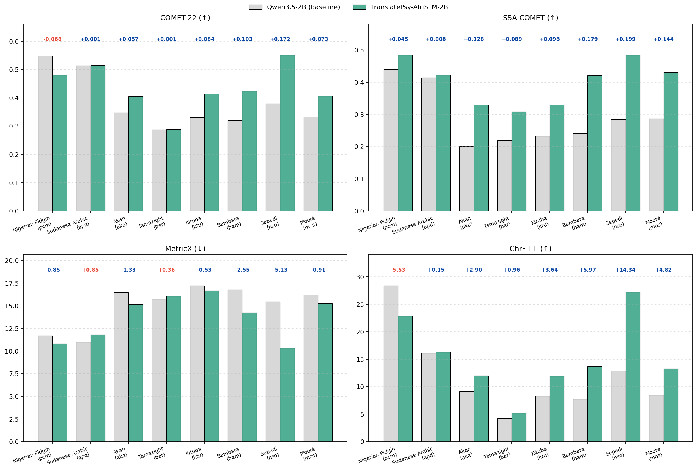

 

Figure 12: AFRICA-OOD results across all evaluation metrics. Per-language scores for held-out African languages, comparing Qwen3.5-2B and TranslatePsy-AfriSLM-2B. Scores are averaged over both translation directions and over the available evaluation sets among Flores-200, BOUQuET, and Smol; language coverage differs by evaluation set as shown in Table [16](https://arxiv.org/html/2608.18655v2#A4.T16 "Table 16 ‣ Appendix D Additional Results ‣ TranslatePsy-AfriSLM: High-Quality Data Scaling For Low-Resource Machine Translation"). \(\Delta\) = TranslatePsy-AfriSLM-2B \(-\) baseline model scores.

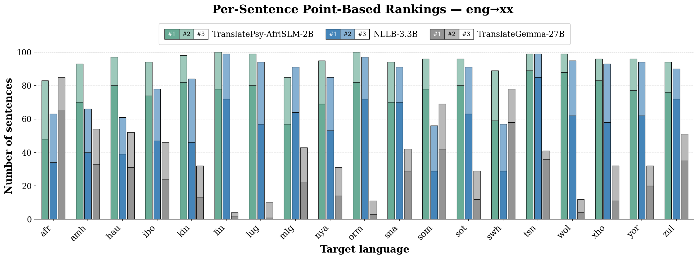

 

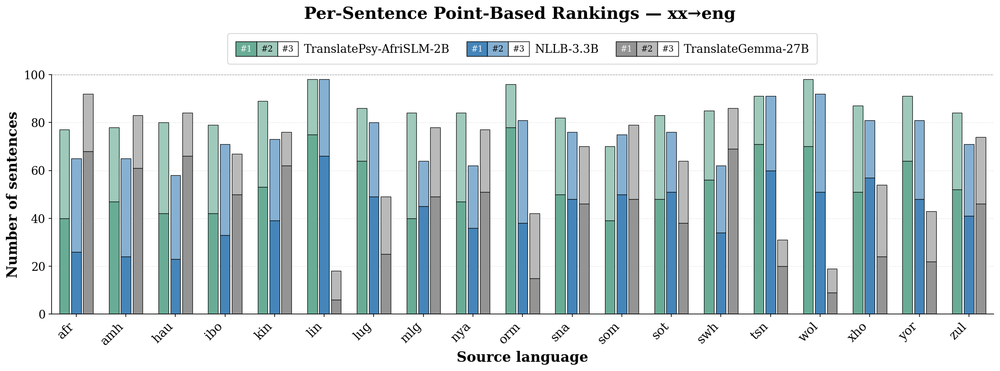

 

Figure 13: LLM-as-judge evaluation results. LLM-as-judge-based rankings for English-to-African language and African language-to-English pairs, respectively, showing the number of times each model was ranked #1 (darker shade), #2 (lighter), or #3 (gap up to the dotted line). 

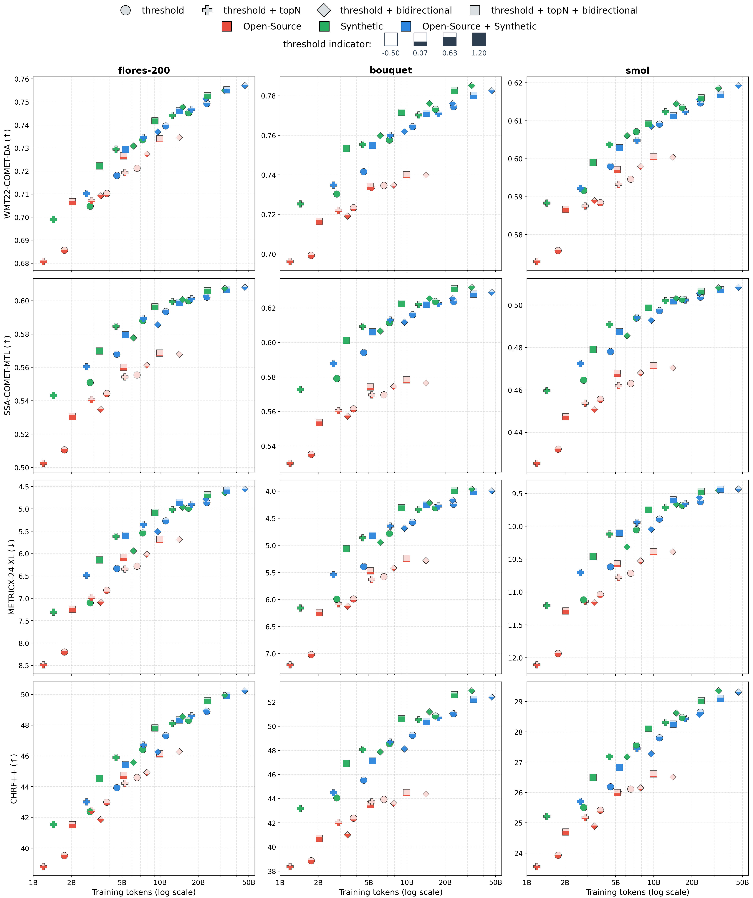

 Figure 14: Scaling runs as QE quality and training budgets increase, evaluated on Flores-200, BOUQuET, and Smol (columns). Each row reports a different metric, each point corresponds to a model trained with a particular data source and filtering configuration. Colours distinguish filtered, synthetic, and filtered+synthetic data, while marker shapes indicate the filtering setup. Filtering thresholds are represented by an increasing fill, i.e. the fuller the shape, the higher the threshold. 

<table id="A5.T24.2" class="ltx_tabular ltx_centering ltx_align_middle">
<tr id="A5.T24.2.1" class="ltx_tr">
<td id="A5.T24.2.1.1" class="ltx_td ltx_align_left ltx_border_tt" rowspan="2">Model</td>
<td id="A5.T24.2.1.2" class="ltx_td ltx_align_center ltx_border_tt" colspan="2">Flores-200</td>
<td id="A5.T24.2.1.3" class="ltx_td ltx_align_center ltx_border_tt" colspan="2">BOUQuET</td>
<td id="A5.T24.2.1.4" class="ltx_td ltx_align_center ltx_border_tt" colspan="2">Smol</td></tr>
<tr id="A5.T24.2.2" class="ltx_tr">
<td id="A5.T24.2.2.1" class="ltx_td ltx_align_center ltx_border_t">SSA (↑)</td>
<td id="A5.T24.2.2.2" class="ltx_td ltx_align_center ltx_border_t">MX (↓)</td>
<td id="A5.T24.2.2.3" class="ltx_td ltx_align_center ltx_border_t">SSA (↑)</td>
<td id="A5.T24.2.2.4" class="ltx_td ltx_align_center ltx_border_t">MX (↓)</td>
<td id="A5.T24.2.2.5" class="ltx_td ltx_align_center ltx_border_t">SSA (↑)</td>
<td id="A5.T24.2.2.6" class="ltx_td ltx_align_center ltx_border_t">MX (↓)</td></tr>
<tr id="A5.T24.2.3" class="ltx_tr">
<td id="A5.T24.2.3.1" class="ltx_td ltx_align_center ltx_border_t" colspan="7">General-purpose LLMs/SLMs</td></tr>
<tr id="A5.T24.2.4" class="ltx_tr">
<td id="A5.T24.2.4.1" class="ltx_td ltx_align_left ltx_border_t">Apertus-8B</td>
<td id="A5.T24.2.4.2" class="ltx_td ltx_align_center ltx_border_t">0.3814</td>
<td id="A5.T24.2.4.3" class="ltx_td ltx_align_center ltx_border_t">11.471</td>
<td id="A5.T24.2.4.4" class="ltx_td ltx_align_center ltx_border_t">0.4024</td>
<td id="A5.T24.2.4.5" class="ltx_td ltx_align_center ltx_border_t">10.385</td>
<td id="A5.T24.2.4.6" class="ltx_td ltx_align_center ltx_border_t">0.3246</td>
<td id="A5.T24.2.4.7" class="ltx_td ltx_align_center ltx_border_t">14.233</td></tr>
<tr id="A5.T24.2.5" class="ltx_tr">
<td id="A5.T24.2.5.1" class="ltx_td ltx_align_left ltx_border_t">Qwen3-4B</td>
<td id="A5.T24.2.5.2" class="ltx_td ltx_align_center ltx_border_t">0.2426</td>
<td id="A5.T24.2.5.3" class="ltx_td ltx_align_center ltx_border_t">15.427</td>
<td id="A5.T24.2.5.4" class="ltx_td ltx_align_center ltx_border_t">0.2565</td>
<td id="A5.T24.2.5.5" class="ltx_td ltx_align_center ltx_border_t">14.772</td>
<td id="A5.T24.2.5.6" class="ltx_td ltx_align_center ltx_border_t">0.2117</td>
<td id="A5.T24.2.5.7" class="ltx_td ltx_align_center ltx_border_t">17.273</td></tr>
<tr id="A5.T24.2.6" class="ltx_tr">
<td id="A5.T24.2.6.1" class="ltx_td ltx_align_left">Qwen3-8B</td>
<td id="A5.T24.2.6.2" class="ltx_td ltx_align_center">0.2655</td>
<td id="A5.T24.2.6.3" class="ltx_td ltx_align_center">15.327</td>
<td id="A5.T24.2.6.4" class="ltx_td ltx_align_center">0.2760</td>
<td id="A5.T24.2.6.5" class="ltx_td ltx_align_center">14.725</td>
<td id="A5.T24.2.6.6" class="ltx_td ltx_align_center">0.2275</td>
<td id="A5.T24.2.6.7" class="ltx_td ltx_align_center">17.336</td></tr>
<tr id="A5.T24.2.7" class="ltx_tr">
<td id="A5.T24.2.7.1" class="ltx_td ltx_align_left ltx_border_t">Qwen3.5-0.8B</td>
<td id="A5.T24.2.7.2" class="ltx_td ltx_align_center ltx_border_t">0.2967</td>
<td id="A5.T24.2.7.3" class="ltx_td ltx_align_center ltx_border_t">15.974</td>
<td id="A5.T24.2.7.4" class="ltx_td ltx_align_center ltx_border_t">0.3320</td>
<td id="A5.T24.2.7.5" class="ltx_td ltx_align_center ltx_border_t">14.902</td>
<td id="A5.T24.2.7.6" class="ltx_td ltx_align_center ltx_border_t">0.2454</td>
<td id="A5.T24.2.7.7" class="ltx_td ltx_align_center ltx_border_t">17.595</td></tr>
<tr id="A5.T24.2.8" class="ltx_tr">
<td id="A5.T24.2.8.1" class="ltx_td ltx_align_left">Qwen3.5-2B</td>
<td id="A5.T24.2.8.2" class="ltx_td ltx_align_center">0.2885</td>
<td id="A5.T24.2.8.3" class="ltx_td ltx_align_center">14.344</td>
<td id="A5.T24.2.8.4" class="ltx_td ltx_align_center">0.3049</td>
<td id="A5.T24.2.8.5" class="ltx_td ltx_align_center">13.317</td>
<td id="A5.T24.2.8.6" class="ltx_td ltx_align_center">0.2498</td>
<td id="A5.T24.2.8.7" class="ltx_td ltx_align_center">15.926</td></tr>
<tr id="A5.T24.2.9" class="ltx_tr">
<td id="A5.T24.2.9.1" class="ltx_td ltx_align_left">Qwen3.5-4B</td>
<td id="A5.T24.2.9.2" class="ltx_td ltx_align_center">0.3863</td>
<td id="A5.T24.2.9.3" class="ltx_td ltx_align_center">11.416</td>
<td id="A5.T24.2.9.4" class="ltx_td ltx_align_center">0.3984</td>
<td id="A5.T24.2.9.5" class="ltx_td ltx_align_center">10.567</td>
<td id="A5.T24.2.9.6" class="ltx_td ltx_align_center">0.3301</td>
<td id="A5.T24.2.9.7" class="ltx_td ltx_align_center">13.868</td></tr>
<tr id="A5.T24.2.10" class="ltx_tr">
<td id="A5.T24.2.10.1" class="ltx_td ltx_align_left">Qwen3.5-9B</td>
<td id="A5.T24.2.10.2" class="ltx_td ltx_align_center">0.4523</td>
<td id="A5.T24.2.10.3" class="ltx_td ltx_align_center">9.758</td>
<td id="A5.T24.2.10.4" class="ltx_td ltx_align_center">0.4664</td>
<td id="A5.T24.2.10.5" class="ltx_td ltx_align_center">8.927</td>
<td id="A5.T24.2.10.6" class="ltx_td ltx_align_center">0.3811</td>
<td id="A5.T24.2.10.7" class="ltx_td ltx_align_center">13.216</td></tr>
<tr id="A5.T24.2.11" class="ltx_tr">
<td id="A5.T24.2.11.1" class="ltx_td ltx_align_left">Qwen3.5-27B</td>
<td id="A5.T24.2.11.2" class="ltx_td ltx_align_center">0.5132</td>
<td id="A5.T24.2.11.3" class="ltx_td ltx_align_center">7.250</td>
<td id="A5.T24.2.11.4" class="ltx_td ltx_align_center">0.5336</td>
<td id="A5.T24.2.11.5" class="ltx_td ltx_align_center">6.468</td>
<td id="A5.T24.2.11.6" class="ltx_td ltx_align_center">0.4279</td>
<td id="A5.T24.2.11.7" class="ltx_td ltx_align_center">11.420</td></tr>
<tr id="A5.T24.2.12" class="ltx_tr">
<td id="A5.T24.2.12.1" class="ltx_td ltx_align_left">Qwen3.5-122B-A10B</td>
<td id="A5.T24.2.12.2" class="ltx_td ltx_align_center">0.5505</td>
<td id="A5.T24.2.12.3" class="ltx_td ltx_align_center">5.920</td>
<td id="A5.T24.2.12.4" class="ltx_td ltx_align_center">0.5716</td>
<td id="A5.T24.2.12.5" class="ltx_td ltx_align_center">5.318</td>
<td id="A5.T24.2.12.6" class="ltx_td ltx_align_center">0.4574</td>
<td id="A5.T24.2.12.7" class="ltx_td ltx_align_center">10.515</td></tr>
<tr id="A5.T24.2.13" class="ltx_tr">
<td id="A5.T24.2.13.1" class="ltx_td ltx_align_center ltx_border_t" colspan="7">Dedicated translation models</td></tr>
<tr id="A5.T24.2.14" class="ltx_tr">
<td id="A5.T24.2.14.1" class="ltx_td ltx_align_left ltx_border_t">AfriNLLB-600M</td>
<td id="A5.T24.2.14.2" class="ltx_td ltx_align_center ltx_border_t">0.5729</td>
<td id="A5.T24.2.14.3" class="ltx_td ltx_align_center ltx_border_t">5.916</td>
<td id="A5.T24.2.14.4" class="ltx_td ltx_align_center ltx_border_t">0.6038</td>
<td id="A5.T24.2.14.5" class="ltx_td ltx_align_center ltx_border_t">4.831</td>
<td id="A5.T24.2.14.6" class="ltx_td ltx_align_center ltx_border_t">0.4748</td>
<td id="A5.T24.2.14.7" class="ltx_td ltx_align_center ltx_border_t">10.476</td></tr>
<tr id="A5.T24.2.15" class="ltx_tr">
<td id="A5.T24.2.15.1" class="ltx_td ltx_align_left ltx_border_t">NLLB-600M</td>
<td id="A5.T24.2.15.2" class="ltx_td ltx_align_center ltx_border_t">0.5718</td>
<td id="A5.T24.2.15.3" class="ltx_td ltx_align_center ltx_border_t">5.752</td>
<td id="A5.T24.2.15.4" class="ltx_td ltx_align_center ltx_border_t">0.6019</td>
<td id="A5.T24.2.15.5" class="ltx_td ltx_align_center ltx_border_t">4.803</td>
<td id="A5.T24.2.15.6" class="ltx_td ltx_align_center ltx_border_t">0.4723</td>
<td id="A5.T24.2.15.7" class="ltx_td ltx_align_center ltx_border_t">10.430</td></tr>
<tr id="A5.T24.2.16" class="ltx_tr">
<td id="A5.T24.2.16.1" class="ltx_td ltx_align_left">NLLB-1.3B</td>
<td id="A5.T24.2.16.2" class="ltx_td ltx_align_center">0.5878</td>
<td id="A5.T24.2.16.3" class="ltx_td ltx_align_center">5.159</td>
<td id="A5.T24.2.16.4" class="ltx_td ltx_align_center">0.6130</td>
<td id="A5.T24.2.16.5" class="ltx_td ltx_align_center">4.448</td>
<td id="A5.T24.2.16.6" class="ltx_td ltx_align_center">0.4850</td>
<td id="A5.T24.2.16.7" class="ltx_td ltx_align_center">10.036</td></tr>
<tr id="A5.T24.2.17" class="ltx_tr">
<td id="A5.T24.2.17.1" class="ltx_td ltx_align_left">NLLB-3.3B</td>
<td id="A5.T24.2.17.2" class="ltx_td ltx_align_center">0.5944</td>
<td id="A5.T24.2.17.3" class="ltx_td ltx_align_center">4.913</td>
<td id="A5.T24.2.17.4" class="ltx_td ltx_align_center">0.6178</td>
<td id="A5.T24.2.17.5" class="ltx_td ltx_align_center">4.264</td>
<td id="A5.T24.2.17.6" class="ltx_td ltx_align_center">0.4909</td>
<td id="A5.T24.2.17.7" class="ltx_td ltx_align_center">9.841</td></tr>
<tr id="A5.T24.2.18" class="ltx_tr">
<td id="A5.T24.2.18.1" class="ltx_td ltx_align_left ltx_border_t">Hunyuan-MT-7B</td>
<td id="A5.T24.2.18.2" class="ltx_td ltx_align_center ltx_border_t">0.4450</td>
<td id="A5.T24.2.18.3" class="ltx_td ltx_align_center ltx_border_t">10.779</td>
<td id="A5.T24.2.18.4" class="ltx_td ltx_align_center ltx_border_t">0.4451</td>
<td id="A5.T24.2.18.5" class="ltx_td ltx_align_center ltx_border_t">10.659</td>
<td id="A5.T24.2.18.6" class="ltx_td ltx_align_center ltx_border_t">0.3784</td>
<td id="A5.T24.2.18.7" class="ltx_td ltx_align_center ltx_border_t">13.949</td></tr>
<tr id="A5.T24.2.19" class="ltx_tr">
<td id="A5.T24.2.19.1" class="ltx_td ltx_align_left ltx_border_t">TranslateGemma-4B</td>
<td id="A5.T24.2.19.2" class="ltx_td ltx_align_center ltx_border_t">0.3913</td>
<td id="A5.T24.2.19.3" class="ltx_td ltx_align_center ltx_border_t">11.086</td>
<td id="A5.T24.2.19.4" class="ltx_td ltx_align_center ltx_border_t">0.4069</td>
<td id="A5.T24.2.19.5" class="ltx_td ltx_align_center ltx_border_t">10.219</td>
<td id="A5.T24.2.19.6" class="ltx_td ltx_align_center ltx_border_t">0.3384</td>
<td id="A5.T24.2.19.7" class="ltx_td ltx_align_center ltx_border_t">14.000</td></tr>
<tr id="A5.T24.2.20" class="ltx_tr">
<td id="A5.T24.2.20.1" class="ltx_td ltx_align_left">TranslateGemma-12B</td>
<td id="A5.T24.2.20.2" class="ltx_td ltx_align_center">0.5037</td>
<td id="A5.T24.2.20.3" class="ltx_td ltx_align_center">7.718</td>
<td id="A5.T24.2.20.4" class="ltx_td ltx_align_center">0.5228</td>
<td id="A5.T24.2.20.5" class="ltx_td ltx_align_center">6.926</td>
<td id="A5.T24.2.20.6" class="ltx_td ltx_align_center">0.4299</td>
<td id="A5.T24.2.20.7" class="ltx_td ltx_align_center">11.501</td></tr>
<tr id="A5.T24.2.21" class="ltx_tr">
<td id="A5.T24.2.21.1" class="ltx_td ltx_align_left">TranslateGemma-27B</td>
<td id="A5.T24.2.21.2" class="ltx_td ltx_align_center">0.5455</td>
<td id="A5.T24.2.21.3" class="ltx_td ltx_align_center">6.142</td>
<td id="A5.T24.2.21.4" class="ltx_td ltx_align_center">0.5677</td>
<td id="A5.T24.2.21.5" class="ltx_td ltx_align_center">5.506</td>
<td id="A5.T24.2.21.6" class="ltx_td ltx_align_center">0.4608</td>
<td id="A5.T24.2.21.7" class="ltx_td ltx_align_center">10.468</td></tr>
<tr id="A5.T24.2.22" class="ltx_tr">
<td id="A5.T24.2.22.1" class="ltx_td ltx_align_center ltx_border_t" colspan="7">African language-specialized models</td></tr>
<tr id="A5.T24.2.23" class="ltx_tr">
<td id="A5.T24.2.23.1" class="ltx_td ltx_align_left ltx_border_t">AfriqueLlama-8B</td>
<td id="A5.T24.2.23.2" class="ltx_td ltx_align_center ltx_border_t">0.5513</td>
<td id="A5.T24.2.23.3" class="ltx_td ltx_align_center ltx_border_t">5.921</td>
<td id="A5.T24.2.23.4" class="ltx_td ltx_align_center ltx_border_t">0.5772</td>
<td id="A5.T24.2.23.5" class="ltx_td ltx_align_center ltx_border_t">5.181</td>
<td id="A5.T24.2.23.6" class="ltx_td ltx_align_center ltx_border_t">0.4555</td>
<td id="A5.T24.2.23.7" class="ltx_td ltx_align_center ltx_border_t">10.519</td></tr>
<tr id="A5.T24.2.24" class="ltx_tr">
<td id="A5.T24.2.24.1" class="ltx_td ltx_align_left">AfriqueGemma-4B</td>
<td id="A5.T24.2.24.2" class="ltx_td ltx_align_center">0.5462</td>
<td id="A5.T24.2.24.3" class="ltx_td ltx_align_center">6.091</td>
<td id="A5.T24.2.24.4" class="ltx_td ltx_align_center">0.5729</td>
<td id="A5.T24.2.24.5" class="ltx_td ltx_align_center">5.313</td>
<td id="A5.T24.2.24.6" class="ltx_td ltx_align_center">0.4522</td>
<td id="A5.T24.2.24.7" class="ltx_td ltx_align_center">10.593</td></tr>
<tr id="A5.T24.2.25" class="ltx_tr">
<td id="A5.T24.2.25.1" class="ltx_td ltx_align_left">AfriqueGemma-12B</td>
<td id="A5.T24.2.25.2" class="ltx_td ltx_align_center">0.5655</td>
<td id="A5.T24.2.25.3" class="ltx_td ltx_align_center">5.486</td>
<td id="A5.T24.2.25.4" class="ltx_td ltx_align_center">0.5892</td>
<td id="A5.T24.2.25.5" class="ltx_td ltx_align_center">4.852</td>
<td id="A5.T24.2.25.6" class="ltx_td ltx_align_center">0.4649</td>
<td id="A5.T24.2.25.7" class="ltx_td ltx_align_center">10.286</td></tr>
<tr id="A5.T24.2.26" class="ltx_tr">
<td id="A5.T24.2.26.1" class="ltx_td ltx_align_left">AfriqueQwen-8B</td>
<td id="A5.T24.2.26.2" class="ltx_td ltx_align_center">0.5448</td>
<td id="A5.T24.2.26.3" class="ltx_td ltx_align_center">6.109</td>
<td id="A5.T24.2.26.4" class="ltx_td ltx_align_center">0.5689</td>
<td id="A5.T24.2.26.5" class="ltx_td ltx_align_center">5.386</td>
<td id="A5.T24.2.26.6" class="ltx_td ltx_align_center">0.4503</td>
<td id="A5.T24.2.26.7" class="ltx_td ltx_align_center">10.655</td></tr>
<tr id="A5.T24.2.27" class="ltx_tr">
<td id="A5.T24.2.27.1" class="ltx_td ltx_align_left">AfriqueQwen-14B</td>
<td id="A5.T24.2.27.2" class="ltx_td ltx_align_center">0.5569</td>
<td id="A5.T24.2.27.3" class="ltx_td ltx_align_center">5.702</td>
<td id="A5.T24.2.27.4" class="ltx_td ltx_align_center">0.5817</td>
<td id="A5.T24.2.27.5" class="ltx_td ltx_align_center">5.025</td>
<td id="A5.T24.2.27.6" class="ltx_td ltx_align_center">0.4605</td>
<td id="A5.T24.2.27.7" class="ltx_td ltx_align_center">10.348</td></tr>
<tr id="A5.T24.2.28" class="ltx_tr">
<td id="A5.T24.2.28.1" class="ltx_td ltx_align_center ltx_border_t" colspan="7">Ours</td></tr>
<tr id="A5.T24.2.29" class="ltx_tr">
<td id="A5.T24.2.29.1" class="ltx_td ltx_align_left ltx_border_t">TranslatePsy-AfriSLM-0.8B</td>
<td id="A5.T24.2.29.2" class="ltx_td ltx_align_center ltx_border_t">0.5944</td>
<td id="A5.T24.2.29.3" class="ltx_td ltx_align_center ltx_border_t">5.197</td>
<td id="A5.T24.2.29.4" class="ltx_td ltx_align_center ltx_border_t">0.6223</td>
<td id="A5.T24.2.29.5" class="ltx_td ltx_align_center ltx_border_t">4.316</td>
<td id="A5.T24.2.29.6" class="ltx_td ltx_align_center ltx_border_t">0.4973</td>
<td id="A5.T24.2.29.7" class="ltx_td ltx_align_center ltx_border_t">9.823</td></tr>
<tr id="A5.T24.2.30" class="ltx_tr">
<td id="A5.T24.2.30.1" class="ltx_td ltx_align_left">TranslatePsy-AfriSLM-2B</td>
<td id="A5.T24.2.30.2" class="ltx_td ltx_align_center">0.6070</td>
<td id="A5.T24.2.30.3" class="ltx_td ltx_align_center">4.637</td>
<td id="A5.T24.2.30.4" class="ltx_td ltx_align_center">0.6322</td>
<td id="A5.T24.2.30.5" class="ltx_td ltx_align_center">3.940</td>
<td id="A5.T24.2.30.6" class="ltx_td ltx_align_center">0.5074</td>
<td id="A5.T24.2.30.7" class="ltx_td ltx_align_center">9.458</td></tr>
<tr id="A5.T24.2.31" class="ltx_tr">
<td id="A5.T24.2.31.1" class="ltx_td ltx_align_left ltx_border_bb">TranslatePsy-AfriSLM-4B</td>
<td id="A5.T24.2.31.2" class="ltx_td ltx_align_center ltx_border_bb">0.6143</td>
<td id="A5.T24.2.31.3" class="ltx_td ltx_align_center ltx_border_bb">4.317</td>
<td id="A5.T24.2.31.4" class="ltx_td ltx_align_center ltx_border_bb">0.6391</td>
<td id="A5.T24.2.31.5" class="ltx_td ltx_align_center ltx_border_bb">3.701</td>
<td id="A5.T24.2.31.6" class="ltx_td ltx_align_center ltx_border_bb">0.5136</td>
<td id="A5.T24.2.31.7" class="ltx_td ltx_align_center ltx_border_bb">9.232</td></tr>
</table>

 Table 24: SSA-COMET and MetricX results on Flores-200, BOUQuET, and Smol.

<table id="A5.T25.2.1" class="ltx_tabular ltx_align_middle">
<tr id="A5.T25.2.1.1" class="ltx_tr">
<td id="A5.T25.2.1.1.1" class="ltx_td ltx_align_left ltx_border_tt" rowspan="2">Model</td>
<td id="A5.T25.2.1.1.2" class="ltx_td ltx_align_center ltx_border_tt" colspan="3">Flores-200</td>
<td id="A5.T25.2.1.1.3" class="ltx_td ltx_align_center ltx_border_tt" colspan="3">BOUQuET</td>
<td id="A5.T25.2.1.1.4" class="ltx_td ltx_align_center ltx_border_tt" colspan="3">Smol</td></tr>
<tr id="A5.T25.2.1.2" class="ltx_tr">
<td id="A5.T25.2.1.2.1" class="ltx_td ltx_align_center ltx_border_t">C22 (↑)</td>
<td id="A5.T25.2.1.2.2" class="ltx_td ltx_align_center ltx_border_t">chrF++ (↑)</td>
<td id="A5.T25.2.1.2.3" class="ltx_td ltx_align_center ltx_border_t">spBLEU (↑)</td>
<td id="A5.T25.2.1.2.4" class="ltx_td ltx_align_center ltx_border_t">C22 (↑)</td>
<td id="A5.T25.2.1.2.5" class="ltx_td ltx_align_center ltx_border_t">chrF++ (↑)</td>
<td id="A5.T25.2.1.2.6" class="ltx_td ltx_align_center ltx_border_t">spBLEU (↑)</td>
<td id="A5.T25.2.1.2.7" class="ltx_td ltx_align_center ltx_border_t">C22 (↑)</td>
<td id="A5.T25.2.1.2.8" class="ltx_td ltx_align_center ltx_border_t">chrF++ (↑)</td>
<td id="A5.T25.2.1.2.9" class="ltx_td ltx_align_center ltx_border_t">spBLEU (↑)</td></tr>
<tr id="A5.T25.2.1.3" class="ltx_tr">
<td id="A5.T25.2.1.3.1" class="ltx_td ltx_align_center ltx_border_t" colspan="10">General-purpose LLMs</td></tr>
<tr id="A5.T25.2.1.4" class="ltx_tr">
<td id="A5.T25.2.1.4.1" class="ltx_td ltx_align_left ltx_border_t">Apertus-8B</td>
<td id="A5.T25.2.1.4.2" class="ltx_td ltx_align_center ltx_border_t">0.5883</td>
<td id="A5.T25.2.1.4.3" class="ltx_td ltx_align_center ltx_border_t">30.45</td>
<td id="A5.T25.2.1.4.4" class="ltx_td ltx_align_center ltx_border_t">12.22</td>
<td id="A5.T25.2.1.4.5" class="ltx_td ltx_align_center ltx_border_t">0.6025</td>
<td id="A5.T25.2.1.4.6" class="ltx_td ltx_align_center ltx_border_t">27.81</td>
<td id="A5.T25.2.1.4.7" class="ltx_td ltx_align_center ltx_border_t">11.06</td>
<td id="A5.T25.2.1.4.8" class="ltx_td ltx_align_center ltx_border_t">0.4912</td>
<td id="A5.T25.2.1.4.9" class="ltx_td ltx_align_center ltx_border_t">18.01</td>
<td id="A5.T25.2.1.4.10" class="ltx_td ltx_align_center ltx_border_t">3.52</td></tr>
<tr id="A5.T25.2.1.5" class="ltx_tr">
<td id="A5.T25.2.1.5.1" class="ltx_td ltx_align_left ltx_border_t">Qwen3-4B</td>
<td id="A5.T25.2.1.5.2" class="ltx_td ltx_align_center ltx_border_t">0.4046</td>
<td id="A5.T25.2.1.5.3" class="ltx_td ltx_align_center ltx_border_t">17.35</td>
<td id="A5.T25.2.1.5.4" class="ltx_td ltx_align_center ltx_border_t">5.03</td>
<td id="A5.T25.2.1.5.5" class="ltx_td ltx_align_center ltx_border_t">0.4305</td>
<td id="A5.T25.2.1.5.6" class="ltx_td ltx_align_center ltx_border_t">14.24</td>
<td id="A5.T25.2.1.5.7" class="ltx_td ltx_align_center ltx_border_t">3.59</td>
<td id="A5.T25.2.1.5.8" class="ltx_td ltx_align_center ltx_border_t">0.3607</td>
<td id="A5.T25.2.1.5.9" class="ltx_td ltx_align_center ltx_border_t">10.74</td>
<td id="A5.T25.2.1.5.10" class="ltx_td ltx_align_center ltx_border_t">0.72</td></tr>
<tr id="A5.T25.2.1.6" class="ltx_tr">
<td id="A5.T25.2.1.6.1" class="ltx_td ltx_align_left">Qwen3-8B</td>
<td id="A5.T25.2.1.6.2" class="ltx_td ltx_align_center">0.4566</td>
<td id="A5.T25.2.1.6.3" class="ltx_td ltx_align_center">20.63</td>
<td id="A5.T25.2.1.6.4" class="ltx_td ltx_align_center">6.90</td>
<td id="A5.T25.2.1.6.5" class="ltx_td ltx_align_center">0.4792</td>
<td id="A5.T25.2.1.6.6" class="ltx_td ltx_align_center">17.29</td>
<td id="A5.T25.2.1.6.7" class="ltx_td ltx_align_center">5.19</td>
<td id="A5.T25.2.1.6.8" class="ltx_td ltx_align_center">0.4002</td>
<td id="A5.T25.2.1.6.9" class="ltx_td ltx_align_center">12.49</td>
<td id="A5.T25.2.1.6.10" class="ltx_td ltx_align_center">1.17</td></tr>
<tr id="A5.T25.2.1.7" class="ltx_tr">
<td id="A5.T25.2.1.7.1" class="ltx_td ltx_align_left ltx_border_t">Qwen3.5-0.8B</td>
<td id="A5.T25.2.1.7.2" class="ltx_td ltx_align_center ltx_border_t">0.3656</td>
<td id="A5.T25.2.1.7.3" class="ltx_td ltx_align_center ltx_border_t">14.06</td>
<td id="A5.T25.2.1.7.4" class="ltx_td ltx_align_center ltx_border_t">3.27</td>
<td id="A5.T25.2.1.7.5" class="ltx_td ltx_align_center ltx_border_t">0.3920</td>
<td id="A5.T25.2.1.7.6" class="ltx_td ltx_align_center ltx_border_t">11.16</td>
<td id="A5.T25.2.1.7.7" class="ltx_td ltx_align_center ltx_border_t">2.12</td>
<td id="A5.T25.2.1.7.8" class="ltx_td ltx_align_center ltx_border_t">0.3255</td>
<td id="A5.T25.2.1.7.9" class="ltx_td ltx_align_center ltx_border_t">8.61</td>
<td id="A5.T25.2.1.7.10" class="ltx_td ltx_align_center ltx_border_t">0.38</td></tr>
<tr id="A5.T25.2.1.8" class="ltx_tr">
<td id="A5.T25.2.1.8.1" class="ltx_td ltx_align_left">Qwen3.5-2B</td>
<td id="A5.T25.2.1.8.2" class="ltx_td ltx_align_center">0.4724</td>
<td id="A5.T25.2.1.8.3" class="ltx_td ltx_align_center">20.95</td>
<td id="A5.T25.2.1.8.4" class="ltx_td ltx_align_center">5.87</td>
<td id="A5.T25.2.1.8.5" class="ltx_td ltx_align_center">0.4934</td>
<td id="A5.T25.2.1.8.6" class="ltx_td ltx_align_center">17.82</td>
<td id="A5.T25.2.1.8.7" class="ltx_td ltx_align_center">4.54</td>
<td id="A5.T25.2.1.8.8" class="ltx_td ltx_align_center">0.4143</td>
<td id="A5.T25.2.1.8.9" class="ltx_td ltx_align_center">12.90</td>
<td id="A5.T25.2.1.8.10" class="ltx_td ltx_align_center">1.05</td></tr>
<tr id="A5.T25.2.1.9" class="ltx_tr">
<td id="A5.T25.2.1.9.1" class="ltx_td ltx_align_left">Qwen3.5-4B</td>
<td id="A5.T25.2.1.9.2" class="ltx_td ltx_align_center">0.6021</td>
<td id="A5.T25.2.1.9.3" class="ltx_td ltx_align_center">30.58</td>
<td id="A5.T25.2.1.9.4" class="ltx_td ltx_align_center">11.35</td>
<td id="A5.T25.2.1.9.5" class="ltx_td ltx_align_center">0.6122</td>
<td id="A5.T25.2.1.9.6" class="ltx_td ltx_align_center">27.88</td>
<td id="A5.T25.2.1.9.7" class="ltx_td ltx_align_center">10.28</td>
<td id="A5.T25.2.1.9.8" class="ltx_td ltx_align_center">0.5103</td>
<td id="A5.T25.2.1.9.9" class="ltx_td ltx_align_center">18.58</td>
<td id="A5.T25.2.1.9.10" class="ltx_td ltx_align_center">3.09</td></tr>
<tr id="A5.T25.2.1.10" class="ltx_tr">
<td id="A5.T25.2.1.10.1" class="ltx_td ltx_align_left">Qwen3.5-9B</td>
<td id="A5.T25.2.1.10.2" class="ltx_td ltx_align_center">0.6688</td>
<td id="A5.T25.2.1.10.3" class="ltx_td ltx_align_center">36.74</td>
<td id="A5.T25.2.1.10.4" class="ltx_td ltx_align_center">15.52</td>
<td id="A5.T25.2.1.10.5" class="ltx_td ltx_align_center">0.6801</td>
<td id="A5.T25.2.1.10.6" class="ltx_td ltx_align_center">34.96</td>
<td id="A5.T25.2.1.10.7" class="ltx_td ltx_align_center">15.24</td>
<td id="A5.T25.2.1.10.8" class="ltx_td ltx_align_center">0.5566</td>
<td id="A5.T25.2.1.10.9" class="ltx_td ltx_align_center">22.19</td>
<td id="A5.T25.2.1.10.10" class="ltx_td ltx_align_center">4.98</td></tr>
<tr id="A5.T25.2.1.11" class="ltx_tr">
<td id="A5.T25.2.1.11.1" class="ltx_td ltx_align_left">Qwen3.5-27B</td>
<td id="A5.T25.2.1.11.2" class="ltx_td ltx_align_center">0.7144</td>
<td id="A5.T25.2.1.11.3" class="ltx_td ltx_align_center">41.78</td>
<td id="A5.T25.2.1.11.4" class="ltx_td ltx_align_center">19.96</td>
<td id="A5.T25.2.1.11.5" class="ltx_td ltx_align_center">0.7264</td>
<td id="A5.T25.2.1.11.6" class="ltx_td ltx_align_center">41.22</td>
<td id="A5.T25.2.1.11.7" class="ltx_td ltx_align_center">20.52</td>
<td id="A5.T25.2.1.11.8" class="ltx_td ltx_align_center">0.5859</td>
<td id="A5.T25.2.1.11.9" class="ltx_td ltx_align_center">24.93</td>
<td id="A5.T25.2.1.11.10" class="ltx_td ltx_align_center">7.33</td></tr>
<tr id="A5.T25.2.1.12" class="ltx_tr">
<td id="A5.T25.2.1.12.1" class="ltx_td ltx_align_left">Qwen3.5-122B-A10B</td>
<td id="A5.T25.2.1.12.2" class="ltx_td ltx_align_center">0.7373</td>
<td id="A5.T25.2.1.12.3" class="ltx_td ltx_align_center">44.42</td>
<td id="A5.T25.2.1.12.4" class="ltx_td ltx_align_center">21.89</td>
<td id="A5.T25.2.1.12.5" class="ltx_td ltx_align_center">0.7494</td>
<td id="A5.T25.2.1.12.6" class="ltx_td ltx_align_center">44.29</td>
<td id="A5.T25.2.1.12.7" class="ltx_td ltx_align_center">22.98</td>
<td id="A5.T25.2.1.12.8" class="ltx_td ltx_align_center">0.6045</td>
<td id="A5.T25.2.1.12.9" class="ltx_td ltx_align_center">26.67</td>
<td id="A5.T25.2.1.12.10" class="ltx_td ltx_align_center">8.46</td></tr>
<tr id="A5.T25.2.1.13" class="ltx_tr">
<td id="A5.T25.2.1.13.1" class="ltx_td ltx_align_center ltx_border_t" colspan="10">Dedicated translation models</td></tr>
<tr id="A5.T25.2.1.14" class="ltx_tr">
<td id="A5.T25.2.1.14.1" class="ltx_td ltx_align_left ltx_border_t">AfriNLLB-600M</td>
<td id="A5.T25.2.1.14.2" class="ltx_td ltx_align_center ltx_border_t">0.7315</td>
<td id="A5.T25.2.1.14.3" class="ltx_td ltx_align_center ltx_border_t">46.74</td>
<td id="A5.T25.2.1.14.4" class="ltx_td ltx_align_center ltx_border_t">25.76</td>
<td id="A5.T25.2.1.14.5" class="ltx_td ltx_align_center ltx_border_t">0.7671</td>
<td id="A5.T25.2.1.14.6" class="ltx_td ltx_align_center ltx_border_t">48.82</td>
<td id="A5.T25.2.1.14.7" class="ltx_td ltx_align_center ltx_border_t">29.89</td>
<td id="A5.T25.2.1.14.8" class="ltx_td ltx_align_center ltx_border_t">0.6008</td>
<td id="A5.T25.2.1.14.9" class="ltx_td ltx_align_center ltx_border_t">27.99</td>
<td id="A5.T25.2.1.14.10" class="ltx_td ltx_align_center ltx_border_t">11.07</td></tr>
<tr id="A5.T25.2.1.15" class="ltx_tr">
<td id="A5.T25.2.1.15.1" class="ltx_td ltx_align_left ltx_border_t">NLLB-600M</td>
<td id="A5.T25.2.1.15.2" class="ltx_td ltx_align_center ltx_border_t">0.7340</td>
<td id="A5.T25.2.1.15.3" class="ltx_td ltx_align_center ltx_border_t">45.73</td>
<td id="A5.T25.2.1.15.4" class="ltx_td ltx_align_center ltx_border_t">24.48</td>
<td id="A5.T25.2.1.15.5" class="ltx_td ltx_align_center ltx_border_t">0.7654</td>
<td id="A5.T25.2.1.15.6" class="ltx_td ltx_align_center ltx_border_t">47.83</td>
<td id="A5.T25.2.1.15.7" class="ltx_td ltx_align_center ltx_border_t">28.44</td>
<td id="A5.T25.2.1.15.8" class="ltx_td ltx_align_center ltx_border_t">0.6028</td>
<td id="A5.T25.2.1.15.9" class="ltx_td ltx_align_center ltx_border_t">27.08</td>
<td id="A5.T25.2.1.15.10" class="ltx_td ltx_align_center ltx_border_t">9.85</td></tr>
<tr id="A5.T25.2.1.16" class="ltx_tr">
<td id="A5.T25.2.1.16.1" class="ltx_td ltx_align_left">NLLB-1.3B</td>
<td id="A5.T25.2.1.16.2" class="ltx_td ltx_align_center">0.7471</td>
<td id="A5.T25.2.1.16.3" class="ltx_td ltx_align_center">47.77</td>
<td id="A5.T25.2.1.16.4" class="ltx_td ltx_align_center">26.80</td>
<td id="A5.T25.2.1.16.5" class="ltx_td ltx_align_center">0.7753</td>
<td id="A5.T25.2.1.16.6" class="ltx_td ltx_align_center">49.66</td>
<td id="A5.T25.2.1.16.7" class="ltx_td ltx_align_center">30.66</td>
<td id="A5.T25.2.1.16.8" class="ltx_td ltx_align_center">0.6101</td>
<td id="A5.T25.2.1.16.9" class="ltx_td ltx_align_center">27.98</td>
<td id="A5.T25.2.1.16.10" class="ltx_td ltx_align_center">10.94</td></tr>
<tr id="A5.T25.2.1.17" class="ltx_tr">
<td id="A5.T25.2.1.17.1" class="ltx_td ltx_align_left">NLLB-3.3B</td>
<td id="A5.T25.2.1.17.2" class="ltx_td ltx_align_center">0.7525</td>
<td id="A5.T25.2.1.17.3" class="ltx_td ltx_align_center">48.89</td>
<td id="A5.T25.2.1.17.4" class="ltx_td ltx_align_center">28.06</td>
<td id="A5.T25.2.1.17.5" class="ltx_td ltx_align_center">0.7795</td>
<td id="A5.T25.2.1.17.6" class="ltx_td ltx_align_center">52.16</td>
<td id="A5.T25.2.1.17.7" class="ltx_td ltx_align_center">33.75</td>
<td id="A5.T25.2.1.17.8" class="ltx_td ltx_align_center">0.6139</td>
<td id="A5.T25.2.1.17.9" class="ltx_td ltx_align_center">28.60</td>
<td id="A5.T25.2.1.17.10" class="ltx_td ltx_align_center">11.50</td></tr>
<tr id="A5.T25.2.1.18" class="ltx_tr">
<td id="A5.T25.2.1.18.1" class="ltx_td ltx_align_left ltx_border_t">Hunyuan-MT-7B</td>
<td id="A5.T25.2.1.18.2" class="ltx_td ltx_align_center ltx_border_t">0.5056</td>
<td id="A5.T25.2.1.18.3" class="ltx_td ltx_align_center ltx_border_t">23.49</td>
<td id="A5.T25.2.1.18.4" class="ltx_td ltx_align_center ltx_border_t">6.03</td>
<td id="A5.T25.2.1.18.5" class="ltx_td ltx_align_center ltx_border_t">0.5211</td>
<td id="A5.T25.2.1.18.6" class="ltx_td ltx_align_center ltx_border_t">19.56</td>
<td id="A5.T25.2.1.18.7" class="ltx_td ltx_align_center ltx_border_t">4.53</td>
<td id="A5.T25.2.1.18.8" class="ltx_td ltx_align_center ltx_border_t">0.4391</td>
<td id="A5.T25.2.1.18.9" class="ltx_td ltx_align_center ltx_border_t">15.49</td>
<td id="A5.T25.2.1.18.10" class="ltx_td ltx_align_center ltx_border_t">1.19</td></tr>
<tr id="A5.T25.2.1.19" class="ltx_tr">
<td id="A5.T25.2.1.19.1" class="ltx_td ltx_align_left ltx_border_t">TranslateGemma-4B</td>
<td id="A5.T25.2.1.19.2" class="ltx_td ltx_align_center ltx_border_t">0.5487</td>
<td id="A5.T25.2.1.19.3" class="ltx_td ltx_align_center ltx_border_t">24.78</td>
<td id="A5.T25.2.1.19.4" class="ltx_td ltx_align_center ltx_border_t">10.21</td>
<td id="A5.T25.2.1.19.5" class="ltx_td ltx_align_center ltx_border_t">0.5699</td>
<td id="A5.T25.2.1.19.6" class="ltx_td ltx_align_center ltx_border_t">23.12</td>
<td id="A5.T25.2.1.19.7" class="ltx_td ltx_align_center ltx_border_t">10.65</td>
<td id="A5.T25.2.1.19.8" class="ltx_td ltx_align_center ltx_border_t">0.4644</td>
<td id="A5.T25.2.1.19.9" class="ltx_td ltx_align_center ltx_border_t">15.21</td>
<td id="A5.T25.2.1.19.10" class="ltx_td ltx_align_center ltx_border_t">3.02</td></tr>
<tr id="A5.T25.2.1.20" class="ltx_tr">
<td id="A5.T25.2.1.20.1" class="ltx_td ltx_align_left">TranslateGemma-12B</td>
<td id="A5.T25.2.1.20.2" class="ltx_td ltx_align_center">0.7125</td>
<td id="A5.T25.2.1.20.3" class="ltx_td ltx_align_center">39.48</td>
<td id="A5.T25.2.1.20.4" class="ltx_td ltx_align_center">16.66</td>
<td id="A5.T25.2.1.20.5" class="ltx_td ltx_align_center">0.7211</td>
<td id="A5.T25.2.1.20.6" class="ltx_td ltx_align_center">38.91</td>
<td id="A5.T25.2.1.20.7" class="ltx_td ltx_align_center">18.03</td>
<td id="A5.T25.2.1.20.8" class="ltx_td ltx_align_center">0.5983</td>
<td id="A5.T25.2.1.20.9" class="ltx_td ltx_align_center">24.56</td>
<td id="A5.T25.2.1.20.10" class="ltx_td ltx_align_center">5.97</td></tr>
<tr id="A5.T25.2.1.21" class="ltx_tr">
<td id="A5.T25.2.1.21.1" class="ltx_td ltx_align_left">TranslateGemma-27B</td>
<td id="A5.T25.2.1.21.2" class="ltx_td ltx_align_center">0.7335</td>
<td id="A5.T25.2.1.21.3" class="ltx_td ltx_align_center">43.33</td>
<td id="A5.T25.2.1.21.4" class="ltx_td ltx_align_center">21.13</td>
<td id="A5.T25.2.1.21.5" class="ltx_td ltx_align_center">0.7499</td>
<td id="A5.T25.2.1.21.6" class="ltx_td ltx_align_center">43.72</td>
<td id="A5.T25.2.1.21.7" class="ltx_td ltx_align_center">23.49</td>
<td id="A5.T25.2.1.21.8" class="ltx_td ltx_align_center">0.6102</td>
<td id="A5.T25.2.1.21.9" class="ltx_td ltx_align_center">26.24</td>
<td id="A5.T25.2.1.21.10" class="ltx_td ltx_align_center">8.12</td></tr>
<tr id="A5.T25.2.1.22" class="ltx_tr">
<td id="A5.T25.2.1.22.1" class="ltx_td ltx_align_center ltx_border_t" colspan="10">African language-specialized models</td></tr>
<tr id="A5.T25.2.1.23" class="ltx_tr">
<td id="A5.T25.2.1.23.1" class="ltx_td ltx_align_left ltx_border_t">AfriqueLlama-8B</td>
<td id="A5.T25.2.1.23.2" class="ltx_td ltx_align_center ltx_border_t">0.7245</td>
<td id="A5.T25.2.1.23.3" class="ltx_td ltx_align_center ltx_border_t">45.04</td>
<td id="A5.T25.2.1.23.4" class="ltx_td ltx_align_center ltx_border_t">25.57</td>
<td id="A5.T25.2.1.23.5" class="ltx_td ltx_align_center ltx_border_t">0.7513</td>
<td id="A5.T25.2.1.23.6" class="ltx_td ltx_align_center ltx_border_t">45.90</td>
<td id="A5.T25.2.1.23.7" class="ltx_td ltx_align_center ltx_border_t">28.97</td>
<td id="A5.T25.2.1.23.8" class="ltx_td ltx_align_center ltx_border_t">0.5913</td>
<td id="A5.T25.2.1.23.9" class="ltx_td ltx_align_center ltx_border_t">25.71</td>
<td id="A5.T25.2.1.23.10" class="ltx_td ltx_align_center ltx_border_t">9.82</td></tr>
<tr id="A5.T25.2.1.24" class="ltx_tr">
<td id="A5.T25.2.1.24.1" class="ltx_td ltx_align_left">AfriqueGemma-4B</td>
<td id="A5.T25.2.1.24.2" class="ltx_td ltx_align_center">0.7203</td>
<td id="A5.T25.2.1.24.3" class="ltx_td ltx_align_center">44.46</td>
<td id="A5.T25.2.1.24.4" class="ltx_td ltx_align_center">24.98</td>
<td id="A5.T25.2.1.24.5" class="ltx_td ltx_align_center">0.7466</td>
<td id="A5.T25.2.1.24.6" class="ltx_td ltx_align_center">45.21</td>
<td id="A5.T25.2.1.24.7" class="ltx_td ltx_align_center">28.14</td>
<td id="A5.T25.2.1.24.8" class="ltx_td ltx_align_center">0.5896</td>
<td id="A5.T25.2.1.24.9" class="ltx_td ltx_align_center">25.44</td>
<td id="A5.T25.2.1.24.10" class="ltx_td ltx_align_center">9.49</td></tr>
<tr id="A5.T25.2.1.25" class="ltx_tr">
<td id="A5.T25.2.1.25.1" class="ltx_td ltx_align_left">AfriqueGemma-12B</td>
<td id="A5.T25.2.1.25.2" class="ltx_td ltx_align_center">0.7389</td>
<td id="A5.T25.2.1.25.3" class="ltx_td ltx_align_center">47.84</td>
<td id="A5.T25.2.1.25.4" class="ltx_td ltx_align_center">28.48</td>
<td id="A5.T25.2.1.25.5" class="ltx_td ltx_align_center">0.7636</td>
<td id="A5.T25.2.1.25.6" class="ltx_td ltx_align_center">48.46</td>
<td id="A5.T25.2.1.25.7" class="ltx_td ltx_align_center">31.36</td>
<td id="A5.T25.2.1.25.8" class="ltx_td ltx_align_center">0.5999</td>
<td id="A5.T25.2.1.25.9" class="ltx_td ltx_align_center">27.15</td>
<td id="A5.T25.2.1.25.10" class="ltx_td ltx_align_center">11.22</td></tr>
<tr id="A5.T25.2.1.26" class="ltx_tr">
<td id="A5.T25.2.1.26.1" class="ltx_td ltx_align_left">AfriqueQwen-8B</td>
<td id="A5.T25.2.1.26.2" class="ltx_td ltx_align_center">0.7202</td>
<td id="A5.T25.2.1.26.3" class="ltx_td ltx_align_center">44.41</td>
<td id="A5.T25.2.1.26.4" class="ltx_td ltx_align_center">25.01</td>
<td id="A5.T25.2.1.26.5" class="ltx_td ltx_align_center">0.7448</td>
<td id="A5.T25.2.1.26.6" class="ltx_td ltx_align_center">45.20</td>
<td id="A5.T25.2.1.26.7" class="ltx_td ltx_align_center">28.20</td>
<td id="A5.T25.2.1.26.8" class="ltx_td ltx_align_center">0.5878</td>
<td id="A5.T25.2.1.26.9" class="ltx_td ltx_align_center">25.43</td>
<td id="A5.T25.2.1.26.10" class="ltx_td ltx_align_center">9.54</td></tr>
<tr id="A5.T25.2.1.27" class="ltx_tr">
<td id="A5.T25.2.1.27.1" class="ltx_td ltx_align_left">AfriqueQwen-14B</td>
<td id="A5.T25.2.1.27.2" class="ltx_td ltx_align_center">0.7303</td>
<td id="A5.T25.2.1.27.3" class="ltx_td ltx_align_center">46.16</td>
<td id="A5.T25.2.1.27.4" class="ltx_td ltx_align_center">26.82</td>
<td id="A5.T25.2.1.27.5" class="ltx_td ltx_align_center">0.7553</td>
<td id="A5.T25.2.1.27.6" class="ltx_td ltx_align_center">46.96</td>
<td id="A5.T25.2.1.27.7" class="ltx_td ltx_align_center">29.91</td>
<td id="A5.T25.2.1.27.8" class="ltx_td ltx_align_center">0.5968</td>
<td id="A5.T25.2.1.27.9" class="ltx_td ltx_align_center">26.36</td>
<td id="A5.T25.2.1.27.10" class="ltx_td ltx_align_center">10.28</td></tr>
<tr id="A5.T25.2.1.28" class="ltx_tr">
<td id="A5.T25.2.1.28.1" class="ltx_td ltx_align_center ltx_border_t" colspan="10">Ours</td></tr>
<tr id="A5.T25.2.1.29" class="ltx_tr">
<td id="A5.T25.2.1.29.1" class="ltx_td ltx_align_left ltx_border_t">TranslatePsy-AfriSLM-0.8B</td>
<td id="A5.T25.2.1.29.2" class="ltx_td ltx_align_center ltx_border_t">0.7432</td>
<td id="A5.T25.2.1.29.3" class="ltx_td ltx_align_center ltx_border_t">48.30</td>
<td id="A5.T25.2.1.29.4" class="ltx_td ltx_align_center ltx_border_t">27.00</td>
<td id="A5.T25.2.1.29.5" class="ltx_td ltx_align_center ltx_border_t">0.7770</td>
<td id="A5.T25.2.1.29.6" class="ltx_td ltx_align_center ltx_border_t">51.30</td>
<td id="A5.T25.2.1.29.7" class="ltx_td ltx_align_center ltx_border_t">32.35</td>
<td id="A5.T25.2.1.29.8" class="ltx_td ltx_align_center ltx_border_t">0.6120</td>
<td id="A5.T25.2.1.29.9" class="ltx_td ltx_align_center ltx_border_t">28.54</td>
<td id="A5.T25.2.1.29.10" class="ltx_td ltx_align_center ltx_border_t">11.21</td></tr>
<tr id="A5.T25.2.1.30" class="ltx_tr">
<td id="A5.T25.2.1.30.1" class="ltx_td ltx_align_left">TranslatePsy-AfriSLM-2B</td>
<td id="A5.T25.2.1.30.2" class="ltx_td ltx_align_center">0.7552</td>
<td id="A5.T25.2.1.30.3" class="ltx_td ltx_align_center">50.00</td>
<td id="A5.T25.2.1.30.4" class="ltx_td ltx_align_center">28.95</td>
<td id="A5.T25.2.1.30.5" class="ltx_td ltx_align_center">0.7870</td>
<td id="A5.T25.2.1.30.6" class="ltx_td ltx_align_center">53.13</td>
<td id="A5.T25.2.1.30.7" class="ltx_td ltx_align_center">34.49</td>
<td id="A5.T25.2.1.30.8" class="ltx_td ltx_align_center">0.6187</td>
<td id="A5.T25.2.1.30.9" class="ltx_td ltx_align_center">29.32</td>
<td id="A5.T25.2.1.30.10" class="ltx_td ltx_align_center">12.04</td></tr>
<tr id="A5.T25.2.1.31" class="ltx_tr">
<td id="A5.T25.2.1.31.1" class="ltx_td ltx_align_left ltx_border_bb">TranslatePsy-AfriSLM-4B</td>
<td id="A5.T25.2.1.31.2" class="ltx_td ltx_align_center ltx_border_bb">0.7629</td>
<td id="A5.T25.2.1.31.3" class="ltx_td ltx_align_center ltx_border_bb">51.13</td>
<td id="A5.T25.2.1.31.4" class="ltx_td ltx_align_center ltx_border_bb">30.28</td>
<td id="A5.T25.2.1.31.5" class="ltx_td ltx_align_center ltx_border_bb">0.7941</td>
<td id="A5.T25.2.1.31.6" class="ltx_td ltx_align_center ltx_border_bb">54.33</td>
<td id="A5.T25.2.1.31.7" class="ltx_td ltx_align_center ltx_border_bb">36.07</td>
<td id="A5.T25.2.1.31.8" class="ltx_td ltx_align_center ltx_border_bb">0.6237</td>
<td id="A5.T25.2.1.31.9" class="ltx_td ltx_align_center ltx_border_bb">29.97</td>
<td id="A5.T25.2.1.31.10" class="ltx_td ltx_align_center ltx_border_bb">12.80</td></tr>
</table>

 

Table 25: COMET-22, chrF++, and spBLEU results on Flores-200, BOUQuET and Smol. 

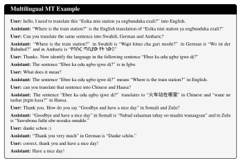

 Figure 15: Multi-turn and cross-lingual translation and language identification with TranslatePsy-AfriSLM-4B.
