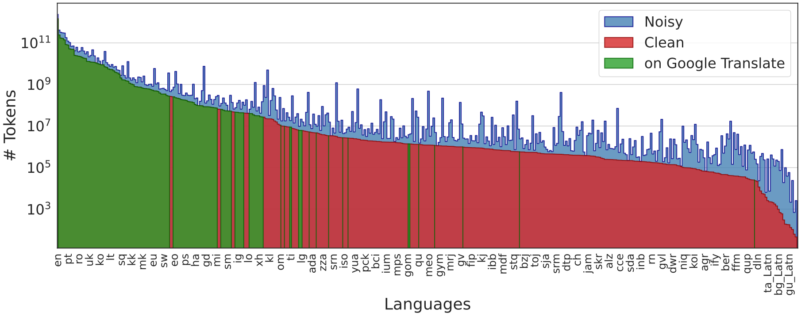
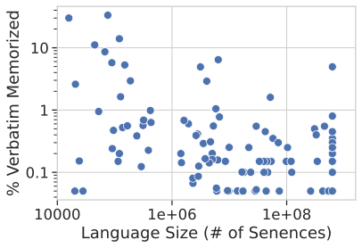
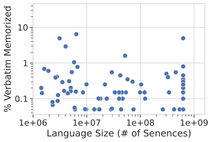
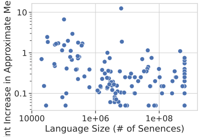
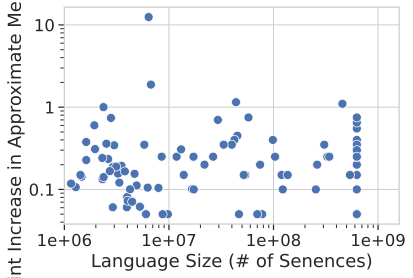

**Source:** *MADLAD-400: A Multilingual And Document-Level Large Audited Dataset* — [PDF](https://arxiv.org/pdf/2309.04662v1) · [arXiv](https://arxiv.org/abs/2309.04662v1)

# MADLAD-400: A Multilingual And Document-Level Large Audited Dataset

Sneha Kudugunta† Isaac Caswell⋄ Biao Zhang† Xavier Garcia† Affiliation: Christopher A. Choquette-Choo† Katherine Lee† Derrick Xin† Aditya Kusupati⋄ Affiliation: Romi Stella† Ankur Bapna† Orhan Firat† Affiliation: †Google DeepMind  ⋄Google Research 

###### Abstract

We introduce MADLAD-400, a manually audited, general domain 3T token monolingual dataset based on CommonCrawl, spanning 419 languages. We discuss the limitations revealed by self-auditing MADLAD-400, and the role data auditing had in the dataset creation process. We then train and release a 10.7B-parameter multilingual machine translation model on 250 billion tokens covering over 450 languages using publicly available data, and find that it is competitive with models that are significantly larger, and report the results on different domains. In addition, we train a 8B-parameter language model, and assess the results on few-shot translation. We make the baseline models 11 1 <https://github.com/google-research/google-research/tree/master/madlad_400> available to the research community.

---

 

## 1 Introduction

The availability of large multilingual corpora has accelerated the progress of multilingual natural language processing (NLP) models [[69](https://arxiv.org/html/2309.04662v1#bib.bib69), [19](https://arxiv.org/html/2309.04662v1#bib.bib19), [47](https://arxiv.org/html/2309.04662v1#bib.bib47), [9](https://arxiv.org/html/2309.04662v1#bib.bib9), [51](https://arxiv.org/html/2309.04662v1#bib.bib51)]. However, most publicly available general-domain multilingual corpora contain 100-200 languages [[69](https://arxiv.org/html/2309.04662v1#bib.bib69), [51](https://arxiv.org/html/2309.04662v1#bib.bib51), [2](https://arxiv.org/html/2309.04662v1#bib.bib2)], with some datasets containing more languages in specific domains such as religious content [[4](https://arxiv.org/html/2309.04662v1#bib.bib4)], children’s books [[45](https://arxiv.org/html/2309.04662v1#bib.bib45)] or dialects [[3](https://arxiv.org/html/2309.04662v1#bib.bib3)].

A common approach to creating such datasets is to mine language specific data from general web crawls such as CommonCrawl [[57](https://arxiv.org/html/2309.04662v1#bib.bib57), [43](https://arxiv.org/html/2309.04662v1#bib.bib43), [68](https://arxiv.org/html/2309.04662v1#bib.bib68)] to create datasets. We simply take this approach and scale it. We train a document-level LangID model on 498 languages to obtain CommonCrawl annotations at a document level and obtain a 5-trillion token, document-level monolingual dataset.

However, such web-scale corpora are known to be noisy and contain undesirable content [[53](https://arxiv.org/html/2309.04662v1#bib.bib53), [48](https://arxiv.org/html/2309.04662v1#bib.bib48), [21](https://arxiv.org/html/2309.04662v1#bib.bib21)], with their multilingual partitions often having their own specific issues such as unusable text, misaligned and mislabeled/ambiguously labeled data [[40](https://arxiv.org/html/2309.04662v1#bib.bib40)]. To mitigate this, we manually audit our data. Based on our findings, we discard 79 of the languages from our preliminary dataset, rename or combine several languages and apply additional preprocessing steps. Finally, to validate the efficacy of our dataset, we train multilingual machine translation models of various sizes up to 10.7B parameters, as well as an 8B decoder-only model, and then evaluate these models on highly multilingual translation evaluation sets.

In Section [2](https://arxiv.org/html/2309.04662v1#S2 "2 MADLAD-400 ‣ MADLAD-400: A Multilingual And Document-Level Large Audited Dataset"), we describe the creation and composition of MADLAD-400, and discuss the results of the audit. Then, in Section [3](https://arxiv.org/html/2309.04662v1#S3 "3 Parallel Data ‣ MADLAD-400: A Multilingual And Document-Level Large Audited Dataset"), we describe the parallel data we collect using publicly available sources to train the multilingual machine translation models described in Section [4.1](https://arxiv.org/html/2309.04662v1#S4.SS1 "4.1 MT Models ‣ 4 Experiments ‣ MADLAD-400: A Multilingual And Document-Level Large Audited Dataset"). In Section [4](https://arxiv.org/html/2309.04662v1#S4 "4 Experiments ‣ MADLAD-400: A Multilingual And Document-Level Large Audited Dataset"), we describe the training process of the multilingual machine translation models and 8B decoder-only model, and then evaluate these models on highly multilingual translation datasets. In Section [5](https://arxiv.org/html/2309.04662v1#S5 "5 Training Data Extraction and Memorization ‣ MADLAD-400: A Multilingual And Document-Level Large Audited Dataset") we describe our tests for memorization in the multilingual models that we release and discuss preliminary results. Finally, we discuss the limitations of this work and directions for future work.

 Figure 1: Comparing the size of the noisy and clean monolingual datasets in MADLAD-400. The difference is more noticeable on lower-resource languages, where noise effects are especially severe. For reference, languages supported by Google Translate are shaded in green. Note that, since this chart is in log scale, the difference in size is much greater than it may appear; for instance, for the lower-resource half of the dataset, the ratio is about 4\(\times\) on median.

## 2 MADLAD-400

The process we follow to create MADLAD-400 is similar to that of other large-scale web corpora [[15](https://arxiv.org/html/2309.04662v1#bib.bib15), [68](https://arxiv.org/html/2309.04662v1#bib.bib68), [2](https://arxiv.org/html/2309.04662v1#bib.bib2), [51](https://arxiv.org/html/2309.04662v1#bib.bib51)]. First, we collect as large a dataset of unlabeled web text as possible. More specifically, we use all available snapshots of CommonCrawl22 2 https://commoncrawl.org/ as of August 20, 2022. After some preliminary data cleaning, we use a highly multilingual LangID model to provide document-level annotations (Section [2.2](https://arxiv.org/html/2309.04662v1#S2.SS2 "2.2 Language Identification \(LangID\) ‣ 2 MADLAD-400 ‣ MADLAD-400: A Multilingual And Document-Level Large Audited Dataset")). Finally, we conduct a self-audit (Section [2.4](https://arxiv.org/html/2309.04662v1#S2.SS4 "2.4 Self-Audit \(Quality Review\) ‣ 2 MADLAD-400 ‣ MADLAD-400: A Multilingual And Document-Level Large Audited Dataset")), or quality review, of this preliminary dataset partitioned by language, and design filters to remove noisy content. When appropriate, we correct language names and remove languages from the preliminary dataset. We note that building MADLAD-400 was an iterative process, and that while we describe one major quality review in depth, we conducted several stages of filtering. To reflect this, we describe the preprocessing steps and improvements made in chronological order.

  

Continent | # Languages  
---|---  
Asia | 149  
Americas | 66  
Africa | 87  
Europe | 89  
Oceania | 26  
Constructed | 2

 Table 1: Geographic distribution of languages in MADLAD-400.

We release two version of this dataset: a 5 trillion token noisy dataset, which is the dataset obtained before applying document-level LangID and the final filters, and a 3 trillion token clean dataset, which has a variety of filters applied based on our self-audit, though it naturally has a fair amount of noise itself. Each dataset is released in both a document-level form and a sentence-level form. Some overall statistics for these dataset versions are given in Table [2](https://arxiv.org/html/2309.04662v1#S2.T2 "Table 2 ‣ 2 MADLAD-400 ‣ MADLAD-400: A Multilingual And Document-Level Large Audited Dataset"), with a graph visualizing the distribution of sizes (number of tokens) across languages in Figure [1](https://arxiv.org/html/2309.04662v1#S1.F1 "Figure 1 ‣ 1 Introduction ‣ MADLAD-400: A Multilingual And Document-Level Large Audited Dataset"). The final version of MADLAD-400 has 419 languages, with a varied geographic distribution, as seen in Table [2](https://arxiv.org/html/2309.04662v1#S2 "2 MADLAD-400 ‣ MADLAD-400: A Multilingual And Document-Level Large Audited Dataset").

Table 2:  Overall statistics of both the noisy and clean partitions of MADLAD-400.

<table id="S2.T2.8.1" class="ltx_tabular ltx_align_middle">
<tr id="S2.T2.8.1.1" class="ltx_tr">
<td id="S2.T2.8.1.1.1" class="ltx_td ltx_align_left ltx_border_tt" rowspan="2">Dataset Version</td>
<td id="S2.T2.8.1.1.2" class="ltx_td ltx_align_center ltx_border_tt" colspan="2"># Documents</td>
<td id="S2.T2.8.1.1.3" class="ltx_td ltx_align_center ltx_border_tt" colspan="2"># Sentences</td>
<td id="S2.T2.8.1.1.4" class="ltx_td ltx_align_center ltx_border_tt" colspan="2"># Tokens</td></tr>
<tr id="S2.T2.8.1.2" class="ltx_tr">
<td id="S2.T2.8.1.2.1" class="ltx_td ltx_align_center ltx_border_t">Total</td>
<td id="S2.T2.8.1.2.2" class="ltx_td ltx_align_center ltx_border_t">Median</td>
<td id="S2.T2.8.1.2.3" class="ltx_td ltx_align_center ltx_border_t">Total</td>
<td id="S2.T2.8.1.2.4" class="ltx_td ltx_align_center ltx_border_t">Median</td>
<td id="S2.T2.8.1.2.5" class="ltx_td ltx_align_center ltx_border_t">Total</td>
<td id="S2.T2.8.1.2.6" class="ltx_td ltx_nopad_r ltx_align_center ltx_border_t">Median</td></tr>
<tr id="S2.T2.8.1.3" class="ltx_tr">
<td id="S2.T2.8.1.3.1" class="ltx_td ltx_align_left ltx_border_t">MADLAD-400-noisy</td>
<td id="S2.T2.8.1.3.2" class="ltx_td ltx_align_center ltx_border_t">7.8B</td>
<td id="S2.T2.8.1.3.3" class="ltx_td ltx_align_center ltx_border_t">27K</td>
<td id="S2.T2.8.1.3.4" class="ltx_td ltx_align_center ltx_border_t">150B</td>
<td id="S2.T2.8.1.3.5" class="ltx_td ltx_align_center ltx_border_t">240K</td>
<td id="S2.T2.8.1.3.6" class="ltx_td ltx_align_center ltx_border_t">5.0T</td>
<td id="S2.T2.8.1.3.7" class="ltx_td ltx_nopad_r ltx_align_center ltx_border_t">7.1M</td></tr>
<tr id="S2.T2.8.1.4" class="ltx_tr">
<td id="S2.T2.8.1.4.1" class="ltx_td ltx_align_left ltx_border_bb">MADLAD-400-clean</td>
<td id="S2.T2.8.1.4.2" class="ltx_td ltx_align_center ltx_border_bb">4.0B</td>
<td id="S2.T2.8.1.4.3" class="ltx_td ltx_align_center ltx_border_bb">1.7K</td>
<td id="S2.T2.8.1.4.4" class="ltx_td ltx_align_center ltx_border_bb">100B</td>
<td id="S2.T2.8.1.4.5" class="ltx_td ltx_align_center ltx_border_bb">73K</td>
<td id="S2.T2.8.1.4.6" class="ltx_td ltx_align_center ltx_border_bb">2.8T</td>
<td id="S2.T2.8.1.4.7" class="ltx_td ltx_nopad_r ltx_align_center ltx_border_bb">1.2M</td></tr>
</table>

 

### 2.1 Preliminary Filters

We carry out a few preliminary preprocessing steps on the web-crawled corpus: first, we deduplicate lines across documents [[44](https://arxiv.org/html/2309.04662v1#bib.bib44)]. Then, we filter out all pages that do not contain at least 3 lines of 200 or more characters (as done by [Xue et al. [68]](https://arxiv.org/html/2309.04662v1#bib.bib68)). We also use other commonly used filtering heuristics such as removing lines containing the word “Javascript” and removing pages that contain “lorem ipsum” and curly brackets “{” (as done by [Raffel et al. [57]](https://arxiv.org/html/2309.04662v1#bib.bib57)).

### 2.2 Language Identification (LangID)

We train a Semi-Supervised LangID model (SSLID) on 500 languages, following the recipe introduced by [Caswell et al. [15]](https://arxiv.org/html/2309.04662v1#bib.bib15). We then filter the corpus on document-level LangID, which was taken to be the majority sentence-level LangID prediction. The resulting dataset is MADLAD-400-noisy. For the Additional details on these LangID models is in Appendix [A.1](https://arxiv.org/html/2309.04662v1#A1.SS1 "A.1 LangID Details ‣ Appendix A Appendix ‣ MADLAD-400: A Multilingual And Document-Level Large Audited Dataset").

### 2.3 Filtering Out Questionable Content

To assess the quality of this preliminary dataset, we inspected 20 sentences each from a subset of 30 languages in our dataset. Based on our observations, we introduced a score, pct_questionable. The pct_questionable score is simply the percentage of sentences in the input document that were “questionable”. A sentence was considered questionable if any of the following were true:

  1. Document consistency: Sentence-level LangID does not match the document-level LangID. 
  2. List Case: Over 50% percent of the tokens began in a capital letter (we apply this filter only if the sentence has at least 12 tokens.) 
  3. Abnormal Lengths: The sentence has under 20 characters or over 500 characters. We note that this is a bad heuristic for ideographic languages33 3 <http://www.grcdi.nl/dqglossary/ideographic%20language.html>). 
  4. Technical Characters: Over 20% of the characters in the sentence match [0-9{}+/()>]. 
  5. Cursed Regexes: The sentence matched a “cursed regex”. These are a heuristic set of substrings and regexes that we found accounted for a significant amount of questionable content in the data samples we observed. They are described in depth in Appendix [A.2](https://arxiv.org/html/2309.04662v1#A1.SS2 "A.2 Filtering Details ‣ Appendix A Appendix ‣ MADLAD-400: A Multilingual And Document-Level Large Audited Dataset"). 

We removed all documents with a percent_questionable score greater than 20%. Furthermore, we removed any document with under 5 sentences.

### 2.4 Self-Audit (Quality Review)

After filtering out generally lower-quality content with the approach described above, we performed a self-audit of every corpus in this dataset, following [Kreutzer et al. [40]](https://arxiv.org/html/2309.04662v1#bib.bib40). The aim of our self-audit was to correct any remaining systematic issues by either applying additional filters, renaming/merging language codes, or completely removing the language from the dataset. Although we do not speak most of the 498 languages, we were able to give high-level comments on the general quality. For each language, we inspected a sample of 20 documents. This task was evenly divided between the first two authors based in part on which scripts they could read. We used the following guidelines:

  * If dataset is mostly plausibly in-language text, we can keep it. For unknown languages, search the web for a few sentences and look at the website and URL for language clues. 
  * If dataset is noisy but the noise looks filterable, leave a note of how to filter it. 
  * If the dataset is very noisy and does not look possible to filter, mark it for removal. 
  * Optionally put note that may be helpful for downstream users, e.g. if dataset is 100% Bible. 

We made the decision to include languages that looked noisy, but omit any language that was majority noise, or only had 20 or fewer docs. While this is not a high quality bar, we hope it still has the potential to be useful to the research community, given that foundation models have demonstrated the potential to learn distributions for very few exammples [[12](https://arxiv.org/html/2309.04662v1#bib.bib12)]. The motivation for not releasing “nonsense” or tiny datasets is to avoid giving a false sense of how multilingual the dataset is (“Representation washing”), as recommended by Quality at a Glance [[40](https://arxiv.org/html/2309.04662v1#bib.bib40)].

##### Overall Results.

Of the 498 languages that we obtained LangID annotations for, we decided to omit 79 languages, bringing the final number of languages in MADLAD-400 to 419. Based on the self-audit, we also expanded the filters (particularly the cursed regexes), and made changes as described in Sections [2.5](https://arxiv.org/html/2309.04662v1#S2.SS5 "2.5 Additional Filters ‣ 2 MADLAD-400 ‣ MADLAD-400: A Multilingual And Document-Level Large Audited Dataset") and [2.6](https://arxiv.org/html/2309.04662v1#S2.SS6 "2.6 Correcting Other Systematic Issues. ‣ 2 MADLAD-400 ‣ MADLAD-400: A Multilingual And Document-Level Large Audited Dataset"). We details stats for these languages in Appendix Section [A.4](https://arxiv.org/html/2309.04662v1#A1.SS4 "A.4 Monolingual Data Details ‣ Appendix A Appendix ‣ MADLAD-400: A Multilingual And Document-Level Large Audited Dataset").

For transparency, we provide full results of the self-audit in Appendix [A.4](https://arxiv.org/html/2309.04662v1#A1.SS4 "A.4 Monolingual Data Details ‣ Appendix A Appendix ‣ MADLAD-400: A Multilingual And Document-Level Large Audited Dataset"). In Table [3](https://arxiv.org/html/2309.04662v1#S2.T3 "Table 3 ‣ Overall Results. ‣ 2.4 Self-Audit \(Quality Review\) ‣ 2 MADLAD-400 ‣ MADLAD-400: A Multilingual And Document-Level Large Audited Dataset"), we provide an overview of the issues surfaced through this self-audit. We find that a significant fraction of languages contain mostly or entirely religious documents, while other issues include misrendered text, pornographic content, and boilerplate.

Table 3:  Summary of results of the audit on the preliminary dataset comprising of 498 languages. Note that there may be multiple issues with data in one language.

# Languages… |   
---|---  
Audited | 498  
With significant amounts of Bible data | 141  
With significant amounts of JW data | 37  
With significant amounts of LDS data | 2  
With significant amounts of virama-based issues | 8  
With a significant number of short docs | 42  
With complaints about noise | 28  
With complaints about porn | 10  
With complaints about boilerplate | 15  
With a note to remove from the dataset | 77

 

### 2.5 Additional Filters

Based on the results of the self-audit, we apply three additional filters.

##### Virama Filtering and Correction.

Many languages using Brahmic Abugida (South and Southeast Asian scripts like Devanagari, Khmer, etc.) use some variant on the virama 44 4 <https://en.wikipedia.org/wiki/Virama> character. We found that such languages in MADLAD-400-noisy had incorrectly encoded viramas: for example, 

 was rendered as 

 , where the middle character is a detached virama. Therefore, for the languages bn, my, pa, gu, or, ta, te, kn, ml, si, th, tl, mn, lo, bo, km, hi, mr, ne, gom, as, jv, dv, bho, dz, hne, ks_Deva, mag, mni, shn, yue, zh, ja, kjg, mnw, ksw, rki, mtr, mwr and xnr, we did a special filtering/correction step — we removed all extraneous spaces before virama characters. We provide the pseudocode and list of virama characters in Appendix [A.2](https://arxiv.org/html/2309.04662v1#A1.SS2 "A.2 Filtering Details ‣ Appendix A Appendix ‣ MADLAD-400: A Multilingual And Document-Level Large Audited Dataset").

##### Zawgyi Encoded Data.

We found that languages using Myanmar script like my and mnw appeared to have the same issues with virama characters that still remained after applying the virama correction. This was because a large fraction of Myanmar script data on the internet is Zawgyi encoded data, which appears to have the rendering issues described above if rendered in Unicode. Therefore, we used an open-source Zawgyi detector 55 5 <https://github.com/google/myanmar-tools> to convert the encoding of documents with more than a 50% probability of being Zawgyi encoded into standard Unicode encoding.

##### Chinese-Specific Filters.

The Mandarin (zh) data in CommonCrawl had a particular issue with pornographic content. We combed through the data and developed a list of strings likely to be present in pornographic content, and filtered out all documents containing the strings in the blocklist. This resulted in a 17% reduction in the number of documents and a 56% reduction in file size. We list these strings in Appendix [A.2](https://arxiv.org/html/2309.04662v1#A1.SS2 "A.2 Filtering Details ‣ Appendix A Appendix ‣ MADLAD-400: A Multilingual And Document-Level Large Audited Dataset").

### 2.6 Correcting Other Systematic Issues.

Based on various specific notes from the self-audit, we made a variety of changes. Five datasets were found to be in the wrong language, and were renamed or merged into the correct dataset. Six languages that looked suspicious were run by native speakers of those or related languages, some of which were discarded, and some of which were merged into the correct dataset. Finally, we removed all languages with fewer than 20 documents. Details can be seen in Appendix [A.3](https://arxiv.org/html/2309.04662v1#A1.SS3 "A.3 Other issues fixed after the self-audit ‣ Appendix A Appendix ‣ MADLAD-400: A Multilingual And Document-Level Large Audited Dataset").

## 3 Parallel Data

To train the machine translation (MT) models described in Section [4.1](https://arxiv.org/html/2309.04662v1#S4.SS1 "4.1 MT Models ‣ 4 Experiments ‣ MADLAD-400: A Multilingual And Document-Level Large Audited Dataset"), we also collect a dataset composed of publicly available datasets coming from various data sources. A full list of the data sources and associated language pairs are in Appendix [A.5](https://arxiv.org/html/2309.04662v1#A1.SS5 "A.5 Parallel Data Details ‣ Appendix A Appendix ‣ MADLAD-400: A Multilingual And Document-Level Large Audited Dataset"). The final dataset has 156 languages across 4.1B sentence pairs and 4124 language pairs total. In the rest of the paper, we refer to the input sentence to an MT model as the “source side" and the reference/output sentence as the “target side".

### 3.1 Filters

We describe the data preprocessing steps taken below. We find that a significant amount of data is filtered out, with the amount of data available 396 of 4.1k language pairs reducing by more than \(40\%\).

##### Deduplication.

We deduplicate sentence pairs that are an exact match on both the source and target.

##### Virama Filtering and Correction/Zawgyi Encoded Data.

We observed the same issues described in Section [2.5](https://arxiv.org/html/2309.04662v1#S2.SS5 "2.5 Additional Filters ‣ 2 MADLAD-400 ‣ MADLAD-400: A Multilingual And Document-Level Large Audited Dataset"), and used the same filters for sentence pairs where either the source language or target language belonged to the list of languages in Section [2.5](https://arxiv.org/html/2309.04662v1#S2.SS5 "2.5 Additional Filters ‣ 2 MADLAD-400 ‣ MADLAD-400: A Multilingual And Document-Level Large Audited Dataset").

##### Unmatched Toxicity Filters.

We use the unmatched toxicity filters described by [NLLBTeam et al. [51]](https://arxiv.org/html/2309.04662v1#bib.bib51), but ultimately unusable for our purposes in most cases. For the languages ace, am, ar, az, bg, bm, bn, bs, cs, din, en, es, fa, fr, ga, gl, ha, hi, id, it, kk, ko, ml, ms, my, nl, no, nus, prs, ru, scn, sd, so, sv, tg, th, tt, ur, uz and zh, more than 3% of documents were marked as having unmatched toxicity. On closer inspection, we found that while zh and ko had a lot of pornographic content that was removed by the filtering process, most other languages removed sentences that had homonyms of non-toxic words. Similarly, languages like id, ur, tg, fa and no had data from Tanzil (Qur’an dataset), but the toxicity word lists contained words such as kafir, mercy and purity, that are not normally considered toxic content for our purpose of filtering the dataset using wordlists.

##### Source-Target Filters.

We removed all sentences that have more than 75% overlap between the source and target side. To avoid filtering out valid entity translations, we only applied this filter on sentences longer than 5 tokens. In addition, we remove sentence pairs whose source length to target length ratio falls outside of \(0.66-1.5\). We omitted this filter for the following, which are mainly non-whitespace languages: zh, ja, ko, km, my, lo, th, wuu, shn, zh_tw, zh_cn,iu, simple, dz, kr_Arab, din, nus and mi.

##### Script Filters.

We removed all sentences that are less than 50% in-script for both the source and target language. For instance, if the sentence was supposed to be in kaa (Cyrillic script) but was 70% in the Latin script, we removed it.

### 3.2 Self-Audit (Quality Review)

Similar to the self-audit done for MADLAD-400, we conducted a review of the data sources that compose the parallel data we collected to verify the quality of this data. We collected 20 source-target pairs from each language, and assessed the data for the presence of offensive content, porn, and whether the data seemed to be of the correct language pair and whether the target sentence seemed to be a plausible translation. Since we did not have access to native speakers of all 157 languages, the latter was primarily based on guesses. In Appendix [A.5](https://arxiv.org/html/2309.04662v1#A1.SS5 "A.5 Parallel Data Details ‣ Appendix A Appendix ‣ MADLAD-400: A Multilingual And Document-Level Large Audited Dataset") we provide full details of the instructions we provided to auditors, the results of the self-audit and any changes made the dataset.

### 3.3 A Note on Language Codes

As observed by [Kreutzer et al. [40]](https://arxiv.org/html/2309.04662v1#bib.bib40), the datasets used to create the parallel data (and MADLAD-400) use a variety of different language codes. We use the BCP-47 standard, which specifies the 2-letter ISO-693-1 code when applicable, and otherwise the ISO-693-3 code. Script tags and region tags are omitted when they are defined as the default value by CLDR 66 6 <https://cldr.unicode.org/>, and otherwise included. For example, ks refers to Kashmiri in Nastaliq/Arabic script (CLDR default), whereas ks_Deva refers to Kashmiri in Devanagari. A detailed investigation of codes in MADLAD-400 can be found in Appendix [A.3](https://arxiv.org/html/2309.04662v1#A1.SS3 "A.3 Other issues fixed after the self-audit ‣ Appendix A Appendix ‣ MADLAD-400: A Multilingual And Document-Level Large Audited Dataset").

### 3.4 Multiway Data

We create additional multiway data by applying the \(n\)-gram matching method (\(n=8\)) from [Freitag and Firat [25]](https://arxiv.org/html/2309.04662v1#bib.bib25) to the processed dataset. Using this, and the publicly available data, we obtain 11.9B sentences across a total of 20742 language pairs. Full details may be found in Appendix [A.7](https://arxiv.org/html/2309.04662v1#A1.SS7 "A.7 Multiway Data Details ‣ Appendix A Appendix ‣ MADLAD-400: A Multilingual And Document-Level Large Audited Dataset").

## 4 Experiments

We validate our data by training encoder-decoder machine translation models in Section [4.1](https://arxiv.org/html/2309.04662v1#S4.SS1 "4.1 MT Models ‣ 4 Experiments ‣ MADLAD-400: A Multilingual And Document-Level Large Audited Dataset") and decoder-only language models in Section [4.2](https://arxiv.org/html/2309.04662v1#S4.SS2 "4.2 Zero-shot Translation with Language Models ‣ 4 Experiments ‣ MADLAD-400: A Multilingual And Document-Level Large Audited Dataset"), and test them on several translation benchmarks.

### 4.1 MT Models

We train models of various sizes: a 3B, 32-layer parameter model,77 7 Here and elsewhere, ‘X-layer’ means X encoder layers and also X decoder layers, for a total of 2X layers. a 7.2B 48-layer parameter model and a 10.7B 32-layer parameter model. We share all parameters of the model across language pairs, and use a Sentence Piece Model [[41](https://arxiv.org/html/2309.04662v1#bib.bib41)] with 256k tokens shared on both the encoder and decoder side. Each input sentence has a <2xx> token prepended to the source sentence to indicate the target language [[35](https://arxiv.org/html/2309.04662v1#bib.bib35)].

We use both supervised parallel data with a machine translation objective and the monolingual MADLAD-400 dataset with a MASS-style [[62](https://arxiv.org/html/2309.04662v1#bib.bib62)] objective to train this model. Each of these objectives is sampled with a 50% probability. Within each task, we use the recently introduced UniMax [[18](https://arxiv.org/html/2309.04662v1#bib.bib18)] sampling strategy to sample languages from our imbalanced dataset with a threshold of \(N=10\) epochs for any particular language. We also explored back-translation by randomly sampling 2M monolingual samples (or the total number of samples for that given language) for each language and translating them to/from English using the 3B model. Following [Bapna et al. [9]](https://arxiv.org/html/2309.04662v1#bib.bib9) (§3.5), we filter the back-translated data in a variety of ways. For a natural target and a back-translated source, we filter by round-trip ChrF to discourage hallucinations (threshold of 0.32), by ChrF between source and target to discourage copying (threshold of 0.30), by the length ratio of source to target (asymmetric bounds of (0.45, 1.6), and by LangID prediction of the source. We then finetune the 7.2B model for a \(10,000\) steps by randomly mixing the original and the back-translated data with a combining ratio of 1:1. We list specific architecture and training details of these models in Appendix [A.8](https://arxiv.org/html/2309.04662v1#A1.SS8 "A.8 Model Training Details ‣ Appendix A Appendix ‣ MADLAD-400: A Multilingual And Document-Level Large Audited Dataset").

### 4.2 Zero-shot Translation with Language Models

Given recent interest in the efficacy of unsupervised translation using large language models, we explore training language models solely on the monolingual data. We follow the same training schedule and model configurations from [Garcia et al. [27]](https://arxiv.org/html/2309.04662v1#bib.bib27). In particular, we consider 8B decoder-only models, following the same model hyperparameters as previous work [[17](https://arxiv.org/html/2309.04662v1#bib.bib17), [27](https://arxiv.org/html/2309.04662v1#bib.bib27)]. We train these models using a variant of the UL2 objective [[63](https://arxiv.org/html/2309.04662v1#bib.bib63)] adapted for decoder-only models, and use the same configuration as previous work [[27](https://arxiv.org/html/2309.04662v1#bib.bib27), [52](https://arxiv.org/html/2309.04662v1#bib.bib52)]. We provide additional details in Appendix [A.8](https://arxiv.org/html/2309.04662v1#A1.SS8 "A.8 Model Training Details ‣ Appendix A Appendix ‣ MADLAD-400: A Multilingual And Document-Level Large Audited Dataset").

### 4.3 Evaluation

We use the sacreBLEU [[55](https://arxiv.org/html/2309.04662v1#bib.bib55)] implementation of bleu88 8 BLEU+case.mixed+lang.<sl>-<tl>\+ numrefs.1+smooth.exp+tok.<tok>+version.1.3.0, tok=zh if tl=zh and 13a otherwise. and chrf99 9 nrefs:1|case:mixed|eff:yes|nc:6|nw:0|space:no|version:2.3.1 as metrics. We evaluate our trained models on the following datasets:

##### WMT.

We use the 15 WMT languages frequently used to evaluate multilingual machine translation models by [Siddhant et al. [61]](https://arxiv.org/html/2309.04662v1#bib.bib61), [Kim et al. [38]](https://arxiv.org/html/2309.04662v1#bib.bib38), [Kudugunta et al. [42]](https://arxiv.org/html/2309.04662v1#bib.bib42), [NLLBTeam et al. [51]](https://arxiv.org/html/2309.04662v1#bib.bib51): cs, de, es, fi, fr, gu, hi, kk, lv, lt, ro, rs, es, tr and zh.

##### Flores-200.

We evaluate on the languages in the Flores-200 dataset [[51](https://arxiv.org/html/2309.04662v1#bib.bib51)] that overlap with the languages available in either MADLAD-400 or the parallel data described in Section [3](https://arxiv.org/html/2309.04662v1#S3 "3 Parallel Data ‣ MADLAD-400: A Multilingual And Document-Level Large Audited Dataset"). We list these languages in Appendix [A.9](https://arxiv.org/html/2309.04662v1#A1.SS9 "A.9 Languages Evaluated ‣ Appendix A Appendix ‣ MADLAD-400: A Multilingual And Document-Level Large Audited Dataset"). For non-English-centric pairs, we evaluate on a 272 language pair subset of the 40k language pairs possible due to computational constraints. We evaluate on all language pairs possible using the following languages as either source or target language: en, fr, cs, zh, et, mr, eu, cy, so, ckb, or, yo, ny, ti, ln, fon and ss. We obtained this set of languages by selecting every \(10^{th}\) language by number of tokens in MADLAD-400 (clean), starting with French (fr). Noticing that this had no Indian languages, we shifted af and fo (both close dialects of HRLS) down one index to mr and or, respectively. Finally, we noticed that this initial list had supervised and unsupervised languages, but didn’t have a good representative of a “slightly supervised language”, that is, one with a small but extant amount of parallel data. Therefore, we added yo to the list, which has the least parallel data of any supervised language. This resulting subset of languages also contains a nice variety of scripts: Latin, Chinese, Devanagari, Arabic, Odia, and Ethiopic scripts.

##### NTREX.

We evaluate on the languages in the recently introduced NTREX dataset [[23](https://arxiv.org/html/2309.04662v1#bib.bib23)].

##### Gatones.

Finally, we evaluate on the languages in Gatones, the in-house, 38-language eval set used in [[9](https://arxiv.org/html/2309.04662v1#bib.bib9)] and the Gatitos paper [[36](https://arxiv.org/html/2309.04662v1#bib.bib36)]. Again, we take the subset of languages overlapping with the languages available in either MADLAD-400 or the parallel training data.

Table 4:  Evaluation scores on WMT (depicted as <bleu> / <chrf>) for the MT models and language models described in Section [4.1](https://arxiv.org/html/2309.04662v1#S4.SS1 "4.1 MT Models ‣ 4 Experiments ‣ MADLAD-400: A Multilingual And Document-Level Large Audited Dataset") and Section [4.2](https://arxiv.org/html/2309.04662v1#S4.SS2 "4.2 Zero-shot Translation with Language Models ‣ 4 Experiments ‣ MADLAD-400: A Multilingual And Document-Level Large Audited Dataset") compared against NLLB-54B.

<table id="S4.T4.4.1" class="ltx_tabular ltx_align_middle">
<tr id="S4.T4.4.1.1" class="ltx_tr">
<td id="S4.T4.4.1.1.1" class="ltx_td ltx_border_tt" rowspan="2"></td>
<td id="S4.T4.4.1.1.2" class="ltx_td ltx_align_center ltx_border_tt" rowspan="2">NLLB</td>
<td id="S4.T4.4.1.1.3" class="ltx_td ltx_align_center ltx_border_tt" rowspan="2">MT-3B</td>
<td id="S4.T4.4.1.1.4" class="ltx_td ltx_align_center ltx_border_tt" rowspan="2">MT-7.2B</td>
<td id="S4.T4.4.1.1.5" class="ltx_td ltx_align_center ltx_border_tt" rowspan="2">MT-10.7B</td>
<td id="S4.T4.4.1.1.6" class="ltx_td ltx_align_center ltx_border_tt" colspan="4">LM-8B</td></tr>
<tr id="S4.T4.4.1.2" class="ltx_tr">
<td id="S4.T4.4.1.2.1" class="ltx_td ltx_align_center ltx_border_t">0-shot</td>
<td id="S4.T4.4.1.2.2" class="ltx_td ltx_align_center ltx_border_t">1-shot</td>
<td id="S4.T4.4.1.2.3" class="ltx_td ltx_align_center ltx_border_t">5-shot</td>
<td id="S4.T4.4.1.2.4" class="ltx_td ltx_align_center ltx_border_t">10-shot</td></tr>
<tr id="S4.T4.4.1.3" class="ltx_tr">
<td id="S4.T4.4.1.3.1" class="ltx_td ltx_align_left ltx_border_t">xx2en</td>
<td id="S4.T4.4.1.3.2" class="ltx_td ltx_align_center ltx_border_t">34.2 / 60.4</td>
<td id="S4.T4.4.1.3.3" class="ltx_td ltx_align_center ltx_border_t">33.4 / 60.0</td>
<td id="S4.T4.4.1.3.4" class="ltx_td ltx_align_center ltx_border_t">34.9 / 60.6</td>
<td id="S4.T4.4.1.3.5" class="ltx_td ltx_align_center ltx_border_t">34.6 / 60.8</td>
<td id="S4.T4.4.1.3.6" class="ltx_td ltx_align_center ltx_border_t">2.3 / 17.3</td>
<td id="S4.T4.4.1.3.7" class="ltx_td ltx_align_center ltx_border_t">25.1 / 51.4</td>
<td id="S4.T4.4.1.3.8" class="ltx_td ltx_align_center ltx_border_t">26.2 / 52.9</td>
<td id="S4.T4.4.1.3.9" class="ltx_td ltx_nopad_r ltx_align_center ltx_border_t">26.2 / 53.4</td></tr>
<tr id="S4.T4.4.1.4" class="ltx_tr">
<td id="S4.T4.4.1.4.1" class="ltx_td ltx_align_left">en2xx</td>
<td id="S4.T4.4.1.4.2" class="ltx_td ltx_align_center">31.1 / 58.0</td>
<td id="S4.T4.4.1.4.3" class="ltx_td ltx_align_center">28.2 / 55.4</td>
<td id="S4.T4.4.1.4.4" class="ltx_td ltx_align_center">29.3 / 56.2</td>
<td id="S4.T4.4.1.4.5" class="ltx_td ltx_align_center">29.0 / 56.2</td>
<td id="S4.T4.4.1.4.6" class="ltx_td ltx_align_center">1.0 / 10.3</td>
<td id="S4.T4.4.1.4.7" class="ltx_td ltx_align_center">18.7 / 43.5</td>
<td id="S4.T4.4.1.4.8" class="ltx_td ltx_align_center">18.8 / 44.5</td>
<td id="S4.T4.4.1.4.9" class="ltx_td ltx_nopad_r ltx_align_center">19.3 / 45.5</td></tr>
<tr id="S4.T4.4.1.5" class="ltx_tr">
<td id="S4.T4.4.1.5.1" class="ltx_td ltx_align_left ltx_border_bb">Average</td>
<td id="S4.T4.4.1.5.2" class="ltx_td ltx_align_center ltx_border_bb">32.7 / 59.2</td>
<td id="S4.T4.4.1.5.3" class="ltx_td ltx_align_center ltx_border_bb">30.8 / 57.7</td>
<td id="S4.T4.4.1.5.4" class="ltx_td ltx_align_center ltx_border_bb">32.1 / 58.4</td>
<td id="S4.T4.4.1.5.5" class="ltx_td ltx_align_center ltx_border_bb">31.8 / 58.5</td>
<td id="S4.T4.4.1.5.6" class="ltx_td ltx_align_center ltx_border_bb">1.6 / 13.8</td>
<td id="S4.T4.4.1.5.7" class="ltx_td ltx_align_center ltx_border_bb">21.9 / 47.4</td>
<td id="S4.T4.4.1.5.8" class="ltx_td ltx_align_center ltx_border_bb">22.5 / 48.7</td>
<td id="S4.T4.4.1.5.9" class="ltx_td ltx_nopad_r ltx_align_center ltx_border_bb">22.8 / 49.4</td></tr>
</table>

 

Table 5:  Evaluation scores on Flores-200 (depicted as <bleu> / <chrf>) for the MT models and language models described in Section [4.1](https://arxiv.org/html/2309.04662v1#S4.SS1 "4.1 MT Models ‣ 4 Experiments ‣ MADLAD-400: A Multilingual And Document-Level Large Audited Dataset") and Section [4.2](https://arxiv.org/html/2309.04662v1#S4.SS2 "4.2 Zero-shot Translation with Language Models ‣ 4 Experiments ‣ MADLAD-400: A Multilingual And Document-Level Large Audited Dataset") compared against NLLB-54B. All metrics are computed with the sacrebleu reference implementation.

<table id="S4.T5.4.1" class="ltx_tabular ltx_align_middle">
<tr id="S4.T5.4.1.1" class="ltx_tr">
<td id="S4.T5.4.1.1.1" class="ltx_td ltx_border_tt" rowspan="2"></td>
<td id="S4.T5.4.1.1.2" class="ltx_td ltx_align_center ltx_border_tt" rowspan="2">NLLB</td>
<td id="S4.T5.4.1.1.3" class="ltx_td ltx_align_center ltx_border_tt" rowspan="2">MT-3B</td>
<td id="S4.T5.4.1.1.4" class="ltx_td ltx_align_center ltx_border_tt" rowspan="2">MT-7.2B</td>
<td id="S4.T5.4.1.1.5" class="ltx_td ltx_align_center ltx_border_tt" rowspan="2">MT-10.7B</td>
<td id="S4.T5.4.1.1.6" class="ltx_td ltx_align_center ltx_border_tt" colspan="4">LM-8B</td></tr>
<tr id="S4.T5.4.1.2" class="ltx_tr">
<td id="S4.T5.4.1.2.1" class="ltx_td ltx_align_center ltx_border_t">0-shot</td>
<td id="S4.T5.4.1.2.2" class="ltx_td ltx_align_center ltx_border_t">1-shot</td>
<td id="S4.T5.4.1.2.3" class="ltx_td ltx_align_center ltx_border_t">5-shot</td>
<td id="S4.T5.4.1.2.4" class="ltx_td ltx_nopad_r ltx_align_center ltx_border_t">10-shot</td></tr>
<tr id="S4.T5.4.1.3" class="ltx_tr">
<td id="S4.T5.4.1.3.1" class="ltx_td ltx_align_left ltx_border_t">xx2en</td>
<td id="S4.T5.4.1.3.2" class="ltx_td ltx_align_center ltx_border_t">35.5 / 59.6</td>
<td id="S4.T5.4.1.3.3" class="ltx_td ltx_align_center ltx_border_t">29.7 / 54.4</td>
<td id="S4.T5.4.1.3.4" class="ltx_td ltx_align_center ltx_border_t">30.9 / 55.4</td>
<td id="S4.T5.4.1.3.5" class="ltx_td ltx_align_center ltx_border_t">31.9 / 56.4</td>
<td id="S4.T5.4.1.3.6" class="ltx_td ltx_align_center ltx_border_t">2.0 / 13.3</td>
<td id="S4.T5.4.1.3.7" class="ltx_td ltx_align_center ltx_border_t">20.5 / 44.1</td>
<td id="S4.T5.4.1.3.8" class="ltx_td ltx_align_center ltx_border_t">22.3 / 46.9</td>
<td id="S4.T5.4.1.3.9" class="ltx_td ltx_nopad_r ltx_align_center ltx_border_t">22.4 / 47.6</td></tr>
<tr id="S4.T5.4.1.4" class="ltx_tr">
<td id="S4.T5.4.1.4.1" class="ltx_td ltx_align_left">en2xx</td>
<td id="S4.T5.4.1.4.2" class="ltx_td ltx_align_center">20.7 / 50.1</td>
<td id="S4.T5.4.1.4.3" class="ltx_td ltx_align_center">17.3 / 44.1</td>
<td id="S4.T5.4.1.4.4" class="ltx_td ltx_align_center">17.8 / 44.7</td>
<td id="S4.T5.4.1.4.5" class="ltx_td ltx_align_center">18.6 / 45.7</td>
<td id="S4.T5.4.1.4.6" class="ltx_td ltx_align_center">0.4 / 5.7</td>
<td id="S4.T5.4.1.4.7" class="ltx_td ltx_align_center">8.1 / 26.7</td>
<td id="S4.T5.4.1.4.8" class="ltx_td ltx_align_center">8.7 / 29.0</td>
<td id="S4.T5.4.1.4.9" class="ltx_td ltx_nopad_r ltx_align_center">8.7 / 28.8</td></tr>
<tr id="S4.T5.4.1.5" class="ltx_tr">
<td id="S4.T5.4.1.5.1" class="ltx_td ltx_align_left">Mean</td>
<td id="S4.T5.4.1.5.2" class="ltx_td ltx_align_center">28.2 / 54.9</td>
<td id="S4.T5.4.1.5.3" class="ltx_td ltx_align_center">23.5 / 49.2</td>
<td id="S4.T5.4.1.5.4" class="ltx_td ltx_align_center">24.4 / 50.0</td>
<td id="S4.T5.4.1.5.5" class="ltx_td ltx_align_center">25.3 / 51.1</td>
<td id="S4.T5.4.1.5.6" class="ltx_td ltx_align_center">1.2 / 9.6</td>
<td id="S4.T5.4.1.5.7" class="ltx_td ltx_align_center">14.3 / 35.5</td>
<td id="S4.T5.4.1.5.8" class="ltx_td ltx_align_center">15.6 / 38.0</td>
<td id="S4.T5.4.1.5.9" class="ltx_td ltx_nopad_r ltx_align_center">15.6 / 38.2</td></tr>
<tr id="S4.T5.4.1.6" class="ltx_tr">
<td id="S4.T5.4.1.6.1" class="ltx_td ltx_align_left ltx_border_bb">xx2yy</td>
<td id="S4.T5.4.1.6.2" class="ltx_td ltx_align_center ltx_border_bb">13.7 / 40.5</td>
<td id="S4.T5.4.1.6.3" class="ltx_td ltx_align_center ltx_border_bb">8.8 / 31.2</td>
<td id="S4.T5.4.1.6.4" class="ltx_td ltx_align_center ltx_border_bb">8.4 / 30.9</td>
<td id="S4.T5.4.1.6.5" class="ltx_td ltx_align_center ltx_border_bb">10.1 / 34.0</td>
<td id="S4.T5.4.1.6.6" class="ltx_td ltx_align_center ltx_border_bb">0.3 / 4.1</td>
<td id="S4.T5.4.1.6.7" class="ltx_td ltx_align_center ltx_border_bb">4.0 / 16.1</td>
<td id="S4.T5.4.1.6.8" class="ltx_td ltx_align_center ltx_border_bb">4.4 / 17.3</td>
<td id="S4.T5.4.1.6.9" class="ltx_td ltx_nopad_r ltx_align_center ltx_border_bb">4.2 / 17.1</td></tr>
</table>

 

#### 4.3.1 Few-shot evaluation for language modeling

We perform few-shot prompting to evaluate the language model with the following prompt:

[sl]:\(X_{1}\)\n[tl]:\(Y_{1}\)\n\n[sl]:\(X_{2}\)\n[tl]:\(Y_{2}\)\n\n…[sl]:\(X\)\n[tl]:

where [sl] and [tl] denote the source and target language name (expressed in English. For example, when translating a sentence from en to te, we use [sl]=English and [tl]=Telugu), respectively. \(X_{\star}\) and \(Y_{\star}\) are demonstration examples used for prompting, and \(X\) is the test input.

For each test example, we randomly sample demonstration examples, which is simple yet performs competitively with more complicated strategies [[66](https://arxiv.org/html/2309.04662v1#bib.bib66), [72](https://arxiv.org/html/2309.04662v1#bib.bib72)]. In particular, we randomly select examples from the dev split of each dataset. Since NTREX does not have a dev split, we randomly sample 1000 examples as the dev set and use the rest for test evaluation.

Table 6:  Evaluation scores on the recently introduced NTREX test set (depicted as <bleu> / <chrf>) for the MT models and language models described in Section [4.1](https://arxiv.org/html/2309.04662v1#S4.SS1 "4.1 MT Models ‣ 4 Experiments ‣ MADLAD-400: A Multilingual And Document-Level Large Audited Dataset") and Section [4.2](https://arxiv.org/html/2309.04662v1#S4.SS2 "4.2 Zero-shot Translation with Language Models ‣ 4 Experiments ‣ MADLAD-400: A Multilingual And Document-Level Large Audited Dataset") compared against unsupervised baselines [[10](https://arxiv.org/html/2309.04662v1#bib.bib10)]. Note that LM-8B is evaluated on a 50% split of the NTREX data and is not comparable to the MT-model evaluations.

<table id="S4.T6.4.1" class="ltx_tabular ltx_align_middle">
<tr id="S4.T6.4.1.1" class="ltx_tr">
<td id="S4.T6.4.1.1.1" class="ltx_td ltx_border_tt" rowspan="2"></td>
<td id="S4.T6.4.1.1.2" class="ltx_td ltx_align_center ltx_border_tt" rowspan="2"><cite class="ltx_cite ltx_citemacro_citet"><a href="https://arxiv.org/html/2309.04662v1#bib.bib10" title="" class="ltx_ref">Baziotis et al. [10]</a></cite></td>
<td id="S4.T6.4.1.1.3" class="ltx_td ltx_align_center ltx_border_tt" rowspan="2">MT-3B</td>
<td id="S4.T6.4.1.1.4" class="ltx_td ltx_align_center ltx_border_tt" rowspan="2">MT-7.2B</td>
<td id="S4.T6.4.1.1.5" class="ltx_td ltx_align_center ltx_border_tt" rowspan="2">MT-10.7B</td>
<td id="S4.T6.4.1.1.6" class="ltx_td ltx_align_center ltx_border_tt" colspan="4">LM-8B</td></tr>
<tr id="S4.T6.4.1.2" class="ltx_tr">
<td id="S4.T6.4.1.2.1" class="ltx_td ltx_align_center ltx_border_t">0-shot</td>
<td id="S4.T6.4.1.2.2" class="ltx_td ltx_align_center ltx_border_t">1-shot</td>
<td id="S4.T6.4.1.2.3" class="ltx_td ltx_align_center ltx_border_t">5-shot</td>
<td id="S4.T6.4.1.2.4" class="ltx_td ltx_nopad_r ltx_align_center ltx_border_t">10-shot</td></tr>
<tr id="S4.T6.4.1.3" class="ltx_tr">
<td id="S4.T6.4.1.3.1" class="ltx_td ltx_align_left ltx_border_t" colspan="8">Results on the subset of <cite class="ltx_cite ltx_citemacro_citet"><a href="https://arxiv.org/html/2309.04662v1#bib.bib10" title="" class="ltx_ref">Baziotis et al. [10]</a></cite></td>
<td id="S4.T6.4.1.3.2" class="ltx_td ltx_border_t"></td></tr>
<tr id="S4.T6.4.1.4" class="ltx_tr">
<td id="S4.T6.4.1.4.1" class="ltx_td ltx_align_left">xx2en</td>
<td id="S4.T6.4.1.4.2" class="ltx_td ltx_align_center">23.6 / 51.7</td>
<td id="S4.T6.4.1.4.3" class="ltx_td ltx_align_center">34.3 / 59.9</td>
<td id="S4.T6.4.1.4.4" class="ltx_td ltx_align_center">36.1 / 61.0</td>
<td id="S4.T6.4.1.4.5" class="ltx_td ltx_align_center">35.9 / 61.1</td>
<td id="S4.T6.4.1.4.6" class="ltx_td ltx_align_center">4.0 / 18.9</td>
<td id="S4.T6.4.1.4.7" class="ltx_td ltx_align_center">23.4 / 48.8</td>
<td id="S4.T6.4.1.4.8" class="ltx_td ltx_align_center">26.8 / 52.8</td>
<td id="S4.T6.4.1.4.9" class="ltx_td ltx_nopad_r ltx_align_center">27.6 / 53.7</td></tr>
<tr id="S4.T6.4.1.5" class="ltx_tr">
<td id="S4.T6.4.1.5.1" class="ltx_td ltx_align_left">en2xx</td>
<td id="S4.T6.4.1.5.2" class="ltx_td ltx_align_center">15.9 / 44.8</td>
<td id="S4.T6.4.1.5.3" class="ltx_td ltx_align_center">22.3 / 50.2</td>
<td id="S4.T6.4.1.5.4" class="ltx_td ltx_align_center">22.8 / 50.6</td>
<td id="S4.T6.4.1.5.5" class="ltx_td ltx_align_center">22.8 / 51.0</td>
<td id="S4.T6.4.1.5.6" class="ltx_td ltx_align_center">1.0 / 8.8</td>
<td id="S4.T6.4.1.5.7" class="ltx_td ltx_align_center">15.2 / 40.1</td>
<td id="S4.T6.4.1.5.8" class="ltx_td ltx_align_center">16.5 / 42.4</td>
<td id="S4.T6.4.1.5.9" class="ltx_td ltx_nopad_r ltx_align_center">15.9 / 42.3</td></tr>
<tr id="S4.T6.4.1.6" class="ltx_tr">
<td id="S4.T6.4.1.6.1" class="ltx_td ltx_align_left">Average</td>
<td id="S4.T6.4.1.6.2" class="ltx_td ltx_align_center">19.8 / 51.7</td>
<td id="S4.T6.4.1.6.3" class="ltx_td ltx_align_center">28.3 / 55.1</td>
<td id="S4.T6.4.1.6.4" class="ltx_td ltx_align_center">29.4 / 55.8</td>
<td id="S4.T6.4.1.6.5" class="ltx_td ltx_align_center">29.4 / 56.1</td>
<td id="S4.T6.4.1.6.6" class="ltx_td ltx_align_center">2.5 / 13.9</td>
<td id="S4.T6.4.1.6.7" class="ltx_td ltx_align_center">19.3 / 44.5</td>
<td id="S4.T6.4.1.6.8" class="ltx_td ltx_align_center">21.6 / 47.6</td>
<td id="S4.T6.4.1.6.9" class="ltx_td ltx_nopad_r ltx_align_center">21.8 / 48.0</td></tr>
<tr id="S4.T6.4.1.7" class="ltx_tr">
<td id="S4.T6.4.1.7.1" class="ltx_td ltx_align_left ltx_border_t" colspan="8">Results on full test sets</td>
<td id="S4.T6.4.1.7.2" class="ltx_td ltx_border_t"></td></tr>
<tr id="S4.T6.4.1.8" class="ltx_tr">
<td id="S4.T6.4.1.8.1" class="ltx_td ltx_align_left">xx2en</td>
<td id="S4.T6.4.1.8.2" class="ltx_td ltx_align_center">-</td>
<td id="S4.T6.4.1.8.3" class="ltx_td ltx_align_center">30.6 / 54.5</td>
<td id="S4.T6.4.1.8.4" class="ltx_td ltx_align_center">32.7 / 56.2</td>
<td id="S4.T6.4.1.8.5" class="ltx_td ltx_align_center">33.6 / 57.6</td>
<td id="S4.T6.4.1.8.6" class="ltx_td ltx_align_center">3.2 / 17.3</td>
<td id="S4.T6.4.1.8.7" class="ltx_td ltx_align_center">20.4 / 43.8</td>
<td id="S4.T6.4.1.8.8" class="ltx_td ltx_align_center">23.8 / 48.2</td>
<td id="S4.T6.4.1.8.9" class="ltx_td ltx_nopad_r ltx_align_center">24.4 / 49.0</td></tr>
<tr id="S4.T6.4.1.9" class="ltx_tr">
<td id="S4.T6.4.1.9.1" class="ltx_td ltx_align_left">en2xx</td>
<td id="S4.T6.4.1.9.2" class="ltx_td ltx_align_center">-</td>
<td id="S4.T6.4.1.9.3" class="ltx_td ltx_align_center">16.5 / 39.6</td>
<td id="S4.T6.4.1.9.4" class="ltx_td ltx_align_center">17.6 / 41.9</td>
<td id="S4.T6.4.1.9.5" class="ltx_td ltx_align_center">17.9 / 41.9</td>
<td id="S4.T6.4.1.9.6" class="ltx_td ltx_align_center">0.8 / 7.3</td>
<td id="S4.T6.4.1.9.7" class="ltx_td ltx_align_center">11.7 / 31.2</td>
<td id="S4.T6.4.1.9.8" class="ltx_td ltx_align_center">12.6 / 32.4</td>
<td id="S4.T6.4.1.9.9" class="ltx_td ltx_nopad_r ltx_align_center">12.3 / 32.3</td></tr>
<tr id="S4.T6.4.1.10" class="ltx_tr">
<td id="S4.T6.4.1.10.1" class="ltx_td ltx_align_left ltx_border_bb">Average</td>
<td id="S4.T6.4.1.10.2" class="ltx_td ltx_align_center ltx_border_bb">-</td>
<td id="S4.T6.4.1.10.3" class="ltx_td ltx_align_center ltx_border_bb">23.5 / 47.0</td>
<td id="S4.T6.4.1.10.4" class="ltx_td ltx_align_center ltx_border_bb">25.1 / 49.0</td>
<td id="S4.T6.4.1.10.5" class="ltx_td ltx_align_center ltx_border_bb">25.7 / 49.7</td>
<td id="S4.T6.4.1.10.6" class="ltx_td ltx_align_center ltx_border_bb">2.0 / 12.3</td>
<td id="S4.T6.4.1.10.7" class="ltx_td ltx_align_center ltx_border_bb">16.0 / 37.4</td>
<td id="S4.T6.4.1.10.8" class="ltx_td ltx_align_center ltx_border_bb">18.1 / 40.2</td>
<td id="S4.T6.4.1.10.9" class="ltx_td ltx_nopad_r ltx_align_center ltx_border_bb">18.3 / 40.6</td></tr>
</table>

 

### 4.4 Results

In Tables [4](https://arxiv.org/html/2309.04662v1#S4.T4 "Table 4 ‣ Gatones. ‣ 4.3 Evaluation ‣ 4 Experiments ‣ MADLAD-400: A Multilingual And Document-Level Large Audited Dataset") and [6](https://arxiv.org/html/2309.04662v1#S4.T6 "Table 6 ‣ 4.3.1 Few-shot evaluation for language modeling ‣ 4.3 Evaluation ‣ 4 Experiments ‣ MADLAD-400: A Multilingual And Document-Level Large Audited Dataset") we present evaluation scores on the WMT datasets and NTREX datasets, which are evaluation sets in the news domain. We find that both the 7.2B parameter model and the 10B parameter model is competitive with the significantly larger NLLB-54B model [[51](https://arxiv.org/html/2309.04662v1#bib.bib51)] on WMT. For the recent NTREX dataset, the only published results are small-scale results by [Baziotis et al. [10]](https://arxiv.org/html/2309.04662v1#bib.bib10).

In Table [5](https://arxiv.org/html/2309.04662v1#S4.T5 "Table 5 ‣ Gatones. ‣ 4.3 Evaluation ‣ 4 Experiments ‣ MADLAD-400: A Multilingual And Document-Level Large Audited Dataset") we find that on Flores-200, our model is within 3.8 chrf of the 54B parameter NLLB model, while on xxyy pairs the 10.7B model is behind by 6.5 chrf. This is likely due to a combination of factors, including using a significantly smaller model (5x smaller), domain differences [[10](https://arxiv.org/html/2309.04662v1#bib.bib10), [9](https://arxiv.org/html/2309.04662v1#bib.bib9)], and back-translated data [[60](https://arxiv.org/html/2309.04662v1#bib.bib60)]. Similarly, in Table [7](https://arxiv.org/html/2309.04662v1#S4.T7 "Table 7 ‣ 4.4 Results ‣ 4 Experiments ‣ MADLAD-400: A Multilingual And Document-Level Large Audited Dataset"), we find that the 10.7B parameter model is within 5.7 chrf of the scores reported by [Bapna et al. [9]](https://arxiv.org/html/2309.04662v1#bib.bib9). Again, it is very difficult to compare their results to ours; their two largest advantages are 1) iterative back-translation, and 2) access to a much larger in-house text data. In Table [8](https://arxiv.org/html/2309.04662v1#S4.T8 "Table 8 ‣ 4.4 Results ‣ 4 Experiments ‣ MADLAD-400: A Multilingual And Document-Level Large Audited Dataset"), we display the results for when we finetune the 7.2B parameter model on backtranslated data. While this setup is very likely sub-optimal, we see that back-translation greatly improves en2xx translation (by 3.0 chrf, in the case of Flores-200) in most cases. We note that the results we present are merely baselines to demonstrate the utility of MADLAD-400, and hope that future work builds upon these experiments by applying improved modeling techniques.

Finally, across all evaluation datasets, we find that while results on few-shot translation using the 8B language model increase with an increasing number of demonstrations, these results are still significantly weaker than the results of models trained on supervised data. We present per-language pair results on all datasets in Appendix [A.10](https://arxiv.org/html/2309.04662v1#A1.SS10 "A.10 Results Details ‣ Appendix A Appendix ‣ MADLAD-400: A Multilingual And Document-Level Large Audited Dataset").

Table 7:  Evaluation scores on the Gatones test set used by [Bapna et al. [9]](https://arxiv.org/html/2309.04662v1#bib.bib9) (depicted as <bleu> / <chrf>) for the MT models and language models described in Section [4.1](https://arxiv.org/html/2309.04662v1#S4.SS1 "4.1 MT Models ‣ 4 Experiments ‣ MADLAD-400: A Multilingual And Document-Level Large Audited Dataset") and Section [4.2](https://arxiv.org/html/2309.04662v1#S4.SS2 "4.2 Zero-shot Translation with Language Models ‣ 4 Experiments ‣ MADLAD-400: A Multilingual And Document-Level Large Audited Dataset").

<table id="S4.T7.6.1" class="ltx_tabular ltx_align_middle">
<tr id="S4.T7.6.1.1" class="ltx_tr">
<td id="S4.T7.6.1.1.1" class="ltx_td ltx_border_tt" rowspan="2"></td>
<td id="S4.T7.6.1.1.2" class="ltx_td ltx_align_center ltx_border_tt" colspan="2">NTL (<cite class="ltx_cite ltx_citemacro_citet"><a href="https://arxiv.org/html/2309.04662v1#bib.bib9" title="" class="ltx_ref">Bapna et al. [9]</a></cite>)</td>
<td id="S4.T7.6.1.1.3" class="ltx_td ltx_align_center ltx_border_tt" rowspan="2">MT-3B</td>
<td id="S4.T7.6.1.1.4" class="ltx_td ltx_align_center ltx_border_tt" rowspan="2">MT-7.2B</td>
<td id="S4.T7.6.1.1.5" class="ltx_td ltx_align_center ltx_border_tt" rowspan="2">MT-10.7B</td>
<td id="S4.T7.6.1.1.6" class="ltx_td ltx_align_center ltx_border_tt" colspan="4">LM-8B</td></tr>
<tr id="S4.T7.6.1.2" class="ltx_tr">
<td id="S4.T7.6.1.2.1" class="ltx_td ltx_align_center ltx_border_t">1.6B</td>
<td id="S4.T7.6.1.2.2" class="ltx_td ltx_align_center ltx_border_t">6.4B</td>
<td id="S4.T7.6.1.2.3" class="ltx_td ltx_align_center ltx_border_t">0-shot</td>
<td id="S4.T7.6.1.2.4" class="ltx_td ltx_align_center ltx_border_t">1-shot</td>
<td id="S4.T7.6.1.2.5" class="ltx_td ltx_align_center ltx_border_t">5-shot</td>
<td id="S4.T7.6.1.2.6" class="ltx_td ltx_nopad_r ltx_align_center ltx_border_t">10-shot</td></tr>
<tr id="S4.T7.6.1.3" class="ltx_tr">
<td id="S4.T7.6.1.3.1" class="ltx_td ltx_align_left ltx_border_t">xx2en</td>
<td id="S4.T7.6.1.3.2" class="ltx_td ltx_align_center ltx_border_t">- / 37.2</td>
<td id="S4.T7.6.1.3.3" class="ltx_td ltx_align_center ltx_border_t">- / 41.2</td>
<td id="S4.T7.6.1.3.4" class="ltx_td ltx_align_center ltx_border_t">13.3 / 34.6</td>
<td id="S4.T7.6.1.3.5" class="ltx_td ltx_align_center ltx_border_t">14.8 / 36.0</td>
<td id="S4.T7.6.1.3.6" class="ltx_td ltx_align_center ltx_border_t">15.4 / 37.0</td>
<td id="S4.T7.6.1.3.7" class="ltx_td ltx_align_center ltx_border_t">0.3 / 6.5</td>
<td id="S4.T7.6.1.3.8" class="ltx_td ltx_align_center ltx_border_t">6.6 / 25.4</td>
<td id="S4.T7.6.1.3.9" class="ltx_td ltx_align_center ltx_border_t">8.3 / 28.1</td>
<td id="S4.T7.6.1.3.10" class="ltx_td ltx_nopad_r ltx_align_center ltx_border_t">8.4 / 28.4</td></tr>
<tr id="S4.T7.6.1.4" class="ltx_tr">
<td id="S4.T7.6.1.4.1" class="ltx_td ltx_align_left">en2xx</td>
<td id="S4.T7.6.1.4.2" class="ltx_td ltx_align_center">- / 28.5</td>
<td id="S4.T7.6.1.4.3" class="ltx_td ltx_align_center">- / 33.1</td>
<td id="S4.T7.6.1.4.4" class="ltx_td ltx_align_center">4.5 / 23.9</td>
<td id="S4.T7.6.1.4.5" class="ltx_td ltx_align_center">5.4 / 26.2</td>
<td id="S4.T7.6.1.4.6" class="ltx_td ltx_align_center">5.4 / 26.5</td>
<td id="S4.T7.6.1.4.7" class="ltx_td ltx_align_center">0.2 / 4.2</td>
<td id="S4.T7.6.1.4.8" class="ltx_td ltx_align_center">1.7 / 10.5</td>
<td id="S4.T7.6.1.4.9" class="ltx_td ltx_align_center">1.7 / 9.9</td>
<td id="S4.T7.6.1.4.10" class="ltx_td ltx_nopad_r ltx_align_center">1.8 / 9.4</td></tr>
<tr id="S4.T7.6.1.5" class="ltx_tr">
<td id="S4.T7.6.1.5.1" class="ltx_td ltx_align_left ltx_border_bb">Average</td>
<td id="S4.T7.6.1.5.2" class="ltx_td ltx_align_center ltx_border_bb">- / 32.9</td>
<td id="S4.T7.6.1.5.3" class="ltx_td ltx_align_center ltx_border_bb">- / 37.2</td>
<td id="S4.T7.6.1.5.4" class="ltx_td ltx_align_center ltx_border_bb">8.9 / 29.3</td>
<td id="S4.T7.6.1.5.5" class="ltx_td ltx_align_center ltx_border_bb">10.1 / 31.1</td>
<td id="S4.T7.6.1.5.6" class="ltx_td ltx_align_center ltx_border_bb">10.4 / 31.8</td>
<td id="S4.T7.6.1.5.7" class="ltx_td ltx_align_center ltx_border_bb">0.3 / 5.4</td>
<td id="S4.T7.6.1.5.8" class="ltx_td ltx_align_center ltx_border_bb">4.2 / 18.0</td>
<td id="S4.T7.6.1.5.9" class="ltx_td ltx_align_center ltx_border_bb">5.0 / 19.0</td>
<td id="S4.T7.6.1.5.10" class="ltx_td ltx_nopad_r ltx_align_center ltx_border_bb">5.1 / 18.9</td></tr>
</table>

 

Table 8:  Evaluation scores on different test sets (depicted as <bleu> / <chrf>) for MT-7.2B trained with back-translated data (+BT).

<table id="S4.T8.4.1" class="ltx_tabular ltx_align_middle">
<tr id="S4.T8.4.1.1" class="ltx_tr">
<td id="S4.T8.4.1.1.1" class="ltx_td ltx_border_tt"></td>
<td id="S4.T8.4.1.1.2" class="ltx_td ltx_align_center ltx_border_tt" colspan="2">WMT</td>
<td id="S4.T8.4.1.1.3" class="ltx_td ltx_align_center ltx_border_tt" colspan="2">Flores-200</td>
<td id="S4.T8.4.1.1.4" class="ltx_td ltx_align_center ltx_border_tt" colspan="2">NTREX</td>
<td id="S4.T8.4.1.1.5" class="ltx_td ltx_align_center ltx_border_tt" colspan="2">Gatones</td></tr>
<tr id="S4.T8.4.1.2" class="ltx_tr">
<td id="S4.T8.4.1.2.1" class="ltx_td"></td>
<td id="S4.T8.4.1.2.2" class="ltx_td ltx_align_center ltx_border_t">MT-7.2B</td>
<td id="S4.T8.4.1.2.3" class="ltx_td ltx_align_center ltx_border_t">+BT</td>
<td id="S4.T8.4.1.2.4" class="ltx_td ltx_align_center ltx_border_t">MT-7.2B</td>
<td id="S4.T8.4.1.2.5" class="ltx_td ltx_align_center ltx_border_t">+BT</td>
<td id="S4.T8.4.1.2.6" class="ltx_td ltx_align_center ltx_border_t">MT-7.2B</td>
<td id="S4.T8.4.1.2.7" class="ltx_td ltx_align_center ltx_border_t">+BT</td>
<td id="S4.T8.4.1.2.8" class="ltx_td ltx_align_center ltx_border_t">MT-7.2B</td>
<td id="S4.T8.4.1.2.9" class="ltx_td ltx_nopad_r ltx_align_center ltx_border_t">+BT</td></tr>
<tr id="S4.T8.4.1.3" class="ltx_tr">
<td id="S4.T8.4.1.3.1" class="ltx_td ltx_align_left ltx_border_t">xx2en</td>
<td id="S4.T8.4.1.3.2" class="ltx_td ltx_align_center ltx_border_t">34.9 / 60.6</td>
<td id="S4.T8.4.1.3.3" class="ltx_td ltx_align_center ltx_border_t">33.8 / 60.4</td>
<td id="S4.T8.4.1.3.4" class="ltx_td ltx_align_center ltx_border_t">30.9 / 55.4</td>
<td id="S4.T8.4.1.3.5" class="ltx_td ltx_align_center ltx_border_t">27.2 / 53.9</td>
<td id="S4.T8.4.1.3.6" class="ltx_td ltx_align_center ltx_border_t">32.7 / 56.2</td>
<td id="S4.T8.4.1.3.7" class="ltx_td ltx_align_center ltx_border_t">31.0 / 56.5</td>
<td id="S4.T8.4.1.3.8" class="ltx_td ltx_align_center ltx_border_t">14.8 / 36.0</td>
<td id="S4.T8.4.1.3.9" class="ltx_td ltx_nopad_r ltx_align_center ltx_border_t">10.2 / 34.5</td></tr>
<tr id="S4.T8.4.1.4" class="ltx_tr">
<td id="S4.T8.4.1.4.1" class="ltx_td ltx_align_left">en2xx</td>
<td id="S4.T8.4.1.4.2" class="ltx_td ltx_align_center">29.3 / 56.2</td>
<td id="S4.T8.4.1.4.3" class="ltx_td ltx_align_center">29.8 / 56.9</td>
<td id="S4.T8.4.1.4.4" class="ltx_td ltx_align_center">17.8 / 44.7</td>
<td id="S4.T8.4.1.4.5" class="ltx_td ltx_align_center">18.5 / 47.7</td>
<td id="S4.T8.4.1.4.6" class="ltx_td ltx_align_center">17.6 / 41.9</td>
<td id="S4.T8.4.1.4.7" class="ltx_td ltx_align_center">18.4 / 44.4</td>
<td id="S4.T8.4.1.4.8" class="ltx_td ltx_align_center">5.4 / 26.2</td>
<td id="S4.T8.4.1.4.9" class="ltx_td ltx_nopad_r ltx_align_center">3.5 / 26.1</td></tr>
<tr id="S4.T8.4.1.5" class="ltx_tr">
<td id="S4.T8.4.1.5.1" class="ltx_td ltx_align_left">average</td>
<td id="S4.T8.4.1.5.2" class="ltx_td ltx_align_center">32.1 / 58.4</td>
<td id="S4.T8.4.1.5.3" class="ltx_td ltx_align_center">31.8 / 58.6</td>
<td id="S4.T8.4.1.5.4" class="ltx_td ltx_align_center">24.4 / 50.0</td>
<td id="S4.T8.4.1.5.5" class="ltx_td ltx_align_center">22.8 / 50.8</td>
<td id="S4.T8.4.1.5.6" class="ltx_td ltx_align_center">25.1 / 49.0</td>
<td id="S4.T8.4.1.5.7" class="ltx_td ltx_align_center">24.7 / 50.4</td>
<td id="S4.T8.4.1.5.8" class="ltx_td ltx_align_center">10.1 / 31.1</td>
<td id="S4.T8.4.1.5.9" class="ltx_td ltx_nopad_r ltx_align_center">6.9 / 30.3</td></tr>
<tr id="S4.T8.4.1.6" class="ltx_tr">
<td id="S4.T8.4.1.6.1" class="ltx_td ltx_align_left ltx_border_bb">xx2yy</td>
<td id="S4.T8.4.1.6.2" class="ltx_td ltx_align_center ltx_border_bb">-</td>
<td id="S4.T8.4.1.6.3" class="ltx_td ltx_align_center ltx_border_bb">-</td>
<td id="S4.T8.4.1.6.4" class="ltx_td ltx_align_center ltx_border_bb">8.4 / 30.9</td>
<td id="S4.T8.4.1.6.5" class="ltx_td ltx_align_center ltx_border_bb">8.4 / 31.9</td>
<td id="S4.T8.4.1.6.6" class="ltx_td ltx_align_center ltx_border_bb">-</td>
<td id="S4.T8.4.1.6.7" class="ltx_td ltx_align_center ltx_border_bb">-</td>
<td id="S4.T8.4.1.6.8" class="ltx_td ltx_align_center ltx_border_bb">-</td>
<td id="S4.T8.4.1.6.9" class="ltx_td ltx_nopad_r ltx_align_center ltx_border_bb">-</td></tr>
</table>

 

## 5 Training Data Extraction and Memorization

Generative models have been shown to regurgitate training data [[13](https://arxiv.org/html/2309.04662v1#bib.bib13)] that may plagiarize, violate copyright assumptions, or infringe privacy. It can be difficult to assess and prevent these cases because such information may be paraphrased in ways that are difficult for automated systems to detect [[32](https://arxiv.org/html/2309.04662v1#bib.bib32)]. Instead, existing literature measures memorization in generative models to estimate the propensity for disallowed outputs. Typically, this means prompting a language model with some prefix of length \(P\) and comparing generated outputs of length \(S\) with the training data to see if they are ‘novel’ or if the generation is simply a regurgitation of its training data [[13](https://arxiv.org/html/2309.04662v1#bib.bib13), [6](https://arxiv.org/html/2309.04662v1#bib.bib6), [32](https://arxiv.org/html/2309.04662v1#bib.bib32), [33](https://arxiv.org/html/2309.04662v1#bib.bib33), [14](https://arxiv.org/html/2309.04662v1#bib.bib14)]. In the multilingual setting this may present new risks because tail languages may be more vulnerable to memorization [[6](https://arxiv.org/html/2309.04662v1#bib.bib6)].

##### The Difficulty of Assessing Memorization in Translation Settings.

While memorization has been well-studied for language models, assessing the extent of memorization is difficult within translation settings. This is primarily because translation has a significantly smaller space of valid outputs, as opposed to many possible continuations for language modeling. This presents some difficulty in extending common memorization tests for language generation to translation. As an illustrative example, consider the case of translating to the same target language as the source ("translate_copy"). Performing a standard training data extraction attack would test if the generation matches the continuation. However, success would not indicate training data extraction as the adversary would have already had access to it.1010 10 Though membership inference may be possible. Thus, we modify the standard framework for testing memorization to better identify _additional_ leaked data.

##### Memorization in Translation Settings

We define memorization in translate_copy to be when the model outputs any generation with length \(S>P\) that matches the continuation; then, \(S-P\) captures the additional bits. In cases where the source and target language are different ("translate_diff"), performing a similar test would require knowledge of which part of the continuation exactly corresponded to the prompt. Given that such an alignment is not easily obtained, we instead use the relative token lengths between the continuation and the prompt to choose an appropriate size of \(S\). For example, if at training time the continuation for the target language was \(1.5\times\) larger, we set \(S=P\cdot 1.5+\delta\) where \(\delta\) captures the additional bits. For each of translate_copy and translate_diff, we sample \(2,000\) sequences for each language and choose \(P=50\). We then perform both a verbatim match of the generation with the continuation and an approximate match requiring \(90\%\) Levenshtein similarity similar to [[32](https://arxiv.org/html/2309.04662v1#bib.bib32)].

##### Results.

We show the per-language and average training data extraction rates, for both the translate_copy and translate_diff settings in Figure [2](https://arxiv.org/html/2309.04662v1#S5.F2 "Figure 2 ‣ Discussion ‣ 5 Training Data Extraction and Memorization ‣ MADLAD-400: A Multilingual And Document-Level Large Audited Dataset"), with \(S\) set to test for \(50\) tokens of additional information leakage. We find that translate models can memorize and regurgitate their training data, even beyond what is contained in the prompt. We also observe that some lower resource languages may exhibit higher memorization rates, however we observe no strong correlation between the resource level and the level of memorization. In the translate_diff tests, we observe much lower memorization - we hypothesize this may be due to the higher difficulty of the task. Even though many languages have nontrivial memorization, we found that many languages exhibited no memorization across the samples tested (257/370 for translate_copy and 130/146 for translate_diff ). We also present results for approximate memorization in Appendix [A.12](https://arxiv.org/html/2309.04662v1#A1.SS12 "A.12 Additional Memorization Figures ‣ Appendix A Appendix ‣ MADLAD-400: A Multilingual And Document-Level Large Audited Dataset"), which show that translate models may also paraphrase memorizations leading to even higher memorization rates.

##### Discussion

Our preliminary experiments show that memorization can exist in the translation setting. However, capturing when memorization is intended or beneficial versus undesired is still an open question. To aid future research in this direction, we design and include “canaries”—carefully crafted data designed to be outliers to the natural training distribution that can be used to analyze memorization. Canaries enable studying memorization in the multilingual and machine translation settings by measuring the capability to extract canaries added to the training set [[6](https://arxiv.org/html/2309.04662v1#bib.bib6), [33](https://arxiv.org/html/2309.04662v1#bib.bib33)]. As with [Anil et al. [6]](https://arxiv.org/html/2309.04662v1#bib.bib6), our canaries are designed to share characteristics with the natural training data so as to better ground memorization evaluation in practical risks. The canaries are also designed tosl be outliers to assess varying degrees of risk. To ensure similarity with natural data, canaries are generated by sampling and then randomly modifying real data in a manner similar to [[6](https://arxiv.org/html/2309.04662v1#bib.bib6)], where each source of randomness defines the canary type. In total, we generate \(1,945,631\) canaries across both the monolingual MADLAD-400 dataset and the parallel data (\(\approx 0.0026\%\) of the training data). The methodology for each canary type and the exact distribution of canaries are detailed in Appendix [A.11](https://arxiv.org/html/2309.04662v1#A1.SS11 "A.11 Canaries ‣ Appendix A Appendix ‣ MADLAD-400: A Multilingual And Document-Level Large Audited Dataset").

 

 

Figure 2: Monolingual (translate_copy) data used in translation is more likely to be memorized. Verbatim training data extraction rates for both translate_copy (left) and translate_diff (right) data. Extraction performed on the 3B parameter model using a \(S=P+50\). In monoway, 257/370 languages exhibited no memorization in testing and 130/146 for multiway.

## 6 Related Work

Extensive work has been done to mine general purpose datasets for multilingual machine translation and language modeling. [Xue et al. [68]](https://arxiv.org/html/2309.04662v1#bib.bib68) introduce mC4, a general web domain corpus on 101 languages to train mT5, a pretrained language model for downstream NLP tasks. Similarly, [Conneau et al. [19]](https://arxiv.org/html/2309.04662v1#bib.bib19) introduce CC-100, later extended to CC100-XL by [Lin et al. [47]](https://arxiv.org/html/2309.04662v1#bib.bib47). The OSCAR corpus [[2](https://arxiv.org/html/2309.04662v1#bib.bib2)] is also a mined dataset that supports 166 languages and the ROOTS corpus is a compiled dataset that contains 46 natural languages. Glot500-C [[31](https://arxiv.org/html/2309.04662v1#bib.bib31)] covers 511 languages: however, it is not clear how many of these languages comprise solely of religious texts. [Bapna et al. [9]](https://arxiv.org/html/2309.04662v1#bib.bib9) create an internal dataset on 1500+ languages, while [NLLBTeam et al. [51]](https://arxiv.org/html/2309.04662v1#bib.bib51) mine a dataset from CommonCrawl and ParaCrawl [[22](https://arxiv.org/html/2309.04662v1#bib.bib22)]. Recently, [Leong et al. [45]](https://arxiv.org/html/2309.04662v1#bib.bib45) created a 350+ language dataset from children’s books.

In addition, there have been efforts to get better represented corpora and models for languages often underrepresented in general multilingual corpora: Serengeti [[3](https://arxiv.org/html/2309.04662v1#bib.bib3)] introduces a dataset and associated model trained on 517 African languages and language varieties, while IndicTrans2 [[26](https://arxiv.org/html/2309.04662v1#bib.bib26)] introduces a machine translated model for the 22 scheduled languages in India.

## 7 Limitations

While we used thorough self-audits to guide the creation of MADLAD-400, we note that most audits were conducted by non-speakers of the languages in MADLAD-400; as a result, many types of noise, like machine-generated or disfluent content, could not be detected. Moreover, toxicity detectors, classifiers and filters that work reliably for all the 419 languages in MADLAD-400 do not exist, limiting the extent to which we can clean and document [[21](https://arxiv.org/html/2309.04662v1#bib.bib21), [8](https://arxiv.org/html/2309.04662v1#bib.bib8)] the dataset. It is possible that issues still remain, so we encourage users to report issues that will be listed on the project Github page1111 11 <https://github.com/google-research/google-research/tree/master/madlad_400>. This paucity extends to the availability of multilingual evaluation sets for these languages - we could only evaluate our models on 204 of the languages in MADLAD-400. Additionally, even though decoder-only models are often evaluated on NLP tasks that are not necessarily machine translation [[30](https://arxiv.org/html/2309.04662v1#bib.bib30), [7](https://arxiv.org/html/2309.04662v1#bib.bib7), [5](https://arxiv.org/html/2309.04662v1#bib.bib5)], we did not conduct such evaluations - most available benchmarks cover only 30-50 languages of which most are not tail languages (which forms the focus of MADLAD-400). We instead leave this to future work. Finally, during our self-audit we noted the skew of data on the long tail towards specific domains such as religious texts. We hope that these limitations motivate the creation of more language-specific corpora not captured by web crawls, and the development of language-specific data cleaning tools and practices.

## 8 Conclusion

Through MADLAD-400, we introduce a highly multilingual, general web-domain, document-level text dataset. We perform a self-audit of this dataset for quality on samples of all 498 languages, develop filters, and remove spurious datasets, for a total of 419 languages in the release. We carefully describe the dataset creation process, laying out the iterations of audits and improvements upon the preliminary dataset along with observations that guided our decisions. We hope that this encourages creators of large-scale pretraining datasets both to put in their due diligence for manually inspecting and dealing with data, and also to describe and publicize the process in a level of detail that is reproducible and insightful for downstream users. This increased visibility into the dataset creation cycle can in turn improve model development and enable responsible data use [[58](https://arxiv.org/html/2309.04662v1#bib.bib58)]. Using MADLAD-400, we train and release large machine translation and general NLP models and evaluate them thoroughly. We hope that this further motivates work towards language technologies that are more inclusive of the rich language diversity housed by humanity.

## 9 Ethics Statement

Innovation in NLP technologies in English has been accelerated by training large scale deep learning models [[20](https://arxiv.org/html/2309.04662v1#bib.bib20), [12](https://arxiv.org/html/2309.04662v1#bib.bib12)] on massive web corpora [[16](https://arxiv.org/html/2309.04662v1#bib.bib16), [73](https://arxiv.org/html/2309.04662v1#bib.bib73), [57](https://arxiv.org/html/2309.04662v1#bib.bib57)]. However, on the long tail of written languages in the world there is a lack of high quality general data sources [[37](https://arxiv.org/html/2309.04662v1#bib.bib37)] that impede the progress of NLP tools for other languages. We hope that making an audited and cleaned corpus such as MADLAD-400 available mitigates this issue. While we extensively cleaned MADLAD-400, the extent to which we can preprocess this data is limited by how not all languages have available tools for removing problematic content such as porn, toxic content, PII, copyrighted content or noise. We urge practitioners to carefully consider their target usecase before using MADLAD-400.

## Acknowledgements

We would like to thank Wolfgang Macherey, Zoubin Ghahramani and Orevaoghene Ahia for their helpful comments on the draft. We would also like to thank Subramanian Venkateswaran for debugging the virama rendering issues, and Ali Dabirmoghaddam for his insight on data samples of various languages in MADLAD-400.

## References

  * [1] StatMT.  <https://www.statmt.org/>.  Accessed: 2022-05-03. 
  * [2] J. Abadji, P. O. Suarez, L. Romary, and B. Sagot.  Towards a cleaner document-oriented multilingual crawled corpus.  _arXiv preprint arXiv:2201.06642_ , 2022. 
  * [3] I. Adebara, A. Elmadany, M. Abdul-Mageed, and A. A. Inciarte.  Serengeti: Massively multilingual language models for africa.  _arXiv preprint arXiv:2212.10785_ , 2022. 
  * [4] Ž. Agic and I. Vulic.  Jw300: A wide-coverage parallel corpus for low-resource languages.  Association for Computational Linguistics, 2019. 
  * [5] K. Ahuja, R. Hada, M. Ochieng, P. Jain, H. Diddee, S. Maina, T. Ganu, S. Segal, M. Axmed, K. Bali, et al.  Mega: Multilingual evaluation of generative ai.  _arXiv preprint arXiv:2303.12528_ , 2023. 
  * [6] R. Anil, A. M. Dai, O. Firat, M. Johnson, D. Lepikhin, A. Passos, S. Shakeri, E. Taropa, P. Bailey, Z. Chen, et al.  Palm 2 technical report.  _arXiv preprint arXiv:2305.10403_ , 2023. 
  * [7] A. Asai, S. Kudugunta, X. V. Yu, T. Blevins, H. Gonen, M. Reid, Y. Tsvetkov, S. Ruder, and H. Hajishirzi.  Buffet: Benchmarking large language models for few-shot cross-lingual transfer.  _arXiv preprint arXiv:2305.14857_ , 2023. 
  * [8] J. Bandy and N. Vincent.  Addressing" documentation debt" in machine learning research: A retrospective datasheet for bookcorpus.  _arXiv preprint arXiv:2105.05241_ , 2021. 
  * [9] A. Bapna, I. Caswell, J. Kreutzer, O. Firat, D. van Esch, A. Siddhant, M. Niu, P. Baljekar, X. Garcia, W. Macherey, T. Breiner, V. Axelrod, J. Riesa, Y. Cao, M. X. Chen, K. Macherey, M. Krikun, P. Wang, A. Gutkin, A. Shah, Y. Huang, Z. Chen, Y. Wu, and M. Hughes.  Building Machine Translation Systems for the Next Thousand Languages.  _arXiv e-prints_ , art. arXiv:2205.03983, May 2022. 
  * [10] C. Baziotis, B. Zhang, A. Birch, and B. Haddow.  When does monolingual data help multilingual translation: The role of domain and model scale.  _arXiv preprint arXiv:2305.14124_ , 2023. 
  * [11] R. Bommasani, D. A. Hudson, E. Adeli, R. Altman, S. Arora, S. von Arx, M. S. Bernstein, J. Bohg, A. Bosselut, E. Brunskill, et al.  On the opportunities and risks of foundation models.  _arXiv preprint arXiv:2108.07258_ , 2021. 
  * [12] T. Brown, B. Mann, N. Ryder, M. Subbiah, J. D. Kaplan, P. Dhariwal, A. Neelakantan, P. Shyam, G. Sastry, A. Askell, et al.  Language models are few-shot learners.  _Advances in neural information processing systems_ , 33:1877–1901, 2020. 
  * [13] N. Carlini, F. Tramer, E. Wallace, M. Jagielski, A. Herbert-Voss, K. Lee, A. Roberts, T. Brown, D. Song, U. Erlingsson, et al.  Extracting training data from large language models.  In _30th USENIX Security Symposium (USENIX Security 21)_ , pages 2633–2650, 2021. 
  * [14] N. Carlini, D. Ippolito, M. Jagielski, K. Lee, F. Tramer, and C. Zhang.  Quantifying memorization across neural language models.  _arXiv preprint arXiv:2202.07646_ , 2022. 
  * [15] I. Caswell, T. Breiner, D. van Esch, and A. Bapna.  Language id in the wild: Unexpected challenges on the path to a thousand-language web text corpus, 2020.  URL <https://arxiv.org/abs/2010.14571>. 
  * [16] C. Chelba, T. Mikolov, M. Schuster, Q. Ge, T. Brants, P. Koehn, and T. Robinson.  One billion word benchmark for measuring progress in statistical language modeling.  _arXiv preprint arXiv:1312.3005_ , 2013. 
  * [17] A. Chowdhery, S. Narang, J. Devlin, M. Bosma, G. Mishra, A. Roberts, P. Barham, H. W. Chung, C. Sutton, S. Gehrmann, et al.  Palm: Scaling language modeling with pathways.  _arXiv preprint arXiv:2204.02311_ , 2022. 
  * [18] H. W. Chung, N. Constant, X. Garcia, A. Roberts, Y. Tay, S. Narang, and O. Firat.  Unimax: Fairer and more effective language sampling for large-scale multilingual pretraining.  _arXiv preprint arXiv:2304.09151_ , 2023. 
  * [19] A. Conneau, K. Khandelwal, N. Goyal, V. Chaudhary, G. Wenzek, F. Guzmán, E. Grave, M. Ott, L. Zettlemoyer, and V. Stoyanov.  Unsupervised cross-lingual representation learning at scale.  _arXiv preprint arXiv:1911.02116_ , 2019. 
  * [20] J. Devlin, M.-W. Chang, K. Lee, and K. Toutanova.  Bert: Pre-training of deep bidirectional transformers for language understanding.  _arXiv preprint arXiv:1810.04805_ , 2018. 
  * [21] J. Dodge, M. Sap, A. Marasović, W. Agnew, G. Ilharco, D. Groeneveld, M. Mitchell, and M. Gardner.  Documenting large webtext corpora: A case study on the colossal clean crawled corpus.  _arXiv preprint arXiv:2104.08758_ , 2021. 
  * [22] M. Esplà-Gomis, M. L. Forcada, G. Ramírez-Sánchez, and H. Hoang.  Paracrawl: Web-scale parallel corpora for the languages of the eu.  In _Proceedings of Machine Translation Summit XVII: Translator, Project and User Tracks_ , pages 118–119, 2019. 
  * [23] C. Federmann, T. Kocmi, and Y. Xin.  NTREX-128 – news test references for MT evaluation of 128 languages.  In _Proceedings of the First Workshop on Scaling Up Multilingual Evaluation_ , pages 21–24, Online, Nov. 2022. Association for Computational Linguistics.  URL <https://aclanthology.org/2022.sumeval-1.4>. 
  * [24] A. Fernando, S. Ranathunga, and G. Dias.  Data augmentation and terminology integration for domain-specific sinhala-english-tamil statistical machine translation.  _arXiv preprint arXiv:2011.02821_ , 2020. 
  * [25] M. Freitag and O. Firat.  Complete multilingual neural machine translation.  _CoRR_ , abs/2010.10239, 2020.  URL <https://arxiv.org/abs/2010.10239>. 
  * [26] J. Gala, P. A. Chitale, R. AK, S. Doddapaneni, V. Gumma, A. Kumar, J. Nawale, A. Sujatha, R. Puduppully, V. Raghavan, et al.  Indictrans2: Towards high-quality and accessible machine translation models for all 22 scheduled indian languages.  _arXiv preprint arXiv:2305.16307_ , 2023. 
  * [27] X. Garcia, Y. Bansal, C. Cherry, G. Foster, M. Krikun, F. Feng, M. Johnson, and O. Firat.  The unreasonable effectiveness of few-shot learning for machine translation.  _arXiv preprint arXiv:2302.01398_ , 2023. 
  * [28] H. J. Groenewald and W. Fourie.  Introducing the autshumato integrated translation environment.  In _Proceedings of the 13th Annual conference of the European Association for Machine Translation_ , 2009. 
  * [29] B. Haddow and F. Kirefu.  Pmindia–a collection of parallel corpora of languages of india.  _arXiv preprint arXiv:2001.09907_ , 2020. 
  * [30] J. Hu, S. Ruder, A. Siddhant, G. Neubig, O. Firat, and M. Johnson.  Xtreme: A massively multilingual multi-task benchmark for evaluating cross-lingual generalisation.  In _International Conference on Machine Learning_ , pages 4411–4421. PMLR, 2020. 
  * [31] A. ImaniGooghari, P. Lin, A. H. Kargaran, S. Severini, M. J. Sabet, N. Kassner, C. Ma, H. Schmid, A. F. Martins, F. Yvon, et al.  Glot500: Scaling multilingual corpora and language models to 500 languages.  _arXiv preprint arXiv:2305.12182_ , 2023. 
  * [32] D. Ippolito, F. Tramèr, M. Nasr, C. Zhang, M. Jagielski, K. Lee, C. A. Choquette-Choo, and N. Carlini.  Preventing verbatim memorization in language models gives a false sense of privacy.  _arXiv preprint arXiv:2210.17546_ , 2022. 
  * [33] M. Jagielski, O. Thakkar, F. Tramer, D. Ippolito, K. Lee, N. Carlini, E. Wallace, S. Song, A. Thakurta, N. Papernot, et al.  Measuring forgetting of memorized training examples.  _arXiv preprint arXiv:2207.00099_ , 2022. 
  * [34] E. Joanis, R. Knowles, R. Kuhn, S. Larkin, P. Littell, C.-k. Lo, D. Stewart, and J. Micher.  The nunavut hansard inuktitut–english parallel corpus 3.0 with preliminary machine translation results.  In _Proceedings of The 12th Language Resources and Evaluation Conference_ , pages 2562–2572, 2020. 
  * [35] M. Johnson, M. Schuster, Q. V. Le, M. Krikun, Y. Wu, Z. Chen, N. Thorat, F. Viégas, M. Wattenberg, G. Corrado, et al.  Google’s multilingual neural machine translation system: Enabling zero-shot translation.  _Transactions of the Association for Computational Linguistics_ , 5:339–351, 2017. 
  * [36] A. Jones, I. Caswell, I. Saxena, and O. Firat.  Bilex rx: Lexical data augmentation for massively multilingual machine translation, 2023. 
  * [37] P. Joshi, S. Santy, A. Budhiraja, K. Bali, and M. Choudhury.  The state and fate of linguistic diversity and inclusion in the nlp world.  _arXiv preprint arXiv:2004.09095_ , 2020. 
  * [38] Y. J. Kim, A. A. Awan, A. Muzio, A. F. C. Salinas, L. Lu, A. Hendy, S. Rajbhandari, Y. He, and H. H. Awadalla.  Scalable and efficient moe training for multitask multilingual models.  _arXiv preprint arXiv:2109.10465_ , 2021. 
  * [39] P. Koehn.  Europarl: A parallel corpus for statistical machine translation.  In _Proceedings of machine translation summit x: papers_ , pages 79–86, 2005. 
  * [40] J. Kreutzer, I. Caswell, L. Wang, A. Wahab, D. van Esch, N. Ulzii-Orshikh, A. Tapo, N. Subramani, A. Sokolov, C. Sikasote, M. Setyawan, S. Sarin, S. Samb, B. Sagot, C. Rivera, A. Rios, I. Papadimitriou, S. Osei, P. O. Suarez, I. Orife, K. Ogueji, A. N. Rubungo, T. Q. Nguyen, M. Müller, A. Müller, S. H. Muhammad, N. Muhammad, A. Mnyakeni, J. Mirzakhalov, T. Matangira, C. Leong, N. Lawson, S. Kudugunta, Y. Jernite, M. Jenny, O. Firat, B. F. P. Dossou, S. Dlamini, N. de Silva, S. Çabuk Ballı, S. Biderman, A. Battisti, A. Baruwa, A. Bapna, P. Baljekar, I. A. Azime, A. Awokoya, D. Ataman, O. Ahia, O. Ahia, S. Agrawal, and M. Adeyemi.  Quality at a glance: An audit of web-crawled multilingual datasets.  _Transactions of the Association for Computational Linguistics_ , 10:50–72, 2022.  doi: 10.1162/tacl_a_00447.  URL <https://aclanthology.org/2022.tacl-1.4>. 
  * [41] T. Kudo and J. Richardson.  Sentencepiece: A simple and language independent subword tokenizer and detokenizer for neural text processing.  _arXiv preprint arXiv:1808.06226_ , 2018. 
  * [42] S. Kudugunta, Y. Huang, A. Bapna, M. Krikun, D. Lepikhin, M.-T. Luong, and O. Firat.  Beyond distillation: Task-level mixture-of-experts for efficient inference.  In _Findings of the Association for Computational Linguistics: EMNLP 2021_ , pages 3577–3599, Punta Cana, Dominican Republic, Nov. 2021. Association for Computational Linguistics.  doi: 10.18653/v1/2021.findings-emnlp.304.  URL <https://aclanthology.org/2021.findings-emnlp.304>. 
  * [43] H. Laurençon, L. Saulnier, T. Wang, C. Akiki, A. Villanova del Moral, T. Le Scao, L. Von Werra, C. Mou, E. González Ponferrada, H. Nguyen, et al.  The bigscience roots corpus: A 1.6 tb composite multilingual dataset.  _Advances in Neural Information Processing Systems_ , 35:31809–31826, 2022. 
  * [44] K. Lee, D. Ippolito, A. Nystrom, C. Zhang, D. Eck, C. Callison-Burch, and N. Carlini.  Deduplicating training data makes language models better.  _arXiv preprint arXiv:2107.06499_ , 2021. 
  * [45] C. Leong, J. Nemecek, J. Mansdorfer, A. Filighera, A. Owodunni, and D. Whitenack.  Bloom library: Multimodal datasets in 300+ languages for a variety of downstream tasks.  In _Proceedings of the 2022 Conference on Empirical Methods in Natural Language Processing_ , pages 8608–8621, Abu Dhabi, United Arab Emirates, Dec. 2022. Association for Computational Linguistics.  URL <https://aclanthology.org/2022.emnlp-main.590>. 
  * [46] D. Liebling, K. Heller, S. Robertson, and W. Deng.  Opportunities for human-centered evaluation of machine translation systems.  In _Findings of the Association for Computational Linguistics: NAACL 2022_ , pages 229–240, 2022. 
  * [47] X. V. Lin, T. Mihaylov, M. Artetxe, T. Wang, S. Chen, D. Simig, M. Ott, N. Goyal, S. Bhosale, J. Du, et al.  Few-shot learning with multilingual language models.  _arXiv preprint arXiv:2112.10668_ , 2021. 
  * [48] A. S. Luccioni and J. D. Viviano.  What’s in the box? a preliminary analysis of undesirable content in the common crawl corpus.  _arXiv preprint arXiv:2105.02732_ , 2021. 
  * [49] T. Nakazawa, M. Yaguchi, K. Uchimoto, M. Utiyama, E. Sumita, S. Kurohashi, and H. Isahara.  Aspec: Asian scientific paper excerpt corpus.  In _Proceedings of the Tenth International Conference on Language Resources and Evaluation (LREC’16)_ , pages 2204–2208, 2016. 
  * [50] G. Neubig.  The Kyoto free translation task.  http://www.phontron.com/kftt, 2011. 
  * [51] NLLBTeam, M. R. Costa-jussà, J. Cross, O. Çelebi, M. Elbayad, K. Heafield, K. Heffernan, E. Kalbassi, J. Lam, D. Licht, J. Maillard, A. Sun, S. Wang, G. Wenzek, A. Youngblood, B. Akula, L. Barrault, G. M. Gonzalez, P. Hansanti, J. Hoffman, S. Jarrett, K. R. Sadagopan, D. Rowe, S. Spruit, C. Tran, P. Andrews, N. F. Ayan, S. Bhosale, S. Edunov, A. Fan, C. Gao, V. Goswami, F. Guzmán, P. Koehn, A. Mourachko, C. Ropers, S. Saleem, H. Schwenk, and J. Wang.  No language left behind: Scaling human-centered machine translation.  2022\. 
  * [52] G. Orlanski, K. Xiao, X. Garcia, J. Hui, J. Howland, J. Malmaud, J. Austin, R. Singh, and M. Catasta.  Measuring the impact of programming language distribution.  _arXiv preprint arXiv:2302.01973_ , 2023. 
  * [53] A. Paullada, I. D. Raji, E. M. Bender, E. Denton, and A. Hanna.  Data and its (dis) contents: A survey of dataset development and use in machine learning research.  _Patterns_ , 2(11):100336, 2021. 
  * [54] J. Philip, V. P. Namboodiri, and C. Jawahar.  A baseline neural machine translation system for indian languages.  _arXiv preprint arXiv:1907.12437_ , 2019. 
  * [55] M. Post.  A call for clarity in reporting BLEU scores.  In _Proceedings of the Third Conference on Machine Translation: Research Papers_ , pages 186–191, Brussels, Belgium, Oct. 2018. Association for Computational Linguistics.  doi: 10.18653/v1/W18-6319.  URL <https://aclanthology.org/W18-6319>. 
  * [56] R. Pryzant, Y. Chung, D. Jurafsky, and D. Britz.  Jesc: Japanese-english subtitle corpus.  _arXiv preprint arXiv:1710.10639_ , 2017. 
  * [57] C. Raffel, N. Shazeer, A. Roberts, K. Lee, S. Narang, M. Matena, Y. Zhou, W. Li, and P. J. Liu.  Exploring the limits of transfer learning with a unified text-to-text transformer.  _The Journal of Machine Learning Research_ , 21(1):5485–5551, 2020. 
  * [58] N. Sambasivan, S. Kapania, H. Highfill, D. Akrong, P. Paritosh, and L. M. Aroyo.  “everyone wants to do the model work, not the data work”: Data cascades in high-stakes ai.  In _proceedings of the 2021 CHI Conference on Human Factors in Computing Systems_ , pages 1–15, 2021. 
  * [59] H. Schwenk, V. Chaudhary, S. Sun, H. Gong, and F. Guzmán.  Wikimatrix: Mining 135m parallel sentences in 1620 language pairs from wikipedia.  _arXiv preprint arXiv:1907.05791_ , 2019. 
  * [60] R. Sennrich, B. Haddow, and A. Birch.  Improving neural machine translation models with monolingual data.  In _Proceedings of the 54th Annual Meeting of the Association for Computational Linguistics (Volume 1: Long Papers)_ , pages 86–96, Berlin, Germany, Aug. 2016. Association for Computational Linguistics.  doi: 10.18653/v1/P16-1009.  URL <https://aclanthology.org/P16-1009>. 
  * [61] A. Siddhant, A. Bapna, O. Firat, Y. Cao, M. X. Chen, I. Caswell, and X. Garcia.  Towards the next 1000 languages in multilingual machine translation: Exploring the synergy between supervised and self-supervised learning.  _CoRR_ , abs/2201.03110, 2022.  URL <https://arxiv.org/abs/2201.03110>. 
  * [62] K. Song, X. Tan, T. Qin, J. Lu, and T.-Y. Liu.  Mass: Masked sequence to sequence pre-training for language generation.  _arXiv preprint arXiv:1905.02450_ , 2019. 
  * [63] Y. Tay, M. Dehghani, V. Q. Tran, X. Garcia, D. Bahri, T. Schuster, H. S. Zheng, N. Houlsby, and D. Metzler.  Unifying language learning paradigms.  _arXiv preprint arXiv:2205.05131_ , 2022. 
  * [64] J. Tiedemann.  Parallel data, tools and interfaces in opus.  In _Lrec_ , volume 2012, pages 2214–2218. Citeseer, 2012. 
  * [65] A. Vaswani, N. Shazeer, N. Parmar, J. Uszkoreit, L. Jones, A. N. Gomez, L. u. Kaiser, and I. Polosukhin.  Attention is all you need.  In I. Guyon, U. V. Luxburg, S. Bengio, H. Wallach, R. Fergus, S. Vishwanathan, and R. Garnett, editors, _Advances in Neural Information Processing Systems_ , volume 30. Curran Associates, Inc., 2017.  URL <https://proceedings.neurips.cc/paper/2017/file/3f5ee243547dee91fbd053c1c4a845aa-Paper.pdf>. 
  * [66] D. Vilar, M. Freitag, C. Cherry, J. Luo, V. Ratnakar, and G. Foster.  Prompting palm for translation: Assessing strategies and performance.  _arXiv preprint arXiv:2211.09102_ , 2022. 
  * [67] L. Weidinger, J. Mellor, M. Rauh, C. Griffin, J. Uesato, P.-S. Huang, M. Cheng, M. Glaese, B. Balle, A. Kasirzadeh, et al.  Ethical and social risks of harm from language models.  _arXiv preprint arXiv:2112.04359_ , 2021. 
  * [68] L. Xue, N. Constant, A. Roberts, M. Kale, R. Al-Rfou, A. Siddhant, A. Barua, and C. Raffel.  mt5: A massively multilingual pre-trained text-to-text transformer.  _arXiv preprint arXiv:2010.11934_ , 2020. 
  * [69] L. Xue, N. Constant, A. Roberts, M. Kale, R. Al-Rfou, A. Siddhant, A. Barua, and C. Raffel.  mT5: A massively multilingual pre-trained text-to-text transformer.  In _Proceedings of the 2021 Conference of the North American Chapter of the Association for Computational Linguistics: Human Language Technologies_ , pages 483–498, Online, June 2021. Association for Computational Linguistics.  doi: 10.18653/v1/2021.naacl-main.41.  URL <https://aclanthology.org/2021.naacl-main.41>. 
  * [70] Q. Ye, S. Devendra, F. Matthieu, P. Sarguna, and N. Graham.  When and why are pre-trained word embeddings useful for neural machine translation.  In _HLT-NAACL_ , 2018. 
  * [71] B. Zhang, P. Williams, I. Titov, and R. Sennrich.  Improving massively multilingual neural machine translation and zero-shot translation.  _arXiv preprint arXiv:2004.11867_ , 2020. 
  * [72] B. Zhang, B. Haddow, and A. Birch.  Prompting large language model for machine translation: A case study.  _arXiv preprint arXiv:2301.07069_ , 2023. 
  * [73] Y. Zhu, R. Kiros, R. Zemel, R. Salakhutdinov, R. Urtasun, A. Torralba, and S. Fidler.  Aligning books and movies: Towards story-like visual explanations by watching movies and reading books.  In _Proceedings of the IEEE international conference on computer vision_ , pages 19–27, 2015. 
  * [74] M. Ziemski, M. Junczys-Dowmunt, and B. Pouliquen.  The united nations parallel corpus v1. 0.  In _Proceedings of the Tenth International Conference on Language Resources and Evaluation (LREC’16)_ , pages 3530–3534, 2016. 

## Appendix A Appendix

### A.1 LangID Details

Following Language Id In the Wild [[15](https://arxiv.org/html/2309.04662v1#bib.bib15)], we trained a Transformer-Base [[65](https://arxiv.org/html/2309.04662v1#bib.bib65)] Semi-Supervised LangId model (SSLID) on 498 languages. The training data is as described in Language ID in the Wild, with the differences that 1) training data is sampled to a temperature of T=3 to reduce over-triggering on low-resource languages; and 2) the data is supplemented with web-crawled data from the same paper (that has already been through the various filters described therein). The purpose of adding this data is to increase robustness to web-domain text, and possibly distill some of the filters used to create the web-crawl. The languages chosen for this model were roughly the top 498 by number of sentences in the dataset reported by Language ID in the Wild. The complete list may be seen in Table [9](https://arxiv.org/html/2309.04662v1#A1.T9 "Table 9 ‣ A.1 LangID Details ‣ Appendix A Appendix ‣ MADLAD-400: A Multilingual And Document-Level Large Audited Dataset").

Table 9:  BCP-47 codes, name, script and amount of data associated with all languages in MADLAD-400. The last 79 languages, with entries of "-", were languages that the LangID model was trained to detect, but was omitted after the self-audit. 

BCP-47 | Name | Script | docs (noisy) | docs (clean) | sents (noisy) | sents (clean) | chars (noisy) | chars (clean)  
---|---|---|---|---|---|---|---|---  
total | - | - | 7.8B | 4B | 148.4B | 105.5B | 33.3T | 18.3T  
median | - | - | 21.6K | 1.5K | 202.3K | 61.8K | 63.6M | 8.5M  
en | English | Latn | 3.6B | 1.8B | 87.9B | 53.4B | 15T | 9T  
ru | Russian | Cyrl | 823M | 402.5M | 823M | 12.4B | 3.1T | 1.8T  
es | Spanish | Latn | 476.4M | 250.9M | 8.3B | 4.5B | 2.1T | 1.1T  
fr | French | Latn | 384.2M | 218.9M | 7.9B | 5B | 2T | 1T  
de | German | Latn | 478.6M | 225.1M | 11.5B | 6B | 2.2T | 1T  
it | Italian | Latn | 238.9M | 126.4M | 4.5B | 2.5B | 1.2T | 553.1B  
pt | Portuguese | Latn | 209.2M | 124.2M | 4B | 2.4B | 791.5B | 499.8B  
pl | Polish | Latn | 145.1M | 90.9M | 3.3B | 2.4B | 505B | 356.4B  
nl | Dutch | Latn | 134.5M | 86.6M | 134.5M | 2.3B | 698.5B | 334.5B  
vi | Vietnamese | Latn | 92.8M | 55M | 1.6B | 1B | 342B | 228.8B  
tr | Turkish | Latn | 107M | 56.4M | 107M | 1.2B | 328.8B | 198.9B  
sv | Swedish | Latn | 65.2M | 35.2M | 65.2M | 1B | 422.6B | 153.7B  
id | Indonesian | Latn | 120.9M | 38M | 2.2B | 747.5M | 443B | 148.3B  
ro | Romanian | Latn | 60.8M | 35.4M | 60.8M | 746.4M | 244.1B | 148.2B  
cs | Czech | Latn | 72.1M | 38.3M | 1.7B | 1B | 272.2B | 147.9B  
zh | Mandarin Chinese | Hans | 29.3M | 19.9M | 492.3M | 298.8M | 333B | 142.3B  
hu | Hungarian | Latn | 47.6M | 29.7M | 1.3B | 806.3M | 223.6B | 134.9B  
ja | Japanese | Jpan | 23.3M | 21.8M | 326M | 321.6M | 133.3B | 132.2B  
th | Thai | Thai | 19M | 17.4M | 19M | 385.8M | 118.6B | 117.6B  
fi | Finnish | Latn | 35.8M | 20.4M | 1B | 650.3M | 202.2B | 101.1B  
fa | Persian | Arab | 58.1M | 23.1M | 920.6M | 493.5M | 220.4B | 96.7B  
uk | Ukrainian | Cyrl | 46.6M | 25M | 1B | 599.9M | 164.2B | 95.2B  
da | Danish | Latn | 38.5M | 17.9M | 1.1B | 508M | 252B | 83.1B  
el | Greek | Grek | 52.4M | 20.9M | 808M | 445.4M | 173.2B | 80.9B  
no | Norwegian | Latn | 34.7M | 14.9M | 34.7M | 498.7M | 305.6B | 74.8B  
bg | Bulgarian | Cyrl | 27.2M | 12.8M | 599.4M | 360.3M | 95.6B | 57.8B  
sk | Slovak | Latn | 23.2M | 11.9M | 487.9M | 300.6M | 77.8B | 45.7B  
ko | Korean | Kore | 19.7M | 12.7M | 628.6M | 471.8M | 65.9B | 43.8B  
ar | Arabic | Arab | 67.6M | 12.4M | 876.6M | 182.6M | 243B | 43.2B  
lt | Lithuanian | Latn | 15.3M | 8.7M | 374M | 256.9M | 58.6B | 41.3B  
ca | Catalan | Latn | 17.9M | 9.5M | 258.6M | 153M | 56.5B | 34.6B  
sl | Slovenian | Latn | 12M | 6.3M | 316M | 180M | 47.8B | 30.5B  
he | Hebrew | Hebr | 14.1M | 7.2M | 302.2M | 196.8M | 54.9B | 30.5B  
et | Estonian | Latn | 8.8M | 5.5M | 223.8M | 176.3M | 40.1B | 28.7B  
lv | Latvian | Latn | 8.4M | 5M | 186.1M | 138.5M | 36.7B | 23.9B  
hi | Hindi | Deva | 9.9M | 4.5M | 254.4M | 152M | 39.9B | 20.1B  
sq | Albanian | Latn | 5.5M | 3.6M | 5.5M | 56.1M | 17B | 12.7B  
ms | Malay | Latn | 14.1M | 2.3M | 14.1M | 55.2M | 58.8B | 12.5B  
az | Azerbaijani | Latn | 5.2M | 3.3M | 90.3M | 70.9M | 16.3B | 11.9B  
sr | Serbian | Cyrl | 4.7M | 2M | 4.7M | 64M | 18.6B | 11B  
ta | Tamil | Taml | 5.6M | 2.6M | 122.5M | 81.9M | 19.2B | 10.6B  
hr | Croatian | Latn | 23M | 2.8M | 476.6M | 53M | 85.1B | 9.6B  
kk | Kazakh | Cyrl | 3.1M | 1.8M | 87.4M | 59.1M | 13.4B | 8.6B  
is | Icelandic | Latn | 2.9M | 1.6M | 73.7M | 39.3M | 14.9B | 6.4B  
ml | Malayalam | Mlym | 3.7M | 2.1M | 75M | 52M | 10.5B | 6.3B  
mr | Marathi | Deva | 2.9M | 1.7M | 2.9M | 50M | 8.7B | 5.5B  
te | Telugu | Telu | 2.5M | 1.7M | 59M | 46.4M | 7.4B | 5.1B  
af | Afrikaans | Latn | 2.9M | 868.7K | 51.9M | 30M | 11.8B | 4.8B  
gl | Galician | Latn | 4.2M | 1.3M | 45.3M | 18.8M | 15.6B | 4.8B  
fil | Filipino | Latn | 4.2M | 901.5K | 67.4M | 19.2M | 14.6B | 4.7B  
be | Belarusian | Cyrl | 2M | 1.1M | 48.8M | 31.3M | 7.2B | 4.6B  
mk | Macedonian | Cyrl | 2.9M | 1.4M | 41.3M | 22.6M | 9.1B | 4.5B  
eu | Basque | Latn | 2.1M | 1.2M | 41.7M | 24.8M | 6.9B | 4.3B  
bn | Bengali | Beng | 4.3M | 1.1M | 151.2M | 38.6M | 16.8B | 4.3B  
ka | Georgian | Geor | 3.1M | 936.5K | 53.7M | 26.6M | 10.3B | 3.8B  
mn | Mongolian | Cyrl | 2.2M | 879.9K | 43.3M | 24M | 7.9B | 3.5B  
bs | Bosnian | Cyrl | 12.9M | 1.4M | 163.6M | 9M | 39.5B | 3.3B  
uz | Uzbek | Latn | 1.4M | 669.9K | 25.7M | 17.5M | 5.2B | 3.3B  
ur | Urdu | Arab | 967.2K | 467.2K | 29M | 18.4M | 5.2B | 2.7B  
sw | Swahili | Latn | 1.3M | 537.8K | 1.3M | 9.5M | 4.6B | 2.4B  
yue | Cantonese | Hant | 465.9K | 309.3K | 2.8M | 2.4M | 2.4B | 2.3B  
ne | Nepali | Deva | 876.4K | 453.3K | 876.4K | 20.4M | 3.9B | 2.2B  
kn | Kannada | Knda | 1.6M | 657.8K | 32.9M | 19.2M | 4.6B | 2.2B  
kaa | Kara-Kalpak | Cyrl | 1.1M | 586.4K | 19.8M | 13.3M | 3.8B | 2.2B  
gu | Gujarati | Gujr | 1.3M | 659.7K | 28.9M | 18.1M | 3.9B | 2.1B  
si | Sinhala | Sinh | 788K | 349.2K | 22.1M | 16M | 3.4B | 1.9B  
cy | Welsh | Latn | 4.9M | 430.7K | 68.3M | 7.4M | 26.4B | 1.7B  
eo | Esperanto | Latn | 1.4M | 260K | 33.9M | 9.3M | 5.5B | 1.7B  
la | Latin | Latn | 2.9M | 319.2K | 85.7M | 13.8M | 8.2B | 1.5B  
hy | Armenian | Armn | 2M | 397.5K | 31.1M | 9.9M | 8.1B | 1.5B  
ky | Kyrghyz | Cyrl | 751.1K | 367.6K | 14.3M | 9.6M | 2.5B | 1.4B  
tg | Tajik | Cyrl | 789.2K | 328.2K | 789.2K | 7.4M | 2.6B | 1.4B  
ga | Irish | Latn | 5.3M | 286K | 31.7M | 6.9M | 30.6B | 1.4B  
mt | Maltese | Latn | 1.2M | 265.4K | 1.2M | 5.6M | 3.2B | 1.3B  
my | Myanmar (Burmese) | Mymr | 176.5K | 172.4K | 176.5K | 10.1M | 1.3B | 1.3B  
km | Khmer | Khmr | 297.8K | 285.7K | 5M | 5M | 1.1B | 1.1B  
tt | Tatar | Cyrl | 2.1M | 346.9K | 60.2M | 8.6M | 12.1B | 1B  
so | Somali | Latn | 729.2K | 293.2K | 729.2K | 3.1M | 2.1B | 992.4M  
ku | Kurdish (Kurmanji) | Latn | 671.9K | 218.9K | 10.7M | 4.9M | 2.1B | 849.9M  
ps | Pashto | Arab | 429.9K | 252.9K | 5.1M | 3.6M | 1.4B | 848.9M  
pa | Punjabi | Guru | 368.2K | 150.6K | 368.2K | 6M | 1.6B | 797.1M  
rw | Kinyarwanda | Latn | 681.8K | 226.5K | 681.8K | 1.9M | 1.7B | 749.1M  
lo | Lao | Laoo | 229.1K | 216K | 2.9M | 2.8M | 706.9M | 697.6M  
ha | Hausa | Latn | 443.9K | 173.5K | 4.5M | 2.4M | 1.3B | 630.2M  
dv | Dhivehi | Thaa | 264.4K | 167.2K | 4.3M | 3.5M | 877.3M | 603.1M  
fy | W. Frisian | Latn | 1.7M | 210K | 12.1M | 3.7M | 3.7B | 592.3M  
lb | Luxembourgish | Latn | 7.6M | 146K | 47.1M | 3.4M | 58.4B | 575.5M  
ckb | Kurdish (Sorani) | Arab | 622.7K | 148.9K | 5.6M | 2.5M | 2.2B | 572.7M  
mg | Malagasy | Latn | 295.2K | 115.4K | 4.5M | 2.6M | 1.3B | 548.5M  
gd | Scottish Gaelic | Latn | 206K | 94.3K | 3.7M | 2.4M | 812M | 526M  
am | Amharic | Ethi | 245.2K | 106.3K | 7.1M | 5.3M | 869.9M | 509M  
ug | Uyghur | Arab | 227.1K | 106.5K | 4.5M | 3.1M | 998.5M | 504.6M  
ht | Haitian Creole | Latn | 425.6K | 110.4K | 6.7M | 2.6M | 994.5M | 461.5M  
grc | Ancient Greek | Grek | 364.8K | 70.7K | 13.7M | 2.8M | 2B | 417.8M  
hmn | Hmong | Latn | 241.3K | 75.2K | 3.5M | 1.9M | 1.2B | 408.8M  
sd | Sindhi | Arab | 115.6K | 65.9K | 115.6K | 2.4M | 561M | 380.4M  
jv | Javanese | Latn | 999.5K | 69.5K | 13M | 2M | 2.3B | 376.1M  
mi | Maori | Latn | 711.9K | 79.5K | 5.9M | 1.9M | 1.6B | 371.9M  
tk | Turkmen | Latn | 180.2K | 82.5K | 180.2K | 1.8M | 575.2M | 369M  
ceb | Cebuano | Latn | 617.5K | 66.2K | 6.7M | 1.6M | 1.5B | 357.7M  
yi | Yiddish | Hebr | 160.6K | 64.9K | 3.3M | 1.9M | 838.4M | 352.6M  
ba | Bashkir | Cyrl | 372.4K | 90.3K | 9.3M | 2.6M | 766.5M | 320.7M  
fo | Faroese | Latn | 382.9K | 97.8K | 3.9M | 1.8M | 923.3M | 314.9M  
or | Odia (Oriya) | Orya | 139.6K | 100.5K | 139.6K | 3.1M | 437.2M | 309.5M  
xh | Xhosa | Latn | 310.9K | 53.7K | 2.9M | 1.4M | 749.5M | 287.3M  
su | Sundanese | Latn | 336.6K | 55K | 336.6K | 1.6M | 967.2M | 286.7M  
kl | Kalaallisut | Latn | 85.9K | 46K | 2.1M | 1.5M | 403.9M | 279.1M  
ny | Chichewa | Latn | 181.6K | 52.2K | 181.6K | 1.5M | 611.2M | 277.5M  
sm | Samoan | Latn | 137.8K | 52.6K | 1.9M | 1.3M | 607.9M | 276.3M  
sn | Shona | Latn | 3.1M | 60.2K | 3.1M | 1.2M | 10.6B | 266M  
co | Corsican | Latn | 546.7K | 55.4K | 6.1M | 1.3M | 1.1B | 265.5M  
zu | Zulu | Latn | 372.3K | 53.8K | 3.8M | 1.2M | 1.2B | 257.4M  
ig | Igbo | Latn | 130.4K | 54.4K | 2.1M | 1.4M | 846.1M | 251.4M  
yo | Yoruba | Latn | 115K | 52.1K | 2M | 1.2M | 415.6M | 239M  
pap | Papiamento | Latn | 259.1K | 54.5K | 259.1K | 1.4M | 1.4B | 229.9M  
st | Sesotho | Latn | 96.8K | 40.4K | 96.8K | 1.1M | 381.5M | 226.9M  
haw | Hawaiian | Latn | 310.4K | 45.7K | 7.1M | 1M | 892M | 214.2M  
as | Assamese | Beng | 53.9K | 33.8K | 2.4M | 1.7M | 275.8M | 182.1M  
oc | Occitan | Latn | 2.4M | 36.4K | 2.4M | 1.6M | 6.7B | 177.6M  
cv | Chuvash | Cyrl | 599.4K | 47.3K | 12M | 1.6M | 1B | 168.9M  
lus | Mizo | Latn | 91.5K | 36.4K | 1.4M | 863.5K | 298.3M | 167.3M  
tet | Tetum | Latn | 291K | 40.4K | 1.9M | 475.7K | 1.6B | 152.3M  
gsw | Swiss German | Latn | 7.6M | 42.7K | 64.5M | 1M | 42.3B | 149.2M  
sah | Yakut | Cyrl | 1.3M | 29.2K | 1.3M | 1.2M | 2.2B | 148.2M  
br | Breton | Latn | 705.4K | 33.2K | 7.8M | 731.7K | 3.7B | 125.4M  
rm | Romansh | Latn | 238.1K | 33.8K | 238.1K | 603.4K | 391M | 100.2M  
sa | Sanskrit | Deva | 154.3K | 7.1K | 154.3K | 1.1M | 512.5M | 88.8M  
bo | Tibetan | Tibt | 6.2K | 6.2K | 1.1M | 1.1M | 88.7M | 88.7M  
om | Oromo | Latn | 846.1K | 18.9K | 846.1K | 469.8K | 1.9B | 88.5M  
se | N. Sami | Latn | 54.3K | 23.9K | 879.5K | 493.3K | 148.4M | 84.6M  
ce | Chechen | Cyrl | 59.3K | 15K | 991.1K | 460.1K | 130.6M | 67.8M  
cnh | Hakha Chin | Latn | 44.4K | 21.6K | 688.6K | 406.9K | 110.8M | 63M  
ilo | Ilocano | Latn | 69.8K | 11.8K | 889.2K | 365.1K | 187.9M | 59.4M  
hil | Hiligaynon | Latn | 126.8K | 10.6K | 1.1M | 379.7K | 293.5M | 57.2M  
udm | Udmurt | Cyrl | 67.1K | 13.4K | 942.7K | 510.3K | 106M | 55.5M  
os | Ossetian | Cyrl | 172.1K | 12.6K | 172.1K | 359.3K | 233.5M | 50.1M  
lg | Luganda | Latn | 61.1K | 13K | 510.9K | 166.1K | 160.7M | 48M  
ti | Tigrinya | Ethi | 20.8K | 7.3K | 20.8K | 481.3K | 95.4M | 44.6M  
vec | Venetian | Latn | 1.1M | 11.1K | 10M | 209.7K | 1.8B | 43.8M  
ts | Tsonga | Latn | 34.7K | 5.2K | 34.7K | 248.6K | 377.2M | 38.8M  
tyv | Tuvinian | Cyrl | 61.6K | 9.1K | 596.6K | 268.3K | 80.2M | 38.5M  
kbd | Kabardian | Cyrl | 154.7K | 7.5K | 1.4M | 257.2K | 321.4M | 36.8M  
ee | Ewe | Latn | 14.1K | 4.5K | 353.6K | 246.7K | 67.9M | 32.8M  
iba | Iban | Latn | 34K | 7.6K | 326.9K | 126.1K | 251.4M | 30.5M  
av | Avar | Cyrl | 107.6K | 6.3K | 806.1K | 190.1K | 129M | 30.2M  
kha | Khasi | Latn | 37.8K | 12.1K | 235.5K | 75.2K | 88.6M | 30.2M  
to | Tonga (Tonga Islands) | Latn | 14.3K | 4.6K | 14.3K | 149K | 58.2M | 29.9M  
tn | Tswana | Latn | 138.2K | 4.8K | 138.2K | 174.4K | 302.3M | 29.2M  
nso | Sepedi | Latn | 376.2K | 4.4K | 376.2K | 188.4K | 2B | 28.2M  
fj | Fijian | Latn | 17K | 4K | 410K | 164.1K | 67.7M | 28M  
zza | Zaza | Latn | 370.1K | 6K | 3.3M | 229.2K | 617.3M | 26.3M  
ak | Twi | Latn | 19.5K | 4.8K | 341.7K | 210.2K | 74.5M | 24.8M  
ada | Adangme | Latn | 6.5K | 3.1K | 291.5K | 199.2K | 38.9M | 24.2M  
otq | Querétaro Otomi | Latn | 17.6K | 5.6K | 17.6K | 114.8K | 65M | 23.4M  
dz | Dzongkha | Tibt | 1.9K | 1.9K | 191.7K | 191.7K | 22.7M | 22.7M  
bua | Buryat | Cyrl | 9.8K | 5.3K | 252K | 144.6K | 38M | 21.7M  
cfm | Falam Chin | Latn | 9.1K | 4.9K | 199.6K | 128.6K | 32.9M | 21.5M  
ln | Lingala | Latn | 94.7K | 3.3K | 718.7K | 139K | 291.8M | 21.5M  
chm | Meadow Mari | Cyrl | 81.5K | 4.7K | 929.1K | 179.7K | 132.2M | 21.3M  
gn | Guarani | Latn | 87.1K | 3.9K | 770.9K | 162.6K | 140.7M | 20.8M  
krc | Karachay-Balkar | Cyrl | 359.5K | 4.8K | 2.3M | 153.9K | 369.5M | 20.7M  
wa | Walloon | Latn | 70.6K | 2.8K | 1.5M | 127.2K | 198.8M | 20.4M  
hif | Fiji Hindi | Latn | 702K | 2.4K | 7.9M | 124.7K | 9.1B | 19.1M  
yua | Yucateco | Latn | 10.4K | 4K | 141.6K | 77.6K | 36.8M | 17.2M  
srn | Sranan Tongo | Latn | 16.7K | 2.3K | 16.7K | 139.5K | 49.1M | 17M  
war | Waray (Philippines) | Latn | 1M | 2.9K | 114M | 96.2K | 3.5B | 16.1M  
rom | Romani | Latn | 22.9K | 4.2K | 22.9K | 76.1K | 59M | 15.9M  
bik | Central Bikol | Latn | 44.8K | 3.1K | 376.7K | 77K | 102.3M | 15.7M  
pam | Pampanga | Latn | 174.2K | 2.8K | 174.2K | 23.3K | 324M | 15.5M  
sg | Sango | Latn | 4.2K | 2.1K | 154K | 117.9K | 22.6M | 15.5M  
lu | Luba-Katanga | Latn | 10.6K | 1.4K | 316K | 112.1K | 54.2M | 15.4M  
ady | Adyghe | Cyrl | 74.9K | 4.2K | 446.8K | 96.9K | 67.9M | 14.8M  
kbp | Kabiyè | Latn | 5.9K | 3K | 247.9K | 128.3K | 30.8M | 14.6M  
syr | Syriac | Syrc | 3.5K | 716 | 326.4K | 197.1K | 31.5M | 14M  
ltg | Latgalian | Latn | 13.1K | 4.1K | 213.7K | 87.3K | 29.2M | 13.9M  
myv | Erzya | Cyrl | 164.8K | 3.1K | 164.8K | 130K | 120.3M | 13.8M  
iso | Isoko | Latn | 3.7K | 1.7K | 155.8K | 111.5K | 23M | 13.7M  
kac | Kachin | Latn | 5.9K | 2.6K | 109.2K | 77.4K | 26.6M | 13.6M  
bho | Bhojpuri | Deva | 13.6K | 4.1K | 306.2K | 118.5K | 37.6M | 13.4M  
ay | Aymara | Latn | 8.1K | 2.5K | 196.7K | 83.8K | 34.5M | 13.1M  
kum | Kumyk | Cyrl | 4.2K | 2.5K | 132.2K | 89.7K | 18.2M | 12.4M  
qu | Quechua | Latn | 149.7K | 2.4K | 1M | 87K | 200.6M | 12.2M  
za | Zhuang | Latn | 824.7K | 1.7K | 19.2M | 53.9K | 3B | 12.1M  
pag | Pangasinan | Latn | 49.6K | 1.6K | 49.6K | 88.8K | 92.9M | 12M  
ngu | Guerrero Nahuatl | Latn | 3.8K | 1.5K | 3.8K | 87.1K | 21.4M | 11.8M  
ve | Venda | Latn | 3.8K | 1.9K | 97.8K | 79.4K | 19M | 11.7M  
pck | Paite Chin | Latn | 8.9K | 1.3K | 8.9K | 69.7K | 39.8M | 11.5M  
zap | Zapotec | Latn | 5.5K | 1.8K | 202.3K | 93.5K | 26.4M | 11.4M  
tyz | Tày | Latn | 8K | 1.7K | 454.8K | 104.6K | 46.3M | 11.3M  
hui | Huli | Latn | 2K | 1.7K | 80.1K | 74.7K | 11.8M | 10.9M  
bbc | Batak Toba | Latn | 72.3K | 1.3K | 718.3K | 73.2K | 151.3M | 10.6M  
tzo | Tzotzil | Latn | 2.8K | 1.4K | 100.4K | 75.7K | 15.9M | 10.6M  
tiv | Tiv | Latn | 3.8K | 1.1K | 3.8K | 80.7K | 20.4M | 10.2M  
ksd | Kuanua | Latn | 14.9K | 2K | 533K | 78.6K | 62.4M | 10M  
gom | Goan Konkani | Deva | 4.6K | 2.1K | 178.3K | 108K | 19.8M | 10M  
min | Minangkabau | Latn | 28.2K | 1.5K | 500.9K | 75.6K | 70.5M | 9.9M  
ang | Old English | Latn | 66.5K | 803 | 1.8M | 86.7K | 193M | 9.8M  
nhe | E. Huasteca Nahuatl | Latn | 3K | 1.7K | 3K | 57.7K | 15.6M | 9.8M  
bgp | E. Baluchi | Latn | 355.7K | 2.4K | 5.6M | 43.3K | 1.1B | 9.8M  
nzi | Nzima | Latn | 2.5K | 1.4K | 2.5K | 71.8K | 14.4M | 9.4M  
nnb | Nande | Latn | 4.9K | 1.1K | 4.9K | 70.2K | 27.7M | 9.1M  
nv | Navajo | Latn | 17.1K | 12.6K | 17.1K | 86.5K | 24.8M | 9.1M  
zxx | Noise | - | 118.8K | 1.8K | 3.8M | 49.3K | 501K | 6.6K  
bci | Baoulé | Latn | 7.4K | 1.3K | 124.8K | 87.1K | 32.8M | 9M  
kv | Komi | Cyrl | 59.1K | 1.9K | 584.3K | 88.8K | 91.4M | 9M  
new | Newari | Deva | 6.6K | 1.6K | 6.6K | 85K | 21.2M | 8.8M  
mps | Dadibi | Latn | 2.7K | 1.2K | 132.8K | 71.9K | 16M | 8.7M  
alt | S. Altai | Cyrl | 2.6K | 1.4K | 110.1K | 65.9K | 14.3M | 8.7M  
meu | Motu | Latn | 5.9K | 1.7K | 232.1K | 72.6K | 27.2M | 8.6M  
bew | Betawi | Latn | 311.1K | 2.7K | 10.4M | 58.4K | 1.4B | 8.5M  
fon | Fon | Latn | 5.3K | 1.1K | 222.9K | 67.3K | 34M | 8.3M  
iu | Inuktitut | Cans | 5.4K | 2.5K | 92.6K | 53.1K | 17.5M | 8.3M  
abt | Ambulas | Latn | 1.6K | 1.3K | 122.7K | 110.3K | 9.6M | 8.2M  
mgh | Makhuwa-Meetto | Latn | 5.5K | 1.2K | 151.8K | 61.2K | 24.1M | 8.2M  
mnw | Mon | Mymr | 1.1K | 1.1K | 144.8K | 144.7K | 8.1M | 8.1M  
tvl | Tuvalu | Latn | 2.3K | 933 | 72.9K | 53.6K | 12.6M | 8.1M  
dov | Dombe | Latn | 3.5K | 923 | 129.8K | 56.7K | 20.7M | 8M  
tlh | Klingon | Latn | 516.9K | 3.1K | 516.9K | 46.9K | 1.4B | 7.8M  
ho | Hiri Motu | Latn | 2K | 1.5K | 57K | 47.8K | 12.3M | 7.8M  
kw | Cornish | Latn | 176.9K | 2.3K | 1M | 51.6K | 327.8M | 7.7M  
mrj | Hill Mari | Cyrl | 97.1K | 1.4K | 97.1K | 60.3K | 100.6M | 7.6M  
meo | Kedah Malay | Latn | 790.7K | 4.7K | 16.5M | 39K | 3B | 7.5M  
crh | Crimean Tatar | Cyrl | 5.1K | 1.2K | 170.9K | 61.8K | 18.8M | 7.5M  
mbt | Matigsalug Manobo | Latn | 1.6K | 969 | 86K | 45.4K | 14.6M | 7.5M  
emp | N. Emberá | Latn | 3.6K | 1.2K | 106.4K | 75.4K | 14.5M | 7.4M  
ace | Achinese | Latn | 65.5K | 966 | 632.5K | 32.5K | 146.1M | 7.4M  
ium | Iu Mien | Latn | 100.3K | 1.7K | 6.2M | 54.9K | 314M | 7.4M  
mam | Mam | Latn | 23K | 1.5K | 446.3K | 52.9K | 70.4M | 7.2M  
gym | Ngäbere | Latn | 1.5K | 820 | 73.7K | 49.6K | 10.3M | 6.9M  
mai | Maithili | Deva | 54.3K | 1.2K | 1M | 60.2K | 156M | 6.8M  
crs | Seselwa Creole French | Latn | 7.6K | 873 | 282.4K | 40.1K | 40.1M | 6.8M  
pon | Pohnpeian | Latn | 5.7K | 1.5K | 167.8K | 48.7K | 18.3M | 6.7M  
ubu | Umbu-Ungu | Latn | 2.2K | 846 | 113.5K | 47.5K | 15.9M | 6.7M  
fip | Fipa | Latn | 3.7K | 729 | 165.6K | 49K | 25.7M | 6.6M  
quc | K’iche’ | Latn | 4.4K | 1.5K | 89.2K | 41.2K | 16.6M | 6.4M  
gv | Manx | Latn | 501.9K | 1.6K | 18.8M | 26.9K | 933.1M | 6.2M  
kj | Kuanyama | Latn | 112.2K | 2.1K | 881.8K | 22.6K | 339.6M | 6M  
btx | Batak Karo | Latn | 3.1K | 1K | 81.7K | 43.9K | 13.1M | 5.9M  
ape | Bukiyip | Latn | 7K | 814 | 147K | 56.1K | 71M | 5.8M  
chk | Chuukese | Latn | 2.8K | 1.1K | 98.8K | 44K | 12M | 5.8M  
rcf | Réunion Creole French | Latn | 21.6K | 2.6K | 21.6K | 50.5K | 30.2M | 5.7M  
shn | Shan | Mymr | 889 | 788 | 46.4K | 46.2K | 5.7M | 5.7M  
tzh | Tzeltal | Latn | 1.7K | 702 | 41.7K | 33.9K | 9.3M | 5.6M  
mdf | Moksha | Cyrl | 71K | 1.6K | 394.7K | 45.1K | 65.8M | 5.5M  
ppk | Uma | Latn | 2.6K | 1.1K | 85.8K | 34.9K | 13.2M | 5.5M  
ss | Swati | Latn | 8.1K | 1.1K | 8.1K | 30.4K | 23.7M | 5.5M  
gag | Gagauz | Latn | 33.9K | 1.6K | 491K | 37K | 84.9M | 5.2M  
cab | Garifuna | Latn | 1.2K | 629 | 50.4K | 37.5K | 7.5M | 5.1M  
kri | Krio | Latn | 39.1K | 786 | 271.2K | 38.8K | 86.4M | 5M  
seh | Sena | Latn | 5.6K | 545 | 68.8K | 37.2K | 14.9M | 4.9M  
ibb | Ibibio | Latn | 74.1K | 818 | 516.5K | 36.3K | 190.9M | 4.9M  
tbz | Ditammari | Latn | 5.1K | 1.1K | 128.7K | 37.5K | 22M | 4.8M  
bru | E. Bru | Latn | 3K | 1.1K | 89.7K | 48.2K | 12.9M | 4.8M  
enq | Enga | Latn | 7.1K | 793 | 241.9K | 39.1K | 68.5M | 4.8M  
ach | Acoli | Latn | 2K | 915 | 63K | 40.1K | 9M | 4.7M  
cuk | San Blas Kuna | Latn | 4.1K | 899 | 76.5K | 34.3K | 24.7M | 4.6M  
kmb | Kimbundu | Latn | 1.3K | 538 | 60.4K | 36.9K | 8.4M | 4.6M  
wo | Wolof | Latn | 36.4K | 871 | 303.4K | 25.4K | 213.4M | 4.5M  
kek | Kekchí | Latn | 3.2K | 782 | 70.4K | 38.4K | 13.6M | 4.4M  
qub | Huallaga Huánuco Quechua | Latn | 972 | 705 | 61K | 51.1K | 5.9M | 4.4M  
tab | Tabassaran | Cyrl | 7.8K | 1.2K | 226.4K | 26.8K | 33.7M | 4.4M  
bts | Batak Simalungun | Latn | 3.2K | 869 | 109.1K | 29.1K | 20.8M | 4.2M  
kos | Kosraean | Latn | 2.2K | 881 | 44.6K | 27.8K | 6.5M | 4.2M  
rwo | Rawa | Latn | 938 | 572 | 938 | 45.5K | 5.1M | 4.2M  
cak | Kaqchikel | Latn | 1.2K | 617 | 70.4K | 32.6K | 7.6M | 4.2M  
tuc | Mutu | Latn | 3.5K | 635 | 193.2K | 50.3K | 17.2M | 4.1M  
bum | Bulu | Latn | 4.7K | 559 | 103.8K | 36.5K | 18.8M | 4M  
cjk | Chokwe | Latn | 3.6K | 586 | 144.1K | 24.1K | 22.5M | 3.9M  
gil | Gilbertese | Latn | 3.9K | 586 | 151.5K | 24.1K | 24.1M | 3.9M  
stq | Saterfriesisch | Latn | 111.9K | 809 | 111.9K | 27.7K | 243.1M | 3.8M  
tsg | Tausug | Latn | 353.8K | 789 | 353.8K | 17.9K | 1.1B | 3.8M  
quh | S. Bolivian Quechua | Latn | 1K | 501 | 42K | 29.9K | 5.8M | 3.7M  
mak | Makasar | Latn | 1K | 555 | 32.5K | 20.4K | 6.1M | 3.7M  
arn | Mapudungun | Latn | 2.4K | 593 | 64.5K | 26.2K | 10.2M | 3.7M  
ban | Balinese | Latn | 8K | 637 | 150.9K | 16.3K | 35.4M | 3.6M  
jiv | Shuar | Latn | 1.7K | 696 | 80.9K | 32K | 9.6M | 3.5M  
sja | Epena | Latn | 1.3K | 527 | 67.7K | 24.9K | 7.7M | 3.4M  
yap | Yapese | Latn | 1.9K | 638 | 37.6K | 19.5K | 6.9M | 3.3M  
tcy | Tulu | Knda | 10.7K | 632 | 338.7K | 37.1K | 41.6M | 3.3M  
toj | Tojolabal | Latn | 736 | 452 | 736 | 26.1K | 4.3M | 3.3M  
twu | Termanu | Latn | 2.5K | 539 | 109.9K | 24.4K | 14.2M | 3.2M  
xal | Kalmyk | Cyrl | 71.8K | 913 | 498.5K | 30.8K | 64.7M | 3.2M  
amu | Guerrero Amuzgo | Latn | 1.8K | 511 | 72K | 25.2K | 9.6M | 3.2M  
rmc | Carpathian Romani | Latn | 2.4K | 738 | 2.4K | 25.8K | 7.9M | 3.2M  
hus | Huastec | Latn | 825 | 569 | 26.5K | 23.7K | 4.4M | 3.1M  
nia | Nias | Latn | 2K | 408 | 2K | 25K | 11.3M | 3.1M  
kjh | Khakas | Cyrl | 1.5K | 672 | 42.8K | 28.7K | 4.5M | 3.1M  
bm | Bambara | Latn | 21.9K | 702 | 172.3K | 24.5K | 48.4M | 3M  
guh | Guahibo | Latn | 1.9K | 331 | 104.9K | 28.4K | 11.2M | 3M  
mas | Masai | Latn | 15.2K | 405 | 216.8K | 17.6K | 42.1M | 3M  
acf | St Lucian Creole French | Latn | 4.9K | 730 | 81.9K | 24.6K | 11.6M | 3M  
dtp | Kadazan Dusun | Latn | 4.6K | 1.3K | 51.2K | 7.9K | 12.7M | 3M  
ksw | S’gaw Karen | Mymr | 560 | 536 | 16.1K | 16K | 2.9M | 2.9M  
bzj | Belize Kriol English | Latn | 983 | 404 | 33.6K | 26.4K | 4.5M | 2.9M  
din | Dinka | Latn | 128.4K | 611 | 885.8K | 23.6K | 210M | 2.9M  
zne | Zande | Latn | 1.3K | 239 | 61.9K | 21.3K | 8.2M | 2.8M  
mad | Madurese | Latn | 103.8K | 509 | 500.6K | 18.5K | 111.8M | 2.8M  
msi | Sabah Malay | Latn | 686.7K | 1.9K | 686.7K | 22.6K | 2.6B | 2.7M  
mag | Magahi | Deva | 631 | 138 | 62.6K | 22.1K | 10.7M | 2.6M  
mkn | Kupang Malay | Latn | 956 | 402 | 33.1K | 25.4K | 3.4M | 2.6M  
kg | Kongo | Latn | 4.7K | 365 | 85.5K | 21.7K | 16.6M | 2.6M  
lhu | Lahu | Latn | 46K | 377 | 975K | 15.7K | 208.6M | 2.5M  
ch | Chamorro | Latn | 12.9K | 449 | 147.5K | 16K | 63.5M | 2.5M  
qvi | Imbabura H. Quichua | Latn | 1.2K | 266 | 48.4K | 19.3K | 6.5M | 2.3M  
mh | Marshallese | Latn | 4.6K | 296 | 235.1K | 13K | 24.9M | 2.2M  
djk | E. Maroon Creole | Latn | 560 | 246 | 30.9K | 24.4K | 3.7M | 2.2M  
sus | Susu | Latn | 664 | 437 | 664 | 15.2K | 3.7M | 2.1M  
mfe | Morisien | Latn | 7.5K | 320 | 198.8K | 18.2K | 26.9M | 2.1M  
srm | Saramaccan | Latn | 847 | 227 | 847 | 17.3K | 6.3M | 2M  
dyu | Dyula | Latn | 1.2K | 483 | 55.8K | 19.7K | 5.7M | 2M  
ctu | Chol | Latn | 690 | 366 | 35.5K | 20.6K | 3.6M | 2M  
gui | E. Bolivian Guaraní | Latn | 1.1K | 409 | 62.7K | 24.8K | 6.5M | 2M  
pau | Palauan | Latn | 1.7K | 185 | 1.7K | 13.1K | 12.4M | 2M  
inb | Inga | Latn | 387 | 343 | 17.3K | 17K | 2M | 1.9M  
bi | Bislama | Latn | 71.9K | 311 | 308.5K | 13.6K | 132.4M | 1.9M  
mni | Meiteilon (Manipuri) | Beng | 1.2K | 290 | 38.1K | 13.2K | 6.4M | 1.8M  
guc | Wayuu | Latn | 537 | 214 | 22.9K | 12.5K | 3.4M | 1.8M  
jam | Jamaican Creole English | Latn | 12.7K | 416 | 68.5K | 15.8K | 25.8M | 1.7M  
wal | Wolaytta | Latn | 2.6K | 286 | 128K | 14K | 17M | 1.7M  
jac | Popti’ | Latn | 8.2K | 303 | 61.6K | 11.9K | 15.7M | 1.7M  
bas | Basa (Cameroon) | Latn | 4.2K | 216 | 105.2K | 14.9K | 25.7M | 1.7M  
gor | Gorontalo | Latn | 1.7K | 303 | 53.3K | 6.5K | 9.4M | 1.7M  
skr | Saraiki | Arab | 3.8K | 107 | 279.3K | 17.1K | 32.2M | 1.7M  
nyu | Nyungwe | Latn | 1.2K | 195 | 1.2K | 11K | 7.7M | 1.6M  
noa | Woun Meu | Latn | 902 | 234 | 902 | 11.5K | 5.2M | 1.6M  
sda | Toraja-Sa’dan | Latn | 1.6K | 317 | 43.2K | 6.2K | 15.8M | 1.6M  
gub | Guajajára | Latn | 31.7K | 271 | 160.4K | 25K | 44.7M | 1.6M  
nog | Nogai | Cyrl | 970 | 419 | 970 | 11K | 2.6M | 1.6M  
cni | Asháninka | Latn | 1K | 261 | 46K | 14K | 5.9M | 1.6M  
teo | Teso | Latn | 2.8K | 274 | 131.5K | 13.7K | 15.3M | 1.6M  
tdx | Tandroy-Mahafaly Malagasy | Latn | 1.7K | 262 | 26.3K | 13.2K | 7M | 1.6M  
sxn | Sangir | Latn | 587 | 197 | 587 | 9.9K | 3.4M | 1.5M  
rki | Rakhine | Mymr | 331 | 251 | 331 | 7.8K | 1.6M | 1.5M  
nr | South Ndebele | Latn | 10.7K | 246 | 10.7K | 11.3K | 49M | 1.5M  
frp | Arpitan | Latn | 148K | 550 | 3.5M | 8.2K | 535.4M | 1.4M  
alz | Alur | Latn | 2.2K | 195 | 59.3K | 12.2K | 7.9M | 1.4M  
taj | E. Tamang | Deva | 146 | 65 | 21.6K | 14.3K | 2.3M | 1.4M  
lrc | N. Luri | Arab | 42.4K | 587 | 351.9K | 9K | 85.3M | 1.4M  
cce | Chopi | Latn | 847 | 116 | 23.2K | 11K | 3.3M | 1.3M  
rn | Rundi | Latn | 8.2K | 323 | 8.2K | 11.1K | 33.2M | 1.3M  
jvn | Caribbean Javanese | Latn | 1K | 213 | 36.2K | 7.8K | 5.3M | 1.2M  
hvn | Sabu | Latn | 737 | 200 | 33.9K | 7K | 4.3M | 1.2M  
nij | Ngaju | Latn | 1K | 183 | 1K | 9.2K | 4.7M | 1.2M  
dwr | Dawro | Latn | 452 | 215 | 22.1K | 11.1K | 2.2M | 1.2M  
izz | Izii | Latn | 423 | 237 | 21.7K | 14.5K | 2.1M | 1.1M  
msm | Agusan Manobo | Latn | 520 | 177 | 520 | 8.6K | 2.5M | 1.1M  
bus | Bokobaru | Latn | 467 | 322 | 21.4K | 12.1K | 2.1M | 1.1M  
ktu | Kituba (DRC) | Latn | 3.3K | 144 | 115.5K | 7.8K | 18.5M | 1.1M  
chr | Cherokee | Cher | 964 | 301 | 33.8K | 7.5K | 4.7M | 1M  
maz | Central Mazahua | Latn | 585 | 170 | 21.3K | 8.2K | 2.9M | 951.7K  
tzj | Tz’utujil | Latn | 471 | 136 | 11.1K | 7.3K | 1.9M | 884.2K  
suz | Sunwar | Deva | 226 | 186 | 226 | 11.3K | 1M | 855.2K  
knj | W. Kanjobal | Latn | 229 | 126 | 10.1K | 9.2K | 1.1M | 855K  
bim | Bimoba | Latn | 410 | 40 | 31.1K | 6.3K | 3.2M | 793.4K  
gvl | Gulay | Latn | 37.9K | 126 | 213K | 6.9K | 141M | 789.2K  
bqc | Boko (Benin) | Latn | 275 | 228 | 9.8K | 8.2K | 997K | 788.4K  
tca | Ticuna | Latn | 410 | 117 | 20K | 7.3K | 2.3M | 786K  
pis | Pijin | Latn | 1.1K | 139 | 62K | 7.2K | 7.7M | 764K  
prk | Parauk | Latn | 1.1K | 18 | 12.3K | 4.3K | 3.1M | 734.8K  
laj | Lango (Uganda) | Latn | 6.5K | 144 | 61K | 6.4K | 15.8M | 730.5K  
mel | Central Melanau | Latn | 119.3K | 103 | 878.4K | 3.7K | 315.2M | 729.6K  
qxr | Cañar H. Quichua | Latn | 2.6K | 153 | 40.8K | 6.4K | 6.6M | 724K  
niq | Nandi | Latn | 26.7K | 226 | 26.7K | 4.2K | 72.1M | 716.2K  
ahk | Akha | Latn | 244 | 77 | 6.2K | 4.1K | 1.3M | 715.5K  
shp | Shipibo-Conibo | Latn | 874 | 150 | 22.4K | 3.7K | 3.8M | 710.4K  
hne | Chhattisgarhi | Deva | 3K | 146 | 118.4K | 4.3K | 12M | 697K  
spp | Supyire Senoufo | Latn | 733 | 123 | 733 | 5.8K | 4.4M | 682.5K  
koi | Komi-Permyak | Cyrl | 20.7K | 196 | 153.9K | 5K | 17.1M | 664.5K  
krj | Kinaray-A | Latn | 1.5K | 96 | 54.6K | 3.8K | 7.6M | 616.5K  
quf | Lambayeque Quechua | Latn | 522 | 86 | 8.4K | 5.2K | 1.5M | 609K  
luz | S. Luri | Arab | 90.5K | 354 | 1.2M | 6.7K | 329.4M | 590.7K  
agr | Aguaruna | Latn | 465 | 93 | 16.1K | 3.6K | 2.3M | 554.5K  
tsc | Tswa | Latn | 12.6K | 82 | 12.6K | 4K | 23.4M | 521.3K  
mqy | Manggarai | Latn | 69.3K | 119 | 309K | 2.5K | 78.9M | 506.5K  
gof | Gofa | Ethi | 2.8K | 97 | 33.8K | 5.5K | 5.5M | 506K  
gbm | Garhwali | Deva | 2.5K | 137 | 50.8K | 3.8K | 9.1M | 499.6K  
miq | Mískito | Latn | 236 | 45 | 6.4K | 3.5K | 1.2M | 485.6K  
dje | Zarma | Latn | 913 | 100 | 40.2K | 3.7K | 4.7M | 480.7K  
awa | Awadhi | Deva | 5.8K | 126 | 100.1K | 8.4K | 11.1M | 475K  
bjj | Kanauji | Deva | 830 | 107 | 39.6K | 8K | 3.1M | 439.7K  
qvz | N. Pastaza Quichua | Latn | 534 | 88 | 6.8K | 3.5K | 1.2M | 438.3K  
sjp | Surjapuri | Deva | 19K | 31 | 498.2K | 2.9K | 94.3M | 430K  
tll | Tetela | Latn | 200 | 37 | 200 | 2.7K | 2.2M | 409.8K  
raj | Rajasthani | Deva | 1.8K | 40 | 1.8K | 5.7K | 7.1M | 405K  
kjg | Khmu | Laoo | 113 | 84 | 3K | 2.9K | 408.5K | 399K  
bgz | Banggai | Latn | 32K | 7 | 864.1K | 17K | 79.3M | 391.1K  
quy | Ayacucho Quechua | Latn | 588 | 78 | 28.1K | 2.7K | 4.5M | 368.2K  
cbk | Chavacano | Latn | 10.1K | 78 | 43.8K | 2K | 10.3M | 339.3K  
akb | Batak Angkola | Latn | 1K | 71 | 21.3K | 408 | 5.2M | 337.8K  
oj | Ojibwa | Cans | 2.5K | 135 | 2.5K | 1.6K | 9.6M | 337.1K  
ify | Keley-I Kallahan | Latn | 611 | 79 | 19.8K | 2.8K | 2.6M | 334K  
mey | Hassaniyya | Arab | 14.8K | 127 | 109.9K | 3K | 36.2M | 323.5K  
ks | Kashmiri | Arab | 5.6K | 51 | 53.9K | 3.3K | 9.4M | 320.9K  
cac | Chuj | Latn | 212 | 77 | 3.4K | 1.8K | 978.7K | 319.8K  
brx | Bodo (India) | Deva | 322 | 62 | 5.3K | 2.4K | 1.1M | 304.4K  
qup | S. Pastaza Quechua | Latn | 169 | 53 | 4.3K | 2.5K | 763.8K | 297.8K  
syl | Sylheti | Beng | 5.9K | 61 | 5.9K | 4.3K | 21.5M | 293.1K  
jax | Jambi Malay | Latn | 1.5M | 58 | 30M | 2.3K | 6.8B | 290.2K  
ff | Fulfulde | Latn | 13.6K | 26 | 150K | 5K | 22.8M | 277.6K  
ber | Tamazight (Tfng) | Tfng | 2.7K | 79 | 12.6K | 1.2K | 6.4M | 265.9K  
tks | Takestani | Arab | 63.7K | 127 | 63.7K | 6.8K | 88.9M | 260.8K  
trp | Kok Borok | Latn | 12.8K | 36 | 12.8K | 1.7K | 29.9M | 257.3K  
mrw | Maranao | Latn | 11.3K | 29 | 11.3K | 1K | 27.8M | 257.2K  
adh | Adhola | Latn | 2.6K | 87 | 107.2K | 1K | 14.5M | 254.9K  
smt | Simte | Latn | 1.4K | 34 | 1.4K | 703 | 6.8M | 245.4K  
srr | Serer | Latn | 41.1K | 91 | 41.1K | 2.3K | 63.6M | 240.6K  
ffm | Maasina Fulfulde | Latn | 1.8K | 65 | 30.1K | 2K | 4.6M | 236.1K  
qvc | Cajamarca Quechua | Latn | 3.4K | 27 | 14.6K | 2.2K | 5M | 233.7K  
mtr | Mewari | Deva | 1.8K | 11 | 1.8K | 2.2K | 7.6M | 231.1K  
ann | Obolo | Latn | 464 | 56 | 5K | 1.6K | 760.9K | 215.1K  
kaa-Latn | Kara-Kalpak (Latn) | Latn | 375.2K | 61.2K | 3.6M | 1.3M | 1.5M | 209.5K  
aa | Afar | Latn | 39.5K | 32 | 176.1K | 1.3K | 63.3M | 200K  
noe | Nimadi | Deva | 2K | 22 | 2K | 2.2K | 13.8M | 195.3K  
nut | Nung (Viet Nam) | Latn | 29K | 67 | 29K | 1.5K | 23.5M | 184.1K  
gyn | Guyanese Creole English | Latn | 32.6K | 45 | 211.7K | 2.1K | 34.5M | 177.7K  
kwi | Awa-Cuaiquer | Latn | 382 | 37 | 16.9K | 2.2K | 1.8M | 172.8K  
xmm | Manado Malay | Latn | 24.5K | 58 | 218.8K | 1.2K | 48.7M | 171.3K  
msb | Masbatenyo | Latn | 811 | 41 | 811 | 1K | 4.4M | 167.5K  
el-Latn | Greek (Latn) | Latn | - | - | - | - | - | -  
doi | Dogri | Deva | - | - | - | - | - | -  
mtq | Muong | Latn | - | - | - | - | - | -  
dln | Darlong | Latn | - | - | - | - | - | -  
cyo | Cuyonon | Latn | - | - | - | - | - | -  
abs | Ambonese Malay | Latn | - | - | - | - | - | -  
hi-Latn | Hindi (Latn) | Latn | - | - | - | - | - | -  
shu | Chadian Arabic | Arab | - | - | - | - | - | -  
yaq | Yaqui | Latn | - | - | - | - | - | -  
nyo | Nyoro | Latn | - | - | - | - | - | -  
cgg | Chiga | Latn | - | - | - | - | - | -  
sxu | Upper Saxon | Latn | - | - | - | - | - | -  
mdh | Maguindanaon | Latn | - | - | - | - | - | -  
rwr | Marwari (India) | Deva | - | - | - | - | - | -  
xnr | Kangri | Deva | - | - | - | - | - | -  
mui | Musi | Latn | - | - | - | - | - | -  
skg | Sakalava Malagasy | Latn | - | - | - | - | - | -  
ymm | Maay | Latn | - | - | - | - | - | -  
ctd-Latn | Tedim Chin (Latn) | Latn | - | - | - | - | - | -  
ayl | Libyan Arabic | Arab | - | - | - | - | - | -  
kjb | Q’anjob’al | Latn | - | - | - | - | - | -  
rhg-Latn | Rohingya (Latn) | Latn | - | - | - | - | - | -  
bmm | N. Betsimisaraka Malagasy | Latn | - | - | - | - | - | -  
azg | San Pedro Amuzgos Amuzgo | Latn | - | - | - | - | - | -  
kfy | Kumaoni | Deva | - | - | - | - | - | -  
bto | Rinconada Bikol | Latn | - | - | - | - | - | -  
ja-Latn | Japanese (Latn) | Latn | - | - | - | - | - | -  
mfb | Bangka | Latn | - | - | - | - | - | -  
ru-Latn | Russian (Latn) | Latn | - | - | - | - | - | -  
tuf | Central Tunebo | Latn | - | - | - | - | - | -  
ctg | Chittagonian | Beng | - | - | - | - | - | -  
pmy | Papuan Malay | Latn | - | - | - | - | - | -  
xog | Soga | Latn | - | - | - | - | - | -  
te-Latn | Telugu (Latn) | Latn | - | - | - | - | - | -  
ber-Latn | Tamazight (Latn) | Latn | - | - | - | - | - | -  
mdy | Male (Ethiopia) | Ethi | - | - | - | - | - | -  
az-RU | Azerbaijani (Russia) | Cyrl | - | - | - | - | - | -  
ta-Latn | Tamil (Latn) | Latn | - | - | - | - | - | -  
clu | Caluyanun | Latn | - | - | - | - | - | -  
tly-IR | Talysh (Iran) | Arab | - | - | - | - | - | -  
ng | Ndonga | Latn | - | - | - | - | - | -  
bzc | S. Betsimisaraka Malagasy | Latn | - | - | - | - | - | -  
nan-Latn-TW | Min Nan Chinese (Latn) | Latn | - | - | - | - | - | -  
ml-Latn | Malayalam (Latn) | Latn | - | - | - | - | - | -  
max | North Moluccan Malay | Latn | - | - | - | - | - | -  
ar-Latn | Arabic (Latn) | Latn | - | - | - | - | - | -  
gom-Latn | Goan Konkani (Latn) | Latn | - | - | - | - | - | -  
bg-Latn | Bulgarian (Latn) | Latn | - | - | - | - | - | -  
nd | North Ndebele | Latn | - | - | - | - | - | -  
zyj | Youjiang Zhuang | Latn | - | - | - | - | - | -  
rkt | Rangpuri | Beng | - | - | - | - | - | -  
kn-Latn | Kannada (Latn) | Latn | - | - | - | - | - | -  
zh-Latn | Chinese (Latn) | Latn | - | - | - | - | - | -  
el-CY | Greek (Cypress) | Grek | - | - | - | - | - | -  
dcc | Deccan | Arab | - | - | - | - | - | -  
bgc | Haryanvi | Deva | - | - | - | - | - | -  
mwr | Marwari | Deva | - | - | - | - | - | -  
vkt | Tenggarong Kutai Malay | Latn | - | - | - | - | - | -  
cr-Latn | Cree (Latn) | Latn | - | - | - | - | - | -  
apd-SD | Sudanese Arabic | Arab | - | - | - | - | - | -  
trw | Torwali | Arab | - | - | - | - | - | -  
bn-Latn | Bengali (Latn) | Latn | - | - | - | - | - | -  
gu-Latn | Gujarati (Latn) | Latn | - | - | - | - | - | -  
gju | Gujari | Arab | - | - | - | - | - | -  
sat-Latn | Santali (Latn) | Latn | - | - | - | - | - | -  
ndc-ZW | Ndau | Latn | - | - | - | - | - | -  
kmz-Latn | Khorasani Turkish (Latn) | Latn | - | - | - | - | - | -  
mr-Latn | Marathi (Latn) | Latn | - | - | - | - | - | -  
en-Cyrl | English (Cyrl) | Cyrl | - | - | - | - | - | -  
en-Arab | English (Arab) | Arab | - | - | - | - | - | -  
ms-Arab | Malay (Jawi) | Arab | - | - | - | - | - | -  
ms-Arab-BN | Malay (Jawi, Brunei) | Arab | - | - | - | - | - | -  
bhb-Gujr | Bhili | Gujr | - | - | - | - | - | -  
pa-Arab | Lahnda Punjabi (PK) | Arab | - | - | - | - | - | -  
syl-Latn | Sylheti (Latn) | Latn | - | - | - | - | - | -  
ff-Adlm | Fulah | Latn | - | - | - | - | - | -  
pcm | Nigerian Pidgin | Latn | - | - | - | - | - | -  
tpi | Tok Pisin | Latn | - | - | - | - | - | -  
gjk | Kachi Koli | Arab | - | - | - | - | - | -  
bfy | Bagheli | Deva | - | - | - | - | - | -  
sgj | Surgujia | Deva | - | - | - | - | - | -  
nyn | Nyankole | Latn | - | - | - | - | - | -  
BCP-47 | Name | Script | docs (noisy) | docs (clean) | sents (noisy) | sents (clean) | chars (noisy) | chars (clean)

 

### A.2 Filtering Details

##### Cursed Substrings

Following is the list of cursed substrings that we used to filter the monolingual data. Here are a few general notes about these strings:

  1. low quality sentences ending in the pipe character were very common. (Note: this was not Devanagari-script text using a Danda.) 
  2. The last few regexes are meant to match A N T S P E A K, List Case, and weirdly regular text (for instance, lists of shipping labels or country codes) 

Here is the complete list of cursed substrings and cursed regexes, along with the function used for filtering:
    
    
    # this implementation is for demonstration and not very efficient;
    # to speed it up, use string inclusion (‘in‘) instead of regex for
    # all but the last four, and for those use a compiled regex.
    def is_cursed(s):
      return any(re.findall(curse, s) in s for curse in CURSED_SUBSTRINGS)
    
    
    CURSED_SUBSTRINGS = [’ \u2116’, ’\ufffd\ufffd\ufffd’, ’\\|\\s*$’, ’ nr\\.$’,
    ’aute irure dolor ’, ’ sunt in culpa qui ’, ’orem ipsum ’, ’ quis nostrud ’,
    ’ adipisicing ’, ’ dolore eu ’, ’ cupidatat ’, ’autem vel eum’, ’wisi enim ad’,
    ’ sex ’, ’ porn ’, ’\u9ec4\u8272\u7535\u5f71’, ’mp3’, ’ownload’,
    ’Vol\\.’, ’ Ep\\.’, ’Episode’, ’ \u0433\\.\\s*$’, ’ \u043a\u0433\\.\\s*$’,
    ’ \u0448\u0442\\.’, ’Develop’, ’Facebook’, ’ crusher ’, ’ xxx ’,
    ’ ... ... ... ... ... ... ... ... ...’,
    ’ .... .... .... .... .... .... .... .... ....’,
    ’ [^ ] [^ ] [^ ] [^ ] [^ ] [^ ] [^ ] [^ ] [^ ]’,
    ’, ..,,? ..,,? ..,,? ..,,?’,
    ]
    

##### Virama Correction

Below is the virama substitution code:
    
    
    
    _VIRAMA_CHARS = (
    ’\u094d\u09cd\u0a4d\u0acd\u0b4d\u0bcd\u0c4d\u0ccd\u0d3b’
    ’\u0d3c\u0d4d\u0dca\u0e3a\u0eba\u0f84\u1039\u103a\u1714’
    ’\u1734\u17d2\u1a60\u1b44\u1baa\u1bab\u1bf2\u1bf3\u2d7f’
    ’\ua806\ua82c\ua8c4\ua953\ua9c0\uaaf6\uabed\u10a3f\u11046’
    ’\u1107f\u110b9\u11133\u11134\u111c0\u11235\u112ea\u1134d’
    ’\u11442\u114c2\u115bf\u1163f\u116b6\u1172b\u11839\u1193d’
    ’\u1193e\u119e0\u11a34\u11a47\u11a99\u11c3f\u11d44\u11d45’
    ’\u11d97\u1031\u1057\u1058\u1059\u1056\u1060\u1062\u1068’
    ’\u1063\u1067\u1068\u1069\u105e\u105f\u1036\u103d\u102d’
    ’\u102f\u102e\u102d\u1030\u1033\u1034\u1035\u102f\u1032’
    ’\u102c\u103c\u103d\u103e\u102b\u1037\u1038\u25cc\u25cc’
    ’\u000a\u1071\u1072\u1073\u1074\u1082\u1083\u1084\u1085’
    ’\u1086\u1087\u1088\u1089\u108a\u108b\u108c\u108d\u108f’
    ’\u109a\u109b\u109c\u109d\ua9e5\uaa7b\uaa7c\uaa7d’
    )
    
    
    def remove_viramas(x: str) -> str:
      return ’%s’ % regex.sub(r’ ([%s]) ’ % _VIRAMA_CHARS, ’\\1’, x)
    
    

##### Chinese Porn Filter

Below is the Chinese porn filter list:
    
    
    zh_pornsignals = [
    ’caoporn’, ’caoprom’, ’caopron’, ’caoporen’, ’caoponrn’, ’caoponav’, ’caopom’,
    ’caoorn’, ’99re’, ’dy888’, ’caopro’, ’hezyo’, ’re99’, ’4438x’, ’zooskool’,
    ’xfplay’, ’7tav’, ’xxoo’, ’xoxo’, ’52av’, ’freexx’, ’91chinese’, ’anquye’,
    ’cao97’, ’538porm’, ’87fuli’, ’91pron’, ’91porn’, ’26uuu’, ’4438x’, ’182tv’,
    ’kk4444’, ’777me’, ’ae86’, ’91av’, ’720lu’, ’yy6080’, ’6080yy’, ’qqchub’,
    ’paa97’, ’aiai777’, ’yy4480’, ’videossexo’, ’91free’,
    ’\u4e00\u7ea7\u7279\u9ec4\u5927\u7247’,
    ’\u5077\u62cd\u4e45\u4e45\u56fd\u4ea7\u89c6\u9891’,
    ’\u65e5\u672c\u6bdb\u7247\u514d\u8d39\u89c6\u9891\u89c2\u770b’,
    ’\u4e45\u4e45\u514d\u8d39\u70ed\u5728\u7ebf\u7cbe\u54c1’,
    ’\u9ad8\u6e05\u6bdb\u7247\u5728\u7ebf\u770b’,
    ’\u65e5\u672c\u6bdb\u7247\u9ad8\u6e05\u514d\u8d39\u89c6\u9891’,
    ’\u4e00\u7ea7\u9ec4\u8272\u5f55\u50cf\u5f71\u7247’,
    ’\u4e9a\u6d32\u7537\u4eba\u5929\u5802’,
    ’\u4e45\u4e45\u7cbe\u54c1\u89c6\u9891\u5728\u7ebf\u770b’,
    ’\u81ea\u62cd\u533a\u5077\u62cd\u4e9a\u6d32\u89c6\u9891’,
    ’\u4e9a\u6d32\u4eba\u6210\u89c6\u9891\u5728\u7ebf\u64ad\u653e’,
    ’\u8272\u59d1\u5a18\u7efc\u5408\u7ad9’,
    ’\u4e01\u9999\u4e94\u6708\u556a\u556a’,
    ’\u5728\u7ebf\u89c6\u9891\u6210\u4eba\u793e\u533a’,
    ’\u4e9a\u6d32\u4eba\u6210\u89c6\u9891\u5728\u7ebf\u64ad\u653e’,
    ’\u4e45\u4e45\u56fd\u4ea7\u81ea\u5077\u62cd’,
    ’\u4e00\u672c\u9053’,
    ’\u5927\u9999\u8549\u65e0\u7801’,
    ’\u9999\u6e2f\u7ecf\u5178\u4e09\u7ea7’,
    ’\u4e9a\u6d32\u6210\u5728\u4eba\u7ebf\u514d\u8d39\u89c6\u9891’,
    ’\u5929\u5929\u8272\u7efc\u5408\u7f51’,
    ’\u5927\u9999\u8549\u4f0a\u4eba\u4e45\u8349’,
    ’\u6b27\u7f8e\u4e00\u7ea7\u9ad8\u6e05\u7247’,
    ’\u5929\u5929\u9c81\u591c\u591c\u556a\u89c6\u9891\u5728\u7ebf’,
    ’\u514d\u8d39\u9ec4\u7247\u89c6\u9891\u5728\u7ebf\u89c2\u770b’,
    ’\u52a0\u6bd4\u52d2\u4e45\u4e45\u7efc\u5408’,
    ’\u4e45\u8349\u70ed\u4e45\u8349\u5728\u7ebf\u89c6\u9891’,
    ’\u97e9\u56fd\u4e09\u7ea7\u7247\u5927\u5168\u5728\u7ebf\u89c2\u770b’,
    ’\u9752\u9752\u8349\u5728\u7ebf\u89c6\u9891’,
    ’\u7f8e\u56fd\u4e00\u7ea7\u6bdb\u7247’,
    ’\u4e45\u8349\u5728\u7ebf\u798f\u5229\u8d44\u6e90’,
    ’\u556a\u556a\u556a\u89c6\u9891\u5728\u7ebf\u89c2\u770b\u514d\u8d39’,
    ’\u6210\u4eba\u798f\u5229\u89c6\u9891\u5728\u7ebf\u89c2\u770b’,
    ’\u5a77\u5a77\u6211\u53bb\u4e5f’,
    ’\u8001\u53f8\u673a\u5728\u7ebf\u56fd\u4ea7’,
    ’\u4e45\u4e45\u6210\u4eba\u89c6\u9891’,
    ’\u624b\u673a\u770b\u7247\u798f\u5229\u6c38\u4e45\u56fd\u4ea7’,
    ’\u9ad8\u6e05\u56fd\u4ea7\u5077\u62cd\u5728\u7ebf’,
    ’\u5927\u9999\u8549\u5728\u7ebf\u5f71\u9662’,
    ’\u65e5\u672c\u9ad8\u6e05\u514d\u8d39\u4e00\u672c\u89c6\u9891’,
    ’\u7537\u4eba\u7684\u5929\u5802\u4e1c\u4eac\u70ed’,
    ’\u5f71\u97f3\u5148\u950b\u7537\u4eba\u8d44\u6e90’,
    ’\u4e94\u6708\u5a77\u5a77\u5f00\u5fc3\u4e2d\u6587\u5b57\u5e55’,
    ’\u4e9a\u6d32\u9999\u8549\u89c6\u9891\u5728\u7ebf\u64ad\u653e’,
    ’\u5929\u5929\u556a\u4e45\u4e45\u7231\u89c6\u9891\u7cbe\u54c1’,
    ’\u8d85\u78b0\u4e45\u4e45\u4eba\u4eba\u6478\u4eba\u4eba\u641e’,
    ]
    
    

### A.3 Other issues fixed after the self-audit

##### Consulting Language Speakers

For a few languages, we had strong suspicions that the text was noisy or spurious, but were unable to acertain the quality of the data. In these cases we asked a native speaker to audit the data. Based on their recommendations, we did the following:

  1. zh, zh_Latn: This resulted in the special filters described below. 
  2. en_Arab, tly_IR: This data was found to boilerplate, so we removed this data. 
  3. fa, bho: No changes were made. 

##### Language Renames and Merges

For several languages, we found that (mostly by checking URLs) the corpora were in languages different from the LangID predictions. This led to the following changes:

  1. dty renamed to zxx-xx-dtynoise, aka a “language” of noise. This is mainly mis-rendered PDFs and may have practical applications for denoising, or for decoding such garbled PDFs. 
  2. fan renamed to bum
  3. cjk merged into the gil dataset 
  4. bjj merged into the awa dataset 
  5. ss-SZ renamed to ss – this was a result of inconsistent data labels. 

### A.4 Monolingual Data Details

Notes from rounds 2 and 3 of the self-audit can be seen in Table [10](https://arxiv.org/html/2309.04662v1#A1.T10 "Table 10 ‣ A.4 Monolingual Data Details ‣ Appendix A Appendix ‣ MADLAD-400: A Multilingual And Document-Level Large Audited Dataset"). Some of these notes may refer to previous, less filtered versions of the data, especially those with a “r1” (meaning “round 1”). Some of them however do have some useful information about quirks of problems with the current dataset. The overall statistics of MADLAD-400 are in Table [9](https://arxiv.org/html/2309.04662v1#A1.T9 "Table 9 ‣ A.1 LangID Details ‣ Appendix A Appendix ‣ MADLAD-400: A Multilingual And Document-Level Large Audited Dataset").

Table 10:  Notes that we made about individual samples while auditing them. Some languages have notes from the earlier round of auditing in parentheses, e.g. ’(r1: get this checked by Hindi speaker)’. Notes from Round 0, which were used to find cursed substrings, were not kept. 

|   
---|---  
BCP-47 |  notes  
|   
aa |  some pretty bad data but also some good data. filter on "Woo" (case sensitive) (r1: ok)  
abs |  all short nonsense remove (r1: ok)  
abt |  fine; bible (r1: ok)  
ace |  good; bible (r1: ok)  
acf |  good; bible (r1: ok)  
ach |  good; bible (r1: ok)  
ada |  good; bible; likely mixed with gaa (r1: ok but odd character usage LATIN CAPITAL LETTER OPEN O when it should be lower case in the middle of words)  
adh |  good; bible (r1: ok, lots bible)  
ady |  good (r1: ok but weird boilerplate)  
af |  good (r1: ok)  
agr |  good; bible (r1: ok; some AL in Arabic script)  
ahk |  good; bible; crazy diacritics (r1: ok but weird: lots of u748 MODIFIER LETTER VOICING)  
ak |  good; much but not all bible (r1: ok)  
akb |  good; bible (r1: empty)  
alt |  WAIT THIS IS AMAZING IT IS ACTUALLY ALTAI! e.g. from urls like https://altaicholmon.ru/2020/02/28/jarashty-la-jajaltany-jarkyndu-lekeri/ (r1: ok but there are just lots of numbers…not very clean)  
alz |  good; bible (r1: ok; bible)  
am |  good (r1: ok)  
amu |  good; bible; crazy diacritics (r1: empty)  
ang |  much noise but some good Old English in there! (r1: ok; wikipedia; one document that is just "lastfootwear.com" 1M times)  
ann |  good; all from wikimedia incubator (r1: ok)  
apd-SD |  terribly questionable; probably remove (r1: maybe ok, but looks like lots of template….maybe remove)  
ape |  good; bible (r1: remove)  
ar |  good (r1: ok)  
ar-Latn |  terrible, 0pct correct, remove (r1: remove)  
arn |  good; bible (r1: ok)  
as |  good (r1: ok)  
av |  good (r1: ok)  
awa |  OK; should be used with caution and suspicion (r1: remove)  
awa |  all bible in awadhi (awa). Renamed from bjj (r1: remove)  
ay |  good; mix of bible and other news sources (r1: ok but very noisy)  
ayl |  remove. not ayl. (r1: uh this is all Arabic with "homo" in English…remove?)  
az |  good (r1: ok)  
az-RU |  good; a lot of JW (r1: ok)  
azg |  70pct short noise; 30pct good bible (r1: empty)  
ba |  ok (r1: ok)  
ban |  ok bible (r1: ok)  
bas |  ok; has some fun blog stuff! (r1: empty)  
bbc |  ok (r1: ok)  
bci |  ok bible (r1: ok; bible)  
be |  ok (r1: ok)  
ber |  ok great! (r1: ok; Mixed in French)  
ber-Latn |  ok (r1: ok)  
bew |  mostly blogs. i have no way of knowing if this is standard indonesian or not (r1: ok; noisy)  
bfy |  very bad. remove unless it looks better after filtering short docs; remove (r1: remove)  
bg |  ok (r1: ok)  
bg-Latn |  ok (r1: ok but questionable…Slavic speaker review needed)  
bgc |  super sketch. Remove unless short doc filter leaves some. remove (r1: very questionable….Hindi speaker review)  
bgp |  almost all ur-Latn. consider removing or renaming (r1: very questionable. Remove? mainly ur-Latn)  
bgz |  idk maybe ok but probably bad (r1: remove. Wow, this is amazing. It is in all sorts of languages – the only thing they share is that they each have like 500 question marks)  
bhb-Gujr |  bad. remove. all junk gu. (r1: remove; great noise?)  
bho |  mostly from anjoria.com. Ankur reviews and says that it looks like valid Bhojpuri for the most part (r1: questionable but ok?)  
bi |  good! fun! (r1: ok)  
bik |  ok. keep in mind the bik vs bcl issue. (r1: ok)  
bim |  good; bible (r1: empty)  
bm |  good (r1: ok but these headers are LONG)  
bmm |  terrible. filter on short and reevaluate (r1: remove)  
bn |  ok (r1: ok)  
bn-Latn |  ok (r1: ok)  
bo |  needs some serious script filtering. but there is some ok data in there. (r1: ok)  
bqc |  ok; bible (r1: ok but too short?)  
br |  ok after shortfilter (r1: ok)  
bru |  ok; bible (r1: ok)  
brx |  quite good! (r1: ok but questionable…Hindi speaker review?)  
bs |  good (r1: ok)  
bto |  bad; remove unless short filter keeps enough (r1: empty)  
bts |  ok; mostly bible (r1: ok)  
btx |  ok probably (r1: ok)  
bua |  ok (r1: ok)  
bum |  ok bible; but technically wrong language. Data is in Bulu, not Fang, though they are closely related, so ranamed from "fan"  
bus |  ok; bible; about 50bzc (r1: ok bible)  
bzj |  ok bible (r1: ok)  
ca |  ok (r1: ok i guess….but is it actually italian?)  
cab |  ok jw (r1: ok)  
cac |  ok bible (r1: ok bible)  
cak |  ok bible (r1: ok bible)  
cbk |  ok bible; not Spanish (r1: remove; all Spanish)  
cce |  ok jw (r1: empty)  
ce |  ok (r1: ok)  
ceb |  ok (r1: ok)  
cfm |  ok mostly from chinland.co (r1: ok)  
cgg |  rather noisy but potentialy ok. not sure if WL or not (r1: ok)  
ch |  ok; not sure about WL (r1: ok)  
chk |  ok bible (r1: ok bible)  
chm |  ok; fyi watch out for yandex translationese (r1: ok)  
chr |  ok bible (r1: ok)  
ckb |  ok (r1: ok)  
clu |  ok bible (r1: ok)  
cnh |  good, some local news! not sure if WL (r1: ok)  
cni |  ok; bible; lots of mixed in content in not,cob,cpc,arl (r1: ok)  
co |  ok;l i suspect lots of MT (r1: ok i guess?)  
cr-Latn |  noise and lorem ipsom. But some ok Cree text. (r1: mostly Lorem Ipsom. remove? Or release with note? there is some plausible stuff here too.)  
crh |  ok (r1: ok but review with russian speaker as it could be russian….)  
crs |  ok (r1: ok)  
cs |  ok (r1: ok)  
ctd-Latn |  ok; from some local news? (r1: ok)  
ctg |  probably terrible probably remove (r1: very questionable….remove?)  
ctu |  ok bible (r1: ok bible)  
cuk |  ok bible (r1: ok bible)  
cv |  good (r1: ok)  
cy |  ok after shortfilter; OK (r1: ok)  
cyo |  terrifying noise; remove (r1: empty)  
da |  ok (r1: ok)  
dcc |  remove (r1: empty)  
de |  ok (r1: ok)  
din |  ok after short doc filter (r1: ok but LONG headers uh oh)  
dje |  ok; mostly but not all bible (r1: ok bible)  
djk |  ok; bible+jw (r1: empty)  
dln |  ok bible (r1: empty)  
doi |  ok actually nice! (r1: sus; review by hindi speaker)  
dov |  ok bible + jw (r1: ok)  
dtp |  ok; mostly from www.newsabahtimes.com.my (r1: ok)  
dv |  good (r1: ok)  
dwr |  ok; bible; mixed script (r1: empty)  
dyu |  ok bible (r1: empty)  
dz |  ok; hidden parallel text; maybe actually bo; mainly buddhist (r1: ok; mixed dz-Latn)  
ee |  good; mostly religious (r1: ok bible)  
el |  ok (r1: ok)  
el-CY |  bad (r1: v suspicious; mainly comma lists or boilerplate; remove)  
el-Latn |  good; a lot of old content! (r1: ok)  
emp |  ok bible (r1: ok)  
en |  ok (r1: ok)  
en-Arab |  Ali reviewed; this is not good data. remove. (r1: idk review w/Arabic reader)  
en-Cyrl |  ok … some fr-Cyrl too and maybe others (r1: OMG LOL yes ok)  
enq |  ok bible (r1: ok bible)  
eo |  ok; likely a lot of MT (r1: ok)  
es |  good (r1: ok)  
et |  ok (r1: ok)  
eu |  ok (r1: ok; lots of poetry?)  
fa |  consulted Ali; he says it’s ok (r1: ok)  
ff |  ok after shortfilter (r1: some noise but some nice stuff! ok!)  
ff-Adlm |  good (r1: ok sweet)  
ffm |  ok bible; mixed fulfulde dialects; consider mergind with ff (r1: ok but idk the dialect)  
fi |  ok (r1: ok but lotsa headers)  
fil |  ok more bible than expected for such a major language (r1: ok pls note in release that this is the same as tl)  
fip |  ok jw ; but wrong language. mostly Mambwe-Lungu and Bemba, not Fipu (mgr+bem vs fip) (r1: ok bible)  
fj |  ok (r1: ok bible lotsa noise)  
fo |  good (r1: ok TODO check that this is not icelandic review)  
fon |  ok mostly jw but not all (r1: ok bible)  
fr |  ok (r1: ok)  
frp |  fair amount from wikipedia. (r1: remove; all noise + hashtags)  
fy |  ok plausible but i bet there is a lot of Dutch in there (r1: ok)  
ga |  ok some en noise (r1: ok)  
gag |  has 1-2 cyrillic examples with small amts of arabic script noise (r1: ok)  
gbm |  ok (r1: ok)  
gd |  ok (r1: ok; but barely)  
gil |  empty; but merged in data in "cjk" (r1: empty)  
gil |  this is all in gil (Kiribati). merged into "gil" (r1: empty)  
gjk |  empty remove (r1: empty)  
gju |  remove short boilerplate (r1: empty)  
gl |  ok (r1: ok)  
gn |  ok some broken characters some bible (r1: ok)  
gof |  ok some bible (r1: empty)  
gom |  ok (r1: ok)  
gom-Latn |  filter on really short boilerplate in en; some porn; after: ok very noisy ; some ok stuff ; release with disclaimer (r1: ok)  
gor |  ok bible (r1: ok)  
grc |  warning: this is likely polyphonic greek, not ancient greek (r1: ok but idk diff between ancient and modern greek)  
gsw |  wtf is happening here; keep with disclaimer; STILL BOILERPLATE (r1: ok but idk diff between gsw and de)  
gu |  ok (r1: ok some en boilerplate)  
gu-Latn |  filter short en boillerplate and repetitive sentences (r1: lots of social media pages and some porn)  
gub |  ok bible (r1: empty)  
guc |  ok bible (r1: ok)  
guh |  ok bible (r1: ok)  
gui |  ok bible (r1: ok)  
gv |  filter short repetitive sentenecs; still same but keep (r1: ok)  
gvl |  filter short boilerplate mostly bible (r1: ok)  
gym |  ok biblle (r1: ok)  
gyn |  remove boilerplate and porn (r1: remove)  
ha |  ok (r1: ok)  
haw |  ok scam tv products (r1: ok but filter u65533 REPLACEMENT CHARACTER)  
hi |  ok some porn (r1: ok but some en boilerplate)  
hi-Latn |  filter porn this is half porn (r1: ok but some hi and en)  
hif |  ok some en noise and religious (r1: ok it is in Latin)  
hil |  ok some en boilerplate (r1: ok)  
hmn |  ok (r1: ok)  
hne |  ok (r1: ok)  
ho |  ok (r1: ok but but split between wiki boilerplate and actual content)  
hr |  ok (r1: ok)  
ht |  ok (r1: ok)  
hu |  ok (r1: ok)  
hui |  ok some bible (r1: ok bible)  
hus |  ok bible (r1: some wiki boilerplate)  
hvn |  ok religioous text (r1: ok bible)  
hy |  ok (r1: ok)  
iba |  ok jw data (r1: ok)  
ibb |  ok bible and repeated @ (r1: ok but bible and some repeated lines)  
id |  ok (r1: ok)  
ify |  ok bible (r1: empty)  
ig |  ok (r1: ok)  
ilo |  ok some bible (r1: some repetitive content)  
inb |  ok bible (r1: remove; it’s a single bible doc lol)  
is |  ok (r1: ok)  
iso |  ok jw (r1: ok)  
it |  ok (r1: ok)  
iu |  filter script some is en rest is iu script (r1: ok filter latin script)  
ium |  filter out zh (r1: remove mostly en)  
iw |  ok (r1: ok has some codemixing because of boilerplate)  
izz |  ok bible (r1: empty)  
ja |  ok a little en mixed in (r1: ok but some porn)  
ja-Latn |  remove maybe low quality short and repeated (r1: ok some noise that is manga pages in english)  
jac |  ok bible (r1: remove ’home loan’ repeated over and over)  
jam |  ok bible (r1: ok)  
jax |  filter mostly text.medjugorje.ws boilerplate (r1: remove)  
jiv |  ok bible  
jv |  ok (r1: ok)  
jvn |  ok bible (r1: ok)  
ka |  ok (r1: ok)  
kaa |  ok (FYI cyrllic) (r1: ok)  
kaa-Latn |  ok urls are .ru or .kz (r1: ok)  
kac |  ok (r1: ok)  
kbd |  ok many .ru (r1: ok some repetitive text and en noise)  
kbp |  not sure if right script wiki says latin (r1: ok)  
kek |  ok jw bible (r1: ok bible)  
kfy |  filter virama issue (r1: ok)  
kg |  ok bible jw (r1: ok)  
kha |  ok (r1: ok some repetitive boilerplate)  
kj |  ok (r1: filter english out)  
kjb |  ok bible (r1: empty)  
kjg |  ok bible (r1: empty)  
kjh |  ok .ru domain (r1: ok)  
kk |  ok (r1: ok)  
kl |  ok (r1: ok)  
km |  ook (r1: ok)  
kmb |  ok bible jw (r1: ok)  
kmz-Latn |  ok soome ar script noise (r1: ok)  
kn |  ok (r1: ok)  
kn-Latn |  filter en noise of karnataka govt websites (r1: filter porn there is too much porn and repetitive content)  
knj |  ok bible (r1: empty)  
ko |  ok (r1: ok)  
koi |  ok (r1: ok)  
kos |  ok lds bible (r1: ok bible)  
krc |  ok (r1: ok some repetitive content)  
kri |  ok boilerplate noise bible jw (r1: remove repetitive)  
ks |  ok shorter docs (r1: ok)  
ksd |  ok bible (r1: ok bible)  
ksw |  ok bible (r1: ok)  
ktu |  ok bible jw (r1: ok)  
ku |  ok (r1: ok)  
kum |  ok (r1: ok)  
kv |  ok a lil boilerplate vibes (r1: ok)  
kw |  ok short boilerplate bible wiki; ok some porn (r1: ok filter english)  
kwi |  ok bible (r1: ok)  
ky |  ok (r1: ok)  
la |  ok some broken chars  
laj |  ok bible  
lb |  ok shorter text; ok AFTER  
lg |  ok lot of www.bukedde.co.ug in this  
lhu |  ok bible  
ln |  ok bible jw  
lo |  ok many entities in latin script  
lrc |  ok  
lt |  ok  
ltg |  ok mostly www.lakuga.lv  
lu |  ok jw  
lus |  ok  
luz |  terrible; remove  
lv |  ok  
mad |  remove mostly short text  
mag |  ok fix virama issue  
mai |  ok mild amounts of en noise  
mak |  ok bible  
mam |  ok bible jw  
mas |  ok some amount of bible  
max |  remove short some ru  
maz |  ok bible jw  
mbt |  ok bible  
mdf |  ok some short docs  
mdh |  filter porn short text and repetitive boilerplate  
mdy |  ok bible  
mel |  remove noisy en  
meo |  ok mostly blogs  
meu |  ok bible  
mey |  mostly short and noisy borderline  
mfb |  remove short boilerplate  
mfe |  ok mostly bible maybe some french creole short doc noise  
mg |  ok some bible jw  
mgh |  ok bible jw  
mh |  ok jw lds  
mi |  ok  
min |  ok mostly wiki and bible  
miq |  ok  
mk |  ok  
mkn |  ok bible  
ml |  ok  
ml-Latn |  ok some short docs  
mn |  ok  
mni |  ok  
mnw |  remove en noise and boilerplate  
mps |  ok bible  
mqy |  bible remove short docs  
mr |  ok fix virama  
mr-Latn |  remove mostly porn and short docs  
mrj |  remove short docs; ok  
mrw |  ok remove short docs  
ms |  ok  
ms-Arab |  ok mostly utusanmelayu website  
ms-Arab-BN |  ok not sure if same as ms-Arab  
msb |  ok bible  
msi |  ok filter short docs  
msm |  ok bible  
mt |  ok  
mtq |  remove short doc repetitive  
mtr |  ok fix virama remove en noise  
mui |  remove short docs  
mwr |  filter short docs fix virama  
my |  filter noise and en fix virama  
myv |  maybe has .ru urls  
nan-Latn-TW |  ok  
nd |  ok  
ndc-ZW |  ok  
ne |  ok  
new |  ok  
ng |  ok  
ngu |  ok  
nhe |  ok  
nia |  ok  
nij |  ok  
niq |  ok  
nl |  ok  
nnb |  ok  
no |  ok  
noa |  ok  
noe |  ok  
nog |  ok  
nr |  ok  
nso |  ok  
nut |  ok  
nv |  ok  
ny |  ok  
nyn |  ok  
nyo |  ok  
nyu |  ok  
nzi |  ok  
oc |  ok  
oj |  ok  
om |  ok  
or |  ok  
os |  ok  
otq |  ok  
pa |  ok  
pa-Arab |  ok  
pag |  bible  
pam |  remove  
pap |  ok  
pau |  ok  
pck |  ok  
pcm |  ok  
pis |  bible  
pl |  ok  
pmy |  remove  
pon |  bible  
ppk |  bible  
prk |  ok  
ps |  ok  
pt |  ok  
qu |  ok  
qub |  bible  
quc |  bible  
quf |  bible  
quh |  bible  
qup |  bible  
quy |  bible  
qvc |  bible  
qvi |  bible  
qvz |  bible  
qxr |  bible  
raj |  ok  
rcf |  ok  
rhg-Latn |  remove  
rki |  ok  
rkt |  ok  
rm |  ok  
rmc |  ok  
rn |  bible  
ro |  ok  
rom |  bible  
ru |  ok  
ru-Latn |  ok  
rw |  ok  
rwo |  bible  
rwr |  remove  
sa |  ok  
sah |  ok  
sat-Latn |  good! all from local news sources  
sd |  good  
sda |  ok bible  
se |  good  
seh |  ok jw  
sg |  ok jw  
sgj |  remove  
shn |  mostly English boilerplate. filter by latin text before releasing  
shp |  ok bible  
shu |  quite questionable. prob remove  
si |  good  
sja |  ok bibe  
sjp |  terible; probably remove; check again after short filter  
sk |  ok  
skg |  terrible; remove  
skr |  ok; some pnb mixed in  
sl |  ok  
sm |  ok  
smt |  ok bible but lots of different bibles!  
sn |  ok  
so |  good  
spp |  ok bible  
sq |  good  
sr |  ok  
srm |  ok; bible + jw  
srn |  ok bible + jw  
srr |  remove; englishboilerplate  
ss |  good mix of data ; renamed from "ss"  
st |  ok  
stq |  ok i think ?  
su |  good  
sus |  hella sus jk ok bible  
suz |  ok bible  
sv |  ok  
sw |  ok  
sxn |  ok bible ; also wild diacritics  
sxu |  rvisit after shortfilter  
syl |  idk maybe ok ?  
syl-Latn |  revist or remove after shortfilter  
syr |  good; practictitioners should keep dialect in mind.  
ta |  ok  
ta-Latn |  good text …. but pornographic, like all Indic-Latn datasets  
tab |  idk plausibly ok  
taj |  ok bible  
tbz |  good mostly bible but not all  
tca |  ok bible + jw  
tcy |  good; mostly wikipedia; likely some konkani mixed in  
tdx |  ok jw  
te |  ok a lot of weirdly low quality looking content like commerce  
te-Latn |  great good text….but all pornographic stories + blogs, like all Indic-Latn text  
teo |  ok bible  
tet |  good ; actually a lot of fun data!  
tg |  good  
th |  ok  
ti |  ok; poor tigray  
tiv |  ok jw  
tk |  ok; a few weird docs  
tks |  ok bible but again i think some mixed dialects  
tlh |  ok, but why tf are there websites in klingon? all MT ?  
tll |  ok jw  
tly-IR |  deeply sus; remove after shortfilter  
tn |  good  
to |  good ; news bible government  
toj |  ok jw  
tpi |  empy  
tr |  ok  
trp |  good ; lots of random stuff  
trw |  sus; remove  
ts |  good  
tsc |  ok  
tsg |  much noise but some good data too!  
tt |  good plus some nonunicode misrendered PDF  
tuc |  ok bible  
tuf |  ok bible  
tvl |  ok jw  
twu |  ok bible, but also i think it’s lots of mixed similar dialects  
tyv |  ok fun stuff plus some russian noise i think  
tyz |  ok bible bu again i think some mixed dialects  
tzh |  ok jw  
tzj |  ok bible  
tzo |  ok bible + jw  
ubu |  ok bible  
udm |  ok  
ug |  ok  
uk |  ok  
ur |  ok  
uz |  ok some cyrllic noise  
ve |  ok mostly bible jw  
vec |  very noisy has wiki from other langs and .it websites so not sure if vec  
vi |  ok  
vkt |  1 doc remove  
wa |  ok lots of wiki stuff  
wal |  ok bible + jw  
war |  ok but v sus. Pls filter out wikipedia  
wo |  ok; mostly bible. PS i have found that Wolof web-crawled data is often bad, so pls give an extra look if you want  
xal |  ok has .ru sites though  
xh |  ok  
xmm |  very noisy lots of dj tiktok and peppa pig repeated  
xnr |  ok maybe fix virama though it seems fine  
xog |  ok bible and stories  
yap |  ok  
yaq |  remove  
yi |  ok  
ymm |  remove  
yo |  ok  
yua |  ok  
yue |  pretty low quality; mostly not Canto  
za |  revisit after shortfilter  
zap |  ok JW. PS pls note that at least some Zapotec speakers view it as one language, not as a million dialects like ISO does  
zh |  mixed simplified and trad; also much porn  
zh-Latn |  revisit after shortfilter  
zne |  ok jw  
zu |  good  
zxx-xx-dtynoise |  BEAUTIFUL NOISE rename but keep as beautiful xample. (was called "dty")  
zyj |  deeply bad data .. revisit after shortfilter  
zza |  good ; also pls note that the Zazaki community is often super into NLP for Zazaki  
|

 

### A.5 Parallel Data Details

To create the dataset described in Section [3](https://arxiv.org/html/2309.04662v1#S3 "3 Parallel Data ‣ MADLAD-400: A Multilingual And Document-Level Large Audited Dataset"), we use the data sources described in Table [11](https://arxiv.org/html/2309.04662v1#A1.T11 "Table 11 ‣ A.5 Parallel Data Details ‣ Appendix A Appendix ‣ MADLAD-400: A Multilingual And Document-Level Large Audited Dataset"). After preprocessing, we obtain a dataset with a total of 157 different languages and 4.1B sentence pairs that vary from en-es with 280.3M sentence pairs to zu-en with 7959 sentence pairs. The list of language pairs along with the associated data count is available along with the model checkpoints.

Table 11:  The various data sources used to create the parallel data used to train our MT models with the number of available languages and language pairs. (*for NewsCommentary v14 we only use Kazakh (kk) data) 

Dataset | Version # Language Pairs | # Languages |   
---|---|---|---  
Europarl [[39](https://arxiv.org/html/2309.04662v1#bib.bib39)] | v7 | 40 | 21  
| v9 | 12 | 8  
Paracrawl [[22](https://arxiv.org/html/2309.04662v1#bib.bib22)] | - | 64 | 41  
TED57 [[70](https://arxiv.org/html/2309.04662v1#bib.bib70)] | - | 114 | 58  
Tanzil [[64](https://arxiv.org/html/2309.04662v1#bib.bib64)] | - | 1560 | 40  
NewsCommentary [[1](https://arxiv.org/html/2309.04662v1#bib.bib1)] | v10 | 6 | 3  
| v14* | 2 | 1  
| v16 | 200 | 15  
Wikimatrix [[59](https://arxiv.org/html/2309.04662v1#bib.bib59)] | - | 1620 | 85  
Wikititles [[1](https://arxiv.org/html/2309.04662v1#bib.bib1)] | v2 | 12 | 14  
OPUS100 [[71](https://arxiv.org/html/2309.04662v1#bib.bib71)] | - | 198 | 100  
SETimes [[64](https://arxiv.org/html/2309.04662v1#bib.bib64)] | - | 90 | 10  
UNv1.0 [[74](https://arxiv.org/html/2309.04662v1#bib.bib74)] | - | 20 | 5  
Autshumato [[28](https://arxiv.org/html/2309.04662v1#bib.bib28)] | - | 10 | 5  
PMIndia [[29](https://arxiv.org/html/2309.04662v1#bib.bib29)] | v1 | 13 | 13  
CVIT [[54](https://arxiv.org/html/2309.04662v1#bib.bib54)] | MKB (v0), PIB (v1.3) | 110 | 11  
Inuktitut [[34](https://arxiv.org/html/2309.04662v1#bib.bib34)] | - | 2 | 1  
NLPC [[24](https://arxiv.org/html/2309.04662v1#bib.bib24)] | - | 2 | 1  
JESC [[56](https://arxiv.org/html/2309.04662v1#bib.bib56)] | - | 2 | 1  
KFTT [[50](https://arxiv.org/html/2309.04662v1#bib.bib50)] | v1.0 | 2 | 1  
ASPEC [[49](https://arxiv.org/html/2309.04662v1#bib.bib49)] | - | 2 | 1

  Table 12: Preprocessed multiway data divided by target language in decreasing order of number of # Sentence Pairs.

Language (Code) | # Sentence Pairs | Language (Code) | # Sentence Pairs  
---|---|---|---  
English (en) | 6825073150 | Malagasy (mg) | 1190715  
Spanish (es) | 630962081 | Punjabi (pa) | 1122414  
German (de) | 542301841 | Hausa (ha) | 952163  
French (fr) | 540506439 | Latin (la) | 882038  
Portuguese (pt) | 355008897 | Inuktitut (iu) | 841459  
Italian (it) | 283297447 | Myanmar (Burmese) (my) | 759196  
Dutch (nl) | 272264696 | Walloon (wa) | 706400  
Swedish (sv) | 183450145 | Uzbek (uz) | 695915  
Czech (cs) | 166419080 | Luxembourgish (lb) | 645610  
Polish (pl) | 154989834 | Assamese (as) | 623321  
Mandarin Chinese (zh) | 147268699 | Pashto (ps) | 606852  
Danish (da) | 145764833 | Armenian (hy) | 603397  
Hungarian (hu) | 136980377 | Sindhi (sd) | 597211  
Russian (ru) | 134568973 | Northern Sami (se) | 585304  
Romanian (ro) | 117227121 | Bashkir (ba) | 551617  
Slovak (sk) | 102889505 | Amharic (am) | 548828  
Finnish (fi) | 100468712 | Somali (so) | 543643  
Greek (el) | 97855862 | Dhivehi (dv) | 543145  
Arabic (ar) | 83364997 | Kurdish (Kurmanji) (ku) | 483477  
Bulgarian (bg) | 68424658 | French (Canada) (fr_CA) | 472160  
Lithuanian (lt) | 66562681 | Odia (Oriya) (or) | 465494  
Slovenian (sl) | 65876962 | Faroese (fo) | 434288  
Latvian (lv) | 59061871 | Kannada (kn) | 417255  
Norwegian (no) | 57783339 | Kinyarwanda (rw) | 386133  
Estonian (et) | 47403866 | Wu Chinese (wuu) | 369891  
Japanese (ja) | 42480849 | Lombard (lmo) | 366147  
Korean (ko) | 33987656 | Egyptian Arabic (arz) | 353218  
Catalan (ca) | 28627098 | Uyghur (ug) | 337582  
Croatian (hr) | 28475191 | Limburgan (li) | 304279  
Turkish (tr) | 26508188 | Aragonese (an) | 251004  
Ukrainian (uk) | 26258530 | Sicilian (scn) | 249682  
Icelandic (is) | 24073502 | Dzongkha (dz) | 248172  
Persian (fa) | 23237370 | Meiteilon (Manipuri) (mni) | 242426  
Indonesian (id) | 19860783 | Maori (mi) | 234833  
Vietnamese (vi) | 18803243 | Nuer (nus) | 231194  
Hebrew (he) | 17171755 | Magahi (mag) | 230839  
Macedonian (mk) | 15900226 | Bhojpuri (bho) | 230378  
Irish (ga) | 14939080 | Shan (shn) | 229967  
Galician (gl) | 14305858 | Friulian (fur) | 228928  
Serbian (sr) | 13989182 | Kashmiri (ks) | 228580  
Albanian (sq) | 13904626 | Sardinian (sc) | 227585  
Basque (eu) | 13755514 | Kanuri (kr_Arab) | 227549  
Maltese (mt) | 12583626 | Dinka (din) | 227233  
Esperanto (eo) | 11431440 | Venetian (vec) | 225065  
Hindi (hi) | 11044239 | Chhattisgarhi (hne) | 224085  
Bosnian (bs) | 10906114 | Ligurian (lij) | 222513  
Serbo-Croatian (sh) | 10592606 | Central Atlas Tamazight (tzm) | 222365  
Bengali (bn) | 8394639 | Tamasheq (taq_Tfng) | 220907  
Sinhala (si) | 7363378 | Dari (prs) | 220899  
Thai (th) | 6623168 | Banjar (bjn) | 220753  
Malayalam (ml) | 5995504 | Achinese (ace_Arab) | 220651  
Tamil (ta) | 5552495 | Tamasheq (taq) | 219708  
Marathi (mr) | 5517596 | Banjar (bjn_Arab) | 219020  
Telugu (te) | 5379834 | Achinese (ace) | 217062  
Malay (ms) | 5241831 | Bambara (bm) | 216698  
Filipino (fil) | 4532364 | Balinese (ban) | 215965  
Urdu (ur) | 4526509 | Moroccan Arabic (ary) | 214226  
Taiwanese Mandarin (zh_Hant) | 3782804 | Nigerian Fulfulde (fuv) | 209659  
Swahili (sw) | 3220515 | Silesian (szl) | 209224  
Nepali (ne) | 2833740 | Kashmiri (ks_Deva) | 208575  
Norwegian Nynorsk (nn) | 2726466 | Buginese (bug) | 207209  
Azerbaijani (az) | 2353731 | Guarani (gn) | 201241  
Kazakh (kk) | 2153356 | Latgalian (ltg) | 200302  
Tajik (tg) | 2005810 | Crimean Tatar (crh_Latn) | 192342  
Low German (nds) | 1942746 | Kanuri (kr) | 191037  
Occitan (oc) | 1934958 | Scottish Gaelic (gd) | 162882  
Georgian (ka) | 1882623 | Bavarian (bar) | 159419  
Belarusian (be) | 1808663 | Javanese (jv) | 144974  
Tatar (tt) | 1763087 | Mongolian (mn) | 132599  
Western Frisian (fy) | 1500410 | Zulu (zu) | 130485  
Afrikaans (af) | 1459139 | Kyrghyz (ky) | 128832  
Breton (br) | 1431191 | Low German (Netherlands) (ndsNL) | 113101  
English (simple) (en_xx_simple) | 1413074 | Mirandese (mwl) | 96829  
Khmer (km) | 1330590 | Ido (io) | 72811  
Gujarati (gu) | 1309569 | Igbo (ig) | 41296  
Cebuano (ceb) | 1255728 | Turkmen (tk) | 40650  
Welsh (cy) | 1229401 | Yiddish (yi) | 37128  
Xhosa (xh) | 1219701 | Yoruba (yo) | 26589  
|  | Total # Sentence Pairs | 11944961985

 

### A.6 Language Codes

The specifics of the language code changes described in Section [4.1](https://arxiv.org/html/2309.04662v1#S4.SS1 "4.1 MT Models ‣ 4 Experiments ‣ MADLAD-400: A Multilingual And Document-Level Large Audited Dataset") that we made are as follows:

  1. We use fil for Filipino/Tagalog, not tl
  2. We use ak for Twi/Akan, rather than tw. This includes Fante. 
  3. Unfortunately, we use the macro code chm for Meadow Mari (instead of the correct mhr), and mrj for Hill Mari 
  4. By convention, we use no for Norwegian Bokmål, whereas some resources use nb
  5. By convention we use ps for Pashto instead of pbt (Southern Pashto) 
  6. By convention, we use ms for Standard Malay, not zlm
  7. By convention, we use sq for Albanian, and don’t distinguish dialects like Gheg (aln) and Tosk (als) 
  8. We use ber as the code for Tamazight, after consultation with Tamazight speakers opining that the dialect distinctions are not significant. Other resources use the individual codes like tzm and kab. 
  9. We use the macrocode qu for Quechua. In practice, this seems usually to be a mix of the Ayacucho and Cusco dialects. Other resources, like NLLB, may use the dialect code, e.g. quy for Ayacucho Chanka. The same is true for a few other macro codes, like ff (Macro code for Fulfulde, whereas other sources may use e.g. fuv.) 
  10. Really, there are notes that can be made about almost any code, from the well-accepted conventions like zh for Mandarin, to many dialectical notes, like which variant of Hmong really is the hmn data? But The above ones are made specifically for ones where we are aware of other datasources floating out there that use different conventions. 

### A.7 Multiway Data Details

On creating the multiway data described in Section [3.4](https://arxiv.org/html/2309.04662v1#S3.SS4 "3.4 Multiway Data ‣ 3 Parallel Data ‣ MADLAD-400: A Multilingual And Document-Level Large Audited Dataset"), we obtain a dataset with 11.9B sentence pairs across 19.7k language pairs. In Table [12](https://arxiv.org/html/2309.04662v1#A1.T12 "Table 12 ‣ A.5 Parallel Data Details ‣ Appendix A Appendix ‣ MADLAD-400: A Multilingual And Document-Level Large Audited Dataset"), we list the combined number of sentence pairs for each target language.

### A.8 Model Training Details

##### MT Model Training

We train models of various sizes: a 3B, 32-layer parameter model,1212 12 Here and elsewhere, ‘X-layer’ means X encoder layers and also X decoder layers, for a total of 2X layers. a 7.2B 48-layer parameter model and a 10.7B 32-layer parameter model. We describe the specifics of the model architecture in Table [13](https://arxiv.org/html/2309.04662v1#A1.T13 "Table 13 ‣ Language Model Training ‣ A.8 Model Training Details ‣ Appendix A Appendix ‣ MADLAD-400: A Multilingual And Document-Level Large Audited Dataset").

We share all parameters of the model across language pairs, and use a Sentence Piece Model (SPM) [[41](https://arxiv.org/html/2309.04662v1#bib.bib41)] with 256k tokens shared on both the encoder and decoder side. We train the SPM model on upto 1M sentence samples of the sentences in the sentence-level version of MADLAD-400, supplemented by data from the languages in the parallel data used to train MT models when not available in MADLAD-400 with a temperature of \(T=100\) and a character coverage of \(99.9995\%\).

Each input sentence has a <2xx> token prepended to the source sentence to indicate the target language [[35](https://arxiv.org/html/2309.04662v1#bib.bib35)]. We use both supervised parallel data with a machine translation objective and the monolingual MADLAD-400 dataset with a MASS-style [[62](https://arxiv.org/html/2309.04662v1#bib.bib62)] objective to train this model. Each of these objectives is sampled with a 50% probability. Within each task, we use the recently introduced UniMax [[18](https://arxiv.org/html/2309.04662v1#bib.bib18)] sampling strategy to sample languages from our imbalanced dataset with a threshold of \(N=10\) epochs for any particular language.

We used a square root learning rate decay schedule over the total number of training steps, starting at 0.01 and ending at X, as well as the AdaFactor optimizer with factorized=False and 10k warmup steps. We note that for the 10.7B model we use a dropout probability of \(p=0.2\) instead of \(p=0.1\) in order to mitigate overfitting to low-resource languages.

##### Language Model Training

We follow the same training schedule and model configurations from [Garcia et al. [27]](https://arxiv.org/html/2309.04662v1#bib.bib27). In particular, we consider 8B decoder-only models, following the same model hyperparameters as previous work [[17](https://arxiv.org/html/2309.04662v1#bib.bib17), [27](https://arxiv.org/html/2309.04662v1#bib.bib27)]. We train these models using a variant of the UL2 objective [[63](https://arxiv.org/html/2309.04662v1#bib.bib63)] adapted for decoder-only models, and use the same configuration as previous work [[27](https://arxiv.org/html/2309.04662v1#bib.bib27), [52](https://arxiv.org/html/2309.04662v1#bib.bib52)]. We point the reader to these papers for a detailed overview of the training process, and include basic architectural details in Table [13](https://arxiv.org/html/2309.04662v1#A1.T13 "Table 13 ‣ Language Model Training ‣ A.8 Model Training Details ‣ Appendix A Appendix ‣ MADLAD-400: A Multilingual And Document-Level Large Audited Dataset"). We use the same SPM trained for the MT models.

We use a square root learning rate decay schedule over 500k steps, starting at 0.01 and ending at 0.001, as well as the AdaFactor optimizer with factorized=False with 10k warmup steps. We describe the evaluation setup in Section [4.3.1](https://arxiv.org/html/2309.04662v1#S4.SS3.SSS1 "4.3.1 Few-shot evaluation for language modeling ‣ 4.3 Evaluation ‣ 4 Experiments ‣ MADLAD-400: A Multilingual And Document-Level Large Audited Dataset").

Table 13:  Architecture and training details for the various models we train in this work using MADLAD-400.

<table id="A1.T13.4.1" class="ltx_tabular ltx_align_middle">
<tr id="A1.T13.4.1.1" class="ltx_tr">
<td id="A1.T13.4.1.1.1" class="ltx_td ltx_align_left ltx_border_tt">Model</td>
<td id="A1.T13.4.1.1.2" class="ltx_td ltx_align_left ltx_border_tt">SPM Size</td>
<td id="A1.T13.4.1.1.3" class="ltx_td ltx_align_left ltx_border_tt">Training Objective</td>
<td id="A1.T13.4.1.1.4" class="ltx_td ltx_align_left ltx_border_tt"># Attn Heads</td>
<td id="A1.T13.4.1.1.5" class="ltx_td ltx_align_left ltx_border_tt"># Enc. Layers</td>
<td id="A1.T13.4.1.1.6" class="ltx_td ltx_align_left ltx_border_tt"># Dec. Layers</td>
<td id="A1.T13.4.1.1.7" class="ltx_td ltx_align_left ltx_border_tt">Model Dim</td>
<td id="A1.T13.4.1.1.8" class="ltx_td ltx_align_left ltx_border_tt">Hidden Dim</td>
<td id="A1.T13.4.1.1.9" class="ltx_td ltx_align_left ltx_border_tt">Batch Size</td>
<td id="A1.T13.4.1.1.10" class="ltx_td ltx_align_left ltx_border_tt">Max. Seq. Length</td>
<td id="A1.T13.4.1.1.11" class="ltx_td ltx_align_center ltx_border_tt">Training Steps</td></tr>
<tr id="A1.T13.4.1.2" class="ltx_tr">
<td id="A1.T13.4.1.2.1" class="ltx_td ltx_align_left ltx_border_t">3B MT Model</td>
<td id="A1.T13.4.1.2.2" class="ltx_td ltx_align_center ltx_border_bb ltx_border_t" rowspan="4">256k</td>
<td id="A1.T13.4.1.2.3" class="ltx_td ltx_align_center ltx_border_t">MT+MASS</td>
<td id="A1.T13.4.1.2.4" class="ltx_td ltx_align_center ltx_border_t">16</td>
<td id="A1.T13.4.1.2.5" class="ltx_td ltx_align_center ltx_border_t">32</td>
<td id="A1.T13.4.1.2.6" class="ltx_td ltx_align_center ltx_border_t">32</td>
<td id="A1.T13.4.1.2.7" class="ltx_td ltx_align_center ltx_border_t">1024</td>
<td id="A1.T13.4.1.2.8" class="ltx_td ltx_align_center ltx_border_t">8192</td>
<td id="A1.T13.4.1.2.9" class="ltx_td ltx_align_center ltx_border_t">4096</td>
<td id="A1.T13.4.1.2.10" class="ltx_td ltx_align_center ltx_border_t">256</td>
<td id="A1.T13.4.1.2.11" class="ltx_td ltx_align_center ltx_border_t">1M</td></tr>
<tr id="A1.T13.4.1.3" class="ltx_tr">
<td id="A1.T13.4.1.3.1" class="ltx_td ltx_align_left">7.2B MT Model</td>
<td id="A1.T13.4.1.3.2" class="ltx_td ltx_align_center">MT+MASS</td>
<td id="A1.T13.4.1.3.3" class="ltx_td ltx_align_center">16</td>
<td id="A1.T13.4.1.3.4" class="ltx_td ltx_align_center">32</td>
<td id="A1.T13.4.1.3.5" class="ltx_td ltx_align_center">32</td>
<td id="A1.T13.4.1.3.6" class="ltx_td ltx_align_center">2048</td>
<td id="A1.T13.4.1.3.7" class="ltx_td ltx_align_center">8192</td>
<td id="A1.T13.4.1.3.8" class="ltx_td ltx_align_center">4096</td>
<td id="A1.T13.4.1.3.9" class="ltx_td ltx_align_center">256</td>
<td id="A1.T13.4.1.3.10" class="ltx_td ltx_align_center">500k</td></tr>
<tr id="A1.T13.4.1.4" class="ltx_tr">
<td id="A1.T13.4.1.4.1" class="ltx_td ltx_align_left">10.7B MT Model</td>
<td id="A1.T13.4.1.4.2" class="ltx_td ltx_align_center">MT+MASS</td>
<td id="A1.T13.4.1.4.3" class="ltx_td ltx_align_center">32</td>
<td id="A1.T13.4.1.4.4" class="ltx_td ltx_align_center">48</td>
<td id="A1.T13.4.1.4.5" class="ltx_td ltx_align_center">48</td>
<td id="A1.T13.4.1.4.6" class="ltx_td ltx_align_center">2048</td>
<td id="A1.T13.4.1.4.7" class="ltx_td ltx_align_center">16384</td>
<td id="A1.T13.4.1.4.8" class="ltx_td ltx_align_center">4096</td>
<td id="A1.T13.4.1.4.9" class="ltx_td ltx_align_center">256</td>
<td id="A1.T13.4.1.4.10" class="ltx_td ltx_align_center">250k</td></tr>
<tr id="A1.T13.4.1.5" class="ltx_tr">
<td id="A1.T13.4.1.5.1" class="ltx_td ltx_align_left ltx_border_bb">8B LM</td>
<td id="A1.T13.4.1.5.2" class="ltx_td ltx_align_center ltx_border_bb">UL2</td>
<td id="A1.T13.4.1.5.3" class="ltx_td ltx_align_center ltx_border_bb">16</td>
<td id="A1.T13.4.1.5.4" class="ltx_td ltx_align_center ltx_border_bb">N/A</td>
<td id="A1.T13.4.1.5.5" class="ltx_td ltx_align_center ltx_border_bb">32</td>
<td id="A1.T13.4.1.5.6" class="ltx_td ltx_align_center ltx_border_bb">4096</td>
<td id="A1.T13.4.1.5.7" class="ltx_td ltx_align_center ltx_border_bb">16384</td>
<td id="A1.T13.4.1.5.8" class="ltx_td ltx_align_center ltx_border_bb">1024</td>
<td id="A1.T13.4.1.5.9" class="ltx_td ltx_align_center ltx_border_bb">1024</td>
<td id="A1.T13.4.1.5.10" class="ltx_td ltx_align_center ltx_border_bb">500k</td></tr>
</table>

 

### A.9 Languages Evaluated

In Table [14](https://arxiv.org/html/2309.04662v1#A1.T14 "Table 14 ‣ A.9 Languages Evaluated ‣ Appendix A Appendix ‣ MADLAD-400: A Multilingual And Document-Level Large Audited Dataset"), we list the languages for which we evaluate the models trained as described in Sections [4.1](https://arxiv.org/html/2309.04662v1#S4.SS1 "4.1 MT Models ‣ 4 Experiments ‣ MADLAD-400: A Multilingual And Document-Level Large Audited Dataset") and [4.2](https://arxiv.org/html/2309.04662v1#S4.SS2 "4.2 Zero-shot Translation with Language Models ‣ 4 Experiments ‣ MADLAD-400: A Multilingual And Document-Level Large Audited Dataset").

Table 14:  Languages on which we evaluate the trained models for each multilingual evaluation set. 

Datasets |  Languages Evaluated  
---|---  
WMT |  cs, de, es, fi, fr, gu, hi, kk, lv, lt, ro, rs, es, tr, zh  
Flores-200 |  ac_Arab, ace, af, am, ar, arz, as, awa, ay, az, ba, ban, be, ber, bg, bho, bjn_Arab, bjn, bm, bn, bo, bs, bug, ca, ceb, ckb, crh_Latn, cs, cy, da, de, din, dyu, dz, ee, el, eo, es, et, eu, fa, ff, fi, fil, fj, fo, fon, fr, fur, ga, gd, gl, gn, gu, ha, hi, hne, hr, ht, hu, hy, id, ig, ilo, is, it, he, ja, jv, ka, kac, kbp, kg, kk, km, kmb, kn, ko, kr_Arab, kr, ks_Deva, ks, ky, lb, lg, li, lij, lmo, ln, lo, lt, ltg, lus, lv, mag, mai, mg, mi, min, mk, ml, mn, mni, mr, ms, mt, my, ne, nl, nn, no, nso, nus, ny, oc, om, or, pa, pag, pap, pl, ps, pt, quy, rn, ro, ru, rw, sa, sc, scn, sd, sg, shn, si, sk, sl, sm, sn, so, sq, sr, ss, st, su, sv, sw, szl, ta, taq_Tfng, taq, te, tg, th, ti, tk, tn, tr, ts, tt, ug, uk, ur, vec, vi, war, wo, xh, yi, yo, zh_Hant, zh, zu  
NTREX |  af, am, ar, az, ba, be, bem, bg, bn, bo, bs, ca, ckb, cs, cy, da, de, dv, dz, ee, el, en_GB, en_IN, es, es_MX, et, eu, fa, fa_AF, ff, fi, fil, fj, fo, fr, fr_CA, ga, gl, gu, ha, hi, hmn, hr, hu, hy, id, ig, is, it, iw, ja, ka, kk, km, kn, ko, ku, ky, lb, lo, lt, lv, mey, mg, mi, mk, ml, mn, mr, ms, mt, my, nd, ne, nl, nn, no, nso, ny, om, pa, pl, ps, pt, pt_PT, ro, ru, rw, sd, shi, si, sk, sl, sm, sn, so, sq, sr, sr_Latn, ss, sv, sw, ta, te, tg, th, ti, tk, tn, to, tr, tt, ty, ug, uk, ur, uz, ve, vi, wo, xh, yo, yue, zh, zh_Hant, zu  
Gatones |  ady, ak, as, av, ay, ba, ban, bbc, bci, ber_Latn, bew, bho, bm, bo, ce, chr, ckb, cv, doi, dv, dyu, dz, ee, ff, gn, gom, ilo, iso, kl, kri, lg, ln, lus, mad, mai, meo, min, mni, nso, om, or, qu, quc, rw, sa, sg, skr, ti, tiv, tk, ts, tt, ug, wo, yua, zza

 

### A.10 Results Details

In Tables [15](https://arxiv.org/html/2309.04662v1#A1.T15 "Table 15 ‣ A.10 Results Details ‣ Appendix A Appendix ‣ MADLAD-400: A Multilingual And Document-Level Large Audited Dataset"), [19](https://arxiv.org/html/2309.04662v1#A1.T19 "Table 19 ‣ A.10 Results Details ‣ Appendix A Appendix ‣ MADLAD-400: A Multilingual And Document-Level Large Audited Dataset"), [16](https://arxiv.org/html/2309.04662v1#A1.T16 "Table 16 ‣ A.10 Results Details ‣ Appendix A Appendix ‣ MADLAD-400: A Multilingual And Document-Level Large Audited Dataset"), [17](https://arxiv.org/html/2309.04662v1#A1.T17 "Table 17 ‣ A.10 Results Details ‣ Appendix A Appendix ‣ MADLAD-400: A Multilingual And Document-Level Large Audited Dataset") and [18](https://arxiv.org/html/2309.04662v1#A1.T18 "Table 18 ‣ A.10 Results Details ‣ Appendix A Appendix ‣ MADLAD-400: A Multilingual And Document-Level Large Audited Dataset") we list the WMT, NTREX, Gatones, Flores-200 and Flores-200 (direct pairs) chrf and SacreBLEU scores respectively by language pair along with the model checkpoints.

Table 15:  Evaluation scores on WMT (depicted as <bleu> / <chrf>) for the MT models and language models described in Section [4.1](https://arxiv.org/html/2309.04662v1#S4.SS1 "4.1 MT Models ‣ 4 Experiments ‣ MADLAD-400: A Multilingual And Document-Level Large Audited Dataset") and Section [4.2](https://arxiv.org/html/2309.04662v1#S4.SS2 "4.2 Zero-shot Translation with Language Models ‣ 4 Experiments ‣ MADLAD-400: A Multilingual And Document-Level Large Audited Dataset") compared against NLLB-54B.

<table id="A1.T15.4.1" class="ltx_tabular ltx_align_middle">
<tr id="A1.T15.4.1.1" class="ltx_tr">
<td id="A1.T15.4.1.1.1" class="ltx_td ltx_border_tt" rowspan="2"></td>
<td id="A1.T15.4.1.1.2" class="ltx_td ltx_align_center ltx_border_tt" rowspan="2">NLLB</td>
<td id="A1.T15.4.1.1.3" class="ltx_td ltx_align_center ltx_border_tt" rowspan="2">MT-3B</td>
<td id="A1.T15.4.1.1.4" class="ltx_td ltx_align_center ltx_border_tt" rowspan="2">MT-7.2B</td>
<td id="A1.T15.4.1.1.5" class="ltx_td ltx_align_center ltx_border_tt" rowspan="2">MT-10.7B</td>
<td id="A1.T15.4.1.1.6" class="ltx_td ltx_align_center ltx_border_tt" colspan="4">LM-8B</td></tr>
<tr id="A1.T15.4.1.2" class="ltx_tr">
<td id="A1.T15.4.1.2.1" class="ltx_td ltx_align_center ltx_border_t">0-shot</td>
<td id="A1.T15.4.1.2.2" class="ltx_td ltx_align_center ltx_border_t">1-shot</td>
<td id="A1.T15.4.1.2.3" class="ltx_td ltx_align_center ltx_border_t">5-shot</td>
<td id="A1.T15.4.1.2.4" class="ltx_td ltx_align_center ltx_border_t">10-shot</td></tr>
<tr id="A1.T15.4.1.3" class="ltx_tr">
<td id="A1.T15.4.1.3.1" class="ltx_td ltx_align_left ltx_border_t">csen</td>
<td id="A1.T15.4.1.3.2" class="ltx_td ltx_align_center ltx_border_t">33.6 / 58.8</td>
<td id="A1.T15.4.1.3.3" class="ltx_td ltx_align_center ltx_border_t">34.8 / 59.9</td>
<td id="A1.T15.4.1.3.4" class="ltx_td ltx_align_center ltx_border_t">35.7 / 60.5</td>
<td id="A1.T15.4.1.3.5" class="ltx_td ltx_align_center ltx_border_t">35.3 / 60.4</td>
<td id="A1.T15.4.1.3.6" class="ltx_td ltx_align_center ltx_border_t">3 / 22.2</td>
<td id="A1.T15.4.1.3.7" class="ltx_td ltx_align_center ltx_border_t">27.6 / 53.7</td>
<td id="A1.T15.4.1.3.8" class="ltx_td ltx_align_center ltx_border_t">26.7 / 51.8</td>
<td id="A1.T15.4.1.3.9" class="ltx_td ltx_nopad_r ltx_align_center ltx_border_t">28.2 / 54</td></tr>
<tr id="A1.T15.4.1.4" class="ltx_tr">
<td id="A1.T15.4.1.4.1" class="ltx_td ltx_align_left">deen</td>
<td id="A1.T15.4.1.4.2" class="ltx_td ltx_align_center">37.7 / 62.4</td>
<td id="A1.T15.4.1.4.3" class="ltx_td ltx_align_center">37.3 / 62.5</td>
<td id="A1.T15.4.1.4.4" class="ltx_td ltx_align_center">38.1 / 63</td>
<td id="A1.T15.4.1.4.5" class="ltx_td ltx_align_center">38 / 63</td>
<td id="A1.T15.4.1.4.6" class="ltx_td ltx_align_center">3.3 / 23.6</td>
<td id="A1.T15.4.1.4.7" class="ltx_td ltx_align_center">26 / 51.9</td>
<td id="A1.T15.4.1.4.8" class="ltx_td ltx_align_center">29.7 / 55.2</td>
<td id="A1.T15.4.1.4.9" class="ltx_td ltx_nopad_r ltx_align_center">30.1 / 55.5</td></tr>
<tr id="A1.T15.4.1.5" class="ltx_tr">
<td id="A1.T15.4.1.5.1" class="ltx_td ltx_align_left">esen</td>
<td id="A1.T15.4.1.5.2" class="ltx_td ltx_align_center">37.6 / 61.7</td>
<td id="A1.T15.4.1.5.3" class="ltx_td ltx_align_center">38.1 / 62.4</td>
<td id="A1.T15.4.1.5.4" class="ltx_td ltx_align_center">38.5 / 62.6</td>
<td id="A1.T15.4.1.5.5" class="ltx_td ltx_align_center">38.5 / 62.7</td>
<td id="A1.T15.4.1.5.6" class="ltx_td ltx_align_center">2.2 / 19</td>
<td id="A1.T15.4.1.5.7" class="ltx_td ltx_align_center">30 / 55.2</td>
<td id="A1.T15.4.1.5.8" class="ltx_td ltx_align_center">31.5 / 57.4</td>
<td id="A1.T15.4.1.5.9" class="ltx_td ltx_nopad_r ltx_align_center">32.3 / 58.4</td></tr>
<tr id="A1.T15.4.1.6" class="ltx_tr">
<td id="A1.T15.4.1.6.1" class="ltx_td ltx_align_left">eten</td>
<td id="A1.T15.4.1.6.2" class="ltx_td ltx_align_center">34.7 / 61.1</td>
<td id="A1.T15.4.1.6.3" class="ltx_td ltx_align_center">36.2 / 61.9</td>
<td id="A1.T15.4.1.6.4" class="ltx_td ltx_align_center">37.4 / 62.8</td>
<td id="A1.T15.4.1.6.5" class="ltx_td ltx_align_center">37.4 / 62.9</td>
<td id="A1.T15.4.1.6.6" class="ltx_td ltx_align_center">4.7 / 24.7</td>
<td id="A1.T15.4.1.6.7" class="ltx_td ltx_align_center">26.4 / 52.8</td>
<td id="A1.T15.4.1.6.8" class="ltx_td ltx_align_center">27.9 / 55</td>
<td id="A1.T15.4.1.6.9" class="ltx_td ltx_nopad_r ltx_align_center">27.7 / 54.5</td></tr>
<tr id="A1.T15.4.1.7" class="ltx_tr">
<td id="A1.T15.4.1.7.1" class="ltx_td ltx_align_left">fien</td>
<td id="A1.T15.4.1.7.2" class="ltx_td ltx_align_center">28.8 / 55.7</td>
<td id="A1.T15.4.1.7.3" class="ltx_td ltx_align_center">32.8 / 59.1</td>
<td id="A1.T15.4.1.7.4" class="ltx_td ltx_align_center">33.5 / 59.4</td>
<td id="A1.T15.4.1.7.5" class="ltx_td ltx_align_center">33.3 / 59.6</td>
<td id="A1.T15.4.1.7.6" class="ltx_td ltx_align_center">1.6 / 16.8</td>
<td id="A1.T15.4.1.7.7" class="ltx_td ltx_align_center">27.1 / 53.5</td>
<td id="A1.T15.4.1.7.8" class="ltx_td ltx_align_center">26.2 / 52</td>
<td id="A1.T15.4.1.7.9" class="ltx_td ltx_nopad_r ltx_align_center">26.3 / 52.6</td></tr>
<tr id="A1.T15.4.1.8" class="ltx_tr">
<td id="A1.T15.4.1.8.1" class="ltx_td ltx_align_left">fren</td>
<td id="A1.T15.4.1.8.2" class="ltx_td ltx_align_center">41.9 / 65.7</td>
<td id="A1.T15.4.1.8.3" class="ltx_td ltx_align_center">42.2 / 65.6</td>
<td id="A1.T15.4.1.8.4" class="ltx_td ltx_align_center">42.7 / 65.9</td>
<td id="A1.T15.4.1.8.5" class="ltx_td ltx_align_center">42.4 / 65.8</td>
<td id="A1.T15.4.1.8.6" class="ltx_td ltx_align_center">2 / 18.6</td>
<td id="A1.T15.4.1.8.7" class="ltx_td ltx_align_center">28.9 / 54.8</td>
<td id="A1.T15.4.1.8.8" class="ltx_td ltx_align_center">35.1 / 60.7</td>
<td id="A1.T15.4.1.8.9" class="ltx_td ltx_nopad_r ltx_align_center">35.6 / 61.1</td></tr>
<tr id="A1.T15.4.1.9" class="ltx_tr">
<td id="A1.T15.4.1.9.1" class="ltx_td ltx_align_left">guen</td>
<td id="A1.T15.4.1.9.2" class="ltx_td ltx_align_center">31.2 / 58.9</td>
<td id="A1.T15.4.1.9.3" class="ltx_td ltx_align_center">30.4 / 58.2</td>
<td id="A1.T15.4.1.9.4" class="ltx_td ltx_align_center">29.9 / 58</td>
<td id="A1.T15.4.1.9.5" class="ltx_td ltx_align_center">29.9 / 57.9</td>
<td id="A1.T15.4.1.9.6" class="ltx_td ltx_align_center">1 / 13</td>
<td id="A1.T15.4.1.9.7" class="ltx_td ltx_align_center">22.2 / 50.7</td>
<td id="A1.T15.4.1.9.8" class="ltx_td ltx_align_center">21.9 / 51.2</td>
<td id="A1.T15.4.1.9.9" class="ltx_td ltx_nopad_r ltx_align_center">24.1 / 53.2</td></tr>
<tr id="A1.T15.4.1.10" class="ltx_tr">
<td id="A1.T15.4.1.10.1" class="ltx_td ltx_align_left">hien</td>
<td id="A1.T15.4.1.10.2" class="ltx_td ltx_align_center">37.4 / 64.2</td>
<td id="A1.T15.4.1.10.3" class="ltx_td ltx_align_center">33.5 / 61.3</td>
<td id="A1.T15.4.1.10.4" class="ltx_td ltx_align_center">36.1 / 62.7</td>
<td id="A1.T15.4.1.10.5" class="ltx_td ltx_align_center">35.5 / 62.4</td>
<td id="A1.T15.4.1.10.6" class="ltx_td ltx_align_center">1.2 / 10.2</td>
<td id="A1.T15.4.1.10.7" class="ltx_td ltx_align_center">23.4 / 52.3</td>
<td id="A1.T15.4.1.10.8" class="ltx_td ltx_align_center">23.4 / 54.5</td>
<td id="A1.T15.4.1.10.9" class="ltx_td ltx_nopad_r ltx_align_center">24.4 / 54.5</td></tr>
<tr id="A1.T15.4.1.11" class="ltx_tr">
<td id="A1.T15.4.1.11.1" class="ltx_td ltx_align_left">kken</td>
<td id="A1.T15.4.1.11.2" class="ltx_td ltx_align_center">30.2 / 58.4</td>
<td id="A1.T15.4.1.11.3" class="ltx_td ltx_align_center">12.3 / 48.1</td>
<td id="A1.T15.4.1.11.4" class="ltx_td ltx_align_center">22.9 / 49.8</td>
<td id="A1.T15.4.1.11.5" class="ltx_td ltx_align_center">19.9 / 52.1</td>
<td id="A1.T15.4.1.11.6" class="ltx_td ltx_align_center">2.4 / 14.2</td>
<td id="A1.T15.4.1.11.7" class="ltx_td ltx_align_center">15.3 / 41.2</td>
<td id="A1.T15.4.1.11.8" class="ltx_td ltx_align_center">11.5 / 40.9</td>
<td id="A1.T15.4.1.11.9" class="ltx_td ltx_nopad_r ltx_align_center">11.9 / 41.6</td></tr>
<tr id="A1.T15.4.1.12" class="ltx_tr">
<td id="A1.T15.4.1.12.1" class="ltx_td ltx_align_left">lten</td>
<td id="A1.T15.4.1.12.2" class="ltx_td ltx_align_center">29.7 / 58.8</td>
<td id="A1.T15.4.1.12.3" class="ltx_td ltx_align_center">34.5 / 60.9</td>
<td id="A1.T15.4.1.12.4" class="ltx_td ltx_align_center">35.3 / 61.4</td>
<td id="A1.T15.4.1.12.5" class="ltx_td ltx_align_center">35.1 / 61.5</td>
<td id="A1.T15.4.1.12.6" class="ltx_td ltx_align_center">3 / 21.4</td>
<td id="A1.T15.4.1.12.7" class="ltx_td ltx_align_center">24.1 / 51.1</td>
<td id="A1.T15.4.1.12.8" class="ltx_td ltx_align_center">26.1 / 52.8</td>
<td id="A1.T15.4.1.12.9" class="ltx_td ltx_nopad_r ltx_align_center">28.1 / 54.9</td></tr>
<tr id="A1.T15.4.1.13" class="ltx_tr">
<td id="A1.T15.4.1.13.1" class="ltx_td ltx_align_left">lven</td>
<td id="A1.T15.4.1.13.2" class="ltx_td ltx_align_center">24.8 / 53.1</td>
<td id="A1.T15.4.1.13.3" class="ltx_td ltx_align_center">27.7 / 55.6</td>
<td id="A1.T15.4.1.13.4" class="ltx_td ltx_align_center">28.1 / 56</td>
<td id="A1.T15.4.1.13.5" class="ltx_td ltx_align_center">28.3 / 56.1</td>
<td id="A1.T15.4.1.13.6" class="ltx_td ltx_align_center">1.3 / 15.7</td>
<td id="A1.T15.4.1.13.7" class="ltx_td ltx_align_center">21.4 / 49.3</td>
<td id="A1.T15.4.1.13.8" class="ltx_td ltx_align_center">21.4 / 49.2</td>
<td id="A1.T15.4.1.13.9" class="ltx_td ltx_nopad_r ltx_align_center">22 / 50.1</td></tr>
<tr id="A1.T15.4.1.14" class="ltx_tr">
<td id="A1.T15.4.1.14.1" class="ltx_td ltx_align_left">roen</td>
<td id="A1.T15.4.1.14.2" class="ltx_td ltx_align_center">43.4 / 66.4</td>
<td id="A1.T15.4.1.14.3" class="ltx_td ltx_align_center">43.6 / 66.6</td>
<td id="A1.T15.4.1.14.4" class="ltx_td ltx_align_center">44.4 / 67</td>
<td id="A1.T15.4.1.14.5" class="ltx_td ltx_align_center">44.4 / 67.1</td>
<td id="A1.T15.4.1.14.6" class="ltx_td ltx_align_center">4.1 / 24.8</td>
<td id="A1.T15.4.1.14.7" class="ltx_td ltx_align_center">34.9 / 58.9</td>
<td id="A1.T15.4.1.14.8" class="ltx_td ltx_align_center">36.1 / 59.9</td>
<td id="A1.T15.4.1.14.9" class="ltx_td ltx_nopad_r ltx_align_center">36.2 / 60.5</td></tr>
<tr id="A1.T15.4.1.15" class="ltx_tr">
<td id="A1.T15.4.1.15.1" class="ltx_td ltx_align_left">ruen</td>
<td id="A1.T15.4.1.15.2" class="ltx_td ltx_align_center">39.9 / 63.8</td>
<td id="A1.T15.4.1.15.3" class="ltx_td ltx_align_center">39.9 / 64.4</td>
<td id="A1.T15.4.1.15.4" class="ltx_td ltx_align_center">40.7 / 64.9</td>
<td id="A1.T15.4.1.15.5" class="ltx_td ltx_align_center">40.5 / 64.9</td>
<td id="A1.T15.4.1.15.6" class="ltx_td ltx_align_center">2.1 / 16.4</td>
<td id="A1.T15.4.1.15.7" class="ltx_td ltx_align_center">32.7 / 56.9</td>
<td id="A1.T15.4.1.15.8" class="ltx_td ltx_align_center">34.1 / 58.5</td>
<td id="A1.T15.4.1.15.9" class="ltx_td ltx_nopad_r ltx_align_center">27.4 / 53.7</td></tr>
<tr id="A1.T15.4.1.16" class="ltx_tr">
<td id="A1.T15.4.1.16.1" class="ltx_td ltx_align_left">tren</td>
<td id="A1.T15.4.1.16.2" class="ltx_td ltx_align_center">34.3 / 60.5</td>
<td id="A1.T15.4.1.16.3" class="ltx_td ltx_align_center">33.2 / 58.9</td>
<td id="A1.T15.4.1.16.4" class="ltx_td ltx_align_center">34.3 / 59.7</td>
<td id="A1.T15.4.1.16.5" class="ltx_td ltx_align_center">34.1 / 59.8</td>
<td id="A1.T15.4.1.16.6" class="ltx_td ltx_align_center">1.6 / 16.8</td>
<td id="A1.T15.4.1.16.7" class="ltx_td ltx_align_center">21.7 / 48.1</td>
<td id="A1.T15.4.1.16.8" class="ltx_td ltx_align_center">21.7 / 47.7</td>
<td id="A1.T15.4.1.16.9" class="ltx_td ltx_nopad_r ltx_align_center">22.1 / 48.7</td></tr>
<tr id="A1.T15.4.1.17" class="ltx_tr">
<td id="A1.T15.4.1.17.1" class="ltx_td ltx_align_left">zhen</td>
<td id="A1.T15.4.1.17.2" class="ltx_td ltx_align_center">28.5 / 56.4</td>
<td id="A1.T15.4.1.17.3" class="ltx_td ltx_align_center">24.9 / 55.6</td>
<td id="A1.T15.4.1.17.4" class="ltx_td ltx_align_center">26.2 / 56</td>
<td id="A1.T15.4.1.17.5" class="ltx_td ltx_align_center">25.7 / 56.2</td>
<td id="A1.T15.4.1.17.6" class="ltx_td ltx_align_center">0.4 / 1.6</td>
<td id="A1.T15.4.1.17.7" class="ltx_td ltx_align_center">15.3 / 40</td>
<td id="A1.T15.4.1.17.8" class="ltx_td ltx_align_center">19.3 / 46.2</td>
<td id="A1.T15.4.1.17.9" class="ltx_td ltx_nopad_r ltx_align_center">16.9 / 47</td></tr>
<tr id="A1.T15.4.1.18" class="ltx_tr">
<td id="A1.T15.4.1.18.1" class="ltx_td ltx_align_left">encs</td>
<td id="A1.T15.4.1.18.2" class="ltx_td ltx_align_center">25.2 / 53.2</td>
<td id="A1.T15.4.1.18.3" class="ltx_td ltx_align_center">26.2 / 53.8</td>
<td id="A1.T15.4.1.18.4" class="ltx_td ltx_align_center">27 / 54.2</td>
<td id="A1.T15.4.1.18.5" class="ltx_td ltx_align_center">26.8 / 54.2</td>
<td id="A1.T15.4.1.18.6" class="ltx_td ltx_align_center">0.7 / 10.3</td>
<td id="A1.T15.4.1.18.7" class="ltx_td ltx_align_center">18.5 / 45.2</td>
<td id="A1.T15.4.1.18.8" class="ltx_td ltx_align_center">19.3 / 48</td>
<td id="A1.T15.4.1.18.9" class="ltx_td ltx_nopad_r ltx_align_center">19.6 / 47.9</td></tr>
<tr id="A1.T15.4.1.19" class="ltx_tr">
<td id="A1.T15.4.1.19.1" class="ltx_td ltx_align_left">ende</td>
<td id="A1.T15.4.1.19.2" class="ltx_td ltx_align_center">33 / 62</td>
<td id="A1.T15.4.1.19.3" class="ltx_td ltx_align_center">33.7 / 62.5</td>
<td id="A1.T15.4.1.19.4" class="ltx_td ltx_align_center">35 / 63.2</td>
<td id="A1.T15.4.1.19.5" class="ltx_td ltx_align_center">35 / 63.2</td>
<td id="A1.T15.4.1.19.6" class="ltx_td ltx_align_center">1.6 / 16.2</td>
<td id="A1.T15.4.1.19.7" class="ltx_td ltx_align_center">19.7 / 48.1</td>
<td id="A1.T15.4.1.19.8" class="ltx_td ltx_align_center">21.9 / 53</td>
<td id="A1.T15.4.1.19.9" class="ltx_td ltx_nopad_r ltx_align_center">21.9 / 54.3</td></tr>
<tr id="A1.T15.4.1.20" class="ltx_tr">
<td id="A1.T15.4.1.20.1" class="ltx_td ltx_align_left">enes</td>
<td id="A1.T15.4.1.20.2" class="ltx_td ltx_align_center">37.2 / 61.1</td>
<td id="A1.T15.4.1.20.3" class="ltx_td ltx_align_center">37.3 / 61.1</td>
<td id="A1.T15.4.1.20.4" class="ltx_td ltx_align_center">37.7 / 61.3</td>
<td id="A1.T15.4.1.20.5" class="ltx_td ltx_align_center">37.4 / 61.3</td>
<td id="A1.T15.4.1.20.6" class="ltx_td ltx_align_center">0.9 / 13.9</td>
<td id="A1.T15.4.1.20.7" class="ltx_td ltx_align_center">28.4 / 53.7</td>
<td id="A1.T15.4.1.20.8" class="ltx_td ltx_align_center">30.2 / 55.6</td>
<td id="A1.T15.4.1.20.9" class="ltx_td ltx_nopad_r ltx_align_center">30.9 / 56.3</td></tr>
<tr id="A1.T15.4.1.21" class="ltx_tr">
<td id="A1.T15.4.1.21.1" class="ltx_td ltx_align_left">enet</td>
<td id="A1.T15.4.1.21.2" class="ltx_td ltx_align_center">27 / 59.3</td>
<td id="A1.T15.4.1.21.3" class="ltx_td ltx_align_center">27.6 / 60.4</td>
<td id="A1.T15.4.1.21.4" class="ltx_td ltx_align_center">28.3 / 61</td>
<td id="A1.T15.4.1.21.5" class="ltx_td ltx_align_center">28.4 / 61.1</td>
<td id="A1.T15.4.1.21.6" class="ltx_td ltx_align_center">0.5 / 10.7</td>
<td id="A1.T15.4.1.21.7" class="ltx_td ltx_align_center">20.1 / 52.5</td>
<td id="A1.T15.4.1.21.8" class="ltx_td ltx_align_center">19.9 / 51.2</td>
<td id="A1.T15.4.1.21.9" class="ltx_td ltx_nopad_r ltx_align_center">20.8 / 53.4</td></tr>
<tr id="A1.T15.4.1.22" class="ltx_tr">
<td id="A1.T15.4.1.22.1" class="ltx_td ltx_align_left">enfi</td>
<td id="A1.T15.4.1.22.2" class="ltx_td ltx_align_center">27.7 / 61.7</td>
<td id="A1.T15.4.1.22.3" class="ltx_td ltx_align_center">28.3 / 60</td>
<td id="A1.T15.4.1.22.4" class="ltx_td ltx_align_center">29 / 60.4</td>
<td id="A1.T15.4.1.22.5" class="ltx_td ltx_align_center">27.8 / 60.6</td>
<td id="A1.T15.4.1.22.6" class="ltx_td ltx_align_center">0.5 / 10.5</td>
<td id="A1.T15.4.1.22.7" class="ltx_td ltx_align_center">18.1 / 49</td>
<td id="A1.T15.4.1.22.8" class="ltx_td ltx_align_center">19.8 / 51.6</td>
<td id="A1.T15.4.1.22.9" class="ltx_td ltx_nopad_r ltx_align_center">20.2 / 51.9</td></tr>
<tr id="A1.T15.4.1.23" class="ltx_tr">
<td id="A1.T15.4.1.23.1" class="ltx_td ltx_align_left">enfr</td>
<td id="A1.T15.4.1.23.2" class="ltx_td ltx_align_center">44.2 / 67.7</td>
<td id="A1.T15.4.1.23.3" class="ltx_td ltx_align_center">44.8 / 67.2</td>
<td id="A1.T15.4.1.23.4" class="ltx_td ltx_align_center">45.3 / 67.6</td>
<td id="A1.T15.4.1.23.5" class="ltx_td ltx_align_center">45.6 / 67.7</td>
<td id="A1.T15.4.1.23.6" class="ltx_td ltx_align_center">1 / 13.7</td>
<td id="A1.T15.4.1.23.7" class="ltx_td ltx_align_center">32.8 / 58.6</td>
<td id="A1.T15.4.1.23.8" class="ltx_td ltx_align_center">32.1 / 57.6</td>
<td id="A1.T15.4.1.23.9" class="ltx_td ltx_nopad_r ltx_align_center">32.7 / 59.5</td></tr>
<tr id="A1.T15.4.1.24" class="ltx_tr">
<td id="A1.T15.4.1.24.1" class="ltx_td ltx_align_left">engu</td>
<td id="A1.T15.4.1.24.2" class="ltx_td ltx_align_center">17.6 / 50</td>
<td id="A1.T15.4.1.24.3" class="ltx_td ltx_align_center">18.6 / 51.3</td>
<td id="A1.T15.4.1.24.4" class="ltx_td ltx_align_center">19.2 / 52.1</td>
<td id="A1.T15.4.1.24.5" class="ltx_td ltx_align_center">18.8 / 52</td>
<td id="A1.T15.4.1.24.6" class="ltx_td ltx_align_center">0.1 / 0.3</td>
<td id="A1.T15.4.1.24.7" class="ltx_td ltx_align_center">0.2 / 1.2</td>
<td id="A1.T15.4.1.24.8" class="ltx_td ltx_align_center">0.1 / 1.4</td>
<td id="A1.T15.4.1.24.9" class="ltx_td ltx_nopad_r ltx_align_center">0.1 / 1.6</td></tr>
<tr id="A1.T15.4.1.25" class="ltx_tr">
<td id="A1.T15.4.1.25.1" class="ltx_td ltx_align_left">enhi</td>
<td id="A1.T15.4.1.25.2" class="ltx_td ltx_align_center">26 / 53.5</td>
<td id="A1.T15.4.1.25.3" class="ltx_td ltx_align_center">23.4 / 50.1</td>
<td id="A1.T15.4.1.25.4" class="ltx_td ltx_align_center">24.2 / 50.8</td>
<td id="A1.T15.4.1.25.5" class="ltx_td ltx_align_center">24.5 / 51.1</td>
<td id="A1.T15.4.1.25.6" class="ltx_td ltx_align_center">1.5 / 10.6</td>
<td id="A1.T15.4.1.25.7" class="ltx_td ltx_align_center">16.9 / 42.6</td>
<td id="A1.T15.4.1.25.8" class="ltx_td ltx_align_center">15.7 / 40.5</td>
<td id="A1.T15.4.1.25.9" class="ltx_td ltx_nopad_r ltx_align_center">16.7 / 42.7</td></tr>
<tr id="A1.T15.4.1.26" class="ltx_tr">
<td id="A1.T15.4.1.26.1" class="ltx_td ltx_align_left">enkk</td>
<td id="A1.T15.4.1.26.2" class="ltx_td ltx_align_center">34.8 / 65.2</td>
<td id="A1.T15.4.1.26.3" class="ltx_td ltx_align_center">7.6 / 44.2</td>
<td id="A1.T15.4.1.26.4" class="ltx_td ltx_align_center">12.9 / 47</td>
<td id="A1.T15.4.1.26.5" class="ltx_td ltx_align_center">10.7 / 47.1</td>
<td id="A1.T15.4.1.26.6" class="ltx_td ltx_align_center">0.2 / 5.2</td>
<td id="A1.T15.4.1.26.7" class="ltx_td ltx_align_center">6.1 / 37.6</td>
<td id="A1.T15.4.1.26.8" class="ltx_td ltx_align_center">6.2 / 37.7</td>
<td id="A1.T15.4.1.26.9" class="ltx_td ltx_nopad_r ltx_align_center">5.7 / 38.9</td></tr>
<tr id="A1.T15.4.1.27" class="ltx_tr">
<td id="A1.T15.4.1.27.1" class="ltx_td ltx_align_left">enlt</td>
<td id="A1.T15.4.1.27.2" class="ltx_td ltx_align_center">37 / 66.9</td>
<td id="A1.T15.4.1.27.3" class="ltx_td ltx_align_center">26.5 / 59</td>
<td id="A1.T15.4.1.27.4" class="ltx_td ltx_align_center">27.2 / 59.5</td>
<td id="A1.T15.4.1.27.5" class="ltx_td ltx_align_center">27 / 59.6</td>
<td id="A1.T15.4.1.27.6" class="ltx_td ltx_align_center">1.1 / 14.2</td>
<td id="A1.T15.4.1.27.7" class="ltx_td ltx_align_center">20.6 / 53.3</td>
<td id="A1.T15.4.1.27.8" class="ltx_td ltx_align_center">20.9 / 53.6</td>
<td id="A1.T15.4.1.27.9" class="ltx_td ltx_nopad_r ltx_align_center">20.1 / 53.1</td></tr>
<tr id="A1.T15.4.1.28" class="ltx_tr">
<td id="A1.T15.4.1.28.1" class="ltx_td ltx_align_left">enlv</td>
<td id="A1.T15.4.1.28.2" class="ltx_td ltx_align_center">21.3 / 53.6</td>
<td id="A1.T15.4.1.28.3" class="ltx_td ltx_align_center">23.9 / 55.8</td>
<td id="A1.T15.4.1.28.4" class="ltx_td ltx_align_center">25.2 / 56.6</td>
<td id="A1.T15.4.1.28.5" class="ltx_td ltx_align_center">24.8 / 56.4</td>
<td id="A1.T15.4.1.28.6" class="ltx_td ltx_align_center">1 / 12.4</td>
<td id="A1.T15.4.1.28.7" class="ltx_td ltx_align_center">18.3 / 48.5</td>
<td id="A1.T15.4.1.28.8" class="ltx_td ltx_align_center">19.7 / 52</td>
<td id="A1.T15.4.1.28.9" class="ltx_td ltx_nopad_r ltx_align_center">19.8 / 51.6</td></tr>
<tr id="A1.T15.4.1.29" class="ltx_tr">
<td id="A1.T15.4.1.29.1" class="ltx_td ltx_align_left">enro</td>
<td id="A1.T15.4.1.29.2" class="ltx_td ltx_align_center">33.4 / 60.4</td>
<td id="A1.T15.4.1.29.3" class="ltx_td ltx_align_center">35.5 / 61.4</td>
<td id="A1.T15.4.1.29.4" class="ltx_td ltx_align_center">35.5 / 61.5</td>
<td id="A1.T15.4.1.29.5" class="ltx_td ltx_align_center">35.6 / 61.7</td>
<td id="A1.T15.4.1.29.6" class="ltx_td ltx_align_center">3.7 / 21</td>
<td id="A1.T15.4.1.29.7" class="ltx_td ltx_align_center">29.6 / 56.5</td>
<td id="A1.T15.4.1.29.8" class="ltx_td ltx_align_center">25.3 / 54</td>
<td id="A1.T15.4.1.29.9" class="ltx_td ltx_nopad_r ltx_align_center">29.5 / 56.4</td></tr>
<tr id="A1.T15.4.1.30" class="ltx_tr">
<td id="A1.T15.4.1.30.1" class="ltx_td ltx_align_left">enru</td>
<td id="A1.T15.4.1.30.2" class="ltx_td ltx_align_center">44.8 / 67.4</td>
<td id="A1.T15.4.1.30.3" class="ltx_td ltx_align_center">32.9 / 57.8</td>
<td id="A1.T15.4.1.30.4" class="ltx_td ltx_align_center">33.6 / 58.4</td>
<td id="A1.T15.4.1.30.5" class="ltx_td ltx_align_center">33.6 / 58.3</td>
<td id="A1.T15.4.1.30.6" class="ltx_td ltx_align_center">0.6 / 2.5</td>
<td id="A1.T15.4.1.30.7" class="ltx_td ltx_align_center">20.4 / 44</td>
<td id="A1.T15.4.1.30.8" class="ltx_td ltx_align_center">22.3 / 47</td>
<td id="A1.T15.4.1.30.9" class="ltx_td ltx_nopad_r ltx_align_center">23.8 / 49.4</td></tr>
<tr id="A1.T15.4.1.31" class="ltx_tr">
<td id="A1.T15.4.1.31.1" class="ltx_td ltx_align_left">entr</td>
<td id="A1.T15.4.1.31.2" class="ltx_td ltx_align_center">23.3 / 58.3</td>
<td id="A1.T15.4.1.31.3" class="ltx_td ltx_align_center">24.2 / 57.2</td>
<td id="A1.T15.4.1.31.4" class="ltx_td ltx_align_center">26.1 / 58.3</td>
<td id="A1.T15.4.1.31.5" class="ltx_td ltx_align_center">25.9 / 58.1</td>
<td id="A1.T15.4.1.31.6" class="ltx_td ltx_align_center">0.5 / 10.9</td>
<td id="A1.T15.4.1.31.7" class="ltx_td ltx_align_center">11.1 / 42.2</td>
<td id="A1.T15.4.1.31.8" class="ltx_td ltx_align_center">11 / 46.4</td>
<td id="A1.T15.4.1.31.9" class="ltx_td ltx_nopad_r ltx_align_center">8.6 / 46.1</td></tr>
<tr id="A1.T15.4.1.32" class="ltx_tr">
<td id="A1.T15.4.1.32.1" class="ltx_td ltx_align_left">enzh</td>
<td id="A1.T15.4.1.32.2" class="ltx_td ltx_align_center">33.9 / 30.1</td>
<td id="A1.T15.4.1.32.3" class="ltx_td ltx_align_center">32.6 / 29.8</td>
<td id="A1.T15.4.1.32.4" class="ltx_td ltx_align_center">33.3 / 30.9</td>
<td id="A1.T15.4.1.32.5" class="ltx_td ltx_align_center">33.6 / 31.1</td>
<td id="A1.T15.4.1.32.6" class="ltx_td ltx_align_center">0.9 / 2.7</td>
<td id="A1.T15.4.1.32.7" class="ltx_td ltx_align_center">20.2 / 18.9</td>
<td id="A1.T15.4.1.32.8" class="ltx_td ltx_align_center">16.9 / 18.1</td>
<td id="A1.T15.4.1.32.9" class="ltx_td ltx_nopad_r ltx_align_center">19 / 19</td></tr>
<tr id="A1.T15.4.1.33" class="ltx_tr">
<td id="A1.T15.4.1.33.1" class="ltx_td ltx_align_left ltx_border_t">xx2en</td>
<td id="A1.T15.4.1.33.2" class="ltx_td ltx_align_center ltx_border_t">34.2 / 60.4</td>
<td id="A1.T15.4.1.33.3" class="ltx_td ltx_align_center ltx_border_t">33.4 / 60.0</td>
<td id="A1.T15.4.1.33.4" class="ltx_td ltx_align_center ltx_border_t">34.9 / 60.6</td>
<td id="A1.T15.4.1.33.5" class="ltx_td ltx_align_center ltx_border_t">34.6 / 60.8</td>
<td id="A1.T15.4.1.33.6" class="ltx_td ltx_align_center ltx_border_t">2.3 / 17.3</td>
<td id="A1.T15.4.1.33.7" class="ltx_td ltx_align_center ltx_border_t">25.1 / 51.4</td>
<td id="A1.T15.4.1.33.8" class="ltx_td ltx_align_center ltx_border_t">26.2 / 52.9</td>
<td id="A1.T15.4.1.33.9" class="ltx_td ltx_nopad_r ltx_align_center ltx_border_t">26.2 / 53.4</td></tr>
<tr id="A1.T15.4.1.34" class="ltx_tr">
<td id="A1.T15.4.1.34.1" class="ltx_td ltx_align_left">en2xx</td>
<td id="A1.T15.4.1.34.2" class="ltx_td ltx_align_center">31.1 / 58.0</td>
<td id="A1.T15.4.1.34.3" class="ltx_td ltx_align_center">28.2 / 55.4</td>
<td id="A1.T15.4.1.34.4" class="ltx_td ltx_align_center">29.3 / 56.2</td>
<td id="A1.T15.4.1.34.5" class="ltx_td ltx_align_center">29.0 / 56.2</td>
<td id="A1.T15.4.1.34.6" class="ltx_td ltx_align_center">1.0 / 10.3</td>
<td id="A1.T15.4.1.34.7" class="ltx_td ltx_align_center">18.7 / 43.5</td>
<td id="A1.T15.4.1.34.8" class="ltx_td ltx_align_center">18.8 / 44.5</td>
<td id="A1.T15.4.1.34.9" class="ltx_td ltx_nopad_r ltx_align_center">19.3 / 45.5</td></tr>
<tr id="A1.T15.4.1.35" class="ltx_tr">
<td id="A1.T15.4.1.35.1" class="ltx_td ltx_align_left ltx_border_bb">Average</td>
<td id="A1.T15.4.1.35.2" class="ltx_td ltx_align_center ltx_border_bb">32.7 / 59.2</td>
<td id="A1.T15.4.1.35.3" class="ltx_td ltx_align_center ltx_border_bb">30.8 / 57.7</td>
<td id="A1.T15.4.1.35.4" class="ltx_td ltx_align_center ltx_border_bb">32.1 / 58.4</td>
<td id="A1.T15.4.1.35.5" class="ltx_td ltx_align_center ltx_border_bb">31.8 / 58.5</td>
<td id="A1.T15.4.1.35.6" class="ltx_td ltx_align_center ltx_border_bb">1.6 / 13.8</td>
<td id="A1.T15.4.1.35.7" class="ltx_td ltx_align_center ltx_border_bb">21.9 / 47.4</td>
<td id="A1.T15.4.1.35.8" class="ltx_td ltx_align_center ltx_border_bb">22.5 / 48.7</td>
<td id="A1.T15.4.1.35.9" class="ltx_td ltx_nopad_r ltx_align_center ltx_border_bb">22.8 / 49.4</td></tr>
</table>

 

Table 16:  Evaluation scores on the Gatones test set used by [Bapna et al. [9]](https://arxiv.org/html/2309.04662v1#bib.bib9) (depicted as <bleu> / <chrf>) for the MT models and language models described in Section [4.1](https://arxiv.org/html/2309.04662v1#S4.SS1 "4.1 MT Models ‣ 4 Experiments ‣ MADLAD-400: A Multilingual And Document-Level Large Audited Dataset") and Section [4.2](https://arxiv.org/html/2309.04662v1#S4.SS2 "4.2 Zero-shot Translation with Language Models ‣ 4 Experiments ‣ MADLAD-400: A Multilingual And Document-Level Large Audited Dataset"). 

<table id="A1.T16.6" class="ltx_tabular">
<tr id="A1.T16.6.1" class="ltx_tr">
<td id="A1.T16.6.1.1" class="ltx_td ltx_border_tt" rowspan="2"></td>
<td id="A1.T16.6.1.2" class="ltx_td ltx_align_center ltx_border_tt" colspan="2">NTL (<cite class="ltx_cite ltx_citemacro_citet"><a href="https://arxiv.org/html/2309.04662v1#bib.bib9" title="" class="ltx_ref">Bapna et al. [9]</a></cite>)</td>
<td id="A1.T16.6.1.3" class="ltx_td ltx_align_center ltx_border_tt" rowspan="2">MT-3B</td>
<td id="A1.T16.6.1.4" class="ltx_td ltx_align_center ltx_border_tt" rowspan="2">MT-7.2B</td>
<td id="A1.T16.6.1.5" class="ltx_td ltx_align_center ltx_border_tt" rowspan="2">MT-10.7B</td>
<td id="A1.T16.6.1.6" class="ltx_td ltx_align_center ltx_border_tt" colspan="4">LM-8B</td></tr>
<tr id="A1.T16.6.2" class="ltx_tr">
<td id="A1.T16.6.2.1" class="ltx_td ltx_align_center ltx_border_t">1.6B</td>
<td id="A1.T16.6.2.2" class="ltx_td ltx_align_center ltx_border_t">6.4B</td>
<td id="A1.T16.6.2.3" class="ltx_td ltx_align_center ltx_border_t">0-shot</td>
<td id="A1.T16.6.2.4" class="ltx_td ltx_align_center ltx_border_t">1-shot</td>
<td id="A1.T16.6.2.5" class="ltx_td ltx_align_center ltx_border_t">5-shot</td>
<td id="A1.T16.6.2.6" class="ltx_td ltx_nopad_r ltx_align_center ltx_border_t">10-shot</td></tr>
<tr id="A1.T16.6.3" class="ltx_tr">
<td id="A1.T16.6.3.1" class="ltx_td ltx_align_left ltx_border_t">ady_en</td>
<td id="A1.T16.6.3.2" class="ltx_td ltx_align_center ltx_border_t">- / 53.7</td>
<td id="A1.T16.6.3.3" class="ltx_td ltx_align_center ltx_border_t">- / 54.8</td>
<td id="A1.T16.6.3.4" class="ltx_td ltx_align_center ltx_border_t">32.7 / 58.8</td>
<td id="A1.T16.6.3.5" class="ltx_td ltx_align_center ltx_border_t">34.2 / 59.8</td>
<td id="A1.T16.6.3.6" class="ltx_td ltx_align_center ltx_border_t">33.9 / 60.1</td>
<td id="A1.T16.6.3.7" class="ltx_td ltx_align_center ltx_border_t">1.5 / 12.4</td>
<td id="A1.T16.6.3.8" class="ltx_td ltx_align_center ltx_border_t">18.9 / 50.2</td>
<td id="A1.T16.6.3.9" class="ltx_td ltx_align_center ltx_border_t">25 / 54.2</td>
<td id="A1.T16.6.3.10" class="ltx_td ltx_nopad_r ltx_align_center ltx_border_t">21.1 / 52.1</td></tr>
<tr id="A1.T16.6.4" class="ltx_tr">
<td id="A1.T16.6.4.1" class="ltx_td ltx_align_left">ak_en</td>
<td id="A1.T16.6.4.2" class="ltx_td ltx_align_center">- / 31.7</td>
<td id="A1.T16.6.4.3" class="ltx_td ltx_align_center">- / 36.3</td>
<td id="A1.T16.6.4.4" class="ltx_td ltx_align_center">6.9 / 27</td>
<td id="A1.T16.6.4.5" class="ltx_td ltx_align_center">10.4 / 29.9</td>
<td id="A1.T16.6.4.6" class="ltx_td ltx_align_center">9.3 / 29</td>
<td id="A1.T16.6.4.7" class="ltx_td ltx_align_center">0.1 / 5.5</td>
<td id="A1.T16.6.4.8" class="ltx_td ltx_align_center">3.6 / 15.5</td>
<td id="A1.T16.6.4.9" class="ltx_td ltx_align_center">1.8 / 18.6</td>
<td id="A1.T16.6.4.10" class="ltx_td ltx_nopad_r ltx_align_center">1.9 / 16.6</td></tr>
<tr id="A1.T16.6.5" class="ltx_tr">
<td id="A1.T16.6.5.1" class="ltx_td ltx_align_left">as_en</td>
<td id="A1.T16.6.5.2" class="ltx_td ltx_align_center">- / 52.9</td>
<td id="A1.T16.6.5.3" class="ltx_td ltx_align_center">- / 58.6</td>
<td id="A1.T16.6.5.4" class="ltx_td ltx_align_center">30.6 / 55.6</td>
<td id="A1.T16.6.5.5" class="ltx_td ltx_align_center">32.1 / 56.8</td>
<td id="A1.T16.6.5.6" class="ltx_td ltx_align_center">33.8 / 58</td>
<td id="A1.T16.6.5.7" class="ltx_td ltx_align_center">1 / 9.7</td>
<td id="A1.T16.6.5.8" class="ltx_td ltx_align_center">17.4 / 44.5</td>
<td id="A1.T16.6.5.9" class="ltx_td ltx_align_center">19.4 / 47.4</td>
<td id="A1.T16.6.5.10" class="ltx_td ltx_nopad_r ltx_align_center">21.1 / 48.6</td></tr>
<tr id="A1.T16.6.6" class="ltx_tr">
<td id="A1.T16.6.6.1" class="ltx_td ltx_align_left">av_en</td>
<td id="A1.T16.6.6.2" class="ltx_td ltx_align_center">- / 48.1</td>
<td id="A1.T16.6.6.3" class="ltx_td ltx_align_center">- / 48.1</td>
<td id="A1.T16.6.6.4" class="ltx_td ltx_align_center">19.7 / 47.8</td>
<td id="A1.T16.6.6.5" class="ltx_td ltx_align_center">21.3 / 50.6</td>
<td id="A1.T16.6.6.6" class="ltx_td ltx_align_center">21.5 / 50.9</td>
<td id="A1.T16.6.6.7" class="ltx_td ltx_align_center">0.3 / 6.1</td>
<td id="A1.T16.6.6.8" class="ltx_td ltx_align_center">11.6 / 32.5</td>
<td id="A1.T16.6.6.9" class="ltx_td ltx_align_center">10.3 / 40.2</td>
<td id="A1.T16.6.6.10" class="ltx_td ltx_nopad_r ltx_align_center">11.1 / 40.6</td></tr>
<tr id="A1.T16.6.7" class="ltx_tr">
<td id="A1.T16.6.7.1" class="ltx_td ltx_align_left">ay_en</td>
<td id="A1.T16.6.7.2" class="ltx_td ltx_align_center">- / 32.3</td>
<td id="A1.T16.6.7.3" class="ltx_td ltx_align_center">- / 30.8</td>
<td id="A1.T16.6.7.4" class="ltx_td ltx_align_center">9.1 / 28.7</td>
<td id="A1.T16.6.7.5" class="ltx_td ltx_align_center">11.3 / 29</td>
<td id="A1.T16.6.7.6" class="ltx_td ltx_align_center">11.3 / 30.1</td>
<td id="A1.T16.6.7.7" class="ltx_td ltx_align_center">0.2 / 5.6</td>
<td id="A1.T16.6.7.8" class="ltx_td ltx_align_center">1.4 / 13.7</td>
<td id="A1.T16.6.7.9" class="ltx_td ltx_align_center">5.9 / 23.1</td>
<td id="A1.T16.6.7.10" class="ltx_td ltx_nopad_r ltx_align_center">5.5 / 22.6</td></tr>
<tr id="A1.T16.6.8" class="ltx_tr">
<td id="A1.T16.6.8.1" class="ltx_td ltx_align_left">ba_en</td>
<td id="A1.T16.6.8.2" class="ltx_td ltx_align_center">- / 42.3</td>
<td id="A1.T16.6.8.3" class="ltx_td ltx_align_center">- / 45.8</td>
<td id="A1.T16.6.8.4" class="ltx_td ltx_align_center">4.5 / 23.3</td>
<td id="A1.T16.6.8.5" class="ltx_td ltx_align_center">5.4 / 24</td>
<td id="A1.T16.6.8.6" class="ltx_td ltx_align_center">6.9 / 27.2</td>
<td id="A1.T16.6.8.7" class="ltx_td ltx_align_center">0.2 / 2.9</td>
<td id="A1.T16.6.8.8" class="ltx_td ltx_align_center">8.7 / 30.3</td>
<td id="A1.T16.6.8.9" class="ltx_td ltx_align_center">7.6 / 35</td>
<td id="A1.T16.6.8.10" class="ltx_td ltx_nopad_r ltx_align_center">7.7 / 34.6</td></tr>
<tr id="A1.T16.6.9" class="ltx_tr">
<td id="A1.T16.6.9.1" class="ltx_td ltx_align_left">ban_en</td>
<td id="A1.T16.6.9.2" class="ltx_td ltx_align_center">- / 32.2</td>
<td id="A1.T16.6.9.3" class="ltx_td ltx_align_center">- / 35.4</td>
<td id="A1.T16.6.9.4" class="ltx_td ltx_align_center">10.1 / 30.9</td>
<td id="A1.T16.6.9.5" class="ltx_td ltx_align_center">10.3 / 31.2</td>
<td id="A1.T16.6.9.6" class="ltx_td ltx_align_center">10.9 / 32.4</td>
<td id="A1.T16.6.9.7" class="ltx_td ltx_align_center">0.2 / 6.6</td>
<td id="A1.T16.6.9.8" class="ltx_td ltx_align_center">2.2 / 21.2</td>
<td id="A1.T16.6.9.9" class="ltx_td ltx_align_center">4.7 / 24.6</td>
<td id="A1.T16.6.9.10" class="ltx_td ltx_nopad_r ltx_align_center">4.7 / 22.7</td></tr>
<tr id="A1.T16.6.10" class="ltx_tr">
<td id="A1.T16.6.10.1" class="ltx_td ltx_align_left">bbc_en</td>
<td id="A1.T16.6.10.2" class="ltx_td ltx_align_center">- / 40.9</td>
<td id="A1.T16.6.10.3" class="ltx_td ltx_align_center">- / 44</td>
<td id="A1.T16.6.10.4" class="ltx_td ltx_align_center">12.4 / 36.6</td>
<td id="A1.T16.6.10.5" class="ltx_td ltx_align_center">12.1 / 36.7</td>
<td id="A1.T16.6.10.6" class="ltx_td ltx_align_center">13.3 / 38</td>
<td id="A1.T16.6.10.7" class="ltx_td ltx_align_center">0.2 / 6.6</td>
<td id="A1.T16.6.10.8" class="ltx_td ltx_align_center">5.6 / 27.5</td>
<td id="A1.T16.6.10.9" class="ltx_td ltx_align_center">7.7 / 29.4</td>
<td id="A1.T16.6.10.10" class="ltx_td ltx_nopad_r ltx_align_center">7.9 / 28.4</td></tr>
<tr id="A1.T16.6.11" class="ltx_tr">
<td id="A1.T16.6.11.1" class="ltx_td ltx_align_left">bci_en</td>
<td id="A1.T16.6.11.2" class="ltx_td ltx_align_center">- / 11.6</td>
<td id="A1.T16.6.11.3" class="ltx_td ltx_align_center">- / 10.8</td>
<td id="A1.T16.6.11.4" class="ltx_td ltx_align_center">2.7 / 19.7</td>
<td id="A1.T16.6.11.5" class="ltx_td ltx_align_center">3.6 / 20.4</td>
<td id="A1.T16.6.11.6" class="ltx_td ltx_align_center">3.9 / 21.6</td>
<td id="A1.T16.6.11.7" class="ltx_td ltx_align_center">0 / 4</td>
<td id="A1.T16.6.11.8" class="ltx_td ltx_align_center">0.6 / 16.8</td>
<td id="A1.T16.6.11.9" class="ltx_td ltx_align_center">0.5 / 9.5</td>
<td id="A1.T16.6.11.10" class="ltx_td ltx_nopad_r ltx_align_center">1.9 / 15.3</td></tr>
<tr id="A1.T16.6.12" class="ltx_tr">
<td id="A1.T16.6.12.1" class="ltx_td ltx_align_left">bew_en</td>
<td id="A1.T16.6.12.2" class="ltx_td ltx_align_center">- / 49.8</td>
<td id="A1.T16.6.12.3" class="ltx_td ltx_align_center">- / 51.8</td>
<td id="A1.T16.6.12.4" class="ltx_td ltx_align_center">25.3 / 50.1</td>
<td id="A1.T16.6.12.5" class="ltx_td ltx_align_center">26.6 / 51.4</td>
<td id="A1.T16.6.12.6" class="ltx_td ltx_align_center">26.7 / 51.7</td>
<td id="A1.T16.6.12.7" class="ltx_td ltx_align_center">0.7 / 10.8</td>
<td id="A1.T16.6.12.8" class="ltx_td ltx_align_center">20.3 / 44.8</td>
<td id="A1.T16.6.12.9" class="ltx_td ltx_align_center">23.8 / 49.2</td>
<td id="A1.T16.6.12.10" class="ltx_td ltx_nopad_r ltx_align_center">21.3 / 48.3</td></tr>
<tr id="A1.T16.6.13" class="ltx_tr">
<td id="A1.T16.6.13.1" class="ltx_td ltx_align_left">bho_en</td>
<td id="A1.T16.6.13.2" class="ltx_td ltx_align_center">- / -10000</td>
<td id="A1.T16.6.13.3" class="ltx_td ltx_align_center">- / -10000</td>
<td id="A1.T16.6.13.4" class="ltx_td ltx_align_center">28.6 / 55.8</td>
<td id="A1.T16.6.13.5" class="ltx_td ltx_align_center">25.6 / 52.9</td>
<td id="A1.T16.6.13.6" class="ltx_td ltx_align_center">29.3 / 56.3</td>
<td id="A1.T16.6.13.7" class="ltx_td ltx_align_center">0.6 / 7.4</td>
<td id="A1.T16.6.13.8" class="ltx_td ltx_align_center">17.7 / 45.6</td>
<td id="A1.T16.6.13.9" class="ltx_td ltx_align_center">20 / 49.1</td>
<td id="A1.T16.6.13.10" class="ltx_td ltx_nopad_r ltx_align_center">21.6 / 49.7</td></tr>
<tr id="A1.T16.6.14" class="ltx_tr">
<td id="A1.T16.6.14.1" class="ltx_td ltx_align_left">bm_en</td>
<td id="A1.T16.6.14.2" class="ltx_td ltx_align_center">- / 27.6</td>
<td id="A1.T16.6.14.3" class="ltx_td ltx_align_center">- / 36.3</td>
<td id="A1.T16.6.14.4" class="ltx_td ltx_align_center">11.9 / 32.8</td>
<td id="A1.T16.6.14.5" class="ltx_td ltx_align_center">10.6 / 31.7</td>
<td id="A1.T16.6.14.6" class="ltx_td ltx_align_center">12.6 / 33.9</td>
<td id="A1.T16.6.14.7" class="ltx_td ltx_align_center">0.1 / 4.2</td>
<td id="A1.T16.6.14.8" class="ltx_td ltx_align_center">0.1 / 11.5</td>
<td id="A1.T16.6.14.9" class="ltx_td ltx_align_center">1.2 / 11</td>
<td id="A1.T16.6.14.10" class="ltx_td ltx_nopad_r ltx_align_center">1.2 / 14.4</td></tr>
<tr id="A1.T16.6.15" class="ltx_tr">
<td id="A1.T16.6.15.1" class="ltx_td ltx_align_left">ce_en</td>
<td id="A1.T16.6.15.2" class="ltx_td ltx_align_center">- / 44.6</td>
<td id="A1.T16.6.15.3" class="ltx_td ltx_align_center">- / 44.9</td>
<td id="A1.T16.6.15.4" class="ltx_td ltx_align_center">11.4 / 36</td>
<td id="A1.T16.6.15.5" class="ltx_td ltx_align_center">12.5 / 37</td>
<td id="A1.T16.6.15.6" class="ltx_td ltx_align_center">13.5 / 37.3</td>
<td id="A1.T16.6.15.7" class="ltx_td ltx_align_center">0.6 / 7.5</td>
<td id="A1.T16.6.15.8" class="ltx_td ltx_align_center">11.4 / 36.4</td>
<td id="A1.T16.6.15.9" class="ltx_td ltx_align_center">9.4 / 33.2</td>
<td id="A1.T16.6.15.10" class="ltx_td ltx_nopad_r ltx_align_center">15.1 / 41.3</td></tr>
<tr id="A1.T16.6.16" class="ltx_tr">
<td id="A1.T16.6.16.1" class="ltx_td ltx_align_left">chr_en</td>
<td id="A1.T16.6.16.2" class="ltx_td ltx_align_center">- / 16.3</td>
<td id="A1.T16.6.16.3" class="ltx_td ltx_align_center">- / 15.6</td>
<td id="A1.T16.6.16.4" class="ltx_td ltx_align_center">1.1 / 5.9</td>
<td id="A1.T16.6.16.5" class="ltx_td ltx_align_center">0.6 / 8</td>
<td id="A1.T16.6.16.6" class="ltx_td ltx_align_center">0.9 / 7.2</td>
<td id="A1.T16.6.16.7" class="ltx_td ltx_align_center">0 / 0.6</td>
<td id="A1.T16.6.16.8" class="ltx_td ltx_align_center">0.2 / 12.8</td>
<td id="A1.T16.6.16.9" class="ltx_td ltx_align_center">0.3 / 12.6</td>
<td id="A1.T16.6.16.10" class="ltx_td ltx_nopad_r ltx_align_center">0.1 / 10</td></tr>
<tr id="A1.T16.6.17" class="ltx_tr">
<td id="A1.T16.6.17.1" class="ltx_td ltx_align_left">cv_en</td>
<td id="A1.T16.6.17.2" class="ltx_td ltx_align_center">- / 39.9</td>
<td id="A1.T16.6.17.3" class="ltx_td ltx_align_center">- / 46.3</td>
<td id="A1.T16.6.17.4" class="ltx_td ltx_align_center">19 / 42.8</td>
<td id="A1.T16.6.17.5" class="ltx_td ltx_align_center">21.2 / 44.9</td>
<td id="A1.T16.6.17.6" class="ltx_td ltx_align_center">22.9 / 46.6</td>
<td id="A1.T16.6.17.7" class="ltx_td ltx_align_center">0.3 / 5.7</td>
<td id="A1.T16.6.17.8" class="ltx_td ltx_align_center">7.5 / 24.6</td>
<td id="A1.T16.6.17.9" class="ltx_td ltx_align_center">13 / 38</td>
<td id="A1.T16.6.17.10" class="ltx_td ltx_nopad_r ltx_align_center">12.2 / 36.3</td></tr>
<tr id="A1.T16.6.18" class="ltx_tr">
<td id="A1.T16.6.18.1" class="ltx_td ltx_align_left">doi_en</td>
<td id="A1.T16.6.18.2" class="ltx_td ltx_align_center">- / 57.4</td>
<td id="A1.T16.6.18.3" class="ltx_td ltx_align_center">- / 63.1</td>
<td id="A1.T16.6.18.4" class="ltx_td ltx_align_center">15.3 / 43.1</td>
<td id="A1.T16.6.18.5" class="ltx_td ltx_align_center">16 / 42.9</td>
<td id="A1.T16.6.18.6" class="ltx_td ltx_align_center">18 / 45</td>
<td id="A1.T16.6.18.7" class="ltx_td ltx_align_center">0.2 / 4.7</td>
<td id="A1.T16.6.18.8" class="ltx_td ltx_align_center">6.9 / 31.9</td>
<td id="A1.T16.6.18.9" class="ltx_td ltx_align_center">8.8 / 35.2</td>
<td id="A1.T16.6.18.10" class="ltx_td ltx_nopad_r ltx_align_center">6.1 / 36.4</td></tr>
<tr id="A1.T16.6.19" class="ltx_tr">
<td id="A1.T16.6.19.1" class="ltx_td ltx_align_left">dv_en</td>
<td id="A1.T16.6.19.2" class="ltx_td ltx_align_center">- / 37</td>
<td id="A1.T16.6.19.3" class="ltx_td ltx_align_center">- / 45.2</td>
<td id="A1.T16.6.19.4" class="ltx_td ltx_align_center">20.1 / 45.3</td>
<td id="A1.T16.6.19.5" class="ltx_td ltx_align_center">21.4 / 47.1</td>
<td id="A1.T16.6.19.6" class="ltx_td ltx_align_center">22.5 / 47.7</td>
<td id="A1.T16.6.19.7" class="ltx_td ltx_align_center">0.8 / 8.9</td>
<td id="A1.T16.6.19.8" class="ltx_td ltx_align_center">11.4 / 35.5</td>
<td id="A1.T16.6.19.9" class="ltx_td ltx_align_center">13.2 / 38.1</td>
<td id="A1.T16.6.19.10" class="ltx_td ltx_nopad_r ltx_align_center">14.6 / 41.5</td></tr>
<tr id="A1.T16.6.20" class="ltx_tr">
<td id="A1.T16.6.20.1" class="ltx_td ltx_align_left">dyu_en</td>
<td id="A1.T16.6.20.2" class="ltx_td ltx_align_center">- / 23.9</td>
<td id="A1.T16.6.20.3" class="ltx_td ltx_align_center">- / 23.5</td>
<td id="A1.T16.6.20.4" class="ltx_td ltx_align_center">7.6 / 28</td>
<td id="A1.T16.6.20.5" class="ltx_td ltx_align_center">6.7 / 27.7</td>
<td id="A1.T16.6.20.6" class="ltx_td ltx_align_center">8.6 / 30</td>
<td id="A1.T16.6.20.7" class="ltx_td ltx_align_center">0 / 4.6</td>
<td id="A1.T16.6.20.8" class="ltx_td ltx_align_center">2 / 14.1</td>
<td id="A1.T16.6.20.9" class="ltx_td ltx_align_center">2.3 / 16.2</td>
<td id="A1.T16.6.20.10" class="ltx_td ltx_nopad_r ltx_align_center">1.3 / 15.1</td></tr>
<tr id="A1.T16.6.21" class="ltx_tr">
<td id="A1.T16.6.21.1" class="ltx_td ltx_align_left">ee_en</td>
<td id="A1.T16.6.21.2" class="ltx_td ltx_align_center">- / 29.1</td>
<td id="A1.T16.6.21.3" class="ltx_td ltx_align_center">- / 33.5</td>
<td id="A1.T16.6.21.4" class="ltx_td ltx_align_center">8.6 / 25.8</td>
<td id="A1.T16.6.21.5" class="ltx_td ltx_align_center">11.1 / 28.9</td>
<td id="A1.T16.6.21.6" class="ltx_td ltx_align_center">10.4 / 28.3</td>
<td id="A1.T16.6.21.7" class="ltx_td ltx_align_center">0.1 / 6</td>
<td id="A1.T16.6.21.8" class="ltx_td ltx_align_center">2 / 17.6</td>
<td id="A1.T16.6.21.9" class="ltx_td ltx_align_center">2.1 / 18.9</td>
<td id="A1.T16.6.21.10" class="ltx_td ltx_nopad_r ltx_align_center">3.1 / 16.4</td></tr>
<tr id="A1.T16.6.22" class="ltx_tr">
<td id="A1.T16.6.22.1" class="ltx_td ltx_align_left">en_ady</td>
<td id="A1.T16.6.22.2" class="ltx_td ltx_align_center">- / 21.8</td>
<td id="A1.T16.6.22.3" class="ltx_td ltx_align_center">- / 28.2</td>
<td id="A1.T16.6.22.4" class="ltx_td ltx_align_center">0.6 / 8.8</td>
<td id="A1.T16.6.22.5" class="ltx_td ltx_align_center">2 / 14.2</td>
<td id="A1.T16.6.22.6" class="ltx_td ltx_align_center">1.4 / 11.6</td>
<td id="A1.T16.6.22.7" class="ltx_td ltx_align_center">0.1 / 0.6</td>
<td id="A1.T16.6.22.8" class="ltx_td ltx_align_center">2.1 / 18.9</td>
<td id="A1.T16.6.22.9" class="ltx_td ltx_align_center">0.4 / 11.2</td>
<td id="A1.T16.6.22.10" class="ltx_td ltx_nopad_r ltx_align_center">1.7 / 28.6</td></tr>
<tr id="A1.T16.6.23" class="ltx_tr">
<td id="A1.T16.6.23.1" class="ltx_td ltx_align_left">en_ak</td>
<td id="A1.T16.6.23.2" class="ltx_td ltx_align_center">- / 32.1</td>
<td id="A1.T16.6.23.3" class="ltx_td ltx_align_center">- / 34.3</td>
<td id="A1.T16.6.23.4" class="ltx_td ltx_align_center">2.2 / 17.9</td>
<td id="A1.T16.6.23.5" class="ltx_td ltx_align_center">4.1 / 21.9</td>
<td id="A1.T16.6.23.6" class="ltx_td ltx_align_center">3.9 / 21.2</td>
<td id="A1.T16.6.23.7" class="ltx_td ltx_align_center">0.3 / 5.9</td>
<td id="A1.T16.6.23.8" class="ltx_td ltx_align_center">0.1 / 3.5</td>
<td id="A1.T16.6.23.9" class="ltx_td ltx_align_center">0.1 / 4.5</td>
<td id="A1.T16.6.23.10" class="ltx_td ltx_nopad_r ltx_align_center">0 / 3.1</td></tr>
<tr id="A1.T16.6.24" class="ltx_tr">
<td id="A1.T16.6.24.1" class="ltx_td ltx_align_left">en_as</td>
<td id="A1.T16.6.24.2" class="ltx_td ltx_align_center">- / 36.3</td>
<td id="A1.T16.6.24.3" class="ltx_td ltx_align_center">- / 36.7</td>
<td id="A1.T16.6.24.4" class="ltx_td ltx_align_center">8.4 / 36.7</td>
<td id="A1.T16.6.24.5" class="ltx_td ltx_align_center">8.4 / 36.9</td>
<td id="A1.T16.6.24.6" class="ltx_td ltx_align_center">8.7 / 38</td>
<td id="A1.T16.6.24.7" class="ltx_td ltx_align_center">0.1 / 1.8</td>
<td id="A1.T16.6.24.8" class="ltx_td ltx_align_center">0.7 / 17.6</td>
<td id="A1.T16.6.24.9" class="ltx_td ltx_align_center">0.7 / 18.4</td>
<td id="A1.T16.6.24.10" class="ltx_td ltx_nopad_r ltx_align_center">0.9 / 19.1</td></tr>
<tr id="A1.T16.6.25" class="ltx_tr">
<td id="A1.T16.6.25.1" class="ltx_td ltx_align_left">en_av</td>
<td id="A1.T16.6.25.2" class="ltx_td ltx_align_center">- / 26.1</td>
<td id="A1.T16.6.25.3" class="ltx_td ltx_align_center">- / 28.1</td>
<td id="A1.T16.6.25.4" class="ltx_td ltx_align_center">1.7 / 17.5</td>
<td id="A1.T16.6.25.5" class="ltx_td ltx_align_center">1.8 / 21.5</td>
<td id="A1.T16.6.25.6" class="ltx_td ltx_align_center">1.9 / 20.4</td>
<td id="A1.T16.6.25.7" class="ltx_td ltx_align_center">0.1 / 0.5</td>
<td id="A1.T16.6.25.8" class="ltx_td ltx_align_center">0.1 / 4.5</td>
<td id="A1.T16.6.25.9" class="ltx_td ltx_align_center">0.5 / 15.8</td>
<td id="A1.T16.6.25.10" class="ltx_td ltx_nopad_r ltx_align_center">0.1 / 5.9</td></tr>
<tr id="A1.T16.6.26" class="ltx_tr">
<td id="A1.T16.6.26.1" class="ltx_td ltx_align_left">en_ay</td>
<td id="A1.T16.6.26.2" class="ltx_td ltx_align_center">- / 30</td>
<td id="A1.T16.6.26.3" class="ltx_td ltx_align_center">- / 30.5</td>
<td id="A1.T16.6.26.4" class="ltx_td ltx_align_center">1.4 / 17</td>
<td id="A1.T16.6.26.5" class="ltx_td ltx_align_center">2.4 / 21.7</td>
<td id="A1.T16.6.26.6" class="ltx_td ltx_align_center">2.1 / 21.6</td>
<td id="A1.T16.6.26.7" class="ltx_td ltx_align_center">0.2 / 6.2</td>
<td id="A1.T16.6.26.8" class="ltx_td ltx_align_center">0.5 / 9.3</td>
<td id="A1.T16.6.26.9" class="ltx_td ltx_align_center">0.2 / 4.7</td>
<td id="A1.T16.6.26.10" class="ltx_td ltx_nopad_r ltx_align_center">0 / 3.4</td></tr>
<tr id="A1.T16.6.27" class="ltx_tr">
<td id="A1.T16.6.27.1" class="ltx_td ltx_align_left">en_ba</td>
<td id="A1.T16.6.27.2" class="ltx_td ltx_align_center">- / 37.6</td>
<td id="A1.T16.6.27.3" class="ltx_td ltx_align_center">- / 38.4</td>
<td id="A1.T16.6.27.4" class="ltx_td ltx_align_center">2.3 / 22.1</td>
<td id="A1.T16.6.27.5" class="ltx_td ltx_align_center">3.6 / 25.3</td>
<td id="A1.T16.6.27.6" class="ltx_td ltx_align_center">4 / 26.8</td>
<td id="A1.T16.6.27.7" class="ltx_td ltx_align_center">0.1 / 0.9</td>
<td id="A1.T16.6.27.8" class="ltx_td ltx_align_center">0.2 / 8.8</td>
<td id="A1.T16.6.27.9" class="ltx_td ltx_align_center">0.2 / 9.3</td>
<td id="A1.T16.6.27.10" class="ltx_td ltx_nopad_r ltx_align_center">0.1 / 5.7</td></tr>
<tr id="A1.T16.6.28" class="ltx_tr">
<td id="A1.T16.6.28.1" class="ltx_td ltx_align_left">en_ban</td>
<td id="A1.T16.6.28.2" class="ltx_td ltx_align_center">- / 31.8</td>
<td id="A1.T16.6.28.3" class="ltx_td ltx_align_center">- / 33.1</td>
<td id="A1.T16.6.28.4" class="ltx_td ltx_align_center">3.9 / 30.8</td>
<td id="A1.T16.6.28.5" class="ltx_td ltx_align_center">3.7 / 30.9</td>
<td id="A1.T16.6.28.6" class="ltx_td ltx_align_center">4 / 31.5</td>
<td id="A1.T16.6.28.7" class="ltx_td ltx_align_center">0.2 / 8.5</td>
<td id="A1.T16.6.28.8" class="ltx_td ltx_align_center">0.7 / 14.1</td>
<td id="A1.T16.6.28.9" class="ltx_td ltx_align_center">0.1 / 4.4</td>
<td id="A1.T16.6.28.10" class="ltx_td ltx_nopad_r ltx_align_center">0.1 / 8.5</td></tr>
<tr id="A1.T16.6.29" class="ltx_tr">
<td id="A1.T16.6.29.1" class="ltx_td ltx_align_left">en_bbc</td>
<td id="A1.T16.6.29.2" class="ltx_td ltx_align_center">- / 34.9</td>
<td id="A1.T16.6.29.3" class="ltx_td ltx_align_center">- / 35.4</td>
<td id="A1.T16.6.29.4" class="ltx_td ltx_align_center">1.9 / 26.8</td>
<td id="A1.T16.6.29.5" class="ltx_td ltx_align_center">2.6 / 28.8</td>
<td id="A1.T16.6.29.6" class="ltx_td ltx_align_center">3.1 / 29.5</td>
<td id="A1.T16.6.29.7" class="ltx_td ltx_align_center">0.1 / 4.4</td>
<td id="A1.T16.6.29.8" class="ltx_td ltx_align_center">0.4 / 12.5</td>
<td id="A1.T16.6.29.9" class="ltx_td ltx_align_center">0.1 / 8.1</td>
<td id="A1.T16.6.29.10" class="ltx_td ltx_nopad_r ltx_align_center">0.1 / 7.1</td></tr>
<tr id="A1.T16.6.30" class="ltx_tr">
<td id="A1.T16.6.30.1" class="ltx_td ltx_align_left">en_bci</td>
<td id="A1.T16.6.30.2" class="ltx_td ltx_align_center">- / 14.1</td>
<td id="A1.T16.6.30.3" class="ltx_td ltx_align_center">- / 14.7</td>
<td id="A1.T16.6.30.4" class="ltx_td ltx_align_center">1.5 / 12.7</td>
<td id="A1.T16.6.30.5" class="ltx_td ltx_align_center">2 / 13.8</td>
<td id="A1.T16.6.30.6" class="ltx_td ltx_align_center">2.4 / 14.9</td>
<td id="A1.T16.6.30.7" class="ltx_td ltx_align_center">0.1 / 4.8</td>
<td id="A1.T16.6.30.8" class="ltx_td ltx_align_center">0 / 2.2</td>
<td id="A1.T16.6.30.9" class="ltx_td ltx_align_center">1.1 / 8.8</td>
<td id="A1.T16.6.30.10" class="ltx_td ltx_nopad_r ltx_align_center">0 / 1.7</td></tr>
<tr id="A1.T16.6.31" class="ltx_tr">
<td id="A1.T16.6.31.1" class="ltx_td ltx_align_left">en_bew</td>
<td id="A1.T16.6.31.2" class="ltx_td ltx_align_center">- / 45.7</td>
<td id="A1.T16.6.31.3" class="ltx_td ltx_align_center">- / 46</td>
<td id="A1.T16.6.31.4" class="ltx_td ltx_align_center">7.9 / 35.6</td>
<td id="A1.T16.6.31.5" class="ltx_td ltx_align_center">12.6 / 44.9</td>
<td id="A1.T16.6.31.6" class="ltx_td ltx_align_center">12.7 / 45.5</td>
<td id="A1.T16.6.31.7" class="ltx_td ltx_align_center">0.1 / 6.2</td>
<td id="A1.T16.6.31.8" class="ltx_td ltx_align_center">7.5 / 35.2</td>
<td id="A1.T16.6.31.9" class="ltx_td ltx_align_center">10.4 / 41.9</td>
<td id="A1.T16.6.31.10" class="ltx_td ltx_nopad_r ltx_align_center">11.7 / 43.9</td></tr>
<tr id="A1.T16.6.32" class="ltx_tr">
<td id="A1.T16.6.32.1" class="ltx_td ltx_align_left">en_bho</td>
<td id="A1.T16.6.32.2" class="ltx_td ltx_align_center">- / 0</td>
<td id="A1.T16.6.32.3" class="ltx_td ltx_align_center">- / 40.6</td>
<td id="A1.T16.6.32.4" class="ltx_td ltx_align_center">12.8 / 39.5</td>
<td id="A1.T16.6.32.5" class="ltx_td ltx_align_center">12 / 38.4</td>
<td id="A1.T16.6.32.6" class="ltx_td ltx_align_center">12.7 / 40.1</td>
<td id="A1.T16.6.32.7" class="ltx_td ltx_align_center">0.2 / 3.8</td>
<td id="A1.T16.6.32.8" class="ltx_td ltx_align_center">2.9 / 24.6</td>
<td id="A1.T16.6.32.9" class="ltx_td ltx_align_center">4.1 / 28.8</td>
<td id="A1.T16.6.32.10" class="ltx_td ltx_nopad_r ltx_align_center">5.8 / 30.5</td></tr>
<tr id="A1.T16.6.33" class="ltx_tr">
<td id="A1.T16.6.33.1" class="ltx_td ltx_align_left">en_bm</td>
<td id="A1.T16.6.33.2" class="ltx_td ltx_align_center">- / 28.7</td>
<td id="A1.T16.6.33.3" class="ltx_td ltx_align_center">- / 34.3</td>
<td id="A1.T16.6.33.4" class="ltx_td ltx_align_center">6.5 / 28.5</td>
<td id="A1.T16.6.33.5" class="ltx_td ltx_align_center">6.1 / 27.2</td>
<td id="A1.T16.6.33.6" class="ltx_td ltx_align_center">7.1 / 30.5</td>
<td id="A1.T16.6.33.7" class="ltx_td ltx_align_center">0.2 / 5.5</td>
<td id="A1.T16.6.33.8" class="ltx_td ltx_align_center">0.1 / 4.8</td>
<td id="A1.T16.6.33.9" class="ltx_td ltx_align_center">0 / 2.6</td>
<td id="A1.T16.6.33.10" class="ltx_td ltx_nopad_r ltx_align_center">0 / 2.1</td></tr>
<tr id="A1.T16.6.34" class="ltx_tr">
<td id="A1.T16.6.34.1" class="ltx_td ltx_align_left">en_ce</td>
<td id="A1.T16.6.34.2" class="ltx_td ltx_align_center">- / 23.5</td>
<td id="A1.T16.6.34.3" class="ltx_td ltx_align_center">- / 23.7</td>
<td id="A1.T16.6.34.4" class="ltx_td ltx_align_center">3.4 / 9</td>
<td id="A1.T16.6.34.5" class="ltx_td ltx_align_center">7.5 / 22.9</td>
<td id="A1.T16.6.34.6" class="ltx_td ltx_align_center">1.9 / 15.2</td>
<td id="A1.T16.6.34.7" class="ltx_td ltx_align_center">0.2 / 1.3</td>
<td id="A1.T16.6.34.8" class="ltx_td ltx_align_center">0.8 / 8.7</td>
<td id="A1.T16.6.34.9" class="ltx_td ltx_align_center">0 / 1.2</td>
<td id="A1.T16.6.34.10" class="ltx_td ltx_nopad_r ltx_align_center">0.1 / 3.5</td></tr>
<tr id="A1.T16.6.35" class="ltx_tr">
<td id="A1.T16.6.35.1" class="ltx_td ltx_align_left">en_ckb</td>
<td id="A1.T16.6.35.2" class="ltx_td ltx_align_center">- / 0</td>
<td id="A1.T16.6.35.3" class="ltx_td ltx_align_center">- / 41.6</td>
<td id="A1.T16.6.35.4" class="ltx_td ltx_align_center">7.5 / 38.7</td>
<td id="A1.T16.6.35.5" class="ltx_td ltx_align_center">7.9 / 38.4</td>
<td id="A1.T16.6.35.6" class="ltx_td ltx_align_center">6.7 / 35.4</td>
<td id="A1.T16.6.35.7" class="ltx_td ltx_align_center">0.1 / 0.6</td>
<td id="A1.T16.6.35.8" class="ltx_td ltx_align_center">0.2 / 8.2</td>
<td id="A1.T16.6.35.9" class="ltx_td ltx_align_center">0.2 / 9</td>
<td id="A1.T16.6.35.10" class="ltx_td ltx_nopad_r ltx_align_center">0.2 / 11.1</td></tr>
<tr id="A1.T16.6.36" class="ltx_tr">
<td id="A1.T16.6.36.1" class="ltx_td ltx_align_left">en_cv</td>
<td id="A1.T16.6.36.2" class="ltx_td ltx_align_center">- / 28.1</td>
<td id="A1.T16.6.36.3" class="ltx_td ltx_align_center">- / 32.1</td>
<td id="A1.T16.6.36.4" class="ltx_td ltx_align_center">3.1 / 25.6</td>
<td id="A1.T16.6.36.5" class="ltx_td ltx_align_center">3.1 / 25.6</td>
<td id="A1.T16.6.36.6" class="ltx_td ltx_align_center">3.1 / 25.8</td>
<td id="A1.T16.6.36.7" class="ltx_td ltx_align_center">0.1 / 0.9</td>
<td id="A1.T16.6.36.8" class="ltx_td ltx_align_center">0.1 / 5</td>
<td id="A1.T16.6.36.9" class="ltx_td ltx_align_center">0.1 / 5.5</td>
<td id="A1.T16.6.36.10" class="ltx_td ltx_nopad_r ltx_align_center">0 / 4.5</td></tr>
<tr id="A1.T16.6.37" class="ltx_tr">
<td id="A1.T16.6.37.1" class="ltx_td ltx_align_left">en_doi</td>
<td id="A1.T16.6.37.2" class="ltx_td ltx_align_center">- / 29.9</td>
<td id="A1.T16.6.37.3" class="ltx_td ltx_align_center">- / 25.5</td>
<td id="A1.T16.6.37.4" class="ltx_td ltx_align_center">0.7 / 0.8</td>
<td id="A1.T16.6.37.5" class="ltx_td ltx_align_center">0.7 / 0.8</td>
<td id="A1.T16.6.37.6" class="ltx_td ltx_align_center">0.7 / 0.8</td>
<td id="A1.T16.6.37.7" class="ltx_td ltx_align_center">0.1 / 0.2</td>
<td id="A1.T16.6.37.8" class="ltx_td ltx_align_center">0.3 / 10.1</td>
<td id="A1.T16.6.37.9" class="ltx_td ltx_align_center">0.3 / 11</td>
<td id="A1.T16.6.37.10" class="ltx_td ltx_nopad_r ltx_align_center">0.1 / 5.9</td></tr>
<tr id="A1.T16.6.38" class="ltx_tr">
<td id="A1.T16.6.38.1" class="ltx_td ltx_align_left">en_dv</td>
<td id="A1.T16.6.38.2" class="ltx_td ltx_align_center">- / 43.2</td>
<td id="A1.T16.6.38.3" class="ltx_td ltx_align_center">- / 43.7</td>
<td id="A1.T16.6.38.4" class="ltx_td ltx_align_center">2.9 / 38</td>
<td id="A1.T16.6.38.5" class="ltx_td ltx_align_center">3.5 / 40.2</td>
<td id="A1.T16.6.38.6" class="ltx_td ltx_align_center">3.8 / 40.8</td>
<td id="A1.T16.6.38.7" class="ltx_td ltx_align_center">0.1 / 0.2</td>
<td id="A1.T16.6.38.8" class="ltx_td ltx_align_center">0.6 / 0.4</td>
<td id="A1.T16.6.38.9" class="ltx_td ltx_align_center">0.6 / 0.5</td>
<td id="A1.T16.6.38.10" class="ltx_td ltx_nopad_r ltx_align_center">0.5 / 0.4</td></tr>
<tr id="A1.T16.6.39" class="ltx_tr">
<td id="A1.T16.6.39.1" class="ltx_td ltx_align_left">en_dyu</td>
<td id="A1.T16.6.39.2" class="ltx_td ltx_align_center">- / 12.7</td>
<td id="A1.T16.6.39.3" class="ltx_td ltx_align_center">- / 20.4</td>
<td id="A1.T16.6.39.4" class="ltx_td ltx_align_center">1.9 / 19.4</td>
<td id="A1.T16.6.39.5" class="ltx_td ltx_align_center">2.3 / 19.6</td>
<td id="A1.T16.6.39.6" class="ltx_td ltx_align_center">2.2 / 20.1</td>
<td id="A1.T16.6.39.7" class="ltx_td ltx_align_center">0.1 / 4</td>
<td id="A1.T16.6.39.8" class="ltx_td ltx_align_center">0.4 / 11.2</td>
<td id="A1.T16.6.39.9" class="ltx_td ltx_align_center">0 / 4.6</td>
<td id="A1.T16.6.39.10" class="ltx_td ltx_nopad_r ltx_align_center">0 / 1.5</td></tr>
<tr id="A1.T16.6.40" class="ltx_tr">
<td id="A1.T16.6.40.1" class="ltx_td ltx_align_left">en_ee</td>
<td id="A1.T16.6.40.2" class="ltx_td ltx_align_center">- / 35.9</td>
<td id="A1.T16.6.40.3" class="ltx_td ltx_align_center">- / 39.2</td>
<td id="A1.T16.6.40.4" class="ltx_td ltx_align_center">4.1 / 23.7</td>
<td id="A1.T16.6.40.5" class="ltx_td ltx_align_center">6.1 / 27.1</td>
<td id="A1.T16.6.40.6" class="ltx_td ltx_align_center">6 / 26.6</td>
<td id="A1.T16.6.40.7" class="ltx_td ltx_align_center">0 / 4.7</td>
<td id="A1.T16.6.40.8" class="ltx_td ltx_align_center">0.1 / 4.2</td>
<td id="A1.T16.6.40.9" class="ltx_td ltx_align_center">0 / 2.9</td>
<td id="A1.T16.6.40.10" class="ltx_td ltx_nopad_r ltx_align_center">0 / 2.1</td></tr>
<tr id="A1.T16.6.41" class="ltx_tr">
<td id="A1.T16.6.41.1" class="ltx_td ltx_align_left">en_ff</td>
<td id="A1.T16.6.41.2" class="ltx_td ltx_align_center">- / 31.1</td>
<td id="A1.T16.6.41.3" class="ltx_td ltx_align_center">- / 32.3</td>
<td id="A1.T16.6.41.4" class="ltx_td ltx_align_center">3 / 21.4</td>
<td id="A1.T16.6.41.5" class="ltx_td ltx_align_center">3.3 / 21.3</td>
<td id="A1.T16.6.41.6" class="ltx_td ltx_align_center">3.7 / 22.9</td>
<td id="A1.T16.6.41.7" class="ltx_td ltx_align_center">0.1 / 5.5</td>
<td id="A1.T16.6.41.8" class="ltx_td ltx_align_center">0 / 12</td>
<td id="A1.T16.6.41.9" class="ltx_td ltx_align_center">0 / 1.8</td>
<td id="A1.T16.6.41.10" class="ltx_td ltx_nopad_r ltx_align_center">0 / 3.3</td></tr>
<tr id="A1.T16.6.42" class="ltx_tr">
<td id="A1.T16.6.42.1" class="ltx_td ltx_align_left">en_gn</td>
<td id="A1.T16.6.42.2" class="ltx_td ltx_align_center">- / 24.3</td>
<td id="A1.T16.6.42.3" class="ltx_td ltx_align_center">- / 32.2</td>
<td id="A1.T16.6.42.4" class="ltx_td ltx_align_center">6.3 / 30.8</td>
<td id="A1.T16.6.42.5" class="ltx_td ltx_align_center">6.4 / 30.3</td>
<td id="A1.T16.6.42.6" class="ltx_td ltx_align_center">6.4 / 31.4</td>
<td id="A1.T16.6.42.7" class="ltx_td ltx_align_center">0.2 / 6.7</td>
<td id="A1.T16.6.42.8" class="ltx_td ltx_align_center">0.2 / 14.6</td>
<td id="A1.T16.6.42.9" class="ltx_td ltx_align_center">0.1 / 4.4</td>
<td id="A1.T16.6.42.10" class="ltx_td ltx_nopad_r ltx_align_center">0 / 2.5</td></tr>
<tr id="A1.T16.6.43" class="ltx_tr">
<td id="A1.T16.6.43.1" class="ltx_td ltx_align_left">en_gom</td>
<td id="A1.T16.6.43.2" class="ltx_td ltx_align_center">- / 1.1</td>
<td id="A1.T16.6.43.3" class="ltx_td ltx_align_center">- / 39.1</td>
<td id="A1.T16.6.43.4" class="ltx_td ltx_align_center">1.2 / 20.1</td>
<td id="A1.T16.6.43.5" class="ltx_td ltx_align_center">2.1 / 23.5</td>
<td id="A1.T16.6.43.6" class="ltx_td ltx_align_center">4.3 / 28.2</td>
<td id="A1.T16.6.43.7" class="ltx_td ltx_align_center">0.1 / 0.7</td>
<td id="A1.T16.6.43.8" class="ltx_td ltx_align_center">0.6 / 15.3</td>
<td id="A1.T16.6.43.9" class="ltx_td ltx_align_center">0.5 / 16.8</td>
<td id="A1.T16.6.43.10" class="ltx_td ltx_nopad_r ltx_align_center">1.2 / 20</td></tr>
<tr id="A1.T16.6.44" class="ltx_tr">
<td id="A1.T16.6.44.1" class="ltx_td ltx_align_left">en_ilo</td>
<td id="A1.T16.6.44.2" class="ltx_td ltx_align_center">- / 49.7</td>
<td id="A1.T16.6.44.3" class="ltx_td ltx_align_center">- / 52.4</td>
<td id="A1.T16.6.44.4" class="ltx_td ltx_align_center">13.9 / 37.8</td>
<td id="A1.T16.6.44.5" class="ltx_td ltx_align_center">16.2 / 41.3</td>
<td id="A1.T16.6.44.6" class="ltx_td ltx_align_center">16.9 / 42.8</td>
<td id="A1.T16.6.44.7" class="ltx_td ltx_align_center">0.3 / 7.1</td>
<td id="A1.T16.6.44.8" class="ltx_td ltx_align_center">2.5 / 23.6</td>
<td id="A1.T16.6.44.9" class="ltx_td ltx_align_center">3.4 / 25.7</td>
<td id="A1.T16.6.44.10" class="ltx_td ltx_nopad_r ltx_align_center">2.1 / 24.8</td></tr>
<tr id="A1.T16.6.45" class="ltx_tr">
<td id="A1.T16.6.45.1" class="ltx_td ltx_align_left">en_iso</td>
<td id="A1.T16.6.45.2" class="ltx_td ltx_align_center">- / 16.5</td>
<td id="A1.T16.6.45.3" class="ltx_td ltx_align_center">- / 30.5</td>
<td id="A1.T16.6.45.4" class="ltx_td ltx_align_center">2.1 / 16.3</td>
<td id="A1.T16.6.45.5" class="ltx_td ltx_align_center">2.4 / 18.2</td>
<td id="A1.T16.6.45.6" class="ltx_td ltx_align_center">3.1 / 17.4</td>
<td id="A1.T16.6.45.7" class="ltx_td ltx_align_center">0.2 / 4.3</td>
<td id="A1.T16.6.45.8" class="ltx_td ltx_align_center">0 / 3.2</td>
<td id="A1.T16.6.45.9" class="ltx_td ltx_align_center">0.1 / 7.2</td>
<td id="A1.T16.6.45.10" class="ltx_td ltx_nopad_r ltx_align_center">0 / 4.2</td></tr>
<tr id="A1.T16.6.46" class="ltx_tr">
<td id="A1.T16.6.46.1" class="ltx_td ltx_align_left">en_kl</td>
<td id="A1.T16.6.46.2" class="ltx_td ltx_align_center">- / 0</td>
<td id="A1.T16.6.46.3" class="ltx_td ltx_align_center">- / 23.1</td>
<td id="A1.T16.6.46.4" class="ltx_td ltx_align_center">2.6 / 29.5</td>
<td id="A1.T16.6.46.5" class="ltx_td ltx_align_center">3.6 / 33</td>
<td id="A1.T16.6.46.6" class="ltx_td ltx_align_center">3.4 / 33.6</td>
<td id="A1.T16.6.46.7" class="ltx_td ltx_align_center">0.2 / 4.6</td>
<td id="A1.T16.6.46.8" class="ltx_td ltx_align_center">0.4 / 9</td>
<td id="A1.T16.6.46.9" class="ltx_td ltx_align_center">0.1 / 4.7</td>
<td id="A1.T16.6.46.10" class="ltx_td ltx_nopad_r ltx_align_center">0 / 4.8</td></tr>
<tr id="A1.T16.6.47" class="ltx_tr">
<td id="A1.T16.6.47.1" class="ltx_td ltx_align_left">en_kri</td>
<td id="A1.T16.6.47.2" class="ltx_td ltx_align_center">- / 32.7</td>
<td id="A1.T16.6.47.3" class="ltx_td ltx_align_center">- / 34.9</td>
<td id="A1.T16.6.47.4" class="ltx_td ltx_align_center">2.6 / 22.2</td>
<td id="A1.T16.6.47.5" class="ltx_td ltx_align_center">2.3 / 18.2</td>
<td id="A1.T16.6.47.6" class="ltx_td ltx_align_center">3.4 / 22.7</td>
<td id="A1.T16.6.47.7" class="ltx_td ltx_align_center">0.3 / 5.9</td>
<td id="A1.T16.6.47.8" class="ltx_td ltx_align_center">0.7 / 11.3</td>
<td id="A1.T16.6.47.9" class="ltx_td ltx_align_center">0.2 / 8.7</td>
<td id="A1.T16.6.47.10" class="ltx_td ltx_nopad_r ltx_align_center">0.7 / 16.4</td></tr>
<tr id="A1.T16.6.48" class="ltx_tr">
<td id="A1.T16.6.48.1" class="ltx_td ltx_align_left">en_lg</td>
<td id="A1.T16.6.48.2" class="ltx_td ltx_align_center">- / 35.9</td>
<td id="A1.T16.6.48.3" class="ltx_td ltx_align_center">- / 38</td>
<td id="A1.T16.6.48.4" class="ltx_td ltx_align_center">1.7 / 23.6</td>
<td id="A1.T16.6.48.5" class="ltx_td ltx_align_center">1.6 / 25.8</td>
<td id="A1.T16.6.48.6" class="ltx_td ltx_align_center">2 / 27.4</td>
<td id="A1.T16.6.48.7" class="ltx_td ltx_align_center">0.1 / 5.3</td>
<td id="A1.T16.6.48.8" class="ltx_td ltx_align_center">0 / 3.6</td>
<td id="A1.T16.6.48.9" class="ltx_td ltx_align_center">0 / 3.6</td>
<td id="A1.T16.6.48.10" class="ltx_td ltx_nopad_r ltx_align_center">0 / 2.6</td></tr>
<tr id="A1.T16.6.49" class="ltx_tr">
<td id="A1.T16.6.49.1" class="ltx_td ltx_align_left">en_ln</td>
<td id="A1.T16.6.49.2" class="ltx_td ltx_align_center">- / 12.7</td>
<td id="A1.T16.6.49.3" class="ltx_td ltx_align_center">- / 33.9</td>
<td id="A1.T16.6.49.4" class="ltx_td ltx_align_center">0.3 / 11.7</td>
<td id="A1.T16.6.49.5" class="ltx_td ltx_align_center">0.4 / 13.6</td>
<td id="A1.T16.6.49.6" class="ltx_td ltx_align_center">0.6 / 15.2</td>
<td id="A1.T16.6.49.7" class="ltx_td ltx_align_center">0 / 5.8</td>
<td id="A1.T16.6.49.8" class="ltx_td ltx_align_center">0 / 2.7</td>
<td id="A1.T16.6.49.9" class="ltx_td ltx_align_center">0 / 2.9</td>
<td id="A1.T16.6.49.10" class="ltx_td ltx_nopad_r ltx_align_center">0 / 1.7</td></tr>
<tr id="A1.T16.6.50" class="ltx_tr">
<td id="A1.T16.6.50.1" class="ltx_td ltx_align_left">en_lus</td>
<td id="A1.T16.6.50.2" class="ltx_td ltx_align_center">- / 16.9</td>
<td id="A1.T16.6.50.3" class="ltx_td ltx_align_center">- / 39.3</td>
<td id="A1.T16.6.50.4" class="ltx_td ltx_align_center">7.7 / 31.1</td>
<td id="A1.T16.6.50.5" class="ltx_td ltx_align_center">10.6 / 35.6</td>
<td id="A1.T16.6.50.6" class="ltx_td ltx_align_center">10.2 / 34.7</td>
<td id="A1.T16.6.50.7" class="ltx_td ltx_align_center">0.2 / 5.6</td>
<td id="A1.T16.6.50.8" class="ltx_td ltx_align_center">0.1 / 4.8</td>
<td id="A1.T16.6.50.9" class="ltx_td ltx_align_center">0.1 / 4.7</td>
<td id="A1.T16.6.50.10" class="ltx_td ltx_nopad_r ltx_align_center">0.1 / 4.2</td></tr>
<tr id="A1.T16.6.51" class="ltx_tr">
<td id="A1.T16.6.51.1" class="ltx_td ltx_align_left">en_mad</td>
<td id="A1.T16.6.51.2" class="ltx_td ltx_align_center">- / 29.8</td>
<td id="A1.T16.6.51.3" class="ltx_td ltx_align_center">- / 30.2</td>
<td id="A1.T16.6.51.4" class="ltx_td ltx_align_center">2.1 / 23.8</td>
<td id="A1.T16.6.51.5" class="ltx_td ltx_align_center">3.3 / 25.9</td>
<td id="A1.T16.6.51.6" class="ltx_td ltx_align_center">4 / 25.5</td>
<td id="A1.T16.6.51.7" class="ltx_td ltx_align_center">0.1 / 6.8</td>
<td id="A1.T16.6.51.8" class="ltx_td ltx_align_center">0.1 / 4.6</td>
<td id="A1.T16.6.51.9" class="ltx_td ltx_align_center">0.1 / 6.4</td>
<td id="A1.T16.6.51.10" class="ltx_td ltx_nopad_r ltx_align_center">0.1 / 3.2</td></tr>
<tr id="A1.T16.6.52" class="ltx_tr">
<td id="A1.T16.6.52.1" class="ltx_td ltx_align_left">en_mai</td>
<td id="A1.T16.6.52.2" class="ltx_td ltx_align_center">- / 34.1</td>
<td id="A1.T16.6.52.3" class="ltx_td ltx_align_center">- / 37.6</td>
<td id="A1.T16.6.52.4" class="ltx_td ltx_align_center">12.7 / 42.4</td>
<td id="A1.T16.6.52.5" class="ltx_td ltx_align_center">13.2 / 41.2</td>
<td id="A1.T16.6.52.6" class="ltx_td ltx_align_center">14 / 43.2</td>
<td id="A1.T16.6.52.7" class="ltx_td ltx_align_center">0.1 / 0.8</td>
<td id="A1.T16.6.52.8" class="ltx_td ltx_align_center">1.6 / 18.2</td>
<td id="A1.T16.6.52.9" class="ltx_td ltx_align_center">3.4 / 28.9</td>
<td id="A1.T16.6.52.10" class="ltx_td ltx_nopad_r ltx_align_center">3.4 / 29.5</td></tr>
<tr id="A1.T16.6.53" class="ltx_tr">
<td id="A1.T16.6.53.1" class="ltx_td ltx_align_left">en_meo</td>
<td id="A1.T16.6.53.2" class="ltx_td ltx_align_center">- / 50.9</td>
<td id="A1.T16.6.53.3" class="ltx_td ltx_align_center">- / 50.7</td>
<td id="A1.T16.6.53.4" class="ltx_td ltx_align_center">39.3 / 63</td>
<td id="A1.T16.6.53.5" class="ltx_td ltx_align_center">46.3 / 68.9</td>
<td id="A1.T16.6.53.6" class="ltx_td ltx_align_center">44.1 / 67.6</td>
<td id="A1.T16.6.53.7" class="ltx_td ltx_align_center">2.2 / 13.2</td>
<td id="A1.T16.6.53.8" class="ltx_td ltx_align_center">47.4 / 70.4</td>
<td id="A1.T16.6.53.9" class="ltx_td ltx_align_center">46.5 / 70.3</td>
<td id="A1.T16.6.53.10" class="ltx_td ltx_nopad_r ltx_align_center">48.3 / 70.8</td></tr>
<tr id="A1.T16.6.54" class="ltx_tr">
<td id="A1.T16.6.54.1" class="ltx_td ltx_align_left">en_min</td>
<td id="A1.T16.6.54.2" class="ltx_td ltx_align_center">- / 51.8</td>
<td id="A1.T16.6.54.3" class="ltx_td ltx_align_center">- / 56.1</td>
<td id="A1.T16.6.54.4" class="ltx_td ltx_align_center">10.7 / 44.7</td>
<td id="A1.T16.6.54.5" class="ltx_td ltx_align_center">12.9 / 47.2</td>
<td id="A1.T16.6.54.6" class="ltx_td ltx_align_center">10 / 45</td>
<td id="A1.T16.6.54.7" class="ltx_td ltx_align_center">0.1 / 7.3</td>
<td id="A1.T16.6.54.8" class="ltx_td ltx_align_center">5.7 / 35.9</td>
<td id="A1.T16.6.54.9" class="ltx_td ltx_align_center">4.7 / 34.7</td>
<td id="A1.T16.6.54.10" class="ltx_td ltx_nopad_r ltx_align_center">6.3 / 39.9</td></tr>
<tr id="A1.T16.6.55" class="ltx_tr">
<td id="A1.T16.6.55.1" class="ltx_td ltx_align_left">en_mni</td>
<td id="A1.T16.6.55.2" class="ltx_td ltx_align_center">- / 35.7</td>
<td id="A1.T16.6.55.3" class="ltx_td ltx_align_center">- / 38.2</td>
<td id="A1.T16.6.55.4" class="ltx_td ltx_align_center">7.1 / 38.9</td>
<td id="A1.T16.6.55.5" class="ltx_td ltx_align_center">7.9 / 39.4</td>
<td id="A1.T16.6.55.6" class="ltx_td ltx_align_center">7.9 / 40.6</td>
<td id="A1.T16.6.55.7" class="ltx_td ltx_align_center">0.1 / 0.3</td>
<td id="A1.T16.6.55.8" class="ltx_td ltx_align_center">0 / 1.7</td>
<td id="A1.T16.6.55.9" class="ltx_td ltx_align_center">0 / 1.7</td>
<td id="A1.T16.6.55.10" class="ltx_td ltx_nopad_r ltx_align_center">0 / 0.6</td></tr>
<tr id="A1.T16.6.56" class="ltx_tr">
<td id="A1.T16.6.56.1" class="ltx_td ltx_align_left">en_nso</td>
<td id="A1.T16.6.56.2" class="ltx_td ltx_align_center">- / 45</td>
<td id="A1.T16.6.56.3" class="ltx_td ltx_align_center">- / 41.6</td>
<td id="A1.T16.6.56.4" class="ltx_td ltx_align_center">11.1 / 34.4</td>
<td id="A1.T16.6.56.5" class="ltx_td ltx_align_center">14.4 / 38.2</td>
<td id="A1.T16.6.56.6" class="ltx_td ltx_align_center">13.4 / 37.3</td>
<td id="A1.T16.6.56.7" class="ltx_td ltx_align_center">0.2 / 4.5</td>
<td id="A1.T16.6.56.8" class="ltx_td ltx_align_center">0.1 / 5.9</td>
<td id="A1.T16.6.56.9" class="ltx_td ltx_align_center">0.1 / 5.6</td>
<td id="A1.T16.6.56.10" class="ltx_td ltx_nopad_r ltx_align_center">0.1 / 5</td></tr>
<tr id="A1.T16.6.57" class="ltx_tr">
<td id="A1.T16.6.57.1" class="ltx_td ltx_align_left">en_om</td>
<td id="A1.T16.6.57.2" class="ltx_td ltx_align_center">- / 36</td>
<td id="A1.T16.6.57.3" class="ltx_td ltx_align_center">- / 39.1</td>
<td id="A1.T16.6.57.4" class="ltx_td ltx_align_center">1 / 20</td>
<td id="A1.T16.6.57.5" class="ltx_td ltx_align_center">1.7 / 26.9</td>
<td id="A1.T16.6.57.6" class="ltx_td ltx_align_center">1.9 / 26.4</td>
<td id="A1.T16.6.57.7" class="ltx_td ltx_align_center">0.1 / 5.8</td>
<td id="A1.T16.6.57.8" class="ltx_td ltx_align_center">0 / 4.4</td>
<td id="A1.T16.6.57.9" class="ltx_td ltx_align_center">0 / 2.6</td>
<td id="A1.T16.6.57.10" class="ltx_td ltx_nopad_r ltx_align_center">0 / 2.4</td></tr>
<tr id="A1.T16.6.58" class="ltx_tr">
<td id="A1.T16.6.58.1" class="ltx_td ltx_align_left">en_qu</td>
<td id="A1.T16.6.58.2" class="ltx_td ltx_align_center">- / 29.8</td>
<td id="A1.T16.6.58.3" class="ltx_td ltx_align_center">- / 33.1</td>
<td id="A1.T16.6.58.4" class="ltx_td ltx_align_center">1.5 / 19.5</td>
<td id="A1.T16.6.58.5" class="ltx_td ltx_align_center">2.3 / 21.1</td>
<td id="A1.T16.6.58.6" class="ltx_td ltx_align_center">1 / 22.4</td>
<td id="A1.T16.6.58.7" class="ltx_td ltx_align_center">0 / 6</td>
<td id="A1.T16.6.58.8" class="ltx_td ltx_align_center">0.1 / 6.7</td>
<td id="A1.T16.6.58.9" class="ltx_td ltx_align_center">0 / 2.2</td>
<td id="A1.T16.6.58.10" class="ltx_td ltx_nopad_r ltx_align_center">0 / 1.1</td></tr>
<tr id="A1.T16.6.59" class="ltx_tr">
<td id="A1.T16.6.59.1" class="ltx_td ltx_align_left">en_quc</td>
<td id="A1.T16.6.59.2" class="ltx_td ltx_align_center">- / 22.8</td>
<td id="A1.T16.6.59.3" class="ltx_td ltx_align_center">- / 22.9</td>
<td id="A1.T16.6.59.4" class="ltx_td ltx_align_center">0.5 / 10.1</td>
<td id="A1.T16.6.59.5" class="ltx_td ltx_align_center">1 / 12.7</td>
<td id="A1.T16.6.59.6" class="ltx_td ltx_align_center">1.4 / 14.2</td>
<td id="A1.T16.6.59.7" class="ltx_td ltx_align_center">0.2 / 5.9</td>
<td id="A1.T16.6.59.8" class="ltx_td ltx_align_center">0 / 5.7</td>
<td id="A1.T16.6.59.9" class="ltx_td ltx_align_center">0 / 3.2</td>
<td id="A1.T16.6.59.10" class="ltx_td ltx_nopad_r ltx_align_center">0 / 4.5</td></tr>
<tr id="A1.T16.6.60" class="ltx_tr">
<td id="A1.T16.6.60.1" class="ltx_td ltx_align_left">en_sa</td>
<td id="A1.T16.6.60.2" class="ltx_td ltx_align_center">- / 26.9</td>
<td id="A1.T16.6.60.3" class="ltx_td ltx_align_center">- / 28.4</td>
<td id="A1.T16.6.60.4" class="ltx_td ltx_align_center">1.3 / 24</td>
<td id="A1.T16.6.60.5" class="ltx_td ltx_align_center">1.5 / 26.9</td>
<td id="A1.T16.6.60.6" class="ltx_td ltx_align_center">1.8 / 27.8</td>
<td id="A1.T16.6.60.7" class="ltx_td ltx_align_center">0 / 1.2</td>
<td id="A1.T16.6.60.8" class="ltx_td ltx_align_center">0 / 5.3</td>
<td id="A1.T16.6.60.9" class="ltx_td ltx_align_center">0 / 5.7</td>
<td id="A1.T16.6.60.10" class="ltx_td ltx_nopad_r ltx_align_center">0 / 6.2</td></tr>
<tr id="A1.T16.6.61" class="ltx_tr">
<td id="A1.T16.6.61.1" class="ltx_td ltx_align_left">en_sg</td>
<td id="A1.T16.6.61.2" class="ltx_td ltx_align_center">- / 12.7</td>
<td id="A1.T16.6.61.3" class="ltx_td ltx_align_center">- / 20.7</td>
<td id="A1.T16.6.61.4" class="ltx_td ltx_align_center">0.4 / 18.5</td>
<td id="A1.T16.6.61.5" class="ltx_td ltx_align_center">0.5 / 18.2</td>
<td id="A1.T16.6.61.6" class="ltx_td ltx_align_center">0.5 / 18.5</td>
<td id="A1.T16.6.61.7" class="ltx_td ltx_align_center">0 / 4.7</td>
<td id="A1.T16.6.61.8" class="ltx_td ltx_align_center">0 / 1.3</td>
<td id="A1.T16.6.61.9" class="ltx_td ltx_align_center">0.1 / 22.2</td>
<td id="A1.T16.6.61.10" class="ltx_td ltx_nopad_r ltx_align_center">0 / 1.3</td></tr>
<tr id="A1.T16.6.62" class="ltx_tr">
<td id="A1.T16.6.62.1" class="ltx_td ltx_align_left">en_skr</td>
<td id="A1.T16.6.62.2" class="ltx_td ltx_align_center">- / 32.8</td>
<td id="A1.T16.6.62.3" class="ltx_td ltx_align_center">- / 31.3</td>
<td id="A1.T16.6.62.4" class="ltx_td ltx_align_center">1.3 / 21.9</td>
<td id="A1.T16.6.62.5" class="ltx_td ltx_align_center">1.5 / 24.9</td>
<td id="A1.T16.6.62.6" class="ltx_td ltx_align_center">1.9 / 25</td>
<td id="A1.T16.6.62.7" class="ltx_td ltx_align_center">0 / 0.1</td>
<td id="A1.T16.6.62.8" class="ltx_td ltx_align_center">0.1 / 7.9</td>
<td id="A1.T16.6.62.9" class="ltx_td ltx_align_center">0 / 6</td>
<td id="A1.T16.6.62.10" class="ltx_td ltx_nopad_r ltx_align_center">0 / 4.8</td></tr>
<tr id="A1.T16.6.63" class="ltx_tr">
<td id="A1.T16.6.63.1" class="ltx_td ltx_align_left">en_ti</td>
<td id="A1.T16.6.63.2" class="ltx_td ltx_align_center">- / 19.9</td>
<td id="A1.T16.6.63.3" class="ltx_td ltx_align_center">- / 21.1</td>
<td id="A1.T16.6.63.4" class="ltx_td ltx_align_center">1.3 / 12.8</td>
<td id="A1.T16.6.63.5" class="ltx_td ltx_align_center">1.5 / 15.6</td>
<td id="A1.T16.6.63.6" class="ltx_td ltx_align_center">1.7 / 15.8</td>
<td id="A1.T16.6.63.7" class="ltx_td ltx_align_center">0.1 / 0.3</td>
<td id="A1.T16.6.63.8" class="ltx_td ltx_align_center">0 / 0.6</td>
<td id="A1.T16.6.63.9" class="ltx_td ltx_align_center">0 / 0.6</td>
<td id="A1.T16.6.63.10" class="ltx_td ltx_nopad_r ltx_align_center">0 / 0.4</td></tr>
<tr id="A1.T16.6.64" class="ltx_tr">
<td id="A1.T16.6.64.1" class="ltx_td ltx_align_left">en_tiv</td>
<td id="A1.T16.6.64.2" class="ltx_td ltx_align_center">- / 13.7</td>
<td id="A1.T16.6.64.3" class="ltx_td ltx_align_center">- / 23</td>
<td id="A1.T16.6.64.4" class="ltx_td ltx_align_center">1 / 16.2</td>
<td id="A1.T16.6.64.5" class="ltx_td ltx_align_center">1.3 / 18.5</td>
<td id="A1.T16.6.64.6" class="ltx_td ltx_align_center">1 / 17.9</td>
<td id="A1.T16.6.64.7" class="ltx_td ltx_align_center">0.2 / 4.7</td>
<td id="A1.T16.6.64.8" class="ltx_td ltx_align_center">0.4 / 9.3</td>
<td id="A1.T16.6.64.9" class="ltx_td ltx_align_center">0 / 2.3</td>
<td id="A1.T16.6.64.10" class="ltx_td ltx_nopad_r ltx_align_center">0 / 3.7</td></tr>
<tr id="A1.T16.6.65" class="ltx_tr">
<td id="A1.T16.6.65.1" class="ltx_td ltx_align_left">en_ts</td>
<td id="A1.T16.6.65.2" class="ltx_td ltx_align_center">- / 17.4</td>
<td id="A1.T16.6.65.3" class="ltx_td ltx_align_center">- / 45.5</td>
<td id="A1.T16.6.65.4" class="ltx_td ltx_align_center">6.4 / 33.6</td>
<td id="A1.T16.6.65.5" class="ltx_td ltx_align_center">8.9 / 37.4</td>
<td id="A1.T16.6.65.6" class="ltx_td ltx_align_center">7.4 / 35.7</td>
<td id="A1.T16.6.65.7" class="ltx_td ltx_align_center">0.1 / 5.2</td>
<td id="A1.T16.6.65.8" class="ltx_td ltx_align_center">0.1 / 4.1</td>
<td id="A1.T16.6.65.9" class="ltx_td ltx_align_center">0.1 / 5.8</td>
<td id="A1.T16.6.65.10" class="ltx_td ltx_nopad_r ltx_align_center">0.1 / 5</td></tr>
<tr id="A1.T16.6.66" class="ltx_tr">
<td id="A1.T16.6.66.1" class="ltx_td ltx_align_left">en_yua</td>
<td id="A1.T16.6.66.2" class="ltx_td ltx_align_center">- / 30.6</td>
<td id="A1.T16.6.66.3" class="ltx_td ltx_align_center">- / 31.6</td>
<td id="A1.T16.6.66.4" class="ltx_td ltx_align_center">3.5 / 19</td>
<td id="A1.T16.6.66.5" class="ltx_td ltx_align_center">1.4 / 17.2</td>
<td id="A1.T16.6.66.6" class="ltx_td ltx_align_center">3 / 19.5</td>
<td id="A1.T16.6.66.7" class="ltx_td ltx_align_center">0.2 / 6.2</td>
<td id="A1.T16.6.66.8" class="ltx_td ltx_align_center">0.6 / 9.9</td>
<td id="A1.T16.6.66.9" class="ltx_td ltx_align_center">0.1 / 4</td>
<td id="A1.T16.6.66.10" class="ltx_td ltx_nopad_r ltx_align_center">0.1 / 7</td></tr>
<tr id="A1.T16.6.67" class="ltx_tr">
<td id="A1.T16.6.67.1" class="ltx_td ltx_align_left">en_zza</td>
<td id="A1.T16.6.67.2" class="ltx_td ltx_align_center">- / 22.1</td>
<td id="A1.T16.6.67.3" class="ltx_td ltx_align_center">- / 22.6</td>
<td id="A1.T16.6.67.4" class="ltx_td ltx_align_center">1.7 / 19.8</td>
<td id="A1.T16.6.67.5" class="ltx_td ltx_align_center">1.1 / 18</td>
<td id="A1.T16.6.67.6" class="ltx_td ltx_align_center">1.3 / 17.6</td>
<td id="A1.T16.6.67.7" class="ltx_td ltx_align_center">0 / 3.6</td>
<td id="A1.T16.6.67.8" class="ltx_td ltx_align_center">0 / 8.9</td>
<td id="A1.T16.6.67.9" class="ltx_td ltx_align_center">0 / 2.6</td>
<td id="A1.T16.6.67.10" class="ltx_td ltx_nopad_r ltx_align_center">0 / 1.6</td></tr>
<tr id="A1.T16.6.68" class="ltx_tr">
<td id="A1.T16.6.68.1" class="ltx_td ltx_align_left">ff_en</td>
<td id="A1.T16.6.68.2" class="ltx_td ltx_align_center">- / 33.7</td>
<td id="A1.T16.6.68.3" class="ltx_td ltx_align_center">- / 41.2</td>
<td id="A1.T16.6.68.4" class="ltx_td ltx_align_center">7.8 / 26.8</td>
<td id="A1.T16.6.68.5" class="ltx_td ltx_align_center">8.3 / 26.5</td>
<td id="A1.T16.6.68.6" class="ltx_td ltx_align_center">9.4 / 29.2</td>
<td id="A1.T16.6.68.7" class="ltx_td ltx_align_center">0.1 / 4.4</td>
<td id="A1.T16.6.68.8" class="ltx_td ltx_align_center">0.4 / 12.5</td>
<td id="A1.T16.6.68.9" class="ltx_td ltx_align_center">1.1 / 15.4</td>
<td id="A1.T16.6.68.10" class="ltx_td ltx_nopad_r ltx_align_center">1.3 / 13.6</td></tr>
<tr id="A1.T16.6.69" class="ltx_tr">
<td id="A1.T16.6.69.1" class="ltx_td ltx_align_left">gn_en</td>
<td id="A1.T16.6.69.2" class="ltx_td ltx_align_center">- / 26.7</td>
<td id="A1.T16.6.69.3" class="ltx_td ltx_align_center">- / 38.9</td>
<td id="A1.T16.6.69.4" class="ltx_td ltx_align_center">12.9 / 35.5</td>
<td id="A1.T16.6.69.5" class="ltx_td ltx_align_center">12.7 / 35.2</td>
<td id="A1.T16.6.69.6" class="ltx_td ltx_align_center">13.7 / 37</td>
<td id="A1.T16.6.69.7" class="ltx_td ltx_align_center">0.2 / 6</td>
<td id="A1.T16.6.69.8" class="ltx_td ltx_align_center">1.5 / 16.7</td>
<td id="A1.T16.6.69.9" class="ltx_td ltx_align_center">3.9 / 22.2</td>
<td id="A1.T16.6.69.10" class="ltx_td ltx_nopad_r ltx_align_center">2.6 / 19.8</td></tr>
<tr id="A1.T16.6.70" class="ltx_tr">
<td id="A1.T16.6.70.1" class="ltx_td ltx_align_left">gom_en</td>
<td id="A1.T16.6.70.2" class="ltx_td ltx_align_center">- / 50.7</td>
<td id="A1.T16.6.70.3" class="ltx_td ltx_align_center">- / 55.5</td>
<td id="A1.T16.6.70.4" class="ltx_td ltx_align_center">20.5 / 45.7</td>
<td id="A1.T16.6.70.5" class="ltx_td ltx_align_center">20.4 / 45</td>
<td id="A1.T16.6.70.6" class="ltx_td ltx_align_center">21 / 45.7</td>
<td id="A1.T16.6.70.7" class="ltx_td ltx_align_center">0.1 / 1.2</td>
<td id="A1.T16.6.70.8" class="ltx_td ltx_align_center">10.5 / 33.2</td>
<td id="A1.T16.6.70.9" class="ltx_td ltx_align_center">16.6 / 42.1</td>
<td id="A1.T16.6.70.10" class="ltx_td ltx_nopad_r ltx_align_center">15.7 / 41</td></tr>
<tr id="A1.T16.6.71" class="ltx_tr">
<td id="A1.T16.6.71.1" class="ltx_td ltx_align_left">ilo_en</td>
<td id="A1.T16.6.71.2" class="ltx_td ltx_align_center">- / 50.8</td>
<td id="A1.T16.6.71.3" class="ltx_td ltx_align_center">- / 43.4</td>
<td id="A1.T16.6.71.4" class="ltx_td ltx_align_center">17.3 / 44.2</td>
<td id="A1.T16.6.71.5" class="ltx_td ltx_align_center">28.6 / 52.7</td>
<td id="A1.T16.6.71.6" class="ltx_td ltx_align_center">29.6 / 52.8</td>
<td id="A1.T16.6.71.7" class="ltx_td ltx_align_center">0.2 / 5.7</td>
<td id="A1.T16.6.71.8" class="ltx_td ltx_align_center">13.7 / 38.9</td>
<td id="A1.T16.6.71.9" class="ltx_td ltx_align_center">20.1 / 42.7</td>
<td id="A1.T16.6.71.10" class="ltx_td ltx_nopad_r ltx_align_center">18 / 42.1</td></tr>
<tr id="A1.T16.6.72" class="ltx_tr">
<td id="A1.T16.6.72.1" class="ltx_td ltx_align_left">iso_en</td>
<td id="A1.T16.6.72.2" class="ltx_td ltx_align_center">- / 17.9</td>
<td id="A1.T16.6.72.3" class="ltx_td ltx_align_center">- / 29.4</td>
<td id="A1.T16.6.72.4" class="ltx_td ltx_align_center">5.8 / 24.3</td>
<td id="A1.T16.6.72.5" class="ltx_td ltx_align_center">7.7 / 25.3</td>
<td id="A1.T16.6.72.6" class="ltx_td ltx_align_center">8.2 / 26.1</td>
<td id="A1.T16.6.72.7" class="ltx_td ltx_align_center">0.1 / 4.5</td>
<td id="A1.T16.6.72.8" class="ltx_td ltx_align_center">1.1 / 16</td>
<td id="A1.T16.6.72.9" class="ltx_td ltx_align_center">1.6 / 14.4</td>
<td id="A1.T16.6.72.10" class="ltx_td ltx_nopad_r ltx_align_center">2.3 / 17.2</td></tr>
<tr id="A1.T16.6.73" class="ltx_tr">
<td id="A1.T16.6.73.1" class="ltx_td ltx_align_left">kri_en</td>
<td id="A1.T16.6.73.2" class="ltx_td ltx_align_center">- / 48.7</td>
<td id="A1.T16.6.73.3" class="ltx_td ltx_align_center">- / 56.5</td>
<td id="A1.T16.6.73.4" class="ltx_td ltx_align_center">13.2 / 37</td>
<td id="A1.T16.6.73.5" class="ltx_td ltx_align_center">15.6 / 39.5</td>
<td id="A1.T16.6.73.6" class="ltx_td ltx_align_center">17.3 / 41.5</td>
<td id="A1.T16.6.73.7" class="ltx_td ltx_align_center">0.1 / 6</td>
<td id="A1.T16.6.73.8" class="ltx_td ltx_align_center">10.5 / 31.3</td>
<td id="A1.T16.6.73.9" class="ltx_td ltx_align_center">7.5 / 31.1</td>
<td id="A1.T16.6.73.10" class="ltx_td ltx_nopad_r ltx_align_center">10.5 / 33.2</td></tr>
<tr id="A1.T16.6.74" class="ltx_tr">
<td id="A1.T16.6.74.1" class="ltx_td ltx_align_left">lg_en</td>
<td id="A1.T16.6.74.2" class="ltx_td ltx_align_center">- / 32.6</td>
<td id="A1.T16.6.74.3" class="ltx_td ltx_align_center">- / 37.9</td>
<td id="A1.T16.6.74.4" class="ltx_td ltx_align_center">6.3 / 24.1</td>
<td id="A1.T16.6.74.5" class="ltx_td ltx_align_center">8.9 / 26.7</td>
<td id="A1.T16.6.74.6" class="ltx_td ltx_align_center">8.2 / 27.1</td>
<td id="A1.T16.6.74.7" class="ltx_td ltx_align_center">0 / 3.9</td>
<td id="A1.T16.6.74.8" class="ltx_td ltx_align_center">1.9 / 18.9</td>
<td id="A1.T16.6.74.9" class="ltx_td ltx_align_center">2.5 / 18.3</td>
<td id="A1.T16.6.74.10" class="ltx_td ltx_nopad_r ltx_align_center">3.3 / 17.3</td></tr>
<tr id="A1.T16.6.75" class="ltx_tr">
<td id="A1.T16.6.75.1" class="ltx_td ltx_align_left">ln_en</td>
<td id="A1.T16.6.75.2" class="ltx_td ltx_align_center">- / 28.2</td>
<td id="A1.T16.6.75.3" class="ltx_td ltx_align_center">- / 30.4</td>
<td id="A1.T16.6.75.4" class="ltx_td ltx_align_center">0.8 / 13.1</td>
<td id="A1.T16.6.75.5" class="ltx_td ltx_align_center">0.9 / 14.2</td>
<td id="A1.T16.6.75.6" class="ltx_td ltx_align_center">0.8 / 14.8</td>
<td id="A1.T16.6.75.7" class="ltx_td ltx_align_center">0.1 / 5.1</td>
<td id="A1.T16.6.75.8" class="ltx_td ltx_align_center">0.3 / 15.2</td>
<td id="A1.T16.6.75.9" class="ltx_td ltx_align_center">1 / 15</td>
<td id="A1.T16.6.75.10" class="ltx_td ltx_nopad_r ltx_align_center">0.9 / 12.7</td></tr>
<tr id="A1.T16.6.76" class="ltx_tr">
<td id="A1.T16.6.76.1" class="ltx_td ltx_align_left">lus_en</td>
<td id="A1.T16.6.76.2" class="ltx_td ltx_align_center">- / 22.6</td>
<td id="A1.T16.6.76.3" class="ltx_td ltx_align_center">- / 34.5</td>
<td id="A1.T16.6.76.4" class="ltx_td ltx_align_center">13 / 35.7</td>
<td id="A1.T16.6.76.5" class="ltx_td ltx_align_center">18.4 / 40.9</td>
<td id="A1.T16.6.76.6" class="ltx_td ltx_align_center">17.9 / 41.2</td>
<td id="A1.T16.6.76.7" class="ltx_td ltx_align_center">0.6 / 12</td>
<td id="A1.T16.6.76.8" class="ltx_td ltx_align_center">7.5 / 31</td>
<td id="A1.T16.6.76.9" class="ltx_td ltx_align_center">12.1 / 33.6</td>
<td id="A1.T16.6.76.10" class="ltx_td ltx_nopad_r ltx_align_center">10.8 / 33.4</td></tr>
<tr id="A1.T16.6.77" class="ltx_tr">
<td id="A1.T16.6.77.1" class="ltx_td ltx_align_left">mad_en</td>
<td id="A1.T16.6.77.2" class="ltx_td ltx_align_center">- / 44.9</td>
<td id="A1.T16.6.77.3" class="ltx_td ltx_align_center">- / 50.5</td>
<td id="A1.T16.6.77.4" class="ltx_td ltx_align_center">8.5 / 34</td>
<td id="A1.T16.6.77.5" class="ltx_td ltx_align_center">10.4 / 34.3</td>
<td id="A1.T16.6.77.6" class="ltx_td ltx_align_center">11.9 / 36.7</td>
<td id="A1.T16.6.77.7" class="ltx_td ltx_align_center">0.1 / 5.9</td>
<td id="A1.T16.6.77.8" class="ltx_td ltx_align_center">3.8 / 22.5</td>
<td id="A1.T16.6.77.9" class="ltx_td ltx_align_center">3.9 / 24.9</td>
<td id="A1.T16.6.77.10" class="ltx_td ltx_nopad_r ltx_align_center">5 / 26.8</td></tr>
<tr id="A1.T16.6.78" class="ltx_tr">
<td id="A1.T16.6.78.1" class="ltx_td ltx_align_left">mai_en</td>
<td id="A1.T16.6.78.2" class="ltx_td ltx_align_center">- / 57.8</td>
<td id="A1.T16.6.78.3" class="ltx_td ltx_align_center">- / 61.6</td>
<td id="A1.T16.6.78.4" class="ltx_td ltx_align_center">30.9 / 57</td>
<td id="A1.T16.6.78.5" class="ltx_td ltx_align_center">29.2 / 55.7</td>
<td id="A1.T16.6.78.6" class="ltx_td ltx_align_center">33.3 / 58.8</td>
<td id="A1.T16.6.78.7" class="ltx_td ltx_align_center">0.9 / 9.3</td>
<td id="A1.T16.6.78.8" class="ltx_td ltx_align_center">15.3 / 45.1</td>
<td id="A1.T16.6.78.9" class="ltx_td ltx_align_center">20.5 / 50.1</td>
<td id="A1.T16.6.78.10" class="ltx_td ltx_nopad_r ltx_align_center">20.3 / 49.2</td></tr>
<tr id="A1.T16.6.79" class="ltx_tr">
<td id="A1.T16.6.79.1" class="ltx_td ltx_align_left">meo_en</td>
<td id="A1.T16.6.79.2" class="ltx_td ltx_align_center">- / 66.1</td>
<td id="A1.T16.6.79.3" class="ltx_td ltx_align_center">- / 67.9</td>
<td id="A1.T16.6.79.4" class="ltx_td ltx_align_center">44.4 / 66.4</td>
<td id="A1.T16.6.79.5" class="ltx_td ltx_align_center">46.2 / 67.8</td>
<td id="A1.T16.6.79.6" class="ltx_td ltx_align_center">45.5 / 67.5</td>
<td id="A1.T16.6.79.7" class="ltx_td ltx_align_center">0.9 / 9.4</td>
<td id="A1.T16.6.79.8" class="ltx_td ltx_align_center">38.7 / 61.5</td>
<td id="A1.T16.6.79.9" class="ltx_td ltx_align_center">39.6 / 63.3</td>
<td id="A1.T16.6.79.10" class="ltx_td ltx_nopad_r ltx_align_center">41.1 / 63.7</td></tr>
<tr id="A1.T16.6.80" class="ltx_tr">
<td id="A1.T16.6.80.1" class="ltx_td ltx_align_left">min_en</td>
<td id="A1.T16.6.80.2" class="ltx_td ltx_align_center">- / 58.8</td>
<td id="A1.T16.6.80.3" class="ltx_td ltx_align_center">- / 62.4</td>
<td id="A1.T16.6.80.4" class="ltx_td ltx_align_center">26.2 / 52.4</td>
<td id="A1.T16.6.80.5" class="ltx_td ltx_align_center">25.3 / 50.8</td>
<td id="A1.T16.6.80.6" class="ltx_td ltx_align_center">29 / 55.1</td>
<td id="A1.T16.6.80.7" class="ltx_td ltx_align_center">0.4 / 7.7</td>
<td id="A1.T16.6.80.8" class="ltx_td ltx_align_center">16.7 / 39.3</td>
<td id="A1.T16.6.80.9" class="ltx_td ltx_align_center">20.9 / 49.1</td>
<td id="A1.T16.6.80.10" class="ltx_td ltx_nopad_r ltx_align_center">21.7 / 49.5</td></tr>
<tr id="A1.T16.6.81" class="ltx_tr">
<td id="A1.T16.6.81.1" class="ltx_td ltx_align_left">mni_en</td>
<td id="A1.T16.6.81.2" class="ltx_td ltx_align_center">- / 54.8</td>
<td id="A1.T16.6.81.3" class="ltx_td ltx_align_center">- / 56.4</td>
<td id="A1.T16.6.81.4" class="ltx_td ltx_align_center">32.2 / 55.9</td>
<td id="A1.T16.6.81.5" class="ltx_td ltx_align_center">31 / 54.9</td>
<td id="A1.T16.6.81.6" class="ltx_td ltx_align_center">33.4 / 57</td>
<td id="A1.T16.6.81.7" class="ltx_td ltx_align_center">0 / 1.9</td>
<td id="A1.T16.6.81.8" class="ltx_td ltx_align_center">1.2 / 17.5</td>
<td id="A1.T16.6.81.9" class="ltx_td ltx_align_center">2.6 / 20.4</td>
<td id="A1.T16.6.81.10" class="ltx_td ltx_nopad_r ltx_align_center">2.7 / 20.5</td></tr>
<tr id="A1.T16.6.82" class="ltx_tr">
<td id="A1.T16.6.82.1" class="ltx_td ltx_align_left">nso_en</td>
<td id="A1.T16.6.82.2" class="ltx_td ltx_align_center">- / 45.8</td>
<td id="A1.T16.6.82.3" class="ltx_td ltx_align_center">- / 51.3</td>
<td id="A1.T16.6.82.4" class="ltx_td ltx_align_center">17.6 / 40.2</td>
<td id="A1.T16.6.82.5" class="ltx_td ltx_align_center">21.1 / 43.2</td>
<td id="A1.T16.6.82.6" class="ltx_td ltx_align_center">21.1 / 43.4</td>
<td id="A1.T16.6.82.7" class="ltx_td ltx_align_center">0.2 / 6.1</td>
<td id="A1.T16.6.82.8" class="ltx_td ltx_align_center">5.7 / 23.9</td>
<td id="A1.T16.6.82.9" class="ltx_td ltx_align_center">7.6 / 28.7</td>
<td id="A1.T16.6.82.10" class="ltx_td ltx_nopad_r ltx_align_center">6.1 / 27.3</td></tr>
<tr id="A1.T16.6.83" class="ltx_tr">
<td id="A1.T16.6.83.1" class="ltx_td ltx_align_left">om_en</td>
<td id="A1.T16.6.83.2" class="ltx_td ltx_align_center">- / 32.1</td>
<td id="A1.T16.6.83.3" class="ltx_td ltx_align_center">- / 38.1</td>
<td id="A1.T16.6.83.4" class="ltx_td ltx_align_center">5.7 / 25.8</td>
<td id="A1.T16.6.83.5" class="ltx_td ltx_align_center">9.4 / 30.6</td>
<td id="A1.T16.6.83.6" class="ltx_td ltx_align_center">9.4 / 31.3</td>
<td id="A1.T16.6.83.7" class="ltx_td ltx_align_center">0.2 / 6.2</td>
<td id="A1.T16.6.83.8" class="ltx_td ltx_align_center">0.8 / 18.9</td>
<td id="A1.T16.6.83.9" class="ltx_td ltx_align_center">2.8 / 19</td>
<td id="A1.T16.6.83.10" class="ltx_td ltx_nopad_r ltx_align_center">2.3 / 20.2</td></tr>
<tr id="A1.T16.6.84" class="ltx_tr">
<td id="A1.T16.6.84.1" class="ltx_td ltx_align_left">qu_en</td>
<td id="A1.T16.6.84.2" class="ltx_td ltx_align_center">- / 29.9</td>
<td id="A1.T16.6.84.3" class="ltx_td ltx_align_center">- / 32.5</td>
<td id="A1.T16.6.84.4" class="ltx_td ltx_align_center">6.7 / 27.2</td>
<td id="A1.T16.6.84.5" class="ltx_td ltx_align_center">7.3 / 27.6</td>
<td id="A1.T16.6.84.6" class="ltx_td ltx_align_center">7.5 / 28.2</td>
<td id="A1.T16.6.84.7" class="ltx_td ltx_align_center">0.1 / 6.1</td>
<td id="A1.T16.6.84.8" class="ltx_td ltx_align_center">2.5 / 18.1</td>
<td id="A1.T16.6.84.9" class="ltx_td ltx_align_center">1.8 / 13.7</td>
<td id="A1.T16.6.84.10" class="ltx_td ltx_nopad_r ltx_align_center">2.3 / 18.8</td></tr>
<tr id="A1.T16.6.85" class="ltx_tr">
<td id="A1.T16.6.85.1" class="ltx_td ltx_align_left">quc_en</td>
<td id="A1.T16.6.85.2" class="ltx_td ltx_align_center">- / 24.4</td>
<td id="A1.T16.6.85.3" class="ltx_td ltx_align_center">- / 26.7</td>
<td id="A1.T16.6.85.4" class="ltx_td ltx_align_center">1.9 / 17.6</td>
<td id="A1.T16.6.85.5" class="ltx_td ltx_align_center">2 / 15.9</td>
<td id="A1.T16.6.85.6" class="ltx_td ltx_align_center">2.8 / 19.3</td>
<td id="A1.T16.6.85.7" class="ltx_td ltx_align_center">0.1 / 7.1</td>
<td id="A1.T16.6.85.8" class="ltx_td ltx_align_center">1.3 / 11.4</td>
<td id="A1.T16.6.85.9" class="ltx_td ltx_align_center">1.6 / 13.9</td>
<td id="A1.T16.6.85.10" class="ltx_td ltx_nopad_r ltx_align_center">0.9 / 12.3</td></tr>
<tr id="A1.T16.6.86" class="ltx_tr">
<td id="A1.T16.6.86.1" class="ltx_td ltx_align_left">sa_en</td>
<td id="A1.T16.6.86.2" class="ltx_td ltx_align_center">- / 43.5</td>
<td id="A1.T16.6.86.3" class="ltx_td ltx_align_center">- / 46.3</td>
<td id="A1.T16.6.86.4" class="ltx_td ltx_align_center">15.1 / 39</td>
<td id="A1.T16.6.86.5" class="ltx_td ltx_align_center">17.3 / 40.4</td>
<td id="A1.T16.6.86.6" class="ltx_td ltx_align_center">14.5 / 37.9</td>
<td id="A1.T16.6.86.7" class="ltx_td ltx_align_center">2.6 / 18.1</td>
<td id="A1.T16.6.86.8" class="ltx_td ltx_align_center">7 / 35.8</td>
<td id="A1.T16.6.86.9" class="ltx_td ltx_align_center">7.4 / 34.8</td>
<td id="A1.T16.6.86.10" class="ltx_td ltx_nopad_r ltx_align_center">9.8 / 37.3</td></tr>
<tr id="A1.T16.6.87" class="ltx_tr">
<td id="A1.T16.6.87.1" class="ltx_td ltx_align_left">sg_en</td>
<td id="A1.T16.6.87.2" class="ltx_td ltx_align_center">- / 13.4</td>
<td id="A1.T16.6.87.3" class="ltx_td ltx_align_center">- / 13.8</td>
<td id="A1.T16.6.87.4" class="ltx_td ltx_align_center">0.5 / 12.5</td>
<td id="A1.T16.6.87.5" class="ltx_td ltx_align_center">0.6 / 13.5</td>
<td id="A1.T16.6.87.6" class="ltx_td ltx_align_center">0.7 / 14.1</td>
<td id="A1.T16.6.87.7" class="ltx_td ltx_align_center">0 / 3.2</td>
<td id="A1.T16.6.87.8" class="ltx_td ltx_align_center">0 / 17</td>
<td id="A1.T16.6.87.9" class="ltx_td ltx_align_center">0.2 / 9.1</td>
<td id="A1.T16.6.87.10" class="ltx_td ltx_nopad_r ltx_align_center">0.2 / 12.1</td></tr>
<tr id="A1.T16.6.88" class="ltx_tr">
<td id="A1.T16.6.88.1" class="ltx_td ltx_align_left">skr_en</td>
<td id="A1.T16.6.88.2" class="ltx_td ltx_align_center">- / 44.4</td>
<td id="A1.T16.6.88.3" class="ltx_td ltx_align_center">- / 48.4</td>
<td id="A1.T16.6.88.4" class="ltx_td ltx_align_center">9 / 35.5</td>
<td id="A1.T16.6.88.5" class="ltx_td ltx_align_center">12.5 / 38.8</td>
<td id="A1.T16.6.88.6" class="ltx_td ltx_align_center">12.5 / 39.1</td>
<td id="A1.T16.6.88.7" class="ltx_td ltx_align_center">0.3 / 8.5</td>
<td id="A1.T16.6.88.8" class="ltx_td ltx_align_center">6.5 / 28.5</td>
<td id="A1.T16.6.88.9" class="ltx_td ltx_align_center">9 / 33.2</td>
<td id="A1.T16.6.88.10" class="ltx_td ltx_nopad_r ltx_align_center">8.5 / 34.3</td></tr>
<tr id="A1.T16.6.89" class="ltx_tr">
<td id="A1.T16.6.89.1" class="ltx_td ltx_align_left">ti_en</td>
<td id="A1.T16.6.89.2" class="ltx_td ltx_align_center">- / 37.9</td>
<td id="A1.T16.6.89.3" class="ltx_td ltx_align_center">- / 44.2</td>
<td id="A1.T16.6.89.4" class="ltx_td ltx_align_center">11.7 / 34</td>
<td id="A1.T16.6.89.5" class="ltx_td ltx_align_center">15.2 / 38.2</td>
<td id="A1.T16.6.89.6" class="ltx_td ltx_align_center">15.2 / 38.2</td>
<td id="A1.T16.6.89.7" class="ltx_td ltx_align_center">0.3 / 7.1</td>
<td id="A1.T16.6.89.8" class="ltx_td ltx_align_center">5.3 / 22.3</td>
<td id="A1.T16.6.89.9" class="ltx_td ltx_align_center">7.1 / 27.4</td>
<td id="A1.T16.6.89.10" class="ltx_td ltx_nopad_r ltx_align_center">7 / 26.3</td></tr>
<tr id="A1.T16.6.90" class="ltx_tr">
<td id="A1.T16.6.90.1" class="ltx_td ltx_align_left">tiv_en</td>
<td id="A1.T16.6.90.2" class="ltx_td ltx_align_center">- / 14.1</td>
<td id="A1.T16.6.90.3" class="ltx_td ltx_align_center">- / 15</td>
<td id="A1.T16.6.90.4" class="ltx_td ltx_align_center">2.7 / 14</td>
<td id="A1.T16.6.90.5" class="ltx_td ltx_align_center">2.9 / 14.8</td>
<td id="A1.T16.6.90.6" class="ltx_td ltx_align_center">3 / 15.4</td>
<td id="A1.T16.6.90.7" class="ltx_td ltx_align_center">0.1 / 3.8</td>
<td id="A1.T16.6.90.8" class="ltx_td ltx_align_center">0.9 / 12.3</td>
<td id="A1.T16.6.90.9" class="ltx_td ltx_align_center">1.1 / 11.8</td>
<td id="A1.T16.6.90.10" class="ltx_td ltx_nopad_r ltx_align_center">0.9 / 12.2</td></tr>
<tr id="A1.T16.6.91" class="ltx_tr">
<td id="A1.T16.6.91.1" class="ltx_td ltx_align_left">ts_en</td>
<td id="A1.T16.6.91.2" class="ltx_td ltx_align_center">- / 25.5</td>
<td id="A1.T16.6.91.3" class="ltx_td ltx_align_center">- / 43</td>
<td id="A1.T16.6.91.4" class="ltx_td ltx_align_center">14.3 / 35.7</td>
<td id="A1.T16.6.91.5" class="ltx_td ltx_align_center">18.5 / 40.5</td>
<td id="A1.T16.6.91.6" class="ltx_td ltx_align_center">17.8 / 40</td>
<td id="A1.T16.6.91.7" class="ltx_td ltx_align_center">0.3 / 7.5</td>
<td id="A1.T16.6.91.8" class="ltx_td ltx_align_center">1 / 16.3</td>
<td id="A1.T16.6.91.9" class="ltx_td ltx_align_center">7.6 / 25.9</td>
<td id="A1.T16.6.91.10" class="ltx_td ltx_nopad_r ltx_align_center">8.7 / 27.8</td></tr>
<tr id="A1.T16.6.92" class="ltx_tr">
<td id="A1.T16.6.92.1" class="ltx_td ltx_align_left">yua_en</td>
<td id="A1.T16.6.92.2" class="ltx_td ltx_align_center">- / 34.6</td>
<td id="A1.T16.6.92.3" class="ltx_td ltx_align_center">- / 40.7</td>
<td id="A1.T16.6.92.4" class="ltx_td ltx_align_center">6 / 27</td>
<td id="A1.T16.6.92.5" class="ltx_td ltx_align_center">7.1 / 28.3</td>
<td id="A1.T16.6.92.6" class="ltx_td ltx_align_center">9.7 / 30.9</td>
<td id="A1.T16.6.92.7" class="ltx_td ltx_align_center">0.2 / 6.9</td>
<td id="A1.T16.6.92.8" class="ltx_td ltx_align_center">0.8 / 11.3</td>
<td id="A1.T16.6.92.9" class="ltx_td ltx_align_center">3.3 / 20.2</td>
<td id="A1.T16.6.92.10" class="ltx_td ltx_nopad_r ltx_align_center">4.4 / 19.2</td></tr>
<tr id="A1.T16.6.93" class="ltx_tr">
<td id="A1.T16.6.93.1" class="ltx_td ltx_align_left">zza_en</td>
<td id="A1.T16.6.93.2" class="ltx_td ltx_align_center">- / 23.4</td>
<td id="A1.T16.6.93.3" class="ltx_td ltx_align_center">- / 23.2</td>
<td id="A1.T16.6.93.4" class="ltx_td ltx_align_center">4.6 / 22.4</td>
<td id="A1.T16.6.93.5" class="ltx_td ltx_align_center">5.1 / 22.8</td>
<td id="A1.T16.6.93.6" class="ltx_td ltx_align_center">5.2 / 24.2</td>
<td id="A1.T16.6.93.7" class="ltx_td ltx_align_center">0.2 / 10.6</td>
<td id="A1.T16.6.93.8" class="ltx_td ltx_align_center">1.9 / 18.9</td>
<td id="A1.T16.6.93.9" class="ltx_td ltx_align_center">3.3 / 21.3</td>
<td id="A1.T16.6.93.10" class="ltx_td ltx_nopad_r ltx_align_center">2.3 / 20.6</td></tr>
<tr id="A1.T16.6.94" class="ltx_tr">
<td id="A1.T16.6.94.1" class="ltx_td ltx_align_left ltx_border_t">xx2en</td>
<td id="A1.T16.6.94.2" class="ltx_td ltx_align_center ltx_border_t">- / 37.2</td>
<td id="A1.T16.6.94.3" class="ltx_td ltx_align_center ltx_border_t">- / 41.2</td>
<td id="A1.T16.6.94.4" class="ltx_td ltx_align_center ltx_border_t">13.3 / 34.6</td>
<td id="A1.T16.6.94.5" class="ltx_td ltx_align_center ltx_border_t">15.5 / 36.5</td>
<td id="A1.T16.6.94.6" class="ltx_td ltx_align_center ltx_border_t">14.8 / 36.0</td>
<td id="A1.T16.6.94.7" class="ltx_td ltx_align_center ltx_border_t">0.3 / 6.5</td>
<td id="A1.T16.6.94.8" class="ltx_td ltx_align_center ltx_border_t">6.6 / 25.4</td>
<td id="A1.T16.6.94.9" class="ltx_td ltx_align_center ltx_border_t">8.3 / 28.1</td>
<td id="A1.T16.6.94.10" class="ltx_td ltx_nopad_r ltx_align_center ltx_border_t">8.4 / 28.4</td></tr>
<tr id="A1.T16.6.95" class="ltx_tr">
<td id="A1.T16.6.95.1" class="ltx_td ltx_align_left">en2xx</td>
<td id="A1.T16.6.95.2" class="ltx_td ltx_align_center">- / 28.5</td>
<td id="A1.T16.6.95.3" class="ltx_td ltx_align_center">- / 33.1</td>
<td id="A1.T16.6.95.4" class="ltx_td ltx_align_center">4.5 / 23.9</td>
<td id="A1.T16.6.95.5" class="ltx_td ltx_align_center">5.5 / 26.4</td>
<td id="A1.T16.6.95.6" class="ltx_td ltx_align_center">5.4 / 26.2</td>
<td id="A1.T16.6.95.7" class="ltx_td ltx_align_center">0.2 / 4.2</td>
<td id="A1.T16.6.95.8" class="ltx_td ltx_align_center">1.7 / 10.5</td>
<td id="A1.T16.6.95.9" class="ltx_td ltx_align_center">1.7 / 9.9</td>
<td id="A1.T16.6.95.10" class="ltx_td ltx_nopad_r ltx_align_center">1.8 / 9.4</td></tr>
<tr id="A1.T16.6.96" class="ltx_tr">
<td id="A1.T16.6.96.1" class="ltx_td ltx_align_left ltx_border_bb">Average</td>
<td id="A1.T16.6.96.2" class="ltx_td ltx_align_center ltx_border_bb">- / 32.9</td>
<td id="A1.T16.6.96.3" class="ltx_td ltx_align_center ltx_border_bb">- / 37.2</td>
<td id="A1.T16.6.96.4" class="ltx_td ltx_align_center ltx_border_bb">8.9 / 29.3</td>
<td id="A1.T16.6.96.5" class="ltx_td ltx_align_center ltx_border_bb">10.5 / 31.5</td>
<td id="A1.T16.6.96.6" class="ltx_td ltx_align_center ltx_border_bb">10.1 / 31.1</td>
<td id="A1.T16.6.96.7" class="ltx_td ltx_align_center ltx_border_bb">0.3 / 5.4</td>
<td id="A1.T16.6.96.8" class="ltx_td ltx_align_center ltx_border_bb">4.2 / 18.0</td>
<td id="A1.T16.6.96.9" class="ltx_td ltx_align_center ltx_border_bb">5.0 / 19.0</td>
<td id="A1.T16.6.96.10" class="ltx_td ltx_nopad_r ltx_align_center ltx_border_bb">5.1 / 18.9</td></tr>
</table>

 

Table 17:  Evaluation scores on en-centric Flores-200 pairs (depicted as <bleu> / <chrf>) for the MT models and language models described in Section [4.1](https://arxiv.org/html/2309.04662v1#S4.SS1 "4.1 MT Models ‣ 4 Experiments ‣ MADLAD-400: A Multilingual And Document-Level Large Audited Dataset") and Section [4.2](https://arxiv.org/html/2309.04662v1#S4.SS2 "4.2 Zero-shot Translation with Language Models ‣ 4 Experiments ‣ MADLAD-400: A Multilingual And Document-Level Large Audited Dataset") compared against NLLB-54B. All metrics are computed with the sacrebleu reference implementation. 

<table id="A1.T17.4" class="ltx_tabular">
<tr id="A1.T17.4.1" class="ltx_tr">
<td id="A1.T17.4.1.1" class="ltx_td ltx_border_tt" rowspan="2"></td>
<td id="A1.T17.4.1.2" class="ltx_td ltx_align_center ltx_border_tt" rowspan="2">NLLB</td>
<td id="A1.T17.4.1.3" class="ltx_td ltx_align_center ltx_border_tt" rowspan="2">MT-3B</td>
<td id="A1.T17.4.1.4" class="ltx_td ltx_align_center ltx_border_tt" rowspan="2">MT-7.2B</td>
<td id="A1.T17.4.1.5" class="ltx_td ltx_align_center ltx_border_tt" rowspan="2">MT-10.7B</td>
<td id="A1.T17.4.1.6" class="ltx_td ltx_align_center ltx_border_tt" colspan="4">LM-8B</td></tr>
<tr id="A1.T17.4.2" class="ltx_tr">
<td id="A1.T17.4.2.1" class="ltx_td ltx_align_center ltx_border_t">0-shot</td>
<td id="A1.T17.4.2.2" class="ltx_td ltx_align_center ltx_border_t">1-shot</td>
<td id="A1.T17.4.2.3" class="ltx_td ltx_align_center ltx_border_t">5-shot</td>
<td id="A1.T17.4.2.4" class="ltx_td ltx_nopad_r ltx_align_center ltx_border_t">10-shot</td></tr>
<tr id="A1.T17.4.3" class="ltx_tr">
<td id="A1.T17.4.3.1" class="ltx_td ltx_align_left ltx_border_t">en_ace_Arab</td>
<td id="A1.T17.4.3.2" class="ltx_td ltx_align_center ltx_border_t">0.4 / 21.1</td>
<td id="A1.T17.4.3.3" class="ltx_td ltx_align_center ltx_border_t">1.4 / 26.6</td>
<td id="A1.T17.4.3.4" class="ltx_td ltx_align_center ltx_border_t">1.4 / 25.3</td>
<td id="A1.T17.4.3.5" class="ltx_td ltx_align_center ltx_border_t">1.3 / 26.9</td>
<td id="A1.T17.4.3.6" class="ltx_td ltx_align_center ltx_border_t">0 / 0.1</td>
<td id="A1.T17.4.3.7" class="ltx_td ltx_align_center ltx_border_t">0 / 0.5</td>
<td id="A1.T17.4.3.8" class="ltx_td ltx_align_center ltx_border_t">0 / 2.9</td>
<td id="A1.T17.4.3.9" class="ltx_td ltx_nopad_r ltx_align_center ltx_border_t">0 / 2.2</td></tr>
<tr id="A1.T17.4.4" class="ltx_tr">
<td id="A1.T17.4.4.1" class="ltx_td ltx_align_left">en_ace</td>
<td id="A1.T17.4.4.2" class="ltx_td ltx_align_center">9.3 / 41.4</td>
<td id="A1.T17.4.4.3" class="ltx_td ltx_align_center">8.3 / 39.6</td>
<td id="A1.T17.4.4.4" class="ltx_td ltx_align_center">6.5 / 36.6</td>
<td id="A1.T17.4.4.5" class="ltx_td ltx_align_center">7.6 / 39.1</td>
<td id="A1.T17.4.4.6" class="ltx_td ltx_align_center">0.1 / 3.7</td>
<td id="A1.T17.4.4.7" class="ltx_td ltx_align_center">0.9 / 15.3</td>
<td id="A1.T17.4.4.8" class="ltx_td ltx_align_center">0.8 / 21.1</td>
<td id="A1.T17.4.4.9" class="ltx_td ltx_nopad_r ltx_align_center">0.7 / 22.4</td></tr>
<tr id="A1.T17.4.5" class="ltx_tr">
<td id="A1.T17.4.5.1" class="ltx_td ltx_align_left">en_acm</td>
<td id="A1.T17.4.5.2" class="ltx_td ltx_align_center">10.3 / 35.4</td>
<td id="A1.T17.4.5.3" class="ltx_td ltx_align_center">0.6 / 0.8</td>
<td id="A1.T17.4.5.4" class="ltx_td ltx_align_center">0.4 / 0.8</td>
<td id="A1.T17.4.5.5" class="ltx_td ltx_align_center">0.6 / 0.8</td>
<td id="A1.T17.4.5.6" class="ltx_td ltx_align_center">0 / 0.4</td>
<td id="A1.T17.4.5.7" class="ltx_td ltx_align_center">4.8 / 34.6</td>
<td id="A1.T17.4.5.8" class="ltx_td ltx_align_center">8.3 / 43.3</td>
<td id="A1.T17.4.5.9" class="ltx_td ltx_nopad_r ltx_align_center">6.1 / 41.1</td></tr>
<tr id="A1.T17.4.6" class="ltx_tr">
<td id="A1.T17.4.6.1" class="ltx_td ltx_align_left">en_acq</td>
<td id="A1.T17.4.6.2" class="ltx_td ltx_align_center">13.6 / 46.8</td>
<td id="A1.T17.4.6.3" class="ltx_td ltx_align_center">0.6 / 0.8</td>
<td id="A1.T17.4.6.4" class="ltx_td ltx_align_center">0.4 / 0.7</td>
<td id="A1.T17.4.6.5" class="ltx_td ltx_align_center">0.6 / 0.8</td>
<td id="A1.T17.4.6.6" class="ltx_td ltx_align_center">0.1 / 1.2</td>
<td id="A1.T17.4.6.7" class="ltx_td ltx_align_center">5.9 / 36.1</td>
<td id="A1.T17.4.6.8" class="ltx_td ltx_align_center">10.1 / 43.5</td>
<td id="A1.T17.4.6.9" class="ltx_td ltx_nopad_r ltx_align_center">9.7 / 44</td></tr>
<tr id="A1.T17.4.7" class="ltx_tr">
<td id="A1.T17.4.7.1" class="ltx_td ltx_align_left">en_aeb</td>
<td id="A1.T17.4.7.2" class="ltx_td ltx_align_center">12 / 42.1</td>
<td id="A1.T17.4.7.3" class="ltx_td ltx_align_center">0.6 / 0.8</td>
<td id="A1.T17.4.7.4" class="ltx_td ltx_align_center">0.6 / 0.8</td>
<td id="A1.T17.4.7.5" class="ltx_td ltx_align_center">0.6 / 0.8</td>
<td id="A1.T17.4.7.6" class="ltx_td ltx_align_center">0.1 / 1.2</td>
<td id="A1.T17.4.7.7" class="ltx_td ltx_align_center">1.4 / 20.3</td>
<td id="A1.T17.4.7.8" class="ltx_td ltx_align_center">4.1 / 35.4</td>
<td id="A1.T17.4.7.9" class="ltx_td ltx_nopad_r ltx_align_center">4.9 / 37.2</td></tr>
<tr id="A1.T17.4.8" class="ltx_tr">
<td id="A1.T17.4.8.1" class="ltx_td ltx_align_left">en_af</td>
<td id="A1.T17.4.8.2" class="ltx_td ltx_align_center">38.4 / 66.6</td>
<td id="A1.T17.4.8.3" class="ltx_td ltx_align_center">38.8 / 66.1</td>
<td id="A1.T17.4.8.4" class="ltx_td ltx_align_center">40.9 / 67.6</td>
<td id="A1.T17.4.8.5" class="ltx_td ltx_align_center">40.4 / 67.3</td>
<td id="A1.T17.4.8.6" class="ltx_td ltx_align_center">0.7 / 10.5</td>
<td id="A1.T17.4.8.7" class="ltx_td ltx_align_center">31.2 / 62.2</td>
<td id="A1.T17.4.8.8" class="ltx_td ltx_align_center">36.9 / 64.1</td>
<td id="A1.T17.4.8.9" class="ltx_td ltx_nopad_r ltx_align_center">38.6 / 64.3</td></tr>
<tr id="A1.T17.4.9" class="ltx_tr">
<td id="A1.T17.4.9.1" class="ltx_td ltx_align_left">en_ajp</td>
<td id="A1.T17.4.9.2" class="ltx_td ltx_align_center">20.5 / 56</td>
<td id="A1.T17.4.9.3" class="ltx_td ltx_align_center">0.7 / 1.3</td>
<td id="A1.T17.4.9.4" class="ltx_td ltx_align_center">0.6 / 1.3</td>
<td id="A1.T17.4.9.5" class="ltx_td ltx_align_center">0.7 / 1.3</td>
<td id="A1.T17.4.9.6" class="ltx_td ltx_align_center">0 / 1</td>
<td id="A1.T17.4.9.7" class="ltx_td ltx_align_center">9.5 / 41.9</td>
<td id="A1.T17.4.9.8" class="ltx_td ltx_align_center">9.3 / 43.1</td>
<td id="A1.T17.4.9.9" class="ltx_td ltx_nopad_r ltx_align_center">9.7 / 44.5</td></tr>
<tr id="A1.T17.4.10" class="ltx_tr">
<td id="A1.T17.4.10.1" class="ltx_td ltx_align_left">en_am</td>
<td id="A1.T17.4.10.2" class="ltx_td ltx_align_center">15 / 42.2</td>
<td id="A1.T17.4.10.3" class="ltx_td ltx_align_center">8.5 / 31.2</td>
<td id="A1.T17.4.10.4" class="ltx_td ltx_align_center">8.8 / 32.2</td>
<td id="A1.T17.4.10.5" class="ltx_td ltx_align_center">9.1 / 32.5</td>
<td id="A1.T17.4.10.6" class="ltx_td ltx_align_center">0 / 0.2</td>
<td id="A1.T17.4.10.7" class="ltx_td ltx_align_center">0.1 / 0.6</td>
<td id="A1.T17.4.10.8" class="ltx_td ltx_align_center">0.2 / 0.7</td>
<td id="A1.T17.4.10.9" class="ltx_td ltx_nopad_r ltx_align_center">0.2 / 0.7</td></tr>
<tr id="A1.T17.4.11" class="ltx_tr">
<td id="A1.T17.4.11.1" class="ltx_td ltx_align_left">en_apc</td>
<td id="A1.T17.4.11.2" class="ltx_td ltx_align_center">20.4 / 54.9</td>
<td id="A1.T17.4.11.3" class="ltx_td ltx_align_center">0.8 / 1.2</td>
<td id="A1.T17.4.11.4" class="ltx_td ltx_align_center">0.6 / 1.2</td>
<td id="A1.T17.4.11.5" class="ltx_td ltx_align_center">0.7 / 1.1</td>
<td id="A1.T17.4.11.6" class="ltx_td ltx_align_center">0 / 1</td>
<td id="A1.T17.4.11.7" class="ltx_td ltx_align_center">6 / 37.7</td>
<td id="A1.T17.4.11.8" class="ltx_td ltx_align_center">5.5 / 39</td>
<td id="A1.T17.4.11.9" class="ltx_td ltx_nopad_r ltx_align_center">4.4 / 40</td></tr>
<tr id="A1.T17.4.12" class="ltx_tr">
<td id="A1.T17.4.12.1" class="ltx_td ltx_align_left">#N/A
en_ar_MA</td>
<td id="A1.T17.4.12.2" class="ltx_td ltx_align_center">11.7 / 43.5</td>
<td id="A1.T17.4.12.3" class="ltx_td ltx_align_center">0.4 / 0.9</td>
<td id="A1.T17.4.12.4" class="ltx_td ltx_align_center">0.3 / 0.8</td>
<td id="A1.T17.4.12.5" class="ltx_td ltx_align_center">0.3 / 0.8</td>
<td id="A1.T17.4.12.6" class="ltx_td ltx_align_center">0 / 1.1</td>
<td id="A1.T17.4.12.7" class="ltx_td ltx_align_center">0.2 / 5.5</td>
<td id="A1.T17.4.12.8" class="ltx_td ltx_align_center">1 / 24.7</td>
<td id="A1.T17.4.12.9" class="ltx_td ltx_nopad_r ltx_align_center">0.2 / 15.3</td></tr>
<tr id="A1.T17.4.13" class="ltx_tr">
<td id="A1.T17.4.13.1" class="ltx_td ltx_align_left">en_ar</td>
<td id="A1.T17.4.13.2" class="ltx_td ltx_align_center">29.7 / 60.6</td>
<td id="A1.T17.4.13.3" class="ltx_td ltx_align_center">27.3 / 57.9</td>
<td id="A1.T17.4.13.4" class="ltx_td ltx_align_center">28.2 / 58.4</td>
<td id="A1.T17.4.13.5" class="ltx_td ltx_align_center">27.7 / 58.2</td>
<td id="A1.T17.4.13.6" class="ltx_td ltx_align_center">0.1 / 1.2</td>
<td id="A1.T17.4.13.7" class="ltx_td ltx_align_center">12.6 / 44</td>
<td id="A1.T17.4.13.8" class="ltx_td ltx_align_center">17.5 / 50.2</td>
<td id="A1.T17.4.13.9" class="ltx_td ltx_nopad_r ltx_align_center">18 / 50.6</td></tr>
<tr id="A1.T17.4.14" class="ltx_tr">
<td id="A1.T17.4.14.1" class="ltx_td ltx_align_left">en_ars</td>
<td id="A1.T17.4.14.2" class="ltx_td ltx_align_center">23.2 / 54.2</td>
<td id="A1.T17.4.14.3" class="ltx_td ltx_align_center">0.4 / 0.6</td>
<td id="A1.T17.4.14.4" class="ltx_td ltx_align_center">0.3 / 0.6</td>
<td id="A1.T17.4.14.5" class="ltx_td ltx_align_center">0.4 / 0.6</td>
<td id="A1.T17.4.14.6" class="ltx_td ltx_align_center">0.1 / 1.1</td>
<td id="A1.T17.4.14.7" class="ltx_td ltx_align_center">11.6 / 42.3</td>
<td id="A1.T17.4.14.8" class="ltx_td ltx_align_center">15.1 / 48.3</td>
<td id="A1.T17.4.14.9" class="ltx_td ltx_nopad_r ltx_align_center">16.2 / 49.4</td></tr>
<tr id="A1.T17.4.15" class="ltx_tr">
<td id="A1.T17.4.15.1" class="ltx_td ltx_align_left">en_arz</td>
<td id="A1.T17.4.15.2" class="ltx_td ltx_align_center">16.7 / 50.9</td>
<td id="A1.T17.4.15.3" class="ltx_td ltx_align_center">16.6 / 48.7</td>
<td id="A1.T17.4.15.4" class="ltx_td ltx_align_center">15.1 / 47</td>
<td id="A1.T17.4.15.5" class="ltx_td ltx_align_center">16.4 / 48.9</td>
<td id="A1.T17.4.15.6" class="ltx_td ltx_align_center">0.1 / 1.2</td>
<td id="A1.T17.4.15.7" class="ltx_td ltx_align_center">2.6 / 27</td>
<td id="A1.T17.4.15.8" class="ltx_td ltx_align_center">3.4 / 34.8</td>
<td id="A1.T17.4.15.9" class="ltx_td ltx_nopad_r ltx_align_center">6 / 38.6</td></tr>
<tr id="A1.T17.4.16" class="ltx_tr">
<td id="A1.T17.4.16.1" class="ltx_td ltx_align_left">en_as</td>
<td id="A1.T17.4.16.2" class="ltx_td ltx_align_center">7.9 / 40.3</td>
<td id="A1.T17.4.16.3" class="ltx_td ltx_align_center">7.3 / 37.3</td>
<td id="A1.T17.4.16.4" class="ltx_td ltx_align_center">8.1 / 38.9</td>
<td id="A1.T17.4.16.5" class="ltx_td ltx_align_center">8 / 39.2</td>
<td id="A1.T17.4.16.6" class="ltx_td ltx_align_center">0 / 0.9</td>
<td id="A1.T17.4.16.7" class="ltx_td ltx_align_center">0.2 / 12.9</td>
<td id="A1.T17.4.16.8" class="ltx_td ltx_align_center">0.7 / 21.8</td>
<td id="A1.T17.4.16.9" class="ltx_td ltx_nopad_r ltx_align_center">0.6 / 21.3</td></tr>
<tr id="A1.T17.4.17" class="ltx_tr">
<td id="A1.T17.4.17.1" class="ltx_td ltx_align_left">en_ast</td>
<td id="A1.T17.4.17.2" class="ltx_td ltx_align_center">29.8 / 59.6</td>
<td id="A1.T17.4.17.3" class="ltx_td ltx_align_center">1.1 / 2.1</td>
<td id="A1.T17.4.17.4" class="ltx_td ltx_align_center">2 / 13.6</td>
<td id="A1.T17.4.17.5" class="ltx_td ltx_align_center">1.1 / 2</td>
<td id="A1.T17.4.17.6" class="ltx_td ltx_align_center">0.2 / 7.8</td>
<td id="A1.T17.4.17.7" class="ltx_td ltx_align_center">6.4 / 38.4</td>
<td id="A1.T17.4.17.8" class="ltx_td ltx_align_center">9.7 / 44.6</td>
<td id="A1.T17.4.17.9" class="ltx_td ltx_nopad_r ltx_align_center">11.2 / 45.9</td></tr>
<tr id="A1.T17.4.18" class="ltx_tr">
<td id="A1.T17.4.18.1" class="ltx_td ltx_align_left">en_awa</td>
<td id="A1.T17.4.18.2" class="ltx_td ltx_align_center">18.5 / 50.7</td>
<td id="A1.T17.4.18.3" class="ltx_td ltx_align_center">10.3 / 43.8</td>
<td id="A1.T17.4.18.4" class="ltx_td ltx_align_center">9.5 / 42.3</td>
<td id="A1.T17.4.18.5" class="ltx_td ltx_align_center">10.2 / 44.4</td>
<td id="A1.T17.4.18.6" class="ltx_td ltx_align_center">0 / 0.3</td>
<td id="A1.T17.4.18.7" class="ltx_td ltx_align_center">0.8 / 16.5</td>
<td id="A1.T17.4.18.8" class="ltx_td ltx_align_center">7.2 / 38</td>
<td id="A1.T17.4.18.9" class="ltx_td ltx_nopad_r ltx_align_center">5 / 38.6</td></tr>
<tr id="A1.T17.4.19" class="ltx_tr">
<td id="A1.T17.4.19.1" class="ltx_td ltx_align_left">en_ay</td>
<td id="A1.T17.4.19.2" class="ltx_td ltx_align_center">4 / 34.5</td>
<td id="A1.T17.4.19.3" class="ltx_td ltx_align_center">0.8 / 16.7</td>
<td id="A1.T17.4.19.4" class="ltx_td ltx_align_center">1.1 / 19.5</td>
<td id="A1.T17.4.19.5" class="ltx_td ltx_align_center">1.4 / 20.9</td>
<td id="A1.T17.4.19.6" class="ltx_td ltx_align_center">0 / 2.6</td>
<td id="A1.T17.4.19.7" class="ltx_td ltx_align_center">0 / 2</td>
<td id="A1.T17.4.19.8" class="ltx_td ltx_align_center">0 / 7</td>
<td id="A1.T17.4.19.9" class="ltx_td ltx_nopad_r ltx_align_center">0 / 4.1</td></tr>
<tr id="A1.T17.4.20" class="ltx_tr">
<td id="A1.T17.4.20.1" class="ltx_td ltx_align_left">en_az</td>
<td id="A1.T17.4.20.2" class="ltx_td ltx_align_center">14.1 / 47.1</td>
<td id="A1.T17.4.20.3" class="ltx_td ltx_align_center">12.5 / 44.2</td>
<td id="A1.T17.4.20.4" class="ltx_td ltx_align_center">13.5 / 45.3</td>
<td id="A1.T17.4.20.5" class="ltx_td ltx_align_center">13.9 / 46.4</td>
<td id="A1.T17.4.20.6" class="ltx_td ltx_align_center">0.1 / 5.4</td>
<td id="A1.T17.4.20.7" class="ltx_td ltx_align_center">8.4 / 38.8</td>
<td id="A1.T17.4.20.8" class="ltx_td ltx_align_center">9.7 / 42.8</td>
<td id="A1.T17.4.20.9" class="ltx_td ltx_nopad_r ltx_align_center">10.6 / 43.7</td></tr>
<tr id="A1.T17.4.21" class="ltx_tr">
<td id="A1.T17.4.21.1" class="ltx_td ltx_align_left">en_azb</td>
<td id="A1.T17.4.21.2" class="ltx_td ltx_align_center">1.3 / 27.8</td>
<td id="A1.T17.4.21.3" class="ltx_td ltx_align_center">0.2 / 0.6</td>
<td id="A1.T17.4.21.4" class="ltx_td ltx_align_center">0.2 / 0.6</td>
<td id="A1.T17.4.21.5" class="ltx_td ltx_align_center">0.2 / 0.6</td>
<td id="A1.T17.4.21.6" class="ltx_td ltx_align_center">0 / 0.1</td>
<td id="A1.T17.4.21.7" class="ltx_td ltx_align_center">0 / 0.8</td>
<td id="A1.T17.4.21.8" class="ltx_td ltx_align_center">0 / 6.9</td>
<td id="A1.T17.4.21.9" class="ltx_td ltx_nopad_r ltx_align_center">0 / 5.6</td></tr>
<tr id="A1.T17.4.22" class="ltx_tr">
<td id="A1.T17.4.22.1" class="ltx_td ltx_align_left">en_ba</td>
<td id="A1.T17.4.22.2" class="ltx_td ltx_align_center">18.7 / 51</td>
<td id="A1.T17.4.22.3" class="ltx_td ltx_align_center">5.9 / 28.7</td>
<td id="A1.T17.4.22.4" class="ltx_td ltx_align_center">7.8 / 31.7</td>
<td id="A1.T17.4.22.5" class="ltx_td ltx_align_center">10.4 / 36.8</td>
<td id="A1.T17.4.22.6" class="ltx_td ltx_align_center">0 / 0.3</td>
<td id="A1.T17.4.22.7" class="ltx_td ltx_align_center">0.3 / 10.8</td>
<td id="A1.T17.4.22.8" class="ltx_td ltx_align_center">0.3 / 19.8</td>
<td id="A1.T17.4.22.9" class="ltx_td ltx_nopad_r ltx_align_center">0.2 / 16.4</td></tr>
<tr id="A1.T17.4.23" class="ltx_tr">
<td id="A1.T17.4.23.1" class="ltx_td ltx_align_left">en_ban</td>
<td id="A1.T17.4.23.2" class="ltx_td ltx_align_center">15.3 / 48.4</td>
<td id="A1.T17.4.23.3" class="ltx_td ltx_align_center">13.1 / 45.5</td>
<td id="A1.T17.4.23.4" class="ltx_td ltx_align_center">11.1 / 42.4</td>
<td id="A1.T17.4.23.5" class="ltx_td ltx_align_center">13.4 / 45.9</td>
<td id="A1.T17.4.23.6" class="ltx_td ltx_align_center">0.1 / 5.5</td>
<td id="A1.T17.4.23.7" class="ltx_td ltx_align_center">0.4 / 10.3</td>
<td id="A1.T17.4.23.8" class="ltx_td ltx_align_center">0.7 / 21.7</td>
<td id="A1.T17.4.23.9" class="ltx_td ltx_nopad_r ltx_align_center">1.7 / 30.4</td></tr>
<tr id="A1.T17.4.24" class="ltx_tr">
<td id="A1.T17.4.24.1" class="ltx_td ltx_align_left">en_be</td>
<td id="A1.T17.4.24.2" class="ltx_td ltx_align_center">14.4 / 45.7</td>
<td id="A1.T17.4.24.3" class="ltx_td ltx_align_center">12.3 / 40.5</td>
<td id="A1.T17.4.24.4" class="ltx_td ltx_align_center">13.5 / 42.1</td>
<td id="A1.T17.4.24.5" class="ltx_td ltx_align_center">13.6 / 42.8</td>
<td id="A1.T17.4.24.6" class="ltx_td ltx_align_center">0.1 / 2.6</td>
<td id="A1.T17.4.24.7" class="ltx_td ltx_align_center">11.5 / 40.9</td>
<td id="A1.T17.4.24.8" class="ltx_td ltx_align_center">11.5 / 41.5</td>
<td id="A1.T17.4.24.9" class="ltx_td ltx_nopad_r ltx_align_center">11.1 / 41.6</td></tr>
<tr id="A1.T17.4.25" class="ltx_tr">
<td id="A1.T17.4.25.1" class="ltx_td ltx_align_left">en_bem</td>
<td id="A1.T17.4.25.2" class="ltx_td ltx_align_center">10.5 / 42.3</td>
<td id="A1.T17.4.25.3" class="ltx_td ltx_align_center">1.6 / 2.4</td>
<td id="A1.T17.4.25.4" class="ltx_td ltx_align_center">2.7 / 17.7</td>
<td id="A1.T17.4.25.5" class="ltx_td ltx_align_center">1.6 / 2.7</td>
<td id="A1.T17.4.25.6" class="ltx_td ltx_align_center">0.2 / 4.4</td>
<td id="A1.T17.4.25.7" class="ltx_td ltx_align_center">0 / 4.9</td>
<td id="A1.T17.4.25.8" class="ltx_td ltx_align_center">0.1 / 10.1</td>
<td id="A1.T17.4.25.9" class="ltx_td ltx_nopad_r ltx_align_center">0.1 / 7.9</td></tr>
<tr id="A1.T17.4.26" class="ltx_tr">
<td id="A1.T17.4.26.1" class="ltx_td ltx_align_left">en_ber</td>
<td id="A1.T17.4.26.2" class="ltx_td ltx_align_center">8.1 / 34.3</td>
<td id="A1.T17.4.26.3" class="ltx_td ltx_align_center">6.6 / 31</td>
<td id="A1.T17.4.26.4" class="ltx_td ltx_align_center">6.2 / 30.6</td>
<td id="A1.T17.4.26.5" class="ltx_td ltx_align_center">7.5 / 33.4</td>
<td id="A1.T17.4.26.6" class="ltx_td ltx_align_center">0 / 0.2</td>
<td id="A1.T17.4.26.7" class="ltx_td ltx_align_center">0 / 0.5</td>
<td id="A1.T17.4.26.8" class="ltx_td ltx_align_center">0 / 2</td>
<td id="A1.T17.4.26.9" class="ltx_td ltx_nopad_r ltx_align_center">0 / 1</td></tr>
<tr id="A1.T17.4.27" class="ltx_tr">
<td id="A1.T17.4.27.1" class="ltx_td ltx_align_left">en_bg</td>
<td id="A1.T17.4.27.2" class="ltx_td ltx_align_center">41.6 / 67.1</td>
<td id="A1.T17.4.27.3" class="ltx_td ltx_align_center">43.5 / 68.9</td>
<td id="A1.T17.4.27.4" class="ltx_td ltx_align_center">43.9 / 69.2</td>
<td id="A1.T17.4.27.5" class="ltx_td ltx_align_center">44.1 / 69.3</td>
<td id="A1.T17.4.27.6" class="ltx_td ltx_align_center">0.7 / 5.7</td>
<td id="A1.T17.4.27.7" class="ltx_td ltx_align_center">32.2 / 60.2</td>
<td id="A1.T17.4.27.8" class="ltx_td ltx_align_center">33 / 61.4</td>
<td id="A1.T17.4.27.9" class="ltx_td ltx_nopad_r ltx_align_center">33.4 / 62.2</td></tr>
<tr id="A1.T17.4.28" class="ltx_tr">
<td id="A1.T17.4.28.1" class="ltx_td ltx_align_left">en_bho</td>
<td id="A1.T17.4.28.2" class="ltx_td ltx_align_center">17.3 / 45.2</td>
<td id="A1.T17.4.28.3" class="ltx_td ltx_align_center">13.4 / 41</td>
<td id="A1.T17.4.28.4" class="ltx_td ltx_align_center">11.7 / 38.8</td>
<td id="A1.T17.4.28.5" class="ltx_td ltx_align_center">13.8 / 42.1</td>
<td id="A1.T17.4.28.6" class="ltx_td ltx_align_center">0.1 / 2.1</td>
<td id="A1.T17.4.28.7" class="ltx_td ltx_align_center">1.4 / 19.5</td>
<td id="A1.T17.4.28.8" class="ltx_td ltx_align_center">4.6 / 31.7</td>
<td id="A1.T17.4.28.9" class="ltx_td ltx_nopad_r ltx_align_center">4 / 31.2</td></tr>
<tr id="A1.T17.4.29" class="ltx_tr">
<td id="A1.T17.4.29.1" class="ltx_td ltx_align_left">en_bjn_Arab</td>
<td id="A1.T17.4.29.2" class="ltx_td ltx_align_center">1.1 / 20.3</td>
<td id="A1.T17.4.29.3" class="ltx_td ltx_align_center">3.3 / 30.5</td>
<td id="A1.T17.4.29.4" class="ltx_td ltx_align_center">2.9 / 28.6</td>
<td id="A1.T17.4.29.5" class="ltx_td ltx_align_center">3.6 / 31</td>
<td id="A1.T17.4.29.6" class="ltx_td ltx_align_center">0 / 0</td>
<td id="A1.T17.4.29.7" class="ltx_td ltx_align_center">0 / 1.1</td>
<td id="A1.T17.4.29.8" class="ltx_td ltx_align_center">0 / 4.4</td>
<td id="A1.T17.4.29.9" class="ltx_td ltx_nopad_r ltx_align_center">0 / 1.5</td></tr>
<tr id="A1.T17.4.30" class="ltx_tr">
<td id="A1.T17.4.30.1" class="ltx_td ltx_align_left">en_bjn</td>
<td id="A1.T17.4.30.2" class="ltx_td ltx_align_center">19.2 / 51.8</td>
<td id="A1.T17.4.30.3" class="ltx_td ltx_align_center">15.8 / 49.6</td>
<td id="A1.T17.4.30.4" class="ltx_td ltx_align_center">13.3 / 45.6</td>
<td id="A1.T17.4.30.5" class="ltx_td ltx_align_center">15.8 / 49.8</td>
<td id="A1.T17.4.30.6" class="ltx_td ltx_align_center">0 / 2.4</td>
<td id="A1.T17.4.30.7" class="ltx_td ltx_align_center">1 / 17.2</td>
<td id="A1.T17.4.30.8" class="ltx_td ltx_align_center">4.9 / 36.3</td>
<td id="A1.T17.4.30.9" class="ltx_td ltx_nopad_r ltx_align_center">3 / 34.9</td></tr>
<tr id="A1.T17.4.31" class="ltx_tr">
<td id="A1.T17.4.31.1" class="ltx_td ltx_align_left">en_bm</td>
<td id="A1.T17.4.31.2" class="ltx_td ltx_align_center">6.8 / 32.9</td>
<td id="A1.T17.4.31.3" class="ltx_td ltx_align_center">4.9 / 27.8</td>
<td id="A1.T17.4.31.4" class="ltx_td ltx_align_center">4.3 / 26.8</td>
<td id="A1.T17.4.31.5" class="ltx_td ltx_align_center">5.7 / 30.1</td>
<td id="A1.T17.4.31.6" class="ltx_td ltx_align_center">0 / 3.1</td>
<td id="A1.T17.4.31.7" class="ltx_td ltx_align_center">0 / 6.3</td>
<td id="A1.T17.4.31.8" class="ltx_td ltx_align_center">0 / 11.2</td>
<td id="A1.T17.4.31.9" class="ltx_td ltx_nopad_r ltx_align_center">0.1 / 7.8</td></tr>
<tr id="A1.T17.4.32" class="ltx_tr">
<td id="A1.T17.4.32.1" class="ltx_td ltx_align_left">en_bn</td>
<td id="A1.T17.4.32.2" class="ltx_td ltx_align_center">19.4 / 54.2</td>
<td id="A1.T17.4.32.3" class="ltx_td ltx_align_center">14 / 47.2</td>
<td id="A1.T17.4.32.4" class="ltx_td ltx_align_center">14.8 / 48.2</td>
<td id="A1.T17.4.32.5" class="ltx_td ltx_align_center">14.8 / 48.3</td>
<td id="A1.T17.4.32.6" class="ltx_td ltx_align_center">0.1 / 3.7</td>
<td id="A1.T17.4.32.7" class="ltx_td ltx_align_center">4.5 / 35</td>
<td id="A1.T17.4.32.8" class="ltx_td ltx_align_center">8.2 / 44.4</td>
<td id="A1.T17.4.32.9" class="ltx_td ltx_nopad_r ltx_align_center">7.1 / 44.3</td></tr>
<tr id="A1.T17.4.33" class="ltx_tr">
<td id="A1.T17.4.33.1" class="ltx_td ltx_align_left">en_bo</td>
<td id="A1.T17.4.33.2" class="ltx_td ltx_align_center">0.8 / 38.6</td>
<td id="A1.T17.4.33.3" class="ltx_td ltx_align_center">13.8 / 26.4</td>
<td id="A1.T17.4.33.4" class="ltx_td ltx_align_center">15.9 / 29.4</td>
<td id="A1.T17.4.33.5" class="ltx_td ltx_align_center">15.9 / 30.2</td>
<td id="A1.T17.4.33.6" class="ltx_td ltx_align_center">0 / 0.1</td>
<td id="A1.T17.4.33.7" class="ltx_td ltx_align_center">0 / 0</td>
<td id="A1.T17.4.33.8" class="ltx_td ltx_align_center">0 / 1.4</td>
<td id="A1.T17.4.33.9" class="ltx_td ltx_nopad_r ltx_align_center">0 / 1</td></tr>
<tr id="A1.T17.4.34" class="ltx_tr">
<td id="A1.T17.4.34.1" class="ltx_td ltx_align_left">en_bs</td>
<td id="A1.T17.4.34.2" class="ltx_td ltx_align_center">33.2 / 61.4</td>
<td id="A1.T17.4.34.3" class="ltx_td ltx_align_center">33.4 / 61.9</td>
<td id="A1.T17.4.34.4" class="ltx_td ltx_align_center">34 / 62.3</td>
<td id="A1.T17.4.34.5" class="ltx_td ltx_align_center">34.6 / 62.9</td>
<td id="A1.T17.4.34.6" class="ltx_td ltx_align_center">0.3 / 5.9</td>
<td id="A1.T17.4.34.7" class="ltx_td ltx_align_center">24 / 53.6</td>
<td id="A1.T17.4.34.8" class="ltx_td ltx_align_center">27.6 / 56.9</td>
<td id="A1.T17.4.34.9" class="ltx_td ltx_nopad_r ltx_align_center">26.9 / 57.5</td></tr>
<tr id="A1.T17.4.35" class="ltx_tr">
<td id="A1.T17.4.35.1" class="ltx_td ltx_align_left">en_bug</td>
<td id="A1.T17.4.35.2" class="ltx_td ltx_align_center">6.5 / 38.3</td>
<td id="A1.T17.4.35.3" class="ltx_td ltx_align_center">5.8 / 36.6</td>
<td id="A1.T17.4.35.4" class="ltx_td ltx_align_center">5.3 / 34.7</td>
<td id="A1.T17.4.35.5" class="ltx_td ltx_align_center">5.8 / 37.2</td>
<td id="A1.T17.4.35.6" class="ltx_td ltx_align_center">0.1 / 4.3</td>
<td id="A1.T17.4.35.7" class="ltx_td ltx_align_center">0 / 2.2</td>
<td id="A1.T17.4.35.8" class="ltx_td ltx_align_center">0 / 6.7</td>
<td id="A1.T17.4.35.9" class="ltx_td ltx_nopad_r ltx_align_center">0.1 / 8.4</td></tr>
<tr id="A1.T17.4.36" class="ltx_tr">
<td id="A1.T17.4.36.1" class="ltx_td ltx_align_left">en_ca</td>
<td id="A1.T17.4.36.2" class="ltx_td ltx_align_center">43.9 / 66.8</td>
<td id="A1.T17.4.36.3" class="ltx_td ltx_align_center">45.8 / 67.5</td>
<td id="A1.T17.4.36.4" class="ltx_td ltx_align_center">46.4 / 68</td>
<td id="A1.T17.4.36.5" class="ltx_td ltx_align_center">46.7 / 68.4</td>
<td id="A1.T17.4.36.6" class="ltx_td ltx_align_center">0.9 / 11.3</td>
<td id="A1.T17.4.36.7" class="ltx_td ltx_align_center">35.9 / 60.7</td>
<td id="A1.T17.4.36.8" class="ltx_td ltx_align_center">36.3 / 61.8</td>
<td id="A1.T17.4.36.9" class="ltx_td ltx_nopad_r ltx_align_center">37.1 / 61.9</td></tr>
<tr id="A1.T17.4.37" class="ltx_tr">
<td id="A1.T17.4.37.1" class="ltx_td ltx_align_left">en_ceb</td>
<td id="A1.T17.4.37.2" class="ltx_td ltx_align_center">30.3 / 59.6</td>
<td id="A1.T17.4.37.3" class="ltx_td ltx_align_center">7.4 / 26.5</td>
<td id="A1.T17.4.37.4" class="ltx_td ltx_align_center">8.3 / 27.6</td>
<td id="A1.T17.4.37.5" class="ltx_td ltx_align_center">9.4 / 29.4</td>
<td id="A1.T17.4.37.6" class="ltx_td ltx_align_center">0.2 / 3.3</td>
<td id="A1.T17.4.37.7" class="ltx_td ltx_align_center">9.1 / 39.8</td>
<td id="A1.T17.4.37.8" class="ltx_td ltx_align_center">9.3 / 39.4</td>
<td id="A1.T17.4.37.9" class="ltx_td ltx_nopad_r ltx_align_center">10.3 / 40.7</td></tr>
<tr id="A1.T17.4.38" class="ltx_tr">
<td id="A1.T17.4.38.1" class="ltx_td ltx_align_left">en_cjk</td>
<td id="A1.T17.4.38.2" class="ltx_td ltx_align_center">2.7 / 28.3</td>
<td id="A1.T17.4.38.3" class="ltx_td ltx_align_center">1.3 / 2.4</td>
<td id="A1.T17.4.38.4" class="ltx_td ltx_align_center">1.2 / 16.6</td>
<td id="A1.T17.4.38.5" class="ltx_td ltx_align_center">1.4 / 3.8</td>
<td id="A1.T17.4.38.6" class="ltx_td ltx_align_center">0 / 3.3</td>
<td id="A1.T17.4.38.7" class="ltx_td ltx_align_center">0 / 1.3</td>
<td id="A1.T17.4.38.8" class="ltx_td ltx_align_center">0.1 / 6.2</td>
<td id="A1.T17.4.38.9" class="ltx_td ltx_nopad_r ltx_align_center">0 / 6.2</td></tr>
<tr id="A1.T17.4.39" class="ltx_tr">
<td id="A1.T17.4.39.1" class="ltx_td ltx_align_left">en_ckb</td>
<td id="A1.T17.4.39.2" class="ltx_td ltx_align_center">13.2 / 52.5</td>
<td id="A1.T17.4.39.3" class="ltx_td ltx_align_center">9.2 / 44.9</td>
<td id="A1.T17.4.39.4" class="ltx_td ltx_align_center">9.8 / 45</td>
<td id="A1.T17.4.39.5" class="ltx_td ltx_align_center">9.4 / 44.4</td>
<td id="A1.T17.4.39.6" class="ltx_td ltx_align_center">0 / 0.1</td>
<td id="A1.T17.4.39.7" class="ltx_td ltx_align_center">0.1 / 5.6</td>
<td id="A1.T17.4.39.8" class="ltx_td ltx_align_center">0.2 / 14</td>
<td id="A1.T17.4.39.9" class="ltx_td ltx_nopad_r ltx_align_center">0.1 / 13.5</td></tr>
<tr id="A1.T17.4.40" class="ltx_tr">
<td id="A1.T17.4.40.1" class="ltx_td ltx_align_left">en_crh_Latn</td>
<td id="A1.T17.4.40.2" class="ltx_td ltx_align_center">16.8 / 51</td>
<td id="A1.T17.4.40.3" class="ltx_td ltx_align_center">13.2 / 47.3</td>
<td id="A1.T17.4.40.4" class="ltx_td ltx_align_center">10.9 / 44.1</td>
<td id="A1.T17.4.40.5" class="ltx_td ltx_align_center">13.8 / 48.4</td>
<td id="A1.T17.4.40.6" class="ltx_td ltx_align_center">0.1 / 3.6</td>
<td id="A1.T17.4.40.7" class="ltx_td ltx_align_center">0.4 / 15.2</td>
<td id="A1.T17.4.40.8" class="ltx_td ltx_align_center">1.1 / 27.5</td>
<td id="A1.T17.4.40.9" class="ltx_td ltx_nopad_r ltx_align_center">1.3 / 28.2</td></tr>
<tr id="A1.T17.4.41" class="ltx_tr">
<td id="A1.T17.4.41.1" class="ltx_td ltx_align_left">en_cs</td>
<td id="A1.T17.4.41.2" class="ltx_td ltx_align_center">33.6 / 59.8</td>
<td id="A1.T17.4.41.3" class="ltx_td ltx_align_center">34.8 / 61.3</td>
<td id="A1.T17.4.41.4" class="ltx_td ltx_align_center">34.7 / 61.1</td>
<td id="A1.T17.4.41.5" class="ltx_td ltx_align_center">35.6 / 61.5</td>
<td id="A1.T17.4.41.6" class="ltx_td ltx_align_center">0.2 / 5.6</td>
<td id="A1.T17.4.41.7" class="ltx_td ltx_align_center">22.5 / 52.1</td>
<td id="A1.T17.4.41.8" class="ltx_td ltx_align_center">26.2 / 54.5</td>
<td id="A1.T17.4.41.9" class="ltx_td ltx_nopad_r ltx_align_center">25.9 / 54.6</td></tr>
<tr id="A1.T17.4.42" class="ltx_tr">
<td id="A1.T17.4.42.1" class="ltx_td ltx_align_left">en_cy</td>
<td id="A1.T17.4.42.2" class="ltx_td ltx_align_center">51.6 / 72.5</td>
<td id="A1.T17.4.42.3" class="ltx_td ltx_align_center">41.7 / 62.4</td>
<td id="A1.T17.4.42.4" class="ltx_td ltx_align_center">45.7 / 66.4</td>
<td id="A1.T17.4.42.5" class="ltx_td ltx_align_center">44.7 / 65.6</td>
<td id="A1.T17.4.42.6" class="ltx_td ltx_align_center">0.1 / 5.1</td>
<td id="A1.T17.4.42.7" class="ltx_td ltx_align_center">1.5 / 15.2</td>
<td id="A1.T17.4.42.8" class="ltx_td ltx_align_center">8.8 / 38.4</td>
<td id="A1.T17.4.42.9" class="ltx_td ltx_nopad_r ltx_align_center">4.9 / 35.6</td></tr>
<tr id="A1.T17.4.43" class="ltx_tr">
<td id="A1.T17.4.43.1" class="ltx_td ltx_align_left">en_da</td>
<td id="A1.T17.4.43.2" class="ltx_td ltx_align_center">44.5 / 68.4</td>
<td id="A1.T17.4.43.3" class="ltx_td ltx_align_center">48 / 71.1</td>
<td id="A1.T17.4.43.4" class="ltx_td ltx_align_center">47.9 / 71.1</td>
<td id="A1.T17.4.43.5" class="ltx_td ltx_align_center">48.3 / 71.3</td>
<td id="A1.T17.4.43.6" class="ltx_td ltx_align_center">0.6 / 8.5</td>
<td id="A1.T17.4.43.7" class="ltx_td ltx_align_center">40.3 / 65.3</td>
<td id="A1.T17.4.43.8" class="ltx_td ltx_align_center">41 / 65.4</td>
<td id="A1.T17.4.43.9" class="ltx_td ltx_nopad_r ltx_align_center">42.1 / 66.8</td></tr>
<tr id="A1.T17.4.44" class="ltx_tr">
<td id="A1.T17.4.44.1" class="ltx_td ltx_align_left">en_de</td>
<td id="A1.T17.4.44.2" class="ltx_td ltx_align_center">39.6 / 65.2</td>
<td id="A1.T17.4.44.3" class="ltx_td ltx_align_center">41.5 / 67.1</td>
<td id="A1.T17.4.44.4" class="ltx_td ltx_align_center">42 / 67.5</td>
<td id="A1.T17.4.44.5" class="ltx_td ltx_align_center">42.2 / 67.4</td>
<td id="A1.T17.4.44.6" class="ltx_td ltx_align_center">0.5 / 10.1</td>
<td id="A1.T17.4.44.7" class="ltx_td ltx_align_center">27.6 / 56.3</td>
<td id="A1.T17.4.44.8" class="ltx_td ltx_align_center">28.4 / 57.4</td>
<td id="A1.T17.4.44.9" class="ltx_td ltx_nopad_r ltx_align_center">29.1 / 58</td></tr>
<tr id="A1.T17.4.45" class="ltx_tr">
<td id="A1.T17.4.45.1" class="ltx_td ltx_align_left">en_din</td>
<td id="A1.T17.4.45.2" class="ltx_td ltx_align_center">3.8 / 26.8</td>
<td id="A1.T17.4.45.3" class="ltx_td ltx_align_center">3.4 / 25.1</td>
<td id="A1.T17.4.45.4" class="ltx_td ltx_align_center">3.2 / 24.7</td>
<td id="A1.T17.4.45.5" class="ltx_td ltx_align_center">3.3 / 25.9</td>
<td id="A1.T17.4.45.6" class="ltx_td ltx_align_center">0.1 / 3.4</td>
<td id="A1.T17.4.45.7" class="ltx_td ltx_align_center">0 / 2.9</td>
<td id="A1.T17.4.45.8" class="ltx_td ltx_align_center">0 / 10.6</td>
<td id="A1.T17.4.45.9" class="ltx_td ltx_nopad_r ltx_align_center">0 / 0.9</td></tr>
<tr id="A1.T17.4.46" class="ltx_tr">
<td id="A1.T17.4.46.1" class="ltx_td ltx_align_left">en_dyu</td>
<td id="A1.T17.4.46.2" class="ltx_td ltx_align_center">1.7 / 19.8</td>
<td id="A1.T17.4.46.3" class="ltx_td ltx_align_center">2 / 21</td>
<td id="A1.T17.4.46.4" class="ltx_td ltx_align_center">2.3 / 21.1</td>
<td id="A1.T17.4.46.5" class="ltx_td ltx_align_center">2.1 / 22.1</td>
<td id="A1.T17.4.46.6" class="ltx_td ltx_align_center">0 / 2.7</td>
<td id="A1.T17.4.46.7" class="ltx_td ltx_align_center">0 / 2.7</td>
<td id="A1.T17.4.46.8" class="ltx_td ltx_align_center">0 / 7.4</td>
<td id="A1.T17.4.46.9" class="ltx_td ltx_nopad_r ltx_align_center">0 / 5.8</td></tr>
<tr id="A1.T17.4.47" class="ltx_tr">
<td id="A1.T17.4.47.1" class="ltx_td ltx_align_left">en_dz</td>
<td id="A1.T17.4.47.2" class="ltx_td ltx_align_center">0.6 / 45.4</td>
<td id="A1.T17.4.47.3" class="ltx_td ltx_align_center">34.2 / 42.5</td>
<td id="A1.T17.4.47.4" class="ltx_td ltx_align_center">32.3 / 41</td>
<td id="A1.T17.4.47.5" class="ltx_td ltx_align_center">37 / 45.1</td>
<td id="A1.T17.4.47.6" class="ltx_td ltx_align_center">0 / 0</td>
<td id="A1.T17.4.47.7" class="ltx_td ltx_align_center">0 / 1</td>
<td id="A1.T17.4.47.8" class="ltx_td ltx_align_center">0 / 3.4</td>
<td id="A1.T17.4.47.9" class="ltx_td ltx_nopad_r ltx_align_center">0 / 2.4</td></tr>
<tr id="A1.T17.4.48" class="ltx_tr">
<td id="A1.T17.4.48.1" class="ltx_td ltx_align_left">en_ee</td>
<td id="A1.T17.4.48.2" class="ltx_td ltx_align_center">13.2 / 41.9</td>
<td id="A1.T17.4.48.3" class="ltx_td ltx_align_center">5.2 / 26.9</td>
<td id="A1.T17.4.48.4" class="ltx_td ltx_align_center">6.8 / 29.2</td>
<td id="A1.T17.4.48.5" class="ltx_td ltx_align_center">5.9 / 28.4</td>
<td id="A1.T17.4.48.6" class="ltx_td ltx_align_center">0 / 3.2</td>
<td id="A1.T17.4.48.7" class="ltx_td ltx_align_center">0.1 / 3.4</td>
<td id="A1.T17.4.48.8" class="ltx_td ltx_align_center">0.1 / 7.5</td>
<td id="A1.T17.4.48.9" class="ltx_td ltx_nopad_r ltx_align_center">0.1 / 5.9</td></tr>
<tr id="A1.T17.4.49" class="ltx_tr">
<td id="A1.T17.4.49.1" class="ltx_td ltx_align_left">en_el</td>
<td id="A1.T17.4.49.2" class="ltx_td ltx_align_center">28 / 54.2</td>
<td id="A1.T17.4.49.3" class="ltx_td ltx_align_center">29.2 / 55.9</td>
<td id="A1.T17.4.49.4" class="ltx_td ltx_align_center">29 / 55.8</td>
<td id="A1.T17.4.49.5" class="ltx_td ltx_align_center">29.5 / 56.3</td>
<td id="A1.T17.4.49.6" class="ltx_td ltx_align_center">0.3 / 2.4</td>
<td id="A1.T17.4.49.7" class="ltx_td ltx_align_center">19 / 46.5</td>
<td id="A1.T17.4.49.8" class="ltx_td ltx_align_center">21.5 / 48.8</td>
<td id="A1.T17.4.49.9" class="ltx_td ltx_nopad_r ltx_align_center">20.9 / 48.9</td></tr>
<tr id="A1.T17.4.50" class="ltx_tr">
<td id="A1.T17.4.50.1" class="ltx_td ltx_align_left">en_eo</td>
<td id="A1.T17.4.50.2" class="ltx_td ltx_align_center">35.3 / 63.9</td>
<td id="A1.T17.4.50.3" class="ltx_td ltx_align_center">33.6 / 62.6</td>
<td id="A1.T17.4.50.4" class="ltx_td ltx_align_center">34.1 / 63</td>
<td id="A1.T17.4.50.5" class="ltx_td ltx_align_center">34.3 / 63.7</td>
<td id="A1.T17.4.50.6" class="ltx_td ltx_align_center">0.2 / 5.4</td>
<td id="A1.T17.4.50.7" class="ltx_td ltx_align_center">5.1 / 32.4</td>
<td id="A1.T17.4.50.8" class="ltx_td ltx_align_center">12.6 / 47.2</td>
<td id="A1.T17.4.50.9" class="ltx_td ltx_nopad_r ltx_align_center">9.4 / 44.8</td></tr>
<tr id="A1.T17.4.51" class="ltx_tr">
<td id="A1.T17.4.51.1" class="ltx_td ltx_align_left">en_es</td>
<td id="A1.T17.4.51.2" class="ltx_td ltx_align_center">28.1 / 56</td>
<td id="A1.T17.4.51.3" class="ltx_td ltx_align_center">28 / 56.4</td>
<td id="A1.T17.4.51.4" class="ltx_td ltx_align_center">28.4 / 56.6</td>
<td id="A1.T17.4.51.5" class="ltx_td ltx_align_center">28.5 / 56.7</td>
<td id="A1.T17.4.51.6" class="ltx_td ltx_align_center">0.3 / 8.9</td>
<td id="A1.T17.4.51.7" class="ltx_td ltx_align_center">22.6 / 50.6</td>
<td id="A1.T17.4.51.8" class="ltx_td ltx_align_center">23.6 / 52.1</td>
<td id="A1.T17.4.51.9" class="ltx_td ltx_nopad_r ltx_align_center">23.7 / 52.2</td></tr>
<tr id="A1.T17.4.52" class="ltx_tr">
<td id="A1.T17.4.52.1" class="ltx_td ltx_align_left">en_et</td>
<td id="A1.T17.4.52.2" class="ltx_td ltx_align_center">27.1 / 59.9</td>
<td id="A1.T17.4.52.3" class="ltx_td ltx_align_center">29 / 61.3</td>
<td id="A1.T17.4.52.4" class="ltx_td ltx_align_center">28.5 / 61.2</td>
<td id="A1.T17.4.52.5" class="ltx_td ltx_align_center">29.8 / 61.8</td>
<td id="A1.T17.4.52.6" class="ltx_td ltx_align_center">0.2 / 6</td>
<td id="A1.T17.4.52.7" class="ltx_td ltx_align_center">20.4 / 54.1</td>
<td id="A1.T17.4.52.8" class="ltx_td ltx_align_center">22.7 / 55.5</td>
<td id="A1.T17.4.52.9" class="ltx_td ltx_nopad_r ltx_align_center">23.1 / 55.5</td></tr>
<tr id="A1.T17.4.53" class="ltx_tr">
<td id="A1.T17.4.53.1" class="ltx_td ltx_align_left">en_eu</td>
<td id="A1.T17.4.53.2" class="ltx_td ltx_align_center">17.2 / 54.9</td>
<td id="A1.T17.4.53.3" class="ltx_td ltx_align_center">18.3 / 55.5</td>
<td id="A1.T17.4.53.4" class="ltx_td ltx_align_center">18.6 / 55.7</td>
<td id="A1.T17.4.53.5" class="ltx_td ltx_align_center">19.3 / 57.2</td>
<td id="A1.T17.4.53.6" class="ltx_td ltx_align_center">0 / 5.5</td>
<td id="A1.T17.4.53.7" class="ltx_td ltx_align_center">8.3 / 45.5</td>
<td id="A1.T17.4.53.8" class="ltx_td ltx_align_center">12.5 / 51.1</td>
<td id="A1.T17.4.53.9" class="ltx_td ltx_nopad_r ltx_align_center">12.5 / 51.3</td></tr>
<tr id="A1.T17.4.54" class="ltx_tr">
<td id="A1.T17.4.54.1" class="ltx_td ltx_align_left">en_fa_AF</td>
<td id="A1.T17.4.54.2" class="ltx_td ltx_align_center">27.8 / 55.4</td>
<td id="A1.T17.4.54.3" class="ltx_td ltx_align_center">0.5 / 1</td>
<td id="A1.T17.4.54.4" class="ltx_td ltx_align_center">0.4 / 0.9</td>
<td id="A1.T17.4.54.5" class="ltx_td ltx_align_center">0.5 / 0.9</td>
<td id="A1.T17.4.54.6" class="ltx_td ltx_align_center">0 / 0.1</td>
<td id="A1.T17.4.54.7" class="ltx_td ltx_align_center">14.7 / 44.4</td>
<td id="A1.T17.4.54.8" class="ltx_td ltx_align_center">21.6 / 48.4</td>
<td id="A1.T17.4.54.9" class="ltx_td ltx_nopad_r ltx_align_center">19.4 / 48.4</td></tr>
<tr id="A1.T17.4.55" class="ltx_tr">
<td id="A1.T17.4.55.1" class="ltx_td ltx_align_left">en_fa</td>
<td id="A1.T17.4.55.2" class="ltx_td ltx_align_center">24.9 / 53.5</td>
<td id="A1.T17.4.55.3" class="ltx_td ltx_align_center">24.8 / 51.2</td>
<td id="A1.T17.4.55.4" class="ltx_td ltx_align_center">25.3 / 51.4</td>
<td id="A1.T17.4.55.5" class="ltx_td ltx_align_center">25.1 / 51.7</td>
<td id="A1.T17.4.55.6" class="ltx_td ltx_align_center">0.1 / 0.8</td>
<td id="A1.T17.4.55.7" class="ltx_td ltx_align_center">15.3 / 44.7</td>
<td id="A1.T17.4.55.8" class="ltx_td ltx_align_center">20.7 / 49.5</td>
<td id="A1.T17.4.55.9" class="ltx_td ltx_nopad_r ltx_align_center">20.1 / 49.2</td></tr>
<tr id="A1.T17.4.56" class="ltx_tr">
<td id="A1.T17.4.56.1" class="ltx_td ltx_align_left">en_ff</td>
<td id="A1.T17.4.56.2" class="ltx_td ltx_align_center">3.9 / 0</td>
<td id="A1.T17.4.56.3" class="ltx_td ltx_align_center">2.2 / 23.4</td>
<td id="A1.T17.4.56.4" class="ltx_td ltx_align_center">2.5 / 24</td>
<td id="A1.T17.4.56.5" class="ltx_td ltx_align_center">2.5 / 25.1</td>
<td id="A1.T17.4.56.6" class="ltx_td ltx_align_center">0 / 3.6</td>
<td id="A1.T17.4.56.7" class="ltx_td ltx_align_center">0 / 20</td>
<td id="A1.T17.4.56.8" class="ltx_td ltx_align_center">0 / 3.8</td>
<td id="A1.T17.4.56.9" class="ltx_td ltx_nopad_r ltx_align_center">0 / 7.8</td></tr>
<tr id="A1.T17.4.57" class="ltx_tr">
<td id="A1.T17.4.57.1" class="ltx_td ltx_align_left">en_fi</td>
<td id="A1.T17.4.57.2" class="ltx_td ltx_align_center">26.2 / 59.4</td>
<td id="A1.T17.4.57.3" class="ltx_td ltx_align_center">26.9 / 61.7</td>
<td id="A1.T17.4.57.4" class="ltx_td ltx_align_center">27.3 / 62</td>
<td id="A1.T17.4.57.5" class="ltx_td ltx_align_center">27.7 / 62.6</td>
<td id="A1.T17.4.57.6" class="ltx_td ltx_align_center">0.1 / 7.2</td>
<td id="A1.T17.4.57.7" class="ltx_td ltx_align_center">19.1 / 52.5</td>
<td id="A1.T17.4.57.8" class="ltx_td ltx_align_center">20 / 53.9</td>
<td id="A1.T17.4.57.9" class="ltx_td ltx_nopad_r ltx_align_center">19.9 / 54.2</td></tr>
<tr id="A1.T17.4.58" class="ltx_tr">
<td id="A1.T17.4.58.1" class="ltx_td ltx_align_left">en_fil</td>
<td id="A1.T17.4.58.2" class="ltx_td ltx_align_center">36.5 / 62.3</td>
<td id="A1.T17.4.58.3" class="ltx_td ltx_align_center">28.6 / 56.5</td>
<td id="A1.T17.4.58.4" class="ltx_td ltx_align_center">28.8 / 56.3</td>
<td id="A1.T17.4.58.5" class="ltx_td ltx_align_center">28.2 / 56.5</td>
<td id="A1.T17.4.58.6" class="ltx_td ltx_align_center">0.3 / 6.4</td>
<td id="A1.T17.4.58.7" class="ltx_td ltx_align_center">29 / 55.6</td>
<td id="A1.T17.4.58.8" class="ltx_td ltx_align_center">31.1 / 58.3</td>
<td id="A1.T17.4.58.9" class="ltx_td ltx_nopad_r ltx_align_center">31.1 / 57.9</td></tr>
<tr id="A1.T17.4.59" class="ltx_tr">
<td id="A1.T17.4.59.1" class="ltx_td ltx_align_left">en_fj</td>
<td id="A1.T17.4.59.2" class="ltx_td ltx_align_center">20.1 / 48.8</td>
<td id="A1.T17.4.59.3" class="ltx_td ltx_align_center">9 / 32.5</td>
<td id="A1.T17.4.59.4" class="ltx_td ltx_align_center">11.1 / 35.6</td>
<td id="A1.T17.4.59.5" class="ltx_td ltx_align_center">10.4 / 34</td>
<td id="A1.T17.4.59.6" class="ltx_td ltx_align_center">0.1 / 4</td>
<td id="A1.T17.4.59.7" class="ltx_td ltx_align_center">0.1 / 13.9</td>
<td id="A1.T17.4.59.8" class="ltx_td ltx_align_center">0.1 / 9.4</td>
<td id="A1.T17.4.59.9" class="ltx_td ltx_nopad_r ltx_align_center">0.1 / 8.3</td></tr>
<tr id="A1.T17.4.60" class="ltx_tr">
<td id="A1.T17.4.60.1" class="ltx_td ltx_align_left">en_fo</td>
<td id="A1.T17.4.60.2" class="ltx_td ltx_align_center">26.3 / 51.8</td>
<td id="A1.T17.4.60.3" class="ltx_td ltx_align_center">16.9 / 40</td>
<td id="A1.T17.4.60.4" class="ltx_td ltx_align_center">18.5 / 41.5</td>
<td id="A1.T17.4.60.5" class="ltx_td ltx_align_center">17.7 / 41.2</td>
<td id="A1.T17.4.60.6" class="ltx_td ltx_align_center">0.1 / 7.3</td>
<td id="A1.T17.4.60.7" class="ltx_td ltx_align_center">5.6 / 29.4</td>
<td id="A1.T17.4.60.8" class="ltx_td ltx_align_center">6.1 / 31.1</td>
<td id="A1.T17.4.60.9" class="ltx_td ltx_nopad_r ltx_align_center">7.7 / 33.2</td></tr>
<tr id="A1.T17.4.61" class="ltx_tr">
<td id="A1.T17.4.61.1" class="ltx_td ltx_align_left">en_fon</td>
<td id="A1.T17.4.61.2" class="ltx_td ltx_align_center">3.1 / 23.5</td>
<td id="A1.T17.4.61.3" class="ltx_td ltx_align_center">1.6 / 15.6</td>
<td id="A1.T17.4.61.4" class="ltx_td ltx_align_center">1.9 / 16</td>
<td id="A1.T17.4.61.5" class="ltx_td ltx_align_center">1.6 / 15.9</td>
<td id="A1.T17.4.61.6" class="ltx_td ltx_align_center">0 / 0.3</td>
<td id="A1.T17.4.61.7" class="ltx_td ltx_align_center">0 / 1</td>
<td id="A1.T17.4.61.8" class="ltx_td ltx_align_center">0 / 1.9</td>
<td id="A1.T17.4.61.9" class="ltx_td ltx_nopad_r ltx_align_center">0 / 1.6</td></tr>
<tr id="A1.T17.4.62" class="ltx_tr">
<td id="A1.T17.4.62.1" class="ltx_td ltx_align_left">en_fr</td>
<td id="A1.T17.4.62.2" class="ltx_td ltx_align_center">51.4 / 71.4</td>
<td id="A1.T17.4.62.3" class="ltx_td ltx_align_center">52.5 / 72.1</td>
<td id="A1.T17.4.62.4" class="ltx_td ltx_align_center">53.4 / 72.5</td>
<td id="A1.T17.4.62.5" class="ltx_td ltx_align_center">53.2 / 72.5</td>
<td id="A1.T17.4.62.6" class="ltx_td ltx_align_center">0.4 / 9.2</td>
<td id="A1.T17.4.62.7" class="ltx_td ltx_align_center">36.1 / 61.4</td>
<td id="A1.T17.4.62.8" class="ltx_td ltx_align_center">39.1 / 63.5</td>
<td id="A1.T17.4.62.9" class="ltx_td ltx_nopad_r ltx_align_center">38.8 / 63.2</td></tr>
<tr id="A1.T17.4.63" class="ltx_tr">
<td id="A1.T17.4.63.1" class="ltx_td ltx_align_left">en_fur</td>
<td id="A1.T17.4.63.2" class="ltx_td ltx_align_center">34 / 58.7</td>
<td id="A1.T17.4.63.3" class="ltx_td ltx_align_center">28.8 / 55.8</td>
<td id="A1.T17.4.63.4" class="ltx_td ltx_align_center">24.7 / 51.4</td>
<td id="A1.T17.4.63.5" class="ltx_td ltx_align_center">28.8 / 56.1</td>
<td id="A1.T17.4.63.6" class="ltx_td ltx_align_center">0.1 / 5.6</td>
<td id="A1.T17.4.63.7" class="ltx_td ltx_align_center">0.7 / 18.1</td>
<td id="A1.T17.4.63.8" class="ltx_td ltx_align_center">3.1 / 28.8</td>
<td id="A1.T17.4.63.9" class="ltx_td ltx_nopad_r ltx_align_center">3 / 30.5</td></tr>
<tr id="A1.T17.4.64" class="ltx_tr">
<td id="A1.T17.4.64.1" class="ltx_td ltx_align_left">en_ga</td>
<td id="A1.T17.4.64.2" class="ltx_td ltx_align_center">34.4 / 60.4</td>
<td id="A1.T17.4.64.3" class="ltx_td ltx_align_center">32.8 / 59.7</td>
<td id="A1.T17.4.64.4" class="ltx_td ltx_align_center">33.2 / 60</td>
<td id="A1.T17.4.64.5" class="ltx_td ltx_align_center">33.4 / 60.2</td>
<td id="A1.T17.4.64.6" class="ltx_td ltx_align_center">0.1 / 6.7</td>
<td id="A1.T17.4.64.7" class="ltx_td ltx_align_center">0.6 / 9.2</td>
<td id="A1.T17.4.64.8" class="ltx_td ltx_align_center">1.7 / 21.4</td>
<td id="A1.T17.4.64.9" class="ltx_td ltx_nopad_r ltx_align_center">2 / 22.9</td></tr>
<tr id="A1.T17.4.65" class="ltx_tr">
<td id="A1.T17.4.65.1" class="ltx_td ltx_align_left">en_gd</td>
<td id="A1.T17.4.65.2" class="ltx_td ltx_align_center">21.6 / 53.6</td>
<td id="A1.T17.4.65.3" class="ltx_td ltx_align_center">19.7 / 48</td>
<td id="A1.T17.4.65.4" class="ltx_td ltx_align_center">23.2 / 51.8</td>
<td id="A1.T17.4.65.5" class="ltx_td ltx_align_center">21.3 / 50.2</td>
<td id="A1.T17.4.65.6" class="ltx_td ltx_align_center">0.1 / 2.3</td>
<td id="A1.T17.4.65.7" class="ltx_td ltx_align_center">0.2 / 6</td>
<td id="A1.T17.4.65.8" class="ltx_td ltx_align_center">0.3 / 14.9</td>
<td id="A1.T17.4.65.9" class="ltx_td ltx_nopad_r ltx_align_center">0.2 / 12.8</td></tr>
<tr id="A1.T17.4.66" class="ltx_tr">
<td id="A1.T17.4.66.1" class="ltx_td ltx_align_left">en_gl</td>
<td id="A1.T17.4.66.2" class="ltx_td ltx_align_center">36 / 61.9</td>
<td id="A1.T17.4.66.3" class="ltx_td ltx_align_center">37.1 / 63.1</td>
<td id="A1.T17.4.66.4" class="ltx_td ltx_align_center">37.1 / 63</td>
<td id="A1.T17.4.66.5" class="ltx_td ltx_align_center">37.4 / 63.5</td>
<td id="A1.T17.4.66.6" class="ltx_td ltx_align_center">0.2 / 8</td>
<td id="A1.T17.4.66.7" class="ltx_td ltx_align_center">29.8 / 57.4</td>
<td id="A1.T17.4.66.8" class="ltx_td ltx_align_center">31.5 / 58.8</td>
<td id="A1.T17.4.66.9" class="ltx_td ltx_nopad_r ltx_align_center">31.5 / 58.9</td></tr>
<tr id="A1.T17.4.67" class="ltx_tr">
<td id="A1.T17.4.67.1" class="ltx_td ltx_align_left">en_gn</td>
<td id="A1.T17.4.67.2" class="ltx_td ltx_align_center">9.8 / 40.4</td>
<td id="A1.T17.4.67.3" class="ltx_td ltx_align_center">11.6 / 40.9</td>
<td id="A1.T17.4.67.4" class="ltx_td ltx_align_center">10.9 / 38.9</td>
<td id="A1.T17.4.67.5" class="ltx_td ltx_align_center">12.5 / 41.8</td>
<td id="A1.T17.4.67.6" class="ltx_td ltx_align_center">0.1 / 3.9</td>
<td id="A1.T17.4.67.7" class="ltx_td ltx_align_center">0.1 / 5.6</td>
<td id="A1.T17.4.67.8" class="ltx_td ltx_align_center">0.3 / 15.2</td>
<td id="A1.T17.4.67.9" class="ltx_td ltx_nopad_r ltx_align_center">0.1 / 9</td></tr>
<tr id="A1.T17.4.68" class="ltx_tr">
<td id="A1.T17.4.68.1" class="ltx_td ltx_align_left">en_gu</td>
<td id="A1.T17.4.68.2" class="ltx_td ltx_align_center">25 / 56.6</td>
<td id="A1.T17.4.68.3" class="ltx_td ltx_align_center">18.7 / 50.3</td>
<td id="A1.T17.4.68.4" class="ltx_td ltx_align_center">20.1 / 51.4</td>
<td id="A1.T17.4.68.5" class="ltx_td ltx_align_center">20.4 / 52.1</td>
<td id="A1.T17.4.68.6" class="ltx_td ltx_align_center">0 / 0.2</td>
<td id="A1.T17.4.68.7" class="ltx_td ltx_align_center">0.2 / 0.8</td>
<td id="A1.T17.4.68.8" class="ltx_td ltx_align_center">0.1 / 2</td>
<td id="A1.T17.4.68.9" class="ltx_td ltx_nopad_r ltx_align_center">0 / 1.4</td></tr>
<tr id="A1.T17.4.69" class="ltx_tr">
<td id="A1.T17.4.69.1" class="ltx_td ltx_align_left">en_ha</td>
<td id="A1.T17.4.69.2" class="ltx_td ltx_align_center">28.8 / 56</td>
<td id="A1.T17.4.69.3" class="ltx_td ltx_align_center">16.9 / 44.4</td>
<td id="A1.T17.4.69.4" class="ltx_td ltx_align_center">18.9 / 45.3</td>
<td id="A1.T17.4.69.5" class="ltx_td ltx_align_center">18.7 / 47.1</td>
<td id="A1.T17.4.69.6" class="ltx_td ltx_align_center">0.1 / 2.6</td>
<td id="A1.T17.4.69.7" class="ltx_td ltx_align_center">0.2 / 6.2</td>
<td id="A1.T17.4.69.8" class="ltx_td ltx_align_center">0.2 / 12</td>
<td id="A1.T17.4.69.9" class="ltx_td ltx_nopad_r ltx_align_center">0.3 / 13.9</td></tr>
<tr id="A1.T17.4.70" class="ltx_tr">
<td id="A1.T17.4.70.1" class="ltx_td ltx_align_left">en_hi</td>
<td id="A1.T17.4.70.2" class="ltx_td ltx_align_center">34.6 / 59.3</td>
<td id="A1.T17.4.70.3" class="ltx_td ltx_align_center">30.4 / 54.1</td>
<td id="A1.T17.4.70.4" class="ltx_td ltx_align_center">31 / 54.6</td>
<td id="A1.T17.4.70.5" class="ltx_td ltx_align_center">32.2 / 55.8</td>
<td id="A1.T17.4.70.6" class="ltx_td ltx_align_center">0.2 / 4.1</td>
<td id="A1.T17.4.70.7" class="ltx_td ltx_align_center">17.9 / 46.5</td>
<td id="A1.T17.4.70.8" class="ltx_td ltx_align_center">24.7 / 49.7</td>
<td id="A1.T17.4.70.9" class="ltx_td ltx_nopad_r ltx_align_center">22.9 / 49.7</td></tr>
<tr id="A1.T17.4.71" class="ltx_tr">
<td id="A1.T17.4.71.1" class="ltx_td ltx_align_left">en_hne</td>
<td id="A1.T17.4.71.2" class="ltx_td ltx_align_center">27.1 / 57.5</td>
<td id="A1.T17.4.71.3" class="ltx_td ltx_align_center">19.9 / 51.2</td>
<td id="A1.T17.4.71.4" class="ltx_td ltx_align_center">17.8 / 49</td>
<td id="A1.T17.4.71.5" class="ltx_td ltx_align_center">20.4 / 52.1</td>
<td id="A1.T17.4.71.6" class="ltx_td ltx_align_center">0 / 0.2</td>
<td id="A1.T17.4.71.7" class="ltx_td ltx_align_center">1.7 / 23.8</td>
<td id="A1.T17.4.71.8" class="ltx_td ltx_align_center">2.4 / 31.2</td>
<td id="A1.T17.4.71.9" class="ltx_td ltx_nopad_r ltx_align_center">2.9 / 33.2</td></tr>
<tr id="A1.T17.4.72" class="ltx_tr">
<td id="A1.T17.4.72.1" class="ltx_td ltx_align_left">en_hr</td>
<td id="A1.T17.4.72.2" class="ltx_td ltx_align_center">31.9 / 60.1</td>
<td id="A1.T17.4.72.3" class="ltx_td ltx_align_center">32.3 / 61.5</td>
<td id="A1.T17.4.72.4" class="ltx_td ltx_align_center">32.1 / 61</td>
<td id="A1.T17.4.72.5" class="ltx_td ltx_align_center">32.8 / 61.6</td>
<td id="A1.T17.4.72.6" class="ltx_td ltx_align_center">0.9 / 12.5</td>
<td id="A1.T17.4.72.7" class="ltx_td ltx_align_center">24.7 / 54.4</td>
<td id="A1.T17.4.72.8" class="ltx_td ltx_align_center">25.2 / 55.9</td>
<td id="A1.T17.4.72.9" class="ltx_td ltx_nopad_r ltx_align_center">25.9 / 56.8</td></tr>
<tr id="A1.T17.4.73" class="ltx_tr">
<td id="A1.T17.4.73.1" class="ltx_td ltx_align_left">en_ht</td>
<td id="A1.T17.4.73.2" class="ltx_td ltx_align_center">25.1 / 53.9</td>
<td id="A1.T17.4.73.3" class="ltx_td ltx_align_center">18.8 / 47.7</td>
<td id="A1.T17.4.73.4" class="ltx_td ltx_align_center">23.5 / 52.1</td>
<td id="A1.T17.4.73.5" class="ltx_td ltx_align_center">22.5 / 51.3</td>
<td id="A1.T17.4.73.6" class="ltx_td ltx_align_center">0.1 / 4.7</td>
<td id="A1.T17.4.73.7" class="ltx_td ltx_align_center">0.9 / 15.9</td>
<td id="A1.T17.4.73.8" class="ltx_td ltx_align_center">4.1 / 30.2</td>
<td id="A1.T17.4.73.9" class="ltx_td ltx_nopad_r ltx_align_center">3.3 / 28.8</td></tr>
<tr id="A1.T17.4.74" class="ltx_tr">
<td id="A1.T17.4.74.1" class="ltx_td ltx_align_left">en_hu</td>
<td id="A1.T17.4.74.2" class="ltx_td ltx_align_center">27.6 / 58.7</td>
<td id="A1.T17.4.74.3" class="ltx_td ltx_align_center">29.1 / 60</td>
<td id="A1.T17.4.74.4" class="ltx_td ltx_align_center">28.9 / 59.9</td>
<td id="A1.T17.4.74.5" class="ltx_td ltx_align_center">29.4 / 60.4</td>
<td id="A1.T17.4.74.6" class="ltx_td ltx_align_center">0.2 / 6.3</td>
<td id="A1.T17.4.74.7" class="ltx_td ltx_align_center">19 / 49.8</td>
<td id="A1.T17.4.74.8" class="ltx_td ltx_align_center">18.8 / 50.9</td>
<td id="A1.T17.4.74.9" class="ltx_td ltx_nopad_r ltx_align_center">20.2 / 52.1</td></tr>
<tr id="A1.T17.4.75" class="ltx_tr">
<td id="A1.T17.4.75.1" class="ltx_td ltx_align_left">en_hy</td>
<td id="A1.T17.4.75.2" class="ltx_td ltx_align_center">21.4 / 57.8</td>
<td id="A1.T17.4.75.3" class="ltx_td ltx_align_center">15.9 / 47.2</td>
<td id="A1.T17.4.75.4" class="ltx_td ltx_align_center">19.5 / 53.7</td>
<td id="A1.T17.4.75.5" class="ltx_td ltx_align_center">20.1 / 53.9</td>
<td id="A1.T17.4.75.6" class="ltx_td ltx_align_center">0 / 0.2</td>
<td id="A1.T17.4.75.7" class="ltx_td ltx_align_center">0.5 / 0.9</td>
<td id="A1.T17.4.75.8" class="ltx_td ltx_align_center">0.5 / 0.7</td>
<td id="A1.T17.4.75.9" class="ltx_td ltx_nopad_r ltx_align_center">0.5 / 0.7</td></tr>
<tr id="A1.T17.4.76" class="ltx_tr">
<td id="A1.T17.4.76.1" class="ltx_td ltx_align_left">en_id</td>
<td id="A1.T17.4.76.2" class="ltx_td ltx_align_center">46.6 / 70.6</td>
<td id="A1.T17.4.76.3" class="ltx_td ltx_align_center">43.5 / 68.5</td>
<td id="A1.T17.4.76.4" class="ltx_td ltx_align_center">44.5 / 69</td>
<td id="A1.T17.4.76.5" class="ltx_td ltx_align_center">44.7 / 69.5</td>
<td id="A1.T17.4.76.6" class="ltx_td ltx_align_center">0.1 / 5.8</td>
<td id="A1.T17.4.76.7" class="ltx_td ltx_align_center">34.1 / 62.4</td>
<td id="A1.T17.4.76.8" class="ltx_td ltx_align_center">38.6 / 65.5</td>
<td id="A1.T17.4.76.9" class="ltx_td ltx_nopad_r ltx_align_center">39 / 65.4</td></tr>
<tr id="A1.T17.4.77" class="ltx_tr">
<td id="A1.T17.4.77.1" class="ltx_td ltx_align_left">en_ig</td>
<td id="A1.T17.4.77.2" class="ltx_td ltx_align_center">16.9 / 43.6</td>
<td id="A1.T17.4.77.3" class="ltx_td ltx_align_center">13.1 / 34.6</td>
<td id="A1.T17.4.77.4" class="ltx_td ltx_align_center">16.1 / 38.7</td>
<td id="A1.T17.4.77.5" class="ltx_td ltx_align_center">16.2 / 38.5</td>
<td id="A1.T17.4.77.6" class="ltx_td ltx_align_center">0.1 / 3.4</td>
<td id="A1.T17.4.77.7" class="ltx_td ltx_align_center">0.2 / 8.6</td>
<td id="A1.T17.4.77.8" class="ltx_td ltx_align_center">0.2 / 8.7</td>
<td id="A1.T17.4.77.9" class="ltx_td ltx_nopad_r ltx_align_center">0.1 / 6.5</td></tr>
<tr id="A1.T17.4.78" class="ltx_tr">
<td id="A1.T17.4.78.1" class="ltx_td ltx_align_left">en_ilo</td>
<td id="A1.T17.4.78.2" class="ltx_td ltx_align_center">25.6 / 55.8</td>
<td id="A1.T17.4.78.3" class="ltx_td ltx_align_center">15.6 / 42.4</td>
<td id="A1.T17.4.78.4" class="ltx_td ltx_align_center">17.7 / 45.7</td>
<td id="A1.T17.4.78.5" class="ltx_td ltx_align_center">17.9 / 45.8</td>
<td id="A1.T17.4.78.6" class="ltx_td ltx_align_center">0.1 / 4.5</td>
<td id="A1.T17.4.78.7" class="ltx_td ltx_align_center">3.7 / 29.6</td>
<td id="A1.T17.4.78.8" class="ltx_td ltx_align_center">3.5 / 29.6</td>
<td id="A1.T17.4.78.9" class="ltx_td ltx_nopad_r ltx_align_center">1.9 / 28.3</td></tr>
<tr id="A1.T17.4.79" class="ltx_tr">
<td id="A1.T17.4.79.1" class="ltx_td ltx_align_left">en_is</td>
<td id="A1.T17.4.79.2" class="ltx_td ltx_align_center">25.3 / 52.8</td>
<td id="A1.T17.4.79.3" class="ltx_td ltx_align_center">25.9 / 53.5</td>
<td id="A1.T17.4.79.4" class="ltx_td ltx_align_center">27.5 / 54.2</td>
<td id="A1.T17.4.79.5" class="ltx_td ltx_align_center">27.3 / 54.5</td>
<td id="A1.T17.4.79.6" class="ltx_td ltx_align_center">0.8 / 11.7</td>
<td id="A1.T17.4.79.7" class="ltx_td ltx_align_center">24.1 / 51</td>
<td id="A1.T17.4.79.8" class="ltx_td ltx_align_center">24.3 / 51.7</td>
<td id="A1.T17.4.79.9" class="ltx_td ltx_nopad_r ltx_align_center">24 / 51.6</td></tr>
<tr id="A1.T17.4.80" class="ltx_tr">
<td id="A1.T17.4.80.1" class="ltx_td ltx_align_left">en_it</td>
<td id="A1.T17.4.80.2" class="ltx_td ltx_align_center">31.8 / 59.9</td>
<td id="A1.T17.4.80.3" class="ltx_td ltx_align_center">32.4 / 60.3</td>
<td id="A1.T17.4.80.4" class="ltx_td ltx_align_center">32.2 / 60.3</td>
<td id="A1.T17.4.80.5" class="ltx_td ltx_align_center">32.7 / 60.5</td>
<td id="A1.T17.4.80.6" class="ltx_td ltx_align_center">0.4 / 10.8</td>
<td id="A1.T17.4.80.7" class="ltx_td ltx_align_center">24.5 / 54.2</td>
<td id="A1.T17.4.80.8" class="ltx_td ltx_align_center">24.8 / 53.7</td>
<td id="A1.T17.4.80.9" class="ltx_td ltx_nopad_r ltx_align_center">25.1 / 54.6</td></tr>
<tr id="A1.T17.4.81" class="ltx_tr">
<td id="A1.T17.4.81.1" class="ltx_td ltx_align_left">en_he</td>
<td id="A1.T17.4.81.2" class="ltx_td ltx_align_center">34.7 / 62.6</td>
<td id="A1.T17.4.81.3" class="ltx_td ltx_align_center">30.5 / 59.3</td>
<td id="A1.T17.4.81.4" class="ltx_td ltx_align_center">32.5 / 61.1</td>
<td id="A1.T17.4.81.5" class="ltx_td ltx_align_center">31.4 / 60.6</td>
<td id="A1.T17.4.81.6" class="ltx_td ltx_align_center">0.1 / 0.9</td>
<td id="A1.T17.4.81.7" class="ltx_td ltx_align_center">15.7 / 46.7</td>
<td id="A1.T17.4.81.8" class="ltx_td ltx_align_center">19.9 / 50.6</td>
<td id="A1.T17.4.81.9" class="ltx_td ltx_nopad_r ltx_align_center">19.7 / 50.9</td></tr>
<tr id="A1.T17.4.82" class="ltx_tr">
<td id="A1.T17.4.82.1" class="ltx_td ltx_align_left">en_ja</td>
<td id="A1.T17.4.82.2" class="ltx_td ltx_align_center">0 / 35</td>
<td id="A1.T17.4.82.3" class="ltx_td ltx_align_center">8.8 / 34.3</td>
<td id="A1.T17.4.82.4" class="ltx_td ltx_align_center">9.3 / 35.5</td>
<td id="A1.T17.4.82.5" class="ltx_td ltx_align_center">9.4 / 35.9</td>
<td id="A1.T17.4.82.6" class="ltx_td ltx_align_center">0 / 1.6</td>
<td id="A1.T17.4.82.7" class="ltx_td ltx_align_center">0.2 / 29.3</td>
<td id="A1.T17.4.82.8" class="ltx_td ltx_align_center">0 / 30.5</td>
<td id="A1.T17.4.82.9" class="ltx_td ltx_nopad_r ltx_align_center">0 / 30.7</td></tr>
<tr id="A1.T17.4.83" class="ltx_tr">
<td id="A1.T17.4.83.1" class="ltx_td ltx_align_left">en_jv</td>
<td id="A1.T17.4.83.2" class="ltx_td ltx_align_center">28.6 / 57.2</td>
<td id="A1.T17.4.83.3" class="ltx_td ltx_align_center">12.1 / 37.9</td>
<td id="A1.T17.4.83.4" class="ltx_td ltx_align_center">14.5 / 42.2</td>
<td id="A1.T17.4.83.5" class="ltx_td ltx_align_center">16.4 / 44.4</td>
<td id="A1.T17.4.83.6" class="ltx_td ltx_align_center">0.1 / 5.1</td>
<td id="A1.T17.4.83.7" class="ltx_td ltx_align_center">2.7 / 25.4</td>
<td id="A1.T17.4.83.8" class="ltx_td ltx_align_center">8.1 / 39.1</td>
<td id="A1.T17.4.83.9" class="ltx_td ltx_nopad_r ltx_align_center">9.3 / 40</td></tr>
<tr id="A1.T17.4.84" class="ltx_tr">
<td id="A1.T17.4.84.1" class="ltx_td ltx_align_left">en_ka</td>
<td id="A1.T17.4.84.2" class="ltx_td ltx_align_center">15 / 52.6</td>
<td id="A1.T17.4.84.3" class="ltx_td ltx_align_center">2.8 / 17.4</td>
<td id="A1.T17.4.84.4" class="ltx_td ltx_align_center">2.2 / 14.8</td>
<td id="A1.T17.4.84.5" class="ltx_td ltx_align_center">2.3 / 15.8</td>
<td id="A1.T17.4.84.6" class="ltx_td ltx_align_center">0.2 / 5.7</td>
<td id="A1.T17.4.84.7" class="ltx_td ltx_align_center">10.9 / 46.4</td>
<td id="A1.T17.4.84.8" class="ltx_td ltx_align_center">10.7 / 48.7</td>
<td id="A1.T17.4.84.9" class="ltx_td ltx_nopad_r ltx_align_center">10 / 48.6</td></tr>
<tr id="A1.T17.4.85" class="ltx_tr">
<td id="A1.T17.4.85.1" class="ltx_td ltx_align_left">en_kab</td>
<td id="A1.T17.4.85.2" class="ltx_td ltx_align_center">10 / 37.9</td>
<td id="A1.T17.4.85.3" class="ltx_td ltx_align_center">0.7 / 1.4</td>
<td id="A1.T17.4.85.4" class="ltx_td ltx_align_center">0.9 / 12.4</td>
<td id="A1.T17.4.85.5" class="ltx_td ltx_align_center">0.7 / 1.9</td>
<td id="A1.T17.4.85.6" class="ltx_td ltx_align_center">0 / 3.4</td>
<td id="A1.T17.4.85.7" class="ltx_td ltx_align_center">0.1 / 9.6</td>
<td id="A1.T17.4.85.8" class="ltx_td ltx_align_center">0 / 9.6</td>
<td id="A1.T17.4.85.9" class="ltx_td ltx_nopad_r ltx_align_center">0 / 5.9</td></tr>
<tr id="A1.T17.4.86" class="ltx_tr">
<td id="A1.T17.4.86.1" class="ltx_td ltx_align_left">en_kac</td>
<td id="A1.T17.4.86.2" class="ltx_td ltx_align_center">12 / 39.1</td>
<td id="A1.T17.4.86.3" class="ltx_td ltx_align_center">2.9 / 22.8</td>
<td id="A1.T17.4.86.4" class="ltx_td ltx_align_center">3.6 / 23.9</td>
<td id="A1.T17.4.86.5" class="ltx_td ltx_align_center">4 / 25.3</td>
<td id="A1.T17.4.86.6" class="ltx_td ltx_align_center">0.1 / 3.6</td>
<td id="A1.T17.4.86.7" class="ltx_td ltx_align_center">0.3 / 16.1</td>
<td id="A1.T17.4.86.8" class="ltx_td ltx_align_center">0.1 / 8.8</td>
<td id="A1.T17.4.86.9" class="ltx_td ltx_nopad_r ltx_align_center">0 / 7.6</td></tr>
<tr id="A1.T17.4.87" class="ltx_tr">
<td id="A1.T17.4.87.1" class="ltx_td ltx_align_left">en_kam</td>
<td id="A1.T17.4.87.2" class="ltx_td ltx_align_center">4.3 / 28.8</td>
<td id="A1.T17.4.87.3" class="ltx_td ltx_align_center">1.2 / 2.3</td>
<td id="A1.T17.4.87.4" class="ltx_td ltx_align_center">2 / 17.7</td>
<td id="A1.T17.4.87.5" class="ltx_td ltx_align_center">1.4 / 3.6</td>
<td id="A1.T17.4.87.6" class="ltx_td ltx_align_center">0.1 / 4.5</td>
<td id="A1.T17.4.87.7" class="ltx_td ltx_align_center">0.7 / 10.3</td>
<td id="A1.T17.4.87.8" class="ltx_td ltx_align_center">0 / 4.9</td>
<td id="A1.T17.4.87.9" class="ltx_td ltx_nopad_r ltx_align_center">0.1 / 5.7</td></tr>
<tr id="A1.T17.4.88" class="ltx_tr">
<td id="A1.T17.4.88.1" class="ltx_td ltx_align_left">en_kbp</td>
<td id="A1.T17.4.88.2" class="ltx_td ltx_align_center">6.9 / 30.4</td>
<td id="A1.T17.4.88.3" class="ltx_td ltx_align_center">1.4 / 14.7</td>
<td id="A1.T17.4.88.4" class="ltx_td ltx_align_center">2.3 / 16.4</td>
<td id="A1.T17.4.88.5" class="ltx_td ltx_align_center">2.1 / 16.9</td>
<td id="A1.T17.4.88.6" class="ltx_td ltx_align_center">0.1 / 2.3</td>
<td id="A1.T17.4.88.7" class="ltx_td ltx_align_center">0.1 / 5</td>
<td id="A1.T17.4.88.8" class="ltx_td ltx_align_center">0.1 / 5.5</td>
<td id="A1.T17.4.88.9" class="ltx_td ltx_nopad_r ltx_align_center">0 / 3.3</td></tr>
<tr id="A1.T17.4.89" class="ltx_tr">
<td id="A1.T17.4.89.1" class="ltx_td ltx_align_left">en_kea</td>
<td id="A1.T17.4.89.2" class="ltx_td ltx_align_center">18.2 / 44.9</td>
<td id="A1.T17.4.89.3" class="ltx_td ltx_align_center">1.5 / 3.1</td>
<td id="A1.T17.4.89.4" class="ltx_td ltx_align_center">1.8 / 10</td>
<td id="A1.T17.4.89.5" class="ltx_td ltx_align_center">1.5 / 3.1</td>
<td id="A1.T17.4.89.6" class="ltx_td ltx_align_center">0.5 / 8.7</td>
<td id="A1.T17.4.89.7" class="ltx_td ltx_align_center">1.1 / 23.8</td>
<td id="A1.T17.4.89.8" class="ltx_td ltx_align_center">0.5 / 19</td>
<td id="A1.T17.4.89.9" class="ltx_td ltx_nopad_r ltx_align_center">2.1 / 28.6</td></tr>
<tr id="A1.T17.4.90" class="ltx_tr">
<td id="A1.T17.4.90.1" class="ltx_td ltx_align_left">en_kg</td>
<td id="A1.T17.4.90.2" class="ltx_td ltx_align_center">16.6 / 48.2</td>
<td id="A1.T17.4.90.3" class="ltx_td ltx_align_center">0.8 / 14.7</td>
<td id="A1.T17.4.90.4" class="ltx_td ltx_align_center">1 / 16.3</td>
<td id="A1.T17.4.90.5" class="ltx_td ltx_align_center">1.4 / 19</td>
<td id="A1.T17.4.90.6" class="ltx_td ltx_align_center">0.3 / 7.8</td>
<td id="A1.T17.4.90.7" class="ltx_td ltx_align_center">0.1 / 7.9</td>
<td id="A1.T17.4.90.8" class="ltx_td ltx_align_center">0.1 / 6.9</td>
<td id="A1.T17.4.90.9" class="ltx_td ltx_nopad_r ltx_align_center">0 / 6.3</td></tr>
<tr id="A1.T17.4.91" class="ltx_tr">
<td id="A1.T17.4.91.1" class="ltx_td ltx_align_left">en_ki</td>
<td id="A1.T17.4.91.2" class="ltx_td ltx_align_center">11.6 / 40.1</td>
<td id="A1.T17.4.91.3" class="ltx_td ltx_align_center">1.2 / 2.2</td>
<td id="A1.T17.4.91.4" class="ltx_td ltx_align_center">2.5 / 15.5</td>
<td id="A1.T17.4.91.5" class="ltx_td ltx_align_center">1.2 / 1.8</td>
<td id="A1.T17.4.91.6" class="ltx_td ltx_align_center">0.4 / 7.3</td>
<td id="A1.T17.4.91.7" class="ltx_td ltx_align_center">0.3 / 8.3</td>
<td id="A1.T17.4.91.8" class="ltx_td ltx_align_center">0.1 / 6.5</td>
<td id="A1.T17.4.91.9" class="ltx_td ltx_nopad_r ltx_align_center">0.1 / 6</td></tr>
<tr id="A1.T17.4.92" class="ltx_tr">
<td id="A1.T17.4.92.1" class="ltx_td ltx_align_left">en_kk</td>
<td id="A1.T17.4.92.2" class="ltx_td ltx_align_center">22.2 / 56</td>
<td id="A1.T17.4.92.3" class="ltx_td ltx_align_center">17.1 / 50.2</td>
<td id="A1.T17.4.92.4" class="ltx_td ltx_align_center">18.7 / 52.2</td>
<td id="A1.T17.4.92.5" class="ltx_td ltx_align_center">18.8 / 53.1</td>
<td id="A1.T17.4.92.6" class="ltx_td ltx_align_center">0.5 / 7.7</td>
<td id="A1.T17.4.92.7" class="ltx_td ltx_align_center">13.4 / 48.7</td>
<td id="A1.T17.4.92.8" class="ltx_td ltx_align_center">12.6 / 50</td>
<td id="A1.T17.4.92.9" class="ltx_td ltx_nopad_r ltx_align_center">10.4 / 49.7</td></tr>
<tr id="A1.T17.4.93" class="ltx_tr">
<td id="A1.T17.4.93.1" class="ltx_td ltx_align_left">en_km</td>
<td id="A1.T17.4.93.2" class="ltx_td ltx_align_center">3.7 / 45</td>
<td id="A1.T17.4.93.3" class="ltx_td ltx_align_center">5.3 / 40.6</td>
<td id="A1.T17.4.93.4" class="ltx_td ltx_align_center">5.2 / 40.7</td>
<td id="A1.T17.4.93.5" class="ltx_td ltx_align_center">5.4 / 41.4</td>
<td id="A1.T17.4.93.6" class="ltx_td ltx_align_center">0.1 / 0.7</td>
<td id="A1.T17.4.93.7" class="ltx_td ltx_align_center">0.9 / 29.2</td>
<td id="A1.T17.4.93.8" class="ltx_td ltx_align_center">0.2 / 28.5</td>
<td id="A1.T17.4.93.9" class="ltx_td ltx_nopad_r ltx_align_center">0.1 / 24.7</td></tr>
<tr id="A1.T17.4.94" class="ltx_tr">
<td id="A1.T17.4.94.1" class="ltx_td ltx_align_left">en_kmb</td>
<td id="A1.T17.4.94.2" class="ltx_td ltx_align_center">2.9 / 28.3</td>
<td id="A1.T17.4.94.3" class="ltx_td ltx_align_center">1.7 / 19.8</td>
<td id="A1.T17.4.94.4" class="ltx_td ltx_align_center">1.8 / 19.1</td>
<td id="A1.T17.4.94.5" class="ltx_td ltx_align_center">1.4 / 19.4</td>
<td id="A1.T17.4.94.6" class="ltx_td ltx_align_center">0.2 / 6</td>
<td id="A1.T17.4.94.7" class="ltx_td ltx_align_center">0.2 / 8</td>
<td id="A1.T17.4.94.8" class="ltx_td ltx_align_center">0 / 8.4</td>
<td id="A1.T17.4.94.9" class="ltx_td ltx_nopad_r ltx_align_center">0 / 4.9</td></tr>
<tr id="A1.T17.4.95" class="ltx_tr">
<td id="A1.T17.4.95.1" class="ltx_td ltx_align_left">en_kn</td>
<td id="A1.T17.4.95.2" class="ltx_td ltx_align_center">21.3 / 58.2</td>
<td id="A1.T17.4.95.3" class="ltx_td ltx_align_center">11.9 / 49.2</td>
<td id="A1.T17.4.95.4" class="ltx_td ltx_align_center">13.8 / 50.9</td>
<td id="A1.T17.4.95.5" class="ltx_td ltx_align_center">13.3 / 51.3</td>
<td id="A1.T17.4.95.6" class="ltx_td ltx_align_center">0.1 / 0.4</td>
<td id="A1.T17.4.95.7" class="ltx_td ltx_align_center">0.1 / 1.6</td>
<td id="A1.T17.4.95.8" class="ltx_td ltx_align_center">0 / 0.8</td>
<td id="A1.T17.4.95.9" class="ltx_td ltx_nopad_r ltx_align_center">0 / 0.4</td></tr>
<tr id="A1.T17.4.96" class="ltx_tr">
<td id="A1.T17.4.96.1" class="ltx_td ltx_align_left">en_ko</td>
<td id="A1.T17.4.96.2" class="ltx_td ltx_align_center">14.3 / 38</td>
<td id="A1.T17.4.96.3" class="ltx_td ltx_align_center">14.7 / 36.2</td>
<td id="A1.T17.4.96.4" class="ltx_td ltx_align_center">14.9 / 36.7</td>
<td id="A1.T17.4.96.5" class="ltx_td ltx_align_center">15.1 / 37.1</td>
<td id="A1.T17.4.96.6" class="ltx_td ltx_align_center">0.3 / 3.2</td>
<td id="A1.T17.4.96.7" class="ltx_td ltx_align_center">5.5 / 24.3</td>
<td id="A1.T17.4.96.8" class="ltx_td ltx_align_center">4.9 / 25.5</td>
<td id="A1.T17.4.96.9" class="ltx_td ltx_nopad_r ltx_align_center">4 / 25.6</td></tr>
<tr id="A1.T17.4.97" class="ltx_tr">
<td id="A1.T17.4.97.1" class="ltx_td ltx_align_left">en_kr_Arab</td>
<td id="A1.T17.4.97.2" class="ltx_td ltx_align_center">0.3 / 12.7</td>
<td id="A1.T17.4.97.3" class="ltx_td ltx_align_center">0.5 / 20.8</td>
<td id="A1.T17.4.97.4" class="ltx_td ltx_align_center">0.5 / 20.5</td>
<td id="A1.T17.4.97.5" class="ltx_td ltx_align_center">0.5 / 22.2</td>
<td id="A1.T17.4.97.6" class="ltx_td ltx_align_center">0.1 / 0.5</td>
<td id="A1.T17.4.97.7" class="ltx_td ltx_align_center">0 / 4</td>
<td id="A1.T17.4.97.8" class="ltx_td ltx_align_center">0 / 4.1</td>
<td id="A1.T17.4.97.9" class="ltx_td ltx_nopad_r ltx_align_center">0 / 2.1</td></tr>
<tr id="A1.T17.4.98" class="ltx_tr">
<td id="A1.T17.4.98.1" class="ltx_td ltx_align_left">en_kr</td>
<td id="A1.T17.4.98.2" class="ltx_td ltx_align_center">3.9 / 31.5</td>
<td id="A1.T17.4.98.3" class="ltx_td ltx_align_center">3.8 / 28.4</td>
<td id="A1.T17.4.98.4" class="ltx_td ltx_align_center">3.3 / 27.2</td>
<td id="A1.T17.4.98.5" class="ltx_td ltx_align_center">4 / 29.9</td>
<td id="A1.T17.4.98.6" class="ltx_td ltx_align_center">0.3 / 6.3</td>
<td id="A1.T17.4.98.7" class="ltx_td ltx_align_center">0 / 11.4</td>
<td id="A1.T17.4.98.8" class="ltx_td ltx_align_center">0.1 / 13.3</td>
<td id="A1.T17.4.98.9" class="ltx_td ltx_nopad_r ltx_align_center">0 / 4.4</td></tr>
<tr id="A1.T17.4.99" class="ltx_tr">
<td id="A1.T17.4.99.1" class="ltx_td ltx_align_left">en_ks_Deva</td>
<td id="A1.T17.4.99.2" class="ltx_td ltx_align_center">1.8 / 20.4</td>
<td id="A1.T17.4.99.3" class="ltx_td ltx_align_center">1.9 / 21.2</td>
<td id="A1.T17.4.99.4" class="ltx_td ltx_align_center">1.6 / 19.8</td>
<td id="A1.T17.4.99.5" class="ltx_td ltx_align_center">1.9 / 21.6</td>
<td id="A1.T17.4.99.6" class="ltx_td ltx_align_center">0.2 / 1.2</td>
<td id="A1.T17.4.99.7" class="ltx_td ltx_align_center">0.2 / 8.3</td>
<td id="A1.T17.4.99.8" class="ltx_td ltx_align_center">0 / 4.3</td>
<td id="A1.T17.4.99.9" class="ltx_td ltx_nopad_r ltx_align_center">0 / 3.9</td></tr>
<tr id="A1.T17.4.100" class="ltx_tr">
<td id="A1.T17.4.100.1" class="ltx_td ltx_align_left">en_ks</td>
<td id="A1.T17.4.100.2" class="ltx_td ltx_align_center">6.7 / 38.9</td>
<td id="A1.T17.4.100.3" class="ltx_td ltx_align_center">6.6 / 35.6</td>
<td id="A1.T17.4.100.4" class="ltx_td ltx_align_center">5.8 / 32.9</td>
<td id="A1.T17.4.100.5" class="ltx_td ltx_align_center">7.2 / 36.5</td>
<td id="A1.T17.4.100.6" class="ltx_td ltx_align_center">0 / 0.3</td>
<td id="A1.T17.4.100.7" class="ltx_td ltx_align_center">0.1 / 4.7</td>
<td id="A1.T17.4.100.8" class="ltx_td ltx_align_center">0 / 3.6</td>
<td id="A1.T17.4.100.9" class="ltx_td ltx_nopad_r ltx_align_center">0 / 2.9</td></tr>
<tr id="A1.T17.4.101" class="ltx_tr">
<td id="A1.T17.4.101.1" class="ltx_td ltx_align_left">en_ku</td>
<td id="A1.T17.4.101.2" class="ltx_td ltx_align_center">12.2 / 42.3</td>
<td id="A1.T17.4.101.3" class="ltx_td ltx_align_center">0.3 / 0.5</td>
<td id="A1.T17.4.101.4" class="ltx_td ltx_align_center">0.3 / 0.7</td>
<td id="A1.T17.4.101.5" class="ltx_td ltx_align_center">0.5 / 0.8</td>
<td id="A1.T17.4.101.6" class="ltx_td ltx_align_center">0.2 / 6.4</td>
<td id="A1.T17.4.101.7" class="ltx_td ltx_align_center">0.5 / 14</td>
<td id="A1.T17.4.101.8" class="ltx_td ltx_align_center">0.4 / 15.4</td>
<td id="A1.T17.4.101.9" class="ltx_td ltx_nopad_r ltx_align_center">0.4 / 15.8</td></tr>
<tr id="A1.T17.4.102" class="ltx_tr">
<td id="A1.T17.4.102.1" class="ltx_td ltx_align_left">en_ky</td>
<td id="A1.T17.4.102.2" class="ltx_td ltx_align_center">13.7 / 49.1</td>
<td id="A1.T17.4.102.3" class="ltx_td ltx_align_center">10.9 / 44.7</td>
<td id="A1.T17.4.102.4" class="ltx_td ltx_align_center">13.4 / 48.1</td>
<td id="A1.T17.4.102.5" class="ltx_td ltx_align_center">12.3 / 46.9</td>
<td id="A1.T17.4.102.6" class="ltx_td ltx_align_center">0.2 / 1.7</td>
<td id="A1.T17.4.102.7" class="ltx_td ltx_align_center">1.5 / 25.9</td>
<td id="A1.T17.4.102.8" class="ltx_td ltx_align_center">1 / 27.8</td>
<td id="A1.T17.4.102.9" class="ltx_td ltx_nopad_r ltx_align_center">0.6 / 26</td></tr>
<tr id="A1.T17.4.103" class="ltx_tr">
<td id="A1.T17.4.103.1" class="ltx_td ltx_align_left">en_lb</td>
<td id="A1.T17.4.103.2" class="ltx_td ltx_align_center">27.8 / 59.1</td>
<td id="A1.T17.4.103.3" class="ltx_td ltx_align_center">14.7 / 38</td>
<td id="A1.T17.4.103.4" class="ltx_td ltx_align_center">16 / 38.2</td>
<td id="A1.T17.4.103.5" class="ltx_td ltx_align_center">16.9 / 41.3</td>
<td id="A1.T17.4.103.6" class="ltx_td ltx_align_center">0.4 / 10.6</td>
<td id="A1.T17.4.103.7" class="ltx_td ltx_align_center">3.3 / 34.1</td>
<td id="A1.T17.4.103.8" class="ltx_td ltx_align_center">3.5 / 34.9</td>
<td id="A1.T17.4.103.9" class="ltx_td ltx_nopad_r ltx_align_center">4 / 35.7</td></tr>
<tr id="A1.T17.4.104" class="ltx_tr">
<td id="A1.T17.4.104.1" class="ltx_td ltx_align_left">en_lg</td>
<td id="A1.T17.4.104.2" class="ltx_td ltx_align_center">9.9 / 44.7</td>
<td id="A1.T17.4.104.3" class="ltx_td ltx_align_center">3.5 / 27</td>
<td id="A1.T17.4.104.4" class="ltx_td ltx_align_center">4 / 30.3</td>
<td id="A1.T17.4.104.5" class="ltx_td ltx_align_center">3.7 / 29.6</td>
<td id="A1.T17.4.104.6" class="ltx_td ltx_align_center">0.3 / 7.4</td>
<td id="A1.T17.4.104.7" class="ltx_td ltx_align_center">0.4 / 13.9</td>
<td id="A1.T17.4.104.8" class="ltx_td ltx_align_center">0.2 / 11.5</td>
<td id="A1.T17.4.104.9" class="ltx_td ltx_nopad_r ltx_align_center">0.1 / 10.9</td></tr>
<tr id="A1.T17.4.105" class="ltx_tr">
<td id="A1.T17.4.105.1" class="ltx_td ltx_align_left">en_li</td>
<td id="A1.T17.4.105.2" class="ltx_td ltx_align_center">19 / 51.6</td>
<td id="A1.T17.4.105.3" class="ltx_td ltx_align_center">18.4 / 51.1</td>
<td id="A1.T17.4.105.4" class="ltx_td ltx_align_center">15.6 / 47.1</td>
<td id="A1.T17.4.105.5" class="ltx_td ltx_align_center">18.4 / 51.5</td>
<td id="A1.T17.4.105.6" class="ltx_td ltx_align_center">0.8 / 12.5</td>
<td id="A1.T17.4.105.7" class="ltx_td ltx_align_center">2.9 / 30.5</td>
<td id="A1.T17.4.105.8" class="ltx_td ltx_align_center">5.9 / 38.9</td>
<td id="A1.T17.4.105.9" class="ltx_td ltx_nopad_r ltx_align_center">6.5 / 39.8</td></tr>
<tr id="A1.T17.4.106" class="ltx_tr">
<td id="A1.T17.4.106.1" class="ltx_td ltx_align_left">en_lij</td>
<td id="A1.T17.4.106.2" class="ltx_td ltx_align_center">28.7 / 56.1</td>
<td id="A1.T17.4.106.3" class="ltx_td ltx_align_center">29.5 / 55.2</td>
<td id="A1.T17.4.106.4" class="ltx_td ltx_align_center">24.9 / 50.3</td>
<td id="A1.T17.4.106.5" class="ltx_td ltx_align_center">29.5 / 55.4</td>
<td id="A1.T17.4.106.6" class="ltx_td ltx_align_center">0.5 / 10.6</td>
<td id="A1.T17.4.106.7" class="ltx_td ltx_align_center">1.9 / 25.6</td>
<td id="A1.T17.4.106.8" class="ltx_td ltx_align_center">3.5 / 32.1</td>
<td id="A1.T17.4.106.9" class="ltx_td ltx_nopad_r ltx_align_center">2.4 / 32</td></tr>
<tr id="A1.T17.4.107" class="ltx_tr">
<td id="A1.T17.4.107.1" class="ltx_td ltx_align_left">en_lmo</td>
<td id="A1.T17.4.107.2" class="ltx_td ltx_align_center">8 / 38.7</td>
<td id="A1.T17.4.107.3" class="ltx_td ltx_align_center">6.7 / 32.2</td>
<td id="A1.T17.4.107.4" class="ltx_td ltx_align_center">5 / 27.9</td>
<td id="A1.T17.4.107.5" class="ltx_td ltx_align_center">6.7 / 32.9</td>
<td id="A1.T17.4.107.6" class="ltx_td ltx_align_center">0.4 / 9.1</td>
<td id="A1.T17.4.107.7" class="ltx_td ltx_align_center">1.2 / 19.6</td>
<td id="A1.T17.4.107.8" class="ltx_td ltx_align_center">1 / 21.8</td>
<td id="A1.T17.4.107.9" class="ltx_td ltx_nopad_r ltx_align_center">2.3 / 26.9</td></tr>
<tr id="A1.T17.4.108" class="ltx_tr">
<td id="A1.T17.4.108.1" class="ltx_td ltx_align_left">en_ln</td>
<td id="A1.T17.4.108.2" class="ltx_td ltx_align_center">19.1 / 50.8</td>
<td id="A1.T17.4.108.3" class="ltx_td ltx_align_center">2.1 / 18.1</td>
<td id="A1.T17.4.108.4" class="ltx_td ltx_align_center">2.3 / 18.8</td>
<td id="A1.T17.4.108.5" class="ltx_td ltx_align_center">2.7 / 20.8</td>
<td id="A1.T17.4.108.6" class="ltx_td ltx_align_center">0.4 / 9.4</td>
<td id="A1.T17.4.108.7" class="ltx_td ltx_align_center">0.7 / 11.4</td>
<td id="A1.T17.4.108.8" class="ltx_td ltx_align_center">0.1 / 9.3</td>
<td id="A1.T17.4.108.9" class="ltx_td ltx_nopad_r ltx_align_center">0.2 / 10.6</td></tr>
<tr id="A1.T17.4.109" class="ltx_tr">
<td id="A1.T17.4.109.1" class="ltx_td ltx_align_left">en_lo</td>
<td id="A1.T17.4.109.2" class="ltx_td ltx_align_center">6.8 / 53.4</td>
<td id="A1.T17.4.109.3" class="ltx_td ltx_align_center">9.9 / 47.1</td>
<td id="A1.T17.4.109.4" class="ltx_td ltx_align_center">9.8 / 46.8</td>
<td id="A1.T17.4.109.5" class="ltx_td ltx_align_center">9.7 / 50.5</td>
<td id="A1.T17.4.109.6" class="ltx_td ltx_align_center">0.2 / 1</td>
<td id="A1.T17.4.109.7" class="ltx_td ltx_align_center">1.9 / 35.2</td>
<td id="A1.T17.4.109.8" class="ltx_td ltx_align_center">1.4 / 38</td>
<td id="A1.T17.4.109.9" class="ltx_td ltx_nopad_r ltx_align_center">1.3 / 39.5</td></tr>
<tr id="A1.T17.4.110" class="ltx_tr">
<td id="A1.T17.4.110.1" class="ltx_td ltx_align_left">en_lt</td>
<td id="A1.T17.4.110.2" class="ltx_td ltx_align_center">27.3 / 58.1</td>
<td id="A1.T17.4.110.3" class="ltx_td ltx_align_center">29 / 60.1</td>
<td id="A1.T17.4.110.4" class="ltx_td ltx_align_center">29.1 / 60.5</td>
<td id="A1.T17.4.110.5" class="ltx_td ltx_align_center">30.1 / 61.1</td>
<td id="A1.T17.4.110.6" class="ltx_td ltx_align_center">1.5 / 13.8</td>
<td id="A1.T17.4.110.7" class="ltx_td ltx_align_center">22 / 54.3</td>
<td id="A1.T17.4.110.8" class="ltx_td ltx_align_center">21.9 / 54.2</td>
<td id="A1.T17.4.110.9" class="ltx_td ltx_nopad_r ltx_align_center">22.5 / 54.4</td></tr>
<tr id="A1.T17.4.111" class="ltx_tr">
<td id="A1.T17.4.111.1" class="ltx_td ltx_align_left">en_ltg</td>
<td id="A1.T17.4.111.2" class="ltx_td ltx_align_center">26 / 56.8</td>
<td id="A1.T17.4.111.3" class="ltx_td ltx_align_center">25.3 / 57.4</td>
<td id="A1.T17.4.111.4" class="ltx_td ltx_align_center">21.5 / 53.3</td>
<td id="A1.T17.4.111.5" class="ltx_td ltx_align_center">26.3 / 58.9</td>
<td id="A1.T17.4.111.6" class="ltx_td ltx_align_center">0.3 / 8.7</td>
<td id="A1.T17.4.111.7" class="ltx_td ltx_align_center">3.2 / 29.9</td>
<td id="A1.T17.4.111.8" class="ltx_td ltx_align_center">2.5 / 29.5</td>
<td id="A1.T17.4.111.9" class="ltx_td ltx_nopad_r ltx_align_center">3.5 / 31.2</td></tr>
<tr id="A1.T17.4.112" class="ltx_tr">
<td id="A1.T17.4.112.1" class="ltx_td ltx_align_left">en_lua</td>
<td id="A1.T17.4.112.2" class="ltx_td ltx_align_center">6.4 / 39.4</td>
<td id="A1.T17.4.112.3" class="ltx_td ltx_align_center">1.4 / 2.2</td>
<td id="A1.T17.4.112.4" class="ltx_td ltx_align_center">2.1 / 12</td>
<td id="A1.T17.4.112.5" class="ltx_td ltx_align_center">1.5 / 2.6</td>
<td id="A1.T17.4.112.6" class="ltx_td ltx_align_center">0.3 / 5.7</td>
<td id="A1.T17.4.112.7" class="ltx_td ltx_align_center">0.3 / 12.6</td>
<td id="A1.T17.4.112.8" class="ltx_td ltx_align_center">0.3 / 11.6</td>
<td id="A1.T17.4.112.9" class="ltx_td ltx_nopad_r ltx_align_center">0.1 / 8.1</td></tr>
<tr id="A1.T17.4.113" class="ltx_tr">
<td id="A1.T17.4.113.1" class="ltx_td ltx_align_left">en_luo</td>
<td id="A1.T17.4.113.2" class="ltx_td ltx_align_center">11.7 / 41.7</td>
<td id="A1.T17.4.113.3" class="ltx_td ltx_align_center">1.1 / 2.7</td>
<td id="A1.T17.4.113.4" class="ltx_td ltx_align_center">2.4 / 18.3</td>
<td id="A1.T17.4.113.5" class="ltx_td ltx_align_center">1.1 / 2.7</td>
<td id="A1.T17.4.113.6" class="ltx_td ltx_align_center">0.2 / 2.9</td>
<td id="A1.T17.4.113.7" class="ltx_td ltx_align_center">0.1 / 20.8</td>
<td id="A1.T17.4.113.8" class="ltx_td ltx_align_center">0.1 / 11.6</td>
<td id="A1.T17.4.113.9" class="ltx_td ltx_nopad_r ltx_align_center">0 / 5.4</td></tr>
<tr id="A1.T17.4.114" class="ltx_tr">
<td id="A1.T17.4.114.1" class="ltx_td ltx_align_left">en_lus</td>
<td id="A1.T17.4.114.2" class="ltx_td ltx_align_center">11.3 / 40.9</td>
<td id="A1.T17.4.114.3" class="ltx_td ltx_align_center">9.5 / 33.7</td>
<td id="A1.T17.4.114.4" class="ltx_td ltx_align_center">11.7 / 37.4</td>
<td id="A1.T17.4.114.5" class="ltx_td ltx_align_center">11.3 / 36.7</td>
<td id="A1.T17.4.114.6" class="ltx_td ltx_align_center">0.4 / 7.4</td>
<td id="A1.T17.4.114.7" class="ltx_td ltx_align_center">0.5 / 11.5</td>
<td id="A1.T17.4.114.8" class="ltx_td ltx_align_center">0.2 / 11</td>
<td id="A1.T17.4.114.9" class="ltx_td ltx_nopad_r ltx_align_center">0.1 / 7.4</td></tr>
<tr id="A1.T17.4.115" class="ltx_tr">
<td id="A1.T17.4.115.1" class="ltx_td ltx_align_left">en_lv</td>
<td id="A1.T17.4.115.2" class="ltx_td ltx_align_center">28.6 / 57.9</td>
<td id="A1.T17.4.115.3" class="ltx_td ltx_align_center">32.8 / 61.8</td>
<td id="A1.T17.4.115.4" class="ltx_td ltx_align_center">32.7 / 61.9</td>
<td id="A1.T17.4.115.5" class="ltx_td ltx_align_center">32.9 / 62</td>
<td id="A1.T17.4.115.6" class="ltx_td ltx_align_center">1.4 / 11.8</td>
<td id="A1.T17.4.115.7" class="ltx_td ltx_align_center">25.2 / 54.9</td>
<td id="A1.T17.4.115.8" class="ltx_td ltx_align_center">26.1 / 56.1</td>
<td id="A1.T17.4.115.9" class="ltx_td ltx_nopad_r ltx_align_center">26.2 / 56.4</td></tr>
<tr id="A1.T17.4.116" class="ltx_tr">
<td id="A1.T17.4.116.1" class="ltx_td ltx_align_left">en_mag</td>
<td id="A1.T17.4.116.2" class="ltx_td ltx_align_center">32.2 / 61.2</td>
<td id="A1.T17.4.116.3" class="ltx_td ltx_align_center">26.2 / 55.3</td>
<td id="A1.T17.4.116.4" class="ltx_td ltx_align_center">22.5 / 51.6</td>
<td id="A1.T17.4.116.5" class="ltx_td ltx_align_center">26.8 / 56.3</td>
<td id="A1.T17.4.116.6" class="ltx_td ltx_align_center">0 / 0.3</td>
<td id="A1.T17.4.116.7" class="ltx_td ltx_align_center">11.6 / 41.4</td>
<td id="A1.T17.4.116.8" class="ltx_td ltx_align_center">6.7 / 41</td>
<td id="A1.T17.4.116.9" class="ltx_td ltx_nopad_r ltx_align_center">6 / 40</td></tr>
<tr id="A1.T17.4.117" class="ltx_tr">
<td id="A1.T17.4.117.1" class="ltx_td ltx_align_left">en_mai</td>
<td id="A1.T17.4.117.2" class="ltx_td ltx_align_center">16.6 / 50.7</td>
<td id="A1.T17.4.117.3" class="ltx_td ltx_align_center">8.3 / 42.5</td>
<td id="A1.T17.4.117.4" class="ltx_td ltx_align_center">12.2 / 45.3</td>
<td id="A1.T17.4.117.5" class="ltx_td ltx_align_center">10.3 / 44.3</td>
<td id="A1.T17.4.117.6" class="ltx_td ltx_align_center">0.1 / 0.9</td>
<td id="A1.T17.4.117.7" class="ltx_td ltx_align_center">4.8 / 35.9</td>
<td id="A1.T17.4.117.8" class="ltx_td ltx_align_center">3.3 / 34.7</td>
<td id="A1.T17.4.117.9" class="ltx_td ltx_nopad_r ltx_align_center">3.4 / 35.6</td></tr>
<tr id="A1.T17.4.118" class="ltx_tr">
<td id="A1.T17.4.118.1" class="ltx_td ltx_align_left">en_mg</td>
<td id="A1.T17.4.118.2" class="ltx_td ltx_align_center">17.7 / 54.2</td>
<td id="A1.T17.4.118.3" class="ltx_td ltx_align_center">17 / 50.8</td>
<td id="A1.T17.4.118.4" class="ltx_td ltx_align_center">18.5 / 53.1</td>
<td id="A1.T17.4.118.5" class="ltx_td ltx_align_center">18 / 52.8</td>
<td id="A1.T17.4.118.6" class="ltx_td ltx_align_center">0.3 / 7.1</td>
<td id="A1.T17.4.118.7" class="ltx_td ltx_align_center">1.7 / 20.1</td>
<td id="A1.T17.4.118.8" class="ltx_td ltx_align_center">0.5 / 17</td>
<td id="A1.T17.4.118.9" class="ltx_td ltx_nopad_r ltx_align_center">0.2 / 13.5</td></tr>
<tr id="A1.T17.4.119" class="ltx_tr">
<td id="A1.T17.4.119.1" class="ltx_td ltx_align_left">en_mi</td>
<td id="A1.T17.4.119.2" class="ltx_td ltx_align_center">18.9 / 45.9</td>
<td id="A1.T17.4.119.3" class="ltx_td ltx_align_center">18.6 / 44.1</td>
<td id="A1.T17.4.119.4" class="ltx_td ltx_align_center">16.8 / 42</td>
<td id="A1.T17.4.119.5" class="ltx_td ltx_align_center">19.1 / 45.2</td>
<td id="A1.T17.4.119.6" class="ltx_td ltx_align_center">0.4 / 7.9</td>
<td id="A1.T17.4.119.7" class="ltx_td ltx_align_center">0.5 / 11.5</td>
<td id="A1.T17.4.119.8" class="ltx_td ltx_align_center">0.4 / 12.1</td>
<td id="A1.T17.4.119.9" class="ltx_td ltx_nopad_r ltx_align_center">0.3 / 10.8</td></tr>
<tr id="A1.T17.4.120" class="ltx_tr">
<td id="A1.T17.4.120.1" class="ltx_td ltx_align_left">#N/A
en_min</td>
<td id="A1.T17.4.120.2" class="ltx_td ltx_align_center">23.4 / 55.6</td>
<td id="A1.T17.4.120.3" class="ltx_td ltx_align_center">12.4 / 44.9</td>
<td id="A1.T17.4.120.4" class="ltx_td ltx_align_center">14.1 / 45.6</td>
<td id="A1.T17.4.120.5" class="ltx_td ltx_align_center">10 / 43.2</td>
<td id="A1.T17.4.120.6" class="ltx_td ltx_align_center">0.2 / 6.5</td>
<td id="A1.T17.4.120.7" class="ltx_td ltx_align_center">7.6 / 38.5</td>
<td id="A1.T17.4.120.8" class="ltx_td ltx_align_center">8 / 39.2</td>
<td id="A1.T17.4.120.9" class="ltx_td ltx_nopad_r ltx_align_center">5.6 / 37.7</td></tr>
<tr id="A1.T17.4.121" class="ltx_tr">
<td id="A1.T17.4.121.1" class="ltx_td ltx_align_left">en_mk</td>
<td id="A1.T17.4.121.2" class="ltx_td ltx_align_center">35.6 / 63.2</td>
<td id="A1.T17.4.121.3" class="ltx_td ltx_align_center">36.6 / 64.8</td>
<td id="A1.T17.4.121.4" class="ltx_td ltx_align_center">37.7 / 65.2</td>
<td id="A1.T17.4.121.5" class="ltx_td ltx_align_center">37.4 / 65</td>
<td id="A1.T17.4.121.6" class="ltx_td ltx_align_center">1 / 3.4</td>
<td id="A1.T17.4.121.7" class="ltx_td ltx_align_center">30.8 / 59.6</td>
<td id="A1.T17.4.121.8" class="ltx_td ltx_align_center">30.5 / 59.8</td>
<td id="A1.T17.4.121.9" class="ltx_td ltx_nopad_r ltx_align_center">31.2 / 60.3</td></tr>
<tr id="A1.T17.4.122" class="ltx_tr">
<td id="A1.T17.4.122.1" class="ltx_td ltx_align_left">en_ml</td>
<td id="A1.T17.4.122.2" class="ltx_td ltx_align_center">17.1 / 57.3</td>
<td id="A1.T17.4.122.3" class="ltx_td ltx_align_center">9.2 / 47.1</td>
<td id="A1.T17.4.122.4" class="ltx_td ltx_align_center">9.4 / 47</td>
<td id="A1.T17.4.122.5" class="ltx_td ltx_align_center">10.2 / 49.2</td>
<td id="A1.T17.4.122.6" class="ltx_td ltx_align_center">0.5 / 8.6</td>
<td id="A1.T17.4.122.7" class="ltx_td ltx_align_center">5.8 / 42.8</td>
<td id="A1.T17.4.122.8" class="ltx_td ltx_align_center">6.4 / 46.1</td>
<td id="A1.T17.4.122.9" class="ltx_td ltx_nopad_r ltx_align_center">5.6 / 47.7</td></tr>
<tr id="A1.T17.4.123" class="ltx_tr">
<td id="A1.T17.4.123.1" class="ltx_td ltx_align_left">en_mn</td>
<td id="A1.T17.4.123.2" class="ltx_td ltx_align_center">14.8 / 47.7</td>
<td id="A1.T17.4.123.3" class="ltx_td ltx_align_center">12.2 / 44.4</td>
<td id="A1.T17.4.123.4" class="ltx_td ltx_align_center">14.8 / 47.8</td>
<td id="A1.T17.4.123.5" class="ltx_td ltx_align_center">14.7 / 47.7</td>
<td id="A1.T17.4.123.6" class="ltx_td ltx_align_center">0.1 / 0.7</td>
<td id="A1.T17.4.123.7" class="ltx_td ltx_align_center">0.6 / 0.8</td>
<td id="A1.T17.4.123.8" class="ltx_td ltx_align_center">0.6 / 6</td>
<td id="A1.T17.4.123.9" class="ltx_td ltx_nopad_r ltx_align_center">0.3 / 2.4</td></tr>
<tr id="A1.T17.4.124" class="ltx_tr">
<td id="A1.T17.4.124.1" class="ltx_td ltx_align_left">en_mni</td>
<td id="A1.T17.4.124.2" class="ltx_td ltx_align_center">7.8 / 44.3</td>
<td id="A1.T17.4.124.3" class="ltx_td ltx_align_center">6.6 / 38</td>
<td id="A1.T17.4.124.4" class="ltx_td ltx_align_center">7 / 39.2</td>
<td id="A1.T17.4.124.5" class="ltx_td ltx_align_center">7.4 / 40.4</td>
<td id="A1.T17.4.124.6" class="ltx_td ltx_align_center">0.1 / 0.2</td>
<td id="A1.T17.4.124.7" class="ltx_td ltx_align_center">0 / 4.3</td>
<td id="A1.T17.4.124.8" class="ltx_td ltx_align_center">0 / 4.8</td>
<td id="A1.T17.4.124.9" class="ltx_td ltx_nopad_r ltx_align_center">0 / 3</td></tr>
<tr id="A1.T17.4.125" class="ltx_tr">
<td id="A1.T17.4.125.1" class="ltx_td ltx_align_left">en_mos</td>
<td id="A1.T17.4.125.2" class="ltx_td ltx_align_center">4.5 / 26.4</td>
<td id="A1.T17.4.125.3" class="ltx_td ltx_align_center">0.9 / 2.3</td>
<td id="A1.T17.4.125.4" class="ltx_td ltx_align_center">1.2 / 16.6</td>
<td id="A1.T17.4.125.5" class="ltx_td ltx_align_center">0.8 / 2.2</td>
<td id="A1.T17.4.125.6" class="ltx_td ltx_align_center">0.2 / 6.1</td>
<td id="A1.T17.4.125.7" class="ltx_td ltx_align_center">0.3 / 14.2</td>
<td id="A1.T17.4.125.8" class="ltx_td ltx_align_center">0 / 6.5</td>
<td id="A1.T17.4.125.9" class="ltx_td ltx_nopad_r ltx_align_center">0 / 3.5</td></tr>
<tr id="A1.T17.4.126" class="ltx_tr">
<td id="A1.T17.4.126.1" class="ltx_td ltx_align_left">en_mr</td>
<td id="A1.T17.4.126.2" class="ltx_td ltx_align_center">17.6 / 52.1</td>
<td id="A1.T17.4.126.3" class="ltx_td ltx_align_center">10 / 39.1</td>
<td id="A1.T17.4.126.4" class="ltx_td ltx_align_center">9.9 / 37.7</td>
<td id="A1.T17.4.126.5" class="ltx_td ltx_align_center">11.8 / 42</td>
<td id="A1.T17.4.126.6" class="ltx_td ltx_align_center">0.8 / 11.9</td>
<td id="A1.T17.4.126.7" class="ltx_td ltx_align_center">10.7 / 42.8</td>
<td id="A1.T17.4.126.8" class="ltx_td ltx_align_center">8.6 / 43.1</td>
<td id="A1.T17.4.126.9" class="ltx_td ltx_nopad_r ltx_align_center">8.6 / 44</td></tr>
<tr id="A1.T17.4.127" class="ltx_tr">
<td id="A1.T17.4.127.1" class="ltx_td ltx_align_left">en_ms</td>
<td id="A1.T17.4.127.2" class="ltx_td ltx_align_center">42.2 / 68.5</td>
<td id="A1.T17.4.127.3" class="ltx_td ltx_align_center">37.3 / 64.8</td>
<td id="A1.T17.4.127.4" class="ltx_td ltx_align_center">39.3 / 66.2</td>
<td id="A1.T17.4.127.5" class="ltx_td ltx_align_center">38.1 / 65.7</td>
<td id="A1.T17.4.127.6" class="ltx_td ltx_align_center">1.3 / 13.9</td>
<td id="A1.T17.4.127.7" class="ltx_td ltx_align_center">35.8 / 65</td>
<td id="A1.T17.4.127.8" class="ltx_td ltx_align_center">37.2 / 65.6</td>
<td id="A1.T17.4.127.9" class="ltx_td ltx_nopad_r ltx_align_center">36.2 / 65.4</td></tr>
<tr id="A1.T17.4.128" class="ltx_tr">
<td id="A1.T17.4.128.1" class="ltx_td ltx_align_left">en_mt</td>
<td id="A1.T17.4.128.2" class="ltx_td ltx_align_center">35.6 / 70.8</td>
<td id="A1.T17.4.128.3" class="ltx_td ltx_align_center">51.7 / 71.7</td>
<td id="A1.T17.4.128.4" class="ltx_td ltx_align_center">52.7 / 72.2</td>
<td id="A1.T17.4.128.5" class="ltx_td ltx_align_center">52.5 / 72.2</td>
<td id="A1.T17.4.128.6" class="ltx_td ltx_align_center">0.4 / 8.9</td>
<td id="A1.T17.4.128.7" class="ltx_td ltx_align_center">5.2 / 34.3</td>
<td id="A1.T17.4.128.8" class="ltx_td ltx_align_center">5.4 / 38.5</td>
<td id="A1.T17.4.128.9" class="ltx_td ltx_nopad_r ltx_align_center">2.9 / 36.7</td></tr>
<tr id="A1.T17.4.129" class="ltx_tr">
<td id="A1.T17.4.129.1" class="ltx_td ltx_align_left">en_my</td>
<td id="A1.T17.4.129.2" class="ltx_td ltx_align_center">2.9 / 40.1</td>
<td id="A1.T17.4.129.3" class="ltx_td ltx_align_center">3.3 / 40.5</td>
<td id="A1.T17.4.129.4" class="ltx_td ltx_align_center">3.1 / 39.1</td>
<td id="A1.T17.4.129.5" class="ltx_td ltx_align_center">3.5 / 38.3</td>
<td id="A1.T17.4.129.6" class="ltx_td ltx_align_center">0 / 0.2</td>
<td id="A1.T17.4.129.7" class="ltx_td ltx_align_center">0.1 / 5.7</td>
<td id="A1.T17.4.129.8" class="ltx_td ltx_align_center">0 / 9.9</td>
<td id="A1.T17.4.129.9" class="ltx_td ltx_nopad_r ltx_align_center">0.1 / 12.9</td></tr>
<tr id="A1.T17.4.130" class="ltx_tr">
<td id="A1.T17.4.130.1" class="ltx_td ltx_align_left">en_ne</td>
<td id="A1.T17.4.130.2" class="ltx_td ltx_align_center">16.7 / 49.7</td>
<td id="A1.T17.4.130.3" class="ltx_td ltx_align_center">10.3 / 41.8</td>
<td id="A1.T17.4.130.4" class="ltx_td ltx_align_center">10.4 / 42.1</td>
<td id="A1.T17.4.130.5" class="ltx_td ltx_align_center">11.7 / 45.2</td>
<td id="A1.T17.4.130.6" class="ltx_td ltx_align_center">0.1 / 0.4</td>
<td id="A1.T17.4.130.7" class="ltx_td ltx_align_center">3.3 / 34.8</td>
<td id="A1.T17.4.130.8" class="ltx_td ltx_align_center">2.6 / 34.4</td>
<td id="A1.T17.4.130.9" class="ltx_td ltx_nopad_r ltx_align_center">2.1 / 34.9</td></tr>
<tr id="A1.T17.4.131" class="ltx_tr">
<td id="A1.T17.4.131.1" class="ltx_td ltx_align_left">en_nl</td>
<td id="A1.T17.4.131.2" class="ltx_td ltx_align_center">27.5 / 57.8</td>
<td id="A1.T17.4.131.3" class="ltx_td ltx_align_center">28.6 / 59.3</td>
<td id="A1.T17.4.131.4" class="ltx_td ltx_align_center">28.7 / 59.4</td>
<td id="A1.T17.4.131.5" class="ltx_td ltx_align_center">28.8 / 59.4</td>
<td id="A1.T17.4.131.6" class="ltx_td ltx_align_center">1.6 / 15.9</td>
<td id="A1.T17.4.131.7" class="ltx_td ltx_align_center">22.5 / 53.7</td>
<td id="A1.T17.4.131.8" class="ltx_td ltx_align_center">22.4 / 54.3</td>
<td id="A1.T17.4.131.9" class="ltx_td ltx_nopad_r ltx_align_center">23.2 / 54.6</td></tr>
<tr id="A1.T17.4.132" class="ltx_tr">
<td id="A1.T17.4.132.1" class="ltx_td ltx_align_left">en_nn</td>
<td id="A1.T17.4.132.2" class="ltx_td ltx_align_center">28.1 / 56.1</td>
<td id="A1.T17.4.132.3" class="ltx_td ltx_align_center">33.6 / 61.3</td>
<td id="A1.T17.4.132.4" class="ltx_td ltx_align_center">34.6 / 61.6</td>
<td id="A1.T17.4.132.5" class="ltx_td ltx_align_center">34.3 / 61.8</td>
<td id="A1.T17.4.132.6" class="ltx_td ltx_align_center">3 / 15.2</td>
<td id="A1.T17.4.132.7" class="ltx_td ltx_align_center">27.6 / 56.1</td>
<td id="A1.T17.4.132.8" class="ltx_td ltx_align_center">29.2 / 57.2</td>
<td id="A1.T17.4.132.9" class="ltx_td ltx_nopad_r ltx_align_center">29.8 / 57.6</td></tr>
<tr id="A1.T17.4.133" class="ltx_tr">
<td id="A1.T17.4.133.1" class="ltx_td ltx_align_left">en_no</td>
<td id="A1.T17.4.133.2" class="ltx_td ltx_align_center">32.9 / 61.2</td>
<td id="A1.T17.4.133.3" class="ltx_td ltx_align_center">34.7 / 62.8</td>
<td id="A1.T17.4.133.4" class="ltx_td ltx_align_center">34.4 / 62.4</td>
<td id="A1.T17.4.133.5" class="ltx_td ltx_align_center">34.5 / 62.8</td>
<td id="A1.T17.4.133.6" class="ltx_td ltx_align_center">2.5 / 15.8</td>
<td id="A1.T17.4.133.7" class="ltx_td ltx_align_center">29.1 / 57.5</td>
<td id="A1.T17.4.133.8" class="ltx_td ltx_align_center">30.8 / 59.3</td>
<td id="A1.T17.4.133.9" class="ltx_td ltx_nopad_r ltx_align_center">31.1 / 59.8</td></tr>
<tr id="A1.T17.4.134" class="ltx_tr">
<td id="A1.T17.4.134.1" class="ltx_td ltx_align_left">en_nso</td>
<td id="A1.T17.4.134.2" class="ltx_td ltx_align_center">23.7 / 53.3</td>
<td id="A1.T17.4.134.3" class="ltx_td ltx_align_center">12.8 / 37.7</td>
<td id="A1.T17.4.134.4" class="ltx_td ltx_align_center">15.7 / 41.1</td>
<td id="A1.T17.4.134.5" class="ltx_td ltx_align_center">14.5 / 40.5</td>
<td id="A1.T17.4.134.6" class="ltx_td ltx_align_center">0.3 / 4.5</td>
<td id="A1.T17.4.134.7" class="ltx_td ltx_align_center">0.6 / 11.8</td>
<td id="A1.T17.4.134.8" class="ltx_td ltx_align_center">0.2 / 10</td>
<td id="A1.T17.4.134.9" class="ltx_td ltx_nopad_r ltx_align_center">0.2 / 9.1</td></tr>
<tr id="A1.T17.4.135" class="ltx_tr">
<td id="A1.T17.4.135.1" class="ltx_td ltx_align_left">en_nus</td>
<td id="A1.T17.4.135.2" class="ltx_td ltx_align_center">6.5 / 31.5</td>
<td id="A1.T17.4.135.3" class="ltx_td ltx_align_center">4.8 / 29.3</td>
<td id="A1.T17.4.135.4" class="ltx_td ltx_align_center">3.9 / 27.7</td>
<td id="A1.T17.4.135.5" class="ltx_td ltx_align_center">5 / 30.2</td>
<td id="A1.T17.4.135.6" class="ltx_td ltx_align_center">0.2 / 4.3</td>
<td id="A1.T17.4.135.7" class="ltx_td ltx_align_center">0 / 2.7</td>
<td id="A1.T17.4.135.8" class="ltx_td ltx_align_center">0 / 2.1</td>
<td id="A1.T17.4.135.9" class="ltx_td ltx_nopad_r ltx_align_center">0 / 0.7</td></tr>
<tr id="A1.T17.4.136" class="ltx_tr">
<td id="A1.T17.4.136.1" class="ltx_td ltx_align_left">en_ny</td>
<td id="A1.T17.4.136.2" class="ltx_td ltx_align_center">13.6 / 48.7</td>
<td id="A1.T17.4.136.3" class="ltx_td ltx_align_center">8.1 / 38.6</td>
<td id="A1.T17.4.136.4" class="ltx_td ltx_align_center">11.5 / 44.9</td>
<td id="A1.T17.4.136.5" class="ltx_td ltx_align_center">10.6 / 43.5</td>
<td id="A1.T17.4.136.6" class="ltx_td ltx_align_center">0.4 / 8.1</td>
<td id="A1.T17.4.136.7" class="ltx_td ltx_align_center">0.7 / 16.4</td>
<td id="A1.T17.4.136.8" class="ltx_td ltx_align_center">0.4 / 15.7</td>
<td id="A1.T17.4.136.9" class="ltx_td ltx_nopad_r ltx_align_center">0.4 / 17.2</td></tr>
<tr id="A1.T17.4.137" class="ltx_tr">
<td id="A1.T17.4.137.1" class="ltx_td ltx_align_left">en_oc</td>
<td id="A1.T17.4.137.2" class="ltx_td ltx_align_center">34 / 61.1</td>
<td id="A1.T17.4.137.3" class="ltx_td ltx_align_center">38.1 / 63</td>
<td id="A1.T17.4.137.4" class="ltx_td ltx_align_center">39.6 / 64.3</td>
<td id="A1.T17.4.137.5" class="ltx_td ltx_align_center">39.7 / 64.7</td>
<td id="A1.T17.4.137.6" class="ltx_td ltx_align_center">0.4 / 10.5</td>
<td id="A1.T17.4.137.7" class="ltx_td ltx_align_center">6.9 / 38.6</td>
<td id="A1.T17.4.137.8" class="ltx_td ltx_align_center">7.8 / 40.1</td>
<td id="A1.T17.4.137.9" class="ltx_td ltx_nopad_r ltx_align_center">8.6 / 41.1</td></tr>
<tr id="A1.T17.4.138" class="ltx_tr">
<td id="A1.T17.4.138.1" class="ltx_td ltx_align_left">en_om</td>
<td id="A1.T17.4.138.2" class="ltx_td ltx_align_center">5.4 / 43.3</td>
<td id="A1.T17.4.138.3" class="ltx_td ltx_align_center">1.1 / 22.8</td>
<td id="A1.T17.4.138.4" class="ltx_td ltx_align_center">1.7 / 29.3</td>
<td id="A1.T17.4.138.5" class="ltx_td ltx_align_center">1.8 / 29.1</td>
<td id="A1.T17.4.138.6" class="ltx_td ltx_align_center">0.1 / 7.4</td>
<td id="A1.T17.4.138.7" class="ltx_td ltx_align_center">0.1 / 10.6</td>
<td id="A1.T17.4.138.8" class="ltx_td ltx_align_center">0 / 7.9</td>
<td id="A1.T17.4.138.9" class="ltx_td ltx_nopad_r ltx_align_center">0 / 6.3</td></tr>
<tr id="A1.T17.4.139" class="ltx_tr">
<td id="A1.T17.4.139.1" class="ltx_td ltx_align_left">en_or</td>
<td id="A1.T17.4.139.2" class="ltx_td ltx_align_center">15.1 / 50.4</td>
<td id="A1.T17.4.139.3" class="ltx_td ltx_align_center">12.4 / 46.7</td>
<td id="A1.T17.4.139.4" class="ltx_td ltx_align_center">13.3 / 47.5</td>
<td id="A1.T17.4.139.5" class="ltx_td ltx_align_center">13.1 / 47.8</td>
<td id="A1.T17.4.139.6" class="ltx_td ltx_align_center">0.1 / 0.2</td>
<td id="A1.T17.4.139.7" class="ltx_td ltx_align_center">0.4 / 0.9</td>
<td id="A1.T17.4.139.8" class="ltx_td ltx_align_center">0.3 / 0.8</td>
<td id="A1.T17.4.139.9" class="ltx_td ltx_nopad_r ltx_align_center">0.3 / 0.8</td></tr>
<tr id="A1.T17.4.140" class="ltx_tr">
<td id="A1.T17.4.140.1" class="ltx_td ltx_align_left">en_pa</td>
<td id="A1.T17.4.140.2" class="ltx_td ltx_align_center">24.5 / 51</td>
<td id="A1.T17.4.140.3" class="ltx_td ltx_align_center">20.7 / 45.7</td>
<td id="A1.T17.4.140.4" class="ltx_td ltx_align_center">21.4 / 46.5</td>
<td id="A1.T17.4.140.5" class="ltx_td ltx_align_center">21.1 / 46.5</td>
<td id="A1.T17.4.140.6" class="ltx_td ltx_align_center">0.1 / 0.3</td>
<td id="A1.T17.4.140.7" class="ltx_td ltx_align_center">0.9 / 6</td>
<td id="A1.T17.4.140.8" class="ltx_td ltx_align_center">0.3 / 1.7</td>
<td id="A1.T17.4.140.9" class="ltx_td ltx_nopad_r ltx_align_center">0.2 / 1.8</td></tr>
<tr id="A1.T17.4.141" class="ltx_tr">
<td id="A1.T17.4.141.1" class="ltx_td ltx_align_left">en_pag</td>
<td id="A1.T17.4.141.2" class="ltx_td ltx_align_center">17.3 / 49.6</td>
<td id="A1.T17.4.141.3" class="ltx_td ltx_align_center">7.1 / 35.4</td>
<td id="A1.T17.4.141.4" class="ltx_td ltx_align_center">10.2 / 38.4</td>
<td id="A1.T17.4.141.5" class="ltx_td ltx_align_center">11.1 / 39.2</td>
<td id="A1.T17.4.141.6" class="ltx_td ltx_align_center">0.6 / 7.4</td>
<td id="A1.T17.4.141.7" class="ltx_td ltx_align_center">0.7 / 20.9</td>
<td id="A1.T17.4.141.8" class="ltx_td ltx_align_center">4.3 / 30.7</td>
<td id="A1.T17.4.141.9" class="ltx_td ltx_nopad_r ltx_align_center">4.9 / 32.2</td></tr>
<tr id="A1.T17.4.142" class="ltx_tr">
<td id="A1.T17.4.142.1" class="ltx_td ltx_align_left">en_pap</td>
<td id="A1.T17.4.142.2" class="ltx_td ltx_align_center">37.8 / 61.5</td>
<td id="A1.T17.4.142.3" class="ltx_td ltx_align_center">15.5 / 46.5</td>
<td id="A1.T17.4.142.4" class="ltx_td ltx_align_center">20 / 49.4</td>
<td id="A1.T17.4.142.5" class="ltx_td ltx_align_center">16 / 47</td>
<td id="A1.T17.4.142.6" class="ltx_td ltx_align_center">0.6 / 11.4</td>
<td id="A1.T17.4.142.7" class="ltx_td ltx_align_center">2.7 / 28.5</td>
<td id="A1.T17.4.142.8" class="ltx_td ltx_align_center">5.7 / 34.6</td>
<td id="A1.T17.4.142.9" class="ltx_td ltx_nopad_r ltx_align_center">6.7 / 36.6</td></tr>
<tr id="A1.T17.4.143" class="ltx_tr">
<td id="A1.T17.4.143.1" class="ltx_td ltx_align_left">en_pl</td>
<td id="A1.T17.4.143.2" class="ltx_td ltx_align_center">22.2 / 52.1</td>
<td id="A1.T17.4.143.3" class="ltx_td ltx_align_center">23.3 / 53.7</td>
<td id="A1.T17.4.143.4" class="ltx_td ltx_align_center">23.6 / 53.8</td>
<td id="A1.T17.4.143.5" class="ltx_td ltx_align_center">23.8 / 53.9</td>
<td id="A1.T17.4.143.6" class="ltx_td ltx_align_center">1 / 11.6</td>
<td id="A1.T17.4.143.7" class="ltx_td ltx_align_center">16.7 / 46.7</td>
<td id="A1.T17.4.143.8" class="ltx_td ltx_align_center">16.2 / 47.9</td>
<td id="A1.T17.4.143.9" class="ltx_td ltx_nopad_r ltx_align_center">17.5 / 48.3</td></tr>
<tr id="A1.T17.4.144" class="ltx_tr">
<td id="A1.T17.4.144.1" class="ltx_td ltx_align_left">en_ps</td>
<td id="A1.T17.4.144.2" class="ltx_td ltx_align_center">15.5 / 40.8</td>
<td id="A1.T17.4.144.3" class="ltx_td ltx_align_center">15.1 / 38.7</td>
<td id="A1.T17.4.144.4" class="ltx_td ltx_align_center">15.3 / 38.8</td>
<td id="A1.T17.4.144.5" class="ltx_td ltx_align_center">15.4 / 39.1</td>
<td id="A1.T17.4.144.6" class="ltx_td ltx_align_center">0.1 / 0.9</td>
<td id="A1.T17.4.144.7" class="ltx_td ltx_align_center">0.4 / 12.1</td>
<td id="A1.T17.4.144.8" class="ltx_td ltx_align_center">0.2 / 10</td>
<td id="A1.T17.4.144.9" class="ltx_td ltx_nopad_r ltx_align_center">0.1 / 8.9</td></tr>
<tr id="A1.T17.4.145" class="ltx_tr">
<td id="A1.T17.4.145.1" class="ltx_td ltx_align_left">en_pt</td>
<td id="A1.T17.4.145.2" class="ltx_td ltx_align_center">47.9 / 69.6</td>
<td id="A1.T17.4.145.3" class="ltx_td ltx_align_center">49.9 / 71.5</td>
<td id="A1.T17.4.145.4" class="ltx_td ltx_align_center">51 / 72</td>
<td id="A1.T17.4.145.5" class="ltx_td ltx_align_center">51.4 / 72.3</td>
<td id="A1.T17.4.145.6" class="ltx_td ltx_align_center">3 / 17.8</td>
<td id="A1.T17.4.145.7" class="ltx_td ltx_align_center">38.8 / 63.5</td>
<td id="A1.T17.4.145.8" class="ltx_td ltx_align_center">41 / 65.1</td>
<td id="A1.T17.4.145.9" class="ltx_td ltx_nopad_r ltx_align_center">40.7 / 65.4</td></tr>
<tr id="A1.T17.4.146" class="ltx_tr">
<td id="A1.T17.4.146.1" class="ltx_td ltx_align_left">en_quy</td>
<td id="A1.T17.4.146.2" class="ltx_td ltx_align_center">3.6 / 31.2</td>
<td id="A1.T17.4.146.3" class="ltx_td ltx_align_center">1.5 / 22.8</td>
<td id="A1.T17.4.146.4" class="ltx_td ltx_align_center">2 / 18.6</td>
<td id="A1.T17.4.146.5" class="ltx_td ltx_align_center">1.3 / 25.5</td>
<td id="A1.T17.4.146.6" class="ltx_td ltx_align_center">0.2 / 8.7</td>
<td id="A1.T17.4.146.7" class="ltx_td ltx_align_center">0.3 / 14.5</td>
<td id="A1.T17.4.146.8" class="ltx_td ltx_align_center">0.1 / 8.8</td>
<td id="A1.T17.4.146.9" class="ltx_td ltx_nopad_r ltx_align_center">0 / 6.7</td></tr>
<tr id="A1.T17.4.147" class="ltx_tr">
<td id="A1.T17.4.147.1" class="ltx_td ltx_align_left">en_rn</td>
<td id="A1.T17.4.147.2" class="ltx_td ltx_align_center">12.9 / 47.3</td>
<td id="A1.T17.4.147.3" class="ltx_td ltx_align_center">5 / 31.8</td>
<td id="A1.T17.4.147.4" class="ltx_td ltx_align_center">5.9 / 32.6</td>
<td id="A1.T17.4.147.5" class="ltx_td ltx_align_center">5.9 / 30.7</td>
<td id="A1.T17.4.147.6" class="ltx_td ltx_align_center">0.3 / 5.5</td>
<td id="A1.T17.4.147.7" class="ltx_td ltx_align_center">0.5 / 13.9</td>
<td id="A1.T17.4.147.8" class="ltx_td ltx_align_center">0.5 / 15.5</td>
<td id="A1.T17.4.147.9" class="ltx_td ltx_nopad_r ltx_align_center">0.2 / 12.9</td></tr>
<tr id="A1.T17.4.148" class="ltx_tr">
<td id="A1.T17.4.148.1" class="ltx_td ltx_align_left">en_ro</td>
<td id="A1.T17.4.148.2" class="ltx_td ltx_align_center">38.4 / 63.6</td>
<td id="A1.T17.4.148.3" class="ltx_td ltx_align_center">42 / 66.2</td>
<td id="A1.T17.4.148.4" class="ltx_td ltx_align_center">42.3 / 66.2</td>
<td id="A1.T17.4.148.5" class="ltx_td ltx_align_center">42.4 / 66.5</td>
<td id="A1.T17.4.148.6" class="ltx_td ltx_align_center">4.4 / 20</td>
<td id="A1.T17.4.148.7" class="ltx_td ltx_align_center">32.6 / 58.1</td>
<td id="A1.T17.4.148.8" class="ltx_td ltx_align_center">34.8 / 60.5</td>
<td id="A1.T17.4.148.9" class="ltx_td ltx_nopad_r ltx_align_center">35.4 / 60.9</td></tr>
<tr id="A1.T17.4.149" class="ltx_tr">
<td id="A1.T17.4.149.1" class="ltx_td ltx_align_left">en_ru</td>
<td id="A1.T17.4.149.2" class="ltx_td ltx_align_center">32.3 / 59</td>
<td id="A1.T17.4.149.3" class="ltx_td ltx_align_center">32.2 / 59.6</td>
<td id="A1.T17.4.149.4" class="ltx_td ltx_align_center">33 / 60.1</td>
<td id="A1.T17.4.149.5" class="ltx_td ltx_align_center">32.5 / 59.8</td>
<td id="A1.T17.4.149.6" class="ltx_td ltx_align_center">1.1 / 4.4</td>
<td id="A1.T17.4.149.7" class="ltx_td ltx_align_center">22.5 / 49.4</td>
<td id="A1.T17.4.149.8" class="ltx_td ltx_align_center">23.9 / 52.4</td>
<td id="A1.T17.4.149.9" class="ltx_td ltx_nopad_r ltx_align_center">25.4 / 53.2</td></tr>
<tr id="A1.T17.4.150" class="ltx_tr">
<td id="A1.T17.4.150.1" class="ltx_td ltx_align_left">en_rw</td>
<td id="A1.T17.4.150.2" class="ltx_td ltx_align_center">21.1 / 53.8</td>
<td id="A1.T17.4.150.3" class="ltx_td ltx_align_center">1.8 / 14.6</td>
<td id="A1.T17.4.150.4" class="ltx_td ltx_align_center">0.3 / 9.6</td>
<td id="A1.T17.4.150.5" class="ltx_td ltx_align_center">0.9 / 11.9</td>
<td id="A1.T17.4.150.6" class="ltx_td ltx_align_center">0.5 / 6.9</td>
<td id="A1.T17.4.150.7" class="ltx_td ltx_align_center">0.8 / 15.7</td>
<td id="A1.T17.4.150.8" class="ltx_td ltx_align_center">0.5 / 15.5</td>
<td id="A1.T17.4.150.9" class="ltx_td ltx_nopad_r ltx_align_center">0.5 / 17</td></tr>
<tr id="A1.T17.4.151" class="ltx_tr">
<td id="A1.T17.4.151.1" class="ltx_td ltx_align_left">en_sa</td>
<td id="A1.T17.4.151.2" class="ltx_td ltx_align_center">1.7 / 31.6</td>
<td id="A1.T17.4.151.3" class="ltx_td ltx_align_center">1.6 / 27</td>
<td id="A1.T17.4.151.4" class="ltx_td ltx_align_center">1.8 / 30.5</td>
<td id="A1.T17.4.151.5" class="ltx_td ltx_align_center">2 / 31.7</td>
<td id="A1.T17.4.151.6" class="ltx_td ltx_align_center">0.1 / 0.9</td>
<td id="A1.T17.4.151.7" class="ltx_td ltx_align_center">0.1 / 11.6</td>
<td id="A1.T17.4.151.8" class="ltx_td ltx_align_center">0.1 / 15.2</td>
<td id="A1.T17.4.151.9" class="ltx_td ltx_nopad_r ltx_align_center">0.1 / 14.7</td></tr>
<tr id="A1.T17.4.152" class="ltx_tr">
<td id="A1.T17.4.152.1" class="ltx_td ltx_align_left">#N/A
en_sc</td>
<td id="A1.T17.4.152.2" class="ltx_td ltx_align_center">30 / 58.1</td>
<td id="A1.T17.4.152.3" class="ltx_td ltx_align_center">24.2 / 52.8</td>
<td id="A1.T17.4.152.4" class="ltx_td ltx_align_center">19.3 / 47.4</td>
<td id="A1.T17.4.152.5" class="ltx_td ltx_align_center">24.5 / 53.3</td>
<td id="A1.T17.4.152.6" class="ltx_td ltx_align_center">0.5 / 10.3</td>
<td id="A1.T17.4.152.7" class="ltx_td ltx_align_center">2.7 / 27</td>
<td id="A1.T17.4.152.8" class="ltx_td ltx_align_center">0.8 / 21.4</td>
<td id="A1.T17.4.152.9" class="ltx_td ltx_nopad_r ltx_align_center">1.1 / 23.8</td></tr>
<tr id="A1.T17.4.153" class="ltx_tr">
<td id="A1.T17.4.153.1" class="ltx_td ltx_align_left">en_scn</td>
<td id="A1.T17.4.153.2" class="ltx_td ltx_align_center">17.7 / 50.5</td>
<td id="A1.T17.4.153.3" class="ltx_td ltx_align_center">15.3 / 48.5</td>
<td id="A1.T17.4.153.4" class="ltx_td ltx_align_center">13.8 / 45.3</td>
<td id="A1.T17.4.153.5" class="ltx_td ltx_align_center">15.6 / 49.1</td>
<td id="A1.T17.4.153.6" class="ltx_td ltx_align_center">0.5 / 9.3</td>
<td id="A1.T17.4.153.7" class="ltx_td ltx_align_center">1.3 / 22.6</td>
<td id="A1.T17.4.153.8" class="ltx_td ltx_align_center">1.5 / 26.3</td>
<td id="A1.T17.4.153.9" class="ltx_td ltx_nopad_r ltx_align_center">1.8 / 28</td></tr>
<tr id="A1.T17.4.154" class="ltx_tr">
<td id="A1.T17.4.154.1" class="ltx_td ltx_align_left">en_sd</td>
<td id="A1.T17.4.154.2" class="ltx_td ltx_align_center">23 / 50.1</td>
<td id="A1.T17.4.154.3" class="ltx_td ltx_align_center">19.8 / 43.7</td>
<td id="A1.T17.4.154.4" class="ltx_td ltx_align_center">17.5 / 42</td>
<td id="A1.T17.4.154.5" class="ltx_td ltx_align_center">18.4 / 42.5</td>
<td id="A1.T17.4.154.6" class="ltx_td ltx_align_center">0.1 / 0.5</td>
<td id="A1.T17.4.154.7" class="ltx_td ltx_align_center">0.8 / 6</td>
<td id="A1.T17.4.154.8" class="ltx_td ltx_align_center">0.7 / 13.7</td>
<td id="A1.T17.4.154.9" class="ltx_td ltx_nopad_r ltx_align_center">0.4 / 10</td></tr>
<tr id="A1.T17.4.155" class="ltx_tr">
<td id="A1.T17.4.155.1" class="ltx_td ltx_align_left">en_sg</td>
<td id="A1.T17.4.155.2" class="ltx_td ltx_align_center">9 / 38</td>
<td id="A1.T17.4.155.3" class="ltx_td ltx_align_center">6 / 30.1</td>
<td id="A1.T17.4.155.4" class="ltx_td ltx_align_center">5.8 / 29.2</td>
<td id="A1.T17.4.155.5" class="ltx_td ltx_align_center">6.4 / 30.7</td>
<td id="A1.T17.4.155.6" class="ltx_td ltx_align_center">0.2 / 8.3</td>
<td id="A1.T17.4.155.7" class="ltx_td ltx_align_center">0.2 / 10.1</td>
<td id="A1.T17.4.155.8" class="ltx_td ltx_align_center">0.2 / 10.6</td>
<td id="A1.T17.4.155.9" class="ltx_td ltx_nopad_r ltx_align_center">0.1 / 5.3</td></tr>
<tr id="A1.T17.4.156" class="ltx_tr">
<td id="A1.T17.4.156.1" class="ltx_td ltx_align_left">en_shn</td>
<td id="A1.T17.4.156.2" class="ltx_td ltx_align_center">5.5 / 42</td>
<td id="A1.T17.4.156.3" class="ltx_td ltx_align_center">5.4 / 37.5</td>
<td id="A1.T17.4.156.4" class="ltx_td ltx_align_center">5 / 37.3</td>
<td id="A1.T17.4.156.5" class="ltx_td ltx_align_center">5.6 / 39.6</td>
<td id="A1.T17.4.156.6" class="ltx_td ltx_align_center">0.2 / 1.2</td>
<td id="A1.T17.4.156.7" class="ltx_td ltx_align_center">0.1 / 3.1</td>
<td id="A1.T17.4.156.8" class="ltx_td ltx_align_center">0 / 2.6</td>
<td id="A1.T17.4.156.9" class="ltx_td ltx_nopad_r ltx_align_center">0 / 3.6</td></tr>
<tr id="A1.T17.4.157" class="ltx_tr">
<td id="A1.T17.4.157.1" class="ltx_td ltx_align_left">en_si</td>
<td id="A1.T17.4.157.2" class="ltx_td ltx_align_center">14.7 / 48</td>
<td id="A1.T17.4.157.3" class="ltx_td ltx_align_center">13.5 / 46</td>
<td id="A1.T17.4.157.4" class="ltx_td ltx_align_center">13.4 / 45.2</td>
<td id="A1.T17.4.157.5" class="ltx_td ltx_align_center">14.2 / 47.6</td>
<td id="A1.T17.4.157.6" class="ltx_td ltx_align_center">0 / 0.4</td>
<td id="A1.T17.4.157.7" class="ltx_td ltx_align_center">0.5 / 1</td>
<td id="A1.T17.4.157.8" class="ltx_td ltx_align_center">0 / 0.7</td>
<td id="A1.T17.4.157.9" class="ltx_td ltx_nopad_r ltx_align_center">0.1 / 0.8</td></tr>
<tr id="A1.T17.4.158" class="ltx_tr">
<td id="A1.T17.4.158.1" class="ltx_td ltx_align_left">en_sk</td>
<td id="A1.T17.4.158.2" class="ltx_td ltx_align_center">35.2 / 61.6</td>
<td id="A1.T17.4.158.3" class="ltx_td ltx_align_center">35.7 / 62.5</td>
<td id="A1.T17.4.158.4" class="ltx_td ltx_align_center">36.3 / 62.9</td>
<td id="A1.T17.4.158.5" class="ltx_td ltx_align_center">36.8 / 63.1</td>
<td id="A1.T17.4.158.6" class="ltx_td ltx_align_center">1.5 / 13.9</td>
<td id="A1.T17.4.158.7" class="ltx_td ltx_align_center">27.7 / 55.4</td>
<td id="A1.T17.4.158.8" class="ltx_td ltx_align_center">28.6 / 56</td>
<td id="A1.T17.4.158.9" class="ltx_td ltx_nopad_r ltx_align_center">26.5 / 55.8</td></tr>
<tr id="A1.T17.4.159" class="ltx_tr">
<td id="A1.T17.4.159.1" class="ltx_td ltx_align_left">en_sl</td>
<td id="A1.T17.4.159.2" class="ltx_td ltx_align_center">31.7 / 58.7</td>
<td id="A1.T17.4.159.3" class="ltx_td ltx_align_center">32.3 / 59.9</td>
<td id="A1.T17.4.159.4" class="ltx_td ltx_align_center">32.9 / 60.2</td>
<td id="A1.T17.4.159.5" class="ltx_td ltx_align_center">33.3 / 60.6</td>
<td id="A1.T17.4.159.6" class="ltx_td ltx_align_center">0.8 / 12.7</td>
<td id="A1.T17.4.159.7" class="ltx_td ltx_align_center">23.7 / 52.4</td>
<td id="A1.T17.4.159.8" class="ltx_td ltx_align_center">25.1 / 54.1</td>
<td id="A1.T17.4.159.9" class="ltx_td ltx_nopad_r ltx_align_center">24.8 / 53.3</td></tr>
<tr id="A1.T17.4.160" class="ltx_tr">
<td id="A1.T17.4.160.1" class="ltx_td ltx_align_left">en_sm</td>
<td id="A1.T17.4.160.2" class="ltx_td ltx_align_center">26.8 / 50.9</td>
<td id="A1.T17.4.160.3" class="ltx_td ltx_align_center">17.9 / 43.6</td>
<td id="A1.T17.4.160.4" class="ltx_td ltx_align_center">20.8 / 46.5</td>
<td id="A1.T17.4.160.5" class="ltx_td ltx_align_center">20.5 / 46.8</td>
<td id="A1.T17.4.160.6" class="ltx_td ltx_align_center">0.5 / 7.4</td>
<td id="A1.T17.4.160.7" class="ltx_td ltx_align_center">0.6 / 14</td>
<td id="A1.T17.4.160.8" class="ltx_td ltx_align_center">0.3 / 11.4</td>
<td id="A1.T17.4.160.9" class="ltx_td ltx_nopad_r ltx_align_center">0.2 / 8.9</td></tr>
<tr id="A1.T17.4.161" class="ltx_tr">
<td id="A1.T17.4.161.1" class="ltx_td ltx_align_left">en_sn</td>
<td id="A1.T17.4.161.2" class="ltx_td ltx_align_center">12.6 / 48.8</td>
<td id="A1.T17.4.161.3" class="ltx_td ltx_align_center">7 / 38.2</td>
<td id="A1.T17.4.161.4" class="ltx_td ltx_align_center">9.3 / 42.3</td>
<td id="A1.T17.4.161.5" class="ltx_td ltx_align_center">8.8 / 41.8</td>
<td id="A1.T17.4.161.6" class="ltx_td ltx_align_center">0.5 / 7</td>
<td id="A1.T17.4.161.7" class="ltx_td ltx_align_center">0.8 / 16.6</td>
<td id="A1.T17.4.161.8" class="ltx_td ltx_align_center">0.4 / 17</td>
<td id="A1.T17.4.161.9" class="ltx_td ltx_nopad_r ltx_align_center">0.3 / 16</td></tr>
<tr id="A1.T17.4.162" class="ltx_tr">
<td id="A1.T17.4.162.1" class="ltx_td ltx_align_left">en_so</td>
<td id="A1.T17.4.162.2" class="ltx_td ltx_align_center">12.6 / 47.3</td>
<td id="A1.T17.4.162.3" class="ltx_td ltx_align_center">9.4 / 41.8</td>
<td id="A1.T17.4.162.4" class="ltx_td ltx_align_center">10.3 / 43.4</td>
<td id="A1.T17.4.162.5" class="ltx_td ltx_align_center">10.2 / 43</td>
<td id="A1.T17.4.162.6" class="ltx_td ltx_align_center">0.2 / 6.8</td>
<td id="A1.T17.4.162.7" class="ltx_td ltx_align_center">0.7 / 15.3</td>
<td id="A1.T17.4.162.8" class="ltx_td ltx_align_center">0.2 / 12.9</td>
<td id="A1.T17.4.162.9" class="ltx_td ltx_nopad_r ltx_align_center">0.2 / 13.2</td></tr>
<tr id="A1.T17.4.163" class="ltx_tr">
<td id="A1.T17.4.163.1" class="ltx_td ltx_align_left">en_sq</td>
<td id="A1.T17.4.163.2" class="ltx_td ltx_align_center">33.2 / 60.6</td>
<td id="A1.T17.4.163.3" class="ltx_td ltx_align_center">29.8 / 58.6</td>
<td id="A1.T17.4.163.4" class="ltx_td ltx_align_center">30.9 / 59.5</td>
<td id="A1.T17.4.163.5" class="ltx_td ltx_align_center">30.4 / 59.3</td>
<td id="A1.T17.4.163.6" class="ltx_td ltx_align_center">1.2 / 11.7</td>
<td id="A1.T17.4.163.7" class="ltx_td ltx_align_center">28.5 / 56.8</td>
<td id="A1.T17.4.163.8" class="ltx_td ltx_align_center">28.7 / 56.6</td>
<td id="A1.T17.4.163.9" class="ltx_td ltx_nopad_r ltx_align_center">29 / 57.7</td></tr>
<tr id="A1.T17.4.164" class="ltx_tr">
<td id="A1.T17.4.164.1" class="ltx_td ltx_align_left">en_sr</td>
<td id="A1.T17.4.164.2" class="ltx_td ltx_align_center">35.9 / 62.1</td>
<td id="A1.T17.4.164.3" class="ltx_td ltx_align_center">34.9 / 61.6</td>
<td id="A1.T17.4.164.4" class="ltx_td ltx_align_center">35.8 / 62.4</td>
<td id="A1.T17.4.164.5" class="ltx_td ltx_align_center">36.2 / 62.7</td>
<td id="A1.T17.4.164.6" class="ltx_td ltx_align_center">0.5 / 2</td>
<td id="A1.T17.4.164.7" class="ltx_td ltx_align_center">29.2 / 57.4</td>
<td id="A1.T17.4.164.8" class="ltx_td ltx_align_center">29.9 / 58.4</td>
<td id="A1.T17.4.164.9" class="ltx_td ltx_nopad_r ltx_align_center">30.4 / 58.1</td></tr>
<tr id="A1.T17.4.165" class="ltx_tr">
<td id="A1.T17.4.165.1" class="ltx_td ltx_align_left">en_ss</td>
<td id="A1.T17.4.165.2" class="ltx_td ltx_align_center">10.7 / 49.2</td>
<td id="A1.T17.4.165.3" class="ltx_td ltx_align_center">4.1 / 33.4</td>
<td id="A1.T17.4.165.4" class="ltx_td ltx_align_center">5.1 / 34.7</td>
<td id="A1.T17.4.165.5" class="ltx_td ltx_align_center">5.3 / 36</td>
<td id="A1.T17.4.165.6" class="ltx_td ltx_align_center">0.5 / 7.2</td>
<td id="A1.T17.4.165.7" class="ltx_td ltx_align_center">0.5 / 14.9</td>
<td id="A1.T17.4.165.8" class="ltx_td ltx_align_center">0.1 / 11.5</td>
<td id="A1.T17.4.165.9" class="ltx_td ltx_nopad_r ltx_align_center">0.1 / 9.5</td></tr>
<tr id="A1.T17.4.166" class="ltx_tr">
<td id="A1.T17.4.166.1" class="ltx_td ltx_align_left">en_st</td>
<td id="A1.T17.4.166.2" class="ltx_td ltx_align_center">18.9 / 49.2</td>
<td id="A1.T17.4.166.3" class="ltx_td ltx_align_center">9.6 / 34.7</td>
<td id="A1.T17.4.166.4" class="ltx_td ltx_align_center">15.4 / 43.1</td>
<td id="A1.T17.4.166.5" class="ltx_td ltx_align_center">14.1 / 41.6</td>
<td id="A1.T17.4.166.6" class="ltx_td ltx_align_center">0.6 / 8.7</td>
<td id="A1.T17.4.166.7" class="ltx_td ltx_align_center">1 / 15.3</td>
<td id="A1.T17.4.166.8" class="ltx_td ltx_align_center">0.5 / 13.3</td>
<td id="A1.T17.4.166.9" class="ltx_td ltx_nopad_r ltx_align_center">0.3 / 11.9</td></tr>
<tr id="A1.T17.4.167" class="ltx_tr">
<td id="A1.T17.4.167.1" class="ltx_td ltx_align_left">en_su</td>
<td id="A1.T17.4.167.2" class="ltx_td ltx_align_center">15.9 / 48.3</td>
<td id="A1.T17.4.167.3" class="ltx_td ltx_align_center">14.4 / 45.5</td>
<td id="A1.T17.4.167.4" class="ltx_td ltx_align_center">18.7 / 50.6</td>
<td id="A1.T17.4.167.5" class="ltx_td ltx_align_center">18.5 / 50.4</td>
<td id="A1.T17.4.167.6" class="ltx_td ltx_align_center">0.5 / 9</td>
<td id="A1.T17.4.167.7" class="ltx_td ltx_align_center">5.8 / 35.5</td>
<td id="A1.T17.4.167.8" class="ltx_td ltx_align_center">7 / 37.9</td>
<td id="A1.T17.4.167.9" class="ltx_td ltx_nopad_r ltx_align_center">7.8 / 38.3</td></tr>
<tr id="A1.T17.4.168" class="ltx_tr">
<td id="A1.T17.4.168.1" class="ltx_td ltx_align_left">en_sv</td>
<td id="A1.T17.4.168.2" class="ltx_td ltx_align_center">44.2 / 68.1</td>
<td id="A1.T17.4.168.3" class="ltx_td ltx_align_center">47 / 70.8</td>
<td id="A1.T17.4.168.4" class="ltx_td ltx_align_center">47.2 / 70.8</td>
<td id="A1.T17.4.168.5" class="ltx_td ltx_align_center">47 / 70.8</td>
<td id="A1.T17.4.168.6" class="ltx_td ltx_align_center">2.5 / 15.8</td>
<td id="A1.T17.4.168.7" class="ltx_td ltx_align_center">37.7 / 64.2</td>
<td id="A1.T17.4.168.8" class="ltx_td ltx_align_center">39.4 / 65</td>
<td id="A1.T17.4.168.9" class="ltx_td ltx_nopad_r ltx_align_center">39.1 / 65.3</td></tr>
<tr id="A1.T17.4.169" class="ltx_tr">
<td id="A1.T17.4.169.1" class="ltx_td ltx_align_left">en_sw</td>
<td id="A1.T17.4.169.2" class="ltx_td ltx_align_center">32.6 / 61.2</td>
<td id="A1.T17.4.169.3" class="ltx_td ltx_align_center">29.3 / 57.6</td>
<td id="A1.T17.4.169.4" class="ltx_td ltx_align_center">30.4 / 58.1</td>
<td id="A1.T17.4.169.5" class="ltx_td ltx_align_center">30.4 / 58.5</td>
<td id="A1.T17.4.169.6" class="ltx_td ltx_align_center">0.3 / 9</td>
<td id="A1.T17.4.169.7" class="ltx_td ltx_align_center">1.5 / 21.1</td>
<td id="A1.T17.4.169.8" class="ltx_td ltx_align_center">1.4 / 22.8</td>
<td id="A1.T17.4.169.9" class="ltx_td ltx_nopad_r ltx_align_center">1.3 / 25.7</td></tr>
<tr id="A1.T17.4.170" class="ltx_tr">
<td id="A1.T17.4.170.1" class="ltx_td ltx_align_left">en_szl</td>
<td id="A1.T17.4.170.2" class="ltx_td ltx_align_center">27 / 56.7</td>
<td id="A1.T17.4.170.3" class="ltx_td ltx_align_center">24.9 / 56.1</td>
<td id="A1.T17.4.170.4" class="ltx_td ltx_align_center">21.6 / 51.8</td>
<td id="A1.T17.4.170.5" class="ltx_td ltx_align_center">26.2 / 56.7</td>
<td id="A1.T17.4.170.6" class="ltx_td ltx_align_center">0.5 / 9.3</td>
<td id="A1.T17.4.170.7" class="ltx_td ltx_align_center">6.9 / 36.7</td>
<td id="A1.T17.4.170.8" class="ltx_td ltx_align_center">4.9 / 35.1</td>
<td id="A1.T17.4.170.9" class="ltx_td ltx_nopad_r ltx_align_center">4.3 / 35.8</td></tr>
<tr id="A1.T17.4.171" class="ltx_tr">
<td id="A1.T17.4.171.1" class="ltx_td ltx_align_left">en_ta</td>
<td id="A1.T17.4.171.2" class="ltx_td ltx_align_center">19.8 / 59.4</td>
<td id="A1.T17.4.171.3" class="ltx_td ltx_align_center">12.4 / 51.4</td>
<td id="A1.T17.4.171.4" class="ltx_td ltx_align_center">13 / 52.6</td>
<td id="A1.T17.4.171.5" class="ltx_td ltx_align_center">13.9 / 54.1</td>
<td id="A1.T17.4.171.6" class="ltx_td ltx_align_center">0.4 / 10.7</td>
<td id="A1.T17.4.171.7" class="ltx_td ltx_align_center">8.6 / 47.8</td>
<td id="A1.T17.4.171.8" class="ltx_td ltx_align_center">7.8 / 49.2</td>
<td id="A1.T17.4.171.9" class="ltx_td ltx_nopad_r ltx_align_center">8.1 / 49.5</td></tr>
<tr id="A1.T17.4.172" class="ltx_tr">
<td id="A1.T17.4.172.1" class="ltx_td ltx_align_left">en_taq_Tfng</td>
<td id="A1.T17.4.172.2" class="ltx_td ltx_align_center">0.7 / 19.3</td>
<td id="A1.T17.4.172.3" class="ltx_td ltx_align_center">0.6 / 21.2</td>
<td id="A1.T17.4.172.4" class="ltx_td ltx_align_center">0.5 / 20.4</td>
<td id="A1.T17.4.172.5" class="ltx_td ltx_align_center">0.7 / 21.7</td>
<td id="A1.T17.4.172.6" class="ltx_td ltx_align_center">0.1 / 0.4</td>
<td id="A1.T17.4.172.7" class="ltx_td ltx_align_center">0 / 7.8</td>
<td id="A1.T17.4.172.8" class="ltx_td ltx_align_center">0 / 2</td>
<td id="A1.T17.4.172.9" class="ltx_td ltx_nopad_r ltx_align_center">0 / 1.4</td></tr>
<tr id="A1.T17.4.173" class="ltx_tr">
<td id="A1.T17.4.173.1" class="ltx_td ltx_align_left">en_taq</td>
<td id="A1.T17.4.173.2" class="ltx_td ltx_align_center">4.2 / 25.9</td>
<td id="A1.T17.4.173.3" class="ltx_td ltx_align_center">3 / 24.6</td>
<td id="A1.T17.4.173.4" class="ltx_td ltx_align_center">3.3 / 24.7</td>
<td id="A1.T17.4.173.5" class="ltx_td ltx_align_center">3.6 / 25.7</td>
<td id="A1.T17.4.173.6" class="ltx_td ltx_align_center">0.2 / 8</td>
<td id="A1.T17.4.173.7" class="ltx_td ltx_align_center">0.1 / 4.7</td>
<td id="A1.T17.4.173.8" class="ltx_td ltx_align_center">0 / 2.8</td>
<td id="A1.T17.4.173.9" class="ltx_td ltx_nopad_r ltx_align_center">0 / 4.7</td></tr>
<tr id="A1.T17.4.174" class="ltx_tr">
<td id="A1.T17.4.174.1" class="ltx_td ltx_align_left">en_te</td>
<td id="A1.T17.4.174.2" class="ltx_td ltx_align_center">24.8 / 60.1</td>
<td id="A1.T17.4.174.3" class="ltx_td ltx_align_center">16.7 / 51.4</td>
<td id="A1.T17.4.174.4" class="ltx_td ltx_align_center">17.6 / 52.1</td>
<td id="A1.T17.4.174.5" class="ltx_td ltx_align_center">17.5 / 52.7</td>
<td id="A1.T17.4.174.6" class="ltx_td ltx_align_center">0.7 / 9</td>
<td id="A1.T17.4.174.7" class="ltx_td ltx_align_center">10.9 / 45.9</td>
<td id="A1.T17.4.174.8" class="ltx_td ltx_align_center">8.3 / 47.5</td>
<td id="A1.T17.4.174.9" class="ltx_td ltx_nopad_r ltx_align_center">10.5 / 49.6</td></tr>
<tr id="A1.T17.4.175" class="ltx_tr">
<td id="A1.T17.4.175.1" class="ltx_td ltx_align_left">en_tg</td>
<td id="A1.T17.4.175.2" class="ltx_td ltx_align_center">24 / 54</td>
<td id="A1.T17.4.175.3" class="ltx_td ltx_align_center">6.1 / 26.6</td>
<td id="A1.T17.4.175.4" class="ltx_td ltx_align_center">9.2 / 31.3</td>
<td id="A1.T17.4.175.5" class="ltx_td ltx_align_center">10.2 / 32.6</td>
<td id="A1.T17.4.175.6" class="ltx_td ltx_align_center">0.1 / 0.6</td>
<td id="A1.T17.4.175.7" class="ltx_td ltx_align_center">1.4 / 21</td>
<td id="A1.T17.4.175.8" class="ltx_td ltx_align_center">0.8 / 22.6</td>
<td id="A1.T17.4.175.9" class="ltx_td ltx_nopad_r ltx_align_center">0.9 / 24.4</td></tr>
<tr id="A1.T17.4.176" class="ltx_tr">
<td id="A1.T17.4.176.1" class="ltx_td ltx_align_left">en_th</td>
<td id="A1.T17.4.176.2" class="ltx_td ltx_align_center">6 / 51.4</td>
<td id="A1.T17.4.176.3" class="ltx_td ltx_align_center">8 / 44.1</td>
<td id="A1.T17.4.176.4" class="ltx_td ltx_align_center">7.6 / 43.1</td>
<td id="A1.T17.4.176.5" class="ltx_td ltx_align_center">8 / 44.3</td>
<td id="A1.T17.4.176.6" class="ltx_td ltx_align_center">0.1 / 10</td>
<td id="A1.T17.4.176.7" class="ltx_td ltx_align_center">7.1 / 48.5</td>
<td id="A1.T17.4.176.8" class="ltx_td ltx_align_center">7.5 / 48.7</td>
<td id="A1.T17.4.176.9" class="ltx_td ltx_nopad_r ltx_align_center">4 / 49.2</td></tr>
<tr id="A1.T17.4.177" class="ltx_tr">
<td id="A1.T17.4.177.1" class="ltx_td ltx_align_left">en_ti</td>
<td id="A1.T17.4.177.2" class="ltx_td ltx_align_center">6 / 27.9</td>
<td id="A1.T17.4.177.3" class="ltx_td ltx_align_center">1.8 / 15.7</td>
<td id="A1.T17.4.177.4" class="ltx_td ltx_align_center">2.5 / 18.6</td>
<td id="A1.T17.4.177.5" class="ltx_td ltx_align_center">2.5 / 18.9</td>
<td id="A1.T17.4.177.6" class="ltx_td ltx_align_center">0.1 / 0.3</td>
<td id="A1.T17.4.177.7" class="ltx_td ltx_align_center">0 / 1</td>
<td id="A1.T17.4.177.8" class="ltx_td ltx_align_center">0 / 0.8</td>
<td id="A1.T17.4.177.9" class="ltx_td ltx_nopad_r ltx_align_center">0 / 0.6</td></tr>
<tr id="A1.T17.4.178" class="ltx_tr">
<td id="A1.T17.4.178.1" class="ltx_td ltx_align_left">en_tk</td>
<td id="A1.T17.4.178.2" class="ltx_td ltx_align_center">13.7 / 46.2</td>
<td id="A1.T17.4.178.3" class="ltx_td ltx_align_center">13.9 / 44.5</td>
<td id="A1.T17.4.178.4" class="ltx_td ltx_align_center">17.5 / 50.7</td>
<td id="A1.T17.4.178.5" class="ltx_td ltx_align_center">17.3 / 49.9</td>
<td id="A1.T17.4.178.6" class="ltx_td ltx_align_center">0.2 / 6.9</td>
<td id="A1.T17.4.178.7" class="ltx_td ltx_align_center">0.8 / 19.9</td>
<td id="A1.T17.4.178.8" class="ltx_td ltx_align_center">0.9 / 22.9</td>
<td id="A1.T17.4.178.9" class="ltx_td ltx_nopad_r ltx_align_center">0.7 / 22.6</td></tr>
<tr id="A1.T17.4.179" class="ltx_tr">
<td id="A1.T17.4.179.1" class="ltx_td ltx_align_left">en_tn</td>
<td id="A1.T17.4.179.2" class="ltx_td ltx_align_center">23 / 51</td>
<td id="A1.T17.4.179.3" class="ltx_td ltx_align_center">10.6 / 34.8</td>
<td id="A1.T17.4.179.4" class="ltx_td ltx_align_center">14 / 38.6</td>
<td id="A1.T17.4.179.5" class="ltx_td ltx_align_center">12.2 / 37.7</td>
<td id="A1.T17.4.179.6" class="ltx_td ltx_align_center">0.5 / 8.2</td>
<td id="A1.T17.4.179.7" class="ltx_td ltx_align_center">0.6 / 14.5</td>
<td id="A1.T17.4.179.8" class="ltx_td ltx_align_center">0.3 / 11.5</td>
<td id="A1.T17.4.179.9" class="ltx_td ltx_nopad_r ltx_align_center">0.2 / 10</td></tr>
<tr id="A1.T17.4.180" class="ltx_tr">
<td id="A1.T17.4.180.1" class="ltx_td ltx_align_left">en_tpi</td>
<td id="A1.T17.4.180.2" class="ltx_td ltx_align_center">18.3 / 42.8</td>
<td id="A1.T17.4.180.3" class="ltx_td ltx_align_center">1.1 / 2.7</td>
<td id="A1.T17.4.180.4" class="ltx_td ltx_align_center">3.4 / 22.2</td>
<td id="A1.T17.4.180.5" class="ltx_td ltx_align_center">1 / 2.3</td>
<td id="A1.T17.4.180.6" class="ltx_td ltx_align_center">0.6 / 5.4</td>
<td id="A1.T17.4.180.7" class="ltx_td ltx_align_center">0.7 / 16.7</td>
<td id="A1.T17.4.180.8" class="ltx_td ltx_align_center">1.4 / 22.8</td>
<td id="A1.T17.4.180.9" class="ltx_td ltx_nopad_r ltx_align_center">0.3 / 11.3</td></tr>
<tr id="A1.T17.4.181" class="ltx_tr">
<td id="A1.T17.4.181.1" class="ltx_td ltx_align_left">en_tr</td>
<td id="A1.T17.4.181.2" class="ltx_td ltx_align_center">30.1 / 61.8</td>
<td id="A1.T17.4.181.3" class="ltx_td ltx_align_center">29.9 / 60.5</td>
<td id="A1.T17.4.181.4" class="ltx_td ltx_align_center">31 / 61.2</td>
<td id="A1.T17.4.181.5" class="ltx_td ltx_align_center">30.5 / 61.4</td>
<td id="A1.T17.4.181.6" class="ltx_td ltx_align_center">1.2 / 14.4</td>
<td id="A1.T17.4.181.7" class="ltx_td ltx_align_center">16.9 / 51</td>
<td id="A1.T17.4.181.8" class="ltx_td ltx_align_center">15 / 51.6</td>
<td id="A1.T17.4.181.9" class="ltx_td ltx_nopad_r ltx_align_center">15.7 / 52.1</td></tr>
<tr id="A1.T17.4.182" class="ltx_tr">
<td id="A1.T17.4.182.1" class="ltx_td ltx_align_left">en_ts</td>
<td id="A1.T17.4.182.2" class="ltx_td ltx_align_center">23.3 / 53.2</td>
<td id="A1.T17.4.182.3" class="ltx_td ltx_align_center">9.1 / 34.7</td>
<td id="A1.T17.4.182.4" class="ltx_td ltx_align_center">12 / 38.1</td>
<td id="A1.T17.4.182.5" class="ltx_td ltx_align_center">10.3 / 37</td>
<td id="A1.T17.4.182.6" class="ltx_td ltx_align_center">0.5 / 7.8</td>
<td id="A1.T17.4.182.7" class="ltx_td ltx_align_center">0.3 / 6.9</td>
<td id="A1.T17.4.182.8" class="ltx_td ltx_align_center">0.2 / 10.5</td>
<td id="A1.T17.4.182.9" class="ltx_td ltx_nopad_r ltx_align_center">0.2 / 10.3</td></tr>
<tr id="A1.T17.4.183" class="ltx_tr">
<td id="A1.T17.4.183.1" class="ltx_td ltx_align_left">en_tt</td>
<td id="A1.T17.4.183.2" class="ltx_td ltx_align_center">18.4 / 50.6</td>
<td id="A1.T17.4.183.3" class="ltx_td ltx_align_center">7 / 31.5</td>
<td id="A1.T17.4.183.4" class="ltx_td ltx_align_center">10.2 / 36.5</td>
<td id="A1.T17.4.183.5" class="ltx_td ltx_align_center">13.1 / 42.4</td>
<td id="A1.T17.4.183.6" class="ltx_td ltx_align_center">0.1 / 1</td>
<td id="A1.T17.4.183.7" class="ltx_td ltx_align_center">1.8 / 25.1</td>
<td id="A1.T17.4.183.8" class="ltx_td ltx_align_center">0.5 / 21.7</td>
<td id="A1.T17.4.183.9" class="ltx_td ltx_nopad_r ltx_align_center">0.5 / 23.4</td></tr>
<tr id="A1.T17.4.184" class="ltx_tr">
<td id="A1.T17.4.184.1" class="ltx_td ltx_align_left">en_tum</td>
<td id="A1.T17.4.184.2" class="ltx_td ltx_align_center">10.5 / 38.5</td>
<td id="A1.T17.4.184.3" class="ltx_td ltx_align_center">1.4 / 2.2</td>
<td id="A1.T17.4.184.4" class="ltx_td ltx_align_center">2.2 / 15.3</td>
<td id="A1.T17.4.184.5" class="ltx_td ltx_align_center">1.5 / 2.5</td>
<td id="A1.T17.4.184.6" class="ltx_td ltx_align_center">0.4 / 7.4</td>
<td id="A1.T17.4.184.7" class="ltx_td ltx_align_center">0.2 / 14.8</td>
<td id="A1.T17.4.184.8" class="ltx_td ltx_align_center">0.4 / 13.8</td>
<td id="A1.T17.4.184.9" class="ltx_td ltx_nopad_r ltx_align_center">0.1 / 10</td></tr>
<tr id="A1.T17.4.185" class="ltx_tr">
<td id="A1.T17.4.185.1" class="ltx_td ltx_align_left">en_ug</td>
<td id="A1.T17.4.185.2" class="ltx_td ltx_align_center">13.8 / 50.6</td>
<td id="A1.T17.4.185.3" class="ltx_td ltx_align_center">5.9 / 33.4</td>
<td id="A1.T17.4.185.4" class="ltx_td ltx_align_center">6.9 / 34.2</td>
<td id="A1.T17.4.185.5" class="ltx_td ltx_align_center">8.8 / 39.8</td>
<td id="A1.T17.4.185.6" class="ltx_td ltx_align_center">0 / 0.3</td>
<td id="A1.T17.4.185.7" class="ltx_td ltx_align_center">0.2 / 1.9</td>
<td id="A1.T17.4.185.8" class="ltx_td ltx_align_center">0.1 / 1.2</td>
<td id="A1.T17.4.185.9" class="ltx_td ltx_nopad_r ltx_align_center">0.1 / 1.6</td></tr>
<tr id="A1.T17.4.186" class="ltx_tr">
<td id="A1.T17.4.186.1" class="ltx_td ltx_align_left">en_uk</td>
<td id="A1.T17.4.186.2" class="ltx_td ltx_align_center">31.5 / 59.1</td>
<td id="A1.T17.4.186.3" class="ltx_td ltx_align_center">30.6 / 58.9</td>
<td id="A1.T17.4.186.4" class="ltx_td ltx_align_center">30.9 / 59.4</td>
<td id="A1.T17.4.186.5" class="ltx_td ltx_align_center">31.1 / 59.4</td>
<td id="A1.T17.4.186.6" class="ltx_td ltx_align_center">1.6 / 7.8</td>
<td id="A1.T17.4.186.7" class="ltx_td ltx_align_center">23.3 / 52.3</td>
<td id="A1.T17.4.186.8" class="ltx_td ltx_align_center">24.4 / 53.5</td>
<td id="A1.T17.4.186.9" class="ltx_td ltx_nopad_r ltx_align_center">23.5 / 53.4</td></tr>
<tr id="A1.T17.4.187" class="ltx_tr">
<td id="A1.T17.4.187.1" class="ltx_td ltx_align_left">en_umb</td>
<td id="A1.T17.4.187.2" class="ltx_td ltx_align_center">2.8 / 31.2</td>
<td id="A1.T17.4.187.3" class="ltx_td ltx_align_center">1.6 / 2.9</td>
<td id="A1.T17.4.187.4" class="ltx_td ltx_align_center">1.4 / 10.5</td>
<td id="A1.T17.4.187.5" class="ltx_td ltx_align_center">1.4 / 2.5</td>
<td id="A1.T17.4.187.6" class="ltx_td ltx_align_center">0.2 / 6.1</td>
<td id="A1.T17.4.187.7" class="ltx_td ltx_align_center">0.1 / 11.5</td>
<td id="A1.T17.4.187.8" class="ltx_td ltx_align_center">0 / 5.6</td>
<td id="A1.T17.4.187.9" class="ltx_td ltx_nopad_r ltx_align_center">0 / 4.6</td></tr>
<tr id="A1.T17.4.188" class="ltx_tr">
<td id="A1.T17.4.188.1" class="ltx_td ltx_align_left">en_ur</td>
<td id="A1.T17.4.188.2" class="ltx_td ltx_align_center">23.7 / 51.1</td>
<td id="A1.T17.4.188.3" class="ltx_td ltx_align_center">18.8 / 44</td>
<td id="A1.T17.4.188.4" class="ltx_td ltx_align_center">20.1 / 44.8</td>
<td id="A1.T17.4.188.5" class="ltx_td ltx_align_center">20.3 / 45.4</td>
<td id="A1.T17.4.188.6" class="ltx_td ltx_align_center">0.1 / 0.8</td>
<td id="A1.T17.4.188.7" class="ltx_td ltx_align_center">7.7 / 33.4</td>
<td id="A1.T17.4.188.8" class="ltx_td ltx_align_center">6.1 / 34.5</td>
<td id="A1.T17.4.188.9" class="ltx_td ltx_nopad_r ltx_align_center">2.9 / 30.3</td></tr>
<tr id="A1.T17.4.189" class="ltx_tr">
<td id="A1.T17.4.189.1" class="ltx_td ltx_align_left">en_uz</td>
<td id="A1.T17.4.189.2" class="ltx_td ltx_align_center">17.6 / 55.7</td>
<td id="A1.T17.4.189.3" class="ltx_td ltx_align_center">0.6 / 1.3</td>
<td id="A1.T17.4.189.4" class="ltx_td ltx_align_center">0.5 / 1.1</td>
<td id="A1.T17.4.189.5" class="ltx_td ltx_align_center">0.6 / 1.1</td>
<td id="A1.T17.4.189.6" class="ltx_td ltx_align_center">0.1 / 6.8</td>
<td id="A1.T17.4.189.7" class="ltx_td ltx_align_center">2.5 / 30.3</td>
<td id="A1.T17.4.189.8" class="ltx_td ltx_align_center">3.5 / 38.5</td>
<td id="A1.T17.4.189.9" class="ltx_td ltx_nopad_r ltx_align_center">4.6 / 43.9</td></tr>
<tr id="A1.T17.4.190" class="ltx_tr">
<td id="A1.T17.4.190.1" class="ltx_td ltx_align_left">en_vec</td>
<td id="A1.T17.4.190.2" class="ltx_td ltx_align_center">22.8 / 54.8</td>
<td id="A1.T17.4.190.3" class="ltx_td ltx_align_center">25.1 / 56.4</td>
<td id="A1.T17.4.190.4" class="ltx_td ltx_align_center">22 / 52.2</td>
<td id="A1.T17.4.190.5" class="ltx_td ltx_align_center">25.2 / 56.7</td>
<td id="A1.T17.4.190.6" class="ltx_td ltx_align_center">0.4 / 12.8</td>
<td id="A1.T17.4.190.7" class="ltx_td ltx_align_center">3.5 / 29.6</td>
<td id="A1.T17.4.190.8" class="ltx_td ltx_align_center">5.6 / 37.7</td>
<td id="A1.T17.4.190.9" class="ltx_td ltx_nopad_r ltx_align_center">7.6 / 41.2</td></tr>
<tr id="A1.T17.4.191" class="ltx_tr">
<td id="A1.T17.4.191.1" class="ltx_td ltx_align_left">en_vi</td>
<td id="A1.T17.4.191.2" class="ltx_td ltx_align_center">42.3 / 59.6</td>
<td id="A1.T17.4.191.3" class="ltx_td ltx_align_center">39.1 / 57.2</td>
<td id="A1.T17.4.191.4" class="ltx_td ltx_align_center">40.5 / 58.2</td>
<td id="A1.T17.4.191.5" class="ltx_td ltx_align_center">40.5 / 58.6</td>
<td id="A1.T17.4.191.6" class="ltx_td ltx_align_center">2.2 / 10.3</td>
<td id="A1.T17.4.191.7" class="ltx_td ltx_align_center">35.2 / 54</td>
<td id="A1.T17.4.191.8" class="ltx_td ltx_align_center">35.7 / 54.7</td>
<td id="A1.T17.4.191.9" class="ltx_td ltx_nopad_r ltx_align_center">34 / 54.4</td></tr>
<tr id="A1.T17.4.192" class="ltx_tr">
<td id="A1.T17.4.192.1" class="ltx_td ltx_align_left">en_war</td>
<td id="A1.T17.4.192.2" class="ltx_td ltx_align_center">31.7 / 59.3</td>
<td id="A1.T17.4.192.3" class="ltx_td ltx_align_center">9.8 / 31.1</td>
<td id="A1.T17.4.192.4" class="ltx_td ltx_align_center">18.5 / 44.9</td>
<td id="A1.T17.4.192.5" class="ltx_td ltx_align_center">13.7 / 44</td>
<td id="A1.T17.4.192.6" class="ltx_td ltx_align_center">0.7 / 7.5</td>
<td id="A1.T17.4.192.7" class="ltx_td ltx_align_center">5.9 / 33.5</td>
<td id="A1.T17.4.192.8" class="ltx_td ltx_align_center">8.7 / 38.8</td>
<td id="A1.T17.4.192.9" class="ltx_td ltx_nopad_r ltx_align_center">10.4 / 40.3</td></tr>
<tr id="A1.T17.4.193" class="ltx_tr">
<td id="A1.T17.4.193.1" class="ltx_td ltx_align_left">en_wo</td>
<td id="A1.T17.4.193.2" class="ltx_td ltx_align_center">6.8 / 31.8</td>
<td id="A1.T17.4.193.3" class="ltx_td ltx_align_center">1.2 / 13.2</td>
<td id="A1.T17.4.193.4" class="ltx_td ltx_align_center">1 / 12.6</td>
<td id="A1.T17.4.193.5" class="ltx_td ltx_align_center">1.4 / 15.4</td>
<td id="A1.T17.4.193.6" class="ltx_td ltx_align_center">0.3 / 7.7</td>
<td id="A1.T17.4.193.7" class="ltx_td ltx_align_center">0.1 / 5.5</td>
<td id="A1.T17.4.193.8" class="ltx_td ltx_align_center">0.1 / 7</td>
<td id="A1.T17.4.193.9" class="ltx_td ltx_nopad_r ltx_align_center">0 / 3.5</td></tr>
<tr id="A1.T17.4.194" class="ltx_tr">
<td id="A1.T17.4.194.1" class="ltx_td ltx_align_left">en_xh</td>
<td id="A1.T17.4.194.2" class="ltx_td ltx_align_center">15.2 / 54.7</td>
<td id="A1.T17.4.194.3" class="ltx_td ltx_align_center">11.3 / 47.4</td>
<td id="A1.T17.4.194.4" class="ltx_td ltx_align_center">12.5 / 50.1</td>
<td id="A1.T17.4.194.5" class="ltx_td ltx_align_center">12.5 / 49.2</td>
<td id="A1.T17.4.194.6" class="ltx_td ltx_align_center">0.2 / 7.7</td>
<td id="A1.T17.4.194.7" class="ltx_td ltx_align_center">0.4 / 15.4</td>
<td id="A1.T17.4.194.8" class="ltx_td ltx_align_center">0.3 / 16.1</td>
<td id="A1.T17.4.194.9" class="ltx_td ltx_nopad_r ltx_align_center">0.2 / 16.2</td></tr>
<tr id="A1.T17.4.195" class="ltx_tr">
<td id="A1.T17.4.195.1" class="ltx_td ltx_align_left">en_yi</td>
<td id="A1.T17.4.195.2" class="ltx_td ltx_align_center">11.9 / 41.8</td>
<td id="A1.T17.4.195.3" class="ltx_td ltx_align_center">8.7 / 34.8</td>
<td id="A1.T17.4.195.4" class="ltx_td ltx_align_center">6.6 / 36.3</td>
<td id="A1.T17.4.195.5" class="ltx_td ltx_align_center">3.9 / 32.5</td>
<td id="A1.T17.4.195.6" class="ltx_td ltx_align_center">0.2 / 0.7</td>
<td id="A1.T17.4.195.7" class="ltx_td ltx_align_center">0.8 / 13.6</td>
<td id="A1.T17.4.195.8" class="ltx_td ltx_align_center">0.9 / 17.6</td>
<td id="A1.T17.4.195.9" class="ltx_td ltx_nopad_r ltx_align_center">0.5 / 16.3</td></tr>
<tr id="A1.T17.4.196" class="ltx_tr">
<td id="A1.T17.4.196.1" class="ltx_td ltx_align_left">en_yo</td>
<td id="A1.T17.4.196.2" class="ltx_td ltx_align_center">6 / 27.4</td>
<td id="A1.T17.4.196.3" class="ltx_td ltx_align_center">2.6 / 19.7</td>
<td id="A1.T17.4.196.4" class="ltx_td ltx_align_center">2.7 / 20.3</td>
<td id="A1.T17.4.196.5" class="ltx_td ltx_align_center">2.9 / 20.7</td>
<td id="A1.T17.4.196.6" class="ltx_td ltx_align_center">0.3 / 6.3</td>
<td id="A1.T17.4.196.7" class="ltx_td ltx_align_center">0.1 / 10.6</td>
<td id="A1.T17.4.196.8" class="ltx_td ltx_align_center">0.1 / 5.2</td>
<td id="A1.T17.4.196.9" class="ltx_td ltx_nopad_r ltx_align_center">0 / 3.2</td></tr>
<tr id="A1.T17.4.197" class="ltx_tr">
<td id="A1.T17.4.197.1" class="ltx_td ltx_align_left">en_yue</td>
<td id="A1.T17.4.197.2" class="ltx_td ltx_align_center">2 / 20.8</td>
<td id="A1.T17.4.197.3" class="ltx_td ltx_align_center">0.3 / 2.2</td>
<td id="A1.T17.4.197.4" class="ltx_td ltx_align_center">0.2 / 2</td>
<td id="A1.T17.4.197.5" class="ltx_td ltx_align_center">0.3 / 2</td>
<td id="A1.T17.4.197.6" class="ltx_td ltx_align_center">0.1 / 2.5</td>
<td id="A1.T17.4.197.7" class="ltx_td ltx_align_center">0.1 / 24.7</td>
<td id="A1.T17.4.197.8" class="ltx_td ltx_align_center">1.2 / 25.5</td>
<td id="A1.T17.4.197.9" class="ltx_td ltx_nopad_r ltx_align_center">0.8 / 25.3</td></tr>
<tr id="A1.T17.4.198" class="ltx_tr">
<td id="A1.T17.4.198.1" class="ltx_td ltx_align_left">en_zh_Hant</td>
<td id="A1.T17.4.198.2" class="ltx_td ltx_align_center">15.4 / 17.6</td>
<td id="A1.T17.4.198.3" class="ltx_td ltx_align_center">5.5 / 30.4</td>
<td id="A1.T17.4.198.4" class="ltx_td ltx_align_center">6.3 / 31.8</td>
<td id="A1.T17.4.198.5" class="ltx_td ltx_align_center">36.5 / 32.1</td>
<td id="A1.T17.4.198.6" class="ltx_td ltx_align_center">0.1 / 3</td>
<td id="A1.T17.4.198.7" class="ltx_td ltx_align_center">1.2 / 21.4</td>
<td id="A1.T17.4.198.8" class="ltx_td ltx_align_center">3.6 / 22.3</td>
<td id="A1.T17.4.198.9" class="ltx_td ltx_nopad_r ltx_align_center">1.3 / 21.9</td></tr>
<tr id="A1.T17.4.199" class="ltx_tr">
<td id="A1.T17.4.199.1" class="ltx_td ltx_align_left">en_zh</td>
<td id="A1.T17.4.199.2" class="ltx_td ltx_align_center">31.2 / 29.3</td>
<td id="A1.T17.4.199.3" class="ltx_td ltx_align_center">5.8 / 35.7</td>
<td id="A1.T17.4.199.4" class="ltx_td ltx_align_center">6.1 / 36.6</td>
<td id="A1.T17.4.199.5" class="ltx_td ltx_align_center">41.3 / 36.5</td>
<td id="A1.T17.4.199.6" class="ltx_td ltx_align_center">2.9 / 3.3</td>
<td id="A1.T17.4.199.7" class="ltx_td ltx_align_center">29.2 / 26.2</td>
<td id="A1.T17.4.199.8" class="ltx_td ltx_align_center">30.1 / 26.7</td>
<td id="A1.T17.4.199.9" class="ltx_td ltx_nopad_r ltx_align_center">29.8 / 26</td></tr>
<tr id="A1.T17.4.200" class="ltx_tr">
<td id="A1.T17.4.200.1" class="ltx_td ltx_align_left">en_zu</td>
<td id="A1.T17.4.200.2" class="ltx_td ltx_align_center">19.7 / 58.8</td>
<td id="A1.T17.4.200.3" class="ltx_td ltx_align_center">11.2 / 44.7</td>
<td id="A1.T17.4.200.4" class="ltx_td ltx_align_center">13.8 / 48.6</td>
<td id="A1.T17.4.200.5" class="ltx_td ltx_align_center">13.4 / 47.6</td>
<td id="A1.T17.4.200.6" class="ltx_td ltx_align_center">0.3 / 7.1</td>
<td id="A1.T17.4.200.7" class="ltx_td ltx_align_center">0.4 / 13.9</td>
<td id="A1.T17.4.200.8" class="ltx_td ltx_align_center">0.3 / 17</td>
<td id="A1.T17.4.200.9" class="ltx_td ltx_nopad_r ltx_align_center">0.2 / 17</td></tr>
<tr id="A1.T17.4.201" class="ltx_tr">
<td id="A1.T17.4.201.1" class="ltx_td ltx_align_left">ace_Arab_en</td>
<td id="A1.T17.4.201.2" class="ltx_td ltx_align_center">13.6 / 37.9</td>
<td id="A1.T17.4.201.3" class="ltx_td ltx_align_center">17.1 / 43.5</td>
<td id="A1.T17.4.201.4" class="ltx_td ltx_align_center">16.6 / 42.7</td>
<td id="A1.T17.4.201.5" class="ltx_td ltx_align_center">19.1 / 45.8</td>
<td id="A1.T17.4.201.6" class="ltx_td ltx_align_center">0 / 0.7</td>
<td id="A1.T17.4.201.7" class="ltx_td ltx_align_center">0.8 / 13.6</td>
<td id="A1.T17.4.201.8" class="ltx_td ltx_align_center">1.5 / 16.5</td>
<td id="A1.T17.4.201.9" class="ltx_td ltx_nopad_r ltx_align_center">1.6 / 18.5</td></tr>
<tr id="A1.T17.4.202" class="ltx_tr">
<td id="A1.T17.4.202.1" class="ltx_td ltx_align_left">ace_en</td>
<td id="A1.T17.4.202.2" class="ltx_td ltx_align_center">31.3 / 53.9</td>
<td id="A1.T17.4.202.3" class="ltx_td ltx_align_center">23.6 / 49</td>
<td id="A1.T17.4.202.4" class="ltx_td ltx_align_center">21.1 / 46.9</td>
<td id="A1.T17.4.202.5" class="ltx_td ltx_align_center">25 / 50.8</td>
<td id="A1.T17.4.202.6" class="ltx_td ltx_align_center">0 / 3</td>
<td id="A1.T17.4.202.7" class="ltx_td ltx_align_center">3.3 / 22.9</td>
<td id="A1.T17.4.202.8" class="ltx_td ltx_align_center">8.5 / 32.8</td>
<td id="A1.T17.4.202.9" class="ltx_td ltx_nopad_r ltx_align_center">6.8 / 33.7</td></tr>
<tr id="A1.T17.4.203" class="ltx_tr">
<td id="A1.T17.4.203.1" class="ltx_td ltx_align_left">acm_en</td>
<td id="A1.T17.4.203.2" class="ltx_td ltx_align_center">40.1 / 65</td>
<td id="A1.T17.4.203.3" class="ltx_td ltx_align_center">34.2 / 60.8</td>
<td id="A1.T17.4.203.4" class="ltx_td ltx_align_center">35.8 / 61.7</td>
<td id="A1.T17.4.203.5" class="ltx_td ltx_align_center">35.2 / 61.6</td>
<td id="A1.T17.4.203.6" class="ltx_td ltx_align_center">0.1 / 1.6</td>
<td id="A1.T17.4.203.7" class="ltx_td ltx_align_center">25.9 / 52.3</td>
<td id="A1.T17.4.203.8" class="ltx_td ltx_align_center">28.4 / 55.3</td>
<td id="A1.T17.4.203.9" class="ltx_td ltx_nopad_r ltx_align_center">28 / 55.1</td></tr>
<tr id="A1.T17.4.204" class="ltx_tr">
<td id="A1.T17.4.204.1" class="ltx_td ltx_align_left">acq_en</td>
<td id="A1.T17.4.204.2" class="ltx_td ltx_align_center">42.4 / 66.7</td>
<td id="A1.T17.4.204.3" class="ltx_td ltx_align_center">36.5 / 62.5</td>
<td id="A1.T17.4.204.4" class="ltx_td ltx_align_center">37.3 / 62.9</td>
<td id="A1.T17.4.204.5" class="ltx_td ltx_align_center">37.4 / 63.3</td>
<td id="A1.T17.4.204.6" class="ltx_td ltx_align_center">0.1 / 2</td>
<td id="A1.T17.4.204.7" class="ltx_td ltx_align_center">23.5 / 51.4</td>
<td id="A1.T17.4.204.8" class="ltx_td ltx_align_center">30.1 / 57.1</td>
<td id="A1.T17.4.204.9" class="ltx_td ltx_nopad_r ltx_align_center">29.5 / 57.1</td></tr>
<tr id="A1.T17.4.205" class="ltx_tr">
<td id="A1.T17.4.205.1" class="ltx_td ltx_align_left">aeb_en</td>
<td id="A1.T17.4.205.2" class="ltx_td ltx_align_center">36 / 61.4</td>
<td id="A1.T17.4.205.3" class="ltx_td ltx_align_center">28.5 / 55.5</td>
<td id="A1.T17.4.205.4" class="ltx_td ltx_align_center">30.4 / 57.1</td>
<td id="A1.T17.4.205.5" class="ltx_td ltx_align_center">30.1 / 56.9</td>
<td id="A1.T17.4.205.6" class="ltx_td ltx_align_center">0.1 / 2.4</td>
<td id="A1.T17.4.205.7" class="ltx_td ltx_align_center">19 / 44.5</td>
<td id="A1.T17.4.205.8" class="ltx_td ltx_align_center">22.4 / 49</td>
<td id="A1.T17.4.205.9" class="ltx_td ltx_nopad_r ltx_align_center">24.3 / 51.3</td></tr>
<tr id="A1.T17.4.206" class="ltx_tr">
<td id="A1.T17.4.206.1" class="ltx_td ltx_align_left">af_en</td>
<td id="A1.T17.4.206.2" class="ltx_td ltx_align_center">59.2 / 77.1</td>
<td id="A1.T17.4.206.3" class="ltx_td ltx_align_center">58.7 / 76.8</td>
<td id="A1.T17.4.206.4" class="ltx_td ltx_align_center">60.1 / 77.9</td>
<td id="A1.T17.4.206.5" class="ltx_td ltx_align_center">60 / 77.7</td>
<td id="A1.T17.4.206.6" class="ltx_td ltx_align_center">2.4 / 18</td>
<td id="A1.T17.4.206.7" class="ltx_td ltx_align_center">51.7 / 71.5</td>
<td id="A1.T17.4.206.8" class="ltx_td ltx_align_center">54.3 / 74</td>
<td id="A1.T17.4.206.9" class="ltx_td ltx_nopad_r ltx_align_center">54.9 / 74</td></tr>
<tr id="A1.T17.4.207" class="ltx_tr">
<td id="A1.T17.4.207.1" class="ltx_td ltx_align_left">ajp_en</td>
<td id="A1.T17.4.207.2" class="ltx_td ltx_align_center">46.6 / 68.9</td>
<td id="A1.T17.4.207.3" class="ltx_td ltx_align_center">38.1 / 62.8</td>
<td id="A1.T17.4.207.4" class="ltx_td ltx_align_center">37.7 / 62.4</td>
<td id="A1.T17.4.207.5" class="ltx_td ltx_align_center">39.6 / 64</td>
<td id="A1.T17.4.207.6" class="ltx_td ltx_align_center">0.1 / 1.5</td>
<td id="A1.T17.4.207.7" class="ltx_td ltx_align_center">32.7 / 58.3</td>
<td id="A1.T17.4.207.8" class="ltx_td ltx_align_center">32.7 / 58</td>
<td id="A1.T17.4.207.9" class="ltx_td ltx_nopad_r ltx_align_center">31.2 / 58.7</td></tr>
<tr id="A1.T17.4.208" class="ltx_tr">
<td id="A1.T17.4.208.1" class="ltx_td ltx_align_left">am_en</td>
<td id="A1.T17.4.208.2" class="ltx_td ltx_align_center">36.5 / 61.8</td>
<td id="A1.T17.4.208.3" class="ltx_td ltx_align_center">32.6 / 57.9</td>
<td id="A1.T17.4.208.4" class="ltx_td ltx_align_center">36.9 / 61.1</td>
<td id="A1.T17.4.208.5" class="ltx_td ltx_align_center">35.9 / 60.6</td>
<td id="A1.T17.4.208.6" class="ltx_td ltx_align_center">0.2 / 4.8</td>
<td id="A1.T17.4.208.7" class="ltx_td ltx_align_center">20.3 / 47.1</td>
<td id="A1.T17.4.208.8" class="ltx_td ltx_align_center">22.7 / 49.6</td>
<td id="A1.T17.4.208.9" class="ltx_td ltx_nopad_r ltx_align_center">22.9 / 50</td></tr>
<tr id="A1.T17.4.209" class="ltx_tr">
<td id="A1.T17.4.209.1" class="ltx_td ltx_align_left">apc_en</td>
<td id="A1.T17.4.209.2" class="ltx_td ltx_align_center">42.5 / 66.7</td>
<td id="A1.T17.4.209.3" class="ltx_td ltx_align_center">34.1 / 60.6</td>
<td id="A1.T17.4.209.4" class="ltx_td ltx_align_center">34.7 / 60.7</td>
<td id="A1.T17.4.209.5" class="ltx_td ltx_align_center">36.2 / 62.1</td>
<td id="A1.T17.4.209.6" class="ltx_td ltx_align_center">0.1 / 2</td>
<td id="A1.T17.4.209.7" class="ltx_td ltx_align_center">26.2 / 52.1</td>
<td id="A1.T17.4.209.8" class="ltx_td ltx_align_center">28.7 / 55</td>
<td id="A1.T17.4.209.9" class="ltx_td ltx_nopad_r ltx_align_center">29.8 / 56.3</td></tr>
<tr id="A1.T17.4.210" class="ltx_tr">
<td id="A1.T17.4.210.1" class="ltx_td ltx_align_left">ar_MA_en</td>
<td id="A1.T17.4.210.2" class="ltx_td ltx_align_center">32.2 / 0</td>
<td id="A1.T17.4.210.3" class="ltx_td ltx_align_center">23 / 50.3</td>
<td id="A1.T17.4.210.4" class="ltx_td ltx_align_center">24.5 / 51.2</td>
<td id="A1.T17.4.210.5" class="ltx_td ltx_align_center">25.1 / 51.7</td>
<td id="A1.T17.4.210.6" class="ltx_td ltx_align_center">0 / 1.4</td>
<td id="A1.T17.4.210.7" class="ltx_td ltx_align_center">15.3 / 43.4</td>
<td id="A1.T17.4.210.8" class="ltx_td ltx_align_center">19.3 / 45.5</td>
<td id="A1.T17.4.210.9" class="ltx_td ltx_nopad_r ltx_align_center">18.1 / 46.8</td></tr>
<tr id="A1.T17.4.211" class="ltx_tr">
<td id="A1.T17.4.211.1" class="ltx_td ltx_align_left">ar_en</td>
<td id="A1.T17.4.211.2" class="ltx_td ltx_align_center">45.3 / 68.6</td>
<td id="A1.T17.4.211.3" class="ltx_td ltx_align_center">41.7 / 66.4</td>
<td id="A1.T17.4.211.4" class="ltx_td ltx_align_center">44.4 / 68.1</td>
<td id="A1.T17.4.211.5" class="ltx_td ltx_align_center">43.1 / 67.5</td>
<td id="A1.T17.4.211.6" class="ltx_td ltx_align_center">0.3 / 4.9</td>
<td id="A1.T17.4.211.7" class="ltx_td ltx_align_center">32.9 / 58.1</td>
<td id="A1.T17.4.211.8" class="ltx_td ltx_align_center">34.9 / 60.7</td>
<td id="A1.T17.4.211.9" class="ltx_td ltx_nopad_r ltx_align_center">35.5 / 60.6</td></tr>
<tr id="A1.T17.4.212" class="ltx_tr">
<td id="A1.T17.4.212.1" class="ltx_td ltx_align_left">ars_en</td>
<td id="A1.T17.4.212.2" class="ltx_td ltx_align_center">43.8 / 67.8</td>
<td id="A1.T17.4.212.3" class="ltx_td ltx_align_center">40.3 / 65.4</td>
<td id="A1.T17.4.212.4" class="ltx_td ltx_align_center">42.7 / 66.7</td>
<td id="A1.T17.4.212.5" class="ltx_td ltx_align_center">41.7 / 66.5</td>
<td id="A1.T17.4.212.6" class="ltx_td ltx_align_center">0.1 / 2</td>
<td id="A1.T17.4.212.7" class="ltx_td ltx_align_center">28.3 / 52.4</td>
<td id="A1.T17.4.212.8" class="ltx_td ltx_align_center">34.7 / 59.9</td>
<td id="A1.T17.4.212.9" class="ltx_td ltx_nopad_r ltx_align_center">34.5 / 60</td></tr>
<tr id="A1.T17.4.213" class="ltx_tr">
<td id="A1.T17.4.213.1" class="ltx_td ltx_align_left">arz_en</td>
<td id="A1.T17.4.213.2" class="ltx_td ltx_align_center">37.2 / 62.7</td>
<td id="A1.T17.4.213.3" class="ltx_td ltx_align_center">30.2 / 57.5</td>
<td id="A1.T17.4.213.4" class="ltx_td ltx_align_center">29.1 / 56.5</td>
<td id="A1.T17.4.213.5" class="ltx_td ltx_align_center">31.7 / 58.9</td>
<td id="A1.T17.4.213.6" class="ltx_td ltx_align_center">0.1 / 1.5</td>
<td id="A1.T17.4.213.7" class="ltx_td ltx_align_center">24.7 / 51.1</td>
<td id="A1.T17.4.213.8" class="ltx_td ltx_align_center">25 / 52.9</td>
<td id="A1.T17.4.213.9" class="ltx_td ltx_nopad_r ltx_align_center">25.3 / 53.4</td></tr>
<tr id="A1.T17.4.214" class="ltx_tr">
<td id="A1.T17.4.214.1" class="ltx_td ltx_align_left">as_en</td>
<td id="A1.T17.4.214.2" class="ltx_td ltx_align_center">33.9 / 59.8</td>
<td id="A1.T17.4.214.3" class="ltx_td ltx_align_center">29.5 / 55.7</td>
<td id="A1.T17.4.214.4" class="ltx_td ltx_align_center">31.8 / 57.4</td>
<td id="A1.T17.4.214.5" class="ltx_td ltx_align_center">31.2 / 57.3</td>
<td id="A1.T17.4.214.6" class="ltx_td ltx_align_center">0.1 / 1.6</td>
<td id="A1.T17.4.214.7" class="ltx_td ltx_align_center">14.7 / 43.3</td>
<td id="A1.T17.4.214.8" class="ltx_td ltx_align_center">19.4 / 47.4</td>
<td id="A1.T17.4.214.9" class="ltx_td ltx_nopad_r ltx_align_center">19.4 / 47.9</td></tr>
<tr id="A1.T17.4.215" class="ltx_tr">
<td id="A1.T17.4.215.1" class="ltx_td ltx_align_left">ast_en</td>
<td id="A1.T17.4.215.2" class="ltx_td ltx_align_center">43 / 66.4</td>
<td id="A1.T17.4.215.3" class="ltx_td ltx_align_center">37.3 / 62.5</td>
<td id="A1.T17.4.215.4" class="ltx_td ltx_align_center">39.7 / 64.2</td>
<td id="A1.T17.4.215.5" class="ltx_td ltx_align_center">39.8 / 64.5</td>
<td id="A1.T17.4.215.6" class="ltx_td ltx_align_center">1.2 / 13.3</td>
<td id="A1.T17.4.215.7" class="ltx_td ltx_align_center">26.2 / 56.1</td>
<td id="A1.T17.4.215.8" class="ltx_td ltx_align_center">29.2 / 57</td>
<td id="A1.T17.4.215.9" class="ltx_td ltx_nopad_r ltx_align_center">31.6 / 58.3</td></tr>
<tr id="A1.T17.4.216" class="ltx_tr">
<td id="A1.T17.4.216.1" class="ltx_td ltx_align_left">awa_en</td>
<td id="A1.T17.4.216.2" class="ltx_td ltx_align_center">42.8 / 67.4</td>
<td id="A1.T17.4.216.3" class="ltx_td ltx_align_center">34.6 / 61.6</td>
<td id="A1.T17.4.216.4" class="ltx_td ltx_align_center">33.5 / 60.2</td>
<td id="A1.T17.4.216.5" class="ltx_td ltx_align_center">36.6 / 62.9</td>
<td id="A1.T17.4.216.6" class="ltx_td ltx_align_center">0.1 / 2.5</td>
<td id="A1.T17.4.216.7" class="ltx_td ltx_align_center">19.8 / 47.2</td>
<td id="A1.T17.4.216.8" class="ltx_td ltx_align_center">23.9 / 53.4</td>
<td id="A1.T17.4.216.9" class="ltx_td ltx_nopad_r ltx_align_center">23.8 / 53.8</td></tr>
<tr id="A1.T17.4.217" class="ltx_tr">
<td id="A1.T17.4.217.1" class="ltx_td ltx_align_left">ay_en</td>
<td id="A1.T17.4.217.2" class="ltx_td ltx_align_center">12.1 / 33.7</td>
<td id="A1.T17.4.217.3" class="ltx_td ltx_align_center">6.1 / 27.4</td>
<td id="A1.T17.4.217.4" class="ltx_td ltx_align_center">7.9 / 28.4</td>
<td id="A1.T17.4.217.5" class="ltx_td ltx_align_center">8.3 / 29.6</td>
<td id="A1.T17.4.217.6" class="ltx_td ltx_align_center">0 / 2.3</td>
<td id="A1.T17.4.217.7" class="ltx_td ltx_align_center">0.5 / 16.4</td>
<td id="A1.T17.4.217.8" class="ltx_td ltx_align_center">3 / 18.8</td>
<td id="A1.T17.4.217.9" class="ltx_td ltx_nopad_r ltx_align_center">2.8 / 19.1</td></tr>
<tr id="A1.T17.4.218" class="ltx_tr">
<td id="A1.T17.4.218.1" class="ltx_td ltx_align_left">az_en</td>
<td id="A1.T17.4.218.2" class="ltx_td ltx_align_center">27.2 / 56.5</td>
<td id="A1.T17.4.218.3" class="ltx_td ltx_align_center">19.7 / 47.7</td>
<td id="A1.T17.4.218.4" class="ltx_td ltx_align_center">20.7 / 47.2</td>
<td id="A1.T17.4.218.5" class="ltx_td ltx_align_center">25.1 / 52.7</td>
<td id="A1.T17.4.218.6" class="ltx_td ltx_align_center">1.3 / 15.7</td>
<td id="A1.T17.4.218.7" class="ltx_td ltx_align_center">18.8 / 47.5</td>
<td id="A1.T17.4.218.8" class="ltx_td ltx_align_center">20.2 / 49.5</td>
<td id="A1.T17.4.218.9" class="ltx_td ltx_nopad_r ltx_align_center">20 / 48.7</td></tr>
<tr id="A1.T17.4.219" class="ltx_tr">
<td id="A1.T17.4.219.1" class="ltx_td ltx_align_left">azb_en</td>
<td id="A1.T17.4.219.2" class="ltx_td ltx_align_center">20.8 / 47.7</td>
<td id="A1.T17.4.219.3" class="ltx_td ltx_align_center">4.8 / 30.2</td>
<td id="A1.T17.4.219.4" class="ltx_td ltx_align_center">6.7 / 31.7</td>
<td id="A1.T17.4.219.5" class="ltx_td ltx_align_center">6.3 / 32</td>
<td id="A1.T17.4.219.6" class="ltx_td ltx_align_center">0.1 / 3.4</td>
<td id="A1.T17.4.219.7" class="ltx_td ltx_align_center">2.1 / 23.3</td>
<td id="A1.T17.4.219.8" class="ltx_td ltx_align_center">4.2 / 31.2</td>
<td id="A1.T17.4.219.9" class="ltx_td ltx_nopad_r ltx_align_center">5.4 / 30.1</td></tr>
<tr id="A1.T17.4.220" class="ltx_tr">
<td id="A1.T17.4.220.1" class="ltx_td ltx_align_left">ba_en</td>
<td id="A1.T17.4.220.2" class="ltx_td ltx_align_center">33.6 / 60.1</td>
<td id="A1.T17.4.220.3" class="ltx_td ltx_align_center">6.7 / 25.7</td>
<td id="A1.T17.4.220.4" class="ltx_td ltx_align_center">8.2 / 26.8</td>
<td id="A1.T17.4.220.5" class="ltx_td ltx_align_center">10 / 29.2</td>
<td id="A1.T17.4.220.6" class="ltx_td ltx_align_center">0.1 / 2.9</td>
<td id="A1.T17.4.220.7" class="ltx_td ltx_align_center">13.1 / 36.1</td>
<td id="A1.T17.4.220.8" class="ltx_td ltx_align_center">19.7 / 46.7</td>
<td id="A1.T17.4.220.9" class="ltx_td ltx_nopad_r ltx_align_center">19.3 / 46.8</td></tr>
<tr id="A1.T17.4.221" class="ltx_tr">
<td id="A1.T17.4.221.1" class="ltx_td ltx_align_left">ban_en</td>
<td id="A1.T17.4.221.2" class="ltx_td ltx_align_center">38.2 / 62.3</td>
<td id="A1.T17.4.221.3" class="ltx_td ltx_align_center">29 / 55.6</td>
<td id="A1.T17.4.221.4" class="ltx_td ltx_align_center">25.5 / 52.4</td>
<td id="A1.T17.4.221.5" class="ltx_td ltx_align_center">30.3 / 57</td>
<td id="A1.T17.4.221.6" class="ltx_td ltx_align_center">0.2 / 5.4</td>
<td id="A1.T17.4.221.7" class="ltx_td ltx_align_center">8.8 / 34.8</td>
<td id="A1.T17.4.221.8" class="ltx_td ltx_align_center">15.9 / 43.9</td>
<td id="A1.T17.4.221.9" class="ltx_td ltx_nopad_r ltx_align_center">16.7 / 43.9</td></tr>
<tr id="A1.T17.4.222" class="ltx_tr">
<td id="A1.T17.4.222.1" class="ltx_td ltx_align_left">be_en</td>
<td id="A1.T17.4.222.2" class="ltx_td ltx_align_center">23.7 / 55.4</td>
<td id="A1.T17.4.222.3" class="ltx_td ltx_align_center">17.9 / 49.3</td>
<td id="A1.T17.4.222.4" class="ltx_td ltx_align_center">17.6 / 49.4</td>
<td id="A1.T17.4.222.5" class="ltx_td ltx_align_center">21.6 / 52.9</td>
<td id="A1.T17.4.222.6" class="ltx_td ltx_align_center">0.8 / 11.5</td>
<td id="A1.T17.4.222.7" class="ltx_td ltx_align_center">18.4 / 48.3</td>
<td id="A1.T17.4.222.8" class="ltx_td ltx_align_center">19.6 / 50.9</td>
<td id="A1.T17.4.222.9" class="ltx_td ltx_nopad_r ltx_align_center">19.6 / 51.5</td></tr>
<tr id="A1.T17.4.223" class="ltx_tr">
<td id="A1.T17.4.223.1" class="ltx_td ltx_align_left">bem_en</td>
<td id="A1.T17.4.223.2" class="ltx_td ltx_align_center">29.6 / 52.4</td>
<td id="A1.T17.4.223.3" class="ltx_td ltx_align_center">7.4 / 30.4</td>
<td id="A1.T17.4.223.4" class="ltx_td ltx_align_center">8.6 / 31.5</td>
<td id="A1.T17.4.223.5" class="ltx_td ltx_align_center">10 / 33.2</td>
<td id="A1.T17.4.223.6" class="ltx_td ltx_align_center">0 / 2.5</td>
<td id="A1.T17.4.223.7" class="ltx_td ltx_align_center">1.2 / 14.7</td>
<td id="A1.T17.4.223.8" class="ltx_td ltx_align_center">5.4 / 22.2</td>
<td id="A1.T17.4.223.9" class="ltx_td ltx_nopad_r ltx_align_center">4 / 21.9</td></tr>
<tr id="A1.T17.4.224" class="ltx_tr">
<td id="A1.T17.4.224.1" class="ltx_td ltx_align_left">ber_en</td>
<td id="A1.T17.4.224.2" class="ltx_td ltx_align_center">19.7 / 0</td>
<td id="A1.T17.4.224.3" class="ltx_td ltx_align_center">16.6 / 41.6</td>
<td id="A1.T17.4.224.4" class="ltx_td ltx_align_center">14.6 / 39.9</td>
<td id="A1.T17.4.224.5" class="ltx_td ltx_align_center">17.6 / 43.1</td>
<td id="A1.T17.4.224.6" class="ltx_td ltx_align_center">0 / 1.7</td>
<td id="A1.T17.4.224.7" class="ltx_td ltx_align_center">0.1 / 14.8</td>
<td id="A1.T17.4.224.8" class="ltx_td ltx_align_center">0.5 / 13.7</td>
<td id="A1.T17.4.224.9" class="ltx_td ltx_nopad_r ltx_align_center">0.2 / 11.9</td></tr>
<tr id="A1.T17.4.225" class="ltx_tr">
<td id="A1.T17.4.225.1" class="ltx_td ltx_align_left">bg_en</td>
<td id="A1.T17.4.225.2" class="ltx_td ltx_align_center">43.1 / 68.3</td>
<td id="A1.T17.4.225.3" class="ltx_td ltx_align_center">42.2 / 67.8</td>
<td id="A1.T17.4.225.4" class="ltx_td ltx_align_center">43.6 / 68.9</td>
<td id="A1.T17.4.225.5" class="ltx_td ltx_align_center">43.2 / 68.5</td>
<td id="A1.T17.4.225.6" class="ltx_td ltx_align_center">1.8 / 15.5</td>
<td id="A1.T17.4.225.7" class="ltx_td ltx_align_center">34.1 / 62.7</td>
<td id="A1.T17.4.225.8" class="ltx_td ltx_align_center">36.8 / 64.1</td>
<td id="A1.T17.4.225.9" class="ltx_td ltx_nopad_r ltx_align_center">37.8 / 64.5</td></tr>
<tr id="A1.T17.4.226" class="ltx_tr">
<td id="A1.T17.4.226.1" class="ltx_td ltx_align_left">bho_en</td>
<td id="A1.T17.4.226.2" class="ltx_td ltx_align_center">34.6 / 60.7</td>
<td id="A1.T17.4.226.3" class="ltx_td ltx_align_center">28.5 / 56</td>
<td id="A1.T17.4.226.4" class="ltx_td ltx_align_center">25.5 / 53.5</td>
<td id="A1.T17.4.226.5" class="ltx_td ltx_align_center">28.9 / 56.8</td>
<td id="A1.T17.4.226.6" class="ltx_td ltx_align_center">0.1 / 2.4</td>
<td id="A1.T17.4.226.7" class="ltx_td ltx_align_center">16.5 / 43.8</td>
<td id="A1.T17.4.226.8" class="ltx_td ltx_align_center">19.6 / 48.5</td>
<td id="A1.T17.4.226.9" class="ltx_td ltx_nopad_r ltx_align_center">17 / 48</td></tr>
<tr id="A1.T17.4.227" class="ltx_tr">
<td id="A1.T17.4.227.1" class="ltx_td ltx_align_left">bjn_Arab_en</td>
<td id="A1.T17.4.227.2" class="ltx_td ltx_align_center">19.2 / 43.3</td>
<td id="A1.T17.4.227.3" class="ltx_td ltx_align_center">21.7 / 47.2</td>
<td id="A1.T17.4.227.4" class="ltx_td ltx_align_center">20.3 / 46.1</td>
<td id="A1.T17.4.227.5" class="ltx_td ltx_align_center">23.8 / 49.8</td>
<td id="A1.T17.4.227.6" class="ltx_td ltx_align_center">0 / 0.9</td>
<td id="A1.T17.4.227.7" class="ltx_td ltx_align_center">0.5 / 15.3</td>
<td id="A1.T17.4.227.8" class="ltx_td ltx_align_center">1.7 / 18.1</td>
<td id="A1.T17.4.227.9" class="ltx_td ltx_nopad_r ltx_align_center">1.8 / 18.1</td></tr>
<tr id="A1.T17.4.228" class="ltx_tr">
<td id="A1.T17.4.228.1" class="ltx_td ltx_align_left">bjn_en</td>
<td id="A1.T17.4.228.2" class="ltx_td ltx_align_center">40.1 / 63.3</td>
<td id="A1.T17.4.228.3" class="ltx_td ltx_align_center">30.2 / 55.9</td>
<td id="A1.T17.4.228.4" class="ltx_td ltx_align_center">26.1 / 52.3</td>
<td id="A1.T17.4.228.5" class="ltx_td ltx_align_center">32 / 57.5</td>
<td id="A1.T17.4.228.6" class="ltx_td ltx_align_center">0.1 / 3.5</td>
<td id="A1.T17.4.228.7" class="ltx_td ltx_align_center">10.9 / 40.4</td>
<td id="A1.T17.4.228.8" class="ltx_td ltx_align_center">17.6 / 44.4</td>
<td id="A1.T17.4.228.9" class="ltx_td ltx_nopad_r ltx_align_center">20.3 / 45.5</td></tr>
<tr id="A1.T17.4.229" class="ltx_tr">
<td id="A1.T17.4.229.1" class="ltx_td ltx_align_left">bm_en</td>
<td id="A1.T17.4.229.2" class="ltx_td ltx_align_center">19.6 / 42.2</td>
<td id="A1.T17.4.229.3" class="ltx_td ltx_align_center">14.1 / 37.1</td>
<td id="A1.T17.4.229.4" class="ltx_td ltx_align_center">12.9 / 36.3</td>
<td id="A1.T17.4.229.5" class="ltx_td ltx_align_center">15.5 / 39.4</td>
<td id="A1.T17.4.229.6" class="ltx_td ltx_align_center">0 / 2</td>
<td id="A1.T17.4.229.7" class="ltx_td ltx_align_center">1.7 / 12.8</td>
<td id="A1.T17.4.229.8" class="ltx_td ltx_align_center">1.9 / 17.8</td>
<td id="A1.T17.4.229.9" class="ltx_td ltx_nopad_r ltx_align_center">2.3 / 18.8</td></tr>
<tr id="A1.T17.4.230" class="ltx_tr">
<td id="A1.T17.4.230.1" class="ltx_td ltx_align_left">bn_en</td>
<td id="A1.T17.4.230.2" class="ltx_td ltx_align_center">38.7 / 64.2</td>
<td id="A1.T17.4.230.3" class="ltx_td ltx_align_center">34.9 / 60.6</td>
<td id="A1.T17.4.230.4" class="ltx_td ltx_align_center">37 / 62.5</td>
<td id="A1.T17.4.230.5" class="ltx_td ltx_align_center">36.2 / 61.8</td>
<td id="A1.T17.4.230.6" class="ltx_td ltx_align_center">0.2 / 2.7</td>
<td id="A1.T17.4.230.7" class="ltx_td ltx_align_center">21.8 / 50.7</td>
<td id="A1.T17.4.230.8" class="ltx_td ltx_align_center">25.2 / 53.9</td>
<td id="A1.T17.4.230.9" class="ltx_td ltx_nopad_r ltx_align_center">26.3 / 54.8</td></tr>
<tr id="A1.T17.4.231" class="ltx_tr">
<td id="A1.T17.4.231.1" class="ltx_td ltx_align_left">bo_en</td>
<td id="A1.T17.4.231.2" class="ltx_td ltx_align_center">15.6 / 40.9</td>
<td id="A1.T17.4.231.3" class="ltx_td ltx_align_center">12.6 / 38.1</td>
<td id="A1.T17.4.231.4" class="ltx_td ltx_align_center">12.6 / 38.2</td>
<td id="A1.T17.4.231.5" class="ltx_td ltx_align_center">14.6 / 41.1</td>
<td id="A1.T17.4.231.6" class="ltx_td ltx_align_center">0 / 1</td>
<td id="A1.T17.4.231.7" class="ltx_td ltx_align_center">1.9 / 20.5</td>
<td id="A1.T17.4.231.8" class="ltx_td ltx_align_center">5.9 / 29.6</td>
<td id="A1.T17.4.231.9" class="ltx_td ltx_nopad_r ltx_align_center">5.6 / 29</td></tr>
<tr id="A1.T17.4.232" class="ltx_tr">
<td id="A1.T17.4.232.1" class="ltx_td ltx_align_left">bs_en</td>
<td id="A1.T17.4.232.2" class="ltx_td ltx_align_center">45.2 / 68.8</td>
<td id="A1.T17.4.232.3" class="ltx_td ltx_align_center">44.1 / 68.5</td>
<td id="A1.T17.4.232.4" class="ltx_td ltx_align_center">45 / 69.1</td>
<td id="A1.T17.4.232.5" class="ltx_td ltx_align_center">44.9 / 69.2</td>
<td id="A1.T17.4.232.6" class="ltx_td ltx_align_center">1.5 / 13.7</td>
<td id="A1.T17.4.232.7" class="ltx_td ltx_align_center">36.2 / 62.3</td>
<td id="A1.T17.4.232.8" class="ltx_td ltx_align_center">38.5 / 64.5</td>
<td id="A1.T17.4.232.9" class="ltx_td ltx_nopad_r ltx_align_center">39 / 65</td></tr>
<tr id="A1.T17.4.233" class="ltx_tr">
<td id="A1.T17.4.233.1" class="ltx_td ltx_align_left">bug_en</td>
<td id="A1.T17.4.233.2" class="ltx_td ltx_align_center">23.1 / 48.4</td>
<td id="A1.T17.4.233.3" class="ltx_td ltx_align_center">17.7 / 43.6</td>
<td id="A1.T17.4.233.4" class="ltx_td ltx_align_center">15.7 / 42</td>
<td id="A1.T17.4.233.5" class="ltx_td ltx_align_center">18.9 / 45.3</td>
<td id="A1.T17.4.233.6" class="ltx_td ltx_align_center">0.1 / 3.3</td>
<td id="A1.T17.4.233.7" class="ltx_td ltx_align_center">1.8 / 18.7</td>
<td id="A1.T17.4.233.8" class="ltx_td ltx_align_center">5.6 / 28</td>
<td id="A1.T17.4.233.9" class="ltx_td ltx_nopad_r ltx_align_center">5.9 / 27.6</td></tr>
<tr id="A1.T17.4.234" class="ltx_tr">
<td id="A1.T17.4.234.1" class="ltx_td ltx_align_left">ca_en</td>
<td id="A1.T17.4.234.2" class="ltx_td ltx_align_center">49 / 71.1</td>
<td id="A1.T17.4.234.3" class="ltx_td ltx_align_center">48.5 / 71</td>
<td id="A1.T17.4.234.4" class="ltx_td ltx_align_center">50.3 / 72.2</td>
<td id="A1.T17.4.234.5" class="ltx_td ltx_align_center">50 / 72</td>
<td id="A1.T17.4.234.6" class="ltx_td ltx_align_center">2.2 / 16.1</td>
<td id="A1.T17.4.234.7" class="ltx_td ltx_align_center">41.8 / 66.6</td>
<td id="A1.T17.4.234.8" class="ltx_td ltx_align_center">42.5 / 67.1</td>
<td id="A1.T17.4.234.9" class="ltx_td ltx_nopad_r ltx_align_center">43 / 67.2</td></tr>
<tr id="A1.T17.4.235" class="ltx_tr">
<td id="A1.T17.4.235.1" class="ltx_td ltx_align_left">ceb_en</td>
<td id="A1.T17.4.235.2" class="ltx_td ltx_align_center">45.6 / 66.8</td>
<td id="A1.T17.4.235.3" class="ltx_td ltx_align_center">34.8 / 60.2</td>
<td id="A1.T17.4.235.4" class="ltx_td ltx_align_center">34.1 / 59.4</td>
<td id="A1.T17.4.235.5" class="ltx_td ltx_align_center">36.6 / 61.2</td>
<td id="A1.T17.4.235.6" class="ltx_td ltx_align_center">0.3 / 5.7</td>
<td id="A1.T17.4.235.7" class="ltx_td ltx_align_center">31.9 / 56.4</td>
<td id="A1.T17.4.235.8" class="ltx_td ltx_align_center">32.2 / 57.2</td>
<td id="A1.T17.4.235.9" class="ltx_td ltx_nopad_r ltx_align_center">33.6 / 58.5</td></tr>
<tr id="A1.T17.4.236" class="ltx_tr">
<td id="A1.T17.4.236.1" class="ltx_td ltx_align_left">cjk_en</td>
<td id="A1.T17.4.236.2" class="ltx_td ltx_align_center">11.3 / 32.7</td>
<td id="A1.T17.4.236.3" class="ltx_td ltx_align_center">4.8 / 23.8</td>
<td id="A1.T17.4.236.4" class="ltx_td ltx_align_center">5 / 24.7</td>
<td id="A1.T17.4.236.5" class="ltx_td ltx_align_center">5.6 / 26.5</td>
<td id="A1.T17.4.236.6" class="ltx_td ltx_align_center">0 / 2.3</td>
<td id="A1.T17.4.236.7" class="ltx_td ltx_align_center">1.2 / 16.2</td>
<td id="A1.T17.4.236.8" class="ltx_td ltx_align_center">2 / 17.7</td>
<td id="A1.T17.4.236.9" class="ltx_td ltx_nopad_r ltx_align_center">2.3 / 18.8</td></tr>
<tr id="A1.T17.4.237" class="ltx_tr">
<td id="A1.T17.4.237.1" class="ltx_td ltx_align_left">ckb_en</td>
<td id="A1.T17.4.237.2" class="ltx_td ltx_align_center">37.5 / 61.6</td>
<td id="A1.T17.4.237.3" class="ltx_td ltx_align_center">28.3 / 53.1</td>
<td id="A1.T17.4.237.4" class="ltx_td ltx_align_center">34.4 / 59</td>
<td id="A1.T17.4.237.5" class="ltx_td ltx_align_center">34.2 / 59</td>
<td id="A1.T17.4.237.6" class="ltx_td ltx_align_center">0.2 / 4.4</td>
<td id="A1.T17.4.237.7" class="ltx_td ltx_align_center">18 / 42.1</td>
<td id="A1.T17.4.237.8" class="ltx_td ltx_align_center">22.5 / 48.6</td>
<td id="A1.T17.4.237.9" class="ltx_td ltx_nopad_r ltx_align_center">22.8 / 49.5</td></tr>
<tr id="A1.T17.4.238" class="ltx_tr">
<td id="A1.T17.4.238.1" class="ltx_td ltx_align_left">crh_Latn_en</td>
<td id="A1.T17.4.238.2" class="ltx_td ltx_align_center">35.9 / 61.8</td>
<td id="A1.T17.4.238.3" class="ltx_td ltx_align_center">29.2 / 56.8</td>
<td id="A1.T17.4.238.4" class="ltx_td ltx_align_center">25 / 53.1</td>
<td id="A1.T17.4.238.5" class="ltx_td ltx_align_center">29.1 / 57</td>
<td id="A1.T17.4.238.6" class="ltx_td ltx_align_center">0.1 / 4.8</td>
<td id="A1.T17.4.238.7" class="ltx_td ltx_align_center">16.1 / 40.3</td>
<td id="A1.T17.4.238.8" class="ltx_td ltx_align_center">18.8 / 45.2</td>
<td id="A1.T17.4.238.9" class="ltx_td ltx_nopad_r ltx_align_center">17.8 / 46.6</td></tr>
<tr id="A1.T17.4.239" class="ltx_tr">
<td id="A1.T17.4.239.1" class="ltx_td ltx_align_left">cs_en</td>
<td id="A1.T17.4.239.2" class="ltx_td ltx_align_center">41.2 / 66.4</td>
<td id="A1.T17.4.239.3" class="ltx_td ltx_align_center">41.3 / 66.6</td>
<td id="A1.T17.4.239.4" class="ltx_td ltx_align_center">42.3 / 67.3</td>
<td id="A1.T17.4.239.5" class="ltx_td ltx_align_center">42.3 / 67.3</td>
<td id="A1.T17.4.239.6" class="ltx_td ltx_align_center">2.1 / 18.1</td>
<td id="A1.T17.4.239.7" class="ltx_td ltx_align_center">34.7 / 61.4</td>
<td id="A1.T17.4.239.8" class="ltx_td ltx_align_center">35.8 / 62.5</td>
<td id="A1.T17.4.239.9" class="ltx_td ltx_nopad_r ltx_align_center">36.1 / 62.9</td></tr>
<tr id="A1.T17.4.240" class="ltx_tr">
<td id="A1.T17.4.240.1" class="ltx_td ltx_align_left">cy_en</td>
<td id="A1.T17.4.240.2" class="ltx_td ltx_align_center">60 / 77.1</td>
<td id="A1.T17.4.240.3" class="ltx_td ltx_align_center">57.5 / 75.6</td>
<td id="A1.T17.4.240.4" class="ltx_td ltx_align_center">60.6 / 77.7</td>
<td id="A1.T17.4.240.5" class="ltx_td ltx_align_center">60.8 / 77.7</td>
<td id="A1.T17.4.240.6" class="ltx_td ltx_align_center">1.2 / 12.5</td>
<td id="A1.T17.4.240.7" class="ltx_td ltx_align_center">43.9 / 65.5</td>
<td id="A1.T17.4.240.8" class="ltx_td ltx_align_center">48.5 / 69.2</td>
<td id="A1.T17.4.240.9" class="ltx_td ltx_nopad_r ltx_align_center">47.5 / 68.6</td></tr>
<tr id="A1.T17.4.241" class="ltx_tr">
<td id="A1.T17.4.241.1" class="ltx_td ltx_align_left">da_en</td>
<td id="A1.T17.4.241.2" class="ltx_td ltx_align_center">49.5 / 71.2</td>
<td id="A1.T17.4.241.3" class="ltx_td ltx_align_center">50.1 / 72.3</td>
<td id="A1.T17.4.241.4" class="ltx_td ltx_align_center">51.8 / 73.3</td>
<td id="A1.T17.4.241.5" class="ltx_td ltx_align_center">50.8 / 72.8</td>
<td id="A1.T17.4.241.6" class="ltx_td ltx_align_center">1.6 / 15.1</td>
<td id="A1.T17.4.241.7" class="ltx_td ltx_align_center">44.5 / 68.2</td>
<td id="A1.T17.4.241.8" class="ltx_td ltx_align_center">44.1 / 68.9</td>
<td id="A1.T17.4.241.9" class="ltx_td ltx_nopad_r ltx_align_center">44.7 / 68.9</td></tr>
<tr id="A1.T17.4.242" class="ltx_tr">
<td id="A1.T17.4.242.1" class="ltx_td ltx_align_left">de_en</td>
<td id="A1.T17.4.242.2" class="ltx_td ltx_align_center">45.8 / 69.2</td>
<td id="A1.T17.4.242.3" class="ltx_td ltx_align_center">45.5 / 69.5</td>
<td id="A1.T17.4.242.4" class="ltx_td ltx_align_center">46.4 / 70.1</td>
<td id="A1.T17.4.242.5" class="ltx_td ltx_align_center">46.5 / 70</td>
<td id="A1.T17.4.242.6" class="ltx_td ltx_align_center">1.6 / 15.9</td>
<td id="A1.T17.4.242.7" class="ltx_td ltx_align_center">37.8 / 63.3</td>
<td id="A1.T17.4.242.8" class="ltx_td ltx_align_center">39.5 / 64.9</td>
<td id="A1.T17.4.242.9" class="ltx_td ltx_nopad_r ltx_align_center">38 / 64.6</td></tr>
<tr id="A1.T17.4.243" class="ltx_tr">
<td id="A1.T17.4.243.1" class="ltx_td ltx_align_left">din_en</td>
<td id="A1.T17.4.243.2" class="ltx_td ltx_align_center">12.7 / 32.9</td>
<td id="A1.T17.4.243.3" class="ltx_td ltx_align_center">10.3 / 31.1</td>
<td id="A1.T17.4.243.4" class="ltx_td ltx_align_center">9.5 / 31.1</td>
<td id="A1.T17.4.243.5" class="ltx_td ltx_align_center">11 / 32.8</td>
<td id="A1.T17.4.243.6" class="ltx_td ltx_align_center">0 / 2.2</td>
<td id="A1.T17.4.243.7" class="ltx_td ltx_align_center">1.2 / 18.8</td>
<td id="A1.T17.4.243.8" class="ltx_td ltx_align_center">1.6 / 16.3</td>
<td id="A1.T17.4.243.9" class="ltx_td ltx_nopad_r ltx_align_center">2.4 / 19.3</td></tr>
<tr id="A1.T17.4.244" class="ltx_tr">
<td id="A1.T17.4.244.1" class="ltx_td ltx_align_left">dyu_en</td>
<td id="A1.T17.4.244.2" class="ltx_td ltx_align_center">8.5 / 30</td>
<td id="A1.T17.4.244.3" class="ltx_td ltx_align_center">7.9 / 31.5</td>
<td id="A1.T17.4.244.4" class="ltx_td ltx_align_center">7.9 / 31.3</td>
<td id="A1.T17.4.244.5" class="ltx_td ltx_align_center">8.9 / 33.5</td>
<td id="A1.T17.4.244.6" class="ltx_td ltx_align_center">0 / 2.3</td>
<td id="A1.T17.4.244.7" class="ltx_td ltx_align_center">1.1 / 15.3</td>
<td id="A1.T17.4.244.8" class="ltx_td ltx_align_center">1.9 / 17.4</td>
<td id="A1.T17.4.244.9" class="ltx_td ltx_nopad_r ltx_align_center">2.3 / 18.2</td></tr>
<tr id="A1.T17.4.245" class="ltx_tr">
<td id="A1.T17.4.245.1" class="ltx_td ltx_align_left">dz_en</td>
<td id="A1.T17.4.245.2" class="ltx_td ltx_align_center">17 / 44</td>
<td id="A1.T17.4.245.3" class="ltx_td ltx_align_center">12.9 / 40.4</td>
<td id="A1.T17.4.245.4" class="ltx_td ltx_align_center">12 / 39.2</td>
<td id="A1.T17.4.245.5" class="ltx_td ltx_align_center">13.7 / 41.6</td>
<td id="A1.T17.4.245.6" class="ltx_td ltx_align_center">0 / 0.8</td>
<td id="A1.T17.4.245.7" class="ltx_td ltx_align_center">0.7 / 16.4</td>
<td id="A1.T17.4.245.8" class="ltx_td ltx_align_center">2 / 22.4</td>
<td id="A1.T17.4.245.9" class="ltx_td ltx_nopad_r ltx_align_center">1.9 / 22.7</td></tr>
<tr id="A1.T17.4.246" class="ltx_tr">
<td id="A1.T17.4.246.1" class="ltx_td ltx_align_left">ee_en</td>
<td id="A1.T17.4.246.2" class="ltx_td ltx_align_center">17.8 / 42</td>
<td id="A1.T17.4.246.3" class="ltx_td ltx_align_center">10.3 / 33.3</td>
<td id="A1.T17.4.246.4" class="ltx_td ltx_align_center">14.3 / 37.4</td>
<td id="A1.T17.4.246.5" class="ltx_td ltx_align_center">13.3 / 36.6</td>
<td id="A1.T17.4.246.6" class="ltx_td ltx_align_center">0.1 / 4.7</td>
<td id="A1.T17.4.246.7" class="ltx_td ltx_align_center">2.5 / 17.5</td>
<td id="A1.T17.4.246.8" class="ltx_td ltx_align_center">5 / 23.2</td>
<td id="A1.T17.4.246.9" class="ltx_td ltx_nopad_r ltx_align_center">4.4 / 24.3</td></tr>
<tr id="A1.T17.4.247" class="ltx_tr">
<td id="A1.T17.4.247.1" class="ltx_td ltx_align_left">el_en</td>
<td id="A1.T17.4.247.2" class="ltx_td ltx_align_center">40 / 64.9</td>
<td id="A1.T17.4.247.3" class="ltx_td ltx_align_center">37.8 / 63.3</td>
<td id="A1.T17.4.247.4" class="ltx_td ltx_align_center">38.9 / 64.2</td>
<td id="A1.T17.4.247.5" class="ltx_td ltx_align_center">38.8 / 64</td>
<td id="A1.T17.4.247.6" class="ltx_td ltx_align_center">1.3 / 12.8</td>
<td id="A1.T17.4.247.7" class="ltx_td ltx_align_center">32.3 / 58.4</td>
<td id="A1.T17.4.247.8" class="ltx_td ltx_align_center">32.9 / 59.7</td>
<td id="A1.T17.4.247.9" class="ltx_td ltx_nopad_r ltx_align_center">33.1 / 60</td></tr>
<tr id="A1.T17.4.248" class="ltx_tr">
<td id="A1.T17.4.248.1" class="ltx_td ltx_align_left">eo_en</td>
<td id="A1.T17.4.248.2" class="ltx_td ltx_align_center">47.8 / 70.1</td>
<td id="A1.T17.4.248.3" class="ltx_td ltx_align_center">45.8 / 68.5</td>
<td id="A1.T17.4.248.4" class="ltx_td ltx_align_center">47.2 / 69.4</td>
<td id="A1.T17.4.248.5" class="ltx_td ltx_align_center">47.1 / 69.5</td>
<td id="A1.T17.4.248.6" class="ltx_td ltx_align_center">9.8 / 31</td>
<td id="A1.T17.4.248.7" class="ltx_td ltx_align_center">38.3 / 63.3</td>
<td id="A1.T17.4.248.8" class="ltx_td ltx_align_center">40.4 / 64.7</td>
<td id="A1.T17.4.248.9" class="ltx_td ltx_nopad_r ltx_align_center">40.9 / 65.3</td></tr>
<tr id="A1.T17.4.249" class="ltx_tr">
<td id="A1.T17.4.249.1" class="ltx_td ltx_align_left">es_en</td>
<td id="A1.T17.4.249.2" class="ltx_td ltx_align_center">33.8 / 61.4</td>
<td id="A1.T17.4.249.3" class="ltx_td ltx_align_center">31.5 / 61</td>
<td id="A1.T17.4.249.4" class="ltx_td ltx_align_center">32.2 / 61.3</td>
<td id="A1.T17.4.249.5" class="ltx_td ltx_align_center">32.5 / 61.4</td>
<td id="A1.T17.4.249.6" class="ltx_td ltx_align_center">4.5 / 23.9</td>
<td id="A1.T17.4.249.7" class="ltx_td ltx_align_center">26.4 / 56</td>
<td id="A1.T17.4.249.8" class="ltx_td ltx_align_center">27.6 / 57.8</td>
<td id="A1.T17.4.249.9" class="ltx_td ltx_nopad_r ltx_align_center">27.7 / 57.9</td></tr>
<tr id="A1.T17.4.250" class="ltx_tr">
<td id="A1.T17.4.250.1" class="ltx_td ltx_align_left">et_en</td>
<td id="A1.T17.4.250.2" class="ltx_td ltx_align_center">38.8 / 64.6</td>
<td id="A1.T17.4.250.3" class="ltx_td ltx_align_center">39.4 / 64.9</td>
<td id="A1.T17.4.250.4" class="ltx_td ltx_align_center">40.3 / 65.6</td>
<td id="A1.T17.4.250.5" class="ltx_td ltx_align_center">39.6 / 65.5</td>
<td id="A1.T17.4.250.6" class="ltx_td ltx_align_center">7.9 / 28</td>
<td id="A1.T17.4.250.7" class="ltx_td ltx_align_center">31.8 / 59.2</td>
<td id="A1.T17.4.250.8" class="ltx_td ltx_align_center">32.5 / 59.8</td>
<td id="A1.T17.4.250.9" class="ltx_td ltx_nopad_r ltx_align_center">32.6 / 59.8</td></tr>
<tr id="A1.T17.4.251" class="ltx_tr">
<td id="A1.T17.4.251.1" class="ltx_td ltx_align_left">eu_en</td>
<td id="A1.T17.4.251.2" class="ltx_td ltx_align_center">34.4 / 61.2</td>
<td id="A1.T17.4.251.3" class="ltx_td ltx_align_center">32.6 / 58.6</td>
<td id="A1.T17.4.251.4" class="ltx_td ltx_align_center">34.3 / 60</td>
<td id="A1.T17.4.251.5" class="ltx_td ltx_align_center">34.4 / 60.4</td>
<td id="A1.T17.4.251.6" class="ltx_td ltx_align_center">4.4 / 23</td>
<td id="A1.T17.4.251.7" class="ltx_td ltx_align_center">25.5 / 53.8</td>
<td id="A1.T17.4.251.8" class="ltx_td ltx_align_center">24.7 / 52.9</td>
<td id="A1.T17.4.251.9" class="ltx_td ltx_nopad_r ltx_align_center">26.2 / 54.5</td></tr>
<tr id="A1.T17.4.252" class="ltx_tr">
<td id="A1.T17.4.252.1" class="ltx_td ltx_align_left">fa_AF_en</td>
<td id="A1.T17.4.252.2" class="ltx_td ltx_align_center">41.3 / 0</td>
<td id="A1.T17.4.252.3" class="ltx_td ltx_align_center">37.9 / 63</td>
<td id="A1.T17.4.252.4" class="ltx_td ltx_align_center">38.7 / 63.2</td>
<td id="A1.T17.4.252.5" class="ltx_td ltx_align_center">39.4 / 64.1</td>
<td id="A1.T17.4.252.6" class="ltx_td ltx_align_center">2.2 / 11.6</td>
<td id="A1.T17.4.252.7" class="ltx_td ltx_align_center">28.7 / 53.7</td>
<td id="A1.T17.4.252.8" class="ltx_td ltx_align_center">31.1 / 56.4</td>
<td id="A1.T17.4.252.9" class="ltx_td ltx_nopad_r ltx_align_center">32.4 / 57.8</td></tr>
<tr id="A1.T17.4.253" class="ltx_tr">
<td id="A1.T17.4.253.1" class="ltx_td ltx_align_left">fa_en</td>
<td id="A1.T17.4.253.2" class="ltx_td ltx_align_center">40.9 / 65.6</td>
<td id="A1.T17.4.253.3" class="ltx_td ltx_align_center">37.7 / 62.9</td>
<td id="A1.T17.4.253.4" class="ltx_td ltx_align_center">40.3 / 64.8</td>
<td id="A1.T17.4.253.5" class="ltx_td ltx_align_center">39.4 / 64.3</td>
<td id="A1.T17.4.253.6" class="ltx_td ltx_align_center">3.9 / 16.4</td>
<td id="A1.T17.4.253.7" class="ltx_td ltx_align_center">31.1 / 57.6</td>
<td id="A1.T17.4.253.8" class="ltx_td ltx_align_center">30.8 / 57.2</td>
<td id="A1.T17.4.253.9" class="ltx_td ltx_nopad_r ltx_align_center">32.3 / 58.7</td></tr>
<tr id="A1.T17.4.254" class="ltx_tr">
<td id="A1.T17.4.254.1" class="ltx_td ltx_align_left">ff_en</td>
<td id="A1.T17.4.254.2" class="ltx_td ltx_align_center">13.5 / 0</td>
<td id="A1.T17.4.254.3" class="ltx_td ltx_align_center">10.5 / 33.2</td>
<td id="A1.T17.4.254.4" class="ltx_td ltx_align_center">10.1 / 33.1</td>
<td id="A1.T17.4.254.5" class="ltx_td ltx_align_center">12.4 / 35.8</td>
<td id="A1.T17.4.254.6" class="ltx_td ltx_align_center">0.2 / 10.5</td>
<td id="A1.T17.4.254.7" class="ltx_td ltx_align_center">2.6 / 15.7</td>
<td id="A1.T17.4.254.8" class="ltx_td ltx_align_center">2.5 / 16.9</td>
<td id="A1.T17.4.254.9" class="ltx_td ltx_nopad_r ltx_align_center">2.4 / 18.2</td></tr>
<tr id="A1.T17.4.255" class="ltx_tr">
<td id="A1.T17.4.255.1" class="ltx_td ltx_align_left">fi_en</td>
<td id="A1.T17.4.255.2" class="ltx_td ltx_align_center">36.9 / 63</td>
<td id="A1.T17.4.255.3" class="ltx_td ltx_align_center">36.1 / 62.6</td>
<td id="A1.T17.4.255.4" class="ltx_td ltx_align_center">36.7 / 63</td>
<td id="A1.T17.4.255.5" class="ltx_td ltx_align_center">37.1 / 63.3</td>
<td id="A1.T17.4.255.6" class="ltx_td ltx_align_center">3.8 / 22.9</td>
<td id="A1.T17.4.255.7" class="ltx_td ltx_align_center">27.9 / 55.8</td>
<td id="A1.T17.4.255.8" class="ltx_td ltx_align_center">29.8 / 57.4</td>
<td id="A1.T17.4.255.9" class="ltx_td ltx_nopad_r ltx_align_center">30.5 / 58.3</td></tr>
<tr id="A1.T17.4.256" class="ltx_tr">
<td id="A1.T17.4.256.1" class="ltx_td ltx_align_left">fil_en</td>
<td id="A1.T17.4.256.2" class="ltx_td ltx_align_center">51.5 / 71.3</td>
<td id="A1.T17.4.256.3" class="ltx_td ltx_align_center">47.1 / 68.2</td>
<td id="A1.T17.4.256.4" class="ltx_td ltx_align_center">49.5 / 70</td>
<td id="A1.T17.4.256.5" class="ltx_td ltx_align_center">49.6 / 70.1</td>
<td id="A1.T17.4.256.6" class="ltx_td ltx_align_center">2.5 / 17.9</td>
<td id="A1.T17.4.256.7" class="ltx_td ltx_align_center">40.4 / 63.9</td>
<td id="A1.T17.4.256.8" class="ltx_td ltx_align_center">40.7 / 64.4</td>
<td id="A1.T17.4.256.9" class="ltx_td ltx_nopad_r ltx_align_center">39.7 / 64.6</td></tr>
<tr id="A1.T17.4.257" class="ltx_tr">
<td id="A1.T17.4.257.1" class="ltx_td ltx_align_left">fj_en</td>
<td id="A1.T17.4.257.2" class="ltx_td ltx_align_center">21.6 / 45.4</td>
<td id="A1.T17.4.257.3" class="ltx_td ltx_align_center">12.2 / 36</td>
<td id="A1.T17.4.257.4" class="ltx_td ltx_align_center">14.6 / 39.2</td>
<td id="A1.T17.4.257.5" class="ltx_td ltx_align_center">14.5 / 38.8</td>
<td id="A1.T17.4.257.6" class="ltx_td ltx_align_center">0.3 / 10.8</td>
<td id="A1.T17.4.257.7" class="ltx_td ltx_align_center">5.1 / 24.8</td>
<td id="A1.T17.4.257.8" class="ltx_td ltx_align_center">5.2 / 24.1</td>
<td id="A1.T17.4.257.9" class="ltx_td ltx_nopad_r ltx_align_center">4.3 / 26.2</td></tr>
<tr id="A1.T17.4.258" class="ltx_tr">
<td id="A1.T17.4.258.1" class="ltx_td ltx_align_left">fo_en</td>
<td id="A1.T17.4.258.2" class="ltx_td ltx_align_center">37.1 / 59.5</td>
<td id="A1.T17.4.258.3" class="ltx_td ltx_align_center">27.5 / 52.8</td>
<td id="A1.T17.4.258.4" class="ltx_td ltx_align_center">31 / 56.1</td>
<td id="A1.T17.4.258.5" class="ltx_td ltx_align_center">36.7 / 59.9</td>
<td id="A1.T17.4.258.6" class="ltx_td ltx_align_center">6.1 / 26</td>
<td id="A1.T17.4.258.7" class="ltx_td ltx_align_center">30.1 / 54.4</td>
<td id="A1.T17.4.258.8" class="ltx_td ltx_align_center">32.7 / 56.5</td>
<td id="A1.T17.4.258.9" class="ltx_td ltx_nopad_r ltx_align_center">33.9 / 57.4</td></tr>
<tr id="A1.T17.4.259" class="ltx_tr">
<td id="A1.T17.4.259.1" class="ltx_td ltx_align_left">fon_en</td>
<td id="A1.T17.4.259.2" class="ltx_td ltx_align_center">12.9 / 35.4</td>
<td id="A1.T17.4.259.3" class="ltx_td ltx_align_center">3.9 / 25.1</td>
<td id="A1.T17.4.259.4" class="ltx_td ltx_align_center">5.6 / 26.3</td>
<td id="A1.T17.4.259.5" class="ltx_td ltx_align_center">6.4 / 27.8</td>
<td id="A1.T17.4.259.6" class="ltx_td ltx_align_center">0.1 / 7.9</td>
<td id="A1.T17.4.259.7" class="ltx_td ltx_align_center">0.8 / 12.6</td>
<td id="A1.T17.4.259.8" class="ltx_td ltx_align_center">1.5 / 17.8</td>
<td id="A1.T17.4.259.9" class="ltx_td ltx_nopad_r ltx_align_center">1.8 / 18.3</td></tr>
<tr id="A1.T17.4.260" class="ltx_tr">
<td id="A1.T17.4.260.1" class="ltx_td ltx_align_left">fr_en</td>
<td id="A1.T17.4.260.2" class="ltx_td ltx_align_center">47.9 / 70.1</td>
<td id="A1.T17.4.260.3" class="ltx_td ltx_align_center">46.1 / 69.5</td>
<td id="A1.T17.4.260.4" class="ltx_td ltx_align_center">47.2 / 70.3</td>
<td id="A1.T17.4.260.5" class="ltx_td ltx_align_center">47.1 / 70.1</td>
<td id="A1.T17.4.260.6" class="ltx_td ltx_align_center">2.8 / 21.5</td>
<td id="A1.T17.4.260.7" class="ltx_td ltx_align_center">39.1 / 64.5</td>
<td id="A1.T17.4.260.8" class="ltx_td ltx_align_center">39.9 / 64.9</td>
<td id="A1.T17.4.260.9" class="ltx_td ltx_nopad_r ltx_align_center">40 / 65.1</td></tr>
<tr id="A1.T17.4.261" class="ltx_tr">
<td id="A1.T17.4.261.1" class="ltx_td ltx_align_left">fur_en</td>
<td id="A1.T17.4.261.2" class="ltx_td ltx_align_center">45.3 / 68.6</td>
<td id="A1.T17.4.261.3" class="ltx_td ltx_align_center">36.9 / 63</td>
<td id="A1.T17.4.261.4" class="ltx_td ltx_align_center">30.8 / 58</td>
<td id="A1.T17.4.261.5" class="ltx_td ltx_align_center">37.4 / 63.4</td>
<td id="A1.T17.4.261.6" class="ltx_td ltx_align_center">3.6 / 23.8</td>
<td id="A1.T17.4.261.7" class="ltx_td ltx_align_center">24.2 / 50.3</td>
<td id="A1.T17.4.261.8" class="ltx_td ltx_align_center">24.2 / 53.4</td>
<td id="A1.T17.4.261.9" class="ltx_td ltx_nopad_r ltx_align_center">23 / 54.7</td></tr>
<tr id="A1.T17.4.262" class="ltx_tr">
<td id="A1.T17.4.262.1" class="ltx_td ltx_align_left">ga_en</td>
<td id="A1.T17.4.262.2" class="ltx_td ltx_align_center">45.9 / 68.1</td>
<td id="A1.T17.4.262.3" class="ltx_td ltx_align_center">43.4 / 67</td>
<td id="A1.T17.4.262.4" class="ltx_td ltx_align_center">45.8 / 69</td>
<td id="A1.T17.4.262.5" class="ltx_td ltx_align_center">45.9 / 68.8</td>
<td id="A1.T17.4.262.6" class="ltx_td ltx_align_center">3.3 / 21.1</td>
<td id="A1.T17.4.262.7" class="ltx_td ltx_align_center">29.4 / 53.8</td>
<td id="A1.T17.4.262.8" class="ltx_td ltx_align_center">31.9 / 57.4</td>
<td id="A1.T17.4.262.9" class="ltx_td ltx_nopad_r ltx_align_center">34.2 / 59.4</td></tr>
<tr id="A1.T17.4.263" class="ltx_tr">
<td id="A1.T17.4.263.1" class="ltx_td ltx_align_left">gd_en</td>
<td id="A1.T17.4.263.2" class="ltx_td ltx_align_center">36.8 / 60.9</td>
<td id="A1.T17.4.263.3" class="ltx_td ltx_align_center">33.4 / 58.9</td>
<td id="A1.T17.4.263.4" class="ltx_td ltx_align_center">37.3 / 61.9</td>
<td id="A1.T17.4.263.5" class="ltx_td ltx_align_center">37.5 / 61.6</td>
<td id="A1.T17.4.263.6" class="ltx_td ltx_align_center">2.1 / 18.1</td>
<td id="A1.T17.4.263.7" class="ltx_td ltx_align_center">21.7 / 46.8</td>
<td id="A1.T17.4.263.8" class="ltx_td ltx_align_center">22.8 / 49.1</td>
<td id="A1.T17.4.263.9" class="ltx_td ltx_nopad_r ltx_align_center">22.1 / 49.6</td></tr>
<tr id="A1.T17.4.264" class="ltx_tr">
<td id="A1.T17.4.264.1" class="ltx_td ltx_align_left">gl_en</td>
<td id="A1.T17.4.264.2" class="ltx_td ltx_align_center">45.6 / 68.9</td>
<td id="A1.T17.4.264.3" class="ltx_td ltx_align_center">44.1 / 68.5</td>
<td id="A1.T17.4.264.4" class="ltx_td ltx_align_center">46 / 69.7</td>
<td id="A1.T17.4.264.5" class="ltx_td ltx_align_center">45.8 / 69.6</td>
<td id="A1.T17.4.264.6" class="ltx_td ltx_align_center">5.3 / 19.6</td>
<td id="A1.T17.4.264.7" class="ltx_td ltx_align_center">35.9 / 62.7</td>
<td id="A1.T17.4.264.8" class="ltx_td ltx_align_center">36.6 / 63.8</td>
<td id="A1.T17.4.264.9" class="ltx_td ltx_nopad_r ltx_align_center">36.9 / 64.4</td></tr>
<tr id="A1.T17.4.265" class="ltx_tr">
<td id="A1.T17.4.265.1" class="ltx_td ltx_align_left">gn_en</td>
<td id="A1.T17.4.265.2" class="ltx_td ltx_align_center">27.7 / 52</td>
<td id="A1.T17.4.265.3" class="ltx_td ltx_align_center">19.5 / 45</td>
<td id="A1.T17.4.265.4" class="ltx_td ltx_align_center">18.2 / 44</td>
<td id="A1.T17.4.265.5" class="ltx_td ltx_align_center">20.8 / 46.9</td>
<td id="A1.T17.4.265.6" class="ltx_td ltx_align_center">0.6 / 11.9</td>
<td id="A1.T17.4.265.7" class="ltx_td ltx_align_center">5 / 26.3</td>
<td id="A1.T17.4.265.8" class="ltx_td ltx_align_center">8 / 30.8</td>
<td id="A1.T17.4.265.9" class="ltx_td ltx_nopad_r ltx_align_center">8.1 / 29.9</td></tr>
<tr id="A1.T17.4.266" class="ltx_tr">
<td id="A1.T17.4.266.1" class="ltx_td ltx_align_left">gu_en</td>
<td id="A1.T17.4.266.2" class="ltx_td ltx_align_center">44.6 / 68.4</td>
<td id="A1.T17.4.266.3" class="ltx_td ltx_align_center">39.7 / 64.9</td>
<td id="A1.T17.4.266.4" class="ltx_td ltx_align_center">41.9 / 66.1</td>
<td id="A1.T17.4.266.5" class="ltx_td ltx_align_center">41.2 / 65.5</td>
<td id="A1.T17.4.266.6" class="ltx_td ltx_align_center">2.1 / 13.4</td>
<td id="A1.T17.4.266.7" class="ltx_td ltx_align_center">25.4 / 54.1</td>
<td id="A1.T17.4.266.8" class="ltx_td ltx_align_center">28 / 56.7</td>
<td id="A1.T17.4.266.9" class="ltx_td ltx_nopad_r ltx_align_center">28.7 / 57.2</td></tr>
<tr id="A1.T17.4.267" class="ltx_tr">
<td id="A1.T17.4.267.1" class="ltx_td ltx_align_left">ha_en</td>
<td id="A1.T17.4.267.2" class="ltx_td ltx_align_center">36.4 / 58.7</td>
<td id="A1.T17.4.267.3" class="ltx_td ltx_align_center">31.8 / 54.5</td>
<td id="A1.T17.4.267.4" class="ltx_td ltx_align_center">35.9 / 57.9</td>
<td id="A1.T17.4.267.5" class="ltx_td ltx_align_center">35.4 / 57.6</td>
<td id="A1.T17.4.267.6" class="ltx_td ltx_align_center">0.8 / 15</td>
<td id="A1.T17.4.267.7" class="ltx_td ltx_align_center">17.2 / 40.1</td>
<td id="A1.T17.4.267.8" class="ltx_td ltx_align_center">21.6 / 44.8</td>
<td id="A1.T17.4.267.9" class="ltx_td ltx_nopad_r ltx_align_center">21.1 / 45.7</td></tr>
<tr id="A1.T17.4.268" class="ltx_tr">
<td id="A1.T17.4.268.1" class="ltx_td ltx_align_left">hi_en</td>
<td id="A1.T17.4.268.2" class="ltx_td ltx_align_center">44.4 / 68.3</td>
<td id="A1.T17.4.268.3" class="ltx_td ltx_align_center">40.4 / 65.1</td>
<td id="A1.T17.4.268.4" class="ltx_td ltx_align_center">42.9 / 66.6</td>
<td id="A1.T17.4.268.5" class="ltx_td ltx_align_center">41.7 / 65.9</td>
<td id="A1.T17.4.268.6" class="ltx_td ltx_align_center">2.9 / 12.9</td>
<td id="A1.T17.4.268.7" class="ltx_td ltx_align_center">26.1 / 53.9</td>
<td id="A1.T17.4.268.8" class="ltx_td ltx_align_center">30.9 / 58.8</td>
<td id="A1.T17.4.268.9" class="ltx_td ltx_nopad_r ltx_align_center">32.8 / 60.1</td></tr>
<tr id="A1.T17.4.269" class="ltx_tr">
<td id="A1.T17.4.269.1" class="ltx_td ltx_align_left">hne_en</td>
<td id="A1.T17.4.269.2" class="ltx_td ltx_align_center">52.2 / 73.8</td>
<td id="A1.T17.4.269.3" class="ltx_td ltx_align_center">40.1 / 65.5</td>
<td id="A1.T17.4.269.4" class="ltx_td ltx_align_center">35.1 / 61.7</td>
<td id="A1.T17.4.269.5" class="ltx_td ltx_align_center">41.9 / 66.9</td>
<td id="A1.T17.4.269.6" class="ltx_td ltx_align_center">0.5 / 4.9</td>
<td id="A1.T17.4.269.7" class="ltx_td ltx_align_center">22.4 / 52.1</td>
<td id="A1.T17.4.269.8" class="ltx_td ltx_align_center">21.5 / 53.8</td>
<td id="A1.T17.4.269.9" class="ltx_td ltx_nopad_r ltx_align_center">23.2 / 54.5</td></tr>
<tr id="A1.T17.4.270" class="ltx_tr">
<td id="A1.T17.4.270.1" class="ltx_td ltx_align_left">hr_en</td>
<td id="A1.T17.4.270.2" class="ltx_td ltx_align_center">38.7 / 64.4</td>
<td id="A1.T17.4.270.3" class="ltx_td ltx_align_center">39 / 64.8</td>
<td id="A1.T17.4.270.4" class="ltx_td ltx_align_center">39.9 / 65.4</td>
<td id="A1.T17.4.270.5" class="ltx_td ltx_align_center">39.6 / 65.3</td>
<td id="A1.T17.4.270.6" class="ltx_td ltx_align_center">6.4 / 25.6</td>
<td id="A1.T17.4.270.7" class="ltx_td ltx_align_center">33.8 / 60.3</td>
<td id="A1.T17.4.270.8" class="ltx_td ltx_align_center">34.9 / 61</td>
<td id="A1.T17.4.270.9" class="ltx_td ltx_nopad_r ltx_align_center">35.8 / 62</td></tr>
<tr id="A1.T17.4.271" class="ltx_tr">
<td id="A1.T17.4.271.1" class="ltx_td ltx_align_left">ht_en</td>
<td id="A1.T17.4.271.2" class="ltx_td ltx_align_center">39.9 / 64</td>
<td id="A1.T17.4.271.3" class="ltx_td ltx_align_center">39.3 / 63.5</td>
<td id="A1.T17.4.271.4" class="ltx_td ltx_align_center">40.5 / 64.3</td>
<td id="A1.T17.4.271.5" class="ltx_td ltx_align_center">40.9 / 65.1</td>
<td id="A1.T17.4.271.6" class="ltx_td ltx_align_center">0.9 / 10.9</td>
<td id="A1.T17.4.271.7" class="ltx_td ltx_align_center">26.9 / 52.6</td>
<td id="A1.T17.4.271.8" class="ltx_td ltx_align_center">29.4 / 55</td>
<td id="A1.T17.4.271.9" class="ltx_td ltx_nopad_r ltx_align_center">29.4 / 56.5</td></tr>
<tr id="A1.T17.4.272" class="ltx_tr">
<td id="A1.T17.4.272.1" class="ltx_td ltx_align_left">hu_en</td>
<td id="A1.T17.4.272.2" class="ltx_td ltx_align_center">37.3 / 63.7</td>
<td id="A1.T17.4.272.3" class="ltx_td ltx_align_center">37.5 / 63.9</td>
<td id="A1.T17.4.272.4" class="ltx_td ltx_align_center">38.2 / 64.4</td>
<td id="A1.T17.4.272.5" class="ltx_td ltx_align_center">38.1 / 64.5</td>
<td id="A1.T17.4.272.6" class="ltx_td ltx_align_center">3.6 / 22.9</td>
<td id="A1.T17.4.272.7" class="ltx_td ltx_align_center">29.1 / 57.1</td>
<td id="A1.T17.4.272.8" class="ltx_td ltx_align_center">29.6 / 58</td>
<td id="A1.T17.4.272.9" class="ltx_td ltx_nopad_r ltx_align_center">29.7 / 58</td></tr>
<tr id="A1.T17.4.273" class="ltx_tr">
<td id="A1.T17.4.273.1" class="ltx_td ltx_align_left">hy_en</td>
<td id="A1.T17.4.273.2" class="ltx_td ltx_align_center">42.3 / 67</td>
<td id="A1.T17.4.273.3" class="ltx_td ltx_align_center">33.5 / 59.4</td>
<td id="A1.T17.4.273.4" class="ltx_td ltx_align_center">40.7 / 65.2</td>
<td id="A1.T17.4.273.5" class="ltx_td ltx_align_center">40.1 / 64.8</td>
<td id="A1.T17.4.273.6" class="ltx_td ltx_align_center">2.5 / 13.6</td>
<td id="A1.T17.4.273.7" class="ltx_td ltx_align_center">27 / 54</td>
<td id="A1.T17.4.273.8" class="ltx_td ltx_align_center">31.1 / 58.5</td>
<td id="A1.T17.4.273.9" class="ltx_td ltx_nopad_r ltx_align_center">31.6 / 59.7</td></tr>
<tr id="A1.T17.4.274" class="ltx_tr">
<td id="A1.T17.4.274.1" class="ltx_td ltx_align_left">id_en</td>
<td id="A1.T17.4.274.2" class="ltx_td ltx_align_center">46.5 / 69</td>
<td id="A1.T17.4.274.3" class="ltx_td ltx_align_center">42.6 / 66.6</td>
<td id="A1.T17.4.274.4" class="ltx_td ltx_align_center">45.3 / 68.4</td>
<td id="A1.T17.4.274.5" class="ltx_td ltx_align_center">44.1 / 67.7</td>
<td id="A1.T17.4.274.6" class="ltx_td ltx_align_center">2.4 / 16.1</td>
<td id="A1.T17.4.274.7" class="ltx_td ltx_align_center">38.4 / 63.4</td>
<td id="A1.T17.4.274.8" class="ltx_td ltx_align_center">38.8 / 63.6</td>
<td id="A1.T17.4.274.9" class="ltx_td ltx_nopad_r ltx_align_center">37.7 / 63.1</td></tr>
<tr id="A1.T17.4.275" class="ltx_tr">
<td id="A1.T17.4.275.1" class="ltx_td ltx_align_left">ig_en</td>
<td id="A1.T17.4.275.2" class="ltx_td ltx_align_center">33.2 / 55.9</td>
<td id="A1.T17.4.275.3" class="ltx_td ltx_align_center">25 / 48.5</td>
<td id="A1.T17.4.275.4" class="ltx_td ltx_align_center">29.7 / 52.8</td>
<td id="A1.T17.4.275.5" class="ltx_td ltx_align_center">29.2 / 52.7</td>
<td id="A1.T17.4.275.6" class="ltx_td ltx_align_center">0.5 / 11.9</td>
<td id="A1.T17.4.275.7" class="ltx_td ltx_align_center">10.8 / 31.5</td>
<td id="A1.T17.4.275.8" class="ltx_td ltx_align_center">11.3 / 32.3</td>
<td id="A1.T17.4.275.9" class="ltx_td ltx_nopad_r ltx_align_center">9.6 / 36.1</td></tr>
<tr id="A1.T17.4.276" class="ltx_tr">
<td id="A1.T17.4.276.1" class="ltx_td ltx_align_left">ilo_en</td>
<td id="A1.T17.4.276.2" class="ltx_td ltx_align_center">41 / 63.6</td>
<td id="A1.T17.4.276.3" class="ltx_td ltx_align_center">24.2 / 50.6</td>
<td id="A1.T17.4.276.4" class="ltx_td ltx_align_center">33.3 / 57.3</td>
<td id="A1.T17.4.276.5" class="ltx_td ltx_align_center">32.5 / 57</td>
<td id="A1.T17.4.276.6" class="ltx_td ltx_align_center">0.6 / 12.6</td>
<td id="A1.T17.4.276.7" class="ltx_td ltx_align_center">19.8 / 44.5</td>
<td id="A1.T17.4.276.8" class="ltx_td ltx_align_center">19.8 / 44</td>
<td id="A1.T17.4.276.9" class="ltx_td ltx_nopad_r ltx_align_center">20.6 / 47.2</td></tr>
<tr id="A1.T17.4.277" class="ltx_tr">
<td id="A1.T17.4.277.1" class="ltx_td ltx_align_left">is_en</td>
<td id="A1.T17.4.277.2" class="ltx_td ltx_align_center">34.9 / 59.3</td>
<td id="A1.T17.4.277.3" class="ltx_td ltx_align_center">36.9 / 61</td>
<td id="A1.T17.4.277.4" class="ltx_td ltx_align_center">38 / 62.3</td>
<td id="A1.T17.4.277.5" class="ltx_td ltx_align_center">37.7 / 62</td>
<td id="A1.T17.4.277.6" class="ltx_td ltx_align_center">7.2 / 28.5</td>
<td id="A1.T17.4.277.7" class="ltx_td ltx_align_center">31.8 / 57.2</td>
<td id="A1.T17.4.277.8" class="ltx_td ltx_align_center">33 / 58.7</td>
<td id="A1.T17.4.277.9" class="ltx_td ltx_nopad_r ltx_align_center">32 / 57.8</td></tr>
<tr id="A1.T17.4.278" class="ltx_tr">
<td id="A1.T17.4.278.1" class="ltx_td ltx_align_left">it_en</td>
<td id="A1.T17.4.278.2" class="ltx_td ltx_align_center">36.6 / 63.3</td>
<td id="A1.T17.4.278.3" class="ltx_td ltx_align_center">34.7 / 63</td>
<td id="A1.T17.4.278.4" class="ltx_td ltx_align_center">35.4 / 63.6</td>
<td id="A1.T17.4.278.5" class="ltx_td ltx_align_center">35.6 / 63.6</td>
<td id="A1.T17.4.278.6" class="ltx_td ltx_align_center">4.7 / 24</td>
<td id="A1.T17.4.278.7" class="ltx_td ltx_align_center">29.9 / 57.9</td>
<td id="A1.T17.4.278.8" class="ltx_td ltx_align_center">29.4 / 59.5</td>
<td id="A1.T17.4.278.9" class="ltx_td ltx_nopad_r ltx_align_center">29.8 / 59.7</td></tr>
<tr id="A1.T17.4.279" class="ltx_tr">
<td id="A1.T17.4.279.1" class="ltx_td ltx_align_left">he_en</td>
<td id="A1.T17.4.279.2" class="ltx_td ltx_align_center">46.5 / 69</td>
<td id="A1.T17.4.279.3" class="ltx_td ltx_align_center">43.3 / 65.9</td>
<td id="A1.T17.4.279.4" class="ltx_td ltx_align_center">46.4 / 68.4</td>
<td id="A1.T17.4.279.5" class="ltx_td ltx_align_center">45.5 / 68.1</td>
<td id="A1.T17.4.279.6" class="ltx_td ltx_align_center">4.1 / 13.9</td>
<td id="A1.T17.4.279.7" class="ltx_td ltx_align_center">38.3 / 63</td>
<td id="A1.T17.4.279.8" class="ltx_td ltx_align_center">39.7 / 64</td>
<td id="A1.T17.4.279.9" class="ltx_td ltx_nopad_r ltx_align_center">38.9 / 63.9</td></tr>
<tr id="A1.T17.4.280" class="ltx_tr">
<td id="A1.T17.4.280.1" class="ltx_td ltx_align_left">ja_en</td>
<td id="A1.T17.4.280.2" class="ltx_td ltx_align_center">30.3 / 58.2</td>
<td id="A1.T17.4.280.3" class="ltx_td ltx_align_center">27.6 / 55.7</td>
<td id="A1.T17.4.280.4" class="ltx_td ltx_align_center">28.8 / 55.9</td>
<td id="A1.T17.4.280.5" class="ltx_td ltx_align_center">28.9 / 56.9</td>
<td id="A1.T17.4.280.6" class="ltx_td ltx_align_center">0.1 / 0.6</td>
<td id="A1.T17.4.280.7" class="ltx_td ltx_align_center">19.3 / 49.8</td>
<td id="A1.T17.4.280.8" class="ltx_td ltx_align_center">19.6 / 48.8</td>
<td id="A1.T17.4.280.9" class="ltx_td ltx_nopad_r ltx_align_center">20.3 / 49.2</td></tr>
<tr id="A1.T17.4.281" class="ltx_tr">
<td id="A1.T17.4.281.1" class="ltx_td ltx_align_left">jv_en</td>
<td id="A1.T17.4.281.2" class="ltx_td ltx_align_center">43.6 / 65.2</td>
<td id="A1.T17.4.281.3" class="ltx_td ltx_align_center">25.9 / 51.9</td>
<td id="A1.T17.4.281.4" class="ltx_td ltx_align_center">29.9 / 55.4</td>
<td id="A1.T17.4.281.5" class="ltx_td ltx_align_center">29.7 / 54.8</td>
<td id="A1.T17.4.281.6" class="ltx_td ltx_align_center">1.7 / 14.5</td>
<td id="A1.T17.4.281.7" class="ltx_td ltx_align_center">27.4 / 52.3</td>
<td id="A1.T17.4.281.8" class="ltx_td ltx_align_center">28.3 / 52.8</td>
<td id="A1.T17.4.281.9" class="ltx_td ltx_nopad_r ltx_align_center">29.2 / 53.6</td></tr>
<tr id="A1.T17.4.282" class="ltx_tr">
<td id="A1.T17.4.282.1" class="ltx_td ltx_align_left">ka_en</td>
<td id="A1.T17.4.282.2" class="ltx_td ltx_align_center">31.4 / 59.5</td>
<td id="A1.T17.4.282.3" class="ltx_td ltx_align_center">21.5 / 48.9</td>
<td id="A1.T17.4.282.4" class="ltx_td ltx_align_center">21.3 / 48.8</td>
<td id="A1.T17.4.282.5" class="ltx_td ltx_align_center">28.7 / 55.6</td>
<td id="A1.T17.4.282.6" class="ltx_td ltx_align_center">1.9 / 9.9</td>
<td id="A1.T17.4.282.7" class="ltx_td ltx_align_center">22.4 / 50.9</td>
<td id="A1.T17.4.282.8" class="ltx_td ltx_align_center">24.4 / 53.6</td>
<td id="A1.T17.4.282.9" class="ltx_td ltx_nopad_r ltx_align_center">25.2 / 54.7</td></tr>
<tr id="A1.T17.4.283" class="ltx_tr">
<td id="A1.T17.4.283.1" class="ltx_td ltx_align_left">kab_en</td>
<td id="A1.T17.4.283.2" class="ltx_td ltx_align_center">27.5 / 50.2</td>
<td id="A1.T17.4.283.3" class="ltx_td ltx_align_center">6.6 / 28.2</td>
<td id="A1.T17.4.283.4" class="ltx_td ltx_align_center">8.2 / 30.6</td>
<td id="A1.T17.4.283.5" class="ltx_td ltx_align_center">8.3 / 31.1</td>
<td id="A1.T17.4.283.6" class="ltx_td ltx_align_center">0.3 / 10.4</td>
<td id="A1.T17.4.283.7" class="ltx_td ltx_align_center">1.8 / 16.8</td>
<td id="A1.T17.4.283.8" class="ltx_td ltx_align_center">3.9 / 19.3</td>
<td id="A1.T17.4.283.9" class="ltx_td ltx_nopad_r ltx_align_center">2.9 / 19.5</td></tr>
<tr id="A1.T17.4.284" class="ltx_tr">
<td id="A1.T17.4.284.1" class="ltx_td ltx_align_left">kac_en</td>
<td id="A1.T17.4.284.2" class="ltx_td ltx_align_center">18.6 / 43.7</td>
<td id="A1.T17.4.284.3" class="ltx_td ltx_align_center">6.3 / 30.1</td>
<td id="A1.T17.4.284.4" class="ltx_td ltx_align_center">9.2 / 32.4</td>
<td id="A1.T17.4.284.5" class="ltx_td ltx_align_center">10.1 / 34.1</td>
<td id="A1.T17.4.284.6" class="ltx_td ltx_align_center">0.2 / 8.2</td>
<td id="A1.T17.4.284.7" class="ltx_td ltx_align_center">1.4 / 13</td>
<td id="A1.T17.4.284.8" class="ltx_td ltx_align_center">3.2 / 20</td>
<td id="A1.T17.4.284.9" class="ltx_td ltx_nopad_r ltx_align_center">2.9 / 20.2</td></tr>
<tr id="A1.T17.4.285" class="ltx_tr">
<td id="A1.T17.4.285.1" class="ltx_td ltx_align_left">kam_en</td>
<td id="A1.T17.4.285.2" class="ltx_td ltx_align_center">13.7 / 35.7</td>
<td id="A1.T17.4.285.3" class="ltx_td ltx_align_center">6.6 / 26.8</td>
<td id="A1.T17.4.285.4" class="ltx_td ltx_align_center">7.4 / 27.5</td>
<td id="A1.T17.4.285.5" class="ltx_td ltx_align_center">8.8 / 29.6</td>
<td id="A1.T17.4.285.6" class="ltx_td ltx_align_center">0.2 / 8</td>
<td id="A1.T17.4.285.7" class="ltx_td ltx_align_center">2.3 / 18.1</td>
<td id="A1.T17.4.285.8" class="ltx_td ltx_align_center">2.9 / 20.5</td>
<td id="A1.T17.4.285.9" class="ltx_td ltx_nopad_r ltx_align_center">3.4 / 20.5</td></tr>
<tr id="A1.T17.4.286" class="ltx_tr">
<td id="A1.T17.4.286.1" class="ltx_td ltx_align_left">kbp_en</td>
<td id="A1.T17.4.286.2" class="ltx_td ltx_align_center">13.1 / 35.7</td>
<td id="A1.T17.4.286.3" class="ltx_td ltx_align_center">7.9 / 30.8</td>
<td id="A1.T17.4.286.4" class="ltx_td ltx_align_center">9.5 / 32.6</td>
<td id="A1.T17.4.286.5" class="ltx_td ltx_align_center">9.7 / 32.8</td>
<td id="A1.T17.4.286.6" class="ltx_td ltx_align_center">0.2 / 8.6</td>
<td id="A1.T17.4.286.7" class="ltx_td ltx_align_center">1 / 9.9</td>
<td id="A1.T17.4.286.8" class="ltx_td ltx_align_center">2.3 / 20.6</td>
<td id="A1.T17.4.286.9" class="ltx_td ltx_nopad_r ltx_align_center">2.3 / 21.3</td></tr>
<tr id="A1.T17.4.287" class="ltx_tr">
<td id="A1.T17.4.287.1" class="ltx_td ltx_align_left">kea_en</td>
<td id="A1.T17.4.287.2" class="ltx_td ltx_align_center">48.1 / 70.1</td>
<td id="A1.T17.4.287.3" class="ltx_td ltx_align_center">34.5 / 60.5</td>
<td id="A1.T17.4.287.4" class="ltx_td ltx_align_center">33.6 / 59.1</td>
<td id="A1.T17.4.287.5" class="ltx_td ltx_align_center">36 / 61.7</td>
<td id="A1.T17.4.287.6" class="ltx_td ltx_align_center">0.6 / 10</td>
<td id="A1.T17.4.287.7" class="ltx_td ltx_align_center">16.8 / 41.2</td>
<td id="A1.T17.4.287.8" class="ltx_td ltx_align_center">23.3 / 49</td>
<td id="A1.T17.4.287.9" class="ltx_td ltx_nopad_r ltx_align_center">23.6 / 50.5</td></tr>
<tr id="A1.T17.4.288" class="ltx_tr">
<td id="A1.T17.4.288.1" class="ltx_td ltx_align_left">kg_en</td>
<td id="A1.T17.4.288.2" class="ltx_td ltx_align_center">21.1 / 44.6</td>
<td id="A1.T17.4.288.3" class="ltx_td ltx_align_center">6.9 / 30.6</td>
<td id="A1.T17.4.288.4" class="ltx_td ltx_align_center">8.7 / 32.2</td>
<td id="A1.T17.4.288.5" class="ltx_td ltx_align_center">9.3 / 33.3</td>
<td id="A1.T17.4.288.6" class="ltx_td ltx_align_center">0.1 / 5.2</td>
<td id="A1.T17.4.288.7" class="ltx_td ltx_align_center">2 / 18.1</td>
<td id="A1.T17.4.288.8" class="ltx_td ltx_align_center">3.4 / 20.1</td>
<td id="A1.T17.4.288.9" class="ltx_td ltx_nopad_r ltx_align_center">2.8 / 21.5</td></tr>
<tr id="A1.T17.4.289" class="ltx_tr">
<td id="A1.T17.4.289.1" class="ltx_td ltx_align_left">ki_en</td>
<td id="A1.T17.4.289.2" class="ltx_td ltx_align_center">25.6 / 49.5</td>
<td id="A1.T17.4.289.3" class="ltx_td ltx_align_center">7.6 / 30.6</td>
<td id="A1.T17.4.289.4" class="ltx_td ltx_align_center">8.7 / 30.6</td>
<td id="A1.T17.4.289.5" class="ltx_td ltx_align_center">9.5 / 32.5</td>
<td id="A1.T17.4.289.6" class="ltx_td ltx_align_center">0.1 / 8</td>
<td id="A1.T17.4.289.7" class="ltx_td ltx_align_center">2.5 / 18.4</td>
<td id="A1.T17.4.289.8" class="ltx_td ltx_align_center">3.3 / 19.3</td>
<td id="A1.T17.4.289.9" class="ltx_td ltx_nopad_r ltx_align_center">2.6 / 20.7</td></tr>
<tr id="A1.T17.4.290" class="ltx_tr">
<td id="A1.T17.4.290.1" class="ltx_td ltx_align_left">kk_en</td>
<td id="A1.T17.4.290.2" class="ltx_td ltx_align_center">36 / 61.9</td>
<td id="A1.T17.4.290.3" class="ltx_td ltx_align_center">32.2 / 58.7</td>
<td id="A1.T17.4.290.4" class="ltx_td ltx_align_center">33.8 / 59.4</td>
<td id="A1.T17.4.290.5" class="ltx_td ltx_align_center">33.6 / 59.6</td>
<td id="A1.T17.4.290.6" class="ltx_td ltx_align_center">3.6 / 14.3</td>
<td id="A1.T17.4.290.7" class="ltx_td ltx_align_center">24.8 / 52.2</td>
<td id="A1.T17.4.290.8" class="ltx_td ltx_align_center">26.9 / 54.4</td>
<td id="A1.T17.4.290.9" class="ltx_td ltx_nopad_r ltx_align_center">26.3 / 54.1</td></tr>
<tr id="A1.T17.4.291" class="ltx_tr">
<td id="A1.T17.4.291.1" class="ltx_td ltx_align_left">km_en</td>
<td id="A1.T17.4.291.2" class="ltx_td ltx_align_center">35.6 / 60.6</td>
<td id="A1.T17.4.291.3" class="ltx_td ltx_align_center">33.7 / 59.6</td>
<td id="A1.T17.4.291.4" class="ltx_td ltx_align_center">36.5 / 61.3</td>
<td id="A1.T17.4.291.5" class="ltx_td ltx_align_center">35.6 / 60.9</td>
<td id="A1.T17.4.291.6" class="ltx_td ltx_align_center">1.5 / 13.1</td>
<td id="A1.T17.4.291.7" class="ltx_td ltx_align_center">24.5 / 52.4</td>
<td id="A1.T17.4.291.8" class="ltx_td ltx_align_center">25.4 / 53.3</td>
<td id="A1.T17.4.291.9" class="ltx_td ltx_nopad_r ltx_align_center">26.8 / 54.5</td></tr>
<tr id="A1.T17.4.292" class="ltx_tr">
<td id="A1.T17.4.292.1" class="ltx_td ltx_align_left">kmb_en</td>
<td id="A1.T17.4.292.2" class="ltx_td ltx_align_center">13.7 / 35.7</td>
<td id="A1.T17.4.292.3" class="ltx_td ltx_align_center">5.7 / 27</td>
<td id="A1.T17.4.292.4" class="ltx_td ltx_align_center">6.5 / 27.6</td>
<td id="A1.T17.4.292.5" class="ltx_td ltx_align_center">7.9 / 29.3</td>
<td id="A1.T17.4.292.6" class="ltx_td ltx_align_center">0.1 / 8.9</td>
<td id="A1.T17.4.292.7" class="ltx_td ltx_align_center">2.2 / 15.3</td>
<td id="A1.T17.4.292.8" class="ltx_td ltx_align_center">2.9 / 18.5</td>
<td id="A1.T17.4.292.9" class="ltx_td ltx_nopad_r ltx_align_center">2 / 18.3</td></tr>
<tr id="A1.T17.4.293" class="ltx_tr">
<td id="A1.T17.4.293.1" class="ltx_td ltx_align_left">kn_en</td>
<td id="A1.T17.4.293.2" class="ltx_td ltx_align_center">36.9 / 63.1</td>
<td id="A1.T17.4.293.3" class="ltx_td ltx_align_center">31 / 58.3</td>
<td id="A1.T17.4.293.4" class="ltx_td ltx_align_center">32.8 / 59</td>
<td id="A1.T17.4.293.5" class="ltx_td ltx_align_center">32.6 / 59.4</td>
<td id="A1.T17.4.293.6" class="ltx_td ltx_align_center">0.7 / 6.8</td>
<td id="A1.T17.4.293.7" class="ltx_td ltx_align_center">17.6 / 45.5</td>
<td id="A1.T17.4.293.8" class="ltx_td ltx_align_center">20.9 / 50.6</td>
<td id="A1.T17.4.293.9" class="ltx_td ltx_nopad_r ltx_align_center">22.9 / 52.3</td></tr>
<tr id="A1.T17.4.294" class="ltx_tr">
<td id="A1.T17.4.294.1" class="ltx_td ltx_align_left">ko_en</td>
<td id="A1.T17.4.294.2" class="ltx_td ltx_align_center">31.2 / 59</td>
<td id="A1.T17.4.294.3" class="ltx_td ltx_align_center">30.8 / 58.6</td>
<td id="A1.T17.4.294.4" class="ltx_td ltx_align_center">33.1 / 60.2</td>
<td id="A1.T17.4.294.5" class="ltx_td ltx_align_center">32.5 / 59.9</td>
<td id="A1.T17.4.294.6" class="ltx_td ltx_align_center">0.7 / 2.9</td>
<td id="A1.T17.4.294.7" class="ltx_td ltx_align_center">20.6 / 49</td>
<td id="A1.T17.4.294.8" class="ltx_td ltx_align_center">23.4 / 52</td>
<td id="A1.T17.4.294.9" class="ltx_td ltx_nopad_r ltx_align_center">22 / 52.3</td></tr>
<tr id="A1.T17.4.295" class="ltx_tr">
<td id="A1.T17.4.295.1" class="ltx_td ltx_align_left">kr_Arab_en</td>
<td id="A1.T17.4.295.2" class="ltx_td ltx_align_center">3.2 / 21.2</td>
<td id="A1.T17.4.295.3" class="ltx_td ltx_align_center">5.4 / 24.1</td>
<td id="A1.T17.4.295.4" class="ltx_td ltx_align_center">5.2 / 24.1</td>
<td id="A1.T17.4.295.5" class="ltx_td ltx_align_center">6.9 / 26.2</td>
<td id="A1.T17.4.295.6" class="ltx_td ltx_align_center">0.1 / 5.5</td>
<td id="A1.T17.4.295.7" class="ltx_td ltx_align_center">0.6 / 12.1</td>
<td id="A1.T17.4.295.8" class="ltx_td ltx_align_center">1.2 / 16</td>
<td id="A1.T17.4.295.9" class="ltx_td ltx_nopad_r ltx_align_center">0.8 / 14.5</td></tr>
<tr id="A1.T17.4.296" class="ltx_tr">
<td id="A1.T17.4.296.1" class="ltx_td ltx_align_left">kr_en</td>
<td id="A1.T17.4.296.2" class="ltx_td ltx_align_center">16.1 / 38.7</td>
<td id="A1.T17.4.296.3" class="ltx_td ltx_align_center">13.1 / 36.9</td>
<td id="A1.T17.4.296.4" class="ltx_td ltx_align_center">12.3 / 36.5</td>
<td id="A1.T17.4.296.5" class="ltx_td ltx_align_center">14.4 / 39</td>
<td id="A1.T17.4.296.6" class="ltx_td ltx_align_center">0.2 / 11.6</td>
<td id="A1.T17.4.296.7" class="ltx_td ltx_align_center">1.6 / 17.4</td>
<td id="A1.T17.4.296.8" class="ltx_td ltx_align_center">3.5 / 18.9</td>
<td id="A1.T17.4.296.9" class="ltx_td ltx_nopad_r ltx_align_center">2.9 / 19.5</td></tr>
<tr id="A1.T17.4.297" class="ltx_tr">
<td id="A1.T17.4.297.1" class="ltx_td ltx_align_left">ks_Deva_en</td>
<td id="A1.T17.4.297.2" class="ltx_td ltx_align_center">27 / 52.7</td>
<td id="A1.T17.4.297.3" class="ltx_td ltx_align_center">21.5 / 48.2</td>
<td id="A1.T17.4.297.4" class="ltx_td ltx_align_center">19.8 / 46.5</td>
<td id="A1.T17.4.297.5" class="ltx_td ltx_align_center">23.5 / 50.4</td>
<td id="A1.T17.4.297.6" class="ltx_td ltx_align_center">0.3 / 5.3</td>
<td id="A1.T17.4.297.7" class="ltx_td ltx_align_center">4.2 / 27</td>
<td id="A1.T17.4.297.8" class="ltx_td ltx_align_center">3.5 / 26.3</td>
<td id="A1.T17.4.297.9" class="ltx_td ltx_nopad_r ltx_align_center">4.7 / 27.7</td></tr>
<tr id="A1.T17.4.298" class="ltx_tr">
<td id="A1.T17.4.298.1" class="ltx_td ltx_align_left">ks_en</td>
<td id="A1.T17.4.298.2" class="ltx_td ltx_align_center">36.7 / 62.2</td>
<td id="A1.T17.4.298.3" class="ltx_td ltx_align_center">26.4 / 54</td>
<td id="A1.T17.4.298.4" class="ltx_td ltx_align_center">25.8 / 53.4</td>
<td id="A1.T17.4.298.5" class="ltx_td ltx_align_center">29.8 / 56.6</td>
<td id="A1.T17.4.298.6" class="ltx_td ltx_align_center">0.4 / 6.6</td>
<td id="A1.T17.4.298.7" class="ltx_td ltx_align_center">5.4 / 28.9</td>
<td id="A1.T17.4.298.8" class="ltx_td ltx_align_center">7.3 / 30.4</td>
<td id="A1.T17.4.298.9" class="ltx_td ltx_nopad_r ltx_align_center">4.2 / 28.9</td></tr>
<tr id="A1.T17.4.299" class="ltx_tr">
<td id="A1.T17.4.299.1" class="ltx_td ltx_align_left">ku_en</td>
<td id="A1.T17.4.299.2" class="ltx_td ltx_align_center">29.8 / 54.6</td>
<td id="A1.T17.4.299.3" class="ltx_td ltx_align_center">29.1 / 54.2</td>
<td id="A1.T17.4.299.4" class="ltx_td ltx_align_center">30.8 / 55.5</td>
<td id="A1.T17.4.299.5" class="ltx_td ltx_align_center">32.2 / 56.8</td>
<td id="A1.T17.4.299.6" class="ltx_td ltx_align_center">1.8 / 16</td>
<td id="A1.T17.4.299.7" class="ltx_td ltx_align_center">16.7 / 40.9</td>
<td id="A1.T17.4.299.8" class="ltx_td ltx_align_center">21.6 / 47.4</td>
<td id="A1.T17.4.299.9" class="ltx_td ltx_nopad_r ltx_align_center">21.6 / 49.1</td></tr>
<tr id="A1.T17.4.300" class="ltx_tr">
<td id="A1.T17.4.300.1" class="ltx_td ltx_align_left">ky_en</td>
<td id="A1.T17.4.300.2" class="ltx_td ltx_align_center">24.1 / 52.5</td>
<td id="A1.T17.4.300.3" class="ltx_td ltx_align_center">20.2 / 47.4</td>
<td id="A1.T17.4.300.4" class="ltx_td ltx_align_center">26.6 / 54.4</td>
<td id="A1.T17.4.300.5" class="ltx_td ltx_align_center">24.8 / 52.4</td>
<td id="A1.T17.4.300.6" class="ltx_td ltx_align_center">1.7 / 12.8</td>
<td id="A1.T17.4.300.7" class="ltx_td ltx_align_center">14.2 / 41.2</td>
<td id="A1.T17.4.300.8" class="ltx_td ltx_align_center">17.6 / 46.1</td>
<td id="A1.T17.4.300.9" class="ltx_td ltx_nopad_r ltx_align_center">16.6 / 45.4</td></tr>
<tr id="A1.T17.4.301" class="ltx_tr">
<td id="A1.T17.4.301.1" class="ltx_td ltx_align_left">lb_en</td>
<td id="A1.T17.4.301.2" class="ltx_td ltx_align_center">49 / 71.2</td>
<td id="A1.T17.4.301.3" class="ltx_td ltx_align_center">19.1 / 47.2</td>
<td id="A1.T17.4.301.4" class="ltx_td ltx_align_center">21.3 / 49</td>
<td id="A1.T17.4.301.5" class="ltx_td ltx_align_center">23.1 / 50.8</td>
<td id="A1.T17.4.301.6" class="ltx_td ltx_align_center">3.5 / 20.6</td>
<td id="A1.T17.4.301.7" class="ltx_td ltx_align_center">35.3 / 60.6</td>
<td id="A1.T17.4.301.8" class="ltx_td ltx_align_center">38.2 / 63</td>
<td id="A1.T17.4.301.9" class="ltx_td ltx_nopad_r ltx_align_center">36.8 / 63.2</td></tr>
<tr id="A1.T17.4.302" class="ltx_tr">
<td id="A1.T17.4.302.1" class="ltx_td ltx_align_left">lg_en</td>
<td id="A1.T17.4.302.2" class="ltx_td ltx_align_center">25.3 / 48.2</td>
<td id="A1.T17.4.302.3" class="ltx_td ltx_align_center">13.2 / 34.9</td>
<td id="A1.T17.4.302.4" class="ltx_td ltx_align_center">16.5 / 38.7</td>
<td id="A1.T17.4.302.5" class="ltx_td ltx_align_center">15.8 / 38.4</td>
<td id="A1.T17.4.302.6" class="ltx_td ltx_align_center">0.3 / 10.9</td>
<td id="A1.T17.4.302.7" class="ltx_td ltx_align_center">5.7 / 23.2</td>
<td id="A1.T17.4.302.8" class="ltx_td ltx_align_center">5.4 / 25.5</td>
<td id="A1.T17.4.302.9" class="ltx_td ltx_nopad_r ltx_align_center">6.1 / 27.2</td></tr>
<tr id="A1.T17.4.303" class="ltx_tr">
<td id="A1.T17.4.303.1" class="ltx_td ltx_align_left">li_en</td>
<td id="A1.T17.4.303.2" class="ltx_td ltx_align_center">44.6 / 67.1</td>
<td id="A1.T17.4.303.3" class="ltx_td ltx_align_center">35.4 / 60.6</td>
<td id="A1.T17.4.303.4" class="ltx_td ltx_align_center">29.5 / 55.9</td>
<td id="A1.T17.4.303.5" class="ltx_td ltx_align_center">35.8 / 61.3</td>
<td id="A1.T17.4.303.6" class="ltx_td ltx_align_center">4.9 / 27.4</td>
<td id="A1.T17.4.303.7" class="ltx_td ltx_align_center">25.9 / 51.4</td>
<td id="A1.T17.4.303.8" class="ltx_td ltx_align_center">27.5 / 52.9</td>
<td id="A1.T17.4.303.9" class="ltx_td ltx_nopad_r ltx_align_center">28.5 / 53.3</td></tr>
<tr id="A1.T17.4.304" class="ltx_tr">
<td id="A1.T17.4.304.1" class="ltx_td ltx_align_left">lij_en</td>
<td id="A1.T17.4.304.2" class="ltx_td ltx_align_center">49.2 / 70.8</td>
<td id="A1.T17.4.304.3" class="ltx_td ltx_align_center">40.6 / 65.5</td>
<td id="A1.T17.4.304.4" class="ltx_td ltx_align_center">33.6 / 60.2</td>
<td id="A1.T17.4.304.5" class="ltx_td ltx_align_center">40.3 / 65.3</td>
<td id="A1.T17.4.304.6" class="ltx_td ltx_align_center">4 / 24.5</td>
<td id="A1.T17.4.304.7" class="ltx_td ltx_align_center">26 / 53.5</td>
<td id="A1.T17.4.304.8" class="ltx_td ltx_align_center">26.2 / 54.7</td>
<td id="A1.T17.4.304.9" class="ltx_td ltx_nopad_r ltx_align_center">24.4 / 55.2</td></tr>
<tr id="A1.T17.4.305" class="ltx_tr">
<td id="A1.T17.4.305.1" class="ltx_td ltx_align_left">lmo_en</td>
<td id="A1.T17.4.305.2" class="ltx_td ltx_align_center">42.9 / 66.3</td>
<td id="A1.T17.4.305.3" class="ltx_td ltx_align_center">34.8 / 60.3</td>
<td id="A1.T17.4.305.4" class="ltx_td ltx_align_center">30.2 / 56.8</td>
<td id="A1.T17.4.305.5" class="ltx_td ltx_align_center">35.7 / 61.3</td>
<td id="A1.T17.4.305.6" class="ltx_td ltx_align_center">2.3 / 20.6</td>
<td id="A1.T17.4.305.7" class="ltx_td ltx_align_center">20.6 / 47.6</td>
<td id="A1.T17.4.305.8" class="ltx_td ltx_align_center">22.2 / 50.2</td>
<td id="A1.T17.4.305.9" class="ltx_td ltx_nopad_r ltx_align_center">23 / 50.9</td></tr>
<tr id="A1.T17.4.306" class="ltx_tr">
<td id="A1.T17.4.306.1" class="ltx_td ltx_align_left">ln_en</td>
<td id="A1.T17.4.306.2" class="ltx_td ltx_align_center">28.9 / 52.1</td>
<td id="A1.T17.4.306.3" class="ltx_td ltx_align_center">5.7 / 27.4</td>
<td id="A1.T17.4.306.4" class="ltx_td ltx_align_center">5.8 / 27.2</td>
<td id="A1.T17.4.306.5" class="ltx_td ltx_align_center">6.8 / 29.5</td>
<td id="A1.T17.4.306.6" class="ltx_td ltx_align_center">0.3 / 11.3</td>
<td id="A1.T17.4.306.7" class="ltx_td ltx_align_center">6.6 / 27.3</td>
<td id="A1.T17.4.306.8" class="ltx_td ltx_align_center">6.6 / 25.5</td>
<td id="A1.T17.4.306.9" class="ltx_td ltx_nopad_r ltx_align_center">6.8 / 29.9</td></tr>
<tr id="A1.T17.4.307" class="ltx_tr">
<td id="A1.T17.4.307.1" class="ltx_td ltx_align_left">lo_en</td>
<td id="A1.T17.4.307.2" class="ltx_td ltx_align_center">39.5 / 63.4</td>
<td id="A1.T17.4.307.3" class="ltx_td ltx_align_center">35.1 / 60.1</td>
<td id="A1.T17.4.307.4" class="ltx_td ltx_align_center">37.7 / 61.9</td>
<td id="A1.T17.4.307.5" class="ltx_td ltx_align_center">38.4 / 63.2</td>
<td id="A1.T17.4.307.6" class="ltx_td ltx_align_center">1.1 / 10.2</td>
<td id="A1.T17.4.307.7" class="ltx_td ltx_align_center">26.1 / 52.8</td>
<td id="A1.T17.4.307.8" class="ltx_td ltx_align_center">28.2 / 55.3</td>
<td id="A1.T17.4.307.9" class="ltx_td ltx_nopad_r ltx_align_center">28.9 / 56.9</td></tr>
<tr id="A1.T17.4.308" class="ltx_tr">
<td id="A1.T17.4.308.1" class="ltx_td ltx_align_left">lt_en</td>
<td id="A1.T17.4.308.2" class="ltx_td ltx_align_center">35.5 / 61.1</td>
<td id="A1.T17.4.308.3" class="ltx_td ltx_align_center">35.1 / 61.4</td>
<td id="A1.T17.4.308.4" class="ltx_td ltx_align_center">36.8 / 62.2</td>
<td id="A1.T17.4.308.5" class="ltx_td ltx_align_center">36.2 / 62.1</td>
<td id="A1.T17.4.308.6" class="ltx_td ltx_align_center">4.5 / 21.9</td>
<td id="A1.T17.4.308.7" class="ltx_td ltx_align_center">28.9 / 56.4</td>
<td id="A1.T17.4.308.8" class="ltx_td ltx_align_center">30.1 / 57.3</td>
<td id="A1.T17.4.308.9" class="ltx_td ltx_nopad_r ltx_align_center">30.1 / 57.5</td></tr>
<tr id="A1.T17.4.309" class="ltx_tr">
<td id="A1.T17.4.309.1" class="ltx_td ltx_align_left">ltg_en</td>
<td id="A1.T17.4.309.2" class="ltx_td ltx_align_center">40.4 / 65.3</td>
<td id="A1.T17.4.309.3" class="ltx_td ltx_align_center">35.3 / 62</td>
<td id="A1.T17.4.309.4" class="ltx_td ltx_align_center">30.3 / 57.8</td>
<td id="A1.T17.4.309.5" class="ltx_td ltx_align_center">36.5 / 62.9</td>
<td id="A1.T17.4.309.6" class="ltx_td ltx_align_center">4.4 / 26</td>
<td id="A1.T17.4.309.7" class="ltx_td ltx_align_center">25.8 / 52.4</td>
<td id="A1.T17.4.309.8" class="ltx_td ltx_align_center">25.6 / 52.1</td>
<td id="A1.T17.4.309.9" class="ltx_td ltx_nopad_r ltx_align_center">26.6 / 53.4</td></tr>
<tr id="A1.T17.4.310" class="ltx_tr">
<td id="A1.T17.4.310.1" class="ltx_td ltx_align_left">lua_en</td>
<td id="A1.T17.4.310.2" class="ltx_td ltx_align_center">19.9 / 43.1</td>
<td id="A1.T17.4.310.3" class="ltx_td ltx_align_center">6.3 / 27.8</td>
<td id="A1.T17.4.310.4" class="ltx_td ltx_align_center">6.7 / 28</td>
<td id="A1.T17.4.310.5" class="ltx_td ltx_align_center">7.9 / 30</td>
<td id="A1.T17.4.310.6" class="ltx_td ltx_align_center">0.2 / 7.9</td>
<td id="A1.T17.4.310.7" class="ltx_td ltx_align_center">4.3 / 21.3</td>
<td id="A1.T17.4.310.8" class="ltx_td ltx_align_center">4.2 / 21.9</td>
<td id="A1.T17.4.310.9" class="ltx_td ltx_nopad_r ltx_align_center">4.3 / 23.8</td></tr>
<tr id="A1.T17.4.311" class="ltx_tr">
<td id="A1.T17.4.311.1" class="ltx_td ltx_align_left">luo_en</td>
<td id="A1.T17.4.311.2" class="ltx_td ltx_align_center">22 / 45.4</td>
<td id="A1.T17.4.311.3" class="ltx_td ltx_align_center">4.1 / 23.6</td>
<td id="A1.T17.4.311.4" class="ltx_td ltx_align_center">4.4 / 24.3</td>
<td id="A1.T17.4.311.5" class="ltx_td ltx_align_center">5.4 / 26.4</td>
<td id="A1.T17.4.311.6" class="ltx_td ltx_align_center">0.2 / 9</td>
<td id="A1.T17.4.311.7" class="ltx_td ltx_align_center">1.6 / 19.4</td>
<td id="A1.T17.4.311.8" class="ltx_td ltx_align_center">2.8 / 19.1</td>
<td id="A1.T17.4.311.9" class="ltx_td ltx_nopad_r ltx_align_center">2.9 / 18.8</td></tr>
<tr id="A1.T17.4.312" class="ltx_tr">
<td id="A1.T17.4.312.1" class="ltx_td ltx_align_left">lus_en</td>
<td id="A1.T17.4.312.2" class="ltx_td ltx_align_center">18.4 / 43.6</td>
<td id="A1.T17.4.312.3" class="ltx_td ltx_align_center">13.1 / 37.7</td>
<td id="A1.T17.4.312.4" class="ltx_td ltx_align_center">18.5 / 43.2</td>
<td id="A1.T17.4.312.5" class="ltx_td ltx_align_center">18.4 / 43.8</td>
<td id="A1.T17.4.312.6" class="ltx_td ltx_align_center">1.1 / 15.1</td>
<td id="A1.T17.4.312.7" class="ltx_td ltx_align_center">9.8 / 32.1</td>
<td id="A1.T17.4.312.8" class="ltx_td ltx_align_center">9.9 / 31.9</td>
<td id="A1.T17.4.312.9" class="ltx_td ltx_nopad_r ltx_align_center">10.9 / 34.4</td></tr>
<tr id="A1.T17.4.313" class="ltx_tr">
<td id="A1.T17.4.313.1" class="ltx_td ltx_align_left">lv_en</td>
<td id="A1.T17.4.313.2" class="ltx_td ltx_align_center">37.1 / 62.9</td>
<td id="A1.T17.4.313.3" class="ltx_td ltx_align_center">39 / 64.7</td>
<td id="A1.T17.4.313.4" class="ltx_td ltx_align_center">40.7 / 65.7</td>
<td id="A1.T17.4.313.5" class="ltx_td ltx_align_center">40.1 / 65.5</td>
<td id="A1.T17.4.313.6" class="ltx_td ltx_align_center">3.4 / 20</td>
<td id="A1.T17.4.313.7" class="ltx_td ltx_align_center">32.9 / 60.1</td>
<td id="A1.T17.4.313.8" class="ltx_td ltx_align_center">33.3 / 60.2</td>
<td id="A1.T17.4.313.9" class="ltx_td ltx_nopad_r ltx_align_center">33.3 / 60.8</td></tr>
<tr id="A1.T17.4.314" class="ltx_tr">
<td id="A1.T17.4.314.1" class="ltx_td ltx_align_left">mag_en</td>
<td id="A1.T17.4.314.2" class="ltx_td ltx_align_center">51.6 / 73.7</td>
<td id="A1.T17.4.314.3" class="ltx_td ltx_align_center">40 / 65.8</td>
<td id="A1.T17.4.314.4" class="ltx_td ltx_align_center">35.8 / 62.5</td>
<td id="A1.T17.4.314.5" class="ltx_td ltx_align_center">42.1 / 67.3</td>
<td id="A1.T17.4.314.6" class="ltx_td ltx_align_center">0.5 / 4.6</td>
<td id="A1.T17.4.314.7" class="ltx_td ltx_align_center">24.2 / 53.5</td>
<td id="A1.T17.4.314.8" class="ltx_td ltx_align_center">26.6 / 55.7</td>
<td id="A1.T17.4.314.9" class="ltx_td ltx_nopad_r ltx_align_center">26.8 / 57.2</td></tr>
<tr id="A1.T17.4.315" class="ltx_tr">
<td id="A1.T17.4.315.1" class="ltx_td ltx_align_left">mai_en</td>
<td id="A1.T17.4.315.2" class="ltx_td ltx_align_center">46.7 / 70.2</td>
<td id="A1.T17.4.315.3" class="ltx_td ltx_align_center">35.4 / 62.4</td>
<td id="A1.T17.4.315.4" class="ltx_td ltx_align_center">34.1 / 60.9</td>
<td id="A1.T17.4.315.5" class="ltx_td ltx_align_center">38.1 / 64.4</td>
<td id="A1.T17.4.315.6" class="ltx_td ltx_align_center">1 / 7.4</td>
<td id="A1.T17.4.315.7" class="ltx_td ltx_align_center">21.5 / 50.4</td>
<td id="A1.T17.4.315.8" class="ltx_td ltx_align_center">23.3 / 52.4</td>
<td id="A1.T17.4.315.9" class="ltx_td ltx_nopad_r ltx_align_center">25 / 54.9</td></tr>
<tr id="A1.T17.4.316" class="ltx_tr">
<td id="A1.T17.4.316.1" class="ltx_td ltx_align_left">mg_en</td>
<td id="A1.T17.4.316.2" class="ltx_td ltx_align_center">35.1 / 59.1</td>
<td id="A1.T17.4.316.3" class="ltx_td ltx_align_center">30.4 / 55</td>
<td id="A1.T17.4.316.4" class="ltx_td ltx_align_center">33.8 / 57.7</td>
<td id="A1.T17.4.316.5" class="ltx_td ltx_align_center">34 / 58</td>
<td id="A1.T17.4.316.6" class="ltx_td ltx_align_center">1.7 / 18.5</td>
<td id="A1.T17.4.316.7" class="ltx_td ltx_align_center">15.6 / 39.5</td>
<td id="A1.T17.4.316.8" class="ltx_td ltx_align_center">19.1 / 44.7</td>
<td id="A1.T17.4.316.9" class="ltx_td ltx_nopad_r ltx_align_center">20 / 45.9</td></tr>
<tr id="A1.T17.4.317" class="ltx_tr">
<td id="A1.T17.4.317.1" class="ltx_td ltx_align_left">mi_en</td>
<td id="A1.T17.4.317.2" class="ltx_td ltx_align_center">31 / 54.1</td>
<td id="A1.T17.4.317.3" class="ltx_td ltx_align_center">20.8 / 45.2</td>
<td id="A1.T17.4.317.4" class="ltx_td ltx_align_center">18 / 43.1</td>
<td id="A1.T17.4.317.5" class="ltx_td ltx_align_center">21.6 / 46.8</td>
<td id="A1.T17.4.317.6" class="ltx_td ltx_align_center">1.9 / 18.7</td>
<td id="A1.T17.4.317.7" class="ltx_td ltx_align_center">10.1 / 32</td>
<td id="A1.T17.4.317.8" class="ltx_td ltx_align_center">13.4 / 39.1</td>
<td id="A1.T17.4.317.9" class="ltx_td ltx_nopad_r ltx_align_center">12.6 / 39.3</td></tr>
<tr id="A1.T17.4.318" class="ltx_tr">
<td id="A1.T17.4.318.1" class="ltx_td ltx_align_left">#N/A
min_en</td>
<td id="A1.T17.4.318.2" class="ltx_td ltx_align_center">41.7 / 64</td>
<td id="A1.T17.4.318.3" class="ltx_td ltx_align_center">27.3 / 52.9</td>
<td id="A1.T17.4.318.4" class="ltx_td ltx_align_center">25 / 51.2</td>
<td id="A1.T17.4.318.5" class="ltx_td ltx_align_center">30.6 / 55.9</td>
<td id="A1.T17.4.318.6" class="ltx_td ltx_align_center">0.6 / 12.5</td>
<td id="A1.T17.4.318.7" class="ltx_td ltx_align_center">19.4 / 43.4</td>
<td id="A1.T17.4.318.8" class="ltx_td ltx_align_center">23.4 / 47.7</td>
<td id="A1.T17.4.318.9" class="ltx_td ltx_nopad_r ltx_align_center">21.7 / 48.7</td></tr>
<tr id="A1.T17.4.319" class="ltx_tr">
<td id="A1.T17.4.319.1" class="ltx_td ltx_align_left">mk_en</td>
<td id="A1.T17.4.319.2" class="ltx_td ltx_align_center">45.4 / 68.7</td>
<td id="A1.T17.4.319.3" class="ltx_td ltx_align_center">44.7 / 68.4</td>
<td id="A1.T17.4.319.4" class="ltx_td ltx_align_center">45.9 / 69.1</td>
<td id="A1.T17.4.319.5" class="ltx_td ltx_align_center">46 / 69.2</td>
<td id="A1.T17.4.319.6" class="ltx_td ltx_align_center">7.7 / 28</td>
<td id="A1.T17.4.319.7" class="ltx_td ltx_align_center">37.7 / 62.8</td>
<td id="A1.T17.4.319.8" class="ltx_td ltx_align_center">39.9 / 64.9</td>
<td id="A1.T17.4.319.9" class="ltx_td ltx_nopad_r ltx_align_center">39.7 / 64.9</td></tr>
<tr id="A1.T17.4.320" class="ltx_tr">
<td id="A1.T17.4.320.1" class="ltx_td ltx_align_left">ml_en</td>
<td id="A1.T17.4.320.2" class="ltx_td ltx_align_center">39.1 / 64.9</td>
<td id="A1.T17.4.320.3" class="ltx_td ltx_align_center">33 / 59.4</td>
<td id="A1.T17.4.320.4" class="ltx_td ltx_align_center">34.3 / 59.9</td>
<td id="A1.T17.4.320.5" class="ltx_td ltx_align_center">35 / 61.1</td>
<td id="A1.T17.4.320.6" class="ltx_td ltx_align_center">0.9 / 4.8</td>
<td id="A1.T17.4.320.7" class="ltx_td ltx_align_center">19.2 / 47</td>
<td id="A1.T17.4.320.8" class="ltx_td ltx_align_center">23.8 / 52.6</td>
<td id="A1.T17.4.320.9" class="ltx_td ltx_nopad_r ltx_align_center">23.9 / 53</td></tr>
<tr id="A1.T17.4.321" class="ltx_tr">
<td id="A1.T17.4.321.1" class="ltx_td ltx_align_left">mn_en</td>
<td id="A1.T17.4.321.2" class="ltx_td ltx_align_center">28.9 / 56.3</td>
<td id="A1.T17.4.321.3" class="ltx_td ltx_align_center">28.7 / 55.9</td>
<td id="A1.T17.4.321.4" class="ltx_td ltx_align_center">32.2 / 58.9</td>
<td id="A1.T17.4.321.5" class="ltx_td ltx_align_center">31.9 / 58.8</td>
<td id="A1.T17.4.321.6" class="ltx_td ltx_align_center">0.8 / 8</td>
<td id="A1.T17.4.321.7" class="ltx_td ltx_align_center">18.5 / 45.5</td>
<td id="A1.T17.4.321.8" class="ltx_td ltx_align_center">20.5 / 48</td>
<td id="A1.T17.4.321.9" class="ltx_td ltx_nopad_r ltx_align_center">20.1 / 47.9</td></tr>
<tr id="A1.T17.4.322" class="ltx_tr">
<td id="A1.T17.4.322.1" class="ltx_td ltx_align_left">mni_en</td>
<td id="A1.T17.4.322.2" class="ltx_td ltx_align_center">27.8 / 53.5</td>
<td id="A1.T17.4.322.3" class="ltx_td ltx_align_center">23.8 / 51.1</td>
<td id="A1.T17.4.322.4" class="ltx_td ltx_align_center">22.6 / 49.5</td>
<td id="A1.T17.4.322.5" class="ltx_td ltx_align_center">24.1 / 51.2</td>
<td id="A1.T17.4.322.6" class="ltx_td ltx_align_center">0.1 / 2.2</td>
<td id="A1.T17.4.322.7" class="ltx_td ltx_align_center">1.9 / 20.5</td>
<td id="A1.T17.4.322.8" class="ltx_td ltx_align_center">3.3 / 22.3</td>
<td id="A1.T17.4.322.9" class="ltx_td ltx_nopad_r ltx_align_center">2.2 / 21</td></tr>
<tr id="A1.T17.4.323" class="ltx_tr">
<td id="A1.T17.4.323.1" class="ltx_td ltx_align_left">mos_en</td>
<td id="A1.T17.4.323.2" class="ltx_td ltx_align_center">12.2 / 34.3</td>
<td id="A1.T17.4.323.3" class="ltx_td ltx_align_center">3.4 / 23</td>
<td id="A1.T17.4.323.4" class="ltx_td ltx_align_center">3.4 / 22.4</td>
<td id="A1.T17.4.323.5" class="ltx_td ltx_align_center">3.7 / 24.1</td>
<td id="A1.T17.4.323.6" class="ltx_td ltx_align_center">0.3 / 9.9</td>
<td id="A1.T17.4.323.7" class="ltx_td ltx_align_center">1.4 / 15</td>
<td id="A1.T17.4.323.8" class="ltx_td ltx_align_center">1.4 / 18</td>
<td id="A1.T17.4.323.9" class="ltx_td ltx_nopad_r ltx_align_center">1.6 / 17.5</td></tr>
<tr id="A1.T17.4.324" class="ltx_tr">
<td id="A1.T17.4.324.1" class="ltx_td ltx_align_left">mr_en</td>
<td id="A1.T17.4.324.2" class="ltx_td ltx_align_center">40.3 / 65.8</td>
<td id="A1.T17.4.324.3" class="ltx_td ltx_align_center">35.2 / 61.3</td>
<td id="A1.T17.4.324.4" class="ltx_td ltx_align_center">36.3 / 61.6</td>
<td id="A1.T17.4.324.5" class="ltx_td ltx_align_center">36.9 / 62.4</td>
<td id="A1.T17.4.324.6" class="ltx_td ltx_align_center">1.7 / 7.8</td>
<td id="A1.T17.4.324.7" class="ltx_td ltx_align_center">24.8 / 53.7</td>
<td id="A1.T17.4.324.8" class="ltx_td ltx_align_center">27.8 / 56.3</td>
<td id="A1.T17.4.324.9" class="ltx_td ltx_nopad_r ltx_align_center">28 / 56.4</td></tr>
<tr id="A1.T17.4.325" class="ltx_tr">
<td id="A1.T17.4.325.1" class="ltx_td ltx_align_left">ms_en</td>
<td id="A1.T17.4.325.2" class="ltx_td ltx_align_center">47.7 / 69.7</td>
<td id="A1.T17.4.325.3" class="ltx_td ltx_align_center">43.9 / 67.1</td>
<td id="A1.T17.4.325.4" class="ltx_td ltx_align_center">46 / 68.7</td>
<td id="A1.T17.4.325.5" class="ltx_td ltx_align_center">45.7 / 68.6</td>
<td id="A1.T17.4.325.6" class="ltx_td ltx_align_center">2.7 / 18.7</td>
<td id="A1.T17.4.325.7" class="ltx_td ltx_align_center">38.5 / 63.4</td>
<td id="A1.T17.4.325.8" class="ltx_td ltx_align_center">39.9 / 64.6</td>
<td id="A1.T17.4.325.9" class="ltx_td ltx_nopad_r ltx_align_center">40.3 / 64.8</td></tr>
<tr id="A1.T17.4.326" class="ltx_tr">
<td id="A1.T17.4.326.1" class="ltx_td ltx_align_left">mt_en</td>
<td id="A1.T17.4.326.2" class="ltx_td ltx_align_center">59.2 / 77.6</td>
<td id="A1.T17.4.326.3" class="ltx_td ltx_align_center">57.6 / 77.1</td>
<td id="A1.T17.4.326.4" class="ltx_td ltx_align_center">59.2 / 78.1</td>
<td id="A1.T17.4.326.5" class="ltx_td ltx_align_center">59.4 / 78.4</td>
<td id="A1.T17.4.326.6" class="ltx_td ltx_align_center">4.6 / 22</td>
<td id="A1.T17.4.326.7" class="ltx_td ltx_align_center">44.8 / 67.3</td>
<td id="A1.T17.4.326.8" class="ltx_td ltx_align_center">46.1 / 68.8</td>
<td id="A1.T17.4.326.9" class="ltx_td ltx_nopad_r ltx_align_center">47 / 70.2</td></tr>
<tr id="A1.T17.4.327" class="ltx_tr">
<td id="A1.T17.4.327.1" class="ltx_td ltx_align_left">my_en</td>
<td id="A1.T17.4.327.2" class="ltx_td ltx_align_center">31.5 / 58.4</td>
<td id="A1.T17.4.327.3" class="ltx_td ltx_align_center">28.7 / 55.1</td>
<td id="A1.T17.4.327.4" class="ltx_td ltx_align_center">30.9 / 56.7</td>
<td id="A1.T17.4.327.5" class="ltx_td ltx_align_center">31 / 57.2</td>
<td id="A1.T17.4.327.6" class="ltx_td ltx_align_center">0.2 / 4.2</td>
<td id="A1.T17.4.327.7" class="ltx_td ltx_align_center">16.1 / 45.6</td>
<td id="A1.T17.4.327.8" class="ltx_td ltx_align_center">16 / 43.7</td>
<td id="A1.T17.4.327.9" class="ltx_td ltx_nopad_r ltx_align_center">17.7 / 45.9</td></tr>
<tr id="A1.T17.4.328" class="ltx_tr">
<td id="A1.T17.4.328.1" class="ltx_td ltx_align_left">ne_en</td>
<td id="A1.T17.4.328.2" class="ltx_td ltx_align_center">44.5 / 68.8</td>
<td id="A1.T17.4.328.3" class="ltx_td ltx_align_center">39.8 / 65.6</td>
<td id="A1.T17.4.328.4" class="ltx_td ltx_align_center">41 / 66.2</td>
<td id="A1.T17.4.328.5" class="ltx_td ltx_align_center">41.8 / 67.2</td>
<td id="A1.T17.4.328.6" class="ltx_td ltx_align_center">1.1 / 7.5</td>
<td id="A1.T17.4.328.7" class="ltx_td ltx_align_center">25 / 54.4</td>
<td id="A1.T17.4.328.8" class="ltx_td ltx_align_center">28.2 / 56.7</td>
<td id="A1.T17.4.328.9" class="ltx_td ltx_nopad_r ltx_align_center">27.1 / 55.7</td></tr>
<tr id="A1.T17.4.329" class="ltx_tr">
<td id="A1.T17.4.329.1" class="ltx_td ltx_align_left">nl_en</td>
<td id="A1.T17.4.329.2" class="ltx_td ltx_align_center">34.4 / 61.2</td>
<td id="A1.T17.4.329.3" class="ltx_td ltx_align_center">34.3 / 61.2</td>
<td id="A1.T17.4.329.4" class="ltx_td ltx_align_center">34.3 / 61.3</td>
<td id="A1.T17.4.329.5" class="ltx_td ltx_align_center">34.3 / 61.4</td>
<td id="A1.T17.4.329.6" class="ltx_td ltx_align_center">6.5 / 28.8</td>
<td id="A1.T17.4.329.7" class="ltx_td ltx_align_center">27.1 / 55.2</td>
<td id="A1.T17.4.329.8" class="ltx_td ltx_align_center">28.8 / 58.1</td>
<td id="A1.T17.4.329.9" class="ltx_td ltx_nopad_r ltx_align_center">29.1 / 57.7</td></tr>
<tr id="A1.T17.4.330" class="ltx_tr">
<td id="A1.T17.4.330.1" class="ltx_td ltx_align_left">nn_en</td>
<td id="A1.T17.4.330.2" class="ltx_td ltx_align_center">46.4 / 68.8</td>
<td id="A1.T17.4.330.3" class="ltx_td ltx_align_center">47 / 69.7</td>
<td id="A1.T17.4.330.4" class="ltx_td ltx_align_center">48.3 / 70.5</td>
<td id="A1.T17.4.330.5" class="ltx_td ltx_align_center">47.8 / 70.4</td>
<td id="A1.T17.4.330.6" class="ltx_td ltx_align_center">4.8 / 26.9</td>
<td id="A1.T17.4.330.7" class="ltx_td ltx_align_center">42 / 65.8</td>
<td id="A1.T17.4.330.8" class="ltx_td ltx_align_center">42.3 / 66.5</td>
<td id="A1.T17.4.330.9" class="ltx_td ltx_nopad_r ltx_align_center">43.1 / 66.9</td></tr>
<tr id="A1.T17.4.331" class="ltx_tr">
<td id="A1.T17.4.331.1" class="ltx_td ltx_align_left">no_en</td>
<td id="A1.T17.4.331.2" class="ltx_td ltx_align_center">45 / 68</td>
<td id="A1.T17.4.331.3" class="ltx_td ltx_align_center">45.1 / 68.4</td>
<td id="A1.T17.4.331.4" class="ltx_td ltx_align_center">46.6 / 69.5</td>
<td id="A1.T17.4.331.5" class="ltx_td ltx_align_center">45.9 / 69</td>
<td id="A1.T17.4.331.6" class="ltx_td ltx_align_center">5.5 / 26.2</td>
<td id="A1.T17.4.331.7" class="ltx_td ltx_align_center">40.5 / 65</td>
<td id="A1.T17.4.331.8" class="ltx_td ltx_align_center">40.7 / 65.2</td>
<td id="A1.T17.4.331.9" class="ltx_td ltx_nopad_r ltx_align_center">39.9 / 65.7</td></tr>
<tr id="A1.T17.4.332" class="ltx_tr">
<td id="A1.T17.4.332.1" class="ltx_td ltx_align_left">nso_en</td>
<td id="A1.T17.4.332.2" class="ltx_td ltx_align_center">42.6 / 63</td>
<td id="A1.T17.4.332.3" class="ltx_td ltx_align_center">26.5 / 48.3</td>
<td id="A1.T17.4.332.4" class="ltx_td ltx_align_center">31.8 / 53.2</td>
<td id="A1.T17.4.332.5" class="ltx_td ltx_align_center">31.9 / 53.2</td>
<td id="A1.T17.4.332.6" class="ltx_td ltx_align_center">0.4 / 11.4</td>
<td id="A1.T17.4.332.7" class="ltx_td ltx_align_center">9.1 / 26.9</td>
<td id="A1.T17.4.332.8" class="ltx_td ltx_align_center">11.3 / 33.8</td>
<td id="A1.T17.4.332.9" class="ltx_td ltx_nopad_r ltx_align_center">12.7 / 36.1</td></tr>
<tr id="A1.T17.4.333" class="ltx_tr">
<td id="A1.T17.4.333.1" class="ltx_td ltx_align_left">nus_en</td>
<td id="A1.T17.4.333.2" class="ltx_td ltx_align_center">18.6 / 41.2</td>
<td id="A1.T17.4.333.3" class="ltx_td ltx_align_center">12.9 / 36.1</td>
<td id="A1.T17.4.333.4" class="ltx_td ltx_align_center">11.9 / 35.2</td>
<td id="A1.T17.4.333.5" class="ltx_td ltx_align_center">14.8 / 38.3</td>
<td id="A1.T17.4.333.6" class="ltx_td ltx_align_center">0.1 / 6.9</td>
<td id="A1.T17.4.333.7" class="ltx_td ltx_align_center">0.5 / 11.9</td>
<td id="A1.T17.4.333.8" class="ltx_td ltx_align_center">1 / 16.1</td>
<td id="A1.T17.4.333.9" class="ltx_td ltx_nopad_r ltx_align_center">0.6 / 16.3</td></tr>
<tr id="A1.T17.4.334" class="ltx_tr">
<td id="A1.T17.4.334.1" class="ltx_td ltx_align_left">ny_en</td>
<td id="A1.T17.4.334.2" class="ltx_td ltx_align_center">29.2 / 52.9</td>
<td id="A1.T17.4.334.3" class="ltx_td ltx_align_center">24.3 / 47.2</td>
<td id="A1.T17.4.334.4" class="ltx_td ltx_align_center">27.2 / 50.1</td>
<td id="A1.T17.4.334.5" class="ltx_td ltx_align_center">27.2 / 50.5</td>
<td id="A1.T17.4.334.6" class="ltx_td ltx_align_center">0.6 / 12</td>
<td id="A1.T17.4.334.7" class="ltx_td ltx_align_center">8.4 / 27.7</td>
<td id="A1.T17.4.334.8" class="ltx_td ltx_align_center">12.2 / 35.4</td>
<td id="A1.T17.4.334.9" class="ltx_td ltx_nopad_r ltx_align_center">13.9 / 37.2</td></tr>
<tr id="A1.T17.4.335" class="ltx_tr">
<td id="A1.T17.4.335.1" class="ltx_td ltx_align_left">oc_en</td>
<td id="A1.T17.4.335.2" class="ltx_td ltx_align_center">58.4 / 77.2</td>
<td id="A1.T17.4.335.3" class="ltx_td ltx_align_center">55 / 75.4</td>
<td id="A1.T17.4.335.4" class="ltx_td ltx_align_center">58.9 / 77.6</td>
<td id="A1.T17.4.335.5" class="ltx_td ltx_align_center">57.4 / 76.8</td>
<td id="A1.T17.4.335.6" class="ltx_td ltx_align_center">7.8 / 27.7</td>
<td id="A1.T17.4.335.7" class="ltx_td ltx_align_center">42.5 / 66.5</td>
<td id="A1.T17.4.335.8" class="ltx_td ltx_align_center">43.8 / 67.3</td>
<td id="A1.T17.4.335.9" class="ltx_td ltx_nopad_r ltx_align_center">42.9 / 68.2</td></tr>
<tr id="A1.T17.4.336" class="ltx_tr">
<td id="A1.T17.4.336.1" class="ltx_td ltx_align_left">om_en</td>
<td id="A1.T17.4.336.2" class="ltx_td ltx_align_center">27.2 / 52.1</td>
<td id="A1.T17.4.336.3" class="ltx_td ltx_align_center">11.1 / 35.6</td>
<td id="A1.T17.4.336.4" class="ltx_td ltx_align_center">17.3 / 42.1</td>
<td id="A1.T17.4.336.5" class="ltx_td ltx_align_center">17 / 42.6</td>
<td id="A1.T17.4.336.6" class="ltx_td ltx_align_center">0.4 / 10.5</td>
<td id="A1.T17.4.336.7" class="ltx_td ltx_align_center">4.1 / 22.4</td>
<td id="A1.T17.4.336.8" class="ltx_td ltx_align_center">5 / 27.1</td>
<td id="A1.T17.4.336.9" class="ltx_td ltx_nopad_r ltx_align_center">5.9 / 29</td></tr>
<tr id="A1.T17.4.337" class="ltx_tr">
<td id="A1.T17.4.337.1" class="ltx_td ltx_align_left">or_en</td>
<td id="A1.T17.4.337.2" class="ltx_td ltx_align_center">41.6 / 66.2</td>
<td id="A1.T17.4.337.3" class="ltx_td ltx_align_center">34.9 / 61</td>
<td id="A1.T17.4.337.4" class="ltx_td ltx_align_center">36.1 / 61.5</td>
<td id="A1.T17.4.337.5" class="ltx_td ltx_align_center">36.1 / 61.7</td>
<td id="A1.T17.4.337.6" class="ltx_td ltx_align_center">1 / 8.6</td>
<td id="A1.T17.4.337.7" class="ltx_td ltx_align_center">19.1 / 47.4</td>
<td id="A1.T17.4.337.8" class="ltx_td ltx_align_center">20.6 / 49.1</td>
<td id="A1.T17.4.337.9" class="ltx_td ltx_nopad_r ltx_align_center">22.5 / 50.7</td></tr>
<tr id="A1.T17.4.338" class="ltx_tr">
<td id="A1.T17.4.338.1" class="ltx_td ltx_align_left">pa_en</td>
<td id="A1.T17.4.338.2" class="ltx_td ltx_align_center">44.8 / 67.9</td>
<td id="A1.T17.4.338.3" class="ltx_td ltx_align_center">39 / 63.7</td>
<td id="A1.T17.4.338.4" class="ltx_td ltx_align_center">42 / 65.8</td>
<td id="A1.T17.4.338.5" class="ltx_td ltx_align_center">41.1 / 65.2</td>
<td id="A1.T17.4.338.6" class="ltx_td ltx_align_center">1.5 / 11.5</td>
<td id="A1.T17.4.338.7" class="ltx_td ltx_align_center">24.9 / 52.8</td>
<td id="A1.T17.4.338.8" class="ltx_td ltx_align_center">26.3 / 53.7</td>
<td id="A1.T17.4.338.9" class="ltx_td ltx_nopad_r ltx_align_center">27.2 / 55.2</td></tr>
<tr id="A1.T17.4.339" class="ltx_tr">
<td id="A1.T17.4.339.1" class="ltx_td ltx_align_left">pag_en</td>
<td id="A1.T17.4.339.2" class="ltx_td ltx_align_center">27.9 / 52.3</td>
<td id="A1.T17.4.339.3" class="ltx_td ltx_align_center">22 / 46.4</td>
<td id="A1.T17.4.339.4" class="ltx_td ltx_align_center">22.9 / 46.2</td>
<td id="A1.T17.4.339.5" class="ltx_td ltx_align_center">24.4 / 48.5</td>
<td id="A1.T17.4.339.6" class="ltx_td ltx_align_center">0.5 / 11</td>
<td id="A1.T17.4.339.7" class="ltx_td ltx_align_center">17.6 / 40.7</td>
<td id="A1.T17.4.339.8" class="ltx_td ltx_align_center">17.9 / 42.2</td>
<td id="A1.T17.4.339.9" class="ltx_td ltx_nopad_r ltx_align_center">17.7 / 42.8</td></tr>
<tr id="A1.T17.4.340" class="ltx_tr">
<td id="A1.T17.4.340.1" class="ltx_td ltx_align_left">pap_en</td>
<td id="A1.T17.4.340.2" class="ltx_td ltx_align_center">53 / 73.4</td>
<td id="A1.T17.4.340.3" class="ltx_td ltx_align_center">48.2 / 70.8</td>
<td id="A1.T17.4.340.4" class="ltx_td ltx_align_center">49.7 / 71.7</td>
<td id="A1.T17.4.340.5" class="ltx_td ltx_align_center">53.4 / 73.9</td>
<td id="A1.T17.4.340.6" class="ltx_td ltx_align_center">1.4 / 15.8</td>
<td id="A1.T17.4.340.7" class="ltx_td ltx_align_center">33.1 / 58.1</td>
<td id="A1.T17.4.340.8" class="ltx_td ltx_align_center">37.4 / 61.9</td>
<td id="A1.T17.4.340.9" class="ltx_td ltx_nopad_r ltx_align_center">37.6 / 62.8</td></tr>
<tr id="A1.T17.4.341" class="ltx_tr">
<td id="A1.T17.4.341.1" class="ltx_td ltx_align_left">pl_en</td>
<td id="A1.T17.4.341.2" class="ltx_td ltx_align_center">32.1 / 59.5</td>
<td id="A1.T17.4.341.3" class="ltx_td ltx_align_center">30.5 / 58.6</td>
<td id="A1.T17.4.341.4" class="ltx_td ltx_align_center">31.8 / 59.4</td>
<td id="A1.T17.4.341.5" class="ltx_td ltx_align_center">31.5 / 59.3</td>
<td id="A1.T17.4.341.6" class="ltx_td ltx_align_center">8.5 / 32.3</td>
<td id="A1.T17.4.341.7" class="ltx_td ltx_align_center">25.7 / 54.6</td>
<td id="A1.T17.4.341.8" class="ltx_td ltx_align_center">26.2 / 55.4</td>
<td id="A1.T17.4.341.9" class="ltx_td ltx_nopad_r ltx_align_center">26 / 55.4</td></tr>
<tr id="A1.T17.4.342" class="ltx_tr">
<td id="A1.T17.4.342.1" class="ltx_td ltx_align_left">ps_en</td>
<td id="A1.T17.4.342.2" class="ltx_td ltx_align_center">36.6 / 61.8</td>
<td id="A1.T17.4.342.3" class="ltx_td ltx_align_center">30.1 / 57.1</td>
<td id="A1.T17.4.342.4" class="ltx_td ltx_align_center">30.6 / 57.2</td>
<td id="A1.T17.4.342.5" class="ltx_td ltx_align_center">32.6 / 59.1</td>
<td id="A1.T17.4.342.6" class="ltx_td ltx_align_center">1.2 / 11.8</td>
<td id="A1.T17.4.342.7" class="ltx_td ltx_align_center">15.7 / 39.4</td>
<td id="A1.T17.4.342.8" class="ltx_td ltx_align_center">22.9 / 49</td>
<td id="A1.T17.4.342.9" class="ltx_td ltx_nopad_r ltx_align_center">23.2 / 50.7</td></tr>
<tr id="A1.T17.4.343" class="ltx_tr">
<td id="A1.T17.4.343.1" class="ltx_td ltx_align_left">pt_en</td>
<td id="A1.T17.4.343.2" class="ltx_td ltx_align_center">51.7 / 72.7</td>
<td id="A1.T17.4.343.3" class="ltx_td ltx_align_center">50.7 / 72.7</td>
<td id="A1.T17.4.343.4" class="ltx_td ltx_align_center">52.3 / 73.6</td>
<td id="A1.T17.4.343.5" class="ltx_td ltx_align_center">51.7 / 73.2</td>
<td id="A1.T17.4.343.6" class="ltx_td ltx_align_center">5.5 / 24</td>
<td id="A1.T17.4.343.7" class="ltx_td ltx_align_center">43.4 / 67.8</td>
<td id="A1.T17.4.343.8" class="ltx_td ltx_align_center">44.2 / 68.4</td>
<td id="A1.T17.4.343.9" class="ltx_td ltx_nopad_r ltx_align_center">44.3 / 68.3</td></tr>
<tr id="A1.T17.4.344" class="ltx_tr">
<td id="A1.T17.4.344.1" class="ltx_td ltx_align_left">quy_en</td>
<td id="A1.T17.4.344.2" class="ltx_td ltx_align_center">13.6 / 36.6</td>
<td id="A1.T17.4.344.3" class="ltx_td ltx_align_center">8.7 / 31.5</td>
<td id="A1.T17.4.344.4" class="ltx_td ltx_align_center">10.3 / 32.7</td>
<td id="A1.T17.4.344.5" class="ltx_td ltx_align_center">11.4 / 34.1</td>
<td id="A1.T17.4.344.6" class="ltx_td ltx_align_center">0.3 / 8.5</td>
<td id="A1.T17.4.344.7" class="ltx_td ltx_align_center">2.8 / 23.2</td>
<td id="A1.T17.4.344.8" class="ltx_td ltx_align_center">2.7 / 21.7</td>
<td id="A1.T17.4.344.9" class="ltx_td ltx_nopad_r ltx_align_center">3.5 / 22.8</td></tr>
<tr id="A1.T17.4.345" class="ltx_tr">
<td id="A1.T17.4.345.1" class="ltx_td ltx_align_left">rn_en</td>
<td id="A1.T17.4.345.2" class="ltx_td ltx_align_center">27.4 / 51.2</td>
<td id="A1.T17.4.345.3" class="ltx_td ltx_align_center">19.9 / 43.2</td>
<td id="A1.T17.4.345.4" class="ltx_td ltx_align_center">23.5 / 46.6</td>
<td id="A1.T17.4.345.5" class="ltx_td ltx_align_center">23.6 / 46.9</td>
<td id="A1.T17.4.345.6" class="ltx_td ltx_align_center">0.2 / 7.1</td>
<td id="A1.T17.4.345.7" class="ltx_td ltx_align_center">10.1 / 30.6</td>
<td id="A1.T17.4.345.8" class="ltx_td ltx_align_center">12.3 / 35.4</td>
<td id="A1.T17.4.345.9" class="ltx_td ltx_nopad_r ltx_align_center">11.6 / 35.3</td></tr>
<tr id="A1.T17.4.346" class="ltx_tr">
<td id="A1.T17.4.346.1" class="ltx_td ltx_align_left">ro_en</td>
<td id="A1.T17.4.346.2" class="ltx_td ltx_align_center">46.9 / 70.4</td>
<td id="A1.T17.4.346.3" class="ltx_td ltx_align_center">45.1 / 69.6</td>
<td id="A1.T17.4.346.4" class="ltx_td ltx_align_center">46.2 / 70.3</td>
<td id="A1.T17.4.346.5" class="ltx_td ltx_align_center">46.1 / 70.2</td>
<td id="A1.T17.4.346.6" class="ltx_td ltx_align_center">6.3 / 27.3</td>
<td id="A1.T17.4.346.7" class="ltx_td ltx_align_center">37.6 / 62.9</td>
<td id="A1.T17.4.346.8" class="ltx_td ltx_align_center">38.2 / 64.9</td>
<td id="A1.T17.4.346.9" class="ltx_td ltx_nopad_r ltx_align_center">39 / 64.9</td></tr>
<tr id="A1.T17.4.347" class="ltx_tr">
<td id="A1.T17.4.347.1" class="ltx_td ltx_align_left">ru_en</td>
<td id="A1.T17.4.347.2" class="ltx_td ltx_align_center">38.5 / 63.7</td>
<td id="A1.T17.4.347.3" class="ltx_td ltx_align_center">37.5 / 63.1</td>
<td id="A1.T17.4.347.4" class="ltx_td ltx_align_center">38.8 / 64.1</td>
<td id="A1.T17.4.347.5" class="ltx_td ltx_align_center">38.3 / 63.8</td>
<td id="A1.T17.4.347.6" class="ltx_td ltx_align_center">3.2 / 15.8</td>
<td id="A1.T17.4.347.7" class="ltx_td ltx_align_center">29.3 / 55.7</td>
<td id="A1.T17.4.347.8" class="ltx_td ltx_align_center">31.1 / 58.9</td>
<td id="A1.T17.4.347.9" class="ltx_td ltx_nopad_r ltx_align_center">30.5 / 59</td></tr>
<tr id="A1.T17.4.348" class="ltx_tr">
<td id="A1.T17.4.348.1" class="ltx_td ltx_align_left">rw_en</td>
<td id="A1.T17.4.348.2" class="ltx_td ltx_align_center">34.8 / 57.4</td>
<td id="A1.T17.4.348.3" class="ltx_td ltx_align_center">29.1 / 52.1</td>
<td id="A1.T17.4.348.4" class="ltx_td ltx_align_center">33.5 / 55.9</td>
<td id="A1.T17.4.348.5" class="ltx_td ltx_align_center">33.7 / 56.2</td>
<td id="A1.T17.4.348.6" class="ltx_td ltx_align_center">1.9 / 18.2</td>
<td id="A1.T17.4.348.7" class="ltx_td ltx_align_center">19.8 / 43.2</td>
<td id="A1.T17.4.348.8" class="ltx_td ltx_align_center">19.1 / 42.5</td>
<td id="A1.T17.4.348.9" class="ltx_td ltx_nopad_r ltx_align_center">17.3 / 44.9</td></tr>
<tr id="A1.T17.4.349" class="ltx_tr">
<td id="A1.T17.4.349.1" class="ltx_td ltx_align_left">sa_en</td>
<td id="A1.T17.4.349.2" class="ltx_td ltx_align_center">26.1 / 52.9</td>
<td id="A1.T17.4.349.3" class="ltx_td ltx_align_center">20.7 / 47.4</td>
<td id="A1.T17.4.349.4" class="ltx_td ltx_align_center">21.5 / 48</td>
<td id="A1.T17.4.349.5" class="ltx_td ltx_align_center">16.7 / 41.8</td>
<td id="A1.T17.4.349.6" class="ltx_td ltx_align_center">1.3 / 12.3</td>
<td id="A1.T17.4.349.7" class="ltx_td ltx_align_center">11.8 / 37.9</td>
<td id="A1.T17.4.349.8" class="ltx_td ltx_align_center">13.6 / 42.3</td>
<td id="A1.T17.4.349.9" class="ltx_td ltx_nopad_r ltx_align_center">11.4 / 42.5</td></tr>
<tr id="A1.T17.4.350" class="ltx_tr">
<td id="A1.T17.4.350.1" class="ltx_td ltx_align_left">#N/A
sc_en</td>
<td id="A1.T17.4.350.2" class="ltx_td ltx_align_center">47.8 / 69.3</td>
<td id="A1.T17.4.350.3" class="ltx_td ltx_align_center">37.1 / 62.1</td>
<td id="A1.T17.4.350.4" class="ltx_td ltx_align_center">30.1 / 56.6</td>
<td id="A1.T17.4.350.5" class="ltx_td ltx_align_center">36.9 / 62.3</td>
<td id="A1.T17.4.350.6" class="ltx_td ltx_align_center">3 / 22.8</td>
<td id="A1.T17.4.350.7" class="ltx_td ltx_align_center">18.4 / 45.6</td>
<td id="A1.T17.4.350.8" class="ltx_td ltx_align_center">20.6 / 48</td>
<td id="A1.T17.4.350.9" class="ltx_td ltx_nopad_r ltx_align_center">20.5 / 49.2</td></tr>
<tr id="A1.T17.4.351" class="ltx_tr">
<td id="A1.T17.4.351.1" class="ltx_td ltx_align_left">scn_en</td>
<td id="A1.T17.4.351.2" class="ltx_td ltx_align_center">41.3 / 64.5</td>
<td id="A1.T17.4.351.3" class="ltx_td ltx_align_center">33.5 / 59.8</td>
<td id="A1.T17.4.351.4" class="ltx_td ltx_align_center">27.4 / 54.8</td>
<td id="A1.T17.4.351.5" class="ltx_td ltx_align_center">33.3 / 59.6</td>
<td id="A1.T17.4.351.6" class="ltx_td ltx_align_center">3.8 / 24.5</td>
<td id="A1.T17.4.351.7" class="ltx_td ltx_align_center">24.3 / 50.5</td>
<td id="A1.T17.4.351.8" class="ltx_td ltx_align_center">26.7 / 53.6</td>
<td id="A1.T17.4.351.9" class="ltx_td ltx_nopad_r ltx_align_center">25.1 / 53.9</td></tr>
<tr id="A1.T17.4.352" class="ltx_tr">
<td id="A1.T17.4.352.1" class="ltx_td ltx_align_left">sd_en</td>
<td id="A1.T17.4.352.2" class="ltx_td ltx_align_center">45 / 67.9</td>
<td id="A1.T17.4.352.3" class="ltx_td ltx_align_center">39 / 62.9</td>
<td id="A1.T17.4.352.4" class="ltx_td ltx_align_center">42.2 / 65.6</td>
<td id="A1.T17.4.352.5" class="ltx_td ltx_align_center">41.7 / 65</td>
<td id="A1.T17.4.352.6" class="ltx_td ltx_align_center">1.1 / 9.8</td>
<td id="A1.T17.4.352.7" class="ltx_td ltx_align_center">24.2 / 50.5</td>
<td id="A1.T17.4.352.8" class="ltx_td ltx_align_center">25.3 / 51.8</td>
<td id="A1.T17.4.352.9" class="ltx_td ltx_nopad_r ltx_align_center">26.4 / 53</td></tr>
<tr id="A1.T17.4.353" class="ltx_tr">
<td id="A1.T17.4.353.1" class="ltx_td ltx_align_left">sg_en</td>
<td id="A1.T17.4.353.2" class="ltx_td ltx_align_center">14.4 / 36.7</td>
<td id="A1.T17.4.353.3" class="ltx_td ltx_align_center">8.2 / 31.1</td>
<td id="A1.T17.4.353.4" class="ltx_td ltx_align_center">9 / 31.7</td>
<td id="A1.T17.4.353.5" class="ltx_td ltx_align_center">10 / 32.8</td>
<td id="A1.T17.4.353.6" class="ltx_td ltx_align_center">0.2 / 9.7</td>
<td id="A1.T17.4.353.7" class="ltx_td ltx_align_center">3.5 / 19.2</td>
<td id="A1.T17.4.353.8" class="ltx_td ltx_align_center">2.7 / 19.3</td>
<td id="A1.T17.4.353.9" class="ltx_td ltx_nopad_r ltx_align_center">2.7 / 22.1</td></tr>
<tr id="A1.T17.4.354" class="ltx_tr">
<td id="A1.T17.4.354.1" class="ltx_td ltx_align_left">shn_en</td>
<td id="A1.T17.4.354.2" class="ltx_td ltx_align_center">26.5 / 51.5</td>
<td id="A1.T17.4.354.3" class="ltx_td ltx_align_center">18.6 / 45.3</td>
<td id="A1.T17.4.354.4" class="ltx_td ltx_align_center">17.3 / 43.5</td>
<td id="A1.T17.4.354.5" class="ltx_td ltx_align_center">20.2 / 47</td>
<td id="A1.T17.4.354.6" class="ltx_td ltx_align_center">0.1 / 3.3</td>
<td id="A1.T17.4.354.7" class="ltx_td ltx_align_center">1.9 / 17.3</td>
<td id="A1.T17.4.354.8" class="ltx_td ltx_align_center">2 / 18.4</td>
<td id="A1.T17.4.354.9" class="ltx_td ltx_nopad_r ltx_align_center">1.8 / 17.4</td></tr>
<tr id="A1.T17.4.355" class="ltx_tr">
<td id="A1.T17.4.355.1" class="ltx_td ltx_align_left">si_en</td>
<td id="A1.T17.4.355.2" class="ltx_td ltx_align_center">37.9 / 63.7</td>
<td id="A1.T17.4.355.3" class="ltx_td ltx_align_center">34.1 / 60.4</td>
<td id="A1.T17.4.355.4" class="ltx_td ltx_align_center">36 / 61.7</td>
<td id="A1.T17.4.355.5" class="ltx_td ltx_align_center">35.9 / 62.2</td>
<td id="A1.T17.4.355.6" class="ltx_td ltx_align_center">0.7 / 6.3</td>
<td id="A1.T17.4.355.7" class="ltx_td ltx_align_center">17.2 / 45.6</td>
<td id="A1.T17.4.355.8" class="ltx_td ltx_align_center">21.6 / 50.2</td>
<td id="A1.T17.4.355.9" class="ltx_td ltx_nopad_r ltx_align_center">21.9 / 50.6</td></tr>
<tr id="A1.T17.4.356" class="ltx_tr">
<td id="A1.T17.4.356.1" class="ltx_td ltx_align_left">sk_en</td>
<td id="A1.T17.4.356.2" class="ltx_td ltx_align_center">41.1 / 66.1</td>
<td id="A1.T17.4.356.3" class="ltx_td ltx_align_center">41.4 / 66.9</td>
<td id="A1.T17.4.356.4" class="ltx_td ltx_align_center">42.2 / 67.5</td>
<td id="A1.T17.4.356.5" class="ltx_td ltx_align_center">42.3 / 67.7</td>
<td id="A1.T17.4.356.6" class="ltx_td ltx_align_center">7.3 / 29.5</td>
<td id="A1.T17.4.356.7" class="ltx_td ltx_align_center">34.3 / 61.4</td>
<td id="A1.T17.4.356.8" class="ltx_td ltx_align_center">35.7 / 62.5</td>
<td id="A1.T17.4.356.9" class="ltx_td ltx_nopad_r ltx_align_center">35.5 / 62.4</td></tr>
<tr id="A1.T17.4.357" class="ltx_tr">
<td id="A1.T17.4.357.1" class="ltx_td ltx_align_left">sl_en</td>
<td id="A1.T17.4.357.2" class="ltx_td ltx_align_center">36.5 / 63</td>
<td id="A1.T17.4.357.3" class="ltx_td ltx_align_center">37.1 / 63.2</td>
<td id="A1.T17.4.357.4" class="ltx_td ltx_align_center">37.8 / 63.9</td>
<td id="A1.T17.4.357.5" class="ltx_td ltx_align_center">37.9 / 63.9</td>
<td id="A1.T17.4.357.6" class="ltx_td ltx_align_center">4.8 / 25.4</td>
<td id="A1.T17.4.357.7" class="ltx_td ltx_align_center">31.5 / 58.8</td>
<td id="A1.T17.4.357.8" class="ltx_td ltx_align_center">32.1 / 59.4</td>
<td id="A1.T17.4.357.9" class="ltx_td ltx_nopad_r ltx_align_center">31.7 / 59.1</td></tr>
<tr id="A1.T17.4.358" class="ltx_tr">
<td id="A1.T17.4.358.1" class="ltx_td ltx_align_left">sm_en</td>
<td id="A1.T17.4.358.2" class="ltx_td ltx_align_center">35.8 / 58.3</td>
<td id="A1.T17.4.358.3" class="ltx_td ltx_align_center">28 / 52.3</td>
<td id="A1.T17.4.358.4" class="ltx_td ltx_align_center">31.6 / 55.9</td>
<td id="A1.T17.4.358.5" class="ltx_td ltx_align_center">33.4 / 56.4</td>
<td id="A1.T17.4.358.6" class="ltx_td ltx_align_center">0.7 / 13.1</td>
<td id="A1.T17.4.358.7" class="ltx_td ltx_align_center">14.2 / 36.3</td>
<td id="A1.T17.4.358.8" class="ltx_td ltx_align_center">18.1 / 42</td>
<td id="A1.T17.4.358.9" class="ltx_td ltx_nopad_r ltx_align_center">15.4 / 41.8</td></tr>
<tr id="A1.T17.4.359" class="ltx_tr">
<td id="A1.T17.4.359.1" class="ltx_td ltx_align_left">sn_en</td>
<td id="A1.T17.4.359.2" class="ltx_td ltx_align_center">28.9 / 51.9</td>
<td id="A1.T17.4.359.3" class="ltx_td ltx_align_center">23.7 / 46.6</td>
<td id="A1.T17.4.359.4" class="ltx_td ltx_align_center">27.2 / 49.9</td>
<td id="A1.T17.4.359.5" class="ltx_td ltx_align_center">26.9 / 49.9</td>
<td id="A1.T17.4.359.6" class="ltx_td ltx_align_center">0.6 / 11.4</td>
<td id="A1.T17.4.359.7" class="ltx_td ltx_align_center">12.4 / 33.2</td>
<td id="A1.T17.4.359.8" class="ltx_td ltx_align_center">13.1 / 37.5</td>
<td id="A1.T17.4.359.9" class="ltx_td ltx_nopad_r ltx_align_center">14.7 / 37.7</td></tr>
<tr id="A1.T17.4.360" class="ltx_tr">
<td id="A1.T17.4.360.1" class="ltx_td ltx_align_left">so_en</td>
<td id="A1.T17.4.360.2" class="ltx_td ltx_align_center">30.2 / 54.4</td>
<td id="A1.T17.4.360.3" class="ltx_td ltx_align_center">27.8 / 51.6</td>
<td id="A1.T17.4.360.4" class="ltx_td ltx_align_center">30.8 / 54.6</td>
<td id="A1.T17.4.360.5" class="ltx_td ltx_align_center">31.2 / 55</td>
<td id="A1.T17.4.360.6" class="ltx_td ltx_align_center">1 / 11.6</td>
<td id="A1.T17.4.360.7" class="ltx_td ltx_align_center">17.5 / 40.6</td>
<td id="A1.T17.4.360.8" class="ltx_td ltx_align_center">21.1 / 45.1</td>
<td id="A1.T17.4.360.9" class="ltx_td ltx_nopad_r ltx_align_center">20.1 / 45.7</td></tr>
<tr id="A1.T17.4.361" class="ltx_tr">
<td id="A1.T17.4.361.1" class="ltx_td ltx_align_left">sq_en</td>
<td id="A1.T17.4.361.2" class="ltx_td ltx_align_center">44.9 / 68.4</td>
<td id="A1.T17.4.361.3" class="ltx_td ltx_align_center">41.6 / 66.9</td>
<td id="A1.T17.4.361.4" class="ltx_td ltx_align_center">43.7 / 68.2</td>
<td id="A1.T17.4.361.5" class="ltx_td ltx_align_center">43.5 / 68</td>
<td id="A1.T17.4.361.6" class="ltx_td ltx_align_center">11.3 / 34.5</td>
<td id="A1.T17.4.361.7" class="ltx_td ltx_align_center">35.8 / 62</td>
<td id="A1.T17.4.361.8" class="ltx_td ltx_align_center">36.5 / 62.4</td>
<td id="A1.T17.4.361.9" class="ltx_td ltx_nopad_r ltx_align_center">37.1 / 63.4</td></tr>
<tr id="A1.T17.4.362" class="ltx_tr">
<td id="A1.T17.4.362.1" class="ltx_td ltx_align_left">sr_en</td>
<td id="A1.T17.4.362.2" class="ltx_td ltx_align_center">46.3 / 69.4</td>
<td id="A1.T17.4.362.3" class="ltx_td ltx_align_center">44.1 / 68</td>
<td id="A1.T17.4.362.4" class="ltx_td ltx_align_center">46.3 / 69.4</td>
<td id="A1.T17.4.362.5" class="ltx_td ltx_align_center">45.7 / 69.2</td>
<td id="A1.T17.4.362.6" class="ltx_td ltx_align_center">6.1 / 22.2</td>
<td id="A1.T17.4.362.7" class="ltx_td ltx_align_center">38.7 / 63.8</td>
<td id="A1.T17.4.362.8" class="ltx_td ltx_align_center">39.1 / 65.4</td>
<td id="A1.T17.4.362.9" class="ltx_td ltx_nopad_r ltx_align_center">40.7 / 66</td></tr>
<tr id="A1.T17.4.363" class="ltx_tr">
<td id="A1.T17.4.363.1" class="ltx_td ltx_align_left">ss_en</td>
<td id="A1.T17.4.363.2" class="ltx_td ltx_align_center">29.2 / 52.3</td>
<td id="A1.T17.4.363.3" class="ltx_td ltx_align_center">21.8 / 43.8</td>
<td id="A1.T17.4.363.4" class="ltx_td ltx_align_center">25.3 / 47.5</td>
<td id="A1.T17.4.363.5" class="ltx_td ltx_align_center">25 / 47.7</td>
<td id="A1.T17.4.363.6" class="ltx_td ltx_align_center">0.4 / 11</td>
<td id="A1.T17.4.363.7" class="ltx_td ltx_align_center">6.9 / 25.1</td>
<td id="A1.T17.4.363.8" class="ltx_td ltx_align_center">8.2 / 29.2</td>
<td id="A1.T17.4.363.9" class="ltx_td ltx_nopad_r ltx_align_center">8.9 / 32.3</td></tr>
<tr id="A1.T17.4.364" class="ltx_tr">
<td id="A1.T17.4.364.1" class="ltx_td ltx_align_left">st_en</td>
<td id="A1.T17.4.364.2" class="ltx_td ltx_align_center">41.2 / 62.9</td>
<td id="A1.T17.4.364.3" class="ltx_td ltx_align_center">27.9 / 51.2</td>
<td id="A1.T17.4.364.4" class="ltx_td ltx_align_center">34.2 / 57</td>
<td id="A1.T17.4.364.5" class="ltx_td ltx_align_center">34 / 56.8</td>
<td id="A1.T17.4.364.6" class="ltx_td ltx_align_center">0.6 / 12</td>
<td id="A1.T17.4.364.7" class="ltx_td ltx_align_center">10.1 / 30.2</td>
<td id="A1.T17.4.364.8" class="ltx_td ltx_align_center">15.5 / 38.9</td>
<td id="A1.T17.4.364.9" class="ltx_td ltx_nopad_r ltx_align_center">13.2 / 40.1</td></tr>
<tr id="A1.T17.4.365" class="ltx_tr">
<td id="A1.T17.4.365.1" class="ltx_td ltx_align_left">su_en</td>
<td id="A1.T17.4.365.2" class="ltx_td ltx_align_center">40.2 / 63.6</td>
<td id="A1.T17.4.365.3" class="ltx_td ltx_align_center">34.3 / 59.1</td>
<td id="A1.T17.4.365.4" class="ltx_td ltx_align_center">32.6 / 58.1</td>
<td id="A1.T17.4.365.5" class="ltx_td ltx_align_center">35.8 / 60.7</td>
<td id="A1.T17.4.365.6" class="ltx_td ltx_align_center">1.8 / 16.4</td>
<td id="A1.T17.4.365.7" class="ltx_td ltx_align_center">26.4 / 51.8</td>
<td id="A1.T17.4.365.8" class="ltx_td ltx_align_center">26.6 / 52.3</td>
<td id="A1.T17.4.365.9" class="ltx_td ltx_nopad_r ltx_align_center">29.2 / 54.9</td></tr>
<tr id="A1.T17.4.366" class="ltx_tr">
<td id="A1.T17.4.366.1" class="ltx_td ltx_align_left">sv_en</td>
<td id="A1.T17.4.366.2" class="ltx_td ltx_align_center">49.4 / 71.2</td>
<td id="A1.T17.4.366.3" class="ltx_td ltx_align_center">49.8 / 71.6</td>
<td id="A1.T17.4.366.4" class="ltx_td ltx_align_center">50.4 / 72.1</td>
<td id="A1.T17.4.366.5" class="ltx_td ltx_align_center">50.4 / 72.2</td>
<td id="A1.T17.4.366.6" class="ltx_td ltx_align_center">7.6 / 30.5</td>
<td id="A1.T17.4.366.7" class="ltx_td ltx_align_center">44.7 / 67.8</td>
<td id="A1.T17.4.366.8" class="ltx_td ltx_align_center">45.3 / 68.1</td>
<td id="A1.T17.4.366.9" class="ltx_td ltx_nopad_r ltx_align_center">45.5 / 68.4</td></tr>
<tr id="A1.T17.4.367" class="ltx_tr">
<td id="A1.T17.4.367.1" class="ltx_td ltx_align_left">sw_en</td>
<td id="A1.T17.4.367.2" class="ltx_td ltx_align_center">46.2 / 67.4</td>
<td id="A1.T17.4.367.3" class="ltx_td ltx_align_center">43.3 / 64.9</td>
<td id="A1.T17.4.367.4" class="ltx_td ltx_align_center">46.5 / 67.1</td>
<td id="A1.T17.4.367.5" class="ltx_td ltx_align_center">46.1 / 66.9</td>
<td id="A1.T17.4.367.6" class="ltx_td ltx_align_center">1.8 / 15.3</td>
<td id="A1.T17.4.367.7" class="ltx_td ltx_align_center">30.8 / 54.3</td>
<td id="A1.T17.4.367.8" class="ltx_td ltx_align_center">34.3 / 57.9</td>
<td id="A1.T17.4.367.9" class="ltx_td ltx_nopad_r ltx_align_center">36 / 59.5</td></tr>
<tr id="A1.T17.4.368" class="ltx_tr">
<td id="A1.T17.4.368.1" class="ltx_td ltx_align_left">szl_en</td>
<td id="A1.T17.4.368.2" class="ltx_td ltx_align_center">45.8 / 69</td>
<td id="A1.T17.4.368.3" class="ltx_td ltx_align_center">39.4 / 64.4</td>
<td id="A1.T17.4.368.4" class="ltx_td ltx_align_center">34 / 60.4</td>
<td id="A1.T17.4.368.5" class="ltx_td ltx_align_center">40.3 / 65.2</td>
<td id="A1.T17.4.368.6" class="ltx_td ltx_align_center">6.9 / 29</td>
<td id="A1.T17.4.368.7" class="ltx_td ltx_align_center">29.6 / 54.9</td>
<td id="A1.T17.4.368.8" class="ltx_td ltx_align_center">29.2 / 55.6</td>
<td id="A1.T17.4.368.9" class="ltx_td ltx_nopad_r ltx_align_center">28.8 / 56.2</td></tr>
<tr id="A1.T17.4.369" class="ltx_tr">
<td id="A1.T17.4.369.1" class="ltx_td ltx_align_left">ta_en</td>
<td id="A1.T17.4.369.2" class="ltx_td ltx_align_center">36.8 / 62.8</td>
<td id="A1.T17.4.369.3" class="ltx_td ltx_align_center">30.9 / 57.4</td>
<td id="A1.T17.4.369.4" class="ltx_td ltx_align_center">32.3 / 58</td>
<td id="A1.T17.4.369.5" class="ltx_td ltx_align_center">33.1 / 59.3</td>
<td id="A1.T17.4.369.6" class="ltx_td ltx_align_center">1 / 5.2</td>
<td id="A1.T17.4.369.7" class="ltx_td ltx_align_center">22.9 / 51</td>
<td id="A1.T17.4.369.8" class="ltx_td ltx_align_center">22.7 / 50.8</td>
<td id="A1.T17.4.369.9" class="ltx_td ltx_nopad_r ltx_align_center">24.1 / 52.4</td></tr>
<tr id="A1.T17.4.370" class="ltx_tr">
<td id="A1.T17.4.370.1" class="ltx_td ltx_align_left">taq_Tfng_en</td>
<td id="A1.T17.4.370.2" class="ltx_td ltx_align_center">8.8 / 30.1</td>
<td id="A1.T17.4.370.3" class="ltx_td ltx_align_center">4.9 / 27.3</td>
<td id="A1.T17.4.370.4" class="ltx_td ltx_align_center">6.7 / 28.8</td>
<td id="A1.T17.4.370.5" class="ltx_td ltx_align_center">6.5 / 29.6</td>
<td id="A1.T17.4.370.6" class="ltx_td ltx_align_center">0.1 / 5.4</td>
<td id="A1.T17.4.370.7" class="ltx_td ltx_align_center">0.2 / 12.9</td>
<td id="A1.T17.4.370.8" class="ltx_td ltx_align_center">0.4 / 14.7</td>
<td id="A1.T17.4.370.9" class="ltx_td ltx_nopad_r ltx_align_center">0.3 / 13.7</td></tr>
<tr id="A1.T17.4.371" class="ltx_tr">
<td id="A1.T17.4.371.1" class="ltx_td ltx_align_left">taq_en</td>
<td id="A1.T17.4.371.2" class="ltx_td ltx_align_center">13.4 / 35.8</td>
<td id="A1.T17.4.371.3" class="ltx_td ltx_align_center">10.2 / 32.8</td>
<td id="A1.T17.4.371.4" class="ltx_td ltx_align_center">9.6 / 32.6</td>
<td id="A1.T17.4.371.5" class="ltx_td ltx_align_center">11.5 / 34.7</td>
<td id="A1.T17.4.371.6" class="ltx_td ltx_align_center">0.3 / 9.4</td>
<td id="A1.T17.4.371.7" class="ltx_td ltx_align_center">1.1 / 18.7</td>
<td id="A1.T17.4.371.8" class="ltx_td ltx_align_center">2.1 / 18.6</td>
<td id="A1.T17.4.371.9" class="ltx_td ltx_nopad_r ltx_align_center">3.3 / 20.1</td></tr>
<tr id="A1.T17.4.372" class="ltx_tr">
<td id="A1.T17.4.372.1" class="ltx_td ltx_align_left">te_en</td>
<td id="A1.T17.4.372.2" class="ltx_td ltx_align_center">43.6 / 67.3</td>
<td id="A1.T17.4.372.3" class="ltx_td ltx_align_center">37.4 / 62.4</td>
<td id="A1.T17.4.372.4" class="ltx_td ltx_align_center">38.2 / 62.5</td>
<td id="A1.T17.4.372.5" class="ltx_td ltx_align_center">39.5 / 63.9</td>
<td id="A1.T17.4.372.6" class="ltx_td ltx_align_center">1.1 / 3.3</td>
<td id="A1.T17.4.372.7" class="ltx_td ltx_align_center">23.8 / 51.5</td>
<td id="A1.T17.4.372.8" class="ltx_td ltx_align_center">27.5 / 55.9</td>
<td id="A1.T17.4.372.9" class="ltx_td ltx_nopad_r ltx_align_center">27.2 / 55.4</td></tr>
<tr id="A1.T17.4.373" class="ltx_tr">
<td id="A1.T17.4.373.1" class="ltx_td ltx_align_left">tg_en</td>
<td id="A1.T17.4.373.2" class="ltx_td ltx_align_center">36.5 / 61.7</td>
<td id="A1.T17.4.373.3" class="ltx_td ltx_align_center">13.7 / 38.2</td>
<td id="A1.T17.4.373.4" class="ltx_td ltx_align_center">24.8 / 50.5</td>
<td id="A1.T17.4.373.5" class="ltx_td ltx_align_center">22.5 / 47.3</td>
<td id="A1.T17.4.373.6" class="ltx_td ltx_align_center">2.3 / 16.1</td>
<td id="A1.T17.4.373.7" class="ltx_td ltx_align_center">23.4 / 49.9</td>
<td id="A1.T17.4.373.8" class="ltx_td ltx_align_center">26.5 / 54.7</td>
<td id="A1.T17.4.373.9" class="ltx_td ltx_nopad_r ltx_align_center">27.3 / 54.3</td></tr>
<tr id="A1.T17.4.374" class="ltx_tr">
<td id="A1.T17.4.374.1" class="ltx_td ltx_align_left">th_en</td>
<td id="A1.T17.4.374.2" class="ltx_td ltx_align_center">33 / 60</td>
<td id="A1.T17.4.374.3" class="ltx_td ltx_align_center">31.4 / 57.4</td>
<td id="A1.T17.4.374.4" class="ltx_td ltx_align_center">33.3 / 59.2</td>
<td id="A1.T17.4.374.5" class="ltx_td ltx_align_center">33.3 / 59.6</td>
<td id="A1.T17.4.374.6" class="ltx_td ltx_align_center">2.1 / 6.7</td>
<td id="A1.T17.4.374.7" class="ltx_td ltx_align_center">24.1 / 53.1</td>
<td id="A1.T17.4.374.8" class="ltx_td ltx_align_center">24.1 / 54.7</td>
<td id="A1.T17.4.374.9" class="ltx_td ltx_nopad_r ltx_align_center">24.8 / 54.5</td></tr>
<tr id="A1.T17.4.375" class="ltx_tr">
<td id="A1.T17.4.375.1" class="ltx_td ltx_align_left">ti_en</td>
<td id="A1.T17.4.375.2" class="ltx_td ltx_align_center">26.4 / 52.4</td>
<td id="A1.T17.4.375.3" class="ltx_td ltx_align_center">15.2 / 41.5</td>
<td id="A1.T17.4.375.4" class="ltx_td ltx_align_center">19.8 / 46</td>
<td id="A1.T17.4.375.5" class="ltx_td ltx_align_center">20.6 / 47.1</td>
<td id="A1.T17.4.375.6" class="ltx_td ltx_align_center">0.6 / 10.2</td>
<td id="A1.T17.4.375.7" class="ltx_td ltx_align_center">8 / 29.8</td>
<td id="A1.T17.4.375.8" class="ltx_td ltx_align_center">8.8 / 34.6</td>
<td id="A1.T17.4.375.9" class="ltx_td ltx_nopad_r ltx_align_center">9.3 / 35</td></tr>
<tr id="A1.T17.4.376" class="ltx_tr">
<td id="A1.T17.4.376.1" class="ltx_td ltx_align_left">tk_en</td>
<td id="A1.T17.4.376.2" class="ltx_td ltx_align_center">34.9 / 61.2</td>
<td id="A1.T17.4.376.3" class="ltx_td ltx_align_center">31.3 / 57.7</td>
<td id="A1.T17.4.376.4" class="ltx_td ltx_align_center">33 / 58.9</td>
<td id="A1.T17.4.376.5" class="ltx_td ltx_align_center">33.5 / 58.8</td>
<td id="A1.T17.4.376.6" class="ltx_td ltx_align_center">2.4 / 18.5</td>
<td id="A1.T17.4.376.7" class="ltx_td ltx_align_center">19.1 / 45.6</td>
<td id="A1.T17.4.376.8" class="ltx_td ltx_align_center">20 / 47</td>
<td id="A1.T17.4.376.9" class="ltx_td ltx_nopad_r ltx_align_center">20.2 / 49.2</td></tr>
<tr id="A1.T17.4.377" class="ltx_tr">
<td id="A1.T17.4.377.1" class="ltx_td ltx_align_left">tn_en</td>
<td id="A1.T17.4.377.2" class="ltx_td ltx_align_center">29.7 / 53.4</td>
<td id="A1.T17.4.377.3" class="ltx_td ltx_align_center">18.7 / 42.6</td>
<td id="A1.T17.4.377.4" class="ltx_td ltx_align_center">21.9 / 46.7</td>
<td id="A1.T17.4.377.5" class="ltx_td ltx_align_center">23.4 / 46.8</td>
<td id="A1.T17.4.377.6" class="ltx_td ltx_align_center">0.3 / 10.8</td>
<td id="A1.T17.4.377.7" class="ltx_td ltx_align_center">7.4 / 25.9</td>
<td id="A1.T17.4.377.8" class="ltx_td ltx_align_center">9.9 / 31.8</td>
<td id="A1.T17.4.377.9" class="ltx_td ltx_nopad_r ltx_align_center">7.4 / 31.1</td></tr>
<tr id="A1.T17.4.378" class="ltx_tr">
<td id="A1.T17.4.378.1" class="ltx_td ltx_align_left">tpi_en</td>
<td id="A1.T17.4.378.2" class="ltx_td ltx_align_center">30.4 / 54.6</td>
<td id="A1.T17.4.378.3" class="ltx_td ltx_align_center">10.7 / 37.8</td>
<td id="A1.T17.4.378.4" class="ltx_td ltx_align_center">10.5 / 37.3</td>
<td id="A1.T17.4.378.5" class="ltx_td ltx_align_center">14.2 / 42.2</td>
<td id="A1.T17.4.378.6" class="ltx_td ltx_align_center">0.9 / 15.8</td>
<td id="A1.T17.4.378.7" class="ltx_td ltx_align_center">7.3 / 31.1</td>
<td id="A1.T17.4.378.8" class="ltx_td ltx_align_center">8.3 / 28.7</td>
<td id="A1.T17.4.378.9" class="ltx_td ltx_nopad_r ltx_align_center">8.9 / 29.3</td></tr>
<tr id="A1.T17.4.379" class="ltx_tr">
<td id="A1.T17.4.379.1" class="ltx_td ltx_align_left">tr_en</td>
<td id="A1.T17.4.379.2" class="ltx_td ltx_align_center">41.5 / 66.1</td>
<td id="A1.T17.4.379.3" class="ltx_td ltx_align_center">39.1 / 63.8</td>
<td id="A1.T17.4.379.4" class="ltx_td ltx_align_center">41.4 / 65.5</td>
<td id="A1.T17.4.379.5" class="ltx_td ltx_align_center">40.9 / 65.3</td>
<td id="A1.T17.4.379.6" class="ltx_td ltx_align_center">3.4 / 20.4</td>
<td id="A1.T17.4.379.7" class="ltx_td ltx_align_center">25 / 51.8</td>
<td id="A1.T17.4.379.8" class="ltx_td ltx_align_center">28.1 / 55.5</td>
<td id="A1.T17.4.379.9" class="ltx_td ltx_nopad_r ltx_align_center">29.1 / 56.7</td></tr>
<tr id="A1.T17.4.380" class="ltx_tr">
<td id="A1.T17.4.380.1" class="ltx_td ltx_align_left">ts_en</td>
<td id="A1.T17.4.380.2" class="ltx_td ltx_align_center">32.1 / 54.9</td>
<td id="A1.T17.4.380.3" class="ltx_td ltx_align_center">19.6 / 42.3</td>
<td id="A1.T17.4.380.4" class="ltx_td ltx_align_center">24.3 / 47.3</td>
<td id="A1.T17.4.380.5" class="ltx_td ltx_align_center">25.4 / 47.7</td>
<td id="A1.T17.4.380.6" class="ltx_td ltx_align_center">0.4 / 10.3</td>
<td id="A1.T17.4.380.7" class="ltx_td ltx_align_center">7.4 / 25.9</td>
<td id="A1.T17.4.380.8" class="ltx_td ltx_align_center">8.8 / 28.1</td>
<td id="A1.T17.4.380.9" class="ltx_td ltx_nopad_r ltx_align_center">7.8 / 30.7</td></tr>
<tr id="A1.T17.4.381" class="ltx_tr">
<td id="A1.T17.4.381.1" class="ltx_td ltx_align_left">tt_en</td>
<td id="A1.T17.4.381.2" class="ltx_td ltx_align_center">31.8 / 58.3</td>
<td id="A1.T17.4.381.3" class="ltx_td ltx_align_center">10.4 / 30.4</td>
<td id="A1.T17.4.381.4" class="ltx_td ltx_align_center">10.3 / 29.4</td>
<td id="A1.T17.4.381.5" class="ltx_td ltx_align_center">17.5 / 38.5</td>
<td id="A1.T17.4.381.6" class="ltx_td ltx_align_center">1.2 / 9.9</td>
<td id="A1.T17.4.381.7" class="ltx_td ltx_align_center">16.5 / 42.1</td>
<td id="A1.T17.4.381.8" class="ltx_td ltx_align_center">21.3 / 48.5</td>
<td id="A1.T17.4.381.9" class="ltx_td ltx_nopad_r ltx_align_center">21.3 / 48.5</td></tr>
<tr id="A1.T17.4.382" class="ltx_tr">
<td id="A1.T17.4.382.1" class="ltx_td ltx_align_left">tum_en</td>
<td id="A1.T17.4.382.2" class="ltx_td ltx_align_center">20.5 / 44.9</td>
<td id="A1.T17.4.382.3" class="ltx_td ltx_align_center">12.2 / 37</td>
<td id="A1.T17.4.382.4" class="ltx_td ltx_align_center">15.2 / 40</td>
<td id="A1.T17.4.382.5" class="ltx_td ltx_align_center">15.9 / 40.5</td>
<td id="A1.T17.4.382.6" class="ltx_td ltx_align_center">0.2 / 6.9</td>
<td id="A1.T17.4.382.7" class="ltx_td ltx_align_center">7.2 / 27.2</td>
<td id="A1.T17.4.382.8" class="ltx_td ltx_align_center">7 / 27.3</td>
<td id="A1.T17.4.382.9" class="ltx_td ltx_nopad_r ltx_align_center">7.2 / 28.7</td></tr>
<tr id="A1.T17.4.383" class="ltx_tr">
<td id="A1.T17.4.383.1" class="ltx_td ltx_align_left">ug_en</td>
<td id="A1.T17.4.383.2" class="ltx_td ltx_align_center">27 / 54.6</td>
<td id="A1.T17.4.383.3" class="ltx_td ltx_align_center">8.6 / 29</td>
<td id="A1.T17.4.383.4" class="ltx_td ltx_align_center">14.1 / 36</td>
<td id="A1.T17.4.383.5" class="ltx_td ltx_align_center">10.9 / 30.6</td>
<td id="A1.T17.4.383.6" class="ltx_td ltx_align_center">1.6 / 14.4</td>
<td id="A1.T17.4.383.7" class="ltx_td ltx_align_center">13.4 / 39.4</td>
<td id="A1.T17.4.383.8" class="ltx_td ltx_align_center">17.3 / 44.9</td>
<td id="A1.T17.4.383.9" class="ltx_td ltx_nopad_r ltx_align_center">17.3 / 44.9</td></tr>
<tr id="A1.T17.4.384" class="ltx_tr">
<td id="A1.T17.4.384.1" class="ltx_td ltx_align_left">uk_en</td>
<td id="A1.T17.4.384.2" class="ltx_td ltx_align_center">42.4 / 66.7</td>
<td id="A1.T17.4.384.3" class="ltx_td ltx_align_center">42.1 / 66.4</td>
<td id="A1.T17.4.384.4" class="ltx_td ltx_align_center">43 / 66.8</td>
<td id="A1.T17.4.384.5" class="ltx_td ltx_align_center">42.5 / 66.7</td>
<td id="A1.T17.4.384.6" class="ltx_td ltx_align_center">6.6 / 24.8</td>
<td id="A1.T17.4.384.7" class="ltx_td ltx_align_center">34.6 / 60.5</td>
<td id="A1.T17.4.384.8" class="ltx_td ltx_align_center">35.9 / 61.7</td>
<td id="A1.T17.4.384.9" class="ltx_td ltx_nopad_r ltx_align_center">34.5 / 62</td></tr>
<tr id="A1.T17.4.385" class="ltx_tr">
<td id="A1.T17.4.385.1" class="ltx_td ltx_align_left">umb_en</td>
<td id="A1.T17.4.385.2" class="ltx_td ltx_align_center">11.4 / 33.3</td>
<td id="A1.T17.4.385.3" class="ltx_td ltx_align_center">4.4 / 24.2</td>
<td id="A1.T17.4.385.4" class="ltx_td ltx_align_center">4.7 / 24.2</td>
<td id="A1.T17.4.385.5" class="ltx_td ltx_align_center">5.5 / 25.9</td>
<td id="A1.T17.4.385.6" class="ltx_td ltx_align_center">0.2 / 9.6</td>
<td id="A1.T17.4.385.7" class="ltx_td ltx_align_center">1.1 / 17.2</td>
<td id="A1.T17.4.385.8" class="ltx_td ltx_align_center">2.3 / 18.3</td>
<td id="A1.T17.4.385.9" class="ltx_td ltx_nopad_r ltx_align_center">1.6 / 17.1</td></tr>
<tr id="A1.T17.4.386" class="ltx_tr">
<td id="A1.T17.4.386.1" class="ltx_td ltx_align_left">ur_en</td>
<td id="A1.T17.4.386.2" class="ltx_td ltx_align_center">39.6 / 64.8</td>
<td id="A1.T17.4.386.3" class="ltx_td ltx_align_center">33.3 / 59.6</td>
<td id="A1.T17.4.386.4" class="ltx_td ltx_align_center">36.3 / 62.1</td>
<td id="A1.T17.4.386.5" class="ltx_td ltx_align_center">35.9 / 61.7</td>
<td id="A1.T17.4.386.6" class="ltx_td ltx_align_center">3.1 / 17.4</td>
<td id="A1.T17.4.386.7" class="ltx_td ltx_align_center">24.8 / 52.8</td>
<td id="A1.T17.4.386.8" class="ltx_td ltx_align_center">26.7 / 54.1</td>
<td id="A1.T17.4.386.9" class="ltx_td ltx_nopad_r ltx_align_center">28.7 / 56.2</td></tr>
<tr id="A1.T17.4.387" class="ltx_tr">
<td id="A1.T17.4.387.1" class="ltx_td ltx_align_left">uz_en</td>
<td id="A1.T17.4.387.2" class="ltx_td ltx_align_center">35.2 / 61.6</td>
<td id="A1.T17.4.387.3" class="ltx_td ltx_align_center">33.9 / 59</td>
<td id="A1.T17.4.387.4" class="ltx_td ltx_align_center">37.2 / 62.1</td>
<td id="A1.T17.4.387.5" class="ltx_td ltx_align_center">37.8 / 63.2</td>
<td id="A1.T17.4.387.6" class="ltx_td ltx_align_center">1.8 / 15.6</td>
<td id="A1.T17.4.387.7" class="ltx_td ltx_align_center">23.5 / 51.2</td>
<td id="A1.T17.4.387.8" class="ltx_td ltx_align_center">24.6 / 52.3</td>
<td id="A1.T17.4.387.9" class="ltx_td ltx_nopad_r ltx_align_center">24.9 / 52.9</td></tr>
<tr id="A1.T17.4.388" class="ltx_tr">
<td id="A1.T17.4.388.1" class="ltx_td ltx_align_left">vec_en</td>
<td id="A1.T17.4.388.2" class="ltx_td ltx_align_center">45.4 / 68</td>
<td id="A1.T17.4.388.3" class="ltx_td ltx_align_center">39.4 / 64.6</td>
<td id="A1.T17.4.388.4" class="ltx_td ltx_align_center">33.4 / 59.9</td>
<td id="A1.T17.4.388.5" class="ltx_td ltx_align_center">39.4 / 64.7</td>
<td id="A1.T17.4.388.6" class="ltx_td ltx_align_center">4 / 23.6</td>
<td id="A1.T17.4.388.7" class="ltx_td ltx_align_center">31 / 56.5</td>
<td id="A1.T17.4.388.8" class="ltx_td ltx_align_center">34.1 / 60</td>
<td id="A1.T17.4.388.9" class="ltx_td ltx_nopad_r ltx_align_center">35.1 / 60.2</td></tr>
<tr id="A1.T17.4.389" class="ltx_tr">
<td id="A1.T17.4.389.1" class="ltx_td ltx_align_left">vi_en</td>
<td id="A1.T17.4.389.2" class="ltx_td ltx_align_center">40 / 64.2</td>
<td id="A1.T17.4.389.3" class="ltx_td ltx_align_center">37.4 / 62.5</td>
<td id="A1.T17.4.389.4" class="ltx_td ltx_align_center">39.2 / 63.9</td>
<td id="A1.T17.4.389.5" class="ltx_td ltx_align_center">39.3 / 63.8</td>
<td id="A1.T17.4.389.6" class="ltx_td ltx_align_center">4.1 / 19.7</td>
<td id="A1.T17.4.389.7" class="ltx_td ltx_align_center">28 / 53.5</td>
<td id="A1.T17.4.389.8" class="ltx_td ltx_align_center">31.7 / 57.3</td>
<td id="A1.T17.4.389.9" class="ltx_td ltx_nopad_r ltx_align_center">32.1 / 57.9</td></tr>
<tr id="A1.T17.4.390" class="ltx_tr">
<td id="A1.T17.4.390.1" class="ltx_td ltx_align_left">war_en</td>
<td id="A1.T17.4.390.2" class="ltx_td ltx_align_center">51 / 71.1</td>
<td id="A1.T17.4.390.3" class="ltx_td ltx_align_center">32.1 / 58.6</td>
<td id="A1.T17.4.390.4" class="ltx_td ltx_align_center">32.5 / 58.8</td>
<td id="A1.T17.4.390.5" class="ltx_td ltx_align_center">35.9 / 60.9</td>
<td id="A1.T17.4.390.6" class="ltx_td ltx_align_center">1.1 / 15.5</td>
<td id="A1.T17.4.390.7" class="ltx_td ltx_align_center">25 / 50</td>
<td id="A1.T17.4.390.8" class="ltx_td ltx_align_center">27.4 / 55.3</td>
<td id="A1.T17.4.390.9" class="ltx_td ltx_nopad_r ltx_align_center">31.8 / 56.4</td></tr>
<tr id="A1.T17.4.391" class="ltx_tr">
<td id="A1.T17.4.391.1" class="ltx_td ltx_align_left">wo_en</td>
<td id="A1.T17.4.391.2" class="ltx_td ltx_align_center">19.8 / 42.9</td>
<td id="A1.T17.4.391.3" class="ltx_td ltx_align_center">6.6 / 28.4</td>
<td id="A1.T17.4.391.4" class="ltx_td ltx_align_center">6.7 / 29.3</td>
<td id="A1.T17.4.391.5" class="ltx_td ltx_align_center">7.1 / 29.8</td>
<td id="A1.T17.4.391.6" class="ltx_td ltx_align_center">0.3 / 9</td>
<td id="A1.T17.4.391.7" class="ltx_td ltx_align_center">1.8 / 16.9</td>
<td id="A1.T17.4.391.8" class="ltx_td ltx_align_center">3 / 18.2</td>
<td id="A1.T17.4.391.9" class="ltx_td ltx_nopad_r ltx_align_center">3.2 / 19.7</td></tr>
<tr id="A1.T17.4.392" class="ltx_tr">
<td id="A1.T17.4.392.1" class="ltx_td ltx_align_left">xh_en</td>
<td id="A1.T17.4.392.2" class="ltx_td ltx_align_center">39.7 / 61.1</td>
<td id="A1.T17.4.392.3" class="ltx_td ltx_align_center">32.1 / 54.3</td>
<td id="A1.T17.4.392.4" class="ltx_td ltx_align_center">36.5 / 58.2</td>
<td id="A1.T17.4.392.5" class="ltx_td ltx_align_center">35.5 / 57.7</td>
<td id="A1.T17.4.392.6" class="ltx_td ltx_align_center">1 / 15.2</td>
<td id="A1.T17.4.392.7" class="ltx_td ltx_align_center">17.2 / 39.3</td>
<td id="A1.T17.4.392.8" class="ltx_td ltx_align_center">21 / 43.9</td>
<td id="A1.T17.4.392.9" class="ltx_td ltx_nopad_r ltx_align_center">21.1 / 44</td></tr>
<tr id="A1.T17.4.393" class="ltx_tr">
<td id="A1.T17.4.393.1" class="ltx_td ltx_align_left">yi_en</td>
<td id="A1.T17.4.393.2" class="ltx_td ltx_align_center">53.6 / 72.4</td>
<td id="A1.T17.4.393.3" class="ltx_td ltx_align_center">38.8 / 62.6</td>
<td id="A1.T17.4.393.4" class="ltx_td ltx_align_center">48.8 / 69</td>
<td id="A1.T17.4.393.5" class="ltx_td ltx_align_center">45.5 / 67.4</td>
<td id="A1.T17.4.393.6" class="ltx_td ltx_align_center">1.2 / 8.5</td>
<td id="A1.T17.4.393.7" class="ltx_td ltx_align_center">34.2 / 56</td>
<td id="A1.T17.4.393.8" class="ltx_td ltx_align_center">37.6 / 59.6</td>
<td id="A1.T17.4.393.9" class="ltx_td ltx_nopad_r ltx_align_center">39.1 / 62.2</td></tr>
<tr id="A1.T17.4.394" class="ltx_tr">
<td id="A1.T17.4.394.1" class="ltx_td ltx_align_left">yo_en</td>
<td id="A1.T17.4.394.2" class="ltx_td ltx_align_center">23.9 / 47.9</td>
<td id="A1.T17.4.394.3" class="ltx_td ltx_align_center">11.9 / 34.9</td>
<td id="A1.T17.4.394.4" class="ltx_td ltx_align_center">17.4 / 40.8</td>
<td id="A1.T17.4.394.5" class="ltx_td ltx_align_center">17.8 / 40.7</td>
<td id="A1.T17.4.394.6" class="ltx_td ltx_align_center">0.4 / 12.5</td>
<td id="A1.T17.4.394.7" class="ltx_td ltx_align_center">5.1 / 23.5</td>
<td id="A1.T17.4.394.8" class="ltx_td ltx_align_center">4 / 24.1</td>
<td id="A1.T17.4.394.9" class="ltx_td ltx_nopad_r ltx_align_center">6.3 / 26</td></tr>
<tr id="A1.T17.4.395" class="ltx_tr">
<td id="A1.T17.4.395.1" class="ltx_td ltx_align_left">yue_en</td>
<td id="A1.T17.4.395.2" class="ltx_td ltx_align_center">30.8 / 58.5</td>
<td id="A1.T17.4.395.3" class="ltx_td ltx_align_center">30.4 / 57.9</td>
<td id="A1.T17.4.395.4" class="ltx_td ltx_align_center">31.7 / 58.7</td>
<td id="A1.T17.4.395.5" class="ltx_td ltx_align_center">32 / 59.3</td>
<td id="A1.T17.4.395.6" class="ltx_td ltx_align_center">0.3 / 1.3</td>
<td id="A1.T17.4.395.7" class="ltx_td ltx_align_center">21.5 / 49.9</td>
<td id="A1.T17.4.395.8" class="ltx_td ltx_align_center">22.5 / 51.3</td>
<td id="A1.T17.4.395.9" class="ltx_td ltx_nopad_r ltx_align_center">23.3 / 52.5</td></tr>
<tr id="A1.T17.4.396" class="ltx_tr">
<td id="A1.T17.4.396.1" class="ltx_td ltx_align_left">zh_Hant_en</td>
<td id="A1.T17.4.396.2" class="ltx_td ltx_align_center">28.8 / 56.2</td>
<td id="A1.T17.4.396.3" class="ltx_td ltx_align_center">28.1 / 55.7</td>
<td id="A1.T17.4.396.4" class="ltx_td ltx_align_center">29.6 / 56.8</td>
<td id="A1.T17.4.396.5" class="ltx_td ltx_align_center">30 / 57.5</td>
<td id="A1.T17.4.396.6" class="ltx_td ltx_align_center">0.6 / 2.7</td>
<td id="A1.T17.4.396.7" class="ltx_td ltx_align_center">19.6 / 47.3</td>
<td id="A1.T17.4.396.8" class="ltx_td ltx_align_center">21.2 / 49.6</td>
<td id="A1.T17.4.396.9" class="ltx_td ltx_nopad_r ltx_align_center">21.6 / 50.5</td></tr>
<tr id="A1.T17.4.397" class="ltx_tr">
<td id="A1.T17.4.397.1" class="ltx_td ltx_align_left">zh_en</td>
<td id="A1.T17.4.397.2" class="ltx_td ltx_align_center">31.9 / 59.5</td>
<td id="A1.T17.4.397.3" class="ltx_td ltx_align_center">29 / 57.9</td>
<td id="A1.T17.4.397.4" class="ltx_td ltx_align_center">30.4 / 59</td>
<td id="A1.T17.4.397.5" class="ltx_td ltx_align_center">30.5 / 59.2</td>
<td id="A1.T17.4.397.6" class="ltx_td ltx_align_center">0.3 / 1.9</td>
<td id="A1.T17.4.397.7" class="ltx_td ltx_align_center">21.8 / 50.2</td>
<td id="A1.T17.4.397.8" class="ltx_td ltx_align_center">22.5 / 51.5</td>
<td id="A1.T17.4.397.9" class="ltx_td ltx_nopad_r ltx_align_center">23.4 / 52.1</td></tr>
<tr id="A1.T17.4.398" class="ltx_tr">
<td id="A1.T17.4.398.1" class="ltx_td ltx_align_left">zu_en</td>
<td id="A1.T17.4.398.2" class="ltx_td ltx_align_center">41.3 / 62.7</td>
<td id="A1.T17.4.398.3" class="ltx_td ltx_align_center">33 / 55.1</td>
<td id="A1.T17.4.398.4" class="ltx_td ltx_align_center">37.7 / 59.1</td>
<td id="A1.T17.4.398.5" class="ltx_td ltx_align_center">37.1 / 58.9</td>
<td id="A1.T17.4.398.6" class="ltx_td ltx_align_center">0.8 / 13.4</td>
<td id="A1.T17.4.398.7" class="ltx_td ltx_align_center">17.5 / 40</td>
<td id="A1.T17.4.398.8" class="ltx_td ltx_align_center">20.3 / 44</td>
<td id="A1.T17.4.398.9" class="ltx_td ltx_nopad_r ltx_align_center">20.2 / 45.5</td></tr>
<tr id="A1.T17.4.399" class="ltx_tr">
<td id="A1.T17.4.399.1" class="ltx_td ltx_align_left ltx_border_t">xx2en</td>
<td id="A1.T17.4.399.2" class="ltx_td ltx_align_center ltx_border_t">35.5 / 59.6</td>
<td id="A1.T17.4.399.3" class="ltx_td ltx_align_center ltx_border_t">29.7 / 54.4</td>
<td id="A1.T17.4.399.4" class="ltx_td ltx_align_center ltx_border_t">30.9 / 55.4</td>
<td id="A1.T17.4.399.5" class="ltx_td ltx_align_center ltx_border_t">31.9 / 56.4</td>
<td id="A1.T17.4.399.6" class="ltx_td ltx_align_center ltx_border_t">2.0 / 13.3</td>
<td id="A1.T17.4.399.7" class="ltx_td ltx_align_center ltx_border_t">20.5 / 44.1</td>
<td id="A1.T17.4.399.8" class="ltx_td ltx_align_center ltx_border_t">22.3 / 46.9</td>
<td id="A1.T17.4.399.9" class="ltx_td ltx_nopad_r ltx_align_center ltx_border_t">22.4 / 47.6</td></tr>
<tr id="A1.T17.4.400" class="ltx_tr">
<td id="A1.T17.4.400.1" class="ltx_td ltx_align_left">en2xx</td>
<td id="A1.T17.4.400.2" class="ltx_td ltx_align_center">20.7 / 50.1</td>
<td id="A1.T17.4.400.3" class="ltx_td ltx_align_center">17.3 / 44.1</td>
<td id="A1.T17.4.400.4" class="ltx_td ltx_align_center">17.8 / 44.7</td>
<td id="A1.T17.4.400.5" class="ltx_td ltx_align_center">18.6 / 45.7</td>
<td id="A1.T17.4.400.6" class="ltx_td ltx_align_center">0.4 / 5.7</td>
<td id="A1.T17.4.400.7" class="ltx_td ltx_align_center">8.1 / 26.7</td>
<td id="A1.T17.4.400.8" class="ltx_td ltx_align_center">8.7 / 29.0</td>
<td id="A1.T17.4.400.9" class="ltx_td ltx_nopad_r ltx_align_center">8.7 / 28.8</td></tr>
<tr id="A1.T17.4.401" class="ltx_tr">
<td id="A1.T17.4.401.1" class="ltx_td ltx_align_left">Mean</td>
<td id="A1.T17.4.401.2" class="ltx_td ltx_align_center">28.2 / 54.9</td>
<td id="A1.T17.4.401.3" class="ltx_td ltx_align_center">23.5 / 49.2</td>
<td id="A1.T17.4.401.4" class="ltx_td ltx_align_center">24.4 / 50.0</td>
<td id="A1.T17.4.401.5" class="ltx_td ltx_align_center">25.3 / 51.1</td>
<td id="A1.T17.4.401.6" class="ltx_td ltx_align_center">1.2 / 9.6</td>
<td id="A1.T17.4.401.7" class="ltx_td ltx_align_center">14.3 / 35.5</td>
<td id="A1.T17.4.401.8" class="ltx_td ltx_align_center">15.6 / 38.0</td>
<td id="A1.T17.4.401.9" class="ltx_td ltx_nopad_r ltx_align_center">15.6 / 38.2</td></tr>
<tr id="A1.T17.4.402" class="ltx_tr">
<td id="A1.T17.4.402.1" class="ltx_td ltx_align_left ltx_border_bb">xx2yy</td>
<td id="A1.T17.4.402.2" class="ltx_td ltx_align_center ltx_border_bb">13.7 / 40.5</td>
<td id="A1.T17.4.402.3" class="ltx_td ltx_align_center ltx_border_bb">8.8 / 31.2</td>
<td id="A1.T17.4.402.4" class="ltx_td ltx_align_center ltx_border_bb">8.4 / 30.9</td>
<td id="A1.T17.4.402.5" class="ltx_td ltx_align_center ltx_border_bb">10.1 / 34.0</td>
<td id="A1.T17.4.402.6" class="ltx_td ltx_align_center ltx_border_bb">0.3 / 4.1</td>
<td id="A1.T17.4.402.7" class="ltx_td ltx_align_center ltx_border_bb">4.0 / 16.1</td>
<td id="A1.T17.4.402.8" class="ltx_td ltx_align_center ltx_border_bb">4.4 / 17.3</td>
<td id="A1.T17.4.402.9" class="ltx_td ltx_nopad_r ltx_align_center ltx_border_bb">4.2 / 17.1</td></tr>
</table>

  Table 18:  Evaluation scores on Flores-200 direct pairs (depicted as <bleu> / <chrf>) for the MT models and language models described in Section [4.1](https://arxiv.org/html/2309.04662v1#S4.SS1 "4.1 MT Models ‣ 4 Experiments ‣ MADLAD-400: A Multilingual And Document-Level Large Audited Dataset") and Section [4.2](https://arxiv.org/html/2309.04662v1#S4.SS2 "4.2 Zero-shot Translation with Language Models ‣ 4 Experiments ‣ MADLAD-400: A Multilingual And Document-Level Large Audited Dataset") compared against NLLB-54B. All metrics are computed with the sacrebleu reference implementation. 

<table id="A1.T18.4" class="ltx_tabular">
<tr id="A1.T18.4.1" class="ltx_tr">
<td id="A1.T18.4.1.1" class="ltx_td ltx_border_tt" rowspan="2"></td>
<td id="A1.T18.4.1.2" class="ltx_td ltx_align_center ltx_border_tt" rowspan="2">NLLB</td>
<td id="A1.T18.4.1.3" class="ltx_td ltx_align_center ltx_border_tt" rowspan="2">MT-3B</td>
<td id="A1.T18.4.1.4" class="ltx_td ltx_align_center ltx_border_tt" rowspan="2">MT-7.2B</td>
<td id="A1.T18.4.1.5" class="ltx_td ltx_align_center ltx_border_tt" rowspan="2">MT-10.7B</td>
<td id="A1.T18.4.1.6" class="ltx_td ltx_align_center ltx_border_tt" colspan="4">LM-8B</td></tr>
<tr id="A1.T18.4.2" class="ltx_tr">
<td id="A1.T18.4.2.1" class="ltx_td ltx_align_center ltx_border_t">0-shot</td>
<td id="A1.T18.4.2.2" class="ltx_td ltx_align_center ltx_border_t">1-shot</td>
<td id="A1.T18.4.2.3" class="ltx_td ltx_align_center ltx_border_t">5-shot</td>
<td id="A1.T18.4.2.4" class="ltx_td ltx_nopad_r ltx_align_center ltx_border_t">10-shot</td></tr>
<tr id="A1.T18.4.3" class="ltx_tr">
<td id="A1.T18.4.3.1" class="ltx_td ltx_align_left ltx_border_t">ckb_cs</td>
<td id="A1.T18.4.3.2" class="ltx_td ltx_align_center ltx_border_t">20.7 / 47.3</td>
<td id="A1.T18.4.3.3" class="ltx_td ltx_align_center ltx_border_t">15.4 / 39.4</td>
<td id="A1.T18.4.3.4" class="ltx_td ltx_align_center ltx_border_t">18.5 / 44.9</td>
<td id="A1.T18.4.3.5" class="ltx_td ltx_align_center ltx_border_t">19.1 / 45.1</td>
<td id="A1.T18.4.3.6" class="ltx_td ltx_align_center ltx_border_t">0 / 0.8</td>
<td id="A1.T18.4.3.7" class="ltx_td ltx_align_center ltx_border_t">8.1 / 30.2</td>
<td id="A1.T18.4.3.8" class="ltx_td ltx_align_center ltx_border_t">10.4 / 35.5</td>
<td id="A1.T18.4.3.9" class="ltx_td ltx_nopad_r ltx_align_center ltx_border_t">9.7 / 36.6</td></tr>
<tr id="A1.T18.4.4" class="ltx_tr">
<td id="A1.T18.4.4.1" class="ltx_td ltx_align_left">ckb_cy</td>
<td id="A1.T18.4.4.2" class="ltx_td ltx_align_center">26.9 / 53.6</td>
<td id="A1.T18.4.4.3" class="ltx_td ltx_align_center">19.3 / 41.4</td>
<td id="A1.T18.4.4.4" class="ltx_td ltx_align_center">23.6 / 47</td>
<td id="A1.T18.4.4.5" class="ltx_td ltx_align_center">23.9 / 47.8</td>
<td id="A1.T18.4.4.6" class="ltx_td ltx_align_center">0 / 0.7</td>
<td id="A1.T18.4.4.7" class="ltx_td ltx_align_center">0.3 / 8.8</td>
<td id="A1.T18.4.4.8" class="ltx_td ltx_align_center">0.7 / 15.1</td>
<td id="A1.T18.4.4.9" class="ltx_td ltx_nopad_r ltx_align_center">0.3 / 12.4</td></tr>
<tr id="A1.T18.4.5" class="ltx_tr">
<td id="A1.T18.4.5.1" class="ltx_td ltx_align_left">ckb_en</td>
<td id="A1.T18.4.5.2" class="ltx_td ltx_align_center">37.5 / 61.6</td>
<td id="A1.T18.4.5.3" class="ltx_td ltx_align_center">28.3 / 53.1</td>
<td id="A1.T18.4.5.4" class="ltx_td ltx_align_center">34.4 / 58.9</td>
<td id="A1.T18.4.5.5" class="ltx_td ltx_align_center">34.2 / 59</td>
<td id="A1.T18.4.5.6" class="ltx_td ltx_align_center">1 / 9.7</td>
<td id="A1.T18.4.5.7" class="ltx_td ltx_align_center">17.9 / 42.5</td>
<td id="A1.T18.4.5.8" class="ltx_td ltx_align_center">22.4 / 48.4</td>
<td id="A1.T18.4.5.9" class="ltx_td ltx_nopad_r ltx_align_center">22.7 / 49.4</td></tr>
<tr id="A1.T18.4.6" class="ltx_tr">
<td id="A1.T18.4.6.1" class="ltx_td ltx_align_left">ckb_et</td>
<td id="A1.T18.4.6.2" class="ltx_td ltx_align_center">16.4 / 48.6</td>
<td id="A1.T18.4.6.3" class="ltx_td ltx_align_center">13 / 40.8</td>
<td id="A1.T18.4.6.4" class="ltx_td ltx_align_center">15.3 / 45.6</td>
<td id="A1.T18.4.6.5" class="ltx_td ltx_align_center">16.3 / 47</td>
<td id="A1.T18.4.6.6" class="ltx_td ltx_align_center">0 / 1</td>
<td id="A1.T18.4.6.7" class="ltx_td ltx_align_center">1.9 / 12.9</td>
<td id="A1.T18.4.6.8" class="ltx_td ltx_align_center">6.7 / 36.6</td>
<td id="A1.T18.4.6.9" class="ltx_td ltx_nopad_r ltx_align_center">7.3 / 38.2</td></tr>
<tr id="A1.T18.4.7" class="ltx_tr">
<td id="A1.T18.4.7.1" class="ltx_td ltx_align_left">ckb_eu</td>
<td id="A1.T18.4.7.2" class="ltx_td ltx_align_center">11.3 / 47.4</td>
<td id="A1.T18.4.7.3" class="ltx_td ltx_align_center">7.2 / 38.6</td>
<td id="A1.T18.4.7.4" class="ltx_td ltx_align_center">10 / 44.2</td>
<td id="A1.T18.4.7.5" class="ltx_td ltx_align_center">11.5 / 46</td>
<td id="A1.T18.4.7.6" class="ltx_td ltx_align_center">0 / 0.5</td>
<td id="A1.T18.4.7.7" class="ltx_td ltx_align_center">1.3 / 18.4</td>
<td id="A1.T18.4.7.8" class="ltx_td ltx_align_center">1.9 / 30.8</td>
<td id="A1.T18.4.7.9" class="ltx_td ltx_nopad_r ltx_align_center">2.1 / 33.5</td></tr>
<tr id="A1.T18.4.8" class="ltx_tr">
<td id="A1.T18.4.8.1" class="ltx_td ltx_align_left">ckb_fon</td>
<td id="A1.T18.4.8.2" class="ltx_td ltx_align_center">2.1 / 19.9</td>
<td id="A1.T18.4.8.3" class="ltx_td ltx_align_center">1 / 14.7</td>
<td id="A1.T18.4.8.4" class="ltx_td ltx_align_center">0.4 / 10.8</td>
<td id="A1.T18.4.8.5" class="ltx_td ltx_align_center">1 / 14.4</td>
<td id="A1.T18.4.8.6" class="ltx_td ltx_align_center">0 / 0.2</td>
<td id="A1.T18.4.8.7" class="ltx_td ltx_align_center">0.3 / 8.5</td>
<td id="A1.T18.4.8.8" class="ltx_td ltx_align_center">0 / 1.8</td>
<td id="A1.T18.4.8.9" class="ltx_td ltx_nopad_r ltx_align_center">0 / 3.2</td></tr>
<tr id="A1.T18.4.9" class="ltx_tr">
<td id="A1.T18.4.9.1" class="ltx_td ltx_align_left">ckb_fr</td>
<td id="A1.T18.4.9.2" class="ltx_td ltx_align_center">31.2 / 56.9</td>
<td id="A1.T18.4.9.3" class="ltx_td ltx_align_center">23.8 / 45.4</td>
<td id="A1.T18.4.9.4" class="ltx_td ltx_align_center">30.5 / 53.5</td>
<td id="A1.T18.4.9.5" class="ltx_td ltx_align_center">28.7 / 51.9</td>
<td id="A1.T18.4.9.6" class="ltx_td ltx_align_center">0.1 / 2.5</td>
<td id="A1.T18.4.9.7" class="ltx_td ltx_align_center">13.5 / 38.4</td>
<td id="A1.T18.4.9.8" class="ltx_td ltx_align_center">18.7 / 45.2</td>
<td id="A1.T18.4.9.9" class="ltx_td ltx_nopad_r ltx_align_center">18.8 / 45.6</td></tr>
<tr id="A1.T18.4.10" class="ltx_tr">
<td id="A1.T18.4.10.1" class="ltx_td ltx_align_left">ckb_ln</td>
<td id="A1.T18.4.10.2" class="ltx_td ltx_align_center">15.5 / 47.5</td>
<td id="A1.T18.4.10.3" class="ltx_td ltx_align_center">1.3 / 16</td>
<td id="A1.T18.4.10.4" class="ltx_td ltx_align_center">0.5 / 14.4</td>
<td id="A1.T18.4.10.5" class="ltx_td ltx_align_center">1.2 / 17.4</td>
<td id="A1.T18.4.10.6" class="ltx_td ltx_align_center">0 / 0.3</td>
<td id="A1.T18.4.10.7" class="ltx_td ltx_align_center">0.1 / 6.2</td>
<td id="A1.T18.4.10.8" class="ltx_td ltx_align_center">0.1 / 10.3</td>
<td id="A1.T18.4.10.9" class="ltx_td ltx_nopad_r ltx_align_center">0.2 / 11.4</td></tr>
<tr id="A1.T18.4.11" class="ltx_tr">
<td id="A1.T18.4.11.1" class="ltx_td ltx_align_left">ckb_mr</td>
<td id="A1.T18.4.11.2" class="ltx_td ltx_align_center">11 / 43.3</td>
<td id="A1.T18.4.11.3" class="ltx_td ltx_align_center">3.3 / 22.5</td>
<td id="A1.T18.4.11.4" class="ltx_td ltx_align_center">1.4 / 22.4</td>
<td id="A1.T18.4.11.5" class="ltx_td ltx_align_center">4.7 / 27.9</td>
<td id="A1.T18.4.11.6" class="ltx_td ltx_align_center">0 / 0.4</td>
<td id="A1.T18.4.11.7" class="ltx_td ltx_align_center">0.6 / 4.7</td>
<td id="A1.T18.4.11.8" class="ltx_td ltx_align_center">0.6 / 21.5</td>
<td id="A1.T18.4.11.9" class="ltx_td ltx_nopad_r ltx_align_center">0.8 / 24.8</td></tr>
<tr id="A1.T18.4.12" class="ltx_tr">
<td id="A1.T18.4.12.1" class="ltx_td ltx_align_left">ckb_ny</td>
<td id="A1.T18.4.12.2" class="ltx_td ltx_align_center">10.4 / 44.7</td>
<td id="A1.T18.4.12.3" class="ltx_td ltx_align_center">3.5 / 29.7</td>
<td id="A1.T18.4.12.4" class="ltx_td ltx_align_center">2.7 / 31</td>
<td id="A1.T18.4.12.5" class="ltx_td ltx_align_center">6.8 / 35.9</td>
<td id="A1.T18.4.12.6" class="ltx_td ltx_align_center">0.1 / 0.4</td>
<td id="A1.T18.4.12.7" class="ltx_td ltx_align_center">0.3 / 13.1</td>
<td id="A1.T18.4.12.8" class="ltx_td ltx_align_center">0.1 / 9.9</td>
<td id="A1.T18.4.12.9" class="ltx_td ltx_nopad_r ltx_align_center">0.1 / 8.5</td></tr>
<tr id="A1.T18.4.13" class="ltx_tr">
<td id="A1.T18.4.13.1" class="ltx_td ltx_align_left">ckb_or</td>
<td id="A1.T18.4.13.2" class="ltx_td ltx_align_center">8.6 / 41.8</td>
<td id="A1.T18.4.13.3" class="ltx_td ltx_align_center">7 / 36</td>
<td id="A1.T18.4.13.4" class="ltx_td ltx_align_center">7.3 / 38.5</td>
<td id="A1.T18.4.13.5" class="ltx_td ltx_align_center">8.5 / 40.1</td>
<td id="A1.T18.4.13.6" class="ltx_td ltx_align_center">0 / 0.1</td>
<td id="A1.T18.4.13.7" class="ltx_td ltx_align_center">0 / 0.2</td>
<td id="A1.T18.4.13.8" class="ltx_td ltx_align_center">0 / 0.3</td>
<td id="A1.T18.4.13.9" class="ltx_td ltx_nopad_r ltx_align_center">0 / 0.3</td></tr>
<tr id="A1.T18.4.14" class="ltx_tr">
<td id="A1.T18.4.14.1" class="ltx_td ltx_align_left">ckb_so</td>
<td id="A1.T18.4.14.2" class="ltx_td ltx_align_center">8.8 / 42.2</td>
<td id="A1.T18.4.14.3" class="ltx_td ltx_align_center">5 / 32.4</td>
<td id="A1.T18.4.14.4" class="ltx_td ltx_align_center">4.1 / 34.4</td>
<td id="A1.T18.4.14.5" class="ltx_td ltx_align_center">6.9 / 37.2</td>
<td id="A1.T18.4.14.6" class="ltx_td ltx_align_center">0 / 0.3</td>
<td id="A1.T18.4.14.7" class="ltx_td ltx_align_center">0.3 / 6.6</td>
<td id="A1.T18.4.14.8" class="ltx_td ltx_align_center">0.1 / 5.8</td>
<td id="A1.T18.4.14.9" class="ltx_td ltx_nopad_r ltx_align_center">0.1 / 7.4</td></tr>
<tr id="A1.T18.4.15" class="ltx_tr">
<td id="A1.T18.4.15.1" class="ltx_td ltx_align_left">ckb_ss</td>
<td id="A1.T18.4.15.2" class="ltx_td ltx_align_center">6.5 / 44.3</td>
<td id="A1.T18.4.15.3" class="ltx_td ltx_align_center">2 / 27.4</td>
<td id="A1.T18.4.15.4" class="ltx_td ltx_align_center">0.9 / 23.5</td>
<td id="A1.T18.4.15.5" class="ltx_td ltx_align_center">3.1 / 30.9</td>
<td id="A1.T18.4.15.6" class="ltx_td ltx_align_center">0 / 0.2</td>
<td id="A1.T18.4.15.7" class="ltx_td ltx_align_center">0.1 / 7.7</td>
<td id="A1.T18.4.15.8" class="ltx_td ltx_align_center">0.1 / 9.8</td>
<td id="A1.T18.4.15.9" class="ltx_td ltx_nopad_r ltx_align_center">0 / 9.3</td></tr>
<tr id="A1.T18.4.16" class="ltx_tr">
<td id="A1.T18.4.16.1" class="ltx_td ltx_align_left">ckb_ti</td>
<td id="A1.T18.4.16.2" class="ltx_td ltx_align_center">4 / 24.2</td>
<td id="A1.T18.4.16.3" class="ltx_td ltx_align_center">1.1 / 12.8</td>
<td id="A1.T18.4.16.4" class="ltx_td ltx_align_center">0.3 / 10.5</td>
<td id="A1.T18.4.16.5" class="ltx_td ltx_align_center">1.7 / 16</td>
<td id="A1.T18.4.16.6" class="ltx_td ltx_align_center">0 / 0.1</td>
<td id="A1.T18.4.16.7" class="ltx_td ltx_align_center">0 / 0.4</td>
<td id="A1.T18.4.16.8" class="ltx_td ltx_align_center">0 / 0.1</td>
<td id="A1.T18.4.16.9" class="ltx_td ltx_nopad_r ltx_align_center">0 / 0.1</td></tr>
<tr id="A1.T18.4.17" class="ltx_tr">
<td id="A1.T18.4.17.1" class="ltx_td ltx_align_left">ckb_yo</td>
<td id="A1.T18.4.17.2" class="ltx_td ltx_align_center">5.5 / 27</td>
<td id="A1.T18.4.17.3" class="ltx_td ltx_align_center">1.2 / 15.2</td>
<td id="A1.T18.4.17.4" class="ltx_td ltx_align_center">1.2 / 16.6</td>
<td id="A1.T18.4.17.5" class="ltx_td ltx_align_center">1.8 / 18.2</td>
<td id="A1.T18.4.17.6" class="ltx_td ltx_align_center">0 / 0.3</td>
<td id="A1.T18.4.17.7" class="ltx_td ltx_align_center">0 / 4.1</td>
<td id="A1.T18.4.17.8" class="ltx_td ltx_align_center">0 / 3.3</td>
<td id="A1.T18.4.17.9" class="ltx_td ltx_nopad_r ltx_align_center">0 / 4</td></tr>
<tr id="A1.T18.4.18" class="ltx_tr">
<td id="A1.T18.4.18.1" class="ltx_td ltx_align_left">ckb_zh</td>
<td id="A1.T18.4.18.2" class="ltx_td ltx_align_center">27.6 / 25.2</td>
<td id="A1.T18.4.18.3" class="ltx_td ltx_align_center">3 / 18.9</td>
<td id="A1.T18.4.18.4" class="ltx_td ltx_align_center">2.2 / 22.1</td>
<td id="A1.T18.4.18.5" class="ltx_td ltx_align_center">4.1 / 22.1</td>
<td id="A1.T18.4.18.6" class="ltx_td ltx_align_center">0.4 / 0.9</td>
<td id="A1.T18.4.18.7" class="ltx_td ltx_align_center">1.5 / 3.4</td>
<td id="A1.T18.4.18.8" class="ltx_td ltx_align_center">15.7 / 15.7</td>
<td id="A1.T18.4.18.9" class="ltx_td ltx_nopad_r ltx_align_center">14.6 / 16</td></tr>
<tr id="A1.T18.4.19" class="ltx_tr">
<td id="A1.T18.4.19.1" class="ltx_td ltx_align_left">cs_ckb</td>
<td id="A1.T18.4.19.2" class="ltx_td ltx_align_center">8.8 / 45.4</td>
<td id="A1.T18.4.19.3" class="ltx_td ltx_align_center">5.8 / 37.6</td>
<td id="A1.T18.4.19.4" class="ltx_td ltx_align_center">1.3 / 30.8</td>
<td id="A1.T18.4.19.5" class="ltx_td ltx_align_center">6 / 37.8</td>
<td id="A1.T18.4.19.6" class="ltx_td ltx_align_center">0 / 0.2</td>
<td id="A1.T18.4.19.7" class="ltx_td ltx_align_center">0.1 / 8</td>
<td id="A1.T18.4.19.8" class="ltx_td ltx_align_center">0.1 / 9.9</td>
<td id="A1.T18.4.19.9" class="ltx_td ltx_nopad_r ltx_align_center">0.1 / 8.8</td></tr>
<tr id="A1.T18.4.20" class="ltx_tr">
<td id="A1.T18.4.20.1" class="ltx_td ltx_align_left">cs_cy</td>
<td id="A1.T18.4.20.2" class="ltx_td ltx_align_center">29.7 / 57.6</td>
<td id="A1.T18.4.20.3" class="ltx_td ltx_align_center">24.3 / 48</td>
<td id="A1.T18.4.20.4" class="ltx_td ltx_align_center">28.4 / 52.4</td>
<td id="A1.T18.4.20.5" class="ltx_td ltx_align_center">27.4 / 51.9</td>
<td id="A1.T18.4.20.6" class="ltx_td ltx_align_center">0.3 / 7.4</td>
<td id="A1.T18.4.20.7" class="ltx_td ltx_align_center">2.5 / 19.3</td>
<td id="A1.T18.4.20.8" class="ltx_td ltx_align_center">3.3 / 29.4</td>
<td id="A1.T18.4.20.9" class="ltx_td ltx_nopad_r ltx_align_center">2.2 / 28.5</td></tr>
<tr id="A1.T18.4.21" class="ltx_tr">
<td id="A1.T18.4.21.1" class="ltx_td ltx_align_left">cs_en</td>
<td id="A1.T18.4.21.2" class="ltx_td ltx_align_center">41.2 / 66.4</td>
<td id="A1.T18.4.21.3" class="ltx_td ltx_align_center">41.2 / 66.6</td>
<td id="A1.T18.4.21.4" class="ltx_td ltx_align_center">42.3 / 67.4</td>
<td id="A1.T18.4.21.5" class="ltx_td ltx_align_center">42.3 / 67.3</td>
<td id="A1.T18.4.21.6" class="ltx_td ltx_align_center">7.9 / 28.9</td>
<td id="A1.T18.4.21.7" class="ltx_td ltx_align_center">34.7 / 61.4</td>
<td id="A1.T18.4.21.8" class="ltx_td ltx_align_center">35.9 / 62.6</td>
<td id="A1.T18.4.21.9" class="ltx_td ltx_nopad_r ltx_align_center">36.2 / 62.9</td></tr>
<tr id="A1.T18.4.22" class="ltx_tr">
<td id="A1.T18.4.22.1" class="ltx_td ltx_align_left">cs_et</td>
<td id="A1.T18.4.22.2" class="ltx_td ltx_align_center">20.4 / 53.9</td>
<td id="A1.T18.4.22.3" class="ltx_td ltx_align_center">22.8 / 54.9</td>
<td id="A1.T18.4.22.4" class="ltx_td ltx_align_center">22.3 / 54.5</td>
<td id="A1.T18.4.22.5" class="ltx_td ltx_align_center">23.5 / 56</td>
<td id="A1.T18.4.22.6" class="ltx_td ltx_align_center">1.8 / 14.1</td>
<td id="A1.T18.4.22.7" class="ltx_td ltx_align_center">15.2 / 45.8</td>
<td id="A1.T18.4.22.8" class="ltx_td ltx_align_center">17.9 / 51.1</td>
<td id="A1.T18.4.22.9" class="ltx_td ltx_nopad_r ltx_align_center">17.6 / 51.3</td></tr>
<tr id="A1.T18.4.23" class="ltx_tr">
<td id="A1.T18.4.23.1" class="ltx_td ltx_align_left">cs_eu</td>
<td id="A1.T18.4.23.2" class="ltx_td ltx_align_center">11.8 / 47.8</td>
<td id="A1.T18.4.23.3" class="ltx_td ltx_align_center">11.9 / 45.3</td>
<td id="A1.T18.4.23.4" class="ltx_td ltx_align_center">8.9 / 44.7</td>
<td id="A1.T18.4.23.5" class="ltx_td ltx_align_center">12.6 / 47.5</td>
<td id="A1.T18.4.23.6" class="ltx_td ltx_align_center">0.2 / 7.6</td>
<td id="A1.T18.4.23.7" class="ltx_td ltx_align_center">7.3 / 40.6</td>
<td id="A1.T18.4.23.8" class="ltx_td ltx_align_center">6.3 / 44.6</td>
<td id="A1.T18.4.23.9" class="ltx_td ltx_nopad_r ltx_align_center">7 / 46</td></tr>
<tr id="A1.T18.4.24" class="ltx_tr">
<td id="A1.T18.4.24.1" class="ltx_td ltx_align_left">cs_fon</td>
<td id="A1.T18.4.24.2" class="ltx_td ltx_align_center">2.5 / 21.6</td>
<td id="A1.T18.4.24.3" class="ltx_td ltx_align_center">1.2 / 14.3</td>
<td id="A1.T18.4.24.4" class="ltx_td ltx_align_center">0.7 / 11.9</td>
<td id="A1.T18.4.24.5" class="ltx_td ltx_align_center">1 / 14</td>
<td id="A1.T18.4.24.6" class="ltx_td ltx_align_center">0 / 2.3</td>
<td id="A1.T18.4.24.7" class="ltx_td ltx_align_center">0.1 / 4.3</td>
<td id="A1.T18.4.24.8" class="ltx_td ltx_align_center">0 / 5</td>
<td id="A1.T18.4.24.9" class="ltx_td ltx_nopad_r ltx_align_center">0 / 1.7</td></tr>
<tr id="A1.T18.4.25" class="ltx_tr">
<td id="A1.T18.4.25.1" class="ltx_td ltx_align_left">cs_fr</td>
<td id="A1.T18.4.25.2" class="ltx_td ltx_align_center">35.3 / 60.9</td>
<td id="A1.T18.4.25.3" class="ltx_td ltx_align_center">38.7 / 62.3</td>
<td id="A1.T18.4.25.4" class="ltx_td ltx_align_center">39.5 / 62.6</td>
<td id="A1.T18.4.25.5" class="ltx_td ltx_align_center">40.1 / 63.2</td>
<td id="A1.T18.4.25.6" class="ltx_td ltx_align_center">1.2 / 10.2</td>
<td id="A1.T18.4.25.7" class="ltx_td ltx_align_center">24.5 / 51.6</td>
<td id="A1.T18.4.25.8" class="ltx_td ltx_align_center">24.2 / 54</td>
<td id="A1.T18.4.25.9" class="ltx_td ltx_nopad_r ltx_align_center">25.6 / 54.6</td></tr>
<tr id="A1.T18.4.26" class="ltx_tr">
<td id="A1.T18.4.26.1" class="ltx_td ltx_align_left">cs_ln</td>
<td id="A1.T18.4.26.2" class="ltx_td ltx_align_center">15.6 / 47.8</td>
<td id="A1.T18.4.26.3" class="ltx_td ltx_align_center">1.6 / 17.6</td>
<td id="A1.T18.4.26.4" class="ltx_td ltx_align_center">1.1 / 17.1</td>
<td id="A1.T18.4.26.5" class="ltx_td ltx_align_center">2.3 / 20.9</td>
<td id="A1.T18.4.26.6" class="ltx_td ltx_align_center">0.2 / 6.2</td>
<td id="A1.T18.4.26.7" class="ltx_td ltx_align_center">0.3 / 10.6</td>
<td id="A1.T18.4.26.8" class="ltx_td ltx_align_center">0.1 / 8.9</td>
<td id="A1.T18.4.26.9" class="ltx_td ltx_nopad_r ltx_align_center">0.1 / 7.2</td></tr>
<tr id="A1.T18.4.27" class="ltx_tr">
<td id="A1.T18.4.27.1" class="ltx_td ltx_align_left">cs_mr</td>
<td id="A1.T18.4.27.2" class="ltx_td ltx_align_center">10.8 / 43.1</td>
<td id="A1.T18.4.27.3" class="ltx_td ltx_align_center">3.6 / 24.9</td>
<td id="A1.T18.4.27.4" class="ltx_td ltx_align_center">1.6 / 22.9</td>
<td id="A1.T18.4.27.5" class="ltx_td ltx_align_center">4.5 / 26.8</td>
<td id="A1.T18.4.27.6" class="ltx_td ltx_align_center">0.2 / 2.7</td>
<td id="A1.T18.4.27.7" class="ltx_td ltx_align_center">3.7 / 28.8</td>
<td id="A1.T18.4.27.8" class="ltx_td ltx_align_center">3.5 / 33.8</td>
<td id="A1.T18.4.27.9" class="ltx_td ltx_nopad_r ltx_align_center">2.9 / 35.2</td></tr>
<tr id="A1.T18.4.28" class="ltx_tr">
<td id="A1.T18.4.28.1" class="ltx_td ltx_align_left">cs_ny</td>
<td id="A1.T18.4.28.2" class="ltx_td ltx_align_center">10.1 / 44.7</td>
<td id="A1.T18.4.28.3" class="ltx_td ltx_align_center">7.3 / 38.3</td>
<td id="A1.T18.4.28.4" class="ltx_td ltx_align_center">3.9 / 36.2</td>
<td id="A1.T18.4.28.5" class="ltx_td ltx_align_center">7.9 / 39.3</td>
<td id="A1.T18.4.28.6" class="ltx_td ltx_align_center">0.2 / 5.3</td>
<td id="A1.T18.4.28.7" class="ltx_td ltx_align_center">0.2 / 16</td>
<td id="A1.T18.4.28.8" class="ltx_td ltx_align_center">0.3 / 13.6</td>
<td id="A1.T18.4.28.9" class="ltx_td ltx_nopad_r ltx_align_center">0.1 / 12.1</td></tr>
<tr id="A1.T18.4.29" class="ltx_tr">
<td id="A1.T18.4.29.1" class="ltx_td ltx_align_left">cs_or</td>
<td id="A1.T18.4.29.2" class="ltx_td ltx_align_center">9.1 / 42.1</td>
<td id="A1.T18.4.29.3" class="ltx_td ltx_align_center">8.7 / 40.2</td>
<td id="A1.T18.4.29.4" class="ltx_td ltx_align_center">9.3 / 41.3</td>
<td id="A1.T18.4.29.5" class="ltx_td ltx_align_center">9.9 / 42.5</td>
<td id="A1.T18.4.29.6" class="ltx_td ltx_align_center">0.1 / 0.2</td>
<td id="A1.T18.4.29.7" class="ltx_td ltx_align_center">0 / 4.9</td>
<td id="A1.T18.4.29.8" class="ltx_td ltx_align_center">0.2 / 0.5</td>
<td id="A1.T18.4.29.9" class="ltx_td ltx_nopad_r ltx_align_center">0.1 / 0.5</td></tr>
<tr id="A1.T18.4.30" class="ltx_tr">
<td id="A1.T18.4.30.1" class="ltx_td ltx_align_left">cs_so</td>
<td id="A1.T18.4.30.2" class="ltx_td ltx_align_center">9.1 / 42.7</td>
<td id="A1.T18.4.30.3" class="ltx_td ltx_align_center">7.7 / 39</td>
<td id="A1.T18.4.30.4" class="ltx_td ltx_align_center">7.3 / 39.3</td>
<td id="A1.T18.4.30.5" class="ltx_td ltx_align_center">7.7 / 39.6</td>
<td id="A1.T18.4.30.6" class="ltx_td ltx_align_center">0.2 / 5</td>
<td id="A1.T18.4.30.7" class="ltx_td ltx_align_center">0.4 / 14.3</td>
<td id="A1.T18.4.30.8" class="ltx_td ltx_align_center">0.2 / 13.5</td>
<td id="A1.T18.4.30.9" class="ltx_td ltx_nopad_r ltx_align_center">0.1 / 10.9</td></tr>
<tr id="A1.T18.4.31" class="ltx_tr">
<td id="A1.T18.4.31.1" class="ltx_td ltx_align_left">cs_ss</td>
<td id="A1.T18.4.31.2" class="ltx_td ltx_align_center">7.3 / 45.1</td>
<td id="A1.T18.4.31.3" class="ltx_td ltx_align_center">2.4 / 26.2</td>
<td id="A1.T18.4.31.4" class="ltx_td ltx_align_center">1.2 / 25.4</td>
<td id="A1.T18.4.31.5" class="ltx_td ltx_align_center">3.2 / 30.4</td>
<td id="A1.T18.4.31.6" class="ltx_td ltx_align_center">0.2 / 6.3</td>
<td id="A1.T18.4.31.7" class="ltx_td ltx_align_center">0.2 / 20.7</td>
<td id="A1.T18.4.31.8" class="ltx_td ltx_align_center">0 / 6.3</td>
<td id="A1.T18.4.31.9" class="ltx_td ltx_nopad_r ltx_align_center">0 / 7.4</td></tr>
<tr id="A1.T18.4.32" class="ltx_tr">
<td id="A1.T18.4.32.1" class="ltx_td ltx_align_left">cs_ti</td>
<td id="A1.T18.4.32.2" class="ltx_td ltx_align_center">4.3 / 24.9</td>
<td id="A1.T18.4.32.3" class="ltx_td ltx_align_center">1.4 / 12.7</td>
<td id="A1.T18.4.32.4" class="ltx_td ltx_align_center">0.3 / 9.8</td>
<td id="A1.T18.4.32.5" class="ltx_td ltx_align_center">1.6 / 16.1</td>
<td id="A1.T18.4.32.6" class="ltx_td ltx_align_center">0 / 0.3</td>
<td id="A1.T18.4.32.7" class="ltx_td ltx_align_center">0 / 0.7</td>
<td id="A1.T18.4.32.8" class="ltx_td ltx_align_center">0 / 0.7</td>
<td id="A1.T18.4.32.9" class="ltx_td ltx_nopad_r ltx_align_center">0 / 0.4</td></tr>
<tr id="A1.T18.4.33" class="ltx_tr">
<td id="A1.T18.4.33.1" class="ltx_td ltx_align_left">cs_yo</td>
<td id="A1.T18.4.33.2" class="ltx_td ltx_align_center">4.5 / 25.1</td>
<td id="A1.T18.4.33.3" class="ltx_td ltx_align_center">2 / 18.4</td>
<td id="A1.T18.4.33.4" class="ltx_td ltx_align_center">1.4 / 16.3</td>
<td id="A1.T18.4.33.5" class="ltx_td ltx_align_center">2 / 17.7</td>
<td id="A1.T18.4.33.6" class="ltx_td ltx_align_center">0.1 / 4.8</td>
<td id="A1.T18.4.33.7" class="ltx_td ltx_align_center">0.1 / 11.7</td>
<td id="A1.T18.4.33.8" class="ltx_td ltx_align_center">0 / 2.1</td>
<td id="A1.T18.4.33.9" class="ltx_td ltx_nopad_r ltx_align_center">0 / 7.1</td></tr>
<tr id="A1.T18.4.34" class="ltx_tr">
<td id="A1.T18.4.34.1" class="ltx_td ltx_align_left">cs_zh</td>
<td id="A1.T18.4.34.2" class="ltx_td ltx_align_center">23.6 / 23.3</td>
<td id="A1.T18.4.34.3" class="ltx_td ltx_align_center">6.4 / 31.1</td>
<td id="A1.T18.4.34.4" class="ltx_td ltx_align_center">7.3 / 31.8</td>
<td id="A1.T18.4.34.5" class="ltx_td ltx_align_center">6.8 / 32.7</td>
<td id="A1.T18.4.34.6" class="ltx_td ltx_align_center">2 / 2.3</td>
<td id="A1.T18.4.34.7" class="ltx_td ltx_align_center">20.2 / 19.9</td>
<td id="A1.T18.4.34.8" class="ltx_td ltx_align_center">19.7 / 20</td>
<td id="A1.T18.4.34.9" class="ltx_td ltx_nopad_r ltx_align_center">21.6 / 20.5</td></tr>
<tr id="A1.T18.4.35" class="ltx_tr">
<td id="A1.T18.4.35.1" class="ltx_td ltx_align_left">cy_ckb</td>
<td id="A1.T18.4.35.2" class="ltx_td ltx_align_center">10.5 / 48.3</td>
<td id="A1.T18.4.35.3" class="ltx_td ltx_align_center">8 / 43.1</td>
<td id="A1.T18.4.35.4" class="ltx_td ltx_align_center">5.2 / 41.6</td>
<td id="A1.T18.4.35.5" class="ltx_td ltx_align_center">8.4 / 42.7</td>
<td id="A1.T18.4.35.6" class="ltx_td ltx_align_center">0 / 0.2</td>
<td id="A1.T18.4.35.7" class="ltx_td ltx_align_center">0 / 5.6</td>
<td id="A1.T18.4.35.8" class="ltx_td ltx_align_center">0 / 5.2</td>
<td id="A1.T18.4.35.9" class="ltx_td ltx_nopad_r ltx_align_center">0 / 2.1</td></tr>
<tr id="A1.T18.4.36" class="ltx_tr">
<td id="A1.T18.4.36.1" class="ltx_td ltx_align_left">cy_cs</td>
<td id="A1.T18.4.36.2" class="ltx_td ltx_align_center">27.2 / 54.1</td>
<td id="A1.T18.4.36.3" class="ltx_td ltx_align_center">28.9 / 55.6</td>
<td id="A1.T18.4.36.4" class="ltx_td ltx_align_center">29.8 / 56.6</td>
<td id="A1.T18.4.36.5" class="ltx_td ltx_align_center">29.7 / 56.4</td>
<td id="A1.T18.4.36.6" class="ltx_td ltx_align_center">0.3 / 4.7</td>
<td id="A1.T18.4.36.7" class="ltx_td ltx_align_center">16.1 / 41.8</td>
<td id="A1.T18.4.36.8" class="ltx_td ltx_align_center">16 / 43.4</td>
<td id="A1.T18.4.36.9" class="ltx_td ltx_nopad_r ltx_align_center">12.8 / 43.4</td></tr>
<tr id="A1.T18.4.37" class="ltx_tr">
<td id="A1.T18.4.37.1" class="ltx_td ltx_align_left">cy_en</td>
<td id="A1.T18.4.37.2" class="ltx_td ltx_align_center">60 / 77.1</td>
<td id="A1.T18.4.37.3" class="ltx_td ltx_align_center">57.6 / 75.6</td>
<td id="A1.T18.4.37.4" class="ltx_td ltx_align_center">60.7 / 77.7</td>
<td id="A1.T18.4.37.5" class="ltx_td ltx_align_center">60.8 / 77.7</td>
<td id="A1.T18.4.37.6" class="ltx_td ltx_align_center">5.4 / 24.3</td>
<td id="A1.T18.4.37.7" class="ltx_td ltx_align_center">43.9 / 65.6</td>
<td id="A1.T18.4.37.8" class="ltx_td ltx_align_center">48.5 / 69.3</td>
<td id="A1.T18.4.37.9" class="ltx_td ltx_nopad_r ltx_align_center">47.7 / 68.7</td></tr>
<tr id="A1.T18.4.38" class="ltx_tr">
<td id="A1.T18.4.38.1" class="ltx_td ltx_align_left">cy_et</td>
<td id="A1.T18.4.38.2" class="ltx_td ltx_align_center">22.3 / 55</td>
<td id="A1.T18.4.38.3" class="ltx_td ltx_align_center">24.2 / 56.4</td>
<td id="A1.T18.4.38.4" class="ltx_td ltx_align_center">25 / 57.5</td>
<td id="A1.T18.4.38.5" class="ltx_td ltx_align_center">25.8 / 57.9</td>
<td id="A1.T18.4.38.6" class="ltx_td ltx_align_center">0.1 / 4.8</td>
<td id="A1.T18.4.38.7" class="ltx_td ltx_align_center">5.6 / 31.3</td>
<td id="A1.T18.4.38.8" class="ltx_td ltx_align_center">7.6 / 40.8</td>
<td id="A1.T18.4.38.9" class="ltx_td ltx_nopad_r ltx_align_center">7.5 / 42.2</td></tr>
<tr id="A1.T18.4.39" class="ltx_tr">
<td id="A1.T18.4.39.1" class="ltx_td ltx_align_left">cy_eu</td>
<td id="A1.T18.4.39.2" class="ltx_td ltx_align_center">14.4 / 51.6</td>
<td id="A1.T18.4.39.3" class="ltx_td ltx_align_center">17.1 / 54.9</td>
<td id="A1.T18.4.39.4" class="ltx_td ltx_align_center">19 / 56.7</td>
<td id="A1.T18.4.39.5" class="ltx_td ltx_align_center">18.5 / 56.3</td>
<td id="A1.T18.4.39.6" class="ltx_td ltx_align_center">0 / 4.8</td>
<td id="A1.T18.4.39.7" class="ltx_td ltx_align_center">0.6 / 16.8</td>
<td id="A1.T18.4.39.8" class="ltx_td ltx_align_center">2.8 / 36.2</td>
<td id="A1.T18.4.39.9" class="ltx_td ltx_nopad_r ltx_align_center">3.3 / 37</td></tr>
<tr id="A1.T18.4.40" class="ltx_tr">
<td id="A1.T18.4.40.1" class="ltx_td ltx_align_left">cy_fon</td>
<td id="A1.T18.4.40.2" class="ltx_td ltx_align_center">2.2 / 18.6</td>
<td id="A1.T18.4.40.3" class="ltx_td ltx_align_center">1.3 / 14.9</td>
<td id="A1.T18.4.40.4" class="ltx_td ltx_align_center">0.6 / 11.7</td>
<td id="A1.T18.4.40.5" class="ltx_td ltx_align_center">1.3 / 14.9</td>
<td id="A1.T18.4.40.6" class="ltx_td ltx_align_center">0 / 0.9</td>
<td id="A1.T18.4.40.7" class="ltx_td ltx_align_center">0.5 / 7.1</td>
<td id="A1.T18.4.40.8" class="ltx_td ltx_align_center">0 / 1.7</td>
<td id="A1.T18.4.40.9" class="ltx_td ltx_nopad_r ltx_align_center">0 / 5.5</td></tr>
<tr id="A1.T18.4.41" class="ltx_tr">
<td id="A1.T18.4.41.1" class="ltx_td ltx_align_left">cy_fr</td>
<td id="A1.T18.4.41.2" class="ltx_td ltx_align_center">40.9 / 64.2</td>
<td id="A1.T18.4.41.3" class="ltx_td ltx_align_center">44 / 65.6</td>
<td id="A1.T18.4.41.4" class="ltx_td ltx_align_center">45.8 / 66.7</td>
<td id="A1.T18.4.41.5" class="ltx_td ltx_align_center">45.3 / 66.7</td>
<td id="A1.T18.4.41.6" class="ltx_td ltx_align_center">0.7 / 9.3</td>
<td id="A1.T18.4.41.7" class="ltx_td ltx_align_center">27.7 / 53.8</td>
<td id="A1.T18.4.41.8" class="ltx_td ltx_align_center">28.7 / 54.9</td>
<td id="A1.T18.4.41.9" class="ltx_td ltx_nopad_r ltx_align_center">27.4 / 55.7</td></tr>
<tr id="A1.T18.4.42" class="ltx_tr">
<td id="A1.T18.4.42.1" class="ltx_td ltx_align_left">cy_ln</td>
<td id="A1.T18.4.42.2" class="ltx_td ltx_align_center">17.4 / 49.1</td>
<td id="A1.T18.4.42.3" class="ltx_td ltx_align_center">2 / 18</td>
<td id="A1.T18.4.42.4" class="ltx_td ltx_align_center">1.1 / 17.5</td>
<td id="A1.T18.4.42.5" class="ltx_td ltx_align_center">2 / 20.1</td>
<td id="A1.T18.4.42.6" class="ltx_td ltx_align_center">0.1 / 3.8</td>
<td id="A1.T18.4.42.7" class="ltx_td ltx_align_center">0.3 / 11.4</td>
<td id="A1.T18.4.42.8" class="ltx_td ltx_align_center">0.1 / 8.1</td>
<td id="A1.T18.4.42.9" class="ltx_td ltx_nopad_r ltx_align_center">0.1 / 8.8</td></tr>
<tr id="A1.T18.4.43" class="ltx_tr">
<td id="A1.T18.4.43.1" class="ltx_td ltx_align_left">cy_mr</td>
<td id="A1.T18.4.43.2" class="ltx_td ltx_align_center">13.9 / 47.5</td>
<td id="A1.T18.4.43.3" class="ltx_td ltx_align_center">10.2 / 41.3</td>
<td id="A1.T18.4.43.4" class="ltx_td ltx_align_center">6.4 / 39.1</td>
<td id="A1.T18.4.43.5" class="ltx_td ltx_align_center">11.1 / 42.4</td>
<td id="A1.T18.4.43.6" class="ltx_td ltx_align_center">0.1 / 1.5</td>
<td id="A1.T18.4.43.7" class="ltx_td ltx_align_center">2.8 / 26</td>
<td id="A1.T18.4.43.8" class="ltx_td ltx_align_center">2 / 29.7</td>
<td id="A1.T18.4.43.9" class="ltx_td ltx_nopad_r ltx_align_center">1 / 26.5</td></tr>
<tr id="A1.T18.4.44" class="ltx_tr">
<td id="A1.T18.4.44.1" class="ltx_td ltx_align_left">cy_ny</td>
<td id="A1.T18.4.44.2" class="ltx_td ltx_align_center">12.4 / 46.5</td>
<td id="A1.T18.4.44.3" class="ltx_td ltx_align_center">6.1 / 36.2</td>
<td id="A1.T18.4.44.4" class="ltx_td ltx_align_center">5.6 / 40.4</td>
<td id="A1.T18.4.44.5" class="ltx_td ltx_align_center">9.3 / 41.9</td>
<td id="A1.T18.4.44.6" class="ltx_td ltx_align_center">0.1 / 3</td>
<td id="A1.T18.4.44.7" class="ltx_td ltx_align_center">0.8 / 13.6</td>
<td id="A1.T18.4.44.8" class="ltx_td ltx_align_center">0.2 / 11</td>
<td id="A1.T18.4.44.9" class="ltx_td ltx_nopad_r ltx_align_center">0.1 / 9.1</td></tr>
<tr id="A1.T18.4.45" class="ltx_tr">
<td id="A1.T18.4.45.1" class="ltx_td ltx_align_left">cy_or</td>
<td id="A1.T18.4.45.2" class="ltx_td ltx_align_center">11.5 / 45.1</td>
<td id="A1.T18.4.45.3" class="ltx_td ltx_align_center">11.2 / 44.4</td>
<td id="A1.T18.4.45.4" class="ltx_td ltx_align_center">12.1 / 46</td>
<td id="A1.T18.4.45.5" class="ltx_td ltx_align_center">12.3 / 46.2</td>
<td id="A1.T18.4.45.6" class="ltx_td ltx_align_center">0 / 0.3</td>
<td id="A1.T18.4.45.7" class="ltx_td ltx_align_center">0 / 0.4</td>
<td id="A1.T18.4.45.8" class="ltx_td ltx_align_center">0.1 / 0.4</td>
<td id="A1.T18.4.45.9" class="ltx_td ltx_nopad_r ltx_align_center">0.1 / 0.4</td></tr>
<tr id="A1.T18.4.46" class="ltx_tr">
<td id="A1.T18.4.46.1" class="ltx_td ltx_align_left">cy_so</td>
<td id="A1.T18.4.46.2" class="ltx_td ltx_align_center">10.8 / 44.8</td>
<td id="A1.T18.4.46.3" class="ltx_td ltx_align_center">8.6 / 41.3</td>
<td id="A1.T18.4.46.4" class="ltx_td ltx_align_center">8.2 / 42.4</td>
<td id="A1.T18.4.46.5" class="ltx_td ltx_align_center">9.6 / 43</td>
<td id="A1.T18.4.46.6" class="ltx_td ltx_align_center">0.1 / 3.4</td>
<td id="A1.T18.4.46.7" class="ltx_td ltx_align_center">1 / 13.3</td>
<td id="A1.T18.4.46.8" class="ltx_td ltx_align_center">0.4 / 14.5</td>
<td id="A1.T18.4.46.9" class="ltx_td ltx_nopad_r ltx_align_center">0.2 / 12.9</td></tr>
<tr id="A1.T18.4.47" class="ltx_tr">
<td id="A1.T18.4.47.1" class="ltx_td ltx_align_left">cy_ss</td>
<td id="A1.T18.4.47.2" class="ltx_td ltx_align_center">9 / 46.7</td>
<td id="A1.T18.4.47.3" class="ltx_td ltx_align_center">3.2 / 31.3</td>
<td id="A1.T18.4.47.4" class="ltx_td ltx_align_center">1.4 / 28.3</td>
<td id="A1.T18.4.47.5" class="ltx_td ltx_align_center">4.1 / 34</td>
<td id="A1.T18.4.47.6" class="ltx_td ltx_align_center">0.1 / 3</td>
<td id="A1.T18.4.47.7" class="ltx_td ltx_align_center">0.2 / 12.3</td>
<td id="A1.T18.4.47.8" class="ltx_td ltx_align_center">0.4 / 11.3</td>
<td id="A1.T18.4.47.9" class="ltx_td ltx_nopad_r ltx_align_center">0.2 / 11.4</td></tr>
<tr id="A1.T18.4.48" class="ltx_tr">
<td id="A1.T18.4.48.1" class="ltx_td ltx_align_left">cy_ti</td>
<td id="A1.T18.4.48.2" class="ltx_td ltx_align_center">4.8 / 25.5</td>
<td id="A1.T18.4.48.3" class="ltx_td ltx_align_center">1.5 / 14.2</td>
<td id="A1.T18.4.48.4" class="ltx_td ltx_align_center">0.4 / 12.3</td>
<td id="A1.T18.4.48.5" class="ltx_td ltx_align_center">2.1 / 17.9</td>
<td id="A1.T18.4.48.6" class="ltx_td ltx_align_center">0 / 0.3</td>
<td id="A1.T18.4.48.7" class="ltx_td ltx_align_center">0 / 0.8</td>
<td id="A1.T18.4.48.8" class="ltx_td ltx_align_center">0 / 0.5</td>
<td id="A1.T18.4.48.9" class="ltx_td ltx_nopad_r ltx_align_center">0 / 0.2</td></tr>
<tr id="A1.T18.4.49" class="ltx_tr">
<td id="A1.T18.4.49.1" class="ltx_td ltx_align_left">cy_yo</td>
<td id="A1.T18.4.49.2" class="ltx_td ltx_align_center">5.4 / 26.3</td>
<td id="A1.T18.4.49.3" class="ltx_td ltx_align_center">2.1 / 17.7</td>
<td id="A1.T18.4.49.4" class="ltx_td ltx_align_center">1.7 / 18.3</td>
<td id="A1.T18.4.49.5" class="ltx_td ltx_align_center">2.2 / 19.4</td>
<td id="A1.T18.4.49.6" class="ltx_td ltx_align_center">0.1 / 2.5</td>
<td id="A1.T18.4.49.7" class="ltx_td ltx_align_center">0 / 2.9</td>
<td id="A1.T18.4.49.8" class="ltx_td ltx_align_center">0 / 4.1</td>
<td id="A1.T18.4.49.9" class="ltx_td ltx_nopad_r ltx_align_center">0 / 6.4</td></tr>
<tr id="A1.T18.4.50" class="ltx_tr">
<td id="A1.T18.4.50.1" class="ltx_td ltx_align_left">cy_zh</td>
<td id="A1.T18.4.50.2" class="ltx_td ltx_align_center">30.4 / 28.1</td>
<td id="A1.T18.4.50.3" class="ltx_td ltx_align_center">5.4 / 31.5</td>
<td id="A1.T18.4.50.4" class="ltx_td ltx_align_center">5.7 / 33.1</td>
<td id="A1.T18.4.50.5" class="ltx_td ltx_align_center">5.3 / 32.9</td>
<td id="A1.T18.4.50.6" class="ltx_td ltx_align_center">0.8 / 1.4</td>
<td id="A1.T18.4.50.7" class="ltx_td ltx_align_center">8.4 / 9</td>
<td id="A1.T18.4.50.8" class="ltx_td ltx_align_center">19.5 / 20.1</td>
<td id="A1.T18.4.50.9" class="ltx_td ltx_nopad_r ltx_align_center">15.3 / 19.3</td></tr>
<tr id="A1.T18.4.51" class="ltx_tr">
<td id="A1.T18.4.51.1" class="ltx_td ltx_align_left">en_ckb</td>
<td id="A1.T18.4.51.2" class="ltx_td ltx_align_center">13.2 / 52.5</td>
<td id="A1.T18.4.51.3" class="ltx_td ltx_align_center">9.1 / 44.9</td>
<td id="A1.T18.4.51.4" class="ltx_td ltx_align_center">4.5 / 42.8</td>
<td id="A1.T18.4.51.5" class="ltx_td ltx_align_center">9.4 / 44.4</td>
<td id="A1.T18.4.51.6" class="ltx_td ltx_align_center">0.1 / 0.3</td>
<td id="A1.T18.4.51.7" class="ltx_td ltx_align_center">0.3 / 10.2</td>
<td id="A1.T18.4.51.8" class="ltx_td ltx_align_center">0.1 / 13.8</td>
<td id="A1.T18.4.51.9" class="ltx_td ltx_nopad_r ltx_align_center">0.1 / 13.4</td></tr>
<tr id="A1.T18.4.52" class="ltx_tr">
<td id="A1.T18.4.52.1" class="ltx_td ltx_align_left">en_cs</td>
<td id="A1.T18.4.52.2" class="ltx_td ltx_align_center">33.6 / 59.8</td>
<td id="A1.T18.4.52.3" class="ltx_td ltx_align_center">34.8 / 61.2</td>
<td id="A1.T18.4.52.4" class="ltx_td ltx_align_center">34.8 / 61.1</td>
<td id="A1.T18.4.52.5" class="ltx_td ltx_align_center">35.6 / 61.5</td>
<td id="A1.T18.4.52.6" class="ltx_td ltx_align_center">1.1 / 11.1</td>
<td id="A1.T18.4.52.7" class="ltx_td ltx_align_center">25.3 / 53.1</td>
<td id="A1.T18.4.52.8" class="ltx_td ltx_align_center">26.2 / 54.5</td>
<td id="A1.T18.4.52.9" class="ltx_td ltx_nopad_r ltx_align_center">25.6 / 54.4</td></tr>
<tr id="A1.T18.4.53" class="ltx_tr">
<td id="A1.T18.4.53.1" class="ltx_td ltx_align_left">en_cy</td>
<td id="A1.T18.4.53.2" class="ltx_td ltx_align_center">51.6 / 72.5</td>
<td id="A1.T18.4.53.3" class="ltx_td ltx_align_center">41.6 / 62.4</td>
<td id="A1.T18.4.53.4" class="ltx_td ltx_align_center">45.6 / 66.3</td>
<td id="A1.T18.4.53.5" class="ltx_td ltx_align_center">44.7 / 65.6</td>
<td id="A1.T18.4.53.6" class="ltx_td ltx_align_center">0.5 / 9</td>
<td id="A1.T18.4.53.7" class="ltx_td ltx_align_center">6.4 / 29.4</td>
<td id="A1.T18.4.53.8" class="ltx_td ltx_align_center">8.2 / 38</td>
<td id="A1.T18.4.53.9" class="ltx_td ltx_nopad_r ltx_align_center">4.8 / 35.4</td></tr>
<tr id="A1.T18.4.54" class="ltx_tr">
<td id="A1.T18.4.54.1" class="ltx_td ltx_align_left">en_et</td>
<td id="A1.T18.4.54.2" class="ltx_td ltx_align_center">27.1 / 59.9</td>
<td id="A1.T18.4.54.3" class="ltx_td ltx_align_center">28.9 / 61.3</td>
<td id="A1.T18.4.54.4" class="ltx_td ltx_align_center">28.1 / 61.2</td>
<td id="A1.T18.4.54.5" class="ltx_td ltx_align_center">29.8 / 61.8</td>
<td id="A1.T18.4.54.6" class="ltx_td ltx_align_center">0.9 / 11.9</td>
<td id="A1.T18.4.54.7" class="ltx_td ltx_align_center">22.2 / 54.7</td>
<td id="A1.T18.4.54.8" class="ltx_td ltx_align_center">22.8 / 55.6</td>
<td id="A1.T18.4.54.9" class="ltx_td ltx_nopad_r ltx_align_center">22.2 / 55.3</td></tr>
<tr id="A1.T18.4.55" class="ltx_tr">
<td id="A1.T18.4.55.1" class="ltx_td ltx_align_left">en_eu</td>
<td id="A1.T18.4.55.2" class="ltx_td ltx_align_center">17.2 / 54.9</td>
<td id="A1.T18.4.55.3" class="ltx_td ltx_align_center">18.3 / 55.5</td>
<td id="A1.T18.4.55.4" class="ltx_td ltx_align_center">16.8 / 55.4</td>
<td id="A1.T18.4.55.5" class="ltx_td ltx_align_center">19.3 / 57.2</td>
<td id="A1.T18.4.55.6" class="ltx_td ltx_align_center">0.2 / 11.1</td>
<td id="A1.T18.4.55.7" class="ltx_td ltx_align_center">12.3 / 49.3</td>
<td id="A1.T18.4.55.8" class="ltx_td ltx_align_center">12.9 / 51</td>
<td id="A1.T18.4.55.9" class="ltx_td ltx_nopad_r ltx_align_center">12.4 / 51.3</td></tr>
<tr id="A1.T18.4.56" class="ltx_tr">
<td id="A1.T18.4.56.1" class="ltx_td ltx_align_left">en_fon</td>
<td id="A1.T18.4.56.2" class="ltx_td ltx_align_center">3.1 / 23.5</td>
<td id="A1.T18.4.56.3" class="ltx_td ltx_align_center">1.6 / 15.6</td>
<td id="A1.T18.4.56.4" class="ltx_td ltx_align_center">1.3 / 14.6</td>
<td id="A1.T18.4.56.5" class="ltx_td ltx_align_center">1.6 / 15.9</td>
<td id="A1.T18.4.56.6" class="ltx_td ltx_align_center">0 / 0.3</td>
<td id="A1.T18.4.56.7" class="ltx_td ltx_align_center">0.1 / 4.2</td>
<td id="A1.T18.4.56.8" class="ltx_td ltx_align_center">0 / 1.9</td>
<td id="A1.T18.4.56.9" class="ltx_td ltx_nopad_r ltx_align_center">0 / 1.6</td></tr>
<tr id="A1.T18.4.57" class="ltx_tr">
<td id="A1.T18.4.57.1" class="ltx_td ltx_align_left">en_fr</td>
<td id="A1.T18.4.57.2" class="ltx_td ltx_align_center">51.4 / 71.4</td>
<td id="A1.T18.4.57.3" class="ltx_td ltx_align_center">52.4 / 72</td>
<td id="A1.T18.4.57.4" class="ltx_td ltx_align_center">53.3 / 72.4</td>
<td id="A1.T18.4.57.5" class="ltx_td ltx_align_center">53.2 / 72.5</td>
<td id="A1.T18.4.57.6" class="ltx_td ltx_align_center">1.7 / 15.3</td>
<td id="A1.T18.4.57.7" class="ltx_td ltx_align_center">37.1 / 61.9</td>
<td id="A1.T18.4.57.8" class="ltx_td ltx_align_center">38.9 / 63.5</td>
<td id="A1.T18.4.57.9" class="ltx_td ltx_nopad_r ltx_align_center">38.8 / 63.1</td></tr>
<tr id="A1.T18.4.58" class="ltx_tr">
<td id="A1.T18.4.58.1" class="ltx_td ltx_align_left">en_ln</td>
<td id="A1.T18.4.58.2" class="ltx_td ltx_align_center">19.1 / 50.8</td>
<td id="A1.T18.4.58.3" class="ltx_td ltx_align_center">2.2 / 18.3</td>
<td id="A1.T18.4.58.4" class="ltx_td ltx_align_center">1.5 / 18.2</td>
<td id="A1.T18.4.58.5" class="ltx_td ltx_align_center">2.7 / 20.8</td>
<td id="A1.T18.4.58.6" class="ltx_td ltx_align_center">0.4 / 9.3</td>
<td id="A1.T18.4.58.7" class="ltx_td ltx_align_center">0.7 / 11.3</td>
<td id="A1.T18.4.58.8" class="ltx_td ltx_align_center">0.1 / 9.2</td>
<td id="A1.T18.4.58.9" class="ltx_td ltx_nopad_r ltx_align_center">0.2 / 10.7</td></tr>
<tr id="A1.T18.4.59" class="ltx_tr">
<td id="A1.T18.4.59.1" class="ltx_td ltx_align_left">en_mr</td>
<td id="A1.T18.4.59.2" class="ltx_td ltx_align_center">17.6 / 52.1</td>
<td id="A1.T18.4.59.3" class="ltx_td ltx_align_center">10.1 / 39</td>
<td id="A1.T18.4.59.4" class="ltx_td ltx_align_center">5.8 / 36.4</td>
<td id="A1.T18.4.59.5" class="ltx_td ltx_align_center">11.8 / 42</td>
<td id="A1.T18.4.59.6" class="ltx_td ltx_align_center">0.8 / 12</td>
<td id="A1.T18.4.59.7" class="ltx_td ltx_align_center">10.5 / 42.8</td>
<td id="A1.T18.4.59.8" class="ltx_td ltx_align_center">9 / 43.2</td>
<td id="A1.T18.4.59.9" class="ltx_td ltx_nopad_r ltx_align_center">8.1 / 43.7</td></tr>
<tr id="A1.T18.4.60" class="ltx_tr">
<td id="A1.T18.4.60.1" class="ltx_td ltx_align_left">en_ny</td>
<td id="A1.T18.4.60.2" class="ltx_td ltx_align_center">13.6 / 48.7</td>
<td id="A1.T18.4.60.3" class="ltx_td ltx_align_center">8.2 / 38.7</td>
<td id="A1.T18.4.60.4" class="ltx_td ltx_align_center">6.6 / 43.3</td>
<td id="A1.T18.4.60.5" class="ltx_td ltx_align_center">10.6 / 43.5</td>
<td id="A1.T18.4.60.6" class="ltx_td ltx_align_center">0.4 / 8</td>
<td id="A1.T18.4.60.7" class="ltx_td ltx_align_center">0.7 / 16.4</td>
<td id="A1.T18.4.60.8" class="ltx_td ltx_align_center">0.4 / 16</td>
<td id="A1.T18.4.60.9" class="ltx_td ltx_nopad_r ltx_align_center">0.4 / 17.6</td></tr>
<tr id="A1.T18.4.61" class="ltx_tr">
<td id="A1.T18.4.61.1" class="ltx_td ltx_align_left">en_or</td>
<td id="A1.T18.4.61.2" class="ltx_td ltx_align_center">15.1 / 50.4</td>
<td id="A1.T18.4.61.3" class="ltx_td ltx_align_center">12.4 / 46.8</td>
<td id="A1.T18.4.61.4" class="ltx_td ltx_align_center">13.2 / 47.4</td>
<td id="A1.T18.4.61.5" class="ltx_td ltx_align_center">13.1 / 47.8</td>
<td id="A1.T18.4.61.6" class="ltx_td ltx_align_center">0.1 / 0.2</td>
<td id="A1.T18.4.61.7" class="ltx_td ltx_align_center">0.4 / 0.9</td>
<td id="A1.T18.4.61.8" class="ltx_td ltx_align_center">0.3 / 0.8</td>
<td id="A1.T18.4.61.9" class="ltx_td ltx_nopad_r ltx_align_center">0.3 / 0.8</td></tr>
<tr id="A1.T18.4.62" class="ltx_tr">
<td id="A1.T18.4.62.1" class="ltx_td ltx_align_left">en_so</td>
<td id="A1.T18.4.62.2" class="ltx_td ltx_align_center">12.6 / 47.3</td>
<td id="A1.T18.4.62.3" class="ltx_td ltx_align_center">9.4 / 41.8</td>
<td id="A1.T18.4.62.4" class="ltx_td ltx_align_center">9.9 / 43.2</td>
<td id="A1.T18.4.62.5" class="ltx_td ltx_align_center">10.2 / 43</td>
<td id="A1.T18.4.62.6" class="ltx_td ltx_align_center">0.2 / 6.9</td>
<td id="A1.T18.4.62.7" class="ltx_td ltx_align_center">0.6 / 15.2</td>
<td id="A1.T18.4.62.8" class="ltx_td ltx_align_center">0.2 / 13</td>
<td id="A1.T18.4.62.9" class="ltx_td ltx_nopad_r ltx_align_center">0.2 / 13.3</td></tr>
<tr id="A1.T18.4.63" class="ltx_tr">
<td id="A1.T18.4.63.1" class="ltx_td ltx_align_left">en_ss</td>
<td id="A1.T18.4.63.2" class="ltx_td ltx_align_center">10.7 / 49.2</td>
<td id="A1.T18.4.63.3" class="ltx_td ltx_align_center">4.1 / 33.5</td>
<td id="A1.T18.4.63.4" class="ltx_td ltx_align_center">1.9 / 31.9</td>
<td id="A1.T18.4.63.5" class="ltx_td ltx_align_center">5.3 / 36</td>
<td id="A1.T18.4.63.6" class="ltx_td ltx_align_center">0.5 / 7.2</td>
<td id="A1.T18.4.63.7" class="ltx_td ltx_align_center">0.6 / 15</td>
<td id="A1.T18.4.63.8" class="ltx_td ltx_align_center">0.1 / 11.6</td>
<td id="A1.T18.4.63.9" class="ltx_td ltx_nopad_r ltx_align_center">0.1 / 9.5</td></tr>
<tr id="A1.T18.4.64" class="ltx_tr">
<td id="A1.T18.4.64.1" class="ltx_td ltx_align_left">en_ti</td>
<td id="A1.T18.4.64.2" class="ltx_td ltx_align_center">6 / 27.9</td>
<td id="A1.T18.4.64.3" class="ltx_td ltx_align_center">1.9 / 15.7</td>
<td id="A1.T18.4.64.4" class="ltx_td ltx_align_center">0.6 / 14.6</td>
<td id="A1.T18.4.64.5" class="ltx_td ltx_align_center">2.5 / 18.9</td>
<td id="A1.T18.4.64.6" class="ltx_td ltx_align_center">0.1 / 0.3</td>
<td id="A1.T18.4.64.7" class="ltx_td ltx_align_center">0 / 0.9</td>
<td id="A1.T18.4.64.8" class="ltx_td ltx_align_center">0 / 0.8</td>
<td id="A1.T18.4.64.9" class="ltx_td ltx_nopad_r ltx_align_center">0 / 0.6</td></tr>
<tr id="A1.T18.4.65" class="ltx_tr">
<td id="A1.T18.4.65.1" class="ltx_td ltx_align_left">en_yo</td>
<td id="A1.T18.4.65.2" class="ltx_td ltx_align_center">6 / 27.4</td>
<td id="A1.T18.4.65.3" class="ltx_td ltx_align_center">2.6 / 19.7</td>
<td id="A1.T18.4.65.4" class="ltx_td ltx_align_center">1.9 / 19.6</td>
<td id="A1.T18.4.65.5" class="ltx_td ltx_align_center">2.9 / 20.7</td>
<td id="A1.T18.4.65.6" class="ltx_td ltx_align_center">0.3 / 6.3</td>
<td id="A1.T18.4.65.7" class="ltx_td ltx_align_center">0.1 / 10.6</td>
<td id="A1.T18.4.65.8" class="ltx_td ltx_align_center">0.1 / 5.3</td>
<td id="A1.T18.4.65.9" class="ltx_td ltx_nopad_r ltx_align_center">0 / 3.3</td></tr>
<tr id="A1.T18.4.66" class="ltx_tr">
<td id="A1.T18.4.66.1" class="ltx_td ltx_align_left">en_zh</td>
<td id="A1.T18.4.66.2" class="ltx_td ltx_align_center">31.2 / 29.3</td>
<td id="A1.T18.4.66.3" class="ltx_td ltx_align_center">5.9 / 35.7</td>
<td id="A1.T18.4.66.4" class="ltx_td ltx_align_center">6 / 36.5</td>
<td id="A1.T18.4.66.5" class="ltx_td ltx_align_center">5.8 / 36.5</td>
<td id="A1.T18.4.66.6" class="ltx_td ltx_align_center">2.9 / 3.3</td>
<td id="A1.T18.4.66.7" class="ltx_td ltx_align_center">29.1 / 26.1</td>
<td id="A1.T18.4.66.8" class="ltx_td ltx_align_center">29.9 / 26.6</td>
<td id="A1.T18.4.66.9" class="ltx_td ltx_nopad_r ltx_align_center">29.9 / 26.3</td></tr>
<tr id="A1.T18.4.67" class="ltx_tr">
<td id="A1.T18.4.67.1" class="ltx_td ltx_align_left">et_ckb</td>
<td id="A1.T18.4.67.2" class="ltx_td ltx_align_center">8.7 / 44.9</td>
<td id="A1.T18.4.67.3" class="ltx_td ltx_align_center">4.9 / 34.9</td>
<td id="A1.T18.4.67.4" class="ltx_td ltx_align_center">2.8 / 34.8</td>
<td id="A1.T18.4.67.5" class="ltx_td ltx_align_center">5 / 34.7</td>
<td id="A1.T18.4.67.6" class="ltx_td ltx_align_center">0 / 0.4</td>
<td id="A1.T18.4.67.7" class="ltx_td ltx_align_center">0.1 / 10.4</td>
<td id="A1.T18.4.67.8" class="ltx_td ltx_align_center">0 / 8.7</td>
<td id="A1.T18.4.67.9" class="ltx_td ltx_nopad_r ltx_align_center">0 / 5.9</td></tr>
<tr id="A1.T18.4.68" class="ltx_tr">
<td id="A1.T18.4.68.1" class="ltx_td ltx_align_left">et_cs</td>
<td id="A1.T18.4.68.2" class="ltx_td ltx_align_center">24.1 / 51.6</td>
<td id="A1.T18.4.68.3" class="ltx_td ltx_align_center">25.3 / 52.3</td>
<td id="A1.T18.4.68.4" class="ltx_td ltx_align_center">24.9 / 51.8</td>
<td id="A1.T18.4.68.5" class="ltx_td ltx_align_center">25.3 / 52.6</td>
<td id="A1.T18.4.68.6" class="ltx_td ltx_align_center">1.8 / 14.1</td>
<td id="A1.T18.4.68.7" class="ltx_td ltx_align_center">15.8 / 42</td>
<td id="A1.T18.4.68.8" class="ltx_td ltx_align_center">18.2 / 46</td>
<td id="A1.T18.4.68.9" class="ltx_td ltx_nopad_r ltx_align_center">17.4 / 46</td></tr>
<tr id="A1.T18.4.69" class="ltx_tr">
<td id="A1.T18.4.69.1" class="ltx_td ltx_align_left">et_cy</td>
<td id="A1.T18.4.69.2" class="ltx_td ltx_align_center">27.9 / 56.1</td>
<td id="A1.T18.4.69.3" class="ltx_td ltx_align_center">23.2 / 47.2</td>
<td id="A1.T18.4.69.4" class="ltx_td ltx_align_center">25.4 / 49.3</td>
<td id="A1.T18.4.69.5" class="ltx_td ltx_align_center">25.9 / 49.9</td>
<td id="A1.T18.4.69.6" class="ltx_td ltx_align_center">0.4 / 10.2</td>
<td id="A1.T18.4.69.7" class="ltx_td ltx_align_center">2.5 / 22.3</td>
<td id="A1.T18.4.69.8" class="ltx_td ltx_align_center">1.5 / 25</td>
<td id="A1.T18.4.69.9" class="ltx_td ltx_nopad_r ltx_align_center">1.2 / 23.3</td></tr>
<tr id="A1.T18.4.70" class="ltx_tr">
<td id="A1.T18.4.70.1" class="ltx_td ltx_align_left">et_en</td>
<td id="A1.T18.4.70.2" class="ltx_td ltx_align_center">38.8 / 64.6</td>
<td id="A1.T18.4.70.3" class="ltx_td ltx_align_center">39.4 / 64.8</td>
<td id="A1.T18.4.70.4" class="ltx_td ltx_align_center">40.1 / 65.5</td>
<td id="A1.T18.4.70.5" class="ltx_td ltx_align_center">39.6 / 65.5</td>
<td id="A1.T18.4.70.6" class="ltx_td ltx_align_center">7.7 / 27.9</td>
<td id="A1.T18.4.70.7" class="ltx_td ltx_align_center">31.8 / 59.1</td>
<td id="A1.T18.4.70.8" class="ltx_td ltx_align_center">32.5 / 59.8</td>
<td id="A1.T18.4.70.9" class="ltx_td ltx_nopad_r ltx_align_center">32.6 / 59.7</td></tr>
<tr id="A1.T18.4.71" class="ltx_tr">
<td id="A1.T18.4.71.1" class="ltx_td ltx_align_left">et_eu</td>
<td id="A1.T18.4.71.2" class="ltx_td ltx_align_center">11.4 / 47</td>
<td id="A1.T18.4.71.3" class="ltx_td ltx_align_center">13.4 / 48.5</td>
<td id="A1.T18.4.71.4" class="ltx_td ltx_align_center">13.5 / 49.1</td>
<td id="A1.T18.4.71.5" class="ltx_td ltx_align_center">14 / 50</td>
<td id="A1.T18.4.71.6" class="ltx_td ltx_align_center">0.3 / 12.2</td>
<td id="A1.T18.4.71.7" class="ltx_td ltx_align_center">5.9 / 37.8</td>
<td id="A1.T18.4.71.8" class="ltx_td ltx_align_center">5.7 / 41.2</td>
<td id="A1.T18.4.71.9" class="ltx_td ltx_nopad_r ltx_align_center">3.9 / 41.1</td></tr>
<tr id="A1.T18.4.72" class="ltx_tr">
<td id="A1.T18.4.72.1" class="ltx_td ltx_align_left">et_fon</td>
<td id="A1.T18.4.72.2" class="ltx_td ltx_align_center">2.5 / 22.4</td>
<td id="A1.T18.4.72.3" class="ltx_td ltx_align_center">1 / 13.2</td>
<td id="A1.T18.4.72.4" class="ltx_td ltx_align_center">0.5 / 11.3</td>
<td id="A1.T18.4.72.5" class="ltx_td ltx_align_center">0.9 / 12.7</td>
<td id="A1.T18.4.72.6" class="ltx_td ltx_align_center">0 / 2.6</td>
<td id="A1.T18.4.72.7" class="ltx_td ltx_align_center">0.1 / 4.8</td>
<td id="A1.T18.4.72.8" class="ltx_td ltx_align_center">0 / 3.5</td>
<td id="A1.T18.4.72.9" class="ltx_td ltx_nopad_r ltx_align_center">0 / 3.5</td></tr>
<tr id="A1.T18.4.73" class="ltx_tr">
<td id="A1.T18.4.73.1" class="ltx_td ltx_align_left">et_fr</td>
<td id="A1.T18.4.73.2" class="ltx_td ltx_align_center">33.4 / 59.2</td>
<td id="A1.T18.4.73.3" class="ltx_td ltx_align_center">35.1 / 59.3</td>
<td id="A1.T18.4.73.4" class="ltx_td ltx_align_center">35.7 / 59.3</td>
<td id="A1.T18.4.73.5" class="ltx_td ltx_align_center">36 / 60.1</td>
<td id="A1.T18.4.73.6" class="ltx_td ltx_align_center">1.4 / 14.2</td>
<td id="A1.T18.4.73.7" class="ltx_td ltx_align_center">23 / 50.2</td>
<td id="A1.T18.4.73.8" class="ltx_td ltx_align_center">24.8 / 52.1</td>
<td id="A1.T18.4.73.9" class="ltx_td ltx_nopad_r ltx_align_center">25.3 / 52.6</td></tr>
<tr id="A1.T18.4.74" class="ltx_tr">
<td id="A1.T18.4.74.1" class="ltx_td ltx_align_left">et_ln</td>
<td id="A1.T18.4.74.2" class="ltx_td ltx_align_center">14.8 / 47.6</td>
<td id="A1.T18.4.74.3" class="ltx_td ltx_align_center">1.7 / 17.3</td>
<td id="A1.T18.4.74.4" class="ltx_td ltx_align_center">0.8 / 16.1</td>
<td id="A1.T18.4.74.5" class="ltx_td ltx_align_center">2 / 20.8</td>
<td id="A1.T18.4.74.6" class="ltx_td ltx_align_center">0.3 / 10.7</td>
<td id="A1.T18.4.74.7" class="ltx_td ltx_align_center">0.2 / 9.5</td>
<td id="A1.T18.4.74.8" class="ltx_td ltx_align_center">0.1 / 9.3</td>
<td id="A1.T18.4.74.9" class="ltx_td ltx_nopad_r ltx_align_center">0.1 / 10.5</td></tr>
<tr id="A1.T18.4.75" class="ltx_tr">
<td id="A1.T18.4.75.1" class="ltx_td ltx_align_left">et_mr</td>
<td id="A1.T18.4.75.2" class="ltx_td ltx_align_center">10.8 / 42.8</td>
<td id="A1.T18.4.75.3" class="ltx_td ltx_align_center">5.4 / 29.3</td>
<td id="A1.T18.4.75.4" class="ltx_td ltx_align_center">2.4 / 25.8</td>
<td id="A1.T18.4.75.5" class="ltx_td ltx_align_center">5 / 28.5</td>
<td id="A1.T18.4.75.6" class="ltx_td ltx_align_center">0.3 / 1.6</td>
<td id="A1.T18.4.75.7" class="ltx_td ltx_align_center">0.7 / 2.7</td>
<td id="A1.T18.4.75.8" class="ltx_td ltx_align_center">3.9 / 33.5</td>
<td id="A1.T18.4.75.9" class="ltx_td ltx_nopad_r ltx_align_center">2.8 / 35.3</td></tr>
<tr id="A1.T18.4.76" class="ltx_tr">
<td id="A1.T18.4.76.1" class="ltx_td ltx_align_left">et_ny</td>
<td id="A1.T18.4.76.2" class="ltx_td ltx_align_center">9.7 / 43.8</td>
<td id="A1.T18.4.76.3" class="ltx_td ltx_align_center">6.1 / 34.2</td>
<td id="A1.T18.4.76.4" class="ltx_td ltx_align_center">3 / 33.2</td>
<td id="A1.T18.4.76.5" class="ltx_td ltx_align_center">7.8 / 37.4</td>
<td id="A1.T18.4.76.6" class="ltx_td ltx_align_center">0.4 / 9.9</td>
<td id="A1.T18.4.76.7" class="ltx_td ltx_align_center">0.1 / 7</td>
<td id="A1.T18.4.76.8" class="ltx_td ltx_align_center">0.1 / 11.4</td>
<td id="A1.T18.4.76.9" class="ltx_td ltx_nopad_r ltx_align_center">0.1 / 7.9</td></tr>
<tr id="A1.T18.4.77" class="ltx_tr">
<td id="A1.T18.4.77.1" class="ltx_td ltx_align_left">et_or</td>
<td id="A1.T18.4.77.2" class="ltx_td ltx_align_center">9 / 41.8</td>
<td id="A1.T18.4.77.3" class="ltx_td ltx_align_center">8.2 / 39.5</td>
<td id="A1.T18.4.77.4" class="ltx_td ltx_align_center">7.7 / 39.9</td>
<td id="A1.T18.4.77.5" class="ltx_td ltx_align_center">9 / 41</td>
<td id="A1.T18.4.77.6" class="ltx_td ltx_align_center">0 / 0.3</td>
<td id="A1.T18.4.77.7" class="ltx_td ltx_align_center">0.1 / 1.8</td>
<td id="A1.T18.4.77.8" class="ltx_td ltx_align_center">0.3 / 0.5</td>
<td id="A1.T18.4.77.9" class="ltx_td ltx_nopad_r ltx_align_center">0.3 / 0.5</td></tr>
<tr id="A1.T18.4.78" class="ltx_tr">
<td id="A1.T18.4.78.1" class="ltx_td ltx_align_left">et_so</td>
<td id="A1.T18.4.78.2" class="ltx_td ltx_align_center">8.6 / 42.4</td>
<td id="A1.T18.4.78.3" class="ltx_td ltx_align_center">7.6 / 37.8</td>
<td id="A1.T18.4.78.4" class="ltx_td ltx_align_center">6.6 / 38.4</td>
<td id="A1.T18.4.78.5" class="ltx_td ltx_align_center">8.1 / 39.5</td>
<td id="A1.T18.4.78.6" class="ltx_td ltx_align_center">0.3 / 9</td>
<td id="A1.T18.4.78.7" class="ltx_td ltx_align_center">0.5 / 15</td>
<td id="A1.T18.4.78.8" class="ltx_td ltx_align_center">0.4 / 14.5</td>
<td id="A1.T18.4.78.9" class="ltx_td ltx_nopad_r ltx_align_center">0.1 / 12.2</td></tr>
<tr id="A1.T18.4.79" class="ltx_tr">
<td id="A1.T18.4.79.1" class="ltx_td ltx_align_left">et_ss</td>
<td id="A1.T18.4.79.2" class="ltx_td ltx_align_center">6.6 / 44.8</td>
<td id="A1.T18.4.79.3" class="ltx_td ltx_align_center">2.5 / 26.3</td>
<td id="A1.T18.4.79.4" class="ltx_td ltx_align_center">0.9 / 23.6</td>
<td id="A1.T18.4.79.5" class="ltx_td ltx_align_center">3.1 / 29.3</td>
<td id="A1.T18.4.79.6" class="ltx_td ltx_align_center">0.1 / 10.7</td>
<td id="A1.T18.4.79.7" class="ltx_td ltx_align_center">0.1 / 21.8</td>
<td id="A1.T18.4.79.8" class="ltx_td ltx_align_center">0 / 7.4</td>
<td id="A1.T18.4.79.9" class="ltx_td ltx_nopad_r ltx_align_center">0 / 7.8</td></tr>
<tr id="A1.T18.4.80" class="ltx_tr">
<td id="A1.T18.4.80.1" class="ltx_td ltx_align_left">et_ti</td>
<td id="A1.T18.4.80.2" class="ltx_td ltx_align_center">4 / 24.1</td>
<td id="A1.T18.4.80.3" class="ltx_td ltx_align_center">1.2 / 11.6</td>
<td id="A1.T18.4.80.4" class="ltx_td ltx_align_center">0.3 / 8.9</td>
<td id="A1.T18.4.80.5" class="ltx_td ltx_align_center">1.3 / 13.8</td>
<td id="A1.T18.4.80.6" class="ltx_td ltx_align_center">0 / 0.3</td>
<td id="A1.T18.4.80.7" class="ltx_td ltx_align_center">0 / 0.8</td>
<td id="A1.T18.4.80.8" class="ltx_td ltx_align_center">0 / 0.7</td>
<td id="A1.T18.4.80.9" class="ltx_td ltx_nopad_r ltx_align_center">0 / 1.2</td></tr>
<tr id="A1.T18.4.81" class="ltx_tr">
<td id="A1.T18.4.81.1" class="ltx_td ltx_align_left">et_yo</td>
<td id="A1.T18.4.81.2" class="ltx_td ltx_align_center">4.1 / 24.6</td>
<td id="A1.T18.4.81.3" class="ltx_td ltx_align_center">2 / 17.4</td>
<td id="A1.T18.4.81.4" class="ltx_td ltx_align_center">1 / 15</td>
<td id="A1.T18.4.81.5" class="ltx_td ltx_align_center">1.6 / 16.2</td>
<td id="A1.T18.4.81.6" class="ltx_td ltx_align_center">0.2 / 7.3</td>
<td id="A1.T18.4.81.7" class="ltx_td ltx_align_center">0 / 4.1</td>
<td id="A1.T18.4.81.8" class="ltx_td ltx_align_center">0 / 5.3</td>
<td id="A1.T18.4.81.9" class="ltx_td ltx_nopad_r ltx_align_center">0 / 3.2</td></tr>
<tr id="A1.T18.4.82" class="ltx_tr">
<td id="A1.T18.4.82.1" class="ltx_td ltx_align_left">et_zh</td>
<td id="A1.T18.4.82.2" class="ltx_td ltx_align_center">22.9 / 22.6</td>
<td id="A1.T18.4.82.3" class="ltx_td ltx_align_center">6.3 / 30.9</td>
<td id="A1.T18.4.82.4" class="ltx_td ltx_align_center">6.1 / 31.7</td>
<td id="A1.T18.4.82.5" class="ltx_td ltx_align_center">5.7 / 31.6</td>
<td id="A1.T18.4.82.6" class="ltx_td ltx_align_center">2.1 / 2.8</td>
<td id="A1.T18.4.82.7" class="ltx_td ltx_align_center">21.2 / 20.1</td>
<td id="A1.T18.4.82.8" class="ltx_td ltx_align_center">18.9 / 21.3</td>
<td id="A1.T18.4.82.9" class="ltx_td ltx_nopad_r ltx_align_center">22.7 / 22.8</td></tr>
<tr id="A1.T18.4.83" class="ltx_tr">
<td id="A1.T18.4.83.1" class="ltx_td ltx_align_left">eu_ckb</td>
<td id="A1.T18.4.83.2" class="ltx_td ltx_align_center">7.3 / 43.7</td>
<td id="A1.T18.4.83.3" class="ltx_td ltx_align_center">4.6 / 34.2</td>
<td id="A1.T18.4.83.4" class="ltx_td ltx_align_center">1 / 27.8</td>
<td id="A1.T18.4.83.5" class="ltx_td ltx_align_center">4.3 / 32.4</td>
<td id="A1.T18.4.83.6" class="ltx_td ltx_align_center">0 / 0.2</td>
<td id="A1.T18.4.83.7" class="ltx_td ltx_align_center">0.1 / 8.3</td>
<td id="A1.T18.4.83.8" class="ltx_td ltx_align_center">0 / 8.6</td>
<td id="A1.T18.4.83.9" class="ltx_td ltx_nopad_r ltx_align_center">0 / 5.3</td></tr>
<tr id="A1.T18.4.84" class="ltx_tr">
<td id="A1.T18.4.84.1" class="ltx_td ltx_align_left">eu_cs</td>
<td id="A1.T18.4.84.2" class="ltx_td ltx_align_center">19.2 / 46.9</td>
<td id="A1.T18.4.84.3" class="ltx_td ltx_align_center">16.7 / 42.2</td>
<td id="A1.T18.4.84.4" class="ltx_td ltx_align_center">14.4 / 41.9</td>
<td id="A1.T18.4.84.5" class="ltx_td ltx_align_center">18.2 / 44.4</td>
<td id="A1.T18.4.84.6" class="ltx_td ltx_align_center">0.9 / 12.2</td>
<td id="A1.T18.4.84.7" class="ltx_td ltx_align_center">13 / 40.6</td>
<td id="A1.T18.4.84.8" class="ltx_td ltx_align_center">13.8 / 41.6</td>
<td id="A1.T18.4.84.9" class="ltx_td ltx_nopad_r ltx_align_center">13.2 / 41.2</td></tr>
<tr id="A1.T18.4.85" class="ltx_tr">
<td id="A1.T18.4.85.1" class="ltx_td ltx_align_left">eu_cy</td>
<td id="A1.T18.4.85.2" class="ltx_td ltx_align_center">24 / 53.1</td>
<td id="A1.T18.4.85.3" class="ltx_td ltx_align_center">22 / 46.1</td>
<td id="A1.T18.4.85.4" class="ltx_td ltx_align_center">25.6 / 50.5</td>
<td id="A1.T18.4.85.5" class="ltx_td ltx_align_center">24.5 / 49.7</td>
<td id="A1.T18.4.85.6" class="ltx_td ltx_align_center">0.2 / 10.6</td>
<td id="A1.T18.4.85.7" class="ltx_td ltx_align_center">1.2 / 18.7</td>
<td id="A1.T18.4.85.8" class="ltx_td ltx_align_center">1.5 / 22.7</td>
<td id="A1.T18.4.85.9" class="ltx_td ltx_nopad_r ltx_align_center">0.9 / 21.6</td></tr>
<tr id="A1.T18.4.86" class="ltx_tr">
<td id="A1.T18.4.86.1" class="ltx_td ltx_align_left">eu_en</td>
<td id="A1.T18.4.86.2" class="ltx_td ltx_align_center">34.4 / 61.2</td>
<td id="A1.T18.4.86.3" class="ltx_td ltx_align_center">32.6 / 58.6</td>
<td id="A1.T18.4.86.4" class="ltx_td ltx_align_center">34.1 / 59.8</td>
<td id="A1.T18.4.86.5" class="ltx_td ltx_align_center">34.4 / 60.4</td>
<td id="A1.T18.4.86.6" class="ltx_td ltx_align_center">4.6 / 23.3</td>
<td id="A1.T18.4.86.7" class="ltx_td ltx_align_center">25.5 / 53.8</td>
<td id="A1.T18.4.86.8" class="ltx_td ltx_align_center">24.7 / 52.9</td>
<td id="A1.T18.4.86.9" class="ltx_td ltx_nopad_r ltx_align_center">26.2 / 54.4</td></tr>
<tr id="A1.T18.4.87" class="ltx_tr">
<td id="A1.T18.4.87.1" class="ltx_td ltx_align_left">eu_et</td>
<td id="A1.T18.4.87.2" class="ltx_td ltx_align_center">16.8 / 49.6</td>
<td id="A1.T18.4.87.3" class="ltx_td ltx_align_center">16.4 / 47.7</td>
<td id="A1.T18.4.87.4" class="ltx_td ltx_align_center">17.9 / 49.4</td>
<td id="A1.T18.4.87.5" class="ltx_td ltx_align_center">18.7 / 50.2</td>
<td id="A1.T18.4.87.6" class="ltx_td ltx_align_center">0.1 / 12.2</td>
<td id="A1.T18.4.87.7" class="ltx_td ltx_align_center">7.1 / 35.2</td>
<td id="A1.T18.4.87.8" class="ltx_td ltx_align_center">9.9 / 43.9</td>
<td id="A1.T18.4.87.9" class="ltx_td ltx_nopad_r ltx_align_center">9.6 / 43.6</td></tr>
<tr id="A1.T18.4.88" class="ltx_tr">
<td id="A1.T18.4.88.1" class="ltx_td ltx_align_left">eu_fon</td>
<td id="A1.T18.4.88.2" class="ltx_td ltx_align_center">2.5 / 20.7</td>
<td id="A1.T18.4.88.3" class="ltx_td ltx_align_center">1 / 13.4</td>
<td id="A1.T18.4.88.4" class="ltx_td ltx_align_center">0.4 / 10.1</td>
<td id="A1.T18.4.88.5" class="ltx_td ltx_align_center">1 / 13</td>
<td id="A1.T18.4.88.6" class="ltx_td ltx_align_center">0.2 / 7.3</td>
<td id="A1.T18.4.88.7" class="ltx_td ltx_align_center">0.1 / 9.1</td>
<td id="A1.T18.4.88.8" class="ltx_td ltx_align_center">0 / 2.8</td>
<td id="A1.T18.4.88.9" class="ltx_td ltx_nopad_r ltx_align_center">0 / 1.6</td></tr>
<tr id="A1.T18.4.89" class="ltx_tr">
<td id="A1.T18.4.89.1" class="ltx_td ltx_align_left">eu_fr</td>
<td id="A1.T18.4.89.2" class="ltx_td ltx_align_center">29.4 / 56.2</td>
<td id="A1.T18.4.89.3" class="ltx_td ltx_align_center">28.8 / 53</td>
<td id="A1.T18.4.89.4" class="ltx_td ltx_align_center">30.3 / 54</td>
<td id="A1.T18.4.89.5" class="ltx_td ltx_align_center">30.3 / 54.4</td>
<td id="A1.T18.4.89.6" class="ltx_td ltx_align_center">1.2 / 14</td>
<td id="A1.T18.4.89.7" class="ltx_td ltx_align_center">20.3 / 48.3</td>
<td id="A1.T18.4.89.8" class="ltx_td ltx_align_center">21.3 / 49.4</td>
<td id="A1.T18.4.89.9" class="ltx_td ltx_nopad_r ltx_align_center">21.1 / 49.5</td></tr>
<tr id="A1.T18.4.90" class="ltx_tr">
<td id="A1.T18.4.90.1" class="ltx_td ltx_align_left">eu_ln</td>
<td id="A1.T18.4.90.2" class="ltx_td ltx_align_center">14.5 / 47</td>
<td id="A1.T18.4.90.3" class="ltx_td ltx_align_center">1.6 / 17</td>
<td id="A1.T18.4.90.4" class="ltx_td ltx_align_center">0.6 / 15.8</td>
<td id="A1.T18.4.90.5" class="ltx_td ltx_align_center">1.9 / 19</td>
<td id="A1.T18.4.90.6" class="ltx_td ltx_align_center">0.1 / 12.5</td>
<td id="A1.T18.4.90.7" class="ltx_td ltx_align_center">0.4 / 16.5</td>
<td id="A1.T18.4.90.8" class="ltx_td ltx_align_center">0.1 / 8.9</td>
<td id="A1.T18.4.90.9" class="ltx_td ltx_nopad_r ltx_align_center">0.1 / 8.5</td></tr>
<tr id="A1.T18.4.91" class="ltx_tr">
<td id="A1.T18.4.91.1" class="ltx_td ltx_align_left">eu_mr</td>
<td id="A1.T18.4.91.2" class="ltx_td ltx_align_center">9.6 / 42.6</td>
<td id="A1.T18.4.91.3" class="ltx_td ltx_align_center">2.8 / 22.6</td>
<td id="A1.T18.4.91.4" class="ltx_td ltx_align_center">1.4 / 21</td>
<td id="A1.T18.4.91.5" class="ltx_td ltx_align_center">3.7 / 24.6</td>
<td id="A1.T18.4.91.6" class="ltx_td ltx_align_center">0.1 / 0.6</td>
<td id="A1.T18.4.91.7" class="ltx_td ltx_align_center">3.3 / 31</td>
<td id="A1.T18.4.91.8" class="ltx_td ltx_align_center">2.7 / 31.1</td>
<td id="A1.T18.4.91.9" class="ltx_td ltx_nopad_r ltx_align_center">2.4 / 32.1</td></tr>
<tr id="A1.T18.4.92" class="ltx_tr">
<td id="A1.T18.4.92.1" class="ltx_td ltx_align_left">eu_ny</td>
<td id="A1.T18.4.92.2" class="ltx_td ltx_align_center">9.3 / 44.2</td>
<td id="A1.T18.4.92.3" class="ltx_td ltx_align_center">4.3 / 30.7</td>
<td id="A1.T18.4.92.4" class="ltx_td ltx_align_center">2.8 / 31.9</td>
<td id="A1.T18.4.92.5" class="ltx_td ltx_align_center">6.4 / 35.1</td>
<td id="A1.T18.4.92.6" class="ltx_td ltx_align_center">0.4 / 11.2</td>
<td id="A1.T18.4.92.7" class="ltx_td ltx_align_center">0.2 / 12.8</td>
<td id="A1.T18.4.92.8" class="ltx_td ltx_align_center">0.1 / 11.5</td>
<td id="A1.T18.4.92.9" class="ltx_td ltx_nopad_r ltx_align_center">0.1 / 11.3</td></tr>
<tr id="A1.T18.4.93" class="ltx_tr">
<td id="A1.T18.4.93.1" class="ltx_td ltx_align_left">eu_or</td>
<td id="A1.T18.4.93.2" class="ltx_td ltx_align_center">7.9 / 40.3</td>
<td id="A1.T18.4.93.3" class="ltx_td ltx_align_center">8.1 / 39.6</td>
<td id="A1.T18.4.93.4" class="ltx_td ltx_align_center">7.4 / 40</td>
<td id="A1.T18.4.93.5" class="ltx_td ltx_align_center">8.6 / 41</td>
<td id="A1.T18.4.93.6" class="ltx_td ltx_align_center">0 / 0.3</td>
<td id="A1.T18.4.93.7" class="ltx_td ltx_align_center">0 / 3.3</td>
<td id="A1.T18.4.93.8" class="ltx_td ltx_align_center">0.2 / 0.5</td>
<td id="A1.T18.4.93.9" class="ltx_td ltx_nopad_r ltx_align_center">0.1 / 0.5</td></tr>
<tr id="A1.T18.4.94" class="ltx_tr">
<td id="A1.T18.4.94.1" class="ltx_td ltx_align_left">eu_so</td>
<td id="A1.T18.4.94.2" class="ltx_td ltx_align_center">8.3 / 41.7</td>
<td id="A1.T18.4.94.3" class="ltx_td ltx_align_center">6.4 / 35.4</td>
<td id="A1.T18.4.94.4" class="ltx_td ltx_align_center">4.8 / 35.8</td>
<td id="A1.T18.4.94.5" class="ltx_td ltx_align_center">7.1 / 37.8</td>
<td id="A1.T18.4.94.6" class="ltx_td ltx_align_center">0.2 / 11.4</td>
<td id="A1.T18.4.94.7" class="ltx_td ltx_align_center">0.4 / 12.8</td>
<td id="A1.T18.4.94.8" class="ltx_td ltx_align_center">0.1 / 12</td>
<td id="A1.T18.4.94.9" class="ltx_td ltx_nopad_r ltx_align_center">0.1 / 10.9</td></tr>
<tr id="A1.T18.4.95" class="ltx_tr">
<td id="A1.T18.4.95.1" class="ltx_td ltx_align_left">eu_ss</td>
<td id="A1.T18.4.95.2" class="ltx_td ltx_align_center">5.9 / 43.7</td>
<td id="A1.T18.4.95.3" class="ltx_td ltx_align_center">1.9 / 25</td>
<td id="A1.T18.4.95.4" class="ltx_td ltx_align_center">0.9 / 22.6</td>
<td id="A1.T18.4.95.5" class="ltx_td ltx_align_center">2.8 / 29.4</td>
<td id="A1.T18.4.95.6" class="ltx_td ltx_align_center">0.1 / 11.3</td>
<td id="A1.T18.4.95.7" class="ltx_td ltx_align_center">0.1 / 8.1</td>
<td id="A1.T18.4.95.8" class="ltx_td ltx_align_center">0 / 6</td>
<td id="A1.T18.4.95.9" class="ltx_td ltx_nopad_r ltx_align_center">0 / 8.7</td></tr>
<tr id="A1.T18.4.96" class="ltx_tr">
<td id="A1.T18.4.96.1" class="ltx_td ltx_align_left">eu_ti</td>
<td id="A1.T18.4.96.2" class="ltx_td ltx_align_center">3.8 / 24.1</td>
<td id="A1.T18.4.96.3" class="ltx_td ltx_align_center">0.8 / 11</td>
<td id="A1.T18.4.96.4" class="ltx_td ltx_align_center">0.3 / 9.3</td>
<td id="A1.T18.4.96.5" class="ltx_td ltx_align_center">1.5 / 15</td>
<td id="A1.T18.4.96.6" class="ltx_td ltx_align_center">0 / 0.3</td>
<td id="A1.T18.4.96.7" class="ltx_td ltx_align_center">0 / 1.9</td>
<td id="A1.T18.4.96.8" class="ltx_td ltx_align_center">0 / 0.6</td>
<td id="A1.T18.4.96.9" class="ltx_td ltx_nopad_r ltx_align_center">0 / 0.7</td></tr>
<tr id="A1.T18.4.97" class="ltx_tr">
<td id="A1.T18.4.97.1" class="ltx_td ltx_align_left">eu_yo</td>
<td id="A1.T18.4.97.2" class="ltx_td ltx_align_center">5 / 26.3</td>
<td id="A1.T18.4.97.3" class="ltx_td ltx_align_center">1.7 / 16.8</td>
<td id="A1.T18.4.97.4" class="ltx_td ltx_align_center">1 / 15.8</td>
<td id="A1.T18.4.97.5" class="ltx_td ltx_align_center">1.7 / 16.8</td>
<td id="A1.T18.4.97.6" class="ltx_td ltx_align_center">0.1 / 7.6</td>
<td id="A1.T18.4.97.7" class="ltx_td ltx_align_center">0.1 / 7.5</td>
<td id="A1.T18.4.97.8" class="ltx_td ltx_align_center">0 / 2.8</td>
<td id="A1.T18.4.97.9" class="ltx_td ltx_nopad_r ltx_align_center">0 / 4.2</td></tr>
<tr id="A1.T18.4.98" class="ltx_tr">
<td id="A1.T18.4.98.1" class="ltx_td ltx_align_left">eu_zh</td>
<td id="A1.T18.4.98.2" class="ltx_td ltx_align_center">23.2 / 22.4</td>
<td id="A1.T18.4.98.3" class="ltx_td ltx_align_center">5.6 / 22.6</td>
<td id="A1.T18.4.98.4" class="ltx_td ltx_align_center">2.3 / 20.3</td>
<td id="A1.T18.4.98.5" class="ltx_td ltx_align_center">5.9 / 24.9</td>
<td id="A1.T18.4.98.6" class="ltx_td ltx_align_center">1.8 / 2.6</td>
<td id="A1.T18.4.98.7" class="ltx_td ltx_align_center">17.5 / 17</td>
<td id="A1.T18.4.98.8" class="ltx_td ltx_align_center">20.2 / 21</td>
<td id="A1.T18.4.98.9" class="ltx_td ltx_nopad_r ltx_align_center">14.3 / 19.4</td></tr>
<tr id="A1.T18.4.99" class="ltx_tr">
<td id="A1.T18.4.99.1" class="ltx_td ltx_align_left">fon_ckb</td>
<td id="A1.T18.4.99.2" class="ltx_td ltx_align_center">2.8 / 28.6</td>
<td id="A1.T18.4.99.3" class="ltx_td ltx_align_center">0.9 / 20.6</td>
<td id="A1.T18.4.99.4" class="ltx_td ltx_align_center">0.3 / 16.8</td>
<td id="A1.T18.4.99.5" class="ltx_td ltx_align_center">1.6 / 24</td>
<td id="A1.T18.4.99.6" class="ltx_td ltx_align_center">0 / 0.2</td>
<td id="A1.T18.4.99.7" class="ltx_td ltx_align_center">0 / 0.2</td>
<td id="A1.T18.4.99.8" class="ltx_td ltx_align_center">0 / 2</td>
<td id="A1.T18.4.99.9" class="ltx_td ltx_nopad_r ltx_align_center">0 / 1.5</td></tr>
<tr id="A1.T18.4.100" class="ltx_tr">
<td id="A1.T18.4.100.1" class="ltx_td ltx_align_left">fon_cs</td>
<td id="A1.T18.4.100.2" class="ltx_td ltx_align_center">7.6 / 27.8</td>
<td id="A1.T18.4.100.3" class="ltx_td ltx_align_center">2.8 / 20.2</td>
<td id="A1.T18.4.100.4" class="ltx_td ltx_align_center">2.1 / 19.3</td>
<td id="A1.T18.4.100.5" class="ltx_td ltx_align_center">4.3 / 22.3</td>
<td id="A1.T18.4.100.6" class="ltx_td ltx_align_center">0 / 1.3</td>
<td id="A1.T18.4.100.7" class="ltx_td ltx_align_center">0.5 / 13</td>
<td id="A1.T18.4.100.8" class="ltx_td ltx_align_center">0.8 / 13.9</td>
<td id="A1.T18.4.100.9" class="ltx_td ltx_nopad_r ltx_align_center">0.3 / 13.5</td></tr>
<tr id="A1.T18.4.101" class="ltx_tr">
<td id="A1.T18.4.101.1" class="ltx_td ltx_align_left">fon_cy</td>
<td id="A1.T18.4.101.2" class="ltx_td ltx_align_center">8.8 / 31.5</td>
<td id="A1.T18.4.101.3" class="ltx_td ltx_align_center">4 / 21.8</td>
<td id="A1.T18.4.101.4" class="ltx_td ltx_align_center">2.9 / 21.2</td>
<td id="A1.T18.4.101.5" class="ltx_td ltx_align_center">6 / 25.6</td>
<td id="A1.T18.4.101.6" class="ltx_td ltx_align_center">0 / 2.2</td>
<td id="A1.T18.4.101.7" class="ltx_td ltx_align_center">0 / 7.3</td>
<td id="A1.T18.4.101.8" class="ltx_td ltx_align_center">0.1 / 10.4</td>
<td id="A1.T18.4.101.9" class="ltx_td ltx_nopad_r ltx_align_center">0.1 / 7.1</td></tr>
<tr id="A1.T18.4.102" class="ltx_tr">
<td id="A1.T18.4.102.1" class="ltx_td ltx_align_left">fon_en</td>
<td id="A1.T18.4.102.2" class="ltx_td ltx_align_center">12.9 / 35.4</td>
<td id="A1.T18.4.102.3" class="ltx_td ltx_align_center">3.9 / 25</td>
<td id="A1.T18.4.102.4" class="ltx_td ltx_align_center">2.2 / 23.4</td>
<td id="A1.T18.4.102.5" class="ltx_td ltx_align_center">6.4 / 27.8</td>
<td id="A1.T18.4.102.6" class="ltx_td ltx_align_center">0.1 / 7.8</td>
<td id="A1.T18.4.102.7" class="ltx_td ltx_align_center">0.8 / 12.5</td>
<td id="A1.T18.4.102.8" class="ltx_td ltx_align_center">1.4 / 17.7</td>
<td id="A1.T18.4.102.9" class="ltx_td ltx_nopad_r ltx_align_center">1.9 / 18.3</td></tr>
<tr id="A1.T18.4.103" class="ltx_tr">
<td id="A1.T18.4.103.1" class="ltx_td ltx_align_left">fon_et</td>
<td id="A1.T18.4.103.2" class="ltx_td ltx_align_center">6.7 / 30.6</td>
<td id="A1.T18.4.103.3" class="ltx_td ltx_align_center">2.2 / 22.3</td>
<td id="A1.T18.4.103.4" class="ltx_td ltx_align_center">1.2 / 20.4</td>
<td id="A1.T18.4.103.5" class="ltx_td ltx_align_center">3.4 / 24.9</td>
<td id="A1.T18.4.103.6" class="ltx_td ltx_align_center">0 / 1.3</td>
<td id="A1.T18.4.103.7" class="ltx_td ltx_align_center">0.7 / 15.5</td>
<td id="A1.T18.4.103.8" class="ltx_td ltx_align_center">0.4 / 15.8</td>
<td id="A1.T18.4.103.9" class="ltx_td ltx_nopad_r ltx_align_center">0.6 / 16.1</td></tr>
<tr id="A1.T18.4.104" class="ltx_tr">
<td id="A1.T18.4.104.1" class="ltx_td ltx_align_left">fon_eu</td>
<td id="A1.T18.4.104.2" class="ltx_td ltx_align_center">4.6 / 31.3</td>
<td id="A1.T18.4.104.3" class="ltx_td ltx_align_center">1.4 / 22.5</td>
<td id="A1.T18.4.104.4" class="ltx_td ltx_align_center">0.9 / 19.8</td>
<td id="A1.T18.4.104.5" class="ltx_td ltx_align_center">2.9 / 27.2</td>
<td id="A1.T18.4.104.6" class="ltx_td ltx_align_center">0 / 2</td>
<td id="A1.T18.4.104.7" class="ltx_td ltx_align_center">0.5 / 17.6</td>
<td id="A1.T18.4.104.8" class="ltx_td ltx_align_center">0.1 / 12.4</td>
<td id="A1.T18.4.104.9" class="ltx_td ltx_nopad_r ltx_align_center">0.2 / 14.3</td></tr>
<tr id="A1.T18.4.105" class="ltx_tr">
<td id="A1.T18.4.105.1" class="ltx_td ltx_align_left">fon_fr</td>
<td id="A1.T18.4.105.2" class="ltx_td ltx_align_center">10.6 / 33.2</td>
<td id="A1.T18.4.105.3" class="ltx_td ltx_align_center">5.3 / 24.4</td>
<td id="A1.T18.4.105.4" class="ltx_td ltx_align_center">4.4 / 24.3</td>
<td id="A1.T18.4.105.5" class="ltx_td ltx_align_center">7.6 / 26.8</td>
<td id="A1.T18.4.105.6" class="ltx_td ltx_align_center">0.1 / 3.7</td>
<td id="A1.T18.4.105.7" class="ltx_td ltx_align_center">0.9 / 11.2</td>
<td id="A1.T18.4.105.8" class="ltx_td ltx_align_center">1.3 / 17.1</td>
<td id="A1.T18.4.105.9" class="ltx_td ltx_nopad_r ltx_align_center">1.3 / 16.4</td></tr>
<tr id="A1.T18.4.106" class="ltx_tr">
<td id="A1.T18.4.106.1" class="ltx_td ltx_align_left">fon_ln</td>
<td id="A1.T18.4.106.2" class="ltx_td ltx_align_center">8.2 / 36.8</td>
<td id="A1.T18.4.106.3" class="ltx_td ltx_align_center">0.6 / 11</td>
<td id="A1.T18.4.106.4" class="ltx_td ltx_align_center">0.2 / 7.6</td>
<td id="A1.T18.4.106.5" class="ltx_td ltx_align_center">0.5 / 11.8</td>
<td id="A1.T18.4.106.6" class="ltx_td ltx_align_center">0.1 / 3</td>
<td id="A1.T18.4.106.7" class="ltx_td ltx_align_center">0.1 / 6.6</td>
<td id="A1.T18.4.106.8" class="ltx_td ltx_align_center">0 / 5</td>
<td id="A1.T18.4.106.9" class="ltx_td ltx_nopad_r ltx_align_center">0 / 1.5</td></tr>
<tr id="A1.T18.4.107" class="ltx_tr">
<td id="A1.T18.4.107.1" class="ltx_td ltx_align_left">fon_mr</td>
<td id="A1.T18.4.107.2" class="ltx_td ltx_align_center">3.8 / 27</td>
<td id="A1.T18.4.107.3" class="ltx_td ltx_align_center">0.8 / 16.5</td>
<td id="A1.T18.4.107.4" class="ltx_td ltx_align_center">0.2 / 13.4</td>
<td id="A1.T18.4.107.5" class="ltx_td ltx_align_center">1.5 / 18.7</td>
<td id="A1.T18.4.107.6" class="ltx_td ltx_align_center">0 / 0.4</td>
<td id="A1.T18.4.107.7" class="ltx_td ltx_align_center">0.3 / 8.3</td>
<td id="A1.T18.4.107.8" class="ltx_td ltx_align_center">0.1 / 8.7</td>
<td id="A1.T18.4.107.9" class="ltx_td ltx_nopad_r ltx_align_center">0 / 7</td></tr>
<tr id="A1.T18.4.108" class="ltx_tr">
<td id="A1.T18.4.108.1" class="ltx_td ltx_align_left">fon_ny</td>
<td id="A1.T18.4.108.2" class="ltx_td ltx_align_center">5.6 / 33.3</td>
<td id="A1.T18.4.108.3" class="ltx_td ltx_align_center">1.3 / 20.6</td>
<td id="A1.T18.4.108.4" class="ltx_td ltx_align_center">0.7 / 18.7</td>
<td id="A1.T18.4.108.5" class="ltx_td ltx_align_center">3 / 26.5</td>
<td id="A1.T18.4.108.6" class="ltx_td ltx_align_center">0 / 1.9</td>
<td id="A1.T18.4.108.7" class="ltx_td ltx_align_center">0.1 / 12.8</td>
<td id="A1.T18.4.108.8" class="ltx_td ltx_align_center">0 / 4.4</td>
<td id="A1.T18.4.108.9" class="ltx_td ltx_nopad_r ltx_align_center">0 / 2.7</td></tr>
<tr id="A1.T18.4.109" class="ltx_tr">
<td id="A1.T18.4.109.1" class="ltx_td ltx_align_left">fon_or</td>
<td id="A1.T18.4.109.2" class="ltx_td ltx_align_center">2.7 / 25.1</td>
<td id="A1.T18.4.109.3" class="ltx_td ltx_align_center">1.1 / 18.5</td>
<td id="A1.T18.4.109.4" class="ltx_td ltx_align_center">0.7 / 17</td>
<td id="A1.T18.4.109.5" class="ltx_td ltx_align_center">2 / 22</td>
<td id="A1.T18.4.109.6" class="ltx_td ltx_align_center">0 / 0.2</td>
<td id="A1.T18.4.109.7" class="ltx_td ltx_align_center">0 / 0.2</td>
<td id="A1.T18.4.109.8" class="ltx_td ltx_align_center">0 / 0.4</td>
<td id="A1.T18.4.109.9" class="ltx_td ltx_nopad_r ltx_align_center">0 / 0.3</td></tr>
<tr id="A1.T18.4.110" class="ltx_tr">
<td id="A1.T18.4.110.1" class="ltx_td ltx_align_left">fon_so</td>
<td id="A1.T18.4.110.2" class="ltx_td ltx_align_center">4.3 / 31.2</td>
<td id="A1.T18.4.110.3" class="ltx_td ltx_align_center">1.6 / 23</td>
<td id="A1.T18.4.110.4" class="ltx_td ltx_align_center">0.8 / 19.6</td>
<td id="A1.T18.4.110.5" class="ltx_td ltx_align_center">2.4 / 26.3</td>
<td id="A1.T18.4.110.6" class="ltx_td ltx_align_center">0 / 2</td>
<td id="A1.T18.4.110.7" class="ltx_td ltx_align_center">0.1 / 5.6</td>
<td id="A1.T18.4.110.8" class="ltx_td ltx_align_center">0 / 5.5</td>
<td id="A1.T18.4.110.9" class="ltx_td ltx_nopad_r ltx_align_center">0 / 4.1</td></tr>
<tr id="A1.T18.4.111" class="ltx_tr">
<td id="A1.T18.4.111.1" class="ltx_td ltx_align_left">fon_ss</td>
<td id="A1.T18.4.111.2" class="ltx_td ltx_align_center">3 / 32.5</td>
<td id="A1.T18.4.111.3" class="ltx_td ltx_align_center">0.8 / 16.7</td>
<td id="A1.T18.4.111.4" class="ltx_td ltx_align_center">0.3 / 14</td>
<td id="A1.T18.4.111.5" class="ltx_td ltx_align_center">1.8 / 23.2</td>
<td id="A1.T18.4.111.6" class="ltx_td ltx_align_center">0 / 2.4</td>
<td id="A1.T18.4.111.7" class="ltx_td ltx_align_center">0 / 4.5</td>
<td id="A1.T18.4.111.8" class="ltx_td ltx_align_center">0 / 3.9</td>
<td id="A1.T18.4.111.9" class="ltx_td ltx_nopad_r ltx_align_center">0 / 1.8</td></tr>
<tr id="A1.T18.4.112" class="ltx_tr">
<td id="A1.T18.4.112.1" class="ltx_td ltx_align_left">fon_ti</td>
<td id="A1.T18.4.112.2" class="ltx_td ltx_align_center">1.7 / 15.5</td>
<td id="A1.T18.4.112.3" class="ltx_td ltx_align_center">0.3 / 6.5</td>
<td id="A1.T18.4.112.4" class="ltx_td ltx_align_center">0.1 / 5.5</td>
<td id="A1.T18.4.112.5" class="ltx_td ltx_align_center">0.7 / 10.2</td>
<td id="A1.T18.4.112.6" class="ltx_td ltx_align_center">0 / 0.2</td>
<td id="A1.T18.4.112.7" class="ltx_td ltx_align_center">0 / 0.2</td>
<td id="A1.T18.4.112.8" class="ltx_td ltx_align_center">0 / 0.1</td>
<td id="A1.T18.4.112.9" class="ltx_td ltx_nopad_r ltx_align_center">0 / 0.1</td></tr>
<tr id="A1.T18.4.113" class="ltx_tr">
<td id="A1.T18.4.113.1" class="ltx_td ltx_align_left">fon_yo</td>
<td id="A1.T18.4.113.2" class="ltx_td ltx_align_center">3.4 / 21.3</td>
<td id="A1.T18.4.113.3" class="ltx_td ltx_align_center">0.7 / 12.3</td>
<td id="A1.T18.4.113.4" class="ltx_td ltx_align_center">0.4 / 10.8</td>
<td id="A1.T18.4.113.5" class="ltx_td ltx_align_center">1.1 / 14.9</td>
<td id="A1.T18.4.113.6" class="ltx_td ltx_align_center">0 / 2.3</td>
<td id="A1.T18.4.113.7" class="ltx_td ltx_align_center">0 / 3.2</td>
<td id="A1.T18.4.113.8" class="ltx_td ltx_align_center">0 / 3.7</td>
<td id="A1.T18.4.113.9" class="ltx_td ltx_nopad_r ltx_align_center">0 / 1</td></tr>
<tr id="A1.T18.4.114" class="ltx_tr">
<td id="A1.T18.4.114.1" class="ltx_td ltx_align_left">fon_zh</td>
<td id="A1.T18.4.114.2" class="ltx_td ltx_align_center">11.8 / 12.9</td>
<td id="A1.T18.4.114.3" class="ltx_td ltx_align_center">1.9 / 8.7</td>
<td id="A1.T18.4.114.4" class="ltx_td ltx_align_center">0.5 / 6.2</td>
<td id="A1.T18.4.114.5" class="ltx_td ltx_align_center">2.2 / 10.2</td>
<td id="A1.T18.4.114.6" class="ltx_td ltx_align_center">0.1 / 0.6</td>
<td id="A1.T18.4.114.7" class="ltx_td ltx_align_center">1.6 / 4.3</td>
<td id="A1.T18.4.114.8" class="ltx_td ltx_align_center">1.8 / 5.1</td>
<td id="A1.T18.4.114.9" class="ltx_td ltx_nopad_r ltx_align_center">0.7 / 3.5</td></tr>
<tr id="A1.T18.4.115" class="ltx_tr">
<td id="A1.T18.4.115.1" class="ltx_td ltx_align_left">fr_ckb</td>
<td id="A1.T18.4.115.2" class="ltx_td ltx_align_center">9.2 / 46.9</td>
<td id="A1.T18.4.115.3" class="ltx_td ltx_align_center">6 / 39.7</td>
<td id="A1.T18.4.115.4" class="ltx_td ltx_align_center">3.3 / 38.4</td>
<td id="A1.T18.4.115.5" class="ltx_td ltx_align_center">6.1 / 39.1</td>
<td id="A1.T18.4.115.6" class="ltx_td ltx_align_center">0 / 0.3</td>
<td id="A1.T18.4.115.7" class="ltx_td ltx_align_center">0.1 / 7.8</td>
<td id="A1.T18.4.115.8" class="ltx_td ltx_align_center">0.1 / 13.8</td>
<td id="A1.T18.4.115.9" class="ltx_td ltx_nopad_r ltx_align_center">0.1 / 13.9</td></tr>
<tr id="A1.T18.4.116" class="ltx_tr">
<td id="A1.T18.4.116.1" class="ltx_td ltx_align_left">fr_cs</td>
<td id="A1.T18.4.116.2" class="ltx_td ltx_align_center">26 / 53.6</td>
<td id="A1.T18.4.116.3" class="ltx_td ltx_align_center">27.3 / 54.9</td>
<td id="A1.T18.4.116.4" class="ltx_td ltx_align_center">27.8 / 55.3</td>
<td id="A1.T18.4.116.5" class="ltx_td ltx_align_center">27.8 / 55.2</td>
<td id="A1.T18.4.116.6" class="ltx_td ltx_align_center">1.8 / 14.2</td>
<td id="A1.T18.4.116.7" class="ltx_td ltx_align_center">19.3 / 46.8</td>
<td id="A1.T18.4.116.8" class="ltx_td ltx_align_center">20.9 / 49.1</td>
<td id="A1.T18.4.116.9" class="ltx_td ltx_nopad_r ltx_align_center">20.4 / 49.4</td></tr>
<tr id="A1.T18.4.117" class="ltx_tr">
<td id="A1.T18.4.117.1" class="ltx_td ltx_align_left">fr_cy</td>
<td id="A1.T18.4.117.2" class="ltx_td ltx_align_center">33.7 / 60.1</td>
<td id="A1.T18.4.117.3" class="ltx_td ltx_align_center">28 / 51.6</td>
<td id="A1.T18.4.117.4" class="ltx_td ltx_align_center">31.7 / 56</td>
<td id="A1.T18.4.117.5" class="ltx_td ltx_align_center">30.7 / 55</td>
<td id="A1.T18.4.117.6" class="ltx_td ltx_align_center">0.3 / 9.5</td>
<td id="A1.T18.4.117.7" class="ltx_td ltx_align_center">4.1 / 27.8</td>
<td id="A1.T18.4.117.8" class="ltx_td ltx_align_center">4.2 / 32.8</td>
<td id="A1.T18.4.117.9" class="ltx_td ltx_nopad_r ltx_align_center">3.7 / 34.1</td></tr>
<tr id="A1.T18.4.118" class="ltx_tr">
<td id="A1.T18.4.118.1" class="ltx_td ltx_align_left">fr_en</td>
<td id="A1.T18.4.118.2" class="ltx_td ltx_align_center">47.9 / 70.1</td>
<td id="A1.T18.4.118.3" class="ltx_td ltx_align_center">46.1 / 69.6</td>
<td id="A1.T18.4.118.4" class="ltx_td ltx_align_center">47.3 / 70.3</td>
<td id="A1.T18.4.118.5" class="ltx_td ltx_align_center">47.1 / 70.1</td>
<td id="A1.T18.4.118.6" class="ltx_td ltx_align_center">2.7 / 21.4</td>
<td id="A1.T18.4.118.7" class="ltx_td ltx_align_center">39.2 / 64.5</td>
<td id="A1.T18.4.118.8" class="ltx_td ltx_align_center">39.9 / 64.9</td>
<td id="A1.T18.4.118.9" class="ltx_td ltx_nopad_r ltx_align_center">40.1 / 65.1</td></tr>
<tr id="A1.T18.4.119" class="ltx_tr">
<td id="A1.T18.4.119.1" class="ltx_td ltx_align_left">fr_et</td>
<td id="A1.T18.4.119.2" class="ltx_td ltx_align_center">20.9 / 54.3</td>
<td id="A1.T18.4.119.3" class="ltx_td ltx_align_center">22.2 / 55.2</td>
<td id="A1.T18.4.119.4" class="ltx_td ltx_align_center">18.5 / 54.5</td>
<td id="A1.T18.4.119.5" class="ltx_td ltx_align_center">23.6 / 56.3</td>
<td id="A1.T18.4.119.6" class="ltx_td ltx_align_center">1.7 / 15.8</td>
<td id="A1.T18.4.119.7" class="ltx_td ltx_align_center">11.1 / 44.6</td>
<td id="A1.T18.4.119.8" class="ltx_td ltx_align_center">16.9 / 50.6</td>
<td id="A1.T18.4.119.9" class="ltx_td ltx_nopad_r ltx_align_center">15.8 / 51</td></tr>
<tr id="A1.T18.4.120" class="ltx_tr">
<td id="A1.T18.4.120.1" class="ltx_td ltx_align_left">fr_eu</td>
<td id="A1.T18.4.120.2" class="ltx_td ltx_align_center">14 / 51.2</td>
<td id="A1.T18.4.120.3" class="ltx_td ltx_align_center">13.1 / 50.8</td>
<td id="A1.T18.4.120.4" class="ltx_td ltx_align_center">11.6 / 51.3</td>
<td id="A1.T18.4.120.5" class="ltx_td ltx_align_center">16.1 / 53.5</td>
<td id="A1.T18.4.120.6" class="ltx_td ltx_align_center">0.3 / 9.9</td>
<td id="A1.T18.4.120.7" class="ltx_td ltx_align_center">10.2 / 47.7</td>
<td id="A1.T18.4.120.8" class="ltx_td ltx_align_center">9.5 / 48.8</td>
<td id="A1.T18.4.120.9" class="ltx_td ltx_nopad_r ltx_align_center">9.6 / 49.4</td></tr>
<tr id="A1.T18.4.121" class="ltx_tr">
<td id="A1.T18.4.121.1" class="ltx_td ltx_align_left">fr_fon</td>
<td id="A1.T18.4.121.2" class="ltx_td ltx_align_center">2.5 / 22.6</td>
<td id="A1.T18.4.121.3" class="ltx_td ltx_align_center">1.1 / 14.7</td>
<td id="A1.T18.4.121.4" class="ltx_td ltx_align_center">0.7 / 12.3</td>
<td id="A1.T18.4.121.5" class="ltx_td ltx_align_center">1.2 / 14.5</td>
<td id="A1.T18.4.121.6" class="ltx_td ltx_align_center">0.2 / 2.4</td>
<td id="A1.T18.4.121.7" class="ltx_td ltx_align_center">0 / 1.7</td>
<td id="A1.T18.4.121.8" class="ltx_td ltx_align_center">0 / 3.8</td>
<td id="A1.T18.4.121.9" class="ltx_td ltx_nopad_r ltx_align_center">0 / 1.8</td></tr>
<tr id="A1.T18.4.122" class="ltx_tr">
<td id="A1.T18.4.122.1" class="ltx_td ltx_align_left">fr_ln</td>
<td id="A1.T18.4.122.2" class="ltx_td ltx_align_center">16.8 / 49.3</td>
<td id="A1.T18.4.122.3" class="ltx_td ltx_align_center">1.7 / 17.9</td>
<td id="A1.T18.4.122.4" class="ltx_td ltx_align_center">1.2 / 17.3</td>
<td id="A1.T18.4.122.5" class="ltx_td ltx_align_center">2.1 / 20.2</td>
<td id="A1.T18.4.122.6" class="ltx_td ltx_align_center">0.2 / 7.3</td>
<td id="A1.T18.4.122.7" class="ltx_td ltx_align_center">0.1 / 8.7</td>
<td id="A1.T18.4.122.8" class="ltx_td ltx_align_center">0 / 6.3</td>
<td id="A1.T18.4.122.9" class="ltx_td ltx_nopad_r ltx_align_center">0.2 / 10.6</td></tr>
<tr id="A1.T18.4.123" class="ltx_tr">
<td id="A1.T18.4.123.1" class="ltx_td ltx_align_left">fr_mr</td>
<td id="A1.T18.4.123.2" class="ltx_td ltx_align_center">12 / 45.5</td>
<td id="A1.T18.4.123.3" class="ltx_td ltx_align_center">7.1 / 34.8</td>
<td id="A1.T18.4.123.4" class="ltx_td ltx_align_center">2.2 / 27</td>
<td id="A1.T18.4.123.5" class="ltx_td ltx_align_center">6.7 / 33.2</td>
<td id="A1.T18.4.123.6" class="ltx_td ltx_align_center">0.5 / 8.8</td>
<td id="A1.T18.4.123.7" class="ltx_td ltx_align_center">5.5 / 35.9</td>
<td id="A1.T18.4.123.8" class="ltx_td ltx_align_center">5.3 / 38.3</td>
<td id="A1.T18.4.123.9" class="ltx_td ltx_nopad_r ltx_align_center">4.5 / 38.4</td></tr>
<tr id="A1.T18.4.124" class="ltx_tr">
<td id="A1.T18.4.124.1" class="ltx_td ltx_align_left">fr_ny</td>
<td id="A1.T18.4.124.2" class="ltx_td ltx_align_center">10.8 / 45.5</td>
<td id="A1.T18.4.124.3" class="ltx_td ltx_align_center">5.4 / 34.9</td>
<td id="A1.T18.4.124.4" class="ltx_td ltx_align_center">4.1 / 38.3</td>
<td id="A1.T18.4.124.5" class="ltx_td ltx_align_center">7.8 / 40</td>
<td id="A1.T18.4.124.6" class="ltx_td ltx_align_center">0.2 / 6.6</td>
<td id="A1.T18.4.124.7" class="ltx_td ltx_align_center">0.5 / 16.1</td>
<td id="A1.T18.4.124.8" class="ltx_td ltx_align_center">0.2 / 13.8</td>
<td id="A1.T18.4.124.9" class="ltx_td ltx_nopad_r ltx_align_center">0.2 / 13.8</td></tr>
<tr id="A1.T18.4.125" class="ltx_tr">
<td id="A1.T18.4.125.1" class="ltx_td ltx_align_left">fr_or</td>
<td id="A1.T18.4.125.2" class="ltx_td ltx_align_center">10.2 / 43.8</td>
<td id="A1.T18.4.125.3" class="ltx_td ltx_align_center">9.3 / 41.7</td>
<td id="A1.T18.4.125.4" class="ltx_td ltx_align_center">10.1 / 43.5</td>
<td id="A1.T18.4.125.5" class="ltx_td ltx_align_center">10.1 / 43.6</td>
<td id="A1.T18.4.125.6" class="ltx_td ltx_align_center">0 / 0.2</td>
<td id="A1.T18.4.125.7" class="ltx_td ltx_align_center">0.1 / 1.1</td>
<td id="A1.T18.4.125.8" class="ltx_td ltx_align_center">0.1 / 0.6</td>
<td id="A1.T18.4.125.9" class="ltx_td ltx_nopad_r ltx_align_center">0.2 / 0.6</td></tr>
<tr id="A1.T18.4.126" class="ltx_tr">
<td id="A1.T18.4.126.1" class="ltx_td ltx_align_left">fr_so</td>
<td id="A1.T18.4.126.2" class="ltx_td ltx_align_center">9.7 / 43.8</td>
<td id="A1.T18.4.126.3" class="ltx_td ltx_align_center">7.5 / 39.5</td>
<td id="A1.T18.4.126.4" class="ltx_td ltx_align_center">6 / 39.9</td>
<td id="A1.T18.4.126.5" class="ltx_td ltx_align_center">7.7 / 40.1</td>
<td id="A1.T18.4.126.6" class="ltx_td ltx_align_center">0.1 / 5</td>
<td id="A1.T18.4.126.7" class="ltx_td ltx_align_center">0.5 / 15.9</td>
<td id="A1.T18.4.126.8" class="ltx_td ltx_align_center">0.3 / 15</td>
<td id="A1.T18.4.126.9" class="ltx_td ltx_nopad_r ltx_align_center">0.1 / 11.1</td></tr>
<tr id="A1.T18.4.127" class="ltx_tr">
<td id="A1.T18.4.127.1" class="ltx_td ltx_align_left">fr_ss</td>
<td id="A1.T18.4.127.2" class="ltx_td ltx_align_center">7.9 / 45.5</td>
<td id="A1.T18.4.127.3" class="ltx_td ltx_align_center">2.4 / 28.5</td>
<td id="A1.T18.4.127.4" class="ltx_td ltx_align_center">1 / 26.5</td>
<td id="A1.T18.4.127.5" class="ltx_td ltx_align_center">3.4 / 31.9</td>
<td id="A1.T18.4.127.6" class="ltx_td ltx_align_center">0.1 / 6.9</td>
<td id="A1.T18.4.127.7" class="ltx_td ltx_align_center">0.1 / 10.3</td>
<td id="A1.T18.4.127.8" class="ltx_td ltx_align_center">0.1 / 10.2</td>
<td id="A1.T18.4.127.9" class="ltx_td ltx_nopad_r ltx_align_center">0.1 / 8.9</td></tr>
<tr id="A1.T18.4.128" class="ltx_tr">
<td id="A1.T18.4.128.1" class="ltx_td ltx_align_left">fr_ti</td>
<td id="A1.T18.4.128.2" class="ltx_td ltx_align_center">4.6 / 25.3</td>
<td id="A1.T18.4.128.3" class="ltx_td ltx_align_center">1 / 12.9</td>
<td id="A1.T18.4.128.4" class="ltx_td ltx_align_center">0.5 / 11.7</td>
<td id="A1.T18.4.128.5" class="ltx_td ltx_align_center">1.8 / 16.9</td>
<td id="A1.T18.4.128.6" class="ltx_td ltx_align_center">0 / 0.3</td>
<td id="A1.T18.4.128.7" class="ltx_td ltx_align_center">0 / 1.1</td>
<td id="A1.T18.4.128.8" class="ltx_td ltx_align_center">0 / 0.8</td>
<td id="A1.T18.4.128.9" class="ltx_td ltx_nopad_r ltx_align_center">0 / 0.5</td></tr>
<tr id="A1.T18.4.129" class="ltx_tr">
<td id="A1.T18.4.129.1" class="ltx_td ltx_align_left">fr_yo</td>
<td id="A1.T18.4.129.2" class="ltx_td ltx_align_center">4.9 / 26.2</td>
<td id="A1.T18.4.129.3" class="ltx_td ltx_align_center">2.1 / 18.7</td>
<td id="A1.T18.4.129.4" class="ltx_td ltx_align_center">1.3 / 17.6</td>
<td id="A1.T18.4.129.5" class="ltx_td ltx_align_center">1.9 / 18.8</td>
<td id="A1.T18.4.129.6" class="ltx_td ltx_align_center">0.1 / 4.6</td>
<td id="A1.T18.4.129.7" class="ltx_td ltx_align_center">0.1 / 6.6</td>
<td id="A1.T18.4.129.8" class="ltx_td ltx_align_center">0 / 3.8</td>
<td id="A1.T18.4.129.9" class="ltx_td ltx_nopad_r ltx_align_center">0 / 10.2</td></tr>
<tr id="A1.T18.4.130" class="ltx_tr">
<td id="A1.T18.4.130.1" class="ltx_td ltx_align_left">fr_zh</td>
<td id="A1.T18.4.130.2" class="ltx_td ltx_align_center">25.5 / 24.4</td>
<td id="A1.T18.4.130.3" class="ltx_td ltx_align_center">7.4 / 33</td>
<td id="A1.T18.4.130.4" class="ltx_td ltx_align_center">7.2 / 34.1</td>
<td id="A1.T18.4.130.5" class="ltx_td ltx_align_center">6.8 / 33.6</td>
<td id="A1.T18.4.130.6" class="ltx_td ltx_align_center">4 / 5.5</td>
<td id="A1.T18.4.130.7" class="ltx_td ltx_align_center">16.2 / 18.1</td>
<td id="A1.T18.4.130.8" class="ltx_td ltx_align_center">22.8 / 23.6</td>
<td id="A1.T18.4.130.9" class="ltx_td ltx_nopad_r ltx_align_center">19.3 / 21.8</td></tr>
<tr id="A1.T18.4.131" class="ltx_tr">
<td id="A1.T18.4.131.1" class="ltx_td ltx_align_left">ln_ckb</td>
<td id="A1.T18.4.131.2" class="ltx_td ltx_align_center">6.6 / 40</td>
<td id="A1.T18.4.131.3" class="ltx_td ltx_align_center">1.1 / 22.1</td>
<td id="A1.T18.4.131.4" class="ltx_td ltx_align_center">0.3 / 18</td>
<td id="A1.T18.4.131.5" class="ltx_td ltx_align_center">1.4 / 22.8</td>
<td id="A1.T18.4.131.6" class="ltx_td ltx_align_center">0 / 0.2</td>
<td id="A1.T18.4.131.7" class="ltx_td ltx_align_center">0 / 3</td>
<td id="A1.T18.4.131.8" class="ltx_td ltx_align_center">0 / 3.6</td>
<td id="A1.T18.4.131.9" class="ltx_td ltx_nopad_r ltx_align_center">0 / 3.8</td></tr>
<tr id="A1.T18.4.132" class="ltx_tr">
<td id="A1.T18.4.132.1" class="ltx_td ltx_align_left">ln_cs</td>
<td id="A1.T18.4.132.2" class="ltx_td ltx_align_center">15.6 / 40.7</td>
<td id="A1.T18.4.132.3" class="ltx_td ltx_align_center">3.6 / 22.1</td>
<td id="A1.T18.4.132.4" class="ltx_td ltx_align_center">1.4 / 18.1</td>
<td id="A1.T18.4.132.5" class="ltx_td ltx_align_center">4.7 / 23.6</td>
<td id="A1.T18.4.132.6" class="ltx_td ltx_align_center">0.2 / 4.7</td>
<td id="A1.T18.4.132.7" class="ltx_td ltx_align_center">2.6 / 19.2</td>
<td id="A1.T18.4.132.8" class="ltx_td ltx_align_center">2.5 / 21.2</td>
<td id="A1.T18.4.132.9" class="ltx_td ltx_nopad_r ltx_align_center">1.9 / 20.4</td></tr>
<tr id="A1.T18.4.133" class="ltx_tr">
<td id="A1.T18.4.133.1" class="ltx_td ltx_align_left">ln_cy</td>
<td id="A1.T18.4.133.2" class="ltx_td ltx_align_center">20.2 / 45.8</td>
<td id="A1.T18.4.133.3" class="ltx_td ltx_align_center">4.9 / 23.2</td>
<td id="A1.T18.4.133.4" class="ltx_td ltx_align_center">2.6 / 21</td>
<td id="A1.T18.4.133.5" class="ltx_td ltx_align_center">6.4 / 26.6</td>
<td id="A1.T18.4.133.6" class="ltx_td ltx_align_center">0.1 / 5.2</td>
<td id="A1.T18.4.133.7" class="ltx_td ltx_align_center">0.1 / 5.8</td>
<td id="A1.T18.4.133.8" class="ltx_td ltx_align_center">0.1 / 7.8</td>
<td id="A1.T18.4.133.9" class="ltx_td ltx_nopad_r ltx_align_center">0.1 / 6.7</td></tr>
<tr id="A1.T18.4.134" class="ltx_tr">
<td id="A1.T18.4.134.1" class="ltx_td ltx_align_left">ln_en</td>
<td id="A1.T18.4.134.2" class="ltx_td ltx_align_center">28.9 / 52.1</td>
<td id="A1.T18.4.134.3" class="ltx_td ltx_align_center">5.5 / 27.2</td>
<td id="A1.T18.4.134.4" class="ltx_td ltx_align_center">1.7 / 23.4</td>
<td id="A1.T18.4.134.5" class="ltx_td ltx_align_center">6.8 / 29.5</td>
<td id="A1.T18.4.134.6" class="ltx_td ltx_align_center">0.3 / 11.1</td>
<td id="A1.T18.4.134.7" class="ltx_td ltx_align_center">6.5 / 27.2</td>
<td id="A1.T18.4.134.8" class="ltx_td ltx_align_center">6.6 / 25.5</td>
<td id="A1.T18.4.134.9" class="ltx_td ltx_nopad_r ltx_align_center">6.7 / 29.9</td></tr>
<tr id="A1.T18.4.135" class="ltx_tr">
<td id="A1.T18.4.135.1" class="ltx_td ltx_align_left">ln_et</td>
<td id="A1.T18.4.135.2" class="ltx_td ltx_align_center">12.8 / 42.6</td>
<td id="A1.T18.4.135.3" class="ltx_td ltx_align_center">3.2 / 24.8</td>
<td id="A1.T18.4.135.4" class="ltx_td ltx_align_center">1.3 / 20</td>
<td id="A1.T18.4.135.5" class="ltx_td ltx_align_center">3.7 / 26.3</td>
<td id="A1.T18.4.135.6" class="ltx_td ltx_align_center">0.2 / 5.2</td>
<td id="A1.T18.4.135.7" class="ltx_td ltx_align_center">0.3 / 12.9</td>
<td id="A1.T18.4.135.8" class="ltx_td ltx_align_center">2.3 / 23.7</td>
<td id="A1.T18.4.135.9" class="ltx_td ltx_nopad_r ltx_align_center">1.9 / 22.9</td></tr>
<tr id="A1.T18.4.136" class="ltx_tr">
<td id="A1.T18.4.136.1" class="ltx_td ltx_align_left">ln_eu</td>
<td id="A1.T18.4.136.2" class="ltx_td ltx_align_center">9.3 / 42.1</td>
<td id="A1.T18.4.136.3" class="ltx_td ltx_align_center">2.1 / 25.3</td>
<td id="A1.T18.4.136.4" class="ltx_td ltx_align_center">1.3 / 22</td>
<td id="A1.T18.4.136.5" class="ltx_td ltx_align_center">3.2 / 28.3</td>
<td id="A1.T18.4.136.6" class="ltx_td ltx_align_center">0.1 / 5.9</td>
<td id="A1.T18.4.136.7" class="ltx_td ltx_align_center">0.7 / 17.7</td>
<td id="A1.T18.4.136.8" class="ltx_td ltx_align_center">1.4 / 25.3</td>
<td id="A1.T18.4.136.9" class="ltx_td ltx_nopad_r ltx_align_center">0.6 / 22.3</td></tr>
<tr id="A1.T18.4.137" class="ltx_tr">
<td id="A1.T18.4.137.1" class="ltx_td ltx_align_left">ln_fon</td>
<td id="A1.T18.4.137.2" class="ltx_td ltx_align_center">2.6 / 22.6</td>
<td id="A1.T18.4.137.3" class="ltx_td ltx_align_center">1.1 / 13.1</td>
<td id="A1.T18.4.137.4" class="ltx_td ltx_align_center">0.3 / 8.4</td>
<td id="A1.T18.4.137.5" class="ltx_td ltx_align_center">0.8 / 13.3</td>
<td id="A1.T18.4.137.6" class="ltx_td ltx_align_center">0 / 0.5</td>
<td id="A1.T18.4.137.7" class="ltx_td ltx_align_center">0.1 / 5.4</td>
<td id="A1.T18.4.137.8" class="ltx_td ltx_align_center">0 / 3</td>
<td id="A1.T18.4.137.9" class="ltx_td ltx_nopad_r ltx_align_center">0 / 1.8</td></tr>
<tr id="A1.T18.4.138" class="ltx_tr">
<td id="A1.T18.4.138.1" class="ltx_td ltx_align_left">ln_fr</td>
<td id="A1.T18.4.138.2" class="ltx_td ltx_align_center">23.8 / 48.9</td>
<td id="A1.T18.4.138.3" class="ltx_td ltx_align_center">6.5 / 25.5</td>
<td id="A1.T18.4.138.4" class="ltx_td ltx_align_center">2.8 / 24</td>
<td id="A1.T18.4.138.5" class="ltx_td ltx_align_center">7.6 / 28</td>
<td id="A1.T18.4.138.6" class="ltx_td ltx_align_center">0.4 / 9.9</td>
<td id="A1.T18.4.138.7" class="ltx_td ltx_align_center">4 / 23.1</td>
<td id="A1.T18.4.138.8" class="ltx_td ltx_align_center">6.5 / 30.9</td>
<td id="A1.T18.4.138.9" class="ltx_td ltx_nopad_r ltx_align_center">4.1 / 28</td></tr>
<tr id="A1.T18.4.139" class="ltx_tr">
<td id="A1.T18.4.139.1" class="ltx_td ltx_align_left">ln_mr</td>
<td id="A1.T18.4.139.2" class="ltx_td ltx_align_center">8.1 / 37.1</td>
<td id="A1.T18.4.139.3" class="ltx_td ltx_align_center">1.2 / 16.8</td>
<td id="A1.T18.4.139.4" class="ltx_td ltx_align_center">0.3 / 12.8</td>
<td id="A1.T18.4.139.5" class="ltx_td ltx_align_center">1.5 / 18.7</td>
<td id="A1.T18.4.139.6" class="ltx_td ltx_align_center">0.1 / 0.7</td>
<td id="A1.T18.4.139.7" class="ltx_td ltx_align_center">0.6 / 16.4</td>
<td id="A1.T18.4.139.8" class="ltx_td ltx_align_center">0.1 / 10.1</td>
<td id="A1.T18.4.139.9" class="ltx_td ltx_nopad_r ltx_align_center">0.2 / 13.6</td></tr>
<tr id="A1.T18.4.140" class="ltx_tr">
<td id="A1.T18.4.140.1" class="ltx_td ltx_align_left">ln_ny</td>
<td id="A1.T18.4.140.2" class="ltx_td ltx_align_center">9.4 / 42.1</td>
<td id="A1.T18.4.140.3" class="ltx_td ltx_align_center">1.6 / 20.5</td>
<td id="A1.T18.4.140.4" class="ltx_td ltx_align_center">0.6 / 17.3</td>
<td id="A1.T18.4.140.5" class="ltx_td ltx_align_center">2.6 / 25.9</td>
<td id="A1.T18.4.140.6" class="ltx_td ltx_align_center">0.2 / 6.4</td>
<td id="A1.T18.4.140.7" class="ltx_td ltx_align_center">0.1 / 8.2</td>
<td id="A1.T18.4.140.8" class="ltx_td ltx_align_center">0.1 / 9.6</td>
<td id="A1.T18.4.140.9" class="ltx_td ltx_nopad_r ltx_align_center">0.1 / 8.9</td></tr>
<tr id="A1.T18.4.141" class="ltx_tr">
<td id="A1.T18.4.141.1" class="ltx_td ltx_align_left">ln_or</td>
<td id="A1.T18.4.141.2" class="ltx_td ltx_align_center">6.8 / 36.6</td>
<td id="A1.T18.4.141.3" class="ltx_td ltx_align_center">1.4 / 18.9</td>
<td id="A1.T18.4.141.4" class="ltx_td ltx_align_center">0.5 / 15.9</td>
<td id="A1.T18.4.141.5" class="ltx_td ltx_align_center">1.8 / 21.7</td>
<td id="A1.T18.4.141.6" class="ltx_td ltx_align_center">0 / 0.3</td>
<td id="A1.T18.4.141.7" class="ltx_td ltx_align_center">0 / 0.3</td>
<td id="A1.T18.4.141.8" class="ltx_td ltx_align_center">0 / 0.4</td>
<td id="A1.T18.4.141.9" class="ltx_td ltx_nopad_r ltx_align_center">0 / 0.4</td></tr>
<tr id="A1.T18.4.142" class="ltx_tr">
<td id="A1.T18.4.142.1" class="ltx_td ltx_align_left">ln_so</td>
<td id="A1.T18.4.142.2" class="ltx_td ltx_align_center">8.6 / 40</td>
<td id="A1.T18.4.142.3" class="ltx_td ltx_align_center">2.1 / 24</td>
<td id="A1.T18.4.142.4" class="ltx_td ltx_align_center">0.7 / 19.4</td>
<td id="A1.T18.4.142.5" class="ltx_td ltx_align_center">2.6 / 26.6</td>
<td id="A1.T18.4.142.6" class="ltx_td ltx_align_center">0.1 / 5.9</td>
<td id="A1.T18.4.142.7" class="ltx_td ltx_align_center">0.4 / 12.9</td>
<td id="A1.T18.4.142.8" class="ltx_td ltx_align_center">0.1 / 9.8</td>
<td id="A1.T18.4.142.9" class="ltx_td ltx_nopad_r ltx_align_center">0.1 / 8.9</td></tr>
<tr id="A1.T18.4.143" class="ltx_tr">
<td id="A1.T18.4.143.1" class="ltx_td ltx_align_left">ln_ss</td>
<td id="A1.T18.4.143.2" class="ltx_td ltx_align_center">7.1 / 43</td>
<td id="A1.T18.4.143.3" class="ltx_td ltx_align_center">1.2 / 18.5</td>
<td id="A1.T18.4.143.4" class="ltx_td ltx_align_center">0.4 / 13.6</td>
<td id="A1.T18.4.143.5" class="ltx_td ltx_align_center">2 / 22.5</td>
<td id="A1.T18.4.143.6" class="ltx_td ltx_align_center">0.1 / 5.2</td>
<td id="A1.T18.4.143.7" class="ltx_td ltx_align_center">0.1 / 9.5</td>
<td id="A1.T18.4.143.8" class="ltx_td ltx_align_center">0.1 / 8.3</td>
<td id="A1.T18.4.143.9" class="ltx_td ltx_nopad_r ltx_align_center">0 / 7.2</td></tr>
<tr id="A1.T18.4.144" class="ltx_tr">
<td id="A1.T18.4.144.1" class="ltx_td ltx_align_left">ln_ti</td>
<td id="A1.T18.4.144.2" class="ltx_td ltx_align_center">3.4 / 20.6</td>
<td id="A1.T18.4.144.3" class="ltx_td ltx_align_center">0.3 / 4.5</td>
<td id="A1.T18.4.144.4" class="ltx_td ltx_align_center">0.1 / 5.7</td>
<td id="A1.T18.4.144.5" class="ltx_td ltx_align_center">0.6 / 10</td>
<td id="A1.T18.4.144.6" class="ltx_td ltx_align_center">0 / 0.3</td>
<td id="A1.T18.4.144.7" class="ltx_td ltx_align_center">0 / 0.2</td>
<td id="A1.T18.4.144.8" class="ltx_td ltx_align_center">0 / 0.2</td>
<td id="A1.T18.4.144.9" class="ltx_td ltx_nopad_r ltx_align_center">0 / 0.2</td></tr>
<tr id="A1.T18.4.145" class="ltx_tr">
<td id="A1.T18.4.145.1" class="ltx_td ltx_align_left">ln_yo</td>
<td id="A1.T18.4.145.2" class="ltx_td ltx_align_center">4.3 / 24.5</td>
<td id="A1.T18.4.145.3" class="ltx_td ltx_align_center">0.8 / 12.9</td>
<td id="A1.T18.4.145.4" class="ltx_td ltx_align_center">0.4 / 11</td>
<td id="A1.T18.4.145.5" class="ltx_td ltx_align_center">1.1 / 14.9</td>
<td id="A1.T18.4.145.6" class="ltx_td ltx_align_center">0.1 / 4</td>
<td id="A1.T18.4.145.7" class="ltx_td ltx_align_center">0 / 1.4</td>
<td id="A1.T18.4.145.8" class="ltx_td ltx_align_center">0.1 / 7</td>
<td id="A1.T18.4.145.9" class="ltx_td ltx_nopad_r ltx_align_center">0.1 / 7.4</td></tr>
<tr id="A1.T18.4.146" class="ltx_tr">
<td id="A1.T18.4.146.1" class="ltx_td ltx_align_left">ln_zh</td>
<td id="A1.T18.4.146.2" class="ltx_td ltx_align_center">20 / 19.9</td>
<td id="A1.T18.4.146.3" class="ltx_td ltx_align_center">1.7 / 8.9</td>
<td id="A1.T18.4.146.4" class="ltx_td ltx_align_center">0.3 / 4.3</td>
<td id="A1.T18.4.146.5" class="ltx_td ltx_align_center">2.2 / 10.7</td>
<td id="A1.T18.4.146.6" class="ltx_td ltx_align_center">0.3 / 1.2</td>
<td id="A1.T18.4.146.7" class="ltx_td ltx_align_center">1.5 / 5.1</td>
<td id="A1.T18.4.146.8" class="ltx_td ltx_align_center">4.2 / 8.6</td>
<td id="A1.T18.4.146.9" class="ltx_td ltx_nopad_r ltx_align_center">2.9 / 7.9</td></tr>
<tr id="A1.T18.4.147" class="ltx_tr">
<td id="A1.T18.4.147.1" class="ltx_td ltx_align_left">mr_ckb</td>
<td id="A1.T18.4.147.2" class="ltx_td ltx_align_center">8.1 / 45.2</td>
<td id="A1.T18.4.147.3" class="ltx_td ltx_align_center">4.4 / 35.5</td>
<td id="A1.T18.4.147.4" class="ltx_td ltx_align_center">1.1 / 28.5</td>
<td id="A1.T18.4.147.5" class="ltx_td ltx_align_center">4.9 / 34.8</td>
<td id="A1.T18.4.147.6" class="ltx_td ltx_align_center">0.1 / 0.3</td>
<td id="A1.T18.4.147.7" class="ltx_td ltx_align_center">0 / 8.8</td>
<td id="A1.T18.4.147.8" class="ltx_td ltx_align_center">0 / 8.7</td>
<td id="A1.T18.4.147.9" class="ltx_td ltx_nopad_r ltx_align_center">0 / 8</td></tr>
<tr id="A1.T18.4.148" class="ltx_tr">
<td id="A1.T18.4.148.1" class="ltx_td ltx_align_left">mr_cs</td>
<td id="A1.T18.4.148.2" class="ltx_td ltx_align_center">21.8 / 49.3</td>
<td id="A1.T18.4.148.3" class="ltx_td ltx_align_center">9.5 / 31.4</td>
<td id="A1.T18.4.148.4" class="ltx_td ltx_align_center">3.4 / 29.2</td>
<td id="A1.T18.4.148.5" class="ltx_td ltx_align_center">14.4 / 37.7</td>
<td id="A1.T18.4.148.6" class="ltx_td ltx_align_center">0.2 / 0.8</td>
<td id="A1.T18.4.148.7" class="ltx_td ltx_align_center">11.7 / 36.7</td>
<td id="A1.T18.4.148.8" class="ltx_td ltx_align_center">12.5 / 38.7</td>
<td id="A1.T18.4.148.9" class="ltx_td ltx_nopad_r ltx_align_center">10.8 / 38.9</td></tr>
<tr id="A1.T18.4.149" class="ltx_tr">
<td id="A1.T18.4.149.1" class="ltx_td ltx_align_left">mr_cy</td>
<td id="A1.T18.4.149.2" class="ltx_td ltx_align_center">28.1 / 56.1</td>
<td id="A1.T18.4.149.3" class="ltx_td ltx_align_center">22.3 / 47</td>
<td id="A1.T18.4.149.4" class="ltx_td ltx_align_center">25.6 / 51.2</td>
<td id="A1.T18.4.149.5" class="ltx_td ltx_align_center">26 / 51.1</td>
<td id="A1.T18.4.149.6" class="ltx_td ltx_align_center">0.1 / 1</td>
<td id="A1.T18.4.149.7" class="ltx_td ltx_align_center">2.1 / 21.1</td>
<td id="A1.T18.4.149.8" class="ltx_td ltx_align_center">1.3 / 23.6</td>
<td id="A1.T18.4.149.9" class="ltx_td ltx_nopad_r ltx_align_center">0.9 / 21.2</td></tr>
<tr id="A1.T18.4.150" class="ltx_tr">
<td id="A1.T18.4.150.1" class="ltx_td ltx_align_left">mr_en</td>
<td id="A1.T18.4.150.2" class="ltx_td ltx_align_center">40.3 / 65.8</td>
<td id="A1.T18.4.150.3" class="ltx_td ltx_align_center">35 / 61.2</td>
<td id="A1.T18.4.150.4" class="ltx_td ltx_align_center">35.4 / 61.3</td>
<td id="A1.T18.4.150.5" class="ltx_td ltx_align_center">36.9 / 62.4</td>
<td id="A1.T18.4.150.6" class="ltx_td ltx_align_center">1.5 / 7.6</td>
<td id="A1.T18.4.150.7" class="ltx_td ltx_align_center">24.8 / 53.7</td>
<td id="A1.T18.4.150.8" class="ltx_td ltx_align_center">27.8 / 56.4</td>
<td id="A1.T18.4.150.9" class="ltx_td ltx_nopad_r ltx_align_center">27.9 / 56.3</td></tr>
<tr id="A1.T18.4.151" class="ltx_tr">
<td id="A1.T18.4.151.1" class="ltx_td ltx_align_left">mr_et</td>
<td id="A1.T18.4.151.2" class="ltx_td ltx_align_center">18 / 51.3</td>
<td id="A1.T18.4.151.3" class="ltx_td ltx_align_center">7.5 / 34</td>
<td id="A1.T18.4.151.4" class="ltx_td ltx_align_center">7.6 / 41</td>
<td id="A1.T18.4.151.5" class="ltx_td ltx_align_center">15.6 / 45.7</td>
<td id="A1.T18.4.151.6" class="ltx_td ltx_align_center">0.2 / 1.7</td>
<td id="A1.T18.4.151.7" class="ltx_td ltx_align_center">10 / 41.6</td>
<td id="A1.T18.4.151.8" class="ltx_td ltx_align_center">8.7 / 43</td>
<td id="A1.T18.4.151.9" class="ltx_td ltx_nopad_r ltx_align_center">9.7 / 44.2</td></tr>
<tr id="A1.T18.4.152" class="ltx_tr">
<td id="A1.T18.4.152.1" class="ltx_td ltx_align_left">mr_eu</td>
<td id="A1.T18.4.152.2" class="ltx_td ltx_align_center">11.3 / 48.3</td>
<td id="A1.T18.4.152.3" class="ltx_td ltx_align_center">6.3 / 35.8</td>
<td id="A1.T18.4.152.4" class="ltx_td ltx_align_center">3.7 / 35.6</td>
<td id="A1.T18.4.152.5" class="ltx_td ltx_align_center">9.6 / 42</td>
<td id="A1.T18.4.152.6" class="ltx_td ltx_align_center">0 / 0.8</td>
<td id="A1.T18.4.152.7" class="ltx_td ltx_align_center">4.4 / 36.5</td>
<td id="A1.T18.4.152.8" class="ltx_td ltx_align_center">3.4 / 39</td>
<td id="A1.T18.4.152.9" class="ltx_td ltx_nopad_r ltx_align_center">2.3 / 37.6</td></tr>
<tr id="A1.T18.4.153" class="ltx_tr">
<td id="A1.T18.4.153.1" class="ltx_td ltx_align_left">mr_fon</td>
<td id="A1.T18.4.153.2" class="ltx_td ltx_align_center">2.3 / 22.2</td>
<td id="A1.T18.4.153.3" class="ltx_td ltx_align_center">0.9 / 13.2</td>
<td id="A1.T18.4.153.4" class="ltx_td ltx_align_center">0.3 / 8.9</td>
<td id="A1.T18.4.153.5" class="ltx_td ltx_align_center">0.8 / 12.6</td>
<td id="A1.T18.4.153.6" class="ltx_td ltx_align_center">0 / 0.2</td>
<td id="A1.T18.4.153.7" class="ltx_td ltx_align_center">0 / 3.6</td>
<td id="A1.T18.4.153.8" class="ltx_td ltx_align_center">0 / 5.1</td>
<td id="A1.T18.4.153.9" class="ltx_td ltx_nopad_r ltx_align_center">0 / 1.2</td></tr>
<tr id="A1.T18.4.154" class="ltx_tr">
<td id="A1.T18.4.154.1" class="ltx_td ltx_align_left">mr_fr</td>
<td id="A1.T18.4.154.2" class="ltx_td ltx_align_center">32.2 / 58.7</td>
<td id="A1.T18.4.154.3" class="ltx_td ltx_align_center">18.5 / 39.8</td>
<td id="A1.T18.4.154.4" class="ltx_td ltx_align_center">10.7 / 39.2</td>
<td id="A1.T18.4.154.5" class="ltx_td ltx_align_center">24.7 / 47.7</td>
<td id="A1.T18.4.154.6" class="ltx_td ltx_align_center">0.5 / 1.4</td>
<td id="A1.T18.4.154.7" class="ltx_td ltx_align_center">17.2 / 44.8</td>
<td id="A1.T18.4.154.8" class="ltx_td ltx_align_center">14.3 / 45</td>
<td id="A1.T18.4.154.9" class="ltx_td ltx_nopad_r ltx_align_center">18.2 / 47.3</td></tr>
<tr id="A1.T18.4.155" class="ltx_tr">
<td id="A1.T18.4.155.1" class="ltx_td ltx_align_left">mr_ln</td>
<td id="A1.T18.4.155.2" class="ltx_td ltx_align_center">15.3 / 47.8</td>
<td id="A1.T18.4.155.3" class="ltx_td ltx_align_center">1 / 14</td>
<td id="A1.T18.4.155.4" class="ltx_td ltx_align_center">0.3 / 13.5</td>
<td id="A1.T18.4.155.5" class="ltx_td ltx_align_center">1.7 / 19</td>
<td id="A1.T18.4.155.6" class="ltx_td ltx_align_center">0 / 0.3</td>
<td id="A1.T18.4.155.7" class="ltx_td ltx_align_center">0 / 6.5</td>
<td id="A1.T18.4.155.8" class="ltx_td ltx_align_center">0.1 / 8.2</td>
<td id="A1.T18.4.155.9" class="ltx_td ltx_nopad_r ltx_align_center">0.1 / 6.9</td></tr>
<tr id="A1.T18.4.156" class="ltx_tr">
<td id="A1.T18.4.156.1" class="ltx_td ltx_align_left">mr_ny</td>
<td id="A1.T18.4.156.2" class="ltx_td ltx_align_center">9.9 / 44.7</td>
<td id="A1.T18.4.156.3" class="ltx_td ltx_align_center">2.9 / 28.3</td>
<td id="A1.T18.4.156.4" class="ltx_td ltx_align_center">2.9 / 34.6</td>
<td id="A1.T18.4.156.5" class="ltx_td ltx_align_center">7.1 / 38</td>
<td id="A1.T18.4.156.6" class="ltx_td ltx_align_center">0.1 / 1.3</td>
<td id="A1.T18.4.156.7" class="ltx_td ltx_align_center">0.2 / 11.6</td>
<td id="A1.T18.4.156.8" class="ltx_td ltx_align_center">0.1 / 10.1</td>
<td id="A1.T18.4.156.9" class="ltx_td ltx_nopad_r ltx_align_center">0 / 7.8</td></tr>
<tr id="A1.T18.4.157" class="ltx_tr">
<td id="A1.T18.4.157.1" class="ltx_td ltx_align_left">mr_or</td>
<td id="A1.T18.4.157.2" class="ltx_td ltx_align_center">11 / 45.6</td>
<td id="A1.T18.4.157.3" class="ltx_td ltx_align_center">9.2 / 42.3</td>
<td id="A1.T18.4.157.4" class="ltx_td ltx_align_center">9.7 / 43.2</td>
<td id="A1.T18.4.157.5" class="ltx_td ltx_align_center">9.5 / 43.4</td>
<td id="A1.T18.4.157.6" class="ltx_td ltx_align_center">0.1 / 0.3</td>
<td id="A1.T18.4.157.7" class="ltx_td ltx_align_center">0.2 / 0.7</td>
<td id="A1.T18.4.157.8" class="ltx_td ltx_align_center">0.2 / 1.2</td>
<td id="A1.T18.4.157.9" class="ltx_td ltx_nopad_r ltx_align_center">0 / 1</td></tr>
<tr id="A1.T18.4.158" class="ltx_tr">
<td id="A1.T18.4.158.1" class="ltx_td ltx_align_left">mr_so</td>
<td id="A1.T18.4.158.2" class="ltx_td ltx_align_center">8.8 / 42.8</td>
<td id="A1.T18.4.158.3" class="ltx_td ltx_align_center">6.2 / 36.7</td>
<td id="A1.T18.4.158.4" class="ltx_td ltx_align_center">3.5 / 36.3</td>
<td id="A1.T18.4.158.5" class="ltx_td ltx_align_center">7 / 39.1</td>
<td id="A1.T18.4.158.6" class="ltx_td ltx_align_center">0.1 / 1</td>
<td id="A1.T18.4.158.7" class="ltx_td ltx_align_center">0.2 / 10</td>
<td id="A1.T18.4.158.8" class="ltx_td ltx_align_center">0.1 / 7.9</td>
<td id="A1.T18.4.158.9" class="ltx_td ltx_nopad_r ltx_align_center">0 / 7.3</td></tr>
<tr id="A1.T18.4.159" class="ltx_tr">
<td id="A1.T18.4.159.1" class="ltx_td ltx_align_left">mr_ss</td>
<td id="A1.T18.4.159.2" class="ltx_td ltx_align_center">7.1 / 44.9</td>
<td id="A1.T18.4.159.3" class="ltx_td ltx_align_center">1.8 / 24.7</td>
<td id="A1.T18.4.159.4" class="ltx_td ltx_align_center">0.6 / 20.8</td>
<td id="A1.T18.4.159.5" class="ltx_td ltx_align_center">3.2 / 30.8</td>
<td id="A1.T18.4.159.6" class="ltx_td ltx_align_center">0.1 / 0.6</td>
<td id="A1.T18.4.159.7" class="ltx_td ltx_align_center">0.1 / 11.7</td>
<td id="A1.T18.4.159.8" class="ltx_td ltx_align_center">0 / 6.6</td>
<td id="A1.T18.4.159.9" class="ltx_td ltx_nopad_r ltx_align_center">0 / 5.8</td></tr>
<tr id="A1.T18.4.160" class="ltx_tr">
<td id="A1.T18.4.160.1" class="ltx_td ltx_align_left">mr_ti</td>
<td id="A1.T18.4.160.2" class="ltx_td ltx_align_center">4.5 / 25.2</td>
<td id="A1.T18.4.160.3" class="ltx_td ltx_align_center">0.7 / 10.6</td>
<td id="A1.T18.4.160.4" class="ltx_td ltx_align_center">0.4 / 11.1</td>
<td id="A1.T18.4.160.5" class="ltx_td ltx_align_center">1.7 / 16.2</td>
<td id="A1.T18.4.160.6" class="ltx_td ltx_align_center">0 / 0.2</td>
<td id="A1.T18.4.160.7" class="ltx_td ltx_align_center">0 / 1.4</td>
<td id="A1.T18.4.160.8" class="ltx_td ltx_align_center">0 / 0.8</td>
<td id="A1.T18.4.160.9" class="ltx_td ltx_nopad_r ltx_align_center">0 / 0.6</td></tr>
<tr id="A1.T18.4.161" class="ltx_tr">
<td id="A1.T18.4.161.1" class="ltx_td ltx_align_left">mr_yo</td>
<td id="A1.T18.4.161.2" class="ltx_td ltx_align_center">5.1 / 26.5</td>
<td id="A1.T18.4.161.3" class="ltx_td ltx_align_center">1.8 / 17.5</td>
<td id="A1.T18.4.161.4" class="ltx_td ltx_align_center">0.9 / 16.4</td>
<td id="A1.T18.4.161.5" class="ltx_td ltx_align_center">1.7 / 18.1</td>
<td id="A1.T18.4.161.6" class="ltx_td ltx_align_center">0.1 / 0.4</td>
<td id="A1.T18.4.161.7" class="ltx_td ltx_align_center">0.1 / 7.1</td>
<td id="A1.T18.4.161.8" class="ltx_td ltx_align_center">0 / 3.1</td>
<td id="A1.T18.4.161.9" class="ltx_td ltx_nopad_r ltx_align_center">0 / 3.9</td></tr>
<tr id="A1.T18.4.162" class="ltx_tr">
<td id="A1.T18.4.162.1" class="ltx_td ltx_align_left">mr_zh</td>
<td id="A1.T18.4.162.2" class="ltx_td ltx_align_center">25.4 / 24</td>
<td id="A1.T18.4.162.3" class="ltx_td ltx_align_center">4.8 / 19.3</td>
<td id="A1.T18.4.162.4" class="ltx_td ltx_align_center">1 / 13.6</td>
<td id="A1.T18.4.162.5" class="ltx_td ltx_align_center">5.6 / 23.3</td>
<td id="A1.T18.4.162.6" class="ltx_td ltx_align_center">0.1 / 0.4</td>
<td id="A1.T18.4.162.7" class="ltx_td ltx_align_center">17.7 / 17</td>
<td id="A1.T18.4.162.8" class="ltx_td ltx_align_center">19.9 / 19.4</td>
<td id="A1.T18.4.162.9" class="ltx_td ltx_nopad_r ltx_align_center">14.8 / 18.9</td></tr>
<tr id="A1.T18.4.163" class="ltx_tr">
<td id="A1.T18.4.163.1" class="ltx_td ltx_align_left">ny_ckb</td>
<td id="A1.T18.4.163.2" class="ltx_td ltx_align_center">6.6 / 39</td>
<td id="A1.T18.4.163.3" class="ltx_td ltx_align_center">4.5 / 33.5</td>
<td id="A1.T18.4.163.4" class="ltx_td ltx_align_center">1.4 / 29.5</td>
<td id="A1.T18.4.163.5" class="ltx_td ltx_align_center">5.2 / 35.5</td>
<td id="A1.T18.4.163.6" class="ltx_td ltx_align_center">0 / 0.2</td>
<td id="A1.T18.4.163.7" class="ltx_td ltx_align_center">0 / 0.5</td>
<td id="A1.T18.4.163.8" class="ltx_td ltx_align_center">0 / 1.6</td>
<td id="A1.T18.4.163.9" class="ltx_td ltx_nopad_r ltx_align_center">0 / 2.9</td></tr>
<tr id="A1.T18.4.164" class="ltx_tr">
<td id="A1.T18.4.164.1" class="ltx_td ltx_align_left">ny_cs</td>
<td id="A1.T18.4.164.2" class="ltx_td ltx_align_center">15.2 / 40.3</td>
<td id="A1.T18.4.164.3" class="ltx_td ltx_align_center">14.2 / 37.4</td>
<td id="A1.T18.4.164.4" class="ltx_td ltx_align_center">15.2 / 39.3</td>
<td id="A1.T18.4.164.5" class="ltx_td ltx_align_center">15.3 / 39.2</td>
<td id="A1.T18.4.164.6" class="ltx_td ltx_align_center">0.2 / 4.2</td>
<td id="A1.T18.4.164.7" class="ltx_td ltx_align_center">0.6 / 15.9</td>
<td id="A1.T18.4.164.8" class="ltx_td ltx_align_center">3.5 / 23.3</td>
<td id="A1.T18.4.164.9" class="ltx_td ltx_nopad_r ltx_align_center">3.1 / 23.2</td></tr>
<tr id="A1.T18.4.165" class="ltx_tr">
<td id="A1.T18.4.165.1" class="ltx_td ltx_align_left">ny_cy</td>
<td id="A1.T18.4.165.2" class="ltx_td ltx_align_center">20.7 / 46</td>
<td id="A1.T18.4.165.3" class="ltx_td ltx_align_center">17.4 / 39.1</td>
<td id="A1.T18.4.165.4" class="ltx_td ltx_align_center">20.3 / 42.2</td>
<td id="A1.T18.4.165.5" class="ltx_td ltx_align_center">20 / 42.7</td>
<td id="A1.T18.4.165.6" class="ltx_td ltx_align_center">0.1 / 4.2</td>
<td id="A1.T18.4.165.7" class="ltx_td ltx_align_center">0.2 / 8.6</td>
<td id="A1.T18.4.165.8" class="ltx_td ltx_align_center">0.1 / 7.8</td>
<td id="A1.T18.4.165.9" class="ltx_td ltx_nopad_r ltx_align_center">0.1 / 6.3</td></tr>
<tr id="A1.T18.4.166" class="ltx_tr">
<td id="A1.T18.4.166.1" class="ltx_td ltx_align_left">ny_en</td>
<td id="A1.T18.4.166.2" class="ltx_td ltx_align_center">29.2 / 52.9</td>
<td id="A1.T18.4.166.3" class="ltx_td ltx_align_center">24.2 / 47.2</td>
<td id="A1.T18.4.166.4" class="ltx_td ltx_align_center">24 / 49.7</td>
<td id="A1.T18.4.166.5" class="ltx_td ltx_align_center">27.2 / 50.5</td>
<td id="A1.T18.4.166.6" class="ltx_td ltx_align_center">0.6 / 12.2</td>
<td id="A1.T18.4.166.7" class="ltx_td ltx_align_center">8.4 / 27.7</td>
<td id="A1.T18.4.166.8" class="ltx_td ltx_align_center">12.4 / 35.5</td>
<td id="A1.T18.4.166.9" class="ltx_td ltx_nopad_r ltx_align_center">13.9 / 37.1</td></tr>
<tr id="A1.T18.4.167" class="ltx_tr">
<td id="A1.T18.4.167.1" class="ltx_td ltx_align_left">ny_et</td>
<td id="A1.T18.4.167.2" class="ltx_td ltx_align_center">12.7 / 42.6</td>
<td id="A1.T18.4.167.3" class="ltx_td ltx_align_center">11.8 / 38.6</td>
<td id="A1.T18.4.167.4" class="ltx_td ltx_align_center">10.9 / 40.2</td>
<td id="A1.T18.4.167.5" class="ltx_td ltx_align_center">13.5 / 41.9</td>
<td id="A1.T18.4.167.6" class="ltx_td ltx_align_center">0.1 / 4.7</td>
<td id="A1.T18.4.167.7" class="ltx_td ltx_align_center">1.5 / 20.7</td>
<td id="A1.T18.4.167.8" class="ltx_td ltx_align_center">1.6 / 24.5</td>
<td id="A1.T18.4.167.9" class="ltx_td ltx_nopad_r ltx_align_center">2 / 26.7</td></tr>
<tr id="A1.T18.4.168" class="ltx_tr">
<td id="A1.T18.4.168.1" class="ltx_td ltx_align_left">ny_eu</td>
<td id="A1.T18.4.168.2" class="ltx_td ltx_align_center">8.9 / 41.1</td>
<td id="A1.T18.4.168.3" class="ltx_td ltx_align_center">8.6 / 39</td>
<td id="A1.T18.4.168.4" class="ltx_td ltx_align_center">5.9 / 36.9</td>
<td id="A1.T18.4.168.5" class="ltx_td ltx_align_center">9.8 / 42.7</td>
<td id="A1.T18.4.168.6" class="ltx_td ltx_align_center">0 / 4.5</td>
<td id="A1.T18.4.168.7" class="ltx_td ltx_align_center">0.6 / 20.4</td>
<td id="A1.T18.4.168.8" class="ltx_td ltx_align_center">0.8 / 25.4</td>
<td id="A1.T18.4.168.9" class="ltx_td ltx_nopad_r ltx_align_center">0.6 / 23</td></tr>
<tr id="A1.T18.4.169" class="ltx_tr">
<td id="A1.T18.4.169.1" class="ltx_td ltx_align_left">ny_fon</td>
<td id="A1.T18.4.169.2" class="ltx_td ltx_align_center">2.5 / 21.9</td>
<td id="A1.T18.4.169.3" class="ltx_td ltx_align_center">1.3 / 14.6</td>
<td id="A1.T18.4.169.4" class="ltx_td ltx_align_center">0.6 / 12.1</td>
<td id="A1.T18.4.169.5" class="ltx_td ltx_align_center">1.4 / 15.6</td>
<td id="A1.T18.4.169.6" class="ltx_td ltx_align_center">0 / 0.3</td>
<td id="A1.T18.4.169.7" class="ltx_td ltx_align_center">0 / 4.4</td>
<td id="A1.T18.4.169.8" class="ltx_td ltx_align_center">0 / 1.4</td>
<td id="A1.T18.4.169.9" class="ltx_td ltx_nopad_r ltx_align_center">0 / 3.7</td></tr>
<tr id="A1.T18.4.170" class="ltx_tr">
<td id="A1.T18.4.170.1" class="ltx_td ltx_align_left">ny_fr</td>
<td id="A1.T18.4.170.2" class="ltx_td ltx_align_center">22.5 / 47.4</td>
<td id="A1.T18.4.170.3" class="ltx_td ltx_align_center">19.8 / 42.1</td>
<td id="A1.T18.4.170.4" class="ltx_td ltx_align_center">22.4 / 45.2</td>
<td id="A1.T18.4.170.5" class="ltx_td ltx_align_center">23.8 / 46.3</td>
<td id="A1.T18.4.170.6" class="ltx_td ltx_align_center">0.2 / 5.5</td>
<td id="A1.T18.4.170.7" class="ltx_td ltx_align_center">8.6 / 31.6</td>
<td id="A1.T18.4.170.8" class="ltx_td ltx_align_center">5.6 / 32.2</td>
<td id="A1.T18.4.170.9" class="ltx_td ltx_nopad_r ltx_align_center">4.5 / 32.2</td></tr>
<tr id="A1.T18.4.171" class="ltx_tr">
<td id="A1.T18.4.171.1" class="ltx_td ltx_align_left">ny_ln</td>
<td id="A1.T18.4.171.2" class="ltx_td ltx_align_center">13.6 / 44.7</td>
<td id="A1.T18.4.171.3" class="ltx_td ltx_align_center">1 / 13.7</td>
<td id="A1.T18.4.171.4" class="ltx_td ltx_align_center">0.5 / 13</td>
<td id="A1.T18.4.171.5" class="ltx_td ltx_align_center">1.8 / 19.2</td>
<td id="A1.T18.4.171.6" class="ltx_td ltx_align_center">0.1 / 5.2</td>
<td id="A1.T18.4.171.7" class="ltx_td ltx_align_center">0.5 / 13.4</td>
<td id="A1.T18.4.171.8" class="ltx_td ltx_align_center">0.1 / 10.8</td>
<td id="A1.T18.4.171.9" class="ltx_td ltx_nopad_r ltx_align_center">0.1 / 9.4</td></tr>
<tr id="A1.T18.4.172" class="ltx_tr">
<td id="A1.T18.4.172.1" class="ltx_td ltx_align_left">ny_mr</td>
<td id="A1.T18.4.172.2" class="ltx_td ltx_align_center">7.4 / 36.1</td>
<td id="A1.T18.4.172.3" class="ltx_td ltx_align_center">4.3 / 27.3</td>
<td id="A1.T18.4.172.4" class="ltx_td ltx_align_center">1.4 / 21.6</td>
<td id="A1.T18.4.172.5" class="ltx_td ltx_align_center">5.3 / 29.9</td>
<td id="A1.T18.4.172.6" class="ltx_td ltx_align_center">0 / 0.5</td>
<td id="A1.T18.4.172.7" class="ltx_td ltx_align_center">0.3 / 13.6</td>
<td id="A1.T18.4.172.8" class="ltx_td ltx_align_center">0.5 / 19.6</td>
<td id="A1.T18.4.172.9" class="ltx_td ltx_nopad_r ltx_align_center">0.3 / 15.8</td></tr>
<tr id="A1.T18.4.173" class="ltx_tr">
<td id="A1.T18.4.173.1" class="ltx_td ltx_align_left">ny_or</td>
<td id="A1.T18.4.173.2" class="ltx_td ltx_align_center">6.2 / 35.9</td>
<td id="A1.T18.4.173.3" class="ltx_td ltx_align_center">5.3 / 33.9</td>
<td id="A1.T18.4.173.4" class="ltx_td ltx_align_center">6.6 / 35.4</td>
<td id="A1.T18.4.173.5" class="ltx_td ltx_align_center">6.7 / 36.4</td>
<td id="A1.T18.4.173.6" class="ltx_td ltx_align_center">0 / 0.3</td>
<td id="A1.T18.4.173.7" class="ltx_td ltx_align_center">0.1 / 0.2</td>
<td id="A1.T18.4.173.8" class="ltx_td ltx_align_center">0 / 0.3</td>
<td id="A1.T18.4.173.9" class="ltx_td ltx_nopad_r ltx_align_center">0.1 / 0.5</td></tr>
<tr id="A1.T18.4.174" class="ltx_tr">
<td id="A1.T18.4.174.1" class="ltx_td ltx_align_left">ny_so</td>
<td id="A1.T18.4.174.2" class="ltx_td ltx_align_center">8.2 / 39.6</td>
<td id="A1.T18.4.174.3" class="ltx_td ltx_align_center">6.2 / 35.3</td>
<td id="A1.T18.4.174.4" class="ltx_td ltx_align_center">4.5 / 35</td>
<td id="A1.T18.4.174.5" class="ltx_td ltx_align_center">6.9 / 37.1</td>
<td id="A1.T18.4.174.6" class="ltx_td ltx_align_center">0.1 / 5.5</td>
<td id="A1.T18.4.174.7" class="ltx_td ltx_align_center">0.4 / 12.8</td>
<td id="A1.T18.4.174.8" class="ltx_td ltx_align_center">0.2 / 12.3</td>
<td id="A1.T18.4.174.9" class="ltx_td ltx_nopad_r ltx_align_center">0.1 / 9.5</td></tr>
<tr id="A1.T18.4.175" class="ltx_tr">
<td id="A1.T18.4.175.1" class="ltx_td ltx_align_left">ny_ss</td>
<td id="A1.T18.4.175.2" class="ltx_td ltx_align_center">7.3 / 42.5</td>
<td id="A1.T18.4.175.3" class="ltx_td ltx_align_center">2.5 / 27.2</td>
<td id="A1.T18.4.175.4" class="ltx_td ltx_align_center">0.9 / 22.1</td>
<td id="A1.T18.4.175.5" class="ltx_td ltx_align_center">4.2 / 32.2</td>
<td id="A1.T18.4.175.6" class="ltx_td ltx_align_center">0.1 / 4</td>
<td id="A1.T18.4.175.7" class="ltx_td ltx_align_center">0.1 / 10.5</td>
<td id="A1.T18.4.175.8" class="ltx_td ltx_align_center">0.2 / 13.5</td>
<td id="A1.T18.4.175.9" class="ltx_td ltx_nopad_r ltx_align_center">0.1 / 9.5</td></tr>
<tr id="A1.T18.4.176" class="ltx_tr">
<td id="A1.T18.4.176.1" class="ltx_td ltx_align_left">ny_ti</td>
<td id="A1.T18.4.176.2" class="ltx_td ltx_align_center">3.3 / 19.4</td>
<td id="A1.T18.4.176.3" class="ltx_td ltx_align_center">0.8 / 10.8</td>
<td id="A1.T18.4.176.4" class="ltx_td ltx_align_center">0.3 / 9.3</td>
<td id="A1.T18.4.176.5" class="ltx_td ltx_align_center">1.7 / 15.4</td>
<td id="A1.T18.4.176.6" class="ltx_td ltx_align_center">0 / 0.3</td>
<td id="A1.T18.4.176.7" class="ltx_td ltx_align_center">0 / 0.3</td>
<td id="A1.T18.4.176.8" class="ltx_td ltx_align_center">0 / 0.2</td>
<td id="A1.T18.4.176.9" class="ltx_td ltx_nopad_r ltx_align_center">0 / 0.1</td></tr>
<tr id="A1.T18.4.177" class="ltx_tr">
<td id="A1.T18.4.177.1" class="ltx_td ltx_align_left">ny_yo</td>
<td id="A1.T18.4.177.2" class="ltx_td ltx_align_center">4 / 23.3</td>
<td id="A1.T18.4.177.3" class="ltx_td ltx_align_center">2 / 17.7</td>
<td id="A1.T18.4.177.4" class="ltx_td ltx_align_center">1.4 / 16.6</td>
<td id="A1.T18.4.177.5" class="ltx_td ltx_align_center">2.3 / 19</td>
<td id="A1.T18.4.177.6" class="ltx_td ltx_align_center">0.1 / 3.5</td>
<td id="A1.T18.4.177.7" class="ltx_td ltx_align_center">0.1 / 4.1</td>
<td id="A1.T18.4.177.8" class="ltx_td ltx_align_center">0 / 3.8</td>
<td id="A1.T18.4.177.9" class="ltx_td ltx_nopad_r ltx_align_center">0 / 4.4</td></tr>
<tr id="A1.T18.4.178" class="ltx_tr">
<td id="A1.T18.4.178.1" class="ltx_td ltx_align_left">ny_zh</td>
<td id="A1.T18.4.178.2" class="ltx_td ltx_align_center">18.8 / 18.9</td>
<td id="A1.T18.4.178.3" class="ltx_td ltx_align_center">5 / 20.7</td>
<td id="A1.T18.4.178.4" class="ltx_td ltx_align_center">1.3 / 14.9</td>
<td id="A1.T18.4.178.5" class="ltx_td ltx_align_center">4.7 / 21.9</td>
<td id="A1.T18.4.178.6" class="ltx_td ltx_align_center">0.3 / 1.1</td>
<td id="A1.T18.4.178.7" class="ltx_td ltx_align_center">3.9 / 6.7</td>
<td id="A1.T18.4.178.8" class="ltx_td ltx_align_center">6.2 / 11.3</td>
<td id="A1.T18.4.178.9" class="ltx_td ltx_nopad_r ltx_align_center">6 / 11.5</td></tr>
<tr id="A1.T18.4.179" class="ltx_tr">
<td id="A1.T18.4.179.1" class="ltx_td ltx_align_left">or_ckb</td>
<td id="A1.T18.4.179.2" class="ltx_td ltx_align_center">8.1 / 45.1</td>
<td id="A1.T18.4.179.3" class="ltx_td ltx_align_center">6 / 38.9</td>
<td id="A1.T18.4.179.4" class="ltx_td ltx_align_center">5.7 / 40.4</td>
<td id="A1.T18.4.179.5" class="ltx_td ltx_align_center">7.5 / 42</td>
<td id="A1.T18.4.179.6" class="ltx_td ltx_align_center">0 / 0.2</td>
<td id="A1.T18.4.179.7" class="ltx_td ltx_align_center">0 / 0.2</td>
<td id="A1.T18.4.179.8" class="ltx_td ltx_align_center">0 / 0.3</td>
<td id="A1.T18.4.179.9" class="ltx_td ltx_nopad_r ltx_align_center">0 / 0.3</td></tr>
<tr id="A1.T18.4.180" class="ltx_tr">
<td id="A1.T18.4.180.1" class="ltx_td ltx_align_left">or_cs</td>
<td id="A1.T18.4.180.2" class="ltx_td ltx_align_center">21.3 / 49.1</td>
<td id="A1.T18.4.180.3" class="ltx_td ltx_align_center">20.3 / 47.5</td>
<td id="A1.T18.4.180.4" class="ltx_td ltx_align_center">21.6 / 47.9</td>
<td id="A1.T18.4.180.5" class="ltx_td ltx_align_center">21.7 / 48.9</td>
<td id="A1.T18.4.180.6" class="ltx_td ltx_align_center">0 / 0.7</td>
<td id="A1.T18.4.180.7" class="ltx_td ltx_align_center">8.1 / 32.7</td>
<td id="A1.T18.4.180.8" class="ltx_td ltx_align_center">9.5 / 36.9</td>
<td id="A1.T18.4.180.9" class="ltx_td ltx_nopad_r ltx_align_center">10.6 / 36.7</td></tr>
<tr id="A1.T18.4.181" class="ltx_tr">
<td id="A1.T18.4.181.1" class="ltx_td ltx_align_left">or_cy</td>
<td id="A1.T18.4.181.2" class="ltx_td ltx_align_center">28.6 / 56.4</td>
<td id="A1.T18.4.181.3" class="ltx_td ltx_align_center">22.4 / 48</td>
<td id="A1.T18.4.181.4" class="ltx_td ltx_align_center">27.4 / 52.1</td>
<td id="A1.T18.4.181.5" class="ltx_td ltx_align_center">26.3 / 51.6</td>
<td id="A1.T18.4.181.6" class="ltx_td ltx_align_center">0.1 / 0.9</td>
<td id="A1.T18.4.181.7" class="ltx_td ltx_align_center">0.5 / 8.6</td>
<td id="A1.T18.4.181.8" class="ltx_td ltx_align_center">0.4 / 5.6</td>
<td id="A1.T18.4.181.9" class="ltx_td ltx_nopad_r ltx_align_center">0.8 / 10.5</td></tr>
<tr id="A1.T18.4.182" class="ltx_tr">
<td id="A1.T18.4.182.1" class="ltx_td ltx_align_left">or_en</td>
<td id="A1.T18.4.182.2" class="ltx_td ltx_align_center">41.6 / 66.2</td>
<td id="A1.T18.4.182.3" class="ltx_td ltx_align_center">35 / 61</td>
<td id="A1.T18.4.182.4" class="ltx_td ltx_align_center">36.3 / 61.7</td>
<td id="A1.T18.4.182.5" class="ltx_td ltx_align_center">36.1 / 61.7</td>
<td id="A1.T18.4.182.6" class="ltx_td ltx_align_center">1 / 8.6</td>
<td id="A1.T18.4.182.7" class="ltx_td ltx_align_center">18.9 / 47.3</td>
<td id="A1.T18.4.182.8" class="ltx_td ltx_align_center">20.6 / 49.1</td>
<td id="A1.T18.4.182.9" class="ltx_td ltx_nopad_r ltx_align_center">22.5 / 50.7</td></tr>
<tr id="A1.T18.4.183" class="ltx_tr">
<td id="A1.T18.4.183.1" class="ltx_td ltx_align_left">or_et</td>
<td id="A1.T18.4.183.2" class="ltx_td ltx_align_center">17.1 / 50.7</td>
<td id="A1.T18.4.183.3" class="ltx_td ltx_align_center">17.6 / 49.6</td>
<td id="A1.T18.4.183.4" class="ltx_td ltx_align_center">18.2 / 50.4</td>
<td id="A1.T18.4.183.5" class="ltx_td ltx_align_center">18.7 / 51.1</td>
<td id="A1.T18.4.183.6" class="ltx_td ltx_align_center">0.1 / 0.9</td>
<td id="A1.T18.4.183.7" class="ltx_td ltx_align_center">6.8 / 35</td>
<td id="A1.T18.4.183.8" class="ltx_td ltx_align_center">9.1 / 41.1</td>
<td id="A1.T18.4.183.9" class="ltx_td ltx_nopad_r ltx_align_center">7.9 / 38.3</td></tr>
<tr id="A1.T18.4.184" class="ltx_tr">
<td id="A1.T18.4.184.1" class="ltx_td ltx_align_left">or_eu</td>
<td id="A1.T18.4.184.2" class="ltx_td ltx_align_center">11.9 / 48.8</td>
<td id="A1.T18.4.184.3" class="ltx_td ltx_align_center">13.3 / 49.9</td>
<td id="A1.T18.4.184.4" class="ltx_td ltx_align_center">14.1 / 51.1</td>
<td id="A1.T18.4.184.5" class="ltx_td ltx_align_center">13.9 / 51.4</td>
<td id="A1.T18.4.184.6" class="ltx_td ltx_align_center">0 / 0.5</td>
<td id="A1.T18.4.184.7" class="ltx_td ltx_align_center">2.1 / 24.3</td>
<td id="A1.T18.4.184.8" class="ltx_td ltx_align_center">1.9 / 28.8</td>
<td id="A1.T18.4.184.9" class="ltx_td ltx_nopad_r ltx_align_center">2.2 / 36.6</td></tr>
<tr id="A1.T18.4.185" class="ltx_tr">
<td id="A1.T18.4.185.1" class="ltx_td ltx_align_left">or_fon</td>
<td id="A1.T18.4.185.2" class="ltx_td ltx_align_center">2.3 / 21.4</td>
<td id="A1.T18.4.185.3" class="ltx_td ltx_align_center">1 / 13.5</td>
<td id="A1.T18.4.185.4" class="ltx_td ltx_align_center">0.5 / 10.7</td>
<td id="A1.T18.4.185.5" class="ltx_td ltx_align_center">1 / 13.9</td>
<td id="A1.T18.4.185.6" class="ltx_td ltx_align_center">0 / 0.2</td>
<td id="A1.T18.4.185.7" class="ltx_td ltx_align_center">0 / 0.5</td>
<td id="A1.T18.4.185.8" class="ltx_td ltx_align_center">0 / 2.3</td>
<td id="A1.T18.4.185.9" class="ltx_td ltx_nopad_r ltx_align_center">0 / 1.5</td></tr>
<tr id="A1.T18.4.186" class="ltx_tr">
<td id="A1.T18.4.186.1" class="ltx_td ltx_align_left">or_fr</td>
<td id="A1.T18.4.186.2" class="ltx_td ltx_align_center">32.3 / 58.7</td>
<td id="A1.T18.4.186.3" class="ltx_td ltx_align_center">29.1 / 54.1</td>
<td id="A1.T18.4.186.4" class="ltx_td ltx_align_center">31.3 / 55.7</td>
<td id="A1.T18.4.186.5" class="ltx_td ltx_align_center">32.6 / 57</td>
<td id="A1.T18.4.186.6" class="ltx_td ltx_align_center">0.1 / 1</td>
<td id="A1.T18.4.186.7" class="ltx_td ltx_align_center">12.8 / 39.4</td>
<td id="A1.T18.4.186.8" class="ltx_td ltx_align_center">13.8 / 42.6</td>
<td id="A1.T18.4.186.9" class="ltx_td ltx_nopad_r ltx_align_center">16.5 / 44.6</td></tr>
<tr id="A1.T18.4.187" class="ltx_tr">
<td id="A1.T18.4.187.1" class="ltx_td ltx_align_left">or_ln</td>
<td id="A1.T18.4.187.2" class="ltx_td ltx_align_center">15.9 / 47.8</td>
<td id="A1.T18.4.187.3" class="ltx_td ltx_align_center">1.4 / 14.8</td>
<td id="A1.T18.4.187.4" class="ltx_td ltx_align_center">0.7 / 14.7</td>
<td id="A1.T18.4.187.5" class="ltx_td ltx_align_center">1.6 / 16.3</td>
<td id="A1.T18.4.187.6" class="ltx_td ltx_align_center">0 / 0.4</td>
<td id="A1.T18.4.187.7" class="ltx_td ltx_align_center">0.3 / 5.1</td>
<td id="A1.T18.4.187.8" class="ltx_td ltx_align_center">0.1 / 6.4</td>
<td id="A1.T18.4.187.9" class="ltx_td ltx_nopad_r ltx_align_center">0.1 / 7.3</td></tr>
<tr id="A1.T18.4.188" class="ltx_tr">
<td id="A1.T18.4.188.1" class="ltx_td ltx_align_left">or_mr</td>
<td id="A1.T18.4.188.2" class="ltx_td ltx_align_center">12.8 / 47</td>
<td id="A1.T18.4.188.3" class="ltx_td ltx_align_center">9.1 / 42.1</td>
<td id="A1.T18.4.188.4" class="ltx_td ltx_align_center">9.9 / 42.8</td>
<td id="A1.T18.4.188.5" class="ltx_td ltx_align_center">10.3 / 43.2</td>
<td id="A1.T18.4.188.6" class="ltx_td ltx_align_center">0.2 / 4.2</td>
<td id="A1.T18.4.188.7" class="ltx_td ltx_align_center">4.5 / 27.6</td>
<td id="A1.T18.4.188.8" class="ltx_td ltx_align_center">2.4 / 34.6</td>
<td id="A1.T18.4.188.9" class="ltx_td ltx_nopad_r ltx_align_center">6.4 / 40.1</td></tr>
<tr id="A1.T18.4.189" class="ltx_tr">
<td id="A1.T18.4.189.1" class="ltx_td ltx_align_left">or_ny</td>
<td id="A1.T18.4.189.2" class="ltx_td ltx_align_center">10.8 / 45.7</td>
<td id="A1.T18.4.189.3" class="ltx_td ltx_align_center">5.3 / 34.9</td>
<td id="A1.T18.4.189.4" class="ltx_td ltx_align_center">5.4 / 38.7</td>
<td id="A1.T18.4.189.5" class="ltx_td ltx_align_center">8 / 39.6</td>
<td id="A1.T18.4.189.6" class="ltx_td ltx_align_center">0.1 / 0.7</td>
<td id="A1.T18.4.189.7" class="ltx_td ltx_align_center">0.1 / 10</td>
<td id="A1.T18.4.189.8" class="ltx_td ltx_align_center">0.1 / 5.8</td>
<td id="A1.T18.4.189.9" class="ltx_td ltx_nopad_r ltx_align_center">0.1 / 7.7</td></tr>
<tr id="A1.T18.4.190" class="ltx_tr">
<td id="A1.T18.4.190.1" class="ltx_td ltx_align_left">or_so</td>
<td id="A1.T18.4.190.2" class="ltx_td ltx_align_center">8.8 / 42.5</td>
<td id="A1.T18.4.190.3" class="ltx_td ltx_align_center">6.3 / 36.8</td>
<td id="A1.T18.4.190.4" class="ltx_td ltx_align_center">7.2 / 38.5</td>
<td id="A1.T18.4.190.5" class="ltx_td ltx_align_center">7.5 / 40</td>
<td id="A1.T18.4.190.6" class="ltx_td ltx_align_center">0.1 / 0.5</td>
<td id="A1.T18.4.190.7" class="ltx_td ltx_align_center">0.3 / 2.5</td>
<td id="A1.T18.4.190.8" class="ltx_td ltx_align_center">0 / 6.7</td>
<td id="A1.T18.4.190.9" class="ltx_td ltx_nopad_r ltx_align_center">0.1 / 6.9</td></tr>
<tr id="A1.T18.4.191" class="ltx_tr">
<td id="A1.T18.4.191.1" class="ltx_td ltx_align_left">or_ss</td>
<td id="A1.T18.4.191.2" class="ltx_td ltx_align_center">7.1 / 44.6</td>
<td id="A1.T18.4.191.3" class="ltx_td ltx_align_center">2.3 / 26.6</td>
<td id="A1.T18.4.191.4" class="ltx_td ltx_align_center">1.5 / 26.3</td>
<td id="A1.T18.4.191.5" class="ltx_td ltx_align_center">3.4 / 32.2</td>
<td id="A1.T18.4.191.6" class="ltx_td ltx_align_center">0 / 0.4</td>
<td id="A1.T18.4.191.7" class="ltx_td ltx_align_center">0 / 3.7</td>
<td id="A1.T18.4.191.8" class="ltx_td ltx_align_center">0 / 4.7</td>
<td id="A1.T18.4.191.9" class="ltx_td ltx_nopad_r ltx_align_center">0.1 / 7.6</td></tr>
<tr id="A1.T18.4.192" class="ltx_tr">
<td id="A1.T18.4.192.1" class="ltx_td ltx_align_left">or_ti</td>
<td id="A1.T18.4.192.2" class="ltx_td ltx_align_center">4.4 / 25.3</td>
<td id="A1.T18.4.192.3" class="ltx_td ltx_align_center">0.8 / 10.5</td>
<td id="A1.T18.4.192.4" class="ltx_td ltx_align_center">0.5 / 12.6</td>
<td id="A1.T18.4.192.5" class="ltx_td ltx_align_center">1.8 / 16.2</td>
<td id="A1.T18.4.192.6" class="ltx_td ltx_align_center">0 / 0.2</td>
<td id="A1.T18.4.192.7" class="ltx_td ltx_align_center">0 / 0.3</td>
<td id="A1.T18.4.192.8" class="ltx_td ltx_align_center">0 / 0.3</td>
<td id="A1.T18.4.192.9" class="ltx_td ltx_nopad_r ltx_align_center">0 / 0.2</td></tr>
<tr id="A1.T18.4.193" class="ltx_tr">
<td id="A1.T18.4.193.1" class="ltx_td ltx_align_left">or_yo</td>
<td id="A1.T18.4.193.2" class="ltx_td ltx_align_center">5.6 / 27.3</td>
<td id="A1.T18.4.193.3" class="ltx_td ltx_align_center">1.6 / 17.2</td>
<td id="A1.T18.4.193.4" class="ltx_td ltx_align_center">1.4 / 17.4</td>
<td id="A1.T18.4.193.5" class="ltx_td ltx_align_center">1.9 / 18.7</td>
<td id="A1.T18.4.193.6" class="ltx_td ltx_align_center">0 / 0.4</td>
<td id="A1.T18.4.193.7" class="ltx_td ltx_align_center">0 / 3.3</td>
<td id="A1.T18.4.193.8" class="ltx_td ltx_align_center">0 / 2.9</td>
<td id="A1.T18.4.193.9" class="ltx_td ltx_nopad_r ltx_align_center">0 / 2.8</td></tr>
<tr id="A1.T18.4.194" class="ltx_tr">
<td id="A1.T18.4.194.1" class="ltx_td ltx_align_left">or_zh</td>
<td id="A1.T18.4.194.2" class="ltx_td ltx_align_center">26 / 24.3</td>
<td id="A1.T18.4.194.3" class="ltx_td ltx_align_center">5.2 / 26.7</td>
<td id="A1.T18.4.194.4" class="ltx_td ltx_align_center">4.2 / 26.8</td>
<td id="A1.T18.4.194.5" class="ltx_td ltx_align_center">6.6 / 29.5</td>
<td id="A1.T18.4.194.6" class="ltx_td ltx_align_center">0.4 / 0.6</td>
<td id="A1.T18.4.194.7" class="ltx_td ltx_align_center">8.6 / 8.4</td>
<td id="A1.T18.4.194.8" class="ltx_td ltx_align_center">18.2 / 16.7</td>
<td id="A1.T18.4.194.9" class="ltx_td ltx_nopad_r ltx_align_center">18 / 17.9</td></tr>
<tr id="A1.T18.4.195" class="ltx_tr">
<td id="A1.T18.4.195.1" class="ltx_td ltx_align_left">so_ckb</td>
<td id="A1.T18.4.195.2" class="ltx_td ltx_align_center">6.3 / 40.7</td>
<td id="A1.T18.4.195.3" class="ltx_td ltx_align_center">3.5 / 30</td>
<td id="A1.T18.4.195.4" class="ltx_td ltx_align_center">2 / 31.4</td>
<td id="A1.T18.4.195.5" class="ltx_td ltx_align_center">4.5 / 33.7</td>
<td id="A1.T18.4.195.6" class="ltx_td ltx_align_center">0 / 0.5</td>
<td id="A1.T18.4.195.7" class="ltx_td ltx_align_center">0.1 / 5.9</td>
<td id="A1.T18.4.195.8" class="ltx_td ltx_align_center">0 / 1.2</td>
<td id="A1.T18.4.195.9" class="ltx_td ltx_nopad_r ltx_align_center">0 / 2.6</td></tr>
<tr id="A1.T18.4.196" class="ltx_tr">
<td id="A1.T18.4.196.1" class="ltx_td ltx_align_left">so_cs</td>
<td id="A1.T18.4.196.2" class="ltx_td ltx_align_center">15.6 / 41</td>
<td id="A1.T18.4.196.3" class="ltx_td ltx_align_center">14.6 / 40.1</td>
<td id="A1.T18.4.196.4" class="ltx_td ltx_align_center">16.4 / 41.9</td>
<td id="A1.T18.4.196.5" class="ltx_td ltx_align_center">16.4 / 42.2</td>
<td id="A1.T18.4.196.6" class="ltx_td ltx_align_center">0.1 / 3.4</td>
<td id="A1.T18.4.196.7" class="ltx_td ltx_align_center">5.6 / 24.5</td>
<td id="A1.T18.4.196.8" class="ltx_td ltx_align_center">6.5 / 29.2</td>
<td id="A1.T18.4.196.9" class="ltx_td ltx_nopad_r ltx_align_center">5.8 / 31.1</td></tr>
<tr id="A1.T18.4.197" class="ltx_tr">
<td id="A1.T18.4.197.1" class="ltx_td ltx_align_left">so_cy</td>
<td id="A1.T18.4.197.2" class="ltx_td ltx_align_center">21.2 / 47</td>
<td id="A1.T18.4.197.3" class="ltx_td ltx_align_center">20.1 / 43</td>
<td id="A1.T18.4.197.4" class="ltx_td ltx_align_center">23.1 / 46</td>
<td id="A1.T18.4.197.5" class="ltx_td ltx_align_center">22.6 / 46.1</td>
<td id="A1.T18.4.197.6" class="ltx_td ltx_align_center">0.2 / 4.4</td>
<td id="A1.T18.4.197.7" class="ltx_td ltx_align_center">0.7 / 11.5</td>
<td id="A1.T18.4.197.8" class="ltx_td ltx_align_center">0.2 / 10.6</td>
<td id="A1.T18.4.197.9" class="ltx_td ltx_nopad_r ltx_align_center">0.2 / 9.6</td></tr>
<tr id="A1.T18.4.198" class="ltx_tr">
<td id="A1.T18.4.198.1" class="ltx_td ltx_align_left">so_en</td>
<td id="A1.T18.4.198.2" class="ltx_td ltx_align_center">30.2 / 54.4</td>
<td id="A1.T18.4.198.3" class="ltx_td ltx_align_center">27.8 / 51.7</td>
<td id="A1.T18.4.198.4" class="ltx_td ltx_align_center">30.7 / 54.5</td>
<td id="A1.T18.4.198.5" class="ltx_td ltx_align_center">31.2 / 55</td>
<td id="A1.T18.4.198.6" class="ltx_td ltx_align_center">1 / 11.4</td>
<td id="A1.T18.4.198.7" class="ltx_td ltx_align_center">17.5 / 40.5</td>
<td id="A1.T18.4.198.8" class="ltx_td ltx_align_center">21.1 / 45.2</td>
<td id="A1.T18.4.198.9" class="ltx_td ltx_nopad_r ltx_align_center">19.5 / 45.7</td></tr>
<tr id="A1.T18.4.199" class="ltx_tr">
<td id="A1.T18.4.199.1" class="ltx_td ltx_align_left">so_et</td>
<td id="A1.T18.4.199.2" class="ltx_td ltx_align_center">13.1 / 43.3</td>
<td id="A1.T18.4.199.3" class="ltx_td ltx_align_center">14 / 43</td>
<td id="A1.T18.4.199.4" class="ltx_td ltx_align_center">13.9 / 43.4</td>
<td id="A1.T18.4.199.5" class="ltx_td ltx_align_center">15 / 44.5</td>
<td id="A1.T18.4.199.6" class="ltx_td ltx_align_center">0.3 / 7.2</td>
<td id="A1.T18.4.199.7" class="ltx_td ltx_align_center">2.5 / 22</td>
<td id="A1.T18.4.199.8" class="ltx_td ltx_align_center">3.7 / 30.8</td>
<td id="A1.T18.4.199.9" class="ltx_td ltx_nopad_r ltx_align_center">2.9 / 30.4</td></tr>
<tr id="A1.T18.4.200" class="ltx_tr">
<td id="A1.T18.4.200.1" class="ltx_td ltx_align_left">so_eu</td>
<td id="A1.T18.4.200.2" class="ltx_td ltx_align_center">9.1 / 42.4</td>
<td id="A1.T18.4.200.3" class="ltx_td ltx_align_center">9.8 / 42.2</td>
<td id="A1.T18.4.200.4" class="ltx_td ltx_align_center">9.4 / 42.1</td>
<td id="A1.T18.4.200.5" class="ltx_td ltx_align_center">11.4 / 45.4</td>
<td id="A1.T18.4.200.6" class="ltx_td ltx_align_center">0.1 / 4.8</td>
<td id="A1.T18.4.200.7" class="ltx_td ltx_align_center">0.7 / 18.3</td>
<td id="A1.T18.4.200.8" class="ltx_td ltx_align_center">0.5 / 21.5</td>
<td id="A1.T18.4.200.9" class="ltx_td ltx_nopad_r ltx_align_center">0.1 / 13.3</td></tr>
<tr id="A1.T18.4.201" class="ltx_tr">
<td id="A1.T18.4.201.1" class="ltx_td ltx_align_left">so_fon</td>
<td id="A1.T18.4.201.2" class="ltx_td ltx_align_center">2.1 / 20</td>
<td id="A1.T18.4.201.3" class="ltx_td ltx_align_center">1 / 13.6</td>
<td id="A1.T18.4.201.4" class="ltx_td ltx_align_center">0.5 / 10.6</td>
<td id="A1.T18.4.201.5" class="ltx_td ltx_align_center">0.9 / 13.8</td>
<td id="A1.T18.4.201.6" class="ltx_td ltx_align_center">0 / 0.6</td>
<td id="A1.T18.4.201.7" class="ltx_td ltx_align_center">0.1 / 7.4</td>
<td id="A1.T18.4.201.8" class="ltx_td ltx_align_center">0 / 5.7</td>
<td id="A1.T18.4.201.9" class="ltx_td ltx_nopad_r ltx_align_center">0 / 1.8</td></tr>
<tr id="A1.T18.4.202" class="ltx_tr">
<td id="A1.T18.4.202.1" class="ltx_td ltx_align_left">so_fr</td>
<td id="A1.T18.4.202.2" class="ltx_td ltx_align_center">24.5 / 49.8</td>
<td id="A1.T18.4.202.3" class="ltx_td ltx_align_center">24 / 47.8</td>
<td id="A1.T18.4.202.4" class="ltx_td ltx_align_center">26.4 / 49.7</td>
<td id="A1.T18.4.202.5" class="ltx_td ltx_align_center">26.1 / 49.7</td>
<td id="A1.T18.4.202.6" class="ltx_td ltx_align_center">0.4 / 7.1</td>
<td id="A1.T18.4.202.7" class="ltx_td ltx_align_center">13.8 / 38.9</td>
<td id="A1.T18.4.202.8" class="ltx_td ltx_align_center">11.3 / 39.6</td>
<td id="A1.T18.4.202.9" class="ltx_td ltx_nopad_r ltx_align_center">11.3 / 40.2</td></tr>
<tr id="A1.T18.4.203" class="ltx_tr">
<td id="A1.T18.4.203.1" class="ltx_td ltx_align_left">so_ln</td>
<td id="A1.T18.4.203.2" class="ltx_td ltx_align_center">15.3 / 45.9</td>
<td id="A1.T18.4.203.3" class="ltx_td ltx_align_center">1.4 / 15.7</td>
<td id="A1.T18.4.203.4" class="ltx_td ltx_align_center">0.6 / 13.5</td>
<td id="A1.T18.4.203.5" class="ltx_td ltx_align_center">1.8 / 18.9</td>
<td id="A1.T18.4.203.6" class="ltx_td ltx_align_center">0.1 / 4.8</td>
<td id="A1.T18.4.203.7" class="ltx_td ltx_align_center">0.2 / 11.8</td>
<td id="A1.T18.4.203.8" class="ltx_td ltx_align_center">0.1 / 9.4</td>
<td id="A1.T18.4.203.9" class="ltx_td ltx_nopad_r ltx_align_center">0.1 / 8.7</td></tr>
<tr id="A1.T18.4.204" class="ltx_tr">
<td id="A1.T18.4.204.1" class="ltx_td ltx_align_left">so_mr</td>
<td id="A1.T18.4.204.2" class="ltx_td ltx_align_center">8.7 / 38.8</td>
<td id="A1.T18.4.204.3" class="ltx_td ltx_align_center">4.8 / 28.9</td>
<td id="A1.T18.4.204.4" class="ltx_td ltx_align_center">1.3 / 21.5</td>
<td id="A1.T18.4.204.5" class="ltx_td ltx_align_center">5.1 / 28.5</td>
<td id="A1.T18.4.204.6" class="ltx_td ltx_align_center">0.2 / 6.1</td>
<td id="A1.T18.4.204.7" class="ltx_td ltx_align_center">1.8 / 23.7</td>
<td id="A1.T18.4.204.8" class="ltx_td ltx_align_center">1.1 / 24</td>
<td id="A1.T18.4.204.9" class="ltx_td ltx_nopad_r ltx_align_center">0.7 / 22.6</td></tr>
<tr id="A1.T18.4.205" class="ltx_tr">
<td id="A1.T18.4.205.1" class="ltx_td ltx_align_left">so_ny</td>
<td id="A1.T18.4.205.2" class="ltx_td ltx_align_center">10.5 / 43.4</td>
<td id="A1.T18.4.205.3" class="ltx_td ltx_align_center">4.7 / 31.9</td>
<td id="A1.T18.4.205.4" class="ltx_td ltx_align_center">2.5 / 31.9</td>
<td id="A1.T18.4.205.5" class="ltx_td ltx_align_center">7 / 37.2</td>
<td id="A1.T18.4.205.6" class="ltx_td ltx_align_center">0.2 / 5</td>
<td id="A1.T18.4.205.7" class="ltx_td ltx_align_center">0.5 / 17.3</td>
<td id="A1.T18.4.205.8" class="ltx_td ltx_align_center">0.2 / 12.8</td>
<td id="A1.T18.4.205.9" class="ltx_td ltx_nopad_r ltx_align_center">0.1 / 10.6</td></tr>
<tr id="A1.T18.4.206" class="ltx_tr">
<td id="A1.T18.4.206.1" class="ltx_td ltx_align_left">so_or</td>
<td id="A1.T18.4.206.2" class="ltx_td ltx_align_center">7 / 37.3</td>
<td id="A1.T18.4.206.3" class="ltx_td ltx_align_center">6.2 / 35</td>
<td id="A1.T18.4.206.4" class="ltx_td ltx_align_center">7.1 / 36.9</td>
<td id="A1.T18.4.206.5" class="ltx_td ltx_align_center">7.5 / 37.8</td>
<td id="A1.T18.4.206.6" class="ltx_td ltx_align_center">0.1 / 0.3</td>
<td id="A1.T18.4.206.7" class="ltx_td ltx_align_center">0.1 / 0.2</td>
<td id="A1.T18.4.206.8" class="ltx_td ltx_align_center">0.1 / 0.4</td>
<td id="A1.T18.4.206.9" class="ltx_td ltx_nopad_r ltx_align_center">0.1 / 0.4</td></tr>
<tr id="A1.T18.4.207" class="ltx_tr">
<td id="A1.T18.4.207.1" class="ltx_td ltx_align_left">so_ss</td>
<td id="A1.T18.4.207.2" class="ltx_td ltx_align_center">6.6 / 42.4</td>
<td id="A1.T18.4.207.3" class="ltx_td ltx_align_center">2 / 25.5</td>
<td id="A1.T18.4.207.4" class="ltx_td ltx_align_center">0.8 / 21.4</td>
<td id="A1.T18.4.207.5" class="ltx_td ltx_align_center">3.5 / 31.2</td>
<td id="A1.T18.4.207.6" class="ltx_td ltx_align_center">0 / 3.6</td>
<td id="A1.T18.4.207.7" class="ltx_td ltx_align_center">0 / 12.9</td>
<td id="A1.T18.4.207.8" class="ltx_td ltx_align_center">0.2 / 12.3</td>
<td id="A1.T18.4.207.9" class="ltx_td ltx_nopad_r ltx_align_center">0 / 6.5</td></tr>
<tr id="A1.T18.4.208" class="ltx_tr">
<td id="A1.T18.4.208.1" class="ltx_td ltx_align_left">so_ti</td>
<td id="A1.T18.4.208.2" class="ltx_td ltx_align_center">3.6 / 22.5</td>
<td id="A1.T18.4.208.3" class="ltx_td ltx_align_center">1 / 11.3</td>
<td id="A1.T18.4.208.4" class="ltx_td ltx_align_center">0.3 / 9.6</td>
<td id="A1.T18.4.208.5" class="ltx_td ltx_align_center">1.4 / 15.2</td>
<td id="A1.T18.4.208.6" class="ltx_td ltx_align_center">0 / 0.3</td>
<td id="A1.T18.4.208.7" class="ltx_td ltx_align_center">0 / 0.4</td>
<td id="A1.T18.4.208.8" class="ltx_td ltx_align_center">0 / 0.3</td>
<td id="A1.T18.4.208.9" class="ltx_td ltx_nopad_r ltx_align_center">0 / 0.2</td></tr>
<tr id="A1.T18.4.209" class="ltx_tr">
<td id="A1.T18.4.209.1" class="ltx_td ltx_align_left">so_yo</td>
<td id="A1.T18.4.209.2" class="ltx_td ltx_align_center">6.1 / 27</td>
<td id="A1.T18.4.209.3" class="ltx_td ltx_align_center">1.5 / 16.2</td>
<td id="A1.T18.4.209.4" class="ltx_td ltx_align_center">1 / 15.7</td>
<td id="A1.T18.4.209.5" class="ltx_td ltx_align_center">1.8 / 17.9</td>
<td id="A1.T18.4.209.6" class="ltx_td ltx_align_center">0.1 / 3.2</td>
<td id="A1.T18.4.209.7" class="ltx_td ltx_align_center">0.1 / 11.9</td>
<td id="A1.T18.4.209.8" class="ltx_td ltx_align_center">0.1 / 9.2</td>
<td id="A1.T18.4.209.9" class="ltx_td ltx_nopad_r ltx_align_center">0 / 6</td></tr>
<tr id="A1.T18.4.210" class="ltx_tr">
<td id="A1.T18.4.210.1" class="ltx_td ltx_align_left">so_zh</td>
<td id="A1.T18.4.210.2" class="ltx_td ltx_align_center">20.3 / 20.5</td>
<td id="A1.T18.4.210.3" class="ltx_td ltx_align_center">3.6 / 21.4</td>
<td id="A1.T18.4.210.4" class="ltx_td ltx_align_center">4.3 / 22.9</td>
<td id="A1.T18.4.210.5" class="ltx_td ltx_align_center">3.5 / 23</td>
<td id="A1.T18.4.210.6" class="ltx_td ltx_align_center">0.6 / 1.5</td>
<td id="A1.T18.4.210.7" class="ltx_td ltx_align_center">8.5 / 12.4</td>
<td id="A1.T18.4.210.8" class="ltx_td ltx_align_center">10.1 / 14.6</td>
<td id="A1.T18.4.210.9" class="ltx_td ltx_nopad_r ltx_align_center">10.2 / 14.4</td></tr>
<tr id="A1.T18.4.211" class="ltx_tr">
<td id="A1.T18.4.211.1" class="ltx_td ltx_align_left">ss_ckb</td>
<td id="A1.T18.4.211.2" class="ltx_td ltx_align_center">6.2 / 39.2</td>
<td id="A1.T18.4.211.3" class="ltx_td ltx_align_center">4 / 32.4</td>
<td id="A1.T18.4.211.4" class="ltx_td ltx_align_center">1.8 / 30.2</td>
<td id="A1.T18.4.211.5" class="ltx_td ltx_align_center">4.5 / 33.3</td>
<td id="A1.T18.4.211.6" class="ltx_td ltx_align_center">0 / 0.2</td>
<td id="A1.T18.4.211.7" class="ltx_td ltx_align_center">0 / 3</td>
<td id="A1.T18.4.211.8" class="ltx_td ltx_align_center">0 / 1.7</td>
<td id="A1.T18.4.211.9" class="ltx_td ltx_nopad_r ltx_align_center">0 / 1.9</td></tr>
<tr id="A1.T18.4.212" class="ltx_tr">
<td id="A1.T18.4.212.1" class="ltx_td ltx_align_left">ss_cs</td>
<td id="A1.T18.4.212.2" class="ltx_td ltx_align_center">14.9 / 39.1</td>
<td id="A1.T18.4.212.3" class="ltx_td ltx_align_center">11.1 / 33.3</td>
<td id="A1.T18.4.212.4" class="ltx_td ltx_align_center">13 / 36</td>
<td id="A1.T18.4.212.5" class="ltx_td ltx_align_center">12.8 / 36.2</td>
<td id="A1.T18.4.212.6" class="ltx_td ltx_align_center">0.1 / 3.6</td>
<td id="A1.T18.4.212.7" class="ltx_td ltx_align_center">0.7 / 13.5</td>
<td id="A1.T18.4.212.8" class="ltx_td ltx_align_center">1.7 / 20.4</td>
<td id="A1.T18.4.212.9" class="ltx_td ltx_nopad_r ltx_align_center">1.3 / 20</td></tr>
<tr id="A1.T18.4.213" class="ltx_tr">
<td id="A1.T18.4.213.1" class="ltx_td ltx_align_left">ss_cy</td>
<td id="A1.T18.4.213.2" class="ltx_td ltx_align_center">20.1 / 45.4</td>
<td id="A1.T18.4.213.3" class="ltx_td ltx_align_center">15.8 / 36.8</td>
<td id="A1.T18.4.213.4" class="ltx_td ltx_align_center">16.7 / 39.1</td>
<td id="A1.T18.4.213.5" class="ltx_td ltx_align_center">18.8 / 40.7</td>
<td id="A1.T18.4.213.6" class="ltx_td ltx_align_center">0.1 / 4.5</td>
<td id="A1.T18.4.213.7" class="ltx_td ltx_align_center">0.4 / 11</td>
<td id="A1.T18.4.213.8" class="ltx_td ltx_align_center">0.1 / 8.6</td>
<td id="A1.T18.4.213.9" class="ltx_td ltx_nopad_r ltx_align_center">0.1 / 6.9</td></tr>
<tr id="A1.T18.4.214" class="ltx_tr">
<td id="A1.T18.4.214.1" class="ltx_td ltx_align_left">ss_en</td>
<td id="A1.T18.4.214.2" class="ltx_td ltx_align_center">29.2 / 52.3</td>
<td id="A1.T18.4.214.3" class="ltx_td ltx_align_center">21.6 / 43.8</td>
<td id="A1.T18.4.214.4" class="ltx_td ltx_align_center">22.9 / 47</td>
<td id="A1.T18.4.214.5" class="ltx_td ltx_align_center">25 / 47.7</td>
<td id="A1.T18.4.214.6" class="ltx_td ltx_align_center">0.4 / 11</td>
<td id="A1.T18.4.214.7" class="ltx_td ltx_align_center">7 / 25.1</td>
<td id="A1.T18.4.214.8" class="ltx_td ltx_align_center">8.4 / 29.3</td>
<td id="A1.T18.4.214.9" class="ltx_td ltx_nopad_r ltx_align_center">9.2 / 32.5</td></tr>
<tr id="A1.T18.4.215" class="ltx_tr">
<td id="A1.T18.4.215.1" class="ltx_td ltx_align_left">ss_et</td>
<td id="A1.T18.4.215.2" class="ltx_td ltx_align_center">12.1 / 41.6</td>
<td id="A1.T18.4.215.3" class="ltx_td ltx_align_center">9.6 / 35.5</td>
<td id="A1.T18.4.215.4" class="ltx_td ltx_align_center">8.8 / 37.2</td>
<td id="A1.T18.4.215.5" class="ltx_td ltx_align_center">11.3 / 39.1</td>
<td id="A1.T18.4.215.6" class="ltx_td ltx_align_center">0.1 / 4</td>
<td id="A1.T18.4.215.7" class="ltx_td ltx_align_center">0.2 / 14.9</td>
<td id="A1.T18.4.215.8" class="ltx_td ltx_align_center">1.2 / 20.7</td>
<td id="A1.T18.4.215.9" class="ltx_td ltx_nopad_r ltx_align_center">1 / 20.3</td></tr>
<tr id="A1.T18.4.216" class="ltx_tr">
<td id="A1.T18.4.216.1" class="ltx_td ltx_align_left">ss_eu</td>
<td id="A1.T18.4.216.2" class="ltx_td ltx_align_center">8.2 / 39.7</td>
<td id="A1.T18.4.216.3" class="ltx_td ltx_align_center">7.7 / 36.8</td>
<td id="A1.T18.4.216.4" class="ltx_td ltx_align_center">7.1 / 37.4</td>
<td id="A1.T18.4.216.5" class="ltx_td ltx_align_center">8.9 / 40.5</td>
<td id="A1.T18.4.216.6" class="ltx_td ltx_align_center">0 / 4.9</td>
<td id="A1.T18.4.216.7" class="ltx_td ltx_align_center">0.1 / 10.7</td>
<td id="A1.T18.4.216.8" class="ltx_td ltx_align_center">0.4 / 20.9</td>
<td id="A1.T18.4.216.9" class="ltx_td ltx_nopad_r ltx_align_center">0.3 / 18.7</td></tr>
<tr id="A1.T18.4.217" class="ltx_tr">
<td id="A1.T18.4.217.1" class="ltx_td ltx_align_left">ss_fon</td>
<td id="A1.T18.4.217.2" class="ltx_td ltx_align_center">2.7 / 22</td>
<td id="A1.T18.4.217.3" class="ltx_td ltx_align_center">1.4 / 14.8</td>
<td id="A1.T18.4.217.4" class="ltx_td ltx_align_center">0.6 / 11.5</td>
<td id="A1.T18.4.217.5" class="ltx_td ltx_align_center">1.4 / 14.9</td>
<td id="A1.T18.4.217.6" class="ltx_td ltx_align_center">0 / 0.3</td>
<td id="A1.T18.4.217.7" class="ltx_td ltx_align_center">0 / 3.4</td>
<td id="A1.T18.4.217.8" class="ltx_td ltx_align_center">0 / 3.9</td>
<td id="A1.T18.4.217.9" class="ltx_td ltx_nopad_r ltx_align_center">0 / 1.5</td></tr>
<tr id="A1.T18.4.218" class="ltx_tr">
<td id="A1.T18.4.218.1" class="ltx_td ltx_align_left">ss_fr</td>
<td id="A1.T18.4.218.2" class="ltx_td ltx_align_center">20.7 / 45.4</td>
<td id="A1.T18.4.218.3" class="ltx_td ltx_align_center">18.3 / 40.1</td>
<td id="A1.T18.4.218.4" class="ltx_td ltx_align_center">21.3 / 43.1</td>
<td id="A1.T18.4.218.5" class="ltx_td ltx_align_center">20.9 / 43.3</td>
<td id="A1.T18.4.218.6" class="ltx_td ltx_align_center">0.2 / 5.9</td>
<td id="A1.T18.4.218.7" class="ltx_td ltx_align_center">4.4 / 25.5</td>
<td id="A1.T18.4.218.8" class="ltx_td ltx_align_center">4.1 / 27.3</td>
<td id="A1.T18.4.218.9" class="ltx_td ltx_nopad_r ltx_align_center">2.5 / 26.8</td></tr>
<tr id="A1.T18.4.219" class="ltx_tr">
<td id="A1.T18.4.219.1" class="ltx_td ltx_align_left">ss_ln</td>
<td id="A1.T18.4.219.2" class="ltx_td ltx_align_center">12.1 / 42.8</td>
<td id="A1.T18.4.219.3" class="ltx_td ltx_align_center">1 / 14.4</td>
<td id="A1.T18.4.219.4" class="ltx_td ltx_align_center">0.5 / 11.6</td>
<td id="A1.T18.4.219.5" class="ltx_td ltx_align_center">1.5 / 18</td>
<td id="A1.T18.4.219.6" class="ltx_td ltx_align_center">0.1 / 6.4</td>
<td id="A1.T18.4.219.7" class="ltx_td ltx_align_center">0.1 / 10.3</td>
<td id="A1.T18.4.219.8" class="ltx_td ltx_align_center">0.1 / 9.9</td>
<td id="A1.T18.4.219.9" class="ltx_td ltx_nopad_r ltx_align_center">0.1 / 8.7</td></tr>
<tr id="A1.T18.4.220" class="ltx_tr">
<td id="A1.T18.4.220.1" class="ltx_td ltx_align_left">ss_mr</td>
<td id="A1.T18.4.220.2" class="ltx_td ltx_align_center">6.7 / 34.7</td>
<td id="A1.T18.4.220.3" class="ltx_td ltx_align_center">3.4 / 24.7</td>
<td id="A1.T18.4.220.4" class="ltx_td ltx_align_center">1.3 / 20.4</td>
<td id="A1.T18.4.220.5" class="ltx_td ltx_align_center">4.4 / 27.4</td>
<td id="A1.T18.4.220.6" class="ltx_td ltx_align_center">0.1 / 0.9</td>
<td id="A1.T18.4.220.7" class="ltx_td ltx_align_center">0.4 / 13.5</td>
<td id="A1.T18.4.220.8" class="ltx_td ltx_align_center">0.3 / 16.6</td>
<td id="A1.T18.4.220.9" class="ltx_td ltx_nopad_r ltx_align_center">0.2 / 13.3</td></tr>
<tr id="A1.T18.4.221" class="ltx_tr">
<td id="A1.T18.4.221.1" class="ltx_td ltx_align_left">ss_ny</td>
<td id="A1.T18.4.221.2" class="ltx_td ltx_align_center">7.6 / 38.4</td>
<td id="A1.T18.4.221.3" class="ltx_td ltx_align_center">5.1 / 31.9</td>
<td id="A1.T18.4.221.4" class="ltx_td ltx_align_center">3.2 / 31.8</td>
<td id="A1.T18.4.221.5" class="ltx_td ltx_align_center">7.7 / 36.9</td>
<td id="A1.T18.4.221.6" class="ltx_td ltx_align_center">0.2 / 6.8</td>
<td id="A1.T18.4.221.7" class="ltx_td ltx_align_center">0.1 / 9.2</td>
<td id="A1.T18.4.221.8" class="ltx_td ltx_align_center">0.1 / 9.6</td>
<td id="A1.T18.4.221.9" class="ltx_td ltx_nopad_r ltx_align_center">0.1 / 9.6</td></tr>
<tr id="A1.T18.4.222" class="ltx_tr">
<td id="A1.T18.4.222.1" class="ltx_td ltx_align_left">ss_or</td>
<td id="A1.T18.4.222.2" class="ltx_td ltx_align_center">6.1 / 34.7</td>
<td id="A1.T18.4.222.3" class="ltx_td ltx_align_center">4.9 / 31.1</td>
<td id="A1.T18.4.222.4" class="ltx_td ltx_align_center">4.9 / 32</td>
<td id="A1.T18.4.222.5" class="ltx_td ltx_align_center">6.2 / 34</td>
<td id="A1.T18.4.222.6" class="ltx_td ltx_align_center">0.1 / 0.3</td>
<td id="A1.T18.4.222.7" class="ltx_td ltx_align_center">0 / 0.2</td>
<td id="A1.T18.4.222.8" class="ltx_td ltx_align_center">0 / 0.4</td>
<td id="A1.T18.4.222.9" class="ltx_td ltx_nopad_r ltx_align_center">0 / 0.3</td></tr>
<tr id="A1.T18.4.223" class="ltx_tr">
<td id="A1.T18.4.223.1" class="ltx_td ltx_align_left">ss_so</td>
<td id="A1.T18.4.223.2" class="ltx_td ltx_align_center">7.7 / 38.2</td>
<td id="A1.T18.4.223.3" class="ltx_td ltx_align_center">6 / 33.6</td>
<td id="A1.T18.4.223.4" class="ltx_td ltx_align_center">4.2 / 33</td>
<td id="A1.T18.4.223.5" class="ltx_td ltx_align_center">6.9 / 36.2</td>
<td id="A1.T18.4.223.6" class="ltx_td ltx_align_center">0.1 / 6</td>
<td id="A1.T18.4.223.7" class="ltx_td ltx_align_center">0.3 / 11.1</td>
<td id="A1.T18.4.223.8" class="ltx_td ltx_align_center">0.1 / 9.9</td>
<td id="A1.T18.4.223.9" class="ltx_td ltx_nopad_r ltx_align_center">0.1 / 8.8</td></tr>
<tr id="A1.T18.4.224" class="ltx_tr">
<td id="A1.T18.4.224.1" class="ltx_td ltx_align_left">ss_ti</td>
<td id="A1.T18.4.224.2" class="ltx_td ltx_align_center">2.6 / 18.3</td>
<td id="A1.T18.4.224.3" class="ltx_td ltx_align_center">0.8 / 11</td>
<td id="A1.T18.4.224.4" class="ltx_td ltx_align_center">0.4 / 10</td>
<td id="A1.T18.4.224.5" class="ltx_td ltx_align_center">1.5 / 15</td>
<td id="A1.T18.4.224.6" class="ltx_td ltx_align_center">0 / 0.3</td>
<td id="A1.T18.4.224.7" class="ltx_td ltx_align_center">0 / 0.3</td>
<td id="A1.T18.4.224.8" class="ltx_td ltx_align_center">0 / 0.2</td>
<td id="A1.T18.4.224.9" class="ltx_td ltx_nopad_r ltx_align_center">0 / 0.1</td></tr>
<tr id="A1.T18.4.225" class="ltx_tr">
<td id="A1.T18.4.225.1" class="ltx_td ltx_align_left">ss_yo</td>
<td id="A1.T18.4.225.2" class="ltx_td ltx_align_center">3.6 / 21.7</td>
<td id="A1.T18.4.225.3" class="ltx_td ltx_align_center">1.8 / 16.7</td>
<td id="A1.T18.4.225.4" class="ltx_td ltx_align_center">1.2 / 15.9</td>
<td id="A1.T18.4.225.5" class="ltx_td ltx_align_center">2.2 / 18.3</td>
<td id="A1.T18.4.225.6" class="ltx_td ltx_align_center">0.1 / 4.2</td>
<td id="A1.T18.4.225.7" class="ltx_td ltx_align_center">0 / 3.1</td>
<td id="A1.T18.4.225.8" class="ltx_td ltx_align_center">0.1 / 7.6</td>
<td id="A1.T18.4.225.9" class="ltx_td ltx_nopad_r ltx_align_center">0 / 3.4</td></tr>
<tr id="A1.T18.4.226" class="ltx_tr">
<td id="A1.T18.4.226.1" class="ltx_td ltx_align_left">ss_zh</td>
<td id="A1.T18.4.226.2" class="ltx_td ltx_align_center">19.9 / 20</td>
<td id="A1.T18.4.226.3" class="ltx_td ltx_align_center">4.1 / 17.8</td>
<td id="A1.T18.4.226.4" class="ltx_td ltx_align_center">4 / 19.3</td>
<td id="A1.T18.4.226.5" class="ltx_td ltx_align_center">4.2 / 19.5</td>
<td id="A1.T18.4.226.6" class="ltx_td ltx_align_center">0.1 / 0.7</td>
<td id="A1.T18.4.226.7" class="ltx_td ltx_align_center">2.5 / 5.3</td>
<td id="A1.T18.4.226.8" class="ltx_td ltx_align_center">3.4 / 8.3</td>
<td id="A1.T18.4.226.9" class="ltx_td ltx_nopad_r ltx_align_center">3 / 7.9</td></tr>
<tr id="A1.T18.4.227" class="ltx_tr">
<td id="A1.T18.4.227.1" class="ltx_td ltx_align_left">ti_ckb</td>
<td id="A1.T18.4.227.2" class="ltx_td ltx_align_center">5.7 / 39.5</td>
<td id="A1.T18.4.227.3" class="ltx_td ltx_align_center">3.4 / 33</td>
<td id="A1.T18.4.227.4" class="ltx_td ltx_align_center">1.3 / 26.9</td>
<td id="A1.T18.4.227.5" class="ltx_td ltx_align_center">4.4 / 36.3</td>
<td id="A1.T18.4.227.6" class="ltx_td ltx_align_center">0 / 0.2</td>
<td id="A1.T18.4.227.7" class="ltx_td ltx_align_center">0 / 1.9</td>
<td id="A1.T18.4.227.8" class="ltx_td ltx_align_center">0 / 0.3</td>
<td id="A1.T18.4.227.9" class="ltx_td ltx_nopad_r ltx_align_center">0 / 0.1</td></tr>
<tr id="A1.T18.4.228" class="ltx_tr">
<td id="A1.T18.4.228.1" class="ltx_td ltx_align_left">ti_cs</td>
<td id="A1.T18.4.228.2" class="ltx_td ltx_align_center">14.5 / 40.9</td>
<td id="A1.T18.4.228.3" class="ltx_td ltx_align_center">9.1 / 32.8</td>
<td id="A1.T18.4.228.4" class="ltx_td ltx_align_center">11.1 / 34.6</td>
<td id="A1.T18.4.228.5" class="ltx_td ltx_align_center">11.8 / 37.2</td>
<td id="A1.T18.4.228.6" class="ltx_td ltx_align_center">0.1 / 1.7</td>
<td id="A1.T18.4.228.7" class="ltx_td ltx_align_center">0.8 / 11.5</td>
<td id="A1.T18.4.228.8" class="ltx_td ltx_align_center">2.4 / 23.2</td>
<td id="A1.T18.4.228.9" class="ltx_td ltx_nopad_r ltx_align_center">2.9 / 25.6</td></tr>
<tr id="A1.T18.4.229" class="ltx_tr">
<td id="A1.T18.4.229.1" class="ltx_td ltx_align_left">ti_cy</td>
<td id="A1.T18.4.229.2" class="ltx_td ltx_align_center">18.5 / 45.8</td>
<td id="A1.T18.4.229.3" class="ltx_td ltx_align_center">12.5 / 34.9</td>
<td id="A1.T18.4.229.4" class="ltx_td ltx_align_center">15.5 / 37.2</td>
<td id="A1.T18.4.229.5" class="ltx_td ltx_align_center">16.1 / 40.1</td>
<td id="A1.T18.4.229.6" class="ltx_td ltx_align_center">0 / 1.8</td>
<td id="A1.T18.4.229.7" class="ltx_td ltx_align_center">0.3 / 14.4</td>
<td id="A1.T18.4.229.8" class="ltx_td ltx_align_center">0.1 / 5.6</td>
<td id="A1.T18.4.229.9" class="ltx_td ltx_nopad_r ltx_align_center">0.1 / 7.8</td></tr>
<tr id="A1.T18.4.230" class="ltx_tr">
<td id="A1.T18.4.230.1" class="ltx_td ltx_align_left">ti_en</td>
<td id="A1.T18.4.230.2" class="ltx_td ltx_align_center">26.4 / 52.4</td>
<td id="A1.T18.4.230.3" class="ltx_td ltx_align_center">15.2 / 41.5</td>
<td id="A1.T18.4.230.4" class="ltx_td ltx_align_center">17.2 / 45</td>
<td id="A1.T18.4.230.5" class="ltx_td ltx_align_center">20.6 / 47.1</td>
<td id="A1.T18.4.230.6" class="ltx_td ltx_align_center">0.6 / 10.2</td>
<td id="A1.T18.4.230.7" class="ltx_td ltx_align_center">8 / 29.9</td>
<td id="A1.T18.4.230.8" class="ltx_td ltx_align_center">9.4 / 34.6</td>
<td id="A1.T18.4.230.9" class="ltx_td ltx_nopad_r ltx_align_center">9.3 / 35</td></tr>
<tr id="A1.T18.4.231" class="ltx_tr">
<td id="A1.T18.4.231.1" class="ltx_td ltx_align_left">ti_et</td>
<td id="A1.T18.4.231.2" class="ltx_td ltx_align_center">12 / 42.8</td>
<td id="A1.T18.4.231.3" class="ltx_td ltx_align_center">7.5 / 34.9</td>
<td id="A1.T18.4.231.4" class="ltx_td ltx_align_center">7.4 / 34.9</td>
<td id="A1.T18.4.231.5" class="ltx_td ltx_align_center">9.3 / 37.6</td>
<td id="A1.T18.4.231.6" class="ltx_td ltx_align_center">0.1 / 3.5</td>
<td id="A1.T18.4.231.7" class="ltx_td ltx_align_center">0.3 / 10.5</td>
<td id="A1.T18.4.231.8" class="ltx_td ltx_align_center">1.6 / 25.8</td>
<td id="A1.T18.4.231.9" class="ltx_td ltx_nopad_r ltx_align_center">2.2 / 26.7</td></tr>
<tr id="A1.T18.4.232" class="ltx_tr">
<td id="A1.T18.4.232.1" class="ltx_td ltx_align_left">ti_eu</td>
<td id="A1.T18.4.232.2" class="ltx_td ltx_align_center">8.1 / 41.7</td>
<td id="A1.T18.4.232.3" class="ltx_td ltx_align_center">5.8 / 36.1</td>
<td id="A1.T18.4.232.4" class="ltx_td ltx_align_center">4.5 / 34.4</td>
<td id="A1.T18.4.232.5" class="ltx_td ltx_align_center">7.6 / 40.4</td>
<td id="A1.T18.4.232.6" class="ltx_td ltx_align_center">0 / 2.3</td>
<td id="A1.T18.4.232.7" class="ltx_td ltx_align_center">0.8 / 24.9</td>
<td id="A1.T18.4.232.8" class="ltx_td ltx_align_center">1.3 / 25.2</td>
<td id="A1.T18.4.232.9" class="ltx_td ltx_nopad_r ltx_align_center">0.5 / 22.9</td></tr>
<tr id="A1.T18.4.233" class="ltx_tr">
<td id="A1.T18.4.233.1" class="ltx_td ltx_align_left">ti_fon</td>
<td id="A1.T18.4.233.2" class="ltx_td ltx_align_center">1.9 / 20.8</td>
<td id="A1.T18.4.233.3" class="ltx_td ltx_align_center">0.8 / 14.2</td>
<td id="A1.T18.4.233.4" class="ltx_td ltx_align_center">0.3 / 8.8</td>
<td id="A1.T18.4.233.5" class="ltx_td ltx_align_center">0.9 / 14.6</td>
<td id="A1.T18.4.233.6" class="ltx_td ltx_align_center">0 / 0.2</td>
<td id="A1.T18.4.233.7" class="ltx_td ltx_align_center">0 / 0.3</td>
<td id="A1.T18.4.233.8" class="ltx_td ltx_align_center">0 / 1.4</td>
<td id="A1.T18.4.233.9" class="ltx_td ltx_nopad_r ltx_align_center">0 / 3</td></tr>
<tr id="A1.T18.4.234" class="ltx_tr">
<td id="A1.T18.4.234.1" class="ltx_td ltx_align_left">ti_fr</td>
<td id="A1.T18.4.234.2" class="ltx_td ltx_align_center">22.1 / 49</td>
<td id="A1.T18.4.234.3" class="ltx_td ltx_align_center">15.6 / 39.6</td>
<td id="A1.T18.4.234.4" class="ltx_td ltx_align_center">19.5 / 42.6</td>
<td id="A1.T18.4.234.5" class="ltx_td ltx_align_center">20.2 / 44.4</td>
<td id="A1.T18.4.234.6" class="ltx_td ltx_align_center">0.2 / 3.6</td>
<td id="A1.T18.4.234.7" class="ltx_td ltx_align_center">4.7 / 26.2</td>
<td id="A1.T18.4.234.8" class="ltx_td ltx_align_center">6.1 / 31.5</td>
<td id="A1.T18.4.234.9" class="ltx_td ltx_nopad_r ltx_align_center">3.9 / 31</td></tr>
<tr id="A1.T18.4.235" class="ltx_tr">
<td id="A1.T18.4.235.1" class="ltx_td ltx_align_left">ti_ln</td>
<td id="A1.T18.4.235.2" class="ltx_td ltx_align_center">13 / 44.3</td>
<td id="A1.T18.4.235.3" class="ltx_td ltx_align_center">0.5 / 13.5</td>
<td id="A1.T18.4.235.4" class="ltx_td ltx_align_center">0.2 / 8.8</td>
<td id="A1.T18.4.235.5" class="ltx_td ltx_align_center">0.2 / 0.9</td>
<td id="A1.T18.4.235.6" class="ltx_td ltx_align_center">0 / 0.4</td>
<td id="A1.T18.4.235.7" class="ltx_td ltx_align_center">0.3 / 10.1</td>
<td id="A1.T18.4.235.8" class="ltx_td ltx_align_center">0 / 3.9</td>
<td id="A1.T18.4.235.9" class="ltx_td ltx_nopad_r ltx_align_center">0.1 / 6.5</td></tr>
<tr id="A1.T18.4.236" class="ltx_tr">
<td id="A1.T18.4.236.1" class="ltx_td ltx_align_left">ti_mr</td>
<td id="A1.T18.4.236.2" class="ltx_td ltx_align_center">8.2 / 38.6</td>
<td id="A1.T18.4.236.3" class="ltx_td ltx_align_center">3.4 / 26.2</td>
<td id="A1.T18.4.236.4" class="ltx_td ltx_align_center">1.9 / 23.8</td>
<td id="A1.T18.4.236.5" class="ltx_td ltx_align_center">4.6 / 30.3</td>
<td id="A1.T18.4.236.6" class="ltx_td ltx_align_center">0 / 1.2</td>
<td id="A1.T18.4.236.7" class="ltx_td ltx_align_center">0.7 / 18.8</td>
<td id="A1.T18.4.236.8" class="ltx_td ltx_align_center">0.6 / 21.1</td>
<td id="A1.T18.4.236.9" class="ltx_td ltx_nopad_r ltx_align_center">0.3 / 18.4</td></tr>
<tr id="A1.T18.4.237" class="ltx_tr">
<td id="A1.T18.4.237.1" class="ltx_td ltx_align_left">ti_ny</td>
<td id="A1.T18.4.237.2" class="ltx_td ltx_align_center">8.4 / 41.2</td>
<td id="A1.T18.4.237.3" class="ltx_td ltx_align_center">3.4 / 30.7</td>
<td id="A1.T18.4.237.4" class="ltx_td ltx_align_center">1 / 22.7</td>
<td id="A1.T18.4.237.5" class="ltx_td ltx_align_center">5.3 / 34.7</td>
<td id="A1.T18.4.237.6" class="ltx_td ltx_align_center">0 / 0.4</td>
<td id="A1.T18.4.237.7" class="ltx_td ltx_align_center">0 / 0.6</td>
<td id="A1.T18.4.237.8" class="ltx_td ltx_align_center">0 / 2.5</td>
<td id="A1.T18.4.237.9" class="ltx_td ltx_nopad_r ltx_align_center">0 / 1.1</td></tr>
<tr id="A1.T18.4.238" class="ltx_tr">
<td id="A1.T18.4.238.1" class="ltx_td ltx_align_left">ti_or</td>
<td id="A1.T18.4.238.2" class="ltx_td ltx_align_center">6.7 / 38</td>
<td id="A1.T18.4.238.3" class="ltx_td ltx_align_center">4.5 / 31.2</td>
<td id="A1.T18.4.238.4" class="ltx_td ltx_align_center">5.1 / 32</td>
<td id="A1.T18.4.238.5" class="ltx_td ltx_align_center">5.5 / 34.7</td>
<td id="A1.T18.4.238.6" class="ltx_td ltx_align_center">0 / 0.2</td>
<td id="A1.T18.4.238.7" class="ltx_td ltx_align_center">0 / 0.2</td>
<td id="A1.T18.4.238.8" class="ltx_td ltx_align_center">0 / 0.7</td>
<td id="A1.T18.4.238.9" class="ltx_td ltx_nopad_r ltx_align_center">0 / 0.3</td></tr>
<tr id="A1.T18.4.239" class="ltx_tr">
<td id="A1.T18.4.239.1" class="ltx_td ltx_align_left">ti_so</td>
<td id="A1.T18.4.239.2" class="ltx_td ltx_align_center">7.2 / 39.3</td>
<td id="A1.T18.4.239.3" class="ltx_td ltx_align_center">4.1 / 32.6</td>
<td id="A1.T18.4.239.4" class="ltx_td ltx_align_center">2.3 / 28</td>
<td id="A1.T18.4.239.5" class="ltx_td ltx_align_center">5.1 / 35.6</td>
<td id="A1.T18.4.239.6" class="ltx_td ltx_align_center">0.1 / 0.4</td>
<td id="A1.T18.4.239.7" class="ltx_td ltx_align_center">0.1 / 2.5</td>
<td id="A1.T18.4.239.8" class="ltx_td ltx_align_center">0 / 3.5</td>
<td id="A1.T18.4.239.9" class="ltx_td ltx_nopad_r ltx_align_center">0 / 3.8</td></tr>
<tr id="A1.T18.4.240" class="ltx_tr">
<td id="A1.T18.4.240.1" class="ltx_td ltx_align_left">ti_ss</td>
<td id="A1.T18.4.240.2" class="ltx_td ltx_align_center">4.8 / 40.5</td>
<td id="A1.T18.4.240.3" class="ltx_td ltx_align_center">1.8 / 25.8</td>
<td id="A1.T18.4.240.4" class="ltx_td ltx_align_center">0.5 / 17.1</td>
<td id="A1.T18.4.240.5" class="ltx_td ltx_align_center">2.5 / 29.7</td>
<td id="A1.T18.4.240.6" class="ltx_td ltx_align_center">0.1 / 0.4</td>
<td id="A1.T18.4.240.7" class="ltx_td ltx_align_center">0 / 0.9</td>
<td id="A1.T18.4.240.8" class="ltx_td ltx_align_center">0 / 0.8</td>
<td id="A1.T18.4.240.9" class="ltx_td ltx_nopad_r ltx_align_center">0 / 1.7</td></tr>
<tr id="A1.T18.4.241" class="ltx_tr">
<td id="A1.T18.4.241.1" class="ltx_td ltx_align_left">ti_yo</td>
<td id="A1.T18.4.241.2" class="ltx_td ltx_align_center">4.3 / 24.4</td>
<td id="A1.T18.4.241.3" class="ltx_td ltx_align_center">1.4 / 16.7</td>
<td id="A1.T18.4.241.4" class="ltx_td ltx_align_center">0.6 / 12.9</td>
<td id="A1.T18.4.241.5" class="ltx_td ltx_align_center">1.6 / 17.7</td>
<td id="A1.T18.4.241.6" class="ltx_td ltx_align_center">0 / 0.6</td>
<td id="A1.T18.4.241.7" class="ltx_td ltx_align_center">0.2 / 7.3</td>
<td id="A1.T18.4.241.8" class="ltx_td ltx_align_center">0 / 1.1</td>
<td id="A1.T18.4.241.9" class="ltx_td ltx_nopad_r ltx_align_center">0 / 4.9</td></tr>
<tr id="A1.T18.4.242" class="ltx_tr">
<td id="A1.T18.4.242.1" class="ltx_td ltx_align_left">ti_zh</td>
<td id="A1.T18.4.242.2" class="ltx_td ltx_align_center">22.2 / 20.9</td>
<td id="A1.T18.4.242.3" class="ltx_td ltx_align_center">2.6 / 16.9</td>
<td id="A1.T18.4.242.4" class="ltx_td ltx_align_center">3 / 18.5</td>
<td id="A1.T18.4.242.5" class="ltx_td ltx_align_center">4.5 / 21.4</td>
<td id="A1.T18.4.242.6" class="ltx_td ltx_align_center">0.3 / 0.7</td>
<td id="A1.T18.4.242.7" class="ltx_td ltx_align_center">1.5 / 3.5</td>
<td id="A1.T18.4.242.8" class="ltx_td ltx_align_center">3.9 / 5.7</td>
<td id="A1.T18.4.242.9" class="ltx_td ltx_nopad_r ltx_align_center">5.2 / 9.4</td></tr>
<tr id="A1.T18.4.243" class="ltx_tr">
<td id="A1.T18.4.243.1" class="ltx_td ltx_align_left">yo_ckb</td>
<td id="A1.T18.4.243.2" class="ltx_td ltx_align_center">5.5 / 36.6</td>
<td id="A1.T18.4.243.3" class="ltx_td ltx_align_center">2.4 / 27.5</td>
<td id="A1.T18.4.243.4" class="ltx_td ltx_align_center">1.4 / 27.3</td>
<td id="A1.T18.4.243.5" class="ltx_td ltx_align_center">3.5 / 31.1</td>
<td id="A1.T18.4.243.6" class="ltx_td ltx_align_center">0 / 0.2</td>
<td id="A1.T18.4.243.7" class="ltx_td ltx_align_center">0 / 2</td>
<td id="A1.T18.4.243.8" class="ltx_td ltx_align_center">0 / 3.2</td>
<td id="A1.T18.4.243.9" class="ltx_td ltx_nopad_r ltx_align_center">0 / 2.8</td></tr>
<tr id="A1.T18.4.244" class="ltx_tr">
<td id="A1.T18.4.244.1" class="ltx_td ltx_align_left">yo_cs</td>
<td id="A1.T18.4.244.2" class="ltx_td ltx_align_center">12.7 / 36.6</td>
<td id="A1.T18.4.244.3" class="ltx_td ltx_align_center">7.3 / 27.1</td>
<td id="A1.T18.4.244.4" class="ltx_td ltx_align_center">9.9 / 31.4</td>
<td id="A1.T18.4.244.5" class="ltx_td ltx_align_center">9.7 / 31.7</td>
<td id="A1.T18.4.244.6" class="ltx_td ltx_align_center">0.1 / 3.3</td>
<td id="A1.T18.4.244.7" class="ltx_td ltx_align_center">0.5 / 18.1</td>
<td id="A1.T18.4.244.8" class="ltx_td ltx_align_center">1.6 / 15.1</td>
<td id="A1.T18.4.244.9" class="ltx_td ltx_nopad_r ltx_align_center">0.6 / 16.7</td></tr>
<tr id="A1.T18.4.245" class="ltx_tr">
<td id="A1.T18.4.245.1" class="ltx_td ltx_align_left">yo_cy</td>
<td id="A1.T18.4.245.2" class="ltx_td ltx_align_center">16.9 / 42.4</td>
<td id="A1.T18.4.245.3" class="ltx_td ltx_align_center">10.3 / 30.1</td>
<td id="A1.T18.4.245.4" class="ltx_td ltx_align_center">12.7 / 34.7</td>
<td id="A1.T18.4.245.5" class="ltx_td ltx_align_center">13.9 / 35.5</td>
<td id="A1.T18.4.245.6" class="ltx_td ltx_align_center">0.1 / 3.7</td>
<td id="A1.T18.4.245.7" class="ltx_td ltx_align_center">0.4 / 13.5</td>
<td id="A1.T18.4.245.8" class="ltx_td ltx_align_center">0.1 / 9.8</td>
<td id="A1.T18.4.245.9" class="ltx_td ltx_nopad_r ltx_align_center">0.1 / 6.9</td></tr>
<tr id="A1.T18.4.246" class="ltx_tr">
<td id="A1.T18.4.246.1" class="ltx_td ltx_align_left">yo_en</td>
<td id="A1.T18.4.246.2" class="ltx_td ltx_align_center">23.9 / 47.9</td>
<td id="A1.T18.4.246.3" class="ltx_td ltx_align_center">11.8 / 34.9</td>
<td id="A1.T18.4.246.4" class="ltx_td ltx_align_center">12.7 / 40.3</td>
<td id="A1.T18.4.246.5" class="ltx_td ltx_align_center">17.8 / 40.7</td>
<td id="A1.T18.4.246.6" class="ltx_td ltx_align_center">0.4 / 12.5</td>
<td id="A1.T18.4.246.7" class="ltx_td ltx_align_center">5.2 / 23.5</td>
<td id="A1.T18.4.246.8" class="ltx_td ltx_align_center">4.2 / 24.3</td>
<td id="A1.T18.4.246.9" class="ltx_td ltx_nopad_r ltx_align_center">6.5 / 26.1</td></tr>
<tr id="A1.T18.4.247" class="ltx_tr">
<td id="A1.T18.4.247.1" class="ltx_td ltx_align_left">yo_et</td>
<td id="A1.T18.4.247.2" class="ltx_td ltx_align_center">10.8 / 38.8</td>
<td id="A1.T18.4.247.3" class="ltx_td ltx_align_center">5.3 / 29</td>
<td id="A1.T18.4.247.4" class="ltx_td ltx_align_center">7.4 / 33.7</td>
<td id="A1.T18.4.247.5" class="ltx_td ltx_align_center">8.5 / 34.3</td>
<td id="A1.T18.4.247.6" class="ltx_td ltx_align_center">0.1 / 4.5</td>
<td id="A1.T18.4.247.7" class="ltx_td ltx_align_center">1.7 / 18.9</td>
<td id="A1.T18.4.247.8" class="ltx_td ltx_align_center">1.7 / 20.1</td>
<td id="A1.T18.4.247.9" class="ltx_td ltx_nopad_r ltx_align_center">1.3 / 20.8</td></tr>
<tr id="A1.T18.4.248" class="ltx_tr">
<td id="A1.T18.4.248.1" class="ltx_td ltx_align_left">yo_eu</td>
<td id="A1.T18.4.248.2" class="ltx_td ltx_align_center">7.2 / 38.8</td>
<td id="A1.T18.4.248.3" class="ltx_td ltx_align_center">3.2 / 29.6</td>
<td id="A1.T18.4.248.4" class="ltx_td ltx_align_center">4.9 / 33.9</td>
<td id="A1.T18.4.248.5" class="ltx_td ltx_align_center">6.7 / 37</td>
<td id="A1.T18.4.248.6" class="ltx_td ltx_align_center">0 / 3.9</td>
<td id="A1.T18.4.248.7" class="ltx_td ltx_align_center">0.3 / 19.4</td>
<td id="A1.T18.4.248.8" class="ltx_td ltx_align_center">0.4 / 18.2</td>
<td id="A1.T18.4.248.9" class="ltx_td ltx_nopad_r ltx_align_center">0.3 / 17.2</td></tr>
<tr id="A1.T18.4.249" class="ltx_tr">
<td id="A1.T18.4.249.1" class="ltx_td ltx_align_left">yo_fon</td>
<td id="A1.T18.4.249.2" class="ltx_td ltx_align_center">1.8 / 19.7</td>
<td id="A1.T18.4.249.3" class="ltx_td ltx_align_center">1 / 13.7</td>
<td id="A1.T18.4.249.4" class="ltx_td ltx_align_center">0.5 / 11.2</td>
<td id="A1.T18.4.249.5" class="ltx_td ltx_align_center">1.1 / 14.9</td>
<td id="A1.T18.4.249.6" class="ltx_td ltx_align_center">0 / 0.4</td>
<td id="A1.T18.4.249.7" class="ltx_td ltx_align_center">0.1 / 5.2</td>
<td id="A1.T18.4.249.8" class="ltx_td ltx_align_center">0 / 4.1</td>
<td id="A1.T18.4.249.9" class="ltx_td ltx_nopad_r ltx_align_center">0 / 3.1</td></tr>
<tr id="A1.T18.4.250" class="ltx_tr">
<td id="A1.T18.4.250.1" class="ltx_td ltx_align_left">yo_fr</td>
<td id="A1.T18.4.250.2" class="ltx_td ltx_align_center">19.1 / 44.1</td>
<td id="A1.T18.4.250.3" class="ltx_td ltx_align_center">11.5 / 31.5</td>
<td id="A1.T18.4.250.4" class="ltx_td ltx_align_center">16.2 / 38</td>
<td id="A1.T18.4.250.5" class="ltx_td ltx_align_center">15.9 / 38.4</td>
<td id="A1.T18.4.250.6" class="ltx_td ltx_align_center">0.3 / 7</td>
<td id="A1.T18.4.250.7" class="ltx_td ltx_align_center">3.2 / 21.8</td>
<td id="A1.T18.4.250.8" class="ltx_td ltx_align_center">1.5 / 20.2</td>
<td id="A1.T18.4.250.9" class="ltx_td ltx_nopad_r ltx_align_center">1.9 / 22.6</td></tr>
<tr id="A1.T18.4.251" class="ltx_tr">
<td id="A1.T18.4.251.1" class="ltx_td ltx_align_left">yo_ln</td>
<td id="A1.T18.4.251.2" class="ltx_td ltx_align_center">12.4 / 42.8</td>
<td id="A1.T18.4.251.3" class="ltx_td ltx_align_center">0.5 / 11.4</td>
<td id="A1.T18.4.251.4" class="ltx_td ltx_align_center">0.4 / 11.1</td>
<td id="A1.T18.4.251.5" class="ltx_td ltx_align_center">1 / 16.2</td>
<td id="A1.T18.4.251.6" class="ltx_td ltx_align_center">0.1 / 4.3</td>
<td id="A1.T18.4.251.7" class="ltx_td ltx_align_center">0.3 / 9.1</td>
<td id="A1.T18.4.251.8" class="ltx_td ltx_align_center">0.1 / 8</td>
<td id="A1.T18.4.251.9" class="ltx_td ltx_nopad_r ltx_align_center">0.1 / 7.7</td></tr>
<tr id="A1.T18.4.252" class="ltx_tr">
<td id="A1.T18.4.252.1" class="ltx_td ltx_align_left">yo_mr</td>
<td id="A1.T18.4.252.2" class="ltx_td ltx_align_center">6.9 / 34.9</td>
<td id="A1.T18.4.252.3" class="ltx_td ltx_align_center">1.7 / 20.9</td>
<td id="A1.T18.4.252.4" class="ltx_td ltx_align_center">1 / 21.1</td>
<td id="A1.T18.4.252.5" class="ltx_td ltx_align_center">3.8 / 27.2</td>
<td id="A1.T18.4.252.6" class="ltx_td ltx_align_center">0.1 / 2.5</td>
<td id="A1.T18.4.252.7" class="ltx_td ltx_align_center">0.3 / 13.7</td>
<td id="A1.T18.4.252.8" class="ltx_td ltx_align_center">0.2 / 12.9</td>
<td id="A1.T18.4.252.9" class="ltx_td ltx_nopad_r ltx_align_center">0.1 / 10.3</td></tr>
<tr id="A1.T18.4.253" class="ltx_tr">
<td id="A1.T18.4.253.1" class="ltx_td ltx_align_left">yo_ny</td>
<td id="A1.T18.4.253.2" class="ltx_td ltx_align_center">8.9 / 40.2</td>
<td id="A1.T18.4.253.3" class="ltx_td ltx_align_center">2.4 / 25.5</td>
<td id="A1.T18.4.253.4" class="ltx_td ltx_align_center">2 / 28.4</td>
<td id="A1.T18.4.253.5" class="ltx_td ltx_align_center">6 / 33.9</td>
<td id="A1.T18.4.253.6" class="ltx_td ltx_align_center">0.1 / 3.9</td>
<td id="A1.T18.4.253.7" class="ltx_td ltx_align_center">0.5 / 9.4</td>
<td id="A1.T18.4.253.8" class="ltx_td ltx_align_center">0.1 / 6.2</td>
<td id="A1.T18.4.253.9" class="ltx_td ltx_nopad_r ltx_align_center">0 / 5.3</td></tr>
<tr id="A1.T18.4.254" class="ltx_tr">
<td id="A1.T18.4.254.1" class="ltx_td ltx_align_left">yo_or</td>
<td id="A1.T18.4.254.2" class="ltx_td ltx_align_center">5.2 / 33</td>
<td id="A1.T18.4.254.3" class="ltx_td ltx_align_center">2.9 / 26.2</td>
<td id="A1.T18.4.254.4" class="ltx_td ltx_align_center">2.9 / 28.2</td>
<td id="A1.T18.4.254.5" class="ltx_td ltx_align_center">4 / 30.5</td>
<td id="A1.T18.4.254.6" class="ltx_td ltx_align_center">0 / 0.3</td>
<td id="A1.T18.4.254.7" class="ltx_td ltx_align_center">0 / 0.3</td>
<td id="A1.T18.4.254.8" class="ltx_td ltx_align_center">0 / 0.2</td>
<td id="A1.T18.4.254.9" class="ltx_td ltx_nopad_r ltx_align_center">0 / 0.2</td></tr>
<tr id="A1.T18.4.255" class="ltx_tr">
<td id="A1.T18.4.255.1" class="ltx_td ltx_align_left ltx_border_t">xx2en</td>
<td id="A1.T18.4.255.2" class="ltx_td ltx_align_center ltx_border_t">35.5 / 59.6</td>
<td id="A1.T18.4.255.3" class="ltx_td ltx_align_center ltx_border_t">29.7 / 54.4</td>
<td id="A1.T18.4.255.4" class="ltx_td ltx_align_center ltx_border_t">30.9 / 55.4</td>
<td id="A1.T18.4.255.5" class="ltx_td ltx_align_center ltx_border_t">31.9 / 56.4</td>
<td id="A1.T18.4.255.6" class="ltx_td ltx_align_center ltx_border_t">2.0 / 13.3</td>
<td id="A1.T18.4.255.7" class="ltx_td ltx_align_center ltx_border_t">20.5 / 44.1</td>
<td id="A1.T18.4.255.8" class="ltx_td ltx_align_center ltx_border_t">22.3 / 46.9</td>
<td id="A1.T18.4.255.9" class="ltx_td ltx_nopad_r ltx_align_center ltx_border_t">22.4 / 47.6</td></tr>
<tr id="A1.T18.4.256" class="ltx_tr">
<td id="A1.T18.4.256.1" class="ltx_td ltx_align_left">en2xx</td>
<td id="A1.T18.4.256.2" class="ltx_td ltx_align_center">20.7 / 50.1</td>
<td id="A1.T18.4.256.3" class="ltx_td ltx_align_center">17.3 / 44.1</td>
<td id="A1.T18.4.256.4" class="ltx_td ltx_align_center">17.8 / 44.7</td>
<td id="A1.T18.4.256.5" class="ltx_td ltx_align_center">18.6 / 45.7</td>
<td id="A1.T18.4.256.6" class="ltx_td ltx_align_center">0.4 / 5.7</td>
<td id="A1.T18.4.256.7" class="ltx_td ltx_align_center">8.1 / 26.7</td>
<td id="A1.T18.4.256.8" class="ltx_td ltx_align_center">8.7 / 29.0</td>
<td id="A1.T18.4.256.9" class="ltx_td ltx_nopad_r ltx_align_center">8.7 / 28.8</td></tr>
<tr id="A1.T18.4.257" class="ltx_tr">
<td id="A1.T18.4.257.1" class="ltx_td ltx_align_left">Mean</td>
<td id="A1.T18.4.257.2" class="ltx_td ltx_align_center">28.2 / 54.9</td>
<td id="A1.T18.4.257.3" class="ltx_td ltx_align_center">23.5 / 49.2</td>
<td id="A1.T18.4.257.4" class="ltx_td ltx_align_center">24.4 / 50.0</td>
<td id="A1.T18.4.257.5" class="ltx_td ltx_align_center">25.3 / 51.1</td>
<td id="A1.T18.4.257.6" class="ltx_td ltx_align_center">1.2 / 9.6</td>
<td id="A1.T18.4.257.7" class="ltx_td ltx_align_center">14.3 / 35.5</td>
<td id="A1.T18.4.257.8" class="ltx_td ltx_align_center">15.6 / 38.0</td>
<td id="A1.T18.4.257.9" class="ltx_td ltx_nopad_r ltx_align_center">15.6 / 38.2</td></tr>
<tr id="A1.T18.4.258" class="ltx_tr">
<td id="A1.T18.4.258.1" class="ltx_td ltx_align_left ltx_border_bb">xx2yy</td>
<td id="A1.T18.4.258.2" class="ltx_td ltx_align_center ltx_border_bb">13.7 / 40.5</td>
<td id="A1.T18.4.258.3" class="ltx_td ltx_align_center ltx_border_bb">8.8 / 31.2</td>
<td id="A1.T18.4.258.4" class="ltx_td ltx_align_center ltx_border_bb">8.4 / 30.9</td>
<td id="A1.T18.4.258.5" class="ltx_td ltx_align_center ltx_border_bb">10.1 / 34.0</td>
<td id="A1.T18.4.258.6" class="ltx_td ltx_align_center ltx_border_bb">0.3 / 4.1</td>
<td id="A1.T18.4.258.7" class="ltx_td ltx_align_center ltx_border_bb">4.0 / 16.1</td>
<td id="A1.T18.4.258.8" class="ltx_td ltx_align_center ltx_border_bb">4.4 / 17.3</td>
<td id="A1.T18.4.258.9" class="ltx_td ltx_nopad_r ltx_align_center ltx_border_bb">4.2 / 17.1</td></tr>
</table>

  Table 19:  Evaluation scores on the recently introduced NTREX test set (depicted as <bleu> / <chrf>) for the MT models and language models described in Section [4.1](https://arxiv.org/html/2309.04662v1#S4.SS1 "4.1 MT Models ‣ 4 Experiments ‣ MADLAD-400: A Multilingual And Document-Level Large Audited Dataset") and Section [4.2](https://arxiv.org/html/2309.04662v1#S4.SS2 "4.2 Zero-shot Translation with Language Models ‣ 4 Experiments ‣ MADLAD-400: A Multilingual And Document-Level Large Audited Dataset") compared against unsupervised baselines [[10](https://arxiv.org/html/2309.04662v1#bib.bib10)]. Note that LM-8B is evaluated on a 50% split of the NTREX data and is not comparable to the MT-model evaluations. 

<table id="A1.T19.4" class="ltx_tabular">
<tr id="A1.T19.4.1" class="ltx_tr">
<td id="A1.T19.4.1.1" class="ltx_td ltx_border_tt" rowspan="2"></td>
<td id="A1.T19.4.1.2" class="ltx_td ltx_align_center ltx_border_tt" rowspan="2"><cite class="ltx_cite ltx_citemacro_citet"><a href="https://arxiv.org/html/2309.04662v1#bib.bib10" title="" class="ltx_ref">Baziotis et al. [10]</a></cite></td>
<td id="A1.T19.4.1.3" class="ltx_td ltx_align_center ltx_border_tt" rowspan="2">MT-3B</td>
<td id="A1.T19.4.1.4" class="ltx_td ltx_align_center ltx_border_tt" rowspan="2">MT-7.2B</td>
<td id="A1.T19.4.1.5" class="ltx_td ltx_align_center ltx_border_tt" rowspan="2">MT-10.7B</td>
<td id="A1.T19.4.1.6" class="ltx_td ltx_align_center ltx_border_tt" colspan="4">LM-8B</td></tr>
<tr id="A1.T19.4.2" class="ltx_tr">
<td id="A1.T19.4.2.1" class="ltx_td ltx_align_center ltx_border_t">0-shot</td>
<td id="A1.T19.4.2.2" class="ltx_td ltx_align_center ltx_border_t">1-shot</td>
<td id="A1.T19.4.2.3" class="ltx_td ltx_align_center ltx_border_t">5-shot</td>
<td id="A1.T19.4.2.4" class="ltx_td ltx_nopad_r ltx_align_center ltx_border_t">10-shot</td></tr>
<tr id="A1.T19.4.3" class="ltx_tr">
<td id="A1.T19.4.3.1" class="ltx_td ltx_align_left ltx_border_t">af_en</td>
<td id="A1.T19.4.3.2" class="ltx_td ltx_align_center ltx_border_t">- / -</td>
<td id="A1.T19.4.3.3" class="ltx_td ltx_align_center ltx_border_t">57.1 / 75.4</td>
<td id="A1.T19.4.3.4" class="ltx_td ltx_align_center ltx_border_t">58.5 / 76.5</td>
<td id="A1.T19.4.3.5" class="ltx_td ltx_align_center ltx_border_t">58.4 / 76.4</td>
<td id="A1.T19.4.3.6" class="ltx_td ltx_align_center ltx_border_t">7.6 / 30.6</td>
<td id="A1.T19.4.3.7" class="ltx_td ltx_align_center ltx_border_t">49 / 69.9</td>
<td id="A1.T19.4.3.8" class="ltx_td ltx_align_center ltx_border_t">49.2 / 69.6</td>
<td id="A1.T19.4.3.9" class="ltx_td ltx_nopad_r ltx_align_center ltx_border_t">51.8 / 71.9</td></tr>
<tr id="A1.T19.4.4" class="ltx_tr">
<td id="A1.T19.4.4.1" class="ltx_td ltx_align_left">am_en</td>
<td id="A1.T19.4.4.2" class="ltx_td ltx_align_center">- / -</td>
<td id="A1.T19.4.4.3" class="ltx_td ltx_align_center">24.3 / 50.3</td>
<td id="A1.T19.4.4.4" class="ltx_td ltx_align_center">27.2 / 52.5</td>
<td id="A1.T19.4.4.5" class="ltx_td ltx_align_center">27.2 / 52.7</td>
<td id="A1.T19.4.4.6" class="ltx_td ltx_align_center">1 / 10.9</td>
<td id="A1.T19.4.4.7" class="ltx_td ltx_align_center">13.4 / 37.9</td>
<td id="A1.T19.4.4.8" class="ltx_td ltx_align_center">14.6 / 40.4</td>
<td id="A1.T19.4.4.9" class="ltx_td ltx_nopad_r ltx_align_center">13.8 / 40.3</td></tr>
<tr id="A1.T19.4.5" class="ltx_tr">
<td id="A1.T19.4.5.1" class="ltx_td ltx_align_left">ar_en</td>
<td id="A1.T19.4.5.2" class="ltx_td ltx_align_center">- / -</td>
<td id="A1.T19.4.5.3" class="ltx_td ltx_align_center">36 / 61.9</td>
<td id="A1.T19.4.5.4" class="ltx_td ltx_align_center">37.9 / 63.1</td>
<td id="A1.T19.4.5.5" class="ltx_td ltx_align_center">37.8 / 63.1</td>
<td id="A1.T19.4.5.6" class="ltx_td ltx_align_center">1.1 / 10</td>
<td id="A1.T19.4.5.7" class="ltx_td ltx_align_center">23.7 / 51.6</td>
<td id="A1.T19.4.5.8" class="ltx_td ltx_align_center">28.6 / 53.9</td>
<td id="A1.T19.4.5.9" class="ltx_td ltx_nopad_r ltx_align_center">28.8 / 54.1</td></tr>
<tr id="A1.T19.4.6" class="ltx_tr">
<td id="A1.T19.4.6.1" class="ltx_td ltx_align_left">az_en</td>
<td id="A1.T19.4.6.2" class="ltx_td ltx_align_center">- / -</td>
<td id="A1.T19.4.6.3" class="ltx_td ltx_align_center">26.3 / 52.7</td>
<td id="A1.T19.4.6.4" class="ltx_td ltx_align_center">29.1 / 54.9</td>
<td id="A1.T19.4.6.5" class="ltx_td ltx_align_center">30.1 / 55.8</td>
<td id="A1.T19.4.6.6" class="ltx_td ltx_align_center">4.7 / 26.3</td>
<td id="A1.T19.4.6.7" class="ltx_td ltx_align_center">15.5 / 40.8</td>
<td id="A1.T19.4.6.8" class="ltx_td ltx_align_center">20.6 / 47</td>
<td id="A1.T19.4.6.9" class="ltx_td ltx_nopad_r ltx_align_center">21.8 / 48.6</td></tr>
<tr id="A1.T19.4.7" class="ltx_tr">
<td id="A1.T19.4.7.1" class="ltx_td ltx_align_left">ba_en</td>
<td id="A1.T19.4.7.2" class="ltx_td ltx_align_center">- / -</td>
<td id="A1.T19.4.7.3" class="ltx_td ltx_align_center">8 / 28.2</td>
<td id="A1.T19.4.7.4" class="ltx_td ltx_align_center">9 / 28.4</td>
<td id="A1.T19.4.7.5" class="ltx_td ltx_align_center">9.7 / 28.8</td>
<td id="A1.T19.4.7.6" class="ltx_td ltx_align_center">0.5 / 7.4</td>
<td id="A1.T19.4.7.7" class="ltx_td ltx_align_center">11.1 / 37</td>
<td id="A1.T19.4.7.8" class="ltx_td ltx_align_center">9.5 / 34.4</td>
<td id="A1.T19.4.7.9" class="ltx_td ltx_nopad_r ltx_align_center">13.2 / 38.7</td></tr>
<tr id="A1.T19.4.8" class="ltx_tr">
<td id="A1.T19.4.8.1" class="ltx_td ltx_align_left">be_en</td>
<td id="A1.T19.4.8.2" class="ltx_td ltx_align_center">- / -</td>
<td id="A1.T19.4.8.3" class="ltx_td ltx_align_center">31.5 / 57.6</td>
<td id="A1.T19.4.8.4" class="ltx_td ltx_align_center">32.8 / 58.5</td>
<td id="A1.T19.4.8.5" class="ltx_td ltx_align_center">35.3 / 59.7</td>
<td id="A1.T19.4.8.6" class="ltx_td ltx_align_center">4 / 19.4</td>
<td id="A1.T19.4.8.7" class="ltx_td ltx_align_center">18.4 / 40.7</td>
<td id="A1.T19.4.8.8" class="ltx_td ltx_align_center">29.1 / 56</td>
<td id="A1.T19.4.8.9" class="ltx_td ltx_nopad_r ltx_align_center">30.7 / 56.3</td></tr>
<tr id="A1.T19.4.9" class="ltx_tr">
<td id="A1.T19.4.9.1" class="ltx_td ltx_align_left">bem_en</td>
<td id="A1.T19.4.9.2" class="ltx_td ltx_align_center">- / -</td>
<td id="A1.T19.4.9.3" class="ltx_td ltx_align_center">10 / 32.6</td>
<td id="A1.T19.4.9.4" class="ltx_td ltx_align_center">12.1 / 33.9</td>
<td id="A1.T19.4.9.5" class="ltx_td ltx_align_center">13.3 / 34.7</td>
<td id="A1.T19.4.9.6" class="ltx_td ltx_align_center">0.1 / 5.3</td>
<td id="A1.T19.4.9.7" class="ltx_td ltx_align_center">4.8 / 20.7</td>
<td id="A1.T19.4.9.8" class="ltx_td ltx_align_center">2.7 / 21.7</td>
<td id="A1.T19.4.9.9" class="ltx_td ltx_nopad_r ltx_align_center">2.6 / 21.5</td></tr>
<tr id="A1.T19.4.10" class="ltx_tr">
<td id="A1.T19.4.10.1" class="ltx_td ltx_align_left">bg_en</td>
<td id="A1.T19.4.10.2" class="ltx_td ltx_align_center">- / -</td>
<td id="A1.T19.4.10.3" class="ltx_td ltx_align_center">38.2 / 63.3</td>
<td id="A1.T19.4.10.4" class="ltx_td ltx_align_center">39.3 / 64</td>
<td id="A1.T19.4.10.5" class="ltx_td ltx_align_center">39.4 / 64.1</td>
<td id="A1.T19.4.10.6" class="ltx_td ltx_align_center">4.3 / 25.4</td>
<td id="A1.T19.4.10.7" class="ltx_td ltx_align_center">31.6 / 58.3</td>
<td id="A1.T19.4.10.8" class="ltx_td ltx_align_center">31.6 / 58.7</td>
<td id="A1.T19.4.10.9" class="ltx_td ltx_nopad_r ltx_align_center">32.6 / 58.3</td></tr>
<tr id="A1.T19.4.11" class="ltx_tr">
<td id="A1.T19.4.11.1" class="ltx_td ltx_align_left">bn_en</td>
<td id="A1.T19.4.11.2" class="ltx_td ltx_align_center">- / -</td>
<td id="A1.T19.4.11.3" class="ltx_td ltx_align_center">35.4 / 60.7</td>
<td id="A1.T19.4.11.4" class="ltx_td ltx_align_center">37.5 / 61.9</td>
<td id="A1.T19.4.11.5" class="ltx_td ltx_align_center">38 / 62.3</td>
<td id="A1.T19.4.11.6" class="ltx_td ltx_align_center">0.8 / 6</td>
<td id="A1.T19.4.11.7" class="ltx_td ltx_align_center">23.5 / 51.4</td>
<td id="A1.T19.4.11.8" class="ltx_td ltx_align_center">22.9 / 50.1</td>
<td id="A1.T19.4.11.9" class="ltx_td ltx_nopad_r ltx_align_center">24.4 / 51.9</td></tr>
<tr id="A1.T19.4.12" class="ltx_tr">
<td id="A1.T19.4.12.1" class="ltx_td ltx_align_left">bo_en</td>
<td id="A1.T19.4.12.2" class="ltx_td ltx_align_center">- / -</td>
<td id="A1.T19.4.12.3" class="ltx_td ltx_align_center">12.1 / 37.8</td>
<td id="A1.T19.4.12.4" class="ltx_td ltx_align_center">13.3 / 38.8</td>
<td id="A1.T19.4.12.5" class="ltx_td ltx_align_center">14.5 / 40</td>
<td id="A1.T19.4.12.6" class="ltx_td ltx_align_center">0.1 / 2.7</td>
<td id="A1.T19.4.12.7" class="ltx_td ltx_align_center">5.9 / 28.4</td>
<td id="A1.T19.4.12.8" class="ltx_td ltx_align_center">2.9 / 25.8</td>
<td id="A1.T19.4.12.9" class="ltx_td ltx_nopad_r ltx_align_center">4.3 / 27.8</td></tr>
<tr id="A1.T19.4.13" class="ltx_tr">
<td id="A1.T19.4.13.1" class="ltx_td ltx_align_left">bs_en</td>
<td id="A1.T19.4.13.2" class="ltx_td ltx_align_center">- / -</td>
<td id="A1.T19.4.13.3" class="ltx_td ltx_align_center">40.7 / 65.1</td>
<td id="A1.T19.4.13.4" class="ltx_td ltx_align_center">42.6 / 66.2</td>
<td id="A1.T19.4.13.5" class="ltx_td ltx_align_center">41.9 / 66</td>
<td id="A1.T19.4.13.6" class="ltx_td ltx_align_center">4.6 / 24.2</td>
<td id="A1.T19.4.13.7" class="ltx_td ltx_align_center">27.2 / 52.2</td>
<td id="A1.T19.4.13.8" class="ltx_td ltx_align_center">33.6 / 59.4</td>
<td id="A1.T19.4.13.9" class="ltx_td ltx_nopad_r ltx_align_center">35.3 / 60.4</td></tr>
<tr id="A1.T19.4.14" class="ltx_tr">
<td id="A1.T19.4.14.1" class="ltx_td ltx_align_left">ca_en</td>
<td id="A1.T19.4.14.2" class="ltx_td ltx_align_center">- / -</td>
<td id="A1.T19.4.14.3" class="ltx_td ltx_align_center">41.6 / 66</td>
<td id="A1.T19.4.14.4" class="ltx_td ltx_align_center">43.4 / 66.9</td>
<td id="A1.T19.4.14.5" class="ltx_td ltx_align_center">43.1 / 66.8</td>
<td id="A1.T19.4.14.6" class="ltx_td ltx_align_center">5.4 / 22.9</td>
<td id="A1.T19.4.14.7" class="ltx_td ltx_align_center">31.3 / 56.6</td>
<td id="A1.T19.4.14.8" class="ltx_td ltx_align_center">34.5 / 61</td>
<td id="A1.T19.4.14.9" class="ltx_td ltx_nopad_r ltx_align_center">36.1 / 61.4</td></tr>
<tr id="A1.T19.4.15" class="ltx_tr">
<td id="A1.T19.4.15.1" class="ltx_td ltx_align_left">ckb_en</td>
<td id="A1.T19.4.15.2" class="ltx_td ltx_align_center">- / -</td>
<td id="A1.T19.4.15.3" class="ltx_td ltx_align_center">28.3 / 53.4</td>
<td id="A1.T19.4.15.4" class="ltx_td ltx_align_center">33.9 / 58</td>
<td id="A1.T19.4.15.5" class="ltx_td ltx_align_center">33.5 / 57.9</td>
<td id="A1.T19.4.15.6" class="ltx_td ltx_align_center">1.1 / 11.4</td>
<td id="A1.T19.4.15.7" class="ltx_td ltx_align_center">7.8 / 27.4</td>
<td id="A1.T19.4.15.8" class="ltx_td ltx_align_center">18.8 / 43.6</td>
<td id="A1.T19.4.15.9" class="ltx_td ltx_nopad_r ltx_align_center">20.2 / 45.3</td></tr>
<tr id="A1.T19.4.16" class="ltx_tr">
<td id="A1.T19.4.16.1" class="ltx_td ltx_align_left">cs_en</td>
<td id="A1.T19.4.16.2" class="ltx_td ltx_align_center">- / -</td>
<td id="A1.T19.4.16.3" class="ltx_td ltx_align_center">39.4 / 64.8</td>
<td id="A1.T19.4.16.4" class="ltx_td ltx_align_center">41.1 / 65.7</td>
<td id="A1.T19.4.16.5" class="ltx_td ltx_align_center">41.4 / 65.8</td>
<td id="A1.T19.4.16.6" class="ltx_td ltx_align_center">5.8 / 29.1</td>
<td id="A1.T19.4.16.7" class="ltx_td ltx_align_center">26 / 51.5</td>
<td id="A1.T19.4.16.8" class="ltx_td ltx_align_center">33.5 / 59.3</td>
<td id="A1.T19.4.16.9" class="ltx_td ltx_nopad_r ltx_align_center">34.1 / 59.7</td></tr>
<tr id="A1.T19.4.17" class="ltx_tr">
<td id="A1.T19.4.17.1" class="ltx_td ltx_align_left">cy_en</td>
<td id="A1.T19.4.17.2" class="ltx_td ltx_align_center">- / -</td>
<td id="A1.T19.4.17.3" class="ltx_td ltx_align_center">43.2 / 66.6</td>
<td id="A1.T19.4.17.4" class="ltx_td ltx_align_center">45 / 68.1</td>
<td id="A1.T19.4.17.5" class="ltx_td ltx_align_center">45.2 / 68.2</td>
<td id="A1.T19.4.17.6" class="ltx_td ltx_align_center">3.9 / 24.2</td>
<td id="A1.T19.4.17.7" class="ltx_td ltx_align_center">35.2 / 58.8</td>
<td id="A1.T19.4.17.8" class="ltx_td ltx_align_center">37.5 / 61.1</td>
<td id="A1.T19.4.17.9" class="ltx_td ltx_nopad_r ltx_align_center">37.2 / 60.7</td></tr>
<tr id="A1.T19.4.18" class="ltx_tr">
<td id="A1.T19.4.18.1" class="ltx_td ltx_align_left">da_en</td>
<td id="A1.T19.4.18.2" class="ltx_td ltx_align_center">- / -</td>
<td id="A1.T19.4.18.3" class="ltx_td ltx_align_center">42.5 / 65</td>
<td id="A1.T19.4.18.4" class="ltx_td ltx_align_center">43.7 / 65.8</td>
<td id="A1.T19.4.18.5" class="ltx_td ltx_align_center">43.7 / 65.8</td>
<td id="A1.T19.4.18.6" class="ltx_td ltx_align_center">6.3 / 28.6</td>
<td id="A1.T19.4.18.7" class="ltx_td ltx_align_center">36.1 / 60.2</td>
<td id="A1.T19.4.18.8" class="ltx_td ltx_align_center">37.6 / 61.2</td>
<td id="A1.T19.4.18.9" class="ltx_td ltx_nopad_r ltx_align_center">37.5 / 61.2</td></tr>
<tr id="A1.T19.4.19" class="ltx_tr">
<td id="A1.T19.4.19.1" class="ltx_td ltx_align_left">de_en</td>
<td id="A1.T19.4.19.2" class="ltx_td ltx_align_center">- / -</td>
<td id="A1.T19.4.19.3" class="ltx_td ltx_align_center">38.9 / 64.6</td>
<td id="A1.T19.4.19.4" class="ltx_td ltx_align_center">39.8 / 65.4</td>
<td id="A1.T19.4.19.5" class="ltx_td ltx_align_center">40.2 / 65.5</td>
<td id="A1.T19.4.19.6" class="ltx_td ltx_align_center">4.3 / 26.4</td>
<td id="A1.T19.4.19.7" class="ltx_td ltx_align_center">31.6 / 59.4</td>
<td id="A1.T19.4.19.8" class="ltx_td ltx_align_center">33 / 59.1</td>
<td id="A1.T19.4.19.9" class="ltx_td ltx_nopad_r ltx_align_center">34 / 60.4</td></tr>
<tr id="A1.T19.4.20" class="ltx_tr">
<td id="A1.T19.4.20.1" class="ltx_td ltx_align_left">dv_en</td>
<td id="A1.T19.4.20.2" class="ltx_td ltx_align_center">- / -</td>
<td id="A1.T19.4.20.3" class="ltx_td ltx_align_center">22.2 / 48.8</td>
<td id="A1.T19.4.20.4" class="ltx_td ltx_align_center">24.6 / 50.5</td>
<td id="A1.T19.4.20.5" class="ltx_td ltx_align_center">25 / 50.8</td>
<td id="A1.T19.4.20.6" class="ltx_td ltx_align_center">0.6 / 6.8</td>
<td id="A1.T19.4.20.7" class="ltx_td ltx_align_center">7.9 / 29.6</td>
<td id="A1.T19.4.20.8" class="ltx_td ltx_align_center">11.1 / 36.9</td>
<td id="A1.T19.4.20.9" class="ltx_td ltx_nopad_r ltx_align_center">12.6 / 39.5</td></tr>
<tr id="A1.T19.4.21" class="ltx_tr">
<td id="A1.T19.4.21.1" class="ltx_td ltx_align_left">dz_en</td>
<td id="A1.T19.4.21.2" class="ltx_td ltx_align_center">- / -</td>
<td id="A1.T19.4.21.3" class="ltx_td ltx_align_center">6.4 / 28.2</td>
<td id="A1.T19.4.21.4" class="ltx_td ltx_align_center">6.4 / 27.9</td>
<td id="A1.T19.4.21.5" class="ltx_td ltx_align_center">6.7 / 28.7</td>
<td id="A1.T19.4.21.6" class="ltx_td ltx_align_center">0 / 1.6</td>
<td id="A1.T19.4.21.7" class="ltx_td ltx_align_center">0.9 / 13.9</td>
<td id="A1.T19.4.21.8" class="ltx_td ltx_align_center">1.1 / 17.5</td>
<td id="A1.T19.4.21.9" class="ltx_td ltx_nopad_r ltx_align_center">0.9 / 15</td></tr>
<tr id="A1.T19.4.22" class="ltx_tr">
<td id="A1.T19.4.22.1" class="ltx_td ltx_align_left">ee_en</td>
<td id="A1.T19.4.22.2" class="ltx_td ltx_align_center">- / -</td>
<td id="A1.T19.4.22.3" class="ltx_td ltx_align_center">13.2 / 35.1</td>
<td id="A1.T19.4.22.4" class="ltx_td ltx_align_center">16.3 / 38.4</td>
<td id="A1.T19.4.22.5" class="ltx_td ltx_align_center">16.7 / 38.5</td>
<td id="A1.T19.4.22.6" class="ltx_td ltx_align_center">0.3 / 7.9</td>
<td id="A1.T19.4.22.7" class="ltx_td ltx_align_center">3.2 / 22.1</td>
<td id="A1.T19.4.22.8" class="ltx_td ltx_align_center">1 / 15.2</td>
<td id="A1.T19.4.22.9" class="ltx_td ltx_nopad_r ltx_align_center">2.8 / 19.6</td></tr>
<tr id="A1.T19.4.23" class="ltx_tr">
<td id="A1.T19.4.23.1" class="ltx_td ltx_align_left">el_en</td>
<td id="A1.T19.4.23.2" class="ltx_td ltx_align_center">- / -</td>
<td id="A1.T19.4.23.3" class="ltx_td ltx_align_center">43 / 65.8</td>
<td id="A1.T19.4.23.4" class="ltx_td ltx_align_center">43.3 / 66.1</td>
<td id="A1.T19.4.23.5" class="ltx_td ltx_align_center">44.6 / 66.7</td>
<td id="A1.T19.4.23.6" class="ltx_td ltx_align_center">5.2 / 23.8</td>
<td id="A1.T19.4.23.7" class="ltx_td ltx_align_center">33.9 / 58.7</td>
<td id="A1.T19.4.23.8" class="ltx_td ltx_align_center">31.7 / 58</td>
<td id="A1.T19.4.23.9" class="ltx_td ltx_nopad_r ltx_align_center">32.3 / 59</td></tr>
<tr id="A1.T19.4.24" class="ltx_tr">
<td id="A1.T19.4.24.1" class="ltx_td ltx_align_left">en_GB_en</td>
<td id="A1.T19.4.24.2" class="ltx_td ltx_align_center">- / -</td>
<td id="A1.T19.4.24.3" class="ltx_td ltx_align_center">89.3 / 94.4</td>
<td id="A1.T19.4.24.4" class="ltx_td ltx_align_center">90.3 / 94.6</td>
<td id="A1.T19.4.24.5" class="ltx_td ltx_align_center">90.5 / 94.9</td>
<td id="A1.T19.4.24.6" class="ltx_td ltx_align_center">7.9 / 26</td>
<td id="A1.T19.4.24.7" class="ltx_td ltx_align_center">97.5 / 98.7</td>
<td id="A1.T19.4.24.8" class="ltx_td ltx_align_center">99.4 / 99.8</td>
<td id="A1.T19.4.24.9" class="ltx_td ltx_nopad_r ltx_align_center">99.4 / 99.7</td></tr>
<tr id="A1.T19.4.25" class="ltx_tr">
<td id="A1.T19.4.25.1" class="ltx_td ltx_align_left">en_IN_en</td>
<td id="A1.T19.4.25.2" class="ltx_td ltx_align_center">- / -</td>
<td id="A1.T19.4.25.3" class="ltx_td ltx_align_center">87.1 / 93.6</td>
<td id="A1.T19.4.25.4" class="ltx_td ltx_align_center">86.4 / 93</td>
<td id="A1.T19.4.25.5" class="ltx_td ltx_align_center">86.9 / 93.8</td>
<td id="A1.T19.4.25.6" class="ltx_td ltx_align_center">10.1 / 27</td>
<td id="A1.T19.4.25.7" class="ltx_td ltx_align_center">35.1 / 45.3</td>
<td id="A1.T19.4.25.8" class="ltx_td ltx_align_center">93.7 / 98.3</td>
<td id="A1.T19.4.25.9" class="ltx_td ltx_nopad_r ltx_align_center">95.6 / 98.7</td></tr>
<tr id="A1.T19.4.26" class="ltx_tr">
<td id="A1.T19.4.26.1" class="ltx_td ltx_align_left">en_af</td>
<td id="A1.T19.4.26.2" class="ltx_td ltx_align_center">- / -</td>
<td id="A1.T19.4.26.3" class="ltx_td ltx_align_center">42.3 / 66.7</td>
<td id="A1.T19.4.26.4" class="ltx_td ltx_align_center">44.5 / 68.4</td>
<td id="A1.T19.4.26.5" class="ltx_td ltx_align_center">44.6 / 68.3</td>
<td id="A1.T19.4.26.6" class="ltx_td ltx_align_center">2.9 / 16.5</td>
<td id="A1.T19.4.26.7" class="ltx_td ltx_align_center">35 / 61.4</td>
<td id="A1.T19.4.26.8" class="ltx_td ltx_align_center">37.7 / 63.3</td>
<td id="A1.T19.4.26.9" class="ltx_td ltx_nopad_r ltx_align_center">37.8 / 63.4</td></tr>
<tr id="A1.T19.4.27" class="ltx_tr">
<td id="A1.T19.4.27.1" class="ltx_td ltx_align_left">en_am</td>
<td id="A1.T19.4.27.2" class="ltx_td ltx_align_center">- / -</td>
<td id="A1.T19.4.27.3" class="ltx_td ltx_align_center">3.8 / 23</td>
<td id="A1.T19.4.27.4" class="ltx_td ltx_align_center">4.5 / 23.8</td>
<td id="A1.T19.4.27.5" class="ltx_td ltx_align_center">4.2 / 24.3</td>
<td id="A1.T19.4.27.6" class="ltx_td ltx_align_center">0.1 / 0.7</td>
<td id="A1.T19.4.27.7" class="ltx_td ltx_align_center">0.2 / 0.8</td>
<td id="A1.T19.4.27.8" class="ltx_td ltx_align_center">0 / 0.6</td>
<td id="A1.T19.4.27.9" class="ltx_td ltx_nopad_r ltx_align_center">0 / 0.4</td></tr>
<tr id="A1.T19.4.28" class="ltx_tr">
<td id="A1.T19.4.28.1" class="ltx_td ltx_align_left">en_ar</td>
<td id="A1.T19.4.28.2" class="ltx_td ltx_align_center">- / -</td>
<td id="A1.T19.4.28.3" class="ltx_td ltx_align_center">24.7 / 54.2</td>
<td id="A1.T19.4.28.4" class="ltx_td ltx_align_center">24.6 / 54.3</td>
<td id="A1.T19.4.28.5" class="ltx_td ltx_align_center">24.9 / 54.7</td>
<td id="A1.T19.4.28.6" class="ltx_td ltx_align_center">0.4 / 2.9</td>
<td id="A1.T19.4.28.7" class="ltx_td ltx_align_center">6.7 / 38.1</td>
<td id="A1.T19.4.28.8" class="ltx_td ltx_align_center">15.4 / 45.3</td>
<td id="A1.T19.4.28.9" class="ltx_td ltx_nopad_r ltx_align_center">12.1 / 44</td></tr>
<tr id="A1.T19.4.29" class="ltx_tr">
<td id="A1.T19.4.29.1" class="ltx_td ltx_align_left">en_az</td>
<td id="A1.T19.4.29.2" class="ltx_td ltx_align_center">- / -</td>
<td id="A1.T19.4.29.3" class="ltx_td ltx_align_center">14.6 / 46.7</td>
<td id="A1.T19.4.29.4" class="ltx_td ltx_align_center">15.2 / 47.5</td>
<td id="A1.T19.4.29.5" class="ltx_td ltx_align_center">15.5 / 48.2</td>
<td id="A1.T19.4.29.6" class="ltx_td ltx_align_center">0.4 / 8.6</td>
<td id="A1.T19.4.29.7" class="ltx_td ltx_align_center">10.4 / 41.6</td>
<td id="A1.T19.4.29.8" class="ltx_td ltx_align_center">10.6 / 42.9</td>
<td id="A1.T19.4.29.9" class="ltx_td ltx_nopad_r ltx_align_center">7.4 / 40.9</td></tr>
<tr id="A1.T19.4.30" class="ltx_tr">
<td id="A1.T19.4.30.1" class="ltx_td ltx_align_left">en_ba</td>
<td id="A1.T19.4.30.2" class="ltx_td ltx_align_center">- / -</td>
<td id="A1.T19.4.30.3" class="ltx_td ltx_align_center">3.3 / 24.3</td>
<td id="A1.T19.4.30.4" class="ltx_td ltx_align_center">4 / 26.3</td>
<td id="A1.T19.4.30.5" class="ltx_td ltx_align_center">5.2 / 28.9</td>
<td id="A1.T19.4.30.6" class="ltx_td ltx_align_center">0 / 0.4</td>
<td id="A1.T19.4.30.7" class="ltx_td ltx_align_center">0.3 / 13.4</td>
<td id="A1.T19.4.30.8" class="ltx_td ltx_align_center">0.1 / 9.8</td>
<td id="A1.T19.4.30.9" class="ltx_td ltx_nopad_r ltx_align_center">0.1 / 10.5</td></tr>
<tr id="A1.T19.4.31" class="ltx_tr">
<td id="A1.T19.4.31.1" class="ltx_td ltx_align_left">en_be</td>
<td id="A1.T19.4.31.2" class="ltx_td ltx_align_center">- / -</td>
<td id="A1.T19.4.31.3" class="ltx_td ltx_align_center">21.9 / 44.8</td>
<td id="A1.T19.4.31.4" class="ltx_td ltx_align_center">24.2 / 47.3</td>
<td id="A1.T19.4.31.5" class="ltx_td ltx_align_center">26 / 50.2</td>
<td id="A1.T19.4.31.6" class="ltx_td ltx_align_center">0.7 / 6</td>
<td id="A1.T19.4.31.7" class="ltx_td ltx_align_center">20.6 / 49.4</td>
<td id="A1.T19.4.31.8" class="ltx_td ltx_align_center">21.6 / 50.3</td>
<td id="A1.T19.4.31.9" class="ltx_td ltx_nopad_r ltx_align_center">21.9 / 50.6</td></tr>
<tr id="A1.T19.4.32" class="ltx_tr">
<td id="A1.T19.4.32.1" class="ltx_td ltx_align_left">en_bem</td>
<td id="A1.T19.4.32.2" class="ltx_td ltx_align_center">- / -</td>
<td id="A1.T19.4.32.3" class="ltx_td ltx_align_center">2.4 / 4</td>
<td id="A1.T19.4.32.4" class="ltx_td ltx_align_center">3.9 / 19.5</td>
<td id="A1.T19.4.32.5" class="ltx_td ltx_align_center">2.1 / 3.4</td>
<td id="A1.T19.4.32.6" class="ltx_td ltx_align_center">0.1 / 6.7</td>
<td id="A1.T19.4.32.7" class="ltx_td ltx_align_center">0.1 / 8.7</td>
<td id="A1.T19.4.32.8" class="ltx_td ltx_align_center">0.2 / 10.6</td>
<td id="A1.T19.4.32.9" class="ltx_td ltx_nopad_r ltx_align_center">0.1 / 5</td></tr>
<tr id="A1.T19.4.33" class="ltx_tr">
<td id="A1.T19.4.33.1" class="ltx_td ltx_align_left">en_bg</td>
<td id="A1.T19.4.33.2" class="ltx_td ltx_align_center">- / -</td>
<td id="A1.T19.4.33.3" class="ltx_td ltx_align_center">34.1 / 59.5</td>
<td id="A1.T19.4.33.4" class="ltx_td ltx_align_center">34.8 / 59.9</td>
<td id="A1.T19.4.33.5" class="ltx_td ltx_align_center">34.6 / 59.7</td>
<td id="A1.T19.4.33.6" class="ltx_td ltx_align_center">1.4 / 8.8</td>
<td id="A1.T19.4.33.7" class="ltx_td ltx_align_center">21.1 / 48.7</td>
<td id="A1.T19.4.33.8" class="ltx_td ltx_align_center">27.3 / 53.4</td>
<td id="A1.T19.4.33.9" class="ltx_td ltx_nopad_r ltx_align_center">29.1 / 55.1</td></tr>
<tr id="A1.T19.4.34" class="ltx_tr">
<td id="A1.T19.4.34.1" class="ltx_td ltx_align_left">en_bn</td>
<td id="A1.T19.4.34.2" class="ltx_td ltx_align_center">- / -</td>
<td id="A1.T19.4.34.3" class="ltx_td ltx_align_center">13.8 / 48.5</td>
<td id="A1.T19.4.34.4" class="ltx_td ltx_align_center">14 / 49.2</td>
<td id="A1.T19.4.34.5" class="ltx_td ltx_align_center">14.6 / 49.8</td>
<td id="A1.T19.4.34.6" class="ltx_td ltx_align_center">0.4 / 7.4</td>
<td id="A1.T19.4.34.7" class="ltx_td ltx_align_center">8.6 / 40.8</td>
<td id="A1.T19.4.34.8" class="ltx_td ltx_align_center">7.4 / 41.5</td>
<td id="A1.T19.4.34.9" class="ltx_td ltx_nopad_r ltx_align_center">5.8 / 42</td></tr>
<tr id="A1.T19.4.35" class="ltx_tr">
<td id="A1.T19.4.35.1" class="ltx_td ltx_align_left">en_bo</td>
<td id="A1.T19.4.35.2" class="ltx_td ltx_align_center">- / -</td>
<td id="A1.T19.4.35.3" class="ltx_td ltx_align_center">12 / 25.2</td>
<td id="A1.T19.4.35.4" class="ltx_td ltx_align_center">14.7 / 29.1</td>
<td id="A1.T19.4.35.5" class="ltx_td ltx_align_center">14 / 28.6</td>
<td id="A1.T19.4.35.6" class="ltx_td ltx_align_center">0 / 0.9</td>
<td id="A1.T19.4.35.7" class="ltx_td ltx_align_center">0 / 1.8</td>
<td id="A1.T19.4.35.8" class="ltx_td ltx_align_center">0 / 1.6</td>
<td id="A1.T19.4.35.9" class="ltx_td ltx_nopad_r ltx_align_center">0 / 1.1</td></tr>
<tr id="A1.T19.4.36" class="ltx_tr">
<td id="A1.T19.4.36.1" class="ltx_td ltx_align_left">en_bs</td>
<td id="A1.T19.4.36.2" class="ltx_td ltx_align_center">- / -</td>
<td id="A1.T19.4.36.3" class="ltx_td ltx_align_center">29.4 / 58.6</td>
<td id="A1.T19.4.36.4" class="ltx_td ltx_align_center">30.3 / 59.4</td>
<td id="A1.T19.4.36.5" class="ltx_td ltx_align_center">30.2 / 59.3</td>
<td id="A1.T19.4.36.6" class="ltx_td ltx_align_center">0.7 / 10.5</td>
<td id="A1.T19.4.36.7" class="ltx_td ltx_align_center">23.6 / 53</td>
<td id="A1.T19.4.36.8" class="ltx_td ltx_align_center">24.9 / 54.2</td>
<td id="A1.T19.4.36.9" class="ltx_td ltx_nopad_r ltx_align_center">25.3 / 54.3</td></tr>
<tr id="A1.T19.4.37" class="ltx_tr">
<td id="A1.T19.4.37.1" class="ltx_td ltx_align_left">en_ca</td>
<td id="A1.T19.4.37.2" class="ltx_td ltx_align_center">- / -</td>
<td id="A1.T19.4.37.3" class="ltx_td ltx_align_center">39.9 / 63</td>
<td id="A1.T19.4.37.4" class="ltx_td ltx_align_center">40.9 / 63.7</td>
<td id="A1.T19.4.37.5" class="ltx_td ltx_align_center">40.5 / 63.4</td>
<td id="A1.T19.4.37.6" class="ltx_td ltx_align_center">2.3 / 15.1</td>
<td id="A1.T19.4.37.7" class="ltx_td ltx_align_center">30.1 / 55.8</td>
<td id="A1.T19.4.37.8" class="ltx_td ltx_align_center">31.6 / 57.7</td>
<td id="A1.T19.4.37.9" class="ltx_td ltx_nopad_r ltx_align_center">32.1 / 58.1</td></tr>
<tr id="A1.T19.4.38" class="ltx_tr">
<td id="A1.T19.4.38.1" class="ltx_td ltx_align_left">en_ckb</td>
<td id="A1.T19.4.38.2" class="ltx_td ltx_align_center">- / -</td>
<td id="A1.T19.4.38.3" class="ltx_td ltx_align_center">8.5 / 42.4</td>
<td id="A1.T19.4.38.4" class="ltx_td ltx_align_center">9.2 / 42.5</td>
<td id="A1.T19.4.38.5" class="ltx_td ltx_align_center">9.2 / 42.2</td>
<td id="A1.T19.4.38.6" class="ltx_td ltx_align_center">0 / 0.2</td>
<td id="A1.T19.4.38.7" class="ltx_td ltx_align_center">0.1 / 10.7</td>
<td id="A1.T19.4.38.8" class="ltx_td ltx_align_center">0.2 / 10.9</td>
<td id="A1.T19.4.38.9" class="ltx_td ltx_nopad_r ltx_align_center">0.1 / 9.3</td></tr>
<tr id="A1.T19.4.39" class="ltx_tr">
<td id="A1.T19.4.39.1" class="ltx_td ltx_align_left">en_cs</td>
<td id="A1.T19.4.39.2" class="ltx_td ltx_align_center">- / -</td>
<td id="A1.T19.4.39.3" class="ltx_td ltx_align_center">32.4 / 59.4</td>
<td id="A1.T19.4.39.4" class="ltx_td ltx_align_center">32.9 / 59.6</td>
<td id="A1.T19.4.39.5" class="ltx_td ltx_align_center">32.6 / 59.7</td>
<td id="A1.T19.4.39.6" class="ltx_td ltx_align_center">1 / 10.8</td>
<td id="A1.T19.4.39.7" class="ltx_td ltx_align_center">22.2 / 50.2</td>
<td id="A1.T19.4.39.8" class="ltx_td ltx_align_center">22.7 / 51.2</td>
<td id="A1.T19.4.39.9" class="ltx_td ltx_nopad_r ltx_align_center">20.9 / 51.5</td></tr>
<tr id="A1.T19.4.40" class="ltx_tr">
<td id="A1.T19.4.40.1" class="ltx_td ltx_align_left">en_cy</td>
<td id="A1.T19.4.40.2" class="ltx_td ltx_align_center">- / -</td>
<td id="A1.T19.4.40.3" class="ltx_td ltx_align_center">29.6 / 56.4</td>
<td id="A1.T19.4.40.4" class="ltx_td ltx_align_center">33 / 59.7</td>
<td id="A1.T19.4.40.5" class="ltx_td ltx_align_center">33.3 / 59.8</td>
<td id="A1.T19.4.40.6" class="ltx_td ltx_align_center">0.3 / 9.3</td>
<td id="A1.T19.4.40.7" class="ltx_td ltx_align_center">3.4 / 25.2</td>
<td id="A1.T19.4.40.8" class="ltx_td ltx_align_center">2.6 / 24.2</td>
<td id="A1.T19.4.40.9" class="ltx_td ltx_nopad_r ltx_align_center">3 / 29.1</td></tr>
<tr id="A1.T19.4.41" class="ltx_tr">
<td id="A1.T19.4.41.1" class="ltx_td ltx_align_left">en_da</td>
<td id="A1.T19.4.41.2" class="ltx_td ltx_align_center">- / -</td>
<td id="A1.T19.4.41.3" class="ltx_td ltx_align_center">40.4 / 63.9</td>
<td id="A1.T19.4.41.4" class="ltx_td ltx_align_center">40.9 / 64.3</td>
<td id="A1.T19.4.41.5" class="ltx_td ltx_align_center">40.7 / 64.1</td>
<td id="A1.T19.4.41.6" class="ltx_td ltx_align_center">2 / 13.5</td>
<td id="A1.T19.4.41.7" class="ltx_td ltx_align_center">34.8 / 59.2</td>
<td id="A1.T19.4.41.8" class="ltx_td ltx_align_center">35.5 / 59.9</td>
<td id="A1.T19.4.41.9" class="ltx_td ltx_nopad_r ltx_align_center">36.6 / 60.6</td></tr>
<tr id="A1.T19.4.42" class="ltx_tr">
<td id="A1.T19.4.42.1" class="ltx_td ltx_align_left">en_de</td>
<td id="A1.T19.4.42.2" class="ltx_td ltx_align_center">- / -</td>
<td id="A1.T19.4.42.3" class="ltx_td ltx_align_center">34.5 / 61.8</td>
<td id="A1.T19.4.42.4" class="ltx_td ltx_align_center">35.2 / 62.1</td>
<td id="A1.T19.4.42.5" class="ltx_td ltx_align_center">34.7 / 61.8</td>
<td id="A1.T19.4.42.6" class="ltx_td ltx_align_center">2 / 16.2</td>
<td id="A1.T19.4.42.7" class="ltx_td ltx_align_center">21.3 / 49.9</td>
<td id="A1.T19.4.42.8" class="ltx_td ltx_align_center">23.5 / 53.1</td>
<td id="A1.T19.4.42.9" class="ltx_td ltx_nopad_r ltx_align_center">22.1 / 52.7</td></tr>
<tr id="A1.T19.4.43" class="ltx_tr">
<td id="A1.T19.4.43.1" class="ltx_td ltx_align_left">en_dv</td>
<td id="A1.T19.4.43.2" class="ltx_td ltx_align_center">- / -</td>
<td id="A1.T19.4.43.3" class="ltx_td ltx_align_center">3.5 / 40.7</td>
<td id="A1.T19.4.43.4" class="ltx_td ltx_align_center">4.7 / 44.4</td>
<td id="A1.T19.4.43.5" class="ltx_td ltx_align_center">4.7 / 44.7</td>
<td id="A1.T19.4.43.6" class="ltx_td ltx_align_center">0 / 0.2</td>
<td id="A1.T19.4.43.7" class="ltx_td ltx_align_center">0.3 / 0.4</td>
<td id="A1.T19.4.43.8" class="ltx_td ltx_align_center">0.2 / 0.4</td>
<td id="A1.T19.4.43.9" class="ltx_td ltx_nopad_r ltx_align_center">0.1 / 0.4</td></tr>
<tr id="A1.T19.4.44" class="ltx_tr">
<td id="A1.T19.4.44.1" class="ltx_td ltx_align_left">en_dz</td>
<td id="A1.T19.4.44.2" class="ltx_td ltx_align_center">- / -</td>
<td id="A1.T19.4.44.3" class="ltx_td ltx_align_center">22 / 35.8</td>
<td id="A1.T19.4.44.4" class="ltx_td ltx_align_center">22 / 35.5</td>
<td id="A1.T19.4.44.5" class="ltx_td ltx_align_center">22.7 / 37.2</td>
<td id="A1.T19.4.44.6" class="ltx_td ltx_align_center">0 / 0.1</td>
<td id="A1.T19.4.44.7" class="ltx_td ltx_align_center">0 / 2.1</td>
<td id="A1.T19.4.44.8" class="ltx_td ltx_align_center">0 / 0.3</td>
<td id="A1.T19.4.44.9" class="ltx_td ltx_nopad_r ltx_align_center">0 / 1.1</td></tr>
<tr id="A1.T19.4.45" class="ltx_tr">
<td id="A1.T19.4.45.1" class="ltx_td ltx_align_left">en_ee</td>
<td id="A1.T19.4.45.2" class="ltx_td ltx_align_center">- / -</td>
<td id="A1.T19.4.45.3" class="ltx_td ltx_align_center">6.1 / 29.1</td>
<td id="A1.T19.4.45.4" class="ltx_td ltx_align_center">7.4 / 31.6</td>
<td id="A1.T19.4.45.5" class="ltx_td ltx_align_center">7.2 / 30.5</td>
<td id="A1.T19.4.45.6" class="ltx_td ltx_align_center">0.2 / 6.2</td>
<td id="A1.T19.4.45.7" class="ltx_td ltx_align_center">0.4 / 13.5</td>
<td id="A1.T19.4.45.8" class="ltx_td ltx_align_center">0.2 / 6.9</td>
<td id="A1.T19.4.45.9" class="ltx_td ltx_nopad_r ltx_align_center">0.1 / 4.5</td></tr>
<tr id="A1.T19.4.46" class="ltx_tr">
<td id="A1.T19.4.46.1" class="ltx_td ltx_align_left">en_el</td>
<td id="A1.T19.4.46.2" class="ltx_td ltx_align_center">- / -</td>
<td id="A1.T19.4.46.3" class="ltx_td ltx_align_center">37.4 / 61.5</td>
<td id="A1.T19.4.46.4" class="ltx_td ltx_align_center">37.4 / 61.6</td>
<td id="A1.T19.4.46.5" class="ltx_td ltx_align_center">37.6 / 61.6</td>
<td id="A1.T19.4.46.6" class="ltx_td ltx_align_center">0.9 / 3.7</td>
<td id="A1.T19.4.46.7" class="ltx_td ltx_align_center">26.7 / 50.8</td>
<td id="A1.T19.4.46.8" class="ltx_td ltx_align_center">28.2 / 52.4</td>
<td id="A1.T19.4.46.9" class="ltx_td ltx_nopad_r ltx_align_center">28 / 52.6</td></tr>
<tr id="A1.T19.4.47" class="ltx_tr">
<td id="A1.T19.4.47.1" class="ltx_td ltx_align_left">en_en_GB</td>
<td id="A1.T19.4.47.2" class="ltx_td ltx_align_center">- / -</td>
<td id="A1.T19.4.47.3" class="ltx_td ltx_align_center">6.5 / 9.1</td>
<td id="A1.T19.4.47.4" class="ltx_td ltx_align_center">34.4 / 48.4</td>
<td id="A1.T19.4.47.5" class="ltx_td ltx_align_center">5.8 / 7.1</td>
<td id="A1.T19.4.47.6" class="ltx_td ltx_align_center">8.3 / 21.8</td>
<td id="A1.T19.4.47.7" class="ltx_td ltx_align_center">99.1 / 99.7</td>
<td id="A1.T19.4.47.8" class="ltx_td ltx_align_center">99.4 / 99.8</td>
<td id="A1.T19.4.47.9" class="ltx_td ltx_nopad_r ltx_align_center">99.5 / 99.8</td></tr>
<tr id="A1.T19.4.48" class="ltx_tr">
<td id="A1.T19.4.48.1" class="ltx_td ltx_align_left">en_en_IN</td>
<td id="A1.T19.4.48.2" class="ltx_td ltx_align_center">- / -</td>
<td id="A1.T19.4.48.3" class="ltx_td ltx_align_center">5.7 / 8.7</td>
<td id="A1.T19.4.48.4" class="ltx_td ltx_align_center">21.2 / 28</td>
<td id="A1.T19.4.48.5" class="ltx_td ltx_align_center">4.1 / 5.5</td>
<td id="A1.T19.4.48.6" class="ltx_td ltx_align_center">4.4 / 15.4</td>
<td id="A1.T19.4.48.7" class="ltx_td ltx_align_center">91.2 / 97.4</td>
<td id="A1.T19.4.48.8" class="ltx_td ltx_align_center">92.3 / 98</td>
<td id="A1.T19.4.48.9" class="ltx_td ltx_nopad_r ltx_align_center">92.1 / 97.9</td></tr>
<tr id="A1.T19.4.49" class="ltx_tr">
<td id="A1.T19.4.49.1" class="ltx_td ltx_align_left">en_es</td>
<td id="A1.T19.4.49.2" class="ltx_td ltx_align_center">- / -</td>
<td id="A1.T19.4.49.3" class="ltx_td ltx_align_center">42 / 65.4</td>
<td id="A1.T19.4.49.4" class="ltx_td ltx_align_center">42.3 / 65.6</td>
<td id="A1.T19.4.49.5" class="ltx_td ltx_align_center">42.2 / 65.5</td>
<td id="A1.T19.4.49.6" class="ltx_td ltx_align_center">1.4 / 15.4</td>
<td id="A1.T19.4.49.7" class="ltx_td ltx_align_center">28.6 / 53.7</td>
<td id="A1.T19.4.49.8" class="ltx_td ltx_align_center">34.1 / 59</td>
<td id="A1.T19.4.49.9" class="ltx_td ltx_nopad_r ltx_align_center">33.5 / 58.5</td></tr>
<tr id="A1.T19.4.50" class="ltx_tr">
<td id="A1.T19.4.50.1" class="ltx_td ltx_align_left">en_es_MX</td>
<td id="A1.T19.4.50.2" class="ltx_td ltx_align_center">- / -</td>
<td id="A1.T19.4.50.3" class="ltx_td ltx_align_center">2.4 / 5.7</td>
<td id="A1.T19.4.50.4" class="ltx_td ltx_align_center">7.6 / 28.1</td>
<td id="A1.T19.4.50.5" class="ltx_td ltx_align_center">1.7 / 4</td>
<td id="A1.T19.4.50.6" class="ltx_td ltx_align_center">0.8 / 9.7</td>
<td id="A1.T19.4.50.7" class="ltx_td ltx_align_center">34.1 / 58.8</td>
<td id="A1.T19.4.50.8" class="ltx_td ltx_align_center">36.9 / 60.7</td>
<td id="A1.T19.4.50.9" class="ltx_td ltx_nopad_r ltx_align_center">36.5 / 60.9</td></tr>
<tr id="A1.T19.4.51" class="ltx_tr">
<td id="A1.T19.4.51.1" class="ltx_td ltx_align_left">en_et</td>
<td id="A1.T19.4.51.2" class="ltx_td ltx_align_center">- / -</td>
<td id="A1.T19.4.51.3" class="ltx_td ltx_align_center">26.4 / 59</td>
<td id="A1.T19.4.51.4" class="ltx_td ltx_align_center">26.7 / 59.1</td>
<td id="A1.T19.4.51.5" class="ltx_td ltx_align_center">27.3 / 59.4</td>
<td id="A1.T19.4.51.6" class="ltx_td ltx_align_center">0.5 / 10.2</td>
<td id="A1.T19.4.51.7" class="ltx_td ltx_align_center">11.2 / 42.8</td>
<td id="A1.T19.4.51.8" class="ltx_td ltx_align_center">20.2 / 52.9</td>
<td id="A1.T19.4.51.9" class="ltx_td ltx_nopad_r ltx_align_center">21.8 / 53.7</td></tr>
<tr id="A1.T19.4.52" class="ltx_tr">
<td id="A1.T19.4.52.1" class="ltx_td ltx_align_left">en_eu</td>
<td id="A1.T19.4.52.2" class="ltx_td ltx_align_center">- / -</td>
<td id="A1.T19.4.52.3" class="ltx_td ltx_align_center">14.8 / 51.3</td>
<td id="A1.T19.4.52.4" class="ltx_td ltx_align_center">15 / 51.2</td>
<td id="A1.T19.4.52.5" class="ltx_td ltx_align_center">15.4 / 52.3</td>
<td id="A1.T19.4.52.6" class="ltx_td ltx_align_center">0.2 / 9.4</td>
<td id="A1.T19.4.52.7" class="ltx_td ltx_align_center">9.9 / 45.6</td>
<td id="A1.T19.4.52.8" class="ltx_td ltx_align_center">9.8 / 45.7</td>
<td id="A1.T19.4.52.9" class="ltx_td ltx_nopad_r ltx_align_center">7.4 / 45.7</td></tr>
<tr id="A1.T19.4.53" class="ltx_tr">
<td id="A1.T19.4.53.1" class="ltx_td ltx_align_left">en_fa</td>
<td id="A1.T19.4.53.2" class="ltx_td ltx_align_center">- / -</td>
<td id="A1.T19.4.53.3" class="ltx_td ltx_align_center">19.1 / 45</td>
<td id="A1.T19.4.53.4" class="ltx_td ltx_align_center">19.5 / 44.9</td>
<td id="A1.T19.4.53.5" class="ltx_td ltx_align_center">19.5 / 44.9</td>
<td id="A1.T19.4.53.6" class="ltx_td ltx_align_center">0.5 / 3.1</td>
<td id="A1.T19.4.53.7" class="ltx_td ltx_align_center">14.3 / 40.7</td>
<td id="A1.T19.4.53.8" class="ltx_td ltx_align_center">14.9 / 42.4</td>
<td id="A1.T19.4.53.9" class="ltx_td ltx_nopad_r ltx_align_center">14.8 / 43</td></tr>
<tr id="A1.T19.4.54" class="ltx_tr">
<td id="A1.T19.4.54.1" class="ltx_td ltx_align_left">en_fa_AF</td>
<td id="A1.T19.4.54.2" class="ltx_td ltx_align_center">- / -</td>
<td id="A1.T19.4.54.3" class="ltx_td ltx_align_center">0.3 / 0.9</td>
<td id="A1.T19.4.54.4" class="ltx_td ltx_align_center">0.2 / 0.8</td>
<td id="A1.T19.4.54.5" class="ltx_td ltx_align_center">0.2 / 0.8</td>
<td id="A1.T19.4.54.6" class="ltx_td ltx_align_center">0 / 0.2</td>
<td id="A1.T19.4.54.7" class="ltx_td ltx_align_center">12.4 / 39.6</td>
<td id="A1.T19.4.54.8" class="ltx_td ltx_align_center">13.5 / 41.1</td>
<td id="A1.T19.4.54.9" class="ltx_td ltx_nopad_r ltx_align_center">11.4 / 40.1</td></tr>
<tr id="A1.T19.4.55" class="ltx_tr">
<td id="A1.T19.4.55.1" class="ltx_td ltx_align_left">en_ff</td>
<td id="A1.T19.4.55.2" class="ltx_td ltx_align_center">- / -</td>
<td id="A1.T19.4.55.3" class="ltx_td ltx_align_center">4.8 / 27.6</td>
<td id="A1.T19.4.55.4" class="ltx_td ltx_align_center">5.3 / 28.1</td>
<td id="A1.T19.4.55.5" class="ltx_td ltx_align_center">5.1 / 28.8</td>
<td id="A1.T19.4.55.6" class="ltx_td ltx_align_center">0.2 / 5.5</td>
<td id="A1.T19.4.55.7" class="ltx_td ltx_align_center">0.1 / 7.9</td>
<td id="A1.T19.4.55.8" class="ltx_td ltx_align_center">0.1 / 5.5</td>
<td id="A1.T19.4.55.9" class="ltx_td ltx_nopad_r ltx_align_center">0.1 / 4.3</td></tr>
<tr id="A1.T19.4.56" class="ltx_tr">
<td id="A1.T19.4.56.1" class="ltx_td ltx_align_left">en_fi</td>
<td id="A1.T19.4.56.2" class="ltx_td ltx_align_center">- / -</td>
<td id="A1.T19.4.56.3" class="ltx_td ltx_align_center">21.5 / 57.1</td>
<td id="A1.T19.4.56.4" class="ltx_td ltx_align_center">21.7 / 57.4</td>
<td id="A1.T19.4.56.5" class="ltx_td ltx_align_center">22 / 57.3</td>
<td id="A1.T19.4.56.6" class="ltx_td ltx_align_center">0.5 / 11</td>
<td id="A1.T19.4.56.7" class="ltx_td ltx_align_center">14.5 / 47.5</td>
<td id="A1.T19.4.56.8" class="ltx_td ltx_align_center">16.4 / 50.5</td>
<td id="A1.T19.4.56.9" class="ltx_td ltx_nopad_r ltx_align_center">17.2 / 50.4</td></tr>
<tr id="A1.T19.4.57" class="ltx_tr">
<td id="A1.T19.4.57.1" class="ltx_td ltx_align_left">en_fil</td>
<td id="A1.T19.4.57.2" class="ltx_td ltx_align_center">- / -</td>
<td id="A1.T19.4.57.3" class="ltx_td ltx_align_center">25.3 / 55.4</td>
<td id="A1.T19.4.57.4" class="ltx_td ltx_align_center">25.8 / 55.6</td>
<td id="A1.T19.4.57.5" class="ltx_td ltx_align_center">25.3 / 55.4</td>
<td id="A1.T19.4.57.6" class="ltx_td ltx_align_center">1.6 / 14.6</td>
<td id="A1.T19.4.57.7" class="ltx_td ltx_align_center">26.5 / 54</td>
<td id="A1.T19.4.57.8" class="ltx_td ltx_align_center">30 / 57.6</td>
<td id="A1.T19.4.57.9" class="ltx_td ltx_nopad_r ltx_align_center">28.6 / 55.8</td></tr>
<tr id="A1.T19.4.58" class="ltx_tr">
<td id="A1.T19.4.58.1" class="ltx_td ltx_align_left">en_fj</td>
<td id="A1.T19.4.58.2" class="ltx_td ltx_align_center">- / -</td>
<td id="A1.T19.4.58.3" class="ltx_td ltx_align_center">6.4 / 27.5</td>
<td id="A1.T19.4.58.4" class="ltx_td ltx_align_center">7.3 / 28.6</td>
<td id="A1.T19.4.58.5" class="ltx_td ltx_align_center">7.7 / 29</td>
<td id="A1.T19.4.58.6" class="ltx_td ltx_align_center">0.3 / 6.8</td>
<td id="A1.T19.4.58.7" class="ltx_td ltx_align_center">0 / 4.6</td>
<td id="A1.T19.4.58.8" class="ltx_td ltx_align_center">0.2 / 7.3</td>
<td id="A1.T19.4.58.9" class="ltx_td ltx_nopad_r ltx_align_center">0.1 / 5</td></tr>
<tr id="A1.T19.4.59" class="ltx_tr">
<td id="A1.T19.4.59.1" class="ltx_td ltx_align_left">en_fo</td>
<td id="A1.T19.4.59.2" class="ltx_td ltx_align_center">- / -</td>
<td id="A1.T19.4.59.3" class="ltx_td ltx_align_center">16.4 / 37.9</td>
<td id="A1.T19.4.59.4" class="ltx_td ltx_align_center">18.6 / 40.8</td>
<td id="A1.T19.4.59.5" class="ltx_td ltx_align_center">16.6 / 38.2</td>
<td id="A1.T19.4.59.6" class="ltx_td ltx_align_center">0.4 / 9</td>
<td id="A1.T19.4.59.7" class="ltx_td ltx_align_center">5.6 / 29.1</td>
<td id="A1.T19.4.59.8" class="ltx_td ltx_align_center">7.5 / 32.5</td>
<td id="A1.T19.4.59.9" class="ltx_td ltx_nopad_r ltx_align_center">7.2 / 32.7</td></tr>
<tr id="A1.T19.4.60" class="ltx_tr">
<td id="A1.T19.4.60.1" class="ltx_td ltx_align_left">en_fr</td>
<td id="A1.T19.4.60.2" class="ltx_td ltx_align_center">- / -</td>
<td id="A1.T19.4.60.3" class="ltx_td ltx_align_center">38.3 / 62.9</td>
<td id="A1.T19.4.60.4" class="ltx_td ltx_align_center">39.2 / 63.5</td>
<td id="A1.T19.4.60.5" class="ltx_td ltx_align_center">39.2 / 63.5</td>
<td id="A1.T19.4.60.6" class="ltx_td ltx_align_center">0.8 / 12.7</td>
<td id="A1.T19.4.60.7" class="ltx_td ltx_align_center">28.8 / 54.8</td>
<td id="A1.T19.4.60.8" class="ltx_td ltx_align_center">30.2 / 56.2</td>
<td id="A1.T19.4.60.9" class="ltx_td ltx_nopad_r ltx_align_center">26.7 / 56.6</td></tr>
<tr id="A1.T19.4.61" class="ltx_tr">
<td id="A1.T19.4.61.1" class="ltx_td ltx_align_left">en_fr_CA</td>
<td id="A1.T19.4.61.2" class="ltx_td ltx_align_center">- / -</td>
<td id="A1.T19.4.61.3" class="ltx_td ltx_align_center">2.1 / 5.7</td>
<td id="A1.T19.4.61.4" class="ltx_td ltx_align_center">4.2 / 27.8</td>
<td id="A1.T19.4.61.5" class="ltx_td ltx_align_center">2.5 / 7.6</td>
<td id="A1.T19.4.61.6" class="ltx_td ltx_align_center">0.6 / 8.6</td>
<td id="A1.T19.4.61.7" class="ltx_td ltx_align_center">29.6 / 55.8</td>
<td id="A1.T19.4.61.8" class="ltx_td ltx_align_center">29.7 / 56.5</td>
<td id="A1.T19.4.61.9" class="ltx_td ltx_nopad_r ltx_align_center">30 / 57.6</td></tr>
<tr id="A1.T19.4.62" class="ltx_tr">
<td id="A1.T19.4.62.1" class="ltx_td ltx_align_left">en_ga</td>
<td id="A1.T19.4.62.2" class="ltx_td ltx_align_center">- / -</td>
<td id="A1.T19.4.62.3" class="ltx_td ltx_align_center">26.8 / 54.9</td>
<td id="A1.T19.4.62.4" class="ltx_td ltx_align_center">27.5 / 55.5</td>
<td id="A1.T19.4.62.5" class="ltx_td ltx_align_center">27.1 / 55.2</td>
<td id="A1.T19.4.62.6" class="ltx_td ltx_align_center">0.4 / 10.2</td>
<td id="A1.T19.4.62.7" class="ltx_td ltx_align_center">1.2 / 16.2</td>
<td id="A1.T19.4.62.8" class="ltx_td ltx_align_center">0.9 / 15.4</td>
<td id="A1.T19.4.62.9" class="ltx_td ltx_nopad_r ltx_align_center">0.8 / 15.9</td></tr>
<tr id="A1.T19.4.63" class="ltx_tr">
<td id="A1.T19.4.63.1" class="ltx_td ltx_align_left">en_gl</td>
<td id="A1.T19.4.63.2" class="ltx_td ltx_align_center">- / -</td>
<td id="A1.T19.4.63.3" class="ltx_td ltx_align_center">39.9 / 64.5</td>
<td id="A1.T19.4.63.4" class="ltx_td ltx_align_center">40.6 / 65</td>
<td id="A1.T19.4.63.5" class="ltx_td ltx_align_center">40.5 / 64.8</td>
<td id="A1.T19.4.63.6" class="ltx_td ltx_align_center">1.3 / 13.2</td>
<td id="A1.T19.4.63.7" class="ltx_td ltx_align_center">31.3 / 57.5</td>
<td id="A1.T19.4.63.8" class="ltx_td ltx_align_center">32.6 / 58.6</td>
<td id="A1.T19.4.63.9" class="ltx_td ltx_nopad_r ltx_align_center">30.6 / 58.1</td></tr>
<tr id="A1.T19.4.64" class="ltx_tr">
<td id="A1.T19.4.64.1" class="ltx_td ltx_align_left">en_gu</td>
<td id="A1.T19.4.64.2" class="ltx_td ltx_align_center">- / -</td>
<td id="A1.T19.4.64.3" class="ltx_td ltx_align_center">14.9 / 47.5</td>
<td id="A1.T19.4.64.4" class="ltx_td ltx_align_center">15.3 / 48</td>
<td id="A1.T19.4.64.5" class="ltx_td ltx_align_center">15.4 / 48.2</td>
<td id="A1.T19.4.64.6" class="ltx_td ltx_align_center">0.1 / 0.3</td>
<td id="A1.T19.4.64.7" class="ltx_td ltx_align_center">0.4 / 1.2</td>
<td id="A1.T19.4.64.8" class="ltx_td ltx_align_center">0.1 / 1.7</td>
<td id="A1.T19.4.64.9" class="ltx_td ltx_nopad_r ltx_align_center">0.1 / 1.3</td></tr>
<tr id="A1.T19.4.65" class="ltx_tr">
<td id="A1.T19.4.65.1" class="ltx_td ltx_align_left">en_ha</td>
<td id="A1.T19.4.65.2" class="ltx_td ltx_align_center">- / -</td>
<td id="A1.T19.4.65.3" class="ltx_td ltx_align_center">21 / 49</td>
<td id="A1.T19.4.65.4" class="ltx_td ltx_align_center">21.8 / 50.1</td>
<td id="A1.T19.4.65.5" class="ltx_td ltx_align_center">22.8 / 51.1</td>
<td id="A1.T19.4.65.6" class="ltx_td ltx_align_center">0.2 / 4.2</td>
<td id="A1.T19.4.65.7" class="ltx_td ltx_align_center">0.4 / 11.4</td>
<td id="A1.T19.4.65.8" class="ltx_td ltx_align_center">0.3 / 9.9</td>
<td id="A1.T19.4.65.9" class="ltx_td ltx_nopad_r ltx_align_center">0.3 / 9</td></tr>
<tr id="A1.T19.4.66" class="ltx_tr">
<td id="A1.T19.4.66.1" class="ltx_td ltx_align_left">en_hi</td>
<td id="A1.T19.4.66.2" class="ltx_td ltx_align_center">- / -</td>
<td id="A1.T19.4.66.3" class="ltx_td ltx_align_center">25.5 / 50.2</td>
<td id="A1.T19.4.66.4" class="ltx_td ltx_align_center">25.7 / 50.2</td>
<td id="A1.T19.4.66.5" class="ltx_td ltx_align_center">25.9 / 50.6</td>
<td id="A1.T19.4.66.6" class="ltx_td ltx_align_center">0.9 / 7.8</td>
<td id="A1.T19.4.66.7" class="ltx_td ltx_align_center">16.7 / 42.9</td>
<td id="A1.T19.4.66.8" class="ltx_td ltx_align_center">15.6 / 42.8</td>
<td id="A1.T19.4.66.9" class="ltx_td ltx_nopad_r ltx_align_center">12.6 / 42.8</td></tr>
<tr id="A1.T19.4.67" class="ltx_tr">
<td id="A1.T19.4.67.1" class="ltx_td ltx_align_left">en_hmn</td>
<td id="A1.T19.4.67.2" class="ltx_td ltx_align_center">- / -</td>
<td id="A1.T19.4.67.3" class="ltx_td ltx_align_center">16.6 / 42.1</td>
<td id="A1.T19.4.67.4" class="ltx_td ltx_align_center">17.5 / 42.9</td>
<td id="A1.T19.4.67.5" class="ltx_td ltx_align_center">17.7 / 43.3</td>
<td id="A1.T19.4.67.6" class="ltx_td ltx_align_center">0.2 / 6.1</td>
<td id="A1.T19.4.67.7" class="ltx_td ltx_align_center">1.1 / 12.4</td>
<td id="A1.T19.4.67.8" class="ltx_td ltx_align_center">0.6 / 10.3</td>
<td id="A1.T19.4.67.9" class="ltx_td ltx_nopad_r ltx_align_center">0.5 / 9.4</td></tr>
<tr id="A1.T19.4.68" class="ltx_tr">
<td id="A1.T19.4.68.1" class="ltx_td ltx_align_left">en_hr</td>
<td id="A1.T19.4.68.2" class="ltx_td ltx_align_center">- / -</td>
<td id="A1.T19.4.68.3" class="ltx_td ltx_align_center">34.9 / 62</td>
<td id="A1.T19.4.68.4" class="ltx_td ltx_align_center">35.5 / 62.7</td>
<td id="A1.T19.4.68.5" class="ltx_td ltx_align_center">35.6 / 62.8</td>
<td id="A1.T19.4.68.6" class="ltx_td ltx_align_center">3.7 / 21.3</td>
<td id="A1.T19.4.68.7" class="ltx_td ltx_align_center">25.7 / 54</td>
<td id="A1.T19.4.68.8" class="ltx_td ltx_align_center">26.7 / 55.3</td>
<td id="A1.T19.4.68.9" class="ltx_td ltx_nopad_r ltx_align_center">25.1 / 55.3</td></tr>
<tr id="A1.T19.4.69" class="ltx_tr">
<td id="A1.T19.4.69.1" class="ltx_td ltx_align_left">en_hu</td>
<td id="A1.T19.4.69.2" class="ltx_td ltx_align_center">- / -</td>
<td id="A1.T19.4.69.3" class="ltx_td ltx_align_center">21 / 50.8</td>
<td id="A1.T19.4.69.4" class="ltx_td ltx_align_center">21.4 / 51.2</td>
<td id="A1.T19.4.69.5" class="ltx_td ltx_align_center">21.7 / 51.4</td>
<td id="A1.T19.4.69.6" class="ltx_td ltx_align_center">0.6 / 10.8</td>
<td id="A1.T19.4.69.7" class="ltx_td ltx_align_center">10.6 / 36.9</td>
<td id="A1.T19.4.69.8" class="ltx_td ltx_align_center">11.1 / 42.3</td>
<td id="A1.T19.4.69.9" class="ltx_td ltx_nopad_r ltx_align_center">12.3 / 42.5</td></tr>
<tr id="A1.T19.4.70" class="ltx_tr">
<td id="A1.T19.4.70.1" class="ltx_td ltx_align_left">en_hy</td>
<td id="A1.T19.4.70.2" class="ltx_td ltx_align_center">- / -</td>
<td id="A1.T19.4.70.3" class="ltx_td ltx_align_center">15.7 / 46.5</td>
<td id="A1.T19.4.70.4" class="ltx_td ltx_align_center">18.5 / 51</td>
<td id="A1.T19.4.70.5" class="ltx_td ltx_align_center">19.1 / 51.7</td>
<td id="A1.T19.4.70.6" class="ltx_td ltx_align_center">0.1 / 0.5</td>
<td id="A1.T19.4.70.7" class="ltx_td ltx_align_center">0.4 / 0.8</td>
<td id="A1.T19.4.70.8" class="ltx_td ltx_align_center">0.5 / 1</td>
<td id="A1.T19.4.70.9" class="ltx_td ltx_nopad_r ltx_align_center">0.5 / 1.2</td></tr>
<tr id="A1.T19.4.71" class="ltx_tr">
<td id="A1.T19.4.71.1" class="ltx_td ltx_align_left">en_id</td>
<td id="A1.T19.4.71.2" class="ltx_td ltx_align_center">- / -</td>
<td id="A1.T19.4.71.3" class="ltx_td ltx_align_center">38.7 / 65.2</td>
<td id="A1.T19.4.71.4" class="ltx_td ltx_align_center">39.6 / 65.8</td>
<td id="A1.T19.4.71.5" class="ltx_td ltx_align_center">39.8 / 65.8</td>
<td id="A1.T19.4.71.6" class="ltx_td ltx_align_center">0.7 / 9</td>
<td id="A1.T19.4.71.7" class="ltx_td ltx_align_center">32.8 / 60.5</td>
<td id="A1.T19.4.71.8" class="ltx_td ltx_align_center">35 / 62.7</td>
<td id="A1.T19.4.71.9" class="ltx_td ltx_nopad_r ltx_align_center">34.8 / 62.7</td></tr>
<tr id="A1.T19.4.72" class="ltx_tr">
<td id="A1.T19.4.72.1" class="ltx_td ltx_align_left">en_ig</td>
<td id="A1.T19.4.72.2" class="ltx_td ltx_align_center">- / -</td>
<td id="A1.T19.4.72.3" class="ltx_td ltx_align_center">13.5 / 37.9</td>
<td id="A1.T19.4.72.4" class="ltx_td ltx_align_center">16.4 / 43.2</td>
<td id="A1.T19.4.72.5" class="ltx_td ltx_align_center">16.8 / 42</td>
<td id="A1.T19.4.72.6" class="ltx_td ltx_align_center">0.2 / 5.8</td>
<td id="A1.T19.4.72.7" class="ltx_td ltx_align_center">0.2 / 9.7</td>
<td id="A1.T19.4.72.8" class="ltx_td ltx_align_center">0.1 / 5.3</td>
<td id="A1.T19.4.72.9" class="ltx_td ltx_nopad_r ltx_align_center">0.2 / 5.5</td></tr>
<tr id="A1.T19.4.73" class="ltx_tr">
<td id="A1.T19.4.73.1" class="ltx_td ltx_align_left">en_is</td>
<td id="A1.T19.4.73.2" class="ltx_td ltx_align_center">- / -</td>
<td id="A1.T19.4.73.3" class="ltx_td ltx_align_center">25.1 / 52.8</td>
<td id="A1.T19.4.73.4" class="ltx_td ltx_align_center">25.3 / 53</td>
<td id="A1.T19.4.73.5" class="ltx_td ltx_align_center">25.3 / 53.3</td>
<td id="A1.T19.4.73.6" class="ltx_td ltx_align_center">2.6 / 16.8</td>
<td id="A1.T19.4.73.7" class="ltx_td ltx_align_center">22.5 / 48.9</td>
<td id="A1.T19.4.73.8" class="ltx_td ltx_align_center">26.3 / 52.3</td>
<td id="A1.T19.4.73.9" class="ltx_td ltx_nopad_r ltx_align_center">26 / 51.9</td></tr>
<tr id="A1.T19.4.74" class="ltx_tr">
<td id="A1.T19.4.74.1" class="ltx_td ltx_align_left">en_it</td>
<td id="A1.T19.4.74.2" class="ltx_td ltx_align_center">- / -</td>
<td id="A1.T19.4.74.3" class="ltx_td ltx_align_center">38.8 / 64</td>
<td id="A1.T19.4.74.4" class="ltx_td ltx_align_center">39.2 / 64.1</td>
<td id="A1.T19.4.74.5" class="ltx_td ltx_align_center">39 / 64.1</td>
<td id="A1.T19.4.74.6" class="ltx_td ltx_align_center">1.2 / 14.7</td>
<td id="A1.T19.4.74.7" class="ltx_td ltx_align_center">28.7 / 55.8</td>
<td id="A1.T19.4.74.8" class="ltx_td ltx_align_center">29.7 / 56.7</td>
<td id="A1.T19.4.74.9" class="ltx_td ltx_nopad_r ltx_align_center">30.2 / 57</td></tr>
<tr id="A1.T19.4.75" class="ltx_tr">
<td id="A1.T19.4.75.1" class="ltx_td ltx_align_left">en_iw</td>
<td id="A1.T19.4.75.2" class="ltx_td ltx_align_center">- / -</td>
<td id="A1.T19.4.75.3" class="ltx_td ltx_align_center">24.3 / 53</td>
<td id="A1.T19.4.75.4" class="ltx_td ltx_align_center">22.6 / 48.5</td>
<td id="A1.T19.4.75.5" class="ltx_td ltx_align_center">25.4 / 54.2</td>
<td id="A1.T19.4.75.6" class="ltx_td ltx_align_center">0.5 / 2.6</td>
<td id="A1.T19.4.75.7" class="ltx_td ltx_align_center">14 / 42.3</td>
<td id="A1.T19.4.75.8" class="ltx_td ltx_align_center">15.9 / 44.6</td>
<td id="A1.T19.4.75.9" class="ltx_td ltx_nopad_r ltx_align_center">15.7 / 44.8</td></tr>
<tr id="A1.T19.4.76" class="ltx_tr">
<td id="A1.T19.4.76.1" class="ltx_td ltx_align_left">en_ja</td>
<td id="A1.T19.4.76.2" class="ltx_td ltx_align_center">- / -</td>
<td id="A1.T19.4.76.3" class="ltx_td ltx_align_center">6.3 / 33.6</td>
<td id="A1.T19.4.76.4" class="ltx_td ltx_align_center">6.8 / 34.3</td>
<td id="A1.T19.4.76.5" class="ltx_td ltx_align_center">5.9 / 33.9</td>
<td id="A1.T19.4.76.6" class="ltx_td ltx_align_center">0 / 3.2</td>
<td id="A1.T19.4.76.7" class="ltx_td ltx_align_center">0.1 / 26.5</td>
<td id="A1.T19.4.76.8" class="ltx_td ltx_align_center">0.1 / 26.5</td>
<td id="A1.T19.4.76.9" class="ltx_td ltx_nopad_r ltx_align_center">0.2 / 24.8</td></tr>
<tr id="A1.T19.4.77" class="ltx_tr">
<td id="A1.T19.4.77.1" class="ltx_td ltx_align_left">en_ka</td>
<td id="A1.T19.4.77.2" class="ltx_td ltx_align_center">- / -</td>
<td id="A1.T19.4.77.3" class="ltx_td ltx_align_center">2.7 / 15.3</td>
<td id="A1.T19.4.77.4" class="ltx_td ltx_align_center">1.6 / 11.9</td>
<td id="A1.T19.4.77.5" class="ltx_td ltx_align_center">3.1 / 15.5</td>
<td id="A1.T19.4.77.6" class="ltx_td ltx_align_center">0.6 / 6.4</td>
<td id="A1.T19.4.77.7" class="ltx_td ltx_align_center">10.2 / 42.1</td>
<td id="A1.T19.4.77.8" class="ltx_td ltx_align_center">11.5 / 44.8</td>
<td id="A1.T19.4.77.9" class="ltx_td ltx_nopad_r ltx_align_center">9.7 / 46</td></tr>
<tr id="A1.T19.4.78" class="ltx_tr">
<td id="A1.T19.4.78.1" class="ltx_td ltx_align_left">en_kk</td>
<td id="A1.T19.4.78.2" class="ltx_td ltx_align_center">- / -</td>
<td id="A1.T19.4.78.3" class="ltx_td ltx_align_center">12.3 / 45.5</td>
<td id="A1.T19.4.78.4" class="ltx_td ltx_align_center">13.2 / 47.1</td>
<td id="A1.T19.4.78.5" class="ltx_td ltx_align_center">13.7 / 47.3</td>
<td id="A1.T19.4.78.6" class="ltx_td ltx_align_center">0.3 / 5.9</td>
<td id="A1.T19.4.78.7" class="ltx_td ltx_align_center">8.4 / 41.2</td>
<td id="A1.T19.4.78.8" class="ltx_td ltx_align_center">7.7 / 40.8</td>
<td id="A1.T19.4.78.9" class="ltx_td ltx_nopad_r ltx_align_center">6.7 / 41.2</td></tr>
<tr id="A1.T19.4.79" class="ltx_tr">
<td id="A1.T19.4.79.1" class="ltx_td ltx_align_left">en_km</td>
<td id="A1.T19.4.79.2" class="ltx_td ltx_align_center">- / -</td>
<td id="A1.T19.4.79.3" class="ltx_td ltx_align_center">6 / 40.8</td>
<td id="A1.T19.4.79.4" class="ltx_td ltx_align_center">6 / 41.3</td>
<td id="A1.T19.4.79.5" class="ltx_td ltx_align_center">4.8 / 43.6</td>
<td id="A1.T19.4.79.6" class="ltx_td ltx_align_center">0.1 / 1.1</td>
<td id="A1.T19.4.79.7" class="ltx_td ltx_align_center">1.6 / 27.4</td>
<td id="A1.T19.4.79.8" class="ltx_td ltx_align_center">0.7 / 32.3</td>
<td id="A1.T19.4.79.9" class="ltx_td ltx_nopad_r ltx_align_center">0.3 / 29.3</td></tr>
<tr id="A1.T19.4.80" class="ltx_tr">
<td id="A1.T19.4.80.1" class="ltx_td ltx_align_left">en_kn</td>
<td id="A1.T19.4.80.2" class="ltx_td ltx_align_center">- / -</td>
<td id="A1.T19.4.80.3" class="ltx_td ltx_align_center">10.8 / 48.4</td>
<td id="A1.T19.4.80.4" class="ltx_td ltx_align_center">12.1 / 50</td>
<td id="A1.T19.4.80.5" class="ltx_td ltx_align_center">11.9 / 49.8</td>
<td id="A1.T19.4.80.6" class="ltx_td ltx_align_center">0.1 / 0.5</td>
<td id="A1.T19.4.80.7" class="ltx_td ltx_align_center">0.2 / 4.1</td>
<td id="A1.T19.4.80.8" class="ltx_td ltx_align_center">0.1 / 4.9</td>
<td id="A1.T19.4.80.9" class="ltx_td ltx_nopad_r ltx_align_center">0.1 / 4.9</td></tr>
<tr id="A1.T19.4.81" class="ltx_tr">
<td id="A1.T19.4.81.1" class="ltx_td ltx_align_left">en_ko</td>
<td id="A1.T19.4.81.2" class="ltx_td ltx_align_center">- / -</td>
<td id="A1.T19.4.81.3" class="ltx_td ltx_align_center">10.9 / 31.7</td>
<td id="A1.T19.4.81.4" class="ltx_td ltx_align_center">11.6 / 32.4</td>
<td id="A1.T19.4.81.5" class="ltx_td ltx_align_center">11.9 / 32.7</td>
<td id="A1.T19.4.81.6" class="ltx_td ltx_align_center">0.2 / 2.8</td>
<td id="A1.T19.4.81.7" class="ltx_td ltx_align_center">5.6 / 22.1</td>
<td id="A1.T19.4.81.8" class="ltx_td ltx_align_center">3.5 / 22.8</td>
<td id="A1.T19.4.81.9" class="ltx_td ltx_nopad_r ltx_align_center">2.9 / 22.8</td></tr>
<tr id="A1.T19.4.82" class="ltx_tr">
<td id="A1.T19.4.82.1" class="ltx_td ltx_align_left">en_ku</td>
<td id="A1.T19.4.82.2" class="ltx_td ltx_align_center">- / -</td>
<td id="A1.T19.4.82.3" class="ltx_td ltx_align_center">0.2 / 0.5</td>
<td id="A1.T19.4.82.4" class="ltx_td ltx_align_center">0.2 / 0.6</td>
<td id="A1.T19.4.82.5" class="ltx_td ltx_align_center">0.3 / 0.8</td>
<td id="A1.T19.4.82.6" class="ltx_td ltx_align_center">0.1 / 6.4</td>
<td id="A1.T19.4.82.7" class="ltx_td ltx_align_center">0.6 / 15.8</td>
<td id="A1.T19.4.82.8" class="ltx_td ltx_align_center">0.5 / 16.3</td>
<td id="A1.T19.4.82.9" class="ltx_td ltx_nopad_r ltx_align_center">0.3 / 14.3</td></tr>
<tr id="A1.T19.4.83" class="ltx_tr">
<td id="A1.T19.4.83.1" class="ltx_td ltx_align_left">en_ky</td>
<td id="A1.T19.4.83.2" class="ltx_td ltx_align_center">- / -</td>
<td id="A1.T19.4.83.3" class="ltx_td ltx_align_center">9 / 42.1</td>
<td id="A1.T19.4.83.4" class="ltx_td ltx_align_center">10.6 / 45</td>
<td id="A1.T19.4.83.5" class="ltx_td ltx_align_center">10.4 / 44.2</td>
<td id="A1.T19.4.83.6" class="ltx_td ltx_align_center">0.1 / 1.1</td>
<td id="A1.T19.4.83.7" class="ltx_td ltx_align_center">1.3 / 22.7</td>
<td id="A1.T19.4.83.8" class="ltx_td ltx_align_center">0.9 / 24.5</td>
<td id="A1.T19.4.83.9" class="ltx_td ltx_nopad_r ltx_align_center">0.8 / 24.9</td></tr>
<tr id="A1.T19.4.84" class="ltx_tr">
<td id="A1.T19.4.84.1" class="ltx_td ltx_align_left">en_lb</td>
<td id="A1.T19.4.84.2" class="ltx_td ltx_align_center">- / -</td>
<td id="A1.T19.4.84.3" class="ltx_td ltx_align_center">8.5 / 29.5</td>
<td id="A1.T19.4.84.4" class="ltx_td ltx_align_center">8.9 / 29.8</td>
<td id="A1.T19.4.84.5" class="ltx_td ltx_align_center">9.6 / 31</td>
<td id="A1.T19.4.84.6" class="ltx_td ltx_align_center">0.4 / 10</td>
<td id="A1.T19.4.84.7" class="ltx_td ltx_align_center">3.5 / 32.4</td>
<td id="A1.T19.4.84.8" class="ltx_td ltx_align_center">4.1 / 32.7</td>
<td id="A1.T19.4.84.9" class="ltx_td ltx_nopad_r ltx_align_center">4.6 / 33.9</td></tr>
<tr id="A1.T19.4.85" class="ltx_tr">
<td id="A1.T19.4.85.1" class="ltx_td ltx_align_left">en_lo</td>
<td id="A1.T19.4.85.2" class="ltx_td ltx_align_center">- / -</td>
<td id="A1.T19.4.85.3" class="ltx_td ltx_align_center">11.1 / 38</td>
<td id="A1.T19.4.85.4" class="ltx_td ltx_align_center">11.1 / 38.4</td>
<td id="A1.T19.4.85.5" class="ltx_td ltx_align_center">11.7 / 39.1</td>
<td id="A1.T19.4.85.6" class="ltx_td ltx_align_center">0.2 / 1.4</td>
<td id="A1.T19.4.85.7" class="ltx_td ltx_align_center">1.3 / 19.4</td>
<td id="A1.T19.4.85.8" class="ltx_td ltx_align_center">2.7 / 31.6</td>
<td id="A1.T19.4.85.9" class="ltx_td ltx_nopad_r ltx_align_center">1.9 / 32.6</td></tr>
<tr id="A1.T19.4.86" class="ltx_tr">
<td id="A1.T19.4.86.1" class="ltx_td ltx_align_left">en_lt</td>
<td id="A1.T19.4.86.2" class="ltx_td ltx_align_center">- / -</td>
<td id="A1.T19.4.86.3" class="ltx_td ltx_align_center">24.3 / 56.1</td>
<td id="A1.T19.4.86.4" class="ltx_td ltx_align_center">26 / 56.7</td>
<td id="A1.T19.4.86.5" class="ltx_td ltx_align_center">25 / 56.3</td>
<td id="A1.T19.4.86.6" class="ltx_td ltx_align_center">0.6 / 11.8</td>
<td id="A1.T19.4.86.7" class="ltx_td ltx_align_center">15.8 / 46.8</td>
<td id="A1.T19.4.86.8" class="ltx_td ltx_align_center">17.8 / 50</td>
<td id="A1.T19.4.86.9" class="ltx_td ltx_nopad_r ltx_align_center">17.4 / 50.3</td></tr>
<tr id="A1.T19.4.87" class="ltx_tr">
<td id="A1.T19.4.87.1" class="ltx_td ltx_align_left">en_lv</td>
<td id="A1.T19.4.87.2" class="ltx_td ltx_align_center">- / -</td>
<td id="A1.T19.4.87.3" class="ltx_td ltx_align_center">22.6 / 54.1</td>
<td id="A1.T19.4.87.4" class="ltx_td ltx_align_center">22.9 / 54.1</td>
<td id="A1.T19.4.87.5" class="ltx_td ltx_align_center">23.4 / 54.6</td>
<td id="A1.T19.4.87.6" class="ltx_td ltx_align_center">1 / 10.2</td>
<td id="A1.T19.4.87.7" class="ltx_td ltx_align_center">17.6 / 48.1</td>
<td id="A1.T19.4.87.8" class="ltx_td ltx_align_center">18.8 / 49.4</td>
<td id="A1.T19.4.87.9" class="ltx_td ltx_nopad_r ltx_align_center">19.1 / 50.6</td></tr>
<tr id="A1.T19.4.88" class="ltx_tr">
<td id="A1.T19.4.88.1" class="ltx_td ltx_align_left">en_mey</td>
<td id="A1.T19.4.88.2" class="ltx_td ltx_align_center">- / -</td>
<td id="A1.T19.4.88.3" class="ltx_td ltx_align_center">0.1 / 0.6</td>
<td id="A1.T19.4.88.4" class="ltx_td ltx_align_center">0.1 / 0.5</td>
<td id="A1.T19.4.88.5" class="ltx_td ltx_align_center">0.1 / 0.6</td>
<td id="A1.T19.4.88.6" class="ltx_td ltx_align_center">0 / 0.2</td>
<td id="A1.T19.4.88.7" class="ltx_td ltx_align_center">2.9 / 29.9</td>
<td id="A1.T19.4.88.8" class="ltx_td ltx_align_center">0.7 / 21</td>
<td id="A1.T19.4.88.9" class="ltx_td ltx_nopad_r ltx_align_center">0.8 / 23.2</td></tr>
<tr id="A1.T19.4.89" class="ltx_tr">
<td id="A1.T19.4.89.1" class="ltx_td ltx_align_left">en_mg</td>
<td id="A1.T19.4.89.2" class="ltx_td ltx_align_center">- / -</td>
<td id="A1.T19.4.89.3" class="ltx_td ltx_align_center">16.8 / 48.5</td>
<td id="A1.T19.4.89.4" class="ltx_td ltx_align_center">17.7 / 50.1</td>
<td id="A1.T19.4.89.5" class="ltx_td ltx_align_center">17.6 / 49.6</td>
<td id="A1.T19.4.89.6" class="ltx_td ltx_align_center">0.4 / 6.7</td>
<td id="A1.T19.4.89.7" class="ltx_td ltx_align_center">1.3 / 19.4</td>
<td id="A1.T19.4.89.8" class="ltx_td ltx_align_center">0.6 / 17.1</td>
<td id="A1.T19.4.89.9" class="ltx_td ltx_nopad_r ltx_align_center">0.3 / 14</td></tr>
<tr id="A1.T19.4.90" class="ltx_tr">
<td id="A1.T19.4.90.1" class="ltx_td ltx_align_left">en_mi</td>
<td id="A1.T19.4.90.2" class="ltx_td ltx_align_center">- / -</td>
<td id="A1.T19.4.90.3" class="ltx_td ltx_align_center">20.9 / 46.4</td>
<td id="A1.T19.4.90.4" class="ltx_td ltx_align_center">19.7 / 45.8</td>
<td id="A1.T19.4.90.5" class="ltx_td ltx_align_center">21.5 / 47.1</td>
<td id="A1.T19.4.90.6" class="ltx_td ltx_align_center">0.5 / 7.9</td>
<td id="A1.T19.4.90.7" class="ltx_td ltx_align_center">0.8 / 13.6</td>
<td id="A1.T19.4.90.8" class="ltx_td ltx_align_center">0.4 / 11.2</td>
<td id="A1.T19.4.90.9" class="ltx_td ltx_nopad_r ltx_align_center">0.4 / 10</td></tr>
<tr id="A1.T19.4.91" class="ltx_tr">
<td id="A1.T19.4.91.1" class="ltx_td ltx_align_left">en_mk</td>
<td id="A1.T19.4.91.2" class="ltx_td ltx_align_center">- / -</td>
<td id="A1.T19.4.91.3" class="ltx_td ltx_align_center">37 / 63.9</td>
<td id="A1.T19.4.91.4" class="ltx_td ltx_align_center">37.6 / 64.1</td>
<td id="A1.T19.4.91.5" class="ltx_td ltx_align_center">37.6 / 64.1</td>
<td id="A1.T19.4.91.6" class="ltx_td ltx_align_center">1 / 4</td>
<td id="A1.T19.4.91.7" class="ltx_td ltx_align_center">27.2 / 55.3</td>
<td id="A1.T19.4.91.8" class="ltx_td ltx_align_center">28.9 / 57.1</td>
<td id="A1.T19.4.91.9" class="ltx_td ltx_nopad_r ltx_align_center">30.4 / 58.5</td></tr>
<tr id="A1.T19.4.92" class="ltx_tr">
<td id="A1.T19.4.92.1" class="ltx_td ltx_align_left">en_ml</td>
<td id="A1.T19.4.92.2" class="ltx_td ltx_align_center">- / -</td>
<td id="A1.T19.4.92.3" class="ltx_td ltx_align_center">7.1 / 44.2</td>
<td id="A1.T19.4.92.4" class="ltx_td ltx_align_center">8 / 44.4</td>
<td id="A1.T19.4.92.5" class="ltx_td ltx_align_center">8.3 / 45.3</td>
<td id="A1.T19.4.92.6" class="ltx_td ltx_align_center">0.3 / 8.8</td>
<td id="A1.T19.4.92.7" class="ltx_td ltx_align_center">5.4 / 37</td>
<td id="A1.T19.4.92.8" class="ltx_td ltx_align_center">4.6 / 39.7</td>
<td id="A1.T19.4.92.9" class="ltx_td ltx_nopad_r ltx_align_center">2.1 / 37.9</td></tr>
<tr id="A1.T19.4.93" class="ltx_tr">
<td id="A1.T19.4.93.1" class="ltx_td ltx_align_left">en_mn</td>
<td id="A1.T19.4.93.2" class="ltx_td ltx_align_center">- / -</td>
<td id="A1.T19.4.93.3" class="ltx_td ltx_align_center">10.7 / 41.6</td>
<td id="A1.T19.4.93.4" class="ltx_td ltx_align_center">12 / 44</td>
<td id="A1.T19.4.93.5" class="ltx_td ltx_align_center">12.4 / 45</td>
<td id="A1.T19.4.93.6" class="ltx_td ltx_align_center">0.1 / 0.5</td>
<td id="A1.T19.4.93.7" class="ltx_td ltx_align_center">0.6 / 1.6</td>
<td id="A1.T19.4.93.8" class="ltx_td ltx_align_center">0.4 / 3.5</td>
<td id="A1.T19.4.93.9" class="ltx_td ltx_nopad_r ltx_align_center">0.4 / 4.1</td></tr>
<tr id="A1.T19.4.94" class="ltx_tr">
<td id="A1.T19.4.94.1" class="ltx_td ltx_align_left">en_mr</td>
<td id="A1.T19.4.94.2" class="ltx_td ltx_align_center">- / -</td>
<td id="A1.T19.4.94.3" class="ltx_td ltx_align_center">7.5 / 36</td>
<td id="A1.T19.4.94.4" class="ltx_td ltx_align_center">7.3 / 34.2</td>
<td id="A1.T19.4.94.5" class="ltx_td ltx_align_center">8.4 / 37.3</td>
<td id="A1.T19.4.94.6" class="ltx_td ltx_align_center">1.2 / 14.1</td>
<td id="A1.T19.4.94.7" class="ltx_td ltx_align_center">7.8 / 39.6</td>
<td id="A1.T19.4.94.8" class="ltx_td ltx_align_center">7.4 / 40</td>
<td id="A1.T19.4.94.9" class="ltx_td ltx_nopad_r ltx_align_center">6.8 / 40.3</td></tr>
<tr id="A1.T19.4.95" class="ltx_tr">
<td id="A1.T19.4.95.1" class="ltx_td ltx_align_left">en_ms</td>
<td id="A1.T19.4.95.2" class="ltx_td ltx_align_center">- / -</td>
<td id="A1.T19.4.95.3" class="ltx_td ltx_align_center">33.6 / 61.8</td>
<td id="A1.T19.4.95.4" class="ltx_td ltx_align_center">35.1 / 62.8</td>
<td id="A1.T19.4.95.5" class="ltx_td ltx_align_center">35.3 / 62.9</td>
<td id="A1.T19.4.95.6" class="ltx_td ltx_align_center">1.8 / 14.2</td>
<td id="A1.T19.4.95.7" class="ltx_td ltx_align_center">29.1 / 56.6</td>
<td id="A1.T19.4.95.8" class="ltx_td ltx_align_center">31.6 / 62</td>
<td id="A1.T19.4.95.9" class="ltx_td ltx_nopad_r ltx_align_center">33 / 62.2</td></tr>
<tr id="A1.T19.4.96" class="ltx_tr">
<td id="A1.T19.4.96.1" class="ltx_td ltx_align_left">en_mt</td>
<td id="A1.T19.4.96.2" class="ltx_td ltx_align_center">- / -</td>
<td id="A1.T19.4.96.3" class="ltx_td ltx_align_center">45.7 / 66.6</td>
<td id="A1.T19.4.96.4" class="ltx_td ltx_align_center">47.1 / 67.3</td>
<td id="A1.T19.4.96.5" class="ltx_td ltx_align_center">47.6 / 67.5</td>
<td id="A1.T19.4.96.6" class="ltx_td ltx_align_center">0.4 / 10</td>
<td id="A1.T19.4.96.7" class="ltx_td ltx_align_center">3.7 / 25.6</td>
<td id="A1.T19.4.96.8" class="ltx_td ltx_align_center">3.7 / 34.2</td>
<td id="A1.T19.4.96.9" class="ltx_td ltx_nopad_r ltx_align_center">3.3 / 33.7</td></tr>
<tr id="A1.T19.4.97" class="ltx_tr">
<td id="A1.T19.4.97.1" class="ltx_td ltx_align_left">en_my</td>
<td id="A1.T19.4.97.2" class="ltx_td ltx_align_center">- / -</td>
<td id="A1.T19.4.97.3" class="ltx_td ltx_align_center">1.7 / 16.7</td>
<td id="A1.T19.4.97.4" class="ltx_td ltx_align_center">1.5 / 16.2</td>
<td id="A1.T19.4.97.5" class="ltx_td ltx_align_center">1.4 / 16.1</td>
<td id="A1.T19.4.97.6" class="ltx_td ltx_align_center">0 / 0.5</td>
<td id="A1.T19.4.97.7" class="ltx_td ltx_align_center">0 / 5.4</td>
<td id="A1.T19.4.97.8" class="ltx_td ltx_align_center">0 / 5.1</td>
<td id="A1.T19.4.97.9" class="ltx_td ltx_nopad_r ltx_align_center">0 / 6.4</td></tr>
<tr id="A1.T19.4.98" class="ltx_tr">
<td id="A1.T19.4.98.1" class="ltx_td ltx_align_left">en_nd</td>
<td id="A1.T19.4.98.2" class="ltx_td ltx_align_center">- / -</td>
<td id="A1.T19.4.98.3" class="ltx_td ltx_align_center">1.3 / 3</td>
<td id="A1.T19.4.98.4" class="ltx_td ltx_align_center">1.8 / 18.2</td>
<td id="A1.T19.4.98.5" class="ltx_td ltx_align_center">1 / 2.2</td>
<td id="A1.T19.4.98.6" class="ltx_td ltx_align_center">0.1 / 2.5</td>
<td id="A1.T19.4.98.7" class="ltx_td ltx_align_center">0.3 / 20.2</td>
<td id="A1.T19.4.98.8" class="ltx_td ltx_align_center">0.2 / 13.3</td>
<td id="A1.T19.4.98.9" class="ltx_td ltx_nopad_r ltx_align_center">0.2 / 13</td></tr>
<tr id="A1.T19.4.99" class="ltx_tr">
<td id="A1.T19.4.99.1" class="ltx_td ltx_align_left">en_ne</td>
<td id="A1.T19.4.99.2" class="ltx_td ltx_align_center">- / -</td>
<td id="A1.T19.4.99.3" class="ltx_td ltx_align_center">7.5 / 35.9</td>
<td id="A1.T19.4.99.4" class="ltx_td ltx_align_center">7.9 / 37</td>
<td id="A1.T19.4.99.5" class="ltx_td ltx_align_center">8.1 / 37.8</td>
<td id="A1.T19.4.99.6" class="ltx_td ltx_align_center">0.1 / 0.5</td>
<td id="A1.T19.4.99.7" class="ltx_td ltx_align_center">1.4 / 23.9</td>
<td id="A1.T19.4.99.8" class="ltx_td ltx_align_center">1.7 / 30.3</td>
<td id="A1.T19.4.99.9" class="ltx_td ltx_nopad_r ltx_align_center">1 / 26.5</td></tr>
<tr id="A1.T19.4.100" class="ltx_tr">
<td id="A1.T19.4.100.1" class="ltx_td ltx_align_left">en_nl</td>
<td id="A1.T19.4.100.2" class="ltx_td ltx_align_center">- / -</td>
<td id="A1.T19.4.100.3" class="ltx_td ltx_align_center">36.7 / 62.9</td>
<td id="A1.T19.4.100.4" class="ltx_td ltx_align_center">37.5 / 63.4</td>
<td id="A1.T19.4.100.5" class="ltx_td ltx_align_center">37.4 / 63.3</td>
<td id="A1.T19.4.100.6" class="ltx_td ltx_align_center">2 / 15.7</td>
<td id="A1.T19.4.100.7" class="ltx_td ltx_align_center">25 / 51.7</td>
<td id="A1.T19.4.100.8" class="ltx_td ltx_align_center">28.8 / 56.6</td>
<td id="A1.T19.4.100.9" class="ltx_td ltx_nopad_r ltx_align_center">29.8 / 57.8</td></tr>
<tr id="A1.T19.4.101" class="ltx_tr">
<td id="A1.T19.4.101.1" class="ltx_td ltx_align_left">en_nn</td>
<td id="A1.T19.4.101.2" class="ltx_td ltx_align_center">- / -</td>
<td id="A1.T19.4.101.3" class="ltx_td ltx_align_center">34.6 / 60.9</td>
<td id="A1.T19.4.101.4" class="ltx_td ltx_align_center">35.8 / 61.6</td>
<td id="A1.T19.4.101.5" class="ltx_td ltx_align_center">35.8 / 61.4</td>
<td id="A1.T19.4.101.6" class="ltx_td ltx_align_center">4.5 / 14.4</td>
<td id="A1.T19.4.101.7" class="ltx_td ltx_align_center">24.9 / 53.2</td>
<td id="A1.T19.4.101.8" class="ltx_td ltx_align_center">29.9 / 56.1</td>
<td id="A1.T19.4.101.9" class="ltx_td ltx_nopad_r ltx_align_center">30.6 / 57</td></tr>
<tr id="A1.T19.4.102" class="ltx_tr">
<td id="A1.T19.4.102.1" class="ltx_td ltx_align_left">en_no</td>
<td id="A1.T19.4.102.2" class="ltx_td ltx_align_center">- / -</td>
<td id="A1.T19.4.102.3" class="ltx_td ltx_align_center">38.7 / 63.6</td>
<td id="A1.T19.4.102.4" class="ltx_td ltx_align_center">39 / 63.7</td>
<td id="A1.T19.4.102.5" class="ltx_td ltx_align_center">38.9 / 63.6</td>
<td id="A1.T19.4.102.6" class="ltx_td ltx_align_center">1.9 / 12.7</td>
<td id="A1.T19.4.102.7" class="ltx_td ltx_align_center">33.1 / 59</td>
<td id="A1.T19.4.102.8" class="ltx_td ltx_align_center">34.9 / 60.3</td>
<td id="A1.T19.4.102.9" class="ltx_td ltx_nopad_r ltx_align_center">34.8 / 60.3</td></tr>
<tr id="A1.T19.4.103" class="ltx_tr">
<td id="A1.T19.4.103.1" class="ltx_td ltx_align_left">en_nso</td>
<td id="A1.T19.4.103.2" class="ltx_td ltx_align_center">- / -</td>
<td id="A1.T19.4.103.3" class="ltx_td ltx_align_center">7.9 / 31.2</td>
<td id="A1.T19.4.103.4" class="ltx_td ltx_align_center">9.1 / 33.5</td>
<td id="A1.T19.4.103.5" class="ltx_td ltx_align_center">9.2 / 33.7</td>
<td id="A1.T19.4.103.6" class="ltx_td ltx_align_center">0.3 / 4.6</td>
<td id="A1.T19.4.103.7" class="ltx_td ltx_align_center">0.9 / 13.8</td>
<td id="A1.T19.4.103.8" class="ltx_td ltx_align_center">0.5 / 13.5</td>
<td id="A1.T19.4.103.9" class="ltx_td ltx_nopad_r ltx_align_center">0.4 / 12.4</td></tr>
<tr id="A1.T19.4.104" class="ltx_tr">
<td id="A1.T19.4.104.1" class="ltx_td ltx_align_left">en_ny</td>
<td id="A1.T19.4.104.2" class="ltx_td ltx_align_center">- / -</td>
<td id="A1.T19.4.104.3" class="ltx_td ltx_align_center">12 / 41.6</td>
<td id="A1.T19.4.104.4" class="ltx_td ltx_align_center">14.8 / 45.5</td>
<td id="A1.T19.4.104.5" class="ltx_td ltx_align_center">14.4 / 44.6</td>
<td id="A1.T19.4.104.6" class="ltx_td ltx_align_center">0.7 / 8</td>
<td id="A1.T19.4.104.7" class="ltx_td ltx_align_center">1.1 / 18.3</td>
<td id="A1.T19.4.104.8" class="ltx_td ltx_align_center">0.7 / 17.8</td>
<td id="A1.T19.4.104.9" class="ltx_td ltx_nopad_r ltx_align_center">0.7 / 18.3</td></tr>
<tr id="A1.T19.4.105" class="ltx_tr">
<td id="A1.T19.4.105.1" class="ltx_td ltx_align_left">en_om</td>
<td id="A1.T19.4.105.2" class="ltx_td ltx_align_center">- / -</td>
<td id="A1.T19.4.105.3" class="ltx_td ltx_align_center">1.1 / 23.2</td>
<td id="A1.T19.4.105.4" class="ltx_td ltx_align_center">1.8 / 30.4</td>
<td id="A1.T19.4.105.5" class="ltx_td ltx_align_center">2 / 30.3</td>
<td id="A1.T19.4.105.6" class="ltx_td ltx_align_center">0.1 / 6.5</td>
<td id="A1.T19.4.105.7" class="ltx_td ltx_align_center">0.1 / 9.7</td>
<td id="A1.T19.4.105.8" class="ltx_td ltx_align_center">0.1 / 7.3</td>
<td id="A1.T19.4.105.9" class="ltx_td ltx_nopad_r ltx_align_center">0.1 / 7.6</td></tr>
<tr id="A1.T19.4.106" class="ltx_tr">
<td id="A1.T19.4.106.1" class="ltx_td ltx_align_left">en_pa</td>
<td id="A1.T19.4.106.2" class="ltx_td ltx_align_center">- / -</td>
<td id="A1.T19.4.106.3" class="ltx_td ltx_align_center">18.2 / 44.1</td>
<td id="A1.T19.4.106.4" class="ltx_td ltx_align_center">18.9 / 45.2</td>
<td id="A1.T19.4.106.5" class="ltx_td ltx_align_center">19.2 / 45.6</td>
<td id="A1.T19.4.106.6" class="ltx_td ltx_align_center">0.1 / 0.3</td>
<td id="A1.T19.4.106.7" class="ltx_td ltx_align_center">1 / 9</td>
<td id="A1.T19.4.106.8" class="ltx_td ltx_align_center">0.6 / 2.6</td>
<td id="A1.T19.4.106.9" class="ltx_td ltx_nopad_r ltx_align_center">0.2 / 1.4</td></tr>
<tr id="A1.T19.4.107" class="ltx_tr">
<td id="A1.T19.4.107.1" class="ltx_td ltx_align_left">en_pl</td>
<td id="A1.T19.4.107.2" class="ltx_td ltx_align_center">- / -</td>
<td id="A1.T19.4.107.3" class="ltx_td ltx_align_center">27.6 / 55.5</td>
<td id="A1.T19.4.107.4" class="ltx_td ltx_align_center">28.1 / 55.8</td>
<td id="A1.T19.4.107.5" class="ltx_td ltx_align_center">28.2 / 55.9</td>
<td id="A1.T19.4.107.6" class="ltx_td ltx_align_center">1.4 / 12.2</td>
<td id="A1.T19.4.107.7" class="ltx_td ltx_align_center">18.1 / 45.3</td>
<td id="A1.T19.4.107.8" class="ltx_td ltx_align_center">15.2 / 46.7</td>
<td id="A1.T19.4.107.9" class="ltx_td ltx_nopad_r ltx_align_center">14.9 / 45.4</td></tr>
<tr id="A1.T19.4.108" class="ltx_tr">
<td id="A1.T19.4.108.1" class="ltx_td ltx_align_left">en_ps</td>
<td id="A1.T19.4.108.2" class="ltx_td ltx_align_center">- / -</td>
<td id="A1.T19.4.108.3" class="ltx_td ltx_align_center">10.5 / 33.6</td>
<td id="A1.T19.4.108.4" class="ltx_td ltx_align_center">10.8 / 34.3</td>
<td id="A1.T19.4.108.5" class="ltx_td ltx_align_center">10.8 / 34.4</td>
<td id="A1.T19.4.108.6" class="ltx_td ltx_align_center">0.1 / 0.5</td>
<td id="A1.T19.4.108.7" class="ltx_td ltx_align_center">0.5 / 10.3</td>
<td id="A1.T19.4.108.8" class="ltx_td ltx_align_center">0.3 / 8.6</td>
<td id="A1.T19.4.108.9" class="ltx_td ltx_nopad_r ltx_align_center">0.3 / 7.6</td></tr>
<tr id="A1.T19.4.109" class="ltx_tr">
<td id="A1.T19.4.109.1" class="ltx_td ltx_align_left">en_pt</td>
<td id="A1.T19.4.109.2" class="ltx_td ltx_align_center">- / -</td>
<td id="A1.T19.4.109.3" class="ltx_td ltx_align_center">41.7 / 64.9</td>
<td id="A1.T19.4.109.4" class="ltx_td ltx_align_center">42.3 / 65.3</td>
<td id="A1.T19.4.109.5" class="ltx_td ltx_align_center">42.3 / 65.3</td>
<td id="A1.T19.4.109.6" class="ltx_td ltx_align_center">3.3 / 18.3</td>
<td id="A1.T19.4.109.7" class="ltx_td ltx_align_center">30 / 55.8</td>
<td id="A1.T19.4.109.8" class="ltx_td ltx_align_center">33.4 / 58.8</td>
<td id="A1.T19.4.109.9" class="ltx_td ltx_nopad_r ltx_align_center">34 / 59.7</td></tr>
<tr id="A1.T19.4.110" class="ltx_tr">
<td id="A1.T19.4.110.1" class="ltx_td ltx_align_left">en_pt_PT</td>
<td id="A1.T19.4.110.2" class="ltx_td ltx_align_center">- / -</td>
<td id="A1.T19.4.110.3" class="ltx_td ltx_align_center">2.7 / 5.9</td>
<td id="A1.T19.4.110.4" class="ltx_td ltx_align_center">8.9 / 34.5</td>
<td id="A1.T19.4.110.5" class="ltx_td ltx_align_center">3 / 18</td>
<td id="A1.T19.4.110.6" class="ltx_td ltx_align_center">2.9 / 13.4</td>
<td id="A1.T19.4.110.7" class="ltx_td ltx_align_center">23.9 / 49.3</td>
<td id="A1.T19.4.110.8" class="ltx_td ltx_align_center">31.7 / 57.4</td>
<td id="A1.T19.4.110.9" class="ltx_td ltx_nopad_r ltx_align_center">32.7 / 57.9</td></tr>
<tr id="A1.T19.4.111" class="ltx_tr">
<td id="A1.T19.4.111.1" class="ltx_td ltx_align_left">en_ro</td>
<td id="A1.T19.4.111.2" class="ltx_td ltx_align_center">- / -</td>
<td id="A1.T19.4.111.3" class="ltx_td ltx_align_center">34.5 / 59</td>
<td id="A1.T19.4.111.4" class="ltx_td ltx_align_center">35.3 / 59.4</td>
<td id="A1.T19.4.111.5" class="ltx_td ltx_align_center">35 / 59.2</td>
<td id="A1.T19.4.111.6" class="ltx_td ltx_align_center">4.4 / 19.8</td>
<td id="A1.T19.4.111.7" class="ltx_td ltx_align_center">28.1 / 52.8</td>
<td id="A1.T19.4.111.8" class="ltx_td ltx_align_center">30.2 / 55</td>
<td id="A1.T19.4.111.9" class="ltx_td ltx_nopad_r ltx_align_center">30.8 / 55.4</td></tr>
<tr id="A1.T19.4.112" class="ltx_tr">
<td id="A1.T19.4.112.1" class="ltx_td ltx_align_left">en_ru</td>
<td id="A1.T19.4.112.2" class="ltx_td ltx_align_center">- / -</td>
<td id="A1.T19.4.112.3" class="ltx_td ltx_align_center">30.7 / 55.8</td>
<td id="A1.T19.4.112.4" class="ltx_td ltx_align_center">31.9 / 56.7</td>
<td id="A1.T19.4.112.5" class="ltx_td ltx_align_center">31.8 / 56.7</td>
<td id="A1.T19.4.112.6" class="ltx_td ltx_align_center">1 / 2.9</td>
<td id="A1.T19.4.112.7" class="ltx_td ltx_align_center">18 / 41.8</td>
<td id="A1.T19.4.112.8" class="ltx_td ltx_align_center">22.3 / 48.5</td>
<td id="A1.T19.4.112.9" class="ltx_td ltx_nopad_r ltx_align_center">23 / 48.9</td></tr>
<tr id="A1.T19.4.113" class="ltx_tr">
<td id="A1.T19.4.113.1" class="ltx_td ltx_align_left">en_rw</td>
<td id="A1.T19.4.113.2" class="ltx_td ltx_align_center">- / -</td>
<td id="A1.T19.4.113.3" class="ltx_td ltx_align_center">3.2 / 18.6</td>
<td id="A1.T19.4.113.4" class="ltx_td ltx_align_center">0.3 / 8.3</td>
<td id="A1.T19.4.113.5" class="ltx_td ltx_align_center">0.9 / 12</td>
<td id="A1.T19.4.113.6" class="ltx_td ltx_align_center">1 / 9.5</td>
<td id="A1.T19.4.113.7" class="ltx_td ltx_align_center">1.1 / 18</td>
<td id="A1.T19.4.113.8" class="ltx_td ltx_align_center">0.8 / 17.5</td>
<td id="A1.T19.4.113.9" class="ltx_td ltx_nopad_r ltx_align_center">0.5 / 16.5</td></tr>
<tr id="A1.T19.4.114" class="ltx_tr">
<td id="A1.T19.4.114.1" class="ltx_td ltx_align_left">en_sd</td>
<td id="A1.T19.4.114.2" class="ltx_td ltx_align_center">- / -</td>
<td id="A1.T19.4.114.3" class="ltx_td ltx_align_center">10 / 35.8</td>
<td id="A1.T19.4.114.4" class="ltx_td ltx_align_center">11.4 / 37.1</td>
<td id="A1.T19.4.114.5" class="ltx_td ltx_align_center">11.2 / 37.4</td>
<td id="A1.T19.4.114.6" class="ltx_td ltx_align_center">0.1 / 0.6</td>
<td id="A1.T19.4.114.7" class="ltx_td ltx_align_center">0.3 / 8.7</td>
<td id="A1.T19.4.114.8" class="ltx_td ltx_align_center">0.2 / 8.8</td>
<td id="A1.T19.4.114.9" class="ltx_td ltx_nopad_r ltx_align_center">0.3 / 10.9</td></tr>
<tr id="A1.T19.4.115" class="ltx_tr">
<td id="A1.T19.4.115.1" class="ltx_td ltx_align_left">en_shi</td>
<td id="A1.T19.4.115.2" class="ltx_td ltx_align_center">- / -</td>
<td id="A1.T19.4.115.3" class="ltx_td ltx_align_center">0.3 / 0.7</td>
<td id="A1.T19.4.115.4" class="ltx_td ltx_align_center">0.2 / 0.7</td>
<td id="A1.T19.4.115.5" class="ltx_td ltx_align_center">0.2 / 0.7</td>
<td id="A1.T19.4.115.6" class="ltx_td ltx_align_center">0 / 0.3</td>
<td id="A1.T19.4.115.7" class="ltx_td ltx_align_center">0.1 / 4.3</td>
<td id="A1.T19.4.115.8" class="ltx_td ltx_align_center">0 / 3.4</td>
<td id="A1.T19.4.115.9" class="ltx_td ltx_nopad_r ltx_align_center">0 / 3.3</td></tr>
<tr id="A1.T19.4.116" class="ltx_tr">
<td id="A1.T19.4.116.1" class="ltx_td ltx_align_left">en_si</td>
<td id="A1.T19.4.116.2" class="ltx_td ltx_align_center">- / -</td>
<td id="A1.T19.4.116.3" class="ltx_td ltx_align_center">11 / 42.6</td>
<td id="A1.T19.4.116.4" class="ltx_td ltx_align_center">10.9 / 42.2</td>
<td id="A1.T19.4.116.5" class="ltx_td ltx_align_center">11.4 / 44.2</td>
<td id="A1.T19.4.116.6" class="ltx_td ltx_align_center">0.1 / 0.5</td>
<td id="A1.T19.4.116.7" class="ltx_td ltx_align_center">0.4 / 1.1</td>
<td id="A1.T19.4.116.8" class="ltx_td ltx_align_center">0.6 / 1</td>
<td id="A1.T19.4.116.9" class="ltx_td ltx_nopad_r ltx_align_center">0.4 / 1.2</td></tr>
<tr id="A1.T19.4.117" class="ltx_tr">
<td id="A1.T19.4.117.1" class="ltx_td ltx_align_left">en_sk</td>
<td id="A1.T19.4.117.2" class="ltx_td ltx_align_center">- / -</td>
<td id="A1.T19.4.117.3" class="ltx_td ltx_align_center">33.9 / 60.3</td>
<td id="A1.T19.4.117.4" class="ltx_td ltx_align_center">34.2 / 60.4</td>
<td id="A1.T19.4.117.5" class="ltx_td ltx_align_center">34.3 / 60.7</td>
<td id="A1.T19.4.117.6" class="ltx_td ltx_align_center">2 / 14.3</td>
<td id="A1.T19.4.117.7" class="ltx_td ltx_align_center">26.4 / 53.1</td>
<td id="A1.T19.4.117.8" class="ltx_td ltx_align_center">25.6 / 53.2</td>
<td id="A1.T19.4.117.9" class="ltx_td ltx_nopad_r ltx_align_center">27.5 / 54.1</td></tr>
<tr id="A1.T19.4.118" class="ltx_tr">
<td id="A1.T19.4.118.1" class="ltx_td ltx_align_left">en_sl</td>
<td id="A1.T19.4.118.2" class="ltx_td ltx_align_center">- / -</td>
<td id="A1.T19.4.118.3" class="ltx_td ltx_align_center">32.4 / 59.6</td>
<td id="A1.T19.4.118.4" class="ltx_td ltx_align_center">33.2 / 60</td>
<td id="A1.T19.4.118.5" class="ltx_td ltx_align_center">33.4 / 60.1</td>
<td id="A1.T19.4.118.6" class="ltx_td ltx_align_center">1.1 / 12.4</td>
<td id="A1.T19.4.118.7" class="ltx_td ltx_align_center">21.1 / 50.5</td>
<td id="A1.T19.4.118.8" class="ltx_td ltx_align_center">23.9 / 52.5</td>
<td id="A1.T19.4.118.9" class="ltx_td ltx_nopad_r ltx_align_center">24.9 / 53</td></tr>
<tr id="A1.T19.4.119" class="ltx_tr">
<td id="A1.T19.4.119.1" class="ltx_td ltx_align_left">en_sm</td>
<td id="A1.T19.4.119.2" class="ltx_td ltx_align_center">- / -</td>
<td id="A1.T19.4.119.3" class="ltx_td ltx_align_center">23.4 / 48.7</td>
<td id="A1.T19.4.119.4" class="ltx_td ltx_align_center">25.4 / 51.2</td>
<td id="A1.T19.4.119.5" class="ltx_td ltx_align_center">27 / 51.9</td>
<td id="A1.T19.4.119.6" class="ltx_td ltx_align_center">0.4 / 7.5</td>
<td id="A1.T19.4.119.7" class="ltx_td ltx_align_center">1 / 16.6</td>
<td id="A1.T19.4.119.8" class="ltx_td ltx_align_center">0.5 / 12.6</td>
<td id="A1.T19.4.119.9" class="ltx_td ltx_nopad_r ltx_align_center">0.4 / 11.8</td></tr>
<tr id="A1.T19.4.120" class="ltx_tr">
<td id="A1.T19.4.120.1" class="ltx_td ltx_align_left">en_sn</td>
<td id="A1.T19.4.120.2" class="ltx_td ltx_align_center">- / -</td>
<td id="A1.T19.4.120.3" class="ltx_td ltx_align_center">8.9 / 38.5</td>
<td id="A1.T19.4.120.4" class="ltx_td ltx_align_center">10.6 / 41.4</td>
<td id="A1.T19.4.120.5" class="ltx_td ltx_align_center">11.4 / 43.5</td>
<td id="A1.T19.4.120.6" class="ltx_td ltx_align_center">0.3 / 6</td>
<td id="A1.T19.4.120.7" class="ltx_td ltx_align_center">0.5 / 15.3</td>
<td id="A1.T19.4.120.8" class="ltx_td ltx_align_center">0.5 / 16.8</td>
<td id="A1.T19.4.120.9" class="ltx_td ltx_nopad_r ltx_align_center">0.5 / 17</td></tr>
<tr id="A1.T19.4.121" class="ltx_tr">
<td id="A1.T19.4.121.1" class="ltx_td ltx_align_left">en_so</td>
<td id="A1.T19.4.121.2" class="ltx_td ltx_align_center">- / -</td>
<td id="A1.T19.4.121.3" class="ltx_td ltx_align_center">14.2 / 46.9</td>
<td id="A1.T19.4.121.4" class="ltx_td ltx_align_center">14.5 / 48</td>
<td id="A1.T19.4.121.5" class="ltx_td ltx_align_center">14.8 / 48.1</td>
<td id="A1.T19.4.121.6" class="ltx_td ltx_align_center">0.3 / 7.6</td>
<td id="A1.T19.4.121.7" class="ltx_td ltx_align_center">2.1 / 14.7</td>
<td id="A1.T19.4.121.8" class="ltx_td ltx_align_center">0.3 / 12.5</td>
<td id="A1.T19.4.121.9" class="ltx_td ltx_nopad_r ltx_align_center">0.4 / 14.3</td></tr>
<tr id="A1.T19.4.122" class="ltx_tr">
<td id="A1.T19.4.122.1" class="ltx_td ltx_align_left">en_sq</td>
<td id="A1.T19.4.122.2" class="ltx_td ltx_align_center">- / -</td>
<td id="A1.T19.4.122.3" class="ltx_td ltx_align_center">31.8 / 57.9</td>
<td id="A1.T19.4.122.4" class="ltx_td ltx_align_center">32.3 / 58.3</td>
<td id="A1.T19.4.122.5" class="ltx_td ltx_align_center">31.9 / 58</td>
<td id="A1.T19.4.122.6" class="ltx_td ltx_align_center">1.9 / 11.8</td>
<td id="A1.T19.4.122.7" class="ltx_td ltx_align_center">30.4 / 56.3</td>
<td id="A1.T19.4.122.8" class="ltx_td ltx_align_center">31.4 / 56.8</td>
<td id="A1.T19.4.122.9" class="ltx_td ltx_nopad_r ltx_align_center">31.9 / 57</td></tr>
<tr id="A1.T19.4.123" class="ltx_tr">
<td id="A1.T19.4.123.1" class="ltx_td ltx_align_left">en_sr</td>
<td id="A1.T19.4.123.2" class="ltx_td ltx_align_center">- / -</td>
<td id="A1.T19.4.123.3" class="ltx_td ltx_align_center">21.3 / 45</td>
<td id="A1.T19.4.123.4" class="ltx_td ltx_align_center">21.7 / 45.4</td>
<td id="A1.T19.4.123.5" class="ltx_td ltx_align_center">21.8 / 45.5</td>
<td id="A1.T19.4.123.6" class="ltx_td ltx_align_center">0.2 / 1.3</td>
<td id="A1.T19.4.123.7" class="ltx_td ltx_align_center">4.2 / 21.3</td>
<td id="A1.T19.4.123.8" class="ltx_td ltx_align_center">14.9 / 39.3</td>
<td id="A1.T19.4.123.9" class="ltx_td ltx_nopad_r ltx_align_center">9.3 / 34.3</td></tr>
<tr id="A1.T19.4.124" class="ltx_tr">
<td id="A1.T19.4.124.1" class="ltx_td ltx_align_left">en_sr_Latn</td>
<td id="A1.T19.4.124.2" class="ltx_td ltx_align_center">- / -</td>
<td id="A1.T19.4.124.3" class="ltx_td ltx_align_center">0.9 / 3.6</td>
<td id="A1.T19.4.124.4" class="ltx_td ltx_align_center">0.9 / 19</td>
<td id="A1.T19.4.124.5" class="ltx_td ltx_align_center">0.8 / 2.5</td>
<td id="A1.T19.4.124.6" class="ltx_td ltx_align_center">1.1 / 5</td>
<td id="A1.T19.4.124.7" class="ltx_td ltx_align_center">21.4 / 50.1</td>
<td id="A1.T19.4.124.8" class="ltx_td ltx_align_center">22.9 / 51.1</td>
<td id="A1.T19.4.124.9" class="ltx_td ltx_nopad_r ltx_align_center">23 / 51.5</td></tr>
<tr id="A1.T19.4.125" class="ltx_tr">
<td id="A1.T19.4.125.1" class="ltx_td ltx_align_left">en_ss</td>
<td id="A1.T19.4.125.2" class="ltx_td ltx_align_center">- / -</td>
<td id="A1.T19.4.125.3" class="ltx_td ltx_align_center">5.7 / 35.4</td>
<td id="A1.T19.4.125.4" class="ltx_td ltx_align_center">6.6 / 36.7</td>
<td id="A1.T19.4.125.5" class="ltx_td ltx_align_center">6.9 / 38</td>
<td id="A1.T19.4.125.6" class="ltx_td ltx_align_center">0.2 / 6.7</td>
<td id="A1.T19.4.125.7" class="ltx_td ltx_align_center">0.1 / 6.1</td>
<td id="A1.T19.4.125.8" class="ltx_td ltx_align_center">0.2 / 12.9</td>
<td id="A1.T19.4.125.9" class="ltx_td ltx_nopad_r ltx_align_center">0.2 / 11.4</td></tr>
<tr id="A1.T19.4.126" class="ltx_tr">
<td id="A1.T19.4.126.1" class="ltx_td ltx_align_left">en_sv</td>
<td id="A1.T19.4.126.2" class="ltx_td ltx_align_center">- / -</td>
<td id="A1.T19.4.126.3" class="ltx_td ltx_align_center">43.3 / 67.5</td>
<td id="A1.T19.4.126.4" class="ltx_td ltx_align_center">43.7 / 67.6</td>
<td id="A1.T19.4.126.5" class="ltx_td ltx_align_center">43.2 / 67.3</td>
<td id="A1.T19.4.126.6" class="ltx_td ltx_align_center">2 / 13.7</td>
<td id="A1.T19.4.126.7" class="ltx_td ltx_align_center">35 / 60.4</td>
<td id="A1.T19.4.126.8" class="ltx_td ltx_align_center">36 / 62.5</td>
<td id="A1.T19.4.126.9" class="ltx_td ltx_nopad_r ltx_align_center">35.8 / 61.8</td></tr>
<tr id="A1.T19.4.127" class="ltx_tr">
<td id="A1.T19.4.127.1" class="ltx_td ltx_align_left">en_sw</td>
<td id="A1.T19.4.127.2" class="ltx_td ltx_align_center">- / -</td>
<td id="A1.T19.4.127.3" class="ltx_td ltx_align_center">31.7 / 57.2</td>
<td id="A1.T19.4.127.4" class="ltx_td ltx_align_center">30.9 / 56.2</td>
<td id="A1.T19.4.127.5" class="ltx_td ltx_align_center">29 / 54.7</td>
<td id="A1.T19.4.127.6" class="ltx_td ltx_align_center">0.8 / 9.5</td>
<td id="A1.T19.4.127.7" class="ltx_td ltx_align_center">2.4 / 23</td>
<td id="A1.T19.4.127.8" class="ltx_td ltx_align_center">1.7 / 25</td>
<td id="A1.T19.4.127.9" class="ltx_td ltx_nopad_r ltx_align_center">2.8 / 31.2</td></tr>
<tr id="A1.T19.4.128" class="ltx_tr">
<td id="A1.T19.4.128.1" class="ltx_td ltx_align_left">en_ta</td>
<td id="A1.T19.4.128.2" class="ltx_td ltx_align_center">- / -</td>
<td id="A1.T19.4.128.3" class="ltx_td ltx_align_center">7.8 / 45.1</td>
<td id="A1.T19.4.128.4" class="ltx_td ltx_align_center">8.3 / 45.3</td>
<td id="A1.T19.4.128.5" class="ltx_td ltx_align_center">8.4 / 45.8</td>
<td id="A1.T19.4.128.6" class="ltx_td ltx_align_center">0.4 / 11.7</td>
<td id="A1.T19.4.128.7" class="ltx_td ltx_align_center">2.1 / 34.1</td>
<td id="A1.T19.4.128.8" class="ltx_td ltx_align_center">4.6 / 40.3</td>
<td id="A1.T19.4.128.9" class="ltx_td ltx_nopad_r ltx_align_center">2.6 / 40.1</td></tr>
<tr id="A1.T19.4.129" class="ltx_tr">
<td id="A1.T19.4.129.1" class="ltx_td ltx_align_left">en_te</td>
<td id="A1.T19.4.129.2" class="ltx_td ltx_align_center">- / -</td>
<td id="A1.T19.4.129.3" class="ltx_td ltx_align_center">9.2 / 44.3</td>
<td id="A1.T19.4.129.4" class="ltx_td ltx_align_center">9.8 / 45.1</td>
<td id="A1.T19.4.129.5" class="ltx_td ltx_align_center">10 / 45</td>
<td id="A1.T19.4.129.6" class="ltx_td ltx_align_center">0.5 / 9.6</td>
<td id="A1.T19.4.129.7" class="ltx_td ltx_align_center">5.4 / 35.8</td>
<td id="A1.T19.4.129.8" class="ltx_td ltx_align_center">5.4 / 39.8</td>
<td id="A1.T19.4.129.9" class="ltx_td ltx_nopad_r ltx_align_center">3.6 / 38.5</td></tr>
<tr id="A1.T19.4.130" class="ltx_tr">
<td id="A1.T19.4.130.1" class="ltx_td ltx_align_left">en_tg</td>
<td id="A1.T19.4.130.2" class="ltx_td ltx_align_center">- / -</td>
<td id="A1.T19.4.130.3" class="ltx_td ltx_align_center">3.2 / 21</td>
<td id="A1.T19.4.130.4" class="ltx_td ltx_align_center">5.5 / 24.4</td>
<td id="A1.T19.4.130.5" class="ltx_td ltx_align_center">3.4 / 19.5</td>
<td id="A1.T19.4.130.6" class="ltx_td ltx_align_center">0.1 / 0.5</td>
<td id="A1.T19.4.130.7" class="ltx_td ltx_align_center">0.8 / 15.3</td>
<td id="A1.T19.4.130.8" class="ltx_td ltx_align_center">0.8 / 19.7</td>
<td id="A1.T19.4.130.9" class="ltx_td ltx_nopad_r ltx_align_center">0.7 / 20.6</td></tr>
<tr id="A1.T19.4.131" class="ltx_tr">
<td id="A1.T19.4.131.1" class="ltx_td ltx_align_left">en_th</td>
<td id="A1.T19.4.131.2" class="ltx_td ltx_align_center">- / -</td>
<td id="A1.T19.4.131.3" class="ltx_td ltx_align_center">6.6 / 40.9</td>
<td id="A1.T19.4.131.4" class="ltx_td ltx_align_center">5.6 / 40.5</td>
<td id="A1.T19.4.131.5" class="ltx_td ltx_align_center">5.8 / 39.4</td>
<td id="A1.T19.4.131.6" class="ltx_td ltx_align_center">0.2 / 10.1</td>
<td id="A1.T19.4.131.7" class="ltx_td ltx_align_center">11.8 / 47.4</td>
<td id="A1.T19.4.131.8" class="ltx_td ltx_align_center">9 / 48.3</td>
<td id="A1.T19.4.131.9" class="ltx_td ltx_nopad_r ltx_align_center">12.6 / 49.1</td></tr>
<tr id="A1.T19.4.132" class="ltx_tr">
<td id="A1.T19.4.132.1" class="ltx_td ltx_align_left">en_ti</td>
<td id="A1.T19.4.132.2" class="ltx_td ltx_align_center">- / -</td>
<td id="A1.T19.4.132.3" class="ltx_td ltx_align_center">2.3 / 15.7</td>
<td id="A1.T19.4.132.4" class="ltx_td ltx_align_center">3.3 / 19.6</td>
<td id="A1.T19.4.132.5" class="ltx_td ltx_align_center">3.9 / 20.4</td>
<td id="A1.T19.4.132.6" class="ltx_td ltx_align_center">0.2 / 0.5</td>
<td id="A1.T19.4.132.7" class="ltx_td ltx_align_center">0 / 1.1</td>
<td id="A1.T19.4.132.8" class="ltx_td ltx_align_center">0 / 0.9</td>
<td id="A1.T19.4.132.9" class="ltx_td ltx_nopad_r ltx_align_center">0 / 1.1</td></tr>
<tr id="A1.T19.4.133" class="ltx_tr">
<td id="A1.T19.4.133.1" class="ltx_td ltx_align_left">en_tk</td>
<td id="A1.T19.4.133.2" class="ltx_td ltx_align_center">- / -</td>
<td id="A1.T19.4.133.3" class="ltx_td ltx_align_center">12.2 / 42</td>
<td id="A1.T19.4.133.4" class="ltx_td ltx_align_center">14.2 / 46.2</td>
<td id="A1.T19.4.133.5" class="ltx_td ltx_align_center">13.8 / 45.6</td>
<td id="A1.T19.4.133.6" class="ltx_td ltx_align_center">0.2 / 6.7</td>
<td id="A1.T19.4.133.7" class="ltx_td ltx_align_center">1.1 / 18.3</td>
<td id="A1.T19.4.133.8" class="ltx_td ltx_align_center">0.5 / 19.2</td>
<td id="A1.T19.4.133.9" class="ltx_td ltx_nopad_r ltx_align_center">0.6 / 19.4</td></tr>
<tr id="A1.T19.4.134" class="ltx_tr">
<td id="A1.T19.4.134.1" class="ltx_td ltx_align_left">en_tn</td>
<td id="A1.T19.4.134.2" class="ltx_td ltx_align_center">- / -</td>
<td id="A1.T19.4.134.3" class="ltx_td ltx_align_center">16.3 / 36.9</td>
<td id="A1.T19.4.134.4" class="ltx_td ltx_align_center">19.9 / 41.5</td>
<td id="A1.T19.4.134.5" class="ltx_td ltx_align_center">19.1 / 40.9</td>
<td id="A1.T19.4.134.6" class="ltx_td ltx_align_center">0.5 / 7.3</td>
<td id="A1.T19.4.134.7" class="ltx_td ltx_align_center">0.3 / 9.1</td>
<td id="A1.T19.4.134.8" class="ltx_td ltx_align_center">0.3 / 10.5</td>
<td id="A1.T19.4.134.9" class="ltx_td ltx_nopad_r ltx_align_center">0.4 / 11.1</td></tr>
<tr id="A1.T19.4.135" class="ltx_tr">
<td id="A1.T19.4.135.1" class="ltx_td ltx_align_left">en_to</td>
<td id="A1.T19.4.135.2" class="ltx_td ltx_align_center">- / -</td>
<td id="A1.T19.4.135.3" class="ltx_td ltx_align_center">3.9 / 25.5</td>
<td id="A1.T19.4.135.4" class="ltx_td ltx_align_center">3.3 / 26.4</td>
<td id="A1.T19.4.135.5" class="ltx_td ltx_align_center">4.9 / 27.8</td>
<td id="A1.T19.4.135.6" class="ltx_td ltx_align_center">0.1 / 3.6</td>
<td id="A1.T19.4.135.7" class="ltx_td ltx_align_center">0.3 / 11.2</td>
<td id="A1.T19.4.135.8" class="ltx_td ltx_align_center">0.2 / 9.3</td>
<td id="A1.T19.4.135.9" class="ltx_td ltx_nopad_r ltx_align_center">0.2 / 8.3</td></tr>
<tr id="A1.T19.4.136" class="ltx_tr">
<td id="A1.T19.4.136.1" class="ltx_td ltx_align_left">en_tr</td>
<td id="A1.T19.4.136.2" class="ltx_td ltx_align_center">- / -</td>
<td id="A1.T19.4.136.3" class="ltx_td ltx_align_center">25 / 55.1</td>
<td id="A1.T19.4.136.4" class="ltx_td ltx_align_center">25.4 / 55.4</td>
<td id="A1.T19.4.136.5" class="ltx_td ltx_align_center">25.9 / 55.7</td>
<td id="A1.T19.4.136.6" class="ltx_td ltx_align_center">0.8 / 11.6</td>
<td id="A1.T19.4.136.7" class="ltx_td ltx_align_center">11.6 / 43.4</td>
<td id="A1.T19.4.136.8" class="ltx_td ltx_align_center">11.2 / 44.4</td>
<td id="A1.T19.4.136.9" class="ltx_td ltx_nopad_r ltx_align_center">10.4 / 44.7</td></tr>
<tr id="A1.T19.4.137" class="ltx_tr">
<td id="A1.T19.4.137.1" class="ltx_td ltx_align_left">en_tt</td>
<td id="A1.T19.4.137.2" class="ltx_td ltx_align_center">- / -</td>
<td id="A1.T19.4.137.3" class="ltx_td ltx_align_center">5 / 27.3</td>
<td id="A1.T19.4.137.4" class="ltx_td ltx_align_center">8 / 32.4</td>
<td id="A1.T19.4.137.5" class="ltx_td ltx_align_center">9.7 / 36</td>
<td id="A1.T19.4.137.6" class="ltx_td ltx_align_center">0.1 / 0.5</td>
<td id="A1.T19.4.137.7" class="ltx_td ltx_align_center">0.7 / 19.7</td>
<td id="A1.T19.4.137.8" class="ltx_td ltx_align_center">0.7 / 22.2</td>
<td id="A1.T19.4.137.9" class="ltx_td ltx_nopad_r ltx_align_center">0.4 / 20.7</td></tr>
<tr id="A1.T19.4.138" class="ltx_tr">
<td id="A1.T19.4.138.1" class="ltx_td ltx_align_left">en_ty</td>
<td id="A1.T19.4.138.2" class="ltx_td ltx_align_center">- / -</td>
<td id="A1.T19.4.138.3" class="ltx_td ltx_align_center">0.6 / 2.4</td>
<td id="A1.T19.4.138.4" class="ltx_td ltx_align_center">1.3 / 12.8</td>
<td id="A1.T19.4.138.5" class="ltx_td ltx_align_center">0.4 / 2.1</td>
<td id="A1.T19.4.138.6" class="ltx_td ltx_align_center">0.4 / 9.2</td>
<td id="A1.T19.4.138.7" class="ltx_td ltx_align_center">0.6 / 14.1</td>
<td id="A1.T19.4.138.8" class="ltx_td ltx_align_center">0.4 / 12.6</td>
<td id="A1.T19.4.138.9" class="ltx_td ltx_nopad_r ltx_align_center">0.4 / 11.3</td></tr>
<tr id="A1.T19.4.139" class="ltx_tr">
<td id="A1.T19.4.139.1" class="ltx_td ltx_align_left">en_ug</td>
<td id="A1.T19.4.139.2" class="ltx_td ltx_align_center">- / -</td>
<td id="A1.T19.4.139.3" class="ltx_td ltx_align_center">4.7 / 29.9</td>
<td id="A1.T19.4.139.4" class="ltx_td ltx_align_center">5.4 / 31.3</td>
<td id="A1.T19.4.139.5" class="ltx_td ltx_align_center">5.8 / 31.5</td>
<td id="A1.T19.4.139.6" class="ltx_td ltx_align_center">0.1 / 0.3</td>
<td id="A1.T19.4.139.7" class="ltx_td ltx_align_center">0.1 / 1.4</td>
<td id="A1.T19.4.139.8" class="ltx_td ltx_align_center">0.2 / 2.3</td>
<td id="A1.T19.4.139.9" class="ltx_td ltx_nopad_r ltx_align_center">0 / 1.2</td></tr>
<tr id="A1.T19.4.140" class="ltx_tr">
<td id="A1.T19.4.140.1" class="ltx_td ltx_align_left">en_uk</td>
<td id="A1.T19.4.140.2" class="ltx_td ltx_align_center">- / -</td>
<td id="A1.T19.4.140.3" class="ltx_td ltx_align_center">24.3 / 51.4</td>
<td id="A1.T19.4.140.4" class="ltx_td ltx_align_center">25.5 / 52.6</td>
<td id="A1.T19.4.140.5" class="ltx_td ltx_align_center">25.6 / 52.5</td>
<td id="A1.T19.4.140.6" class="ltx_td ltx_align_center">1.4 / 5.6</td>
<td id="A1.T19.4.140.7" class="ltx_td ltx_align_center">18.5 / 45.9</td>
<td id="A1.T19.4.140.8" class="ltx_td ltx_align_center">20.4 / 48.2</td>
<td id="A1.T19.4.140.9" class="ltx_td ltx_nopad_r ltx_align_center">18.1 / 46.9</td></tr>
<tr id="A1.T19.4.141" class="ltx_tr">
<td id="A1.T19.4.141.1" class="ltx_td ltx_align_left">en_ur</td>
<td id="A1.T19.4.141.2" class="ltx_td ltx_align_center">- / -</td>
<td id="A1.T19.4.141.3" class="ltx_td ltx_align_center">2.3 / 16.3</td>
<td id="A1.T19.4.141.4" class="ltx_td ltx_align_center">2.3 / 16.3</td>
<td id="A1.T19.4.141.5" class="ltx_td ltx_align_center">2.4 / 16.4</td>
<td id="A1.T19.4.141.6" class="ltx_td ltx_align_center">0.2 / 1.4</td>
<td id="A1.T19.4.141.7" class="ltx_td ltx_align_center">7.1 / 32</td>
<td id="A1.T19.4.141.8" class="ltx_td ltx_align_center">4.3 / 31.5</td>
<td id="A1.T19.4.141.9" class="ltx_td ltx_nopad_r ltx_align_center">2.5 / 28.2</td></tr>
<tr id="A1.T19.4.142" class="ltx_tr">
<td id="A1.T19.4.142.1" class="ltx_td ltx_align_left">en_uz</td>
<td id="A1.T19.4.142.2" class="ltx_td ltx_align_center">- / -</td>
<td id="A1.T19.4.142.3" class="ltx_td ltx_align_center">0.7 / 1.5</td>
<td id="A1.T19.4.142.4" class="ltx_td ltx_align_center">0.7 / 1.4</td>
<td id="A1.T19.4.142.5" class="ltx_td ltx_align_center">0.6 / 1.3</td>
<td id="A1.T19.4.142.6" class="ltx_td ltx_align_center">0.1 / 7.3</td>
<td id="A1.T19.4.142.7" class="ltx_td ltx_align_center">1.3 / 26.8</td>
<td id="A1.T19.4.142.8" class="ltx_td ltx_align_center">1.8 / 31.9</td>
<td id="A1.T19.4.142.9" class="ltx_td ltx_nopad_r ltx_align_center">2 / 33.9</td></tr>
<tr id="A1.T19.4.143" class="ltx_tr">
<td id="A1.T19.4.143.1" class="ltx_td ltx_align_left">en_ve</td>
<td id="A1.T19.4.143.2" class="ltx_td ltx_align_center">- / -</td>
<td id="A1.T19.4.143.3" class="ltx_td ltx_align_center">7 / 31.1</td>
<td id="A1.T19.4.143.4" class="ltx_td ltx_align_center">7.8 / 32</td>
<td id="A1.T19.4.143.5" class="ltx_td ltx_align_center">8.5 / 32.9</td>
<td id="A1.T19.4.143.6" class="ltx_td ltx_align_center">0.2 / 4.2</td>
<td id="A1.T19.4.143.7" class="ltx_td ltx_align_center">0.3 / 11.9</td>
<td id="A1.T19.4.143.8" class="ltx_td ltx_align_center">0.1 / 8.1</td>
<td id="A1.T19.4.143.9" class="ltx_td ltx_nopad_r ltx_align_center">0.1 / 8.1</td></tr>
<tr id="A1.T19.4.144" class="ltx_tr">
<td id="A1.T19.4.144.1" class="ltx_td ltx_align_left">en_vi</td>
<td id="A1.T19.4.144.2" class="ltx_td ltx_align_center">- / -</td>
<td id="A1.T19.4.144.3" class="ltx_td ltx_align_center">0.1 / 12.5</td>
<td id="A1.T19.4.144.4" class="ltx_td ltx_align_center">0.1 / 12.4</td>
<td id="A1.T19.4.144.5" class="ltx_td ltx_align_center">0.1 / 12.4</td>
<td id="A1.T19.4.144.6" class="ltx_td ltx_align_center">1.4 / 9.2</td>
<td id="A1.T19.4.144.7" class="ltx_td ltx_align_center">34.4 / 53.4</td>
<td id="A1.T19.4.144.8" class="ltx_td ltx_align_center">34.7 / 53.8</td>
<td id="A1.T19.4.144.9" class="ltx_td ltx_nopad_r ltx_align_center">34.6 / 54</td></tr>
<tr id="A1.T19.4.145" class="ltx_tr">
<td id="A1.T19.4.145.1" class="ltx_td ltx_align_left">en_wo</td>
<td id="A1.T19.4.145.2" class="ltx_td ltx_align_center">- / -</td>
<td id="A1.T19.4.145.3" class="ltx_td ltx_align_center">0.4 / 9.8</td>
<td id="A1.T19.4.145.4" class="ltx_td ltx_align_center">0.5 / 10</td>
<td id="A1.T19.4.145.5" class="ltx_td ltx_align_center">0.5 / 12.1</td>
<td id="A1.T19.4.145.6" class="ltx_td ltx_align_center">0.3 / 6.4</td>
<td id="A1.T19.4.145.7" class="ltx_td ltx_align_center">0.4 / 11.4</td>
<td id="A1.T19.4.145.8" class="ltx_td ltx_align_center">0.2 / 8.9</td>
<td id="A1.T19.4.145.9" class="ltx_td ltx_nopad_r ltx_align_center">0 / 5.3</td></tr>
<tr id="A1.T19.4.146" class="ltx_tr">
<td id="A1.T19.4.146.1" class="ltx_td ltx_align_left">en_xh</td>
<td id="A1.T19.4.146.2" class="ltx_td ltx_align_center">- / -</td>
<td id="A1.T19.4.146.3" class="ltx_td ltx_align_center">10.3 / 45.1</td>
<td id="A1.T19.4.146.4" class="ltx_td ltx_align_center">10.9 / 47.1</td>
<td id="A1.T19.4.146.5" class="ltx_td ltx_align_center">11.3 / 47.5</td>
<td id="A1.T19.4.146.6" class="ltx_td ltx_align_center">0.2 / 6.8</td>
<td id="A1.T19.4.146.7" class="ltx_td ltx_align_center">0.3 / 14</td>
<td id="A1.T19.4.146.8" class="ltx_td ltx_align_center">0.2 / 12.5</td>
<td id="A1.T19.4.146.9" class="ltx_td ltx_nopad_r ltx_align_center">0.2 / 13.7</td></tr>
<tr id="A1.T19.4.147" class="ltx_tr">
<td id="A1.T19.4.147.1" class="ltx_td ltx_align_left">en_yo</td>
<td id="A1.T19.4.147.2" class="ltx_td ltx_align_center">- / -</td>
<td id="A1.T19.4.147.3" class="ltx_td ltx_align_center">5.4 / 20.9</td>
<td id="A1.T19.4.147.4" class="ltx_td ltx_align_center">5.5 / 21.6</td>
<td id="A1.T19.4.147.5" class="ltx_td ltx_align_center">5.7 / 21.2</td>
<td id="A1.T19.4.147.6" class="ltx_td ltx_align_center">0.2 / 4.2</td>
<td id="A1.T19.4.147.7" class="ltx_td ltx_align_center">0.1 / 4.6</td>
<td id="A1.T19.4.147.8" class="ltx_td ltx_align_center">0 / 6.1</td>
<td id="A1.T19.4.147.9" class="ltx_td ltx_nopad_r ltx_align_center">0.2 / 10.5</td></tr>
<tr id="A1.T19.4.148" class="ltx_tr">
<td id="A1.T19.4.148.1" class="ltx_td ltx_align_left">en_yue</td>
<td id="A1.T19.4.148.2" class="ltx_td ltx_align_center">- / -</td>
<td id="A1.T19.4.148.3" class="ltx_td ltx_align_center">0 / 1.3</td>
<td id="A1.T19.4.148.4" class="ltx_td ltx_align_center">0 / 1.2</td>
<td id="A1.T19.4.148.5" class="ltx_td ltx_align_center">0 / 1.2</td>
<td id="A1.T19.4.148.6" class="ltx_td ltx_align_center">0 / 1.9</td>
<td id="A1.T19.4.148.7" class="ltx_td ltx_align_center">0.1 / 13.2</td>
<td id="A1.T19.4.148.8" class="ltx_td ltx_align_center">0 / 14.6</td>
<td id="A1.T19.4.148.9" class="ltx_td ltx_nopad_r ltx_align_center">0 / 15.7</td></tr>
<tr id="A1.T19.4.149" class="ltx_tr">
<td id="A1.T19.4.149.1" class="ltx_td ltx_align_left">en_zh</td>
<td id="A1.T19.4.149.2" class="ltx_td ltx_align_center">- / -</td>
<td id="A1.T19.4.149.3" class="ltx_td ltx_align_center">3.8 / 29.7</td>
<td id="A1.T19.4.149.4" class="ltx_td ltx_align_center">3.9 / 30.1</td>
<td id="A1.T19.4.149.5" class="ltx_td ltx_align_center">3.9 / 30.1</td>
<td id="A1.T19.4.149.6" class="ltx_td ltx_align_center">1.9 / 2.7</td>
<td id="A1.T19.4.149.7" class="ltx_td ltx_align_center">19.5 / 21.2</td>
<td id="A1.T19.4.149.8" class="ltx_td ltx_align_center">23.6 / 21.3</td>
<td id="A1.T19.4.149.9" class="ltx_td ltx_nopad_r ltx_align_center">23.1 / 23.2</td></tr>
<tr id="A1.T19.4.150" class="ltx_tr">
<td id="A1.T19.4.150.1" class="ltx_td ltx_align_left">en_zh_Hant</td>
<td id="A1.T19.4.150.2" class="ltx_td ltx_align_center">- / -</td>
<td id="A1.T19.4.150.3" class="ltx_td ltx_align_center">1 / 8.2</td>
<td id="A1.T19.4.150.4" class="ltx_td ltx_align_center">0.9 / 8.8</td>
<td id="A1.T19.4.150.5" class="ltx_td ltx_align_center">0.7 / 5.3</td>
<td id="A1.T19.4.150.6" class="ltx_td ltx_align_center">0.4 / 4</td>
<td id="A1.T19.4.150.7" class="ltx_td ltx_align_center">6 / 23.1</td>
<td id="A1.T19.4.150.8" class="ltx_td ltx_align_center">6.5 / 22.9</td>
<td id="A1.T19.4.150.9" class="ltx_td ltx_nopad_r ltx_align_center">3.8 / 22.7</td></tr>
<tr id="A1.T19.4.151" class="ltx_tr">
<td id="A1.T19.4.151.1" class="ltx_td ltx_align_left">en_zu</td>
<td id="A1.T19.4.151.2" class="ltx_td ltx_align_center">- / -</td>
<td id="A1.T19.4.151.3" class="ltx_td ltx_align_center">2.7 / 24.6</td>
<td id="A1.T19.4.151.4" class="ltx_td ltx_align_center">2.6 / 25.2</td>
<td id="A1.T19.4.151.5" class="ltx_td ltx_align_center">2.6 / 24.7</td>
<td id="A1.T19.4.151.6" class="ltx_td ltx_align_center">0.5 / 7.3</td>
<td id="A1.T19.4.151.7" class="ltx_td ltx_align_center">0.5 / 15.2</td>
<td id="A1.T19.4.151.8" class="ltx_td ltx_align_center">0.2 / 13.9</td>
<td id="A1.T19.4.151.9" class="ltx_td ltx_nopad_r ltx_align_center">0.2 / 12.6</td></tr>
<tr id="A1.T19.4.152" class="ltx_tr">
<td id="A1.T19.4.152.1" class="ltx_td ltx_align_left">es_MX_en</td>
<td id="A1.T19.4.152.2" class="ltx_td ltx_align_center">- / -</td>
<td id="A1.T19.4.152.3" class="ltx_td ltx_align_center">50.4 / 71.7</td>
<td id="A1.T19.4.152.4" class="ltx_td ltx_align_center">51.9 / 72.7</td>
<td id="A1.T19.4.152.5" class="ltx_td ltx_align_center">52.3 / 72.7</td>
<td id="A1.T19.4.152.6" class="ltx_td ltx_align_center">6.1 / 24</td>
<td id="A1.T19.4.152.7" class="ltx_td ltx_align_center">40.5 / 64.9</td>
<td id="A1.T19.4.152.8" class="ltx_td ltx_align_center">41.3 / 65.4</td>
<td id="A1.T19.4.152.9" class="ltx_td ltx_nopad_r ltx_align_center">41.1 / 65.3</td></tr>
<tr id="A1.T19.4.153" class="ltx_tr">
<td id="A1.T19.4.153.1" class="ltx_td ltx_align_left">es_en</td>
<td id="A1.T19.4.153.2" class="ltx_td ltx_align_center">- / -</td>
<td id="A1.T19.4.153.3" class="ltx_td ltx_align_center">41.1 / 66.4</td>
<td id="A1.T19.4.153.4" class="ltx_td ltx_align_center">42.4 / 67.1</td>
<td id="A1.T19.4.153.5" class="ltx_td ltx_align_center">42.9 / 67.3</td>
<td id="A1.T19.4.153.6" class="ltx_td ltx_align_center">5.9 / 26.2</td>
<td id="A1.T19.4.153.7" class="ltx_td ltx_align_center">33.1 / 60</td>
<td id="A1.T19.4.153.8" class="ltx_td ltx_align_center">35.2 / 61.9</td>
<td id="A1.T19.4.153.9" class="ltx_td ltx_nopad_r ltx_align_center">35.8 / 62</td></tr>
<tr id="A1.T19.4.154" class="ltx_tr">
<td id="A1.T19.4.154.1" class="ltx_td ltx_align_left">et_en</td>
<td id="A1.T19.4.154.2" class="ltx_td ltx_align_center">- / -</td>
<td id="A1.T19.4.154.3" class="ltx_td ltx_align_center">35.1 / 61.8</td>
<td id="A1.T19.4.154.4" class="ltx_td ltx_align_center">36.8 / 62.8</td>
<td id="A1.T19.4.154.5" class="ltx_td ltx_align_center">36.8 / 62.8</td>
<td id="A1.T19.4.154.6" class="ltx_td ltx_align_center">8.6 / 31.2</td>
<td id="A1.T19.4.154.7" class="ltx_td ltx_align_center">28.2 / 55.8</td>
<td id="A1.T19.4.154.8" class="ltx_td ltx_align_center">30.3 / 56.7</td>
<td id="A1.T19.4.154.9" class="ltx_td ltx_nopad_r ltx_align_center">30.3 / 56.6</td></tr>
<tr id="A1.T19.4.155" class="ltx_tr">
<td id="A1.T19.4.155.1" class="ltx_td ltx_align_left">eu_en</td>
<td id="A1.T19.4.155.2" class="ltx_td ltx_align_center">- / -</td>
<td id="A1.T19.4.155.3" class="ltx_td ltx_align_center">31.8 / 56.8</td>
<td id="A1.T19.4.155.4" class="ltx_td ltx_align_center">34 / 58.3</td>
<td id="A1.T19.4.155.5" class="ltx_td ltx_align_center">34 / 58.2</td>
<td id="A1.T19.4.155.6" class="ltx_td ltx_align_center">5.5 / 25.7</td>
<td id="A1.T19.4.155.7" class="ltx_td ltx_align_center">22.4 / 48.8</td>
<td id="A1.T19.4.155.8" class="ltx_td ltx_align_center">23.4 / 49.6</td>
<td id="A1.T19.4.155.9" class="ltx_td ltx_nopad_r ltx_align_center">23.8 / 50.1</td></tr>
<tr id="A1.T19.4.156" class="ltx_tr">
<td id="A1.T19.4.156.1" class="ltx_td ltx_align_left">fa_AF_en</td>
<td id="A1.T19.4.156.2" class="ltx_td ltx_align_center">- / -</td>
<td id="A1.T19.4.156.3" class="ltx_td ltx_align_center">32.3 / 58.6</td>
<td id="A1.T19.4.156.4" class="ltx_td ltx_align_center">33 / 59</td>
<td id="A1.T19.4.156.5" class="ltx_td ltx_align_center">34.1 / 59.8</td>
<td id="A1.T19.4.156.6" class="ltx_td ltx_align_center">2.4 / 14.8</td>
<td id="A1.T19.4.156.7" class="ltx_td ltx_align_center">18.2 / 42.1</td>
<td id="A1.T19.4.156.8" class="ltx_td ltx_align_center">24.6 / 51.1</td>
<td id="A1.T19.4.156.9" class="ltx_td ltx_nopad_r ltx_align_center">25.6 / 52</td></tr>
<tr id="A1.T19.4.157" class="ltx_tr">
<td id="A1.T19.4.157.1" class="ltx_td ltx_align_left">fa_en</td>
<td id="A1.T19.4.157.2" class="ltx_td ltx_align_center">- / -</td>
<td id="A1.T19.4.157.3" class="ltx_td ltx_align_center">32.2 / 58.6</td>
<td id="A1.T19.4.157.4" class="ltx_td ltx_align_center">34 / 59.7</td>
<td id="A1.T19.4.157.5" class="ltx_td ltx_align_center">33.7 / 59.5</td>
<td id="A1.T19.4.157.6" class="ltx_td ltx_align_center">3.7 / 18.7</td>
<td id="A1.T19.4.157.7" class="ltx_td ltx_align_center">16.3 / 37.6</td>
<td id="A1.T19.4.157.8" class="ltx_td ltx_align_center">24.1 / 50.2</td>
<td id="A1.T19.4.157.9" class="ltx_td ltx_nopad_r ltx_align_center">25.4 / 51.6</td></tr>
<tr id="A1.T19.4.158" class="ltx_tr">
<td id="A1.T19.4.158.1" class="ltx_td ltx_align_left">ff_en</td>
<td id="A1.T19.4.158.2" class="ltx_td ltx_align_center">- / -</td>
<td id="A1.T19.4.158.3" class="ltx_td ltx_align_center">14.4 / 35.8</td>
<td id="A1.T19.4.158.4" class="ltx_td ltx_align_center">14.2 / 36</td>
<td id="A1.T19.4.158.5" class="ltx_td ltx_align_center">15.8 / 37.5</td>
<td id="A1.T19.4.158.6" class="ltx_td ltx_align_center">0.3 / 9.6</td>
<td id="A1.T19.4.158.7" class="ltx_td ltx_align_center">3.3 / 20.5</td>
<td id="A1.T19.4.158.8" class="ltx_td ltx_align_center">4 / 18.7</td>
<td id="A1.T19.4.158.9" class="ltx_td ltx_nopad_r ltx_align_center">2.4 / 18.8</td></tr>
<tr id="A1.T19.4.159" class="ltx_tr">
<td id="A1.T19.4.159.1" class="ltx_td ltx_align_left">fi_en</td>
<td id="A1.T19.4.159.2" class="ltx_td ltx_align_center">- / -</td>
<td id="A1.T19.4.159.3" class="ltx_td ltx_align_center">30.3 / 57.8</td>
<td id="A1.T19.4.159.4" class="ltx_td ltx_align_center">31.7 / 58.8</td>
<td id="A1.T19.4.159.5" class="ltx_td ltx_align_center">31.5 / 58.6</td>
<td id="A1.T19.4.159.6" class="ltx_td ltx_align_center">4.2 / 24.6</td>
<td id="A1.T19.4.159.7" class="ltx_td ltx_align_center">24.3 / 52.5</td>
<td id="A1.T19.4.159.8" class="ltx_td ltx_align_center">26.4 / 52.8</td>
<td id="A1.T19.4.159.9" class="ltx_td ltx_nopad_r ltx_align_center">28.1 / 55.1</td></tr>
<tr id="A1.T19.4.160" class="ltx_tr">
<td id="A1.T19.4.160.1" class="ltx_td ltx_align_left">fil_en</td>
<td id="A1.T19.4.160.2" class="ltx_td ltx_align_center">- / -</td>
<td id="A1.T19.4.160.3" class="ltx_td ltx_align_center">45.7 / 66.9</td>
<td id="A1.T19.4.160.4" class="ltx_td ltx_align_center">48.2 / 68.5</td>
<td id="A1.T19.4.160.5" class="ltx_td ltx_align_center">48.1 / 68.7</td>
<td id="A1.T19.4.160.6" class="ltx_td ltx_align_center">4 / 19.3</td>
<td id="A1.T19.4.160.7" class="ltx_td ltx_align_center">38.3 / 61.7</td>
<td id="A1.T19.4.160.8" class="ltx_td ltx_align_center">36.2 / 59.5</td>
<td id="A1.T19.4.160.9" class="ltx_td ltx_nopad_r ltx_align_center">39.9 / 62.6</td></tr>
<tr id="A1.T19.4.161" class="ltx_tr">
<td id="A1.T19.4.161.1" class="ltx_td ltx_align_left">fj_en</td>
<td id="A1.T19.4.161.2" class="ltx_td ltx_align_center">- / -</td>
<td id="A1.T19.4.161.3" class="ltx_td ltx_align_center">6.6 / 26.6</td>
<td id="A1.T19.4.161.4" class="ltx_td ltx_align_center">8.4 / 28.5</td>
<td id="A1.T19.4.161.5" class="ltx_td ltx_align_center">8.2 / 28.4</td>
<td id="A1.T19.4.161.6" class="ltx_td ltx_align_center">0.5 / 10.3</td>
<td id="A1.T19.4.161.7" class="ltx_td ltx_align_center">4.7 / 18.7</td>
<td id="A1.T19.4.161.8" class="ltx_td ltx_align_center">6.2 / 27.1</td>
<td id="A1.T19.4.161.9" class="ltx_td ltx_nopad_r ltx_align_center">3.7 / 21.7</td></tr>
<tr id="A1.T19.4.162" class="ltx_tr">
<td id="A1.T19.4.162.1" class="ltx_td ltx_align_left">fo_en</td>
<td id="A1.T19.4.162.2" class="ltx_td ltx_align_center">- / -</td>
<td id="A1.T19.4.162.3" class="ltx_td ltx_align_center">32.9 / 56.7</td>
<td id="A1.T19.4.162.4" class="ltx_td ltx_align_center">37 / 59.8</td>
<td id="A1.T19.4.162.5" class="ltx_td ltx_align_center">38.6 / 61</td>
<td id="A1.T19.4.162.6" class="ltx_td ltx_align_center">8 / 28.7</td>
<td id="A1.T19.4.162.7" class="ltx_td ltx_align_center">28.6 / 52.8</td>
<td id="A1.T19.4.162.8" class="ltx_td ltx_align_center">33.2 / 57.1</td>
<td id="A1.T19.4.162.9" class="ltx_td ltx_nopad_r ltx_align_center">33.6 / 56.9</td></tr>
<tr id="A1.T19.4.163" class="ltx_tr">
<td id="A1.T19.4.163.1" class="ltx_td ltx_align_left">fr_CA_en</td>
<td id="A1.T19.4.163.2" class="ltx_td ltx_align_center">- / -</td>
<td id="A1.T19.4.163.3" class="ltx_td ltx_align_center">43.2 / 66.8</td>
<td id="A1.T19.4.163.4" class="ltx_td ltx_align_center">44.1 / 67.4</td>
<td id="A1.T19.4.163.5" class="ltx_td ltx_align_center">43.8 / 67.4</td>
<td id="A1.T19.4.163.6" class="ltx_td ltx_align_center">5 / 25.8</td>
<td id="A1.T19.4.163.7" class="ltx_td ltx_align_center">26.6 / 56</td>
<td id="A1.T19.4.163.8" class="ltx_td ltx_align_center">37.3 / 62.8</td>
<td id="A1.T19.4.163.9" class="ltx_td ltx_nopad_r ltx_align_center">36.7 / 62.5</td></tr>
<tr id="A1.T19.4.164" class="ltx_tr">
<td id="A1.T19.4.164.1" class="ltx_td ltx_align_left">fr_en</td>
<td id="A1.T19.4.164.2" class="ltx_td ltx_align_center">- / -</td>
<td id="A1.T19.4.164.3" class="ltx_td ltx_align_center">38.8 / 63.5</td>
<td id="A1.T19.4.164.4" class="ltx_td ltx_align_center">39.5 / 64.1</td>
<td id="A1.T19.4.164.5" class="ltx_td ltx_align_center">39.2 / 63.9</td>
<td id="A1.T19.4.164.6" class="ltx_td ltx_align_center">4.5 / 26.1</td>
<td id="A1.T19.4.164.7" class="ltx_td ltx_align_center">31.1 / 57.6</td>
<td id="A1.T19.4.164.8" class="ltx_td ltx_align_center">32.6 / 57.8</td>
<td id="A1.T19.4.164.9" class="ltx_td ltx_nopad_r ltx_align_center">32.6 / 58.8</td></tr>
<tr id="A1.T19.4.165" class="ltx_tr">
<td id="A1.T19.4.165.1" class="ltx_td ltx_align_left">ga_en</td>
<td id="A1.T19.4.165.2" class="ltx_td ltx_align_center">- / -</td>
<td id="A1.T19.4.165.3" class="ltx_td ltx_align_center">38.7 / 64.1</td>
<td id="A1.T19.4.165.4" class="ltx_td ltx_align_center">41 / 65.7</td>
<td id="A1.T19.4.165.5" class="ltx_td ltx_align_center">41.6 / 65.7</td>
<td id="A1.T19.4.165.6" class="ltx_td ltx_align_center">4.2 / 23</td>
<td id="A1.T19.4.165.7" class="ltx_td ltx_align_center">24.6 / 48.7</td>
<td id="A1.T19.4.165.8" class="ltx_td ltx_align_center">29.2 / 53.5</td>
<td id="A1.T19.4.165.9" class="ltx_td ltx_nopad_r ltx_align_center">31.5 / 55.3</td></tr>
<tr id="A1.T19.4.166" class="ltx_tr">
<td id="A1.T19.4.166.1" class="ltx_td ltx_align_left">gl_en</td>
<td id="A1.T19.4.166.2" class="ltx_td ltx_align_center">- / -</td>
<td id="A1.T19.4.166.3" class="ltx_td ltx_align_center">43.7 / 66.8</td>
<td id="A1.T19.4.166.4" class="ltx_td ltx_align_center">45.3 / 67.9</td>
<td id="A1.T19.4.166.5" class="ltx_td ltx_align_center">45.1 / 67.8</td>
<td id="A1.T19.4.166.6" class="ltx_td ltx_align_center">6 / 19.5</td>
<td id="A1.T19.4.166.7" class="ltx_td ltx_align_center">33.9 / 59.7</td>
<td id="A1.T19.4.166.8" class="ltx_td ltx_align_center">35.3 / 60.3</td>
<td id="A1.T19.4.166.9" class="ltx_td ltx_nopad_r ltx_align_center">36.9 / 62.3</td></tr>
<tr id="A1.T19.4.167" class="ltx_tr">
<td id="A1.T19.4.167.1" class="ltx_td ltx_align_left">gu_en</td>
<td id="A1.T19.4.167.2" class="ltx_td ltx_align_center">- / -</td>
<td id="A1.T19.4.167.3" class="ltx_td ltx_align_center">34.9 / 62</td>
<td id="A1.T19.4.167.4" class="ltx_td ltx_align_center">38.3 / 64</td>
<td id="A1.T19.4.167.5" class="ltx_td ltx_align_center">38 / 64.1</td>
<td id="A1.T19.4.167.6" class="ltx_td ltx_align_center">2.2 / 16.6</td>
<td id="A1.T19.4.167.7" class="ltx_td ltx_align_center">21.1 / 48</td>
<td id="A1.T19.4.167.8" class="ltx_td ltx_align_center">24.2 / 52.1</td>
<td id="A1.T19.4.167.9" class="ltx_td ltx_nopad_r ltx_align_center">25.4 / 53.6</td></tr>
<tr id="A1.T19.4.168" class="ltx_tr">
<td id="A1.T19.4.168.1" class="ltx_td ltx_align_left">ha_en</td>
<td id="A1.T19.4.168.2" class="ltx_td ltx_align_center">- / -</td>
<td id="A1.T19.4.168.3" class="ltx_td ltx_align_center">35 / 56.9</td>
<td id="A1.T19.4.168.4" class="ltx_td ltx_align_center">39.2 / 59.9</td>
<td id="A1.T19.4.168.5" class="ltx_td ltx_align_center">38.7 / 60</td>
<td id="A1.T19.4.168.6" class="ltx_td ltx_align_center">1.1 / 14.7</td>
<td id="A1.T19.4.168.7" class="ltx_td ltx_align_center">12.5 / 33</td>
<td id="A1.T19.4.168.8" class="ltx_td ltx_align_center">21 / 43.6</td>
<td id="A1.T19.4.168.9" class="ltx_td ltx_nopad_r ltx_align_center">18.9 / 43.3</td></tr>
<tr id="A1.T19.4.169" class="ltx_tr">
<td id="A1.T19.4.169.1" class="ltx_td ltx_align_left">hi_en</td>
<td id="A1.T19.4.169.2" class="ltx_td ltx_align_center">- / -</td>
<td id="A1.T19.4.169.3" class="ltx_td ltx_align_center">35.7 / 61.8</td>
<td id="A1.T19.4.169.4" class="ltx_td ltx_align_center">38.7 / 63.4</td>
<td id="A1.T19.4.169.5" class="ltx_td ltx_align_center">38.2 / 63.1</td>
<td id="A1.T19.4.169.6" class="ltx_td ltx_align_center">2.7 / 14.7</td>
<td id="A1.T19.4.169.7" class="ltx_td ltx_align_center">20 / 44.9</td>
<td id="A1.T19.4.169.8" class="ltx_td ltx_align_center">24.6 / 52.3</td>
<td id="A1.T19.4.169.9" class="ltx_td ltx_nopad_r ltx_align_center">26.7 / 54.3</td></tr>
<tr id="A1.T19.4.170" class="ltx_tr">
<td id="A1.T19.4.170.1" class="ltx_td ltx_align_left">hmn_en</td>
<td id="A1.T19.4.170.2" class="ltx_td ltx_align_center">- / -</td>
<td id="A1.T19.4.170.3" class="ltx_td ltx_align_center">23.4 / 47.5</td>
<td id="A1.T19.4.170.4" class="ltx_td ltx_align_center">25.5 / 49.6</td>
<td id="A1.T19.4.170.5" class="ltx_td ltx_align_center">27 / 50.2</td>
<td id="A1.T19.4.170.6" class="ltx_td ltx_align_center">1 / 12.3</td>
<td id="A1.T19.4.170.7" class="ltx_td ltx_align_center">10.8 / 30.5</td>
<td id="A1.T19.4.170.8" class="ltx_td ltx_align_center">13.4 / 38.2</td>
<td id="A1.T19.4.170.9" class="ltx_td ltx_nopad_r ltx_align_center">14.3 / 37.7</td></tr>
<tr id="A1.T19.4.171" class="ltx_tr">
<td id="A1.T19.4.171.1" class="ltx_td ltx_align_left">hr_en</td>
<td id="A1.T19.4.171.2" class="ltx_td ltx_align_center">- / -</td>
<td id="A1.T19.4.171.3" class="ltx_td ltx_align_center">41.3 / 65.5</td>
<td id="A1.T19.4.171.4" class="ltx_td ltx_align_center">42.4 / 66.5</td>
<td id="A1.T19.4.171.5" class="ltx_td ltx_align_center">42.3 / 66.4</td>
<td id="A1.T19.4.171.6" class="ltx_td ltx_align_center">6.6 / 26.9</td>
<td id="A1.T19.4.171.7" class="ltx_td ltx_align_center">29.9 / 55.6</td>
<td id="A1.T19.4.171.8" class="ltx_td ltx_align_center">31.7 / 57.6</td>
<td id="A1.T19.4.171.9" class="ltx_td ltx_nopad_r ltx_align_center">35.2 / 60.6</td></tr>
<tr id="A1.T19.4.172" class="ltx_tr">
<td id="A1.T19.4.172.1" class="ltx_td ltx_align_left">hu_en</td>
<td id="A1.T19.4.172.2" class="ltx_td ltx_align_center">- / -</td>
<td id="A1.T19.4.172.3" class="ltx_td ltx_align_center">27.8 / 55.6</td>
<td id="A1.T19.4.172.4" class="ltx_td ltx_align_center">27.6 / 55.8</td>
<td id="A1.T19.4.172.5" class="ltx_td ltx_align_center">28.1 / 55.8</td>
<td id="A1.T19.4.172.6" class="ltx_td ltx_align_center">3.5 / 25.6</td>
<td id="A1.T19.4.172.7" class="ltx_td ltx_align_center">20.1 / 47</td>
<td id="A1.T19.4.172.8" class="ltx_td ltx_align_center">21.6 / 49</td>
<td id="A1.T19.4.172.9" class="ltx_td ltx_nopad_r ltx_align_center">21.3 / 49.2</td></tr>
<tr id="A1.T19.4.173" class="ltx_tr">
<td id="A1.T19.4.173.1" class="ltx_td ltx_align_left">hy_en</td>
<td id="A1.T19.4.173.2" class="ltx_td ltx_align_center">- / -</td>
<td id="A1.T19.4.173.3" class="ltx_td ltx_align_center">30.7 / 55.8</td>
<td id="A1.T19.4.173.4" class="ltx_td ltx_align_center">34.8 / 59.3</td>
<td id="A1.T19.4.173.5" class="ltx_td ltx_align_center">34.1 / 58.9</td>
<td id="A1.T19.4.173.6" class="ltx_td ltx_align_center">3.2 / 18.7</td>
<td id="A1.T19.4.173.7" class="ltx_td ltx_align_center">17.8 / 44.4</td>
<td id="A1.T19.4.173.8" class="ltx_td ltx_align_center">22.9 / 48.8</td>
<td id="A1.T19.4.173.9" class="ltx_td ltx_nopad_r ltx_align_center">23.7 / 50.7</td></tr>
<tr id="A1.T19.4.174" class="ltx_tr">
<td id="A1.T19.4.174.1" class="ltx_td ltx_align_left">id_en</td>
<td id="A1.T19.4.174.2" class="ltx_td ltx_align_center">- / -</td>
<td id="A1.T19.4.174.3" class="ltx_td ltx_align_center">43 / 66.4</td>
<td id="A1.T19.4.174.4" class="ltx_td ltx_align_center">45.1 / 67.8</td>
<td id="A1.T19.4.174.5" class="ltx_td ltx_align_center">45 / 67.8</td>
<td id="A1.T19.4.174.6" class="ltx_td ltx_align_center">3.8 / 18.4</td>
<td id="A1.T19.4.174.7" class="ltx_td ltx_align_center">34.8 / 59.9</td>
<td id="A1.T19.4.174.8" class="ltx_td ltx_align_center">37.3 / 61.5</td>
<td id="A1.T19.4.174.9" class="ltx_td ltx_nopad_r ltx_align_center">38 / 61.9</td></tr>
<tr id="A1.T19.4.175" class="ltx_tr">
<td id="A1.T19.4.175.1" class="ltx_td ltx_align_left">ig_en</td>
<td id="A1.T19.4.175.2" class="ltx_td ltx_align_center">- / -</td>
<td id="A1.T19.4.175.3" class="ltx_td ltx_align_center">27.5 / 51.1</td>
<td id="A1.T19.4.175.4" class="ltx_td ltx_align_center">31.9 / 55.3</td>
<td id="A1.T19.4.175.5" class="ltx_td ltx_align_center">32.7 / 55.8</td>
<td id="A1.T19.4.175.6" class="ltx_td ltx_align_center">1.1 / 14.4</td>
<td id="A1.T19.4.175.7" class="ltx_td ltx_align_center">9.4 / 28.1</td>
<td id="A1.T19.4.175.8" class="ltx_td ltx_align_center">11.4 / 33.4</td>
<td id="A1.T19.4.175.9" class="ltx_td ltx_nopad_r ltx_align_center">11.8 / 33.1</td></tr>
<tr id="A1.T19.4.176" class="ltx_tr">
<td id="A1.T19.4.176.1" class="ltx_td ltx_align_left">is_en</td>
<td id="A1.T19.4.176.2" class="ltx_td ltx_align_center">- / -</td>
<td id="A1.T19.4.176.3" class="ltx_td ltx_align_center">35.3 / 60.5</td>
<td id="A1.T19.4.176.4" class="ltx_td ltx_align_center">37.3 / 61.8</td>
<td id="A1.T19.4.176.5" class="ltx_td ltx_align_center">37.7 / 61.8</td>
<td id="A1.T19.4.176.6" class="ltx_td ltx_align_center">9.1 / 31.5</td>
<td id="A1.T19.4.176.7" class="ltx_td ltx_align_center">29 / 54.9</td>
<td id="A1.T19.4.176.8" class="ltx_td ltx_align_center">30.5 / 55.3</td>
<td id="A1.T19.4.176.9" class="ltx_td ltx_nopad_r ltx_align_center">33 / 57.9</td></tr>
<tr id="A1.T19.4.177" class="ltx_tr">
<td id="A1.T19.4.177.1" class="ltx_td ltx_align_left">it_en</td>
<td id="A1.T19.4.177.2" class="ltx_td ltx_align_center">- / -</td>
<td id="A1.T19.4.177.3" class="ltx_td ltx_align_center">42.3 / 66.2</td>
<td id="A1.T19.4.177.4" class="ltx_td ltx_align_center">43.2 / 66.8</td>
<td id="A1.T19.4.177.5" class="ltx_td ltx_align_center">43.2 / 66.9</td>
<td id="A1.T19.4.177.6" class="ltx_td ltx_align_center">7.5 / 28.6</td>
<td id="A1.T19.4.177.7" class="ltx_td ltx_align_center">36.8 / 61.5</td>
<td id="A1.T19.4.177.8" class="ltx_td ltx_align_center">36 / 60.5</td>
<td id="A1.T19.4.177.9" class="ltx_td ltx_nopad_r ltx_align_center">38.5 / 62.4</td></tr>
<tr id="A1.T19.4.178" class="ltx_tr">
<td id="A1.T19.4.178.1" class="ltx_td ltx_align_left">iw_en</td>
<td id="A1.T19.4.178.2" class="ltx_td ltx_align_center">- / -</td>
<td id="A1.T19.4.178.3" class="ltx_td ltx_align_center">40.5 / 63.8</td>
<td id="A1.T19.4.178.4" class="ltx_td ltx_align_center">42.9 / 65.7</td>
<td id="A1.T19.4.178.5" class="ltx_td ltx_align_center">42.9 / 65.6</td>
<td id="A1.T19.4.178.6" class="ltx_td ltx_align_center">4.3 / 19.1</td>
<td id="A1.T19.4.178.7" class="ltx_td ltx_align_center">29.2 / 55.7</td>
<td id="A1.T19.4.178.8" class="ltx_td ltx_align_center">31 / 56.9</td>
<td id="A1.T19.4.178.9" class="ltx_td ltx_nopad_r ltx_align_center">31.1 / 57.4</td></tr>
<tr id="A1.T19.4.179" class="ltx_tr">
<td id="A1.T19.4.179.1" class="ltx_td ltx_align_left">ja_en</td>
<td id="A1.T19.4.179.2" class="ltx_td ltx_align_center">- / -</td>
<td id="A1.T19.4.179.3" class="ltx_td ltx_align_center">27.1 / 54.5</td>
<td id="A1.T19.4.179.4" class="ltx_td ltx_align_center">28.7 / 55.1</td>
<td id="A1.T19.4.179.5" class="ltx_td ltx_align_center">29.1 / 55.5</td>
<td id="A1.T19.4.179.6" class="ltx_td ltx_align_center">0.3 / 1.2</td>
<td id="A1.T19.4.179.7" class="ltx_td ltx_align_center">15 / 40.9</td>
<td id="A1.T19.4.179.8" class="ltx_td ltx_align_center">19.2 / 46.6</td>
<td id="A1.T19.4.179.9" class="ltx_td ltx_nopad_r ltx_align_center">18.7 / 45.9</td></tr>
<tr id="A1.T19.4.180" class="ltx_tr">
<td id="A1.T19.4.180.1" class="ltx_td ltx_align_left">ka_en</td>
<td id="A1.T19.4.180.2" class="ltx_td ltx_align_center">- / -</td>
<td id="A1.T19.4.180.3" class="ltx_td ltx_align_center">28.8 / 53.9</td>
<td id="A1.T19.4.180.4" class="ltx_td ltx_align_center">31.8 / 56.1</td>
<td id="A1.T19.4.180.5" class="ltx_td ltx_align_center">32 / 56.3</td>
<td id="A1.T19.4.180.6" class="ltx_td ltx_align_center">2.6 / 14.1</td>
<td id="A1.T19.4.180.7" class="ltx_td ltx_align_center">20.1 / 45</td>
<td id="A1.T19.4.180.8" class="ltx_td ltx_align_center">26.3 / 52.4</td>
<td id="A1.T19.4.180.9" class="ltx_td ltx_nopad_r ltx_align_center">25.3 / 52.6</td></tr>
<tr id="A1.T19.4.181" class="ltx_tr">
<td id="A1.T19.4.181.1" class="ltx_td ltx_align_left">kk_en</td>
<td id="A1.T19.4.181.2" class="ltx_td ltx_align_center">- / -</td>
<td id="A1.T19.4.181.3" class="ltx_td ltx_align_center">24.1 / 52.1</td>
<td id="A1.T19.4.181.4" class="ltx_td ltx_align_center">26.4 / 53.6</td>
<td id="A1.T19.4.181.5" class="ltx_td ltx_align_center">25.7 / 53.3</td>
<td id="A1.T19.4.181.6" class="ltx_td ltx_align_center">3.7 / 18.6</td>
<td id="A1.T19.4.181.7" class="ltx_td ltx_align_center">16.4 / 42.9</td>
<td id="A1.T19.4.181.8" class="ltx_td ltx_align_center">18.3 / 44.3</td>
<td id="A1.T19.4.181.9" class="ltx_td ltx_nopad_r ltx_align_center">18 / 44</td></tr>
<tr id="A1.T19.4.182" class="ltx_tr">
<td id="A1.T19.4.182.1" class="ltx_td ltx_align_left">km_en</td>
<td id="A1.T19.4.182.2" class="ltx_td ltx_align_center">- / -</td>
<td id="A1.T19.4.182.3" class="ltx_td ltx_align_center">33.6 / 59.6</td>
<td id="A1.T19.4.182.4" class="ltx_td ltx_align_center">37.8 / 61.4</td>
<td id="A1.T19.4.182.5" class="ltx_td ltx_align_center">37.3 / 61.7</td>
<td id="A1.T19.4.182.6" class="ltx_td ltx_align_center">1.9 / 16.1</td>
<td id="A1.T19.4.182.7" class="ltx_td ltx_align_center">21.1 / 47.2</td>
<td id="A1.T19.4.182.8" class="ltx_td ltx_align_center">26.4 / 52.2</td>
<td id="A1.T19.4.182.9" class="ltx_td ltx_nopad_r ltx_align_center">27.2 / 53.5</td></tr>
<tr id="A1.T19.4.183" class="ltx_tr">
<td id="A1.T19.4.183.1" class="ltx_td ltx_align_left">kn_en</td>
<td id="A1.T19.4.183.2" class="ltx_td ltx_align_center">- / -</td>
<td id="A1.T19.4.183.3" class="ltx_td ltx_align_center">29.2 / 56.8</td>
<td id="A1.T19.4.183.4" class="ltx_td ltx_align_center">31.4 / 57.9</td>
<td id="A1.T19.4.183.5" class="ltx_td ltx_align_center">31.1 / 58.3</td>
<td id="A1.T19.4.183.6" class="ltx_td ltx_align_center">1.3 / 11.5</td>
<td id="A1.T19.4.183.7" class="ltx_td ltx_align_center">13.7 / 38.9</td>
<td id="A1.T19.4.183.8" class="ltx_td ltx_align_center">18.8 / 45.8</td>
<td id="A1.T19.4.183.9" class="ltx_td ltx_nopad_r ltx_align_center">20.4 / 48.2</td></tr>
<tr id="A1.T19.4.184" class="ltx_tr">
<td id="A1.T19.4.184.1" class="ltx_td ltx_align_left">ko_en</td>
<td id="A1.T19.4.184.2" class="ltx_td ltx_align_center">- / -</td>
<td id="A1.T19.4.184.3" class="ltx_td ltx_align_center">30.9 / 57.1</td>
<td id="A1.T19.4.184.4" class="ltx_td ltx_align_center">33.1 / 58.6</td>
<td id="A1.T19.4.184.5" class="ltx_td ltx_align_center">33.2 / 58.8</td>
<td id="A1.T19.4.184.6" class="ltx_td ltx_align_center">1.1 / 4.5</td>
<td id="A1.T19.4.184.7" class="ltx_td ltx_align_center">19 / 45.8</td>
<td id="A1.T19.4.184.8" class="ltx_td ltx_align_center">18.7 / 45.2</td>
<td id="A1.T19.4.184.9" class="ltx_td ltx_nopad_r ltx_align_center">19 / 47</td></tr>
<tr id="A1.T19.4.185" class="ltx_tr">
<td id="A1.T19.4.185.1" class="ltx_td ltx_align_left">ku_en</td>
<td id="A1.T19.4.185.2" class="ltx_td ltx_align_center">- / -</td>
<td id="A1.T19.4.185.3" class="ltx_td ltx_align_center">27.6 / 52.5</td>
<td id="A1.T19.4.185.4" class="ltx_td ltx_align_center">30.5 / 54.4</td>
<td id="A1.T19.4.185.5" class="ltx_td ltx_align_center">30.7 / 54.9</td>
<td id="A1.T19.4.185.6" class="ltx_td ltx_align_center">2.9 / 18.3</td>
<td id="A1.T19.4.185.7" class="ltx_td ltx_align_center">17.2 / 41.7</td>
<td id="A1.T19.4.185.8" class="ltx_td ltx_align_center">16.5 / 43.2</td>
<td id="A1.T19.4.185.9" class="ltx_td ltx_nopad_r ltx_align_center">20.2 / 44.2</td></tr>
<tr id="A1.T19.4.186" class="ltx_tr">
<td id="A1.T19.4.186.1" class="ltx_td ltx_align_left">ky_en</td>
<td id="A1.T19.4.186.2" class="ltx_td ltx_align_center">- / -</td>
<td id="A1.T19.4.186.3" class="ltx_td ltx_align_center">23.8 / 50.5</td>
<td id="A1.T19.4.186.4" class="ltx_td ltx_align_center">27.5 / 53.6</td>
<td id="A1.T19.4.186.5" class="ltx_td ltx_align_center">26.2 / 52.6</td>
<td id="A1.T19.4.186.6" class="ltx_td ltx_align_center">2.6 / 16.1</td>
<td id="A1.T19.4.186.7" class="ltx_td ltx_align_center">15.4 / 41.5</td>
<td id="A1.T19.4.186.8" class="ltx_td ltx_align_center">15.9 / 41.1</td>
<td id="A1.T19.4.186.9" class="ltx_td ltx_nopad_r ltx_align_center">17 / 43.2</td></tr>
<tr id="A1.T19.4.187" class="ltx_tr">
<td id="A1.T19.4.187.1" class="ltx_td ltx_align_left">lb_en</td>
<td id="A1.T19.4.187.2" class="ltx_td ltx_align_center">- / -</td>
<td id="A1.T19.4.187.3" class="ltx_td ltx_align_center">21.9 / 49.8</td>
<td id="A1.T19.4.187.4" class="ltx_td ltx_align_center">24.4 / 51.6</td>
<td id="A1.T19.4.187.5" class="ltx_td ltx_align_center">26 / 52</td>
<td id="A1.T19.4.187.6" class="ltx_td ltx_align_center">4.2 / 23.8</td>
<td id="A1.T19.4.187.7" class="ltx_td ltx_align_center">29.5 / 53.3</td>
<td id="A1.T19.4.187.8" class="ltx_td ltx_align_center">32.3 / 56.6</td>
<td id="A1.T19.4.187.9" class="ltx_td ltx_nopad_r ltx_align_center">30.6 / 56.1</td></tr>
<tr id="A1.T19.4.188" class="ltx_tr">
<td id="A1.T19.4.188.1" class="ltx_td ltx_align_left">lo_en</td>
<td id="A1.T19.4.188.2" class="ltx_td ltx_align_center">- / -</td>
<td id="A1.T19.4.188.3" class="ltx_td ltx_align_center">34.9 / 58.2</td>
<td id="A1.T19.4.188.4" class="ltx_td ltx_align_center">37.5 / 59.7</td>
<td id="A1.T19.4.188.5" class="ltx_td ltx_align_center">37.9 / 60.9</td>
<td id="A1.T19.4.188.6" class="ltx_td ltx_align_center">1.2 / 11.8</td>
<td id="A1.T19.4.188.7" class="ltx_td ltx_align_center">23.4 / 49</td>
<td id="A1.T19.4.188.8" class="ltx_td ltx_align_center">28.5 / 53.9</td>
<td id="A1.T19.4.188.9" class="ltx_td ltx_nopad_r ltx_align_center">28.1 / 53.5</td></tr>
<tr id="A1.T19.4.189" class="ltx_tr">
<td id="A1.T19.4.189.1" class="ltx_td ltx_align_left">lt_en</td>
<td id="A1.T19.4.189.2" class="ltx_td ltx_align_center">- / -</td>
<td id="A1.T19.4.189.3" class="ltx_td ltx_align_center">32 / 59.6</td>
<td id="A1.T19.4.189.4" class="ltx_td ltx_align_center">33.9 / 60.6</td>
<td id="A1.T19.4.189.5" class="ltx_td ltx_align_center">34.1 / 60.6</td>
<td id="A1.T19.4.189.6" class="ltx_td ltx_align_center">4.9 / 25.7</td>
<td id="A1.T19.4.189.7" class="ltx_td ltx_align_center">24.3 / 52.3</td>
<td id="A1.T19.4.189.8" class="ltx_td ltx_align_center">25.7 / 52.9</td>
<td id="A1.T19.4.189.9" class="ltx_td ltx_nopad_r ltx_align_center">26.4 / 52.9</td></tr>
<tr id="A1.T19.4.190" class="ltx_tr">
<td id="A1.T19.4.190.1" class="ltx_td ltx_align_left">lv_en</td>
<td id="A1.T19.4.190.2" class="ltx_td ltx_align_center">- / -</td>
<td id="A1.T19.4.190.3" class="ltx_td ltx_align_center">34.6 / 61.2</td>
<td id="A1.T19.4.190.4" class="ltx_td ltx_align_center">36.2 / 62.3</td>
<td id="A1.T19.4.190.5" class="ltx_td ltx_align_center">36.6 / 62.3</td>
<td id="A1.T19.4.190.6" class="ltx_td ltx_align_center">3.4 / 22.7</td>
<td id="A1.T19.4.190.7" class="ltx_td ltx_align_center">26.1 / 53.5</td>
<td id="A1.T19.4.190.8" class="ltx_td ltx_align_center">29.5 / 55.4</td>
<td id="A1.T19.4.190.9" class="ltx_td ltx_nopad_r ltx_align_center">30.6 / 57.1</td></tr>
<tr id="A1.T19.4.191" class="ltx_tr">
<td id="A1.T19.4.191.1" class="ltx_td ltx_align_left">mey_en</td>
<td id="A1.T19.4.191.2" class="ltx_td ltx_align_center">- / -</td>
<td id="A1.T19.4.191.3" class="ltx_td ltx_align_center">18 / 45.5</td>
<td id="A1.T19.4.191.4" class="ltx_td ltx_align_center">19.7 / 47</td>
<td id="A1.T19.4.191.5" class="ltx_td ltx_align_center">20.2 / 46.9</td>
<td id="A1.T19.4.191.6" class="ltx_td ltx_align_center">0.3 / 4.2</td>
<td id="A1.T19.4.191.7" class="ltx_td ltx_align_center">4.5 / 22.6</td>
<td id="A1.T19.4.191.8" class="ltx_td ltx_align_center">11.8 / 38.8</td>
<td id="A1.T19.4.191.9" class="ltx_td ltx_nopad_r ltx_align_center">10.4 / 38.8</td></tr>
<tr id="A1.T19.4.192" class="ltx_tr">
<td id="A1.T19.4.192.1" class="ltx_td ltx_align_left">mg_en</td>
<td id="A1.T19.4.192.2" class="ltx_td ltx_align_center">- / -</td>
<td id="A1.T19.4.192.3" class="ltx_td ltx_align_center">25.8 / 50.8</td>
<td id="A1.T19.4.192.4" class="ltx_td ltx_align_center">28.3 / 52.7</td>
<td id="A1.T19.4.192.5" class="ltx_td ltx_align_center">28.7 / 52.9</td>
<td id="A1.T19.4.192.6" class="ltx_td ltx_align_center">1.7 / 18.6</td>
<td id="A1.T19.4.192.7" class="ltx_td ltx_align_center">14 / 37.6</td>
<td id="A1.T19.4.192.8" class="ltx_td ltx_align_center">14.8 / 39.1</td>
<td id="A1.T19.4.192.9" class="ltx_td ltx_nopad_r ltx_align_center">16 / 39.5</td></tr>
<tr id="A1.T19.4.193" class="ltx_tr">
<td id="A1.T19.4.193.1" class="ltx_td ltx_align_left">mi_en</td>
<td id="A1.T19.4.193.2" class="ltx_td ltx_align_center">- / -</td>
<td id="A1.T19.4.193.3" class="ltx_td ltx_align_center">22.1 / 45.3</td>
<td id="A1.T19.4.193.4" class="ltx_td ltx_align_center">20.5 / 44.1</td>
<td id="A1.T19.4.193.5" class="ltx_td ltx_align_center">22.5 / 46.3</td>
<td id="A1.T19.4.193.6" class="ltx_td ltx_align_center">2.2 / 19.2</td>
<td id="A1.T19.4.193.7" class="ltx_td ltx_align_center">10.4 / 35.6</td>
<td id="A1.T19.4.193.8" class="ltx_td ltx_align_center">10.8 / 35.7</td>
<td id="A1.T19.4.193.9" class="ltx_td ltx_nopad_r ltx_align_center">17.7 / 41.1</td></tr>
<tr id="A1.T19.4.194" class="ltx_tr">
<td id="A1.T19.4.194.1" class="ltx_td ltx_align_left">mk_en</td>
<td id="A1.T19.4.194.2" class="ltx_td ltx_align_center">- / -</td>
<td id="A1.T19.4.194.3" class="ltx_td ltx_align_center">44.6 / 67.4</td>
<td id="A1.T19.4.194.4" class="ltx_td ltx_align_center">46.3 / 68.5</td>
<td id="A1.T19.4.194.5" class="ltx_td ltx_align_center">46.4 / 68.4</td>
<td id="A1.T19.4.194.6" class="ltx_td ltx_align_center">8.5 / 28.5</td>
<td id="A1.T19.4.194.7" class="ltx_td ltx_align_center">29.3 / 55.2</td>
<td id="A1.T19.4.194.8" class="ltx_td ltx_align_center">36.9 / 61.3</td>
<td id="A1.T19.4.194.9" class="ltx_td ltx_nopad_r ltx_align_center">37.7 / 62.6</td></tr>
<tr id="A1.T19.4.195" class="ltx_tr">
<td id="A1.T19.4.195.1" class="ltx_td ltx_align_left">ml_en</td>
<td id="A1.T19.4.195.2" class="ltx_td ltx_align_center">- / -</td>
<td id="A1.T19.4.195.3" class="ltx_td ltx_align_center">30.3 / 56.8</td>
<td id="A1.T19.4.195.4" class="ltx_td ltx_align_center">31.4 / 57.1</td>
<td id="A1.T19.4.195.5" class="ltx_td ltx_align_center">32.4 / 58.2</td>
<td id="A1.T19.4.195.6" class="ltx_td ltx_align_center">0.8 / 5.7</td>
<td id="A1.T19.4.195.7" class="ltx_td ltx_align_center">11.5 / 34.3</td>
<td id="A1.T19.4.195.8" class="ltx_td ltx_align_center">17.8 / 45.8</td>
<td id="A1.T19.4.195.9" class="ltx_td ltx_nopad_r ltx_align_center">18.8 / 46.5</td></tr>
<tr id="A1.T19.4.196" class="ltx_tr">
<td id="A1.T19.4.196.1" class="ltx_td ltx_align_left">mn_en</td>
<td id="A1.T19.4.196.2" class="ltx_td ltx_align_center">- / -</td>
<td id="A1.T19.4.196.3" class="ltx_td ltx_align_center">21.8 / 48.4</td>
<td id="A1.T19.4.196.4" class="ltx_td ltx_align_center">24 / 50.4</td>
<td id="A1.T19.4.196.5" class="ltx_td ltx_align_center">24.1 / 50.2</td>
<td id="A1.T19.4.196.6" class="ltx_td ltx_align_center">1.3 / 10.1</td>
<td id="A1.T19.4.196.7" class="ltx_td ltx_align_center">12.9 / 38.5</td>
<td id="A1.T19.4.196.8" class="ltx_td ltx_align_center">13.6 / 38.4</td>
<td id="A1.T19.4.196.9" class="ltx_td ltx_nopad_r ltx_align_center">14.3 / 40.8</td></tr>
<tr id="A1.T19.4.197" class="ltx_tr">
<td id="A1.T19.4.197.1" class="ltx_td ltx_align_left">mr_en</td>
<td id="A1.T19.4.197.2" class="ltx_td ltx_align_center">- / -</td>
<td id="A1.T19.4.197.3" class="ltx_td ltx_align_center">32.5 / 59.3</td>
<td id="A1.T19.4.197.4" class="ltx_td ltx_align_center">34 / 60.2</td>
<td id="A1.T19.4.197.5" class="ltx_td ltx_align_center">34.9 / 60.9</td>
<td id="A1.T19.4.197.6" class="ltx_td ltx_align_center">1.7 / 9.8</td>
<td id="A1.T19.4.197.7" class="ltx_td ltx_align_center">12.7 / 35.2</td>
<td id="A1.T19.4.197.8" class="ltx_td ltx_align_center">22.6 / 50.7</td>
<td id="A1.T19.4.197.9" class="ltx_td ltx_nopad_r ltx_align_center">23.4 / 50.4</td></tr>
<tr id="A1.T19.4.198" class="ltx_tr">
<td id="A1.T19.4.198.1" class="ltx_td ltx_align_left">ms_en</td>
<td id="A1.T19.4.198.2" class="ltx_td ltx_align_center">- / -</td>
<td id="A1.T19.4.198.3" class="ltx_td ltx_align_center">40.4 / 63.7</td>
<td id="A1.T19.4.198.4" class="ltx_td ltx_align_center">42.7 / 65.4</td>
<td id="A1.T19.4.198.5" class="ltx_td ltx_align_center">42.7 / 65.3</td>
<td id="A1.T19.4.198.6" class="ltx_td ltx_align_center">3.9 / 20.7</td>
<td id="A1.T19.4.198.7" class="ltx_td ltx_align_center">31.3 / 55.8</td>
<td id="A1.T19.4.198.8" class="ltx_td ltx_align_center">36 / 60.1</td>
<td id="A1.T19.4.198.9" class="ltx_td ltx_nopad_r ltx_align_center">36.4 / 60.3</td></tr>
<tr id="A1.T19.4.199" class="ltx_tr">
<td id="A1.T19.4.199.1" class="ltx_td ltx_align_left">mt_en</td>
<td id="A1.T19.4.199.2" class="ltx_td ltx_align_center">- / -</td>
<td id="A1.T19.4.199.3" class="ltx_td ltx_align_center">50.9 / 72.9</td>
<td id="A1.T19.4.199.4" class="ltx_td ltx_align_center">52.4 / 73.9</td>
<td id="A1.T19.4.199.5" class="ltx_td ltx_align_center">53.5 / 74.3</td>
<td id="A1.T19.4.199.6" class="ltx_td ltx_align_center">5.6 / 25</td>
<td id="A1.T19.4.199.7" class="ltx_td ltx_align_center">40.3 / 63.2</td>
<td id="A1.T19.4.199.8" class="ltx_td ltx_align_center">40.1 / 62.5</td>
<td id="A1.T19.4.199.9" class="ltx_td ltx_nopad_r ltx_align_center">41.5 / 65.1</td></tr>
<tr id="A1.T19.4.200" class="ltx_tr">
<td id="A1.T19.4.200.1" class="ltx_td ltx_align_left">my_en</td>
<td id="A1.T19.4.200.2" class="ltx_td ltx_align_center">- / -</td>
<td id="A1.T19.4.200.3" class="ltx_td ltx_align_center">14.3 / 40.3</td>
<td id="A1.T19.4.200.4" class="ltx_td ltx_align_center">15.7 / 40.9</td>
<td id="A1.T19.4.200.5" class="ltx_td ltx_align_center">18.1 / 44.5</td>
<td id="A1.T19.4.200.6" class="ltx_td ltx_align_center">0.2 / 5.7</td>
<td id="A1.T19.4.200.7" class="ltx_td ltx_align_center">2.8 / 20.2</td>
<td id="A1.T19.4.200.8" class="ltx_td ltx_align_center">7.5 / 32.2</td>
<td id="A1.T19.4.200.9" class="ltx_td ltx_nopad_r ltx_align_center">9.7 / 34.2</td></tr>
<tr id="A1.T19.4.201" class="ltx_tr">
<td id="A1.T19.4.201.1" class="ltx_td ltx_align_left">nd_en</td>
<td id="A1.T19.4.201.2" class="ltx_td ltx_align_center">- / -</td>
<td id="A1.T19.4.201.3" class="ltx_td ltx_align_center">18.8 / 43.1</td>
<td id="A1.T19.4.201.4" class="ltx_td ltx_align_center">21.6 / 45.6</td>
<td id="A1.T19.4.201.5" class="ltx_td ltx_align_center">21.8 / 45.8</td>
<td id="A1.T19.4.201.6" class="ltx_td ltx_align_center">0.2 / 8</td>
<td id="A1.T19.4.201.7" class="ltx_td ltx_align_center">8 / 27.2</td>
<td id="A1.T19.4.201.8" class="ltx_td ltx_align_center">9 / 32.6</td>
<td id="A1.T19.4.201.9" class="ltx_td ltx_nopad_r ltx_align_center">9.1 / 32.1</td></tr>
<tr id="A1.T19.4.202" class="ltx_tr">
<td id="A1.T19.4.202.1" class="ltx_td ltx_align_left">ne_en</td>
<td id="A1.T19.4.202.2" class="ltx_td ltx_align_center">- / -</td>
<td id="A1.T19.4.202.3" class="ltx_td ltx_align_center">35.9 / 62</td>
<td id="A1.T19.4.202.4" class="ltx_td ltx_align_center">38.1 / 63.3</td>
<td id="A1.T19.4.202.5" class="ltx_td ltx_align_center">38.6 / 63.9</td>
<td id="A1.T19.4.202.6" class="ltx_td ltx_align_center">1.4 / 9</td>
<td id="A1.T19.4.202.7" class="ltx_td ltx_align_center">15.6 / 40.3</td>
<td id="A1.T19.4.202.8" class="ltx_td ltx_align_center">22.3 / 48.8</td>
<td id="A1.T19.4.202.9" class="ltx_td ltx_nopad_r ltx_align_center">23.5 / 50.9</td></tr>
<tr id="A1.T19.4.203" class="ltx_tr">
<td id="A1.T19.4.203.1" class="ltx_td ltx_align_left">nl_en</td>
<td id="A1.T19.4.203.2" class="ltx_td ltx_align_center">- / -</td>
<td id="A1.T19.4.203.3" class="ltx_td ltx_align_center">41.2 / 66.1</td>
<td id="A1.T19.4.203.4" class="ltx_td ltx_align_center">42.5 / 66.7</td>
<td id="A1.T19.4.203.5" class="ltx_td ltx_align_center">42.5 / 66.6</td>
<td id="A1.T19.4.203.6" class="ltx_td ltx_align_center">8.3 / 31.4</td>
<td id="A1.T19.4.203.7" class="ltx_td ltx_align_center">35.1 / 60.3</td>
<td id="A1.T19.4.203.8" class="ltx_td ltx_align_center">36.5 / 61.4</td>
<td id="A1.T19.4.203.9" class="ltx_td ltx_nopad_r ltx_align_center">36.6 / 62.3</td></tr>
<tr id="A1.T19.4.204" class="ltx_tr">
<td id="A1.T19.4.204.1" class="ltx_td ltx_align_left">nn_en</td>
<td id="A1.T19.4.204.2" class="ltx_td ltx_align_center">- / -</td>
<td id="A1.T19.4.204.3" class="ltx_td ltx_align_center">46 / 67.3</td>
<td id="A1.T19.4.204.4" class="ltx_td ltx_align_center">47.1 / 68.1</td>
<td id="A1.T19.4.204.5" class="ltx_td ltx_align_center">47 / 68.1</td>
<td id="A1.T19.4.204.6" class="ltx_td ltx_align_center">5.4 / 26.9</td>
<td id="A1.T19.4.204.7" class="ltx_td ltx_align_center">39 / 63.2</td>
<td id="A1.T19.4.204.8" class="ltx_td ltx_align_center">40.5 / 63.9</td>
<td id="A1.T19.4.204.9" class="ltx_td ltx_nopad_r ltx_align_center">41 / 63.3</td></tr>
<tr id="A1.T19.4.205" class="ltx_tr">
<td id="A1.T19.4.205.1" class="ltx_td ltx_align_left">no_en</td>
<td id="A1.T19.4.205.2" class="ltx_td ltx_align_center">- / -</td>
<td id="A1.T19.4.205.3" class="ltx_td ltx_align_center">44 / 67</td>
<td id="A1.T19.4.205.4" class="ltx_td ltx_align_center">45.1 / 67.7</td>
<td id="A1.T19.4.205.5" class="ltx_td ltx_align_center">45 / 67.7</td>
<td id="A1.T19.4.205.6" class="ltx_td ltx_align_center">6.1 / 25.6</td>
<td id="A1.T19.4.205.7" class="ltx_td ltx_align_center">38.8 / 61.7</td>
<td id="A1.T19.4.205.8" class="ltx_td ltx_align_center">38.8 / 63.5</td>
<td id="A1.T19.4.205.9" class="ltx_td ltx_nopad_r ltx_align_center">39.7 / 63.5</td></tr>
<tr id="A1.T19.4.206" class="ltx_tr">
<td id="A1.T19.4.206.1" class="ltx_td ltx_align_left">nso_en</td>
<td id="A1.T19.4.206.2" class="ltx_td ltx_align_center">- / -</td>
<td id="A1.T19.4.206.3" class="ltx_td ltx_align_center">23.6 / 47.6</td>
<td id="A1.T19.4.206.4" class="ltx_td ltx_align_center">27.5 / 51.3</td>
<td id="A1.T19.4.206.5" class="ltx_td ltx_align_center">28.1 / 51.7</td>
<td id="A1.T19.4.206.6" class="ltx_td ltx_align_center">0.6 / 10.9</td>
<td id="A1.T19.4.206.7" class="ltx_td ltx_align_center">3.7 / 26.1</td>
<td id="A1.T19.4.206.8" class="ltx_td ltx_align_center">10.1 / 31.4</td>
<td id="A1.T19.4.206.9" class="ltx_td ltx_nopad_r ltx_align_center">11.1 / 34.9</td></tr>
<tr id="A1.T19.4.207" class="ltx_tr">
<td id="A1.T19.4.207.1" class="ltx_td ltx_align_left">ny_en</td>
<td id="A1.T19.4.207.2" class="ltx_td ltx_align_center">- / -</td>
<td id="A1.T19.4.207.3" class="ltx_td ltx_align_center">28.1 / 49.5</td>
<td id="A1.T19.4.207.4" class="ltx_td ltx_align_center">31.6 / 52.9</td>
<td id="A1.T19.4.207.5" class="ltx_td ltx_align_center">31.9 / 53.2</td>
<td id="A1.T19.4.207.6" class="ltx_td ltx_align_center">1.1 / 13</td>
<td id="A1.T19.4.207.7" class="ltx_td ltx_align_center">15.3 / 36.4</td>
<td id="A1.T19.4.207.8" class="ltx_td ltx_align_center">17.6 / 38.8</td>
<td id="A1.T19.4.207.9" class="ltx_td ltx_nopad_r ltx_align_center">15.4 / 39.4</td></tr>
<tr id="A1.T19.4.208" class="ltx_tr">
<td id="A1.T19.4.208.1" class="ltx_td ltx_align_left">om_en</td>
<td id="A1.T19.4.208.2" class="ltx_td ltx_align_center">- / -</td>
<td id="A1.T19.4.208.3" class="ltx_td ltx_align_center">8.4 / 29.2</td>
<td id="A1.T19.4.208.4" class="ltx_td ltx_align_center">11.2 / 33.6</td>
<td id="A1.T19.4.208.5" class="ltx_td ltx_align_center">11.2 / 33.6</td>
<td id="A1.T19.4.208.6" class="ltx_td ltx_align_center">0.5 / 9.8</td>
<td id="A1.T19.4.208.7" class="ltx_td ltx_align_center">1.9 / 21.2</td>
<td id="A1.T19.4.208.8" class="ltx_td ltx_align_center">4.6 / 24.3</td>
<td id="A1.T19.4.208.9" class="ltx_td ltx_nopad_r ltx_align_center">5.2 / 23.2</td></tr>
<tr id="A1.T19.4.209" class="ltx_tr">
<td id="A1.T19.4.209.1" class="ltx_td ltx_align_left">pa_en</td>
<td id="A1.T19.4.209.2" class="ltx_td ltx_align_center">- / -</td>
<td id="A1.T19.4.209.3" class="ltx_td ltx_align_center">34.6 / 60.8</td>
<td id="A1.T19.4.209.4" class="ltx_td ltx_align_center">38.5 / 62.9</td>
<td id="A1.T19.4.209.5" class="ltx_td ltx_align_center">38.2 / 63.1</td>
<td id="A1.T19.4.209.6" class="ltx_td ltx_align_center">2.4 / 16.1</td>
<td id="A1.T19.4.209.7" class="ltx_td ltx_align_center">16.1 / 42.3</td>
<td id="A1.T19.4.209.8" class="ltx_td ltx_align_center">24 / 51</td>
<td id="A1.T19.4.209.9" class="ltx_td ltx_nopad_r ltx_align_center">25.4 / 51.8</td></tr>
<tr id="A1.T19.4.210" class="ltx_tr">
<td id="A1.T19.4.210.1" class="ltx_td ltx_align_left">pl_en</td>
<td id="A1.T19.4.210.2" class="ltx_td ltx_align_center">- / -</td>
<td id="A1.T19.4.210.3" class="ltx_td ltx_align_center">31.9 / 58.9</td>
<td id="A1.T19.4.210.4" class="ltx_td ltx_align_center">32.6 / 59.2</td>
<td id="A1.T19.4.210.5" class="ltx_td ltx_align_center">33.3 / 59.7</td>
<td id="A1.T19.4.210.6" class="ltx_td ltx_align_center">9.3 / 34.9</td>
<td id="A1.T19.4.210.7" class="ltx_td ltx_align_center">24.4 / 52.1</td>
<td id="A1.T19.4.210.8" class="ltx_td ltx_align_center">27.4 / 54.4</td>
<td id="A1.T19.4.210.9" class="ltx_td ltx_nopad_r ltx_align_center">27.3 / 53.8</td></tr>
<tr id="A1.T19.4.211" class="ltx_tr">
<td id="A1.T19.4.211.1" class="ltx_td ltx_align_left">ps_en</td>
<td id="A1.T19.4.211.2" class="ltx_td ltx_align_center">- / -</td>
<td id="A1.T19.4.211.3" class="ltx_td ltx_align_center">22.6 / 49.5</td>
<td id="A1.T19.4.211.4" class="ltx_td ltx_align_center">23.9 / 50.5</td>
<td id="A1.T19.4.211.5" class="ltx_td ltx_align_center">24.5 / 50.8</td>
<td id="A1.T19.4.211.6" class="ltx_td ltx_align_center">1.9 / 14.2</td>
<td id="A1.T19.4.211.7" class="ltx_td ltx_align_center">14.1 / 38.8</td>
<td id="A1.T19.4.211.8" class="ltx_td ltx_align_center">15.6 / 40.3</td>
<td id="A1.T19.4.211.9" class="ltx_td ltx_nopad_r ltx_align_center">16.3 / 42.1</td></tr>
<tr id="A1.T19.4.212" class="ltx_tr">
<td id="A1.T19.4.212.1" class="ltx_td ltx_align_left">pt_PT_en</td>
<td id="A1.T19.4.212.2" class="ltx_td ltx_align_center">- / -</td>
<td id="A1.T19.4.212.3" class="ltx_td ltx_align_center">44.7 / 67.4</td>
<td id="A1.T19.4.212.4" class="ltx_td ltx_align_center">45.7 / 68.2</td>
<td id="A1.T19.4.212.5" class="ltx_td ltx_align_center">45.9 / 68.2</td>
<td id="A1.T19.4.212.6" class="ltx_td ltx_align_center">5.2 / 23.6</td>
<td id="A1.T19.4.212.7" class="ltx_td ltx_align_center">35.2 / 60.3</td>
<td id="A1.T19.4.212.8" class="ltx_td ltx_align_center">36 / 60.8</td>
<td id="A1.T19.4.212.9" class="ltx_td ltx_nopad_r ltx_align_center">36.8 / 61.4</td></tr>
<tr id="A1.T19.4.213" class="ltx_tr">
<td id="A1.T19.4.213.1" class="ltx_td ltx_align_left">pt_en</td>
<td id="A1.T19.4.213.2" class="ltx_td ltx_align_center">- / -</td>
<td id="A1.T19.4.213.3" class="ltx_td ltx_align_center">43.1 / 65.7</td>
<td id="A1.T19.4.213.4" class="ltx_td ltx_align_center">43.9 / 66.2</td>
<td id="A1.T19.4.213.5" class="ltx_td ltx_align_center">44.1 / 66.2</td>
<td id="A1.T19.4.213.6" class="ltx_td ltx_align_center">6.4 / 24.9</td>
<td id="A1.T19.4.213.7" class="ltx_td ltx_align_center">34.4 / 59.3</td>
<td id="A1.T19.4.213.8" class="ltx_td ltx_align_center">35.8 / 60.8</td>
<td id="A1.T19.4.213.9" class="ltx_td ltx_nopad_r ltx_align_center">36.8 / 61.1</td></tr>
<tr id="A1.T19.4.214" class="ltx_tr">
<td id="A1.T19.4.214.1" class="ltx_td ltx_align_left">ro_en</td>
<td id="A1.T19.4.214.2" class="ltx_td ltx_align_center">- / -</td>
<td id="A1.T19.4.214.3" class="ltx_td ltx_align_center">37.7 / 63.9</td>
<td id="A1.T19.4.214.4" class="ltx_td ltx_align_center">38.5 / 64.6</td>
<td id="A1.T19.4.214.5" class="ltx_td ltx_align_center">39 / 64.7</td>
<td id="A1.T19.4.214.6" class="ltx_td ltx_align_center">6.1 / 28.5</td>
<td id="A1.T19.4.214.7" class="ltx_td ltx_align_center">22.8 / 46.9</td>
<td id="A1.T19.4.214.8" class="ltx_td ltx_align_center">32.3 / 58.6</td>
<td id="A1.T19.4.214.9" class="ltx_td ltx_nopad_r ltx_align_center">33.4 / 59.5</td></tr>
<tr id="A1.T19.4.215" class="ltx_tr">
<td id="A1.T19.4.215.1" class="ltx_td ltx_align_left">ru_en</td>
<td id="A1.T19.4.215.2" class="ltx_td ltx_align_center">- / -</td>
<td id="A1.T19.4.215.3" class="ltx_td ltx_align_center">30.8 / 57.9</td>
<td id="A1.T19.4.215.4" class="ltx_td ltx_align_center">32.3 / 58.8</td>
<td id="A1.T19.4.215.5" class="ltx_td ltx_align_center">32.1 / 58.7</td>
<td id="A1.T19.4.215.6" class="ltx_td ltx_align_center">3.7 / 19.2</td>
<td id="A1.T19.4.215.7" class="ltx_td ltx_align_center">24 / 50.2</td>
<td id="A1.T19.4.215.8" class="ltx_td ltx_align_center">26.1 / 53.4</td>
<td id="A1.T19.4.215.9" class="ltx_td ltx_nopad_r ltx_align_center">25.3 / 52.9</td></tr>
<tr id="A1.T19.4.216" class="ltx_tr">
<td id="A1.T19.4.216.1" class="ltx_td ltx_align_left">rw_en</td>
<td id="A1.T19.4.216.2" class="ltx_td ltx_align_center">- / -</td>
<td id="A1.T19.4.216.3" class="ltx_td ltx_align_center">27.6 / 52.4</td>
<td id="A1.T19.4.216.4" class="ltx_td ltx_align_center">30.9 / 55.2</td>
<td id="A1.T19.4.216.5" class="ltx_td ltx_align_center">32.3 / 55.8</td>
<td id="A1.T19.4.216.6" class="ltx_td ltx_align_center">1.9 / 18.2</td>
<td id="A1.T19.4.216.7" class="ltx_td ltx_align_center">15.8 / 37.9</td>
<td id="A1.T19.4.216.8" class="ltx_td ltx_align_center">17.2 / 42.3</td>
<td id="A1.T19.4.216.9" class="ltx_td ltx_nopad_r ltx_align_center">16.3 / 42.3</td></tr>
<tr id="A1.T19.4.217" class="ltx_tr">
<td id="A1.T19.4.217.1" class="ltx_td ltx_align_left">sd_en</td>
<td id="A1.T19.4.217.2" class="ltx_td ltx_align_center">- / -</td>
<td id="A1.T19.4.217.3" class="ltx_td ltx_align_center">30.6 / 54.2</td>
<td id="A1.T19.4.217.4" class="ltx_td ltx_align_center">34 / 57</td>
<td id="A1.T19.4.217.5" class="ltx_td ltx_align_center">34.1 / 56.9</td>
<td id="A1.T19.4.217.6" class="ltx_td ltx_align_center">1.5 / 12.1</td>
<td id="A1.T19.4.217.7" class="ltx_td ltx_align_center">15.8 / 40.8</td>
<td id="A1.T19.4.217.8" class="ltx_td ltx_align_center">14.6 / 40.8</td>
<td id="A1.T19.4.217.9" class="ltx_td ltx_nopad_r ltx_align_center">13.3 / 42.1</td></tr>
<tr id="A1.T19.4.218" class="ltx_tr">
<td id="A1.T19.4.218.1" class="ltx_td ltx_align_left">shi_en</td>
<td id="A1.T19.4.218.2" class="ltx_td ltx_align_center">- / -</td>
<td id="A1.T19.4.218.3" class="ltx_td ltx_align_center">3.3 / 23.3</td>
<td id="A1.T19.4.218.4" class="ltx_td ltx_align_center">4.4 / 25.8</td>
<td id="A1.T19.4.218.5" class="ltx_td ltx_align_center">5.8 / 27.6</td>
<td id="A1.T19.4.218.6" class="ltx_td ltx_align_center">0.1 / 3.1</td>
<td id="A1.T19.4.218.7" class="ltx_td ltx_align_center">1.5 / 15.9</td>
<td id="A1.T19.4.218.8" class="ltx_td ltx_align_center">2.9 / 24</td>
<td id="A1.T19.4.218.9" class="ltx_td ltx_nopad_r ltx_align_center">2.5 / 23.5</td></tr>
<tr id="A1.T19.4.219" class="ltx_tr">
<td id="A1.T19.4.219.1" class="ltx_td ltx_align_left">si_en</td>
<td id="A1.T19.4.219.2" class="ltx_td ltx_align_center">- / -</td>
<td id="A1.T19.4.219.3" class="ltx_td ltx_align_center">31.7 / 58</td>
<td id="A1.T19.4.219.4" class="ltx_td ltx_align_center">34 / 59.4</td>
<td id="A1.T19.4.219.5" class="ltx_td ltx_align_center">34.3 / 60</td>
<td id="A1.T19.4.219.6" class="ltx_td ltx_align_center">1.1 / 10.1</td>
<td id="A1.T19.4.219.7" class="ltx_td ltx_align_center">16.2 / 44.1</td>
<td id="A1.T19.4.219.8" class="ltx_td ltx_align_center">18.1 / 45.5</td>
<td id="A1.T19.4.219.9" class="ltx_td ltx_nopad_r ltx_align_center">17.3 / 43.8</td></tr>
<tr id="A1.T19.4.220" class="ltx_tr">
<td id="A1.T19.4.220.1" class="ltx_td ltx_align_left">sk_en</td>
<td id="A1.T19.4.220.2" class="ltx_td ltx_align_center">- / -</td>
<td id="A1.T19.4.220.3" class="ltx_td ltx_align_center">40.7 / 65.6</td>
<td id="A1.T19.4.220.4" class="ltx_td ltx_align_center">42.5 / 66.6</td>
<td id="A1.T19.4.220.5" class="ltx_td ltx_align_center">42.5 / 66.5</td>
<td id="A1.T19.4.220.6" class="ltx_td ltx_align_center">8.7 / 31.5</td>
<td id="A1.T19.4.220.7" class="ltx_td ltx_align_center">26.6 / 52.2</td>
<td id="A1.T19.4.220.8" class="ltx_td ltx_align_center">33.1 / 58.4</td>
<td id="A1.T19.4.220.9" class="ltx_td ltx_nopad_r ltx_align_center">35.1 / 61</td></tr>
<tr id="A1.T19.4.221" class="ltx_tr">
<td id="A1.T19.4.221.1" class="ltx_td ltx_align_left">sl_en</td>
<td id="A1.T19.4.221.2" class="ltx_td ltx_align_center">- / -</td>
<td id="A1.T19.4.221.3" class="ltx_td ltx_align_center">36.5 / 62.4</td>
<td id="A1.T19.4.221.4" class="ltx_td ltx_align_center">38.2 / 63.4</td>
<td id="A1.T19.4.221.5" class="ltx_td ltx_align_center">38.3 / 63.3</td>
<td id="A1.T19.4.221.6" class="ltx_td ltx_align_center">6.5 / 28.7</td>
<td id="A1.T19.4.221.7" class="ltx_td ltx_align_center">29.7 / 56.3</td>
<td id="A1.T19.4.221.8" class="ltx_td ltx_align_center">32.2 / 58.2</td>
<td id="A1.T19.4.221.9" class="ltx_td ltx_nopad_r ltx_align_center">30.8 / 56.6</td></tr>
<tr id="A1.T19.4.222" class="ltx_tr">
<td id="A1.T19.4.222.1" class="ltx_td ltx_align_left">sm_en</td>
<td id="A1.T19.4.222.2" class="ltx_td ltx_align_center">- / -</td>
<td id="A1.T19.4.222.3" class="ltx_td ltx_align_center">25.6 / 50.5</td>
<td id="A1.T19.4.222.4" class="ltx_td ltx_align_center">28.9 / 53.6</td>
<td id="A1.T19.4.222.5" class="ltx_td ltx_align_center">28.5 / 53.5</td>
<td id="A1.T19.4.222.6" class="ltx_td ltx_align_center">0.6 / 9</td>
<td id="A1.T19.4.222.7" class="ltx_td ltx_align_center">6 / 24.1</td>
<td id="A1.T19.4.222.8" class="ltx_td ltx_align_center">14.2 / 39.9</td>
<td id="A1.T19.4.222.9" class="ltx_td ltx_nopad_r ltx_align_center">14 / 37.7</td></tr>
<tr id="A1.T19.4.223" class="ltx_tr">
<td id="A1.T19.4.223.1" class="ltx_td ltx_align_left">sn_en</td>
<td id="A1.T19.4.223.2" class="ltx_td ltx_align_center">- / -</td>
<td id="A1.T19.4.223.3" class="ltx_td ltx_align_center">28.6 / 50.6</td>
<td id="A1.T19.4.223.4" class="ltx_td ltx_align_center">33.5 / 54.4</td>
<td id="A1.T19.4.223.5" class="ltx_td ltx_align_center">34.5 / 55</td>
<td id="A1.T19.4.223.6" class="ltx_td ltx_align_center">0.8 / 10.9</td>
<td id="A1.T19.4.223.7" class="ltx_td ltx_align_center">8.6 / 25.6</td>
<td id="A1.T19.4.223.8" class="ltx_td ltx_align_center">16.6 / 38.8</td>
<td id="A1.T19.4.223.9" class="ltx_td ltx_nopad_r ltx_align_center">15.1 / 37.7</td></tr>
<tr id="A1.T19.4.224" class="ltx_tr">
<td id="A1.T19.4.224.1" class="ltx_td ltx_align_left">so_en</td>
<td id="A1.T19.4.224.2" class="ltx_td ltx_align_center">- / -</td>
<td id="A1.T19.4.224.3" class="ltx_td ltx_align_center">36.3 / 59.1</td>
<td id="A1.T19.4.224.4" class="ltx_td ltx_align_center">40.7 / 62.8</td>
<td id="A1.T19.4.224.5" class="ltx_td ltx_align_center">41.1 / 63.3</td>
<td id="A1.T19.4.224.6" class="ltx_td ltx_align_center">1.9 / 13.1</td>
<td id="A1.T19.4.224.7" class="ltx_td ltx_align_center">20.5 / 42.3</td>
<td id="A1.T19.4.224.8" class="ltx_td ltx_align_center">20.3 / 43.8</td>
<td id="A1.T19.4.224.9" class="ltx_td ltx_nopad_r ltx_align_center">21.3 / 49</td></tr>
<tr id="A1.T19.4.225" class="ltx_tr">
<td id="A1.T19.4.225.1" class="ltx_td ltx_align_left">sq_en</td>
<td id="A1.T19.4.225.2" class="ltx_td ltx_align_center">- / -</td>
<td id="A1.T19.4.225.3" class="ltx_td ltx_align_center">41.9 / 65.8</td>
<td id="A1.T19.4.225.4" class="ltx_td ltx_align_center">43.5 / 66.8</td>
<td id="A1.T19.4.225.5" class="ltx_td ltx_align_center">43.5 / 66.9</td>
<td id="A1.T19.4.225.6" class="ltx_td ltx_align_center">12.6 / 35.4</td>
<td id="A1.T19.4.225.7" class="ltx_td ltx_align_center">35.4 / 60.4</td>
<td id="A1.T19.4.225.8" class="ltx_td ltx_align_center">35.6 / 60</td>
<td id="A1.T19.4.225.9" class="ltx_td ltx_nopad_r ltx_align_center">36.9 / 62</td></tr>
<tr id="A1.T19.4.226" class="ltx_tr">
<td id="A1.T19.4.226.1" class="ltx_td ltx_align_left">sr_Latn_en</td>
<td id="A1.T19.4.226.2" class="ltx_td ltx_align_center">- / -</td>
<td id="A1.T19.4.226.3" class="ltx_td ltx_align_center">37 / 62.3</td>
<td id="A1.T19.4.226.4" class="ltx_td ltx_align_center">39.4 / 63.9</td>
<td id="A1.T19.4.226.5" class="ltx_td ltx_align_center">39 / 63.8</td>
<td id="A1.T19.4.226.6" class="ltx_td ltx_align_center">4.1 / 22.8</td>
<td id="A1.T19.4.226.7" class="ltx_td ltx_align_center">26.7 / 53.1</td>
<td id="A1.T19.4.226.8" class="ltx_td ltx_align_center">31.1 / 56.9</td>
<td id="A1.T19.4.226.9" class="ltx_td ltx_nopad_r ltx_align_center">30.7 / 56</td></tr>
<tr id="A1.T19.4.227" class="ltx_tr">
<td id="A1.T19.4.227.1" class="ltx_td ltx_align_left">sr_en</td>
<td id="A1.T19.4.227.2" class="ltx_td ltx_align_center">- / -</td>
<td id="A1.T19.4.227.3" class="ltx_td ltx_align_center">37.3 / 62</td>
<td id="A1.T19.4.227.4" class="ltx_td ltx_align_center">39.2 / 63</td>
<td id="A1.T19.4.227.5" class="ltx_td ltx_align_center">39.6 / 63.5</td>
<td id="A1.T19.4.227.6" class="ltx_td ltx_align_center">5.4 / 24</td>
<td id="A1.T19.4.227.7" class="ltx_td ltx_align_center">27.7 / 53.6</td>
<td id="A1.T19.4.227.8" class="ltx_td ltx_align_center">31.3 / 57</td>
<td id="A1.T19.4.227.9" class="ltx_td ltx_nopad_r ltx_align_center">33 / 58.6</td></tr>
<tr id="A1.T19.4.228" class="ltx_tr">
<td id="A1.T19.4.228.1" class="ltx_td ltx_align_left">ss_en</td>
<td id="A1.T19.4.228.2" class="ltx_td ltx_align_center">- / -</td>
<td id="A1.T19.4.228.3" class="ltx_td ltx_align_center">23.9 / 46.4</td>
<td id="A1.T19.4.228.4" class="ltx_td ltx_align_center">28.4 / 50.6</td>
<td id="A1.T19.4.228.5" class="ltx_td ltx_align_center">29.6 / 51.7</td>
<td id="A1.T19.4.228.6" class="ltx_td ltx_align_center">0.4 / 10</td>
<td id="A1.T19.4.228.7" class="ltx_td ltx_align_center">6.3 / 22.8</td>
<td id="A1.T19.4.228.8" class="ltx_td ltx_align_center">8.5 / 31.5</td>
<td id="A1.T19.4.228.9" class="ltx_td ltx_nopad_r ltx_align_center">6.7 / 31.4</td></tr>
<tr id="A1.T19.4.229" class="ltx_tr">
<td id="A1.T19.4.229.1" class="ltx_td ltx_align_left">sv_en</td>
<td id="A1.T19.4.229.2" class="ltx_td ltx_align_center">- / -</td>
<td id="A1.T19.4.229.3" class="ltx_td ltx_align_center">45.5 / 68.1</td>
<td id="A1.T19.4.229.4" class="ltx_td ltx_align_center">46.9 / 69</td>
<td id="A1.T19.4.229.5" class="ltx_td ltx_align_center">46.8 / 68.9</td>
<td id="A1.T19.4.229.6" class="ltx_td ltx_align_center">8.2 / 31.9</td>
<td id="A1.T19.4.229.7" class="ltx_td ltx_align_center">40.7 / 64.3</td>
<td id="A1.T19.4.229.8" class="ltx_td ltx_align_center">41.7 / 64.9</td>
<td id="A1.T19.4.229.9" class="ltx_td ltx_nopad_r ltx_align_center">42 / 65</td></tr>
<tr id="A1.T19.4.230" class="ltx_tr">
<td id="A1.T19.4.230.1" class="ltx_td ltx_align_left">sw_en</td>
<td id="A1.T19.4.230.2" class="ltx_td ltx_align_center">- / -</td>
<td id="A1.T19.4.230.3" class="ltx_td ltx_align_center">41.8 / 62.7</td>
<td id="A1.T19.4.230.4" class="ltx_td ltx_align_center">44.1 / 64.5</td>
<td id="A1.T19.4.230.5" class="ltx_td ltx_align_center">44.2 / 64.5</td>
<td id="A1.T19.4.230.6" class="ltx_td ltx_align_center">3.8 / 17.9</td>
<td id="A1.T19.4.230.7" class="ltx_td ltx_align_center">31 / 54.3</td>
<td id="A1.T19.4.230.8" class="ltx_td ltx_align_center">32.2 / 55.1</td>
<td id="A1.T19.4.230.9" class="ltx_td ltx_nopad_r ltx_align_center">33.3 / 56.6</td></tr>
<tr id="A1.T19.4.231" class="ltx_tr">
<td id="A1.T19.4.231.1" class="ltx_td ltx_align_left">ta_en</td>
<td id="A1.T19.4.231.2" class="ltx_td ltx_align_center">- / -</td>
<td id="A1.T19.4.231.3" class="ltx_td ltx_align_center">27.3 / 53.5</td>
<td id="A1.T19.4.231.4" class="ltx_td ltx_align_center">28.4 / 54</td>
<td id="A1.T19.4.231.5" class="ltx_td ltx_align_center">29.4 / 54.9</td>
<td id="A1.T19.4.231.6" class="ltx_td ltx_align_center">1.3 / 7.4</td>
<td id="A1.T19.4.231.7" class="ltx_td ltx_align_center">15.9 / 42</td>
<td id="A1.T19.4.231.8" class="ltx_td ltx_align_center">15.9 / 43.5</td>
<td id="A1.T19.4.231.9" class="ltx_td ltx_nopad_r ltx_align_center">18.2 / 45.6</td></tr>
<tr id="A1.T19.4.232" class="ltx_tr">
<td id="A1.T19.4.232.1" class="ltx_td ltx_align_left">te_en</td>
<td id="A1.T19.4.232.2" class="ltx_td ltx_align_center">- / -</td>
<td id="A1.T19.4.232.3" class="ltx_td ltx_align_center">27.5 / 53.7</td>
<td id="A1.T19.4.232.4" class="ltx_td ltx_align_center">28.6 / 54.4</td>
<td id="A1.T19.4.232.5" class="ltx_td ltx_align_center">29.6 / 55.1</td>
<td id="A1.T19.4.232.6" class="ltx_td ltx_align_center">1 / 4.8</td>
<td id="A1.T19.4.232.7" class="ltx_td ltx_align_center">12.5 / 36.6</td>
<td id="A1.T19.4.232.8" class="ltx_td ltx_align_center">18 / 44.4</td>
<td id="A1.T19.4.232.9" class="ltx_td ltx_nopad_r ltx_align_center">19.2 / 46.4</td></tr>
<tr id="A1.T19.4.233" class="ltx_tr">
<td id="A1.T19.4.233.1" class="ltx_td ltx_align_left">tg_en</td>
<td id="A1.T19.4.233.2" class="ltx_td ltx_align_center">- / -</td>
<td id="A1.T19.4.233.3" class="ltx_td ltx_align_center">9.6 / 32.2</td>
<td id="A1.T19.4.233.4" class="ltx_td ltx_align_center">19.9 / 43.8</td>
<td id="A1.T19.4.233.5" class="ltx_td ltx_align_center">16.6 / 39</td>
<td id="A1.T19.4.233.6" class="ltx_td ltx_align_center">2.3 / 17.1</td>
<td id="A1.T19.4.233.7" class="ltx_td ltx_align_center">16.7 / 42</td>
<td id="A1.T19.4.233.8" class="ltx_td ltx_align_center">20.4 / 46.8</td>
<td id="A1.T19.4.233.9" class="ltx_td ltx_nopad_r ltx_align_center">20.6 / 47.5</td></tr>
<tr id="A1.T19.4.234" class="ltx_tr">
<td id="A1.T19.4.234.1" class="ltx_td ltx_align_left">th_en</td>
<td id="A1.T19.4.234.2" class="ltx_td ltx_align_center">- / -</td>
<td id="A1.T19.4.234.3" class="ltx_td ltx_align_center">37.2 / 60.3</td>
<td id="A1.T19.4.234.4" class="ltx_td ltx_align_center">39.7 / 61.9</td>
<td id="A1.T19.4.234.5" class="ltx_td ltx_align_center">39.9 / 62.4</td>
<td id="A1.T19.4.234.6" class="ltx_td ltx_align_center">3.9 / 12</td>
<td id="A1.T19.4.234.7" class="ltx_td ltx_align_center">20 / 44.3</td>
<td id="A1.T19.4.234.8" class="ltx_td ltx_align_center">27.8 / 54.5</td>
<td id="A1.T19.4.234.9" class="ltx_td ltx_nopad_r ltx_align_center">30.2 / 56.3</td></tr>
<tr id="A1.T19.4.235" class="ltx_tr">
<td id="A1.T19.4.235.1" class="ltx_td ltx_align_left">ti_en</td>
<td id="A1.T19.4.235.2" class="ltx_td ltx_align_center">- / -</td>
<td id="A1.T19.4.235.3" class="ltx_td ltx_align_center">17.5 / 42.2</td>
<td id="A1.T19.4.235.4" class="ltx_td ltx_align_center">22.2 / 46.7</td>
<td id="A1.T19.4.235.5" class="ltx_td ltx_align_center">24.1 / 48.4</td>
<td id="A1.T19.4.235.6" class="ltx_td ltx_align_center">0.7 / 10.2</td>
<td id="A1.T19.4.235.7" class="ltx_td ltx_align_center">8 / 29.9</td>
<td id="A1.T19.4.235.8" class="ltx_td ltx_align_center">8 / 31.9</td>
<td id="A1.T19.4.235.9" class="ltx_td ltx_nopad_r ltx_align_center">9.4 / 31.8</td></tr>
<tr id="A1.T19.4.236" class="ltx_tr">
<td id="A1.T19.4.236.1" class="ltx_td ltx_align_left">tk_en</td>
<td id="A1.T19.4.236.2" class="ltx_td ltx_align_center">- / -</td>
<td id="A1.T19.4.236.3" class="ltx_td ltx_align_center">28.5 / 54.8</td>
<td id="A1.T19.4.236.4" class="ltx_td ltx_align_center">31.6 / 57</td>
<td id="A1.T19.4.236.5" class="ltx_td ltx_align_center">31 / 56.5</td>
<td id="A1.T19.4.236.6" class="ltx_td ltx_align_center">2.1 / 18.3</td>
<td id="A1.T19.4.236.7" class="ltx_td ltx_align_center">4.4 / 26.3</td>
<td id="A1.T19.4.236.8" class="ltx_td ltx_align_center">15.7 / 40.3</td>
<td id="A1.T19.4.236.9" class="ltx_td ltx_nopad_r ltx_align_center">16 / 44</td></tr>
<tr id="A1.T19.4.237" class="ltx_tr">
<td id="A1.T19.4.237.1" class="ltx_td ltx_align_left">tn_en</td>
<td id="A1.T19.4.237.2" class="ltx_td ltx_align_center">- / -</td>
<td id="A1.T19.4.237.3" class="ltx_td ltx_align_center">24.2 / 48</td>
<td id="A1.T19.4.237.4" class="ltx_td ltx_align_center">29 / 52.8</td>
<td id="A1.T19.4.237.5" class="ltx_td ltx_align_center">30.9 / 53.8</td>
<td id="A1.T19.4.237.6" class="ltx_td ltx_align_center">0.3 / 9.2</td>
<td id="A1.T19.4.237.7" class="ltx_td ltx_align_center">7.6 / 29.1</td>
<td id="A1.T19.4.237.8" class="ltx_td ltx_align_center">9.6 / 32</td>
<td id="A1.T19.4.237.9" class="ltx_td ltx_nopad_r ltx_align_center">10.8 / 34.9</td></tr>
<tr id="A1.T19.4.238" class="ltx_tr">
<td id="A1.T19.4.238.1" class="ltx_td ltx_align_left">to_en</td>
<td id="A1.T19.4.238.2" class="ltx_td ltx_align_center">- / -</td>
<td id="A1.T19.4.238.3" class="ltx_td ltx_align_center">15.9 / 39.9</td>
<td id="A1.T19.4.238.4" class="ltx_td ltx_align_center">21.2 / 45</td>
<td id="A1.T19.4.238.5" class="ltx_td ltx_align_center">21.4 / 44.7</td>
<td id="A1.T19.4.238.6" class="ltx_td ltx_align_center">0.3 / 6.8</td>
<td id="A1.T19.4.238.7" class="ltx_td ltx_align_center">7.2 / 25.8</td>
<td id="A1.T19.4.238.8" class="ltx_td ltx_align_center">7.6 / 26.3</td>
<td id="A1.T19.4.238.9" class="ltx_td ltx_nopad_r ltx_align_center">3.2 / 26.5</td></tr>
<tr id="A1.T19.4.239" class="ltx_tr">
<td id="A1.T19.4.239.1" class="ltx_td ltx_align_left">tr_en</td>
<td id="A1.T19.4.239.2" class="ltx_td ltx_align_center">- / -</td>
<td id="A1.T19.4.239.3" class="ltx_td ltx_align_center">32.5 / 58.7</td>
<td id="A1.T19.4.239.4" class="ltx_td ltx_align_center">34.3 / 59.9</td>
<td id="A1.T19.4.239.5" class="ltx_td ltx_align_center">34.6 / 60</td>
<td id="A1.T19.4.239.6" class="ltx_td ltx_align_center">4.3 / 23.6</td>
<td id="A1.T19.4.239.7" class="ltx_td ltx_align_center">14.7 / 36.6</td>
<td id="A1.T19.4.239.8" class="ltx_td ltx_align_center">21.3 / 48.3</td>
<td id="A1.T19.4.239.9" class="ltx_td ltx_nopad_r ltx_align_center">22.4 / 49.4</td></tr>
<tr id="A1.T19.4.240" class="ltx_tr">
<td id="A1.T19.4.240.1" class="ltx_td ltx_align_left">tt_en</td>
<td id="A1.T19.4.240.2" class="ltx_td ltx_align_center">- / -</td>
<td id="A1.T19.4.240.3" class="ltx_td ltx_align_center">14.4 / 36</td>
<td id="A1.T19.4.240.4" class="ltx_td ltx_align_center">14.4 / 34.9</td>
<td id="A1.T19.4.240.5" class="ltx_td ltx_align_center">19.3 / 41.7</td>
<td id="A1.T19.4.240.6" class="ltx_td ltx_align_center">1.1 / 9.7</td>
<td id="A1.T19.4.240.7" class="ltx_td ltx_align_center">9.5 / 38</td>
<td id="A1.T19.4.240.8" class="ltx_td ltx_align_center">16.8 / 42.6</td>
<td id="A1.T19.4.240.9" class="ltx_td ltx_nopad_r ltx_align_center">16.9 / 43.7</td></tr>
<tr id="A1.T19.4.241" class="ltx_tr">
<td id="A1.T19.4.241.1" class="ltx_td ltx_align_left">ty_en</td>
<td id="A1.T19.4.241.2" class="ltx_td ltx_align_center">- / -</td>
<td id="A1.T19.4.241.3" class="ltx_td ltx_align_center">5.5 / 28.9</td>
<td id="A1.T19.4.241.4" class="ltx_td ltx_align_center">5.5 / 28.6</td>
<td id="A1.T19.4.241.5" class="ltx_td ltx_align_center">6.3 / 29.5</td>
<td id="A1.T19.4.241.6" class="ltx_td ltx_align_center">0.5 / 10.3</td>
<td id="A1.T19.4.241.7" class="ltx_td ltx_align_center">6 / 27.7</td>
<td id="A1.T19.4.241.8" class="ltx_td ltx_align_center">5.3 / 27</td>
<td id="A1.T19.4.241.9" class="ltx_td ltx_nopad_r ltx_align_center">3.5 / 26.3</td></tr>
<tr id="A1.T19.4.242" class="ltx_tr">
<td id="A1.T19.4.242.1" class="ltx_td ltx_align_left">ug_en</td>
<td id="A1.T19.4.242.2" class="ltx_td ltx_align_center">- / -</td>
<td id="A1.T19.4.242.3" class="ltx_td ltx_align_center">9.1 / 32.2</td>
<td id="A1.T19.4.242.4" class="ltx_td ltx_align_center">14.7 / 39.9</td>
<td id="A1.T19.4.242.5" class="ltx_td ltx_align_center">13.4 / 35.6</td>
<td id="A1.T19.4.242.6" class="ltx_td ltx_align_center">1.2 / 13.8</td>
<td id="A1.T19.4.242.7" class="ltx_td ltx_align_center">10.5 / 35.6</td>
<td id="A1.T19.4.242.8" class="ltx_td ltx_align_center">12.6 / 39.4</td>
<td id="A1.T19.4.242.9" class="ltx_td ltx_nopad_r ltx_align_center">11.6 / 37.7</td></tr>
<tr id="A1.T19.4.243" class="ltx_tr">
<td id="A1.T19.4.243.1" class="ltx_td ltx_align_left">uk_en</td>
<td id="A1.T19.4.243.2" class="ltx_td ltx_align_center">- / -</td>
<td id="A1.T19.4.243.3" class="ltx_td ltx_align_center">34 / 59.4</td>
<td id="A1.T19.4.243.4" class="ltx_td ltx_align_center">35.2 / 60.1</td>
<td id="A1.T19.4.243.5" class="ltx_td ltx_align_center">35.1 / 60.1</td>
<td id="A1.T19.4.243.6" class="ltx_td ltx_align_center">6.6 / 26.8</td>
<td id="A1.T19.4.243.7" class="ltx_td ltx_align_center">26.7 / 54.1</td>
<td id="A1.T19.4.243.8" class="ltx_td ltx_align_center">27.4 / 53.6</td>
<td id="A1.T19.4.243.9" class="ltx_td ltx_nopad_r ltx_align_center">28.1 / 54.1</td></tr>
<tr id="A1.T19.4.244" class="ltx_tr">
<td id="A1.T19.4.244.1" class="ltx_td ltx_align_left">ur_en</td>
<td id="A1.T19.4.244.2" class="ltx_td ltx_align_center">- / -</td>
<td id="A1.T19.4.244.3" class="ltx_td ltx_align_center">3.4 / 18.9</td>
<td id="A1.T19.4.244.4" class="ltx_td ltx_align_center">3.8 / 19</td>
<td id="A1.T19.4.244.5" class="ltx_td ltx_align_center">3.7 / 19.1</td>
<td id="A1.T19.4.244.6" class="ltx_td ltx_align_center">4.3 / 20</td>
<td id="A1.T19.4.244.7" class="ltx_td ltx_align_center">22.2 / 49.7</td>
<td id="A1.T19.4.244.8" class="ltx_td ltx_align_center">23.9 / 50.5</td>
<td id="A1.T19.4.244.9" class="ltx_td ltx_nopad_r ltx_align_center">25.6 / 53</td></tr>
<tr id="A1.T19.4.245" class="ltx_tr">
<td id="A1.T19.4.245.1" class="ltx_td ltx_align_left">uz_en</td>
<td id="A1.T19.4.245.2" class="ltx_td ltx_align_center">- / -</td>
<td id="A1.T19.4.245.3" class="ltx_td ltx_align_center">24.5 / 52.2</td>
<td id="A1.T19.4.245.4" class="ltx_td ltx_align_center">27.2 / 54.5</td>
<td id="A1.T19.4.245.5" class="ltx_td ltx_align_center">26.9 / 54.4</td>
<td id="A1.T19.4.245.6" class="ltx_td ltx_align_center">2.8 / 17.8</td>
<td id="A1.T19.4.245.7" class="ltx_td ltx_align_center">16.4 / 44.4</td>
<td id="A1.T19.4.245.8" class="ltx_td ltx_align_center">16.5 / 42.7</td>
<td id="A1.T19.4.245.9" class="ltx_td ltx_nopad_r ltx_align_center">16.9 / 42.8</td></tr>
<tr id="A1.T19.4.246" class="ltx_tr">
<td id="A1.T19.4.246.1" class="ltx_td ltx_align_left">ve_en</td>
<td id="A1.T19.4.246.2" class="ltx_td ltx_align_center">- / -</td>
<td id="A1.T19.4.246.3" class="ltx_td ltx_align_center">19.1 / 41.9</td>
<td id="A1.T19.4.246.4" class="ltx_td ltx_align_center">21.2 / 44.6</td>
<td id="A1.T19.4.246.5" class="ltx_td ltx_align_center">24.3 / 46.7</td>
<td id="A1.T19.4.246.6" class="ltx_td ltx_align_center">0.2 / 9.3</td>
<td id="A1.T19.4.246.7" class="ltx_td ltx_align_center">5.4 / 21.9</td>
<td id="A1.T19.4.246.8" class="ltx_td ltx_align_center">4.7 / 25</td>
<td id="A1.T19.4.246.9" class="ltx_td ltx_nopad_r ltx_align_center">3.3 / 22.2</td></tr>
<tr id="A1.T19.4.247" class="ltx_tr">
<td id="A1.T19.4.247.1" class="ltx_td ltx_align_left">vi_en</td>
<td id="A1.T19.4.247.2" class="ltx_td ltx_align_center">- / -</td>
<td id="A1.T19.4.247.3" class="ltx_td ltx_align_center">0.4 / 16</td>
<td id="A1.T19.4.247.4" class="ltx_td ltx_align_center">0.3 / 15.9</td>
<td id="A1.T19.4.247.5" class="ltx_td ltx_align_center">0.3 / 15.9</td>
<td id="A1.T19.4.247.6" class="ltx_td ltx_align_center">5.5 / 24.9</td>
<td id="A1.T19.4.247.7" class="ltx_td ltx_align_center">13.8 / 34.5</td>
<td id="A1.T19.4.247.8" class="ltx_td ltx_align_center">27.1 / 52.8</td>
<td id="A1.T19.4.247.9" class="ltx_td ltx_nopad_r ltx_align_center">30.6 / 55.4</td></tr>
<tr id="A1.T19.4.248" class="ltx_tr">
<td id="A1.T19.4.248.1" class="ltx_td ltx_align_left">wo_en</td>
<td id="A1.T19.4.248.2" class="ltx_td ltx_align_center">- / -</td>
<td id="A1.T19.4.248.3" class="ltx_td ltx_align_center">2.1 / 18.4</td>
<td id="A1.T19.4.248.4" class="ltx_td ltx_align_center">2.4 / 19.3</td>
<td id="A1.T19.4.248.5" class="ltx_td ltx_align_center">2.8 / 19.4</td>
<td id="A1.T19.4.248.6" class="ltx_td ltx_align_center">0.1 / 7.3</td>
<td id="A1.T19.4.248.7" class="ltx_td ltx_align_center">2.2 / 20.9</td>
<td id="A1.T19.4.248.8" class="ltx_td ltx_align_center">2.2 / 20.3</td>
<td id="A1.T19.4.248.9" class="ltx_td ltx_nopad_r ltx_align_center">2.2 / 20.2</td></tr>
<tr id="A1.T19.4.249" class="ltx_tr">
<td id="A1.T19.4.249.1" class="ltx_td ltx_align_left">xh_en</td>
<td id="A1.T19.4.249.2" class="ltx_td ltx_align_center">- / -</td>
<td id="A1.T19.4.249.3" class="ltx_td ltx_align_center">29.9 / 52.5</td>
<td id="A1.T19.4.249.4" class="ltx_td ltx_align_center">34.2 / 56.1</td>
<td id="A1.T19.4.249.5" class="ltx_td ltx_align_center">34.1 / 56.2</td>
<td id="A1.T19.4.249.6" class="ltx_td ltx_align_center">1 / 14.8</td>
<td id="A1.T19.4.249.7" class="ltx_td ltx_align_center">13.7 / 33.4</td>
<td id="A1.T19.4.249.8" class="ltx_td ltx_align_center">16.2 / 37.8</td>
<td id="A1.T19.4.249.9" class="ltx_td ltx_nopad_r ltx_align_center">14.5 / 39.6</td></tr>
<tr id="A1.T19.4.250" class="ltx_tr">
<td id="A1.T19.4.250.1" class="ltx_td ltx_align_left">yo_en</td>
<td id="A1.T19.4.250.2" class="ltx_td ltx_align_center">- / -</td>
<td id="A1.T19.4.250.3" class="ltx_td ltx_align_center">13.3 / 37</td>
<td id="A1.T19.4.250.4" class="ltx_td ltx_align_center">14.5 / 37.4</td>
<td id="A1.T19.4.250.5" class="ltx_td ltx_align_center">20.9 / 43.5</td>
<td id="A1.T19.4.250.6" class="ltx_td ltx_align_center">0.4 / 11.1</td>
<td id="A1.T19.4.250.7" class="ltx_td ltx_align_center">3.8 / 23.9</td>
<td id="A1.T19.4.250.8" class="ltx_td ltx_align_center">3.4 / 21.5</td>
<td id="A1.T19.4.250.9" class="ltx_td ltx_nopad_r ltx_align_center">4.6 / 23</td></tr>
<tr id="A1.T19.4.251" class="ltx_tr">
<td id="A1.T19.4.251.1" class="ltx_td ltx_align_left">yue_en</td>
<td id="A1.T19.4.251.2" class="ltx_td ltx_align_center">- / -</td>
<td id="A1.T19.4.251.3" class="ltx_td ltx_align_center">26.7 / 54.4</td>
<td id="A1.T19.4.251.4" class="ltx_td ltx_align_center">29.1 / 56.2</td>
<td id="A1.T19.4.251.5" class="ltx_td ltx_align_center">29.3 / 56.2</td>
<td id="A1.T19.4.251.6" class="ltx_td ltx_align_center">0.3 / 1.8</td>
<td id="A1.T19.4.251.7" class="ltx_td ltx_align_center">16.3 / 44.1</td>
<td id="A1.T19.4.251.8" class="ltx_td ltx_align_center">18.1 / 46</td>
<td id="A1.T19.4.251.9" class="ltx_td ltx_nopad_r ltx_align_center">17.1 / 45.9</td></tr>
<tr id="A1.T19.4.252" class="ltx_tr">
<td id="A1.T19.4.252.1" class="ltx_td ltx_align_left">zh_Hant_en</td>
<td id="A1.T19.4.252.2" class="ltx_td ltx_align_center">- / -</td>
<td id="A1.T19.4.252.3" class="ltx_td ltx_align_center">27.1 / 54</td>
<td id="A1.T19.4.252.4" class="ltx_td ltx_align_center">29.1 / 55.5</td>
<td id="A1.T19.4.252.5" class="ltx_td ltx_align_center">29.1 / 55.6</td>
<td id="A1.T19.4.252.6" class="ltx_td ltx_align_center">1.6 / 7.7</td>
<td id="A1.T19.4.252.7" class="ltx_td ltx_align_center">10 / 29.8</td>
<td id="A1.T19.4.252.8" class="ltx_td ltx_align_center">19.2 / 46.4</td>
<td id="A1.T19.4.252.9" class="ltx_td ltx_nopad_r ltx_align_center">19.5 / 46.6</td></tr>
<tr id="A1.T19.4.253" class="ltx_tr">
<td id="A1.T19.4.253.1" class="ltx_td ltx_align_left">zh_en</td>
<td id="A1.T19.4.253.2" class="ltx_td ltx_align_center">- / -</td>
<td id="A1.T19.4.253.3" class="ltx_td ltx_align_center">24.3 / 53.4</td>
<td id="A1.T19.4.253.4" class="ltx_td ltx_align_center">26.8 / 54.9</td>
<td id="A1.T19.4.253.5" class="ltx_td ltx_align_center">26.3 / 54.6</td>
<td id="A1.T19.4.253.6" class="ltx_td ltx_align_center">0.4 / 3</td>
<td id="A1.T19.4.253.7" class="ltx_td ltx_align_center">17.8 / 45.4</td>
<td id="A1.T19.4.253.8" class="ltx_td ltx_align_center">18.8 / 46.4</td>
<td id="A1.T19.4.253.9" class="ltx_td ltx_nopad_r ltx_align_center">19.1 / 46.6</td></tr>
<tr id="A1.T19.4.254" class="ltx_tr">
<td id="A1.T19.4.254.1" class="ltx_td ltx_align_left">zu_en</td>
<td id="A1.T19.4.254.2" class="ltx_td ltx_align_center">- / -</td>
<td id="A1.T19.4.254.3" class="ltx_td ltx_align_center">6.5 / 24.3</td>
<td id="A1.T19.4.254.4" class="ltx_td ltx_align_center">7.5 / 25</td>
<td id="A1.T19.4.254.5" class="ltx_td ltx_align_center">7.5 / 25.1</td>
<td id="A1.T19.4.254.6" class="ltx_td ltx_align_center">0.9 / 13.2</td>
<td id="A1.T19.4.254.7" class="ltx_td ltx_align_center">13.1 / 32.6</td>
<td id="A1.T19.4.254.8" class="ltx_td ltx_align_center">17 / 38.6</td>
<td id="A1.T19.4.254.9" class="ltx_td ltx_nopad_r ltx_align_center">16.7 / 40.4</td></tr>
<tr id="A1.T19.4.255" class="ltx_tr">
<td id="A1.T19.4.255.1" class="ltx_td ltx_align_left ltx_border_t">xx2en</td>
<td id="A1.T19.4.255.2" class="ltx_td ltx_align_center ltx_border_t">- / -</td>
<td id="A1.T19.4.255.3" class="ltx_td ltx_align_center ltx_border_t">30.6 / 54.5</td>
<td id="A1.T19.4.255.4" class="ltx_td ltx_align_center ltx_border_t">32.7 / 56.2</td>
<td id="A1.T19.4.255.5" class="ltx_td ltx_align_center ltx_border_t">33.6 / 57.6</td>
<td id="A1.T19.4.255.6" class="ltx_td ltx_align_center ltx_border_t">3.2 / 17.3</td>
<td id="A1.T19.4.255.7" class="ltx_td ltx_align_center ltx_border_t">20.4 / 43.8</td>
<td id="A1.T19.4.255.8" class="ltx_td ltx_align_center ltx_border_t">23.8 / 48.2</td>
<td id="A1.T19.4.255.9" class="ltx_td ltx_nopad_r ltx_align_center ltx_border_t">24.4 / 49.0</td></tr>
<tr id="A1.T19.4.256" class="ltx_tr">
<td id="A1.T19.4.256.1" class="ltx_td ltx_align_left">en2xx</td>
<td id="A1.T19.4.256.2" class="ltx_td ltx_align_center">- / -</td>
<td id="A1.T19.4.256.3" class="ltx_td ltx_align_center">16.5 / 39.6</td>
<td id="A1.T19.4.256.4" class="ltx_td ltx_align_center">17.6 / 41.9</td>
<td id="A1.T19.4.256.5" class="ltx_td ltx_align_center">17.9 / 41.9</td>
<td id="A1.T19.4.256.6" class="ltx_td ltx_align_center">0.8 / 7.3</td>
<td id="A1.T19.4.256.7" class="ltx_td ltx_align_center">11.7 / 31.2</td>
<td id="A1.T19.4.256.8" class="ltx_td ltx_align_center">12.6 / 32.4</td>
<td id="A1.T19.4.256.9" class="ltx_td ltx_nopad_r ltx_align_center">12.3 / 32.3</td></tr>
<tr id="A1.T19.4.257" class="ltx_tr">
<td id="A1.T19.4.257.1" class="ltx_td ltx_align_left ltx_border_bb">Average</td>
<td id="A1.T19.4.257.2" class="ltx_td ltx_align_center ltx_border_bb">19.8 / -</td>
<td id="A1.T19.4.257.3" class="ltx_td ltx_align_center ltx_border_bb">23.5 / 47.0</td>
<td id="A1.T19.4.257.4" class="ltx_td ltx_align_center ltx_border_bb">25.1 / 49.0</td>
<td id="A1.T19.4.257.5" class="ltx_td ltx_align_center ltx_border_bb">25.7 / 49.7</td>
<td id="A1.T19.4.257.6" class="ltx_td ltx_align_center ltx_border_bb">2.0 / 12.3</td>
<td id="A1.T19.4.257.7" class="ltx_td ltx_align_center ltx_border_bb">16.0 / 37.4</td>
<td id="A1.T19.4.257.8" class="ltx_td ltx_align_center ltx_border_bb">18.1 / 40.2</td>
<td id="A1.T19.4.257.9" class="ltx_td ltx_nopad_r ltx_align_center ltx_border_bb">18.3 / 40.6</td></tr>
</table>

 

### A.11 Canaries

We design and generate different types of canaries for each dataset. We treat the MADLAD-400 dataset as a large unlabeled pretraining corpus and for each language with sufficient size ( \(>50,000\) samples), we generate no more than \(0.05\%\) canaries per language, leading to a total of \(1,279,635\) canaries across all languages. For parallel data, we design and generate different canaries specific to its usage for translation. We generate \(585,596\) canaries in total for all target languages with \(>50,000\) samples. In both cases, we scale the proportion of canaries based on the size of each language to minimize their impact to utility in model training. Finally, we also generate \(80,400\) “generic” canaries that share no resemblance to natural data. In total, we generate \(1,945,631\) canaries (\(\approx 0.0026\%\) of the training data).

#### A.11.1 MADLAD-400 Canaries

Because MADLAD-400 contains only monolingual data, i.e., each example relates to only one language, we treat it as a large unlabeled pretraining corpus. Similar to [Anil et al. [6]](https://arxiv.org/html/2309.04662v1#bib.bib6), we aim to generate canaries that share characteristics of the underlying training data but are still outliers. For this, we design three types of canaries: shuffle, interleave and training_prefix. interleave canaries can be viewed as the closest to natural data, where all tokens are sampled from the underlying distribution and most sequence-level correlations are kept intact. We generate these canaries by sampling two real documents from a language, and interspersing chunks of \(20\) tokens in their same relative ordering. On the other hand, shuffle canaries can be viewed as the farthest from natural data, sharing only the average token frequencies of the language but with no sequence-level correlations. These are generated by sampling a real document and uniformly sampling its tokens without replacement. In addition, we also propose training_prefix canaries which can be viewed as something in between. Here, each canary is generated by sampling \(100\) tokens from a real sample and then completing the sequence with random tokens (i.e, taken uniformly with replacement from the vocabulary).

We take care to adjust the number and type of canaries based on the resources of the language, in order to minimize any harm to model utility. We group languages based on their relative size. Then, prior to generation we fix a target canary rate based on this resource level - this determines the total number of canaries that can be added per language. We choose a smaller proportion of canaries (relative to the total number of sequences in the language) for lower-resource languages based on the intuition that these languages can tolerate less noisy data before utility is altered. With the number of canaries fixed, we then choose how many times each canary will be repeated, as this has a significant impact on memorization [[44](https://arxiv.org/html/2309.04662v1#bib.bib44), [6](https://arxiv.org/html/2309.04662v1#bib.bib6)]. Note that repeating canaries may be beneficial to study the relative vulnerability of repeated data, but also reduces to the total number of unique canaries that can be added within that language’s canary budget. We choose the distribution of repeats heuristically aiming to maximize the support of the distribution while also ensuring that each bucket has enough unique canaries to achieve meaningful results. Finally, as the language size grows, (and thus the canary budget as well) we also introduce more canary types. We describe the full distribution of canaries generated in Table [20](https://arxiv.org/html/2309.04662v1#A1.T20 "Table 20 ‣ A.11.1 MADLAD-400 Canaries ‣ A.11 Canaries ‣ Appendix A Appendix ‣ MADLAD-400: A Multilingual And Document-Level Large Audited Dataset").

Table 20:  MADLAD-400 distribution of (the \(1,279,635\) in total) canaries across languages. For legibility, we omit 0 entries. *Uses the codes: I=interleave, S=shuffle, TP=training_prefix. 

<table id="A1.T20.4" class="ltx_tabular">
<tr id="A1.T20.4.1" class="ltx_tr">
<td id="A1.T20.4.1.1" class="ltx_td ltx_align_center ltx_border_tt" rowspan="2"> 

Dataset Size

(# Samples)
</td>
<td id="A1.T20.4.1.2" class="ltx_td ltx_align_left ltx_align_middle ltx_border_tt">

 

Languages

Included

</td>
<td id="A1.T20.4.1.3" class="ltx_td ltx_align_center ltx_border_tt" rowspan="2"> 

Target

Canary Rate
</td>
<td id="A1.T20.4.1.4" class="ltx_td ltx_align_center ltx_border_tt" rowspan="2"> 

Canary

Types*
</td>
<td id="A1.T20.4.1.5" class="ltx_td ltx_align_center ltx_border_tt" rowspan="2"> 

Canaries

per Language
</td>
<td id="A1.T20.4.1.6" class="ltx_td ltx_align_center ltx_border_tt" colspan="10">Canaries per # of Repetitions</td></tr>
<tr id="A1.T20.4.2" class="ltx_tr">
<td id="A1.T20.4.2.1" class="ltx_td ltx_align_left ltx_align_middle"></td>
<td id="A1.T20.4.2.2" class="ltx_td ltx_align_center ltx_border_t">1</td>
<td id="A1.T20.4.2.3" class="ltx_td ltx_align_center ltx_border_t">2</td>
<td id="A1.T20.4.2.4" class="ltx_td ltx_align_center ltx_border_t">3</td>
<td id="A1.T20.4.2.5" class="ltx_td ltx_align_center ltx_border_t">4</td>
<td id="A1.T20.4.2.6" class="ltx_td ltx_align_center ltx_border_t">5</td>
<td id="A1.T20.4.2.7" class="ltx_td ltx_align_center ltx_border_t">8</td>
<td id="A1.T20.4.2.8" class="ltx_td ltx_align_center ltx_border_t">10</td>
<td id="A1.T20.4.2.9" class="ltx_td ltx_align_center ltx_border_t">25</td>
<td id="A1.T20.4.2.10" class="ltx_td ltx_align_center ltx_border_t">50</td>
<td id="A1.T20.4.2.11" class="ltx_td ltx_align_center ltx_border_t">100</td></tr>
<tr id="A1.T20.4.3" class="ltx_tr">
<td id="A1.T20.4.3.1" class="ltx_td ltx_align_center ltx_border_t"> 

X-Large

(200e6+)
</td>
<td id="A1.T20.4.3.2" class="ltx_td ltx_align_left ltx_align_middle ltx_border_t">

sw, kaa, si, gu, kn, ne, uz, gl, mn, fil, mk, eu, ka, be, af, bn, te, is, mr, ml, hr, kk, ms, az, ta
</td>
<td id="A1.T20.4.3.3" class="ltx_td ltx_align_center ltx_border_t">0.016%</td>
<td id="A1.T20.4.3.4" class="ltx_td ltx_align_center ltx_border_t">I,S,TP</td>
<td id="A1.T20.4.3.5" class="ltx_td ltx_align_center ltx_border_t">31500</td>
<td id="A1.T20.4.3.6" class="ltx_td ltx_align_center ltx_border_t">600</td>
<td id="A1.T20.4.3.7" class="ltx_td ltx_align_center ltx_border_t">600</td>
<td id="A1.T20.4.3.8" class="ltx_td ltx_align_center ltx_border_t">600</td>
<td id="A1.T20.4.3.9" class="ltx_td ltx_align_center ltx_border_t">600</td>
<td id="A1.T20.4.3.10" class="ltx_td ltx_align_center ltx_border_t">600</td>
<td id="A1.T20.4.3.11" class="ltx_td ltx_border_t"></td>
<td id="A1.T20.4.3.12" class="ltx_td ltx_align_center ltx_border_t">600</td>
<td id="A1.T20.4.3.13" class="ltx_td ltx_align_center ltx_border_t">300</td>
<td id="A1.T20.4.3.14" class="ltx_td ltx_align_center ltx_border_t">60</td>
<td id="A1.T20.4.3.15" class="ltx_td ltx_align_center ltx_border_t">60</td></tr>
<tr id="A1.T20.4.4" class="ltx_tr">
<td id="A1.T20.4.4.1" class="ltx_td ltx_align_center ltx_border_t"> 

Large

(20e6 to

200e6)
</td>
<td id="A1.T20.4.4.2" class="ltx_td ltx_align_left ltx_align_middle ltx_border_t">

sw, kaa, si, gu, kn, ne, uz, gl, mn, fil, mk, eu, ka, be, af, bn, te, is, mr, ml, hr, kk, ms, az, ta
</td>
<td id="A1.T20.4.4.3" class="ltx_td ltx_align_center ltx_border_t">0.035%</td>
<td id="A1.T20.4.4.4" class="ltx_td ltx_align_center ltx_border_t">I,S,TP</td>
<td id="A1.T20.4.4.5" class="ltx_td ltx_align_center ltx_border_t">7020</td>
<td id="A1.T20.4.4.6" class="ltx_td ltx_align_center ltx_border_t">195</td>
<td id="A1.T20.4.4.7" class="ltx_td ltx_align_center ltx_border_t">150</td>
<td id="A1.T20.4.4.8" class="ltx_td ltx_border_t"></td>
<td id="A1.T20.4.4.9" class="ltx_td ltx_border_t"></td>
<td id="A1.T20.4.4.10" class="ltx_td ltx_align_center ltx_border_t">60</td>
<td id="A1.T20.4.4.11" class="ltx_td ltx_border_t"></td>
<td id="A1.T20.4.4.12" class="ltx_td ltx_align_center ltx_border_t">60</td>
<td id="A1.T20.4.4.13" class="ltx_td ltx_align_center ltx_border_t">45</td>
<td id="A1.T20.4.4.14" class="ltx_td ltx_align_center ltx_border_t">30</td>
<td id="A1.T20.4.4.15" class="ltx_td ltx_align_center ltx_border_t">30</td></tr>
<tr id="A1.T20.4.5" class="ltx_tr">
<td id="A1.T20.4.5.1" class="ltx_td ltx_align_center ltx_border_t"> 

Medium

(6e6 to

20e6)
</td>
<td id="A1.T20.4.5.2" class="ltx_td ltx_align_left ltx_align_middle ltx_border_t">

lo, dv, lb, fy, so, am, ps, zh, ku, km, pa, mt, tt, ga, tg, cy, ky, hy, my, eo
</td>
<td id="A1.T20.4.5.3" class="ltx_td ltx_align_center ltx_border_t">0.02%</td>
<td id="A1.T20.4.5.4" class="ltx_td ltx_align_center ltx_border_t">I,S,TP</td>
<td id="A1.T20.4.5.5" class="ltx_td ltx_align_center ltx_border_t">1200</td>
<td id="A1.T20.4.5.6" class="ltx_td ltx_align_center ltx_border_t">150</td>
<td id="A1.T20.4.5.7" class="ltx_td ltx_align_center ltx_border_t">75</td>
<td id="A1.T20.4.5.8" class="ltx_td ltx_border_t"></td>
<td id="A1.T20.4.5.9" class="ltx_td ltx_border_t"></td>
<td id="A1.T20.4.5.10" class="ltx_td ltx_align_center ltx_border_t">60</td>
<td id="A1.T20.4.5.11" class="ltx_td ltx_border_t"></td>
<td id="A1.T20.4.5.12" class="ltx_td ltx_align_center ltx_border_t">30</td>
<td id="A1.T20.4.5.13" class="ltx_td ltx_align_center ltx_border_t">12</td>
<td id="A1.T20.4.5.14" class="ltx_td ltx_border_t"></td>
<td id="A1.T20.4.5.15" class="ltx_td ltx_border_t"></td></tr>
<tr id="A1.T20.4.6" class="ltx_tr">
<td id="A1.T20.4.6.1" class="ltx_td ltx_align_center ltx_border_t"> 

Small

(600e3

to 6e6)
</td>
<td id="A1.T20.4.6.2" class="ltx_td ltx_align_left ltx_align_middle ltx_border_t">

ilo, os, cnh, ctd_Latn, ti, udm, om, se, rm, tet, bo, ro, br, sa, lus, gsw, sah, kaa_Latn, st, haw, pap, oc, cv, zu, sn, yo, as, sm, co, xh, ig, ny, kl, su, ceb, tk, fo, yi, hmn, el_Latn, ba, jv, grc, or, sd, gd, ug, ckb, mg, ht, ha, rw
</td>
<td id="A1.T20.4.6.3" class="ltx_td ltx_align_center ltx_border_t">0.02%</td>
<td id="A1.T20.4.6.4" class="ltx_td ltx_align_center ltx_border_t">I,S</td>
<td id="A1.T20.4.6.5" class="ltx_td ltx_align_center ltx_border_t">120</td>
<td id="A1.T20.4.6.6" class="ltx_td ltx_align_center ltx_border_t">12</td>
<td id="A1.T20.4.6.7" class="ltx_td ltx_align_center ltx_border_t">8</td>
<td id="A1.T20.4.6.8" class="ltx_td ltx_border_t"></td>
<td id="A1.T20.4.6.9" class="ltx_td ltx_align_center ltx_border_t">8</td>
<td id="A1.T20.4.6.10" class="ltx_td ltx_border_t"></td>
<td id="A1.T20.4.6.11" class="ltx_td ltx_border_t"></td>
<td id="A1.T20.4.6.12" class="ltx_td ltx_align_center ltx_border_t">3</td>
<td id="A1.T20.4.6.13" class="ltx_td ltx_border_t"></td>
<td id="A1.T20.4.6.14" class="ltx_td ltx_border_t"></td>
<td id="A1.T20.4.6.15" class="ltx_td ltx_border_t"></td></tr>
<tr id="A1.T20.4.7" class="ltx_tr">
<td id="A1.T20.4.7.1" class="ltx_td ltx_align_center ltx_border_t"> 

XSmall-5

(500e3

to 600e3)
</td>
<td id="A1.T20.4.7.2" class="ltx_td ltx_align_left ltx_align_middle ltx_border_t">

hil
</td>
<td id="A1.T20.4.7.3" class="ltx_td ltx_align_center ltx_border_t">0.02%</td>
<td id="A1.T20.4.7.4" class="ltx_td ltx_align_center ltx_border_t">I,S</td>
<td id="A1.T20.4.7.5" class="ltx_td ltx_align_center ltx_border_t">100</td>
<td id="A1.T20.4.7.6" class="ltx_td ltx_align_center ltx_border_t">12</td>
<td id="A1.T20.4.7.7" class="ltx_td ltx_align_center ltx_border_t">8</td>
<td id="A1.T20.4.7.8" class="ltx_td ltx_border_t"></td>
<td id="A1.T20.4.7.9" class="ltx_td ltx_align_center ltx_border_t">6</td>
<td id="A1.T20.4.7.10" class="ltx_td ltx_border_t"></td>
<td id="A1.T20.4.7.11" class="ltx_td ltx_align_center ltx_border_t">6</td>
<td id="A1.T20.4.7.12" class="ltx_td ltx_border_t"></td>
<td id="A1.T20.4.7.13" class="ltx_td ltx_border_t"></td>
<td id="A1.T20.4.7.14" class="ltx_td ltx_border_t"></td>
<td id="A1.T20.4.7.15" class="ltx_td ltx_border_t"></td></tr>
<tr id="A1.T20.4.8" class="ltx_tr">
<td id="A1.T20.4.8.1" class="ltx_td ltx_align_center ltx_border_t"> 

XSmall-4

(400e3

to 500e3)
</td>
<td id="A1.T20.4.8.2" class="ltx_td ltx_align_left ltx_align_middle ltx_border_t">

te_Latn, tyv, vec, kbd, lg
</td>
<td id="A1.T20.4.8.3" class="ltx_td ltx_align_center ltx_border_t">0.02%</td>
<td id="A1.T20.4.8.4" class="ltx_td ltx_align_center ltx_border_t">I,S</td>
<td id="A1.T20.4.8.5" class="ltx_td ltx_align_center ltx_border_t">80</td>
<td id="A1.T20.4.8.6" class="ltx_td ltx_align_center ltx_border_t">8</td>
<td id="A1.T20.4.8.7" class="ltx_td ltx_align_center ltx_border_t">8</td>
<td id="A1.T20.4.8.8" class="ltx_td ltx_border_t"></td>
<td id="A1.T20.4.8.9" class="ltx_td ltx_align_center ltx_border_t">6</td>
<td id="A1.T20.4.8.10" class="ltx_td ltx_border_t"></td>
<td id="A1.T20.4.8.11" class="ltx_td ltx_align_center ltx_border_t">4</td>
<td id="A1.T20.4.8.12" class="ltx_td ltx_border_t"></td>
<td id="A1.T20.4.8.13" class="ltx_td ltx_border_t"></td>
<td id="A1.T20.4.8.14" class="ltx_td ltx_border_t"></td>
<td id="A1.T20.4.8.15" class="ltx_td ltx_border_t"></td></tr>
<tr id="A1.T20.4.9" class="ltx_tr">
<td id="A1.T20.4.9.1" class="ltx_td ltx_align_center ltx_border_t"> 

XSmall-3

(300e3

to 400e3)
</td>
<td id="A1.T20.4.9.2" class="ltx_td ltx_align_left ltx_align_middle ltx_border_t">

iba, ak, av, ber_Latn, zza, ts, ee, ru_Latn
</td>
<td id="A1.T20.4.9.3" class="ltx_td ltx_align_center ltx_border_t">0.02%</td>
<td id="A1.T20.4.9.4" class="ltx_td ltx_align_center ltx_border_t">I,S</td>
<td id="A1.T20.4.9.5" class="ltx_td ltx_align_center ltx_border_t">60</td>
<td id="A1.T20.4.9.6" class="ltx_td ltx_align_center ltx_border_t">8</td>
<td id="A1.T20.4.9.7" class="ltx_td ltx_align_center ltx_border_t">6</td>
<td id="A1.T20.4.9.8" class="ltx_td ltx_border_t"></td>
<td id="A1.T20.4.9.9" class="ltx_td ltx_align_center ltx_border_t">6</td>
<td id="A1.T20.4.9.10" class="ltx_td ltx_border_t"></td>
<td id="A1.T20.4.9.11" class="ltx_td ltx_align_center ltx_border_t">2</td>
<td id="A1.T20.4.9.12" class="ltx_td ltx_border_t"></td>
<td id="A1.T20.4.9.13" class="ltx_td ltx_border_t"></td>
<td id="A1.T20.4.9.14" class="ltx_td ltx_border_t"></td>
<td id="A1.T20.4.9.15" class="ltx_td ltx_border_t"></td></tr>
<tr id="A1.T20.4.10" class="ltx_tr">
<td id="A1.T20.4.10.1" class="ltx_td ltx_align_center ltx_border_t"> 

XSmall-2

(200e3

to 300e3)
</td>
<td id="A1.T20.4.10.2" class="ltx_td ltx_align_left ltx_align_middle ltx_border_t">

ta_Latn, cfm, otq, syr, bua, gn, to, az_RU, wa, chm, tn, ada, krc, fj, nso
</td>
<td id="A1.T20.4.10.3" class="ltx_td ltx_align_center ltx_border_t">0.02%</td>
<td id="A1.T20.4.10.4" class="ltx_td ltx_align_center ltx_border_t">I,S</td>
<td id="A1.T20.4.10.5" class="ltx_td ltx_align_center ltx_border_t">40</td>
<td id="A1.T20.4.10.6" class="ltx_td ltx_align_center ltx_border_t">8</td>
<td id="A1.T20.4.10.7" class="ltx_td ltx_align_center ltx_border_t">4</td>
<td id="A1.T20.4.10.8" class="ltx_td ltx_border_t"></td>
<td id="A1.T20.4.10.9" class="ltx_td ltx_align_center ltx_border_t">2</td>
<td id="A1.T20.4.10.10" class="ltx_td ltx_border_t"></td>
<td id="A1.T20.4.10.11" class="ltx_td ltx_align_center ltx_border_t">2</td>
<td id="A1.T20.4.10.12" class="ltx_td ltx_border_t"></td>
<td id="A1.T20.4.10.13" class="ltx_td ltx_border_t"></td>
<td id="A1.T20.4.10.14" class="ltx_td ltx_border_t"></td>
<td id="A1.T20.4.10.15" class="ltx_td ltx_border_t"></td></tr>
<tr id="A1.T20.4.11" class="ltx_tr">
<td id="A1.T20.4.11.1" class="ltx_td ltx_align_center ltx_border_t"> 

XSmall-1

(100e3

to 200e3)
</td>
<td id="A1.T20.4.11.2" class="ltx_td ltx_align_left ltx_align_middle ltx_border_t">

emp, pck, meu, nnb, meo, nzi, tlh, tzo, iu, ksd, hui, tiv, sq, new, bci, bbc, min, sr, nan_Latn_TW, ve, ang, ml_Latn, kac, ngu, pag, abt, kum, tyz, zap, kv, bik, nv, gom, ltg, qu, ay, rom, sg, ady, iso, yua, war, bho, hif, kbp, srn, myv, kha
</td>
<td id="A1.T20.4.11.3" class="ltx_td ltx_align_center ltx_border_t">0.02%</td>
<td id="A1.T20.4.11.4" class="ltx_td ltx_align_center ltx_border_t">I,S</td>
<td id="A1.T20.4.11.5" class="ltx_td ltx_align_center ltx_border_t">20</td>
<td id="A1.T20.4.11.6" class="ltx_td ltx_align_center ltx_border_t">4</td>
<td id="A1.T20.4.11.7" class="ltx_td ltx_align_center ltx_border_t">4</td>
<td id="A1.T20.4.11.8" class="ltx_td ltx_border_t"></td>
<td id="A1.T20.4.11.9" class="ltx_td ltx_align_center ltx_border_t">2</td>
<td id="A1.T20.4.11.10" class="ltx_td ltx_border_t"></td>
<td id="A1.T20.4.11.11" class="ltx_td ltx_border_t"></td>
<td id="A1.T20.4.11.12" class="ltx_td ltx_border_t"></td>
<td id="A1.T20.4.11.13" class="ltx_td ltx_border_t"></td>
<td id="A1.T20.4.11.14" class="ltx_td ltx_border_t"></td>
<td id="A1.T20.4.11.15" class="ltx_td ltx_border_t"></td></tr>
<tr id="A1.T20.4.12" class="ltx_tr">
<td id="A1.T20.4.12.1" class="ltx_td ltx_align_center ltx_border_t"> 

XXSmall-5

(90,000

to 100e3)
</td>
<td id="A1.T20.4.12.2" class="ltx_td ltx_align_left ltx_align_middle ltx_border_t">

mrj, zxx_xx_dtynoise, kw, mgh, bew, crh, alt, nhe, fon
</td>
<td id="A1.T20.4.12.3" class="ltx_td ltx_align_center ltx_border_t">0.01%</td>
<td id="A1.T20.4.12.4" class="ltx_td ltx_align_center ltx_border_t">I</td>
<td id="A1.T20.4.12.5" class="ltx_td ltx_align_center ltx_border_t">9</td>
<td id="A1.T20.4.12.6" class="ltx_td ltx_align_center ltx_border_t">2</td>
<td id="A1.T20.4.12.7" class="ltx_td ltx_align_center ltx_border_t">2</td>
<td id="A1.T20.4.12.8" class="ltx_td ltx_align_center ltx_border_t">1</td>
<td id="A1.T20.4.12.9" class="ltx_td ltx_border_t"></td>
<td id="A1.T20.4.12.10" class="ltx_td ltx_border_t"></td>
<td id="A1.T20.4.12.11" class="ltx_td ltx_border_t"></td>
<td id="A1.T20.4.12.12" class="ltx_td ltx_border_t"></td>
<td id="A1.T20.4.12.13" class="ltx_td ltx_border_t"></td>
<td id="A1.T20.4.12.14" class="ltx_td ltx_border_t"></td>
<td id="A1.T20.4.12.15" class="ltx_td ltx_border_t"></td></tr>
<tr id="A1.T20.4.13" class="ltx_tr">
<td id="A1.T20.4.13.1" class="ltx_td ltx_align_center ltx_border_t"> 

XXSmall-4

(80,000

to 90,000)
</td>
<td id="A1.T20.4.13.2" class="ltx_td ltx_align_left ltx_align_middle ltx_border_t">

mam, dov, ho, mai, bgp
</td>
<td id="A1.T20.4.13.3" class="ltx_td ltx_align_center ltx_border_t">0.01%</td>
<td id="A1.T20.4.13.4" class="ltx_td ltx_align_center ltx_border_t">I</td>
<td id="A1.T20.4.13.5" class="ltx_td ltx_align_center ltx_border_t">8</td>
<td id="A1.T20.4.13.6" class="ltx_td ltx_align_center ltx_border_t">3</td>
<td id="A1.T20.4.13.7" class="ltx_td ltx_align_center ltx_border_t">1</td>
<td id="A1.T20.4.13.8" class="ltx_td ltx_align_center ltx_border_t">1</td>
<td id="A1.T20.4.13.9" class="ltx_td ltx_border_t"></td>
<td id="A1.T20.4.13.10" class="ltx_td ltx_border_t"></td>
<td id="A1.T20.4.13.11" class="ltx_td ltx_border_t"></td>
<td id="A1.T20.4.13.12" class="ltx_td ltx_border_t"></td>
<td id="A1.T20.4.13.13" class="ltx_td ltx_border_t"></td>
<td id="A1.T20.4.13.14" class="ltx_td ltx_border_t"></td>
<td id="A1.T20.4.13.15" class="ltx_td ltx_border_t"></td></tr>
<tr id="A1.T20.4.14" class="ltx_tr">
<td id="A1.T20.4.14.1" class="ltx_td ltx_align_center ltx_border_t"> 

XXSmall-3

(70,000

to 80,000)
</td>
<td id="A1.T20.4.14.2" class="ltx_td ltx_align_left ltx_align_middle ltx_border_t">

gym, rcf, shn, tvl, mbt, qub, pon
</td>
<td id="A1.T20.4.14.3" class="ltx_td ltx_align_center ltx_border_t">0.01%</td>
<td id="A1.T20.4.14.4" class="ltx_td ltx_align_center ltx_border_t">I</td>
<td id="A1.T20.4.14.5" class="ltx_td ltx_align_center ltx_border_t">7</td>
<td id="A1.T20.4.14.6" class="ltx_td ltx_align_center ltx_border_t">2</td>
<td id="A1.T20.4.14.7" class="ltx_td ltx_align_center ltx_border_t">1</td>
<td id="A1.T20.4.14.8" class="ltx_td ltx_align_center ltx_border_t">1</td>
<td id="A1.T20.4.14.9" class="ltx_td ltx_border_t"></td>
<td id="A1.T20.4.14.10" class="ltx_td ltx_border_t"></td>
<td id="A1.T20.4.14.11" class="ltx_td ltx_border_t"></td>
<td id="A1.T20.4.14.12" class="ltx_td ltx_border_t"></td>
<td id="A1.T20.4.14.13" class="ltx_td ltx_border_t"></td>
<td id="A1.T20.4.14.14" class="ltx_td ltx_border_t"></td>
<td id="A1.T20.4.14.15" class="ltx_td ltx_border_t"></td></tr>
<tr id="A1.T20.4.15" class="ltx_tr">
<td id="A1.T20.4.15.1" class="ltx_td ltx_align_center ltx_border_t"> 

XXSmall-2

(60,000

to 70,000)
</td>
<td id="A1.T20.4.15.2" class="ltx_td ltx_align_left ltx_align_middle ltx_border_t">

ium, gag, tbz, gv, crs, quc, zh_Latn, chk, btx, ace, bru, ubu, ape, mdf, tuc
</td>
<td id="A1.T20.4.15.3" class="ltx_td ltx_align_center ltx_border_t">0.01%</td>
<td id="A1.T20.4.15.4" class="ltx_td ltx_align_center ltx_border_t">I</td>
<td id="A1.T20.4.15.5" class="ltx_td ltx_align_center ltx_border_t">6</td>
<td id="A1.T20.4.15.6" class="ltx_td ltx_align_center ltx_border_t">2</td>
<td id="A1.T20.4.15.7" class="ltx_td ltx_align_center ltx_border_t">2</td>
<td id="A1.T20.4.15.8" class="ltx_td ltx_border_t"></td>
<td id="A1.T20.4.15.9" class="ltx_td ltx_border_t"></td>
<td id="A1.T20.4.15.10" class="ltx_td ltx_border_t"></td>
<td id="A1.T20.4.15.11" class="ltx_td ltx_border_t"></td>
<td id="A1.T20.4.15.12" class="ltx_td ltx_border_t"></td>
<td id="A1.T20.4.15.13" class="ltx_td ltx_border_t"></td>
<td id="A1.T20.4.15.14" class="ltx_td ltx_border_t"></td>
<td id="A1.T20.4.15.15" class="ltx_td ltx_border_t"></td></tr>
<tr id="A1.T20.4.16" class="ltx_tr">
<td id="A1.T20.4.16.1" class="ltx_td ltx_align_center ltx_border_bb ltx_border_t"> 

XXSmall-1

(50,000

to 60,000)
</td>
<td id="A1.T20.4.16.2" class="ltx_td ltx_align_left ltx_align_middle ltx_border_bb ltx_border_t">

tzh, kek, bum, bts, ibb, tcy, enq, kj, seh, xal, kmb, rwo, cab, wo, ppk, ach, kri, ss, cuk
</td>
<td id="A1.T20.4.16.3" class="ltx_td ltx_align_center ltx_border_bb ltx_border_t">0.01%</td>
<td id="A1.T20.4.16.4" class="ltx_td ltx_align_center ltx_border_bb ltx_border_t">I</td>
<td id="A1.T20.4.16.5" class="ltx_td ltx_align_center ltx_border_bb ltx_border_t">5</td>
<td id="A1.T20.4.16.6" class="ltx_td ltx_align_center ltx_border_bb ltx_border_t">3</td>
<td id="A1.T20.4.16.7" class="ltx_td ltx_align_center ltx_border_bb ltx_border_t">1</td>
<td id="A1.T20.4.16.8" class="ltx_td ltx_border_bb ltx_border_t"></td>
<td id="A1.T20.4.16.9" class="ltx_td ltx_border_bb ltx_border_t"></td>
<td id="A1.T20.4.16.10" class="ltx_td ltx_border_bb ltx_border_t"></td>
<td id="A1.T20.4.16.11" class="ltx_td ltx_border_bb ltx_border_t"></td>
<td id="A1.T20.4.16.12" class="ltx_td ltx_border_bb ltx_border_t"></td>
<td id="A1.T20.4.16.13" class="ltx_td ltx_border_bb ltx_border_t"></td>
<td id="A1.T20.4.16.14" class="ltx_td ltx_border_bb ltx_border_t"></td>
<td id="A1.T20.4.16.15" class="ltx_td ltx_border_bb ltx_border_t"></td></tr>
</table>

 

#### A.11.2 Parallel Canaries

Unlike MADLAD-400, the parallel data consists of source-target pairs from different languages corresponding to the source and target languages for translation. This leads to new intricacies not present in the monolingual setting, e.g., because languages have different grammatical structure, it may be difficult to tailor modifications to both the inputs and outputs simultaneously that maintain linguistic structure.

Rather than design canaries for all \(N^{2}\) combinations of language pairs, where many pairs may have insufficient resource levels to incorporate canaries, we instead focus on the multiway setting where languages are grouped by the target language for translation. To minimize impact on the source languages (which may include very low-resource languages), we opt to not use any real training data from the source as inputs to the model. Instead, we generate canary data following one of two methodologies for the source: random_prefix corresponds to cases where all canaries for a given target language share the same prefix of \(100\) tokens but have unique uniformly random (w.r.t. the token vocabulary) suffixes following it and full_random canaries are analogous with no shared prefix. The shared prefix of random_prefix canaries is designed to align with cases where data may share common subsequences. For the targets, we either interleave or shuffle them as done in the MADLAD-400 case above (Appendix [A.11.1](https://arxiv.org/html/2309.04662v1#A1.SS11.SSS1 "A.11.1 MADLAD-400 Canaries ‣ A.11 Canaries ‣ Appendix A Appendix ‣ MADLAD-400: A Multilingual And Document-Level Large Audited Dataset")), except interleaving in batches of 50. Taking the outer product of these options, we get four possible canaries, e.g., random_prefix_interleave and so forth. The resource level groups and distribution of canaries is the same as for the MADLAD-400 canaries described in Table [20](https://arxiv.org/html/2309.04662v1#A1.T20 "Table 20 ‣ A.11.1 MADLAD-400 Canaries ‣ A.11 Canaries ‣ Appendix A Appendix ‣ MADLAD-400: A Multilingual And Document-Level Large Audited Dataset"); the mapping for parallel languages to these resource level groups is shown in Table [21](https://arxiv.org/html/2309.04662v1#A1.T21 "Table 21 ‣ A.11.2 Parallel Canaries ‣ A.11 Canaries ‣ Appendix A Appendix ‣ MADLAD-400: A Multilingual And Document-Level Large Audited Dataset"). In total, \(565,476\) canaries are generated this way across all languages.

Finally, we also design two additional types of canaries that use natural data from the source. Because this might impact utility more, we restrict these canaries to only the largest language pairs that have at least \(500,000\) examples. The set of language pairs and languages satisfying this threshold are shown in Figure [3](https://arxiv.org/html/2309.04662v1#A1.F3 "Figure 3 ‣ A.11.2 Parallel Canaries ‣ A.11 Canaries ‣ Appendix A Appendix ‣ MADLAD-400: A Multilingual And Document-Level Large Audited Dataset") and Figure [4](https://arxiv.org/html/2309.04662v1#A1.F4 "Figure 4 ‣ A.11.2 Parallel Canaries ‣ A.11 Canaries ‣ Appendix A Appendix ‣ MADLAD-400: A Multilingual And Document-Level Large Audited Dataset"). These two canary types are interleaved_both and interleaved_mislabeled_to. The former performs the same interleaving operation on the source and targets for a language pair, interleaving in batches of 50 tokens. The latter does the same, with the addition of also select a new target language label, uniformly at random, from all qualifying high resource languages. For each language pair listed in Figure [3](https://arxiv.org/html/2309.04662v1#A1.F3 "Figure 3 ‣ A.11.2 Parallel Canaries ‣ A.11 Canaries ‣ Appendix A Appendix ‣ MADLAD-400: A Multilingual And Document-Level Large Audited Dataset"), we generate 60 canaries in total, split evenly across the two canary types, and in the following distribution: 10 canaries are repeated once, 5 are repeated twice, and 2 are repeated 5 times. This gives a total of \(21,120\) canaries in total across all language-pairs. Combined with the \(565,476\) canaries from the prior 4 canary types, there are a total of \(585,596\) canaries.

⬇

ar-es, ar-fr, ar-ru, ar-zh, bg-cs, bg-da, bg-de, bg-el, bg-es, bg-fi, bg-fr, bg-hu, bg-it, bg-lt, bg-nl, bg-pl, bg-pt, bg-ro, bg-sk, bg-sl, bg-sv, cs-bg, cs-da, cs-de, cs-el, cs-es, cs-fi, cs-fr, cs-hu, cs-it, cs-lt, cs-nl, cs-pl, cs-pt, cs-ro, cs-ru, cs-sk, cs-sl, cs-sv, cs-zh, da-bg, da-cs, da-de, da-el, da-es, da-fi, da-fr, da-hu, da-it, da-lt, da-nl, da-pl, da-pt, da-ro, da-sk, da-sl, da-sv, da-zh, de-bg, de-cs, de-da, de-el, de-es, de-fi, de-fr, de-hu, de-it, de-lt, de-nl, de-pl, de-pt, de-ro, de-ru, de-sk, de-sl, de-sv, de-zh, el-bg, el-cs, el-da, el-de, el-es, el-fi, el-fr, el-hu, el-it, el-lt, el-nl, el-pl, el-pt, el-ro, el-sk, el-sl, el-sv, es-ar, es-bg, es-cs, es-da, es-de, es-el, es-fi, es-fr, es-hu, es-it, es-lt, es-nl, es-pl, es-pt, es-ro, es-ru, es-sk, es-sl, es-sv, es-zh, fi-bg, fi-cs, fi-da, fi-de, fi-el, fi-es, fi-fr, fi-hu, fi-it, fi-lt, fi-nl, fi-pl, fi-pt, fi-ro, fi-sk, fi-sl, fi-sv, fr-ar, fr-bg, fr-cs, fr-da, fr-de, fr-el, fr-es, fr-fi, fr-hu, fr-it, fr-lt, fr-nl, fr-pl, fr-pt, fr-ro, fr-ru, fr-sk, fr-sl, fr-sv, fr-zh, hu-bg, hu-cs, hu-da, hu-de, hu-el, hu-es, hu-fi, hu-fr, hu-it, hu-lt, hu-nl, hu-pl, hu-pt, hu-ro, hu-sk, hu-sl, hu-sv, it-bg, it-cs, it-da, it-de, it-el, it-es, it-fi, it-fr, it-hu, it-lt, it-nl, it-pl, it-pt, it-ro, it-ru, it-sk, it-sl, it-sv, it-zh, lt-bg, lt-cs, lt-da, lt-de, lt-el, lt-es, lt-fi, lt-fr, lt-hu, lt-it, lt-nl, lt-pl, lt-pt, lt-ro, lt-sk, lt-sl, lt-sv, nl-bg, nl-cs, nl-da, nl-de, nl-el, nl-es, nl-fi, nl-fr, nl-hu, nl-it, nl-lt, nl-pl, nl-pt, nl-ro, nl-ru, nl-sk, nl-sl, nl-sv, nl-zh, pl-bg, pl-cs, pl-da, pl-de, pl-el, pl-es, pl-fi, pl-fr, pl-hu, pl-it, pl-lt, pl-nl, pl-pt, pl-ro, pl-ru, pl-sk, pl-sl, pl-sv, pl-zh, pt-bg, pt-cs, pt-da, pt-de, pt-el, pt-es, pt-fi, pt-fr, pt-hu, pt-it, pt-lt, pt-nl, pt-pl, pt-ro, pt-ru, pt-sk, pt-sl, pt-sv, pt-zh, ro-bg, ro-cs, ro-da, ro-de, ro-el, ro-es, ro-fi, ro-fr, ro-hu, ro-it, ro-lt, ro-nl, ro-pl, ro-pt, ro-sk, ro-sl, ro-sv, ru-ar, ru-cs, ru-de, ru-es, ru-fr, ru-it, ru-nl, ru-pl, ru-pt, ru-zh, sk-bg, sk-cs, sk-da, sk-de, sk-el, sk-es, sk-fi, sk-fr, sk-hu, sk-it, sk-lt, sk-nl, sk-pl, sk-pt, sk-ro, sk-sl, sk-sv, sl-bg, sl-cs, sl-da, sl-de, sl-el, sl-es, sl-fi, sl-fr, sl-hu, sl-it, sl-lt, sl-nl, sl-pl, sl-pt, sl-ro, sl-sk, sl-sv, sv-bg, sv-cs, sv-da, sv-de, sv-el, sv-es, sv-fi, sv-fr, sv-hu, sv-it, sv-lt, sv-nl, sv-pl, sv-pt, sv-ro, sv-sk, sv-sl, sv-zh, zh-ar, zh-cs, zh-da, zh-de, zh-es, zh-fr, zh-it, zh-nl, zh-pl, zh-pt, zh-ru, zh-sv

Figure 3: All language pairs satisfying the minimum \(500,000\) example threshold.

⬇

da, cs, fi, el, ar, de, ru, fr, zh, nl, bg, lt, es, sv, pl, hu, pt, it, sk, ro, sl

Figure 4: Unique languages from Figure [3](https://arxiv.org/html/2309.04662v1#A1.F3 "Figure 3 ‣ A.11.2 Parallel Canaries ‣ A.11 Canaries ‣ Appendix A Appendix ‣ MADLAD-400: A Multilingual And Document-Level Large Audited Dataset") Table 21:  Distribution of (the \(565,476\) in total) canaries across languages for parallel data. Distribution of canaries across repeats matches that in Table [20](https://arxiv.org/html/2309.04662v1#A1.T20 "Table 20 ‣ A.11.1 MADLAD-400 Canaries ‣ A.11 Canaries ‣ Appendix A Appendix ‣ MADLAD-400: A Multilingual And Document-Level Large Audited Dataset"). *Uses the codes: RPI=random_prefix_interleave, RPS=random_prefix_shuffle, FRI=fully_random_interleave, FRS=fully_random_shuffle. **includes 4 canary types instead of 3; so the canary distribution can be obtained by multiplying the values in Table [20](https://arxiv.org/html/2309.04662v1#A1.T20 "Table 20 ‣ A.11.1 MADLAD-400 Canaries ‣ A.11 Canaries ‣ Appendix A Appendix ‣ MADLAD-400: A Multilingual And Document-Level Large Audited Dataset") by \(4/3\). 

Dataset Size (# Samples) |  Languages Included |  Target Canary Rate |  Canary Types* |  Canaries per Language  
---|---|---|---|---  
X-Large** (200e6+) |  nl, it, pt, fr, de, es, en | 0.016% | I,S,TP | 42000  
Large** (20e6 to 200e6) |  fa, is, uk, tr, hr, ca, ko, ja, et, no, lv, sl, lt, bg, ar, el, fi, sk, ro, ru, hu, da, zh, pl, cs, sv | 0.035% | RPI,RPS,FRS,FRI | 9360  
Medium (6e6 to 20e6) |  th, si, bn, sh, bs, hi, eo, mt, eu, sq, sr, gl, ga, mk, he, vi, id | 0.02% | RPI,RPS,FRS | 1200  
Small (600e3 to 6e6) |  hy, ps, as, lb, uz, wa, my, iu, la, ha, pa, mg, xh, cy, ceb, gu, km, en_xx_simple, br, af, fy, tt, be, ka, oc, nds, tg, kk, az, nn, ne, sw, zh_Hant, ur, fil, ms, te, mr, ta, ml | 0.02% | RPI,RPS | 120  
XSmall-5 (500e3 to 600e3) |  dv, so, am, ba, se, sd | 0.02% | RPI,RPS | 100  
XSmall-4 (400e3 to 500e3) |  kn, fo, or, fr_CA, ku | 0.02% | RPI,RPS | 80  
XSmall-3 (300e3 to 400e3) |  li, ug, arz, lmo, wuu, rw | 0.02% | RPI,RPS | 60  
XSmall-2 (200e3 to 300e3) |  ltg, gn, bug, ks_Deva, szl, fuv, ary, ban, bm, ace, bjn_Arab, taq, ace_Arab, bjn, prs, taq_Tfng, tzm, lij, hne, vec, din, kr_Arab, sc, ks, fur, shn, bho, mag, nus, mi, mni, dz, scn, an | 0.02% | RPI,RPS | 40  
XSmall-1 (100e3 to 200e3) |  nds_NL, ky, zu, mn, jv, bar, gd, kr, crh_Latn | 0.02% | RPI,RPS | 20  
XXSmall-5 (90,000 to 100e3) |  mwl | 0.01% | RPI | 9  
XXSmall-3 (70,000 to 80,000) |  io | 0.01% | RPI | 7

 

#### A.11.3 Generic Canaries

Finally, we also designed and generated \(80,400\) generic canaries. Unlike the canaries of the prior two sections ([A.11.1](https://arxiv.org/html/2309.04662v1#A1.SS11.SSS1 "A.11.1 MADLAD-400 Canaries ‣ A.11 Canaries ‣ Appendix A Appendix ‣ MADLAD-400: A Multilingual And Document-Level Large Audited Dataset") and [A.11.2](https://arxiv.org/html/2309.04662v1#A1.SS11.SSS2 "A.11.2 Parallel Canaries ‣ A.11 Canaries ‣ Appendix A Appendix ‣ MADLAD-400: A Multilingual And Document-Level Large Audited Dataset")), these canaries share minimal resemblance to natural data. These canaries may be useful for understanding memorization of highly outlier data. Here, we generate monolingual canaries where the source and targets are the same. We propose two types of canaries: random_prefix and fully_random canaries. These are the same as the canaries described in Section [A.11.2](https://arxiv.org/html/2309.04662v1#A1.SS11.SSS2 "A.11.2 Parallel Canaries ‣ A.11 Canaries ‣ Appendix A Appendix ‣ MADLAD-400: A Multilingual And Document-Level Large Audited Dataset") but with the source matching the target. We generated \(80,400\) canaries in total split evenly among 4 types of canaries: fully_random canaries and random_prefix canaries with shared prefixes of length 50, 100, and 200.

### A.12 Additional Memorization Figures

 

 

Figure 5: Translate models may also paraphrase memorizations. Training data extraction rates under approimate memorization for both (left) monolingual (translate_copy) and (right) multiway (translate_diff) data. Extraction performed on the 3B parameter model using a \(S=P+50\). We use a Levenshtein similarity of 90% on the additioanl leakage. After accounting for this, a fewer 208/370 and 119/146 had no memorization detected.

### A.13 Datasheet

#### Datasheet - MADLAD-400

##### Motivation

  1. For what purpose was the dataset created? (Was there a specific task in mind? Was there a specific gap that needed to be filled? Please provide a description.) We create MADLAD-400 as a general purpose monolingual document level dataset covering 419 languages for the purpose of providing general training data for multilingual NLP tasks such as MT and language modeling. One of the goals of the Language Inclusivity Moonshot (LIM) 1313 13 <https://blog.google/technology/ai/ways-ai-is-scaling-helpful/> is to scale our language support to 1,000 languages and to support speech recognition for 97% of the global population. A core objective associated with this goal is to open source data and models. Our expectation is that releasng MADLAD-400 will foster progress on the language research, especially on medium and low resource languages. An estimate of over 1B people globally speak languages that are not covered by mainstream models at Google or externally. 
  2. Who created this dataset and on behalf of which entity? Sneha Kudugunta†, Isaac Caswell⋄, Biao Zhang†, Xavier Garcia†, Derrick Xin†, Aditya Kusupati⋄, Romi Stella†, Ankur Bapna†, Orhan Firat† (†Google DeepMind, ⋄Google Research) 
  3. Who funded the creation of the dataset? Google Research and Google DeepMind
  4. Any other comments? None

##### Composition

  1. What do the instances that comprise the dataset represent? Each instance is a preprocessed web-crawled document whose language that we annotated using a LangID model described by [[15](https://arxiv.org/html/2309.04662v1#bib.bib15)]. For the sentence level version, we used a sentence-splitter to split the documents into sentences and then deduplicated the resulting dataset.
  2. How many instances are there in total? MADLAD-400 has 4.0B documents (100B sentences, or 2.8T tokens) total across 419 languages with the median language containing 1.7k documents (73k sentences of 1.2M tokens.)
  3. Does the dataset contain all possible instances or is it a sample (not necessarily random) of instances from a larger set? (If the dataset is a sample, then what is the larger set? Is the sample representative of the larger set (e.g., geographic coverage)? If so, please describe how this representativeness was validated/verified. If it is not representative of the larger set, please describe why not (e.g., to cover a more diverse range of instances, because instances were withheld or unavailable).) MADLAD-400 are created from CommonCrawl documents that have been annotated by language, filtered and preprocessed. To maintain high precision, we filtered out data aggressively, and may not have captured every document of a given language in CommonCrawl. Moreover, there may also be languages in CommonCrawl that we may not have mined.
  4. What data does each instance consist of? Each instance is raw text in either document form for the document level data, or in sentence form for the sentence level data.
  5. Is there a label or target associated with each instance? If so, please provide a description. No.
  6. Is any information missing from individual instances? No.
  7. Are relationships between individual instances made explicit? No.
  8. Are there recommended data splits (e.g., training, development/validation, testing)? No.
  9. Are there any errors, sources of noise, or redundancies in the dataset? While we have taken extensive care to audit and filter MADLAD-400, there may still be documents annotated with the wrong language or documents of low quality.
  10. Is the dataset self-contained, or does it link to or otherwise rely on external resources (e.g., websites, tweets, other datasets)? (If it links to or relies on external resources, a) are there guarantees that they will exist, and remain constant, over time; b) are there official archival versions of the complete dataset (i.e., including the external resources as they existed at the time the dataset was created); c) are there any restrictions (e.g., licenses, fees) associated with any of the external resources that might apply to a future user? Please provide descriptions of all external resources and any restrictions associated with them, as well as links or other access points, as appropriate.) Yes
  11. Does the dataset contain data that might be considered confidential (e.g., data that is protected by legal privilege or by doctor-patient confidentiality, data that includes the content of individuals’ non-public communications)? (If so, please provide a description.) Given that MADLAD-400 is a general web-crawled dataset it is possible that documents in the dataset may contain such information.
  12. Does the dataset contain data that, if viewed directly, might be offensive, insulting, threatening, or might otherwise cause anxiety? (If so, please describe why.) Given that MADLAD-400 is a general web-crawled dataset, even after filtering, it is possible that there are documents containing offensive content, etc.
  13. Does the dataset relate to people? It is likely that some documents in MADLAD-400 contain sentences referring to and describing people.
  14. Does the dataset identify any subpopulations (e.g., by age, gender)? It is likely that some documents in MADLAD-400 contain sentences referring to and describing people of certain subpopulations.
  15. Is it possible to identify individuals (i.e., one or more natural persons), either directly or indirectly (i.e., in combination with other data) from the dataset? Yes, it is possible that their names are mentioned in certain documents.
  16. Does the dataset contain data that might be considered sensitive in any way (e.g., data that reveals racial or ethnic origins, sexual orientations, religious beliefs, political opinions or union memberships, or locations; financial or health data; biometric or genetic data; forms of government identification, such as social security numbers; criminal history)? Given that MADLAD-400 is a general web-crawled dataset, even after filtering, it is possible that there are documents containing sensitive data.
  17. Any other comments? None.

##### Collection

  1. How was the data associated with each instance acquired? Each instance was acquired by performing transformations on the documents in all available snapshots of CommonCrawl as of August 20, 2022.
  2. What mechanisms or procedures were used to collect the data (e.g., hardware apparatus or sensor, manual human curation, software program, software API)? We annotated the CommonCrawl data using a LangID model trained using the procedure described by [[15](https://arxiv.org/html/2309.04662v1#bib.bib15)]. Then, we manually inspected the data and then filtered or preprocessed the documents to create MADLAD-400.
  3. If the dataset is a sample from a larger set, what was the sampling strategy? MADLAD-400 is a subset of CommonCrawl documents determined using LangID annotations and filtering/preprocessing steps.
  4. Who was involved in the data collection process (e.g., students, crowdworkers, contractors) and how were they compensated (e.g., how much were crowdworkers paid)? For the audit, the authors inspected the dataset. In some cases native speaker volunteers provided advice on the quality of the dataset.
  5. Over what timeframe was the data collected? (Does this timeframe match the creation timeframe of the data associated with the instances (e.g., recent crawl of old news articles)? If not, please describe the timeframe in which the data associated with the instances was created.) We do not annotate timestamps. The version of CommonCrawl that we used has webcrawls ranging from 2008 to August 2022.
  6. Were any ethical review processes conducted (e.g., by an institutional review board)? No.
  7. Does the dataset relate to people? It is likely that some documents in MADLAD-400 contain sentences referring to and describing people.
  8. Did you collect the data from the individuals in question directly, or obtain it via third parties or other sources (e.g., websites)? We collected this data via webpages crawled by CommonCrawl.
  9. Were the individuals in question notified about the data collection? No.
  10. Did the individuals in question consent to the collection and use of their data? No.
  11. If consent was obtained, were the consenting individuals provided with a mechanism to revoke their consent in the future or for certain uses? No.
  12. Has an analysis of the potential impact of the dataset and its use on data subjects (e.g., a data protection impact analysis) been conducted? No.
  13. Any other comments? None.

##### Preprocessing/cleaning/labeling

  1. Was any preprocessing/cleaning/labeling of the data done (e.g., discretization or bucketing, tokenization, part-of-speech tagging, SIFT feature extraction, removal of instances, processing of missing values)? (If so, please provide a description. If not, you may skip the remainder of the questions in this section.) Various types of preprocessing were done: deduplication of 3 sentence spans, filtering substrings according to various heuristics associated with low quality, Virama encoding correction, converting Zawgyi encoding to Unicode encoding for Myanmar script characters and a Chinese pornographic content filter heuristic. In addition, 79 annotated language datasets were removed on inspection due to low quality or mislabeling. 
  2. Was the "raw" data saved in addition to the preprocessed/cleaned/labeled data (e.g., to support unanticipated future uses)? No, this raw data is hosted by CommonCrawl.
  3. Is the software used to preprocess/clean/label the instances available? As of June 13, 2023, no.
  4. Any other comments? None.

##### Uses

  1. Has the dataset been used for any tasks already? (If so, please provide a description.) MADLAD-400 has been used for MT and language modeling.
  2. Is there a repository that links to any or all papers or systems that use the dataset? No
  3. What (other) tasks could the dataset be used for? This dataset could be used as a general training dataset for any of the languages in MADLAD-400.
  4. Is there anything about the composition of the dataset or the way it was collected and preprocessed/cleaned/labeled that might impact future uses? (For example, is there anything that a future user might need to know to avoid uses that could result in unfair treatment of individuals or groups (e.g., stereotyping, quality of service issues) or other undesirable harms (e.g., financial harms, legal risks) If so, please provide a description. Is there anything a future user could do to mitigate these undesirable harms?) While steps have been taken to clean MADLAD-400, content containing sensitive content about individuals or groups could affect the performance of some downstream NLP tasks. Moreover, while building applications for (a) given language(s), we urge practitioners to assess the suitability of MADLAD-400 for their usecase.
  5. Are there tasks for which the dataset should not be used? (If so, please provide a description.) N/A.
  6. Any other comments? None.

##### Distribution

  1. How will the dataset will be distributed (e.g., tarball on website, API, GitHub)? MADLAD-400 is made available through a GCP bucket.
  2. When will the dataset be distributed? June 2023
  3. Will the dataset be distributed under a copyright or other intellectual property (IP) license, and/or under applicable terms of use (ToU)? (If so, please describe this license and/or ToU, and provide a link or other access point to, or otherwise reproduce, any relevant licensing terms or ToU, as well as any fees associated with these restrictions.) AI2 has made a version of this data available under the ODC-BY license. Users are also bound by the CommonCrawl terms of use in respect of the content contained in the dataset.
  4. Have any third parties imposed IP-based or other restrictions on the data associated with the instances? Users are bound by the CommonCrawl terms of use in respect of the content contained in the dataset.
  5. Any other comments? None.

##### Maintenance

  1. Who is supporting/hosting/maintaining the dataset? An external organization, AI2 is hosting the dataset.
  2. How can the owner/curator/manager of the dataset be contacted (e.g., email address)? Sneha Kudugunta snehakudugunta@google.com or Isaac Caswell (icaswell@google.com) for questions about the dataset contents, or Dirk Groeneveld dirkg@allenai.org for questions related to the hosting of the dataset.
  3. Is there an erratum? (If so, please provide a link or other access point.) <https://github.com/google-research/google-research/tree/master/madlad_400>
  4. Will the dataset be updated (e.g., to correct labeling errors, add new instances, delete instances’)? (If so, please describe how often, by whom, and how updates will be communicated to users (e.g., mailing list, GitHub)?) There are no such plans, but major issues may be corrected when reported through email or the Github page (<https://github.com/google-research/google-research/tree/master/madlad_400>).
  5. If the dataset relates to people, are there applicable limits on the retention of the data associated with the instances (e.g., were individuals in question told that their data would be retained for a fixed period of time and then deleted)? (If so, please describe these limits and explain how they will be enforced.) N/A
  6. Will older versions of the dataset continue to be supported/hosted/maintained? (If so, please describe how. If not, please describe how its obsolescence will be communicated to users.) No
  7. If others want to extend/augment/build on/contribute to the dataset, is there a mechanism for them to do so? (If so, please provide a description. Will these contributions be validated/verified? If so, please describe how. If not, why not? Is there a process for communicating/distributing these contributions to other users? If so, please provide a description.) A relatively unprocessed version of MADLAD-400, MADLAD-400-noisy is made available for others to build upon using superior cleaning/preprocessing techniques for their specific usecases.
  8. Any other comments? None

### A.14 Model Card

#### Model Card

##### Model Details

• Person or organization developing model: Google DeepMind and Google Research • Model Date: June 13, 2023 • Model Types: Machine Translation and Language Modeling Models. • Information about training algorithms, parameters, fairness constraints or other applied approaches, and features: Provided in the paper. • Paper: Kudugunta et al, MADLAD-400: Monolingual And Document-Level Large Audited Dataset, Under Review, 2023 • License: ODC-BY • Contact: snehakudugunta@google.com

##### Intended Use

• Primary intended uses: Machine Translation and multilingual NLP tasks on over 400 languages. • Primary intended users: Research community. • Out-of-scope use cases: These models are trained on general domain data and are therefore not meant to work on domain-specific models out-of-the box. Moreover, these research models have not been assessed for production usecases.

##### Factors

• The translation quality of this model varies based on language, as seen in the paper, and likely varies on domain, though we have not assessed this.

##### Metrics

• We use SacreBLEU and chrF, two widely used machine translation evaluation metrics for our evaluations.

##### Ethical Considerations

• We trained these models with MADLAD-400 and publicly available data to create baseline models that support NLP for over 400 languages, with a focus on languages underrepresented in large-scale corpora. Given that these models were trained with web-crawled datasets that may contain sensitive, offensive or otherwise low-quality content despite extensive preprocessing, it is still possible that these issues to the underlying training data may cause differences in model performance and toxic (or otherwise problematic) output for certain domains. Moreover, large models are dual use technologies that have specific risks associated with their use and development. We point the reader to surveys such as those written by [Weidinger et al. [67]](https://arxiv.org/html/2309.04662v1#bib.bib67) or [Bommasani et al. [11]](https://arxiv.org/html/2309.04662v1#bib.bib11) for a more detailed discussion of these risks, and to [Liebling et al. [46]](https://arxiv.org/html/2309.04662v1#bib.bib46) for a thorough discussion of the risks of machine translation systems. 

##### Training Data

• For both the machine translation and language model, MADLAD-400 is used. For the machine translation model, a combination of parallel datasources covering 157 languages is also used. Further details are described in the paper.

##### Evaluation Data

• For evaluation, we used WMT, NTREX, Flores-200 and Gatones datasets as described in Section [4.3](https://arxiv.org/html/2309.04662v1#S4.SS3 "4.3 Evaluation ‣ 4 Experiments ‣ MADLAD-400: A Multilingual And Document-Level Large Audited Dataset").

##### Caveats and Recommendations

• We note that we evaluate on only 204 of the languages supported by these models and on machine translation and few-shot machine translation tasks. Users must consider use of this model carefully for their own usecase.

#### Canaries Datasheet

##### Motivation

  1. For what purpose was the dataset created? (Was there a specific task in mind? Was there a specific gap that needed to be filled? Please provide a description.) We create these canaries with the goal of enabling the study of memorization in the multilingual and translate settings. Models can be trained on these canaries and then their risk of memorization assessed.
  2. Who created this dataset and on behalf of which entity? Christopher A. Choquette-Choo†, Katherine Lee† (†Google DeepMind) 
  3. Who funded the creation of the dataset? Google DeepMind
  4. Any other comments? None

##### Composition

  1. What do the instances that comprise the dataset represent? Each instance is constructed from a MADLAD-400 sentence-level example. Careful modifications are used, e.g., shuffling the tokens, to make the sample outlier to the natural distribution.
  2. How many instances are there in total? There are \(1,945,631\) in total.
  3. Does the dataset contain all possible instances or is it a sample (not necessarily random) of instances from a larger set? (If the dataset is a sample, then what is the larger set? Is the sample representative of the larger set (e.g., geographic coverage)? If so, please describe how this representativeness was validated/verified. If it is not representative of the larger set, please describe why not (e.g., to cover a more diverse range of instances, because instances were withheld or unavailable).) The canary dataset itself is a subsampling from MADLAD-400. However, all described canaries are included in the release.
  4. What data does each instance consist of? Each instance consists of the original text as well as the modified instance in tokens.
  5. Is there a label or target associated with each instance? If so, please provide a description. No.
  6. Is any information missing from individual instances? No.
  7. Are relationships between individual instances made explicit? No.
  8. Are there recommended data splits (e.g., training, development/validation, testing)? No.
  9. Are there any errors, sources of noise, or redundancies in the dataset? Some canaries are duplicated for the purposes of studying repetition in memorization.
  10. Is the dataset self-contained, or does it link to or otherwise rely on external resources (e.g., websites, tweets, other datasets)? (If it links to or relies on external resources, a) are there guarantees that they will exist, and remain constant, over time; b) are there official archival versions of the complete dataset (i.e., including the external resources as they existed at the time the dataset was created); c) are there any restrictions (e.g., licenses, fees) associated with any of the external resources that might apply to a future user? Please provide descriptions of all external resources and any restrictions associated with them, as well as links or other access points, as appropriate.) Yes
  11. Does the dataset contain data that might be considered confidential (e.g., data that is protected by legal privilege or by doctor-patient confidentiality, data that includes the content of individuals’ non-public communications)? (If so, please provide a description.) This may be possible given the underlying MADLAD-400 may contain such data. However, the modifications used for generating canaries reduce the chance of this.
  12. Does the dataset contain data that, if viewed directly, might be offensive, insulting, threatening, or might otherwise cause anxiety? (If so, please describe why.) This may be possible given the underlying MADLAD-400 may contain such data. However, the modifications used for generating canaries reduce the chance of this.
  13. Does the dataset relate to people? This may be possible given the underlying MADLAD-400 may contain such data. However, the modifications used for generating canaries reduce the chance of this.
  14. Does the dataset identify any subpopulations (e.g., by age, gender)? This may be possible given the underlying MADLAD-400 may contain such data. However, the modifications used for generating canaries reduce the chance of this.
  15. Is it possible to identify individuals (i.e., one or more natural persons), either directly or indirectly (i.e., in combination with other data) from the dataset? This may be possible given the underlying MADLAD-400 may contain such data. However, the modifications used for generating canaries reduce the chance of this.
  16. Does the dataset contain data that might be considered sensitive in any way (e.g., data that reveals racial or ethnic origins, sexual orientations, religious beliefs, political opinions or union memberships, or locations; financial or health data; biometric or genetic data; forms of government identification, such as social security numbers; criminal history)? This may be possible given the underlying MADLAD-400 may contain such data. However, the modifications used for generating canaries reduce the chance of this.
  17. Any other comments? None.

##### Collection

  1. How was the data associated with each instance acquired? Each instance was acquired by performing transformations on the documents in all available snapshots of CommonCrawl as of August 20, 2022.
  2. What mechanisms or procedures were used to collect the data (e.g., hardware apparatus or sensor, manual human curation, software program, software API)? We randomly subsampled MADLAD-400 and then applied random 
  3. If the dataset is a sample from a larger set, what was the sampling strategy? A predefined number of sentences were uniformly sampled from each language.
  4. Who was involved in the data collection process (e.g., students, crowdworkers, contractors) and how were they compensated (e.g., how much were crowdworkers paid)? The authors created the canary dataset.
  5. Over what timeframe was the data collected? (Does this timeframe match the creation timeframe of the data associated with the instances (e.g., recent crawl of old news articles)? If not, please describe the timeframe in which the data associated with the instances was created.) We do not annotate timestamps.
  6. Were any ethical review processes conducted (e.g., by an institutional review board)? No.
  7. Does the dataset relate to people? This may be possible given the underlying MADLAD-400 may contain such data. However, the modifications used for generating canaries reduce the chance of this.
  8. Did you collect the data from the individuals in question directly, or obtain it via third parties or other sources (e.g., websites)? Obtained second-hand through MADLAD-400, a CommonCrawl based dataset.
  9. Were the individuals in question notified about the data collection? No.
  10. Did the individuals in question consent to the collection and use of their data? No.
  11. If consent was obtained, were the consenting individuals provided with a mechanism to revoke their consent in the future or for certain uses? No.
  12. Has an analysis of the potential impact of the dataset and its use on data subjects (e.g., a data protection impact analysis) been conducted? No.
  13. Any other comments? None.

##### Preprocessing/cleaning/labeling

  1. Was any preprocessing/cleaning/labeling of the data done (e.g., discretization or bucketing, tokenization, part-of-speech tagging, SIFT feature extraction, removal of instances, processing of missing values)? (If so, please provide a description. If not, you may skip the remainder of the questions in this section.) Various types of processing were applied on top of MADLAD-400. Sentences were either interleaved in batches of \(20-50\) tokens or shuffled at the token-level. 
  2. Was the "raw" data saved in addition to the preprocessed/cleaned/labeled data (e.g., to support unanticipated future uses)? The raw MADLAD-400 data is saved.
  3. Is the software used to preprocess/clean/label the instances available? As of June 13, 2023, no.
  4. Any other comments? None.

##### Uses

  1. Has the dataset been used for any tasks already? (If so, please provide a description.) MADLAD-400 has been used for MT.
  2. Is there a repository that links to any or all papers or systems that use the dataset? No
  3. What (other) tasks could the dataset be used for? This dataset can be used to study memorization in broad language modelling scenarios.
  4. Is there anything about the composition of the dataset or the way it was collected and preprocessed/cleaned/labeled that might impact future uses? (For example, is there anything that a future user might need to know to avoid uses that could result in unfair treatment of individuals or groups (e.g., stereotyping, quality of service issues) or other undesirable harms (e.g., financial harms, legal risks) If so, please provide a description. Is there anything a future user could do to mitigate these undesirable harms?) We urge users to read the datasheet for MADLAD-400 to understand the underlying risk for the canaries.
  5. Are there tasks for which the dataset should not be used? (If so, please provide a description.) N/A.
  6. Any other comments? None.

##### Distribution

  1. How will the dataset will be distributed (e.g., tarball on website, API, GitHub)? MADLAD-400 is made available through a GCP bucket.
  2. When will the dataset be distributed? June 2023
  3. Will the dataset be distributed under a copyright or other intellectual property (IP) license, and/or under applicable terms of use (ToU)? (If so, please describe this license and/or ToU, and provide a link or other access point to, or otherwise reproduce, any relevant licensing terms or ToU, as well as any fees associated with these restrictions.) AI2 has made a version of this data available under the ODC-BY license. Users are also bound by the CommonCrawl terms of use in respect of the content contained in the dataset.
  4. Have any third parties imposed IP-based or other restrictions on the data associated with the instances? Users are bound by the CommonCrawl terms of use in respect of the content contained in the dataset.
  5. Any other comments? None.

##### Maintenance

  1. Who is supporting/hosting/maintaining the dataset? An external organization, AI2 is hosting the dataset.
  2. How can the owner/curator/manager of the dataset be contacted (e.g., email address)? Christopher A. Choquette-Choo cchoquette@google.com for questions about the dataset contents or Dirk Groeneveld dirkg@allenai.org for questions related to the hosting of the dataset.
  3. Is there an erratum? (If so, please provide a link or other access point.) No
  4. Will the dataset be updated (e.g., to correct labeling errors, add new instances, delete instances’)? (If so, please describe how often, by whom, and how updates will be communicated to users (e.g., mailing list, GitHub)?) There are no such plans, but major issues may be corrected when reported through email or the Github page.
  5. If the dataset relates to people, are there applicable limits on the retention of the data associated with the instances (e.g., were individuals in question told that their data would be retained for a fixed period of time and then deleted)? (If so, please describe these limits and explain how they will be enforced.) N/A
  6. Will older versions of the dataset continue to be supported/hosted/maintained? (If so, please describe how. If not, please describe how its obsolescence will be communicated to users.) No
  7. If others want to extend/augment/build on/contribute to the dataset, is there a mechanism for them to do so? (If so, please provide a description. Will these contributions be validated/verified? If so, please describe how. If not, why not? Is there a process for communicating/distributing these contributions to other users? If so, please provide a description.) Others may build upon this by similarly generating canaries from MADLAD-400 which is made available.
  8. Any other comments? None

