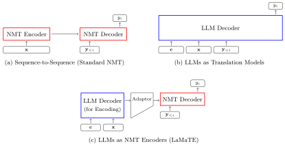
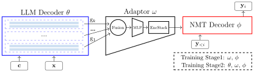
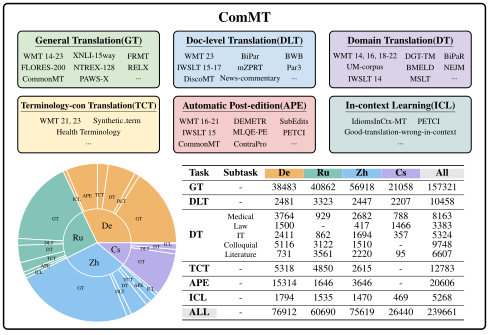
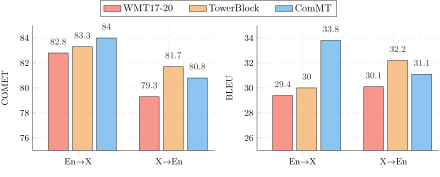
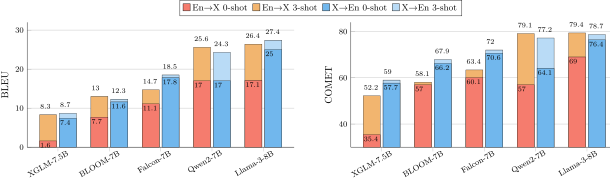
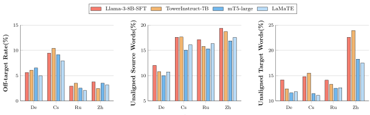
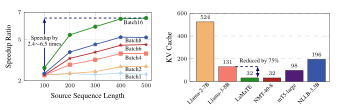
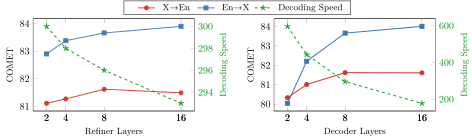
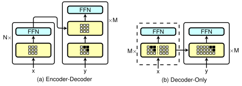
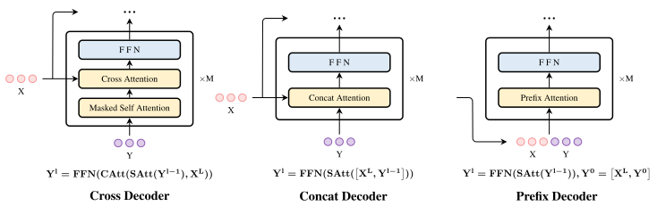

**Source:** *Beyond Decoder-only: Large Language Models Can be Good Encoders for Machine Translation* — [PDF](https://arxiv.org/pdf/2503.06594v2) · [arXiv](https://arxiv.org/abs/2503.06594v2)

# Beyond Decoder-only: Large Language Models Can be Good Encoders for Machine TranslationThanks: Corresponding author

Yingfeng Luo  Tong Zheng  Yongyu Mu  Bei Li  Qinghong Zhang  Yongqi Gao  Affiliation: [2pt] Ziqiang Xu, Peinan Feng, Xiaoqian Liu, Tong Xiao, Jingbo Zhu Affiliation: [2pt] NLP Lab, Northeastern University, Shenyang, China  Affiliation: [2pt] NiuTrans Research, Shenyang, China  Email: [luoyingfeng_neu@outlook.com](mailto:) Email: [{[xiaotong,zhujingbo](mailto:xiaotong,zhujingbo@cornell.edu)}@mail.neu.edu.cn](mailto:) Affiliation: (Version \(2\)) 

###### Abstract

The field of neural machine translation (NMT) has changed with the advent of large language models (LLMs). Much of the recent emphasis in natural language processing (NLP) has been on modeling machine translation and many other problems using a single pre-trained Transformer decoder, while encoder-decoder architectures, which were the standard in earlier NMT models, have received relatively less attention. In this paper, we explore translation models that are universal, efficient, and easy to optimize, by marrying the world of LLMs with the world of NMT. We apply LLMs to NMT encoding and leave the NMT decoder unchanged. We also develop methods for adapting LLMs to work better with the NMT decoder. Furthermore, we construct a new dataset involving multiple tasks to assess how well the machine translation system generalizes across various tasks. Evaluations on the WMT and our datasets show that results using our method match or surpass a range of baselines in terms of translation quality, but achieve \(2.4\sim 6.5\times\) inference speedups and a \(75\%\) reduction in the memory footprint of the KV cache. It also demonstrates strong generalization across a variety of translation-related tasks.

 

[NiuTrans/LaMaTE](https://github.com/NiuTrans/LaMaTE/)

---

 

## 1 Introduction

The last decade has yielded remarkable breakthroughs in machine translation (MT) through the use of deep neural networks, scaled dramatically in both model parameters and training data. During this period, early methods, known as neural machine translation (NMT), were largely based on the encoder-decoder architecture ([Sutskever et al., 2014](https://arxiv.org/html/2503.06594v2#bib.bib78); [Bahdanau et al., 2015](https://arxiv.org/html/2503.06594v2#bib.bib7)). In NMT, the machine translation problem is commonly treated as a sequence-to-sequence task, where the input sequence is first encoded into an intermediate representation, and the output sequence is then generated based on this representation, as illustrated in [Figure 1](https://arxiv.org/html/2503.06594v2#S1.F1 "In 1 Introduction ‣ Beyond Decoder-only: Large Language Models Can be Good Encoders for Machine Translation") (a). Models of this kind are typically trained on bilingual text in a supervised manner, and their inference on modern GPUs is efficient. However, like their predecessors in past decades (e.g., statistical machine translation models), NMT models are generally developed for specific tasks, such as translation in a specific genre or domain.

 Figure 1: Architectures of machine translation models. In standard NMT models, an encoder is used to encode the source-language sequence x, and a decoder is used to generate the target-language sequence y from left to right. In LLMs, the decoder-only architecture is adopted. Both x and y, along with the prompt c, are represented as a single sequence, which is processed by a large decoding network. In the LaMaTE model, an LLM serves as the encoder. The output of the LLM is transformed into the input to the NMT decoder through an adaptor. The NMT decoder then generates the target-language sequence as usual.

Everything changed in NLP, with the success of large language models (LLMs) through large-scale self-supervised learning ([Brown et al., 2020](https://arxiv.org/html/2503.06594v2#bib.bib10)). In the LLM paradigm, the translation problem is framed as the token prediction problem in language modeling, as illustrated in [Figure 1](https://arxiv.org/html/2503.06594v2#S1.F1 "In 1 Introduction ‣ Beyond Decoder-only: Large Language Models Can be Good Encoders for Machine Translation") (b). Such an approach greatly simplifies the modeling. We can now pre-train the LLM on large amounts of text via self-supervision so as to produce a single model that can be fine-tuned and prompted for various translation-related tasks, such as constrained translation and post-editing. Nevertheless, as a consequence of using large-scale neural networks, LLMs are computationally expensive and pose challenges for applications requiring low latency and a small memory footprint.

The fundamental change brought by LLMs has led most of the field to focus on replacing previous NLP systems with LLMs. However, machine translation researchers might still expect that a system could be efficient and easy to optimize, and, at the same time, could generalize across various sorts of tasks.

In this paper, we examine how the world of LLMs can be married with the world of NMT, thereby benefiting from both paradigms. One simple approach is to use an LLM as the encoder in NMT (call it LaMaTE — Large Language Models as Machine Translation Encoders). As both the encoder and decoder are essentially based on language models, we can view the whole system as a single language model. The decoupling of encoding and decoding from language modeling confers great modeling flexibility. A direct result of this is that we can employ a deep, complex encoder and a lightweight decoder, as illustrated in [Figure 1](https://arxiv.org/html/2503.06594v2#S1.F1 "In 1 Introduction ‣ Beyond Decoder-only: Large Language Models Can be Good Encoders for Machine Translation") (c). This heterogeneous architecture is particularly well-suited for machine translation, where we can use a powerful encoder to understand the input text, while generating high-quality translations at a lower decoding cost.

In order to examine to what extent the model can generalize, we develop a new benchmark, called the Comprehensive Machine Translation benchmark (ComMT). It consists of several diverse tasks that evaluate different aspects of a translation model. While there have been datasets developed for fine-tuning LLMs for multiple translation tasks ([Alves et al., 2024](https://arxiv.org/html/2503.06594v2#bib.bib4)), our focus is on a broader range of application scenarios. We hope that such a benchmark can be adopted to provide a systematic evaluation of machine translation systems, and that this, in turn, will encourage practitioners to pay more attention to the issue of generalization when developing these systems.

We conduct extensive experiments and evaluate various models including NMT, LLMs, and our LaMaTE method. Our results show that the LaMaTE model achieves comparable or better performance than a range of baseline systems on several tasks, but runs \(2.4\sim 6.5\) times faster and reduces the memory footprint of the KV cache by \(75\%\). Evaluations on the ComMT dataset also demonstrate the strong generalization capabilities of the LaMaTE model, showing significant improvements over baseline systems. These results are not surprising, but intriguing, as findings in NMT remain applicable in the era of LLMs, for instance, scaling up the encoding network is still beneficial for machine translation tasks. This suggests an interesting direction for future work, where we could develop a powerful yet efficient system by using a strong model for language understanding and a lightweight model for language generation.

## 2 Related Work

Designing widely applicable models for MT has been an active area of NLP research for decades. Although MT models have evolved significantly over time, most of them still operate on an “analyze-then-generate” paradigm ([Brown et al., 1993](https://arxiv.org/html/2503.06594v2#bib.bib9); [Koehn et al., 2003](https://arxiv.org/html/2503.06594v2#bib.bib44); [Bahdanau et al., 2015](https://arxiv.org/html/2503.06594v2#bib.bib7)). For example, in statistical MT, the source-language sentence is parsed into either syntactic or non-syntactic forms, and the translation is generated by mapping these parsed forms to target-language constructions ([Chiang, 2005](https://arxiv.org/html/2503.06594v2#bib.bib12)). LLMs can broadly be categorized as following a similar design: they first compute the key-value cache for each input sequence, and then produce output tokens in a left-to-right manner based on this cache. From a modeling perspective, therefore, decoupling the encoding and decoding processes is a natural design choice for both traditional MT and LLMs.

In NLP, a large body of work has focused on pre-training and applying text encoders, such as the BERT series of models ([Devlin et al., 2019](https://arxiv.org/html/2503.06594v2#bib.bib17)), which are primarily designed to address language understanding problems. More recently, there have been attempts to use LLMs as text encoders, though these models are more commonly used for generating text. For example, [BehnamGhader et al. (2024)](https://arxiv.org/html/2503.06594v2#bib.bib8) and [Muennighoff et al. (2024)](https://arxiv.org/html/2503.06594v2#bib.bib59) fine-tuned LLMs for text encoding and showed that LLMs can produce high-quality representations of text in various embedding tasks. However, it is rare to see studies on incorporating LLMs in the encoding for NMT or other language generation tasks.

In fact, the focus of research in MT has shifted. Recent studies in this field are now more concerned with the adaptation of LLMs, rather than the improvement of model architectures ([Li et al., 2024](https://arxiv.org/html/2503.06594v2#bib.bib49); [Zheng et al., 2024](https://arxiv.org/html/2503.06594v2#bib.bib104)). One strand of research aims to enable LLMs to translate via prompting techniques, including designing better prompts ([Zhang et al., 2023a](https://arxiv.org/html/2503.06594v2#bib.bib99); [Zhu et al., 2024](https://arxiv.org/html/2503.06594v2#bib.bib108)), introducing translation demonstrations ([Mu et al., 2023](https://arxiv.org/html/2503.06594v2#bib.bib58); [Chitale et al., 2024](https://arxiv.org/html/2503.06594v2#bib.bib13)), and using chain-of-thought reasoning ([Lu et al., 2024](https://arxiv.org/html/2503.06594v2#bib.bib55)). Another strand focuses on developing MT-specific LLMs via fine-tuning ([Xu et al., 2023](https://arxiv.org/html/2503.06594v2#bib.bib88); [Yang et al., 2023b](https://arxiv.org/html/2503.06594v2#bib.bib94); [Alves et al., 2024](https://arxiv.org/html/2503.06594v2#bib.bib4); [Guo et al., 2024](https://arxiv.org/html/2503.06594v2#bib.bib28); [Zheng et al., 2025](https://arxiv.org/html/2503.06594v2#bib.bib105)); we have followed this approach, but with a focus on improving the model architecture, as well as developing a new benchmark for evaluating universal MT models.

While LLMs have significantly enhanced MT with their superior versatility and generalization capabilities, much of the current research continues to focus on single-task contexts, which do not fully utilize the potential of LLMs to address diverse translation challenges. The research highlighted in [Alves et al. (2024)](https://arxiv.org/html/2503.06594v2#bib.bib4) seeks to develop a more universal model by integrating a mix of general and translation-related tasks. Yet, despite these advancements, there remains a notable gap in the availability of comprehensive and high-quality data resources specifically tailored to the development of universal translation models. Addressing this deficiency would maximize LLM capabilities and broaden their applicability across a variety of translation-related tasks.

This work is also related to efficient methods for LLMs. For example, one can compress the model using quantization and pruning techniques ([Xiao et al., 2023](https://arxiv.org/html/2503.06594v2#bib.bib86); [Ma et al., 2023](https://arxiv.org/html/2503.06594v2#bib.bib56)), and speed-up inference using speculative decoding algorithms ([Leviathan et al., 2023](https://arxiv.org/html/2503.06594v2#bib.bib48); [Kim et al., 2023](https://arxiv.org/html/2503.06594v2#bib.bib42); [Hu et al., 2025](https://arxiv.org/html/2503.06594v2#bib.bib33)). But these methods and ours are in no way contradictory. Since our model follows standard encoding (or prefilling) and decoding frameworks, it can be easily combined with various efficient methods to further improve efficiency.

## 3 LaMaTE

In this section, we introduce LaMaTE and its training method.

### 3.1 Model Architecture

We begin by outlining the basic concepts and notation needed for our description. There are three networks that we consider here, as illustrated in [Figure 2](https://arxiv.org/html/2503.06594v2#S3.F2 "In 3.1 Model Architecture ‣ 3 LaMaTE ‣ Beyond Decoder-only: Large Language Models Can be Good Encoders for Machine Translation").

 Figure 2: Architecture of the NMT Encoder, NMT Decoder, and LLM Decoder. We omit the layer normalization and residual connections for simplicity.

  * NMT Encoder \(\mathrm{Enc}(\mathbf{x})\). It is a standard Transformer encoder, consisting of an embedding layer and a number of stacked Transformer layers. The output of the NMT encoder is a bidirectional representation of the input token sequence \(\mathbf{x}\), denoted by \(\mathbf{H}\)11 1 \(\mathbf{H}\) is a sequence of vectors, each corresponding to the representation at each position of \(\mathbf{x}\).. 
  * NMT Decoder \(\mathrm{Dec}(\mathbf{H},\mathbf{y})\). It shares the same architecture as the NMT encoder, with an additional cross-attention sublayer added in each Transformer layer. The NMT decoder accepts two inputs — one from the encoder for cross-attention, and another as the regular sequential input. In the self-attention mechanism, each position can only attend to the preceding positions. So its output representation is unidirectional. Typically, a Softmax layer is added on top of the decoder to generate distributions of tokens. 
  * LLM Decoder \(\mathrm{Dec}(\underline{\hskip 10.00002pt},[\mathbf{c},\mathbf{x},\mathbf{y}])\). It operates on token sequences only, without the need for input from the encoder. Thus, the cross-attention sublayers are removed, and the first parameter of the above function is left blank. Here \([\mathbf{c},\mathbf{x},\mathbf{y}]\) denotes the concatenation of the prompt \(\mathbf{c}\), the input sequence \(\mathbf{x}\), and the translation \(\mathbf{y}\). 

For NMT models, we can simply connect the NMT encoder and decoder together. The probability of token prediction can be expressed as

\[\begin{aligned}
 & \displaystyle\Pr(y_{i}|\mathbf{x},\mathbf{y}_{<i}) & \displaystyle= & \displaystyle\mathrm{Softmax}(\mathbf{W}\mathbf{S})_{i} &  & \text{(1)} \\
 & \displaystyle\mathbf{S} & \displaystyle= & \displaystyle\mathrm{Dec}(\mathbf{H},\mathbf{y}_{<i}) &  & \text{(2)} \\
 & \displaystyle\mathbf{H} & \displaystyle= & \displaystyle\mathrm{Enc}(\mathbf{x}) &  & \text{(3)}
\end{aligned}\]

 

where \(y_{i}\) denotes the target-language token at position \(i\), \(\mathbf{y}_{<i}\) denotes the target-language tokens that precede position \(i\), and \(\mathrm{Softmax}(\mathbf{W}\mathbf{S})_{i}\) denotes the Softmax function that computes the distribution of tokens at position \(i\). \(\mathbf{W}\mathbf{S}\) maps the decoder output \(\mathbf{S}\) to a representation space of the vocabulary size using the linear mapping matrix \(\mathbf{W}\).

The LaMaTE model follows this encode-decode architecture, but with an LLM decoder replacing the NMT encoder, given by

\[\begin{aligned}
 & \displaystyle\mathbf{S} & \displaystyle= & \displaystyle\mathrm{Dec}_{\phi}(\mathbf{H}^{\prime},\mathbf{y}_{<i}) &  & \text{(4)} \\
 & \displaystyle\mathbf{H}^{\prime} & \displaystyle= & \displaystyle\mathrm{Dec}_{\theta}(\underline{\hskip 10.00002pt},[\mathbf{c},\mathbf{x}]) &  & \text{(5)}
\end{aligned}\]

 

Here we use the subscripts \(\phi\) and \(\theta\) to denote the parameters for the NMT decoder and the LLM decoder, respectively.

The function \(\mathrm{Dec}_{\theta}(\underline{\hskip 10.00002pt},[\mathbf{c},\mathbf{x}])\) serves as a unidirectional encoder. Although it is generally thought that bidirectional encoders can make better use of contextual information, our experiments in [Section 6.4](https://arxiv.org/html/2503.06594v2#S6.SS4 "6.4 Ablation Study ‣ 6 Results and Analyses ‣ Beyond Decoder-only: Large Language Models Can be Good Encoders for Machine Translation") demonstrate that using such unidirectional encoders based on LLMs is also very effective. Given that both the encoder and decoder are unidirectional, we can roughly think of the whole model as a hybrid language model: a large, powerful model is used for prefilling, and a small, efficient model is used for decoding.

The use of pre-trained LLMs for encoding allows the model to have a stronger understanding of the input sequence, which has been found to be very beneficial in NMT systems ([Dou et al., 2018](https://arxiv.org/html/2503.06594v2#bib.bib20); [Wang et al., 2019](https://arxiv.org/html/2503.06594v2#bib.bib84)). As another bonus, one can easily adapt the model via fine-tuning and prompting, thereby deploying a single such system for many different tasks. For example, by giving an appropriate prompt \(\mathbf{c}\), we can guide the system to produce outputs following specific needs or contexts. This gives LaMaTE a big advantage over traditional NMT models.

One problem with the model described in Eqs. ([4](https://arxiv.org/html/2503.06594v2#S3.E4 "Equation 4 ‣ 3.1 Model Architecture ‣ 3 LaMaTE ‣ Beyond Decoder-only: Large Language Models Can be Good Encoders for Machine Translation")-[5](https://arxiv.org/html/2503.06594v2#S3.E5 "Equation 5 ‣ 3.1 Model Architecture ‣ 3 LaMaTE ‣ Beyond Decoder-only: Large Language Models Can be Good Encoders for Machine Translation")) is that the LLM decoder may have a larger hidden size than that of the NMT decoder. In this case, we add an adaptor to the output of the LLM decoder to reduce its dimensionality, so that it matches the NMT decoder. We can then redefine \(\mathbf{H}^{\prime}\) as

\[\begin{aligned}
 & \displaystyle\mathbf{H}^{\prime} & \displaystyle= & \displaystyle F_{\omega}(\mathrm{Dec}_{\theta}(\underline{\hskip 10.00002pt},[\mathbf{c},\mathbf{x}])) &  & \text{(6)}
\end{aligned}\]

 

where \(F_{\omega}(\cdot)\) is the adaptor with the parameters \(\omega\).

### 3.2 Adaptor

 Figure 3: The architecture of LaMaTE, where the Adaptor consists of three components: Fusion combines the representations of layer groups \(\mathbf{g}_{k}\), MLP reduces the representations’s dimensionality, and EncStack learns bidirectional representations. The training process consists of two stages: the first stage trains the Adaptor and Decoder, and the second stage trains all model parameters.

One simple form of adaptors is a linear mapping of the output of the LLM decoder, that is, we linearly transform representations from \(\mathrm{Dec}_{\theta}(\cdot)\) to lower-dimensional representations required by \(\mathrm{Dec}_{\phi}(\cdot)\). But we find that this method falls short of our expectations because LLMs are typically too big that simply transforming their output representations into lower-dimensional ones makes it difficult for untrained smaller models to use them directly.

Instead, we design an adaptor that makes better use of the LLM outputs for the NMT decoder. It involves three components. The complete model architecture is illustrated in [Figure 3](https://arxiv.org/html/2503.06594v2#S3.F3 "In 3.2 Adaptor ‣ 3 LaMaTE ‣ Beyond Decoder-only: Large Language Models Can be Good Encoders for Machine Translation").

  * Instead of considering only the output of the final layer of the LLM, we fuse the outputs of the intermediate layers to form a finer-grained output of the LLM decoder. Such methods have been found to be very beneficial to deep-to-shallow architectures in NMT ([Wang et al., 2019](https://arxiv.org/html/2503.06594v2#bib.bib84); [Yang et al., 2023a](https://arxiv.org/html/2503.06594v2#bib.bib93)). To do this, we divide the LLM layers into \(K\) groups, and fuse their outputs in the following form 

\[\begin{aligned}
 & \displaystyle\hskip-14.22636pt\mathbf{H}_{\mathrm{fuse}} & \displaystyle= & \displaystyle\mathrm{LayerNorm}\left(\frac{1}{K}\sum_{k=1}^{K}w_{k}\mathbf{g}_{k}\right) &  & \text{(7)}
\end{aligned}\]

 

where \(\mathrm{LayerNorm}(\cdot)\) is the layer normalization function, \(\mathbf{g}_{k}\) is the output of the \(k\)-th layer group, and \(w_{k}\) is the learnable weight for \(\mathbf{g}_{k}\). We use the last layer’s hidden states of each group as that group’s hidden states.

  * We place a 2-layer MLP after layer fusion to reduce the hidden size of \(\mathbf{H}_{\mathrm{fuse}}\) (denoted by \(d_{1}\)) to the hidden size of the NMT decoder (denoted by \(d_{2}\)). This network is given by 

\[\begin{aligned}
 & \displaystyle\mathbf{H}_{\mathrm{mlp}} & \displaystyle= & \displaystyle\mathrm{GELU}(\mathbf{H}_{\mathrm{fuse}}\mathbf{W}_{1})\mathbf{W}_{2} &  & \text{(8)}
\end{aligned}\]

 

where \(\mathrm{GELU}(\cdot)\) is the activation function, and \(\mathbf{W}_{1}\in\mathbb{R}^{d_{1}\times d_{2}}\) and \(\mathbf{W}_{2}\in\mathbb{R}^{d_{2}\times d_{2}}\) are the linear mapping matrices.

  * It is also possible to learn bidirectional representations from unidirectional representations. A common method is to incorporate some Transformer encoder layers. Thus the self-attention models can help generate bidirectional representations. The final output of the adaptor is then given by 

\[\begin{aligned}
 & \displaystyle\mathbf{H}^{\prime} & \displaystyle= & \displaystyle\mathrm{EncStack}(\mathbf{H}_{\mathrm{mlp}}) &  & \text{(9)}
\end{aligned}\]

 

where \(\mathrm{EncStack}(\cdot)\) is a stack of Transformer encoder layers. Note that \(\mathrm{EncStack}(\cdot)\) consists of only a few layers, and thus adds very small computational overhead. This step of bidirectional representation learning is optional, and one can choose whether to adopt it in practice.

### 3.3 Model Training

The LaMaTE model has three sets of parameters: \(\theta\) for the LLM decoder, \(\phi\) for the NMT decoder, and \(\omega\) for the adaptor. Here, \(\theta\) is initialized with the pre-trained parameters of the LLM, while \(\phi\) and \(\omega\) need to be trained from scratch.

Optimizing these parameters on bitext seems straightforward, but poses practical challenges. Since fine-tuning pre-trained LLMs is costly ([Hu et al., 2022](https://arxiv.org/html/2503.06594v2#bib.bib32); [Zhang et al., 2025](https://arxiv.org/html/2503.06594v2#bib.bib102)), using less labeled data is generally favorable. However, we found that this approach can lead to inadequate learning of the new parameters \(\phi\) and \(\omega\). On the other hand, extensive fine-tuning may cause the LLM to forget its original knowledge encoded in \(\theta\). Similar findings have been reported in the literature ([Xu et al., 2023](https://arxiv.org/html/2503.06594v2#bib.bib88)).

Here, we present a two-stage training method that performs more efficient learning for different types of parameters. In the first stage, we freeze \(\theta\) and pre-train both \(\phi\) and \(\omega\). The task of pre-training is a standard translation task. We train the model to translate source-language sequences to corresponding target-language sequences. Therefore, the adaptor and the NMT decoder can learn to map from source-language representations to translations. Since the parameters of the LLM decoder are frozen, this process requires only the forward pass of this large network, without the need for the backward pass. It is thus less computationally expensive than LLM fine-tuning, making it possible to scale up the pre-training to large datasets.

The second stage is a fine-tuning stage, where \(\theta\), \(\phi\), and \(\omega\) are fine-tuned together on various tasks. For each task, as with instruction fine-tuning for LLMs, we provide LaMaTE with task-specific instructions, inputs and outputs, and optimize all the parameters end-to-end. In this way, the model is adapted to follow these instructions and can be deployed as a single, universal model to handle a variety of translation-related problems. We use our ComMT dataset for fine-tuning in this work.

## 4 ComMT

### 4.1 Tasks

Many translation-related tasks, such as document-level translation, rely on both understanding complex inputs and generating coherent, contextually appropriate outputs, which are not captured by commonly used sentence-level translation tasks. To generalize LaMaTE to diverse tasks and evaluate it on these tasks, we developed a new evaluation benchmark called ComMT. It comprises five tasks, with examples for each provided in [Table 16](https://arxiv.org/html/2503.06594v2#A4.T16 "In D.4 Comparison of Decoder Variants ‣ Appendix D Additional Results ‣ Beyond Decoder-only: Large Language Models Can be Good Encoders for Machine Translation"):

  * General Translation. This is a standard sentence in, sentence out task in general domains, serving as the foundation for more specialized tasks. 
  * Document-level Translation. This task extends translation from sentence-level to document-level, focusing on maintaining coherence and context in extended texts, rather than merely achieving sentence-level accuracy. Our document-level translation tasks mainly involve general long texts, such as news articles. 
  * Domain Translation. This task focuses on domain-specific translation, ensuring the accurate use of domain-specific terminology and expressions. Based on the application scenario and existing research, we identified five initial domains for study: Medical, Law, Information Technology(IT), Colloquial, and Literature. 
  * Terminology-constrained Translation. In this task, the system is required to produce translations that follow the given terminology translation requirements. 
  * Automatic Post-editing. This task focuses on enhancing the quality of preliminary machine translation outputs by automatically correcting errors in grammar, spelling, and style in the initial translations. 

We collected data mainly from public resources, driven by two goals: (i) to find as many data sources as possible in order to increase data diversity, and (ii) to collect as much high-quality, manually annotated translation data as possible. ComMT is multilingual and supports four languages: German, Czech, Russian, and Chinese. The reader can refer to Appendix [Appendix B](https://arxiv.org/html/2503.06594v2#A2 "Appendix B ComMT ‣ Beyond Decoder-only: Large Language Models Can be Good Encoders for Machine Translation") for more process details of ComMT.

Ultimately, we created a training set of 239k samples, as shown in [Figure 4](https://arxiv.org/html/2503.06594v2#S4.F4 "In 4.1 Tasks ‣ 4 ComMT ‣ Beyond Decoder-only: Large Language Models Can be Good Encoders for Machine Translation"). Additionally, we also created a test set, detailed in [Table 1](https://arxiv.org/html/2503.06594v2#S4.T1 "In 4.1 Tasks ‣ 4 ComMT ‣ Beyond Decoder-only: Large Language Models Can be Good Encoders for Machine Translation"). For the General Translation task, we used established test sets, while for other tasks, we carefully curated test data by reorganizing existing datasets. We ensured that the source language in each case was original to avoid translationese issues ([Graham et al., 2020](https://arxiv.org/html/2503.06594v2#bib.bib26); [Läubli et al., 2020](https://arxiv.org/html/2503.06594v2#bib.bib47)). However, some languages currently lack test sets because obtaining the task data is challenging. In the future, we plan to continue expanding this dataset to support more languages and tasks.

 Figure 4: Our comprehensive translation dataset, ComMT, includes diverse translation-related tasks. The table presents the training set statistics for ComMT.

Task Subtask De Ru Zh Cs De2En En2De Ru2En En2Ru Zh2En En2Zh Cs2En En2Cs General Translation WMT23 549 557 1723 2074 1976 2074 - 2074 WMT22 1984 2037 2016 2037 1875 2037 1448 2037 FLORES-200 - 1012 - 1012 - 1012 - 1012 Doc-level translation - 500 547 - 500 415 500 500 519 Domain Translation Medical 748 744 513 1772 580 2094 999 - Law - 969 - - - - - 959 IT - - - 650 - - - 519 Colloquial 517 595 564 507 520 652 - - Literature 506 - 506 - 401 550 - - Terminology-constrained Translation - 2948 775 - 500 1638 798 - 2898 Automatic Post-edition - 1980 1000 526 1023 - 1000 - -

Table 1: Statistics for the ComMT Test Set. We ensure that the source language of the test set is original, so not all language directions and tasks have corresponding data due to the difficulty in collecting certain datasets.

### 4.2 Quality Verification

To verify the quality of our dataset, we fine-tuned the Llama3-8B model ([Dubey et al., 2024](https://arxiv.org/html/2503.06594v2#bib.bib21)) and compared it against two other datasets commonly used in LLM-based MT research: (i) a merged news test set from WMT17 to WMT20 with 61k samples, widely adopted data setting in previous studies ([Xu et al., 2023](https://arxiv.org/html/2503.06594v2#bib.bib88); [Jiao et al., 2023](https://arxiv.org/html/2503.06594v2#bib.bib35); [Guo et al., 2024](https://arxiv.org/html/2503.06594v2#bib.bib28)); (ii) the TowerBlock dataset ([Alves et al., 2024](https://arxiv.org/html/2503.06594v2#bib.bib4)), which comprises 638k samples across translation tasks, named entity recognition (NER), general dialogue, and other tasks. We evaluated the resulting models on the WMT23 test set, with the results shown in [Figure 5](https://arxiv.org/html/2503.06594v2#S4.F5 "In 4.2 Quality Verification ‣ 4 ComMT ‣ Beyond Decoder-only: Large Language Models Can be Good Encoders for Machine Translation").

The results clearly demonstrate that ComMT surpasses WMT17–WMT20 in both the En \(\to\) X and X \(\to\) En directions. However, while it excels in the En \(\to\) X direction, it underperforms in the X \(\to\) En direction compared to TowerBlock. This discrepancy may be attributed to TowerBlock’s larger dataset size and its inclusion of additional general task data, predominantly in English, which may specifically enhance performance when translating into English. We intend to investigate this further in future research.

Overall, ComMT exhibits significant diversity and broad applicability, providing a well-curated data resource for developing and evaluating universal translation models.

 Figure 5: Comparison of performance across three datasets—WMT17-20, TowerBlock, and ComMT—fine-tuned on Llama3-8B and evaluated on the WMT23 test set.

## 5 Experimental Setup

### 5.1 Data and Evaluation Metrics

We trained our model on multilingual translations between English (En) and four languages: German (De), Czech (Cs), Russian (Ru), and Chinese (Zh), resulting in a total of eight translation directions. The parallel corpus for training stage 1 was sourced from WMT2023, as detailed in [Table 6](https://arxiv.org/html/2503.06594v2#A3.T6 "In C.1 Datasets and Hyperparameters ‣ Appendix C Detailed Experimental Setups ‣ Beyond Decoder-only: Large Language Models Can be Good Encoders for Machine Translation"). We sampled 10M bilingual sentence pairs for each language, yielding a total of 40M pairs for training stage 1. The training stage 2 utilizes data from the ComMT training set with 239k samples.

We conducted tests on ComMT and evaluated the model’s translation performance across all tasks using COMET (wmt22-comet-da) ([Rei et al., 2020](https://arxiv.org/html/2503.06594v2#bib.bib70)) and SacreBLEU ([Post, 2018](https://arxiv.org/html/2503.06594v2#bib.bib66)). Additionally, we used Terminology Success Rate (TSR) for the terminology-constrained translation task and Human Translation Edit Rate (HTER) for the automatic post-editing task.

### 5.2 Training

 Figure 6: Evaluation of LLM translation capabilities in 0-shot and 3-shot settings using the WMT23 test set.

Our multilingual translation experiments necessitate a language model with multilingual capabilities for better encoding. To assess the fundamental translation capabilities of state-of-the-art multilingual LLMs, we conducted a comprehensive evaluation across several widely used models, including XGLM-7.5B ([Lin et al., 2022](https://arxiv.org/html/2503.06594v2#bib.bib52)), Bloom-7B ([Scao et al., 2022](https://arxiv.org/html/2503.06594v2#bib.bib73)), Falcon-7B ([Almazrouei et al., 2023](https://arxiv.org/html/2503.06594v2#bib.bib3)), Qwen2-7B ([Yang et al., 2024a](https://arxiv.org/html/2503.06594v2#bib.bib92)), Llama3-8B ([Dubey et al., 2024](https://arxiv.org/html/2503.06594v2#bib.bib21)). These models were evaluated in both zero-shot and three-shot settings across English \(\leftrightarrow\) German, Czech, Russian, and Chinese translation tasks. The averaged performance in in [Figure 6](https://arxiv.org/html/2503.06594v2#S5.F6 "In 5.2 Training ‣ 5 Experimental Setup ‣ Beyond Decoder-only: Large Language Models Can be Good Encoders for Machine Translation") show that Llama3-8B consistently outperformed the other models in both En \(\to\) X and X \(\to\) En translation directions. Its superior performance across different language pairs suggests that it possesses stronger multilingual capabilities. Based on these results, we selected Llama3-8B as our backbone model for subsequent experiments.

Llama3-8B has a model dimension of 4096 and consists of 32 layers. For the decoder, we set the dimension to 1024 with 8 layers, which also applies to the EncStack of the adaptor, with the adaptor and decoder together introducing fewer than 500M parameters. Hyperparameters for training are detailed in [Table 7](https://arxiv.org/html/2503.06594v2#A3.T7 "In C.1 Datasets and Hyperparameters ‣ Appendix C Detailed Experimental Setups ‣ Beyond Decoder-only: Large Language Models Can be Good Encoders for Machine Translation").

### 5.3 Models for Comparison

We create two categories of models for comparison:

#### Decoder-only Models.

This includes: BigTranslate ([Yang et al., 2023b](https://arxiv.org/html/2503.06594v2#bib.bib94)), Bayling-13B ([Zhang et al., 2023b](https://arxiv.org/html/2503.06594v2#bib.bib101)), Aya-23-8B ([Üstün et al., 2024](https://arxiv.org/html/2503.06594v2#bib.bib81)), ALMA-7B ([Xu et al., 2023](https://arxiv.org/html/2503.06594v2#bib.bib88)) and TowerInstruct-7B ([Alves et al., 2024](https://arxiv.org/html/2503.06594v2#bib.bib4)). Also included are variants of Llama3-8B: Llama3-8B-Base (3-shot in-context learning), Llama3-8B-Inst (general instruction-tuned), and Llama3-8B-SFT (fine-tuned on ComMT).

#### Encoder-Decoder Models.

This includes: (i) NLLB-3.3B ([Costa-jussà et al., 2022](https://arxiv.org/html/2503.06594v2#bib.bib16)): a comprehensive multilingual model. (ii) Traditional encoder-decoder models: NMT-40-8 (40 encoder layers, 8 decoder layers) and NMT-8-8 (8 encoder layers, 8 decoder layers), both with a model dimension of 1024, trained from scratch on 161M bilingual sentences from combined parallel data of four languages. (iii) Fine-tuned encoder-decoder models: mT5-Large (1.2B) ([Xue et al., 2021](https://arxiv.org/html/2503.06594v2#bib.bib91)), aligned with our method’s data settings.

## 6 Results and Analyses

### 6.1 Main Results

Model General Trans Domain Trans Doc-level Trans Terminology-con Trans Automatic Post-edition COMET BLEU COMET BLEU COMET BLEU COMET BLEU TSR \(\uparrow\) COMET BLEU HTER \(\downarrow\) Decoder-only Models ALMA-7B* 83.23 31.49 83.93 31.94 82.03 18.59 81.84 24.89 43.20 85.25 40.91 54.42 BigTranslate* 77.84 22.04 77.53 21.99 72.36 9.18 77.29 18.56 33.10 78.84 29.82 69.04 Aya-23-8B 82.72 32.11 84.07 33.67 84.98 32.19 81.47 31.14 74.15 87.68 67.92 36.23 TowerInstruct-7B 83.12 32.75 83.65 33.25 81.61 28.22 82.57 31.84 76.98 88.91 77.41 23.49 Bayling-13B 74.81 21.34 76.50 24.07 74.10 19.46 77.01 25.08 71.94 73.90 29.67 114.80 Llama3-8B-Base 79.03 26.89 81.21 28.29 80.44 26.77 81.81 29.84 79.20 86.26 61.43 38.93 Llama3-8B-Inst 73.56 23.20 73.04 22.69 81.79 27.22 71.36 24.41 86.46 68.05 25.70 101.85 Llama3-8B-SFT 82.41 32.42 84.60 36.92 83.79 31.75 84.01 36.77 87.52 88.57 70.13 31.57 Encoder-Decoder Models NLLB-3.3B* 81.30 31.63 81.38 32.66 73.60 11.72 80.21 26.32 41.25 84.97 46.42 52.42 NMT-8-8* 79.70 30.08 80.63 32.76 73.98 10.11 77.03 25.54 40.56 84.50 47.52 50.21 NMT-40-8* 80.89 32.05 81.50 34.06 74.74 12.39 77.19 25.80 41.15 85.10 47.57 50.26 mT5-Large 81.26 29.34 82.06 30.26 77.69 14.43 81.80 30.34 76.93 85.88 62.77 45.10 LaMaTE (Ours) 82.32 33.85 84.69 37.49 84.34 31.69 83.35 34.76 75.64 88.60 69.10 33.42

Table 2: Performance on ComMT test set. Bold numbers represent the highest scores in each category, while underlined numbers indicate the second highest scores. Models marked with ”*” cannot handle additional inputs for the terminology-constrained translation and automatic post-editing tasks, we only use the source sequence as input. 

 Figure 7: Comparison of decoder-only (Llama3-8B and TowerInstruct-7B) and encoder-decoder (mT5-large and LaMaTE) models on off-target rate (OTR), unaligned source words (USW), and unaligned target words (UTW). 

The averaged performance across all directions is shown in [Table 2](https://arxiv.org/html/2503.06594v2#S6.T2 "In 6.1 Main Results ‣ 6 Results and Analyses ‣ Beyond Decoder-only: Large Language Models Can be Good Encoders for Machine Translation"), with more detailed results provided in [Table 14](https://arxiv.org/html/2503.06594v2#A4.T14 "In D.4 Comparison of Decoder Variants ‣ Appendix D Additional Results ‣ Beyond Decoder-only: Large Language Models Can be Good Encoders for Machine Translation").

#### Comparison with Encoder-Decoder Models.

In comparison to encoder-decoder models, LaMaTE demonstrates stronger performance, surpassing NLLB-3.3B, NMT, and mT5-Large across all evaluated tasks. This result hightlights the potential of LLMs as high-capacity encoders, capable of producing more expressive and informative representations. These enhanced representations provide a solid foundation for the decoder, ultimately improving translation quality. Moreover, LaMaTE’s consistent performance across multiple tasks underscores its strong generalization capability.

#### Comparison with Fine-Tuned LLMs.

When compared with fine-tuned LLMs, LaMaTE achieves comparable overall performance to Llama3-8B-SFT. While Llama3-8B-SFT holds a slight advantage in the terminology-constrained translation task with higher TSR scores, there is no significant difference in other tasks. Additionally, LaMaTE outperforms earlier fine-tuned LLMs like Bayling-13B and remains competitive with more advanced models such as TowerInstruct-7B. This further demonstrates that LLMs can serve as effective MT encoders, offering an effective and computationally efficient alternative to the approach of fine-tuning LLMs as direct generators.

#### Misalignment Evaluation.

To further investigate translation quality, we analyze misalignment issues commonly observed in LLM-based generation ([Zhang et al., 2024](https://arxiv.org/html/2503.06594v2#bib.bib100); [Zeng et al., 2024](https://arxiv.org/html/2503.06594v2#bib.bib97)), where models may generate output that diverges from the source text. We compare decoder-only models (Llama3-8B and TowerInstruct-7B) and encoder-decoder (mT5-large and LaMaTE) across three metrics: off-target rate, unaligned source words, and unaligned target words in En \(\to\) X direction. Refer to the calculation details in [Section D.1](https://arxiv.org/html/2503.06594v2#A4.SS1 "D.1 Detailed Performance on ComMT ‣ Appendix D Additional Results ‣ Beyond Decoder-only: Large Language Models Can be Good Encoders for Machine Translation"). As shown in [Figure 7](https://arxiv.org/html/2503.06594v2#S6.F7 "In 6.1 Main Results ‣ 6 Results and Analyses ‣ Beyond Decoder-only: Large Language Models Can be Good Encoders for Machine Translation"), encoder-decoder models consistently exhibit lower scores across all three dimensions, indicating they reduce misalignment compared to decoder-only models. LaMaTE follows the encoder-decoder paradigm, which also helps mitigate misalignment issues as an added bonus. We speculate that this improvement can be attributed to the cross-attention mechanism in the NMT decoder, which allows direct token-wise interaction between the target and the source sequence, thereby enhancing source-target alignment. In contrast, LLMs rely on a single attention mechanism to jointly process the concatenated source and target text, which could potentially cause a loss of attention focus ([Zhang et al., 2024](https://arxiv.org/html/2503.06594v2#bib.bib100)).

Models HRL(12) MRL(23) LRL(22) XRL(42) NMT-40-8 30.13 30.28 21.02 16.59 mT5-large 29.12 30.14 27.46 24.64 LaMaTE (Ours) 32.11 32.13 26.20 21.70

Table 3: BLEU performance evaluated on the FLORES-200 devtest set, with models trained on OPUS-100 data (99 languages). HRL, MRL, LRL, and XRL represent high, medium, low, and very low-resource languages, respectively. The bracketed numbers indicate the count of languages.

#### Large-Scale Multilingual Translation.

To further validate whether our method can benefit a broader range of languages, we conducted extensive multilingual translation tasks (99 languages). Specifically, we utilized OPUS-100 ([Zhang et al., 2020](https://arxiv.org/html/2503.06594v2#bib.bib98)) as our training set, which includes bilingual data for 99 languages paired with English, totaling 55M sentences. [Table 13](https://arxiv.org/html/2503.06594v2#A4.T13 "In D.4 Comparison of Decoder Variants ‣ Appendix D Additional Results ‣ Beyond Decoder-only: Large Language Models Can be Good Encoders for Machine Translation") shows the classification of resource levels for these languages. We trained the models on the X \(\to\) En direction and evaluated with Flores-200 dev-test set ([Costa-jussà et al., 2022](https://arxiv.org/html/2503.06594v2#bib.bib16)). For our method, we froze the LLM parameters during training and only trained the parameters of the adaptor and decoder. Due to the high cost of fine-tuning LLMs on such a large-scale dataset, we did not compare the LLM-SFT model. As shown in [Table 3](https://arxiv.org/html/2503.06594v2#S6.T3 "In Misalignment Evaluation. ‣ 6.1 Main Results ‣ 6 Results and Analyses ‣ Beyond Decoder-only: Large Language Models Can be Good Encoders for Machine Translation"), LaMaTE significantly outperforms the NMT-40-8 model across all resource levels and surpasses the mT5-large model in high and medium language resources. This highlights the effectiveness of leveraging LLMs as encoders for multilingual translation, as their rich representations can boost performance. However, our model underperforms compared to mT5-large in low and very low-resource languages, likely due to limited pre-training data for these languages in the Llama3-base model. Using a model with stronger multilingual capabilities as the encoder could further improve performance.

### 6.2 Efficiency Analysis

 Figure 8: Comparison of efficiency: The left chart displays the decoding speedup ratio of LaMaTE versus Llama3-8B under varying source sequence lengths and batch sizes, and the right chart shows the theoretical KV cache size factor for each model.

[Figure 8](https://arxiv.org/html/2503.06594v2#S6.F8 "In 6.2 Efficiency Analysis ‣ 6 Results and Analyses ‣ Beyond Decoder-only: Large Language Models Can be Good Encoders for Machine Translation") illustrates the efficiency comparisons between LaMaTE and other models, with their configuration details are provided in [Table 10](https://arxiv.org/html/2503.06594v2#A4.T10 "In D.3 Comparison of Decoding Speed ‣ Appendix D Additional Results ‣ Beyond Decoder-only: Large Language Models Can be Good Encoders for Machine Translation"). The results highlight two key improvements: decoding speedup and memory efficiency.

The left chart in [Figure 8](https://arxiv.org/html/2503.06594v2#S6.F8 "In 6.2 Efficiency Analysis ‣ 6 Results and Analyses ‣ Beyond Decoder-only: Large Language Models Can be Good Encoders for Machine Translation") demonstrates that as the source sequence length and batch size increase, LaMaTE achieves a 2.4× to 6.5× speedup over Llama3-8B (see [Table 11](https://arxiv.org/html/2503.06594v2#A4.T11 "In D.3 Comparison of Decoding Speed ‣ Appendix D Additional Results ‣ Beyond Decoder-only: Large Language Models Can be Good Encoders for Machine Translation") for details). Furthermore, as shown in the right chart, LaMaTE significantly reduces KV cache memory by 75% compared to Llama3-8B. This reduction in memory usage enhances scalability, enabling larger batch sizes and longer source sequences. For instance, at an 80G memory budget, Llama3-8B encounters out-of-memory issues at a batch size of 24 for source lengths of 300-400, whereas LaMaTE still works normally. This improvement is particularly beneficial for large-scale inference, where optimizing throughput is crucial for real-world deployment. Overall, LaMaTE significantly enhances computational efficiency without compromising translation quality, demonstrating its effectiveness in balancing performance and compute resources.

### 6.3 Depth vs Performance

 Figure 9: The impact of EncStack and decoder depth on model performance and efficiency.

To analyze how the depth of the EncStack and decoder affects performance and efficiency, we first fix the decoder depth and vary the EncStack depth, then fix the EncStack depth and adjust the decoder depth. We evaluate translation performance in both En \(\to\) X and X \(\to\) En directions and measure decoding speed, as shown in [Figure 9](https://arxiv.org/html/2503.06594v2#S6.F9 "In 6.3 Depth vs Performance ‣ 6 Results and Analyses ‣ Beyond Decoder-only: Large Language Models Can be Good Encoders for Machine Translation").

The left panel presents the effect of increasing the number of EncStack layers. The results show that adding more EncStack layers leads to modest improvements in both translation directions, but the gains are relatively small compared to variations in the decoder. Additionally, since the EncStack operates only on the encoder side, its impact on decoding efficiency is minimal.

The right panel illustrates the effect of varying decoder depth. Unlike the encoder, increasing decoder layers significantly influences both translation performance and efficiency. While deeper decoders consistently improve translation quality, particularly in the En \(\to\) X direction, they also introduce a notable trade-off: decoding speed drops sharply as depth increases, with a 39% reduction when moving from 8 to 16 layers. This suggests that scaling the encoder offers a more effective trade-off between performance gains and computational efficiency. Alternatively, the decoder can be scaled using the Mixture of Experts (MoE) technique, which enables capacity expansion without an increase in inference cost. We leave further exploration of these strategies for future work.

### 6.4 Ablation Study

<table id="S6.T4.2" class="ltx_tabular ltx_centering ltx_align_middle">
<tr id="S6.T4.2.1" class="ltx_tr">
<td id="S6.T4.2.1.1" class="ltx_td ltx_align_left">Aspect</td>
<td id="S6.T4.2.1.2" class="ltx_td ltx_align_left">Models</td>
<td id="S6.T4.2.1.3" class="ltx_td ltx_align_left">COMET</td>
<td id="S6.T4.2.1.4" class="ltx_td ltx_align_left">BLEU</td></tr>
<tr id="S6.T4.2.2" class="ltx_tr">
<td id="S6.T4.2.2.1" class="ltx_td ltx_align_left">-</td>
<td id="S6.T4.2.2.2" class="ltx_td ltx_align_left">LaMaTE (Ours)</td>
<td id="S6.T4.2.2.3" class="ltx_td ltx_align_left"><math id="S6.T4.m1" class="ltx_Math" alttext="82.32" display="inline" intent=":literal"><semantics><mn>82.32</mn><annotation encoding="application/x-tex">82.32</annotation></semantics></math></td>
<td id="S6.T4.2.2.4" class="ltx_td ltx_align_left"><math id="S6.T4.m2" class="ltx_Math" alttext="33.85" display="inline" intent=":literal"><semantics><mn>33.85</mn><annotation encoding="application/x-tex">33.85</annotation></semantics></math></td></tr>
<tr id="S6.T4.2.3" class="ltx_tr">
<td id="S6.T4.2.3.1" class="ltx_td ltx_align_left" rowspan="2">Training Method</td>
<td id="S6.T4.2.3.2" class="ltx_td ltx_align_left">W/o S2</td>
<td id="S6.T4.2.3.3" class="ltx_td ltx_align_left"><math id="S6.T4.m3" class="ltx_Math" alttext="80.07_{(-2.25)}" display="inline" intent=":literal"><semantics><msub><mn>80.07</mn><mrow><mo stretchy="false">(</mo><mrow><mo>−</mo><mn>2.25</mn></mrow><mo stretchy="false">)</mo></mrow></msub><annotation encoding="application/x-tex">80.07_{(-2.25)}</annotation></semantics></math></td>
<td id="S6.T4.2.3.4" class="ltx_td ltx_align_left"><math id="S6.T4.m4" class="ltx_Math" alttext="29.67_{(-4.18)}" display="inline" intent=":literal"><semantics><msub><mn>29.67</mn><mrow><mo stretchy="false">(</mo><mrow><mo>−</mo><mn>4.18</mn></mrow><mo stretchy="false">)</mo></mrow></msub><annotation encoding="application/x-tex">29.67_{(-4.18)}</annotation></semantics></math></td></tr>
<tr id="S6.T4.2.4" class="ltx_tr">
<td id="S6.T4.2.4.1" class="ltx_td ltx_align_left">W/ S2 &amp; Frozen LLM</td>
<td id="S6.T4.2.4.2" class="ltx_td ltx_align_left"><math id="S6.T4.m5" class="ltx_Math" alttext="82.16_{(-0.16)}" display="inline" intent=":literal"><semantics><msub><mn>82.16</mn><mrow><mo stretchy="false">(</mo><mrow><mo>−</mo><mn>0.16</mn></mrow><mo stretchy="false">)</mo></mrow></msub><annotation encoding="application/x-tex">82.16_{(-0.16)}</annotation></semantics></math></td>
<td id="S6.T4.2.4.3" class="ltx_td ltx_align_left"><math id="S6.T4.m6" class="ltx_Math" alttext="33.73_{(-0.12)}" display="inline" intent=":literal"><semantics><msub><mn>33.73</mn><mrow><mo stretchy="false">(</mo><mrow><mo>−</mo><mn>0.12</mn></mrow><mo stretchy="false">)</mo></mrow></msub><annotation encoding="application/x-tex">33.73_{(-0.12)}</annotation></semantics></math></td></tr>
<tr id="S6.T4.2.5" class="ltx_tr">
<td id="S6.T4.2.5.1" class="ltx_td ltx_align_left" rowspan="2">Adaptor Design</td>
<td id="S6.T4.2.5.2" class="ltx_td ltx_align_left">W/o Layer Fusion</td>
<td id="S6.T4.2.5.3" class="ltx_td ltx_align_left"><math id="S6.T4.m7" class="ltx_Math" alttext="82.08_{(-0.24)}" display="inline" intent=":literal"><semantics><msub><mn>82.08</mn><mrow><mo stretchy="false">(</mo><mrow><mo>−</mo><mn>0.24</mn></mrow><mo stretchy="false">)</mo></mrow></msub><annotation encoding="application/x-tex">82.08_{(-0.24)}</annotation></semantics></math></td>
<td id="S6.T4.2.5.4" class="ltx_td ltx_align_left"><math id="S6.T4.m8" class="ltx_Math" alttext="33.14_{(-0.71)}" display="inline" intent=":literal"><semantics><msub><mn>33.14</mn><mrow><mo stretchy="false">(</mo><mrow><mo>−</mo><mn>0.71</mn></mrow><mo stretchy="false">)</mo></mrow></msub><annotation encoding="application/x-tex">33.14_{(-0.71)}</annotation></semantics></math></td></tr>
<tr id="S6.T4.2.6" class="ltx_tr">
<td id="S6.T4.2.6.1" class="ltx_td ltx_align_left">W/o EncStack</td>
<td id="S6.T4.2.6.2" class="ltx_td ltx_align_left"><math id="S6.T4.m9" class="ltx_Math" alttext="82.02_{(-0.30)}" display="inline" intent=":literal"><semantics><msub><mn>82.02</mn><mrow><mo stretchy="false">(</mo><mrow><mo>−</mo><mn>0.30</mn></mrow><mo stretchy="false">)</mo></mrow></msub><annotation encoding="application/x-tex">82.02_{(-0.30)}</annotation></semantics></math></td>
<td id="S6.T4.2.6.3" class="ltx_td ltx_align_left"><math id="S6.T4.m10" class="ltx_Math" alttext="33.32_{(-0.53)}" display="inline" intent=":literal"><semantics><msub><mn>33.32</mn><mrow><mo stretchy="false">(</mo><mrow><mo>−</mo><mn>0.53</mn></mrow><mo stretchy="false">)</mo></mrow></msub><annotation encoding="application/x-tex">33.32_{(-0.53)}</annotation></semantics></math></td></tr>
<tr id="S6.T4.2.7" class="ltx_tr">
<td id="S6.T4.2.7.1" class="ltx_td ltx_align_left" rowspan="2">Decoder Variant</td>
<td id="S6.T4.2.7.2" class="ltx_td ltx_align_left">Concat Decoder</td>
<td id="S6.T4.2.7.3" class="ltx_td ltx_align_left"><math id="S6.T4.m11" class="ltx_Math" alttext="81.52_{(-0.80)}" display="inline" intent=":literal"><semantics><msub><mn>81.52</mn><mrow><mo stretchy="false">(</mo><mrow><mo>−</mo><mn>0.80</mn></mrow><mo stretchy="false">)</mo></mrow></msub><annotation encoding="application/x-tex">81.52_{(-0.80)}</annotation></semantics></math></td>
<td id="S6.T4.2.7.4" class="ltx_td ltx_align_left"><math id="S6.T4.m12" class="ltx_Math" alttext="31.51_{(-2.34)}" display="inline" intent=":literal"><semantics><msub><mn>31.51</mn><mrow><mo stretchy="false">(</mo><mrow><mo>−</mo><mn>2.34</mn></mrow><mo stretchy="false">)</mo></mrow></msub><annotation encoding="application/x-tex">31.51_{(-2.34)}</annotation></semantics></math></td></tr>
<tr id="S6.T4.2.8" class="ltx_tr">
<td id="S6.T4.2.8.1" class="ltx_td ltx_align_left">Prefix Decoder</td>
<td id="S6.T4.2.8.2" class="ltx_td ltx_align_left"><math id="S6.T4.m13" class="ltx_Math" alttext="81.66_{(-0.66)}" display="inline" intent=":literal"><semantics><msub><mn>81.66</mn><mrow><mo stretchy="false">(</mo><mrow><mo>−</mo><mn>0.66</mn></mrow><mo stretchy="false">)</mo></mrow></msub><annotation encoding="application/x-tex">81.66_{(-0.66)}</annotation></semantics></math></td>
<td id="S6.T4.2.8.3" class="ltx_td ltx_align_left"><math id="S6.T4.m14" class="ltx_Math" alttext="32.38_{(-1.47)}" display="inline" intent=":literal"><semantics><msub><mn>32.38</mn><mrow><mo stretchy="false">(</mo><mrow><mo>−</mo><mn>1.47</mn></mrow><mo stretchy="false">)</mo></mrow></msub><annotation encoding="application/x-tex">32.38_{(-1.47)}</annotation></semantics></math></td></tr>
</table>

 Table 4: Ablation studies on training methods, adaptor design, and decoder variants. The numbers in the bottom right represent the performance gap relative to the complete model (LaMaTE).

We present ablation studies in [Table 4](https://arxiv.org/html/2503.06594v2#S6.T4 "In 6.4 Ablation Study ‣ 6 Results and Analyses ‣ Beyond Decoder-only: Large Language Models Can be Good Encoders for Machine Translation"). First, training the model with only stage 1 (W/o S2) results in a substantial performance drop. Incorporating stage 2 while freezing LLM parameters yields noticeable improvements, but still falls short of LaMaTE’s performance. This underscores the importance of both high-quality data and LLM parameter tuning in maximizing model performance.

For the adaptor, removing the layer fusion leads to a performance drop, indicating that fusing intermediate LLM layers provides a more informative representation than relying solely on the final layer. Similarly, removing EncStack results in a slight degradation. These findings confirm that the adaptor enhances the native representations of LLMs, rendering them more suitable for the NMT decoder.

Besides, we explore two decoder variants—Concat Decoder and Prefix Decoder—both of which remove the cross-attention layer in the standard decoder. For a detailed description of these variants, see Appendix [D.4](https://arxiv.org/html/2503.06594v2#A4.SS4 "D.4 Comparison of Decoder Variants ‣ Appendix D Additional Results ‣ Beyond Decoder-only: Large Language Models Can be Good Encoders for Machine Translation"). As shown in the results, the standard decoder proves superior to alternative designs. Together with the observations from [Figure 7](https://arxiv.org/html/2503.06594v2#S6.F7 "In 6.1 Main Results ‣ 6 Results and Analyses ‣ Beyond Decoder-only: Large Language Models Can be Good Encoders for Machine Translation"), we argue that maintaining cross-attention in the decoder is particularly beneficial for translation tasks that demand strong alignment.

## 7 Conclusion

In this paper, we explore the connection between the two worlds of LLMs and NMT, presenting LaMaTE—a method that leverages LLMs as MT encoders and pairs them with lightweight decoders. We design an adaptor better to align LLM’s representations for the decoder and propose a two-stage training strategy to develop a universal translation model. Additionally, we introduce ComMT, a new dataset suite encompassing diverse translation-related tasks, facilitating the development and evaluation of universal translation models. Experiments on ComMT demonstrate LaMaTE’s impressive performance and generalization ability, while significantly improving computational efficiency—achieving 2.4× to 6.5× faster decoding speeds and reducing KV cache memory usage by 75%. We hope this study will provide valuable insights and inspire further exploration into optimizing LLMs and expanding their role in NLP tasks.

## Limitations

Our approach requires pre-training the decoder’s parameters using large-scale bilingual data in the first stage, as the decoder is randomly initialized. This process may not be the most efficient. Future work could explore initializing these parameters from the encoder or directly leveraging a small pre-trained language model to reduce the state gap between the encoder and decoder. Additionally, since our decoder is lightweight, it may become a bottleneck when generating translations into many target languages, so expanding its capacity is essential for better performance. A more effective strategy might involve scaling the decoder’s capacity with Mixture-of-Experts (MoE) instead of adding more layers, thereby boosting performance without compromising efficiency.

## References

  * Adelani et al. (2022) David Ifeoluwa Adelani, Md Mahfuz Ibn Alam, Antonios Anastasopoulos, Akshita Bhagia, Marta R. Costa-jussà, Jesse Dodge, Fahim Faisal, Christian Federmann, Natalia Fedorova, Francisco Guzmán, Sergey Koshelev, Jean Maillard, Vukosi Marivate, Jonathan Mbuya, Alexandre Mourachko, Safiyyah Saleem, Holger Schwenk, and Guillaume Wenzek.  Findings of the wmt’22 shared task on large-scale machine translation evaluation for african languages.  In _WMT_ , pp. 773–800. Association for Computational Linguistics, 2022. 
  * Ainslie et al. (2023) Joshua Ainslie, James Lee-Thorp, Michiel de Jong, Yury Zemlyanskiy, Federico Lebrón, and Sumit Sanghai.  GQA: training generalized multi-query transformer models from multi-head checkpoints.  In _EMNLP_ , pp. 4895–4901. Association for Computational Linguistics, 2023. 
  * Almazrouei et al. (2023) Ebtesam Almazrouei, Hamza Alobeidli, Abdulaziz Alshamsi, Alessandro Cappelli, Ruxandra Cojocaru, Mérouane Debbah, Étienne Goffinet, Daniel Hesslow, Julien Launay, Quentin Malartic, Daniele Mazzotta, Badreddine Noune, Baptiste Pannier, and Guilherme Penedo.  The falcon series of open language models.  _CoRR_ , abs/2311.16867, 2023. 
  * Alves et al. (2024) Duarte M. Alves, José Pombal, Nuno Miguel Guerreiro, Pedro Henrique Martins, João Alves, M. Amin Farajian, Ben Peters, Ricardo Rei, Patrick Fernandes, Sweta Agrawal, Pierre Colombo, José G. C. de Souza, and André F. T. Martins.  Tower: An open multilingual large language model for translation-related tasks.  _CoRR_ , abs/2402.17733, 2024. 
  * Anastasopoulos et al. (2020) Antonios Anastasopoulos, Alessandro Cattelan, Zi-Yi Dou, Marcello Federico, Christian Federmann, Dmitriy Genzel, Francisco Guzmán, Junjie Hu, Macduff Hughes, Philipp Koehn, Rosie Lazar, William Lewis, Graham Neubig, Mengmeng Niu, Alp Öktem, Eric Paquin, Grace Tang, and Sylwia Tur.  TICO-19: the translation initiative for covid-19.  In Karin Verspoor, Kevin Bretonnel Cohen, Michael Conway, Berry de Bruijn, Mark Dredze, Rada Mihalcea, and Byron C. Wallace (eds.), _Proceedings of the 1st Workshop on NLP for COVID-19@ EMNLP 2020, Online, December 2020_. Association for Computational Linguistics, 2020.  doi: 10.18653/V1/2020.NLPCOVID19-2.5.  URL <https://doi.org/10.18653/v1/2020.nlpcovid19-2.5>. 
  * Artetxe et al. (2019) Mikel Artetxe, Sebastian Ruder, and Dani Yogatama.  On the cross-lingual transferability of monolingual representations.  _CoRR_ , abs/1910.11856, 2019. 
  * Bahdanau et al. (2015) Dzmitry Bahdanau, Kyunghyun Cho, and Yoshua Bengio.  Neural machine translation by jointly learning to align and translate.  In _ICLR_ , 2015. 
  * BehnamGhader et al. (2024) Parishad BehnamGhader, Vaibhav Adlakha, Marius Mosbach, Dzmitry Bahdanau, Nicolas Chapados, and Siva Reddy.  Llm2vec: Large language models are secretly powerful text encoders.  _CoRR_ , abs/2404.05961, 2024. 
  * Brown et al. (1993) Peter F Brown, Stephen A Della Pietra, Vincent J Della Pietra, and Robert L Mercer.  The mathematics of statistical machine translation: Parameter estimation.  _Computational linguistics_ , 19(2):263–311, 1993. 
  * Brown et al. (2020) Tom B. Brown, Benjamin Mann, Nick Ryder, Melanie Subbiah, Jared Kaplan, Prafulla Dhariwal, Arvind Neelakantan, Pranav Shyam, Girish Sastry, Amanda Askell, Sandhini Agarwal, Ariel Herbert-Voss, Gretchen Krueger, Tom Henighan, Rewon Child, Aditya Ramesh, Daniel M. Ziegler, Jeffrey Wu, Clemens Winter, Christopher Hesse, Mark Chen, Eric Sigler, Mateusz Litwin, Scott Gray, Benjamin Chess, Jack Clark, Christopher Berner, Sam McCandlish, Alec Radford, Ilya Sutskever, and Dario Amodei.  Language models are few-shot learners.  In _NeurIPS_ , 2020. 
  * Chang et al. (2024) Kaiyan Chang, Songcheng Xu, Chenglong Wang, Yingfeng Luo, Xiaoqian Liu, Tong Xiao, and Jingbo Zhu.  Efficient prompting methods for large language models: A survey.  _arXiv preprint arXiv:2404.01077_ , 2024. 
  * Chiang (2005) David Chiang.  A hierarchical phrase-based model for statistical machine translation.  In _Proceedings of the 43rd annual meeting of the association for computational linguistics (acl’05)_ , pp. 263–270, 2005. 
  * Chitale et al. (2024) Pranjal A. Chitale, Jay P. Gala, and Raj Dabre.  An empirical study of in-context learning in llms for machine translation.  In _ACL (Findings)_ , pp. 7384–7406. Association for Computational Linguistics, 2024. 
  * Chollampatt et al. (2020) Shamil Chollampatt, Raymond Hendy Susanto, Liling Tan, and Ewa Szymanska.  Can automatic post-editing improve nmt?  In Bonnie Webber, Trevor Cohn, Yulan He, and Yang Liu (eds.), _Proceedings of the 2020 Conference on Empirical Methods in Natural Language Processing, EMNLP 2020, Online, November 16-20, 2020_ , pp. 2736–2746. Association for Computational Linguistics, 2020.  doi: 10.18653/V1/2020.EMNLP-MAIN.217.  URL <https://doi.org/10.18653/v1/2020.emnlp-main.217>. 
  * Conneau et al. (2018) Alexis Conneau, Ruty Rinott, Guillaume Lample, Adina Williams, Samuel R. Bowman, Holger Schwenk, and Veselin Stoyanov.  Xnli: Evaluating cross-lingual sentence representations.  In _Proceedings of the 2018 Conference on Empirical Methods in Natural Language Processing_. Association for Computational Linguistics, 2018. 
  * Costa-jussà et al. (2022) Marta R. Costa-jussà, James Cross, Onur Çelebi, Maha Elbayad, Kenneth Heafield, Kevin Heffernan, Elahe Kalbassi, Janice Lam, Daniel Licht, Jean Maillard, Anna Y. Sun, Skyler Wang, Guillaume Wenzek, Al Youngblood, Bapi Akula, Loïc Barrault, Gabriel Mejia Gonzalez, Prangthip Hansanti, John Hoffman, Semarley Jarrett, Kaushik Ram Sadagopan, Dirk Rowe, Shannon Spruit, Chau Tran, Pierre Andrews, Necip Fazil Ayan, Shruti Bhosale, Sergey Edunov, Angela Fan, Cynthia Gao, Vedanuj Goswami, Francisco Guzmán, Philipp Koehn, Alexandre Mourachko, Christophe Ropers, Safiyyah Saleem, Holger Schwenk, and Jeff Wang.  No language left behind: Scaling human-centered machine translation.  _CoRR_ , abs/2207.04672, 2022.  doi: 10.48550/ARXIV.2207.04672.  URL <https://doi.org/10.48550/arXiv.2207.04672>. 
  * Devlin et al. (2019) Jacob Devlin, Ming-Wei Chang, Kenton Lee, and Kristina Toutanova.  BERT: pre-training of deep bidirectional transformers for language understanding.  In _NAACL-HLT (1)_ , pp. 4171–4186. Association for Computational Linguistics, 2019. 
  * Dong et al. (2019) Li Dong, Nan Yang, Wenhui Wang, Furu Wei, Xiaodong Liu, Yu Wang, Jianfeng Gao, Ming Zhou, and Hsiao-Wuen Hon.  Unified language model pre-training for natural language understanding and generation.  In _NeurIPS_ , pp. 13042–13054, 2019. 
  * Dou & Neubig (2021) Zi-Yi Dou and Graham Neubig.  Word alignment by fine-tuning embeddings on parallel corpora.  In Paola Merlo, Jörg Tiedemann, and Reut Tsarfaty (eds.), _Proceedings of the 16th Conference of the European Chapter of the Association for Computational Linguistics: Main Volume, EACL 2021, Online, April 19 - 23, 2021_ , pp. 2112–2128. Association for Computational Linguistics, 2021.  doi: 10.18653/V1/2021.EACL-MAIN.181.  URL <https://doi.org/10.18653/v1/2021.eacl-main.181>. 
  * Dou et al. (2018) Zi-Yi Dou, Zhaopeng Tu, Xing Wang, Shuming Shi, and Tong Zhang.  Exploiting deep representations for neural machine translation.  In _EMNLP_ , pp. 4253–4262. Association for Computational Linguistics, 2018. 
  * Dubey et al. (2024) Abhimanyu Dubey, Abhinav Jauhri, Abhinav Pandey, Abhishek Kadian, Ahmad Al-Dahle, Aiesha Letman, Akhil Mathur, Alan Schelten, Amy Yang, Angela Fan, Anirudh Goyal, Anthony Hartshorn, Aobo Yang, Archi Mitra, Archie Sravankumar, Artem Korenev, Arthur Hinsvark, Arun Rao, Aston Zhang, Aurélien Rodriguez, Austen Gregerson, Ava Spataru, Baptiste Rozière, Bethany Biron, Binh Tang, Bobbie Chern, Charlotte Caucheteux, Chaya Nayak, Chloe Bi, Chris Marra, Chris McConnell, Christian Keller, Christophe Touret, Chunyang Wu, Corinne Wong, Cristian Canton Ferrer, Cyrus Nikolaidis, Damien Allonsius, Daniel Song, Danielle Pintz, Danny Livshits, David Esiobu, Dhruv Choudhary, Dhruv Mahajan, Diego Garcia-Olano, Diego Perino, Dieuwke Hupkes, Egor Lakomkin, Ehab AlBadawy, Elina Lobanova, Emily Dinan, Eric Michael Smith, Filip Radenovic, Frank Zhang, Gabriel Synnaeve, Gabrielle Lee, Georgia Lewis Anderson, Graeme Nail, Grégoire Mialon, Guan Pang, Guillem Cucurell, Hailey Nguyen, Hannah Korevaar, Hu Xu, Hugo Touvron, Iliyan Zarov, Imanol Arrieta Ibarra, Isabel M. Kloumann, Ishan Misra, Ivan Evtimov, Jade Copet, Jaewon Lee, Jan Geffert, Jana Vranes, Jason Park, Jay Mahadeokar, Jeet Shah, Jelmer van der Linde, Jennifer Billock, Jenny Hong, Jenya Lee, Jeremy Fu, Jianfeng Chi, Jianyu Huang, Jiawen Liu, Jie Wang, Jiecao Yu, Joanna Bitton, Joe Spisak, Jongsoo Park, Joseph Rocca, Joshua Johnstun, Joshua Saxe, Junteng Jia, Kalyan Vasuden Alwala, Kartikeya Upasani, Kate Plawiak, Ke Li, Kenneth Heafield, Kevin Stone, and et al.  The llama 3 herd of models.  _CoRR_ , abs/2407.21783, 2024. 
  * Elliott et al. (2016) Desmond Elliott, Stella Frank, Khalil Sima’an, and Lucia Specia.  Multi30k: Multilingual english-german image descriptions.  In _Proceedings of the 5th Workshop on Vision and Language_ , pp. 70–74. Association for Computational Linguistics, 2016.  doi: 10.18653/v1/W16-3210.  URL <http://www.aclweb.org/anthology/W16-3210>. 
  * Federmann & Lewis (2017) Christian Federmann and William D. Lewis.  The microsoft speech language translation (MSLT) corpus for chinese and japanese: Conversational test data for machine translation and speech recognition.  In Sadao Kurohashi and Pascale Fung (eds.), _Proceedings of Machine Translation Summit XVI, Volume 1: Research Track, MTSummit 2017, September 18-22, 2017, Nagoya, Aichi, Japan_ , pp. 72–85, 2017.  URL <https://aclanthology.org/2017.mtsummit-papers.6>. 
  * Federmann et al. (2022) Christian Federmann, Tom Kocmi, and Ying Xin.  NTREX-128 – news test references for MT evaluation of 128 languages.  In _Proceedings of the First Workshop on Scaling Up Multilingual Evaluation_ , pp. 21–24, Online, nov 2022. Association for Computational Linguistics.  URL <https://aclanthology.org/2022.sumeval-1.4>. 
  * Fomicheva et al. (2020) Marina Fomicheva, Shuo Sun, Erick Fonseca, Frédéric Blain, Vishrav Chaudhary, Francisco Guzmán, Nina Lopatina, Lucia Specia, and André F. T. Martins.  MLQE-PE: A multilingual quality estimation and post-editing dataset.  _arXiv preprint arXiv:2010.04480_ , 2020. 
  * Graham et al. (2020) Yvette Graham, Barry Haddow, and Philipp Koehn.  Statistical power and translationese in machine translation evaluation.  In _EMNLP (1)_ , pp. 72–81. Association for Computational Linguistics, 2020. 
  * Guerreiro et al. (2023) Nuno M. Guerreiro, Elena Voita, and André Martins.  Looking for a needle in a haystack: A comprehensive study of hallucinations in neural machine translation.  In _Proceedings of the 17th Conference of the European Chapter of the Association for Computational Linguistics_ , Dubrovnik, Croatia, May 2023. Association for Computational Linguistics.  URL <https://aclanthology.org/2023.eacl-main.75>. 
  * Guo et al. (2024) Jiaxin Guo, Hao Yang, Zongyao Li, Daimeng Wei, Hengchao Shang, and Xiaoyu Chen.  A novel paradigm boosting translation capabilities of large language models.  _CoRR_ , abs/2403.11430, 2024. 
  * Hashimoto et al. (2019) Kazuma Hashimoto, Raffaella Buschiazzo, James Bradbury, Teresa Marshall, Richard Socher, and Caiming Xiong.  A high-quality multilingual dataset for structured documentation translation.  In Ondrej Bojar, Rajen Chatterjee, Christian Federmann, Mark Fishel, Yvette Graham, Barry Haddow, Matthias Huck, Antonio Jimeno-Yepes, Philipp Koehn, André Martins, Christof Monz, Matteo Negri, Aurélie Névéol, Mariana L. Neves, Matt Post, Marco Turchi, and Karin Verspoor (eds.), _Proceedings of the Fourth Conference on Machine Translation, WMT 2019, Florence, Italy, August 1-2, 2019 - Volume 1: Research Papers_ , pp. 116–127. Association for Computational Linguistics, 2019.  doi: 10.18653/V1/W19-5212.  URL <https://doi.org/10.18653/v1/w19-5212>. 
  * He et al. (2020) Jie He, Tao Wang, Deyi Xiong, and Qun Liu.  The box is in the pen: Evaluating commonsense reasoning in neural machine translation.  In Trevor Cohn, Yulan He, and Yang Liu (eds.), _Findings of the Association for Computational Linguistics: EMNLP 2020, Online Event, 16-20 November 2020_ , volume EMNLP 2020 of _Findings of ACL_ , pp. 3662–3672. Association for Computational Linguistics, 2020.  doi: 10.18653/V1/2020.FINDINGS-EMNLP.327.  URL <https://doi.org/10.18653/v1/2020.findings-emnlp.327>. 
  * Hitschler et al. (2016) Julian Hitschler, Shigehiko Schamoni, and Stefan Riezler.  Multimodal pivots for image caption translation.  In _Proceedings of the 54th Annual Meeting of the Association for Computational Linguistics, ACL 2016, August 7-12, 2016, Berlin, Germany, Volume 1: Long Papers_. The Association for Computer Linguistics, 2016.  doi: 10.18653/V1/P16-1227.  URL <https://doi.org/10.18653/v1/p16-1227>. 
  * Hu et al. (2022) Edward J Hu, Yelong Shen, Phillip Wallis, Zeyuan Allen-Zhu, Yuanzhi Li, Shean Wang, Lu Wang, Weizhu Chen, et al.  Lora: Low-rank adaptation of large language models.  _ICLR_ , 1(2):3, 2022. 
  * Hu et al. (2025) Zhengmian Hu, Tong Zheng, Vignesh Viswanathan, Ziyi Chen, Ryan A Rossi, Yihan Wu, Dinesh Manocha, and Heng Huang.  Towards optimal multi-draft speculative decoding.  In _The Thirteenth International Conference on Learning Representations_ , 2025. 
  * Jiang et al. (2023) Yuchen Eleanor Jiang, Tianyu Liu, Shuming Ma, Dongdong Zhang, Ryan Cotterell, and Mrinmaya Sachan.  Discourse centric evaluation of machine translation with a densely annotated parallel corpus.  In _Proceedings of the 2023 Conference of the Association for Computational Linguistics: Human Language Technologies_ , pp. 1550–1565, Toronto, Canada, July 2023. Association for Computational Linguistics.  doi: 10.18653/v1/2023.main.111.  URL <https://aclanthology.org/2023.acl-main.111>. 
  * Jiao et al. (2023) Wenxiang Jiao, Jen-tse Huang, Wenxuan Wang, Zhiwei He, Tian Liang, Xing Wang, Shuming Shi, and Zhaopeng Tu.  Parrot: Translating during chat using large language models tuned with human translation and feedback.  In _EMNLP (Findings)_ , pp. 15009–15020. Association for Computational Linguistics, 2023. 
  * Jin et al. (2023a) Linghao Jin, Jacqueline He, Jonathan May, and Xuezhe Ma.  Challenges in context-aware neural machine translation.  In _EMNLP_ , pp. 15246–15263. Association for Computational Linguistics, 2023a. 
  * Jin et al. (2023b) Linghao Jin, Jacqueline He, Jonathan May, and Xuezhe Ma.  Challenges in context-aware neural machine translation.  In _Empirical Methods in Natural Language Processing (EMNLP)_ , 2023b. 
  * Jing et al. (2019) Yimin Jing, Deyi Xiong, and Yan Zhen.  Bipar: A bilingual parallel dataset for multilingual and cross-lingual reading comprehension on novels.  In Kentaro Inui, Jing Jiang, Vincent Ng, and Xiaojun Wan (eds.), _Proceedings of the 2019 Conference on Empirical Methods in Natural Language Processing and the 9th International Joint Conference on Natural Language Processing, EMNLP-IJCNLP 2019, Hong Kong, China, November 3-7, 2019_ , pp. 2452–2462. Association for Computational Linguistics, 2019.  doi: 10.18653/V1/D19-1249.  URL <https://doi.org/10.18653/v1/D19-1249>. 
  * Karpinska & Iyyer (2023) Marzena Karpinska and Mohit Iyyer.  Large language models effectively leverage document-level context for literary translation, but critical errors persist.  In Philipp Koehn, Barry Haddow, Tom Kocmi, and Christof Monz (eds.), _Proceedings of the Eighth Conference on Machine Translation_ , pp. 419–451, Singapore, December 2023. Association for Computational Linguistics.  doi: 10.18653/v1/2023.wmt-1.41.  URL <https://aclanthology.org/2023.wmt-1.41>. 
  * Karpinska et al. (2022a) Marzena Karpinska, Nishant Raj, Katherine Thai, Yixiao Song, Ankita Gupta, and Mohit Iyyer.  Demetr: Diagnosing evaluation metrics for translation.  In _Proceedings of the 2022 Conference on Empirical Methods in Natural Language Processing_ , 2022a. 
  * Karpinska et al. (2022b) Marzena Karpinska, Katherine Thai, Kalpesh Krishna, John Wieting, Moira Inghilleri, and Mohit Iyyer.  Par3, 5 2022b.  URL <https://github.com/ngram-lab/par3>. 
  * Kim et al. (2023) Sehoon Kim, Karttikeya Mangalam, Suhong Moon, Jitendra Malik, Michael W. Mahoney, Amir Gholami, and Kurt Keutzer.  Speculative decoding with big little decoder.  In _NeurIPS_ , 2023. 
  * Kocmi et al. (2023) Tom Kocmi, Eleftherios Avramidis, Rachel Bawden, Ondrej Bojar, Anton Dvorkovich, Christian Federmann, Mark Fishel, Markus Freitag, Thamme Gowda, Roman Grundkiewicz, Barry Haddow, Philipp Koehn, Benjamin Marie, Christof Monz, Makoto Morishita, Kenton Murray, Makoto Nagata, Toshiaki Nakazawa, Martin Popel, Maja Popovic, and Mariya Shmatova.  Findings of the 2023 conference on machine translation (WMT23): llms are here but not quite there yet.  In _WMT_ , pp. 1–42. Association for Computational Linguistics, 2023. 
  * Koehn et al. (2003) Philipp Koehn, Franz Josef Och, and Daniel Marcu.  Statistical phrase-based translation.  In _2003 Conference of the North American Chapter of the Association for Computational Linguistics on Human Langauge Technology (HLT-NAACL 2003)_ , pp. 48–54. Association for Computational Linguistics, 2003. 
  * Köksal & Özgür (2020) Abdullatif Köksal and Arzucan Özgür.  The RELX dataset and matching the multilingual blanks for cross-lingual relation classification.  In _Findings of the Association for Computational Linguistics: EMNLP 2020_ , pp. 340–350, Online, November 2020. Association for Computational Linguistics.  doi: 10.18653/v1/2020.findings-emnlp.32.  URL <https://www.aclweb.org/anthology/2020.findings-emnlp.32>. 
  * Kwon et al. (2023) Woosuk Kwon, Zhuohan Li, Siyuan Zhuang, Ying Sheng, Lianmin Zheng, Cody Hao Yu, Joseph Gonzalez, Hao Zhang, and Ion Stoica.  Efficient memory management for large language model serving with pagedattention.  In _SOSP_ , pp. 611–626. ACM, 2023. 
  * Läubli et al. (2020) Samuel Läubli, Sheila Castilho, Graham Neubig, Rico Sennrich, Qinlan Shen, and Antonio Toral.  A set of recommendations for assessing human-machine parity in language translation.  _J. Artif. Intell. Res._ , 67:653–672, 2020. 
  * Leviathan et al. (2023) Yaniv Leviathan, Matan Kalman, and Yossi Matias.  Fast inference from transformers via speculative decoding.  In _ICML_ , volume 202 of _Proceedings of Machine Learning Research_ , pp. 19274–19286. PMLR, 2023. 
  * Li et al. (2024) Bei Li, Tong Zheng, Rui Wang, Jiahao Liu, Qingyan Guo, Junliang Guo, Xu Tan, Tong Xiao, Jingbo Zhu, Jingang Wang, and Xunliang Cai.  Predictor-corrector enhanced transformers with exponential moving average coefficient learning.  In _NeurIPS_ , 2024. 
  * Liang et al. (2021) Yunlong Liang, Fandong Meng, Yufeng Chen, Jinan Xu, and Jie Zhou.  Modeling bilingual conversational characteristics for neural chat translation.  In _Proceedings of the 59th Annual Meeting of the Association for Computational Linguistics and the 11th International Joint Conference on Natural Language Processing (Volume 1: Long Papers)_ , pp. 5711–5724, Online, August 2021. Association for Computational Linguistics.  doi: 10.18653/v1/2021.acl-long.444.  URL <https://aclanthology.org/2021.acl-long.444>. 
  * Lin et al. (2021) Xi Victoria Lin, Todor Mihaylov, Mikel Artetxe, Tianlu Wang, Shuohui Chen, Daniel Simig, Myle Ott, Naman Goyal, Shruti Bhosale, Jingfei Du, Ramakanth Pasunuru, Sam Shleifer, Punit Singh Koura, Vishrav Chaudhary, Brian O’Horo, Jeff Wang, Luke Zettlemoyer, Zornitsa Kozareva, Mona T. Diab, Veselin Stoyanov, and Xian Li.  Few-shot learning with multilingual language models.  _CoRR_ , abs/2112.10668, 2021.  URL <https://arxiv.org/abs/2112.10668>. 
  * Lin et al. (2022) Xi Victoria Lin, Todor Mihaylov, Mikel Artetxe, Tianlu Wang, Shuohui Chen, Daniel Simig, Myle Ott, Naman Goyal, Shruti Bhosale, Jingfei Du, Ramakanth Pasunuru, Sam Shleifer, Punit Singh Koura, Vishrav Chaudhary, Brian O’Horo, Jeff Wang, Luke Zettlemoyer, Zornitsa Kozareva, Mona T. Diab, Veselin Stoyanov, and Xian Li.  Few-shot learning with multilingual generative language models.  In _EMNLP_ , pp. 9019–9052. Association for Computational Linguistics, 2022. 
  * Liu & Huang (2021) Boxiang Liu and Liang Huang.  Paramed: a parallel corpus for english-chinese translation in the biomedical domain.  _BMC Medical Informatics Decis. Mak._ , 21(1):258, 2021.  doi: 10.1186/S12911-021-01621-8.  URL <https://doi.org/10.1186/s12911-021-01621-8>. 
  * Liu et al. (2023) Haotian Liu, Chunyuan Li, Qingyang Wu, and Yong Jae Lee.  Visual instruction tuning.  In _NeurIPS_ , 2023. 
  * Lu et al. (2024) Hongyuan Lu, Haoran Yang, Haoyang Huang, Dongdong Zhang, Wai Lam, and Furu Wei.  Chain-of-dictionary prompting elicits translation in large language models.  In _EMNLP_ , pp. 958–976. Association for Computational Linguistics, 2024. 
  * Ma et al. (2023) Xinyin Ma, Gongfan Fang, and Xinchao Wang.  Llm-pruner: On the structural pruning of large language models.  In _NeurIPS_ , 2023. 
  * Maruf et al. (2022) Sameen Maruf, Fahimeh Saleh, and Gholamreza Haffari.  A survey on document-level neural machine translation: Methods and evaluation.  _ACM Comput. Surv._ , 54(2):45:1–45:36, 2022. 
  * Mu et al. (2023) Yongyu Mu, Abudurexiti Reheman, Zhiquan Cao, Yuchun Fan, Bei Li, Yinqiao Li, Tong Xiao, Chunliang Zhang, and Jingbo Zhu.  Augmenting large language model translators via translation memories.  In _ACL (Findings)_ , pp. 10287–10299. Association for Computational Linguistics, 2023. 
  * Muennighoff et al. (2024) Niklas Muennighoff, Hongjin Su, Liang Wang, Nan Yang, Furu Wei, Tao Yu, Amanpreet Singh, and Douwe Kiela.  Generative representational instruction tuning.  _CoRR_ , abs/2402.09906, 2024. 
  * Müller et al. (2018) Mathias Müller, Annette Rios, Elena Voita, and Rico Sennrich.  A Large-Scale Test Set for the Evaluation of Context-Aware Pronoun Translation in Neural Machine Translation.  In _WMT 2018_ , Brussels, Belgium, 2018. Association for Computational Linguistics. 
  * Negri et al. (2018) Matteo Negri, Marco Turchi, Rajen Chatterjee, and Nicola Bertoldi.  ESCAPE: a large-scale synthetic corpus for automatic post-editing.  In _LREC_. European Language Resources Association (ELRA), 2018. 
  * Nădejde et al. (2022) Maria Nădejde, Anna Currey, Benjamin Hsu, Xing Niu, Marcello Federico, and Georgiana Dinu.  CoCoA-MT: A dataset and benchmark for Contrastive Controlled MT with application to formality.  In _Findings of the Association for Computational Linguistics: NAACL 2022_ , Seattle, USA, July 2022. Association for Computational Linguistics. 
  * Patel et al. (2024) Pratyush Patel, Esha Choukse, Chaojie Zhang, Aashaka Shah, Íñigo Goiri, Saeed Maleki, and Ricardo Bianchini.  Splitwise: Efficient generative LLM inference using phase splitting.  In _ISCA_ , pp. 118–132. IEEE, 2024. 
  * Perevalov et al. (2022) Aleksandr Perevalov, Dennis Diefenbach, Ricardo Usbeck, and Andreas Both.  Qald-9-plus: A multilingual dataset for question answering over dbpedia and wikidata translated by native speakers.  In _2022 IEEE 16th International Conference on Semantic Computing (ICSC)_ , pp. 229–234, 2022.  doi: 10.1109/ICSC52841.2022.00045. 
  * Ponti et al. (2020) Edoardo Maria Ponti, Goran Glavas, Olga Majewska, Qianchu Liu, Ivan Vulic, and Anna Korhonen.  XCOPA: A multilingual dataset for causal commonsense reasoning.  In Bonnie Webber, Trevor Cohn, Yulan He, and Yang Liu (eds.), _Proceedings of the 2020 Conference on Empirical Methods in Natural Language Processing, EMNLP 2020, Online, November 16-20, 2020_ , pp. 2362–2376. Association for Computational Linguistics, 2020.  doi: 10.18653/V1/2020.EMNLP-MAIN.185.  URL <https://doi.org/10.18653/v1/2020.emnlp-main.185>. 
  * Post (2018) Matt Post.  A call for clarity in reporting BLEU scores.  In _WMT_ , pp. 186–191. Association for Computational Linguistics, 2018. 
  * Radford (2018) Alec Radford.  Improving language understanding by generative pre-training.  2018\. 
  * Raffel et al. (2020) Colin Raffel, Noam Shazeer, Adam Roberts, Katherine Lee, Sharan Narang, Michael Matena, Yanqi Zhou, Wei Li, and Peter J. Liu.  Exploring the limits of transfer learning with a unified text-to-text transformer.  _J. Mach. Learn. Res._ , 21:140:1–140:67, 2020. 
  * Rajbhandari et al. (2020) Samyam Rajbhandari, Jeff Rasley, Olatunji Ruwase, and Yuxiong He.  Zero: memory optimizations toward training trillion parameter models.  In _SC_ , pp. 20. IEEE/ACM, 2020. 
  * Rei et al. (2020) Ricardo Rei, Craig Stewart, Ana C. Farinha, and Alon Lavie.  COMET: A neural framework for MT evaluation.  In _EMNLP (1)_ , pp. 2685–2702. Association for Computational Linguistics, 2020. 
  * Reimers & Gurevych (2020) Nils Reimers and Iryna Gurevych.  Making monolingual sentence embeddings multilingual using knowledge distillation.  In _EMNLP (1)_ , pp. 4512–4525. Association for Computational Linguistics, 2020. 
  * Riley et al. (2022) Parker Riley, Timothy Dozat, Jan A. Botha, Xavier Garcia, Dan Garrette, Jason Riesa, Orhan Firat, and Noah Constant.  FRMT: A benchmark for few-shot region-aware machine translation, 2022.  URL <https://arxiv.org/abs/2210.00193>. 
  * Scao et al. (2022) Teven Le Scao, Angela Fan, Christopher Akiki, Ellie Pavlick, Suzana Ilic, Daniel Hesslow, Roman Castagné, Alexandra Sasha Luccioni, François Yvon, Matthias Gallé, Jonathan Tow, Alexander M. Rush, Stella Biderman, Albert Webson, Pawan Sasanka Ammanamanchi, Thomas Wang, Benoît Sagot, Niklas Muennighoff, Albert Villanova del Moral, Olatunji Ruwase, Rachel Bawden, Stas Bekman, Angelina McMillan-Major, Iz Beltagy, Huu Nguyen, Lucile Saulnier, Samson Tan, Pedro Ortiz Suarez, Victor Sanh, Hugo Laurençon, Yacine Jernite, Julien Launay, Margaret Mitchell, Colin Raffel, Aaron Gokaslan, Adi Simhi, Aitor Soroa, Alham Fikri Aji, Amit Alfassy, Anna Rogers, Ariel Kreisberg Nitzav, Canwen Xu, Chenghao Mou, Chris Emezue, Christopher Klamm, Colin Leong, Daniel van Strien, David Ifeoluwa Adelani, and et al.  BLOOM: A 176b-parameter open-access multilingual language model.  _CoRR_ , abs/2211.05100, 2022. 
  * Sen et al. (2022) Priyanka Sen, Alham Fikri Aji, and Amir Saffari.  Mintaka: A complex, natural, and multilingual dataset for end-to-end question answering.  In _Proceedings of the 29th International Conference on Computational Linguistics_ , pp. 1604–1619, Gyeongju, Republic of Korea, October 2022. International Committee on Computational Linguistics.  URL <https://aclanthology.org/2022.coling-1.138>. 
  * Shi et al. (2023) Freda Shi, Mirac Suzgun, Markus Freitag, Xuezhi Wang, Suraj Srivats, Soroush Vosoughi, Hyung Won Chung, Yi Tay, Sebastian Ruder, Denny Zhou, Dipanjan Das, and Jason Wei.  Language models are multilingual chain-of-thought reasoners.  In _The Eleventh International Conference on Learning Representations, ICLR 2023, Kigali, Rwanda, May 1-5, 2023_. OpenReview.net, 2023.  URL <https://openreview.net/forum?id=fR3wGCk-IXp>. 
  * Stap et al. (2024) David Stap, Eva Hasler, Bill Byrne, Christof Monz, and Ke Tran.  The fine-tuning paradox: Boosting translation quality without sacrificing llm abilities, 2024.  URL <https://arxiv.org/abs/2405.20089>. 
  * Steinberger et al. (2013) Ralf Steinberger, Andreas Eisele, Szymon Klocek, Spyridon Pilos, and Patrick Schlüter.  DGT-TM: A freely available translation memory in 22 languages.  _CoRR_ , abs/1309.5226, 2013.  URL <http://arxiv.org/abs/1309.5226>. 
  * Sutskever et al. (2014) Ilya Sutskever, Oriol Vinyals, and Quoc V. Le.  Sequence to sequence learning with neural networks.  In _NIPS_ , pp. 3104–3112, 2014. 
  * Tang (2022) Kenan Tang.  PETCI: A parallel english translation dataset of chinese idioms.  _CoRR_ , abs/2202.09509, 2022.  URL <https://arxiv.org/abs/2202.09509>. 
  * Tian et al. (2014) Liang Tian, Derek F. Wong, Lidia S. Chao, Paulo Quaresma, Francisco Oliveira, and Lu Yi.  Um-corpus: A large english-chinese parallel corpus for statistical machine translation.  In Nicoletta Calzolari, Khalid Choukri, Thierry Declerck, Hrafn Loftsson, Bente Maegaard, Joseph Mariani, Asunción Moreno, Jan Odijk, and Stelios Piperidis (eds.), _Proceedings of the Ninth International Conference on Language Resources and Evaluation, LREC 2014, Reykjavik, Iceland, May 26-31, 2014_ , pp. 1837–1842. European Language Resources Association (ELRA), 2014.  URL <http://www.lrec-conf.org/proceedings/lrec2014/summaries/774.html>. 
  * Üstün et al. (2024) Ahmet Üstün, Viraat Aryabumi, Zheng Xin Yong, Wei-Yin Ko, Daniel D’souza, Gbemileke Onilude, Neel Bhandari, Shivalika Singh, Hui-Lee Ooi, Amr Kayid, Freddie Vargus, Phil Blunsom, Shayne Longpre, Niklas Muennighoff, Marzieh Fadaee, Julia Kreutzer, and Sara Hooker.  Aya model: An instruction finetuned open-access multilingual language model.  In _ACL (1)_ , pp. 15894–15939. Association for Computational Linguistics, 2024. 
  * Vaswani et al. (2017) Ashish Vaswani, Noam Shazeer, Niki Parmar, Jakob Uszkoreit, Llion Jones, Aidan N. Gomez, Lukasz Kaiser, and Illia Polosukhin.  Attention is all you need.  In _NIPS_ , pp. 5998–6008, 2017. 
  * Voita et al. (2019) Elena Voita, Rico Sennrich, and Ivan Titov.  When a good translation is wrong in context: Context-aware machine translation improves on deixis, ellipsis, and lexical cohesion.  In _Proceedings of the 57th Annual Meeting of the Association for Computational Linguistics_ , pp. 1198–1212, Florence, Italy, July 2019. Association for Computational Linguistics.  doi: 10.18653/v1/P19-1116.  URL <https://www.aclweb.org/anthology/P19-1116>. 
  * Wang et al. (2019) Qiang Wang, Bei Li, Tong Xiao, Jingbo Zhu, Changliang Li, Derek F. Wong, and Lidia S. Chao.  Learning deep transformer models for machine translation.  In _ACL (1)_ , pp. 1810–1822. Association for Computational Linguistics, 2019. 
  * Wicks & Post (2023) Rachel Wicks and Matt Post.  Identifying context-dependent translations for evaluation set production.  In Philipp Koehn, Barry Haddon, Tom Kocmi, and Christof Monz (eds.), _Proceedings of the Eighth Conference on Machine Translation, WMT 2023, Singapore, December 6-7, 2023_ , pp. 452–467. Association for Computational Linguistics, 2023.  doi: 10.18653/V1/2023.WMT-1.42.  URL <https://doi.org/10.18653/v1/2023.wmt-1.42>. 
  * Xiao et al. (2023) Guangxuan Xiao, Ji Lin, Mickaël Seznec, Hao Wu, Julien Demouth, and Song Han.  Smoothquant: Accurate and efficient post-training quantization for large language models.  In _ICML_ , volume 202 of _Proceedings of Machine Learning Research_ , pp. 38087–38099. PMLR, 2023. 
  * Xiao & Zhu (2025) Tong Xiao and Jingbo Zhu.  Foundations of large language models.  _arXiv preprint arXiv:2501.09223_ , 2025. 
  * Xu et al. (2023) Haoran Xu, Young Jin Kim, Amr Sharaf, and Hany Hassan Awadalla.  A paradigm shift in machine translation: Boosting translation performance of large language models.  _CoRR_ , abs/2309.11674, 2023. 
  * Xu et al. (2022) Mingzhou Xu, Longyue Wang, Derek F. Wong, Hongye Liu, Linfeng Song, Lidia S. Chao, Shuming Shi, and Zhaopeng Tu.  Guofeng: A benchmark for zero pronoun recovery and translation.  In Yoav Goldberg, Zornitsa Kozareva, and Yue Zhang (eds.), _Proceedings of the 2022 Conference on Empirical Methods in Natural Language Processing, EMNLP 2022, Abu Dhabi, United Arab Emirates, December 7-11, 2022_ , pp. 11266–11278. Association for Computational Linguistics, 2022.  doi: 10.18653/V1/2022.EMNLP-MAIN.774.  URL <https://doi.org/10.18653/v1/2022.emnlp-main.774>. 
  * Xu & Carpuat (2021) Weijia Xu and Marine Carpuat.  Rule-based morphological inflection improves neural terminology translation.  In Marie-Francine Moens, Xuanjing Huang, Lucia Specia, and Scott Wen-tau Yih (eds.), _Proceedings of the 2021 Conference on Empirical Methods in Natural Language Processing, EMNLP 2021, Virtual Event / Punta Cana, Dominican Republic, 7-11 November, 2021_ , pp. 5902–5914. Association for Computational Linguistics, 2021.  doi: 10.18653/V1/2021.EMNLP-MAIN.477.  URL <https://doi.org/10.18653/v1/2021.emnlp-main.477>. 
  * Xue et al. (2021) Linting Xue, Noah Constant, Adam Roberts, Mihir Kale, Rami Al-Rfou, Aditya Siddhant, Aditya Barua, and Colin Raffel.  mt5: A massively multilingual pre-trained text-to-text transformer.  In _NAACL-HLT_ , pp. 483–498. Association for Computational Linguistics, 2021. 
  * Yang et al. (2024a) An Yang, Baosong Yang, Binyuan Hui, Bo Zheng, Bowen Yu, Chang Zhou, Chengpeng Li, Chengyuan Li, Dayiheng Liu, Fei Huang, Guanting Dong, Haoran Wei, Huan Lin, Jialong Tang, Jialin Wang, Jian Yang, Jianhong Tu, Jianwei Zhang, Jianxin Ma, Jianxin Yang, Jin Xu, Jingren Zhou, Jinze Bai, Jinzheng He, Junyang Lin, Kai Dang, Keming Lu, Keqin Chen, Kexin Yang, Mei Li, Mingfeng Xue, Na Ni, Pei Zhang, Peng Wang, Ru Peng, Rui Men, Ruize Gao, Runji Lin, Shijie Wang, Shuai Bai, Sinan Tan, Tianhang Zhu, Tianhao Li, Tianyu Liu, Wenbin Ge, Xiaodong Deng, Xiaohuan Zhou, Xingzhang Ren, Xinyu Zhang, Xipin Wei, Xuancheng Ren, Xuejing Liu, Yang Fan, Yang Yao, Yichang Zhang, Yu Wan, Yunfei Chu, Yuqiong Liu, Zeyu Cui, Zhenru Zhang, Zhifang Guo, and Zhihao Fan.  Qwen2 technical report.  _CoRR_ , abs/2407.10671, 2024a. 
  * Yang et al. (2023a) Jian Yang, Yuwei Yin, Liqun Yang, Shuming Ma, Haoyang Huang, Dongdong Zhang, Furu Wei, and Zhoujun Li.  Gtrans: Grouping and fusing transformer layers for neural machine translation.  _IEEE ACM Trans. Audio Speech Lang. Process._ , 31:1489–1498, 2023a. 
  * Yang et al. (2023b) Wen Yang, Chong Li, Jiajun Zhang, and Chengqing Zong.  Bigtrans: Augmenting large language models with multilingual translation capability over 100 languages.  _CoRR_ , abs/2305.18098, 2023b. 
  * Yang et al. (2019) Yinfei Yang, Yuan Zhang, Chris Tar, and Jason Baldridge.  PAWS-X: A Cross-lingual Adversarial Dataset for Paraphrase Identification.  In _Proc. of EMNLP_ , 2019. 
  * Yang et al. (2024b) Yuming Yang, Wantong Zhao, Caishuang Huang, Junjie Ye, Xiao Wang, Huiyuan Zheng, Yang Nan, Yuran Wang, Xueying Xu, Kaixin Huang, Yunke Zhang, Tao Gui, Qi Zhang, and Xuanjing Huang.  Beyond boundaries: Learning a universal entity taxonomy across datasets and languages for open named entity recognition.  _CoRR_ , abs/2406.11192, 2024b. 
  * Zeng et al. (2024) Jiali Zeng, Fandong Meng, Yongjing Yin, and Jie Zhou.  Improving machine translation with large language models: A preliminary study with cooperative decoding.  In Lun-Wei Ku, Andre Martins, and Vivek Srikumar (eds.), _Findings of the Association for Computational Linguistics, ACL 2024, Bangkok, Thailand and virtual meeting, August 11-16, 2024_ , pp. 13275–13288. Association for Computational Linguistics, 2024.  doi: 10.18653/V1/2024.FINDINGS-ACL.786.  URL <https://doi.org/10.18653/v1/2024.findings-acl.786>. 
  * Zhang et al. (2020) Biao Zhang, Philip Williams, Ivan Titov, and Rico Sennrich.  Improving massively multilingual neural machine translation and zero-shot translation.  In _ACL_ , pp. 1628–1639. Association for Computational Linguistics, 2020. 
  * Zhang et al. (2023a) Biao Zhang, Barry Haddow, and Alexandra Birch.  Prompting large language model for machine translation: A case study.  In _ICML_ , volume 202 of _Proceedings of Machine Learning Research_ , pp. 41092–41110. PMLR, 2023a. 
  * Zhang et al. (2024) Hongbin Zhang, Kehai Chen, Xuefeng Bai, Yang Xiang, and Min Zhang.  Paying more attention to source context: Mitigating unfaithful translations from large language model.  In Lun-Wei Ku, Andre Martins, and Vivek Srikumar (eds.), _Findings of the Association for Computational Linguistics, ACL 2024, Bangkok, Thailand and virtual meeting, August 11-16, 2024_ , pp. 13816–13836. Association for Computational Linguistics, 2024.  doi: 10.18653/V1/2024.FINDINGS-ACL.821.  URL <https://doi.org/10.18653/v1/2024.findings-acl.821>. 
  * Zhang et al. (2023b) Shaolei Zhang, Qingkai Fang, Zhuocheng Zhang, Zhengrui Ma, Yan Zhou, Langlin Huang, Mengyu Bu, Shangtong Gui, Yunji Chen, Xilin Chen, and Yang Feng.  Bayling: Bridging cross-lingual alignment and instruction following through interactive translation for large language models.  _CoRR_ , abs/2306.10968, 2023b. 
  * Zhang et al. (2025) Xueyan Zhang, Jinman Zhao, Zhifei Yang, Yibo Zhong, Shuhao Guan, Linbo Cao, and Yining Wang.  Uora: Uniform orthogonal reinitialization adaptation in parameter-efficient fine-tuning of large models.  2025\.  URL <https://arxiv.org/abs/2505.20154>. 
  * Zheng et al. (2023) Shaohui Zheng, Zhixu Li, Jiaan Wang, Jianfeng Qu, An Liu, Lei Zhao, and Zhigang Chen.  Long-document cross-lingual summarization.  In Tat-Seng Chua, Hady W. Lauw, Luo Si, Evimaria Terzi, and Panayiotis Tsaparas (eds.), _Proceedings of the Sixteenth ACM International Conference on Web Search and Data Mining, WSDM 2023, Singapore, 27 February 2023 - 3 March 2023_ , pp. 1084–1092. ACM, 2023.  doi: 10.1145/3539597.3570479.  URL <https://doi.org/10.1145/3539597.3570479>. 
  * Zheng et al. (2024) Tong Zheng, Bei Li, Huiwen Bao, Tong Xiao, and JingBo Zhu.  EIT: enhanced interactive transformer.  In _ACL (1)_ , pp. 7734–7751. Association for Computational Linguistics, 2024. 
  * Zheng et al. (2025) Tong Zheng, Yan Wen, Huiwen Bao, Junfeng Guo, and Heng Huang.  Asymmetric conflict and synergy in post-training for llm-based multilingual machine translation.  _arXiv preprint arXiv:2502.11223_ , 2025. 
  * Zhong et al. (2024) Yinmin Zhong, Shengyu Liu, Junda Chen, Jianbo Hu, Yibo Zhu, Xuanzhe Liu, Xin Jin, and Hao Zhang.  Distserve: Disaggregating prefill and decoding for goodput-optimized large language model serving.  _arXiv preprint arXiv:2401.09670_ , 2024. 
  * Zhu et al. (2021) Wenhao Zhu, Shujian Huang, Tong Pu, Pingxuan Huang, Xu Zhang, Jian Yu, Wei Chen, Yanfeng Wang, and Jiajun Chen.  Fdmt: A benchmark dataset for fine-grained domain adaptation in machine translation.  _arXiv preprint arXiv:2012.15717_ , 2021. 
  * Zhu et al. (2024) Wenhao Zhu, Hongyi Liu, Qingxiu Dong, Jingjing Xu, Shujian Huang, Lingpeng Kong, Jiajun Chen, and Lei Li.  Multilingual machine translation with large language models: Empirical results and analysis.  In _NAACL-HLT (Findings)_ , pp. 2765–2781. Association for Computational Linguistics, 2024. 

## Appendix A Encoder-Decoder vs Decoder-Only

 Figure 10: The Encoder-Decoder and Decoder-only architecture.

Model Connection Type Fuse Type Src Mask Enc-Dec   
Parameter Sharing TopOnly Layer-Wise Cross Attention Concat Attention Encoder-Decoder ✓ ✓ Fully-visible ✗ Causal LM ✓ ✓ Causal ✓ Prefix LM ✓ ✓ Fully-visible ✓

Table 5: Comparision of different architecture by analyzing their structural elements.

Recent advancements in NLP have been profoundly shaped by Transformer models ([Vaswani et al., 2017](https://arxiv.org/html/2503.06594v2#bib.bib82); [Radford, 2018](https://arxiv.org/html/2503.06594v2#bib.bib67); [Devlin et al., 2019](https://arxiv.org/html/2503.06594v2#bib.bib17)), which have revolutionized both model design and task handling. The original Transformer ([Vaswani et al., 2017](https://arxiv.org/html/2503.06594v2#bib.bib82)) was designed for sequence-to-sequence (seq2seq) tasks, utilizing an encoder-decoder architecture where the encoder encodes the input sequence and the decoder generates the output. Subsequent models like GPT ([Radford, 2018](https://arxiv.org/html/2503.06594v2#bib.bib67)) leverage only the Transformer’s decoder, omitting the cross-attention layer, for language modeling tasks. Both architectures are illustrated in [Figure 10](https://arxiv.org/html/2503.06594v2#A1.F10 "In Appendix A Encoder-Decoder vs Decoder-Only ‣ Beyond Decoder-only: Large Language Models Can be Good Encoders for Machine Translation"). Although originally designed for different purposes, many NLP tasks can be framed as either seq2seq or language modeling problems ([Xiao & Zhu, 2025](https://arxiv.org/html/2503.06594v2#bib.bib87); [Chang et al., 2024](https://arxiv.org/html/2503.06594v2#bib.bib11)).

From a macroscopic perspective, the encoder-decoder architecture employs an explicit encoder module to encode the input, after which the decoder generates output based on both the source representation from the encoder’s top layer and the target representation from preceding layer. Given the source sequence \(X\) and target sequence \(Y\), this process can be represented as follows 22 2 For simplicity, we omit layer normalization and residual connections in the following formulas and descriptions.:

\[\begin{aligned}
 & \displaystyle X^{l} & \displaystyle=\operatorname{FFN}(\operatorname{SAtt}(X^{l-1},M_{f})) &  & \text{(10)} \\
 & \displaystyle Y^{l} & \displaystyle=\operatorname{FFN}(\operatorname{CAtt}(\operatorname{SAtt}(Y^{l-1},M_{c}),X^{L},M_{f})) &  & \text{(11)}
\end{aligned}\]

 

where \(l\) denotes the layer index, \(X^{l}\) and \(Y^{l}\) represent the representations of the source and target at \(l\)-th layer, respectively, with \(X^{0}\) and \(Y^{0}\) indicating the embeddings. Each layer of the encoder first performs self-attention (SAtt) with a fully-visible mask pattern \(M_{f}\), indicating that all tokens in the source can attend to each other, followed by a feed-forward neural network (FFN). The encoder generates its final representation \(X^{L}\) in parallel by stacking L such layers. The decoder is similar to the encoder but differs in that: (i) due to its autoregressive nature, its self-attention uses a causal mask pattern \(M_{c}\), allowing attention only to historical tokens; (ii) it incorporates an additional cross-attention (CAtt) layer to integrate representations from the source, where the mask \(M_{f}\) is a fully-visible mask pattern, enabling the target to attend to the entire source.

Contrastingly, the decoder-only architecture processes both the source and target sequences within a single module:

\[\begin{aligned}
 & [X^{l},Y^{l}]=\operatorname{FFN}(\operatorname{SAtt}([X^{l-1},Y^{l-1}],M_{c})) &  & \text{(12)}
\end{aligned}\]

 

In practice, due to the nature of causal attention, the representation of \(X\) is independent of \(Y\). This allows us to encode \(X\) independently to obtain representations at each layer, as shown in [Equation 10](https://arxiv.org/html/2503.06594v2#A1.E10 "In Appendix A Encoder-Decoder vs Decoder-Only ‣ Beyond Decoder-only: Large Language Models Can be Good Encoders for Machine Translation"). Subsequently, the representations of \(X^{l}\) at each layer are concatenated with the corresponding target representations, enabling self-attention computations of the target across both source and target sequences, as shown in [Figure 10](https://arxiv.org/html/2503.06594v2#A1.F10 "In Appendix A Encoder-Decoder vs Decoder-Only ‣ Beyond Decoder-only: Large Language Models Can be Good Encoders for Machine Translation")(b). It is important to note that: (i) when encoding \(X\), we can modify its original causal attention mask \(M_{c}\) to be fully-visible mask \(M_{f}\), similar to used in the encoder-decoder architecture, thus creating a variant of the CausalLM model known as the prefixLM model ([Dong et al., 2019](https://arxiv.org/html/2503.06594v2#bib.bib18); [Raffel et al., 2020](https://arxiv.org/html/2503.06594v2#bib.bib68)); (ii) the fusion of source and target information is achieved by computing attention on concatenated representations of both, distinct from cross-attention, which we refer to in this paper as concat attention; (iii) the interaction between \(X\) and \(Y\) is Layer-Wise, rather than using only the top-layer representation of X as in the encoder-decoder architecture (TopOnly).

The overall comparison of these architectures is shown in [Table 5](https://arxiv.org/html/2503.06594v2#A1.T5 "In Appendix A Encoder-Decoder vs Decoder-Only ‣ Beyond Decoder-only: Large Language Models Can be Good Encoders for Machine Translation"). In practice, some modern deployment frameworks of LLMs (decoder-only models) explicitly separate encoding (prefilling) and decoding processes across distinct computational resources, making the architecture structurally resemble encoder-decoder models ([Zhong et al., 2024](https://arxiv.org/html/2503.06594v2#bib.bib106); [Patel et al., 2024](https://arxiv.org/html/2503.06594v2#bib.bib63)). In this light, the so-called decoder-only model can be considered a variant of the encoder-decoder model, wherein the encoding function is implicitly integrated through shared parameters with the decoder. Conversely, one may view the encoder-decoder model as an extension of PrefixLM, with a more explicit division between encoding and decoding stages.

## Appendix B ComMT

### B.1 Data Collection, Categorization and Processing

Our data collection and curation efforts are guided by two key principles: ensuring high quality and maintaining diversity across translation tasks. To this end, we extensively gathered publicly available datasets from the research community, focusing primarily on well-established repositories such as OPUS 33 3 <https://opus.nlpl.eu/>, WMT 44 4 <https://www2.statmt.org/wmt23/>, and Papers with Code 55 5 <https://paperswithcode.com/datasets>. These sources have been widely used in MT research.

To uphold data quality, we retained only those datas that had undergone manual annotation, culminating in a collection of over 50 high-quality datasets covering a diverse range of domains, and translation scenarios. For specialized tasks like document-level translation with limited annotated data, we sampled from resources such as news-commentary. To further refine our dataset and remove potentially low-quality samples, we employed the COMETkiwi ([Rei et al., 2020](https://arxiv.org/html/2503.06594v2#bib.bib70)) model for filtering. We set the filtering threshold at 0.55 for literature and doc-level translation tasks and 0.75 for all other tasks. After filtering, we carefully organized and categorized each dataset based on its characteristics according to our classification protocol. All collected datasets are presented in [Table 15](https://arxiv.org/html/2503.06594v2#A4.T15 "In D.4 Comparison of Decoder Variants ‣ Appendix D Additional Results ‣ Beyond Decoder-only: Large Language Models Can be Good Encoders for Machine Translation"). The principles for processing each task are as follows:

#### General Translation.

Datasets lacking distinctive features are classified as general sentence-level tasks. We included a small amount of domain-specific data to enhance generalizability, making this task the largest part of ComMT.

#### Document-level Translation.

This task requires the model to consider a broader context and capture nuances across sentences ([Maruf et al., 2022](https://arxiv.org/html/2503.06594v2#bib.bib57)). [Jin et al. (2023a)](https://arxiv.org/html/2503.06594v2#bib.bib36) indicates that 3 preceding sentences are usually sufficient to disambiguate most discourse phenomena. Based on this finding and practical considerations, we restricted our document-level translation tasks to texts under 500 words and organized the data accordingly.

#### Domain Translation.

For the colloquial domain, we focus on informal, non-written text data, mainly from social media platforms, dialogues, and subtitles. For the literature domain, considering the complex discourse phenomena in literary texts, sentence-level translation is unsuitable; thus, we construct this task as multi-sentences form. We categorize sentences into varying lengths of [100, 200, 300, 400] words, distributed in proportions of [0.2, 0.3, 0.3, 0.2], to enhance generalizability.

#### Terminology-constrained Translation.

Due to the limited availability of terminology translation data, we sampled data and used the B2NERD ([Yang et al., 2024b](https://arxiv.org/html/2503.06594v2#bib.bib96)) model to extract term pairs. Note that each sample may contain one or more terminology pairs in our data.

#### Automatic Post-editing.

We focused on collecting authentic data for this task rather than using synthetic data due to its potential lack of accuracy in representing real post-editing scenarios ([Negri et al., 2018](https://arxiv.org/html/2503.06594v2#bib.bib61)).

#### In-context Learning Translation.

We designed this task mainly to leverage the inherent In-context learning capabilities of LLMs, which potentially enable models to adapt on-the-fly. We extracted 5% of the data from each task category to create few-shot datasets. We structured these into 1-shot, 2-shot, and 3-shot data sets in proportions of [0.3, 0.3, 0.4].

### B.2 Construction of Training and Test Sets

For train sets, to manage the diverse data sources and prevent excessive data accumulation, we have set a cap of 5,000 samples per dataset. For test sets, we ensure that the source language data is ”source-original” to closely simulate real-world scenarios and prevent ”translationese” effects that could negatively impact evaluation accuracy ([Graham et al., 2020](https://arxiv.org/html/2503.06594v2#bib.bib26); [Läubli et al., 2020](https://arxiv.org/html/2503.06594v2#bib.bib47)). For general translation tasks, we keep data from WMT22 ([Adelani et al., 2022](https://arxiv.org/html/2503.06594v2#bib.bib1)), WMT23 ([Kocmi et al., 2023](https://arxiv.org/html/2503.06594v2#bib.bib43)), and Flores-200 ([Costa-jussà et al., 2022](https://arxiv.org/html/2503.06594v2#bib.bib16)), and use wmt23 as the default test set. For most other tasks, we combine samples from multiple sources and strive to maintain a minimum of 500 samples in each test set to ensure reliable evaluation results. However, some languages currently lack test sets because obtaining the task data is challenging. In the future, we plan to continue expanding this dataset to support more languages and tasks.

## Appendix C Detailed Experimental Setups

### C.1 Datasets and Hyperparameters

Language Pair De-En Cs-En Ru-En Zh-En Before Clean 50.1M 56.3M 39.2M 40.8M After Clean 46.4M 50.4M 30.8M 33.6M

Table 6: Statistics on the use of parallel data from WMT2023. Note that due to the extensive bilingual data in the En-De CommonCrawl corpus, we only sampled a portion and merged it with other data to create a dataset of 50M. For En-Cs, we excluded the CzEng 2.0 dataset due to licensing issues. Table 7: Hyperparameter configuration during two-stage training and decoding. In the first training stage, we use pure data parallelism because the LLM parameters are frozen. In the second stage, we employed DeepSpeed ZeRO-2 ([Rajbhandari et al., 2020](https://arxiv.org/html/2503.06594v2#bib.bib69)) for full parameters training. 

<table id="A3.T7.2" class="ltx_tabular ltx_centering ltx_align_middle">
<tr id="A3.T7.2.1" class="ltx_tr">
<td id="A3.T7.2.1.1" class="ltx_td ltx_align_left ltx_align_top ltx_border_t">

Hyperparameter
</td>
<td id="A3.T7.2.1.2" class="ltx_td ltx_align_left ltx_align_top ltx_border_t">

Stage1
</td>
<td id="A3.T7.2.1.3" class="ltx_td ltx_align_left ltx_align_top ltx_border_t">

Stage2
</td></tr>
<tr id="A3.T7.2.2" class="ltx_tr">
<td id="A3.T7.2.2.1" class="ltx_td ltx_align_left ltx_align_top ltx_border_t">

Learning Rate
</td>
<td id="A3.T7.2.2.2" class="ltx_td ltx_align_left ltx_align_top ltx_border_t">

5e-4
</td>
<td id="A3.T7.2.2.3" class="ltx_td ltx_align_left ltx_align_top ltx_border_t">

2e-5
</td></tr>
<tr id="A3.T7.2.3" class="ltx_tr">
<td id="A3.T7.2.3.1" class="ltx_td ltx_align_left ltx_align_top">

Adam <math id="A3.T7.m1" class="ltx_Math" alttext="\beta" display="inline" intent=":literal"><semantics><mi>β</mi><annotation encoding="application/x-tex">\beta</annotation></semantics></math>
</td>
<td id="A3.T7.2.3.2" class="ltx_td ltx_align_left ltx_align_top">

(0.9, 0.999)
</td>
<td id="A3.T7.2.3.3" class="ltx_td ltx_align_left ltx_align_top">

(0.9, 0.999)
</td></tr>
<tr id="A3.T7.2.4" class="ltx_tr">
<td id="A3.T7.2.4.1" class="ltx_td ltx_align_left ltx_align_top">

LR Scheduler
</td>
<td id="A3.T7.2.4.2" class="ltx_td ltx_align_left ltx_align_top">

inverse_sqrt
</td>
<td id="A3.T7.2.4.3" class="ltx_td ltx_align_left ltx_align_top">

cosine
</td></tr>
<tr id="A3.T7.2.5" class="ltx_tr">
<td id="A3.T7.2.5.1" class="ltx_td ltx_align_left ltx_align_top">

Number of Epochs
</td>
<td id="A3.T7.2.5.2" class="ltx_td ltx_align_left ltx_align_top">

1
</td>
<td id="A3.T7.2.5.3" class="ltx_td ltx_align_left ltx_align_top">

1
</td></tr>
<tr id="A3.T7.2.6" class="ltx_tr">
<td id="A3.T7.2.6.1" class="ltx_td ltx_align_left ltx_align_top">

Global Batch Size
</td>
<td id="A3.T7.2.6.2" class="ltx_td ltx_align_left ltx_align_top">

2,560
</td>
<td id="A3.T7.2.6.3" class="ltx_td ltx_align_left ltx_align_top">

384
</td></tr>
<tr id="A3.T7.2.7" class="ltx_tr">
<td id="A3.T7.2.7.1" class="ltx_td ltx_align_left ltx_align_top">

Train Steps
</td>
<td id="A3.T7.2.7.2" class="ltx_td ltx_align_left ltx_align_top">

30,000
</td>
<td id="A3.T7.2.7.3" class="ltx_td ltx_align_left ltx_align_top">

1,200
</td></tr>
<tr id="A3.T7.2.8" class="ltx_tr">
<td id="A3.T7.2.8.1" class="ltx_td ltx_align_left ltx_align_top">

Warmup Ratio
</td>
<td id="A3.T7.2.8.2" class="ltx_td ltx_align_left ltx_align_top">

0.01
</td>
<td id="A3.T7.2.8.3" class="ltx_td ltx_align_left ltx_align_top">

0.01
</td></tr>
<tr id="A3.T7.2.9" class="ltx_tr">
<td id="A3.T7.2.9.1" class="ltx_td ltx_align_left ltx_align_top">

Weight Decay
</td>
<td id="A3.T7.2.9.2" class="ltx_td ltx_align_left ltx_align_top">

0.01
</td>
<td id="A3.T7.2.9.3" class="ltx_td ltx_align_left ltx_align_top">

0.01
</td></tr>
<tr id="A3.T7.2.10" class="ltx_tr">
<td id="A3.T7.2.10.1" class="ltx_td ltx_align_left ltx_align_top ltx_border_t">

Decoding Method
</td>
<td id="A3.T7.2.10.2" class="ltx_td ltx_align_center ltx_align_top ltx_border_t" colspan="2">beam search</td></tr>
<tr id="A3.T7.2.11" class="ltx_tr">
<td id="A3.T7.2.11.1" class="ltx_td ltx_align_left ltx_align_top ltx_border_b">

Beam Size
</td>
<td id="A3.T7.2.11.2" class="ltx_td ltx_align_center ltx_align_top ltx_border_b" colspan="2">5</td></tr>
</table>

 

### C.2 Beam Search vs Sampling

Models Decoding Method De2En Ru2En Zh2En En2De En2Cs En2Ru En2Zh Avg. Speed (tokens/s) TowerInstruct-7B Beam Search 85.15 83.18 80.36 83.10 78.88 85.39 85.93 83.16 114 Sampling 84.98 82.49 79.79 82.03 68.97 84.14 84.39 81.15 167 Llama3-8B-SFT Beam Search 83.76 81.66 76.97 82.66 85.80 82.42 80.80 84.03 123 Sampling 83.48 80.58 76.63 80.01 81.74 82.21 82.03 80.87 151 LaMaTE Beam Search 83.90 81.46 79.13 80.73 86.81 82.71 84.41 82.59 296 Sampling 82.82 80.53 77.97 80.73 86.81 82.71 84.41 80.57 379

Table 8: Comparison of the effectiveness and efficiency of beam search versus sampling.

While traditional MT research predominantly employs beam search for decoding, LLM-based generation often utilizes sampling strategies for faster and more diverse outputs. This raises the question of whether LLMs, when used for translation, should follow the conventional beam search approach or adopt sampling-based decoding. To investigate this, we conducted a comparative analysis of beam search (beam size = 5) and sampling (temperature = 0.7, top-k = 50, top-p = 0.8) in terms of translation quality and decoding speed (batch size = 4). As shown in [Table 8](https://arxiv.org/html/2503.06594v2#A3.T8 "In C.2 Beam Search vs Sampling ‣ Appendix C Detailed Experimental Setups ‣ Beyond Decoder-only: Large Language Models Can be Good Encoders for Machine Translation"), while beam search is significantly slower, it consistently yields higher translation quality. Based on these observations, we adopt beam search as the primary decoding method in this paper.

## Appendix D Additional Results

### D.1 Detailed Performance on ComMT

We present a detailed performance of each translation task and language pair in the ComMT benchmark in [Table 14](https://arxiv.org/html/2503.06594v2#A4.T14 "In D.4 Comparison of Decoder Variants ‣ Appendix D Additional Results ‣ Beyond Decoder-only: Large Language Models Can be Good Encoders for Machine Translation").

### D.2 Misalignment Evaluation

To assess the translation misalignment issue, we used three metrics: off-target rate, unaligned source words, and unaligned target words. Off-target refers to instances where machine-generated translations contain segments from incorrect languages or exhibit code-switching. We utilize langdetect 66 6 https://github.com/Mimino666/langdetect to determine the language of each translation. The off-target rate for a translation is calculated by subtracting the probability of the predicted target language from 1. We then average this rate across all sentences. Unaligned source words (USW) refer to words in the source sentence that do not have a corresponding translation in the target sentence. Conversely, unaligned target words (UTW) capture instances where words appear in the translation without clear support from the source sentence, indicating potential insertions or hallucinations. We employ awesome-align ([Dou & Neubig, 2021](https://arxiv.org/html/2503.06594v2#bib.bib19)) to obtain word alignments. [Table 9](https://arxiv.org/html/2503.06594v2#A4.T9 "In D.2 Misalignment Evaluation ‣ Appendix D Additional Results ‣ Beyond Decoder-only: Large Language Models Can be Good Encoders for Machine Translation") displays the results of these three indicators.

Models Off-target Rate \(\downarrow\) USW Rate \(\downarrow\) USW Rate \(\downarrow\) De Cs Ru Zh De Cs Ru Zh De Cs Ru Zh Llama3-8B-SFT 5.63 9.45 2.92 3.76 12.03 17.59 17.13 19.36 14.16 14.80 14.10 22.59 Tower-7B 6.07 10.41 3.49 2.46 10.78 17.65 15.79 18.72 12.39 15.51 13.28 23.93 mT5-large 6.52 9.14 2.53 3.50 10.00 15.03 15.31 16.88 11.60 11.45 12.51 18.27 LaMaTE 4.97 7.93 2.06 3.17 10.74 16.11 16.34 17.57 11.82 11.10 12.61 17.51

Table 9: Results of the Decoder-only and Encoder-Decoder models on three indicators of misalignment.

### D.3 Comparison of Decoding Speed

Models Decoder-only Encoder-Decoder Llama2-7B Llama3-8B Llama2-13B NMT-40-8 mT5-large NLLB-3.3B LaMaTE (Ours) Dim 4096 4096 5120 1024 1024 2048 4096-1024 Encoder layer - - - 40 24 24 32-8 Decoder layer 32 32 40 8 24 24 8 Vocab size 32k 128k 32k 128k 256k 256k 128k Params 6.73B 8.01B 13.01B 0.77B 1.23B 3.34B 8.5B KV Cache (Kb) 524b(s+t) 131b(s+t) 819b(s+t) 32b(s+t) 98b(s+t) 196b(s+t) 32b(s+t)

Table 10: Details on parameter and theoretical KV cache size of the compared models in our work. In the KV Cache, b, s, and t denote the batch size, source sequence length, and target sequence length, respectively. Note that Llama3-8B uses GQA ([Ainslie et al., 2023](https://arxiv.org/html/2503.06594v2#bib.bib2)), resulting in smaller KV cache usage compared to Llama2-7B.

We first summarize the key architectural details of the evaluated models in [Table 10](https://arxiv.org/html/2503.06594v2#A4.T10 "In D.3 Comparison of Decoding Speed ‣ Appendix D Additional Results ‣ Beyond Decoder-only: Large Language Models Can be Good Encoders for Machine Translation"). Next, we evaluate the decoding efficiency of these models in [Table 11](https://arxiv.org/html/2503.06594v2#A4.T11 "In D.3 Comparison of Decoding Speed ‣ Appendix D Additional Results ‣ Beyond Decoder-only: Large Language Models Can be Good Encoders for Machine Translation") by comparing their decoding speed across different sequence lengths and batch sizes. VLLM ([Kwon et al., 2023](https://arxiv.org/html/2503.06594v2#bib.bib46)) accelerates LLM decoding but has limited beam search support and compatibility issues with some models. To ensure fair and consistent evaluation, we use the original Transformers framework across all models. The results demonstrate that LaMaTE consistently outperforms Llama3-8B in decoding speed, particularly as batch sizes and input lengths increase, achieving a speedup ranging from 2.4× to 6.5×.

Batch Size Length Decoder-only Encoder-Decoder Speedup\(\uparrow\) Llama2-7B Llama3-8B Llama2-13B NMT-40-8 mT5-large NLLB-3.3B LaMaTE (Ours) 1 0-100 35 32 28 170 43 48 77 2.41 100-200 33 33 23 167 44 42 83 2.52 200-300 31 34 21 162 43 38 83 2.44 300-400 29 32 19 160 42 36 82 2.56 400-500 29 33 18 160 43 36 81 2.45 2 0-100 67 63 51 310 84 77 152 2.41 100-200 53 62 34 294 83 63 156 2.52 200-300 45 58 29 289 81 55 154 2.66 300-400 38 52 24 281 80 52 157 3.02 400-500 38 51 24 283 79 51 155 3.04 4 0-100 114 123 76 515 164 181 296 2.41 100-200 57 87 35 472 141 112 276 3.17 200-300 47 77 OOM 453 133 94 272 3.53 300-400 38 66 OOM 421 123 82 263 3.98 400-500 38 65 OOM 422 123 79 259 3.98 6 0-100 144 172 90 668 230 217 416 2.42 100-200 59 100 OOM 565 183 116 363 3.63 200-300 49 87 OOM 549 171 95 355 4.08 300-400 39 73 OOM 495 155 84 335 4.59 400-500 39 72 OOM 500 154 83 334 4.64 8 0-100 162 210 100 789 289 232 532 2.53 100-200 59 109 OOM 643 216 119 446 4.09 200-300 OOM 93 OOM 617 198 99 432 4.65 300-400 OOM 78 OOM 553 177 87 404 5.18 400-500 OOM 77 OOM 556 175 82 397 5.16 16 0-100 167 278 95 956 446 281 816 2.94 100-200 OOM 118 OOM 728 269 OOM 631 5.35 200-300 OOM 99 OOM 690 244 OOM 589 5.95 300-400 OOM 82 OOM 609 207 OOM 535 6.52 400-500 OOM 81 OOM 602 206 OOM 533 6.58 24 0-100 130 308 OOM 976 550 307 1050 3.41 100-200 OOM 121 OOM 739 263 OOM 728 6.02 200-300 OOM 102 OOM 708 250 OOM 667 6.54 300-400 OOM OOM OOM 624 OOM OOM 594 - 400-500 OOM OOM OOM 619 OOM OOM 593 -

Table 11: Evaluate model decoding speed (tokens/s) across various batch sizes and source sequence lengths. Speedup indicates the decoding speedup ratio of LaMaTE versus Llama3-8B.

### D.4 Comparison of Decoder Variants

The decoder of the original transformer utilizes cross attention to integrate the encoder’s representation, as shown in [Equation 11](https://arxiv.org/html/2503.06594v2#A1.E11 "In Appendix A Encoder-Decoder vs Decoder-Only ‣ Beyond Decoder-only: Large Language Models Can be Good Encoders for Machine Translation"). We refer to this standard decoder Cross Decoder. We propose two variants of the decoder that omit the cross-attention layer.

The first variant, referred to as the Concat Decoder, handles the encoder’s representation \(H_{E}\) by incorporating it directly into the self-attention layers of the decoder. Specifically, in the self-attention computation, the keys and values are computed from \([H_{E},Y^{l-1}]\), while the queries are derived solely from \(Y^{l-1}\). Thus, this allows target tokens to integrate source and target information within a single attention computation:

\[\begin{aligned}
 & Y^{l}=\operatorname{FFN}(\operatorname{SAtt}([H_{E},Y^{l-1}])) &  & \text{(13)}
\end{aligned}\]

 

The second variant, taking inspiration from recent research in multimodal language model ([Liu et al., 2023](https://arxiv.org/html/2503.06594v2#bib.bib54)), referred to as Prefix Decoder, where the encoder representations are concatenated directly with the decoder’s embeddings \(Y_{0}\) before being fed to the upper decoder layers:

\[\begin{aligned}
 & Y^{l}=\operatorname{FFN}(\operatorname{SAtt}(Y^{l-1})),\quad Y^{0}=[H_{E},Y^{0}] &  & \text{(14)}
\end{aligned}\]

 

To preserve the bidirectional nature of source representations within the decoder, we adopt a masking strategy similar to PrefixLM, ensuring that source-side tokens retain their bidirectional feature.

A comparative overview of the three variants is presented in [Figure 11](https://arxiv.org/html/2503.06594v2#A4.F11 "In D.4 Comparison of Decoder Variants ‣ Appendix D Additional Results ‣ Beyond Decoder-only: Large Language Models Can be Good Encoders for Machine Translation"). [Table 12](https://arxiv.org/html/2503.06594v2#A4.T12 "In D.4 Comparison of Decoder Variants ‣ Appendix D Additional Results ‣ Beyond Decoder-only: Large Language Models Can be Good Encoders for Machine Translation") displays their performances. As shown, the Cross Decoder, i.e., the standard decoder, achieves the best overall performance.

 Figure 11: Three variants of decoders: Cross Decoder is the standard decoder, while Concat Decoder and Prefix Decoder remove the cross-attention sublayer, integrating source information through self-attention and early fusion methods, respectively.

Decodery Training 1 Stage De Cs Ru Zh Avg. COMET BLEU COMET BLEU COMET BLEU COMET BLEU COMET BLEU Cross Decoder say 1 79.93 31.68 85.31 33.22 79.38 26.67 78.64 29.92 80.07 29.67 say 2 82.22 39.50 86.54 35.34 81.71 28.61 81.46 34.00 82.32 33.85 Concat Decoder say 1 79.45 30.50 85.02 32.89 79.45 26.40 78.99 30.15 80.01 29.33 say 2 79.89 32.38 85.97 34.04 81.63 28.47 81.14 33.49 81.52 31.51 Prefix Decoder say 1 79.12 30.04 85.37 32.73 79.71 26.73 79.24 30.21 80.11 29.25 say 2 81.17 37.56 85.54 32.06 81.11 27.54 81.07 33.10 81.66 32.38

Table 12: A comparison of decoder variants.

Resource Languages Arabic (ar), German (de), Spanish (es), French (fr), Italian (it), High Japanese (ja), Dutch (nl), Polish (pl), Portuguese (pt), Russian (ru), (¿1%) Turkish (tr), Chinese (zh) Bulgarian (bg), Bengali (bn), Catalan (ca), Czech (cs), Danish (da), Modern Greek (el), Estonian (et), Persian (fa), Finnish (fi), Hindi (hi), Medium Hungarian (hu), Indonesian (id), Korean (ko), Lithuanian (lt), Latvian (lv), (¿0.1%) Norwegian (no), Romanian (ro), Slovak (sk), Slovene (sl), Swedish (sv), Thai (th), Ukrainian (uk), Vietnamese (vi) Afrikaans (af), Azerbaijani (az), Belarusian (be), Basque (eu), Galician (gl), Gujarati (gu), Modern Hebrew (he), Armenian (hy), Icelandic (is), Georgian (ka), Low Kazakh (kk), Kannada (kn), Macedonian (mk), Malayalam (ml), Mongolian (mn), (¿0.01%) Marathi (mr), Nepali (ne), Albanian (sq), Serbian (sr), Tamil (ta), Telugu (te), Urdu (ur) Amharic (am), Aragonese (an), Assamese (as), Breton (br), Bosnian (bs), Welsh (cy), Dzongkha (dz), Esperanto (eo), Western Frisian (fy), Irish (ga), Gaelic (gd), Hausa (ha), Croatian (hr), Igbo (ig), Central Khmer (km), Kurdish (ku), Kirghiz (ky), Limburgish (li), Malagasy (mg), Malay (ms), Very-Low Maltese (mt), Burmese (my), Norwegian Bokmål (nb), Norwegian Nynorsk (nn), (¡0.01%) Occitan (oc), Oriya (or), Panjabi (pa), Pashto (ps), Kinyarwanda (rw), Northern Sami (se), Serbo-Croatian (sh), Sinhala (si), Tajik (tg), Turkmen (tk), Tatar (tt), Uighur (ug), Uzbek (uz), Walloon (wa), Xhosa (xh), Yiddish (yi), Yoruba (yo), Zulu (zu)

Table 13: We categorized 99 languages in OPUS-100 ([Zhang et al., 2020](https://arxiv.org/html/2503.06594v2#bib.bib98)) into four resource levels—–high, medium, low, and very low—based on the proportion of data available on the internet.  

General Translation Model En2De En2Cs En2Ru En2Zh De2En COMET BLEU COMET BLEU COMET BLEU COMET BLEU COMET BLEU NLLB-3.3B 79.62 33.51 88.06 36.79 83.74 29.03 79.66 34.84 81.35 35.42 BigTranslate 70.27 14.59 83.45 23.50 79.46 19.04 80.60 30.99 79.36 26.43 Aya-23-8B 82.27 34.13 87.25 32.02 83.92 26.41 84.03 41.39 84.29 41.24 TowerInstruct-7B 83.10 35.00 78.88 17.41 85.39 29.81 85.93 42.66 85.15 44.33 Bayling-13B 70.03 15.97 68.15 14.34 64.22 12.38 81.88 37.89 81.39 27.85 NMT-8-8 77.18 29.16 85.54 35.94 79.48 25.43 80.29 38.78 81.33 33.33 NMT-40-8 78.42 31.81 86.91 38.04 80.65 26.07 82.05 40.73 82.85 36.99 mT5-Large 78.83 30.74 84.22 30.08 81.62 24.10 83.59 36.89 82.93 37.12 Llama3-8B-Base, 3-shot 73.82 18.61 81.63 24.34 80.17 23.20 81.89 39.51 80.45 32.84 Llama3-8B-Inst, 0-shot 78.81 29.01 77.46 22.29 80.21 22.67 67.46 18.51 74.40 33.20 Llama3-8B-SFT 82.66 37.76 85.80 29.64 83.94 27.03 83.72 40.66 83.76 40.62 LaMaTE-s1 77.73 29.96 85.31 33.22 79.19 24.16 80.88 39.61 82.12 33.39 LaMaTE-s2 80.68 37.59 86.54 35.34 82.45 26.93 84.05 45.98 83.75 41.41  
---  
Model Ru2En Zh2En Avg. En \(\to\) X Avg. X \(\to\) En COMET BLEU COMET BLEU COMET BLEU COMET BLEU NLLB-3.3B 80.70 31.59 77.44 22.14 82.77 33.54 79.83 29.72 ALMA-7B 82.46 31.52 79.45 22.77 84.28 31.33 82.18 31.66 BigTranslate 76.84 23.43 75.48 16.29 78.45 22.03 77.23 22.05 Aya-23-8B 81.38 29.92 77.54 21.03 84.37 33.49 81.07 30.73 TowerInstruct-7B 83.18 34.54 80.36 23.99 83.33 31.22 82.90 34.29 Bayling-13B 77.34 21.12 76.89 18.59 71.07 20.15 78.54 22.52 NMT-8-8 78.84 29.13 76.15 21.04 80.62 32.33 78.77 27.83 NMT-40-8 79.83 30.28 76.63 22.56 82.01 34.16 79.77 29.94 mT5-Large 80.42 27.85 77.97 19.73 82.07 30.45 80.44 28.23 Llama3-8B-Base, 3-shot 80.17 30.14 75.38 19.08 79.38 26.42 78.67 27.35 Llama3-8B-Inst, 0-shot 70.55 21.49 68.44 15.12 75.99 23.12 71.13 23.27 Llama3-8B-SFT 81.66 31.88 76.97 20.70 84.03 33.77 80.80 31.07 LaMaTE-s1 79.56 29.18 76.40 20.22 80.78 31.74 79.36 27.60 LaMaTE-s2 80.97 30.29 78.87 22.02 83.43 36.46 81.20 31.24  
Domain Translation(COMET) Model Medical Law IT De2En En2De Ru2En En2Ru Zh2En En2Zh Cs2En En2De En2Cs En2Ru En2Cs NLLB-3.3B 87.32 86.65 84.49 88.71 84.29 85.29 88.20 86.89 89.88 86.81 92.09 ALMA-7B 87.06 86.10 84.56 88.02 84.83 85.66 87.57 85.45 88.94 86.60 92.35 BigTranslate 84.79 82.63 81.04 80.14 81.70 84.17 85.61 83.26 88.03 78.57 84.08 Aya-23-8B 87.15 85.88 84.08 88.04 84.82 86.49 87.71 86.31 89.24 87.19 92.97 TowerInstruct-7B 87.51 86.89 85.44 87.77 85.40 87.08 87.15 86.27 82.14 85.27 84.86 Bayling-13B 85.62 80.11 82.47 64.29 83.00 85.03 84.12 75.39 70.65 66.26 75.52 mT5-Large 86.37 85.01 83.24 86.63 82.90 85.86 86.56 84.16 86.85 84.93 91.49 NMT-8-8 87.12 86.69 83.85 86.93 83.61 85.46 87.76 87.98 91.14 83.17 92.73 NMT-40-8 87.50 87.03 84.74 87.79 84.42 86.09 88.21 88.28 91.78 83.03 93.25 Llama3-8B-Base, 3-shot 85.14 83.32 83.11 84.61 82.46 83.96 86.57 79.46 82.13 84.43 88.48 Llama3-8B-Inst, 0-shot 73.47 84.79 74.20 85.72 74.58 75.20 66.78 83.59 81.95 84.20 86.25 Llama3-8B-SFT 86.65 85.86 83.95 88.94 84.85 87.69 88.07 85.53 88.18 88.88 92.84 LaMaTE 87.10 86.39 84.36 88.95 84.36 88.73 87.68 87.70 91.36 89.48 93.86  
Model Colloquial Literature Avg. COMET Avg. COMET De2En En2De Ru2En En2Ru Zh2En En2Zh De2En Ru2En Zh2En En2Zh En \(\to\) X X \(\to\) En NLLB-3.3B 87.09 81.32 82.75 78.94 80.69 85.04 63.65 65.98 59.98 65.94 84.32 78.44 ALMA-7B 88.65 82.55 85.86 84.26 83.13 86.86 74.75 72.17 72.27 76.54 85.76 82.09 BigTranslate 82.68 69.91 74.72 66.70 79.57 82.05 67.78 57.47 62.22 72.72 79.30 75.76 Aya-23-8B 89.18 83.50 86.61 84.90 83.18 87.56 74.77 72.45 68.68 77.01 86.28 81.86 TowerInstruct-7B 88.48 81.73 86.66 82.12 82.45 86.79 75.44 73.29 75.38 79.37 84.57 82.72 Bayling-13B 85.94 71.40 81.97 59.95 80.22 82.73 73.92 69.36 71.30 73.87 73.20 79.79 mT5-Large 87.08 78.05 83.92 80.69 80.73 86.85 71.22 69.09 68.30 75.36 84.17 79.94 NMT-8-8 87.79 78.19 83.20 77.54 79.55 84.52 62.26 64.20 51.11 71.86 84.20 77.05 NMT-40-8 88.98 79.76 84.45 79.28 80.53 86.09 63.82 66.56 48.39 75.10 85.23 77.76 Llama3-8B-Base, 3-shot 86.74 75.46 85.39 80.81 78.91 79.51 75.56 72.82 70.58 76.32 81.68 80.73 Llama3-8B-Inst, 0-shot 61.97 73.28 62.26 81.34 57.89 58.92 70.70 69.35 72.04 60.14 77.76 68.32 Llama3-8B-SFT 89.20 85.02 86.75 85.46 81.00 84.73 77.33 75.62 72.26 79.75 86.63 82.57 LaMaTE 88.76 83.01 85.58 82.84 82.75 87.53 75.17 72.15 74.54 78.51 87.12 82.25  
Domain Translation(BLEU) Model Medical Law IT De2En En2De Ru2En En2Ru Zh2En En2Zh Cs2En En2De En2Cs En2Ru En2Cs NLLB-3.3B 42.09 33.26 44.36 33.54 31.29 36.81 46.54 48.74 50.43 35.83 33.94 ALMA-7B 41.25 30.20 41.06 28.97 33.32 36.75 42.46 36.61 35.95 33.21 31.69 BigTranslate 32.69 22.00 29.48 18.81 23.56 31.56 37.05 30.83 37.70 20.34 20.5 Aya-23-8B 41.82 30.05 41.01 28.83 32.63 39.09 43.92 42.46 42.64 35.59 34.20 TowerInstruct-7B 43.83 33.71 46.31 32.37 36.13 42.04 43.18 41.83 19.25 33.04 19.03 Bayling-13B 35.04 23.28 32.82 13.71 27.43 36.40 31.26 25.50 18.74 19.31 15.14 mT5-Large 38.44 27.88 36.80 27.38 28.16 34.86 38.61 39.24 39.42 34.08 33.81 NMT-8-8 43.71 34.21 42.18 31.68 33.36 38.55 43.68 49.85 52.75 34.06 38.86 NMT-40-8 44.14 35.43 43.40 32.48 35.28 39.82 46.12 51.68 54.17 33.26 40.33 Llama3-8B-Base, 3-shot 37.89 25.20 37.57 24.07 29.33 30.84 39.71 30.64 26.62 31.98 23.74 Llama3-8B-Inst, 0-shot 27.21 28.33 28.12 26.47 22.31 18.24 22.53 35.31 29.54 32.75 25.40 Llama3-8B-SFT 41.70 30.53 42.70 36.18 36.24 45.76 49.07 41.08 39.90 40.96 36.77 LaMaTE 41.98 32.74 42.04 37.64 32.76 48.97 45.16 47.96 50.83 42.23 45.64  
Model Colloquial Literature Avg. BLEU Avg. BLEU De2En En2De Ru2En En2Ru Zh2En En2Zh De2En Ru2En Zh2En En2Zh En \(\to\) X X \(\to\) En NLLB-3.3B 48.09 42.90 32.44 20.69 20.94 33.72 14.51 20.69 5.24 11.76 34.69 30.62 ALMA-7B 49.19 38.16 37.63 26.41 22.20 32.15 22.77 24.04 12.13 13.88 31.27 32.61 BigTranslate 32.92 20.54 19.81 8.45 15.15 24.08 14.91 7.68 3.74 10.05 22.27 21.70 Aya-23-8B 50.86 42.54 40.04 28.84 21.36 35.65 23.65 25.38 10.57 16.48 34.22 33.12 TowerInstruct-7B 53.77 42.61 39.68 26.95 22.65 34.11 24.35 27.79 15.06 18.49 31.22 35.28 Bayling-13B 43.73 28.55 27.45 12.25 20.46 30.57 20.23 18.10 9.61 13.41 21.53 26.61 mT5-Large 49.23 36.53 32.27 24.05 21.39 31.40 19.02 20.99 9.37 13.18 31.08 29.43 NMT-8-8 50.55 41.63 32.31 23.74 21.32 33.79 11.61 16.73 4.74 11.34 35.50 30.02 NMT-40-8 54.16 43.43 34.32 24.53 21.83 33.75 13.06 18.45 4.60 13.52 36.58 31.54 Llama3-8B-Base, 3-shot 46.09 28.92 36.14 23.83 18.16 25.50 24.24 25.13 11.30 14.75 26.01 30.56 Llama3-8B-Inst, 0-shot 22.55 32.94 16.55 25.04 9.10 11.21 21.02 24.38 11.75 7.75 24.82 20.55 Llama3-8B-SFT 55.53 49.83 41.79 31.01 22.28 28.71 30.50 36.33 16.36 21.76 36.59 37.25 LaMaTE 53.41 48.91 36.94 29.80 24.42 38.41 25.60 26.40 16.49 21.82 40.45 34.52  
Doc-level Translation Model De2En En2De En2Ru Zh2En En2Zh d-COMET d-BLEU d-COMET d-BLEU d-COMET d-BLEU d-COMET d-BLEU d-COMET d-BLEU NLLB-3.3B 74.01 11.75 73.19 14.56 78.10 7.37 68.34 11.14 70.17 18.58 ALMA-7B 83.73 25.58 81.10 20.14 85.93 14.29 76.53 20.97 80.56 16.26 BigTranslate 74.77 9.04 68.47 9.80 71.34 5.61 68.01 8.48 80.24 22.46 Aya-23-8B 86.10 39.87 85.19 28.92 89.15 25.79 76.61 28.05 82.31 33.04 TowerInstruct-7B 85.86 37.74 83.41 25.61 80.93 18.57 82.53 38.88 81.47 22.22 Bayling-13B 84.71 30.56 72.55 17.50 45.83 4.82 78.62 23.69 79.92 20.90 mT5-Large 79.29 17.04 71.22 10.69 78.99 7.28 74.71 18.11 80.97 22.73 NMT-8-8 74.80 10.94 71.76 9.78 74.49 3.58 69.76 16.00 74.33 11.18 NMT-40-8 76.69 14.04 71.40 11.78 74.33 4.72 69.89 17.26 75.75 13.37 Llama3-8B-Base, 3-shot 34.42 81.76 19.31 75.99 15.26 81.27 29.39 76.52 31.71 83.67 Llama3-8B-Inst, 0-shot 83.01 33.97 82.89 24.09 84.27 19.32 81.91 36.35 70.12 15.48 Llama3-8B-SFT 84.87 35.07 81.62 26.35 85.25 21.78 80.62 40.85 86.25 38.08 LaMaTE 83.52 32.69 82.17 27.45 87.02 22.56 82.68 39.65 83.50 37.56  
Model En2Cs Cs2En Avg. En \(\to\) X Avg. X \(\to\) En d-COMET d-BLEU d-COMET d-BLEU d-COMET d-BLEU d-COMET d-BLEU NLLB-3.3B 78.43 10.41 74.34 9.24 74.97 12.73 72.23 10.71 ALMA-7B 84.74 12.38 82.69 17.71 83.08 15.77 80.98 21.42 BigTranslate 68.86 3.98 74.65 6.17 72.23 10.46 72.48 7.90 Aya-23-8B 88.44 24.36 88.33 41.14 86.27 28.03 83.68 36.35 TowerInstruct-7B 66.40 8.22 87.13 36.69 78.05 18.66 85.17 37.77 Bayling-13B 62.70 7.80 85.48 24.23 65.25 12.76 82.94 26.16 mT5-Large 77.80 7.24 80.39 15.45 77.25 11.99 78.13 16.87 NMT-8-8 77.24 7.73 75.92 9.48 74.46 8.07 73.49 12.14 NMT-40-8 78.54 10.54 76.81 12.75 75.01 10.10 74.46 14.68 Llama3-8B-Base, 3-shot 13.67 77.69 36.83 85.34 19.99 79.66 33.55 81.21 Llama3-8B-Inst, 0-shot 83.53 18.99 85.23 34.60 80.20 19.47 83.38 34.97 Llama3-8B-SFT 83.21 19.49 84.98 35.28 84.08 26.43 83.49 37.07 LaMaTE 86.57 22.92 85.36 34.95 84.82 27.62 83.85 35.76  
Terminology-constrained Translation Model De2En En2De En2Ru Zh2En COMET BLEU TSR COMET BLEU TSR COMET BLEU TSR COMET BLEU TSR NLLB-3.3B 79.50 21.18 36.03 89.59 48.37 77.52 89.77 30.02 57.83 65.76 8.74 8.91 ALMA-7B 79.49 21.41 36.38 88.49 40.64 69.95 88.98 24.98 55.01 73.29 12.33 24.08 BigTranslate 77.88 18.06 32.25 83.85 29.16 58.41 81.29 17.44 40.16 66.59 7.16 12.55 Aya-23-8B 80.95 31.71 67.25 83.35 39.86 85.78 86.17 27.29 70.55 71.99 13.40 71.18 TowerInstruct-7B 81.35 31.09 66.27 88.85 46.57 87.54 89.39 30.85 73.50 73.28 15.43 78.84 Bayling-13B 81.33 29.76 70.28 81.58 33.65 84.10 66.44 12.46 51.24 70.96 12.03 74.29 mT5-large 81.74 33.70 76.34 87.50 42.76 88.30 87.79 25.71 66.55 71.20 12.44 76.15 NMT-8-8 78.80 21.26 35.62 89.37 47.79 77.14 87.34 27.85 55.24 55.58 6.16 8.53 NMT-40-8 79.35 21.75 36.56 89.45 47.99 76.83 88.64 27.92 55.24 54.37 5.97 8.80 Llama3-8B-Base, 3-shot 81.73 34.34 77.08 85.18 38.04 88.30 86.72 22.60 71.85 73.40 13.87 76.49 Llama3-8B-Inst, 0-shot 64.85 20.68 84.67 85.99 40.56 95.03 84.68 24.76 80.92 57.72 7.96 83.35 Llama3-8B-SFT 82.53 37.28 87.15 89.85 49.62 94.27 89.84 31.70 84.69 74.56 17.06 82.18 LaMaTE 81.83 33.03 71.05 90.17 52.12 90.90 89.53 32.59 72.79 72.71 13.91 75.05  
Model En2Zh En2Cs Avg. En \(\to\) X Avg. X \(\to\) En COMET BLEU TSR COMET BLEU TSR COMET BLEU TSR COMET BLEU TSR NLLB-3.3B 85.89 40.52 64.84 85.89 31.77 39.87 87.79 37.67 60.02 72.63 14.96 22.47 ALMA-7B 85.95 38.38 62.56 85.77 27.63 37.15 87.30 32.91 56.17 76.39 16.87 30.23 BigTranslate 83.19 32.19 50.24 80.99 19.24 26.39 82.33 24.51 43.80 72.24 12.61 22.40 Aya-23-8B 87.37 46.84 88.37 88.95 44.92 71.59 86.46 39.73 79.07 76.47 22.56 69.22 TowerInstruct-7B 87.42 48.68 90.45 85.67 35.56 74.10 87.83 40.42 81.40 77.32 23.26 72.56 Bayling-13B 85.46 42.96 92.87 77.95 27.96 58.11 77.86 29.26 71.58 76.15 20.90 72.29 mT5-Large 86.40 40.66 85.81 86.79 41.25 69.73 87.12 37.60 77.60 76.47 23.07 76.25 NMT-8-8 84.48 38.79 60.07 86.25 35.04 43.65 86.86 37.37 59.03 67.19 13.71 22.08 NMT-40-8 85.10 39.34 61.52 86.83 35.70 44.88 87.51 37.74 59.62 66.86 13.86 22.68 Llama3-8B-Base, 3-shot 85.62 40.65 90.59 86.68 40.98 75.64 86.05 35.57 81.60 77.57 24.11 76.79 Llama3-8B-Inst, 0-shot 72.46 32.78 95.36 82.60 39.90 84.29 81.43 34.50 88.90 61.29 14.32 84.01 Llama3-8B-SFT 89.44 56.76 96.06 88.69 47.34 86.45 89.46 46.36 90.37 78.55 27.17 84.67 LaMaTE 89.72 58.44 87.68 88.29 41.01 61.54 89.43 46.04 78.23 77.27 23.47 73.05  
Automatic Post-edition Model De2En En2De Ru2En En2Ru COMET BLEU HTER COMET BLEU HTER COMET BLEU HTER COMET BLEU HTER NLLB-3.3B 89.18 52.90 38.94 85.99 51.55 38.70 85.53 48.71 42.47 85.92 40.49 53.89 ALMA-7B 88.12 45.56 44.08 84.24 42.71 46.84 86.74 47.01 42.97 85.93 35.14 58.49 BigTranslate 85.70 42.44 51.04 75.70 24.55 68.72 78.43 30.62 59.87 77.21 21.55 75.29 Aya-23-8B 89.08 75.51 22.83 84.71 63.41 29.53 90.93 75.46 19.22 88.49 54.35 40.16 TowerInstruct-7B 88.98 80.62 17.06 85.64 71.84 20.87 91.64 81.49 14.41 91.13 75.32 19.14 Bayling-13B 84.89 39.59 63.14 74.17 29.85 76.56 78.77 28.56 92.13 51.54 7.89 218.99 mT5-large 88.34 73.97 21.57 85.15 70.13 22.17 89.25 70.37 26.23 81.60 35.31 86.20 NMT-8-8 89.46 52.67 36.74 84.50 50.25 39.38 85.05 51.81 37.90 84.70 43.46 49.92 NMT-40-8 89.60 53.55 36.43 84.88 50.39 39.55 86.10 53.23 36.46 85.12 39.98 52.69 Llama3-8B-Base, 3-shot 88.15 61.72 33.26 84.06 59.78 32.26 86.97 66.00 29.09 88.84 62.54 32.92 Llama3-8B-Inst, 0-shot 61.70 23.09 94.49 78.79 36.02 59.94 55.35 17.51 112.49 79.42 20.86 95.40 Llama3-8B-SFT 90.08 78.05 19.53 86.56 66.46 26.00 90.34 75.15 20.76 91.36 69.48 25.77 LaMaTE 90.50 76.86 21.03 86.07 64.63 25.80 91.04 75.13 19.88 90.89 68.24 26.72  
Model En2Zh Avg. En \(\to\) X Avg. X \(\to\) En COMET BLEU HTER COMET BLEU HTER COMET BLEU HTER NLLB-3.3B 75.87 34.04 99.76 82.59 42.03 64.12 87.36 50.81 40.71 ALMA-7B 79.05 28.71 90.65 83.07 35.52 65.33 87.43 46.29 43.52 BigTranslate 73.91 23.21 103.89 75.61 23.10 82.63 82.07 36.53 55.45 Aya-23-8B 82.84 63.29 84.56 85.35 60.35 51.42 90.01 75.49 21.03 TowerInstruct-7B 85.73 74.12 53.72 87.50 73.76 31.24 90.31 81.06 15.74 Bayling-13B 72.20 38.00 160.32 65.97 25.25 151.96 81.83 34.08 77.64 mT5-Large 82.15 54.63 90.52 82.97 53.36 66.30 88.80 72.17 23.90 NMT-8-8 75.99 34.69 99.98 81.73 42.80 63.09 87.26 52.24 37.32 NMT-40-8 77.08 34.85 100.00 82.36 41.74 64.08 87.85 53.39 36.44 Llama3-8B-Base, 3-shot 81.94 54.66 74.88 84.95 58.99 46.68 87.56 63.86 31.17 Llama3-8B-Inst, 0-shot 74.51 36.41 145.27 77.57 31.10 100.20 58.53 20.30 103.49 Llama3-8B-SFT 82.91 55.08 77.20 86.94 63.67 42.99 90.21 76.60 20.14 LaMaTE 82.35 53.76 86.66 86.43 62.21 46.39 90.77 76.00 20.45

 Table 14: Performance on ComMT benchmark. 

<table id="A4.T15.2" class="ltx_tabular">
<thead class="ltx_thead">
<tr id="A4.T15.2.1" class="ltx_tr">
<th id="A4.T15.2.1.1" class="ltx_td ltx_align_left ltx_align_top ltx_th ltx_th_column">

Data Set
</th>
<th id="A4.T15.2.1.2" class="ltx_td ltx_align_left ltx_align_top ltx_th ltx_th_column">

Language
</th>
<th id="A4.T15.2.1.3" class="ltx_td ltx_align_left ltx_align_top ltx_th ltx_th_column">

Task
</th></tr>
</thead>
<tbody class="ltx_tbody">
<tr id="A4.T15.2.2" class="ltx_tr">
<td id="A4.T15.2.2.1" class="ltx_td ltx_align_left ltx_align_top">

WMT 14-23-news77
                        7
                        
                        
                        
                        
                        
                        
                        
                      <a href="https://www.statmt.org/wmt21/translation-task.html" title="" class="ltx_ref ltx_url ltx_font_typewriter">https://www.statmt.org/wmt21/translation-task.html</a>.
</td>
<td id="A4.T15.2.2.2" class="ltx_td ltx_align_left ltx_align_top">

Cs, De, Ru, Zh
</td>
<td id="A4.T15.2.2.3" class="ltx_td ltx_align_left ltx_align_top">

GT
</td></tr>
<tr id="A4.T15.2.3" class="ltx_tr">
<td id="A4.T15.2.3.1" class="ltx_td ltx_align_left ltx_align_top">

WMT 16-21-ape88
                        8
                        
                        
                        
                        
                        
                        
                        
                      <a href="https://www.statmt.org/wmt21/ape-task.html" title="" class="ltx_ref ltx_url ltx_font_typewriter">https://www.statmt.org/wmt21/ape-task.html</a>.
</td>
<td id="A4.T15.2.3.2" class="ltx_td ltx_align_left ltx_align_top">

De, Ru, Zh
</td>
<td id="A4.T15.2.3.3" class="ltx_td ltx_align_left ltx_align_top">

APE
</td></tr>
<tr id="A4.T15.2.4" class="ltx_tr">
<td id="A4.T15.2.4.1" class="ltx_td ltx_align_left ltx_align_top">

WMT 20,22-chat99
                        9
                        
                        
                        
                        
                        
                        
                        
                      <a href="https://www.statmt.org/wmt20/chat-task.html" title="" class="ltx_ref ltx_url ltx_font_typewriter">https://www.statmt.org/wmt20/chat-task.html</a>.
</td>
<td id="A4.T15.2.4.2" class="ltx_td ltx_align_left ltx_align_top">

De
</td>
<td id="A4.T15.2.4.3" class="ltx_td ltx_align_left ltx_align_top">

DT(colloquial)
</td></tr>
<tr id="A4.T15.2.5" class="ltx_tr">
<td id="A4.T15.2.5.1" class="ltx_td ltx_align_left ltx_align_top">

WMT 14, 18-22-medical1010
                        10
                        
                        
                        
                        
                        
                        
                        
                      <a href="https://www.statmt.org/wmt21/biomedical-translation-task.html" title="" class="ltx_ref ltx_url ltx_font_typewriter">https://www.statmt.org/wmt21/biomedical-translation-task.html</a>.
</td>
<td id="A4.T15.2.5.2" class="ltx_td ltx_align_left ltx_align_top">

Cs, De, Ru, Zh
</td>
<td id="A4.T15.2.5.3" class="ltx_td ltx_align_left ltx_align_top">

DT(medical)
</td></tr>
<tr id="A4.T15.2.6" class="ltx_tr">
<td id="A4.T15.2.6.1" class="ltx_td ltx_align_left ltx_align_top">

WMT 16-it1111
                        11
                        
                        
                        
                        
                        
                        
                        
                      <a href="https://statmt.org/wmt16/it-translation-task.html" title="" class="ltx_ref ltx_url ltx_font_typewriter">https://statmt.org/wmt16/it-translation-task.html</a>.
</td>
<td id="A4.T15.2.6.2" class="ltx_td ltx_align_left ltx_align_top">

Cs, De
</td>
<td id="A4.T15.2.6.3" class="ltx_td ltx_align_left ltx_align_top">

DT(it)
</td></tr>
<tr id="A4.T15.2.7" class="ltx_tr">
<td id="A4.T15.2.7.1" class="ltx_td ltx_align_left ltx_align_top">

WMT 20-robustness1212
                        12
                        
                        
                        
                        
                        
                        
                        
                      <a href="https://statmt.org/wmt20/robustness.html" title="" class="ltx_ref ltx_url ltx_font_typewriter">https://statmt.org/wmt20/robustness.html</a>.
</td>
<td id="A4.T15.2.7.2" class="ltx_td ltx_align_left ltx_align_top">

De
</td>
<td id="A4.T15.2.7.3" class="ltx_td ltx_align_left ltx_align_top">

DT(colloquial)
</td></tr>
<tr id="A4.T15.2.8" class="ltx_tr">
<td id="A4.T15.2.8.1" class="ltx_td ltx_align_left ltx_align_top">

WMT 21, 23-terminology1313
                        13
                        
                        
                        
                        
                        
                        
                        
                      <a href="https://statmt.org/wmt21/terminology-task.html" title="" class="ltx_ref ltx_url ltx_font_typewriter">https://statmt.org/wmt21/terminology-task.html</a>.
</td>
<td id="A4.T15.2.8.2" class="ltx_td ltx_align_left ltx_align_top">

Cs, De, Ru, Zh
</td>
<td id="A4.T15.2.8.3" class="ltx_td ltx_align_left ltx_align_top">

TCT
</td></tr>
<tr id="A4.T15.2.9" class="ltx_tr">
<td id="A4.T15.2.9.1" class="ltx_td ltx_align_left ltx_align_top">

WMT 23-literary
</td>
<td id="A4.T15.2.9.2" class="ltx_td ltx_align_left ltx_align_top">

Zh
</td>
<td id="A4.T15.2.9.3" class="ltx_td ltx_align_left ltx_align_top">

DLT
</td></tr>
<tr id="A4.T15.2.10" class="ltx_tr">
<td id="A4.T15.2.10.1" class="ltx_td ltx_align_left ltx_align_top">

IWSLT 14-171414
                        14
                        
                        
                        
                        
                        
                        
                        
                      <a href="https://wit3.fbk.eu/2014-01" title="" class="ltx_ref ltx_url ltx_font_typewriter">https://wit3.fbk.eu/2014-01</a>.
</td>
<td id="A4.T15.2.10.2" class="ltx_td ltx_align_left ltx_align_top">

Cs, De, Ru, Zh
</td>
<td id="A4.T15.2.10.3" class="ltx_td ltx_align_left ltx_align_top">

DLT
</td></tr>
<tr id="A4.T15.2.11" class="ltx_tr">
<td id="A4.T15.2.11.1" class="ltx_td ltx_align_left ltx_align_top">

IWSLT 161515
                        15
                        
                        
                        
                        
                        
                        
                        
                      <a href="https://wit3.fbk.eu/2016-02" title="" class="ltx_ref ltx_url ltx_font_typewriter">https://wit3.fbk.eu/2016-02</a>.
</td>
<td id="A4.T15.2.11.2" class="ltx_td ltx_align_left ltx_align_top">

De
</td>
<td id="A4.T15.2.11.3" class="ltx_td ltx_align_left ltx_align_top">

APE
</td></tr>
<tr id="A4.T15.2.12" class="ltx_tr">
<td id="A4.T15.2.12.1" class="ltx_td ltx_align_left ltx_align_top">

IWSLT23_OPUS_OpenSubtitles 1616
                        16
                        
                        
                        
                        
                        
                        
                        
                      <a href="https://iwslt.org/2024/subtitling" title="" class="ltx_ref ltx_url ltx_font_typewriter">https://iwslt.org/2024/subtitling</a>.
</td>
<td id="A4.T15.2.12.2" class="ltx_td ltx_align_left ltx_align_top">

De
</td>
<td id="A4.T15.2.12.3" class="ltx_td ltx_align_left ltx_align_top">

GT, DT(colloquial)
</td></tr>
<tr id="A4.T15.2.13" class="ltx_tr">
<td id="A4.T15.2.13.1" class="ltx_td ltx_align_left ltx_align_top">

news-commentary-v18 1717
                        17
                        
                        
                        
                        
                        
                        
                        
                      <a href="https://data.statmt.org/news-commentary/v18.1/training/" title="" class="ltx_ref ltx_url ltx_font_typewriter">https://data.statmt.org/news-commentary/v18.1/training/</a>.
</td>
<td id="A4.T15.2.13.2" class="ltx_td ltx_align_left ltx_align_top">

Cs, De, Ru, Zh
</td>
<td id="A4.T15.2.13.3" class="ltx_td ltx_align_left ltx_align_top">

DCL
</td></tr>
<tr id="A4.T15.2.14" class="ltx_tr">
<td id="A4.T15.2.14.1" class="ltx_td ltx_align_left ltx_align_top">

GlobalVoices 1818
                        18
                        
                        
                        
                        
                        
                        
                        
                      <a href="https://opus.nlpl.eu/GlobalVoices/corpus/version/GlobalVoices" title="" class="ltx_ref ltx_url ltx_font_typewriter">https://opus.nlpl.eu/GlobalVoices/corpus/version/GlobalVoices</a>.
</td>
<td id="A4.T15.2.14.2" class="ltx_td ltx_align_left ltx_align_top">

Cs, De, Ru
</td>
<td id="A4.T15.2.14.3" class="ltx_td ltx_align_left ltx_align_top">

GT
</td></tr>
<tr id="A4.T15.2.15" class="ltx_tr">
<td id="A4.T15.2.15.1" class="ltx_td ltx_align_left ltx_align_top">

DiscoMT1919
                        19
                        
                        
                        
                        
                        
                        
                        
                      <a href="https://www.idiap.ch/webarchives/sites/www.idiap.ch/workshop/DiscoMT/" title="" class="ltx_ref ltx_url ltx_font_typewriter">https://www.idiap.ch/webarchives/sites/www.idiap.ch/workshop/DiscoMT/</a>.
</td>
<td id="A4.T15.2.15.2" class="ltx_td ltx_align_left ltx_align_top">

De
</td>
<td id="A4.T15.2.15.3" class="ltx_td ltx_align_left ltx_align_top">

DCL
</td></tr>
<tr id="A4.T15.2.16" class="ltx_tr">
<td id="A4.T15.2.16.1" class="ltx_td ltx_align_left ltx_align_top">

frmt <cite class="ltx_cite ltx_citemacro_citep">(<a href="https://arxiv.org/html/2503.06594v2#bib.bib72" title="" class="ltx_ref">Riley et al., 2022</a>)</cite>
</td>
<td id="A4.T15.2.16.2" class="ltx_td ltx_align_left ltx_align_top">

Zh
</td>
<td id="A4.T15.2.16.3" class="ltx_td ltx_align_left ltx_align_top">

GT
</td></tr>
<tr id="A4.T15.2.17" class="ltx_tr">
<td id="A4.T15.2.17.1" class="ltx_td ltx_align_left ltx_align_top">

PAWS-X <cite class="ltx_cite ltx_citemacro_citep">(<a href="https://arxiv.org/html/2503.06594v2#bib.bib95" title="" class="ltx_ref">Yang et al., 2019</a>)</cite>
</td>
<td id="A4.T15.2.17.2" class="ltx_td ltx_align_left ltx_align_top">

De, Zh
</td>
<td id="A4.T15.2.17.3" class="ltx_td ltx_align_left ltx_align_top">

GT
</td></tr>
<tr id="A4.T15.2.18" class="ltx_tr">
<td id="A4.T15.2.18.1" class="ltx_td ltx_align_left ltx_align_top">

XNLI-15way <cite class="ltx_cite ltx_citemacro_citep">(<a href="https://arxiv.org/html/2503.06594v2#bib.bib15" title="" class="ltx_ref">Conneau et al., 2018</a>)</cite>
</td>
<td id="A4.T15.2.18.2" class="ltx_td ltx_align_left ltx_align_top">

De, Ru, Zh
</td>
<td id="A4.T15.2.18.3" class="ltx_td ltx_align_left ltx_align_top">

GT
</td></tr>
<tr id="A4.T15.2.19" class="ltx_tr">
<td id="A4.T15.2.19.1" class="ltx_td ltx_align_left ltx_align_top">

NTREX128 <cite class="ltx_cite ltx_citemacro_citep">(<a href="https://arxiv.org/html/2503.06594v2#bib.bib24" title="" class="ltx_ref">Federmann et al., 2022</a>)</cite>
</td>
<td id="A4.T15.2.19.2" class="ltx_td ltx_align_left ltx_align_top">

Cs, De, Ru, Zh
</td>
<td id="A4.T15.2.19.3" class="ltx_td ltx_align_left ltx_align_top">

GT
</td></tr>
<tr id="A4.T15.2.20" class="ltx_tr">
<td id="A4.T15.2.20.1" class="ltx_td ltx_align_left ltx_align_top">

CommonMT <cite class="ltx_cite ltx_citemacro_citep">(<a href="https://arxiv.org/html/2503.06594v2#bib.bib30" title="" class="ltx_ref">He et al., 2020</a>)</cite>
</td>
<td id="A4.T15.2.20.2" class="ltx_td ltx_align_left ltx_align_top">

Zh
</td>
<td id="A4.T15.2.20.3" class="ltx_td ltx_align_left ltx_align_top">

GT, APE
</td></tr>
<tr id="A4.T15.2.21" class="ltx_tr">
<td id="A4.T15.2.21.1" class="ltx_td ltx_align_left ltx_align_top">

BMELD <cite class="ltx_cite ltx_citemacro_citep">(<a href="https://arxiv.org/html/2503.06594v2#bib.bib50" title="" class="ltx_ref">Liang et al., 2021</a>)</cite>
</td>
<td id="A4.T15.2.21.2" class="ltx_td ltx_align_left ltx_align_top">

Zh
</td>
<td id="A4.T15.2.21.3" class="ltx_td ltx_align_left ltx_align_top">

DT(colloquial)
</td></tr>
<tr id="A4.T15.2.22" class="ltx_tr">
<td id="A4.T15.2.22.1" class="ltx_td ltx_align_left ltx_align_top">

par3 <cite class="ltx_cite ltx_citemacro_citep">(<a href="https://arxiv.org/html/2503.06594v2#bib.bib41" title="" class="ltx_ref">Karpinska et al., 2022b</a>)</cite>
</td>
<td id="A4.T15.2.22.2" class="ltx_td ltx_align_left ltx_align_top">

Cs, De, Ru, Zh
</td>
<td id="A4.T15.2.22.3" class="ltx_td ltx_align_left ltx_align_top">

DLT, DT(literature)
</td></tr>
<tr id="A4.T15.2.23" class="ltx_tr">
<td id="A4.T15.2.23.1" class="ltx_td ltx_align_left ltx_align_top">

BWB <cite class="ltx_cite ltx_citemacro_citep">(<a href="https://arxiv.org/html/2503.06594v2#bib.bib34" title="" class="ltx_ref">Jiang et al., 2023</a>)</cite>
</td>
<td id="A4.T15.2.23.2" class="ltx_td ltx_align_left ltx_align_top">

Zh
</td>
<td id="A4.T15.2.23.3" class="ltx_td ltx_align_left ltx_align_top">

DLT, DT(literature)
</td></tr>
<tr id="A4.T15.2.24" class="ltx_tr">
<td id="A4.T15.2.24.1" class="ltx_td ltx_align_left ltx_align_top">

UM-corpus <cite class="ltx_cite ltx_citemacro_citep">(<a href="https://arxiv.org/html/2503.06594v2#bib.bib80" title="" class="ltx_ref">Tian et al., 2014</a>)</cite>
</td>
<td id="A4.T15.2.24.2" class="ltx_td ltx_align_left ltx_align_top">

Zh
</td>
<td id="A4.T15.2.24.3" class="ltx_td ltx_align_left ltx_align_top">

GT, DT(law, literature)
</td></tr>
<tr id="A4.T15.2.25" class="ltx_tr">
<td id="A4.T15.2.25.1" class="ltx_td ltx_align_left ltx_align_top">

mZPRT <cite class="ltx_cite ltx_citemacro_citep">(<a href="https://arxiv.org/html/2503.06594v2#bib.bib89" title="" class="ltx_ref">Xu et al., 2022</a>)</cite>
</td>
<td id="A4.T15.2.25.2" class="ltx_td ltx_align_left ltx_align_top">

Zh
</td>
<td id="A4.T15.2.25.3" class="ltx_td ltx_align_left ltx_align_top">

DLT, DT(colloquial, literature)
</td></tr>
<tr id="A4.T15.2.26" class="ltx_tr">
<td id="A4.T15.2.26.1" class="ltx_td ltx_align_left ltx_align_top">

tico19 <cite class="ltx_cite ltx_citemacro_citep">(<a href="https://arxiv.org/html/2503.06594v2#bib.bib5" title="" class="ltx_ref">Anastasopoulos et al., 2020</a>)</cite>
</td>
<td id="A4.T15.2.26.2" class="ltx_td ltx_align_left ltx_align_top">

Ru, Zh
</td>
<td id="A4.T15.2.26.3" class="ltx_td ltx_align_left ltx_align_top">

GT
</td></tr>
<tr id="A4.T15.2.27" class="ltx_tr">
<td id="A4.T15.2.27.1" class="ltx_td ltx_align_left ltx_align_top">

FGraDA <cite class="ltx_cite ltx_citemacro_citep">(<a href="https://arxiv.org/html/2503.06594v2#bib.bib107" title="" class="ltx_ref">Zhu et al., 2021</a>)</cite>
</td>
<td id="A4.T15.2.27.2" class="ltx_td ltx_align_left ltx_align_top">

Zh
</td>
<td id="A4.T15.2.27.3" class="ltx_td ltx_align_left ltx_align_top">

GT
</td></tr>
<tr id="A4.T15.2.28" class="ltx_tr">
<td id="A4.T15.2.28.1" class="ltx_td ltx_align_left ltx_align_top">

NLLB <cite class="ltx_cite ltx_citemacro_citep">(<a href="https://arxiv.org/html/2503.06594v2#bib.bib16" title="" class="ltx_ref">Costa-jussà et al., 2022</a>)</cite>
</td>
<td id="A4.T15.2.28.2" class="ltx_td ltx_align_left ltx_align_top">

Ru
</td>
<td id="A4.T15.2.28.3" class="ltx_td ltx_align_left ltx_align_top">

GT, DT(colloquial)
</td></tr>
<tr id="A4.T15.2.29" class="ltx_tr">
<td id="A4.T15.2.29.1" class="ltx_td ltx_align_left ltx_align_top">

MULTI30k <cite class="ltx_cite ltx_citemacro_citep">(<a href="https://arxiv.org/html/2503.06594v2#bib.bib22" title="" class="ltx_ref">Elliott et al., 2016</a>)</cite>
</td>
<td id="A4.T15.2.29.2" class="ltx_td ltx_align_left ltx_align_top">

Cs, De
</td>
<td id="A4.T15.2.29.3" class="ltx_td ltx_align_left ltx_align_top">

GT
</td></tr>
<tr id="A4.T15.2.30" class="ltx_tr">
<td id="A4.T15.2.30.1" class="ltx_td ltx_align_left ltx_align_top">

FLORES-200 <cite class="ltx_cite ltx_citemacro_citep">(<a href="https://arxiv.org/html/2503.06594v2#bib.bib16" title="" class="ltx_ref">Costa-jussà et al., 2022</a>)</cite>
</td>
<td id="A4.T15.2.30.2" class="ltx_td ltx_align_left ltx_align_top">

Cs, De, Ru, Zh
</td>
<td id="A4.T15.2.30.3" class="ltx_td ltx_align_left ltx_align_top">

GT
</td></tr>
<tr id="A4.T15.2.31" class="ltx_tr">
<td id="A4.T15.2.31.1" class="ltx_td ltx_align_left ltx_align_top">

localization-xml-mt
</td>
<td id="A4.T15.2.31.2" class="ltx_td ltx_align_left ltx_align_top" rowspan="2">

De, Ru, Zh
</td>
<td id="A4.T15.2.31.3" class="ltx_td ltx_align_left ltx_align_top" rowspan="2">

DT(it)
</td></tr>
<tr id="A4.T15.2.32" class="ltx_tr">
<td id="A4.T15.2.32.1" class="ltx_td ltx_align_left ltx_align_top">

<cite class="ltx_cite ltx_citemacro_citep">(<a href="https://arxiv.org/html/2503.06594v2#bib.bib29" title="" class="ltx_ref">Hashimoto et al., 2019</a>)</cite>
</td></tr>
<tr id="A4.T15.2.33" class="ltx_tr">
<td id="A4.T15.2.33.1" class="ltx_td ltx_align_left ltx_align_top">

DEMETR <cite class="ltx_cite ltx_citemacro_citep">(<a href="https://arxiv.org/html/2503.06594v2#bib.bib40" title="" class="ltx_ref">Karpinska et al., 2022a</a>)</cite>
</td>
<td id="A4.T15.2.33.2" class="ltx_td ltx_align_left ltx_align_top">

De, Ru, Zh
</td>
<td id="A4.T15.2.33.3" class="ltx_td ltx_align_left ltx_align_top">

APE
</td></tr>
<tr id="A4.T15.2.34" class="ltx_tr">
<td id="A4.T15.2.34.1" class="ltx_td ltx_align_left ltx_align_top">

mlqe-pe <cite class="ltx_cite ltx_citemacro_citep">(<a href="https://arxiv.org/html/2503.06594v2#bib.bib25" title="" class="ltx_ref">Fomicheva et al., 2020</a>)</cite>
</td>
<td id="A4.T15.2.34.2" class="ltx_td ltx_align_left ltx_align_top">

De, Ru, Zh
</td>
<td id="A4.T15.2.34.3" class="ltx_td ltx_align_left ltx_align_top">

APE
</td></tr>
<tr id="A4.T15.2.35" class="ltx_tr">
<td id="A4.T15.2.35.1" class="ltx_td ltx_align_left ltx_align_top">

XQUAD <cite class="ltx_cite ltx_citemacro_citep">(<a href="https://arxiv.org/html/2503.06594v2#bib.bib6" title="" class="ltx_ref">Artetxe et al., 2019</a>)</cite>
</td>
<td id="A4.T15.2.35.2" class="ltx_td ltx_align_left ltx_align_top">

De, Ru, Zh
</td>
<td id="A4.T15.2.35.3" class="ltx_td ltx_align_left ltx_align_top">

GT
</td></tr>
<tr id="A4.T15.2.36" class="ltx_tr">
<td id="A4.T15.2.36.1" class="ltx_td ltx_align_left ltx_align_top">

p2p-data <cite class="ltx_cite ltx_citemacro_citep">(<a href="https://arxiv.org/html/2503.06594v2#bib.bib37" title="" class="ltx_ref">Jin et al., 2023b</a>)</cite>
</td>
<td id="A4.T15.2.36.2" class="ltx_td ltx_align_left ltx_align_top">

Zh
</td>
<td id="A4.T15.2.36.3" class="ltx_td ltx_align_left ltx_align_top">

DLT, DT(literature)
</td></tr>
<tr id="A4.T15.2.37" class="ltx_tr">
<td id="A4.T15.2.37.1" class="ltx_td ltx_align_left ltx_align_top">

NEJM <cite class="ltx_cite ltx_citemacro_citep">(<a href="https://arxiv.org/html/2503.06594v2#bib.bib53" title="" class="ltx_ref">Liu &amp; Huang, 2021</a>)</cite>
</td>
<td id="A4.T15.2.37.2" class="ltx_td ltx_align_left ltx_align_top">

Zh
</td>
<td id="A4.T15.2.37.3" class="ltx_td ltx_align_left ltx_align_top">

DT(medical)
</td></tr>
<tr id="A4.T15.2.38" class="ltx_tr">
<td id="A4.T15.2.38.1" class="ltx_td ltx_align_left ltx_align_top">

DGT-TM <cite class="ltx_cite ltx_citemacro_citep">(<a href="https://arxiv.org/html/2503.06594v2#bib.bib77" title="" class="ltx_ref">Steinberger et al., 2013</a>)</cite>
</td>
<td id="A4.T15.2.38.2" class="ltx_td ltx_align_left ltx_align_top">

Cs, De
</td>
<td id="A4.T15.2.38.3" class="ltx_td ltx_align_left ltx_align_top">

DT(law)
</td></tr>
<tr id="A4.T15.2.39" class="ltx_tr">
<td id="A4.T15.2.39.1" class="ltx_td ltx_align_left ltx_align_top">

health_term <cite class="ltx_cite ltx_citemacro_citep">(<a href="https://arxiv.org/html/2503.06594v2#bib.bib90" title="" class="ltx_ref">Xu &amp; Carpuat, 2021</a>)</cite>
</td>
<td id="A4.T15.2.39.2" class="ltx_td ltx_align_left ltx_align_top">

De
</td>
<td id="A4.T15.2.39.3" class="ltx_td ltx_align_left ltx_align_top">

TCT
</td></tr>
<tr id="A4.T15.2.40" class="ltx_tr">
<td id="A4.T15.2.40.1" class="ltx_td ltx_align_left ltx_align_top">

XCOPA <cite class="ltx_cite ltx_citemacro_citep">(<a href="https://arxiv.org/html/2503.06594v2#bib.bib65" title="" class="ltx_ref">Ponti et al., 2020</a>)</cite>
</td>
<td id="A4.T15.2.40.2" class="ltx_td ltx_align_left ltx_align_top">

Zh
</td>
<td id="A4.T15.2.40.3" class="ltx_td ltx_align_left ltx_align_top">

GT
</td></tr>
<tr id="A4.T15.2.41" class="ltx_tr">
<td id="A4.T15.2.41.1" class="ltx_td ltx_align_left ltx_align_top">

MINTAKA <cite class="ltx_cite ltx_citemacro_citep">(<a href="https://arxiv.org/html/2503.06594v2#bib.bib74" title="" class="ltx_ref">Sen et al., 2022</a>)</cite>
</td>
<td id="A4.T15.2.41.2" class="ltx_td ltx_align_left ltx_align_top">

De
</td>
<td id="A4.T15.2.41.3" class="ltx_td ltx_align_left ltx_align_top">

GT
</td></tr>
<tr id="A4.T15.2.42" class="ltx_tr">
<td id="A4.T15.2.42.1" class="ltx_td ltx_align_left ltx_align_top">

MGSM <cite class="ltx_cite ltx_citemacro_citep">(<a href="https://arxiv.org/html/2503.06594v2#bib.bib75" title="" class="ltx_ref">Shi et al., 2023</a>)</cite>
</td>
<td id="A4.T15.2.42.2" class="ltx_td ltx_align_left ltx_align_top">

De, Ru, Zh
</td>
<td id="A4.T15.2.42.3" class="ltx_td ltx_align_left ltx_align_top">

GT
</td></tr>
<tr id="A4.T15.2.43" class="ltx_tr">
<td id="A4.T15.2.43.1" class="ltx_td ltx_align_left ltx_align_top">

MSLT <cite class="ltx_cite ltx_citemacro_citep">(<a href="https://arxiv.org/html/2503.06594v2#bib.bib23" title="" class="ltx_ref">Federmann &amp; Lewis, 2017</a>)</cite>
</td>
<td id="A4.T15.2.43.2" class="ltx_td ltx_align_left ltx_align_top">

Zh
</td>
<td id="A4.T15.2.43.3" class="ltx_td ltx_align_left ltx_align_top">

DT(colloquial)
</td></tr>
<tr id="A4.T15.2.44" class="ltx_tr">
<td id="A4.T15.2.44.1" class="ltx_td ltx_align_left ltx_align_top">

Perseus <cite class="ltx_cite ltx_citemacro_citep">(<a href="https://arxiv.org/html/2503.06594v2#bib.bib103" title="" class="ltx_ref">Zheng et al., 2023</a>)</cite>
</td>
<td id="A4.T15.2.44.2" class="ltx_td ltx_align_left ltx_align_top">

Zh
</td>
<td id="A4.T15.2.44.3" class="ltx_td ltx_align_left ltx_align_top">

GT, DLT, DT(it, medical)
</td></tr>
<tr id="A4.T15.2.45" class="ltx_tr">
<td id="A4.T15.2.45.1" class="ltx_td ltx_align_left ltx_align_top">

BiPaR <cite class="ltx_cite ltx_citemacro_citep">(<a href="https://arxiv.org/html/2503.06594v2#bib.bib38" title="" class="ltx_ref">Jing et al., 2019</a>)</cite>
</td>
<td id="A4.T15.2.45.2" class="ltx_td ltx_align_left ltx_align_top">

Zh
</td>
<td id="A4.T15.2.45.3" class="ltx_td ltx_align_left ltx_align_top">

DLT, DT(literature)
</td></tr>
<tr id="A4.T15.2.46" class="ltx_tr">
<td id="A4.T15.2.46.1" class="ltx_td ltx_align_left ltx_align_top">

XStoryCloze <cite class="ltx_cite ltx_citemacro_citep">(<a href="https://arxiv.org/html/2503.06594v2#bib.bib51" title="" class="ltx_ref">Lin et al., 2021</a>)</cite>
</td>
<td id="A4.T15.2.46.2" class="ltx_td ltx_align_left ltx_align_top">

Ru, Zh
</td>
<td id="A4.T15.2.46.3" class="ltx_td ltx_align_left ltx_align_top">

GT, DT(literature)
</td></tr>
<tr id="A4.T15.2.47" class="ltx_tr">
<td id="A4.T15.2.47.1" class="ltx_td ltx_align_left ltx_align_top">

RELX <cite class="ltx_cite ltx_citemacro_citep">(<a href="https://arxiv.org/html/2503.06594v2#bib.bib45" title="" class="ltx_ref">Köksal &amp; Özgür, 2020</a>)</cite>
</td>
<td id="A4.T15.2.47.2" class="ltx_td ltx_align_left ltx_align_top">

De
</td>
<td id="A4.T15.2.47.3" class="ltx_td ltx_align_left ltx_align_top">

GT
</td></tr>
<tr id="A4.T15.2.48" class="ltx_tr">
<td id="A4.T15.2.48.1" class="ltx_td ltx_align_left ltx_align_top">

PETCI <cite class="ltx_cite ltx_citemacro_citep">(<a href="https://arxiv.org/html/2503.06594v2#bib.bib79" title="" class="ltx_ref">Tang, 2022</a>)</cite>
</td>
<td id="A4.T15.2.48.2" class="ltx_td ltx_align_left ltx_align_top">

Zh
</td>
<td id="A4.T15.2.48.3" class="ltx_td ltx_align_left ltx_align_top">

GT, ICL
</td></tr>
<tr id="A4.T15.2.49" class="ltx_tr">
<td id="A4.T15.2.49.1" class="ltx_td ltx_align_left ltx_align_top">

QALD-9-Plus <cite class="ltx_cite ltx_citemacro_citep">(<a href="https://arxiv.org/html/2503.06594v2#bib.bib64" title="" class="ltx_ref">Perevalov et al., 2022</a>)</cite>
</td>
<td id="A4.T15.2.49.2" class="ltx_td ltx_align_left ltx_align_top">

De, Ru
</td>
<td id="A4.T15.2.49.3" class="ltx_td ltx_align_left ltx_align_top">

GT
</td></tr>
<tr id="A4.T15.2.50" class="ltx_tr">
<td id="A4.T15.2.50.1" class="ltx_td ltx_align_left ltx_align_top">

SubEdits <cite class="ltx_cite ltx_citemacro_citep">(<a href="https://arxiv.org/html/2503.06594v2#bib.bib14" title="" class="ltx_ref">Chollampatt et al., 2020</a>)</cite>
</td>
<td id="A4.T15.2.50.2" class="ltx_td ltx_align_left ltx_align_top">

De
</td>
<td id="A4.T15.2.50.3" class="ltx_td ltx_align_left ltx_align_top">

APE
</td></tr>
<tr id="A4.T15.2.51" class="ltx_tr">
<td id="A4.T15.2.51.1" class="ltx_td ltx_align_left ltx_align_top">

hallucinations-in-nmt
</td>
<td id="A4.T15.2.51.2" class="ltx_td ltx_align_left ltx_align_top" rowspan="2">

De
</td>
<td id="A4.T15.2.51.3" class="ltx_td ltx_align_left ltx_align_top" rowspan="2">

APE
</td></tr>
<tr id="A4.T15.2.52" class="ltx_tr">
<td id="A4.T15.2.52.1" class="ltx_td ltx_align_left ltx_align_top">

<cite class="ltx_cite ltx_citemacro_citep">(<a href="https://arxiv.org/html/2503.06594v2#bib.bib27" title="" class="ltx_ref">Guerreiro et al., 2023</a>)</cite>
</td></tr>
<tr id="A4.T15.2.53" class="ltx_tr">
<td id="A4.T15.2.53.1" class="ltx_td ltx_align_left ltx_align_top">

good-translation-wrong-in-context
</td>
<td id="A4.T15.2.53.2" class="ltx_td ltx_align_left ltx_align_top">

Ru
</td>
<td id="A4.T15.2.53.3" class="ltx_td ltx_align_left ltx_align_top">

GT, ICL, DT(colloquial)
</td></tr>
<tr id="A4.T15.2.54" class="ltx_tr">
<td id="A4.T15.2.54.1" class="ltx_td ltx_align_left ltx_align_top">

<cite class="ltx_cite ltx_citemacro_citep">(<a href="https://arxiv.org/html/2503.06594v2#bib.bib83" title="" class="ltx_ref">Voita et al., 2019</a>)</cite>
</td>
<td id="A4.T15.2.54.2" class="ltx_td ltx_align_left ltx_align_top"></td>
<td id="A4.T15.2.54.3" class="ltx_td ltx_align_left ltx_align_top"></td></tr>
<tr id="A4.T15.2.55" class="ltx_tr">
<td id="A4.T15.2.55.1" class="ltx_td ltx_align_left ltx_align_top">

CoCoA-MT <cite class="ltx_cite ltx_citemacro_citep">(<a href="https://arxiv.org/html/2503.06594v2#bib.bib62" title="" class="ltx_ref">Nădejde et al., 2022</a>)</cite>
</td>
<td id="A4.T15.2.55.2" class="ltx_td ltx_align_left ltx_align_top">

De, Ru
</td>
<td id="A4.T15.2.55.3" class="ltx_td ltx_align_left ltx_align_top">

GT, DT(colloquial)
</td></tr>
<tr id="A4.T15.2.56" class="ltx_tr">
<td id="A4.T15.2.56.1" class="ltx_td ltx_align_left ltx_align_top">

unfaithful<cite class="ltx_cite ltx_citemacro_citep">(<a href="https://arxiv.org/html/2503.06594v2#bib.bib100" title="" class="ltx_ref">Zhang et al., 2024</a>)</cite>
</td>
<td id="A4.T15.2.56.2" class="ltx_td ltx_align_left ltx_align_top">

De, Zh
</td>
<td id="A4.T15.2.56.3" class="ltx_td ltx_align_left ltx_align_top">

GT
</td></tr>
<tr id="A4.T15.2.57" class="ltx_tr">
<td id="A4.T15.2.57.1" class="ltx_td ltx_align_left ltx_align_top">

ContraPro <cite class="ltx_cite ltx_citemacro_citep">(<a href="https://arxiv.org/html/2503.06594v2#bib.bib60" title="" class="ltx_ref">Müller et al., 2018</a>)</cite>
</td>
<td id="A4.T15.2.57.2" class="ltx_td ltx_align_left ltx_align_top">

De
</td>
<td id="A4.T15.2.57.3" class="ltx_td ltx_align_left ltx_align_top">

GT, APE, DT(colloquial)
</td></tr>
<tr id="A4.T15.2.58" class="ltx_tr">
<td id="A4.T15.2.58.1" class="ltx_td ltx_align_left ltx_align_top">

LiteraryTranslation
</td>
<td id="A4.T15.2.58.2" class="ltx_td ltx_align_left ltx_align_top" rowspan="2">

Cs, De, Ru, Zh
</td>
<td id="A4.T15.2.58.3" class="ltx_td ltx_align_left ltx_align_top" rowspan="2">

DLT, DT(literature)
</td></tr>
<tr id="A4.T15.2.59" class="ltx_tr">
<td id="A4.T15.2.59.1" class="ltx_td ltx_align_left ltx_align_top">

<cite class="ltx_cite ltx_citemacro_citep">(<a href="https://arxiv.org/html/2503.06594v2#bib.bib39" title="" class="ltx_ref">Karpinska &amp; Iyyer, 2023</a>)</cite>
</td></tr>
<tr id="A4.T15.2.60" class="ltx_tr">
<td id="A4.T15.2.60.1" class="ltx_td ltx_align_left ltx_align_top">

ctxpro <cite class="ltx_cite ltx_citemacro_citep">(<a href="https://arxiv.org/html/2503.06594v2#bib.bib85" title="" class="ltx_ref">Wicks &amp; Post, 2023</a>)</cite>
</td>
<td id="A4.T15.2.60.2" class="ltx_td ltx_align_left ltx_align_top">

De, Ru
</td>
<td id="A4.T15.2.60.3" class="ltx_td ltx_align_left ltx_align_top">

GT, ICL, DT(colloquial)
</td></tr>
<tr id="A4.T15.2.61" class="ltx_tr">
<td id="A4.T15.2.61.1" class="ltx_td ltx_align_left ltx_align_top">

DeCOCO <cite class="ltx_cite ltx_citemacro_citep">(<a href="https://arxiv.org/html/2503.06594v2#bib.bib31" title="" class="ltx_ref">Hitschler et al., 2016</a>)</cite>
</td>
<td id="A4.T15.2.61.2" class="ltx_td ltx_align_left ltx_align_top">

De
</td>
<td id="A4.T15.2.61.3" class="ltx_td ltx_align_left ltx_align_top">

GT
</td></tr>
<tr id="A4.T15.2.62" class="ltx_tr">
<td id="A4.T15.2.62.1" class="ltx_td ltx_align_left ltx_align_top">

IdiomsInCtx-MT <cite class="ltx_cite ltx_citemacro_citep">(<a href="https://arxiv.org/html/2503.06594v2#bib.bib76" title="" class="ltx_ref">Stap et al., 2024</a>)</cite>
</td>
<td id="A4.T15.2.62.2" class="ltx_td ltx_align_left ltx_align_top">

De, Ru
</td>
<td id="A4.T15.2.62.3" class="ltx_td ltx_align_left ltx_align_top">

GT, ICL
</td></tr>
<tr id="A4.T15.2.63" class="ltx_tr">
<td id="A4.T15.2.63.1" class="ltx_td ltx_align_left ltx_align_top">

Books 2020
                        20
                        
                        
                        
                        
                        
                        
                        
                      <a href="https://opus.nlpl.eu/Books/corpus/version/Books" title="" class="ltx_ref ltx_url ltx_font_typewriter">https://opus.nlpl.eu/Books/corpus/version/Books</a>
</td>
<td id="A4.T15.2.63.2" class="ltx_td ltx_align_left ltx_align_top">

De, Ru
</td>
<td id="A4.T15.2.63.3" class="ltx_td ltx_align_left ltx_align_top">

DLT, DT(literature)
</td></tr>
<tr id="A4.T15.2.64" class="ltx_tr">
<td id="A4.T15.2.64.1" class="ltx_td ltx_align_left ltx_align_top">

EUbookshop 2121
                        21
                        
                        
                        
                        
                        
                        
                        
                      <a href="https://opus.nlpl.eu/EUbookshop/corpus/version/EUbookshop" title="" class="ltx_ref ltx_url ltx_font_typewriter">https://opus.nlpl.eu/EUbookshop/corpus/version/EUbookshop</a>
</td>
<td id="A4.T15.2.64.2" class="ltx_td ltx_align_left ltx_align_top">

Cs, De, Ru
</td>
<td id="A4.T15.2.64.3" class="ltx_td ltx_align_left ltx_align_top">

DLT
</td></tr>
<tr id="A4.T15.2.65" class="ltx_tr">
<td id="A4.T15.2.65.1" class="ltx_td ltx_align_left ltx_align_top">

TED2020 <cite class="ltx_cite ltx_citemacro_citep">(<a href="https://arxiv.org/html/2503.06594v2#bib.bib71" title="" class="ltx_ref">Reimers &amp; Gurevych, 2020</a>)</cite>
</td>
<td id="A4.T15.2.65.2" class="ltx_td ltx_align_left ltx_align_top">

Cs, De, Ru
</td>
<td id="A4.T15.2.65.3" class="ltx_td ltx_align_left ltx_align_top">

DLT
</td></tr>
</tbody>
</table>

 Table 15: Data composition of our ComMT. We collected as many translation-related datasets as possible and manually categorized them based on their characteristics according to our predefined category. Task abbreviations: GT - general translation, DLT - doc-level translation, DT - domain translation, TCT - terminology-constrained translation, APE - automatic post-editing, ICL - in-context learning. 

---  
General translation Prompt: Translate the following text from English into Chinese. English: I know that advertising is how they make their money, but all that garbage seems counterproductive if it drives people away. Chinese: 我知道广告是为他们创收的一种方式，而如果大量的广告让观众反感离开，似乎会适得其反。  
Doc-level translation Prompt: Translate the following text from English into Chinese. English: The outliers tend to be those who die young, so that typical (median) life expectancy is higher than average life expectancy. This means that raising the average HLE can be achieved by raising the HLE of those at the bottom of the health distribution to that of the typical (median) person. This not only makes targeting inequality more attractive, but does not require path-breaking medical innovations to achieve longer lifespans – just the achievement of typical outcomes for more people. With this in mind, it is urgent to close the sizeable rich-poor life-expectancy gap – around 15 years – in the United States. As a metric for economic and social progress, targeting HLE implicitly acknowledges that aging is malleable (if it wasn’t, it wouldn’t be a viable target). It turns out that a range of behaviors and policies, as well as the environment we inhabit, influence how we age and how long we live. It is estimated that our genetics account for only one-quarter of the factors contributing to how we age. Given this malleability, it is crucial that governments focus on HLE for the maximum number of people. Such a focus would also help governments confront one of the biggest challenges of the future: societal aging. Given that every country in the world is expected to experience societal aging, focusing on how well we age becomes paramount. This age malleability requires drawing a distinction between chronological and biological measures of age and focusing on the latter. Chinese: 反常之处便是那些年纪轻轻便死去的人，他们让典型（中位）寿命预期长于平均寿命预期。这意味着提高平均健康寿命预期可以通过将位于健康分布底层的人变成典型（中位）健康寿命预期的人来实现。这不仅让针对不平等性问题变得更有吸引力，也不必一定需要突破性的医学创新才能实现生命周期的延长——而只需要让更多人实现典型结果。基于此，现在迫切需要缩小美国庞大的贫富寿命预期差距——大约在15年左右。作为一个经济和社会进步的指标，健康寿命预期间接承认衰老具有可塑性（若非如此的话，这就不是一个可行的目标）。一系列行为和政策，以及我们所居住的环境，都影响着我们如何变老和如何延长我们的寿命。据估计，我们的器官大约占我们衰老的四分之一因素。考虑到这一可塑性，政府必须关注最大数量人口的见刊寿命预期。关注这一点也有助于政府面对未来最巨大的挑战之一：社会老龄化。世界上每一个国家都会经历社会老龄化，关注我们以多么优秀的方式衰老变得至关重要。这一年龄可塑性需要区分年龄的时间和生物指标，专注于后者。  
Domain translation Domain: Medical Prompt: Translate the following text from English into Chinese. English: The median age of the 30 patients was 56.5 (28-80) years old, among them, 25 patients were primary plasma cell leukemia, and 5 patients were secondary plasma cell leukemia. Chinese: 30例PCL患者中位年龄56.5（28-80）岁，25例为原发性浆细胞白血病，5例为继发性浆细胞白血病。  
Domain: Law Prompt: Translate the following text from English into Chinese. English: Article 8 Small and medium-sized enterprises shall observe the laws and regulations of the State on labor safety, occupational health, social security, protection of resources and environment, quality, taxation and finance, etc. and shall operate and manage according to law, and may not infringe upon the legitimate rights and interests of the employees or damage the public interests. Chinese: 第八条 中小企业必须遵守国家劳动安全、职业卫生、社会保障、资源环保、质量、财政税收、金融等方面的法律、法规，依法经营管理，不得侵害职工合法权益，不得损害社会公共利益。  
Domain: IT Prompt: Translate the following text from English into Chinese. English: If you are using a Customer Portal and want to allow self-registration, follow these steps: Chinese: 如果您正使用客户入口网站并希望允许自助注册,请按以下步骤操作: Domain: Colloquial Prompt: Translate the following text from English into Chinese. English: Believe me, I’m gonna take care of you and he’s gonna be OK. Chinese: 相信我,我会照顾好你们,他会没事的.  
Domain: Literature Prompt: Translate the following text from English into Chinese. English: The President required the name of that citizen. The accused explained that the citizen was his first witness. He also referred with confidence to the citizen’s letter, which had been taken from him at the Barrier, but which he did not doubt would be found among the papers then before the President. Chinese: 庭长问那公民是谁。被告说那公民便是他的第一个证人。他还很有把握地提起那人的信，那是在城门口从他身上取走的，他相信可以在庭长的卷宗中找到。  
Terminology-constrained translation Prompt: Translate the following text from English into Chinese using the provided terminology pairs, ensuring the specified terms are accurately translated as indicated. Terminology pairs: ”National Football League” = ”国家橄榄球联盟” English: Tim’s younger brother, Tod Leiweke, is currently the chief operating officer of the National Football League since 2015. Chinese: 蒂姆的弟弟托德·莱维克自 2015 年以来担任国家橄榄球联盟的首席运营官。  
Automatic post-edition Prompt: Improve the following machine-generated translation from English to Chinese. Correct errors and generate a more accurate translation. English: unfazed, Matteo hires an assassin to bomb the resort to create chaos and mayhem. Chinese: 马特奥不慌不忙地雇用了一名刺客来轰炸制造混乱和混乱的手段. Improved translation: 马特奥不慌不忙地雇用了一名刺客来轰炸度假村，从而引起混乱。

 Table 16: Examples from ComMT.
