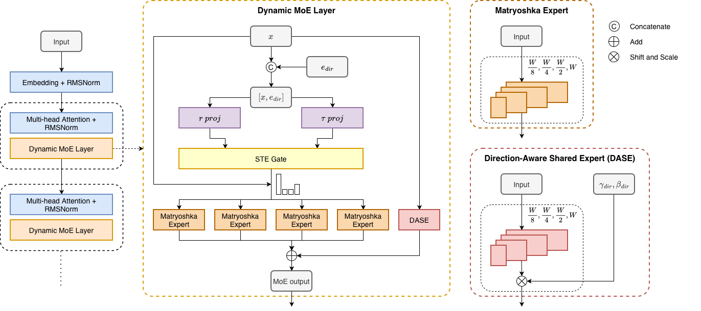
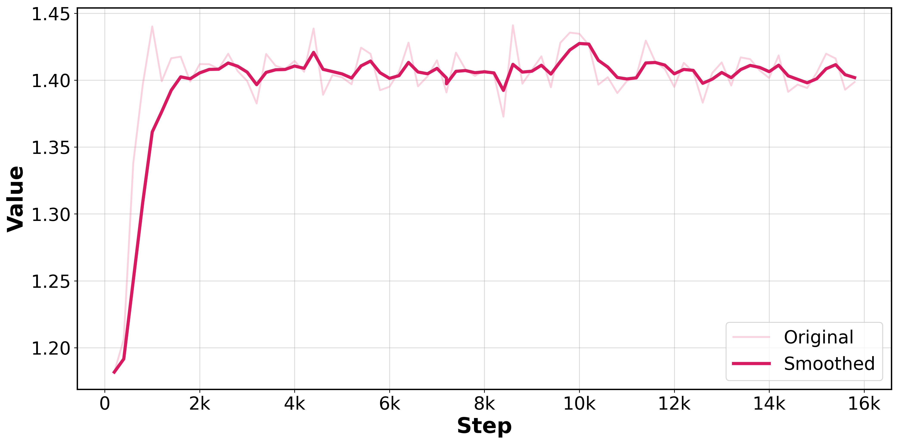
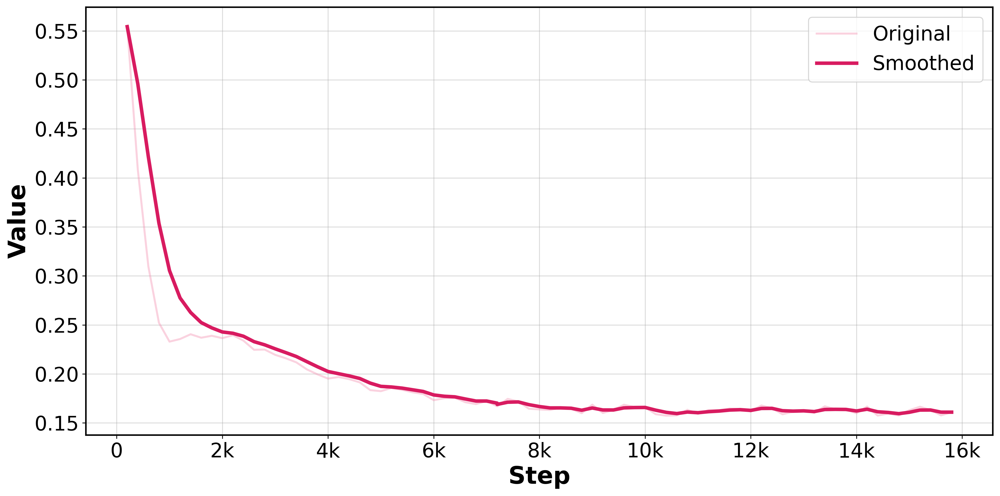
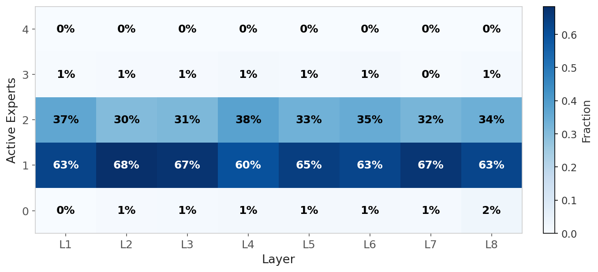
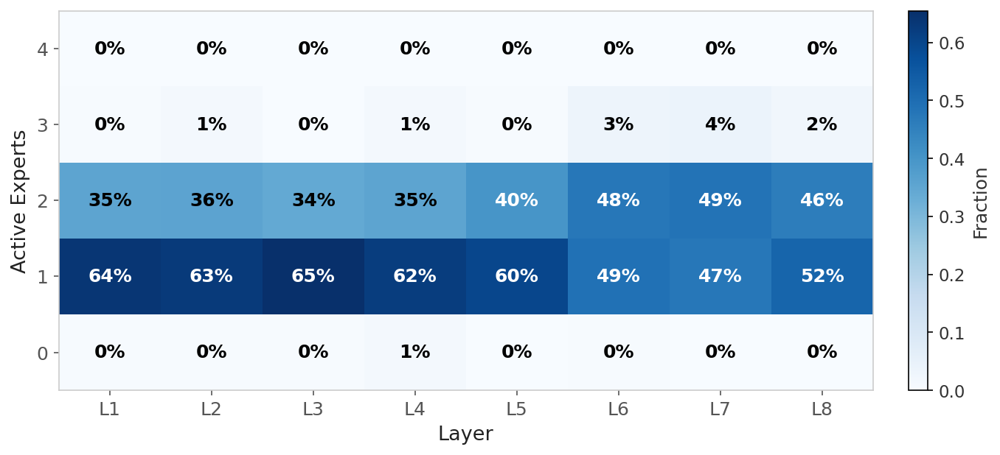
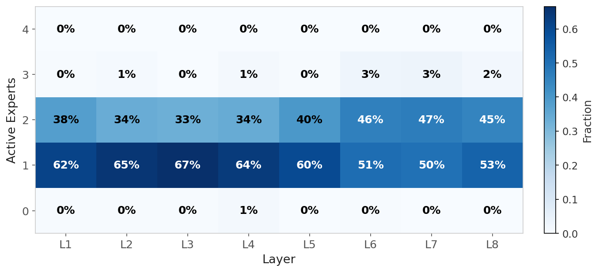
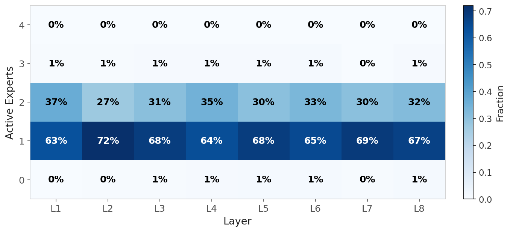
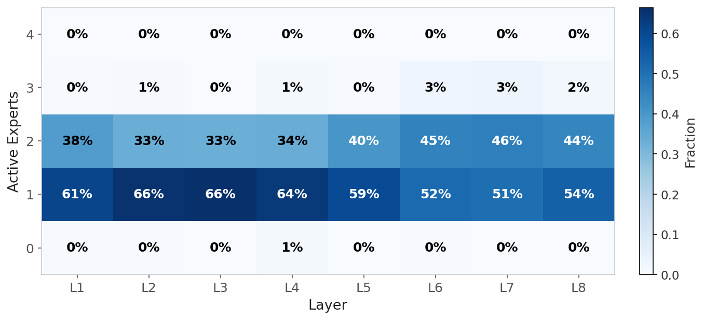

**Source:** *EDWARD-NMT: Elastic Dimensions With Adaptive Routing and Dual-consistency for Neural Machine Translation* — [PDF](https://arxiv.org/pdf/2610.32115v1) · [arXiv](https://arxiv.org/abs/2610.32115v1)

# EDWARD-NMT: Elastic Dimensions With Adaptive Routing and Dual-consistency for Neural Machine Translation

Edward Nguyen ††thanks: Equal contribution. Thai Tran11footnotemark:  1 Kiet Anh Hoang11footnotemark:  1 Duy Hoang11footnotemark:  1 Duy Vo  Khanh Le  Vu Le  Affiliation: UNEY, Switzerland  Affiliation: {edward.nguyen, thai.tt, kiet.ha, duy.hv, duy.vhb, khanh.ld, vu.lt}@uney.com

###### Abstract

Sparse Mixture-of-Experts (MoE) is a powerful paradigm for scaling Neural Machine Translation (NMT) and managing language heterogeneity. However, practical limitations hinder its deployment on resource-constrained devices: the entire expert pool must remain in memory, and the per-token compute budget is statically fixed during training by rigid top-\(k\) routing. We introduce EDWARD-NMT (Elastic Dimensions With Adaptive Routing and Dual-consistency for NMT), a novel MoE encoder-decoder architecture designed for a “train once, deploy anywhere” paradigm that exposes a family of deployable sub-networks at inference time. EDWARD-NMT integrates three key innovations: (i) Matryoshka-style elastic dimensions to flexibly reduce the memory footprint; (ii) an adaptive sigmoid router with a learned, task-conditioned threshold, allowing each token to dynamically determine its active expert count; and (iii) a dual-consistency objective to maximize the performance of the extracted sub-networks. Extensive experiments on PhoMT (En\(\leftrightarrow\)Vi), WMT-14 (En\(\leftrightarrow\)De), multilingual OPUS-16, and a multi-domain De\(\leftrightarrow\)En benchmark validate our approach. The full-capacity architecture matches or exceeds strong MoE baselines with improved parameter efficiency. Furthermore, the sub-networks seamlessly extracted from a single checkpoint consistently outperform comparably sized dense Transformers without any retraining.

## 1 Introduction

Managing language and domain heterogeneity is a fundamental challenge in Neural Machine Translation (NMT) [Britz et al. (2017)](https://arxiv.org/html/2610.32115v1#bib.bib33); [Koehn and Knowles (2017)](https://arxiv.org/html/2610.32115v1#bib.bib31); [Pham et al. (2021)](https://arxiv.org/html/2610.32115v1#bib.bib32), as training corpora routinely mix diverse lexical and stylistic distributions [Stahlberg (2020)](https://arxiv.org/html/2610.32115v1#bib.bib2); [Gain et al. (2026)](https://arxiv.org/html/2610.32115v1#bib.bib34). The Mixture-of-Experts (MoE) paradigm addresses this by routing tokens to conditionally activated experts, scaling capacity to specialize in distinct patterns while keeping per-token computation tractable [Shazeer et al. (2017)](https://arxiv.org/html/2610.32115v1#bib.bib3); [Fedus et al. (2022)](https://arxiv.org/html/2610.32115v1#bib.bib4); [Dai et al. (2022)](https://arxiv.org/html/2610.32115v1#bib.bib36); [Zhang et al. (2024)](https://arxiv.org/html/2610.32115v1#bib.bib20); [Liang et al. (2025)](https://arxiv.org/html/2610.32115v1#bib.bib35).

Despite state-of-the-art performance, MoEs face deployment bottlenecks in resource-constrained environments. First, the entire expert pool must reside in memory [Hoffmann et al. (2022)](https://arxiv.org/html/2610.32115v1#bib.bib37); [Xu et al. (2023)](https://arxiv.org/html/2610.32115v1#bib.bib39). While lightweight adapters reduce this overhead [Zhang et al. (2024)](https://arxiv.org/html/2610.32115v1#bib.bib20), they still yield static, hardware-specific models. Second, standard MoEs rely on rigid top-\(k\) routing, applying an identical compute budget regardless of token complexity [Jawahar et al. (2023)](https://arxiv.org/html/2610.32115v1#bib.bib38); [Guo et al. (2025)](https://arxiv.org/html/2610.32115v1#bib.bib40). Although Neural Architecture Search can design heterogeneous sub-networks [Jawahar et al. (2023)](https://arxiv.org/html/2610.32115v1#bib.bib38), it requires complex offline phases. Consequently, NMT practitioners lack a unified framework to dynamically adjust memory and compute footprints on the fly.

To address these gaps, we propose EDWARD-NMT (Elastic Dimensions With Adaptive Routing and Dual-consistency for NMT), an encoder-decoder architecture enabling a _train-once, deploy-anywhere_ paradigm through two coordinated forms of adaptivity. To overcome memory bottlenecks, we apply Matryoshka representation learning [Kusupati et al. (2022)](https://arxiv.org/html/2610.32115v1#bib.bib7) to expert dimensions, allowing the MoE to be deterministically sliced into weight-sharing sub-networks at inference. To eliminate rigid compute constraints, we replace top-\(k\) selection with an adaptive sigmoid router using a learned, task-conditioned threshold, empowering tokens to dynamically dictate their active expert count. Finally, to ensure aggressively truncated sub-networks maintain translation quality without post-hoc fine-tuning, we introduce a novel in-place _dual-consistency_ objective that explicitly aligns predictive distributions across nested structural scales.

Extensive experiments on PhoMT (En\(\leftrightarrow\)Vi) [Doan et al. (2021)](https://arxiv.org/html/2610.32115v1#bib.bib26), WMT-14 (En\(\leftrightarrow\)De) [Bojar et al. (2014)](https://arxiv.org/html/2610.32115v1#bib.bib27), multilingual OPUS-16 [Zhao et al. (2024)](https://arxiv.org/html/2610.32115v1#bib.bib64), and a multi-domain De\(\leftrightarrow\)En [Aharoni and Goldberg (2020)](https://arxiv.org/html/2610.32115v1#bib.bib41) benchmark validate our approach. EDWARD-NMT achieves strong full-capacity performance, improving upon Transformer Big [Vaswani et al. (2017)](https://arxiv.org/html/2610.32115v1#bib.bib1) across benchmarks, while keeping smaller variants highly capable. Our full model matches recent lightweight MoEs [Zhang et al. (2024)](https://arxiv.org/html/2610.32115v1#bib.bib20), while our smallest variant (EDWARD-NMT-S) outperforms a dense Transformer Base, with all variants seamlessly extracted from a single checkpoint. In summary, our main contributions are:

  * We propose EDWARD-NMT, coupling elastic expert dimensions with dynamic, token-level sigmoid routing to realize a _train-once, deploy-anywhere_ NMT architecture. 
  * We formulate a _dual-consistency_ self-distillation objective, an entirely in-place regularization mechanism that stabilizes aggressively sliced sub-networks without requiring post-hoc adaptation or fine-tuning. 
  * We demonstrate that a single training run yields a discrete family of high-performing sub-networks, with the full-capacity model matching strong MoE baselines and smaller variants outperforming comparably sized dense networks. 

## 2 Related Work

#### Static vs. Elastic Mixture-of-Experts.

Sparse MoEs dominate sequence model scaling [Shazeer et al. (2017)](https://arxiv.org/html/2610.32115v1#bib.bib3); [Fedus et al. (2022)](https://arxiv.org/html/2610.32115v1#bib.bib4); [Dai et al. (2022)](https://arxiv.org/html/2610.32115v1#bib.bib36); [Jiang et al. (2024)](https://arxiv.org/html/2610.32115v1#bib.bib18); [Liu et al. (2024)](https://arxiv.org/html/2610.32115v1#bib.bib19) and multi-domain NMT [Costa-Jussà et al. (2022)](https://arxiv.org/html/2610.32115v1#bib.bib15); [Zhang et al. (2024)](https://arxiv.org/html/2610.32115v1#bib.bib20), yet produce static models with fixed memory footprints. Post-hoc compression [Lagunas et al. (2021)](https://arxiv.org/html/2610.32115v1#bib.bib42); [Li et al. (2025)](https://arxiv.org/html/2610.32115v1#bib.bib43) yields rigid, hardware-specific models, while multi-sub-network architectures [Cai et al. (2020)](https://arxiv.org/html/2610.32115v1#bib.bib50); [Yu et al. (2019)](https://arxiv.org/html/2610.32115v1#bib.bib21); [Hou et al. (2020)](https://arxiv.org/html/2610.32115v1#bib.bib22) require explicit fine-tuning. Existing elastic designs either restrict flexibility to dense networks [Kudugunta et al. (2024)](https://arxiv.org/html/2610.32115v1#bib.bib8) or limit it to token-level granularity [Cappellazzo et al. (2026)](https://arxiv.org/html/2610.32115v1#bib.bib65). While concurrent work (MoSE [Tastan et al. (2026)](https://arxiv.org/html/2610.32115v1#bib.bib66)) introduces slimmable experts, it retains rigid top-\(k\) routing and employs test-time training for width adaptation. In contrast, EDWARD-NMT embeds Matryoshka-style elasticity directly into sparse experts. By introducing a variance-preservation scaling factor, we stabilize activations across nested widths, allowing a single trained MoE to yield a family of deployable sub-networks without any post-hoc adaptation.

#### Dynamic Routing and Adaptive Compute.

Traditional MoEs employ rigid top-\(k\) routing, applying identical compute budgets regardless of token complexity and relying on restrictive load-balancing losses [Clark et al. (2022)](https://arxiv.org/html/2610.32115v1#bib.bib44). Relaxations include soft [Puigcerver et al. (2024)](https://arxiv.org/html/2610.32115v1#bib.bib23) and expert-choice routing [Zhou et al. (2022)](https://arxiv.org/html/2610.32115v1#bib.bib14), while recent methods adapt per-token compute dynamically via null experts (AdaMoE [Zeng et al. (2024)](https://arxiv.org/html/2610.32115v1#bib.bib17)), auto-tuned activations (DynMoE [Guo et al. (2025)](https://arxiv.org/html/2610.32115v1#bib.bib40)), or differentiable ReLU routing (ReMoE [Wang et al. (2025)](https://arxiv.org/html/2610.32115v1#bib.bib16)). EDWARD-NMT is concurrent but distinct: by coupling elastic experts with an adaptive sigmoid router, our framework uniquely enables dynamic adjustment of both memory and compute footprints at inference.

#### Self-distillation and Consistency Regularization.

To enhance model generalization and robustness, typical consistency regularization aligns predictions across perturbed forward passes or augmented data views [Xie et al. (2020)](https://arxiv.org/html/2610.32115v1#bib.bib25); [Liang et al. (2021)](https://arxiv.org/html/2610.32115v1#bib.bib24); [Yao et al. (2025)](https://arxiv.org/html/2610.32115v1#bib.bib45), while self-distillation transfers knowledge between layers or temporal states [Furlanello et al. (2018)](https://arxiv.org/html/2610.32115v1#bib.bib48); [Lan et al. (2018)](https://arxiv.org/html/2610.32115v1#bib.bib47); [Mobahi et al. (2020)](https://arxiv.org/html/2610.32115v1#bib.bib46). Although in-place distillation successfully trains dense elastic networks by aligning sub-networks with a full-capacity teacher [Yu and Huang (2019)](https://arxiv.org/html/2610.32115v1#bib.bib49); [Cai et al. (2020)](https://arxiv.org/html/2610.32115v1#bib.bib50), it remains confined to statically routed architectures. We extend this via a novel _dual-consistency objective_ tailored for elastic MoEs. Rather than aligning augmented views, we dynamically transfer knowledge between nested widths using a symmetric Kullback-Leibler (Jeffreys) divergence. This bidirectional regularization anchors the full-capacity network while preserving the quality of aggressively truncated variants.

 Figure 1: Overview of the EDWARD-NMT architecture. Left: The macro-level Transformer block integrating the Dynamic MoE layer. Center: The Adaptive Sigmoid Router computes a token-specific threshold (\(\tau\)) conditioned on a translation direction embedding (\(e_{dir}\)) to dynamically allocate the sparse expert budget. Top Right: The internal structure of a Matryoshka Expert, illustrating the nested parameter slices used to extract varying capacities. Bottom Right: The Direction-Aware Shared Expert (DASE) applies FiLM modulation (\(\gamma_{dir},\beta_{dir}\)) to provide a stable, direction-aware backbone.

#### Shared Experts.

To prevent sparse experts from redundantly learning general linguistic patterns, architectures like DeepSeek-MoE [Dai et al. (2024)](https://arxiv.org/html/2610.32115v1#bib.bib12) and Qwen3 [Yang et al. (2025)](https://arxiv.org/html/2610.32115v1#bib.bib51) isolate common knowledge into a dense, universally shared expert. EDWARD-NMT extends this by dynamically conditioning the shared expert on the translation direction via FiLM modulation [Perez et al. (2018)](https://arxiv.org/html/2610.32115v1#bib.bib13), creating a unified, direction-aware backbone without the parameter overhead of dedicated experts.

## 3 EDWARD-NMT

EDWARD-NMT builds upon the Transformer encoder-decoder architecture [Vaswani et al. (2017)](https://arxiv.org/html/2610.32115v1#bib.bib1); [Shazeer (2020)](https://arxiv.org/html/2610.32115v1#bib.bib6), selected over decoder-only alternatives for its superior parameter efficiency and low inference latency, making it highly practical for resource-constrained deployment. We replace conventional feed-forward sublayers with a novel MoE block comprising three jointly optimized innovations: (i) elastic experts encoding a family of nested inner widths, (ii) an adaptive sigmoid router dynamically allocating the optimal expert count per token, and (iii) a dual-consistency objective aligning predictions across capacity views. Additionally, a lightweight Direction-Aware Shared Expert (DASE) is computed in parallel. Figure [1](https://arxiv.org/html/2610.32115v1#S2.F1 "Figure 1 ‣ Self-distillation and Consistency Regularization. ‣ 2 Related Work ‣ EDWARD-NMT: Elastic Dimensions With Adaptive Routing and Dual-consistency for Neural Machine Translation") provides a schematic overview.

### 3.1 Preliminaries: Standard Mixture-of-Experts

We adopt the sparsely gated MoE feed-forward layer [Shazeer et al. (2017)](https://arxiv.org/html/2610.32115v1#bib.bib3); [Fedus et al. (2022)](https://arxiv.org/html/2610.32115v1#bib.bib4) as our baseline. Let \(x\in\mathbb{R}^{d_{\text{model}}}\) denote the input token representation. An MoE layer consists of \(E\) independent expert networks, \(\{E_{i}\}_{i=1}^{E}\), and a routing function \(g_{\theta,k}(x)\) parameterized by a weight matrix \(W_{g}\in\mathbb{R}^{d_{\text{model}}\times E}\).

The standard router projects the input to unnormalized logits \(z=xW_{g}\). The routing weights are thus computed as \(g_{\theta,k}(x)=\mathrm{Softmax}(\mathrm{TopK}(xW_{g},k))\), and the MoE layer outputs their weighted sum:

\[\begin{aligned}
 & \text{MoE}(x)=\sum_{i\in\mathcal{T}_{k}(x)}g_{\theta,k}(x)_{i}\cdot E_{i}(x), &  & \text{(1)}
\end{aligned}\]

 

where \(\mathcal{T}_{k}(x)\) is the set of selected expert indices. Each expert \(E_{i}\) is typically a SwiGLU Multi-Layer Perceptron [Shazeer (2020)](https://arxiv.org/html/2610.32115v1#bib.bib6), parameterized by up-projection weights \(W_{1},W_{2}\in\mathbb{R}^{d_{\text{model}}\times M}\) and down-projection weights \(W_{3}\in\mathbb{R}^{M\times d_{\text{model}}}\), where \(M\) is the maximum inner dimension.

This standard formulation exhibits two critical limitations: rigid top-\(k\) routing fixes the per-token compute budget, and the physical memory footprint scales linearly with \(E\cdot M\) regardless of how many experts are actively evaluated.

### 3.2 Elastic Experts via Matryoshka Dimensions

Inspired by Matryoshka Representation Learning [Kusupati et al. (2022)](https://arxiv.org/html/2610.32115v1#bib.bib7); [Kudugunta et al. (2024)](https://arxiv.org/html/2610.32115v1#bib.bib8), we design experts to support a nested family of inner dimensions \(\mathcal{D}\subseteq\{1,\dots,M\}\) sharing a _single_ set of parameter tensors. During each forward pass, a target dimension \(D_{k}\in\mathcal{D}\) is sampled. Rather than instantiating physically separate experts, we dynamically truncate intermediate activations to their first \(D_{k}\) components. Letting \([\,:D_{k}]\) denote the hidden dimension slice, the elastic SwiGLU expert computes:

\[\begin{aligned}
 & \displaystyle h & \displaystyle=\mathrm{SiLU}(xW_{1})\odot(xW_{2}), &  & \text{(2)} \\
 & \displaystyle E_{i}(x;D_{k}) & \displaystyle=\psi(D_{k})\cdot\bigl(h_{[:D_{k}]}W_{3,[:D_{k},:]}\bigr). &  & \text{(3)}
\end{aligned}\]

 

#### Variance Preservation.

Truncating the inner dimension intrinsically shrinks the magnitude of the down-projected activations, destabilizing residual additions and RMSNorm statistics [Zhang and Sennrich (2019)](https://arxiv.org/html/2610.32115v1#bib.bib9). To compensate, we introduce a deterministic rescaling factor \(\psi(D_{k})\) dependent strictly on the chosen width:

\[\begin{aligned}
 & \psi(D_{k})=\sqrt{\frac{M}{\max(D_{k},1)}}. &  & \text{(4)}
\end{aligned}\]

 

This ensures the expected squared norm of \(E_{i}(x;D_{k})\) remains invariant to \(D_{k}\), a correction paramount for stable joint training across all nested capacities. Consequently, a single trained network seamlessly exposes \(|\mathcal{D}|\) weight-sharing sub-networks freely selectable at inference.

### 3.3 Adaptive Sigmoid Routing

To decouple the model from rigid top-\(k\) constraints, we replace the standard softmax gate with a token-adaptive _sigmoid_ gate, empowering tokens to activate a variable expert count based on complexity.

#### Differentiable \(\tau\)-routing.

Let \(z=xW_{g}\in\mathbb{R}^{E}\) be the unnormalized router logits with learned projection \(W_{g}\in\mathbb{R}^{d_{\text{model}}\times E}\), and \(e_{\text{dir}}\in\mathbb{R}^{d_{\text{dir}}}\) be a learnable direction embedding for the translation direction. We compute per-expert probabilities \(r\) and a dynamic threshold \(\tau\):

\[\begin{aligned}
 & \displaystyle r & \displaystyle=\sigma(z+\epsilon),\quad\epsilon\sim\mathcal{U}(-\eta,\eta), &  & \text{(5)} \\
 & \displaystyle\tilde{\tau} & \displaystyle=\sigma\bigl([x;e_{\text{dir}}]^{\top}W_{\tau}\bigr), &  & \text{(6)} \\
 & \displaystyle\tau & \displaystyle=\tau_{\min}+(\tau_{\max}-\tau_{\min})\cdot\tilde{\tau}, &  & \text{(7)}
\end{aligned}\]

 

where \(W_{\tau}\in\mathbb{R}^{d_{\text{model}}+d_{\text{dir}}}\) projects the concatenated representation, and \(\eta\) is a training jitter to prevent routing collapse [Fedus et al. (2022)](https://arxiv.org/html/2610.32115v1#bib.bib4).

A token activates expert \(E_{i}\) if and only if \(r_{i}>\tau\). To backpropagate through this discrete decision, we use a Straight-Through Estimator (STE) [Bengio et al. (2013)](https://arxiv.org/html/2610.32115v1#bib.bib10):

\[\begin{aligned}
 & \displaystyle M^{\text{soft}}_{i} & \displaystyle=\sigma\bigl(r_{i}-\tau\bigr), &  & \text{(8)} \\
 & \displaystyle M^{\text{hard}}_{i} & \displaystyle=\mathbb{I}[r_{i}>\tau], &  & \text{(9)} \\
 & \displaystyle M_{i} & \displaystyle=\mathrm{sg}\bigl(M^{\text{hard}}_{i}-M^{\text{soft}}_{i}\bigr)+M^{\text{soft}}_{i}, &  & \text{(10)}
\end{aligned}\]

 

where \(\mathrm{sg}(\cdot)\) is the stop-gradient operator. The MoE output is given by:

\[\begin{aligned}
 & \text{MoE}(x)=\sum_{i=1}^{E}M_{i}\,r_{i}\,E_{i}(x;D_{k}). &  & \text{(11)}
\end{aligned}\]

 

During inference, only experts where \(M^{\text{hard}}_{i}=1\) are activated, rendering per-token compute dynamically data-dependent.

#### Expert Sparsity Constraints.

To explicitly control the computational budget and prevent load imbalance, we enforce a target sparsity \(\rho_{\text{target}}\) for active experts. An auxiliary loss aligns the empirical routing sparsity with this constraint to ensure uniform expert utilization:

\[\begin{aligned}
 & \begin{split}\mathcal{L}_{\text{sp}}=&\frac{1}{|\mathcal{B}|}\sum_{x\in\mathcal{B}}\left(\sum_{i=1}^{E}M_{i}(x)-\rho_{\text{target}}\right)^{2}\\
&+\frac{1}{E}\sum_{i=1}^{E}\left(f_{i}-\frac{\rho_{\text{target}}}{E}\right)^{2}.\end{split} &  & \text{(12)}
\end{aligned}\]

 

where \(f_{i}\) is the activation frequency of expert \(i\) within batch \(\mathcal{B}\), masking padded positions for accurate sparsity estimation.

### 3.4 Dual-Consistency Objective

A central challenge in elastic MoEs is ensuring aggressively truncated sub-networks remain performant without downstream fine-tuning. We resolve this via a _dual-consistency_ objective tying varying capacity views together.

At every training step, we sample two dimensions \(D_{A},D_{B}\sim\mathcal{D}\) with replacement. We perform two forward passes by dynamically slicing expert activations to widths \(D_{A}\) and \(D_{B}\), yielding predictive vocabulary distributions \(P_{A}\) and \(P_{B}\). We define the loss using a Symmetrized Kullback-Leibler (KL) divergence (Jeffreys Divergence):

\[\begin{aligned}
 & \mathcal{L}_{\text{dc}}=\frac{1}{2}\Big[\mathrm{KL}\big(\text{sg}(P_{A})\|P_{B}\big)+\mathrm{KL}\big(\text{sg}(P_{B})\|P_{A}\big)\Big], &  & \text{(13)}
\end{aligned}\]

 

where \(\text{sg}(\cdot)\) denotes the stop-gradient operator. This formulation unifies two regularizing paradigms. When \(D_{A}\neq D_{B}\), it functions as _in-place self-distillation_ : the larger capacity view provides a richer target to guide the smaller variant, while the smaller core acts as a structural regularizer for the larger network. When \(D_{A}=D_{B}\), it defaults to consistency regularization similar to _R-Drop_ [Liang et al. (2021)](https://arxiv.org/html/2610.32115v1#bib.bib24), minimizing the divergence between stochastic forward passes of the same sub-network. This bidirectional flow anchors the full-capacity model while preserving the translation quality of truncated variants.

### 3.5 Direction-Aware Shared Expert

Multi-directional and multi-domain NMT models frequently suffer from negative interference. Following recent successes isolating common knowledge in shared experts [Rajbhandari et al. (2022b)](https://arxiv.org/html/2610.32115v1#bib.bib11); [Dai et al. (2024)](https://arxiv.org/html/2610.32115v1#bib.bib12), we introduce a single _dense_ expert activated for every token in parallel with the sparse router. To render this backbone direction-aware without the parameter overhead of dedicated experts, we dynamically modulate its hidden state via Feature-wise Linear Modulation (FiLM) [Perez et al. (2018)](https://arxiv.org/html/2610.32115v1#bib.bib13). We use the discrete translation direction to index learned modulation vectors \(\gamma_{c},\beta_{c}\in\mathbb{R}^{M}\). The DASE computes:

\[\begin{aligned}
 & \displaystyle h^{\text{shr}} & \displaystyle=\mathrm{SiLU}(xW^{\text{shr}}_{1})\odot(xW^{\text{shr}}_{2}), &  & \text{(14)} \\
 & \displaystyle\hat{h}^{\text{shr}} & \displaystyle=h^{\text{shr}}\odot(1+\gamma_{c})+\beta_{c}, &  & \text{(15)} \\
 & \displaystyle E_{\text{shr}}(x;D_{k}) & \displaystyle=\alpha\cdot\psi(D_{k})\cdot\bigl(\hat{h}^{\text{shr}}_{[:D_{k}]}W^{\text{shr}}_{3,[:D_{k},:]}\bigr), &  & \text{(16)}
\end{aligned}\]

 

where \(0<\alpha<1\) is a static damping factor preventing the shared expert from overpowering the sparsely routed experts. The DASE acts as a stable, grammatical backbone, freeing routed experts to specialize heavily across idiosyncratic domains.

The final output of the elastic MoE block aggregates the dynamic routed paths with the shared direction-conditioned path:

\[\begin{aligned}
 & y_{\text{MoE}}(x;D_{k})=\sum_{i=1}^{E}M_{i}r_{i}E_{i}(x;D_{k})+E_{\text{shr}}(x;D_{k}). &  & \text{(17)}
\end{aligned}\]

 

### 3.6 Training Objective and Inference

The complete optimization objective minimizes the standard label-smoothed cross-entropy loss alongside our auxiliary routing constraints and dual-consistency regularization. Because we sample two distinct capacity dimensions \(D_{A}\) and \(D_{B}\) at each training step, the cross-entropy and routing losses are calculated independently for each width and averaged. The final loss \(\mathcal{L}\) is formulated as:

\[\begin{aligned}
 & \mathcal{L}=\frac{1}{2}\sum_{D\in\{D_{A},D_{B}\}}\left(\mathcal{L}_{\text{ce}}^{(D)}+\lambda_{\text{sp}}\mathcal{L}_{\text{sp}}^{(D)}\right)+\lambda_{\text{dc}}\mathcal{L}_{\text{dc}}, &  & \text{(18)}
\end{aligned}\]

 

where \(\mathcal{L}_{\text{ce}}^{(D)}\) and \(\mathcal{L}_{\text{sp}}^{(D)}\) denote the cross-entropy and target sparsity computed during the forward pass of width \(D\). The scalar weights \(\lambda_{\text{sp}}\) and \(\lambda_{\text{dc}}\) balance the relative impact of the routing and consistency constraints.

During inference, a target memory footprint is dictated simply by specifying an expert width \(D_{k}\in\mathcal{D}\). The corresponding sub-network is extracted seamlessly via deterministic matrix slicing. Simultaneously, the adaptive sigmoid router dynamically calibrates the active expert count per token. By decoupling static memory capacity from the dynamic compute budget, EDWARD-NMT realizes a highly efficient “train once, deploy anywhere” paradigm.

## 4 Experimental Setup

### 4.1 Datasets

We evaluate EDWARD-NMT on four benchmark families (full dataset and preprocessing details are provided in Appendix [A.1](https://arxiv.org/html/2610.32115v1#A1.SS1 "A.1 Datasets and Preprocessing ‣ Appendix A Experimental Details ‣ EDWARD-NMT: Elastic Dimensions With Adaptive Routing and Dual-consistency for Neural Machine Translation")): (1) PhoMT (En\(\leftrightarrow\)Vi) [Doan et al. (2021)](https://arxiv.org/html/2610.32115v1#bib.bib26), (2) the standard WMT-14 (En\(\leftrightarrow\)De) [Bojar et al. (2014)](https://arxiv.org/html/2610.32115v1#bib.bib27) evaluated on newstest2014, (3) the multi-domain De\(\leftrightarrow\)En benchmark [Zhang et al. (2024)](https://arxiv.org/html/2610.32115v1#bib.bib20) spanning five diverse domains evaluated via macro-averaging, and (4) the multilingual translation OPUS-16 dataset following [Zhao et al. (2024)](https://arxiv.org/html/2610.32115v1#bib.bib64), with 16 languages divided into high (\(>0.9\)M pairs), low (\(<0.1\)M pairs) and medium resource.

### 4.2 Architecture and Sub-network Family

The encoder-decoder backbone has \(L_{\text{enc}}=L_{\text{dec}}=8\) layers, \(d_{\text{model}}=512\), eight attention heads, \(E=4\) routed experts, and one direction-aware shared expert (total of \(5\) experts) per MoE layer. Both routed and shared experts have a maximum inner dimension \(M=2048\), governed by the nested family: \(\mathcal{D}=\{2048,\,1024,\,512,\,256\}\). This yields the four variants in Table [1](https://arxiv.org/html/2610.32115v1#S4.T1 "Table 1 ‣ 4.2 Architecture and Sub-network Family ‣ 4 Experimental Setup ‣ EDWARD-NMT: Elastic Dimensions With Adaptive Routing and Dual-consistency for Neural Machine Translation"). Total parameters vary across datasets due to vocabulary size. All share _a single set of trained parameters_ , differing only by the inference slice \(D_{k}\in\mathcal{D}\).

Variant | \(\mathbf{D_{k}}\) | Total Params | Active Params  
---|---|---|---  
EDWARD-NMT-S | \(256\) | \(67-74\)M | \(51-59\)M  
EDWARD-NMT-M | \(512\) | \(98-105\)M | \(66-76\)M  
EDWARD-NMT-L | \(1024\) | \(161-168\)M | \(97-109\)M  
EDWARD-NMT-XL | \(2048\) | \(287-294\)M | \(158-175\)M

 Table 1: EDWARD-NMT sub-network variants extracted from a single trained model.

#### Routing & Consistency.

The direction embedding \(e_{\text{dir}}\in\mathbb{R}^{64}\) is learned per translation direction. The router uses jitter \(\eta=0.05\), thresholds \(\tau_{\min}=0.05\) and \(\tau_{\max}=0.60\). The target sparsity is set to \(\rho_{\text{target}}=1.25\). The auxiliary weight is \(\lambda_{\text{sp}}=0.01\), and the DASE damping factor is \(\alpha=0.1\). For dual-consistency (\(\lambda_{\text{dc}}=1\)), dimensions \(D_{A},D_{B}\sim\mathcal{D}\) are sampled uniformly with replacement per step.

### 4.3 Baselines

We compare against standard dense Transformers (Base/Big) [Vaswani et al. (2017)](https://arxiv.org/html/2610.32115v1#bib.bib1); [Ott et al. (2018)](https://arxiv.org/html/2610.32115v1#bib.bib52), mBART [Liu et al. (2020)](https://arxiv.org/html/2610.32115v1#bib.bib30), and MoE methods: the Switch Transformer [Fedus et al. (2022)](https://arxiv.org/html/2610.32115v1#bib.bib4) with top-1 token-based routing (ST-MoE) and GShard [Lepikhin et al. (2021)](https://arxiv.org/html/2610.32115v1#bib.bib5) with top-2 token-based routing (GS-MoE). Both MoE models use Transformers Big backbone for multi-domain benchmark. All models are _trained jointly on all translation directions_ to match our setup. For OPUS-16 we report baseline results from [Zhao et al. (2024)](https://arxiv.org/html/2610.32115v1#bib.bib64), more MoE baselines are provided in Appendix [B.2](https://arxiv.org/html/2610.32115v1#A2.SS2 "B.2 Multilingual Results ‣ Appendix B Additional Results ‣ EDWARD-NMT: Elastic Dimensions With Adaptive Routing and Dual-consistency for Neural Machine Translation").

### 4.4 Implementation Details

#### Training.

All models are trained on a single TPU v5-64 pod using the AdamW optimizer [Loshchilov and Hutter (2019)](https://arxiv.org/html/2610.32115v1#bib.bib29) (\(\beta_{1}{=}0.9\), \(\beta_{2}{=}0.98\)). The learning rate warms up linearly from \(10^{-6}\) to \(10^{-2}\) over the first 1k steps. We use an effective batch size of \(8{,}192\) sequences (max length \(128\)), a dropout rate of \(0.1\), and label smoothing of \(0.1\). Training spans 16k steps for the multi-domain, 30k for OPUS-16, 40k for PhoMT, and 60k for WMT-14. Complete hyperparameters are listed in Appendix Table [10](https://arxiv.org/html/2610.32115v1#A1.T10 "Table 10 ‣ A.3 Hyperparameters ‣ Appendix A Experimental Details ‣ EDWARD-NMT: Elastic Dimensions With Adaptive Routing and Dual-consistency for Neural Machine Translation").

#### Inference and Evaluation.

We decode via beam search (width \(4\), length penalty \(0.6\)). Performance is measured using case-sensitive sacreBLEU [Post (2018)](https://arxiv.org/html/2610.32115v1#bib.bib55) for PhoMT, WMT-14, and OPUS-16, and tokenized BLEU [Papineni et al. (2002)](https://arxiv.org/html/2610.32115v1#bib.bib54) for the multi-domain dataset. We also report COMET [Rei et al. (2020)](https://arxiv.org/html/2610.32115v1#bib.bib68) for semantic fidelity on WMT-14 and multi-domain dataset. chrF2 [Popović (2016)](https://arxiv.org/html/2610.32115v1#bib.bib71) on WMT-14 and TER [Snover et al. (2006)](https://arxiv.org/html/2610.32115v1#bib.bib67) on PhoMT results are detailed in Appendix [B.6](https://arxiv.org/html/2610.32115v1#A2.SS6 "B.6 Additional WMT-14 Results ‣ Appendix B Additional Results ‣ EDWARD-NMT: Elastic Dimensions With Adaptive Routing and Dual-consistency for Neural Machine Translation") and [B.7](https://arxiv.org/html/2610.32115v1#A2.SS7 "B.7 Additional PhoMT Results ‣ Appendix B Additional Results ‣ EDWARD-NMT: Elastic Dimensions With Adaptive Routing and Dual-consistency for Neural Machine Translation"). All reported improvements over baselines are statistically significant (Appendix [A.4](https://arxiv.org/html/2610.32115v1#A1.SS4 "A.4 Model Selection and Evaluation ‣ Appendix A Experimental Details ‣ EDWARD-NMT: Elastic Dimensions With Adaptive Routing and Dual-consistency for Neural Machine Translation")). Edge inference latency and throughput are profiled using compiled LiteRT checkpoints (Appendix [B.1](https://arxiv.org/html/2610.32115v1#A2.SS1 "B.1 Computational Results ‣ Appendix B Additional Results ‣ EDWARD-NMT: Elastic Dimensions With Adaptive Routing and Dual-consistency for Neural Machine Translation")). Crucially, all four EDWARD-NMT variants are extracted and evaluated from the _same_ checkpoint.

## 5 Results

### 5.1 Main Translation Quality

#### PhoMT and WMT-14.

Table [2](https://arxiv.org/html/2610.32115v1#S5.T2 "Table 2 ‣ PhoMT and WMT-14. ‣ 5.1 Main Translation Quality ‣ 5 Results ‣ EDWARD-NMT: Elastic Dimensions With Adaptive Routing and Dual-consistency for Neural Machine Translation") reports sacreBLEU on PhoMT (En\(\leftrightarrow\)Vi) and WMT-14 (En\(\leftrightarrow\)De). EDWARD-NMT-XL exceeds Transformer Big across all directions while activating fewer parameters, improving by \(+1.30\) BLEU on PhoMT (Vi\(\rightarrow\)En) and \(+1.48\) on WMT-14 (De\(\rightarrow\)En). Furthermore, it surpasses much larger mBART models across all directions on En\(\rightarrow\)Vi, while remaining highly competitive on Vi\(\rightarrow\)En despite using \(3\times\) fewer active parameters. The smaller sub-networks extracted from the same checkpoint maintain robust performance: EDWARD-NMT-S (\(51-59\)M active parameters) outperforms the dense Transformer Base by \(+0.69\) to \(+3.18\) BLEU at a comparable parameter footprint, performing on par with Transformer Big on PhoMT.

<table id="S5.T2.2" class="ltx_tabular ltx_centering ltx_align_middle">
<tr id="S5.T2.2.1" class="ltx_tr">
<td id="S5.T2.2.1.1" class="ltx_td ltx_border_tt"></td>
<td id="S5.T2.2.1.2" class="ltx_td ltx_align_center ltx_border_tt" colspan="4">PhoMT</td>
<td id="S5.T2.2.1.3" class="ltx_td ltx_align_center ltx_border_tt" colspan="4">WMT-14</td></tr>
<tr id="S5.T2.2.2" class="ltx_tr">
<td id="S5.T2.2.2.1" class="ltx_td ltx_align_left">Method</td>
<td id="S5.T2.2.2.2" class="ltx_td ltx_align_center ltx_border_t">Params</td>
<td id="S5.T2.2.2.3" class="ltx_td ltx_align_center ltx_border_t">Active</td>
<td id="S5.T2.2.2.4" class="ltx_td ltx_align_center ltx_border_t">En<math id="S5.T2.m1" class="ltx_Math" alttext="\rightarrow" display="inline" intent=":literal"><semantics><mo stretchy="false">→</mo><annotation encoding="application/x-tex">\rightarrow</annotation></semantics></math>Vi</td>
<td id="S5.T2.2.2.5" class="ltx_td ltx_align_center ltx_border_t">Vi<math id="S5.T2.m2" class="ltx_Math" alttext="\rightarrow" display="inline" intent=":literal"><semantics><mo stretchy="false">→</mo><annotation encoding="application/x-tex">\rightarrow</annotation></semantics></math>En</td>
<td id="S5.T2.2.2.6" class="ltx_td ltx_align_center ltx_border_t">Params</td>
<td id="S5.T2.2.2.7" class="ltx_td ltx_align_center ltx_border_t">Active</td>
<td id="S5.T2.2.2.8" class="ltx_td ltx_align_center ltx_border_t">En<math id="S5.T2.m3" class="ltx_Math" alttext="\rightarrow" display="inline" intent=":literal"><semantics><mo stretchy="false">→</mo><annotation encoding="application/x-tex">\rightarrow</annotation></semantics></math>De</td>
<td id="S5.T2.2.2.9" class="ltx_td ltx_align_center ltx_border_t">De<math id="S5.T2.m4" class="ltx_Math" alttext="\rightarrow" display="inline" intent=":literal"><semantics><mo stretchy="false">→</mo><annotation encoding="application/x-tex">\rightarrow</annotation></semantics></math>En</td></tr>
<tr id="S5.T2.2.3" class="ltx_tr">
<td id="S5.T2.2.3.1" class="ltx_td ltx_align_left ltx_border_t">Transformer Base</td>
<td id="S5.T2.2.3.2" class="ltx_td ltx_align_center ltx_border_t">65M</td>
<td id="S5.T2.2.3.3" class="ltx_td ltx_align_center ltx_border_t">65M</td>
<td id="S5.T2.2.3.4" class="ltx_td ltx_align_center ltx_border_t">42.12</td>
<td id="S5.T2.2.3.5" class="ltx_td ltx_align_center ltx_border_t">37.19</td>
<td id="S5.T2.2.3.6" class="ltx_td ltx_align_center ltx_border_t">61M</td>
<td id="S5.T2.2.3.7" class="ltx_td ltx_align_center ltx_border_t">61M</td>
<td id="S5.T2.2.3.8" class="ltx_td ltx_align_center ltx_border_t">24.56</td>
<td id="S5.T2.2.3.9" class="ltx_td ltx_align_center ltx_border_t">28.76</td></tr>
<tr id="S5.T2.2.4" class="ltx_tr">
<td id="S5.T2.2.4.1" class="ltx_td ltx_align_left">Transformer Big</td>
<td id="S5.T2.2.4.2" class="ltx_td ltx_align_center">213M</td>
<td id="S5.T2.2.4.3" class="ltx_td ltx_align_center">213M</td>
<td id="S5.T2.2.4.4" class="ltx_td ltx_align_center">42.94</td>
<td id="S5.T2.2.4.5" class="ltx_td ltx_align_center">37.83</td>
<td id="S5.T2.2.4.6" class="ltx_td ltx_align_center">210M</td>
<td id="S5.T2.2.4.7" class="ltx_td ltx_align_center">210M</td>
<td id="S5.T2.2.4.8" class="ltx_td ltx_align_center">27.53</td>
<td id="S5.T2.2.4.9" class="ltx_td ltx_align_center">31.48</td></tr>
<tr id="S5.T2.2.5" class="ltx_tr">
<td id="S5.T2.2.5.1" class="ltx_td ltx_align_left">mBART†</td>
<td id="S5.T2.2.5.2" class="ltx_td ltx_align_center">448M</td>
<td id="S5.T2.2.5.3" class="ltx_td ltx_align_center">448M</td>
<td id="S5.T2.2.5.4" class="ltx_td ltx_align_center">43.46</td>
<td id="S5.T2.2.5.5" class="ltx_td ltx_align_center">39.78</td>
<td id="S5.T2.2.5.6" class="ltx_td ltx_align_center">610M</td>
<td id="S5.T2.2.5.7" class="ltx_td ltx_align_center">610M</td>
<td id="S5.T2.2.5.8" class="ltx_td ltx_align_center">24.90</td>
<td id="S5.T2.2.5.9" class="ltx_td ltx_align_center">32.51</td></tr>
<tr id="S5.T2.2.6" class="ltx_tr">
<td id="S5.T2.2.6.1" class="ltx_td ltx_align_left ltx_border_t">EDWARD-NMT-S</td>
<td id="S5.T2.2.6.2" class="ltx_td ltx_align_center ltx_border_t">67M</td>
<td id="S5.T2.2.6.3" class="ltx_td ltx_align_center ltx_border_t">51M</td>
<td id="S5.T2.2.6.4" class="ltx_td ltx_align_center ltx_border_t">42.91</td>
<td id="S5.T2.2.6.5" class="ltx_td ltx_align_center ltx_border_t">37.88</td>
<td id="S5.T2.2.6.6" class="ltx_td ltx_align_center ltx_border_t">74M</td>
<td id="S5.T2.2.6.7" class="ltx_td ltx_align_center ltx_border_t">59M</td>
<td id="S5.T2.2.6.8" class="ltx_td ltx_align_center ltx_border_t">26.85</td>
<td id="S5.T2.2.6.9" class="ltx_td ltx_align_center ltx_border_t">31.94</td></tr>
<tr id="S5.T2.2.7" class="ltx_tr">
<td id="S5.T2.2.7.1" class="ltx_td ltx_align_left">EDWARD-NMT-M</td>
<td id="S5.T2.2.7.2" class="ltx_td ltx_align_center">98M</td>
<td id="S5.T2.2.7.3" class="ltx_td ltx_align_center">66M</td>
<td id="S5.T2.2.7.4" class="ltx_td ltx_align_center">43.35</td>
<td id="S5.T2.2.7.5" class="ltx_td ltx_align_center">38.50</td>
<td id="S5.T2.2.7.6" class="ltx_td ltx_align_center">105M</td>
<td id="S5.T2.2.7.7" class="ltx_td ltx_align_center">76M</td>
<td id="S5.T2.2.7.8" class="ltx_td ltx_align_center">27.49</td>
<td id="S5.T2.2.7.9" class="ltx_td ltx_align_center">32.45</td></tr>
<tr id="S5.T2.2.8" class="ltx_tr">
<td id="S5.T2.2.8.1" class="ltx_td ltx_align_left">EDWARD-NMT-L</td>
<td id="S5.T2.2.8.2" class="ltx_td ltx_align_center">161M</td>
<td id="S5.T2.2.8.3" class="ltx_td ltx_align_center">97M</td>
<td id="S5.T2.2.8.4" class="ltx_td ltx_align_center">43.61</td>
<td id="S5.T2.2.8.5" class="ltx_td ltx_align_center">38.93</td>
<td id="S5.T2.2.8.6" class="ltx_td ltx_align_center">168M</td>
<td id="S5.T2.2.8.7" class="ltx_td ltx_align_center">109M</td>
<td id="S5.T2.2.8.8" class="ltx_td ltx_align_center">27.96</td>
<td id="S5.T2.2.8.9" class="ltx_td ltx_align_center">32.65</td></tr>
<tr id="S5.T2.2.9" class="ltx_tr">
<td id="S5.T2.2.9.1" class="ltx_td ltx_align_left ltx_border_bb">EDWARD-NMT-XL</td>
<td id="S5.T2.2.9.2" class="ltx_td ltx_align_center ltx_border_bb">287M</td>
<td id="S5.T2.2.9.3" class="ltx_td ltx_align_center ltx_border_bb">158M</td>
<td id="S5.T2.2.9.4" class="ltx_td ltx_align_center ltx_border_bb">43.79</td>
<td id="S5.T2.2.9.5" class="ltx_td ltx_align_center ltx_border_bb">39.13</td>
<td id="S5.T2.2.9.6" class="ltx_td ltx_align_center ltx_border_bb">294M</td>
<td id="S5.T2.2.9.7" class="ltx_td ltx_align_center ltx_border_bb">175M</td>
<td id="S5.T2.2.9.8" class="ltx_td ltx_align_center ltx_border_bb">28.03</td>
<td id="S5.T2.2.9.9" class="ltx_td ltx_align_center ltx_border_bb">32.96</td></tr>
</table>

 Table 2: Main results on PhoMT (En\(\leftrightarrow\)Vi) and WMT-14 (En\(\leftrightarrow\)De) measured in sacreBLEU. “Active” denotes average parameters activated by our sigmoid router. Best and second-best scores are bolded and underlined, respectively. †For mBART on WMT-14, we use a pretrained many-to-many model (mbart-large-50-many-to-many-mmt).

#### Multi-domain De\(\leftrightarrow\)En.

<table id="S5.T3.2" class="ltx_tabular ltx_centering ltx_align_middle">
<tr id="S5.T3.2.1" class="ltx_tr">
<td id="S5.T3.2.1.1" class="ltx_td ltx_border_tt"></td>
<td id="S5.T3.2.1.2" class="ltx_td ltx_border_tt"></td>
<td id="S5.T3.2.1.3" class="ltx_td ltx_border_tt"></td>
<td id="S5.T3.2.1.4" class="ltx_td ltx_align_center ltx_border_tt" colspan="6">Multi-domain</td>
<td id="S5.T3.2.1.5" class="ltx_td ltx_align_center ltx_border_tt" colspan="2">OPUS-16</td></tr>
<tr id="S5.T3.2.2" class="ltx_tr">
<td id="S5.T3.2.2.1" class="ltx_td ltx_align_left">Method</td>
<td id="S5.T3.2.2.2" class="ltx_td ltx_align_center">Params</td>
<td id="S5.T3.2.2.3" class="ltx_td ltx_align_center">Active</td>
<td id="S5.T3.2.2.4" class="ltx_td ltx_align_center ltx_border_t">Kor</td>
<td id="S5.T3.2.2.5" class="ltx_td ltx_align_center ltx_border_t">IT</td>
<td id="S5.T3.2.2.6" class="ltx_td ltx_align_center ltx_border_t">Med</td>
<td id="S5.T3.2.2.7" class="ltx_td ltx_align_center ltx_border_t">Law</td>
<td id="S5.T3.2.2.8" class="ltx_td ltx_align_center ltx_border_t">Sub</td>
<td id="S5.T3.2.2.9" class="ltx_td ltx_align_center ltx_border_t">Avg</td>
<td id="S5.T3.2.2.10" class="ltx_td ltx_align_center ltx_border_t">En<math id="S5.T3.m1" class="ltx_Math" alttext="\rightarrow" display="inline" intent=":literal"><semantics><mo stretchy="false">→</mo><annotation encoding="application/x-tex">\rightarrow</annotation></semantics></math>XX</td>
<td id="S5.T3.2.2.11" class="ltx_td ltx_align_center ltx_border_t">XX<math id="S5.T3.m2" class="ltx_Math" alttext="\rightarrow" display="inline" intent=":literal"><semantics><mo stretchy="false">→</mo><annotation encoding="application/x-tex">\rightarrow</annotation></semantics></math>En</td></tr>
<tr id="S5.T3.2.3" class="ltx_tr">
<td id="S5.T3.2.3.1" class="ltx_td ltx_align_left ltx_border_t">Transformer Base</td>
<td id="S5.T3.2.3.2" class="ltx_td ltx_align_center ltx_border_t">61M</td>
<td id="S5.T3.2.3.3" class="ltx_td ltx_align_center ltx_border_t">61M</td>
<td id="S5.T3.2.3.4" class="ltx_td ltx_align_center ltx_border_t">20.53</td>
<td id="S5.T3.2.3.5" class="ltx_td ltx_align_center ltx_border_t">40.01</td>
<td id="S5.T3.2.3.6" class="ltx_td ltx_align_center ltx_border_t">51.25</td>
<td id="S5.T3.2.3.7" class="ltx_td ltx_align_center ltx_border_t">53.72</td>
<td id="S5.T3.2.3.8" class="ltx_td ltx_align_center ltx_border_t">25.29</td>
<td id="S5.T3.2.3.9" class="ltx_td ltx_align_center ltx_border_t">38.16</td>
<td id="S5.T3.2.3.10" class="ltx_td ltx_align_center ltx_border_t">26.92†</td>
<td id="S5.T3.2.3.11" class="ltx_td ltx_align_center ltx_border_t">30.67†</td></tr>
<tr id="S5.T3.2.4" class="ltx_tr">
<td id="S5.T3.2.4.1" class="ltx_td ltx_align_left">Transformer Big</td>
<td id="S5.T3.2.4.2" class="ltx_td ltx_align_center">210M</td>
<td id="S5.T3.2.4.3" class="ltx_td ltx_align_center">210M</td>
<td id="S5.T3.2.4.4" class="ltx_td ltx_align_center">22.55</td>
<td id="S5.T3.2.4.5" class="ltx_td ltx_align_center">41.84</td>
<td id="S5.T3.2.4.6" class="ltx_td ltx_align_center">53.35</td>
<td id="S5.T3.2.4.7" class="ltx_td ltx_align_center">56.22</td>
<td id="S5.T3.2.4.8" class="ltx_td ltx_align_center">26.73</td>
<td id="S5.T3.2.4.9" class="ltx_td ltx_align_center">40.13</td>
<td id="S5.T3.2.4.10" class="ltx_td ltx_align_center">-</td>
<td id="S5.T3.2.4.11" class="ltx_td ltx_align_center">-</td></tr>
<tr id="S5.T3.2.5" class="ltx_tr">
<td id="S5.T3.2.5.1" class="ltx_td ltx_align_left">ST-MoE</td>
<td id="S5.T3.2.5.2" class="ltx_td ltx_align_center">360M</td>
<td id="S5.T3.2.5.3" class="ltx_td ltx_align_center">210M</td>
<td id="S5.T3.2.5.4" class="ltx_td ltx_align_center">21.73</td>
<td id="S5.T3.2.5.5" class="ltx_td ltx_align_center">41.00</td>
<td id="S5.T3.2.5.6" class="ltx_td ltx_align_center">52.01</td>
<td id="S5.T3.2.5.7" class="ltx_td ltx_align_center">55.69</td>
<td id="S5.T3.2.5.8" class="ltx_td ltx_align_center">26.18</td>
<td id="S5.T3.2.5.9" class="ltx_td ltx_align_center">39.32</td>
<td id="S5.T3.2.5.10" class="ltx_td ltx_align_center">29.68†</td>
<td id="S5.T3.2.5.11" class="ltx_td ltx_align_center">33.89†</td></tr>
<tr id="S5.T3.2.6" class="ltx_tr">
<td id="S5.T3.2.6.1" class="ltx_td ltx_align_left">GS-MoE</td>
<td id="S5.T3.2.6.2" class="ltx_td ltx_align_center">360M</td>
<td id="S5.T3.2.6.3" class="ltx_td ltx_align_center">260M</td>
<td id="S5.T3.2.6.4" class="ltx_td ltx_align_center">20.70</td>
<td id="S5.T3.2.6.5" class="ltx_td ltx_align_center">41.35</td>
<td id="S5.T3.2.6.6" class="ltx_td ltx_align_center">52.31</td>
<td id="S5.T3.2.6.7" class="ltx_td ltx_align_center">54.56</td>
<td id="S5.T3.2.6.8" class="ltx_td ltx_align_center">24.72</td>
<td id="S5.T3.2.6.9" class="ltx_td ltx_align_center">38.72</td>
<td id="S5.T3.2.6.10" class="ltx_td ltx_align_center">28.28†</td>
<td id="S5.T3.2.6.11" class="ltx_td ltx_align_center">32.31†</td></tr>
<tr id="S5.T3.2.7" class="ltx_tr">
<td id="S5.T3.2.7.1" class="ltx_td ltx_align_left ltx_border_t">EDWARD-NMT-S</td>
<td id="S5.T3.2.7.2" class="ltx_td ltx_align_center ltx_border_t">74M</td>
<td id="S5.T3.2.7.3" class="ltx_td ltx_align_center ltx_border_t">57M</td>
<td id="S5.T3.2.7.4" class="ltx_td ltx_align_center ltx_border_t">21.61</td>
<td id="S5.T3.2.7.5" class="ltx_td ltx_align_center ltx_border_t">40.07</td>
<td id="S5.T3.2.7.6" class="ltx_td ltx_align_center ltx_border_t">51.01</td>
<td id="S5.T3.2.7.7" class="ltx_td ltx_align_center ltx_border_t">53.99</td>
<td id="S5.T3.2.7.8" class="ltx_td ltx_align_center ltx_border_t">26.56</td>
<td id="S5.T3.2.7.9" class="ltx_td ltx_align_center ltx_border_t">38.65</td>
<td id="S5.T3.2.7.10" class="ltx_td ltx_align_center ltx_border_t">29.55</td>
<td id="S5.T3.2.7.11" class="ltx_td ltx_align_center ltx_border_t">32.99</td></tr>
<tr id="S5.T3.2.8" class="ltx_tr">
<td id="S5.T3.2.8.1" class="ltx_td ltx_align_left">EDWARD-NMT-M</td>
<td id="S5.T3.2.8.2" class="ltx_td ltx_align_center">105M</td>
<td id="S5.T3.2.8.3" class="ltx_td ltx_align_center">72M</td>
<td id="S5.T3.2.8.4" class="ltx_td ltx_align_center">22.72</td>
<td id="S5.T3.2.8.5" class="ltx_td ltx_align_center">40.87</td>
<td id="S5.T3.2.8.6" class="ltx_td ltx_align_center">52.11</td>
<td id="S5.T3.2.8.7" class="ltx_td ltx_align_center">55.21</td>
<td id="S5.T3.2.8.8" class="ltx_td ltx_align_center">26.88</td>
<td id="S5.T3.2.8.9" class="ltx_td ltx_align_center">39.56</td>
<td id="S5.T3.2.8.10" class="ltx_td ltx_align_center">30.73</td>
<td id="S5.T3.2.8.11" class="ltx_td ltx_align_center">34.84</td></tr>
<tr id="S5.T3.2.9" class="ltx_tr">
<td id="S5.T3.2.9.1" class="ltx_td ltx_align_left">EDWARD-NMT-L</td>
<td id="S5.T3.2.9.2" class="ltx_td ltx_align_center">168M</td>
<td id="S5.T3.2.9.3" class="ltx_td ltx_align_center">102M</td>
<td id="S5.T3.2.9.4" class="ltx_td ltx_align_center">23.56</td>
<td id="S5.T3.2.9.5" class="ltx_td ltx_align_center">41.53</td>
<td id="S5.T3.2.9.6" class="ltx_td ltx_align_center">52.95</td>
<td id="S5.T3.2.9.7" class="ltx_td ltx_align_center">56.27</td>
<td id="S5.T3.2.9.8" class="ltx_td ltx_align_center">27.13</td>
<td id="S5.T3.2.9.9" class="ltx_td ltx_align_center">40.28</td>
<td id="S5.T3.2.9.10" class="ltx_td ltx_align_center">31.64</td>
<td id="S5.T3.2.9.11" class="ltx_td ltx_align_center">35.82</td></tr>
<tr id="S5.T3.2.10" class="ltx_tr">
<td id="S5.T3.2.10.1" class="ltx_td ltx_align_left ltx_border_bb">EDWARD-NMT-XL</td>
<td id="S5.T3.2.10.2" class="ltx_td ltx_align_center ltx_border_bb">294M</td>
<td id="S5.T3.2.10.3" class="ltx_td ltx_align_center ltx_border_bb">161M</td>
<td id="S5.T3.2.10.4" class="ltx_td ltx_align_center ltx_border_bb">24.06</td>
<td id="S5.T3.2.10.5" class="ltx_td ltx_align_center ltx_border_bb">41.90</td>
<td id="S5.T3.2.10.6" class="ltx_td ltx_align_center ltx_border_bb">53.45</td>
<td id="S5.T3.2.10.7" class="ltx_td ltx_align_center ltx_border_bb">57.05</td>
<td id="S5.T3.2.10.8" class="ltx_td ltx_align_center ltx_border_bb">27.30</td>
<td id="S5.T3.2.10.9" class="ltx_td ltx_align_center ltx_border_bb">40.75</td>
<td id="S5.T3.2.10.10" class="ltx_td ltx_align_center ltx_border_bb">32.27</td>
<td id="S5.T3.2.10.11" class="ltx_td ltx_align_center ltx_border_bb">36.30</td></tr>
</table>

 Table 3: Experimental results on the multi-domain (De\(\leftrightarrow\)En) averaged across both directions and multilingual OPUS-16 benchmarks (English to any En\(\rightarrow\)XX and any to English XX\(\rightarrow\)En). The “Params” and “Active” columns report footprints for the multi-domain setup. †Reported from [Zhao et al. (2024)](https://arxiv.org/html/2610.32115v1#bib.bib64). Extended OPUS-16 comparisons are provided in Appendix [B.2](https://arxiv.org/html/2610.32115v1#A2.SS2 "B.2 Multilingual Results ‣ Appendix B Additional Results ‣ EDWARD-NMT: Elastic Dimensions With Adaptive Routing and Dual-consistency for Neural Machine Translation").

Table [3](https://arxiv.org/html/2610.32115v1#S5.T3 "Table 3 ‣ Multi-domain De↔En. ‣ 5.1 Main Translation Quality ‣ 5 Results ‣ EDWARD-NMT: Elastic Dimensions With Adaptive Routing and Dual-consistency for Neural Machine Translation") compares EDWARD-NMT to dense and MoE baselines on the multi-domain benchmark. Our EDWARD-NMT-XL achieves the highest average BLEU, outperforming Transformer Big by \(+0.62\) BLEU across all five domains with significantly fewer active parameters (161M vs. 210M). This efficiency extends to smaller sub-networks: EDWARD-NMT-L surpasses Transformer Big using under half the active parameters (102M), while the smallest EDWARD-NMT-S (57M) improves upon Transformer Base by \(+0.49\) BLEU and rivals the much heavier GS-MoE (260M).

#### Multilingual OPUS-16.

Demonstrating robust scalability, our architecture also excels on the massively multilingual OPUS-16 dataset (Table [3](https://arxiv.org/html/2610.32115v1#S5.T3 "Table 3 ‣ Multi-domain De↔En. ‣ 5.1 Main Translation Quality ‣ 5 Results ‣ EDWARD-NMT: Elastic Dimensions With Adaptive Routing and Dual-consistency for Neural Machine Translation")). While our most compressed sub-network, EDWARD-NMT-S, remains competitive, scaling to just the EDWARD-NMT-M variant is sufficient to consistently outperform both ST-MoE and GS-MoE across both translation directions. The full-capacity EDWARD-NMT-XL further extends this lead. An extended comparison against a wider range of baselines is provided in Appendix [B.2](https://arxiv.org/html/2610.32115v1#A2.SS2 "B.2 Multilingual Results ‣ Appendix B Additional Results ‣ EDWARD-NMT: Elastic Dimensions With Adaptive Routing and Dual-consistency for Neural Machine Translation").

#### Semantic Quality

<table id="S5.T4.2" class="ltx_tabular ltx_centering ltx_align_middle">
<tr id="S5.T4.2.1" class="ltx_tr">
<td id="S5.T4.2.1.1" class="ltx_td ltx_border_tt" style="padding-left:4.0pt;padding-right:4.0pt;"></td>
<td id="S5.T4.2.1.2" class="ltx_td ltx_align_center ltx_border_tt" style="padding-left:4.0pt;padding-right:4.0pt;" colspan="2">WMT-14</td>
<td id="S5.T4.2.1.3" class="ltx_td ltx_align_center ltx_border_tt" style="padding-left:4.0pt;padding-right:4.0pt;" colspan="2">Multi-domain</td></tr>
<tr id="S5.T4.2.2" class="ltx_tr">
<td id="S5.T4.2.2.1" class="ltx_td ltx_align_left" style="padding-left:4.0pt;padding-right:4.0pt;">Method</td>
<td id="S5.T4.2.2.2" class="ltx_td ltx_align_center ltx_border_t" style="padding-left:4.0pt;padding-right:4.0pt;">Active</td>
<td id="S5.T4.2.2.3" class="ltx_td ltx_align_center ltx_border_t" style="padding-left:4.0pt;padding-right:4.0pt;">Avg</td>
<td id="S5.T4.2.2.4" class="ltx_td ltx_align_center ltx_border_t" style="padding-left:4.0pt;padding-right:4.0pt;">Active</td>
<td id="S5.T4.2.2.5" class="ltx_td ltx_align_center ltx_border_t" style="padding-left:4.0pt;padding-right:4.0pt;">Avg</td></tr>
<tr id="S5.T4.2.3" class="ltx_tr">
<td id="S5.T4.2.3.1" class="ltx_td ltx_align_left ltx_border_t" style="padding-left:4.0pt;padding-right:4.0pt;">Transformer Base</td>
<td id="S5.T4.2.3.2" class="ltx_td ltx_align_center ltx_border_t" style="padding-left:4.0pt;padding-right:4.0pt;">61M</td>
<td id="S5.T4.2.3.3" class="ltx_td ltx_align_center ltx_border_t" style="padding-left:4.0pt;padding-right:4.0pt;">80.78</td>
<td id="S5.T4.2.3.4" class="ltx_td ltx_align_center ltx_border_t" style="padding-left:4.0pt;padding-right:4.0pt;">61M</td>
<td id="S5.T4.2.3.5" class="ltx_td ltx_align_center ltx_border_t" style="padding-left:4.0pt;padding-right:4.0pt;">80.20</td></tr>
<tr id="S5.T4.2.4" class="ltx_tr">
<td id="S5.T4.2.4.1" class="ltx_td ltx_align_left" style="padding-left:4.0pt;padding-right:4.0pt;">Transformer Big</td>
<td id="S5.T4.2.4.2" class="ltx_td ltx_align_center" style="padding-left:4.0pt;padding-right:4.0pt;">210M</td>
<td id="S5.T4.2.4.3" class="ltx_td ltx_align_center" style="padding-left:4.0pt;padding-right:4.0pt;">83.69</td>
<td id="S5.T4.2.4.4" class="ltx_td ltx_align_center" style="padding-left:4.0pt;padding-right:4.0pt;">210M</td>
<td id="S5.T4.2.4.5" class="ltx_td ltx_align_center" style="padding-left:4.0pt;padding-right:4.0pt;">81.62</td></tr>
<tr id="S5.T4.2.5" class="ltx_tr">
<td id="S5.T4.2.5.1" class="ltx_td ltx_align_left" style="padding-left:4.0pt;padding-right:4.0pt;">mBART†</td>
<td id="S5.T4.2.5.2" class="ltx_td ltx_align_center" style="padding-left:4.0pt;padding-right:4.0pt;">610M</td>
<td id="S5.T4.2.5.3" class="ltx_td ltx_align_center" style="padding-left:4.0pt;padding-right:4.0pt;">83.56</td>
<td id="S5.T4.2.5.4" class="ltx_td ltx_align_center" style="padding-left:4.0pt;padding-right:4.0pt;">-</td>
<td id="S5.T4.2.5.5" class="ltx_td ltx_align_center" style="padding-left:4.0pt;padding-right:4.0pt;">-</td></tr>
<tr id="S5.T4.2.6" class="ltx_tr">
<td id="S5.T4.2.6.1" class="ltx_td ltx_align_left" style="padding-left:4.0pt;padding-right:4.0pt;">ST-MoE</td>
<td id="S5.T4.2.6.2" class="ltx_td ltx_align_center" style="padding-left:4.0pt;padding-right:4.0pt;">-</td>
<td id="S5.T4.2.6.3" class="ltx_td ltx_align_center" style="padding-left:4.0pt;padding-right:4.0pt;">-</td>
<td id="S5.T4.2.6.4" class="ltx_td ltx_align_center" style="padding-left:4.0pt;padding-right:4.0pt;">210M</td>
<td id="S5.T4.2.6.5" class="ltx_td ltx_align_center" style="padding-left:4.0pt;padding-right:4.0pt;">80.95</td></tr>
<tr id="S5.T4.2.7" class="ltx_tr">
<td id="S5.T4.2.7.1" class="ltx_td ltx_align_left" style="padding-left:4.0pt;padding-right:4.0pt;">GS-MoE</td>
<td id="S5.T4.2.7.2" class="ltx_td ltx_align_center" style="padding-left:4.0pt;padding-right:4.0pt;">-</td>
<td id="S5.T4.2.7.3" class="ltx_td ltx_align_center" style="padding-left:4.0pt;padding-right:4.0pt;">-</td>
<td id="S5.T4.2.7.4" class="ltx_td ltx_align_center" style="padding-left:4.0pt;padding-right:4.0pt;">260M</td>
<td id="S5.T4.2.7.5" class="ltx_td ltx_align_center" style="padding-left:4.0pt;padding-right:4.0pt;">78.20</td></tr>
<tr id="S5.T4.2.8" class="ltx_tr">
<td id="S5.T4.2.8.1" class="ltx_td ltx_align_left ltx_border_t" style="padding-left:4.0pt;padding-right:4.0pt;">EDWARD-NMT-S</td>
<td id="S5.T4.2.8.2" class="ltx_td ltx_align_center ltx_border_t" style="padding-left:4.0pt;padding-right:4.0pt;">59M</td>
<td id="S5.T4.2.8.3" class="ltx_td ltx_align_center ltx_border_t" style="padding-left:4.0pt;padding-right:4.0pt;">83.48</td>
<td id="S5.T4.2.8.4" class="ltx_td ltx_align_center ltx_border_t" style="padding-left:4.0pt;padding-right:4.0pt;">57M</td>
<td id="S5.T4.2.8.5" class="ltx_td ltx_align_center ltx_border_t" style="padding-left:4.0pt;padding-right:4.0pt;">80.96</td></tr>
<tr id="S5.T4.2.9" class="ltx_tr">
<td id="S5.T4.2.9.1" class="ltx_td ltx_align_left" style="padding-left:4.0pt;padding-right:4.0pt;">EDWARD-NMT-M</td>
<td id="S5.T4.2.9.2" class="ltx_td ltx_align_center" style="padding-left:4.0pt;padding-right:4.0pt;">76M</td>
<td id="S5.T4.2.9.3" class="ltx_td ltx_align_center" style="padding-left:4.0pt;padding-right:4.0pt;">83.98</td>
<td id="S5.T4.2.9.4" class="ltx_td ltx_align_center" style="padding-left:4.0pt;padding-right:4.0pt;">72M</td>
<td id="S5.T4.2.9.5" class="ltx_td ltx_align_center" style="padding-left:4.0pt;padding-right:4.0pt;">81.32</td></tr>
<tr id="S5.T4.2.10" class="ltx_tr">
<td id="S5.T4.2.10.1" class="ltx_td ltx_align_left" style="padding-left:4.0pt;padding-right:4.0pt;">EDWARD-NMT-L</td>
<td id="S5.T4.2.10.2" class="ltx_td ltx_align_center" style="padding-left:4.0pt;padding-right:4.0pt;">109M</td>
<td id="S5.T4.2.10.3" class="ltx_td ltx_align_center" style="padding-left:4.0pt;padding-right:4.0pt;">84.12</td>
<td id="S5.T4.2.10.4" class="ltx_td ltx_align_center" style="padding-left:4.0pt;padding-right:4.0pt;">102M</td>
<td id="S5.T4.2.10.5" class="ltx_td ltx_align_center" style="padding-left:4.0pt;padding-right:4.0pt;">81.62</td></tr>
<tr id="S5.T4.2.11" class="ltx_tr">
<td id="S5.T4.2.11.1" class="ltx_td ltx_align_left ltx_border_bb" style="padding-left:4.0pt;padding-right:4.0pt;">EDWARD-NMT-XL</td>
<td id="S5.T4.2.11.2" class="ltx_td ltx_align_center ltx_border_bb" style="padding-left:4.0pt;padding-right:4.0pt;">175M</td>
<td id="S5.T4.2.11.3" class="ltx_td ltx_align_center ltx_border_bb" style="padding-left:4.0pt;padding-right:4.0pt;">84.30</td>
<td id="S5.T4.2.11.4" class="ltx_td ltx_align_center ltx_border_bb" style="padding-left:4.0pt;padding-right:4.0pt;">161M</td>
<td id="S5.T4.2.11.5" class="ltx_td ltx_align_center ltx_border_bb" style="padding-left:4.0pt;padding-right:4.0pt;">81.80</td></tr>
</table>

 Table 4: Semantic-level translation quality measured in COMET-22. Scores are averaged across all translation directions (and domains for the Multi-domain benchmark). Best and second-best scores are bolded and underlined. †mBART is a pretrained many-to-many model.

Beyond surface-level \(n\)-gram matching, we evaluate semantic integrity using COMET-2211 1 <https://huggingface.co/Unbabel/wmt22-comet-da> [Rei et al. (2022)](https://arxiv.org/html/2610.32115v1#bib.bib70). Table [4](https://arxiv.org/html/2610.32115v1#S5.T4 "Table 4 ‣ Semantic Quality ‣ 5.1 Main Translation Quality ‣ 5 Results ‣ EDWARD-NMT: Elastic Dimensions With Adaptive Routing and Dual-consistency for Neural Machine Translation") presents the average scores across all evaluation directions and domains. On WMT-14, our highly compressed EDWARD-NMT-S (59M active parameters) significantly outperforms Transformer Base (61M active) by an average margin of \(+2.70\) COMET. Additionally, our EDWARD-NMT-M (76M) and EDWARD-NMT-L (109M) variants consistently exceed the 210M-parameter Transformer Big. At full capacity, EDWARD-NMT-XL establishes a new Pareto frontier by surpassing Transformer Big by \(+0.61\) COMET on average. This semantic robustness extends to the Multi-domain benchmark, where heavily parameterized models such as GS-MoE (260M) experience severe semantic degradation (78.20 COMET). In stark contrast, our EDWARD-NMT-S model (57M) maintains a robust score of 80.96 COMET. This performance is comparable to the 210M-parameter ST-MoE and outperforms GS-MoE by \(+2.76\) points. Furthermore, the EDWARD-NMT-XL model achieves the highest overall score (81.80), demonstrating that our architecture strictly preserves meaning even within aggressively truncated sub-networks.

#### Quality vs. Active Parameters.

Method | PhoMT | WMT-14 | MD | OPUS-16  
---|---|---|---|---  
EDWARD-NMT-S | 1.44 | 1.64 | 1.37 | 1.34  
EDWARD-NMT-M | 1.45 | 1.66 | 1.37 | 1.35  
EDWARD-NMT-L | 1.47 | 1.69 | 1.38 | 1.37  
EDWARD-NMT-XL | 1.51 | 1.70 | 1.39 | 1.39

 Table 5: Average active routed experts per token across the PhoMT, WMT-14, Multi-domain (MD) and OPUS-16 benchmarks (out of \(E=4\) routed experts, excluding the fixed shared expert).

Driven by our adaptive sigmoid routing, which activates only 1.34 to 1.70 experts per token (Table [5](https://arxiv.org/html/2610.32115v1#S5.T5 "Table 5 ‣ Quality vs. Active Parameters. ‣ 5.1 Main Translation Quality ‣ 5 Results ‣ EDWARD-NMT: Elastic Dimensions With Adaptive Routing and Dual-consistency for Neural Machine Translation")), EDWARD-NMT establishes an efficient Pareto frontier. Crucially, this number of active experts is explicitly controlled by the target density \(\rho\) (Table [25](https://arxiv.org/html/2610.32115v1#A2.T25 "Table 25 ‣ B.8 Additional Hyperparameter Ablations ‣ Appendix B Additional Results ‣ EDWARD-NMT: Elastic Dimensions With Adaptive Routing and Dual-consistency for Neural Machine Translation")). The extracted sub-networks consistently outperform dense baselines like Transformer Big and mBART while using up to \(3.6\times\) fewer active parameters. For instance, EDWARD-NMT-L surpasses Transformer Big utilizing less than half the active capacity (102M vs. 210M) and higher generation throughput (61.5 vs. 48.0 TPS). This structural compactness translates effectively to practical on-device acceleration. While experiencing only a marginal drop in translation quality, the compact S variant reduces the total parameter footprint by \(4\times\) and delivers a \(2.2\times\) speedup over the full XL variant (Appendix Table [11](https://arxiv.org/html/2610.32115v1#A1.T11 "Table 11 ‣ A.7 Step-by-Step Reproduction Guide ‣ Appendix A Experimental Details ‣ EDWARD-NMT: Elastic Dimensions With Adaptive Routing and Dual-consistency for Neural Machine Translation")), with all sizes extracted from a single checkpoint.

### 5.2 Ablation Studies

All ablations are run on the multi-domain benchmark (averaged across En\(\leftrightarrow\)De) and report the tokenized BLEU of every sub-network (XL/L/M/S) extracted from the same training run. PhoMT ablations are provided in Appendix [B.7](https://arxiv.org/html/2610.32115v1#A2.SS7 "B.7 Additional PhoMT Results ‣ Appendix B Additional Results ‣ EDWARD-NMT: Elastic Dimensions With Adaptive Routing and Dual-consistency for Neural Machine Translation").

#### Contributions of Each Component.

Table [6](https://arxiv.org/html/2610.32115v1#S5.T6 "Table 6 ‣ Contributions of Each Component. ‣ 5.2 Ablation Studies ‣ 5 Results ‣ EDWARD-NMT: Elastic Dimensions With Adaptive Routing and Dual-consistency for Neural Machine Translation") incrementally adds EDWARD-NMT components to a Top-2 MoE baseline. Adding Matryoshka Experts (ME) yields immediate gains, peaking the XL capacity at 40.96. While fully integrating the Sigmoid router and Dual-Consistency (DC) causes a slight XL quality drop on this benchmark, this represents a deliberate, highly favorable trade-off. The adaptive router drastically reduces the active compute budget (Top-2 \(\rightarrow\) \(\sim\)1.38 experts), while DC prevents smaller sub-networks from collapsing. Consequently, the full system (\+ ME + DC + Sigmoid) provides the optimal configuration, maintaining highly competitive XL performance at significantly lower inference costs, while maximizing translation quality for the L, M, and S variants. Ablations on PhoMT (Appendix Table [20](https://arxiv.org/html/2610.32115v1#A2.T20 "Table 20 ‣ B.7 Additional PhoMT Results ‣ Appendix B Additional Results ‣ EDWARD-NMT: Elastic Dimensions With Adaptive Routing and Dual-consistency for Neural Machine Translation")) confirm the efficacy that it improves all capacities performance.

<table id="S5.T6.2" class="ltx_tabular ltx_centering ltx_align_middle">
<tr id="S5.T6.2.1" class="ltx_tr">
<td id="S5.T6.2.1.1" class="ltx_td ltx_border_tt" style="padding-left:5.0pt;padding-right:5.0pt;"></td>
<td id="S5.T6.2.1.2" class="ltx_td ltx_align_center ltx_border_tt" style="padding-left:5.0pt;padding-right:5.0pt;" colspan="4">En<math id="S5.T6.m1" class="ltx_Math" alttext="\leftrightarrow" display="inline" intent=":literal"><semantics><mo stretchy="false">↔</mo><annotation encoding="application/x-tex">\leftrightarrow</annotation></semantics></math>De</td></tr>
<tr id="S5.T6.2.2" class="ltx_tr">
<td id="S5.T6.2.2.1" class="ltx_td ltx_align_left" style="padding-left:5.0pt;padding-right:5.0pt;">Setting</td>
<td id="S5.T6.2.2.2" class="ltx_td ltx_align_center ltx_border_t" style="padding-left:5.0pt;padding-right:5.0pt;">XL</td>
<td id="S5.T6.2.2.3" class="ltx_td ltx_align_center ltx_border_t" style="padding-left:5.0pt;padding-right:5.0pt;">L</td>
<td id="S5.T6.2.2.4" class="ltx_td ltx_align_center ltx_border_t" style="padding-left:5.0pt;padding-right:5.0pt;">M</td>
<td id="S5.T6.2.2.5" class="ltx_td ltx_align_center ltx_border_t" style="padding-left:5.0pt;padding-right:5.0pt;">S</td></tr>
<tr id="S5.T6.2.3" class="ltx_tr">
<td id="S5.T6.2.3.1" class="ltx_td ltx_align_left ltx_border_t" style="padding-left:5.0pt;padding-right:5.0pt;">MoE (<math id="S5.T6.m2" class="ltx_Math" alttext="k{=}2" display="inline" intent=":literal"><semantics><mrow><mi>k</mi><mo>=</mo><mn>2</mn></mrow><annotation encoding="application/x-tex">k{=}2</annotation></semantics></math>)</td>
<td id="S5.T6.2.3.2" class="ltx_td ltx_align_center ltx_border_t" style="padding-left:5.0pt;padding-right:5.0pt;">40.35</td>
<td id="S5.T6.2.3.3" class="ltx_td ltx_align_center ltx_border_t" style="padding-left:5.0pt;padding-right:5.0pt;">39.64</td>
<td id="S5.T6.2.3.4" class="ltx_td ltx_align_center ltx_border_t" style="padding-left:5.0pt;padding-right:5.0pt;">39.21</td>
<td id="S5.T6.2.3.5" class="ltx_td ltx_align_center ltx_border_t" style="padding-left:5.0pt;padding-right:5.0pt;">38.24</td></tr>
<tr id="S5.T6.2.4" class="ltx_tr">
<td id="S5.T6.2.4.1" class="ltx_td ltx_align_left" style="padding-left:5.0pt;padding-right:5.0pt;">+ ME</td>
<td id="S5.T6.2.4.2" class="ltx_td ltx_align_center" style="padding-left:5.0pt;padding-right:5.0pt;">40.96</td>
<td id="S5.T6.2.4.3" class="ltx_td ltx_align_center" style="padding-left:5.0pt;padding-right:5.0pt;">40.26</td>
<td id="S5.T6.2.4.4" class="ltx_td ltx_align_center" style="padding-left:5.0pt;padding-right:5.0pt;">39.35</td>
<td id="S5.T6.2.4.5" class="ltx_td ltx_align_center" style="padding-left:5.0pt;padding-right:5.0pt;">38.34</td></tr>
<tr id="S5.T6.2.5" class="ltx_tr">
<td id="S5.T6.2.5.1" class="ltx_td ltx_align_left" style="padding-left:5.0pt;padding-right:5.0pt;">+ ME + Sigmoid</td>
<td id="S5.T6.2.5.2" class="ltx_td ltx_align_center" style="padding-left:5.0pt;padding-right:5.0pt;">40.72</td>
<td id="S5.T6.2.5.3" class="ltx_td ltx_align_center" style="padding-left:5.0pt;padding-right:5.0pt;">40.23</td>
<td id="S5.T6.2.5.4" class="ltx_td ltx_align_center" style="padding-left:5.0pt;padding-right:5.0pt;">39.20</td>
<td id="S5.T6.2.5.5" class="ltx_td ltx_align_center" style="padding-left:5.0pt;padding-right:5.0pt;">38.16</td></tr>
<tr id="S5.T6.2.6" class="ltx_tr">
<td id="S5.T6.2.6.1" class="ltx_td ltx_align_left" style="padding-left:5.0pt;padding-right:5.0pt;">+ ME + DC</td>
<td id="S5.T6.2.6.2" class="ltx_td ltx_align_center" style="padding-left:5.0pt;padding-right:5.0pt;">40.66</td>
<td id="S5.T6.2.6.3" class="ltx_td ltx_align_center" style="padding-left:5.0pt;padding-right:5.0pt;">40.16</td>
<td id="S5.T6.2.6.4" class="ltx_td ltx_align_center" style="padding-left:5.0pt;padding-right:5.0pt;">39.36</td>
<td id="S5.T6.2.6.5" class="ltx_td ltx_align_center" style="padding-left:5.0pt;padding-right:5.0pt;">38.49</td></tr>
<tr id="S5.T6.2.7" class="ltx_tr">
<td id="S5.T6.2.7.1" class="ltx_td ltx_align_left ltx_border_bb" style="padding-left:5.0pt;padding-right:5.0pt;">+ ME + DC + Sigmoid</td>
<td id="S5.T6.2.7.2" class="ltx_td ltx_align_center ltx_border_bb" style="padding-left:5.0pt;padding-right:5.0pt;">40.75</td>
<td id="S5.T6.2.7.3" class="ltx_td ltx_align_center ltx_border_bb" style="padding-left:5.0pt;padding-right:5.0pt;">40.28</td>
<td id="S5.T6.2.7.4" class="ltx_td ltx_align_center ltx_border_bb" style="padding-left:5.0pt;padding-right:5.0pt;">39.56</td>
<td id="S5.T6.2.7.5" class="ltx_td ltx_align_center ltx_border_bb" style="padding-left:5.0pt;padding-right:5.0pt;">38.65</td></tr>
</table>

 Table 6: Ablation results on the Multi-domain benchmark, averaged over both translation directions. All settings use shared expert (DASE). 

<table id="S5.T7.2" class="ltx_tabular ltx_centering ltx_align_middle">
<tr id="S5.T7.2.1" class="ltx_tr">
<td id="S5.T7.2.1.1" class="ltx_td ltx_border_tt"></td>
<td id="S5.T7.2.1.2" class="ltx_td ltx_align_center ltx_border_tt" colspan="4">En<math id="S5.T7.m1" class="ltx_Math" alttext="\leftrightarrow" display="inline" intent=":literal"><semantics><mo stretchy="false">↔</mo><annotation encoding="application/x-tex">\leftrightarrow</annotation></semantics></math>De</td></tr>
<tr id="S5.T7.2.2" class="ltx_tr">
<td id="S5.T7.2.2.1" class="ltx_td ltx_align_left">Setting</td>
<td id="S5.T7.2.2.2" class="ltx_td ltx_align_center ltx_border_t">XL</td>
<td id="S5.T7.2.2.3" class="ltx_td ltx_align_center ltx_border_t">L</td>
<td id="S5.T7.2.2.4" class="ltx_td ltx_align_center ltx_border_t">M</td>
<td id="S5.T7.2.2.5" class="ltx_td ltx_align_center ltx_border_t">S</td></tr>
<tr id="S5.T7.2.3" class="ltx_tr">
<td id="S5.T7.2.3.1" class="ltx_td ltx_align_left ltx_border_t">No SE</td>
<td id="S5.T7.2.3.2" class="ltx_td ltx_align_center ltx_border_t">39.75</td>
<td id="S5.T7.2.3.3" class="ltx_td ltx_align_center ltx_border_t">39.40</td>
<td id="S5.T7.2.3.4" class="ltx_td ltx_align_center ltx_border_t">38.84</td>
<td id="S5.T7.2.3.5" class="ltx_td ltx_align_center ltx_border_t">38.13</td></tr>
<tr id="S5.T7.2.4" class="ltx_tr">
<td id="S5.T7.2.4.1" class="ltx_td ltx_align_left">Common SE</td>
<td id="S5.T7.2.4.2" class="ltx_td ltx_align_center">39.95</td>
<td id="S5.T7.2.4.3" class="ltx_td ltx_align_center">39.73</td>
<td id="S5.T7.2.4.4" class="ltx_td ltx_align_center">39.12</td>
<td id="S5.T7.2.4.5" class="ltx_td ltx_align_center">38.46</td></tr>
<tr id="S5.T7.2.5" class="ltx_tr">
<td id="S5.T7.2.5.1" class="ltx_td ltx_align_left ltx_border_bb">DASE (ours)</td>
<td id="S5.T7.2.5.2" class="ltx_td ltx_align_center ltx_border_bb">40.74</td>
<td id="S5.T7.2.5.3" class="ltx_td ltx_align_center ltx_border_bb">40.26</td>
<td id="S5.T7.2.5.4" class="ltx_td ltx_align_center ltx_border_bb">39.39</td>
<td id="S5.T7.2.5.5" class="ltx_td ltx_align_center ltx_border_bb">38.72</td></tr>
</table>

 Table 7: Ablation on the shared expert (SE) routing strategies on the Multi-domain benchmark, averaged over both translation directions. 

<table id="S5.T8.2" class="ltx_tabular ltx_centering ltx_align_middle">
<tr id="S5.T8.2.1" class="ltx_tr">
<td id="S5.T8.2.1.1" class="ltx_td ltx_border_tt"></td>
<td id="S5.T8.2.1.2" class="ltx_td ltx_align_center ltx_border_tt" colspan="4">En<math id="S5.T8.m1" class="ltx_Math" alttext="\leftrightarrow" display="inline" intent=":literal"><semantics><mo stretchy="false">↔</mo><annotation encoding="application/x-tex">\leftrightarrow</annotation></semantics></math>De</td></tr>
<tr id="S5.T8.2.2" class="ltx_tr">
<td id="S5.T8.2.2.1" class="ltx_td ltx_align_left">Setting</td>
<td id="S5.T8.2.2.2" class="ltx_td ltx_align_center ltx_border_t">XL</td>
<td id="S5.T8.2.2.3" class="ltx_td ltx_align_center ltx_border_t">L</td>
<td id="S5.T8.2.2.4" class="ltx_td ltx_align_center ltx_border_t">M</td>
<td id="S5.T8.2.2.5" class="ltx_td ltx_align_center ltx_border_t">S</td></tr>
<tr id="S5.T8.2.3" class="ltx_tr">
<td id="S5.T8.2.3.1" class="ltx_td ltx_align_left ltx_border_t">No loss</td>
<td id="S5.T8.2.3.2" class="ltx_td ltx_align_center ltx_border_t">40.72</td>
<td id="S5.T8.2.3.3" class="ltx_td ltx_align_center ltx_border_t">40.23</td>
<td id="S5.T8.2.3.4" class="ltx_td ltx_align_center ltx_border_t">39.20</td>
<td id="S5.T8.2.3.5" class="ltx_td ltx_align_center ltx_border_t">38.16</td></tr>
<tr id="S5.T8.2.4" class="ltx_tr">
<td id="S5.T8.2.4.1" class="ltx_td ltx_align_left">R-Drop</td>
<td id="S5.T8.2.4.2" class="ltx_td ltx_align_center">40.00</td>
<td id="S5.T8.2.4.3" class="ltx_td ltx_align_center">39.73</td>
<td id="S5.T8.2.4.4" class="ltx_td ltx_align_center">39.19</td>
<td id="S5.T8.2.4.5" class="ltx_td ltx_align_center">38.47</td></tr>
<tr id="S5.T8.2.5" class="ltx_tr">
<td id="S5.T8.2.5.1" class="ltx_td ltx_align_left">Sym. JSD</td>
<td id="S5.T8.2.5.2" class="ltx_td ltx_align_center">40.80</td>
<td id="S5.T8.2.5.3" class="ltx_td ltx_align_center">40.17</td>
<td id="S5.T8.2.5.4" class="ltx_td ltx_align_center">39.19</td>
<td id="S5.T8.2.5.5" class="ltx_td ltx_align_center">38.19</td></tr>
<tr id="S5.T8.2.6" class="ltx_tr">
<td id="S5.T8.2.6.1" class="ltx_td ltx_align_left">Asym. KL</td>
<td id="S5.T8.2.6.2" class="ltx_td ltx_align_center">40.76</td>
<td id="S5.T8.2.6.3" class="ltx_td ltx_align_center">40.14</td>
<td id="S5.T8.2.6.4" class="ltx_td ltx_align_center">39.50</td>
<td id="S5.T8.2.6.5" class="ltx_td ltx_align_center">38.59</td></tr>
<tr id="S5.T8.2.7" class="ltx_tr">
<td id="S5.T8.2.7.1" class="ltx_td ltx_align_left">Asym. KL (Max)</td>
<td id="S5.T8.2.7.2" class="ltx_td ltx_align_center">41.04</td>
<td id="S5.T8.2.7.3" class="ltx_td ltx_align_center">39.89</td>
<td id="S5.T8.2.7.4" class="ltx_td ltx_align_center">39.14</td>
<td id="S5.T8.2.7.5" class="ltx_td ltx_align_center">38.39</td></tr>
<tr id="S5.T8.2.8" class="ltx_tr">
<td id="S5.T8.2.8.1" class="ltx_td ltx_align_left ltx_border_bb">DC Loss (ours)</td>
<td id="S5.T8.2.8.2" class="ltx_td ltx_align_center ltx_border_bb">40.75</td>
<td id="S5.T8.2.8.3" class="ltx_td ltx_align_center ltx_border_bb">40.28</td>
<td id="S5.T8.2.8.4" class="ltx_td ltx_align_center ltx_border_bb">39.56</td>
<td id="S5.T8.2.8.5" class="ltx_td ltx_align_center ltx_border_bb">38.65</td></tr>
</table>

 Table 8: Ablation on the Dual-Consistency loss (DC Loss) on the Multi-domain benchmark, averaged over both translation directions.

#### Impact of Shared Expert Routing.

Table [7](https://arxiv.org/html/2610.32115v1#S5.T7 "Table 7 ‣ Contributions of Each Component. ‣ 5.2 Ablation Studies ‣ 5 Results ‣ EDWARD-NMT: Elastic Dimensions With Adaptive Routing and Dual-consistency for Neural Machine Translation") isolates the effect of the shared expert strategy. Compared to a standard MoE without shared experts (No SE), introducing a Common Shared Expert (Common SE) provides modest gains (\(+0.2\) to \(+0.3\) BLEU). However, our Direction-Aware Shared Expert (DASE) unlocks substantial improvements across the board, yielding approximately \(+1.0\) BLEU on XL and \(+0.6\) BLEU on S over the No SE baseline. This confirms that intelligently routing common knowledge is vital for maximizing multi-domain translation quality.

#### Choice of Consistency Loss.

Our proposed Dual-Consistency (DC Loss) introduces a bidirectional alignment mechanism critical for elastic architectures. As shown in Table [8](https://arxiv.org/html/2610.32115v1#S5.T8 "Table 8 ‣ Contributions of Each Component. ‣ 5.2 Ablation Studies ‣ 5 Results ‣ EDWARD-NMT: Elastic Dimensions With Adaptive Routing and Dual-consistency for Neural Machine Translation"), standard R-Drop isolates identical widths, which limits cross-scale knowledge transfer and degrades the flagship capacity (\(-0.6\) BLEU on L). A symmetric Jensen-Shannon Divergence (Sym. JSD) [Lin (1991)](https://arxiv.org/html/2610.32115v1#bib.bib69) is similarly ineffective, providing negligible gains for smaller sub-networks. While unidirectional distillation (Asym. KL) mitigates this by treating the larger sampled width as a detached teacher, it lacks mutual regularization. Furthermore, anchoring strictly to the full-capacity model (Asym. KL Max) yields sub-optimal intermediate variants. By coupling capacity views - with larger variants serving as distillation targets and smaller cores acting as regularizers - our DC Loss establishes a balance that maximizes quality across all sub-networks.

#### Elasticity of Model Capacities.

EDWARD-NMT’s structural elasticity enables fluid extraction of sub-networks at arbitrary granularities. As detailed in Table [14](https://arxiv.org/html/2610.32115v1#A2.T14 "Table 14 ‣ B.3 Architecture Elasticity ‣ Appendix B Additional Results ‣ EDWARD-NMT: Elastic Dimensions With Adaptive Routing and Dual-consistency for Neural Machine Translation") (Appendix), despite being optimized on only four discrete views (\(\mathcal{D}=\{2048,1024,512,256\}\)), the capacity space seamlessly interpolates. Unseen intermediate sub-networks (e.g., \(D=1536\) or \(768\)) maintain robust translation quality and strictly follow a monotonic compute-performance trade-off without post-hoc fine-tuning. However, this elasticity is bounded by the trained envelope; extrapolating below the minimum trained threshold (\(D=128\)) triggers a severe performance breakdown, confirming that structural integrity requires optimized geometric bounds.

#### Effect of Variance Preservation.

Removing the deterministic rescaling factor \(\psi(D_{k})\) consistently degrades translation quality across all extracted sub-networks (Table [15](https://arxiv.org/html/2610.32115v1#A2.T15 "Table 15 ‣ B.4 Ablation on Variance Preservation ‣ Appendix B Additional Results ‣ EDWARD-NMT: Elastic Dimensions With Adaptive Routing and Dual-consistency for Neural Machine Translation"), Appendix). This performance drop becomes significantly more pronounced at smaller capacities (\(-0.37\) BLEU for \(D=256\)), confirming that explicitly stabilizing down-projected activation magnitudes is crucial for the robust joint training of nested structures.

## 6 Conclusion

We introduced EDWARD-NMT, an elastic MoE architecture realizing an efficient _train-once, deploy-anywhere_ paradigm for NMT. By synergizing Matryoshka-style elastic experts, an adaptive sigmoid router, and a direction-aware shared expert, our framework decouples the static memory footprint from the dynamic computational budget. Crucially, a symmetric dual-consistency objective aligns predictive distributions across nested widths, ensuring truncated sub-networks retain high quality without post-hoc fine-tuning. Extensive evaluations across PhoMT, WMT-14, multilingual OPUS-16, and a multi-domain benchmark validate our approach. The full-capacity EDWARD-NMT matches or exceeds strong MoE baselines, while the seamlessly extracted smaller sub-networks remain highly competitive, outperforming comparably sized dense Transformers. Overall, coupling structural elasticity with dynamic routing offers a practical, scalable path to resource-aware sequence modeling and adaptable on-device deployment.

## Limitations

Despite its effectiveness, EDWARD-NMT has several limitations that offer avenues for future research:

#### Architectural Scope.

We evaluate EDWARD-NMT strictly on encoder-decoder architectures to demonstrate its efficacy for machine translation targeted at resource-constrained edge devices. Extending this elastic formulation to massively multilingual settings, decoder-only large language models, or broader sequence generation tasks remains an important direction for future work.

#### Dimensions of Elasticity.

Our design prioritizes structural flexibility within the feed-forward networks, as they constitute the vast majority of parameters in MoE models. Although EDWARD-NMT achieves robust elasticity for these capacities within the optimized training envelope, we have not yet explored elasticity along orthogonal architectural axes. Future work will investigate integrating early exiting (dynamic depth) and variable hidden state dimensions (\(d_{\text{model}}\)) to realize a fully elastic, multi-dimensional architecture capable of simultaneous depth-and-width adaptation.

#### Extreme Compression.

Although EDWARD-NMT interpolates robustly within its trained envelope (\(\mathcal{D}\)), performance inherently degrades when extrapolating below the minimum trained capacity. Investigating continuous width formulations or dynamically expanding these lower bounds without destabilizing the shared backbone remains a key direction for extreme-compression scenarios.

## Ethical Considerations

This work uses only publicly available NMT benchmarks with no personally identifiable or sensitive data, and all baselines are cited and reproduced under their respective licenses. Like any NMT system, EDWARD-NMT may propagate biases or inaccuracies from training corpora and should not inform high-stakes decisions without human review. We foresee no direct harmful applications; by improving parameter and compute efficiency, our work lowers the barrier to deploying translation systems on resource-constrained devices, improving accessibility to translation technology.

## Acknowledgments

This research was supported with Cloud TPUs from Google’s TPU Research Cloud (TRC) program. We would like to thank the TRC team for providing the computational resources used in this work.

## References

  * Aharoni and Goldberg (2020) R. Aharoni and Y. Goldberg Unsupervised domain clusters in pretrained language models.  In Proceedings of the 58th annual meeting of the association for computational linguistics,  pp. 7747–7763.  Cited by: [§1](https://arxiv.org/html/2610.32115v1#S1.p4.1 "1 Introduction ‣ EDWARD-NMT: Elastic Dimensions With Adaptive Routing and Dual-consistency for Neural Machine Translation"). 
  * Bengio et al. (2013) Y. Bengio, N. Léonard, and A. Courville Estimating or propagating gradients through stochastic neurons for conditional computation.  arXiv preprint arXiv:1308.3432.  Cited by: [§3.3](https://arxiv.org/html/2610.32115v1#S3.SS3.SSS0.Px1.p2.1 "Differentiable 𝜏-routing. ‣ 3.3 Adaptive Sigmoid Routing ‣ 3 EDWARD-NMT ‣ EDWARD-NMT: Elastic Dimensions With Adaptive Routing and Dual-consistency for Neural Machine Translation"). 
  * Bojar et al. (2014) O. Bojar, C. Buck, C. Federmann, B. Haddow, P. Koehn, J. Leveling, C. Monz, P. Pecina, M. Post, H. Saint-Amand, R. Soricut, L. Specia, and A. Tamchyna Findings of the 2014 workshop on statistical machine translation.  In Proceedings of the ninth workshop on statistical machine translation,  pp. 12–58.  Cited by: [§1](https://arxiv.org/html/2610.32115v1#S1.p4.1 "1 Introduction ‣ EDWARD-NMT: Elastic Dimensions With Adaptive Routing and Dual-consistency for Neural Machine Translation"), [§4.1](https://arxiv.org/html/2610.32115v1#S4.SS1.p1.1 "4.1 Datasets ‣ 4 Experimental Setup ‣ EDWARD-NMT: Elastic Dimensions With Adaptive Routing and Dual-consistency for Neural Machine Translation"). 
  * Britz et al. (2017) D. Britz, Q. Le, and R. Pryzant Effective domain mixing for neural machine translation.  In Proceedings of the second conference on machine translation,  pp. 118–126.  Cited by: [§1](https://arxiv.org/html/2610.32115v1#S1.p1.1 "1 Introduction ‣ EDWARD-NMT: Elastic Dimensions With Adaptive Routing and Dual-consistency for Neural Machine Translation"). 
  * Cai et al. (2020) H. Cai, C. Gan, T. Wang, Z. Zhang, and S. Han Once for all: train one network and specialize it for efficient deployment.  In International Conference on Learning Representations,  Cited by: [§2](https://arxiv.org/html/2610.32115v1#S2.SS0.SSS0.Px1.p1.1 "Static vs. Elastic Mixture-of-Experts. ‣ 2 Related Work ‣ EDWARD-NMT: Elastic Dimensions With Adaptive Routing and Dual-consistency for Neural Machine Translation"), [§2](https://arxiv.org/html/2610.32115v1#S2.SS0.SSS0.Px3.p1.1 "Self-distillation and Consistency Regularization. ‣ 2 Related Work ‣ EDWARD-NMT: Elastic Dimensions With Adaptive Routing and Dual-consistency for Neural Machine Translation"). 
  * Cappellazzo et al. (2026) U. Cappellazzo, M. Kim, P. Ma, H. Chen, X. Liu, S. Petridis, and M. Pantic Mome: mixture of matryoshka experts for audio-visual speech recognition.  Advances in neural information processing systems 38, pp. 40013–40040.  Cited by: [§2](https://arxiv.org/html/2610.32115v1#S2.SS0.SSS0.Px1.p1.1 "Static vs. Elastic Mixture-of-Experts. ‣ 2 Related Work ‣ EDWARD-NMT: Elastic Dimensions With Adaptive Routing and Dual-consistency for Neural Machine Translation"). 
  * Clark et al. (2022) A. Clark, D. de Las Casas, A. Guy, A. Mensch, M. Paganini, J. Hoffmann, B. Damoc, B. Hechtman, T. Cai, S. Borgeaud, et al. Unified scaling laws for routed language models.  In International conference on machine learning,  pp. 4057–4086.  Cited by: [§2](https://arxiv.org/html/2610.32115v1#S2.SS0.SSS0.Px2.p1.1 "Dynamic Routing and Adaptive Compute. ‣ 2 Related Work ‣ EDWARD-NMT: Elastic Dimensions With Adaptive Routing and Dual-consistency for Neural Machine Translation"). 
  * Costa-Jussà et al. (2022) M. R. Costa-Jussà, J. Cross, O. Çelebi, M. Elbayad, K. Heafield, K. Heffernan, E. Kalbassi, J. Lam, D. Licht, J. Maillard, et al. No language left behind: scaling human-centered machine translation.  arXiv preprint arXiv:2207.04672.  Cited by: [§2](https://arxiv.org/html/2610.32115v1#S2.SS0.SSS0.Px1.p1.1 "Static vs. Elastic Mixture-of-Experts. ‣ 2 Related Work ‣ EDWARD-NMT: Elastic Dimensions With Adaptive Routing and Dual-consistency for Neural Machine Translation"). 
  * Dai et al. (2024) D. Dai, C. Deng, C. Zhao, R.x. Xu, H. Gao, D. Chen, J. Li, W. Zeng, X. Yu, Y. Wu, Z. Xie, Y.k. Li, P. Huang, F. Luo, C. Ruan, Z. Sui, and W. Liang Deepseekmoe: towards ultimate expert specialization in mixture-of-experts language models.  In Proceedings of the 62nd Annual Meeting of the Association for Computational Linguistics (Volume 1: Long Papers),  pp. 1280–1297.  Cited by: [§2](https://arxiv.org/html/2610.32115v1#S2.SS0.SSS0.Px4.p1.1 "Shared Experts. ‣ 2 Related Work ‣ EDWARD-NMT: Elastic Dimensions With Adaptive Routing and Dual-consistency for Neural Machine Translation"), [§3.5](https://arxiv.org/html/2610.32115v1#S3.SS5.p1.1 "3.5 Direction-Aware Shared Expert ‣ 3 EDWARD-NMT ‣ EDWARD-NMT: Elastic Dimensions With Adaptive Routing and Dual-consistency for Neural Machine Translation"). 
  * Dai et al. (2022) D. Dai, L. Dong, S. Ma, B. Zheng, Z. Sui, B. Chang, and F. Wei Stablemoe: stable routing strategy for mixture of experts.  In Proceedings of the 60th Annual Meeting of the Association for Computational Linguistics (Volume 1: Long Papers),  pp. 7085–7095.  Cited by: [§1](https://arxiv.org/html/2610.32115v1#S1.p1.1 "1 Introduction ‣ EDWARD-NMT: Elastic Dimensions With Adaptive Routing and Dual-consistency for Neural Machine Translation"), [§2](https://arxiv.org/html/2610.32115v1#S2.SS0.SSS0.Px1.p1.1 "Static vs. Elastic Mixture-of-Experts. ‣ 2 Related Work ‣ EDWARD-NMT: Elastic Dimensions With Adaptive Routing and Dual-consistency for Neural Machine Translation"). 
  * Doan et al. (2021) L. Doan, L. T. Nguyen, N. L. Tran, T. Hoang, and D. Q. Nguyen Phomt: a high-quality and large-scale benchmark dataset for vietnamese-english machine translation.  In Proceedings of the 2021 conference on empirical methods in natural language processing,  pp. 4495–4503.  Cited by: [§A.1](https://arxiv.org/html/2610.32115v1#A1.SS1.SSS0.Px1.p1.1 "PhoMT \(En↔Vi\). ‣ A.1 Datasets and Preprocessing ‣ Appendix A Experimental Details ‣ EDWARD-NMT: Elastic Dimensions With Adaptive Routing and Dual-consistency for Neural Machine Translation"), [§A.5](https://arxiv.org/html/2610.32115v1#A1.SS5.p1.1 "A.5 Baselines ‣ Appendix A Experimental Details ‣ EDWARD-NMT: Elastic Dimensions With Adaptive Routing and Dual-consistency for Neural Machine Translation"), [§1](https://arxiv.org/html/2610.32115v1#S1.p4.1 "1 Introduction ‣ EDWARD-NMT: Elastic Dimensions With Adaptive Routing and Dual-consistency for Neural Machine Translation"), [§4.1](https://arxiv.org/html/2610.32115v1#S4.SS1.p1.1 "4.1 Datasets ‣ 4 Experimental Setup ‣ EDWARD-NMT: Elastic Dimensions With Adaptive Routing and Dual-consistency for Neural Machine Translation"). 
  * Elbayad et al. (2023) M. Elbayad, A. Sun, and S. Bhosale Fixing MoE over-fitting on low-resource languages in multilingual machine translation.  In Findings of the Association for Computational Linguistics: ACL 2023, A. Rogers, J. Boyd-Graber, and N. Okazaki (Eds.),  Toronto, Canada, pp. 14237–14253.  External Links: [Link](https://aclanthology.org/2023.findings-acl.897/), [Document](https://dx.doi.org/10.18653/v1/2023.findings-acl.897) Cited by: [§B.2](https://arxiv.org/html/2610.32115v1#A2.SS2.SSS0.Px1.p1.1 "Baselines. ‣ B.2 Multilingual Results ‣ Appendix B Additional Results ‣ EDWARD-NMT: Elastic Dimensions With Adaptive Routing and Dual-consistency for Neural Machine Translation"). 
  * Fedus et al. (2022) W. Fedus, B. Zoph, and N. Shazeer Switch transformers: scaling to trillion parameter models with simple and efficient sparsity.  Journal of Machine Learning Research 23 (120), pp. 1–39.  Cited by: [§A.5](https://arxiv.org/html/2610.32115v1#A1.SS5.p1.1 "A.5 Baselines ‣ Appendix A Experimental Details ‣ EDWARD-NMT: Elastic Dimensions With Adaptive Routing and Dual-consistency for Neural Machine Translation"), [§B.2](https://arxiv.org/html/2610.32115v1#A2.SS2.SSS0.Px1.p1.1 "Baselines. ‣ B.2 Multilingual Results ‣ Appendix B Additional Results ‣ EDWARD-NMT: Elastic Dimensions With Adaptive Routing and Dual-consistency for Neural Machine Translation"), [§1](https://arxiv.org/html/2610.32115v1#S1.p1.1 "1 Introduction ‣ EDWARD-NMT: Elastic Dimensions With Adaptive Routing and Dual-consistency for Neural Machine Translation"), [§2](https://arxiv.org/html/2610.32115v1#S2.SS0.SSS0.Px1.p1.1 "Static vs. Elastic Mixture-of-Experts. ‣ 2 Related Work ‣ EDWARD-NMT: Elastic Dimensions With Adaptive Routing and Dual-consistency for Neural Machine Translation"), [§3.1](https://arxiv.org/html/2610.32115v1#S3.SS1.p1.1 "3.1 Preliminaries: Standard Mixture-of-Experts ‣ 3 EDWARD-NMT ‣ EDWARD-NMT: Elastic Dimensions With Adaptive Routing and Dual-consistency for Neural Machine Translation"), [§3.3](https://arxiv.org/html/2610.32115v1#S3.SS3.SSS0.Px1.p1.2 "Differentiable 𝜏-routing. ‣ 3.3 Adaptive Sigmoid Routing ‣ 3 EDWARD-NMT ‣ EDWARD-NMT: Elastic Dimensions With Adaptive Routing and Dual-consistency for Neural Machine Translation"), [§4.3](https://arxiv.org/html/2610.32115v1#S4.SS3.p1.1 "4.3 Baselines ‣ 4 Experimental Setup ‣ EDWARD-NMT: Elastic Dimensions With Adaptive Routing and Dual-consistency for Neural Machine Translation"). 
  * Furlanello et al. (2018) T. Furlanello, Z. Lipton, M. Tschannen, L. Itti, and A. Anandkumar Born again neural networks.  In International conference on machine learning,  pp. 1607–1616.  Cited by: [§2](https://arxiv.org/html/2610.32115v1#S2.SS0.SSS0.Px3.p1.1 "Self-distillation and Consistency Regularization. ‣ 2 Related Work ‣ EDWARD-NMT: Elastic Dimensions With Adaptive Routing and Dual-consistency for Neural Machine Translation"). 
  * Gain et al. (2026) B. Gain, D. Bandyopadhayay, A. Ekbal, and T. N. Singh Bridging the linguistic divide: a survey on leveraging large language models for machine translation.  Language Resources and Evaluation 60 (2), pp. 40.  Cited by: [§1](https://arxiv.org/html/2610.32115v1#S1.p1.1 "1 Introduction ‣ EDWARD-NMT: Elastic Dimensions With Adaptive Routing and Dual-consistency for Neural Machine Translation"). 
  * Guo et al. (2025) Y. Guo, Z. Cheng, X. Tang, Z. Tu, and T. Lin Dynamic mixture of experts: an auto-tuning approach for efficient transformer models.  In International Conference on Learning Representations,  Vol. 2025, pp. 79643–79672.  Cited by: [§1](https://arxiv.org/html/2610.32115v1#S1.p2.1 "1 Introduction ‣ EDWARD-NMT: Elastic Dimensions With Adaptive Routing and Dual-consistency for Neural Machine Translation"), [§2](https://arxiv.org/html/2610.32115v1#S2.SS0.SSS0.Px2.p1.1 "Dynamic Routing and Adaptive Compute. ‣ 2 Related Work ‣ EDWARD-NMT: Elastic Dimensions With Adaptive Routing and Dual-consistency for Neural Machine Translation"). 
  * Hoffmann et al. (2022) J. Hoffmann, S. Borgeaud, A. Mensch, E. Buchatskaya, T. Cai, E. Rutherford, D. de Las Casas, L. A. Hendricks, J. Welbl, A. Clark, et al. An empirical analysis of compute-optimal large language model training.  Advances in neural information processing systems 35, pp. 30016–30030.  Cited by: [§1](https://arxiv.org/html/2610.32115v1#S1.p2.1 "1 Introduction ‣ EDWARD-NMT: Elastic Dimensions With Adaptive Routing and Dual-consistency for Neural Machine Translation"). 
  * Hou et al. (2020) L. Hou, Z. Huang, L. Shang, X. Jiang, X. Chen, and Q. Liu Dynabert: dynamic bert with adaptive width and depth.  Advances in Neural Information Processing Systems 33, pp. 9782–9793.  Cited by: [§2](https://arxiv.org/html/2610.32115v1#S2.SS0.SSS0.Px1.p1.1 "Static vs. Elastic Mixture-of-Experts. ‣ 2 Related Work ‣ EDWARD-NMT: Elastic Dimensions With Adaptive Routing and Dual-consistency for Neural Machine Translation"). 
  * Jawahar et al. (2023) G. Jawahar, S. Mukherjee, X. Liu, Y. J. Kim, M. Abdul-Mageed, L. V. Lakshmanan, A. H. Awadallah, S. Bubeck, and J. Gao Automoe: heterogeneous mixture-of-experts with adaptive computation for efficient neural machine translation.  In Findings of the Association for Computational Linguistics: ACL 2023,  pp. 9116–9132.  Cited by: [§1](https://arxiv.org/html/2610.32115v1#S1.p2.1 "1 Introduction ‣ EDWARD-NMT: Elastic Dimensions With Adaptive Routing and Dual-consistency for Neural Machine Translation"). 
  * Jiang et al. (2024) A. Q. Jiang, A. Sablayrolles, A. Roux, A. Mensch, B. Savary, C. Bamford, D. S. Chaplot, D. d. l. Casas, E. B. Hanna, F. Bressand, et al. Mixtral of experts.  arXiv preprint arXiv:2401.04088.  Cited by: [§2](https://arxiv.org/html/2610.32115v1#S2.SS0.SSS0.Px1.p1.1 "Static vs. Elastic Mixture-of-Experts. ‣ 2 Related Work ‣ EDWARD-NMT: Elastic Dimensions With Adaptive Routing and Dual-consistency for Neural Machine Translation"). 
  * Koehn et al. (2007) P. Koehn, H. Hoang, A. Birch, C. Callison-Burch, M. Federico, N. Bertoldi, B. Cowan, W. Shen, C. Moran, R. Zens, C. Dyer, O. Bojar, A. Constantin, and E. Herbst Moses: open source toolkit for statistical machine translation.  In Proceedings of the 45th Annual Meeting of the Association for Computational Linguistics Companion Volume Proceedings of the Demo and Poster Sessions, S. Ananiadou (Ed.),  Prague, Czech Republic, pp. 177–180.  External Links: [Link](https://aclanthology.org/P07-2045/) Cited by: [§A.1](https://arxiv.org/html/2610.32115v1#A1.SS1.SSS0.Px2.p1.1 "WMT-14 \(En↔De\). ‣ A.1 Datasets and Preprocessing ‣ Appendix A Experimental Details ‣ EDWARD-NMT: Elastic Dimensions With Adaptive Routing and Dual-consistency for Neural Machine Translation"). 
  * Koehn and Knowles (2017) P. Koehn and R. Knowles Six challenges for neural machine translation.  In Proceedings of the first workshop on neural machine translation,  pp. 28–39.  Cited by: [§1](https://arxiv.org/html/2610.32115v1#S1.p1.1 "1 Introduction ‣ EDWARD-NMT: Elastic Dimensions With Adaptive Routing and Dual-consistency for Neural Machine Translation"). 
  * Kudo and Richardson (2018) T. Kudo and J. Richardson SentencePiece: a simple and language independent subword tokenizer and detokenizer for neural text processing.  In Proceedings of the 2018 Conference on Empirical Methods in Natural Language Processing: System Demonstrations, E. Blanco and W. Lu (Eds.),  Brussels, Belgium, pp. 66–71.  External Links: [Link](https://aclanthology.org/D18-2012/), [Document](https://dx.doi.org/10.18653/v1/D18-2012) Cited by: [§A.1](https://arxiv.org/html/2610.32115v1#A1.SS1.SSS0.Px1.p1.1 "PhoMT \(En↔Vi\). ‣ A.1 Datasets and Preprocessing ‣ Appendix A Experimental Details ‣ EDWARD-NMT: Elastic Dimensions With Adaptive Routing and Dual-consistency for Neural Machine Translation"). 
  * Kudugunta et al. (2021) S. Kudugunta, Y. Huang, A. Bapna, M. Krikun, D. Lepikhin, M. Luong, and O. Firat Beyond distillation: task-level mixture-of-experts for efficient inference.  In Findings of the Association for Computational Linguistics: EMNLP 2021, M. Moens, X. Huang, L. Specia, and S. W. Yih (Eds.),  Punta Cana, Dominican Republic, pp. 3577–3599.  External Links: [Link](https://aclanthology.org/2021.findings-emnlp.304/), [Document](https://dx.doi.org/10.18653/v1/2021.findings-emnlp.304) Cited by: [§B.2](https://arxiv.org/html/2610.32115v1#A2.SS2.SSS0.Px1.p1.1 "Baselines. ‣ B.2 Multilingual Results ‣ Appendix B Additional Results ‣ EDWARD-NMT: Elastic Dimensions With Adaptive Routing and Dual-consistency for Neural Machine Translation"). 
  * Kudugunta et al. (2024) S. Kudugunta, A. Kusupati, T. Dettmers, K. Chen, I. Dhillon, Y. Tsvetkov, H. Hajishirzi, S. Kakade, A. Farhadi, and P. Jain Matformer: nested transformer for elastic inference.  Advances in Neural Information Processing Systems 37, pp. 140535–140564.  Cited by: [§2](https://arxiv.org/html/2610.32115v1#S2.SS0.SSS0.Px1.p1.1 "Static vs. Elastic Mixture-of-Experts. ‣ 2 Related Work ‣ EDWARD-NMT: Elastic Dimensions With Adaptive Routing and Dual-consistency for Neural Machine Translation"), [§3.2](https://arxiv.org/html/2610.32115v1#S3.SS2.p1.1 "3.2 Elastic Experts via Matryoshka Dimensions ‣ 3 EDWARD-NMT ‣ EDWARD-NMT: Elastic Dimensions With Adaptive Routing and Dual-consistency for Neural Machine Translation"). 
  * Kusupati et al. (2022) A. Kusupati, G. Bhatt, A. Rege, M. Wallingford, A. Sinha, V. Ramanujan, W. Howard-Snyder, K. Chen, S. Kakade, P. Jain, and A. Farhadi Matryoshka representation learning.  Advances in Neural Information Processing Systems 35, pp. 30233–30249.  Cited by: [§1](https://arxiv.org/html/2610.32115v1#S1.p3.1 "1 Introduction ‣ EDWARD-NMT: Elastic Dimensions With Adaptive Routing and Dual-consistency for Neural Machine Translation"), [§3.2](https://arxiv.org/html/2610.32115v1#S3.SS2.p1.1 "3.2 Elastic Experts via Matryoshka Dimensions ‣ 3 EDWARD-NMT ‣ EDWARD-NMT: Elastic Dimensions With Adaptive Routing and Dual-consistency for Neural Machine Translation"). 
  * Lagunas et al. (2021) F. Lagunas, E. Charlaix, V. Sanh, and A. M. Rush Block pruning for faster transformers.  In Proceedings of the 2021 Conference on Empirical Methods in Natural Language Processing,  pp. 10619–10629.  Cited by: [§2](https://arxiv.org/html/2610.32115v1#S2.SS0.SSS0.Px1.p1.1 "Static vs. Elastic Mixture-of-Experts. ‣ 2 Related Work ‣ EDWARD-NMT: Elastic Dimensions With Adaptive Routing and Dual-consistency for Neural Machine Translation"). 
  * Lan et al. (2018) X. Lan, X. Zhu, and S. Gong Knowledge distillation by on-the-fly native ensemble.  In Proceedings of the 32nd International Conference on Neural Information Processing Systems,  pp. 7528–7538.  Cited by: [§2](https://arxiv.org/html/2610.32115v1#S2.SS0.SSS0.Px3.p1.1 "Self-distillation and Consistency Regularization. ‣ 2 Related Work ‣ EDWARD-NMT: Elastic Dimensions With Adaptive Routing and Dual-consistency for Neural Machine Translation"). 
  * Lepikhin et al. (2021) D. Lepikhin, H. Lee, Y. Xu, D. Chen, O. Firat, Y. Huang, M. Krikun, N. Shazeer, and Z. Chen GShard: scaling giant models with conditional computation and automatic sharding.  In ICLR,  External Links: [Link](https://arxiv.org/abs/2006.16668) Cited by: [§A.5](https://arxiv.org/html/2610.32115v1#A1.SS5.p1.1 "A.5 Baselines ‣ Appendix A Experimental Details ‣ EDWARD-NMT: Elastic Dimensions With Adaptive Routing and Dual-consistency for Neural Machine Translation"), [§B.2](https://arxiv.org/html/2610.32115v1#A2.SS2.SSS0.Px1.p1.1 "Baselines. ‣ B.2 Multilingual Results ‣ Appendix B Additional Results ‣ EDWARD-NMT: Elastic Dimensions With Adaptive Routing and Dual-consistency for Neural Machine Translation"), [§4.3](https://arxiv.org/html/2610.32115v1#S4.SS3.p1.1 "4.3 Baselines ‣ 4 Experimental Setup ‣ EDWARD-NMT: Elastic Dimensions With Adaptive Routing and Dual-consistency for Neural Machine Translation"). 
  * Li et al. (2025) Z. Li, C. Liang, Z. Zhang, I. Hong, Y. J. Kim, W. Chen, and T. Zhao SlimMoE: structured compression of large moe models via expert slimming and distillation.  In Second Conference on Language Modeling,  External Links: [Link](https://openreview.net/forum?id=oaCUsn391F) Cited by: [§2](https://arxiv.org/html/2610.32115v1#S2.SS0.SSS0.Px1.p1.1 "Static vs. Elastic Mixture-of-Experts. ‣ 2 Related Work ‣ EDWARD-NMT: Elastic Dimensions With Adaptive Routing and Dual-consistency for Neural Machine Translation"). 
  * Liang et al. (2021) X. Liang, L. Wu, J. Li, Y. Wang, Q. Meng, T. Qin, W. Chen, M. Zhang, and T. Liu R-drop: regularized dropout for neural networks.  Advances in neural information processing systems 34, pp. 10890–10905.  Cited by: [§2](https://arxiv.org/html/2610.32115v1#S2.SS0.SSS0.Px3.p1.1 "Self-distillation and Consistency Regularization. ‣ 2 Related Work ‣ EDWARD-NMT: Elastic Dimensions With Adaptive Routing and Dual-consistency for Neural Machine Translation"), [§3.4](https://arxiv.org/html/2610.32115v1#S3.SS4.p2.2 "3.4 Dual-Consistency Objective ‣ 3 EDWARD-NMT ‣ EDWARD-NMT: Elastic Dimensions With Adaptive Routing and Dual-consistency for Neural Machine Translation"). 
  * Liang et al. (2025) Y. Liang, F. Meng, and J. Zhou THOR-moe: hierarchical task-guided and context-responsive routing for neural machine translation.  In Proceedings of the 63rd Annual Meeting of the Association for Computational Linguistics (Volume 1: Long Papers),  pp. 21433–21445.  Cited by: [Table 12](https://arxiv.org/html/2610.32115v1#A1.T12 "In A.7 Step-by-Step Reproduction Guide ‣ Appendix A Experimental Details ‣ EDWARD-NMT: Elastic Dimensions With Adaptive Routing and Dual-consistency for Neural Machine Translation"), [§B.2](https://arxiv.org/html/2610.32115v1#A2.SS2.SSS0.Px1.p1.1 "Baselines. ‣ B.2 Multilingual Results ‣ Appendix B Additional Results ‣ EDWARD-NMT: Elastic Dimensions With Adaptive Routing and Dual-consistency for Neural Machine Translation"), [§1](https://arxiv.org/html/2610.32115v1#S1.p1.1 "1 Introduction ‣ EDWARD-NMT: Elastic Dimensions With Adaptive Routing and Dual-consistency for Neural Machine Translation"). 
  * Lin (1991) J. Lin Divergence measures based on the shannon entropy.  IEEE Transactions on Information Theory 37 (1), pp. 145–151.  External Links: [Document](https://dx.doi.org/10.1109/18.61115) Cited by: [§5.2](https://arxiv.org/html/2610.32115v1#S5.SS2.SSS0.Px3.p1.1 "Choice of Consistency Loss. ‣ 5.2 Ablation Studies ‣ 5 Results ‣ EDWARD-NMT: Elastic Dimensions With Adaptive Routing and Dual-consistency for Neural Machine Translation"). 
  * Liu et al. (2024) A. Liu, B. Feng, B. Wang, B. Wang, B. Liu, C. Zhao, C. Dengr, C. Ruan, D. Dai, D. Guo, et al. Deepseek-v2: a strong, economical, and efficient mixture-of-experts language model.  arXiv preprint arXiv:2405.04434.  Cited by: [§2](https://arxiv.org/html/2610.32115v1#S2.SS0.SSS0.Px1.p1.1 "Static vs. Elastic Mixture-of-Experts. ‣ 2 Related Work ‣ EDWARD-NMT: Elastic Dimensions With Adaptive Routing and Dual-consistency for Neural Machine Translation"). 
  * Liu et al. (2020) Y. Liu, J. Gu, N. Goyal, X. Li, S. Edunov, M. Ghazvininejad, M. Lewis, and L. Zettlemoyer Multilingual denoising pre-training for neural machine translation.  Transactions of the Association for Computational Linguistics 8, pp. 726–742.  Cited by: [§A.5](https://arxiv.org/html/2610.32115v1#A1.SS5.p1.1 "A.5 Baselines ‣ Appendix A Experimental Details ‣ EDWARD-NMT: Elastic Dimensions With Adaptive Routing and Dual-consistency for Neural Machine Translation"), [§4.3](https://arxiv.org/html/2610.32115v1#S4.SS3.p1.1 "4.3 Baselines ‣ 4 Experimental Setup ‣ EDWARD-NMT: Elastic Dimensions With Adaptive Routing and Dual-consistency for Neural Machine Translation"). 
  * Loshchilov and Hutter (2019) I. Loshchilov and F. Hutter Decoupled weight decay regularization.  In ICLR,  Cited by: [§4.4](https://arxiv.org/html/2610.32115v1#S4.SS4.SSS0.Px1.p1.1 "Training. ‣ 4.4 Implementation Details ‣ 4 Experimental Setup ‣ EDWARD-NMT: Elastic Dimensions With Adaptive Routing and Dual-consistency for Neural Machine Translation"). 
  * Mobahi et al. (2020) H. Mobahi, M. Farajtabar, and P. Bartlett Self-distillation amplifies regularization in hilbert space.  Advances in Neural Information Processing Systems 33, pp. 3351–3361.  Cited by: [§2](https://arxiv.org/html/2610.32115v1#S2.SS0.SSS0.Px3.p1.1 "Self-distillation and Consistency Regularization. ‣ 2 Related Work ‣ EDWARD-NMT: Elastic Dimensions With Adaptive Routing and Dual-consistency for Neural Machine Translation"). 
  * Ott et al. (2019) M. Ott, S. Edunov, A. Baevski, A. Fan, S. Gross, N. Ng, D. Grangier, and M. Auli Fairseq: a fast, extensible toolkit for sequence modeling.  In Proceedings of NAACL-HLT 2019: Demonstrations,  Cited by: [§A.1](https://arxiv.org/html/2610.32115v1#A1.SS1.SSS0.Px2.p1.1 "WMT-14 \(En↔De\). ‣ A.1 Datasets and Preprocessing ‣ Appendix A Experimental Details ‣ EDWARD-NMT: Elastic Dimensions With Adaptive Routing and Dual-consistency for Neural Machine Translation"). 
  * Ott et al. (2018) M. Ott, S. Edunov, D. Grangier, and M. Auli Scaling neural machine translation.  In Proceedings of the Third Conference on Machine Translation: Research Papers,  pp. 1–9.  Cited by: [§A.5](https://arxiv.org/html/2610.32115v1#A1.SS5.p1.1 "A.5 Baselines ‣ Appendix A Experimental Details ‣ EDWARD-NMT: Elastic Dimensions With Adaptive Routing and Dual-consistency for Neural Machine Translation"), [§4.3](https://arxiv.org/html/2610.32115v1#S4.SS3.p1.1 "4.3 Baselines ‣ 4 Experimental Setup ‣ EDWARD-NMT: Elastic Dimensions With Adaptive Routing and Dual-consistency for Neural Machine Translation"). 
  * Papineni et al. (2002) K. Papineni, S. Roukos, T. Ward, and W. Zhu Bleu: a method for automatic evaluation of machine translation.  In Proceedings of the 40th Annual Meeting of the Association for Computational Linguistics, P. Isabelle, E. Charniak, and D. Lin (Eds.),  Philadelphia, Pennsylvania, USA, pp. 311–318.  External Links: [Link](https://aclanthology.org/P02-1040/), [Document](https://dx.doi.org/10.3115/1073083.1073135) Cited by: [§4.4](https://arxiv.org/html/2610.32115v1#S4.SS4.SSS0.Px2.p1.1 "Inference and Evaluation. ‣ 4.4 Implementation Details ‣ 4 Experimental Setup ‣ EDWARD-NMT: Elastic Dimensions With Adaptive Routing and Dual-consistency for Neural Machine Translation"). 
  * Perez et al. (2018) E. Perez, F. Strub, H. De Vries, V. Dumoulin, and A. Courville Film: visual reasoning with a general conditioning layer.  In Proceedings of the AAAI conference on artificial intelligence,  Vol. 32.  Cited by: [§2](https://arxiv.org/html/2610.32115v1#S2.SS0.SSS0.Px4.p1.1 "Shared Experts. ‣ 2 Related Work ‣ EDWARD-NMT: Elastic Dimensions With Adaptive Routing and Dual-consistency for Neural Machine Translation"), [§3.5](https://arxiv.org/html/2610.32115v1#S3.SS5.p1.1 "3.5 Direction-Aware Shared Expert ‣ 3 EDWARD-NMT ‣ EDWARD-NMT: Elastic Dimensions With Adaptive Routing and Dual-consistency for Neural Machine Translation"). 
  * Pham et al. (2021) M. Pham, J. M. Crego, and F. Yvon Revisiting multi-domain machine translation.  Transactions of the Association for Computational Linguistics 9, pp. 17–35.  Cited by: [§1](https://arxiv.org/html/2610.32115v1#S1.p1.1 "1 Introduction ‣ EDWARD-NMT: Elastic Dimensions With Adaptive Routing and Dual-consistency for Neural Machine Translation"). 
  * Pires et al. (2023) T. Pires, R. Schmidt, Y. Liao, and S. Peitz Learning language-specific layers for multilingual machine translation.  In Proceedings of the 61st Annual Meeting of the Association for Computational Linguistics (Volume 1: Long Papers), A. Rogers, J. Boyd-Graber, and N. Okazaki (Eds.),  Toronto, Canada, pp. 14767–14783.  External Links: [Link](https://aclanthology.org/2023.acl-long.825/), [Document](https://dx.doi.org/10.18653/v1/2023.acl-long.825) Cited by: [§B.2](https://arxiv.org/html/2610.32115v1#A2.SS2.SSS0.Px1.p1.1 "Baselines. ‣ B.2 Multilingual Results ‣ Appendix B Additional Results ‣ EDWARD-NMT: Elastic Dimensions With Adaptive Routing and Dual-consistency for Neural Machine Translation"). 
  * Popović (2016) M. Popović ChrF deconstructed: beta parameters and n-gram weights.  In Proceedings of the First Conference on Machine Translation: Volume 2, Shared Task Papers, O. Bojar, C. Buck, R. Chatterjee, C. Federmann, L. Guillou, B. Haddow, M. Huck, A. J. Yepes, A. Névéol, M. Neves, P. Pecina, M. Popel, P. Koehn, C. Monz, M. Negri, M. Post, L. Specia, K. Verspoor, J. Tiedemann, and M. Turchi (Eds.),  Berlin, Germany, pp. 499–504.  External Links: [Link](https://aclanthology.org/W16-2341/), [Document](https://dx.doi.org/10.18653/v1/W16-2341) Cited by: [§4.4](https://arxiv.org/html/2610.32115v1#S4.SS4.SSS0.Px2.p1.1 "Inference and Evaluation. ‣ 4.4 Implementation Details ‣ 4 Experimental Setup ‣ EDWARD-NMT: Elastic Dimensions With Adaptive Routing and Dual-consistency for Neural Machine Translation"). 
  * Post (2018) M. Post A call for clarity reporting BLEU scores.  In Proceedings of the Third Conference on Machine Translation: Research Papers, O. Bojar, R. Chatterjee, C. Federmann, M. Fishel, Y. Graham, B. Haddow, M. Huck, A. J. Yepes, P. Koehn, C. Monz, M. Negri, A. Névéol, M. Neves, M. Post, L. Specia, M. Turchi, and K. Verspoor (Eds.),  Brussels, Belgium, pp. 186–191.  External Links: [Link](https://aclanthology.org/W18-6319/), [Document](https://dx.doi.org/10.18653/v1/W18-6319) Cited by: [§4.4](https://arxiv.org/html/2610.32115v1#S4.SS4.SSS0.Px2.p1.1 "Inference and Evaluation. ‣ 4.4 Implementation Details ‣ 4 Experimental Setup ‣ EDWARD-NMT: Elastic Dimensions With Adaptive Routing and Dual-consistency for Neural Machine Translation"). 
  * Puigcerver et al. (2024) J. Puigcerver, C. Riquelme Ruiz, B. Mustafa, and N. Houlsby From sparse to soft mixtures of experts.  In International Conference on Learning Representations,  Vol. 2024, pp. 28435–28445.  Cited by: [§2](https://arxiv.org/html/2610.32115v1#S2.SS0.SSS0.Px2.p1.1 "Dynamic Routing and Adaptive Compute. ‣ 2 Related Work ‣ EDWARD-NMT: Elastic Dimensions With Adaptive Routing and Dual-consistency for Neural Machine Translation"). 
  * Rajbhandari et al. (2022a) S. Rajbhandari, C. Li, Z. Yao, M. Zhang, R. Y. Aminabadi, A. A. Awan, J. Rasley, and Y. He DeepSpeed-MoE: advancing mixture-of-experts inference and training to power next-generation AI scale.  In Proceedings of the 39th International Conference on Machine Learning, K. Chaudhuri, S. Jegelka, L. Song, C. Szepesvari, G. Niu, and S. Sabato (Eds.),  Proceedings of Machine Learning Research, Vol. 162, pp. 18332–18346.  External Links: [Link](https://proceedings.mlr.press/v162/rajbhandari22a.html) Cited by: [§B.2](https://arxiv.org/html/2610.32115v1#A2.SS2.SSS0.Px1.p1.1 "Baselines. ‣ B.2 Multilingual Results ‣ Appendix B Additional Results ‣ EDWARD-NMT: Elastic Dimensions With Adaptive Routing and Dual-consistency for Neural Machine Translation"). 
  * Rajbhandari et al. (2022b) S. Rajbhandari, C. Li, Z. Yao, M. Zhang, R. Y. Aminabadi, A. A. Awan, J. Rasley, and Y. He Deepspeed-moe: advancing mixture-of-experts inference and training to power next-generation ai scale.  In International conference on machine learning,  pp. 18332–18346.  Cited by: [§3.5](https://arxiv.org/html/2610.32115v1#S3.SS5.p1.1 "3.5 Direction-Aware Shared Expert ‣ 3 EDWARD-NMT ‣ EDWARD-NMT: Elastic Dimensions With Adaptive Routing and Dual-consistency for Neural Machine Translation"). 
  * Rei et al. (2022) R. Rei, J. G. De Souza, D. Alves, C. Zerva, A. C. Farinha, T. Glushkova, A. Lavie, L. Coheur, and A. F. Martins COMET-22: unbabel-ist 2022 submission for the metrics shared task.  In Proceedings of the Seventh Conference on Machine Translation (WMT),  pp. 578–585.  Cited by: [§5.1](https://arxiv.org/html/2610.32115v1#S5.SS1.SSS0.Px4.p1.1 "Semantic Quality ‣ 5.1 Main Translation Quality ‣ 5 Results ‣ EDWARD-NMT: Elastic Dimensions With Adaptive Routing and Dual-consistency for Neural Machine Translation"). 
  * Rei et al. (2020) R. Rei, C. Stewart, A. C. Farinha, and A. Lavie COMET: a neural framework for MT evaluation.  In Proceedings of the 2020 Conference on Empirical Methods in Natural Language Processing (EMNLP), B. Webber, T. Cohn, Y. He, and Y. Liu (Eds.),  Online, pp. 2685–2702.  External Links: [Link](https://aclanthology.org/2020.emnlp-main.213/), [Document](https://dx.doi.org/10.18653/v1/2020.emnlp-main.213) Cited by: [§4.4](https://arxiv.org/html/2610.32115v1#S4.SS4.SSS0.Px2.p1.1 "Inference and Evaluation. ‣ 4.4 Implementation Details ‣ 4 Experimental Setup ‣ EDWARD-NMT: Elastic Dimensions With Adaptive Routing and Dual-consistency for Neural Machine Translation"). 
  * Sennrich et al. (2016) R. Sennrich, B. Haddow, and A. Birch Neural machine translation of rare words with subword units.  In Proceedings of the 54th annual meeting of the association for computational linguistics (volume 1: long papers),  pp. 1715–1725.  Cited by: [§A.1](https://arxiv.org/html/2610.32115v1#A1.SS1.SSS0.Px2.p1.1 "WMT-14 \(En↔De\). ‣ A.1 Datasets and Preprocessing ‣ Appendix A Experimental Details ‣ EDWARD-NMT: Elastic Dimensions With Adaptive Routing and Dual-consistency for Neural Machine Translation"). 
  * Shazeer et al. (2017) N. Shazeer, A. Mirhoseini, K. Maziarz, A. Davis, Q. Le, G. Hinton, and J. Dean Outrageously large neural networks: the sparsely-gated mixture-of-experts layer.  In International Conference on Learning Representations,  Cited by: [§1](https://arxiv.org/html/2610.32115v1#S1.p1.1 "1 Introduction ‣ EDWARD-NMT: Elastic Dimensions With Adaptive Routing and Dual-consistency for Neural Machine Translation"), [§2](https://arxiv.org/html/2610.32115v1#S2.SS0.SSS0.Px1.p1.1 "Static vs. Elastic Mixture-of-Experts. ‣ 2 Related Work ‣ EDWARD-NMT: Elastic Dimensions With Adaptive Routing and Dual-consistency for Neural Machine Translation"), [§3.1](https://arxiv.org/html/2610.32115v1#S3.SS1.p1.1 "3.1 Preliminaries: Standard Mixture-of-Experts ‣ 3 EDWARD-NMT ‣ EDWARD-NMT: Elastic Dimensions With Adaptive Routing and Dual-consistency for Neural Machine Translation"). 
  * Shazeer (2020) N. Shazeer Glu variants improve transformer.  arXiv preprint arXiv:2002.05202.  Cited by: [§A.2](https://arxiv.org/html/2610.32115v1#A1.SS2.p1.1 "A.2 Architecture ‣ Appendix A Experimental Details ‣ EDWARD-NMT: Elastic Dimensions With Adaptive Routing and Dual-consistency for Neural Machine Translation"), [§3.1](https://arxiv.org/html/2610.32115v1#S3.SS1.p2.2 "3.1 Preliminaries: Standard Mixture-of-Experts ‣ 3 EDWARD-NMT ‣ EDWARD-NMT: Elastic Dimensions With Adaptive Routing and Dual-consistency for Neural Machine Translation"), [§3](https://arxiv.org/html/2610.32115v1#S3.p1.1 "3 EDWARD-NMT ‣ EDWARD-NMT: Elastic Dimensions With Adaptive Routing and Dual-consistency for Neural Machine Translation"). 
  * Snover et al. (2006) M. Snover, B. Dorr, R. Schwartz, L. Micciulla, and J. Makhoul A study of translation edit rate with targeted human annotation.  In Proceedings of the 7th Conference of the Association for Machine Translation in the Americas: Technical Papers,  pp. 223–231.  Cited by: [§4.4](https://arxiv.org/html/2610.32115v1#S4.SS4.SSS0.Px2.p1.1 "Inference and Evaluation. ‣ 4.4 Implementation Details ‣ 4 Experimental Setup ‣ EDWARD-NMT: Elastic Dimensions With Adaptive Routing and Dual-consistency for Neural Machine Translation"). 
  * Stahlberg (2020) F. Stahlberg Neural machine translation: a review.  Journal of Artificial Intelligence Research 69, pp. 343–418.  External Links: [Link](https://arxiv.org/abs/1912.02047) Cited by: [§1](https://arxiv.org/html/2610.32115v1#S1.p1.1 "1 Introduction ‣ EDWARD-NMT: Elastic Dimensions With Adaptive Routing and Dual-consistency for Neural Machine Translation"). 
  * Su et al. (2024) J. Su, M. Ahmed, Y. Lu, S. Pan, W. Bo, and Y. Liu RoFormer: enhanced transformer with rotary position embedding.  Neurocomputing 568 (C).  External Links: ISSN 0925-2312, [Link](https://doi.org/10.1016/j.neucom.2023.127063), [Document](https://dx.doi.org/10.1016/j.neucom.2023.127063) Cited by: [§A.2](https://arxiv.org/html/2610.32115v1#A1.SS2.p1.1 "A.2 Architecture ‣ Appendix A Experimental Details ‣ EDWARD-NMT: Elastic Dimensions With Adaptive Routing and Dual-consistency for Neural Machine Translation"). 
  * Tastan et al. (2026) N. Tastan, S. Laskaridis, K. Nandakumar, and S. Horváth MoSE: mixture of slimmable experts for efficient and adaptive language models.  In Forty-third International Conference on Machine Learning,  External Links: [Link](https://openreview.net/forum?id=18C6xMcD96) Cited by: [§2](https://arxiv.org/html/2610.32115v1#S2.SS0.SSS0.Px1.p1.1 "Static vs. Elastic Mixture-of-Experts. ‣ 2 Related Work ‣ EDWARD-NMT: Elastic Dimensions With Adaptive Routing and Dual-consistency for Neural Machine Translation"). 
  * Vaswani et al. (2017) A. Vaswani, N. Shazeer, N. Parmar, J. Uszkoreit, L. Jones, A. N. Gomez, Ł. Kaiser, and I. Polosukhin Attention is all you need.  Advances in neural information processing systems 30.  Cited by: [§A.5](https://arxiv.org/html/2610.32115v1#A1.SS5.p1.1 "A.5 Baselines ‣ Appendix A Experimental Details ‣ EDWARD-NMT: Elastic Dimensions With Adaptive Routing and Dual-consistency for Neural Machine Translation"), [§1](https://arxiv.org/html/2610.32115v1#S1.p4.1 "1 Introduction ‣ EDWARD-NMT: Elastic Dimensions With Adaptive Routing and Dual-consistency for Neural Machine Translation"), [§3](https://arxiv.org/html/2610.32115v1#S3.p1.1 "3 EDWARD-NMT ‣ EDWARD-NMT: Elastic Dimensions With Adaptive Routing and Dual-consistency for Neural Machine Translation"), [§4.3](https://arxiv.org/html/2610.32115v1#S4.SS3.p1.1 "4.3 Baselines ‣ 4 Experimental Setup ‣ EDWARD-NMT: Elastic Dimensions With Adaptive Routing and Dual-consistency for Neural Machine Translation"). 
  * Wang et al. (2025) Z. Wang, J. Zhu, and J. Chen Remoe: fully differentiable mixture-of-experts with relu routing.  In International Conference on Learning Representations,  Vol. 2025, pp. 59486–59507.  Cited by: [§2](https://arxiv.org/html/2610.32115v1#S2.SS0.SSS0.Px2.p1.1 "Dynamic Routing and Adaptive Compute. ‣ 2 Related Work ‣ EDWARD-NMT: Elastic Dimensions With Adaptive Routing and Dual-consistency for Neural Machine Translation"). 
  * Xie et al. (2020) Q. Xie, Z. Dai, E. Hovy, T. Luong, and Q. Le Unsupervised data augmentation for consistency training.  Advances in neural information processing systems 33, pp. 6256–6268.  Cited by: [§2](https://arxiv.org/html/2610.32115v1#S2.SS0.SSS0.Px3.p1.1 "Self-distillation and Consistency Regularization. ‣ 2 Related Work ‣ EDWARD-NMT: Elastic Dimensions With Adaptive Routing and Dual-consistency for Neural Machine Translation"). 
  * Xu et al. (2023) H. Xu, M. Elbayad, K. Murray, J. Maillard, and V. Goswami Towards being parameter-efficient: a stratified sparsely activated transformer with dynamic capacity.  In Findings of the Association for Computational Linguistics: EMNLP 2023,  pp. 12858–12870.  Cited by: [§1](https://arxiv.org/html/2610.32115v1#S1.p2.1 "1 Introduction ‣ EDWARD-NMT: Elastic Dimensions With Adaptive Routing and Dual-consistency for Neural Machine Translation"). 
  * Yang et al. (2025) A. Yang, A. Li, B. Yang, B. Zhang, B. Hui, B. Zheng, B. Yu, C. Gao, C. Huang, C. Lv, et al. Qwen3 technical report.  arXiv preprint arXiv:2505.09388.  Cited by: [§2](https://arxiv.org/html/2610.32115v1#S2.SS0.SSS0.Px4.p1.1 "Shared Experts. ‣ 2 Related Work ‣ EDWARD-NMT: Elastic Dimensions With Adaptive Routing and Dual-consistency for Neural Machine Translation"). 
  * Yao et al. (2025) Z. Yao, W. Kang, X. Yang, F. Kuang, L. Guo, H. Zhu, Z. Jin, Z. Li, L. Lin, and D. Povey Cr-ctc: consistency regularization on ctc for improved speech recognition.  In International Conference on Learning Representations,  Vol. 2025, pp. 26850–26868.  Cited by: [§2](https://arxiv.org/html/2610.32115v1#S2.SS0.SSS0.Px3.p1.1 "Self-distillation and Consistency Regularization. ‣ 2 Related Work ‣ EDWARD-NMT: Elastic Dimensions With Adaptive Routing and Dual-consistency for Neural Machine Translation"). 
  * Yu and Huang (2019) J. Yu and T. S. Huang Universally slimmable networks and improved training techniques.  In Proceedings of the IEEE/CVF international conference on computer vision,  pp. 1803–1811.  Cited by: [§2](https://arxiv.org/html/2610.32115v1#S2.SS0.SSS0.Px3.p1.1 "Self-distillation and Consistency Regularization. ‣ 2 Related Work ‣ EDWARD-NMT: Elastic Dimensions With Adaptive Routing and Dual-consistency for Neural Machine Translation"). 
  * Yu et al. (2019) J. Yu, L. Yang, N. Xu, J. Yang, and T. Huang Slimmable neural networks.  In 7th International Conference on Learning Representations, ICLR 2019,  Cited by: [§2](https://arxiv.org/html/2610.32115v1#S2.SS0.SSS0.Px1.p1.1 "Static vs. Elastic Mixture-of-Experts. ‣ 2 Related Work ‣ EDWARD-NMT: Elastic Dimensions With Adaptive Routing and Dual-consistency for Neural Machine Translation"). 
  * Zeng et al. (2024) Z. Zeng, Y. Miao, H. Gao, H. Zhang, and Z. Deng Adamoe: token-adaptive routing with null experts for mixture-of-experts language models.  In Findings of the Association for Computational Linguistics: EMNLP 2024,  pp. 6223–6235.  Cited by: [§2](https://arxiv.org/html/2610.32115v1#S2.SS0.SSS0.Px2.p1.1 "Dynamic Routing and Adaptive Compute. ‣ 2 Related Work ‣ EDWARD-NMT: Elastic Dimensions With Adaptive Routing and Dual-consistency for Neural Machine Translation"). 
  * Zhang et al. (2021) B. Zhang, A. Bapna, R. Sennrich, and O. Firat Share or not? learning to schedule language-specific capacity for multilingual translation.  In International Conference on Learning Representations,  Cited by: [§B.2](https://arxiv.org/html/2610.32115v1#A2.SS2.SSS0.Px1.p1.1 "Baselines. ‣ B.2 Multilingual Results ‣ Appendix B Additional Results ‣ EDWARD-NMT: Elastic Dimensions With Adaptive Routing and Dual-consistency for Neural Machine Translation"). 
  * Zhang and Sennrich (2019) B. Zhang and R. Sennrich Root mean square layer normalization.  Advances in neural information processing systems 32.  Cited by: [§A.2](https://arxiv.org/html/2610.32115v1#A1.SS2.p1.1 "A.2 Architecture ‣ Appendix A Experimental Details ‣ EDWARD-NMT: Elastic Dimensions With Adaptive Routing and Dual-consistency for Neural Machine Translation"), [§3.2](https://arxiv.org/html/2610.32115v1#S3.SS2.SSS0.Px1.p1.1 "Variance Preservation. ‣ 3.2 Elastic Experts via Matryoshka Dimensions ‣ 3 EDWARD-NMT ‣ EDWARD-NMT: Elastic Dimensions With Adaptive Routing and Dual-consistency for Neural Machine Translation"). 
  * Zhang et al. (2024) F. Zhang, M. Tu, S. Liu, and J. Yan A lightweight mixture-of-experts neural machine translation model with stage-wise training strategy.  In Findings of the Association for Computational Linguistics: NAACL 2024,  pp. 2381–2392.  Cited by: [§A.1](https://arxiv.org/html/2610.32115v1#A1.SS1.SSS0.Px3.p1.1 "Multi-domain De↔En. ‣ A.1 Datasets and Preprocessing ‣ Appendix A Experimental Details ‣ EDWARD-NMT: Elastic Dimensions With Adaptive Routing and Dual-consistency for Neural Machine Translation"), [Table 9](https://arxiv.org/html/2610.32115v1#A1.T9 "In A.1 Datasets and Preprocessing ‣ Appendix A Experimental Details ‣ EDWARD-NMT: Elastic Dimensions With Adaptive Routing and Dual-consistency for Neural Machine Translation"), [§1](https://arxiv.org/html/2610.32115v1#S1.p1.1 "1 Introduction ‣ EDWARD-NMT: Elastic Dimensions With Adaptive Routing and Dual-consistency for Neural Machine Translation"), [§1](https://arxiv.org/html/2610.32115v1#S1.p2.1 "1 Introduction ‣ EDWARD-NMT: Elastic Dimensions With Adaptive Routing and Dual-consistency for Neural Machine Translation"), [§1](https://arxiv.org/html/2610.32115v1#S1.p4.1 "1 Introduction ‣ EDWARD-NMT: Elastic Dimensions With Adaptive Routing and Dual-consistency for Neural Machine Translation"), [§2](https://arxiv.org/html/2610.32115v1#S2.SS0.SSS0.Px1.p1.1 "Static vs. Elastic Mixture-of-Experts. ‣ 2 Related Work ‣ EDWARD-NMT: Elastic Dimensions With Adaptive Routing and Dual-consistency for Neural Machine Translation"), [§4.1](https://arxiv.org/html/2610.32115v1#S4.SS1.p1.1 "4.1 Datasets ‣ 4 Experimental Setup ‣ EDWARD-NMT: Elastic Dimensions With Adaptive Routing and Dual-consistency for Neural Machine Translation"). 
  * Zhao et al. (2024) X. Zhao, X. Chen, Y. Cheng, and T. Chen Sparse moe with language guided routing for multilingual machine translation.  In The Twelfth International Conference on Learning Representations,  Cited by: [§A.1](https://arxiv.org/html/2610.32115v1#A1.SS1.SSS0.Px4.p1.1 "Multilingual OPUS-16. ‣ A.1 Datasets and Preprocessing ‣ Appendix A Experimental Details ‣ EDWARD-NMT: Elastic Dimensions With Adaptive Routing and Dual-consistency for Neural Machine Translation"), [Table 12](https://arxiv.org/html/2610.32115v1#A1.T12 "In A.7 Step-by-Step Reproduction Guide ‣ Appendix A Experimental Details ‣ EDWARD-NMT: Elastic Dimensions With Adaptive Routing and Dual-consistency for Neural Machine Translation"), [Table 9](https://arxiv.org/html/2610.32115v1#A1.T9 "In A.1 Datasets and Preprocessing ‣ Appendix A Experimental Details ‣ EDWARD-NMT: Elastic Dimensions With Adaptive Routing and Dual-consistency for Neural Machine Translation"), [§B.2](https://arxiv.org/html/2610.32115v1#A2.SS2.SSS0.Px1.p1.1 "Baselines. ‣ B.2 Multilingual Results ‣ Appendix B Additional Results ‣ EDWARD-NMT: Elastic Dimensions With Adaptive Routing and Dual-consistency for Neural Machine Translation"), [§1](https://arxiv.org/html/2610.32115v1#S1.p4.1 "1 Introduction ‣ EDWARD-NMT: Elastic Dimensions With Adaptive Routing and Dual-consistency for Neural Machine Translation"), [§4.1](https://arxiv.org/html/2610.32115v1#S4.SS1.p1.1 "4.1 Datasets ‣ 4 Experimental Setup ‣ EDWARD-NMT: Elastic Dimensions With Adaptive Routing and Dual-consistency for Neural Machine Translation"), [§4.3](https://arxiv.org/html/2610.32115v1#S4.SS3.p1.1 "4.3 Baselines ‣ 4 Experimental Setup ‣ EDWARD-NMT: Elastic Dimensions With Adaptive Routing and Dual-consistency for Neural Machine Translation"), [Table 3](https://arxiv.org/html/2610.32115v1#S5.T3 "In Multi-domain De↔En. ‣ 5.1 Main Translation Quality ‣ 5 Results ‣ EDWARD-NMT: Elastic Dimensions With Adaptive Routing and Dual-consistency for Neural Machine Translation"). 
  * Zhou et al. (2022) Y. Zhou, T. Lei, H. Liu, N. Du, Y. Huang, V. Y. Zhao, A. M. Dai, Z. Chen, Q. V. Le, and J. Laudon Mixture-of-experts with expert choice routing.  Advances in Neural Information Processing Systems 35, pp. 7103–7114.  Cited by: [§2](https://arxiv.org/html/2610.32115v1#S2.SS0.SSS0.Px2.p1.1 "Dynamic Routing and Adaptive Compute. ‣ 2 Related Work ‣ EDWARD-NMT: Elastic Dimensions With Adaptive Routing and Dual-consistency for Neural Machine Translation"). 

## Appendix A Experimental Details

This appendix provides the comprehensive experimental details required to reproduce the results reported in Section [5](https://arxiv.org/html/2610.32115v1#S5 "5 Results ‣ EDWARD-NMT: Elastic Dimensions With Adaptive Routing and Dual-consistency for Neural Machine Translation"). We outline the datasets, training configurations, and hyperparameters necessary to independently re-implement the methodology (Section [3](https://arxiv.org/html/2610.32115v1#S3 "3 EDWARD-NMT ‣ EDWARD-NMT: Elastic Dimensions With Adaptive Routing and Dual-consistency for Neural Machine Translation")) using publicly available data.

### A.1 Datasets and Preprocessing

The datasets are summarized in Table [9](https://arxiv.org/html/2610.32115v1#A1.T9 "Table 9 ‣ A.1 Datasets and Preprocessing ‣ Appendix A Experimental Details ‣ EDWARD-NMT: Elastic Dimensions With Adaptive Routing and Dual-consistency for Neural Machine Translation").

Dataset | Lang | Train | Dev | Test | Vocab  
---|---|---|---|---|---  
PhoMT | En\(\leftrightarrow\)Vi | 2,977k | 19,151 | 19,151 | 20k SPM  
WMT-14 | En\(\leftrightarrow\)De | 3,906k | 3,000 | 3,003 | 32k BPE  
MD | De\(\leftrightarrow\)En | 1,284k | 10,000 | 10,000 | 32k BPE  
OPUS-16 | 16 lang | 17,559k | 30,000 | 30,000 | 32k SPM

 Table 9: Dataset sizes (sentence pairs) and shared vocabularies. SPM: SentencePiece. The “Train” column reports the final number of filtered sentence pairs used for model training. The multi-domain (MD) training set is the concatenation of five diverse domains (Koran, IT, Medical, Law, Subtitles) following [Zhang et al. (2024)](https://arxiv.org/html/2610.32115v1#bib.bib20). The OPUS-16 dataset includes 16 languages following [Zhao et al. (2024)](https://arxiv.org/html/2610.32115v1#bib.bib64).

#### PhoMT (En\(\leftrightarrow\)Vi).

A large-scale parallel corpus [Doan et al. (2021)](https://arxiv.org/html/2610.32115v1#bib.bib26) comprising approximately 3M sentence pairs across domains such as news, subtitles, legal documents, and Wikipedia. We use the full PhoMT corpus, utilizing the official training pairs directly. For subword tokenization, we train a shared SentencePiece [Kudo and Richardson (2018)](https://arxiv.org/html/2610.32115v1#bib.bib53) model with a vocabulary size of \(20,000\) tokens strictly on the training set, which is subsequently applied to encode all data splits.

#### WMT-14 (En\(\leftrightarrow\)De).

We utilize the standard WMT-14 training corpora (Europarl v7, Common Crawl, and News Commentary v9), comprising approximately 4.5M original sentence pairs. First, we normalize punctuation and tokenize the text using the Moses toolkit [Koehn et al. (2007)](https://arxiv.org/html/2610.32115v1#bib.bib57)22 2 <https://github.com/moses-smt/mosesdecoder>. Next, we learn a joint Byte-Pair Encoding (BPE) [Sennrich et al. (2016)](https://arxiv.org/html/2610.32115v1#bib.bib28) model with \(32,000\) merge operations on the concatenated English and German training data, which is subsequently applied to all data splits. Finally, we filter the training and validation sets to remove sentences longer than \(250\) tokens or with a source-target length ratio exceeding \(1.5\). This results in roughly 3.9M filtered training pairs. Final translation performance is evaluated on the standard newstest2014 test set. The models are trained using a joined dictionary capped at \(32,768\) tokens. Our preprocessing pipeline is based on open-source Fairseq33 3 <https://github.com/pytorch/fairseq/tree/master/examples/translation> [Ott et al. (2019)](https://arxiv.org/html/2610.32115v1#bib.bib58).

#### Multi-domain De\(\leftrightarrow\)En.

Following [Zhang et al. (2024)](https://arxiv.org/html/2610.32115v1#bib.bib20), we evaluate on a multi-domain corpus encompassing five distinct domains: Koran, IT, Medical, Law, and Subtitles. The total filtered size is approximately 1.3M sentence pairs. The tokenization and normalization process follows the exact same Moses-based pipeline as WMT-14. We aggregate the training sets from all five domains across both languages to learn a single, unified BPE model with \(32,000\) merge operations. After applying the identical length and ratio filtering (maximum length of \(250\), length ratio of \(1.5\)), the filtered data from all domains is concatenated into a single combined training set and a combined validation set. The models are trained using a joined dictionary capped at \(32,768\) tokens, while evaluation is conducted separately on the test sets (each has \(2000\) samples) of each domain.

#### Multilingual OPUS-16.

The OPUS-16 benchmark [Zhao et al. (2024)](https://arxiv.org/html/2610.32115v1#bib.bib64) comprises 16 diverse languages. We prepare the training, validation, and test data following [Zhao et al. (2024)](https://arxiv.org/html/2610.32115v1#bib.bib64). The training and validation data are filtered to remove sentences exceeding \(100\) tokens. We train a joint SentencePiece unigram model with a base vocabulary of \(32,000\) tokens on the training set and subsequently apply it to encode all data splits.

### A.2 Architecture

The encoder-decoder backbone has \(L_{\text{enc}}{=}L_{\text{dec}}{=}8\) layers, \(d_{\text{model}}{=}512\), and \(h{=}8\) heads (\(d_{h}{=}64\)). We use a Pre-Norm setup with RMSNorm [Zhang and Sennrich (2019)](https://arxiv.org/html/2610.32115v1#bib.bib9) applied to token embeddings, layer inputs, and attention queries/keys (QK-norm). RoPE [Su et al. (2024)](https://arxiv.org/html/2610.32115v1#bib.bib56) position embeddings are used. MoE blocks with SwiGLU [Shazeer (2020)](https://arxiv.org/html/2610.32115v1#bib.bib6) non-linearities replace _every_ feed-forward layer, each containing \(E{=}4\) routed Matryoshka experts with elastic inner dimensions \(\mathcal{D}=\{256,512,1024,2048\}\) plus one Direction-Aware Shared Expert (DASE). Both the router and DASE are conditioned on a \(64\)-dimensional direction embedding. Source and target embeddings are tied with the output projection, and final logits are soft-capped at \(30.0\).

### A.3 Hyperparameters

The hyperparameters are reported in Table [10](https://arxiv.org/html/2610.32115v1#A1.T10 "Table 10 ‣ A.3 Hyperparameters ‣ Appendix A Experimental Details ‣ EDWARD-NMT: Elastic Dimensions With Adaptive Routing and Dual-consistency for Neural Machine Translation").

Parameter | Value | Search Space  
---|---|---  
Optimiser | AdamW \((\beta_{1}{=}0.9,\beta_{2}{=}0.98,\epsilon{=}10^{-8})\) | –  
Weight decay | \(0.01\) | –  
Peak learning rate | \(10^{-2}\) | \(\{5{\times}10^{-4},10^{-3},5{\times}10^{-3},10^{-2}\}\)  
Initial learning rate | \(10^{-6}\) | –  
Final learning rate | \(10^{-4}\) | –  
Warmup steps | \(1{,}000\) | \(\{0,1000,2000,4000\}\)  
Schedule | cosine to \(\eta_{\text{end}}\) | –  
Total steps |  | 16k (multi-domain), 30k (OPUS-16),  
---  
40k (PhoMT), 60k (WMT-14)  
–  
Effective batch (sequences) | \(8{,}192\) | –  
Micro-batch / accum. steps | \(2{,}048\) / \(4\) | –  
Max sequence length | \(128\) tokens | –  
Gradient clipping | global norm \(1.0\) | –  
Label smoothing | \(0.1\) | –  
Dropout (attn / FFN) | \(0.1\) / \(0.1\) | –  
Routed experts \(E\) | \(4\) | –  
Shared experts | \(1\) | –  
Max expert dim \(M\) | \(2{,}048\) | –  
Nested widths \(\mathcal{D}\) | \(\{256,512,1024,2048\}\) | –  
Direction embedding dim | \(64\) | \(\{32,64,128\}\)  
Router jitter \(\eta\) | \(0.05\) | \(\{0.01,0.05,0.1\}\)  
Threshold range \([\tau_{\min},\tau_{\max}]\) | \([0.05,\,0.60]\) | \(\tau_{\min}\in\{0.05,0.1,0.2\}\)  
Target sparsity | \(\rho_{\text{target}}{=}1.25\) | \(\{1.0,1.25,1.5\}\)  
Auxiliary weight | \(\lambda_{\text{sp}}{=}0.01\) | \(\{0.01,0.1,1.0\}\)  
Dual-consistency weight | \(\lambda_{\text{dc}}{=}1.0\) | \(\{0.01,0.1,1.0\}\)  
Decoding | Beam search, beam \(4\), length penalty \(0.6\) | –

 Table 10: Full hyperparameter set and search space. Values marked with “–” were fixed based on hardware constraints or standard architectural practices. The same router and elasticity settings are used across all benchmarks.

### A.4 Model Selection and Evaluation

We compute validation BLEU every \(1{,}000\) steps and select the checkpoint with the highest validation BLEU _averaged over the two translation directions_ as the final model for evaluation. For sub-network selection, we apply the same criterion independently to each \(D_{k}\in\mathcal{D}\) on the same validation set. For evaluation on PhoMT and WMT-14, we use sacreBLEU44 4 <https://github.com/mjpost/sacrebleu> v\(2.4.0\) (signature nrefs:1|case:mixed|eff:no|tok:13a|smooth:exp|version:2.4.0). For multi-domain, we use tokenized BLEU with multi-bleu.pl55 5 <https://github.com/moses-smt/mosesdecoder/blob/master/scripts/generic/multi-bleu.perl> matching the conventions of prior work.

#### Significance Testing.

We conducted paired approximate randomization (10,000 trials) alongside paired bootstrap resampling (1,000 resamples) to establish 95% confidence intervals. These tests confirm that the performance gains of the EDWARD-NMT sub-networks over the baselines are highly robust and statistically significant, consistently achieving \(p<0.001\) across our primary benchmarks.

### A.5 Baselines

We compare against standard dense Transformers (Base/Big) [Vaswani et al. (2017)](https://arxiv.org/html/2610.32115v1#bib.bib1); [Ott et al. (2018)](https://arxiv.org/html/2610.32115v1#bib.bib52), mBART [Liu et al. (2020)](https://arxiv.org/html/2610.32115v1#bib.bib30), and MoE methods: the Switch Transformer [Fedus et al. (2022)](https://arxiv.org/html/2610.32115v1#bib.bib4) with a top-1 token-based routing (ST-MoE) and GShard [Lepikhin et al. (2021)](https://arxiv.org/html/2610.32115v1#bib.bib5) with a top-2 token-based routing (GS-MoE). For Transformers (Base/Big), ST-MoE and GS-MoE, we reproduce the results using Fairseq66 6 <https://github.com/facebookresearch/fairseq/tree/nllb>. For mBART, we report the result from [Doan et al. (2021)](https://arxiv.org/html/2610.32115v1#bib.bib26) on PhoMT, and we use the pretrained mBART many-to-many model77 7 <https://huggingface.co/facebook/mbart-large-50-many-to-many-mmt>.

### A.6 Software and Hardware Settings

All of our main experiments on EDWARD-NMT are implemented in JAX88 8 <https://github.com/jax-ml/jax> (0.9.2) and Flax99 9 <https://github.com/google/flax> (0.12.5). Training uses FSDP-style sharding with jax.distributed and gradient accumulation through jax.lax.scan so that the effective batch of \(8192\) sequences fits on a single TPU v5-64 pod. The dual-consistency objective is implemented by sampling two width masks per step inside the scanned step function, so the two forward passes share both the parameter slice and the data batch. All training and inference was performed on 64 chips TPU v5e, with total training times of approximately 6 hours for the multi-domain benchmark, 9 hours for OPUS-16, 12 hours for PhoMT, and 18 hours for WMT-14.

#### Training Cost and Efficiency.

Profiling natively on a TPU v5e pod reveals that EDWARD-NMT requires \(\sim\)1160 ms per training step, roughly \(2.2\times\) the time of standard MoE baselines (ST-MoE, GS-MoE; \(\sim\)523 ms) and \(3.3\times\) the time of Transformer Big (\(\sim\)348 ms). This overhead stems entirely from the Dual-Consistency (DC) objective evaluating two capacity views simultaneously. However, this joint optimization is highly efficient: training the S, M, L, and XL variants individually without DC would total 1267 ms per step, strictly exceeding our single-run cost. By extracting an entire family of sub-networks simultaneously, the amortized training time per model is just \(2.01\times\) that of Transformer Base (144 ms), nearly half the cost of training a standard MoE (\(3.63\times\)).

### A.7 Step-by-Step Reproduction Guide

A self-contained reproduction of the primary empirical results reported in Section [5](https://arxiv.org/html/2610.32115v1#S5 "5 Results ‣ EDWARD-NMT: Elastic Dimensions With Adaptive Routing and Dual-consistency for Neural Machine Translation") and Appendix Section [B](https://arxiv.org/html/2610.32115v1#A2 "Appendix B Additional Results ‣ EDWARD-NMT: Elastic Dimensions With Adaptive Routing and Dual-consistency for Neural Machine Translation") requires the following steps. All artefacts are publicly available, and no proprietary code or weights are needed.

  1. Prepare data. Following Section [A.1](https://arxiv.org/html/2610.32115v1#A1.SS1 "A.1 Datasets and Preprocessing ‣ Appendix A Experimental Details ‣ EDWARD-NMT: Elastic Dimensions With Adaptive Routing and Dual-consistency for Neural Machine Translation") for preparing the data and tokenizer. 
  2. Implement architecture. Construct an encoder-decoder Transformer with the structural settings in Section [A.2](https://arxiv.org/html/2610.32115v1#A1.SS2 "A.2 Architecture ‣ Appendix A Experimental Details ‣ EDWARD-NMT: Elastic Dimensions With Adaptive Routing and Dual-consistency for Neural Machine Translation"), replacing every other feed-forward layer with the EDWARD-NMT MoE block of Section [3](https://arxiv.org/html/2610.32115v1#S3 "3 EDWARD-NMT ‣ EDWARD-NMT: Elastic Dimensions With Adaptive Routing and Dual-consistency for Neural Machine Translation") (Equations [17](https://arxiv.org/html/2610.32115v1#S3.E17 "In 3.5 Direction-Aware Shared Expert ‣ 3 EDWARD-NMT ‣ EDWARD-NMT: Elastic Dimensions With Adaptive Routing and Dual-consistency for Neural Machine Translation") and the surrounding definitions of \(E_{i}(x;D_{k})\), \(\psi(D_{k})\), and \(E_{\text{shr}}(x;D_{k})\)). 
  3. Implement router. Use the sigmoid router with jitter, learned threshold, and STE as defined in Section [3.3](https://arxiv.org/html/2610.32115v1#S3.SS3 "3.3 Adaptive Sigmoid Routing ‣ 3 EDWARD-NMT ‣ EDWARD-NMT: Elastic Dimensions With Adaptive Routing and Dual-consistency for Neural Machine Translation"), with the target sparsity \(\rho^{(t)}_{\text{target}}\) defined in Section [A.3](https://arxiv.org/html/2610.32115v1#A1.SS3 "A.3 Hyperparameters ‣ Appendix A Experimental Details ‣ EDWARD-NMT: Elastic Dimensions With Adaptive Routing and Dual-consistency for Neural Machine Translation"). Add the auxiliary losses \(\mathcal{L}_{\text{sp}}\) with weight \(\lambda_{\text{sp}}{=}0.01\). 
  4. Dual-consistency loss. At every optimization step, sample two widths \(D_{A},D_{B}\) with replacement from \(\mathcal{D}\), compute two forward passes that share parameters, and add DC Loss defined in Equation [13](https://arxiv.org/html/2610.32115v1#S3.E13 "In 3.4 Dual-Consistency Objective ‣ 3 EDWARD-NMT ‣ EDWARD-NMT: Elastic Dimensions With Adaptive Routing and Dual-consistency for Neural Machine Translation") to the cross-entropy loss with \(\lambda_{\text{dc}}{=}1\). 
  5. Train. Pre-tokenized the data with Tensorflow Datasets1010 10 <https://www.tensorflow.org/datasets> with predefined max-length in Section [A.3](https://arxiv.org/html/2610.32115v1#A1.SS3 "A.3 Hyperparameters ‣ Appendix A Experimental Details ‣ EDWARD-NMT: Elastic Dimensions With Adaptive Routing and Dual-consistency for Neural Machine Translation"). Optimise with the schedule and batching of Table [10](https://arxiv.org/html/2610.32115v1#A1.T10 "Table 10 ‣ A.3 Hyperparameters ‣ Appendix A Experimental Details ‣ EDWARD-NMT: Elastic Dimensions With Adaptive Routing and Dual-consistency for Neural Machine Translation") for the number of steps indicated per benchmark. 
  6. Extract sub-networks. After training, obtain the four {S,M,L,XL} variants from the _same_ weights by setting \(D_{k}\) to \(256,512,1024,2048\) respectively at inference and applying the prefix mask \(m^{(D_{k})}\) together with the deterministic re-scaling \(\psi(D_{k})\). No fine-tuning, distillation, or post-hoc adaptation is performed. 
  7. Decode and evaluate. Decode with beam search (beam \(4\), length penalty \(0.6\)) and evaluate with settings listed in Section [A.4](https://arxiv.org/html/2610.32115v1#A1.SS4 "A.4 Model Selection and Evaluation ‣ Appendix A Experimental Details ‣ EDWARD-NMT: Elastic Dimensions With Adaptive Routing and Dual-consistency for Neural Machine Translation"). 

<table id="A1.T11.2" class="ltx_tabular ltx_centering ltx_align_middle">
<tr id="A1.T11.2.1" class="ltx_tr">
<td id="A1.T11.2.1.1" class="ltx_td ltx_border_tt" style="padding-left:4.0pt;padding-right:4.0pt;"></td>
<td id="A1.T11.2.1.2" class="ltx_td ltx_border_tt" style="padding-left:4.0pt;padding-right:4.0pt;"></td>
<td id="A1.T11.2.1.3" class="ltx_td ltx_border_tt" style="padding-left:4.0pt;padding-right:4.0pt;"></td>
<td id="A1.T11.2.1.4" class="ltx_td ltx_border_tt" style="padding-left:4.0pt;padding-right:4.0pt;"></td>
<td id="A1.T11.2.1.5" class="ltx_td ltx_align_center ltx_border_tt" style="padding-left:4.0pt;padding-right:4.0pt;">Edge</td>
<td id="A1.T11.2.1.6" class="ltx_td ltx_align_center ltx_border_tt" style="padding-left:4.0pt;padding-right:4.0pt;" colspan="5">Server Throughput (TPS)</td></tr>
<tr id="A1.T11.2.2" class="ltx_tr">
<td id="A1.T11.2.2.1" class="ltx_td ltx_align_left" style="padding-left:4.0pt;padding-right:4.0pt;">Model</td>
<td id="A1.T11.2.2.2" class="ltx_td ltx_align_center" style="padding-left:4.0pt;padding-right:4.0pt;">Params</td>
<td id="A1.T11.2.2.3" class="ltx_td ltx_align_center" style="padding-left:4.0pt;padding-right:4.0pt;">Active</td>
<td id="A1.T11.2.2.4" class="ltx_td ltx_align_center" style="padding-left:4.0pt;padding-right:4.0pt;">FLOPs (G)</td>
<td id="A1.T11.2.2.5" class="ltx_td ltx_align_center ltx_border_t" style="padding-left:4.0pt;padding-right:4.0pt;">TPS (<math id="A1.T11.m1" class="ltx_Math" alttext="B=1" display="inline" intent=":literal"><semantics><mrow><mi>B</mi><mo>=</mo><mn>1</mn></mrow><annotation encoding="application/x-tex">B=1</annotation></semantics></math>)</td>
<td id="A1.T11.2.2.6" class="ltx_td ltx_align_center ltx_border_t" style="padding-left:4.0pt;padding-right:4.0pt;"><math id="A1.T11.m2" class="ltx_Math" alttext="B=1" display="inline" intent=":literal"><semantics><mrow><mi>B</mi><mo>=</mo><mn>1</mn></mrow><annotation encoding="application/x-tex">B=1</annotation></semantics></math></td>
<td id="A1.T11.2.2.7" class="ltx_td ltx_align_center ltx_border_t" style="padding-left:4.0pt;padding-right:4.0pt;"><math id="A1.T11.m3" class="ltx_Math" alttext="B=4" display="inline" intent=":literal"><semantics><mrow><mi>B</mi><mo>=</mo><mn>4</mn></mrow><annotation encoding="application/x-tex">B=4</annotation></semantics></math></td>
<td id="A1.T11.2.2.8" class="ltx_td ltx_align_center ltx_border_t" style="padding-left:4.0pt;padding-right:4.0pt;"><math id="A1.T11.m4" class="ltx_Math" alttext="B=16" display="inline" intent=":literal"><semantics><mrow><mi>B</mi><mo>=</mo><mn>16</mn></mrow><annotation encoding="application/x-tex">B=16</annotation></semantics></math></td>
<td id="A1.T11.2.2.9" class="ltx_td ltx_align_center ltx_border_t" style="padding-left:4.0pt;padding-right:4.0pt;"><math id="A1.T11.m5" class="ltx_Math" alttext="B=64" display="inline" intent=":literal"><semantics><mrow><mi>B</mi><mo>=</mo><mn>64</mn></mrow><annotation encoding="application/x-tex">B=64</annotation></semantics></math></td>
<td id="A1.T11.2.2.10" class="ltx_td ltx_align_center ltx_border_t" style="padding-left:4.0pt;padding-right:4.0pt;"><math id="A1.T11.m6" class="ltx_Math" alttext="B=128" display="inline" intent=":literal"><semantics><mrow><mi>B</mi><mo>=</mo><mn>128</mn></mrow><annotation encoding="application/x-tex">B=128</annotation></semantics></math></td></tr>
<tr id="A1.T11.2.3" class="ltx_tr">
<td id="A1.T11.2.3.1" class="ltx_td ltx_align_left ltx_border_t" style="padding-left:4.0pt;padding-right:4.0pt;">Transformer Base</td>
<td id="A1.T11.2.3.2" class="ltx_td ltx_align_center ltx_border_t" style="padding-left:4.0pt;padding-right:4.0pt;">61M</td>
<td id="A1.T11.2.3.3" class="ltx_td ltx_align_center ltx_border_t" style="padding-left:4.0pt;padding-right:4.0pt;">61M</td>
<td id="A1.T11.2.3.4" class="ltx_td ltx_align_center ltx_border_t" style="padding-left:4.0pt;padding-right:4.0pt;">7.98</td>
<td id="A1.T11.2.3.5" class="ltx_td ltx_align_center ltx_border_t" style="padding-left:4.0pt;padding-right:4.0pt;">117.7</td>
<td id="A1.T11.2.3.6" class="ltx_td ltx_align_center ltx_border_t" style="padding-left:4.0pt;padding-right:4.0pt;">2,354</td>
<td id="A1.T11.2.3.7" class="ltx_td ltx_align_center ltx_border_t" style="padding-left:4.0pt;padding-right:4.0pt;">5,867</td>
<td id="A1.T11.2.3.8" class="ltx_td ltx_align_center ltx_border_t" style="padding-left:4.0pt;padding-right:4.0pt;">13,078</td>
<td id="A1.T11.2.3.9" class="ltx_td ltx_align_center ltx_border_t" style="padding-left:4.0pt;padding-right:4.0pt;">19,694</td>
<td id="A1.T11.2.3.10" class="ltx_td ltx_align_center ltx_border_t" style="padding-left:4.0pt;padding-right:4.0pt;">21,755</td></tr>
<tr id="A1.T11.2.4" class="ltx_tr">
<td id="A1.T11.2.4.1" class="ltx_td ltx_align_left" style="padding-left:4.0pt;padding-right:4.0pt;">Transformer Big</td>
<td id="A1.T11.2.4.2" class="ltx_td ltx_align_center" style="padding-left:4.0pt;padding-right:4.0pt;">210M</td>
<td id="A1.T11.2.4.3" class="ltx_td ltx_align_center" style="padding-left:4.0pt;padding-right:4.0pt;">210M</td>
<td id="A1.T11.2.4.4" class="ltx_td ltx_align_center" style="padding-left:4.0pt;padding-right:4.0pt;">31.26</td>
<td id="A1.T11.2.4.5" class="ltx_td ltx_align_center" style="padding-left:4.0pt;padding-right:4.0pt;">48.0</td>
<td id="A1.T11.2.4.6" class="ltx_td ltx_align_center" style="padding-left:4.0pt;padding-right:4.0pt;">1,682</td>
<td id="A1.T11.2.4.7" class="ltx_td ltx_align_center" style="padding-left:4.0pt;padding-right:4.0pt;">3,907</td>
<td id="A1.T11.2.4.8" class="ltx_td ltx_align_center" style="padding-left:4.0pt;padding-right:4.0pt;">8,037</td>
<td id="A1.T11.2.4.9" class="ltx_td ltx_align_center" style="padding-left:4.0pt;padding-right:4.0pt;">10,607</td>
<td id="A1.T11.2.4.10" class="ltx_td ltx_align_center" style="padding-left:4.0pt;padding-right:4.0pt;">11,114</td></tr>
<tr id="A1.T11.2.5" class="ltx_tr">
<td id="A1.T11.2.5.1" class="ltx_td ltx_align_left ltx_border_t" style="padding-left:4.0pt;padding-right:4.0pt;">EDWARD-NMT-S</td>
<td id="A1.T11.2.5.2" class="ltx_td ltx_align_center ltx_border_t" style="padding-left:4.0pt;padding-right:4.0pt;">73M</td>
<td id="A1.T11.2.5.3" class="ltx_td ltx_align_center ltx_border_t" style="padding-left:4.0pt;padding-right:4.0pt;">57M</td>
<td id="A1.T11.2.5.4" class="ltx_td ltx_align_center ltx_border_t" style="padding-left:4.0pt;padding-right:4.0pt;">6.28</td>
<td id="A1.T11.2.5.5" class="ltx_td ltx_align_center ltx_border_t" style="padding-left:4.0pt;padding-right:4.0pt;">104.9</td>
<td id="A1.T11.2.5.6" class="ltx_td ltx_align_center ltx_border_t" style="padding-left:4.0pt;padding-right:4.0pt;">1,763</td>
<td id="A1.T11.2.5.7" class="ltx_td ltx_align_center ltx_border_t" style="padding-left:4.0pt;padding-right:4.0pt;">6,640</td>
<td id="A1.T11.2.5.8" class="ltx_td ltx_align_center ltx_border_t" style="padding-left:4.0pt;padding-right:4.0pt;">20,418</td>
<td id="A1.T11.2.5.9" class="ltx_td ltx_align_center ltx_border_t" style="padding-left:4.0pt;padding-right:4.0pt;">48,022</td>
<td id="A1.T11.2.5.10" class="ltx_td ltx_align_center ltx_border_t" style="padding-left:4.0pt;padding-right:4.0pt;">70,372</td></tr>
<tr id="A1.T11.2.6" class="ltx_tr">
<td id="A1.T11.2.6.1" class="ltx_td ltx_align_left" style="padding-left:4.0pt;padding-right:4.0pt;">EDWARD-NMT-M</td>
<td id="A1.T11.2.6.2" class="ltx_td ltx_align_center" style="padding-left:4.0pt;padding-right:4.0pt;">105M</td>
<td id="A1.T11.2.6.3" class="ltx_td ltx_align_center" style="padding-left:4.0pt;padding-right:4.0pt;">72M</td>
<td id="A1.T11.2.6.4" class="ltx_td ltx_align_center" style="padding-left:4.0pt;padding-right:4.0pt;">8.83</td>
<td id="A1.T11.2.6.5" class="ltx_td ltx_align_center" style="padding-left:4.0pt;padding-right:4.0pt;">88.7</td>
<td id="A1.T11.2.6.6" class="ltx_td ltx_align_center" style="padding-left:4.0pt;padding-right:4.0pt;">1,688</td>
<td id="A1.T11.2.6.7" class="ltx_td ltx_align_center" style="padding-left:4.0pt;padding-right:4.0pt;">5,900</td>
<td id="A1.T11.2.6.8" class="ltx_td ltx_align_center" style="padding-left:4.0pt;padding-right:4.0pt;">20,309</td>
<td id="A1.T11.2.6.9" class="ltx_td ltx_align_center" style="padding-left:4.0pt;padding-right:4.0pt;">47,669</td>
<td id="A1.T11.2.6.10" class="ltx_td ltx_align_center" style="padding-left:4.0pt;padding-right:4.0pt;">68,786</td></tr>
<tr id="A1.T11.2.7" class="ltx_tr">
<td id="A1.T11.2.7.1" class="ltx_td ltx_align_left" style="padding-left:4.0pt;padding-right:4.0pt;">EDWARD-NMT-L</td>
<td id="A1.T11.2.7.2" class="ltx_td ltx_align_center" style="padding-left:4.0pt;padding-right:4.0pt;">168M</td>
<td id="A1.T11.2.7.3" class="ltx_td ltx_align_center" style="padding-left:4.0pt;padding-right:4.0pt;">102M</td>
<td id="A1.T11.2.7.4" class="ltx_td ltx_align_center" style="padding-left:4.0pt;padding-right:4.0pt;">14.07</td>
<td id="A1.T11.2.7.5" class="ltx_td ltx_align_center" style="padding-left:4.0pt;padding-right:4.0pt;">61.5</td>
<td id="A1.T11.2.7.6" class="ltx_td ltx_align_center" style="padding-left:4.0pt;padding-right:4.0pt;">1,488</td>
<td id="A1.T11.2.7.7" class="ltx_td ltx_align_center" style="padding-left:4.0pt;padding-right:4.0pt;">5,650</td>
<td id="A1.T11.2.7.8" class="ltx_td ltx_align_center" style="padding-left:4.0pt;padding-right:4.0pt;">19,364</td>
<td id="A1.T11.2.7.9" class="ltx_td ltx_align_center" style="padding-left:4.0pt;padding-right:4.0pt;">44,270</td>
<td id="A1.T11.2.7.10" class="ltx_td ltx_align_center" style="padding-left:4.0pt;padding-right:4.0pt;">64,766</td></tr>
<tr id="A1.T11.2.8" class="ltx_tr">
<td id="A1.T11.2.8.1" class="ltx_td ltx_align_left ltx_border_bb" style="padding-left:4.0pt;padding-right:4.0pt;">EDWARD-NMT-XL</td>
<td id="A1.T11.2.8.2" class="ltx_td ltx_align_center ltx_border_bb" style="padding-left:4.0pt;padding-right:4.0pt;">294M</td>
<td id="A1.T11.2.8.3" class="ltx_td ltx_align_center ltx_border_bb" style="padding-left:4.0pt;padding-right:4.0pt;">161M</td>
<td id="A1.T11.2.8.4" class="ltx_td ltx_align_center ltx_border_bb" style="padding-left:4.0pt;padding-right:4.0pt;">25.20</td>
<td id="A1.T11.2.8.5" class="ltx_td ltx_align_center ltx_border_bb" style="padding-left:4.0pt;padding-right:4.0pt;">47.6</td>
<td id="A1.T11.2.8.6" class="ltx_td ltx_align_center ltx_border_bb" style="padding-left:4.0pt;padding-right:4.0pt;">1,410</td>
<td id="A1.T11.2.8.7" class="ltx_td ltx_align_center ltx_border_bb" style="padding-left:4.0pt;padding-right:4.0pt;">5,218</td>
<td id="A1.T11.2.8.8" class="ltx_td ltx_align_center ltx_border_bb" style="padding-left:4.0pt;padding-right:4.0pt;">17,499</td>
<td id="A1.T11.2.8.9" class="ltx_td ltx_align_center ltx_border_bb" style="padding-left:4.0pt;padding-right:4.0pt;">41,856</td>
<td id="A1.T11.2.8.10" class="ltx_td ltx_align_center ltx_border_bb" style="padding-left:4.0pt;padding-right:4.0pt;">59,199</td></tr>
</table>

 Table 11: Inference efficiency across edge and server deployment regimes (64 output tokens). FLOPs (lower is better) are measured via native CPU execution. Edge throughput (Tokens Per Second, TPS, higher is better) is profiled using compiled LiteRT checkpoints on an Apple M4 CPU (4 threads, FP16) to simulate strict on-device constraints (\(B=1\)). Server throughput is measured via JAX on a single NVIDIA H100 GPU across multiple batch sizes (\(B\)). 

<table id="A1.T12.2" class="ltx_tabular ltx_centering ltx_align_middle">
<tr id="A1.T12.2.1" class="ltx_tr">
<td id="A1.T12.2.1.1" class="ltx_td ltx_align_center ltx_border_tt" colspan="2" rowspan="2">Models</td>
<td id="A1.T12.2.1.2" class="ltx_td ltx_align_center ltx_border_tt" colspan="4">En<math id="A1.T12.m1" class="ltx_Math" alttext="\rightarrow" display="inline" intent=":literal"><semantics><mo stretchy="false">→</mo><annotation encoding="application/x-tex">\rightarrow</annotation></semantics></math>XX</td>
<td id="A1.T12.2.1.3" class="ltx_td ltx_align_center ltx_border_tt" colspan="4">XX<math id="A1.T12.m2" class="ltx_Math" alttext="\rightarrow" display="inline" intent=":literal"><semantics><mo stretchy="false">→</mo><annotation encoding="application/x-tex">\rightarrow</annotation></semantics></math>En</td>
<td id="A1.T12.2.1.4" class="ltx_td ltx_align_center ltx_border_tt" rowspan="2">Avg.</td></tr>
<tr id="A1.T12.2.2" class="ltx_tr">
<td id="A1.T12.2.2.1" class="ltx_td ltx_align_center ltx_border_t">high</td>
<td id="A1.T12.2.2.2" class="ltx_td ltx_align_center ltx_border_t">medium</td>
<td id="A1.T12.2.2.3" class="ltx_td ltx_align_center ltx_border_t">low</td>
<td id="A1.T12.2.2.4" class="ltx_td ltx_align_center ltx_border_t">Avg1.</td>
<td id="A1.T12.2.2.5" class="ltx_td ltx_align_center ltx_border_t">high</td>
<td id="A1.T12.2.2.6" class="ltx_td ltx_align_center ltx_border_t">medium</td>
<td id="A1.T12.2.2.7" class="ltx_td ltx_align_center ltx_border_t">low</td>
<td id="A1.T12.2.2.8" class="ltx_td ltx_align_center ltx_border_t">Avg2.</td></tr>
<tr id="A1.T12.2.3" class="ltx_tr">
<td id="A1.T12.2.3.1" class="ltx_td ltx_align_left ltx_border_t">Dense</td>
<td id="A1.T12.2.3.2" class="ltx_td ltx_align_left ltx_border_t">Transformer-base†</td>
<td id="A1.T12.2.3.3" class="ltx_td ltx_align_center ltx_border_t">25.37</td>
<td id="A1.T12.2.3.4" class="ltx_td ltx_align_center ltx_border_t">39.12</td>
<td id="A1.T12.2.3.5" class="ltx_td ltx_align_center ltx_border_t">14.78</td>
<td id="A1.T12.2.3.6" class="ltx_td ltx_align_center ltx_border_t">26.92</td>
<td id="A1.T12.2.3.7" class="ltx_td ltx_align_center ltx_border_t">28.81</td>
<td id="A1.T12.2.3.8" class="ltx_td ltx_align_center ltx_border_t">39.24</td>
<td id="A1.T12.2.3.9" class="ltx_td ltx_align_center ltx_border_t">24.21</td>
<td id="A1.T12.2.3.10" class="ltx_td ltx_align_center ltx_border_t">30.67</td>
<td id="A1.T12.2.3.11" class="ltx_td ltx_align_center ltx_border_t">28.79</td></tr>
<tr id="A1.T12.2.4" class="ltx_tr">
<td id="A1.T12.2.4.1" class="ltx_td ltx_align_left ltx_border_t" rowspan="2">MoE</td>
<td id="A1.T12.2.4.2" class="ltx_td ltx_align_left ltx_border_t">GS-MoE†</td>
<td id="A1.T12.2.4.3" class="ltx_td ltx_align_center ltx_border_t">25.55</td>
<td id="A1.T12.2.4.4" class="ltx_td ltx_align_center ltx_border_t">40.71</td>
<td id="A1.T12.2.4.5" class="ltx_td ltx_align_center ltx_border_t">18.97</td>
<td id="A1.T12.2.4.6" class="ltx_td ltx_align_center ltx_border_t">28.28</td>
<td id="A1.T12.2.4.7" class="ltx_td ltx_align_center ltx_border_t">28.77</td>
<td id="A1.T12.2.4.8" class="ltx_td ltx_align_center ltx_border_t">41.70</td>
<td id="A1.T12.2.4.9" class="ltx_td ltx_align_center ltx_border_t">29.25</td>
<td id="A1.T12.2.4.10" class="ltx_td ltx_align_center ltx_border_t">32.31</td>
<td id="A1.T12.2.4.11" class="ltx_td ltx_align_center ltx_border_t">30.29</td></tr>
<tr id="A1.T12.2.5" class="ltx_tr">
<td id="A1.T12.2.5.1" class="ltx_td ltx_align_left">ST-MoE†</td>
<td id="A1.T12.2.5.2" class="ltx_td ltx_align_center">26.55</td>
<td id="A1.T12.2.5.3" class="ltx_td ltx_align_center">43.04</td>
<td id="A1.T12.2.5.4" class="ltx_td ltx_align_center">20.23</td>
<td id="A1.T12.2.5.5" class="ltx_td ltx_align_center">29.68</td>
<td id="A1.T12.2.5.6" class="ltx_td ltx_align_center">29.94</td>
<td id="A1.T12.2.5.7" class="ltx_td ltx_align_center">44.00</td>
<td id="A1.T12.2.5.8" class="ltx_td ltx_align_center">30.94</td>
<td id="A1.T12.2.5.9" class="ltx_td ltx_align_center">33.89</td>
<td id="A1.T12.2.5.10" class="ltx_td ltx_align_center">31.79</td></tr>
<tr id="A1.T12.2.6" class="ltx_tr">
<td id="A1.T12.2.6.1" class="ltx_td ltx_align_left">[1pt/2pt]</td>
<td id="A1.T12.2.6.2" class="ltx_td ltx_align_left ltx_border_t">LS-MoE†</td>
<td id="A1.T12.2.6.3" class="ltx_td ltx_align_center ltx_border_t">20.06</td>
<td id="A1.T12.2.6.4" class="ltx_td ltx_align_center ltx_border_t">37.31</td>
<td id="A1.T12.2.6.5" class="ltx_td ltx_align_center ltx_border_t">11.72</td>
<td id="A1.T12.2.6.6" class="ltx_td ltx_align_center ltx_border_t">22.99</td>
<td id="A1.T12.2.6.7" class="ltx_td ltx_align_center ltx_border_t">23.69</td>
<td id="A1.T12.2.6.8" class="ltx_td ltx_align_center ltx_border_t">42.99</td>
<td id="A1.T12.2.6.9" class="ltx_td ltx_align_center ltx_border_t">32.01</td>
<td id="A1.T12.2.6.10" class="ltx_td ltx_align_center ltx_border_t">30.50</td>
<td id="A1.T12.2.6.11" class="ltx_td ltx_align_center ltx_border_t">26.75</td></tr>
<tr id="A1.T12.2.7" class="ltx_tr">
<td id="A1.T12.2.7.1" class="ltx_td"></td>
<td id="A1.T12.2.7.2" class="ltx_td ltx_align_left">Hybrid-MoE†</td>
<td id="A1.T12.2.7.3" class="ltx_td ltx_align_center">24.56</td>
<td id="A1.T12.2.7.4" class="ltx_td ltx_align_center">31.70</td>
<td id="A1.T12.2.7.5" class="ltx_td ltx_align_center">13.38</td>
<td id="A1.T12.2.7.6" class="ltx_td ltx_align_center">24.23</td>
<td id="A1.T12.2.7.7" class="ltx_td ltx_align_center">29.59</td>
<td id="A1.T12.2.7.8" class="ltx_td ltx_align_center">41.74</td>
<td id="A1.T12.2.7.9" class="ltx_td ltx_align_center">27.81</td>
<td id="A1.T12.2.7.10" class="ltx_td ltx_align_center">32.48</td>
<td id="A1.T12.2.7.11" class="ltx_td ltx_align_center">28.35</td></tr>
<tr id="A1.T12.2.8" class="ltx_tr">
<td id="A1.T12.2.8.1" class="ltx_td"></td>
<td id="A1.T12.2.8.2" class="ltx_td ltx_align_left">Residual-MoE†</td>
<td id="A1.T12.2.8.3" class="ltx_td ltx_align_center">26.52</td>
<td id="A1.T12.2.8.4" class="ltx_td ltx_align_center">43.49</td>
<td id="A1.T12.2.8.5" class="ltx_td ltx_align_center">21.58</td>
<td id="A1.T12.2.8.6" class="ltx_td ltx_align_center">30.06</td>
<td id="A1.T12.2.8.7" class="ltx_td ltx_align_center">29.84</td>
<td id="A1.T12.2.8.8" class="ltx_td ltx_align_center">43.94</td>
<td id="A1.T12.2.8.9" class="ltx_td ltx_align_center">31.25</td>
<td id="A1.T12.2.8.10" class="ltx_td ltx_align_center">33.88</td>
<td id="A1.T12.2.8.11" class="ltx_td ltx_align_center">31.97</td></tr>
<tr id="A1.T12.2.9" class="ltx_tr">
<td id="A1.T12.2.9.1" class="ltx_td"></td>
<td id="A1.T12.2.9.2" class="ltx_td ltx_align_left">Lingual-SMoE†</td>
<td id="A1.T12.2.9.3" class="ltx_td ltx_align_center">27.11</td>
<td id="A1.T12.2.9.4" class="ltx_td ltx_align_center">46.24</td>
<td id="A1.T12.2.9.5" class="ltx_td ltx_align_center">23.34</td>
<td id="A1.T12.2.9.6" class="ltx_td ltx_align_center">31.46</td>
<td id="A1.T12.2.9.7" class="ltx_td ltx_align_center">29.87</td>
<td id="A1.T12.2.9.8" class="ltx_td ltx_align_center">43.49</td>
<td id="A1.T12.2.9.9" class="ltx_td ltx_align_center">32.02</td>
<td id="A1.T12.2.9.10" class="ltx_td ltx_align_center">33.96</td>
<td id="A1.T12.2.9.11" class="ltx_td ltx_align_center">32.71</td></tr>
<tr id="A1.T12.2.10" class="ltx_tr">
<td id="A1.T12.2.10.1" class="ltx_td ltx_align_left">[1pt/2pt]</td>
<td id="A1.T12.2.10.2" class="ltx_td ltx_align_left ltx_border_t">THOR-MoE (Top-1)‡</td>
<td id="A1.T12.2.10.3" class="ltx_td ltx_align_center ltx_border_t">27.21</td>
<td id="A1.T12.2.10.4" class="ltx_td ltx_align_center ltx_border_t">46.37</td>
<td id="A1.T12.2.10.5" class="ltx_td ltx_align_center ltx_border_t">23.88</td>
<td id="A1.T12.2.10.6" class="ltx_td ltx_align_center ltx_border_t">31.17</td>
<td id="A1.T12.2.10.7" class="ltx_td ltx_align_center ltx_border_t">29.68</td>
<td id="A1.T12.2.10.8" class="ltx_td ltx_align_center ltx_border_t">44.01</td>
<td id="A1.T12.2.10.9" class="ltx_td ltx_align_center ltx_border_t">32.58</td>
<td id="A1.T12.2.10.10" class="ltx_td ltx_align_center ltx_border_t">33.99</td>
<td id="A1.T12.2.10.11" class="ltx_td ltx_align_center ltx_border_t">32.57</td></tr>
<tr id="A1.T12.2.11" class="ltx_tr">
<td id="A1.T12.2.11.1" class="ltx_td"></td>
<td id="A1.T12.2.11.2" class="ltx_td ltx_align_left">THOR-MoE (Top-2)‡</td>
<td id="A1.T12.2.11.3" class="ltx_td ltx_align_center">27.88</td>
<td id="A1.T12.2.11.4" class="ltx_td ltx_align_center">47.29</td>
<td id="A1.T12.2.11.5" class="ltx_td ltx_align_center">24.85</td>
<td id="A1.T12.2.11.6" class="ltx_td ltx_align_center">31.98</td>
<td id="A1.T12.2.11.7" class="ltx_td ltx_align_center">30.38</td>
<td id="A1.T12.2.11.8" class="ltx_td ltx_align_center">44.52</td>
<td id="A1.T12.2.11.9" class="ltx_td ltx_align_center">33.26</td>
<td id="A1.T12.2.11.10" class="ltx_td ltx_align_center">34.64</td>
<td id="A1.T12.2.11.11" class="ltx_td ltx_align_center">33.31</td></tr>
<tr id="A1.T12.2.12" class="ltx_tr">
<td id="A1.T12.2.12.1" class="ltx_td"></td>
<td id="A1.T12.2.12.2" class="ltx_td ltx_align_left">THOR-MoE (Top-<math id="A1.T12.m12" class="ltx_Math" alttext="p" display="inline" intent=":literal"><semantics><mi>p</mi><annotation encoding="application/x-tex">p</annotation></semantics></math>)‡</td>
<td id="A1.T12.2.12.3" class="ltx_td ltx_align_center">27.63</td>
<td id="A1.T12.2.12.4" class="ltx_td ltx_align_center">46.82</td>
<td id="A1.T12.2.12.5" class="ltx_td ltx_align_center">24.15</td>
<td id="A1.T12.2.12.6" class="ltx_td ltx_align_center">31.55</td>
<td id="A1.T12.2.12.7" class="ltx_td ltx_align_center">29.97</td>
<td id="A1.T12.2.12.8" class="ltx_td ltx_align_center">44.18</td>
<td id="A1.T12.2.12.9" class="ltx_td ltx_align_center">32.96</td>
<td id="A1.T12.2.12.10" class="ltx_td ltx_align_center">34.26</td>
<td id="A1.T12.2.12.11" class="ltx_td ltx_align_center">32.91</td></tr>
<tr id="A1.T12.2.13" class="ltx_tr">
<td id="A1.T12.2.13.1" class="ltx_td ltx_align_left ltx_border_t" rowspan="4">

Ours
(<math id="A1.T12.m14" class="ltx_Math" alttext="L=6" display="inline" intent=":literal"><semantics><mrow><mi>L</mi><mo>=</mo><mn>6</mn></mrow><annotation encoding="application/x-tex">L=6</annotation></semantics></math>)
</td>
<td id="A1.T12.2.13.2" class="ltx_td ltx_align_left ltx_border_t">EDWARD-NMT-S</td>
<td id="A1.T12.2.13.3" class="ltx_td ltx_align_center ltx_border_t">24.95</td>
<td id="A1.T12.2.13.4" class="ltx_td ltx_align_center ltx_border_t">44.97</td>
<td id="A1.T12.2.13.5" class="ltx_td ltx_align_center ltx_border_t">21.26</td>
<td id="A1.T12.2.13.6" class="ltx_td ltx_align_center ltx_border_t">29.55</td>
<td id="A1.T12.2.13.7" class="ltx_td ltx_align_center ltx_border_t">29.89</td>
<td id="A1.T12.2.13.8" class="ltx_td ltx_align_center ltx_border_t">43.13</td>
<td id="A1.T12.2.13.9" class="ltx_td ltx_align_center ltx_border_t">27.76</td>
<td id="A1.T12.2.13.10" class="ltx_td ltx_align_center ltx_border_t">32.99</td>
<td id="A1.T12.2.13.11" class="ltx_td ltx_align_center ltx_border_t">31.27</td></tr>
<tr id="A1.T12.2.14" class="ltx_tr">
<td id="A1.T12.2.14.1" class="ltx_td ltx_align_left">EDWARD-NMT-M</td>
<td id="A1.T12.2.14.2" class="ltx_td ltx_align_center">25.81</td>
<td id="A1.T12.2.14.3" class="ltx_td ltx_align_center">46.31</td>
<td id="A1.T12.2.14.4" class="ltx_td ltx_align_center">23.07</td>
<td id="A1.T12.2.14.5" class="ltx_td ltx_align_center">30.73</td>
<td id="A1.T12.2.14.6" class="ltx_td ltx_align_center">30.66</td>
<td id="A1.T12.2.14.7" class="ltx_td ltx_align_center">44.76</td>
<td id="A1.T12.2.14.8" class="ltx_td ltx_align_center">32.78</td>
<td id="A1.T12.2.14.9" class="ltx_td ltx_align_center">34.84</td>
<td id="A1.T12.2.14.10" class="ltx_td ltx_align_center">32.78</td></tr>
<tr id="A1.T12.2.15" class="ltx_tr">
<td id="A1.T12.2.15.1" class="ltx_td ltx_align_left">EDWARD-NMT-L</td>
<td id="A1.T12.2.15.2" class="ltx_td ltx_align_center">26.31</td>
<td id="A1.T12.2.15.3" class="ltx_td ltx_align_center">47.53</td>
<td id="A1.T12.2.15.4" class="ltx_td ltx_align_center">24.67</td>
<td id="A1.T12.2.15.5" class="ltx_td ltx_align_center">31.64</td>
<td id="A1.T12.2.15.6" class="ltx_td ltx_align_center">31.34</td>
<td id="A1.T12.2.15.7" class="ltx_td ltx_align_center">45.83</td>
<td id="A1.T12.2.15.8" class="ltx_td ltx_align_center">34.45</td>
<td id="A1.T12.2.15.9" class="ltx_td ltx_align_center">35.82</td>
<td id="A1.T12.2.15.10" class="ltx_td ltx_align_center">33.73</td></tr>
<tr id="A1.T12.2.16" class="ltx_tr">
<td id="A1.T12.2.16.1" class="ltx_td ltx_align_left">EDWARD-NMT-XL</td>
<td id="A1.T12.2.16.2" class="ltx_td ltx_align_center">26.76</td>
<td id="A1.T12.2.16.3" class="ltx_td ltx_align_center">48.22</td>
<td id="A1.T12.2.16.4" class="ltx_td ltx_align_center">25.68</td>
<td id="A1.T12.2.16.5" class="ltx_td ltx_align_center">32.27</td>
<td id="A1.T12.2.16.6" class="ltx_td ltx_align_center">31.77</td>
<td id="A1.T12.2.16.7" class="ltx_td ltx_align_center">46.49</td>
<td id="A1.T12.2.16.8" class="ltx_td ltx_align_center">34.79</td>
<td id="A1.T12.2.16.9" class="ltx_td ltx_align_center">36.30</td>
<td id="A1.T12.2.16.10" class="ltx_td ltx_align_center">34.28</td></tr>
<tr id="A1.T12.2.17" class="ltx_tr">
<td id="A1.T12.2.17.1" class="ltx_td ltx_align_left ltx_border_bb ltx_border_t" rowspan="4">[1pt/2pt]

Ours
(<math id="A1.T12.m15" class="ltx_Math" alttext="L=8" display="inline" intent=":literal"><semantics><mrow><mi>L</mi><mo>=</mo><mn>8</mn></mrow><annotation encoding="application/x-tex">L=8</annotation></semantics></math>)
</td>
<td id="A1.T12.2.17.2" class="ltx_td ltx_align_left ltx_border_t">EDWARD-NMT-S</td>
<td id="A1.T12.2.17.3" class="ltx_td ltx_align_center ltx_border_t">25.78</td>
<td id="A1.T12.2.17.4" class="ltx_td ltx_align_center ltx_border_t">46.34</td>
<td id="A1.T12.2.17.5" class="ltx_td ltx_align_center ltx_border_t">23.52</td>
<td id="A1.T12.2.17.6" class="ltx_td ltx_align_center ltx_border_t">30.81</td>
<td id="A1.T12.2.17.7" class="ltx_td ltx_align_center ltx_border_t">30.81</td>
<td id="A1.T12.2.17.8" class="ltx_td ltx_align_center ltx_border_t">44.46</td>
<td id="A1.T12.2.17.9" class="ltx_td ltx_align_center ltx_border_t">33.20</td>
<td id="A1.T12.2.17.10" class="ltx_td ltx_align_center ltx_border_t">34.93</td>
<td id="A1.T12.2.17.11" class="ltx_td ltx_align_center ltx_border_t">32.87</td></tr>
<tr id="A1.T12.2.18" class="ltx_tr">
<td id="A1.T12.2.18.1" class="ltx_td ltx_align_left">EDWARD-NMT-M</td>
<td id="A1.T12.2.18.2" class="ltx_td ltx_align_center">26.41</td>
<td id="A1.T12.2.18.3" class="ltx_td ltx_align_center">47.38</td>
<td id="A1.T12.2.18.4" class="ltx_td ltx_align_center">25.43</td>
<td id="A1.T12.2.18.5" class="ltx_td ltx_align_center">31.81</td>
<td id="A1.T12.2.18.6" class="ltx_td ltx_align_center">31.42</td>
<td id="A1.T12.2.18.7" class="ltx_td ltx_align_center">45.80</td>
<td id="A1.T12.2.18.8" class="ltx_td ltx_align_center">35.00</td>
<td id="A1.T12.2.18.9" class="ltx_td ltx_align_center">35.97</td>
<td id="A1.T12.2.18.10" class="ltx_td ltx_align_center">33.89</td></tr>
<tr id="A1.T12.2.19" class="ltx_tr">
<td id="A1.T12.2.19.1" class="ltx_td ltx_align_left">EDWARD-NMT-L</td>
<td id="A1.T12.2.19.2" class="ltx_td ltx_align_center">27.11</td>
<td id="A1.T12.2.19.3" class="ltx_td ltx_align_center">48.67</td>
<td id="A1.T12.2.19.4" class="ltx_td ltx_align_center">26.70</td>
<td id="A1.T12.2.19.5" class="ltx_td ltx_align_center">32.78</td>
<td id="A1.T12.2.19.6" class="ltx_td ltx_align_center">32.07</td>
<td id="A1.T12.2.19.7" class="ltx_td ltx_align_center">46.70</td>
<td id="A1.T12.2.19.8" class="ltx_td ltx_align_center">36.18</td>
<td id="A1.T12.2.19.9" class="ltx_td ltx_align_center">36.79</td>
<td id="A1.T12.2.19.10" class="ltx_td ltx_align_center">34.79</td></tr>
<tr id="A1.T12.2.20" class="ltx_tr">
<td id="A1.T12.2.20.1" class="ltx_td ltx_align_left ltx_border_bb">EDWARD-NMT-XL</td>
<td id="A1.T12.2.20.2" class="ltx_td ltx_align_center ltx_border_bb">27.26</td>
<td id="A1.T12.2.20.3" class="ltx_td ltx_align_center ltx_border_bb">49.27</td>
<td id="A1.T12.2.20.4" class="ltx_td ltx_align_center ltx_border_bb">28.15</td>
<td id="A1.T12.2.20.5" class="ltx_td ltx_align_center ltx_border_bb">33.30</td>
<td id="A1.T12.2.20.6" class="ltx_td ltx_align_center ltx_border_bb">32.42</td>
<td id="A1.T12.2.20.7" class="ltx_td ltx_align_center ltx_border_bb">47.43</td>
<td id="A1.T12.2.20.8" class="ltx_td ltx_align_center ltx_border_bb">36.65</td>
<td id="A1.T12.2.20.9" class="ltx_td ltx_align_center ltx_border_bb">37.27</td>
<td id="A1.T12.2.20.10" class="ltx_td ltx_align_center ltx_border_bb">35.29</td></tr>
</table>

 Table 12: Averaged BLEU scores on multilingual OPUS-16 dataset. The best and second best scores in each column are highlighted in bold and underlined. †Reported from [Zhao et al. (2024)](https://arxiv.org/html/2610.32115v1#bib.bib64). ‡Reported from [Liang et al. (2025)](https://arxiv.org/html/2610.32115v1#bib.bib35).

## Appendix B Additional Results

### B.1 Computational Results

To evaluate deployment viability, we benchmarked the extracted sub-networks across both edge and server regimes (Table [11](https://arxiv.org/html/2610.32115v1#A1.T11 "Table 11 ‣ A.7 Step-by-Step Reproduction Guide ‣ Appendix A Experimental Details ‣ EDWARD-NMT: Elastic Dimensions With Adaptive Routing and Dual-consistency for Neural Machine Translation")). For edge deployment, we profiled models on a consumer-grade CPU (Apple M4, 4 threads, FP16) using compiled LiteRT checkpoints at a batch size of \(B=1\). As shown in Table [11](https://arxiv.org/html/2610.32115v1#A1.T11 "Table 11 ‣ A.7 Step-by-Step Reproduction Guide ‣ Appendix A Experimental Details ‣ EDWARD-NMT: Elastic Dimensions With Adaptive Routing and Dual-consistency for Neural Machine Translation"), the most compact variant, EDWARD-NMT-S, activates only 57M parameters and requires just 6.28 GFLOPs. At \(B=1\), the system is inherently memory-bound; the sparse routing machinery introduces unavoidable memory-movement overhead, resulting in an on-device throughput (104.9 TPS) that is highly competitive with, though slightly below, the dense Transformer Base (117.7 TPS). However, it still drastically outperforms the Transformer Big baseline (48.0 TPS) and delivers a \(2.2\times\) speedup over our full XL variant (47.6 TPS).

In server-side deployment (profiled natively via JAX on a single NVIDIA H100 GPU), this routing overhead is efficiently amortized across larger batches, allowing the theoretical FLOP advantages to materialize dramatically. From \(B=4\) onwards, EDWARD-NMT-S strictly outperforms Transformer Base, ultimately delivering a \(3.2\times\) throughput speedup at \(B=128\) (70,372 vs. 21,755 TPS). Similarly, the full-capacity XL variant is \(5.3\times\) faster than Transformer Big at \(B=128\) while activating significantly fewer parameters. Ultimately, our train-once architecture effectively balances high representational capacity with the strict latency requirements of edge deployment, while concurrently offering massive scalability for high-throughput servers.

### B.2 Multilingual Results

#### Baselines.

We report our model on OPUS-16 in Table [12](https://arxiv.org/html/2610.32115v1#A1.T12 "Table 12 ‣ A.7 Step-by-Step Reproduction Guide ‣ Appendix A Experimental Details ‣ EDWARD-NMT: Elastic Dimensions With Adaptive Routing and Dual-consistency for Neural Machine Translation"). For the MoE baselines, we report: Switch Transformers [Fedus et al. (2022)](https://arxiv.org/html/2610.32115v1#bib.bib4) with a top-1 token-based routing (as ST-MoE); GShard [Lepikhin et al. (2021)](https://arxiv.org/html/2610.32115v1#bib.bib5) a top-2 token-based routing (as GS-MoE); LS-MoE with fixed routing [Pires et al. (2023)](https://arxiv.org/html/2610.32115v1#bib.bib59); Hybrid-MoE [Kudugunta et al. (2021)](https://arxiv.org/html/2610.32115v1#bib.bib60) with a top-2 token routing in the encoder and a top-2 target language routing in the decoder; Residual-MoE [Elbayad et al. (2023)](https://arxiv.org/html/2610.32115v1#bib.bib61); [Rajbhandari et al. (2022a)](https://arxiv.org/html/2610.32115v1#bib.bib62); [Zhang et al. (2021)](https://arxiv.org/html/2610.32115v1#bib.bib63) that augments each MoE layer with a shared feed-forward network through a binary gate function; Lingual-SMoE [Zhao et al. (2024)](https://arxiv.org/html/2610.32115v1#bib.bib64) as MoE with linguistic-guided routing and dynamic expert allocation. We acquire these baselines result from [Zhao et al. (2024)](https://arxiv.org/html/2610.32115v1#bib.bib64). We also report THOR-MoE result from [Liang et al. (2025)](https://arxiv.org/html/2610.32115v1#bib.bib35).

#### Settings.

For comparison, we report our EDWARD-NMT result with 2 settings: (1) same settings as described in Section [4.2](https://arxiv.org/html/2610.32115v1#S4.SS2 "4.2 Architecture and Sub-network Family ‣ 4 Experimental Setup ‣ EDWARD-NMT: Elastic Dimensions With Adaptive Routing and Dual-consistency for Neural Machine Translation"); (2) we reduce the number of encoder and decoder layers to \(L{=}L_{\text{enc}}{=}L_{\text{dec}}{=}6\) to match other baseline settings. Both settings use the same training hyperparameters in Section [A.3](https://arxiv.org/html/2610.32115v1#A1.SS3 "A.3 Hyperparameters ‣ Appendix A Experimental Details ‣ EDWARD-NMT: Elastic Dimensions With Adaptive Routing and Dual-consistency for Neural Machine Translation"). We use temperature-based data sampling strategy with \(T=1.5\). We report the model parameters from two settings in Table [13](https://arxiv.org/html/2610.32115v1#A2.T13 "Table 13 ‣ Settings. ‣ B.2 Multilingual Results ‣ Appendix B Additional Results ‣ EDWARD-NMT: Elastic Dimensions With Adaptive Routing and Dual-consistency for Neural Machine Translation"). Noted that all the MoE baselines use 32 experts per MoE layers, MoE frequency is set to 2, with a total of \(32\times 6=192\) experts. Our second setting with 4 routed experts and 1 shared expert, result in \(5\times 12=60\) experts in total.

<table id="A2.T13.2" class="ltx_tabular ltx_centering ltx_align_middle">
<tr id="A2.T13.2.1" class="ltx_tr">
<td id="A2.T13.2.1.1" class="ltx_td ltx_border_tt"></td>
<td id="A2.T13.2.1.2" class="ltx_td ltx_align_center ltx_border_tt" colspan="2"><math id="A2.T13.m1" class="ltx_Math" alttext="L=8" display="inline" intent=":literal"><semantics><mrow><mi>L</mi><mo>=</mo><mn>8</mn></mrow><annotation encoding="application/x-tex">L=8</annotation></semantics></math></td>
<td id="A2.T13.2.1.3" class="ltx_td ltx_align_center ltx_border_tt" colspan="2"><math id="A2.T13.m2" class="ltx_Math" alttext="L=6" display="inline" intent=":literal"><semantics><mrow><mi>L</mi><mo>=</mo><mn>6</mn></mrow><annotation encoding="application/x-tex">L=6</annotation></semantics></math></td></tr>
<tr id="A2.T13.2.2" class="ltx_tr">
<td id="A2.T13.2.2.1" class="ltx_td ltx_align_left">Variant</td>
<td id="A2.T13.2.2.2" class="ltx_td ltx_align_center ltx_border_t">Params</td>
<td id="A2.T13.2.2.3" class="ltx_td ltx_align_center ltx_border_t">Active</td>
<td id="A2.T13.2.2.4" class="ltx_td ltx_align_center ltx_border_t">Params</td>
<td id="A2.T13.2.2.5" class="ltx_td ltx_align_center ltx_border_t">Active</td></tr>
<tr id="A2.T13.2.3" class="ltx_tr">
<td id="A2.T13.2.3.1" class="ltx_td ltx_align_left ltx_border_t">S</td>
<td id="A2.T13.2.3.2" class="ltx_td ltx_align_center ltx_border_t">74M</td>
<td id="A2.T13.2.3.3" class="ltx_td ltx_align_center ltx_border_t">57M</td>
<td id="A2.T13.2.3.4" class="ltx_td ltx_align_center ltx_border_t">59M</td>
<td id="A2.T13.2.3.5" class="ltx_td ltx_align_center ltx_border_t">47M</td></tr>
<tr id="A2.T13.2.4" class="ltx_tr">
<td id="A2.T13.2.4.1" class="ltx_td ltx_align_left">M</td>
<td id="A2.T13.2.4.2" class="ltx_td ltx_align_center">105M</td>
<td id="A2.T13.2.4.3" class="ltx_td ltx_align_center">72M</td>
<td id="A2.T13.2.4.4" class="ltx_td ltx_align_center">83M</td>
<td id="A2.T13.2.4.5" class="ltx_td ltx_align_center">59M</td></tr>
<tr id="A2.T13.2.5" class="ltx_tr">
<td id="A2.T13.2.5.1" class="ltx_td ltx_align_left">L</td>
<td id="A2.T13.2.5.2" class="ltx_td ltx_align_center">169M</td>
<td id="A2.T13.2.5.3" class="ltx_td ltx_align_center">102M</td>
<td id="A2.T13.2.5.4" class="ltx_td ltx_align_center">131M</td>
<td id="A2.T13.2.5.5" class="ltx_td ltx_align_center">83M</td></tr>
<tr id="A2.T13.2.6" class="ltx_tr">
<td id="A2.T13.2.6.1" class="ltx_td ltx_align_left ltx_border_bb">XL</td>
<td id="A2.T13.2.6.2" class="ltx_td ltx_align_center ltx_border_bb">295M</td>
<td id="A2.T13.2.6.3" class="ltx_td ltx_align_center ltx_border_bb">161M</td>
<td id="A2.T13.2.6.4" class="ltx_td ltx_align_center ltx_border_bb">226M</td>
<td id="A2.T13.2.6.5" class="ltx_td ltx_align_center ltx_border_bb">128M</td></tr>
</table>

 Table 13: EDWARD-NMT variants with two settings of 8 layers (\(L=8\)) and 6 layers (\(L=6\)) on OPUS-16.

#### Results.

As shown in Table [12](https://arxiv.org/html/2610.32115v1#A1.T12 "Table 12 ‣ A.7 Step-by-Step Reproduction Guide ‣ Appendix A Experimental Details ‣ EDWARD-NMT: Elastic Dimensions With Adaptive Routing and Dual-consistency for Neural Machine Translation"), EDWARD-NMT establishes a new state-of-the-art on the multilingual OPUS-16 benchmark. When reducing the model depth to \(L=6\) to align with the scale of the baselines, the full EDWARD-NMT-XL variant achieves the highest overall average of \(34.28\) BLEU, comfortably outperforming THOR-MoE (\(33.31\)) and Lingual-SMoE (\(32.71\)). Our backbone achieves this superior quality with extreme expert efficiency, instantiating significantly fewer total experts (60 vs 192 in the baselines). Deploying our primary \(L=8\) architecture further widens the gap; EDWARD-NMT-XL dominates almost all individual resource brackets across both translation directions, peaking at an impressive average BLEU of \(35.29\). Furthermore, our extracted sub-networks demonstrate exceptional parameter efficiency: even the highly compressed EDWARD-NMT-S variant at \(L=8\) (32.87 Avg) easily outperforms the dense Transformer-base baseline and remains highly competitive against much heavier sparse models.

### B.3 Architecture Elasticity

<table id="A2.T14.2" class="ltx_tabular ltx_centering ltx_align_middle">
<tr id="A2.T14.2.1" class="ltx_tr">
<td id="A2.T14.2.1.1" class="ltx_td ltx_align_left ltx_border_tt">Dim</td>
<td id="A2.T14.2.1.2" class="ltx_td ltx_align_center ltx_border_tt">P.</td>
<td id="A2.T14.2.1.3" class="ltx_td ltx_align_center ltx_border_tt">Act.</td>
<td id="A2.T14.2.1.4" class="ltx_td ltx_align_center ltx_border_tt">Sp.</td>
<td id="A2.T14.2.1.5" class="ltx_td ltx_align_center ltx_border_tt">En<math id="A2.T14.m1" class="ltx_Math" alttext="\rightarrow" display="inline" intent=":literal"><semantics><mo stretchy="false">→</mo><annotation encoding="application/x-tex">\rightarrow</annotation></semantics></math>Tgt</td>
<td id="A2.T14.2.1.6" class="ltx_td ltx_align_center ltx_border_tt">Tgt<math id="A2.T14.m2" class="ltx_Math" alttext="\rightarrow" display="inline" intent=":literal"><semantics><mo stretchy="false">→</mo><annotation encoding="application/x-tex">\rightarrow</annotation></semantics></math>En</td></tr>
<tr id="A2.T14.2.2" class="ltx_tr">
<td id="A2.T14.2.2.1" class="ltx_td ltx_align_center ltx_border_t" colspan="6">PhoMT (En<math id="A2.T14.m3" class="ltx_Math" alttext="\leftrightarrow" display="inline" intent=":literal"><semantics><mo stretchy="false">↔</mo><annotation encoding="application/x-tex">\leftrightarrow</annotation></semantics></math>Vi)</td></tr>
<tr id="A2.T14.2.3" class="ltx_tr">
<td id="A2.T14.2.3.1" class="ltx_td ltx_align_left ltx_border_t">2048</td>
<td id="A2.T14.2.3.2" class="ltx_td ltx_align_center ltx_border_t">287M</td>
<td id="A2.T14.2.3.3" class="ltx_td ltx_align_center ltx_border_t">158M</td>
<td id="A2.T14.2.3.4" class="ltx_td ltx_align_center ltx_border_t">1.44</td>
<td id="A2.T14.2.3.5" class="ltx_td ltx_align_center ltx_border_t">43.79</td>
<td id="A2.T14.2.3.6" class="ltx_td ltx_align_center ltx_border_t">39.13</td></tr>
<tr id="A2.T14.2.4" class="ltx_tr">
<td id="A2.T14.2.4.1" class="ltx_td ltx_align_left">1536</td>
<td id="A2.T14.2.4.2" class="ltx_td ltx_align_center">224M</td>
<td id="A2.T14.2.4.3" class="ltx_td ltx_align_center">128M</td>
<td id="A2.T14.2.4.4" class="ltx_td ltx_align_center">1.44</td>
<td id="A2.T14.2.4.5" class="ltx_td ltx_align_center">43.62</td>
<td id="A2.T14.2.4.6" class="ltx_td ltx_align_center">38.98</td></tr>
<tr id="A2.T14.2.5" class="ltx_tr">
<td id="A2.T14.2.5.1" class="ltx_td ltx_align_left">1024</td>
<td id="A2.T14.2.5.2" class="ltx_td ltx_align_center">161M</td>
<td id="A2.T14.2.5.3" class="ltx_td ltx_align_center">97M</td>
<td id="A2.T14.2.5.4" class="ltx_td ltx_align_center">1.45</td>
<td id="A2.T14.2.5.5" class="ltx_td ltx_align_center">43.61</td>
<td id="A2.T14.2.5.6" class="ltx_td ltx_align_center">38.93</td></tr>
<tr id="A2.T14.2.6" class="ltx_tr">
<td id="A2.T14.2.6.1" class="ltx_td ltx_align_left">768</td>
<td id="A2.T14.2.6.2" class="ltx_td ltx_align_center">130M</td>
<td id="A2.T14.2.6.3" class="ltx_td ltx_align_center">82M</td>
<td id="A2.T14.2.6.4" class="ltx_td ltx_align_center">1.46</td>
<td id="A2.T14.2.6.5" class="ltx_td ltx_align_center">43.48</td>
<td id="A2.T14.2.6.6" class="ltx_td ltx_align_center">38.58</td></tr>
<tr id="A2.T14.2.7" class="ltx_tr">
<td id="A2.T14.2.7.1" class="ltx_td ltx_align_left">512</td>
<td id="A2.T14.2.7.2" class="ltx_td ltx_align_center">98M</td>
<td id="A2.T14.2.7.3" class="ltx_td ltx_align_center">67M</td>
<td id="A2.T14.2.7.4" class="ltx_td ltx_align_center">1.47</td>
<td id="A2.T14.2.7.5" class="ltx_td ltx_align_center">43.35</td>
<td id="A2.T14.2.7.6" class="ltx_td ltx_align_center">38.50</td></tr>
<tr id="A2.T14.2.8" class="ltx_tr">
<td id="A2.T14.2.8.1" class="ltx_td ltx_align_left">256</td>
<td id="A2.T14.2.8.2" class="ltx_td ltx_align_center">67M</td>
<td id="A2.T14.2.8.3" class="ltx_td ltx_align_center">51M</td>
<td id="A2.T14.2.8.4" class="ltx_td ltx_align_center">1.51</td>
<td id="A2.T14.2.8.5" class="ltx_td ltx_align_center">42.91</td>
<td id="A2.T14.2.8.6" class="ltx_td ltx_align_center">37.88</td></tr>
<tr id="A2.T14.2.9" class="ltx_tr">
<td id="A2.T14.2.9.1" class="ltx_td ltx_align_left">128</td>
<td id="A2.T14.2.9.2" class="ltx_td ltx_align_center">51M</td>
<td id="A2.T14.2.9.3" class="ltx_td ltx_align_center">44M</td>
<td id="A2.T14.2.9.4" class="ltx_td ltx_align_center">1.56</td>
<td id="A2.T14.2.9.5" class="ltx_td ltx_align_center">39.26</td>
<td id="A2.T14.2.9.6" class="ltx_td ltx_align_center">33.98</td></tr>
<tr id="A2.T14.2.10" class="ltx_tr">
<td id="A2.T14.2.10.1" class="ltx_td ltx_align_center ltx_border_t" colspan="6">WMT-14 (En<math id="A2.T14.m4" class="ltx_Math" alttext="\leftrightarrow" display="inline" intent=":literal"><semantics><mo stretchy="false">↔</mo><annotation encoding="application/x-tex">\leftrightarrow</annotation></semantics></math>De)</td></tr>
<tr id="A2.T14.2.11" class="ltx_tr">
<td id="A2.T14.2.11.1" class="ltx_td ltx_align_left ltx_border_t">2048</td>
<td id="A2.T14.2.11.2" class="ltx_td ltx_align_center ltx_border_t">294M</td>
<td id="A2.T14.2.11.3" class="ltx_td ltx_align_center ltx_border_t">175M</td>
<td id="A2.T14.2.11.4" class="ltx_td ltx_align_center ltx_border_t">1.63</td>
<td id="A2.T14.2.11.5" class="ltx_td ltx_align_center ltx_border_t">28.03</td>
<td id="A2.T14.2.11.6" class="ltx_td ltx_align_center ltx_border_t">32.96</td></tr>
<tr id="A2.T14.2.12" class="ltx_tr">
<td id="A2.T14.2.12.1" class="ltx_td ltx_align_left">1536</td>
<td id="A2.T14.2.12.2" class="ltx_td ltx_align_center">231M</td>
<td id="A2.T14.2.12.3" class="ltx_td ltx_align_center">142M</td>
<td id="A2.T14.2.12.4" class="ltx_td ltx_align_center">1.63</td>
<td id="A2.T14.2.12.5" class="ltx_td ltx_align_center">28.02</td>
<td id="A2.T14.2.12.6" class="ltx_td ltx_align_center">32.67</td></tr>
<tr id="A2.T14.2.13" class="ltx_tr">
<td id="A2.T14.2.13.1" class="ltx_td ltx_align_left">1024</td>
<td id="A2.T14.2.13.2" class="ltx_td ltx_align_center">168M</td>
<td id="A2.T14.2.13.3" class="ltx_td ltx_align_center">109M</td>
<td id="A2.T14.2.13.4" class="ltx_td ltx_align_center">1.65</td>
<td id="A2.T14.2.13.5" class="ltx_td ltx_align_center">27.96</td>
<td id="A2.T14.2.13.6" class="ltx_td ltx_align_center">32.65</td></tr>
<tr id="A2.T14.2.14" class="ltx_tr">
<td id="A2.T14.2.14.1" class="ltx_td ltx_align_left">768</td>
<td id="A2.T14.2.14.2" class="ltx_td ltx_align_center">137M</td>
<td id="A2.T14.2.14.3" class="ltx_td ltx_align_center">92M</td>
<td id="A2.T14.2.14.4" class="ltx_td ltx_align_center">1.66</td>
<td id="A2.T14.2.14.5" class="ltx_td ltx_align_center">27.66</td>
<td id="A2.T14.2.14.6" class="ltx_td ltx_align_center">32.46</td></tr>
<tr id="A2.T14.2.15" class="ltx_tr">
<td id="A2.T14.2.15.1" class="ltx_td ltx_align_left">512</td>
<td id="A2.T14.2.15.2" class="ltx_td ltx_align_center">105M</td>
<td id="A2.T14.2.15.3" class="ltx_td ltx_align_center">76M</td>
<td id="A2.T14.2.15.4" class="ltx_td ltx_align_center">1.68</td>
<td id="A2.T14.2.15.5" class="ltx_td ltx_align_center">27.49</td>
<td id="A2.T14.2.15.6" class="ltx_td ltx_align_center">32.45</td></tr>
<tr id="A2.T14.2.16" class="ltx_tr">
<td id="A2.T14.2.16.1" class="ltx_td ltx_align_left">256</td>
<td id="A2.T14.2.16.2" class="ltx_td ltx_align_center">74M</td>
<td id="A2.T14.2.16.3" class="ltx_td ltx_align_center">59M</td>
<td id="A2.T14.2.16.4" class="ltx_td ltx_align_center">1.71</td>
<td id="A2.T14.2.16.5" class="ltx_td ltx_align_center">26.85</td>
<td id="A2.T14.2.16.6" class="ltx_td ltx_align_center">31.94</td></tr>
<tr id="A2.T14.2.17" class="ltx_tr">
<td id="A2.T14.2.17.1" class="ltx_td ltx_align_left">128</td>
<td id="A2.T14.2.17.2" class="ltx_td ltx_align_center">58M</td>
<td id="A2.T14.2.17.3" class="ltx_td ltx_align_center">51M</td>
<td id="A2.T14.2.17.4" class="ltx_td ltx_align_center">1.76</td>
<td id="A2.T14.2.17.5" class="ltx_td ltx_align_center">22.90</td>
<td id="A2.T14.2.17.6" class="ltx_td ltx_align_center">27.78</td></tr>
<tr id="A2.T14.2.18" class="ltx_tr">
<td id="A2.T14.2.18.1" class="ltx_td ltx_align_center ltx_border_t" colspan="6">Multi-Domain (En<math id="A2.T14.m5" class="ltx_Math" alttext="\leftrightarrow" display="inline" intent=":literal"><semantics><mo stretchy="false">↔</mo><annotation encoding="application/x-tex">\leftrightarrow</annotation></semantics></math>De)</td></tr>
<tr id="A2.T14.2.19" class="ltx_tr">
<td id="A2.T14.2.19.1" class="ltx_td ltx_align_left ltx_border_t">2048</td>
<td id="A2.T14.2.19.2" class="ltx_td ltx_align_center ltx_border_t">294M</td>
<td id="A2.T14.2.19.3" class="ltx_td ltx_align_center ltx_border_t">161M</td>
<td id="A2.T14.2.19.4" class="ltx_td ltx_align_center ltx_border_t">1.37</td>
<td id="A2.T14.2.19.5" class="ltx_td ltx_align_center ltx_border_t">38.78</td>
<td id="A2.T14.2.19.6" class="ltx_td ltx_align_center ltx_border_t">42.71</td></tr>
<tr id="A2.T14.2.20" class="ltx_tr">
<td id="A2.T14.2.20.1" class="ltx_td ltx_align_left">1536</td>
<td id="A2.T14.2.20.2" class="ltx_td ltx_align_center">231M</td>
<td id="A2.T14.2.20.3" class="ltx_td ltx_align_center">132M</td>
<td id="A2.T14.2.20.4" class="ltx_td ltx_align_center">1.37</td>
<td id="A2.T14.2.20.5" class="ltx_td ltx_align_center">38.39</td>
<td id="A2.T14.2.20.6" class="ltx_td ltx_align_center">42.53</td></tr>
<tr id="A2.T14.2.21" class="ltx_tr">
<td id="A2.T14.2.21.1" class="ltx_td ltx_align_left">1024</td>
<td id="A2.T14.2.21.2" class="ltx_td ltx_align_center">168M</td>
<td id="A2.T14.2.21.3" class="ltx_td ltx_align_center">102M</td>
<td id="A2.T14.2.21.4" class="ltx_td ltx_align_center">1.37</td>
<td id="A2.T14.2.21.5" class="ltx_td ltx_align_center">38.24</td>
<td id="A2.T14.2.21.6" class="ltx_td ltx_align_center">42.33</td></tr>
<tr id="A2.T14.2.22" class="ltx_tr">
<td id="A2.T14.2.22.1" class="ltx_td ltx_align_left">768</td>
<td id="A2.T14.2.22.2" class="ltx_td ltx_align_center">136M</td>
<td id="A2.T14.2.22.3" class="ltx_td ltx_align_center">87M</td>
<td id="A2.T14.2.22.4" class="ltx_td ltx_align_center">1.38</td>
<td id="A2.T14.2.22.5" class="ltx_td ltx_align_center">37.77</td>
<td id="A2.T14.2.22.6" class="ltx_td ltx_align_center">41.90</td></tr>
<tr id="A2.T14.2.23" class="ltx_tr">
<td id="A2.T14.2.23.1" class="ltx_td ltx_align_left">512</td>
<td id="A2.T14.2.23.2" class="ltx_td ltx_align_center">105M</td>
<td id="A2.T14.2.23.3" class="ltx_td ltx_align_center">72M</td>
<td id="A2.T14.2.23.4" class="ltx_td ltx_align_center">1.38</td>
<td id="A2.T14.2.23.5" class="ltx_td ltx_align_center">37.55</td>
<td id="A2.T14.2.23.6" class="ltx_td ltx_align_center">41.56</td></tr>
<tr id="A2.T14.2.24" class="ltx_tr">
<td id="A2.T14.2.24.1" class="ltx_td ltx_align_left">256</td>
<td id="A2.T14.2.24.2" class="ltx_td ltx_align_center">74M</td>
<td id="A2.T14.2.24.3" class="ltx_td ltx_align_center">57M</td>
<td id="A2.T14.2.24.4" class="ltx_td ltx_align_center">1.39</td>
<td id="A2.T14.2.24.5" class="ltx_td ltx_align_center">36.51</td>
<td id="A2.T14.2.24.6" class="ltx_td ltx_align_center">40.78</td></tr>
<tr id="A2.T14.2.25" class="ltx_tr">
<td id="A2.T14.2.25.1" class="ltx_td ltx_align_left ltx_border_bb">128</td>
<td id="A2.T14.2.25.2" class="ltx_td ltx_align_center ltx_border_bb">58M</td>
<td id="A2.T14.2.25.3" class="ltx_td ltx_align_center ltx_border_bb">50M</td>
<td id="A2.T14.2.25.4" class="ltx_td ltx_align_center ltx_border_bb">1.45</td>
<td id="A2.T14.2.25.5" class="ltx_td ltx_align_center ltx_border_bb">31.42</td>
<td id="A2.T14.2.25.6" class="ltx_td ltx_align_center ltx_border_bb">35.88</td></tr>
</table>

 Table 14: Performance across dimensions on the PhoMT, WMT-14, and Multi-domain benchmarks. Column abbreviations denote total parameters (P.), average active parameters per token (Act.), and routing sparsity (Sp.) (active routed experts per token out of 4, excluding the shared expert). Multi-Domain scores are macro-averaged across five domains. The best and second best scores within each dataset are highlighted.

Table [14](https://arxiv.org/html/2610.32115v1#A2.T14 "Table 14 ‣ B.3 Architecture Elasticity ‣ Appendix B Additional Results ‣ EDWARD-NMT: Elastic Dimensions With Adaptive Routing and Dual-consistency for Neural Machine Translation") provides the comprehensive empirical results supporting the structural elasticity analysis discussed in the main text. We report the exact translation quality, active parameter counts, and routing sparsity of EDWARD-NMT across all three benchmarks (PhoMT, WMT-14, and Multi-Domain) for both the explicitly trained dimensions (\(\mathcal{D}\)) and the unseen intermediate granularities. These detailed metrics empirically confirm the robust interpolation capabilities of our architecture within the optimized envelope (e.g., \(D=1536,768\)), as well as the expected performance breakdown when extrapolating below the minimum trained capacity (\(D=128\)).

### B.4 Ablation on Variance Preservation

<table id="A2.T15.2" class="ltx_tabular ltx_centering ltx_align_middle">
<tr id="A2.T15.2.1" class="ltx_tr">
<td id="A2.T15.2.1.1" class="ltx_td ltx_border_tt"></td>
<td id="A2.T15.2.1.2" class="ltx_td ltx_align_center ltx_border_tt" colspan="4">En<math id="A2.T15.m1" class="ltx_Math" alttext="\leftrightarrow" display="inline" intent=":literal"><semantics><mo stretchy="false">↔</mo><annotation encoding="application/x-tex">\leftrightarrow</annotation></semantics></math>De</td></tr>
<tr id="A2.T15.2.2" class="ltx_tr">
<td id="A2.T15.2.2.1" class="ltx_td ltx_align_left">Setting</td>
<td id="A2.T15.2.2.2" class="ltx_td ltx_align_center ltx_border_t">XL</td>
<td id="A2.T15.2.2.3" class="ltx_td ltx_align_center ltx_border_t">L</td>
<td id="A2.T15.2.2.4" class="ltx_td ltx_align_center ltx_border_t">M</td>
<td id="A2.T15.2.2.5" class="ltx_td ltx_align_center ltx_border_t">S</td></tr>
<tr id="A2.T15.2.3" class="ltx_tr">
<td id="A2.T15.2.3.1" class="ltx_td ltx_align_left ltx_border_t">w/o <math id="A2.T15.m2" class="ltx_Math" alttext="\psi(D_{k})" display="inline" intent=":literal"><semantics><mrow><mi>ψ</mi><mo>⁡</mo><mrow><mo stretchy="false">(</mo><msub><mi>D</mi><mi>k</mi></msub><mo stretchy="false">)</mo></mrow></mrow><annotation encoding="application/x-tex">\psi(D_{k})</annotation></semantics></math></td>
<td id="A2.T15.2.3.2" class="ltx_td ltx_align_center ltx_border_t">40.52</td>
<td id="A2.T15.2.3.3" class="ltx_td ltx_align_center ltx_border_t">40.03</td>
<td id="A2.T15.2.3.4" class="ltx_td ltx_align_center ltx_border_t">39.20</td>
<td id="A2.T15.2.3.5" class="ltx_td ltx_align_center ltx_border_t">38.35</td></tr>
<tr id="A2.T15.2.4" class="ltx_tr">
<td id="A2.T15.2.4.1" class="ltx_td ltx_align_left ltx_border_bb">With <math id="A2.T15.m3" class="ltx_Math" alttext="\psi" display="inline" intent=":literal"><semantics><mi>ψ</mi><annotation encoding="application/x-tex">\psi</annotation></semantics></math></td>
<td id="A2.T15.2.4.2" class="ltx_td ltx_align_center ltx_border_bb">40.74</td>
<td id="A2.T15.2.4.3" class="ltx_td ltx_align_center ltx_border_bb">40.26</td>
<td id="A2.T15.2.4.4" class="ltx_td ltx_align_center ltx_border_bb">39.39</td>
<td id="A2.T15.2.4.5" class="ltx_td ltx_align_center ltx_border_bb">38.72</td></tr>
</table>

 Table 15: Ablation of the Variance Preservation factor \(\psi(D_{k})\) on the Multi-domain benchmark, averaged over both translation directions. 

<table id="A2.T16.2" class="ltx_tabular ltx_centering ltx_align_middle">
<tr id="A2.T16.2.1" class="ltx_tr">
<td id="A2.T16.2.1.1" class="ltx_td ltx_border_tt" style="padding:0.25pt 3.0pt;"></td>
<td id="A2.T16.2.1.2" class="ltx_td ltx_border_tt" style="padding:0.25pt 3.0pt;"></td>
<td id="A2.T16.2.1.3" class="ltx_td ltx_border_tt" style="padding:0.25pt 3.0pt;"></td>
<td id="A2.T16.2.1.4" class="ltx_td ltx_align_center ltx_border_tt" style="padding:0.25pt 3.0pt;" colspan="6">De<math id="A2.T16.m1" class="ltx_Math" alttext="\rightarrow" display="inline" intent=":literal"><semantics><mo stretchy="false">→</mo><annotation encoding="application/x-tex">\rightarrow</annotation></semantics></math>En</td>
<td id="A2.T16.2.1.5" class="ltx_td ltx_align_center ltx_border_tt" style="padding:0.25pt 3.0pt;" colspan="6">En<math id="A2.T16.m2" class="ltx_Math" alttext="\rightarrow" display="inline" intent=":literal"><semantics><mo stretchy="false">→</mo><annotation encoding="application/x-tex">\rightarrow</annotation></semantics></math>De</td></tr>
<tr id="A2.T16.2.2" class="ltx_tr">
<td id="A2.T16.2.2.1" class="ltx_td ltx_align_left" style="padding:0.25pt 3.0pt;">Method</td>
<td id="A2.T16.2.2.2" class="ltx_td ltx_align_center" style="padding:0.25pt 3.0pt;">Params</td>
<td id="A2.T16.2.2.3" class="ltx_td ltx_align_center" style="padding:0.25pt 3.0pt;">Active</td>
<td id="A2.T16.2.2.4" class="ltx_td ltx_align_center ltx_border_t" style="padding:0.25pt 3.0pt;">Kor</td>
<td id="A2.T16.2.2.5" class="ltx_td ltx_align_center ltx_border_t" style="padding:0.25pt 3.0pt;">IT</td>
<td id="A2.T16.2.2.6" class="ltx_td ltx_align_center ltx_border_t" style="padding:0.25pt 3.0pt;">Med</td>
<td id="A2.T16.2.2.7" class="ltx_td ltx_align_center ltx_border_t" style="padding:0.25pt 3.0pt;">Law</td>
<td id="A2.T16.2.2.8" class="ltx_td ltx_align_center ltx_border_t" style="padding:0.25pt 3.0pt;">Sub</td>
<td id="A2.T16.2.2.9" class="ltx_td ltx_align_center ltx_border_t" style="padding:0.25pt 3.0pt;">Avg</td>
<td id="A2.T16.2.2.10" class="ltx_td ltx_align_center ltx_border_t" style="padding:0.25pt 3.0pt;">Kor</td>
<td id="A2.T16.2.2.11" class="ltx_td ltx_align_center ltx_border_t" style="padding:0.25pt 3.0pt;">IT</td>
<td id="A2.T16.2.2.12" class="ltx_td ltx_align_center ltx_border_t" style="padding:0.25pt 3.0pt;">Med</td>
<td id="A2.T16.2.2.13" class="ltx_td ltx_align_center ltx_border_t" style="padding:0.25pt 3.0pt;">Law</td>
<td id="A2.T16.2.2.14" class="ltx_td ltx_align_center ltx_border_t" style="padding:0.25pt 3.0pt;">Sub</td>
<td id="A2.T16.2.2.15" class="ltx_td ltx_align_center ltx_border_t" style="padding:0.25pt 3.0pt;">Avg</td></tr>
<tr id="A2.T16.2.3" class="ltx_tr">
<td id="A2.T16.2.3.1" class="ltx_td ltx_align_left ltx_border_t" style="padding:0.25pt 3.0pt;">Transformer Base</td>
<td id="A2.T16.2.3.2" class="ltx_td ltx_align_center ltx_border_t" style="padding:0.25pt 3.0pt;">61M</td>
<td id="A2.T16.2.3.3" class="ltx_td ltx_align_center ltx_border_t" style="padding:0.25pt 3.0pt;">61M</td>
<td id="A2.T16.2.3.4" class="ltx_td ltx_align_center ltx_border_t" style="padding:0.25pt 3.0pt;">20.95</td>
<td id="A2.T16.2.3.5" class="ltx_td ltx_align_center ltx_border_t" style="padding:0.25pt 3.0pt;">42.66</td>
<td id="A2.T16.2.3.6" class="ltx_td ltx_align_center ltx_border_t" style="padding:0.25pt 3.0pt;">53.04</td>
<td id="A2.T16.2.3.7" class="ltx_td ltx_align_center ltx_border_t" style="padding:0.25pt 3.0pt;">56.90</td>
<td id="A2.T16.2.3.8" class="ltx_td ltx_align_center ltx_border_t" style="padding:0.25pt 3.0pt;">27.16</td>
<td id="A2.T16.2.3.9" class="ltx_td ltx_align_center ltx_border_t" style="padding:0.25pt 3.0pt;">40.14</td>
<td id="A2.T16.2.3.10" class="ltx_td ltx_align_center ltx_border_t" style="padding:0.25pt 3.0pt;">20.10</td>
<td id="A2.T16.2.3.11" class="ltx_td ltx_align_center ltx_border_t" style="padding:0.25pt 3.0pt;">37.35</td>
<td id="A2.T16.2.3.12" class="ltx_td ltx_align_center ltx_border_t" style="padding:0.25pt 3.0pt;">49.45</td>
<td id="A2.T16.2.3.13" class="ltx_td ltx_align_center ltx_border_t" style="padding:0.25pt 3.0pt;">50.53</td>
<td id="A2.T16.2.3.14" class="ltx_td ltx_align_center ltx_border_t" style="padding:0.25pt 3.0pt;">23.42</td>
<td id="A2.T16.2.3.15" class="ltx_td ltx_align_center ltx_border_t" style="padding:0.25pt 3.0pt;">36.17</td></tr>
<tr id="A2.T16.2.4" class="ltx_tr">
<td id="A2.T16.2.4.1" class="ltx_td ltx_align_left" style="padding:0.25pt 3.0pt;">Transformer Big</td>
<td id="A2.T16.2.4.2" class="ltx_td ltx_align_center" style="padding:0.25pt 3.0pt;">210M</td>
<td id="A2.T16.2.4.3" class="ltx_td ltx_align_center" style="padding:0.25pt 3.0pt;">210M</td>
<td id="A2.T16.2.4.4" class="ltx_td ltx_align_center" style="padding:0.25pt 3.0pt;">22.06</td>
<td id="A2.T16.2.4.5" class="ltx_td ltx_align_center" style="padding:0.25pt 3.0pt;">44.99</td>
<td id="A2.T16.2.4.6" class="ltx_td ltx_align_center" style="padding:0.25pt 3.0pt;">55.37</td>
<td id="A2.T16.2.4.7" class="ltx_td ltx_align_center" style="padding:0.25pt 3.0pt;">59.36</td>
<td id="A2.T16.2.4.8" class="ltx_td ltx_align_center" style="padding:0.25pt 3.0pt;">28.75</td>
<td id="A2.T16.2.4.9" class="ltx_td ltx_align_center" style="padding:0.25pt 3.0pt;">42.11</td>
<td id="A2.T16.2.4.10" class="ltx_td ltx_align_center" style="padding:0.25pt 3.0pt;">23.03</td>
<td id="A2.T16.2.4.11" class="ltx_td ltx_align_center" style="padding:0.25pt 3.0pt;">38.68</td>
<td id="A2.T16.2.4.12" class="ltx_td ltx_align_center" style="padding:0.25pt 3.0pt;">51.32</td>
<td id="A2.T16.2.4.13" class="ltx_td ltx_align_center" style="padding:0.25pt 3.0pt;">53.08</td>
<td id="A2.T16.2.4.14" class="ltx_td ltx_align_center" style="padding:0.25pt 3.0pt;">24.70</td>
<td id="A2.T16.2.4.15" class="ltx_td ltx_align_center" style="padding:0.25pt 3.0pt;">38.16</td></tr>
<tr id="A2.T16.2.5" class="ltx_tr">
<td id="A2.T16.2.5.1" class="ltx_td ltx_align_left" style="padding:0.25pt 3.0pt;">ST-MoE</td>
<td id="A2.T16.2.5.2" class="ltx_td ltx_align_center" style="padding:0.25pt 3.0pt;">360M</td>
<td id="A2.T16.2.5.3" class="ltx_td ltx_align_center" style="padding:0.25pt 3.0pt;">210M</td>
<td id="A2.T16.2.5.4" class="ltx_td ltx_align_center" style="padding:0.25pt 3.0pt;">22.96</td>
<td id="A2.T16.2.5.5" class="ltx_td ltx_align_center" style="padding:0.25pt 3.0pt;">43.90</td>
<td id="A2.T16.2.5.6" class="ltx_td ltx_align_center" style="padding:0.25pt 3.0pt;">54.27</td>
<td id="A2.T16.2.5.7" class="ltx_td ltx_align_center" style="padding:0.25pt 3.0pt;">58.79</td>
<td id="A2.T16.2.5.8" class="ltx_td ltx_align_center" style="padding:0.25pt 3.0pt;">28.30</td>
<td id="A2.T16.2.5.9" class="ltx_td ltx_align_center" style="padding:0.25pt 3.0pt;">41.64</td>
<td id="A2.T16.2.5.10" class="ltx_td ltx_align_center" style="padding:0.25pt 3.0pt;">20.49</td>
<td id="A2.T16.2.5.11" class="ltx_td ltx_align_center" style="padding:0.25pt 3.0pt;">38.10</td>
<td id="A2.T16.2.5.12" class="ltx_td ltx_align_center" style="padding:0.25pt 3.0pt;">49.75</td>
<td id="A2.T16.2.5.13" class="ltx_td ltx_align_center" style="padding:0.25pt 3.0pt;">52.59</td>
<td id="A2.T16.2.5.14" class="ltx_td ltx_align_center" style="padding:0.25pt 3.0pt;">24.06</td>
<td id="A2.T16.2.5.15" class="ltx_td ltx_align_center" style="padding:0.25pt 3.0pt;">37.00</td></tr>
<tr id="A2.T16.2.6" class="ltx_tr">
<td id="A2.T16.2.6.1" class="ltx_td ltx_align_left" style="padding:0.25pt 3.0pt;">GS-MoE</td>
<td id="A2.T16.2.6.2" class="ltx_td ltx_align_center" style="padding:0.25pt 3.0pt;">360M</td>
<td id="A2.T16.2.6.3" class="ltx_td ltx_align_center" style="padding:0.25pt 3.0pt;">260M</td>
<td id="A2.T16.2.6.4" class="ltx_td ltx_align_center" style="padding:0.25pt 3.0pt;">20.36</td>
<td id="A2.T16.2.6.5" class="ltx_td ltx_align_center" style="padding:0.25pt 3.0pt;">44.79</td>
<td id="A2.T16.2.6.6" class="ltx_td ltx_align_center" style="padding:0.25pt 3.0pt;">54.23</td>
<td id="A2.T16.2.6.7" class="ltx_td ltx_align_center" style="padding:0.25pt 3.0pt;">57.51</td>
<td id="A2.T16.2.6.8" class="ltx_td ltx_align_center" style="padding:0.25pt 3.0pt;">25.99</td>
<td id="A2.T16.2.6.9" class="ltx_td ltx_align_center" style="padding:0.25pt 3.0pt;">40.58</td>
<td id="A2.T16.2.6.10" class="ltx_td ltx_align_center" style="padding:0.25pt 3.0pt;">21.03</td>
<td id="A2.T16.2.6.11" class="ltx_td ltx_align_center" style="padding:0.25pt 3.0pt;">37.91</td>
<td id="A2.T16.2.6.12" class="ltx_td ltx_align_center" style="padding:0.25pt 3.0pt;">50.38</td>
<td id="A2.T16.2.6.13" class="ltx_td ltx_align_center" style="padding:0.25pt 3.0pt;">51.60</td>
<td id="A2.T16.2.6.14" class="ltx_td ltx_align_center" style="padding:0.25pt 3.0pt;">23.44</td>
<td id="A2.T16.2.6.15" class="ltx_td ltx_align_center" style="padding:0.25pt 3.0pt;">36.87</td></tr>
<tr id="A2.T16.2.7" class="ltx_tr">
<td id="A2.T16.2.7.1" class="ltx_td ltx_align_left ltx_border_t" style="padding:0.25pt 3.0pt;">EDWARD-NMT-S</td>
<td id="A2.T16.2.7.2" class="ltx_td ltx_align_center ltx_border_t" style="padding:0.25pt 3.0pt;">74M</td>
<td id="A2.T16.2.7.3" class="ltx_td ltx_align_center ltx_border_t" style="padding:0.25pt 3.0pt;">57M</td>
<td id="A2.T16.2.7.4" class="ltx_td ltx_align_center ltx_border_t" style="padding:0.25pt 3.0pt;">22.27</td>
<td id="A2.T16.2.7.5" class="ltx_td ltx_align_center ltx_border_t" style="padding:0.25pt 3.0pt;">42.67</td>
<td id="A2.T16.2.7.6" class="ltx_td ltx_align_center ltx_border_t" style="padding:0.25pt 3.0pt;">53.13</td>
<td id="A2.T16.2.7.7" class="ltx_td ltx_align_center ltx_border_t" style="padding:0.25pt 3.0pt;">57.08</td>
<td id="A2.T16.2.7.8" class="ltx_td ltx_align_center ltx_border_t" style="padding:0.25pt 3.0pt;">28.76</td>
<td id="A2.T16.2.7.9" class="ltx_td ltx_align_center ltx_border_t" style="padding:0.25pt 3.0pt;">40.78</td>
<td id="A2.T16.2.7.10" class="ltx_td ltx_align_center ltx_border_t" style="padding:0.25pt 3.0pt;">20.94</td>
<td id="A2.T16.2.7.11" class="ltx_td ltx_align_center ltx_border_t" style="padding:0.25pt 3.0pt;">37.47</td>
<td id="A2.T16.2.7.12" class="ltx_td ltx_align_center ltx_border_t" style="padding:0.25pt 3.0pt;">48.89</td>
<td id="A2.T16.2.7.13" class="ltx_td ltx_align_center ltx_border_t" style="padding:0.25pt 3.0pt;">50.89</td>
<td id="A2.T16.2.7.14" class="ltx_td ltx_align_center ltx_border_t" style="padding:0.25pt 3.0pt;">24.36</td>
<td id="A2.T16.2.7.15" class="ltx_td ltx_align_center ltx_border_t" style="padding:0.25pt 3.0pt;">36.51</td></tr>
<tr id="A2.T16.2.8" class="ltx_tr">
<td id="A2.T16.2.8.1" class="ltx_td ltx_align_left" style="padding:0.25pt 3.0pt;">EDWARD-NMT-M</td>
<td id="A2.T16.2.8.2" class="ltx_td ltx_align_center" style="padding:0.25pt 3.0pt;">105M</td>
<td id="A2.T16.2.8.3" class="ltx_td ltx_align_center" style="padding:0.25pt 3.0pt;">72M</td>
<td id="A2.T16.2.8.4" class="ltx_td ltx_align_center" style="padding:0.25pt 3.0pt;">22.93</td>
<td id="A2.T16.2.8.5" class="ltx_td ltx_align_center" style="padding:0.25pt 3.0pt;">43.46</td>
<td id="A2.T16.2.8.6" class="ltx_td ltx_align_center" style="padding:0.25pt 3.0pt;">54.07</td>
<td id="A2.T16.2.8.7" class="ltx_td ltx_align_center" style="padding:0.25pt 3.0pt;">58.29</td>
<td id="A2.T16.2.8.8" class="ltx_td ltx_align_center" style="padding:0.25pt 3.0pt;">29.07</td>
<td id="A2.T16.2.8.9" class="ltx_td ltx_align_center" style="padding:0.25pt 3.0pt;">41.56</td>
<td id="A2.T16.2.8.10" class="ltx_td ltx_align_center" style="padding:0.25pt 3.0pt;">22.51</td>
<td id="A2.T16.2.8.11" class="ltx_td ltx_align_center" style="padding:0.25pt 3.0pt;">38.27</td>
<td id="A2.T16.2.8.12" class="ltx_td ltx_align_center" style="padding:0.25pt 3.0pt;">50.14</td>
<td id="A2.T16.2.8.13" class="ltx_td ltx_align_center" style="padding:0.25pt 3.0pt;">52.13</td>
<td id="A2.T16.2.8.14" class="ltx_td ltx_align_center" style="padding:0.25pt 3.0pt;">24.68</td>
<td id="A2.T16.2.8.15" class="ltx_td ltx_align_center" style="padding:0.25pt 3.0pt;">37.55</td></tr>
<tr id="A2.T16.2.9" class="ltx_tr">
<td id="A2.T16.2.9.1" class="ltx_td ltx_align_left" style="padding:0.25pt 3.0pt;">EDWARD-NMT-L</td>
<td id="A2.T16.2.9.2" class="ltx_td ltx_align_center" style="padding:0.25pt 3.0pt;">168M</td>
<td id="A2.T16.2.9.3" class="ltx_td ltx_align_center" style="padding:0.25pt 3.0pt;">102M</td>
<td id="A2.T16.2.9.4" class="ltx_td ltx_align_center" style="padding:0.25pt 3.0pt;">23.54</td>
<td id="A2.T16.2.9.5" class="ltx_td ltx_align_center" style="padding:0.25pt 3.0pt;">44.36</td>
<td id="A2.T16.2.9.6" class="ltx_td ltx_align_center" style="padding:0.25pt 3.0pt;">55.01</td>
<td id="A2.T16.2.9.7" class="ltx_td ltx_align_center" style="padding:0.25pt 3.0pt;">59.44</td>
<td id="A2.T16.2.9.8" class="ltx_td ltx_align_center" style="padding:0.25pt 3.0pt;">29.31</td>
<td id="A2.T16.2.9.9" class="ltx_td ltx_align_center" style="padding:0.25pt 3.0pt;">42.33</td>
<td id="A2.T16.2.9.10" class="ltx_td ltx_align_center" style="padding:0.25pt 3.0pt;">23.58</td>
<td id="A2.T16.2.9.11" class="ltx_td ltx_align_center" style="padding:0.25pt 3.0pt;">38.69</td>
<td id="A2.T16.2.9.12" class="ltx_td ltx_align_center" style="padding:0.25pt 3.0pt;">50.88</td>
<td id="A2.T16.2.9.13" class="ltx_td ltx_align_center" style="padding:0.25pt 3.0pt;">53.09</td>
<td id="A2.T16.2.9.14" class="ltx_td ltx_align_center" style="padding:0.25pt 3.0pt;">24.94</td>
<td id="A2.T16.2.9.15" class="ltx_td ltx_align_center" style="padding:0.25pt 3.0pt;">38.24</td></tr>
<tr id="A2.T16.2.10" class="ltx_tr">
<td id="A2.T16.2.10.1" class="ltx_td ltx_align_left ltx_border_bb" style="padding:0.25pt 3.0pt;">EDWARD-NMT-XL</td>
<td id="A2.T16.2.10.2" class="ltx_td ltx_align_center ltx_border_bb" style="padding:0.25pt 3.0pt;">294M</td>
<td id="A2.T16.2.10.3" class="ltx_td ltx_align_center ltx_border_bb" style="padding:0.25pt 3.0pt;">161M</td>
<td id="A2.T16.2.10.4" class="ltx_td ltx_align_center ltx_border_bb" style="padding:0.25pt 3.0pt;">23.65</td>
<td id="A2.T16.2.10.5" class="ltx_td ltx_align_center ltx_border_bb" style="padding:0.25pt 3.0pt;">44.69</td>
<td id="A2.T16.2.10.6" class="ltx_td ltx_align_center ltx_border_bb" style="padding:0.25pt 3.0pt;">55.59</td>
<td id="A2.T16.2.10.7" class="ltx_td ltx_align_center ltx_border_bb" style="padding:0.25pt 3.0pt;">60.21</td>
<td id="A2.T16.2.10.8" class="ltx_td ltx_align_center ltx_border_bb" style="padding:0.25pt 3.0pt;">29.43</td>
<td id="A2.T16.2.10.9" class="ltx_td ltx_align_center ltx_border_bb" style="padding:0.25pt 3.0pt;">42.71</td>
<td id="A2.T16.2.10.10" class="ltx_td ltx_align_center ltx_border_bb" style="padding:0.25pt 3.0pt;">24.46</td>
<td id="A2.T16.2.10.11" class="ltx_td ltx_align_center ltx_border_bb" style="padding:0.25pt 3.0pt;">39.10</td>
<td id="A2.T16.2.10.12" class="ltx_td ltx_align_center ltx_border_bb" style="padding:0.25pt 3.0pt;">51.31</td>
<td id="A2.T16.2.10.13" class="ltx_td ltx_align_center ltx_border_bb" style="padding:0.25pt 3.0pt;">53.89</td>
<td id="A2.T16.2.10.14" class="ltx_td ltx_align_center ltx_border_bb" style="padding:0.25pt 3.0pt;">25.16</td>
<td id="A2.T16.2.10.15" class="ltx_td ltx_align_center ltx_border_bb" style="padding:0.25pt 3.0pt;">38.78</td></tr>
</table>

 Table 16: Detailed multi-domain results on the De\(\leftrightarrow\)En benchmark with tokenized-BLEU.

Table [15](https://arxiv.org/html/2610.32115v1#A2.T15 "Table 15 ‣ B.4 Ablation on Variance Preservation ‣ Appendix B Additional Results ‣ EDWARD-NMT: Elastic Dimensions With Adaptive Routing and Dual-consistency for Neural Machine Translation") presents the empirical results for the variance preservation mechanism discussed in the main text. By comparing the full configuration against a baseline lacking the deterministic rescaling factor \(\psi(D_{k})\), we observe a consistent degradation in translation quality across all nested capacities. Crucially, the performance gap widens as the sub-network size decreases, confirming that explicitly stabilizing the down-projected activation magnitudes is indispensable for maintaining the structural integrity of highly compressed dimensions (e.g., \(D=256\)) during joint training.

### B.5 Detailed Multi-domain Results

In Section [5.1](https://arxiv.org/html/2610.32115v1#S5.SS1 "5.1 Main Translation Quality ‣ 5 Results ‣ EDWARD-NMT: Elastic Dimensions With Adaptive Routing and Dual-consistency for Neural Machine Translation"), we reported the performance of EDWARD-NMT on the multi-domain benchmark averaged across both translation directions (De\(\leftrightarrow\)En) to provide a concise overview of model efficiency. For completeness, Table [16](https://arxiv.org/html/2610.32115v1#A2.T16 "Table 16 ‣ B.4 Ablation on Variance Preservation ‣ Appendix B Additional Results ‣ EDWARD-NMT: Elastic Dimensions With Adaptive Routing and Dual-consistency for Neural Machine Translation") provides the detailed, uni-directional tokenized-BLEU scores for all five domains (Kor, IT, Med, Law, Sub) separately for the De\(\rightarrow\)En and En\(\rightarrow\)De directions. Consistent with the averaged results, our extracted sub-networks (L and XL) continue to demonstrate state-of-the-art performance against established baselines on almost all individual domains while requiring significantly fewer active parameters.

### B.6 Additional WMT-14 Results

<table id="A2.T17.2" class="ltx_tabular ltx_centering ltx_align_middle">
<tr id="A2.T17.2.1" class="ltx_tr">
<td id="A2.T17.2.1.1" class="ltx_td ltx_border_tt" style="padding-left:5.0pt;padding-right:5.0pt;"></td>
<td id="A2.T17.2.1.2" class="ltx_td ltx_border_tt" style="padding-left:5.0pt;padding-right:5.0pt;"></td>
<td id="A2.T17.2.1.3" class="ltx_td ltx_align_center ltx_border_tt" style="padding-left:5.0pt;padding-right:5.0pt;" colspan="2">WMT-14 chrF2 (<math id="A2.T17.m1" class="ltx_Math" alttext="\uparrow" display="inline" intent=":literal"><semantics><mo stretchy="false">↑</mo><annotation encoding="application/x-tex">\uparrow</annotation></semantics></math>)</td></tr>
<tr id="A2.T17.2.2" class="ltx_tr">
<td id="A2.T17.2.2.1" class="ltx_td ltx_align_left" style="padding-left:5.0pt;padding-right:5.0pt;">Method</td>
<td id="A2.T17.2.2.2" class="ltx_td ltx_align_center" style="padding-left:5.0pt;padding-right:5.0pt;">Active</td>
<td id="A2.T17.2.2.3" class="ltx_td ltx_align_center ltx_border_t" style="padding-left:5.0pt;padding-right:5.0pt;">En<math id="A2.T17.m2" class="ltx_Math" alttext="\rightarrow" display="inline" intent=":literal"><semantics><mo stretchy="false">→</mo><annotation encoding="application/x-tex">\rightarrow</annotation></semantics></math>De</td>
<td id="A2.T17.2.2.4" class="ltx_td ltx_align_center ltx_border_t" style="padding-left:5.0pt;padding-right:5.0pt;">De<math id="A2.T17.m3" class="ltx_Math" alttext="\rightarrow" display="inline" intent=":literal"><semantics><mo stretchy="false">→</mo><annotation encoding="application/x-tex">\rightarrow</annotation></semantics></math>En</td></tr>
<tr id="A2.T17.2.3" class="ltx_tr">
<td id="A2.T17.2.3.1" class="ltx_td ltx_align_left ltx_border_t" style="padding-left:5.0pt;padding-right:5.0pt;">Transformer Base</td>
<td id="A2.T17.2.3.2" class="ltx_td ltx_align_center ltx_border_t" style="padding-left:5.0pt;padding-right:5.0pt;">61M</td>
<td id="A2.T17.2.3.3" class="ltx_td ltx_align_center ltx_border_t" style="padding-left:5.0pt;padding-right:5.0pt;">55.82</td>
<td id="A2.T17.2.3.4" class="ltx_td ltx_align_center ltx_border_t" style="padding-left:5.0pt;padding-right:5.0pt;">56.23</td></tr>
<tr id="A2.T17.2.4" class="ltx_tr">
<td id="A2.T17.2.4.1" class="ltx_td ltx_align_left" style="padding-left:5.0pt;padding-right:5.0pt;">Transformer Big</td>
<td id="A2.T17.2.4.2" class="ltx_td ltx_align_center" style="padding-left:5.0pt;padding-right:5.0pt;">210M</td>
<td id="A2.T17.2.4.3" class="ltx_td ltx_align_center" style="padding-left:5.0pt;padding-right:5.0pt;">58.20</td>
<td id="A2.T17.2.4.4" class="ltx_td ltx_align_center" style="padding-left:5.0pt;padding-right:5.0pt;">58.38</td></tr>
<tr id="A2.T17.2.5" class="ltx_tr">
<td id="A2.T17.2.5.1" class="ltx_td ltx_align_left" style="padding-left:5.0pt;padding-right:5.0pt;">mBART†</td>
<td id="A2.T17.2.5.2" class="ltx_td ltx_align_center" style="padding-left:5.0pt;padding-right:5.0pt;">610M</td>
<td id="A2.T17.2.5.3" class="ltx_td ltx_align_center" style="padding-left:5.0pt;padding-right:5.0pt;">56.42</td>
<td id="A2.T17.2.5.4" class="ltx_td ltx_align_center" style="padding-left:5.0pt;padding-right:5.0pt;">58.85</td></tr>
<tr id="A2.T17.2.6" class="ltx_tr">
<td id="A2.T17.2.6.1" class="ltx_td ltx_align_left ltx_border_t" style="padding-left:5.0pt;padding-right:5.0pt;">EDWARD-NMT-S</td>
<td id="A2.T17.2.6.2" class="ltx_td ltx_align_center ltx_border_t" style="padding-left:5.0pt;padding-right:5.0pt;">59M</td>
<td id="A2.T17.2.6.3" class="ltx_td ltx_align_center ltx_border_t" style="padding-left:5.0pt;padding-right:5.0pt;">57.52</td>
<td id="A2.T17.2.6.4" class="ltx_td ltx_align_center ltx_border_t" style="padding-left:5.0pt;padding-right:5.0pt;">58.43</td></tr>
<tr id="A2.T17.2.7" class="ltx_tr">
<td id="A2.T17.2.7.1" class="ltx_td ltx_align_left" style="padding-left:5.0pt;padding-right:5.0pt;">EDWARD-NMT-M</td>
<td id="A2.T17.2.7.2" class="ltx_td ltx_align_center" style="padding-left:5.0pt;padding-right:5.0pt;">76M</td>
<td id="A2.T17.2.7.3" class="ltx_td ltx_align_center" style="padding-left:5.0pt;padding-right:5.0pt;">58.08</td>
<td id="A2.T17.2.7.4" class="ltx_td ltx_align_center" style="padding-left:5.0pt;padding-right:5.0pt;">58.83</td></tr>
<tr id="A2.T17.2.8" class="ltx_tr">
<td id="A2.T17.2.8.1" class="ltx_td ltx_align_left" style="padding-left:5.0pt;padding-right:5.0pt;">EDWARD-NMT-L</td>
<td id="A2.T17.2.8.2" class="ltx_td ltx_align_center" style="padding-left:5.0pt;padding-right:5.0pt;">109M</td>
<td id="A2.T17.2.8.3" class="ltx_td ltx_align_center" style="padding-left:5.0pt;padding-right:5.0pt;">58.45</td>
<td id="A2.T17.2.8.4" class="ltx_td ltx_align_center" style="padding-left:5.0pt;padding-right:5.0pt;">59.02</td></tr>
<tr id="A2.T17.2.9" class="ltx_tr">
<td id="A2.T17.2.9.1" class="ltx_td ltx_align_left ltx_border_bb" style="padding-left:5.0pt;padding-right:5.0pt;">EDWARD-NMT-XL</td>
<td id="A2.T17.2.9.2" class="ltx_td ltx_align_center ltx_border_bb" style="padding-left:5.0pt;padding-right:5.0pt;">175M</td>
<td id="A2.T17.2.9.3" class="ltx_td ltx_align_center ltx_border_bb" style="padding-left:5.0pt;padding-right:5.0pt;">58.59</td>
<td id="A2.T17.2.9.4" class="ltx_td ltx_align_center ltx_border_bb" style="padding-left:5.0pt;padding-right:5.0pt;">59.29</td></tr>
</table>

 Table 17: Character \(n\)-gram F-score (chrF2, higher is better) on the WMT-14 benchmark. Best and second-best scores are bolded and underlined, respectively. †mBART is a pretrained many-to-many model.

To provide a comprehensive evaluation of character-level translation quality, we additionally report the chrF2 metric on the WMT-14 benchmark (Table [17](https://arxiv.org/html/2610.32115v1#A2.T17 "Table 17 ‣ B.6 Additional WMT-14 Results ‣ Appendix B Additional Results ‣ EDWARD-NMT: Elastic Dimensions With Adaptive Routing and Dual-consistency for Neural Machine Translation")). The chrF2 results align perfectly with our primary BLEU and COMET evaluations. Specifically, the highly compressed EDWARD-NMT-S variant (59M active) substantially outperforms the comparably sized Transformer Base (61M active) by \(+1.70\) and \(+2.20\) points in the En\(\rightarrow\)De and De\(\rightarrow\)En directions, respectively. At the upper bound, EDWARD-NMT-XL achieves the highest overall chrF2 scores, robustly surpassing both Transformer Big and the 610M-parameter mBART despite activating significantly fewer parameters.

### B.7 Additional PhoMT Results

<table id="A2.T18.2" class="ltx_tabular ltx_centering ltx_align_middle">
<tr id="A2.T18.2.1" class="ltx_tr">
<td id="A2.T18.2.1.1" class="ltx_td ltx_border_tt" style="padding-left:5.0pt;padding-right:5.0pt;"></td>
<td id="A2.T18.2.1.2" class="ltx_td ltx_border_tt" style="padding-left:5.0pt;padding-right:5.0pt;"></td>
<td id="A2.T18.2.1.3" class="ltx_td ltx_align_center ltx_border_tt" style="padding-left:5.0pt;padding-right:5.0pt;" colspan="2">TER (<math id="A2.T18.m1" class="ltx_Math" alttext="\downarrow" display="inline" intent=":literal"><semantics><mo stretchy="false">↓</mo><annotation encoding="application/x-tex">\downarrow</annotation></semantics></math>)</td></tr>
<tr id="A2.T18.2.2" class="ltx_tr">
<td id="A2.T18.2.2.1" class="ltx_td ltx_align_left" style="padding-left:5.0pt;padding-right:5.0pt;">Method</td>
<td id="A2.T18.2.2.2" class="ltx_td ltx_align_center" style="padding-left:5.0pt;padding-right:5.0pt;">Active</td>
<td id="A2.T18.2.2.3" class="ltx_td ltx_align_center ltx_border_t" style="padding-left:5.0pt;padding-right:5.0pt;">En<math id="A2.T18.m2" class="ltx_Math" alttext="\rightarrow" display="inline" intent=":literal"><semantics><mo stretchy="false">→</mo><annotation encoding="application/x-tex">\rightarrow</annotation></semantics></math>Vi</td>
<td id="A2.T18.2.2.4" class="ltx_td ltx_align_center ltx_border_t" style="padding-left:5.0pt;padding-right:5.0pt;">Vi<math id="A2.T18.m3" class="ltx_Math" alttext="\rightarrow" display="inline" intent=":literal"><semantics><mo stretchy="false">→</mo><annotation encoding="application/x-tex">\rightarrow</annotation></semantics></math>En</td></tr>
<tr id="A2.T18.2.3" class="ltx_tr">
<td id="A2.T18.2.3.1" class="ltx_td ltx_align_left ltx_border_t" style="padding-left:5.0pt;padding-right:5.0pt;">Transformer Base</td>
<td id="A2.T18.2.3.2" class="ltx_td ltx_align_center ltx_border_t" style="padding-left:5.0pt;padding-right:5.0pt;">65M</td>
<td id="A2.T18.2.3.3" class="ltx_td ltx_align_center ltx_border_t" style="padding-left:5.0pt;padding-right:5.0pt;">43.79</td>
<td id="A2.T18.2.3.4" class="ltx_td ltx_align_center ltx_border_t" style="padding-left:5.0pt;padding-right:5.0pt;">44.28</td></tr>
<tr id="A2.T18.2.4" class="ltx_tr">
<td id="A2.T18.2.4.1" class="ltx_td ltx_align_left" style="padding-left:5.0pt;padding-right:5.0pt;">Transformer Big</td>
<td id="A2.T18.2.4.2" class="ltx_td ltx_align_center" style="padding-left:5.0pt;padding-right:5.0pt;">213M</td>
<td id="A2.T18.2.4.3" class="ltx_td ltx_align_center" style="padding-left:5.0pt;padding-right:5.0pt;">43.04</td>
<td id="A2.T18.2.4.4" class="ltx_td ltx_align_center" style="padding-left:5.0pt;padding-right:5.0pt;">44.06</td></tr>
<tr id="A2.T18.2.5" class="ltx_tr">
<td id="A2.T18.2.5.1" class="ltx_td ltx_align_left" style="padding-left:5.0pt;padding-right:5.0pt;">mBART†</td>
<td id="A2.T18.2.5.2" class="ltx_td ltx_align_center" style="padding-left:5.0pt;padding-right:5.0pt;">448M</td>
<td id="A2.T18.2.5.3" class="ltx_td ltx_align_center" style="padding-left:5.0pt;padding-right:5.0pt;">42.57</td>
<td id="A2.T18.2.5.4" class="ltx_td ltx_align_center" style="padding-left:5.0pt;padding-right:5.0pt;">42.54</td></tr>
<tr id="A2.T18.2.6" class="ltx_tr">
<td id="A2.T18.2.6.1" class="ltx_td ltx_align_left ltx_border_t" style="padding-left:5.0pt;padding-right:5.0pt;">EDWARD-NMT-S</td>
<td id="A2.T18.2.6.2" class="ltx_td ltx_align_center ltx_border_t" style="padding-left:5.0pt;padding-right:5.0pt;">51M</td>
<td id="A2.T18.2.6.3" class="ltx_td ltx_align_center ltx_border_t" style="padding-left:5.0pt;padding-right:5.0pt;">42.75</td>
<td id="A2.T18.2.6.4" class="ltx_td ltx_align_center ltx_border_t" style="padding-left:5.0pt;padding-right:5.0pt;">43.27</td></tr>
<tr id="A2.T18.2.7" class="ltx_tr">
<td id="A2.T18.2.7.1" class="ltx_td ltx_align_left" style="padding-left:5.0pt;padding-right:5.0pt;">EDWARD-NMT-M</td>
<td id="A2.T18.2.7.2" class="ltx_td ltx_align_center" style="padding-left:5.0pt;padding-right:5.0pt;">66M</td>
<td id="A2.T18.2.7.3" class="ltx_td ltx_align_center" style="padding-left:5.0pt;padding-right:5.0pt;">42.43</td>
<td id="A2.T18.2.7.4" class="ltx_td ltx_align_center" style="padding-left:5.0pt;padding-right:5.0pt;">42.88</td></tr>
<tr id="A2.T18.2.8" class="ltx_tr">
<td id="A2.T18.2.8.1" class="ltx_td ltx_align_left" style="padding-left:5.0pt;padding-right:5.0pt;">EDWARD-NMT-L</td>
<td id="A2.T18.2.8.2" class="ltx_td ltx_align_center" style="padding-left:5.0pt;padding-right:5.0pt;">97M</td>
<td id="A2.T18.2.8.3" class="ltx_td ltx_align_center" style="padding-left:5.0pt;padding-right:5.0pt;">42.21</td>
<td id="A2.T18.2.8.4" class="ltx_td ltx_align_center" style="padding-left:5.0pt;padding-right:5.0pt;">42.56</td></tr>
<tr id="A2.T18.2.9" class="ltx_tr">
<td id="A2.T18.2.9.1" class="ltx_td ltx_align_left ltx_border_bb" style="padding-left:5.0pt;padding-right:5.0pt;">EDWARD-NMT-XL</td>
<td id="A2.T18.2.9.2" class="ltx_td ltx_align_center ltx_border_bb" style="padding-left:5.0pt;padding-right:5.0pt;">158M</td>
<td id="A2.T18.2.9.3" class="ltx_td ltx_align_center ltx_border_bb" style="padding-left:5.0pt;padding-right:5.0pt;">42.13</td>
<td id="A2.T18.2.9.4" class="ltx_td ltx_align_center ltx_border_bb" style="padding-left:5.0pt;padding-right:5.0pt;">42.42</td></tr>
</table>

 Table 18: Translation Edit Rate (TER, lower is better) on the PhoMT benchmark. †mBART is a pretrained many-to-many model. 

<table id="A2.T19.2" class="ltx_tabular ltx_centering ltx_align_middle">
<tr id="A2.T19.2.1" class="ltx_tr">
<td id="A2.T19.2.1.1" class="ltx_td ltx_border_tt"></td>
<td id="A2.T19.2.1.2" class="ltx_td ltx_align_center ltx_border_tt" colspan="4">En<math id="A2.T19.m1" class="ltx_Math" alttext="\leftrightarrow" display="inline" intent=":literal"><semantics><mo stretchy="false">↔</mo><annotation encoding="application/x-tex">\leftrightarrow</annotation></semantics></math>Vi</td></tr>
<tr id="A2.T19.2.2" class="ltx_tr">
<td id="A2.T19.2.2.1" class="ltx_td ltx_align_left">Setting</td>
<td id="A2.T19.2.2.2" class="ltx_td ltx_align_center ltx_border_t">XL</td>
<td id="A2.T19.2.2.3" class="ltx_td ltx_align_center ltx_border_t">L</td>
<td id="A2.T19.2.2.4" class="ltx_td ltx_align_center ltx_border_t">M</td>
<td id="A2.T19.2.2.5" class="ltx_td ltx_align_center ltx_border_t">S</td></tr>
<tr id="A2.T19.2.3" class="ltx_tr">
<td id="A2.T19.2.3.1" class="ltx_td ltx_align_left ltx_border_t">No loss</td>
<td id="A2.T19.2.3.2" class="ltx_td ltx_align_center ltx_border_t">41.41</td>
<td id="A2.T19.2.3.3" class="ltx_td ltx_align_center ltx_border_t">41.19</td>
<td id="A2.T19.2.3.4" class="ltx_td ltx_align_center ltx_border_t">40.82</td>
<td id="A2.T19.2.3.5" class="ltx_td ltx_align_center ltx_border_t">40.13</td></tr>
<tr id="A2.T19.2.4" class="ltx_tr">
<td id="A2.T19.2.4.1" class="ltx_td ltx_align_left">R-Drop</td>
<td id="A2.T19.2.4.2" class="ltx_td ltx_align_center">41.32</td>
<td id="A2.T19.2.4.3" class="ltx_td ltx_align_center">41.01</td>
<td id="A2.T19.2.4.4" class="ltx_td ltx_align_center">40.50</td>
<td id="A2.T19.2.4.5" class="ltx_td ltx_align_center">39.62</td></tr>
<tr id="A2.T19.2.5" class="ltx_tr">
<td id="A2.T19.2.5.1" class="ltx_td ltx_align_left">Asym. KL</td>
<td id="A2.T19.2.5.2" class="ltx_td ltx_align_center">41.31</td>
<td id="A2.T19.2.5.3" class="ltx_td ltx_align_center">41.13</td>
<td id="A2.T19.2.5.4" class="ltx_td ltx_align_center">40.65</td>
<td id="A2.T19.2.5.5" class="ltx_td ltx_align_center">40.08</td></tr>
<tr id="A2.T19.2.6" class="ltx_tr">
<td id="A2.T19.2.6.1" class="ltx_td ltx_align_left ltx_border_bb">DC Loss (ours)</td>
<td id="A2.T19.2.6.2" class="ltx_td ltx_align_center ltx_border_bb">41.46</td>
<td id="A2.T19.2.6.3" class="ltx_td ltx_align_center ltx_border_bb">41.27</td>
<td id="A2.T19.2.6.4" class="ltx_td ltx_align_center ltx_border_bb">40.93</td>
<td id="A2.T19.2.6.5" class="ltx_td ltx_align_center ltx_border_bb">40.40</td></tr>
</table>

 Table 19: Ablation on the Dual-Consistency loss (DC Loss) on PhoMT, averaged over both directions. 

<table id="A2.T20.2" class="ltx_tabular ltx_centering ltx_align_middle">
<tr id="A2.T20.2.1" class="ltx_tr">
<td id="A2.T20.2.1.1" class="ltx_td ltx_border_tt" style="padding-left:5.0pt;padding-right:5.0pt;"></td>
<td id="A2.T20.2.1.2" class="ltx_td ltx_align_center ltx_border_tt" style="padding-left:5.0pt;padding-right:5.0pt;" colspan="4">En<math id="A2.T20.m1" class="ltx_Math" alttext="\leftrightarrow" display="inline" intent=":literal"><semantics><mo stretchy="false">↔</mo><annotation encoding="application/x-tex">\leftrightarrow</annotation></semantics></math>Vi</td></tr>
<tr id="A2.T20.2.2" class="ltx_tr">
<td id="A2.T20.2.2.1" class="ltx_td ltx_align_left" style="padding-left:5.0pt;padding-right:5.0pt;">Setting</td>
<td id="A2.T20.2.2.2" class="ltx_td ltx_align_center ltx_border_t" style="padding-left:5.0pt;padding-right:5.0pt;">XL</td>
<td id="A2.T20.2.2.3" class="ltx_td ltx_align_center ltx_border_t" style="padding-left:5.0pt;padding-right:5.0pt;">L</td>
<td id="A2.T20.2.2.4" class="ltx_td ltx_align_center ltx_border_t" style="padding-left:5.0pt;padding-right:5.0pt;">M</td>
<td id="A2.T20.2.2.5" class="ltx_td ltx_align_center ltx_border_t" style="padding-left:5.0pt;padding-right:5.0pt;">S</td></tr>
<tr id="A2.T20.2.3" class="ltx_tr">
<td id="A2.T20.2.3.1" class="ltx_td ltx_align_left ltx_border_t" style="padding-left:5.0pt;padding-right:5.0pt;">MoE (<math id="A2.T20.m2" class="ltx_Math" alttext="k{=}2" display="inline" intent=":literal"><semantics><mrow><mi>k</mi><mo>=</mo><mn>2</mn></mrow><annotation encoding="application/x-tex">k{=}2</annotation></semantics></math>)</td>
<td id="A2.T20.2.3.2" class="ltx_td ltx_align_center ltx_border_t" style="padding-left:5.0pt;padding-right:5.0pt;">40.72</td>
<td id="A2.T20.2.3.3" class="ltx_td ltx_align_center ltx_border_t" style="padding-left:5.0pt;padding-right:5.0pt;">40.71</td>
<td id="A2.T20.2.3.4" class="ltx_td ltx_align_center ltx_border_t" style="padding-left:5.0pt;padding-right:5.0pt;">40.56</td>
<td id="A2.T20.2.3.5" class="ltx_td ltx_align_center ltx_border_t" style="padding-left:5.0pt;padding-right:5.0pt;">39.86</td></tr>
<tr id="A2.T20.2.4" class="ltx_tr">
<td id="A2.T20.2.4.1" class="ltx_td ltx_align_left" style="padding-left:5.0pt;padding-right:5.0pt;">+ ME</td>
<td id="A2.T20.2.4.2" class="ltx_td ltx_align_center" style="padding-left:5.0pt;padding-right:5.0pt;">41.31</td>
<td id="A2.T20.2.4.3" class="ltx_td ltx_align_center" style="padding-left:5.0pt;padding-right:5.0pt;">41.15</td>
<td id="A2.T20.2.4.4" class="ltx_td ltx_align_center" style="padding-left:5.0pt;padding-right:5.0pt;">40.69</td>
<td id="A2.T20.2.4.5" class="ltx_td ltx_align_center" style="padding-left:5.0pt;padding-right:5.0pt;">40.04</td></tr>
<tr id="A2.T20.2.5" class="ltx_tr">
<td id="A2.T20.2.5.1" class="ltx_td ltx_align_left" style="padding-left:5.0pt;padding-right:5.0pt;">+ ME + Sigmoid</td>
<td id="A2.T20.2.5.2" class="ltx_td ltx_align_center" style="padding-left:5.0pt;padding-right:5.0pt;">41.41</td>
<td id="A2.T20.2.5.3" class="ltx_td ltx_align_center" style="padding-left:5.0pt;padding-right:5.0pt;">41.19</td>
<td id="A2.T20.2.5.4" class="ltx_td ltx_align_center" style="padding-left:5.0pt;padding-right:5.0pt;">40.82</td>
<td id="A2.T20.2.5.5" class="ltx_td ltx_align_center" style="padding-left:5.0pt;padding-right:5.0pt;">40.13</td></tr>
<tr id="A2.T20.2.6" class="ltx_tr">
<td id="A2.T20.2.6.1" class="ltx_td ltx_align_left" style="padding-left:5.0pt;padding-right:5.0pt;">+ ME + DC</td>
<td id="A2.T20.2.6.2" class="ltx_td ltx_align_center" style="padding-left:5.0pt;padding-right:5.0pt;">41.38</td>
<td id="A2.T20.2.6.3" class="ltx_td ltx_align_center" style="padding-left:5.0pt;padding-right:5.0pt;">41.23</td>
<td id="A2.T20.2.6.4" class="ltx_td ltx_align_center" style="padding-left:5.0pt;padding-right:5.0pt;">40.90</td>
<td id="A2.T20.2.6.5" class="ltx_td ltx_align_center" style="padding-left:5.0pt;padding-right:5.0pt;">40.42</td></tr>
<tr id="A2.T20.2.7" class="ltx_tr">
<td id="A2.T20.2.7.1" class="ltx_td ltx_align_left ltx_border_bb" style="padding-left:5.0pt;padding-right:5.0pt;">+ ME + DC + Sigmoid</td>
<td id="A2.T20.2.7.2" class="ltx_td ltx_align_center ltx_border_bb" style="padding-left:5.0pt;padding-right:5.0pt;">41.46</td>
<td id="A2.T20.2.7.3" class="ltx_td ltx_align_center ltx_border_bb" style="padding-left:5.0pt;padding-right:5.0pt;">41.27</td>
<td id="A2.T20.2.7.4" class="ltx_td ltx_align_center ltx_border_bb" style="padding-left:5.0pt;padding-right:5.0pt;">40.93</td>
<td id="A2.T20.2.7.5" class="ltx_td ltx_align_center ltx_border_bb" style="padding-left:5.0pt;padding-right:5.0pt;">40.40</td></tr>
</table>

 Table 20: Ablation on the contributions of each EDWARD-NMT component (PhoMT), averaged over both translation directions. ME, DC, Sigmoid stand for Matryoshka Experts, Dual-Consistency and Adaptive Sigmoid Routing respectively. All settings use DASE.

#### Post-editing Efficiency

To evaluate the practical post-editing effort required for our generated translations, we report the Translation Edit Rate (TER, lower is better) on the PhoMT benchmark (Table [18](https://arxiv.org/html/2610.32115v1#A2.T18 "Table 18 ‣ B.7 Additional PhoMT Results ‣ Appendix B Additional Results ‣ EDWARD-NMT: Elastic Dimensions With Adaptive Routing and Dual-consistency for Neural Machine Translation")). The results strictly corroborate our BLEU improvements and highlight the extreme parameter efficiency of our architecture. Despite utilizing 4\(\times\) fewer active parameters, our most compressed sub-network, EDWARD-NMT-S (51M active), achieves a lower TER than Transformer Big (213M active) in both translation directions. Furthermore, the full-capacity EDWARD-NMT-XL (158M active) achieves the lowest overall post-editing effort (42.13 En\(\rightarrow\)Vi and 42.42 Vi\(\rightarrow\)En), effectively outperforming the massively parameterized mBART model (448M) while operating with nearly 3\(\times\) fewer active parameters.

#### Additional Ablations on Consistency Strategies.

Table [19](https://arxiv.org/html/2610.32115v1#A2.T19 "Table 19 ‣ B.7 Additional PhoMT Results ‣ Appendix B Additional Results ‣ EDWARD-NMT: Elastic Dimensions With Adaptive Routing and Dual-consistency for Neural Machine Translation") provides additional ablation results for the consistency loss variants on the PhoMT benchmark (averaged over En\(\leftrightarrow\)Vi), complementing the multi-domain findings in the main text. The observed trends align perfectly with our primary results: applying the symmetric R-Drop objective degrades performance across all scales. While asymmetric KL distillation (using the largest variant as a detached teacher) mitigates this severe degradation, it still falls slightly short of the baseline. Consistent with the multi-domain experiments, our proposed Dual-Consistency (DC Loss) provides the optimal regularization strategy, successfully outperforming the “No loss” baseline and achieving the highest scores across all model capacities (XL, L, M, S).

#### Additional Ablations on Contribution.

Table [20](https://arxiv.org/html/2610.32115v1#A2.T20 "Table 20 ‣ B.7 Additional PhoMT Results ‣ Appendix B Additional Results ‣ EDWARD-NMT: Elastic Dimensions With Adaptive Routing and Dual-consistency for Neural Machine Translation") incrementally adds the EDWARD-NMT components on top of a standard Top-2 MoE baseline on PhoMT (noting that all settings use DASE). Adding Matryoshka Experts (ME) yields immediate improvements across all widths (e.g., \(+0.59\) BLEU on XL and \(+0.18\) on S over the Top-2 baseline). The gains are further amplified by the Dual-Consistency (DC) objective, which acts as a crucial regularizer to keep the smaller sub-networks competitive (\(+0.38\) BLEU on S over ME alone). Finally, replacing the fixed Top-\(k{=}2\) routing with our proposed Adaptive Sigmoid Router provides the best overall performance for the larger variants (XL, L, M).

### B.8 Additional Hyperparameter Ablations

<table id="A2.T21.2" class="ltx_tabular ltx_centering ltx_align_middle">
<tr id="A2.T21.2.1" class="ltx_tr">
<td id="A2.T21.2.1.1" class="ltx_td ltx_border_tt"></td>
<td id="A2.T21.2.1.2" class="ltx_td ltx_align_center ltx_border_tt" colspan="3">Target Sparsity (<math id="A2.T21.m1" class="ltx_Math" alttext="\rho_{\text{target}}" display="inline" intent=":literal"><semantics><msub><mi>ρ</mi><mtext>target</mtext></msub><annotation encoding="application/x-tex">\rho_{\text{target}}</annotation></semantics></math>)</td></tr>
<tr id="A2.T21.2.2" class="ltx_tr">
<td id="A2.T21.2.2.1" class="ltx_td ltx_align_left">Direction</td>
<td id="A2.T21.2.2.2" class="ltx_td ltx_align_center ltx_border_t"><math id="A2.T21.m2" class="ltx_Math" alttext="1.0" display="inline" intent=":literal"><semantics><mn>1.0</mn><annotation encoding="application/x-tex">1.0</annotation></semantics></math></td>
<td id="A2.T21.2.2.3" class="ltx_td ltx_align_center ltx_border_t"><math id="A2.T21.m3" class="ltx_Math" alttext="1.25" display="inline" intent=":literal"><semantics><mn>1.25</mn><annotation encoding="application/x-tex">1.25</annotation></semantics></math></td>
<td id="A2.T21.2.2.4" class="ltx_td ltx_align_center ltx_border_t"><math id="A2.T21.m4" class="ltx_Math" alttext="1.5" display="inline" intent=":literal"><semantics><mn>1.5</mn><annotation encoding="application/x-tex">1.5</annotation></semantics></math></td></tr>
<tr id="A2.T21.2.3" class="ltx_tr">
<td id="A2.T21.2.3.1" class="ltx_td ltx_align_left ltx_border_bb ltx_border_t">Avg.</td>
<td id="A2.T21.2.3.2" class="ltx_td ltx_align_center ltx_border_bb ltx_border_t">40.40</td>
<td id="A2.T21.2.3.3" class="ltx_td ltx_align_center ltx_border_bb ltx_border_t">40.66</td>
<td id="A2.T21.2.3.4" class="ltx_td ltx_align_center ltx_border_bb ltx_border_t">40.73</td></tr>
</table>

 Table 21: Ablation on target density (\(\rho_{\text{target}}\)) for the XL variant on the multi-domain benchmark. 

<table id="A2.T22.2" class="ltx_tabular ltx_centering ltx_align_middle">
<tr id="A2.T22.2.1" class="ltx_tr">
<td id="A2.T22.2.1.1" class="ltx_td ltx_border_tt"></td>
<td id="A2.T22.2.1.2" class="ltx_td ltx_align_center ltx_border_tt" colspan="3">Min Threshold (<math id="A2.T22.m1" class="ltx_Math" alttext="\tau_{\min}" display="inline" intent=":literal"><semantics><msub><mi>τ</mi><mi>min</mi></msub><annotation encoding="application/x-tex">\tau_{\min}</annotation></semantics></math>)</td></tr>
<tr id="A2.T22.2.2" class="ltx_tr">
<td id="A2.T22.2.2.1" class="ltx_td ltx_align_left">Direction</td>
<td id="A2.T22.2.2.2" class="ltx_td ltx_align_center ltx_border_t"><math id="A2.T22.m2" class="ltx_Math" alttext="0.01" display="inline" intent=":literal"><semantics><mn>0.01</mn><annotation encoding="application/x-tex">0.01</annotation></semantics></math></td>
<td id="A2.T22.2.2.3" class="ltx_td ltx_align_center ltx_border_t"><math id="A2.T22.m3" class="ltx_Math" alttext="0.05" display="inline" intent=":literal"><semantics><mn>0.05</mn><annotation encoding="application/x-tex">0.05</annotation></semantics></math></td>
<td id="A2.T22.2.2.4" class="ltx_td ltx_align_center ltx_border_t"><math id="A2.T22.m4" class="ltx_Math" alttext="0.10" display="inline" intent=":literal"><semantics><mn>0.10</mn><annotation encoding="application/x-tex">0.10</annotation></semantics></math></td></tr>
<tr id="A2.T22.2.3" class="ltx_tr">
<td id="A2.T22.2.3.1" class="ltx_td ltx_align_left ltx_border_bb ltx_border_t">Avg.</td>
<td id="A2.T22.2.3.2" class="ltx_td ltx_align_center ltx_border_bb ltx_border_t">40.63</td>
<td id="A2.T22.2.3.3" class="ltx_td ltx_align_center ltx_border_bb ltx_border_t">40.66</td>
<td id="A2.T22.2.3.4" class="ltx_td ltx_align_center ltx_border_bb ltx_border_t">40.34</td></tr>
</table>

 Table 22: Ablation on the min routing threshold (\(\tau_{\min}\)) for the XL variant on the multi-domain benchmark. 

<table id="A2.T23.2" class="ltx_tabular ltx_centering ltx_align_middle">
<tr id="A2.T23.2.1" class="ltx_tr">
<td id="A2.T23.2.1.1" class="ltx_td ltx_border_tt"></td>
<td id="A2.T23.2.1.2" class="ltx_td ltx_align_center ltx_border_tt" colspan="3">Router Jitter (<math id="A2.T23.m1" class="ltx_Math" alttext="\eta" display="inline" intent=":literal"><semantics><mi>η</mi><annotation encoding="application/x-tex">\eta</annotation></semantics></math>)</td></tr>
<tr id="A2.T23.2.2" class="ltx_tr">
<td id="A2.T23.2.2.1" class="ltx_td ltx_align_left">Direction</td>
<td id="A2.T23.2.2.2" class="ltx_td ltx_align_center ltx_border_t"><math id="A2.T23.m2" class="ltx_Math" alttext="0.01" display="inline" intent=":literal"><semantics><mn>0.01</mn><annotation encoding="application/x-tex">0.01</annotation></semantics></math></td>
<td id="A2.T23.2.2.3" class="ltx_td ltx_align_center ltx_border_t"><math id="A2.T23.m3" class="ltx_Math" alttext="0.05" display="inline" intent=":literal"><semantics><mn>0.05</mn><annotation encoding="application/x-tex">0.05</annotation></semantics></math></td>
<td id="A2.T23.2.2.4" class="ltx_td ltx_align_center ltx_border_t"><math id="A2.T23.m4" class="ltx_Math" alttext="0.10" display="inline" intent=":literal"><semantics><mn>0.10</mn><annotation encoding="application/x-tex">0.10</annotation></semantics></math></td></tr>
<tr id="A2.T23.2.3" class="ltx_tr">
<td id="A2.T23.2.3.1" class="ltx_td ltx_align_left ltx_border_bb ltx_border_t">Avg.</td>
<td id="A2.T23.2.3.2" class="ltx_td ltx_align_center ltx_border_bb ltx_border_t">38.98</td>
<td id="A2.T23.2.3.3" class="ltx_td ltx_align_center ltx_border_bb ltx_border_t">40.66</td>
<td id="A2.T23.2.3.4" class="ltx_td ltx_align_center ltx_border_bb ltx_border_t">40.62</td></tr>
</table>

 Table 23: Ablation on the router jitter noise (\(\eta\)) for the XL variant on the multi-domain benchmark. 

 Figure 2: Average active experts per token during training. 

 Figure 3: Learnable threshold \(\tau\) over the course of training. 

<table id="A2.F4.2" class="ltx_tabular ltx_centering ltx_align_middle">
<tr id="A2.F4.2.1" class="ltx_tr">
<td id="A2.F4.2.1.1" class="ltx_td ltx_align_center" style="padding-bottom: 5.0pt;">Encoder</td>
<td id="A2.F4.2.1.2" class="ltx_td ltx_nopad_r ltx_align_center" style="padding-bottom: 5.0pt;">Decoder</td></tr>
<tr id="A2.F4.2.2" class="ltx_tr">
<td id="A2.F4.2.2.1" class="ltx_td ltx_align_center" colspan="2"><math id="A2.F4.m1" class="ltx_Math" alttext="D=256" display="inline" intent=":literal"><semantics><mrow><mi>D</mi><mo>=</mo><mn>256</mn></mrow><annotation encoding="application/x-tex">D=256</annotation></semantics></math></td></tr>
<tr id="A2.F4.2.3" class="ltx_tr">
<td id="A2.F4.2.3.1" class="ltx_td ltx_align_center" style="padding-bottom: 10.00002pt;">

</td>
<td id="A2.F4.2.3.2" class="ltx_td ltx_nopad_r ltx_align_center" style="padding-bottom: 10.00002pt;">

</td></tr>
<tr id="A2.F4.2.4" class="ltx_tr">
<td id="A2.F4.2.4.1" class="ltx_td ltx_align_center" colspan="2"><math id="A2.F4.m2" class="ltx_Math" alttext="D=512" display="inline" intent=":literal"><semantics><mrow><mi>D</mi><mo>=</mo><mn>512</mn></mrow><annotation encoding="application/x-tex">D=512</annotation></semantics></math></td></tr>
<tr id="A2.F4.2.5" class="ltx_tr">
<td id="A2.F4.2.5.1" class="ltx_td ltx_align_center" style="padding-bottom: 10.00002pt;">

</td>
<td id="A2.F4.2.5.2" class="ltx_td ltx_nopad_r ltx_align_center" style="padding-bottom: 10.00002pt;">

</td></tr>
<tr id="A2.F4.2.6" class="ltx_tr">
<td id="A2.F4.2.6.1" class="ltx_td ltx_align_center" colspan="2"><math id="A2.F4.m3" class="ltx_Math" alttext="D=1024" display="inline" intent=":literal"><semantics><mrow><mi>D</mi><mo>=</mo><mn>1024</mn></mrow><annotation encoding="application/x-tex">D=1024</annotation></semantics></math></td></tr>
<tr id="A2.F4.2.7" class="ltx_tr">
<td id="A2.F4.2.7.1" class="ltx_td ltx_align_center" style="padding-bottom: 10.00002pt;">

</td>
<td id="A2.F4.2.7.2" class="ltx_td ltx_nopad_r ltx_align_center" style="padding-bottom: 10.00002pt;">

</td></tr>
<tr id="A2.F4.2.8" class="ltx_tr">
<td id="A2.F4.2.8.1" class="ltx_td ltx_align_center" colspan="2"><math id="A2.F4.m4" class="ltx_Math" alttext="D=2048" display="inline" intent=":literal"><semantics><mrow><mi>D</mi><mo>=</mo><mn>2048</mn></mrow><annotation encoding="application/x-tex">D=2048</annotation></semantics></math></td></tr>
<tr id="A2.F4.2.9" class="ltx_tr">
<td id="A2.F4.2.9.1" class="ltx_td ltx_align_center">

</td>
<td id="A2.F4.2.9.2" class="ltx_td ltx_nopad_r ltx_align_center">

</td></tr>
</table>

 Figure 4: Percentage of number of active experts per layer across different elastic dimensions on the multi-domain benchmark. 

<table id="A2.T24.2" class="ltx_tabular ltx_centering ltx_align_middle">
<tr id="A2.T24.2.1" class="ltx_tr">
<td id="A2.T24.2.1.1" class="ltx_td ltx_border_tt"></td>
<td id="A2.T24.2.1.2" class="ltx_td ltx_align_center ltx_border_tt" colspan="4">En<math id="A2.T24.m1" class="ltx_Math" alttext="\leftrightarrow" display="inline" intent=":literal"><semantics><mo stretchy="false">↔</mo><annotation encoding="application/x-tex">\leftrightarrow</annotation></semantics></math>De</td></tr>
<tr id="A2.T24.2.2" class="ltx_tr">
<td id="A2.T24.2.2.1" class="ltx_td ltx_align_left">Setting</td>
<td id="A2.T24.2.2.2" class="ltx_td ltx_align_center ltx_border_t">XL</td>
<td id="A2.T24.2.2.3" class="ltx_td ltx_align_center ltx_border_t">L</td>
<td id="A2.T24.2.2.4" class="ltx_td ltx_align_center ltx_border_t">M</td>
<td id="A2.T24.2.2.5" class="ltx_td ltx_align_center ltx_border_t">S</td></tr>
<tr id="A2.T24.2.3" class="ltx_tr">
<td id="A2.T24.2.3.1" class="ltx_td ltx_align_left ltx_border_t"><math id="A2.T24.m2" class="ltx_Math" alttext="\lambda_{dc}=0.1" display="inline" intent=":literal"><semantics><mrow><msub><mi>λ</mi><mrow><mi>d</mi><mo lspace="0em" rspace="0em">​</mo><mi>c</mi></mrow></msub><mo>=</mo><mn>0.1</mn></mrow><annotation encoding="application/x-tex">\lambda_{dc}=0.1</annotation></semantics></math></td>
<td id="A2.T24.2.3.2" class="ltx_td ltx_align_center ltx_border_t">40.98</td>
<td id="A2.T24.2.3.3" class="ltx_td ltx_align_center ltx_border_t">40.26</td>
<td id="A2.T24.2.3.4" class="ltx_td ltx_align_center ltx_border_t">39.44</td>
<td id="A2.T24.2.3.5" class="ltx_td ltx_align_center ltx_border_t">38.34</td></tr>
<tr id="A2.T24.2.4" class="ltx_tr">
<td id="A2.T24.2.4.1" class="ltx_td ltx_align_left"><math id="A2.T24.m3" class="ltx_Math" alttext="\lambda_{dc}=1.0" display="inline" intent=":literal"><semantics><mrow><msub><mi>λ</mi><mrow><mi>d</mi><mo lspace="0em" rspace="0em">​</mo><mi>c</mi></mrow></msub><mo>=</mo><mn>1.0</mn></mrow><annotation encoding="application/x-tex">\lambda_{dc}=1.0</annotation></semantics></math></td>
<td id="A2.T24.2.4.2" class="ltx_td ltx_align_center">40.75</td>
<td id="A2.T24.2.4.3" class="ltx_td ltx_align_center">40.28</td>
<td id="A2.T24.2.4.4" class="ltx_td ltx_align_center">39.56</td>
<td id="A2.T24.2.4.5" class="ltx_td ltx_align_center">38.65</td></tr>
<tr id="A2.T24.2.5" class="ltx_tr">
<td id="A2.T24.2.5.1" class="ltx_td ltx_align_left ltx_border_bb"><math id="A2.T24.m4" class="ltx_Math" alttext="\lambda_{dc}=5.0" display="inline" intent=":literal"><semantics><mrow><msub><mi>λ</mi><mrow><mi>d</mi><mo lspace="0em" rspace="0em">​</mo><mi>c</mi></mrow></msub><mo>=</mo><mn>5.0</mn></mrow><annotation encoding="application/x-tex">\lambda_{dc}=5.0</annotation></semantics></math></td>
<td id="A2.T24.2.5.2" class="ltx_td ltx_align_center ltx_border_bb">38.33</td>
<td id="A2.T24.2.5.3" class="ltx_td ltx_align_center ltx_border_bb">38.23</td>
<td id="A2.T24.2.5.4" class="ltx_td ltx_align_center ltx_border_bb">37.92</td>
<td id="A2.T24.2.5.5" class="ltx_td ltx_align_center ltx_border_bb">37.44</td></tr>
</table>

 Table 24: Ablation on the Dual-Consistency loss weight (\(\lambda_{dc}\)) on the multi-domain benchmark, averaged over both translation directions. 

<table id="A2.T25.2" class="ltx_tabular ltx_centering ltx_align_middle">
<tr id="A2.T25.2.1" class="ltx_tr">
<td id="A2.T25.2.1.1" class="ltx_td ltx_align_left ltx_border_tt" rowspan="2">Method</td>
<td id="A2.T25.2.1.2" class="ltx_td ltx_align_center ltx_border_tt" colspan="3">Target Density (<math id="A2.T25.m1" class="ltx_Math" alttext="\rho" display="inline" intent=":literal"><semantics><mi>ρ</mi><annotation encoding="application/x-tex">\rho</annotation></semantics></math>)</td></tr>
<tr id="A2.T25.2.2" class="ltx_tr">
<td id="A2.T25.2.2.1" class="ltx_td ltx_align_center ltx_border_t"><math id="A2.T25.m2" class="ltx_Math" alttext="\rho=1.0" display="inline" intent=":literal"><semantics><mrow><mi>ρ</mi><mo>=</mo><mn>1.0</mn></mrow><annotation encoding="application/x-tex">\rho=1.0</annotation></semantics></math></td>
<td id="A2.T25.2.2.2" class="ltx_td ltx_align_center ltx_border_t"><math id="A2.T25.m3" class="ltx_Math" alttext="\rho=1.25" display="inline" intent=":literal"><semantics><mrow><mi>ρ</mi><mo>=</mo><mn>1.25</mn></mrow><annotation encoding="application/x-tex">\rho=1.25</annotation></semantics></math></td>
<td id="A2.T25.2.2.3" class="ltx_td ltx_align_center ltx_border_t"><math id="A2.T25.m4" class="ltx_Math" alttext="\rho=1.5" display="inline" intent=":literal"><semantics><mrow><mi>ρ</mi><mo>=</mo><mn>1.5</mn></mrow><annotation encoding="application/x-tex">\rho=1.5</annotation></semantics></math></td></tr>
<tr id="A2.T25.2.3" class="ltx_tr">
<td id="A2.T25.2.3.1" class="ltx_td ltx_align_left ltx_border_t">EDWARD-NMT-S</td>
<td id="A2.T25.2.3.2" class="ltx_td ltx_align_center ltx_border_t">1.18</td>
<td id="A2.T25.2.3.3" class="ltx_td ltx_align_center ltx_border_t">1.39</td>
<td id="A2.T25.2.3.4" class="ltx_td ltx_align_center ltx_border_t">1.69</td></tr>
<tr id="A2.T25.2.4" class="ltx_tr">
<td id="A2.T25.2.4.1" class="ltx_td ltx_align_left">EDWARD-NMT-M</td>
<td id="A2.T25.2.4.2" class="ltx_td ltx_align_center">1.17</td>
<td id="A2.T25.2.4.3" class="ltx_td ltx_align_center">1.38</td>
<td id="A2.T25.2.4.4" class="ltx_td ltx_align_center">1.67</td></tr>
<tr id="A2.T25.2.5" class="ltx_tr">
<td id="A2.T25.2.5.1" class="ltx_td ltx_align_left">EDWARD-NMT-L</td>
<td id="A2.T25.2.5.2" class="ltx_td ltx_align_center">1.16</td>
<td id="A2.T25.2.5.3" class="ltx_td ltx_align_center">1.37</td>
<td id="A2.T25.2.5.4" class="ltx_td ltx_align_center">1.66</td></tr>
<tr id="A2.T25.2.6" class="ltx_tr">
<td id="A2.T25.2.6.1" class="ltx_td ltx_align_left ltx_border_bb">EDWARD-NMT-XL</td>
<td id="A2.T25.2.6.2" class="ltx_td ltx_align_center ltx_border_bb">1.15</td>
<td id="A2.T25.2.6.3" class="ltx_td ltx_align_center ltx_border_bb">1.37</td>
<td id="A2.T25.2.6.4" class="ltx_td ltx_align_center ltx_border_bb">1.65</td></tr>
</table>

 Table 25: Average active routed experts per token on the Multi-domain benchmark across different target density (\(\rho\)) settings. Values are averaged across both translation directions and all domains.

Other additional ablations on hyperparameters. We train only the largest variant EDWARD-NMT-XL (\(D=2048\)), without DC Loss. We report the evaluation result of the hyperparameters in Table [21](https://arxiv.org/html/2610.32115v1#A2.T21 "Table 21 ‣ B.8 Additional Hyperparameter Ablations ‣ Appendix B Additional Results ‣ EDWARD-NMT: Elastic Dimensions With Adaptive Routing and Dual-consistency for Neural Machine Translation"), Table [22](https://arxiv.org/html/2610.32115v1#A2.T22 "Table 22 ‣ B.8 Additional Hyperparameter Ablations ‣ Appendix B Additional Results ‣ EDWARD-NMT: Elastic Dimensions With Adaptive Routing and Dual-consistency for Neural Machine Translation") and Table [23](https://arxiv.org/html/2610.32115v1#A2.T23 "Table 23 ‣ B.8 Additional Hyperparameter Ablations ‣ Appendix B Additional Results ‣ EDWARD-NMT: Elastic Dimensions With Adaptive Routing and Dual-consistency for Neural Machine Translation").

We report the active experts and the dynamic threshold of the model during training in Figure [2](https://arxiv.org/html/2610.32115v1#A2.F2 "Figure 2 ‣ B.8 Additional Hyperparameter Ablations ‣ Appendix B Additional Results ‣ EDWARD-NMT: Elastic Dimensions With Adaptive Routing and Dual-consistency for Neural Machine Translation") and Figure [3](https://arxiv.org/html/2610.32115v1#A2.F3 "Figure 3 ‣ B.8 Additional Hyperparameter Ablations ‣ Appendix B Additional Results ‣ EDWARD-NMT: Elastic Dimensions With Adaptive Routing and Dual-consistency for Neural Machine Translation"). The number of active experts per layer in encoder and decoder of each variant is reported in Figure [4](https://arxiv.org/html/2610.32115v1#A2.F4 "Figure 4 ‣ B.8 Additional Hyperparameter Ablations ‣ Appendix B Additional Results ‣ EDWARD-NMT: Elastic Dimensions With Adaptive Routing and Dual-consistency for Neural Machine Translation").

Table [24](https://arxiv.org/html/2610.32115v1#A2.T24 "Table 24 ‣ B.8 Additional Hyperparameter Ablations ‣ Appendix B Additional Results ‣ EDWARD-NMT: Elastic Dimensions With Adaptive Routing and Dual-consistency for Neural Machine Translation") shows the impact of the consistency weight \(\lambda_{dc}\). A smaller weight (\(\lambda_{dc}=0.1\)) favors the full-capacity XL model but yields suboptimal smaller variants due to insufficient knowledge transfer. Conversely, an excessively large weight (\(\lambda_{dc}=5.0\)) over-regularizes and degrades all scales. Our default \(\lambda_{dc}=1.0\) provides the optimal trade-off, maximizing the quality of the deployment-critical L, M, and S sub-networks.

Table [25](https://arxiv.org/html/2610.32115v1#A2.T25 "Table 25 ‣ B.8 Additional Hyperparameter Ablations ‣ Appendix B Additional Results ‣ EDWARD-NMT: Elastic Dimensions With Adaptive Routing and Dual-consistency for Neural Machine Translation") validates our sparsity constraint. By adjusting the target density \(\rho\), the empirical active experts scale predictably across all capacities (e.g., from \(\sim\)1.15 experts at \(\rho=1.0\) up to \(\sim\)1.69 at \(\rho=1.5\)). This confirms that our auxiliary loss successfully grants fine-grained, predictable control over the inference compute budget without requiring any architectural modifications.
