**Source:** *Examining Scaling and Transfer of Language Model Architectures for Machine Translation* — [PDF](https://arxiv.org/pdf/2202.00528v3) · [arXiv](https://arxiv.org/abs/2202.00528v3)

# Examining Scaling and Transfer of Language Model Architectures   
for Machine Translation

Biao Zhang  Affiliation: School of Informatics, University of Edinburgh  Correspondence to: [b.zhang@ed.ac.uk](mailto:b.zhang@ed.ac.uk) Behrooz Ghorbani  Affiliation: Google Research  Ankur Bapna  Affiliation: Google Research  Yong Cheng  Affiliation: Google Research  Xavier Garcia  Affiliation: Google Research  Jonathan Shen  Affiliation: Google Research  Orhan Firat  Affiliation: Google Research  Correspondence to: [orhanf@google.com](mailto:orhanf@google.com)

###### Abstract

Natural language understanding and generation models follow one of the two dominant architectural paradigms: language models (LMs) that process concatenated sequences in a single stack of layers, and encoder-decoder models (EncDec) that utilize separate layer stacks for input and output processing. In machine translation, EncDec has long been the favoured approach, but with few studies investigating the performance of LMs. In this work, we thoroughly examine the role of several architectural design choices on the performance of LMs on bilingual, (massively) multilingual and zero-shot translation tasks, under systematic variations of data conditions and model sizes. Our results show that: (i) Different LMs have different scaling properties, where architectural differences often have a significant impact on model performance at small scales, but the performance gap narrows as the number of parameters increases, (ii) Several design choices, including causal masking and language-modeling objectives for the source sequence, have detrimental effects on translation quality, and (iii) When paired with full-visible masking for source sequences, LMs could perform on par with EncDec on supervised bilingual and multilingual translation tasks, and improve greatly on zero-shot directions by facilitating the reduction of off-target translations.

###### Keywords: 

Machine Learning, ICML 

††affiliationnotice: ∗Work done while interning at Google Research.

## 1 Introduction

The popularity of large, general-purpose text generation models has skyrocketed in recent years due to their outstanding performance across a wide range of natural language processing (NLP) tasks ([Brown et al., 2020](https://arxiv.org/html/2202.00528v3#bib.bib7); [Raffel et al., 2020](https://arxiv.org/html/2202.00528v3#bib.bib30); [Xue et al., 2021](https://arxiv.org/html/2202.00528v3#bib.bib42)). These generative models come in two flavors: encoder-decoder (EncDec) models ([Raffel et al., 2020](https://arxiv.org/html/2202.00528v3#bib.bib30)) with two independent modules for encoding and decoding, and encoder-only ([Devlin et al., 2019](https://arxiv.org/html/2202.00528v3#bib.bib9)) or decoder-only models ([Brown et al., 2020](https://arxiv.org/html/2202.00528v3#bib.bib7)) that use a single module for both encoding and decoding functions (LMs). Often, these two types of architectures deliver comparable downstream performance under large-scale pretraining.

However, in neural machine translation (NMT), EncDec has been the dominant paradigm across all translation tasks (e.g. high/low-resource, multilingual and zero-shot translations) ([Barrault et al., 2020](https://arxiv.org/html/2202.00528v3#bib.bib6); [Ansari et al., 2020](https://arxiv.org/html/2202.00528v3#bib.bib1)) with very few studies investigating the application of LMs ([He et al., 2018](https://arxiv.org/html/2202.00528v3#bib.bib17); [Wang et al., 2021](https://arxiv.org/html/2202.00528v3#bib.bib39)). Compared to EncDec, LM offers a more compact architecture by sharing the parameters across encoding and decoding procedures. Considering these procedures are over distinct source/target languages for machine translation, sharing of the parameters across them implicitly affects the transfer dynamics: may result in improved representations by positive language transfer across languages ([Arivazhagan et al., 2019b](https://arxiv.org/html/2202.00528v3#bib.bib3)), or may hurt the end-quality by amplifying capacity dilution problem ([Lample & Conneau, 2019](https://arxiv.org/html/2202.00528v3#bib.bib27)). With concurrent streams of research in understanding the scaling properties of LM ([Kaplan et al., 2020](https://arxiv.org/html/2202.00528v3#bib.bib23)) and EncDec ([Ghorbani et al., 2021](https://arxiv.org/html/2202.00528v3#bib.bib14)) paradigms, we see value in revisiting the NMT architecture inductive biases on a diverse set of translation tasks.

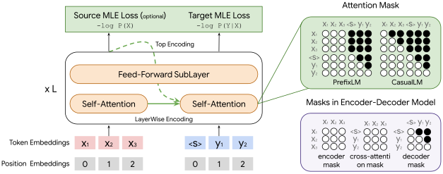

 Figure 1:  Illustration for translation-oriented language models. \(X\) and \(Y\) denote source and target input, respectively. To enable translation, we adapt the LM self-attention mask to either the PrefixLM mask or CausalLM mask (top right), where filled black circles indicate disallowed attention. We also explore top-only encoding (Top Encoding) for PrefixLM which feeds the final-layer source encodings to generation similar to EncDec, rather than layer-wise coordinated encodings ([He et al., 2018](https://arxiv.org/html/2202.00528v3#bib.bib17)). Masks of EncDec are shown in the bottom right for comparison. 

In this paper, we explore various configurations of LM architectures for translation as illustrated in Figure [1](https://arxiv.org/html/2202.00528v3#S1.F1 "Figure 1 ‣ 1 Introduction ‣ Examining Scaling and Transfer of Language Model Architectures for Machine Translation"). We compare them with the customary EncDec architecture along two axes, parameter scaling and cross-lingual transfer. We conduct a systematic study under a variety of data conditions, tasks (bilingual, multilingual and zero-shot) and examine recent architectural design choices associated with LMs, including causal masking (CausalLM) vs. full-visible masking (PrefixLM) for source sequences,11 1 Also known as unidirectional vs bidirectional language modelling, where in the unidirectional case a token representation takes into account only the preceding tokens and their representations, but the bidirectional case takes into account both preceding and following tokens in a sequence. layer-wise coordination ([He et al., 2018](https://arxiv.org/html/2202.00528v3#bib.bib17)) vs. final-layer source encodings (TopOnly) for target sequence generation, increasing LM depth vs. width, and also the effect of adding source language modeling loss for CausalLM.

Our main findings are listed below:

  * LMs show different scaling properties compared to EncDec. The architectural differences become less important as models scale, measured by reduced quality gap against EncDec, regardless of the language similarities, training data conditions and evaluation settings. 
  * PrefixLM variants often outperform their CausalLM counterparts; increasing LM depth benefits the translation task more than increasing the width; and adding a source-side language modeling objective to CausalLM does not yield significant translation quality gain. 
  * Cross-lingual transfer also benefits from model scaling, where EncDec almost always dominates the quality Pareto frontier on supervised directions while zero-shot translation favors PrefixLM and LMs. We also observed PrefixLM and LMs significantly reduce off-target translations. 

Table 1:  Comparison of different model variants studied in this paper. \(X/Y\): source/target input. Layer-Wise: layer-wise coordination ([He et al., 2018](https://arxiv.org/html/2202.00528v3#bib.bib17)); TopOnly: use topmost-layer source encodings; Src-Src Mask: the intra-source masking schema, either fully visible (Full) or causal (Causal); Parameter Sharing: whether the parameters are shared during the processing of source and target sequences. 

<table id="S1.T1.22" class="ltx_tabular ltx_centering ltx_guessed_headers ltx_align_middle">
<tbody class="ltx_tbody">
<tr id="S1.T1.22.1" class="ltx_tr">
<th id="S1.T1.22.1.1" class="ltx_td ltx_align_left ltx_th ltx_th_row ltx_border_tt" rowspan="2">Model</th>
<td id="S1.T1.22.1.2" class="ltx_td ltx_align_center ltx_border_tt" colspan="2">Objective</td>
<td id="S1.T1.22.1.3" class="ltx_td ltx_align_center ltx_border_tt" colspan="2">Structure</td>
<td id="S1.T1.22.1.4" class="ltx_td ltx_align_center ltx_border_tt">Src-Src</td>
<td id="S1.T1.22.1.5" class="ltx_td ltx_align_center ltx_border_tt">Parameter</td></tr>
<tr id="S1.T1.22.2" class="ltx_tr">
<td id="S1.T1.22.2.1" class="ltx_td ltx_align_center ltx_border_t"><math id="S1.T1.m3" class="ltx_Math" alttext="-\log P(X)" display="inline" intent=":literal"><semantics><mrow><mo mathsize="0.900em" rspace="0.167em">−</mo><mrow><mi mathsize="0.900em">log</mi><mo lspace="0.167em">⁡</mo><mrow><mi mathsize="0.900em">P</mi><mo>⁡</mo><mrow><mo maxsize="0.900em" minsize="0.900em">(</mo><mi mathsize="0.900em">X</mi><mo maxsize="0.900em" minsize="0.900em">)</mo></mrow></mrow></mrow></mrow><annotation encoding="application/x-tex">-\log P(X)</annotation></semantics></math></td>
<td id="S1.T1.22.2.2" class="ltx_td ltx_align_center ltx_border_t"><math id="S1.T1.m4" class="ltx_Math" alttext="-\log P(Y|X)" display="inline" intent=":literal"><semantics><mrow><mo mathsize="0.900em" rspace="0.167em">−</mo><mrow><mi mathsize="0.900em">log</mi><mo lspace="0.167em">⁡</mo><mrow><mi mathsize="0.900em">P</mi><mo>⁡</mo><mrow><mo maxsize="0.900em" minsize="0.900em">(</mo><mi mathsize="0.900em">Y</mi><mo lspace="0em" mathsize="0.900em" rspace="0em">|</mo><mi mathsize="0.900em">X</mi><mo maxsize="0.900em" minsize="0.900em">)</mo></mrow></mrow></mrow></mrow><annotation encoding="application/x-tex">-\log P(Y|X)</annotation></semantics></math></td>
<td id="S1.T1.22.2.3" class="ltx_td ltx_align_center ltx_border_t">Layer-Wise</td>
<td id="S1.T1.22.2.4" class="ltx_td ltx_align_center ltx_border_t">TopOnly</td>
<td id="S1.T1.22.2.5" class="ltx_td ltx_align_center">Mask</td>
<td id="S1.T1.22.2.6" class="ltx_td ltx_align_center">Sharing</td></tr>
<tr id="S1.T1.22.3" class="ltx_tr">
<th id="S1.T1.22.3.1" class="ltx_td ltx_align_left ltx_th ltx_th_row ltx_border_t">EncDec</th>
<td id="S1.T1.22.3.2" class="ltx_td ltx_border_t"></td>
<td id="S1.T1.22.3.3" class="ltx_td ltx_align_center ltx_border_t">✓</td>
<td id="S1.T1.22.3.4" class="ltx_td ltx_border_t"></td>
<td id="S1.T1.22.3.5" class="ltx_td ltx_align_center ltx_border_t">✓</td>
<td id="S1.T1.22.3.6" class="ltx_td ltx_align_center ltx_border_t">Full</td>
<td id="S1.T1.22.3.7" class="ltx_td ltx_align_center ltx_border_t">✗</td></tr>
<tr id="S1.T1.22.4" class="ltx_tr">
<th id="S1.T1.22.4.1" class="ltx_td ltx_align_left ltx_th ltx_th_row ltx_border_t">PrefixLM</th>
<td id="S1.T1.22.4.2" class="ltx_td ltx_border_t"></td>
<td id="S1.T1.22.4.3" class="ltx_td ltx_align_center ltx_border_t">✓</td>
<td id="S1.T1.22.4.4" class="ltx_td ltx_align_center ltx_border_t">✓</td>
<td id="S1.T1.22.4.5" class="ltx_td ltx_border_t"></td>
<td id="S1.T1.22.4.6" class="ltx_td ltx_align_center ltx_border_t">Full</td>
<td id="S1.T1.22.4.7" class="ltx_td ltx_align_center ltx_border_t">✓</td></tr>
<tr id="S1.T1.22.5" class="ltx_tr">
<th id="S1.T1.22.5.1" class="ltx_td ltx_align_left ltx_th ltx_th_row">   + TopOnly</th>
<td id="S1.T1.22.5.2" class="ltx_td"></td>
<td id="S1.T1.22.5.3" class="ltx_td ltx_align_center">✓</td>
<td id="S1.T1.22.5.4" class="ltx_td"></td>
<td id="S1.T1.22.5.5" class="ltx_td ltx_align_center">✓</td>
<td id="S1.T1.22.5.6" class="ltx_td ltx_align_center">Full</td>
<td id="S1.T1.22.5.7" class="ltx_td ltx_align_center">✓</td></tr>
<tr id="S1.T1.22.6" class="ltx_tr">
<th id="S1.T1.22.6.1" class="ltx_td ltx_align_left ltx_th ltx_th_row ltx_border_t">CausalLM</th>
<td id="S1.T1.22.6.2" class="ltx_td ltx_align_center ltx_border_t">✓</td>
<td id="S1.T1.22.6.3" class="ltx_td ltx_align_center ltx_border_t">✓</td>
<td id="S1.T1.22.6.4" class="ltx_td ltx_align_center ltx_border_t">✓</td>
<td id="S1.T1.22.6.5" class="ltx_td ltx_border_t"></td>
<td id="S1.T1.22.6.6" class="ltx_td ltx_align_center ltx_border_t">Causal</td>
<td id="S1.T1.22.6.7" class="ltx_td ltx_align_center ltx_border_t">✓</td></tr>
<tr id="S1.T1.22.7" class="ltx_tr">
<th id="S1.T1.22.7.1" class="ltx_td ltx_align_left ltx_th ltx_th_row ltx_border_bb">   + TgtOnly</th>
<td id="S1.T1.22.7.2" class="ltx_td ltx_border_bb"></td>
<td id="S1.T1.22.7.3" class="ltx_td ltx_align_center ltx_border_bb">✓</td>
<td id="S1.T1.22.7.4" class="ltx_td ltx_align_center ltx_border_bb">✓</td>
<td id="S1.T1.22.7.5" class="ltx_td ltx_border_bb"></td>
<td id="S1.T1.22.7.6" class="ltx_td ltx_align_center ltx_border_bb">Causal</td>
<td id="S1.T1.22.7.7" class="ltx_td ltx_align_center ltx_border_bb">✓</td></tr>
</tbody>
</table>

 

## 2 Related Work

Using language models in the task of translation has a long history, particularly in the era of statistical machine translation (SMT) where LM was used as a separate yet crucial component ensuring the fluency of generation ([Stolcke, 2002](https://arxiv.org/html/2202.00528v3#bib.bib34); [Heafield, 2011](https://arxiv.org/html/2202.00528v3#bib.bib18); [Koehn, 2010](https://arxiv.org/html/2202.00528v3#bib.bib24)). With neural networks, NMT unified those isolated SMT components including LM under the encoder-decoder formulation ([Kalchbrenner & Blunsom, 2013](https://arxiv.org/html/2202.00528v3#bib.bib22); [Cho et al., 2014](https://arxiv.org/html/2202.00528v3#bib.bib8); [Sutskever et al., 2014](https://arxiv.org/html/2202.00528v3#bib.bib35); [Bahdanau et al., 2015](https://arxiv.org/html/2202.00528v3#bib.bib4)), which makes use of separate modules to process input and output. Further studies exploring architectural modifications by using LM alone as a translation model, nevertheless, got much less attention. [He et al. (2018)](https://arxiv.org/html/2202.00528v3#bib.bib17) proposed layer-wise coordination between encoder and decoder with tied weights, where each decoder layer attends to its corresponding encoder layer at the same depth as opposed to the conventional method of attending the top-most encoder representations. Later, [Fonollosa et al. (2019)](https://arxiv.org/html/2202.00528v3#bib.bib12) extended it with locality constraint. [Dong et al. (2019)](https://arxiv.org/html/2202.00528v3#bib.bib10) explored LMs for sequence generation under large-scale pretraining. Despite reporting promising results, these prior studies either focus only on bilingual tasks or do not consider the scaling properties of the models, leaving the picture incomplete: how the findings will change as we scale the models and how the languages benefit from/interfere each other as the architectural priors (inductive biases) change.

Neural models follow some scaling laws. [Kaplan et al. (2020)](https://arxiv.org/html/2202.00528v3#bib.bib23) reported the test cross-entropy loss of LMs can be formulated as a power-law scaling function of either model size (excluding embedding parameters) or dataset size. Later on, researchers examined and confirmed such findings across different domains, including vision modeling ([Zhai et al., 2021](https://arxiv.org/html/2202.00528v3#bib.bib43)), knowledge transfer from pretraining ([Hernandez et al., 2021](https://arxiv.org/html/2202.00528v3#bib.bib20)), autoregressive generative modeling ([Henighan et al., 2020](https://arxiv.org/html/2202.00528v3#bib.bib19)), and neural machine translation ([Gordon et al., 2021](https://arxiv.org/html/2202.00528v3#bib.bib15); [Ghorbani et al., 2021](https://arxiv.org/html/2202.00528v3#bib.bib14)), to name a few. We find it essential to study the scaling behavior of new architectures and approaches given the recent evidence on the emergent properties of the models at scale ([Brown et al., 2020](https://arxiv.org/html/2202.00528v3#bib.bib7)).

Another critical component in machine translation is the number of languages being considered with the models, which is the very focus of multilingual NMT ([Firat et al., 2016](https://arxiv.org/html/2202.00528v3#bib.bib11)). Cross-lingual transfer in multilingual NMT often results from parameter sharing across languages, which benefits low-resource languages and also enables zero-shot translation ([Johnson et al., 2017](https://arxiv.org/html/2202.00528v3#bib.bib21)), although the quality on zero-shot directions is largely hindered by the off-target translation problem ([Arivazhagan et al., 2019a](https://arxiv.org/html/2202.00528v3#bib.bib2); [Zhang et al., 2020](https://arxiv.org/html/2202.00528v3#bib.bib44)). The structure of LMs further encourages parameter sharing, offering a chance to improve the transfer while magnifying the problem of interference (negative-transfer) ([Wang et al., 2020](https://arxiv.org/html/2202.00528v3#bib.bib40); [Zhang et al., 2021](https://arxiv.org/html/2202.00528v3#bib.bib45)). Very recently, [Wang et al. (2021)](https://arxiv.org/html/2202.00528v3#bib.bib39) analyzed the cross-lingual transfer behavior of CausalLM, and reported encouraging zero-shot performance. However, we did not observe the same results likely because of data sampling, model architecture and optimization differences which zero-shot transfer is sensitive to.

## 3 Language Model Architectures for MT

In this section, we first briefly review EncDec and then present LM architectures for translation based on Transformer ([Vaswani et al., 2017](https://arxiv.org/html/2202.00528v3#bib.bib37)). Table [1](https://arxiv.org/html/2202.00528v3#S1.T1 "Table 1 ‣ 1 Introduction ‣ Examining Scaling and Transfer of Language Model Architectures for Machine Translation") shows different models. Given a source sequence \(\mathbf{X}\) of length \(|X|\) and its target translation \(\mathbf{Y}\) of length \(|Y|\), EncDec performs translation via the following structure:

\[\begin{aligned}
 & \begin{split}\mathbf{X}^{l}=&\text{FFN}\circ\text{SAtt}\left(\mathbf{X}^{l-1}\right),\\
\mathbf{Y}^{l}=&\text{FFN}\circ\text{CAtt}\circ\text{SAtt}\left(\mathbf{Y}^{l-1},\mathbf{X}^{L}\right),\end{split} &  & \text{(1)}
\end{aligned}\]

 

where \(l\) denotes the layer index and \(\circ\) indicates consecutive sublayers. \(\mathbf{X}^{l}\in\mathbb{R}^{|X|\times d}\) and \(\mathbf{Y}^{l}\in\mathbb{R}^{|Y|\times d}\) are the layer representations of the source and target sequence respectively, with a model dimension of \(d\). The first input layer (\(\mathbf{X}^{0},\mathbf{Y}^{0}\)) is the summation of token embeddings and their positional encodings. We drop all the layer normalization and residual connections in our formulations for brevity.

The encoder is a stack of \(L\) layers, each of which includes a multi-head self-attention sublayer (SAtt) followed by a feed-forward sublayer (FFN). SAtt in the encoder is bidirectional with full-visible masking that has full visibility to all source tokens, preceding and following. Its final-layer representations \(\mathbf{X}^{L}\) are fed to the decoder, which shares a similar structure to the encoder but with an additional (multi-head) cross-attention sublayer (CAtt). Unlike encoder, SAtt in the decoder is unidirectional with causal masking, where attention to following tokens is disabled (masked). CAtt can always access all source inputs, though. Note we set the encoder and decoder depth equally to \(L\), and use \(d^{\text{ff}}\) to denote the intermediate dimension of FFN. EncDec is often optimized with the target translation objective based on \(\mathbf{Y}^{L}\):

\[\begin{aligned}
 & \mathcal{L}^{\text{EncDec}}(X,Y)=\mathcal{L}^{\text{TGT}}=-\log P(Y|X,\mathbf{Y}^{L}). &  & \text{(2)}
\end{aligned}\]

 

Instead of separately modeling source and target sequences, LM handles both with a single module:

\[\begin{aligned}
 & \left[\mathbf{X}^{l},\mathbf{Y}^{l}\right]=\text{FFN}\circ\text{SAtt}\left(\left[\mathbf{X}^{l-1},\mathbf{Y}^{l-1}\right],\mathbf{M}\right), &  & \text{(3)}
\end{aligned}\]

 

where \(\mathbf{M}\in\{0,1\}^{(|X|+|Y|)\times(|X|+|Y|)}\) is the attention mask that controls the information flow within the concatenated sequences (\([\cdot,\cdot]\)).22 2 Note that, in our implementation we still use separate source and target positions as shown in Figure [1](https://arxiv.org/html/2202.00528v3#S1.F1 "Figure 1 ‣ 1 Introduction ‣ Examining Scaling and Transfer of Language Model Architectures for Machine Translation"). Two LM variants explored by changing the structure of mask \(\mathbf{M}\), PrefixLM and CausalLM.

PrefixLM merges different modules of EncDec, trained with \(\mathcal{L}^{\text{TGT}}\). Its attention mask

\[\begin{aligned}
 & \mathbf{M}^{\text{PrefixLM}}(i,j)=1,\text{ if }i\geq j\text{ or }j\leq|X|\text{; otherwise }0, &  & \text{(4)}
\end{aligned}\]

 

combines the encoder/decoder self-attention mask and the cross-attention mask of EncDec. \(1\leq i,j\) \(\leq|X|+|Y|\), and masks of value 0 mark the attention as unavailable.

CausalLM, by contrast, is a strict LM that applies causal masking to both sequences:

\[\begin{aligned}
 & \mathbf{M}^{\text{CausalLM}}(i,j)=1,\text{ if }i\geq j\text{; otherwise }0. &  & \text{(5)}
\end{aligned}\]

 

Table 2:  Statistics of different datasets. M/B: million/billion; SO/TO: source-original/target-original test sets; Web: in-house web-crawled datasets; BIL/MUL: the data is used for bilingual/multilingual experiments. 

<table id="S3.T2.17" class="ltx_tabular ltx_centering ltx_guessed_headers ltx_align_middle">
<thead class="ltx_thead">
<tr id="S3.T2.17.1" class="ltx_tr">
<th id="S3.T2.17.1.1" class="ltx_td ltx_align_left ltx_th ltx_th_column ltx_th_row ltx_border_tt" rowspan="2">Dataset</th>
<th id="S3.T2.17.1.2" class="ltx_td ltx_align_center ltx_th ltx_th_column ltx_border_tt" colspan="3">#Samples (Sources)</th>
<th id="S3.T2.17.1.3" class="ltx_td ltx_align_center ltx_th ltx_th_column ltx_border_tt" colspan="2">Experiments</th></tr>
<tr id="S3.T2.17.2" class="ltx_tr">
<th id="S3.T2.17.2.1" class="ltx_td ltx_align_center ltx_th ltx_th_column ltx_border_t">Train</th>
<th id="S3.T2.17.2.2" class="ltx_td ltx_align_center ltx_th ltx_th_column ltx_border_t">Dev</th>
<th id="S3.T2.17.2.3" class="ltx_td ltx_align_center ltx_th ltx_th_column ltx_border_t">Test</th>
<th id="S3.T2.17.2.4" class="ltx_td ltx_align_center ltx_th ltx_th_column ltx_border_t">BIL</th>
<th id="S3.T2.17.2.5" class="ltx_td ltx_align_center ltx_th ltx_th_column ltx_border_t">MUL</th></tr>
</thead>
<tbody class="ltx_tbody">
<tr id="S3.T2.17.3" class="ltx_tr">
<th id="S3.T2.17.3.1" class="ltx_td ltx_align_left ltx_th ltx_th_row ltx_border_t">WMT14 En-De</th>
<td id="S3.T2.17.3.2" class="ltx_td ltx_align_center ltx_border_t">4.5M</td>
<td id="S3.T2.17.3.3" class="ltx_td ltx_align_center ltx_border_t">3000 (WMT13)</td>
<td id="S3.T2.17.3.4" class="ltx_td ltx_align_center ltx_border_t">3003 (WMT14)</td>
<td id="S3.T2.17.3.5" class="ltx_td ltx_border_t"></td>
<td id="S3.T2.17.3.6" class="ltx_td ltx_align_center ltx_border_t">✓</td></tr>
<tr id="S3.T2.17.4" class="ltx_tr">
<th id="S3.T2.17.4.1" class="ltx_td ltx_align_left ltx_th ltx_th_row">WMT14 En-Fr</th>
<td id="S3.T2.17.4.2" class="ltx_td ltx_align_center">41M</td>
<td id="S3.T2.17.4.3" class="ltx_td ltx_align_center">3000 (WMT13)</td>
<td id="S3.T2.17.4.4" class="ltx_td ltx_align_center">3003 (WMT14)</td>
<td id="S3.T2.17.4.5" class="ltx_td ltx_align_center">✓</td>
<td id="S3.T2.17.4.6" class="ltx_td ltx_align_center">✓</td></tr>
<tr id="S3.T2.17.5" class="ltx_tr">
<th id="S3.T2.17.5.1" class="ltx_td ltx_align_left ltx_th ltx_th_row">WMT19 En-Zh</th>
<td id="S3.T2.17.5.2" class="ltx_td ltx_align_center">26M</td>
<td id="S3.T2.17.5.3" class="ltx_td ltx_align_center">3981 (WMT18)</td>
<td id="S3.T2.17.5.4" class="ltx_td ltx_align_center">
<table id="S3.T2.17.5.4.1" class="ltx_tabular ltx_align_middle">
<tr id="S3.T2.17.5.4.1.1" class="ltx_tr">
<td id="S3.T2.17.5.4.1.1.1" class="ltx_td ltx_nopad_r ltx_align_center">1997 (WMT19, SO)</td></tr>
<tr id="S3.T2.17.5.4.1.2" class="ltx_tr">
<td id="S3.T2.17.5.4.1.2.1" class="ltx_td ltx_nopad_r ltx_align_center">2000 (WMT19 TO)</td></tr>
</table></td>
<td id="S3.T2.17.5.5" class="ltx_td ltx_align_center">✓</td>
<td id="S3.T2.17.5.6" class="ltx_td ltx_align_center">✓</td></tr>
<tr id="S3.T2.17.6" class="ltx_tr">
<th id="S3.T2.17.6.1" class="ltx_td ltx_align_left ltx_th ltx_th_row ltx_border_bb">Web En-De</th>
<td id="S3.T2.17.6.2" class="ltx_td ltx_align_center ltx_border_bb">2B</td>
<td id="S3.T2.17.6.3" class="ltx_td ltx_align_center ltx_border_bb">7927 (Web)</td>
<td id="S3.T2.17.6.4" class="ltx_td ltx_align_center ltx_border_bb">
<table id="S3.T2.17.6.4.1" class="ltx_tabular ltx_align_middle">
<tr id="S3.T2.17.6.4.1.1" class="ltx_tr">
<td id="S3.T2.17.6.4.1.1.1" class="ltx_td ltx_nopad_r ltx_align_center">4927/1997 (Web/WMT19, SO)</td></tr>
<tr id="S3.T2.17.6.4.1.2" class="ltx_tr">
<td id="S3.T2.17.6.4.1.2.1" class="ltx_td ltx_nopad_r ltx_align_center">6000/2000 (Web/WMT19, TO)</td></tr>
</table></td>
<td id="S3.T2.17.6.5" class="ltx_td ltx_align_center ltx_border_bb">✓</td>
<td id="S3.T2.17.6.6" class="ltx_td ltx_border_bb"></td></tr>
</tbody>
</table>

 

Apart from \(\mathcal{L}^{\text{TGT}}\), CausalLM also includes the source-side language modeling loss for training:

\[\begin{aligned}
 & \displaystyle\mathcal{L}^{\text{CausalLM}}(X,Y) & \displaystyle=\mathcal{L}^{\text{SRC}}+\mathcal{L}^{\text{TGT}} &  & \text{(6)} \\
 &  & \displaystyle=-\log P(X|\mathbf{X}^{L})-\log P(Y|X,\mathbf{Y}^{L}). & 
\end{aligned}\]

 

To improve our understanding of LMs for translation, we further incorporate two extensions:

PrefixLM \+ TopOnly
    

The model defined in Equation [3](https://arxiv.org/html/2202.00528v3#S3.E3 "Equation 3 ‣ 3 Language Model Architectures for MT ‣ Examining Scaling and Transfer of Language Model Architectures for Machine Translation") performs attention over the source and target sequence within the same layer. In contrast, EncDec always uses the topmost-layer source encodings for translation. We mimic this with the TopOnly extension by feeding top-layer encodings, i.e. \(\mathbf{X}^{L}\) instead of \(\mathbf{X}^{l-1}\), to each attention sublayer. It operates the same as EncDec but with the parameters of encoder and decoder tied.

CausalLM \+ TgtOnly
    

The inclusion of the source-side objective enriches CausalLM’s learning signal and encourages the model to absorb source language characteristics. However, it requires and occupies part of modeling capacity, which might negatively affect translation. To offset this impact, we add the TgtOnly extension that optimizes CausalLM with the target translation objective \(\mathcal{L}^{TGT}_{C}\) alone, which also aligns better with EncDec and PrefixLM.

## 4 Setup

#### Model Setting

We use Transformer for experiments. By default, we adopt the base setting, with \(d=512\), \(d^{\text{ff}}=2048\) and 8 attention heads. We also work with the Transformer big setting where each hyper-parameter above is doubled. Training and inference details are in Appendix [A](https://arxiv.org/html/2202.00528v3#A1 "Appendix A Model Training and Inference ‣ Examining Scaling and Transfer of Language Model Architectures for Machine Translation").

#### Datasets and Evaluation

We use WMT14 English-French (En-Fr), WMT14 English-German (En-De), WMT19 English-Chinese (En-Zh) and an in-house web-crawled (Web) En-De dataset for experiments, whose statistics are summarized in Table [2](https://arxiv.org/html/2202.00528v3#S3.T2 "Table 2 ‣ 3 Language Model Architectures for MT ‣ Examining Scaling and Transfer of Language Model Architectures for Machine Translation"). We also report results on OPUS-100 ([Zhang et al., 2020](https://arxiv.org/html/2202.00528v3#bib.bib44)), a massively multilingual corpus containing 100 languages. All datasets are pre-processed with byte pair encoding ([Sennrich et al., 2016](https://arxiv.org/html/2202.00528v3#bib.bib31), BPE) implemented by SentencePiece ([Kudo & Richardson, 2018](https://arxiv.org/html/2202.00528v3#bib.bib25)). We set the BPE vocabulary size to 32K by default. We report test log-perplexity score (PPL) for scaling study particularly and also show SacreBLEU ([Post, 2018](https://arxiv.org/html/2202.00528v3#bib.bib29))33 3 Signature: BLEU+c.mixed+lang*+#r.1+s.exp+t.13a+v.1.5.1.

## 5 Experiments for Model Scaling

[Kaplan et al. (2020)](https://arxiv.org/html/2202.00528v3#bib.bib23) reported that the model performance can be described with a power-law, with respect to its parameters, as below:

\[\begin{aligned}
 & \mathcal{L}(N)=\alpha\left(\frac{N_{0}}{N}\right)^{p}+\mathcal{L}_{\infty}, &  & \text{(7)}
\end{aligned}\]

 

where \(\mathcal{L}(N)\) fits test PPL, and \(N\) denotes the number of parameters. \(N_{0}\) is a constant used for numerical stability which is obtained from 1-layer EncDec model. \(\alpha,p,\mathcal{L}_{\infty}\) are fitted parameters, and we mainly analyze the estimated scaling exponent \(p\) and the irreducible loss \(\mathcal{L}_{\infty}\).

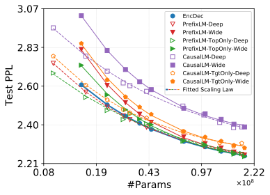

 

(a) Log-Perplexity for En\(\rightarrow\)Fr

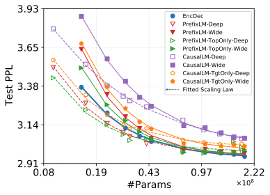

 

(b) Log-Perplexity for En\(\rightarrow\)Zh

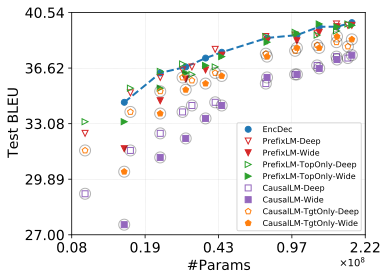

 

(c) BLEU for En\(\rightarrow\)Fr

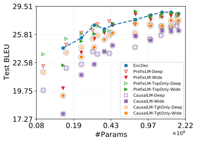

 

(d) BLEU for En\(\rightarrow\)Zh

Figure 2:  Fitted scaling curves ([2(a)](https://arxiv.org/html/2202.00528v3#S5.F2.sf1 "Figure 2\(a\) ‣ Figure 2 ‣ 5 Experiments for Model Scaling ‣ Examining Scaling and Transfer of Language Model Architectures for Machine Translation"),[2(b)](https://arxiv.org/html/2202.00528v3#S5.F2.sf2 "Figure 2\(b\) ‣ Figure 2 ‣ 5 Experiments for Model Scaling ‣ Examining Scaling and Transfer of Language Model Architectures for Machine Translation")) and BLEU scores ([2(c)](https://arxiv.org/html/2202.00528v3#S5.F2.sf3 "Figure 2\(c\) ‣ Figure 2 ‣ 5 Experiments for Model Scaling ‣ Examining Scaling and Transfer of Language Model Architectures for Machine Translation"),[2(d)](https://arxiv.org/html/2202.00528v3#S5.F2.sf4 "Figure 2\(d\) ‣ Figure 2 ‣ 5 Experiments for Model Scaling ‣ Examining Scaling and Transfer of Language Model Architectures for Machine Translation")) for different models on WMT14 En-Fr (left) and WMT19 En-Zh (right) tasks. Top: dashed and solid fitted curves are for LM \+ Deep and LM \+ Wide, respectively. We represent the EncDec scaling with bold solid curve. Bottom: dashed curve denotes the BLEU scores of EncDec as a function of model parameters for reference. Markers in circles are for CausalLM variants. Models are trained in Transformer base setting. Best seen in color. 

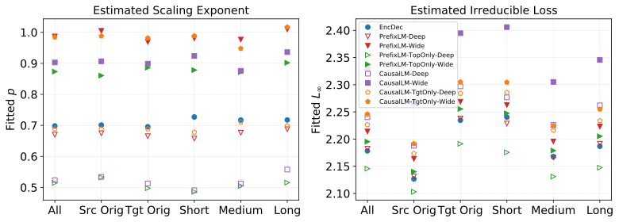

 Figure 3:  Fitted scaling exponent (\(p\), left) and irreducible loss (\(\mathcal{L}_{\infty}\), right) over different evaluation settings on WMT14 En-Fr (En\(\rightarrow\)Fr). All: the whole test set; Src Orig, Tgt Orig: source-original and target-original test set, respectively; Short, Medium, Long: shortest, medium and longest \(\sim\)376 samples from the test set, respectively.

The way of increasing model parameters varies for the same model and also across different models. We perform scaling firstly for EncDec by changing its depth \(L\) (from 1 to 26 layers, equally for its encoder and decoder) while keeping the other hyper-parameters intact following [Ghorbani et al. (2021)](https://arxiv.org/html/2202.00528v3#bib.bib14). We then align the scaling settings of LM with its EncDec counterpart in term of model parameters through increasing either its depth or width:

LM \+ Deep
    

adds parameters by stacking more Transformer layers, which was also used in previous studies ([He et al., 2018](https://arxiv.org/html/2202.00528v3#bib.bib17); [Wang et al., 2021](https://arxiv.org/html/2202.00528v3#bib.bib39)).

LM \+ Wide
    

instead, grows the model width. We choose to enlarge the feed-forward dimension from \(d^{\text{ff}}\) to \(3d^{\text{ff}}\). Note other strategies for width scaling are possible and many, but exploring them is resource-consuming and beyond the scope of our paper.

We distinguish data-limited regime from model size-limited regime for model scaling ([Bahri et al., 2021](https://arxiv.org/html/2202.00528v3#bib.bib5)), where the former has relatively fewer training samples than model parameters thus likely suffers from overfitting (e.g. with WMT14 En-Fr and WMT19 En-Zh), while the latter has enough samples for model fitting (e.g. with Web En-De).

### 5.1 Scaling in Data-Limited Regime

#### Architectural difference matters most when the model is at a small scale.

Figure [2](https://arxiv.org/html/2202.00528v3#S5.F2 "Figure 2 ‣ 5 Experiments for Model Scaling ‣ Examining Scaling and Transfer of Language Model Architectures for Machine Translation") summarizes the scaling results on WMT14 En-Fr and WMT19 En-Zh. When there are fewer parameters, the model with inductive biases favoring translation achieves better quality. Such inductive bias includes 1) allowing the full visibility to the source input as in PrefixLM 44 4 By default, we use PrefixLM (CausalLM) to refer to all PrefixLM variants (CausalLM variants). We adopt the italic form to denote a specific variant. rather than causal masking; 2) using topmost-layer source encodings for translation (TopOnly) rather than layer-wise coordinated encodings; 3) deeper LMs (Deep) rather than wider models; and 4) training LMs without source-side language modeling loss (TgtOnly). The fact that LM \+ Deep outperforms LM \+ Wide demonstrates that not only the number of parameters matters, but also the way parameters are added. This aligns with the previous findings: deeper models apply more non-linear operations and induce more abstract representations, which often improves translation quality ([Wang et al., 2019](https://arxiv.org/html/2202.00528v3#bib.bib38)). This also applies to TopOnly. Most of these findings are consistent across different languages and evaluation metrics.

We argue that factors making the TopOnly variant favorable to translation tasks could be plenty. Based on the literature ([Tenney et al., 2019](https://arxiv.org/html/2202.00528v3#bib.bib36)), representations in Transformer often evolve from the bottom up, where lower-layer encodings align better with syntactic-related information while the higher-layer representations correlate more with semantic-related information ([Kudugunta et al., 2019](https://arxiv.org/html/2202.00528v3#bib.bib26)). Given that the task of language translation is requires source-side semantic knowledge to provide clues for accurate source-target alignment, we speculate that the top-most source encodings could be preferred while generating the target sequence. Which has plausibility to explain the narrowed performance gap between Deep and TopOnly-Deep, since deeper layers could offer more abstract and semantic-intensive representations to the decoder to ensure the translation accuracy.

#### Different models show different scaling properties, but the gap narrows at scale.

The impact of added parameters on translation quality differs across different models. The LMs that perform poorly at small scales often gain more from the increased capacity via adding parameters. For instance, the difference between LM \+ Deep and LM \+ Wide almost disappears at the end, resonating with the optimal depth-vs.-width theory ([Levine et al., 2020](https://arxiv.org/html/2202.00528v3#bib.bib28)). We observe that PrefixLM and EncDec converge to a similar quality bands followed by CausalLM \+ TgtOnly while CausalLM still retains a clear gap against the others. This performance gap is smaller in WMT19 En-Zh, mainly because of model overfitting. BLEU scores in Figure [2(c)](https://arxiv.org/html/2202.00528v3#S5.F2.sf3 "Figure 2\(c\) ‣ Figure 2 ‣ 5 Experiments for Model Scaling ‣ Examining Scaling and Transfer of Language Model Architectures for Machine Translation") and [2(d)](https://arxiv.org/html/2202.00528v3#S5.F2.sf4 "Figure 2\(d\) ‣ Figure 2 ‣ 5 Experiments for Model Scaling ‣ Examining Scaling and Transfer of Language Model Architectures for Machine Translation") also show similar trends, although the relationship between BLEU and PPL is non-trivial ([Ghorbani et al., 2021](https://arxiv.org/html/2202.00528v3#bib.bib14)). These tell us that the success of architectural modifications on small-scale models may not transfer to large-scale settings, and that comparing different models under one model configuration in terms of the scale risks the results to be inconclusive. Note we also observe reduced gap when considering the number of layers (see Figure [9](https://arxiv.org/html/2202.00528v3#A2.F9 "Figure 9 ‣ Appendix B More Experimental Results ‣ Examining Scaling and Transfer of Language Model Architectures for Machine Translation") in the Appendix).

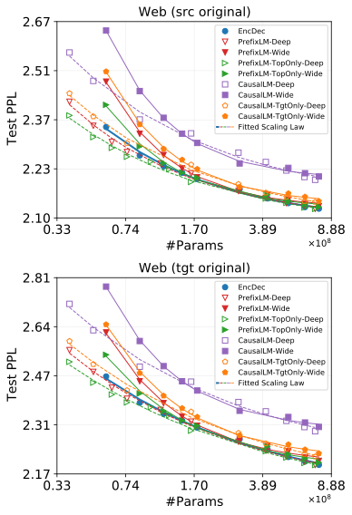

 Figure 4:  Fitted scaling curves for different models on Web En-De (En\(\rightarrow\)De). src/tgt: source/target; Web: in-domain evaluation set. Models are trained in the Transformer big setting.

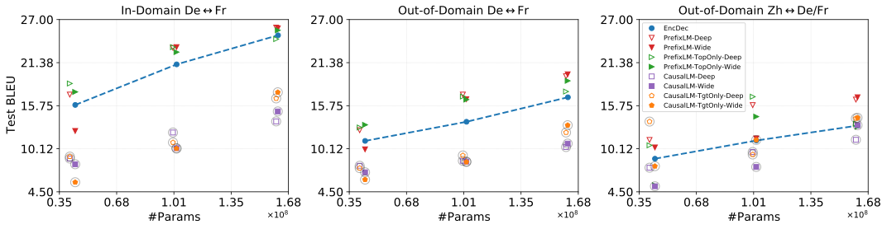

 

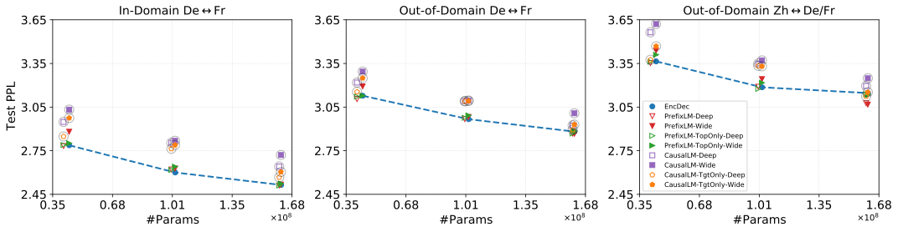

 

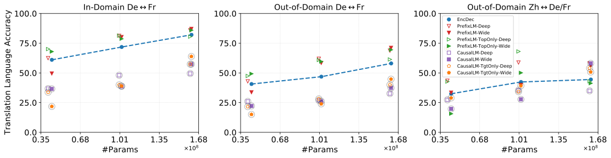

 

Figure 5:  Zero-shot transfer results of different models for multilingual many-to-many modeling on four languages (En-De-Fr-Zh) under different model sizes. Top: average BLEU scores; Middle: average PPL scores; Bottom: average translation language accuracy scores. In-domain: WMT test set; Out-of-domain: in-house sport-domain test sets. 

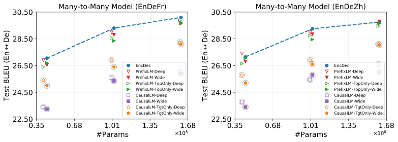

 Figure 6:  Cross-lingual transfer results (average BLEU scores) for different models from high-resource languages to the low-resource one (En-De) under different model sizes on WMT datasets. Average is performed over En\(\rightarrow\)De and De\(\rightarrow\)En evaluation. Left: multilingual En-De-Fr system; Right: multilingual En-De-Zh system. Both systems are many-to-many models. Models are trained in the base setting.

#### Sequence lengths and the originality of the test set affect does not affect scaling properties

We further test how the scaling changes across different evaluation settings, and show the results on WMT14 En-Fr in Figure [3](https://arxiv.org/html/2202.00528v3#S5.F3 "Figure 3 ‣ 5 Experiments for Model Scaling ‣ Examining Scaling and Transfer of Language Model Architectures for Machine Translation"). The scaling exponent changes marginally over different settings (often less than 0.05), suggesting that the scaling curves are quite similar in these settings (see Figure [8](https://arxiv.org/html/2202.00528v3#A2.F8 "Figure 8 ‣ Appendix B More Experimental Results ‣ Examining Scaling and Transfer of Language Model Architectures for Machine Translation"), [10](https://arxiv.org/html/2202.00528v3#A2.F10 "Figure 10 ‣ Appendix B More Experimental Results ‣ Examining Scaling and Transfer of Language Model Architectures for Machine Translation"), [11](https://arxiv.org/html/2202.00528v3#A2.F11 "Figure 11 ‣ Appendix B More Experimental Results ‣ Examining Scaling and Transfer of Language Model Architectures for Machine Translation") in Appendix), although sentences of different originalities differ largely in style and naturalness ([Graham et al., 2020](https://arxiv.org/html/2202.00528v3#bib.bib16); [Freitag et al., 2020](https://arxiv.org/html/2202.00528v3#bib.bib13)). The estimated irreducible loss shows that target-original parallel sentences are harder to model than the source-original ones, and that translating medium-length sequences is much easier. The loss ranking of different models changes little over these settings, supporting PrefixLM and EncDec generally more than CausalLM.

#### Computational efficiency favors EncDec over all LMs variants

Our calculation of FLOPs for different architectures show that EncDec models demand generally less computation compared to LM, but the gap narrows at scale. Note LM does not save any computations because of the quadratic attention over the concatenated source and target sequences. By contrast, to perform similarly to EncDec, LM often needs to be made wider or deeper, which further deteriorates the computational efficiency both during training and inference time. Besides, EncDec allows arbitrary decoders, e.g. shallow decoders for faster inference, which is non-feasible for LMs. We also observed adding the source-side loss hurts CausalLM’s efficiency. We share the details of computational efficiency in Appendix, Figure [7](https://arxiv.org/html/2202.00528v3#A2.F7 "Figure 7 ‣ Appendix B More Experimental Results ‣ Examining Scaling and Transfer of Language Model Architectures for Machine Translation").

### 5.2 Scaling in Model Size-Limited Regime

Figure [4](https://arxiv.org/html/2202.00528v3#S5.F4 "Figure 4 ‣ Different models show different scaling properties, but the gap narrows at scale. ‣ 5.1 Scaling in Data-Limited Regime ‣ 5 Experiments for Model Scaling ‣ Examining Scaling and Transfer of Language Model Architectures for Machine Translation") shows the in-domain scaling performance on Web En-De. Overall, we observe similar scaling patterns as reported above, and such pattern transfers to out-of-domain evaluation, FLOPs and BLEU scores. More results are available in the Appendix (Figure [12](https://arxiv.org/html/2202.00528v3#A2.F12 "Figure 12 ‣ Appendix B More Experimental Results ‣ Examining Scaling and Transfer of Language Model Architectures for Machine Translation"), [13](https://arxiv.org/html/2202.00528v3#A2.F13 "Figure 13 ‣ Appendix B More Experimental Results ‣ Examining Scaling and Transfer of Language Model Architectures for Machine Translation") and [14](https://arxiv.org/html/2202.00528v3#A2.F14 "Figure 14 ‣ Appendix B More Experimental Results ‣ Examining Scaling and Transfer of Language Model Architectures for Machine Translation")).

## 6 Experiments for Cross-Lingual Transfer

Based on previous studies ([Wang et al., 2020](https://arxiv.org/html/2202.00528v3#bib.bib40); [Zhang et al., 2021](https://arxiv.org/html/2202.00528v3#bib.bib45)), sharing capacity across languages could encourage knowledge transfer but might also gain the risk of negative interference. In this section, we further compare different models but on multilingual many-to-many translation. To enable multilingual NMT, we append a target language tag to each source sentence following [Johnson et al. (2017)](https://arxiv.org/html/2202.00528v3#bib.bib21). We perform over-sampling to balance the training data with a temperature of \(T=5\) ([Arivazhagan et al., 2019b](https://arxiv.org/html/2202.00528v3#bib.bib3)).

#### PrefixLM benefits zero-shot transfer.

We start with multilingual translation for WMT En-De/Fr/Zh, and regard En-De as a relatively low-resource language pair. We test how LMs perform on zero-shot translation. We use the newstest2019 De-Fr test set as the in-domain zero-shot eval set, and an internal sports-domain N-way test set for De-Fr-Zh (2000 samples) as the out-of-domain eval set. Figure [5](https://arxiv.org/html/2202.00528v3#S5.F5 "Figure 5 ‣ Different models show different scaling properties, but the gap narrows at scale. ‣ 5.1 Scaling in Data-Limited Regime ‣ 5 Experiments for Model Scaling ‣ Examining Scaling and Transfer of Language Model Architectures for Machine Translation") shows the results. Scaling improves knowledge transfer for almost all models, while PrefixLM performs surprisingly well on zero-shot directions. In most settings, PrefixLM surpasses EncDec significantly with respect to BLEU, and such superiority is more obvious on out-of-domain evaluation and for distant language pairs.

Nevertheless, we find that PrefixLM usually underperforms EncDec in terms of PPL. In other words, EncDec still possesses the best fitting ability on zero-shot language pairs. Results on translation language accuracy explains this mismatch: compared to EncDec, PrefixLM drastically reduces off-target translation – a bottleneck of zero-shot translation ([Zhang et al., 2020](https://arxiv.org/html/2202.00528v3#bib.bib44)). This also suggests that EncDec suffers from more serious searching errors during inference ([Stahlberg & Byrne, 2019](https://arxiv.org/html/2202.00528v3#bib.bib33)), which the inductive biases of PrefixLM help.

In addition, we observe no benefits from CausalLM on zero-shot translation, with or without the source-side language modeling objective. This finding disagrees with that of [Wang et al. (2021)](https://arxiv.org/html/2202.00528v3#bib.bib39), which we ascribe to various differences in model, data and optimization. Note that [Wang et al. (2021)](https://arxiv.org/html/2202.00528v3#bib.bib39) adopted more aggressive data oversampling, didn’t consider distant languages, proposed dedicated optimization with the source-side loss, used a different way to count model parameters, and designed different language tags for multilingual translation that could greatly affect zero-shot results ([Wu et al., 2021](https://arxiv.org/html/2202.00528v3#bib.bib41)). We leave the study of these differences to the future.

#### LMs variants do not offer better transfer characteristics for low-resource languages compared to EncDec.

One reason behind the popularity of multilingual NMT is its transfer capability to low-resource languages. We analyze this transfer behavior for LMs and explore transfer (to De) from similar (Fr) and distant (Zh) languages separately. Figure [6](https://arxiv.org/html/2202.00528v3#S5.F6 "Figure 6 ‣ Different models show different scaling properties, but the gap narrows at scale. ‣ 5.1 Scaling in Data-Limited Regime ‣ 5 Experiments for Model Scaling ‣ Examining Scaling and Transfer of Language Model Architectures for Machine Translation") shows the results. PrefixLM produces comparable results to EncDec, while CausalLM lags far behind, and the incorporation of source-side objective actually hurts translation. Overall, we observe that EncDec almost dominates the transfer performance under different model sizes, regardless of language similarity. Similar results are also observed for low-resource to high-resource transfer (see Figure [15](https://arxiv.org/html/2202.00528v3#A2.F15 "Figure 15 ‣ Appendix B More Experimental Results ‣ Examining Scaling and Transfer of Language Model Architectures for Machine Translation") in the Appendix).

Table 3:  Translation quality of different models for En\(\rightarrow\)XX, XX\(\rightarrow\)En and zero-shot language pairs on OPUS-100. Models are trained in the Transformer big setting, aligned with 14-layer EncDec, containing about 412M parameters (excluding embedding and softmax layers). During training, we perform oversampling with a temperature of 5. We list average BLEU for High, Med, Low and All language groups. We also show average BLEU and translation language accuracy (ACC) for zero-shot test sets.  

<table id="S6.T3.10" class="ltx_tabular ltx_centering ltx_guessed_headers ltx_align_middle">
<tbody class="ltx_tbody">
<tr id="S6.T3.10.1" class="ltx_tr">
<th id="S6.T3.10.1.1" class="ltx_td ltx_align_center ltx_th ltx_th_row ltx_border_tt" colspan="2" rowspan="2">Model</th>
<td id="S6.T3.10.1.2" class="ltx_td ltx_align_center ltx_border_tt" colspan="4">En<math id="S6.T3.m5" class="ltx_Math" alttext="\rightarrow" display="inline" intent=":literal"><semantics><mo stretchy="false">→</mo><annotation encoding="application/x-tex">\rightarrow</annotation></semantics></math>XX</td>
<td id="S6.T3.10.1.3" class="ltx_td ltx_align_center ltx_border_tt" colspan="4">XX<math id="S6.T3.m6" class="ltx_Math" alttext="\rightarrow" display="inline" intent=":literal"><semantics><mo stretchy="false">→</mo><annotation encoding="application/x-tex">\rightarrow</annotation></semantics></math>En</td>
<td id="S6.T3.10.1.4" class="ltx_td ltx_align_center ltx_border_tt" colspan="2">Zero-Shot</td></tr>
<tr id="S6.T3.10.2" class="ltx_tr">
<td id="S6.T3.10.2.1" class="ltx_td ltx_align_right ltx_border_t">High</td>
<td id="S6.T3.10.2.2" class="ltx_td ltx_align_right ltx_border_t">Med</td>
<td id="S6.T3.10.2.3" class="ltx_td ltx_align_right ltx_border_t">Low</td>
<td id="S6.T3.10.2.4" class="ltx_td ltx_align_right ltx_border_t">All</td>
<td id="S6.T3.10.2.5" class="ltx_td ltx_align_right ltx_border_t">High</td>
<td id="S6.T3.10.2.6" class="ltx_td ltx_align_right ltx_border_t">Med</td>
<td id="S6.T3.10.2.7" class="ltx_td ltx_align_right ltx_border_t">Low</td>
<td id="S6.T3.10.2.8" class="ltx_td ltx_align_right ltx_border_t">All</td>
<td id="S6.T3.10.2.9" class="ltx_td ltx_align_right ltx_border_t">BLEU</td>
<td id="S6.T3.10.2.10" class="ltx_td ltx_align_right ltx_border_t">ACC</td></tr>
<tr id="S6.T3.10.3" class="ltx_tr">
<th id="S6.T3.10.3.1" class="ltx_td ltx_align_center ltx_th ltx_th_row ltx_border_t" colspan="2">EncDec</th>
<td id="S6.T3.10.3.2" class="ltx_td ltx_align_right ltx_border_t">25.8</td>
<td id="S6.T3.10.3.3" class="ltx_td ltx_align_right ltx_border_t">32.4</td>
<td id="S6.T3.10.3.4" class="ltx_td ltx_align_right ltx_border_t">31.9</td>
<td id="S6.T3.10.3.5" class="ltx_td ltx_align_right ltx_border_t">29.2</td>
<td id="S6.T3.10.3.6" class="ltx_td ltx_align_right ltx_border_t">31.4</td>
<td id="S6.T3.10.3.7" class="ltx_td ltx_align_right ltx_border_t">34.3</td>
<td id="S6.T3.10.3.8" class="ltx_td ltx_align_right ltx_border_t">35.0</td>
<td id="S6.T3.10.3.9" class="ltx_td ltx_align_right ltx_border_t">33.1</td>
<td id="S6.T3.10.3.10" class="ltx_td ltx_align_right ltx_border_t">4.80</td>
<td id="S6.T3.10.3.11" class="ltx_td ltx_align_right ltx_border_t">24.21</td></tr>
<tr id="S6.T3.10.4" class="ltx_tr">
<th id="S6.T3.10.4.1" class="ltx_td ltx_align_left ltx_th ltx_th_row ltx_border_t" rowspan="4">Deep</th>
<th id="S6.T3.10.4.2" class="ltx_td ltx_align_left ltx_th ltx_th_row ltx_border_t">PrefixLM</th>
<td id="S6.T3.10.4.3" class="ltx_td ltx_align_right ltx_border_t">-0.34</td>
<td id="S6.T3.10.4.4" class="ltx_td ltx_align_right ltx_border_t">-0.21</td>
<td id="S6.T3.10.4.5" class="ltx_td ltx_align_right ltx_border_t">-0.82</td>
<td id="S6.T3.10.4.6" class="ltx_td ltx_align_right ltx_border_t">-0.41</td>
<td id="S6.T3.10.4.7" class="ltx_td ltx_align_right ltx_border_t">-0.27</td>
<td id="S6.T3.10.4.8" class="ltx_td ltx_align_right ltx_border_t">-0.74</td>
<td id="S6.T3.10.4.9" class="ltx_td ltx_align_right ltx_border_t">-1.59</td>
<td id="S6.T3.10.4.10" class="ltx_td ltx_align_right ltx_border_t">-0.70</td>
<td id="S6.T3.10.4.11" class="ltx_td ltx_align_right ltx_border_t">7.95</td>
<td id="S6.T3.10.4.12" class="ltx_td ltx_align_right ltx_border_t">41.46</td></tr>
<tr id="S6.T3.10.5" class="ltx_tr">
<th id="S6.T3.10.5.1" class="ltx_td ltx_align_left ltx_th ltx_th_row">   + TopOnly</th>
<td id="S6.T3.10.5.2" class="ltx_td ltx_align_right">-0.01</td>
<td id="S6.T3.10.5.3" class="ltx_td ltx_align_right">-0.14</td>
<td id="S6.T3.10.5.4" class="ltx_td ltx_align_right">-1.79</td>
<td id="S6.T3.10.5.5" class="ltx_td ltx_align_right">-0.44</td>
<td id="S6.T3.10.5.6" class="ltx_td ltx_align_right">-0.07</td>
<td id="S6.T3.10.5.7" class="ltx_td ltx_align_right">-0.71</td>
<td id="S6.T3.10.5.8" class="ltx_td ltx_align_right">-1.43</td>
<td id="S6.T3.10.5.9" class="ltx_td ltx_align_right">-0.57</td>
<td id="S6.T3.10.5.10" class="ltx_td ltx_align_right">6.59</td>
<td id="S6.T3.10.5.11" class="ltx_td ltx_align_right">39.06</td></tr>
<tr id="S6.T3.10.6" class="ltx_tr">
<th id="S6.T3.10.6.1" class="ltx_td ltx_align_left ltx_th ltx_th_row">CausalLM</th>
<td id="S6.T3.10.6.2" class="ltx_td ltx_align_right">-4.51</td>
<td id="S6.T3.10.6.3" class="ltx_td ltx_align_right">-8.18</td>
<td id="S6.T3.10.6.4" class="ltx_td ltx_align_right">-12.9</td>
<td id="S6.T3.10.6.5" class="ltx_td ltx_align_right">-7.47</td>
<td id="S6.T3.10.6.6" class="ltx_td ltx_align_right">-5.18</td>
<td id="S6.T3.10.6.7" class="ltx_td ltx_align_right">-10.1</td>
<td id="S6.T3.10.6.8" class="ltx_td ltx_align_right">-13.0</td>
<td id="S6.T3.10.6.9" class="ltx_td ltx_align_right">-8.38</td>
<td id="S6.T3.10.6.10" class="ltx_td ltx_align_right">4.10</td>
<td id="S6.T3.10.6.11" class="ltx_td ltx_align_right">25.60</td></tr>
<tr id="S6.T3.10.7" class="ltx_tr">
<th id="S6.T3.10.7.1" class="ltx_td ltx_align_left ltx_th ltx_th_row">   + TgtOnly</th>
<td id="S6.T3.10.7.2" class="ltx_td ltx_align_right">-0.83</td>
<td id="S6.T3.10.7.3" class="ltx_td ltx_align_right">-0.78</td>
<td id="S6.T3.10.7.4" class="ltx_td ltx_align_right">-1.40</td>
<td id="S6.T3.10.7.5" class="ltx_td ltx_align_right">-0.93</td>
<td id="S6.T3.10.7.6" class="ltx_td ltx_align_right">-1.27</td>
<td id="S6.T3.10.7.7" class="ltx_td ltx_align_right">-1.81</td>
<td id="S6.T3.10.7.8" class="ltx_td ltx_align_right">-2.43</td>
<td id="S6.T3.10.7.9" class="ltx_td ltx_align_right">-1.69</td>
<td id="S6.T3.10.7.10" class="ltx_td ltx_align_right">7.34</td>
<td id="S6.T3.10.7.11" class="ltx_td ltx_align_right">39.62</td></tr>
<tr id="S6.T3.10.8" class="ltx_tr">
<th id="S6.T3.10.8.1" class="ltx_td ltx_align_left ltx_th ltx_th_row ltx_border_bb ltx_border_t" rowspan="4">Wide</th>
<th id="S6.T3.10.8.2" class="ltx_td ltx_align_left ltx_th ltx_th_row ltx_border_t">PrefixLM</th>
<td id="S6.T3.10.8.3" class="ltx_td ltx_align_right ltx_border_t">-0.71</td>
<td id="S6.T3.10.8.4" class="ltx_td ltx_align_right ltx_border_t">-0.75</td>
<td id="S6.T3.10.8.5" class="ltx_td ltx_align_right ltx_border_t">-2.02</td>
<td id="S6.T3.10.8.6" class="ltx_td ltx_align_right ltx_border_t">-1.01</td>
<td id="S6.T3.10.8.7" class="ltx_td ltx_align_right ltx_border_t">-0.77</td>
<td id="S6.T3.10.8.8" class="ltx_td ltx_align_right ltx_border_t">-0.88</td>
<td id="S6.T3.10.8.9" class="ltx_td ltx_align_right ltx_border_t">-0.68</td>
<td id="S6.T3.10.8.10" class="ltx_td ltx_align_right ltx_border_t">-0.78</td>
<td id="S6.T3.10.8.11" class="ltx_td ltx_align_right ltx_border_t">7.44</td>
<td id="S6.T3.10.8.12" class="ltx_td ltx_align_right ltx_border_t">38.60</td></tr>
<tr id="S6.T3.10.9" class="ltx_tr">
<th id="S6.T3.10.9.1" class="ltx_td ltx_align_left ltx_th ltx_th_row">   + TopOnly</th>
<td id="S6.T3.10.9.2" class="ltx_td ltx_align_right">-0.40</td>
<td id="S6.T3.10.9.3" class="ltx_td ltx_align_right">-0.37</td>
<td id="S6.T3.10.9.4" class="ltx_td ltx_align_right">-0.66</td>
<td id="S6.T3.10.9.5" class="ltx_td ltx_align_right">-0.45</td>
<td id="S6.T3.10.9.6" class="ltx_td ltx_align_right">-0.47</td>
<td id="S6.T3.10.9.7" class="ltx_td ltx_align_right">-0.50</td>
<td id="S6.T3.10.9.8" class="ltx_td ltx_align_right">-1.41</td>
<td id="S6.T3.10.9.9" class="ltx_td ltx_align_right">-0.69</td>
<td id="S6.T3.10.9.10" class="ltx_td ltx_align_right">6.92</td>
<td id="S6.T3.10.9.11" class="ltx_td ltx_align_right">37.69</td></tr>
<tr id="S6.T3.10.10" class="ltx_tr">
<th id="S6.T3.10.10.1" class="ltx_td ltx_align_left ltx_th ltx_th_row">CausalLM</th>
<td id="S6.T3.10.10.2" class="ltx_td ltx_align_right">-4.25</td>
<td id="S6.T3.10.10.3" class="ltx_td ltx_align_right">-7.58</td>
<td id="S6.T3.10.10.4" class="ltx_td ltx_align_right">-12.2</td>
<td id="S6.T3.10.10.5" class="ltx_td ltx_align_right">-7.03</td>
<td id="S6.T3.10.10.6" class="ltx_td ltx_align_right">-5.05</td>
<td id="S6.T3.10.10.7" class="ltx_td ltx_align_right">-9.88</td>
<td id="S6.T3.10.10.8" class="ltx_td ltx_align_right">-13.3</td>
<td id="S6.T3.10.10.9" class="ltx_td ltx_align_right">-8.32</td>
<td id="S6.T3.10.10.10" class="ltx_td ltx_align_right">4.49</td>
<td id="S6.T3.10.10.11" class="ltx_td ltx_align_right">28.08</td></tr>
<tr id="S6.T3.10.11" class="ltx_tr">
<th id="S6.T3.10.11.1" class="ltx_td ltx_align_left ltx_th ltx_th_row ltx_border_bb">   + TgtOnly</th>
<td id="S6.T3.10.11.2" class="ltx_td ltx_align_right ltx_border_bb">-1.29</td>
<td id="S6.T3.10.11.3" class="ltx_td ltx_align_right ltx_border_bb">-1.27</td>
<td id="S6.T3.10.11.4" class="ltx_td ltx_align_right ltx_border_bb">-0.82</td>
<td id="S6.T3.10.11.5" class="ltx_td ltx_align_right ltx_border_bb">-1.18</td>
<td id="S6.T3.10.11.6" class="ltx_td ltx_align_right ltx_border_bb">-1.88</td>
<td id="S6.T3.10.11.7" class="ltx_td ltx_align_right ltx_border_bb">-1.96</td>
<td id="S6.T3.10.11.8" class="ltx_td ltx_align_right ltx_border_bb">-2.04</td>
<td id="S6.T3.10.11.9" class="ltx_td ltx_align_right ltx_border_bb">-1.94</td>
<td id="S6.T3.10.11.10" class="ltx_td ltx_align_right ltx_border_bb">5.53</td>
<td id="S6.T3.10.11.11" class="ltx_td ltx_align_right ltx_border_bb">29.75</td></tr>
</tbody>
</table>

 

#### Comparison of LMs and EncDec variants on massively multilingual translation

We further examine the scalability of LMs with respect to the number of languages, and experiment on massively multilingual translation using OPUS-100. We enlarge the BPE size to 64K to handle multilingual lexicons. Following [Zhang et al. (2020)](https://arxiv.org/html/2202.00528v3#bib.bib44), we divide the test language pairs into high-resource (High, \(>\)0.9M), low-resource (Low, \(<\)0.1M), and medium-resource (Med, others) groups, and report average scores for each group. Table [3](https://arxiv.org/html/2202.00528v3#S6.T3 "Table 3 ‣ LMs variants do not offer better transfer characteristics for low-resource languages compared to EncDec. ‣ 6 Experiments for Cross-Lingual Transfer ‣ Examining Scaling and Transfer of Language Model Architectures for Machine Translation") summarizes the results. EncDec outperforms LMs on supervised directions, with larger gap on low-resource languages and for XX\(\rightarrow\)En translation. By contrast, LMs, particularly PrefixLM, perform better on zero-shot directions, with improved translation language accuracy. Overall, PrefixLM outperforms CausalLM, and also performs comparably to EncDec on supervised directions (often \(<-1\) BLEU on average), echoing with our above findings.

## 7 Conclusion and Discussion

In this paper, we revisited language model architectures for machine translation from the perspective of model scaling and cross-lingual transfer. Extensive experiments show that LMs often have different scaling properties where the impact of architectural differences gradually reduce as models are scaled up, and that LMs often deliver better zero-shot transfer than its EncDec counterpart with improved off-target translation. While promising in zero-shot transfer, LMs lag behind the EncDec models in cross-lingual transfer for supervised directions. PrefixLM models with full visibility to the source input, show consistently outperform CausalLM, and perform similarly well to EncDec across different settings. We expect that these findings could offer insights for researchers and practitioners focusing on developing new architectures, loss functions, regularizers or optimization methods for NMT. Also, these findings show that while current product offerings for major language pairs or small on-device models should continue using EncDec, LMs can be an effective architecture for giant multilingual models with zero-shot transfer as a primary focus.

The performance gap caused by architectural differences gradually disappear as the model sizes increase, with following implications: 1) Comparing NMT architectures only under one model setting (e.g. widely adopted 6-layer Transformer base) carries risks, because of the scaling properties difference. We recommend the best practice should portray the whole scaling picture for comparison. 2) Just like NMT models optimized for high-resource translation transfer poorly to low-resource scenarios, many models developed in the past with claims outperforming Transformer might not transfer to large-scale model settings and ideally should be revisited in the face of model scaling. 3) The off-target issue is one of the main bottlenecks for zero-shot translation, but why it happens and how to handle it without accessing (authentic or pseudo) training corpus on zero-shot directions still remains as an open questions. PrefixLM delivers promising zero-shot transfer, which deserves more attention.

## References

  * Ansari et al. (2020) Ansari, E., Axelrod, A., Bach, N., Bojar, O., Cattoni, R., Dalvi, F., Durrani, N., Federico, M., Federmann, C., Gu, J., Huang, F., Knight, K., Ma, X., Nagesh, A., Negri, M., Niehues, J., Pino, J., Salesky, E., Shi, X., Stüker, S., Turchi, M., Waibel, A., and Wang, C.  FINDINGS OF THE IWSLT 2020 EVALUATION CAMPAIGN.  In _Proceedings of the 17th International Conference on Spoken Language Translation_ , pp. 1–34, Online, July 2020. Association for Computational Linguistics.  doi: 10.18653/v1/2020.iwslt-1.1.  URL <https://www.aclweb.org/anthology/2020.iwslt-1.1>. 
  * Arivazhagan et al. (2019a) Arivazhagan, N., Bapna, A., Firat, O., Aharoni, R., Johnson, M., and Macherey, W.  The missing ingredient in zero-shot neural machine translation.  _CoRR_ , abs/1903.07091, 2019a.  URL <http://arxiv.org/abs/1903.07091>. 
  * Arivazhagan et al. (2019b) Arivazhagan, N., Bapna, A., Firat, O., Lepikhin, D., Johnson, M., Krikun, M., Chen, M. X., Cao, Y., Foster, G., Cherry, C., Macherey, W., Chen, Z., and Wu, Y.  Massively multilingual neural machine translation in the wild: Findings and challenges.  _CoRR_ , abs/1907.05019, 2019b.  URL <http://arxiv.org/abs/1907.05019>. 
  * Bahdanau et al. (2015) Bahdanau, D., Cho, K., and Bengio, Y.  Neural Machine Translation by Jointly Learning to Align and Translate.  In _Proceedings of the International Conference on Learning Representations (ICLR)_ , volume abs/1409.0473, September 2015. 
  * Bahri et al. (2021) Bahri, Y., Dyer, E., Kaplan, J., Lee, J., and Sharma, U.  Explaining neural scaling laws.  _ArXiv_ , abs/2102.06701, 2021. 
  * Barrault et al. (2020) Barrault, L., Biesialska, M., Bojar, O., Costa-jussà, M. R., Federmann, C., Graham, Y., Grundkiewicz, R., Haddow, B., Huck, M., Joanis, E., Kocmi, T., Koehn, P., Lo, C.-k., Ljubešić, N., Monz, C., Morishita, M., Nagata, M., Nakazawa, T., Pal, S., Post, M., and Zampieri, M.  Findings of the 2020 conference on machine translation (WMT20).  In _Proceedings of the Fifth Conference on Machine Translation_ , pp. 1–55, Online, November 2020. Association for Computational Linguistics.  URL <https://aclanthology.org/2020.wmt-1.1>. 
  * Brown et al. (2020) Brown, T., Mann, B., Ryder, N., Subbiah, M., Kaplan, J. D., Dhariwal, P., Neelakantan, A., Shyam, P., Sastry, G., Askell, A., Agarwal, S., Herbert-Voss, A., Krueger, G., Henighan, T., Child, R., Ramesh, A., Ziegler, D., Wu, J., Winter, C., Hesse, C., Chen, M., Sigler, E., Litwin, M., Gray, S., Chess, B., Clark, J., Berner, C., McCandlish, S., Radford, A., Sutskever, I., and Amodei, D.  Language models are few-shot learners.  In Larochelle, H., Ranzato, M., Hadsell, R., Balcan, M. F., and Lin, H. (eds.), _Advances in Neural Information Processing Systems_ , volume 33, pp. 1877–1901. Curran Associates, Inc., 2020.  URL <https://proceedings.neurips.cc/paper/2020/file/1457c0d6bfcb4967418bfb8ac142f64a-Paper.pdf>. 
  * Cho et al. (2014) Cho, K., van Merrienboer, B., Gulcehre, C., Bahdanau, D., Bougares, F., Schwenk, H., and Bengio, Y.  Learning phrase representations using rnn encoder-decoder for statistical machine translation, 2014. 
  * Devlin et al. (2019) Devlin, J., Chang, M.-W., Lee, K., and Toutanova, K.  BERT: Pre-training of deep bidirectional transformers for language understanding.  In _Proceedings of the 2019 Conference of the North American Chapter of the Association for Computational Linguistics: Human Language Technologies, Volume 1 (Long and Short Papers)_ , pp. 4171–4186, Minneapolis, Minnesota, June 2019. Association for Computational Linguistics.  doi: 10.18653/v1/N19-1423.  URL <https://aclanthology.org/N19-1423>. 
  * Dong et al. (2019) Dong, L., Yang, N., Wang, W., Wei, F., Liu, X., Wang, Y., Gao, J., Zhou, M., and Hon, H.-W.  Unified language model pre-training for natural language understanding and generation.  In Wallach, H., Larochelle, H., Beygelzimer, A., d'Alché-Buc, F., Fox, E., and Garnett, R. (eds.), _Advances in Neural Information Processing Systems_ , volume 32. Curran Associates, Inc., 2019.  URL <https://proceedings.neurips.cc/paper/2019/file/c20bb2d9a50d5ac1f713f8b34d9aac5a-Paper.pdf>. 
  * Firat et al. (2016) Firat, O., Cho, K., and Bengio, Y.  Multi-way, multilingual neural machine translation with a shared attention mechanism.  _arXiv preprint arXiv:1601.01073_ , 2016. 
  * Fonollosa et al. (2019) Fonollosa, J. A. R., Casas, N., and Costa-jussà, M. R.  Joint source-target self attention with locality constraints.  _ArXiv_ , abs/1905.06596, 2019. 
  * Freitag et al. (2020) Freitag, M., Grangier, D., and Caswell, I.  BLEU might be guilty but references are not innocent.  In _Proceedings of the 2020 Conference on Empirical Methods in Natural Language Processing (EMNLP)_ , pp. 61–71, Online, November 2020. Association for Computational Linguistics.  doi: 10.18653/v1/2020.emnlp-main.5.  URL <https://aclanthology.org/2020.emnlp-main.5>. 
  * Ghorbani et al. (2021) Ghorbani, B., Firat, O., Freitag, M., Bapna, A., Krikun, M., García, X., Chelba, C., and Cherry, C.  Scaling laws for neural machine translation.  _ArXiv_ , abs/2109.07740, 2021. 
  * Gordon et al. (2021) Gordon, M. A., Duh, K., and Kaplan, J.  Data and parameter scaling laws for neural machine translation.  In _ACL Rolling Review - May 2021_ , 2021.  URL <https://openreview.net/forum?id=IKA7MLxsLSu>. 
  * Graham et al. (2020) Graham, Y., Haddow, B., and Koehn, P.  Statistical power and translationese in machine translation evaluation.  In _Proceedings of the 2020 Conference on Empirical Methods in Natural Language Processing (EMNLP)_ , pp. 72–81, Online, November 2020. Association for Computational Linguistics.  doi: 10.18653/v1/2020.emnlp-main.6.  URL <https://aclanthology.org/2020.emnlp-main.6>. 
  * He et al. (2018) He, T., Tan, X., Xia, Y., He, D., Qin, T., Chen, Z., and Liu, T.-Y.  Layer-wise coordination between encoder and decoder for neural machine translation.  In Bengio, S., Wallach, H., Larochelle, H., Grauman, K., Cesa-Bianchi, N., and Garnett, R. (eds.), _Advances in Neural Information Processing Systems_ , volume 31. Curran Associates, Inc., 2018.  URL <https://proceedings.neurips.cc/paper/2018/file/4fb8a7a22a82c80f2c26fe6c1e0dcbb3-Paper.pdf>. 
  * Heafield (2011) Heafield, K.  KenLM: Faster and smaller language model queries.  In _Proceedings of the Sixth Workshop on Statistical Machine Translation_ , pp. 187–197, Edinburgh, Scotland, July 2011. Association for Computational Linguistics.  URL <https://aclanthology.org/W11-2123>. 
  * Henighan et al. (2020) Henighan, T. J., Kaplan, J., Katz, M., Chen, M., Hesse, C., Jackson, J., Jun, H., Brown, T. B., Dhariwal, P., Gray, S., Hallacy, C., Mann, B., Radford, A., Ramesh, A., Ryder, N., Ziegler, D. M., Schulman, J., Amodei, D., and McCandlish, S.  Scaling laws for autoregressive generative modeling.  _ArXiv_ , abs/2010.14701, 2020. 
  * Hernandez et al. (2021) Hernandez, D., Kaplan, J., Henighan, T. J., and McCandlish, S.  Scaling laws for transfer.  _ArXiv_ , abs/2102.01293, 2021. 
  * Johnson et al. (2017) Johnson, M., Schuster, M., Le, Q. V., Krikun, M., Wu, Y., Chen, Z., Thorat, N., Viégas, F., Wattenberg, M., Corrado, G., Hughes, M., and Dean, J.  Google’s multilingual neural machine translation system: Enabling zero-shot translation.  _Transactions of the Association for Computational Linguistics_ , 5:339–351, 2017.  doi: 10.1162/tacl_a_00065.  URL <https://www.aclweb.org/anthology/Q17-1024>. 
  * Kalchbrenner & Blunsom (2013) Kalchbrenner, N. and Blunsom, P.  Recurrent continuous translation models.  In _Proceedings of the 2013 Conference on Empirical Methods in Natural Language Processing_ , pp. 1700–1709, Seattle, Washington, USA, October 2013. Association for Computational Linguistics.  URL <https://aclanthology.org/D13-1176>. 
  * Kaplan et al. (2020) Kaplan, J., McCandlish, S., Henighan, T., Brown, T. B., Chess, B., Child, R., Gray, S., Radford, A., Wu, J., and Amodei, D.  Scaling laws for neural language models.  _arXiv preprint arXiv:2001.08361_ , 2020. 
  * Koehn (2010) Koehn, P.  _Statistical Machine Translation_.  Cambridge University Press, USA, 1st edition, 2010.  ISBN 0521874157. 
  * Kudo & Richardson (2018) Kudo, T. and Richardson, J.  SentencePiece: A simple and language independent subword tokenizer and detokenizer for neural text processing.  In _Proceedings of the 2018 Conference on Empirical Methods in Natural Language Processing: System Demonstrations_ , pp. 66–71, Brussels, Belgium, November 2018. Association for Computational Linguistics.  doi: 10.18653/v1/D18-2012.  URL <https://www.aclweb.org/anthology/D18-2012>. 
  * Kudugunta et al. (2019) Kudugunta, S. R., Bapna, A., Caswell, I., Arivazhagan, N., and Firat, O.  Investigating multilingual nmt representations at scale, 2019. 
  * Lample & Conneau (2019) Lample, G. and Conneau, A.  Cross-lingual language model pretraining, 2019. 
  * Levine et al. (2020) Levine, Y., Wies, N., Sharir, O., Bata, H., and Shashua, A.  Limits to depth efficiencies of self-attention.  In Larochelle, H., Ranzato, M., Hadsell, R., Balcan, M. F., and Lin, H. (eds.), _Advances in Neural Information Processing Systems_ , volume 33, pp. 22640–22651. Curran Associates, Inc., 2020.  URL <https://proceedings.neurips.cc/paper/2020/file/ff4dfdf5904e920ce52b48c1cef97829-Paper.pdf>. 
  * Post (2018) Post, M.  A call for clarity in reporting BLEU scores.  In _Proceedings of the Third Conference on Machine Translation: Research Papers_ , pp. 186–191, Brussels, Belgium, October 2018. Association for Computational Linguistics.  doi: 10.18653/v1/W18-6319.  URL <https://aclanthology.org/W18-6319>. 
  * Raffel et al. (2020) Raffel, C., Shazeer, N., Roberts, A., Lee, K., Narang, S., Matena, M., Zhou, Y., Li, W., and Liu, P. J.  Exploring the limits of transfer learning with a unified text-to-text transformer.  _Journal of Machine Learning Research_ , 21(140):1–67, 2020.  URL <http://jmlr.org/papers/v21/20-074.html>. 
  * Sennrich et al. (2016) Sennrich, R., Haddow, B., and Birch, A.  Neural machine translation of rare words with subword units.  In _Proceedings of the 54th Annual Meeting of the Association for Computational Linguistics (Volume 1: Long Papers)_ , pp. 1715–1725, Berlin, Germany, August 2016. Association for Computational Linguistics.  doi: 10.18653/v1/P16-1162.  URL <https://www.aclweb.org/anthology/P16-1162>. 
  * Shazeer & Stern (2018) Shazeer, N. and Stern, M.  Adafactor: Adaptive learning rates with sublinear memory cost.  In Dy, J. and Krause, A. (eds.), _Proceedings of the 35th International Conference on Machine Learning_ , volume 80 of _Proceedings of Machine Learning Research_ , pp. 4596–4604. PMLR, 10–15 Jul 2018.  URL <https://proceedings.mlr.press/v80/shazeer18a.html>. 
  * Stahlberg & Byrne (2019) Stahlberg, F. and Byrne, B.  On NMT search errors and model errors: Cat got your tongue?  In _Proceedings of the 2019 Conference on Empirical Methods in Natural Language Processing and the 9th International Joint Conference on Natural Language Processing (EMNLP-IJCNLP)_ , pp. 3356–3362, Hong Kong, China, November 2019. Association for Computational Linguistics.  doi: 10.18653/v1/D19-1331.  URL <https://aclanthology.org/D19-1331>. 
  * Stolcke (2002) Stolcke, A.  Srilm - an extensible language modeling toolkit.  In _INTERSPEECH_ , 2002. 
  * Sutskever et al. (2014) Sutskever, I., Vinyals, O., and Le, Q. V.  Sequence to sequence learning with neural networks.  In Ghahramani, Z., Welling, M., Cortes, C., Lawrence, N. D., and Weinberger, K. Q. (eds.), _Advances in Neural Information Processing Systems 27_ , pp. 3104–3112. Curran Associates, Inc., 2014. 
  * Tenney et al. (2019) Tenney, I., Das, D., and Pavlick, E.  BERT rediscovers the classical NLP pipeline.  In _Proceedings of the 57th Annual Meeting of the Association for Computational Linguistics_ , pp. 4593–4601, Florence, Italy, July 2019. Association for Computational Linguistics.  doi: 10.18653/v1/P19-1452.  URL <https://aclanthology.org/P19-1452>. 
  * Vaswani et al. (2017) Vaswani, A., Shazeer, N., Parmar, N., Uszkoreit, J., Jones, L., Gomez, A. N., Kaiser, L. u., and Polosukhin, I.  Attention is all you need.  In Guyon, I., Luxburg, U. V., Bengio, S., Wallach, H., Fergus, R., Vishwanathan, S., and Garnett, R. (eds.), _Advances in Neural Information Processing Systems 30_ , volume 30, pp. 5998–6008. Curran Associates, Inc., 2017.  URL <http://papers.nips.cc/paper/7181-attention-is-all-you-need.pdf>. 
  * Wang et al. (2019) Wang, Q., Li, B., Xiao, T., Zhu, J., Li, C., Wong, D. F., and Chao, L. S.  Learning deep transformer models for machine translation.  In _Proceedings of the 57th Annual Meeting of the Association for Computational Linguistics_ , pp. 1810–1822, Florence, Italy, July 2019. Association for Computational Linguistics.  doi: 10.18653/v1/P19-1176.  URL <https://aclanthology.org/P19-1176>. 
  * Wang et al. (2021) Wang, S., Tu, Z., Tan, Z., Wang, W., Sun, M., and Liu, Y.  Language models are good translators.  _ArXiv_ , abs/2106.13627, 2021. 
  * Wang et al. (2020) Wang, Z., Lipton, Z. C., and Tsvetkov, Y.  On negative interference in multilingual models: Findings and a meta-learning treatment.  In _Proceedings of the 2020 Conference on Empirical Methods in Natural Language Processing (EMNLP)_ , pp. 4438–4450, Online, November 2020\. Association for Computational Linguistics.  doi: 10.18653/v1/2020.emnlp-main.359.  URL <https://www.aclweb.org/anthology/2020.emnlp-main.359>. 
  * Wu et al. (2021) Wu, L., Cheng, S., Wang, M., and Li, L.  Language tags matter for zero-shot neural machine translation.  In _Findings of the Association for Computational Linguistics: ACL-IJCNLP 2021_ , pp. 3001–3007, Online, August 2021. Association for Computational Linguistics.  doi: 10.18653/v1/2021.findings-acl.264.  URL <https://aclanthology.org/2021.findings-acl.264>. 
  * Xue et al. (2021) Xue, L., Constant, N., Roberts, A., Kale, M., Al-Rfou, R., Siddhant, A., Barua, A., and Raffel, C.  mT5: A massively multilingual pre-trained text-to-text transformer.  In _Proceedings of the 2021 Conference of the North American Chapter of the Association for Computational Linguistics: Human Language Technologies_ , pp. 483–498, Online, June 2021. Association for Computational Linguistics.  doi: 10.18653/v1/2021.naacl-main.41.  URL <https://aclanthology.org/2021.naacl-main.41>. 
  * Zhai et al. (2021) Zhai, X., Kolesnikov, A., Houlsby, N., and Beyer, L.  Scaling vision transformers.  _ArXiv_ , abs/2106.04560, 2021. 
  * Zhang et al. (2020) Zhang, B., Williams, P., Titov, I., and Sennrich, R.  Improving massively multilingual neural machine translation and zero-shot translation.  In _Proceedings of the 58th Annual Meeting of the Association for Computational Linguistics_ , pp. 1628–1639, Online, July 2020. Association for Computational Linguistics.  doi: 10.18653/v1/2020.acl-main.148.  URL <https://www.aclweb.org/anthology/2020.acl-main.148>. 
  * Zhang et al. (2021) Zhang, B., Bapna, A., Sennrich, R., and Firat, O.  Share or not? learning to schedule language-specific capacity for multilingual translation.  In _International Conference on Learning Representations_ , 2021.  URL <https://openreview.net/forum?id=Wj4ODo0uyCF>. 

## Appendix A Model Training and Inference

We update model parameters via Adafactor ([Shazeer & Stern, 2018](https://arxiv.org/html/2202.00528v3#bib.bib32)) with label smoothing of value 0.1, and scheduled learning rate of warmup steps 40K. We apply dropout of 0.1 to residuals, feed-forward activations and attentions. We employ the post-norm Transformer by default; for some exceptional cases (often with deep models where training is unstable) we use the pre-norm one instead. Batch size is set to about 128K tokens. We train models for up to 1M steps on different tasks, except Web En-De where 500K steps is used. We average 10 checkpoints for evaluation. For bilingual experiments, these checkpoints are selected according to the dev set performance; for multilingual experiments, we use the last 10 checkpoints. Beam search is used for inference, with a beam size of 8 and length penalty of 0.5.

## Appendix B More Experimental Results

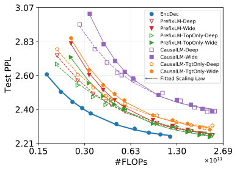

 

(a) En\(\rightarrow\)Fr

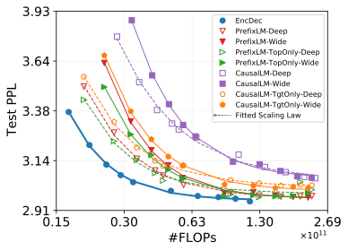

 

(b) En\(\rightarrow\)Zh

Figure 7:  Fitted scaling curves for different models on WMT14 En-Fr and WMT19 En-Zh in term of FLOPs.

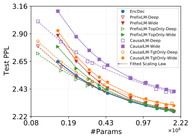

 

(a) En\(\rightarrow\)Fr

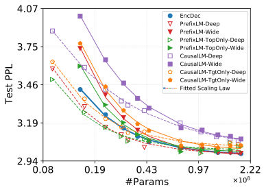

 

(b) En\(\rightarrow\)Zh

Figure 8:  Fitted scaling curves for different models on WMT14 En-Fr and WMT19 En-Zh on the longest sentence group. We rank our test set according to source sentence length, and then split it into 8 disjoint groups. This shows the results on the longest group.

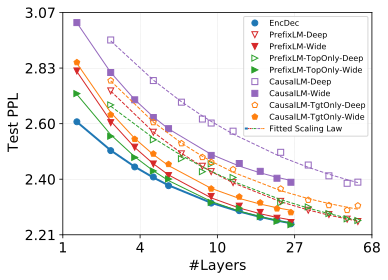

 

(a) En\(\rightarrow\)Fr

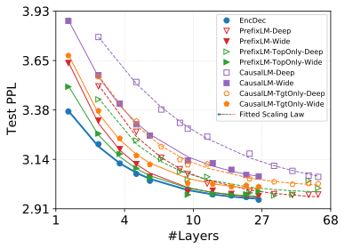

 

(b) En\(\rightarrow\)Zh

Figure 9:  Fitted scaling curves for different models on WMT14 En-Fr and WMT19 En-Zh with respect to the number of layers. Note under the same number of layers, LM \+ Deep has much fewer parameters than EncDec and LM \+ Wide. The performance gap also narrows as model scales up.

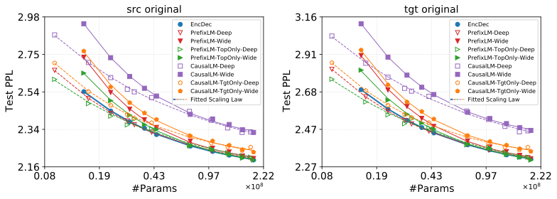

 

(a) En\(\rightarrow\)Fr

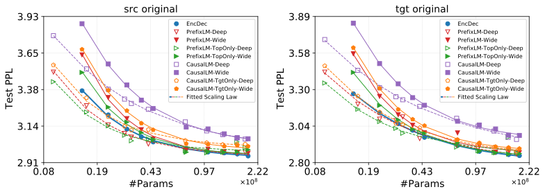

 

(b) En\(\rightarrow\)Zh

Figure 10:  Fitted scaling curves for different models on WMT14 En-Fr and WMT19 En-Zh evaluated on source original and target original test sets.

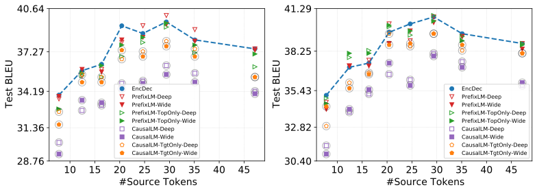

 

(a) En\(\rightarrow\)Fr

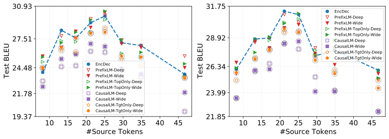

 

(b) En\(\rightarrow\)Zh

Figure 11:  BLEU scores for different models on WMT14 En-Fr and WMT19 En-Zh as a function of source sentence length. Left: models aligned with 6-layer EncDec; Right: models aligned with 14-layer EncDec. 

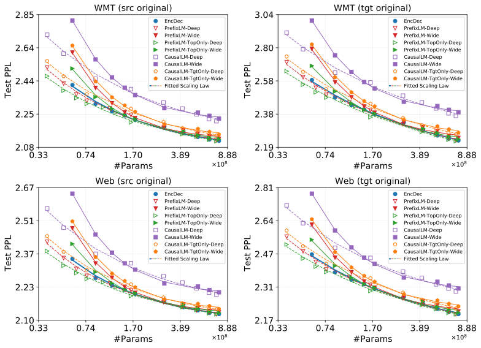

 Figure 12:  Fitted scaling curves for different models on Web En-De (En\(\rightarrow\)De). src/tgt: source/target; WMT: out-of-domain evaluation set; Web: in-domain evaluation set. Models are trained in the Transformer big setting. 

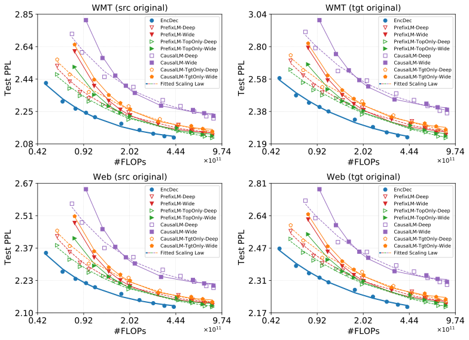

 Figure 13:  Fitted scaling curves for different models on Web En-De (En\(\rightarrow\)De) in terms of FLOPs. Models are trained in the Transformer big setting. 

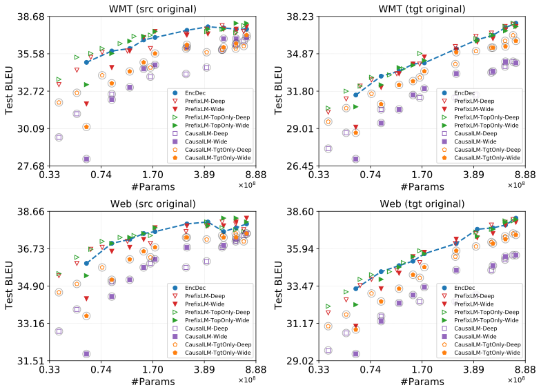

 Figure 14:  BLEU scores for different models on Web En-De (En\(\rightarrow\)De) as a function of model parameters. Models are trained in the Transformer big setting. 

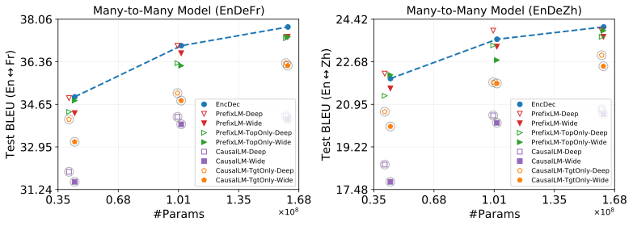

 Figure 15:  Cross-lingual transfer results (average BLEU scores) for different models from the low-resource language (En-De) to high-resource directions under different model sizes on WMT datasets. Average is performed over En\(\leftrightarrow\)Fr/Zh. Left: multilingual En-De-Fr system; Right: multilingual En-De-Zh system.

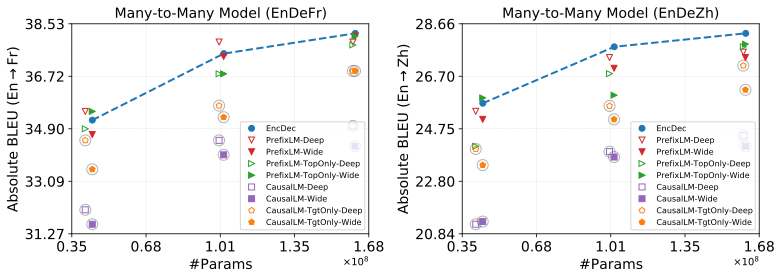

 

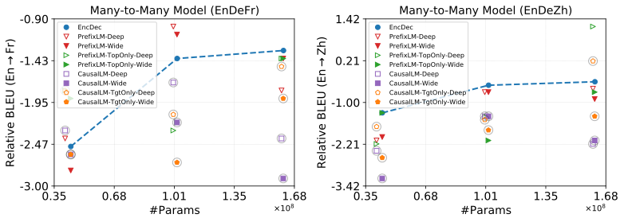

 

Figure 16:  Absolute (top) and relative (bottom) transfer results of different models for En\(\rightarrow\)Fr and En\(\rightarrow\)Zh under different models sizes on WMT datasets. Left: multilingual En-De-Fr system; Right: multilingual En-De-Zh system. Relative score is computed by comparing multilingual model and its corresponding bilingual counterpart. Overall, there is no clear pattern supporting that LMs encourage knowledge transfer better than EncDec.
