**Source:** *Encoder-Decoder or Decoder-Only? Revisiting Encoder-Decoder Large Language Model* — [PDF](https://arxiv.org/pdf/2510.26622v1) · [arXiv](https://arxiv.org/abs/2510.26622v1)

# ENCODER-DECODER OR DECODER-ONLY? REVISITING ENCODER-DECODER LARGE LANGUAGE MODEL

Biao Zhang\*, Yong Cheng, Siamak Shakeri, Xinyi Wang†, Min Ma, Orhan Firat Google DeepMind

### **ABSTRACT**

Recent large language model (LLM) research has undergone an architectural shift from encoder-decoder modeling to nowadays the dominant decoder-only modeling. This rapid transition, however, comes without a rigorous comparative analysis especially from the scaling perspective, raising concerns that the potential of encoder-decoder models may have been overlooked. To fill this gap, we revisit encoder-decoder LLM (RedLLM), enhancing it with recent recipes from decoder-only LLM (DecLLM). We conduct a comprehensive comparison between RedLLM, pretrained with prefix language modeling (LM), and DecLLM, pretrained with causal LM, at different model scales, ranging from  $\sim$ 150M to  $\sim$ 8B. Using RedPajama V1 (1.6T tokens) for pretraining and FLAN for instruction tuning, our experiments show that RedLLM produces compelling scaling properties and surprisingly strong performance. While DecLLM is overall more computeoptimal during pretraining, RedLLM demonstrates comparable scaling and context length extrapolation capabilities. After instruction tuning, RedLLM achieves comparable and even better results on various downstream tasks while enjoying substantially better inference efficiency. We hope our findings could inspire more efforts on re-examining RedLLM, unlocking its potential for developing powerful and efficient LLMs.

### 1 Introduction

A crucial lesson from the past decade for modeling is to design scalable and universal architectures being capable of handling different tasks (modalities) and automatically learning from massive unlabeled data, as remarked by the tremendous success of large language models (LLMs) in various research areas, particularly natural language processing (OpenAI, 2023; Gemini et al., 2024). Different architectures often introduce distinct inductive biases, ultimately affecting a model's learnability, scalability, and generalization ability (Narang et al., 2021). In language modeling (LM), two architectures stood out from the literature: *encoder-decoder* and *decoder-only*. The former utilizes an encoder to process the input and a separate decoder to generate the target (Raffel et al., 2020), while the latter jointly models input understanding and target generation via a single module (Radford et al., 2019). Both architectures present unique strengths and weaknesses, leading to hot debates regarding their respective superiority (Zhang et al., 2022a; Wang et al., 2022; Fu et al., 2023).

However, there has been a recent shift towards favoring decoder-only architectures for LLMs, featured by popular LLMs such as LLaMA (Touvron et al., 2023), Gemma (Team et al., 2024) and Mistral (Jiang et al., 2023), with very few exceptions (Li et al., 2023). Such a shift from our understanding mostly results from the success of GPT models (Radford et al., 2019; Brown et al., 2020), rather than the incapability of the encoder-decoder architecture. For example, when provided with comparable compute (by setting encoder-decoder models with *twice* the parameter count of decoder-only models), Wang et al. (2022) showed that the encoder-decoder model significantly outperformed its decoder-only counterpart after instruction tuning; Tay et al. (2022) highlighted the importance of pretraining objective and proposed UL2, which, combined with encoder-decoder modeling, achieves

\*Correspondence to: biaojiaxing@google.com.

&lt;sup>†Work done while at Google.

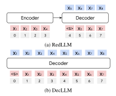

|                | DecLLM    | RedLLM                              |
|----------------|-----------|-------------------------------------|
| Attention      |           | Multi-Head Dot-Product Attention    |
| FFN Activation |           | SwiGLU                              |
| LayerNorm      |           | RMSNorm (Pre-Normalization)         |
| Position       |           |                                     |
| Modeling       |           | Rotary Embedding                    |
| Type           |           | Continuous Position                 |
| Embeddings     |           | All Tied                            |
| Extra Norm     | Q, K, V   | Q, K, V, Attn Output                |
| Rotary Usage   |           | Self-Attention Self&Cross-Attention |
| Loss           | Causal LM | Prefix LM                           |

(c) Model specification

Figure 1: Overview of model architecture and specification for RedLLM and DecLLM. We use red, blue and gray to denote input tokens, output tokens, and positions, respectively. For RedLLM, we apply rotary embedding to all attentions (encoder/decoder self-attention and cross-attention) with continuous positions, i.e. decoder position continues from the last one in the encoder. We adopt prefix language modeling for pretraining, and apply layer normalization to query (Q), key (K), value (V), and attention output to improve stabilization.

superior pretraining and finetuning performance across various tasks. These findings present direct evidence about the high potential of encoder-decoder modeling, challenging the recent paradigm shift. Unfortunately, the above studies evaluate architectures solely on an "apple-to-apple" basis without accounting for their scaling property [\(Kaplan et al., 2020\)](#page-10-3) – a crucial factor in modern LLMs, which is exactly the focus of our study.

In this paper, we fill this gap by revisiting encoder-decoder LLM (RedLLM) and comparing it with decoder-only LLM (DecLLM) from the scaling perspective. We adapt recent modeling recipes from DecLLM to enhance RedLLM, especially the rotary positional embedding [\(Su et al., 2024\)](#page-12-5) with continuous positions, and pretrain RedLLM with the prefix LM objective due to its simplicity and efficiency in leveraging compute. Figure [1](#page-1-0) shows the overview. We investigate the scaling properties of RedLLM and DecLLM by comparing their pretraining and finetuning performance on a range of tasks at various model scales, from approximately 150M to 8B parameters.

We conduct experiments by first pretraining on RedPajama V1 [\(Computer, 2023\)](#page-9-1) *from scratch* for roughly 1.6T tokens and then finetuning on FLAN [\(Longpre et al., 2023\)](#page-11-3) for instruction following. We perform scaling analysis on samples from RedPajama (*in-domain*) and Paloma (*out-of-domain,* [Magnusson et al., 2023\)](#page-11-4), and evaluate the models' zero- and few-shot capability on 13 downstream tasks. Our analysis reveals a trade-off between model quality and efficiency, with RedLLM and DecLLM each excelling in different areas. Main findings are summarized below:

- RedLLM and DecLLM show similar scaling exponents, while DecLLM almost dominates the compute-optimal frontier.
- During pretraining, RedLLM performs badly at zero-shot learning; its few-shot capability scales slightly with model sizes but still lags far behind DecLLM.
- After instruction tuning, RedLLM achieves comparable zero- and few-shot performance to DecLLM across scales while enjoying significantly better inference efficiency.
- At finetuning, RedLLM benefits from the bidirectional attention in its encoder; adapting DecLLM with this structure also yields significant improvements. Still, RedLLM provides the overall best quality-efficiency trade-off.
- RedLLM also shows promising context-length extrapolation capability.

# 2 BACKGROUND

Past few years have witnessed the significant progress achieved via large-scale pretraining. By learning from a large amount of unlabeled (weakly-labeled) data, neural networks could acquire massive world knowledge that is transferable to improve downstream tasks. Depending on what to transfer, previous efforts can be roughly classified into two categories: *representation learning* and *generative learning*. The former focuses on pretraining reusable modules that deliver high-quality representations being adaptable to different tasks via task-specific heads (Simonyan & Zisserman, 2014; Devlin et al., 2019; Liu, 2019; Baevski et al., 2020; Dosovitskiy et al., 2020). In contrast, the latter unifies pretraining and downstream tasks to maximize the transfer by formulating all downstream tasks as generation tasks, allowing the model to be pretrained entirely in a generative manner (Raffel et al., 2020; Xue et al., 2022; Lewis et al., 2020; Zhang et al., 2022b; Scao et al., 2022; Anil et al., 2023). In this study, we mainly explore generative learning, as represented by LLMs.

There are two crucial factors affecting the effectiveness of LLMs: *model architecture* and *pretraining objective*. Model architecture determines the layout and structure of a neural network, directly shaping its generalization. In the literature, two architectures have been widely investigated: encoder-decoder and decoder-only, both with Transformer as the backbone (Vaswani et al., 2017). The encoder-decoder architecture decomposes the input-target mapping into three separate modules – encoder self-attention, decoder self-attention and cross-attention for modeling input-input, target-target, target-input dependency, respectively. This decomposition often improves sample and inference efficiency, making it a preferred choice for several LLMs, such as T5 (Raffel et al., 2020), BART (Lewis et al., 2020) and OpenBA (Li et al., 2023). Instead, the decoder-only architecture relies on a single decoder self-attention module to handle all dependencies, unifying understanding and generation and simplifying the learning. Studies comparing both architectures are many (Fu et al., 2023; Raffel et al., 2020; Wang et al., 2022), but none of them explored the scaling landscape except (Zhang et al., 2022a) which nevertheless focuses on machine translation exclusively.

Pretraining objective defines what to learn and how to represent information, influencing the model's knowledge acquisition and learning efficiency. Popular choices include span corruption that masks out random tokens from the input to form the target (Raffel et al., 2020), causal LM that simply predicts the next token (i.e.,  $p(x_1,\ldots,x_T)=\prod_{t=1}^T p(x_t|x_{< t})$ , T is sequence length) (Radford & Narasimhan, 2018), and prefix LM that follows causal LM but is conditioned on a prefix (i.e.,  $p(x_k,\ldots,x_T|x_{< k})=\prod_{t=k}^T p(x_t|x_{< t})$ , k is the prefix length) (Dong et al., 2019). Tay et al. (2022) found that different objectives result in models with different capabilities and limitations, and that mixing them properly produces the best performance albeit at the cost of high implementation complexity and potentially reduced training efficiency (Li et al., 2023). We mainly employ the causal LM and prefix LM objective for the pretraining for their simplicity, leaving the exploration of other alternatives to the future.

The performance of pretrained models measured by perplexity is empirically observed following a power-law function of training data size and model size (Kaplan et al., 2020; Bansal et al., 2022; Fernandes et al., 2023), allowing us to analyze compute-optimal scaling for LLM development (Hoffmann et al., 2022). In addition, pretrained LLMs with sufficient model size often exhibits promising zero/few-shot capability, i.e., solving a task based on a few to no input-output examplers (Brown et al., 2020; Gemini et al., 2024). This task solving ability can be further elicited through instruction tuning, a procedure finetuning LLM on massive downstream tasks (Sanh et al., 2022; Longpre et al., 2023; Ouyang et al., 2022). We follow these practices comparing RedLLM and DecLLM under scaling, and examine their pretraining and finetuning performance with zero/few-shot evaluation.

# 3 REDLLM: REVISITING ENCODER-DECODER LLM

We adopt variants of Transformer (Vaswani et al., 2017) as the LLM backbone, and incorporate several recent techniques from DecLLM to improve the encoder-decoder modeling. Table 1c summarizes the model specifications.

For DecLLM, we employ the multi-head dot-product attention (Vaswani et al., 2017) for the self-attention, SwiGLU (Shazeer, 2020) as the activation for the feed-forward layer, RMSNorm (Zhang & Sennrich, 2019) for normalization with the pre-normalization structure, rotary embedding (Su et al., 2024) for positional encoding, and tied word embeddings. We apply extra normalization layers to query ( $\mathbf{Q} \in \mathbb{R}^{T \times d_h}$ ), key ( $\mathbf{K} \in \mathbb{R}^{T \times d_h}$ ), and value ( $\mathbf{V} \in \mathbb{R}^{T \times d_h}$ ) vectors over the head dimension ( $d_h$ ) to enhance the training stability

$$Attn_{DecLLM} = Softmax \left( \frac{LN(\mathbf{Q})LN(\mathbf{K})^{T}}{\sqrt{d_h}} \right) LN(\mathbf{V}), \tag{1}$$

| Model Size | d    | $d_{ffn}$ | h  | $d_h$ | $L_{dec}$ | $L_{red}$ |
|------------|------|-----------|----|-------|-----------|-----------|
| 150M       | 1024 | 4096      | 8  | 128   | 8         | 3/3       |
| 1B         | 2048 | 8192      | 16 | 128   | 16        | 7/7       |
| 2B         | 2560 | 10240     | 20 | 128   | 20        | 9/9       |
| 4B         | 3072 | 12288     | 24 | 128   | 24        | 10/10     |
| 8B         | 4096 | 16384     | 32 | 128   | 32        | 14/14     |

| (a) | Configu | ations | for | different | t-sized | LLMs. |
|-----|---------|--------|-----|-----------|---------|-------|
|-----|---------|--------|-----|-----------|---------|-------|

|                     | Traini       | ng Flops | #Params      |     |  |
|---------------------|--------------|----------|--------------|-----|--|
|                     | Dec          | Red      | Dec          | Red |  |
| RedPajama Paloma | 0.20 0.24 |          | 0.17 0.20 |     |  |

(b) Fitted scaling exponents.

|                 | Pretraining                                  | Finetuning   |  |  |  |  |
|-----------------|----------------------------------------------|--------------|--|--|--|--|
| Vocabulary      | 32768                                        |              |  |  |  |  |
| Dataset         | RedPajama V1                                 | FLAN         |  |  |  |  |
| Steps           | 400K                                         | 190K         |  |  |  |  |
| Batch Size      | 2048                                         | 1024         |  |  |  |  |
| Sequence Length | DecLLM: 2048 RedLLM: 1024/1024            | 2048/512     |  |  |  |  |
| Optimizer       | Adafactor(decay=0.8)                         |              |  |  |  |  |
| LR Schedule     | 2k-step warmup to 0.01 + cosine decay by 0.1 | fixed, 0.001 |  |  |  |  |
| Gradient Clip   | 1.0                                          |              |  |  |  |  |
| Dropout         | 0.0                                          | 0.05         |  |  |  |  |
| Z-Loss          | 0.0001                                       |              |  |  |  |  |
| Precision       | bfloat16                                     |              |  |  |  |  |

(c) Hyperparameters for pretraining and finetuning.

Table 1: Settings and scaling.  $d, d_{ffn}, d_h$ : model, feed-forward, and head dimension, respectively. h: number of heads.  $L_{dec}, L_{red}$ : number of layers for DecLLM and RedLLM, respectively. Note we adopt a balanced RedLLM architecture with equal number of encoder and decoder layers. "B": billion. "K": thousand. "Dec/Red": DecLLM/RedLLM.

where LN(·) denotes parameter-free RMSNorm. Note because of the normalization and the scaling factor  $1/\sqrt{d_h}$ , the attention logits are bounded into  $[-\sqrt{d_h}, \sqrt{d_h}]$ , thus avoiding logits explosion.

RedLLM follows DecLLM. We apply the rotary embedding to all attentions, covering encoder self-attention, decoder self- and cross-attention. As shown in Figure 1a, we employ continuous position following DecLLM so positional information flows continuously from the encoder's end to the decoder's beginning. We tie all word embeddings, including encoder word embedding, decoder word embedding and output embedding. We note in experiments that RedLLM suffers more from training instability. To alleviate this problem, we add another normalization layer to attention output

$$Attn_{RedLLM} = LN (Attn_{DecLLM}). (2)$$

We pretrain DecLLM with the causal LM objective as this objective could fully leverage DecLLM's capacity and aligns with the current standard. We use the prefix LM objective for RedLLM, instead. While the above specifications are functional, we acknowledge that further architectural/objective optimization is very possible for both models, which we leave to the future.

## 4 SETUP

We train a set of RedLLMs and DecLLMs with model size ranging from about 150M to 8B using T5X (Roberts et al., 2023). Table 1a lists the model configurations, and Table 1c shows the pretraining and finetuning hyperparameters.

**Pretraining** We use RedPajama V1 (Computer, 2023) for pretraining, which is an open-source reproduction of the LLaMA training corpus (Touvron et al., 2023). We adopt a subword tokenizer of 32K vocabulary for tokenization. To train DecLLM, we concatenate the documents (separated by tag "[EOD]") and then split them into sequences of 2048 tokens (i.e., T=2048) without overlapping. We further split each sequence in the middle, resulting in 1024 input and 1024 target tokens (i.e., k=1024), for training RedLLM. We use Adafactor without factorization (Shazeer & Stern, 2018) for optimization. All LLMs are trained for 400K steps, totaling roughly 1.6 epochs and 1.6T tokens. Note the effective target token count for RedLLM is 0.8T, *half* the size used for DecLLM due to the architectural difference.

**Finetuning** We use the FLAN collection (Longpre et al., 2023) for instruction tuning, which consists of 1800+ tasks with diverse prompts. We set the maximum input/output tokens to 2048/512, and finetune models on the default data mixture (without packing). We tune all model parameters (Zhang et al., 2024), and compute the log-likelihood loss *only* on the target output. Depending

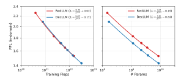

Figure 2: Fitted scaling law on in-domain dataset (RedPajama) for RedLLM and DecLLM. Left: training Flops (C); Right: model parameters (N). To ensure fair comparison, we evaluate PPL using a prefix LM approach, where we utilize the first 1024 tokens as a prefix and compute log-likelihood on the subsequent 1024 tokens.

on the model, its size and resource availability, we use up to 256/64 TPU v5p chips for pretraining/finetuning, taking up to 1 month each.

**Evaluation** We perform scaling-law analysis for pretrained models using perplexity (PPL) on Red-Pajama and Paloma (Magnusson et al., 2023). RedPajama is a random subset of RedPajama V1, including 79K documents sampled from 7 sources (Arxiv, Books, C4, CC, Github, Stackexchange and Wiki). We regard RedPajama as an *in-domain* eval set. Paloma, instead, is independently curated for perplexity analysis, including data from 16 sources and 500+ domains. We argue its independent construction and broad domain coverage make it sufficiently distinct from our pretraining data, thus we consider evaluations using Paloma to be *out-of-domain*. We report averaged PPL over different sources for the evaluation. By default, we use the final checkpoint for pretraining analysis.

We also evaluate zero/few-shot performance of pretrained and finetuned models. We follow Longpre et al. (2023) and extend the evaluation to 13 tasks: BoolQ (Clark et al., 2019), HellaSwag (Zellers et al., 2019), RTE (Bentivogli et al., 2009), ARC easy and challenge (Clark et al., 2018), ANLI R1, R2 and R3 (Nie et al., 2020), CommonsenseQA (Talmor et al., 2019), StrategyQA (Geva et al., 2021), TriviaQA (Joshi et al., 2017), UnifiedQA (Khashabi et al., 2020), MMLU (CoT Hendrycks et al., 2021), GSM8K (Cobbe et al., 2021), BIG-Bench Hard (BBH CoT, bench authors, 2023), and WMT (English German, English Chinese, Kocmi et al., 2022). We report accuracy except WMT for which we use ChrF. We employ 5 shots for few-shot evaluation except BBH (3 shots), GSM8K (8 shots), CommonsenseQA (7 shots), and StrategyQA (6 shots). We adopt greedy decoding for all models. We calculate averaged score over all tasks for model comparison, and report the best results for finetuning.

### 5 Pretraining Results

RedLLM and DecLLM scale at similar rates when increasing the compute (training Flops) and model parameters. The substantial differences in architecture and pretraining objective make it challenging to find a common ground comparing RedLLM and DecLLM. Doubling model parameters for RedLLM as in (Wang et al., 2022; Tay et al., 2022) is arguably unfair. We instead resort to scaling law (Kaplan et al., 2020) and compare them under two factors: model parameters and training Flops. Figure 2 and 10 show the results; Table 1b summarizes the scaling exponents. We also show the pretraining loss curve in Figure 11.

Interestingly, RedLLM shows comparable scaling capability to DecLLM regardless of evaluation domains, as demonstrated by similar scaling exponents. DecLLM is more parameter efficient, outperforming RedLLM by a consistent gap under the same amount of parameters. However, this comes at the cost of computational inefficiency, as it requires approximately double the Flops to train under similar conditions. When shifting the comparison basis to compute, the quality gap almost disappears where both scaling curves nearly overlap.

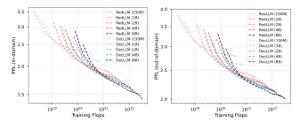

Figure 3: PPL as a function of total training compute. Models are evaluated using the same prefix LM approach over different pretraining checkpoints. The compute-optimal frontier is mostly dominated by DecLLM, especially with larger compute budget.

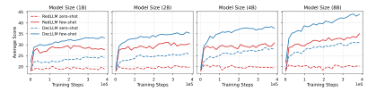

Figure 4: Zero- and few-shot pretraining performance over training steps.

RedLLM lags behind DecLLM for compute-optimal training. We next investigate how effectively different models utilize the compute, as measured by PPL during the pretraining. Intuitively, a model achieving lower PPL under the same compute budget is preferred. Figure 3 and 13 show the comparison between RedLLM and DecLLM with different compute budgets. We first plot the PPL-to-compute curve for all models, where the bottom left region indicates the Pareto frontier. We then use this information to fit a compute-optimal scaling law function (Hoffmann et al., 2022) for both RedLLM and DecLLM, and plot the isoFLOP for both. Figure 3 (and 13) shows that while RedLLM shows a slight edge in low-compute settings, DecLLM's advantage becomes dominant as the compute scales up. This superior scaling behavior might come from its causal LM objective, which endows DecLLM with higher efficiency in utilizing training tokens. Still, the quality gap between RedLLM and DecLLM is not that substantial and narrows with the increase of compute.

RedLLM scales slightly for few-shot learning but is poor at zero-shot; both largely underperform DecLLM. While PPL has been widely used for measuring LLM capability, it may not be indicative enough for the downstream task-solving ability (Kuribayashi et al., 2021; Hu et al., 2024). Apart from PPL, we further examine models' zero/few-shot performance as shown in Figure 4. RedLLM and DecLLM both achieve non-trivial few-shot performance, demonstrating their capability of in-context learning. DecLLM yields consistently better performance as scaling up model and data size, for both zero-shot and few-shot learning. In contrast, RedLLM performs badly at zero-shot learning, and only shows slight benefits from the scaling for few-shot learning. Its inferior zero-shot results, nevertheless, may not result from RedLLM's insufficient capability but from an inadequate way of zero-shot prompting (Patel et al., 2023). In general, RedLLM falls behind DecLLM substantially at zero/few-shot learning during pretraining, resonating with the findings of Wang et al. (2022). This still holds true even when their PPL scores are comparable, e.g., RedLLM 8B vs. DecLLM 4B.

**RedLLM shows comparable and even better length extrapolation capability than DecLLM along model scaling.** One strength of DecLLM with rotary embedding is its length extrapolation ability, i.e., being able to handle sequences beyond pretraining context length. This raises the ques-

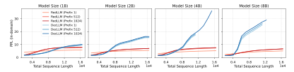

Figure 5: PPL curves for length extrapolation on in-domain dataset (RedPajama). We follow the prefix LM evaluation approach and explore different prefix lengths (1, 512 and 1024).

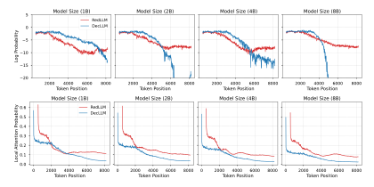

Figure 6: Log probability of groundtruth target tokens (top) and local attention probability for decoder self-attention (bottom) as a function of token positions. We collect these statistics from 8 randomly sampled Red-Pajama examples, each with 512 prefix tokens and 7680 target tokens. We average the log probability for the same token position over different examples; for self-attention, we first average the attention weights over all heads, layers and examples, and then report the summed weights over a local window [t-4,t] for token  $x_t$ .

tion of how RedLLM performs on long sequence modeling and we show the results in Figure 5 and 12. In general, PPL goes up – becomes worse – for both RedLLM and DecLLM as context length increases, regardless of prefix lengths and domains.

DecLLM maintains relatively stable PPL up to a context length of 4096 tokens, i.e., twice the pretraining length. Beyond this point, PPL starts increasing, eventually exhibiting divergent behavior. We note that the larger DecLLM is, the more rapid PPL escalates as sequence length extends. In contrast, RedLLM shows a surprisingly smoother increase in PPL, regardless of model sizes, demonstrating a stronger ability to extrapolate to longer sequences. Nevertheless, it often underperforms DecLLM on sequences shorter than 4K tokens.

Interestingly, the impact of prefix length is marginal on the extrapolation behavior except RedLLM at prefix length of 1. RedLLM suffers from significant quality drop on short sequences when reducing the prefix length to 1 since the capacity from its encoder becomes limited. As model scales up, however, the gap gets largely narrowed, perhaps due to the improved decoder capacity.

### The decoder self- and cross-attention in RedLLM show intriguing patterns under long context.

The above results motivate us to dive deeper into the models for a better understanding of what happened under long context. We find from Figure 6 (top) that the groundtruth target token's log probability often decreases as token position increases. In contrast to RedLLM, DecLLM tends to suffer from a sharp probability drop after some point. We further inspect the decoder self-attention with the suspect that self-attention weights might not be functioning as intended. Figure 7b and 7c

Figure 7: Attention weight visualization. x-axis: key; y-axis: query. The weights are first averaged over heads, layers and examples, and then compressed into a resolution of 128x128 through mean pooling with strides. Note self-attentions are from decoder layers. All models are 4B.

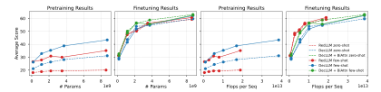

Figure 8: Zero- and few-shot downstream performance as a function of model parameters (#Params) and Flops. "Flops per Seq": inference Flops for a single sequence; "DecLLM + BiAttn": allowing bidirectional attention over inputs at finetuning.

show that the decoder self-attention in RedLLM and DecLLM follows a clear "*locality*" structure where tokens favor attending to itself and nearby tokens, but the strength of locality weakens with the increase of token position particularly in DecLLM– a phenomenon we called *locality decay*. To verify this finding, we calculated the local attention probability, i.e., summed attention weights over a local window size of 5. Figure 6 (bottom) shows that the decay behavior occurs in both RedLLM and DecLLM, while DecLLM suffers more.

Figure 7a shows that the pattern of cross-attention weights differs significantly from that of self-attention weights. There is always a subset of input tokens attended by target tokens in RedLLM, and this subset varies little (Zhang et al., 2020). Such diverse attention may help RedLLM to capture some distant information under long context modeling, but may also increase learning difficulty as the input-target dependency in language modeling is of higher uncertainty. Still, the underlying reason behind RedLLM's long context behavior remains unclear, which we leave to the future.

### 6 FINETUNING RESULTS

RedLLM shows high adaptability: matching and even surpassing DecLLM across scales after finetuning. While RedLLM's zero/few-shot performance lags behind DecLLM in pretraining, finetuning changes the situation. Figure 8 shows the averaged scaling results for finetuning along with pretraining under model parameters and inference Flops, and Table 2 lists detailed numbers. RedLLM catches up with DecLLM after finetuning, even under the same amount of model parameters (where RedLLM produces higher PPL than DecLLM). When switching the comparison basis to the inference Flops, RedLLM shows significant advantage, nearly dominating the quality-compute Pareto frontier. The performance gap between zero-shot and few-shot evaluation is also largely reduced. Apart from averaged results, we add per-task performance in Figures 14, 15 and 16. The results vary across tasks, e.g., RedLLM largely surpasses DecLLM on ANLI, while DecLLM excels at ARC. These differences should be carefully considered when comparing both models.

Note Wang et al. (2022) also observed similar results. However, their experiments were based on a 11B encoder-decoder model and 4.8B decoder-only model. In contrast, we present the scaling land-

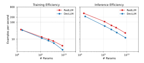

Figure 9: Efficiency analysis. We show the number of examples processed per second for efficiency comparison. Results are collected with batch size of 1 using 2 TPU v5p chips.

scape across multiple model sizes. We further demonstrate the feasibility of achieving comparable performance to DecLLM under similar model sizes.

In addition, these results suggest that the adaptability of different models varies greatly. Models with worse pretraining performance may stand out after finetuning, such as RedLLM. We conjecture that the superior pretraining performance of DecLLM is mostly caused by the higher degree of matching between its pretraining objective and the downstream evaluation, rather than its stronger capability. Surprisingly, PPL also fails to capture a model's adaptability, echoing with Hu et al. (2024).

Bidirectional input attention improves DecLLM greatly but doesn't change the quality-compute frontier. An important difference between RedLLM and DecLLM at finetuning is the bidirectional input attention (BiAttn) in RedLLM's encoder, which allows input tokens attending to each other. Such a structure often improves input understanding, and has proven useful in various settings including DecLLM (Wang et al., 2022; Zhang et al., 2022a). This may explain why DecLLM underperforms RedLLM after finetuning.

We thus enable this structure for DecLLM. Figure 8 and Table 2 show that the performance of DecLLM gets substantially improved. Interestingly, while DecLLM + BiAttn largely outperforms RedLLM at zero-shot learning, their few-shot quality gap becomes smaller to negligible. Still, the overall quality gap among different models is much smaller compared to the pretraining performance gap, and the leading position of RedLLM with respect to the quality-compute trade-off remains.

**RedLLM** has clear advantage over DecLLM on training and inference efficiency. Beyond theoretical Flops analysis, our empirical efficiency analysis (Figure 9) reveals a striking advantage for RedLLM in both training and inference throughput. This advantage becomes even more pronounced as model size increases, particularly during pretraining, where RedLLM significantly outpaces DecLLM. This remarkable efficiency, together with RedLLM's promising finetuning performance, underscores its significance, particularly on the fact that instruction tuning and alignment have become an essential part of LLM development (Ouyang et al., 2022).

# 7 CONCLUSION AND FUTURE WORK

Encoder-decoder or decoder-only for LLM? We answered this question from the scaling perspective and provided a comprehensive analysis over multiple dimensions. We conducted large-scale pretraining and finetuning experiments using RedPajama V1 and FLAN, with models ranging from 150M to 8B parameters. Our results show distinct strengths for each architecture. DecLLM presents unique strengths during pretraining, including compute-optimal scaling, zero/few-shot learning, and strong training stability. By contrast, RedLLM excels in finetuning scenarios, showing superior running efficiency and finetuning performance. Besides, RedLLM demonstrates comparable scaling properties and context length extrapolation capability.

There are many potential future directions. We are particularly interested in exploring the scalability of RedLLM beyond 8B parameters. Our current study focused on balanced architectures, where the encoder and decoder have an equal number of layers. Investigating imbalanced architectures,

such as those with a deep encoder and a shallow decoder, presents a compelling avenue. Besides, a comparative analysis of various pretraining objectives and a deeper understanding of how RedLLM extrapolates to longer sequences would be valuable.

### ACKNOWLEDGMENTS

We'd like to thank Tianqi Liu, Tris Warkentin, and Noam Shazeer for their constructive feedback on the manuscript. We also thank the T5X team [\(Roberts et al., 2023\)](#page-12-11) for the training framework.

# REFERENCES

- Rohan Anil, Andrew M Dai, Orhan Firat, Melvin Johnson, Dmitry Lepikhin, Alexandre Passos, Siamak Shakeri, Emanuel Taropa, Paige Bailey, Zhifeng Chen, et al. Palm 2 technical report. arXiv preprint arXiv:2305.10403, 2023.
- Alexei Baevski, Yuhao Zhou, Abdelrahman Mohamed, and Michael Auli. wav2vec 2.0: A framework for self-supervised learning of speech representations. Advances in neural information processing systems, 33:12449–12460, 2020.
- Yamini Bansal, Behrooz Ghorbani, Ankush Garg, Biao Zhang, Colin Cherry, Behnam Neyshabur, and Orhan Firat. Data scaling laws in NMT: The effect of noise and architecture. In Kamalika Chaudhuri, Stefanie Jegelka, Le Song, Csaba Szepesvari, Gang Niu, and Sivan Sabato (eds.), Proceedings of the 39th International Conference on Machine Learning, volume 162 of Proceedings of Machine Learning Research, pp. 1466–1482. PMLR, 17–23 Jul 2022. URL <https://proceedings.mlr.press/v162/bansal22b.html>.
- BIG bench authors. Beyond the imitation game: Quantifying and extrapolating the capabilities of language models. Transactions on Machine Learning Research, 2023. ISSN 2835-8856. URL <https://openreview.net/forum?id=uyTL5Bvosj>.
- Luisa Bentivogli, Peter Clark, Ido Dagan, and Danilo Giampiccolo. The fifth pascal recognizing textual entailment challenge. TAC, 7(8):1, 2009.
- Tom Brown, Benjamin Mann, Nick Ryder, Melanie Subbiah, Jared D Kaplan, Prafulla Dhariwal, Arvind Neelakantan, Pranav Shyam, Girish Sastry, Amanda Askell, et al. Language models are few-shot learners. Advances in neural information processing systems, 33:1877–1901, 2020.
- Christopher Clark, Kenton Lee, Ming-Wei Chang, Tom Kwiatkowski, Michael Collins, and Kristina Toutanova. Boolq: Exploring the surprising difficulty of natural yes/no questions. In NAACL, 2019.
- Peter Clark, Isaac Cowhey, Oren Etzioni, Tushar Khot, Ashish Sabharwal, Carissa Schoenick, and Oyvind Tafjord. Think you have solved question answering? try arc, the ai2 reasoning challenge. arXiv:1803.05457v1, 2018.
- Karl Cobbe, Vineet Kosaraju, Mohammad Bavarian, Mark Chen, Heewoo Jun, Lukasz Kaiser, Matthias Plappert, Jerry Tworek, Jacob Hilton, Reiichiro Nakano, Christopher Hesse, and John Schulman. Training verifiers to solve math word problems. arXiv preprint arXiv:2110.14168, 2021.
- Together Computer. Redpajama: an open dataset for training large language models, 2023. URL <https://github.com/togethercomputer/RedPajama-Data>.
- Jacob Devlin, Ming-Wei Chang, Kenton Lee, and Kristina Toutanova. BERT: Pre-training of deep bidirectional transformers for language understanding. In Jill Burstein, Christy Doran, and Thamar Solorio (eds.), Proceedings of the 2019 Conference of the North American Chapter of the Association for Computational Linguistics: Human Language Technologies, Volume 1 (Long and Short Papers), pp. 4171–4186, Minneapolis, Minnesota, June 2019. Association for Computational Linguistics. doi: 10.18653/v1/N19-1423. URL [https://aclanthology.org/](https://aclanthology.org/N19-1423) [N19-1423](https://aclanthology.org/N19-1423).

- Li Dong, Nan Yang, Wenhui Wang, Furu Wei, Xiaodong Liu, Yu Wang, Jianfeng Gao, Ming Zhou, and Hsiao-Wuen Hon. Unified language model pre-training for natural language understanding and generation. In Advances in Neural Information Processing Systems, volume 32. Curran Associates, Inc., 2019. URL [https://proceedings.neurips.cc/paper\\_files/](https://proceedings.neurips.cc/paper_files/paper/2019/file/c20bb2d9a50d5ac1f713f8b34d9aac5a-Paper.pdf) [paper/2019/file/c20bb2d9a50d5ac1f713f8b34d9aac5a-Paper.pdf](https://proceedings.neurips.cc/paper_files/paper/2019/file/c20bb2d9a50d5ac1f713f8b34d9aac5a-Paper.pdf).
- Alexey Dosovitskiy, Lucas Beyer, Alexander Kolesnikov, Dirk Weissenborn, Xiaohua Zhai, Thomas Unterthiner, Mostafa Dehghani, Matthias Minderer, Georg Heigold, Sylvain Gelly, et al. An image is worth 16x16 words: Transformers for image recognition at scale. arXiv preprint arXiv:2010.11929, 2020.
- Patrick Fernandes, Behrooz Ghorbani, Xavier Garcia, Markus Freitag, and Orhan Firat. Scaling laws for multilingual neural machine translation. In Andreas Krause, Emma Brunskill, Kyunghyun Cho, Barbara Engelhardt, Sivan Sabato, and Jonathan Scarlett (eds.), Proceedings of the 40th International Conference on Machine Learning, volume 202 of Proceedings of Machine Learning Research, pp. 10053–10071. PMLR, 23–29 Jul 2023. URL [https://proceedings.mlr.](https://proceedings.mlr.press/v202/fernandes23a.html) [press/v202/fernandes23a.html](https://proceedings.mlr.press/v202/fernandes23a.html).
- Zihao Fu, Wai Lam, Qian Yu, Anthony Man-Cho So, Shengding Hu, Zhiyuan Liu, and Nigel Collier. Decoder-only or encoder-decoder? interpreting language model as a regularized encoder-decoder. arXiv preprint arXiv:2304.04052, 2023.
- Team Gemini, Machel Reid, Nikolay Savinov, Denis Teplyashin, Dmitry Lepikhin, Timothy Lillicrap, Jean-baptiste Alayrac, Radu Soricut, Angeliki Lazaridou, Orhan Firat, Julian Schrittwieser, et al. Gemini 1.5: Unlocking multimodal understanding across millions of tokens of context. arXiv preprint arXiv:2403.05530, 2024.
- Mor Geva, Daniel Khashabi, Elad Segal, Tushar Khot, Dan Roth, and Jonathan Berant. Did aristotle use a laptop? a question answering benchmark with implicit reasoning strategies. Transactions of the Association for Computational Linguistics, 9:346–361, 2021.
- Dan Hendrycks, Collin Burns, Steven Basart, Andy Zou, Mantas Mazeika, Dawn Song, and Jacob Steinhardt. Measuring massive multitask language understanding. In International Conference on Learning Representations, 2021. URL [https://openreview.net/forum?](https://openreview.net/forum?id=d7KBjmI3GmQ) [id=d7KBjmI3GmQ](https://openreview.net/forum?id=d7KBjmI3GmQ).
- Jordan Hoffmann, Sebastian Borgeaud, Arthur Mensch, Elena Buchatskaya, Trevor Cai, Eliza Rutherford, Diego de Las Casas, Lisa Anne Hendricks, Johannes Welbl, Aidan Clark, et al. Training compute-optimal large language models. arXiv preprint arXiv:2203.15556, 2022.
- Yutong Hu, Quzhe Huang, Mingxu Tao, Chen Zhang, and Yansong Feng. Can perplexity reflect large language model's ability in long text understanding? arXiv preprint arXiv:2405.06105, 2024.
- Albert Qiaochu Jiang, Alexandre Sablayrolles, Arthur Mensch, Chris Bamford, Devendra Singh Chaplot, Diego de Las Casas, Florian Bressand, Gianna Lengyel, Guillaume Lample, Lucile Saulnier, L'elio Renard Lavaud, Marie-Anne Lachaux, Pierre Stock, Teven Le Scao, Thibaut Lavril, Thomas Wang, Timothée Lacroix, and William El Sayed. Mistral 7b. ArXiv, abs/2310.06825, 2023. URL [https://api.semanticscholar.org/CorpusID:](https://api.semanticscholar.org/CorpusID:263830494) [263830494](https://api.semanticscholar.org/CorpusID:263830494).
- Mandar Joshi, Eunsol Choi, Daniel Weld, and Luke Zettlemoyer. triviaqa: A Large Scale Distantly Supervised Challenge Dataset for Reading Comprehension. arXiv e-prints, art. arXiv:1705.03551, 2017.
- Jared Kaplan, Sam McCandlish, Tom Henighan, Tom B Brown, Benjamin Chess, Rewon Child, Scott Gray, Alec Radford, Jeffrey Wu, and Dario Amodei. Scaling laws for neural language models. arXiv preprint arXiv:2001.08361, 2020.
- D. Khashabi, S. Min, T. Khot, A. Sabhwaral, O. Tafjord, P. Clark, and H. Hajishirzi. Unifiedqa: Crossing format boundaries with a single qa system. 2020.

- Tom Kocmi, Rachel Bawden, Ondˇrej Bojar, Anton Dvorkovich, Christian Federmann, Mark Fishel, Thamme Gowda, Yvette Graham, Roman Grundkiewicz, Barry Haddow, Rebecca Knowles, Philipp Koehn, Christof Monz, Makoto Morishita, Masaaki Nagata, Toshiaki Nakazawa, Michal Novák, Martin Popel, and Maja Popovic. Findings of the 2022 conference on machine transla- ´ tion (WMT22). In Philipp Koehn, Loïc Barrault, Ondˇrej Bojar, Fethi Bougares, Rajen Chatterjee, Marta R. Costa-jussà, Christian Federmann, Mark Fishel, Alexander Fraser, Markus Freitag, Yvette Graham, Roman Grundkiewicz, Paco Guzman, Barry Haddow, Matthias Huck, Antonio Jimeno Yepes, Tom Kocmi, André Martins, Makoto Morishita, Christof Monz, Masaaki Nagata, Toshiaki Nakazawa, Matteo Negri, Aurélie Névéol, Mariana Neves, Martin Popel, Marco Turchi, and Marcos Zampieri (eds.), Proceedings of the Seventh Conference on Machine Translation (WMT), pp. 1–45, Abu Dhabi, United Arab Emirates (Hybrid), December 2022. Association for Computational Linguistics. URL <https://aclanthology.org/2022.wmt-1.1>.
- Tatsuki Kuribayashi, Yohei Oseki, Takumi Ito, Ryo Yoshida, Masayuki Asahara, and Kentaro Inui. Lower perplexity is not always human-like. In Chengqing Zong, Fei Xia, Wenjie Li, and Roberto Navigli (eds.), Proceedings of the 59th Annual Meeting of the Association for Computational Linguistics and the 11th International Joint Conference on Natural Language Processing (Volume 1: Long Papers), pp. 5203–5217, Online, August 2021. Association for Computational Linguistics. doi: 10.18653/v1/2021.acl-long.405. URL [https://aclanthology.org/2021.](https://aclanthology.org/2021.acl-long.405) [acl-long.405](https://aclanthology.org/2021.acl-long.405).
- Mike Lewis, Yinhan Liu, Naman Goyal, Marjan Ghazvininejad, Abdelrahman Mohamed, Omer Levy, Veselin Stoyanov, and Luke Zettlemoyer. BART: Denoising sequence-to-sequence pretraining for natural language generation, translation, and comprehension. In Proceedings of the 58th Annual Meeting of the Association for Computational Linguistics, pp. 7871–7880, Online, July 2020. Association for Computational Linguistics. doi: 10.18653/v1/2020.acl-main.703. URL <https://aclanthology.org/2020.acl-main.703>.
- Juntao Li, Zecheng Tang, Yuyang Ding, Pinzheng Wang, Pei Guo, Wangjie You, Dan Qiao, Wenliang Chen, Guohong Fu, Qiaoming Zhu, et al. Openba: An open-sourced 15b bilingual asymmetric seq2seq model pre-trained from scratch. arXiv preprint arXiv:2309.10706, 2023.
- Y Liu. Roberta: A robustly optimized bert pretraining approach. arXiv preprint arXiv:1907.11692, 2019.
- Shayne Longpre, Le Hou, Tu Vu, Albert Webson, Hyung Won Chung, Yi Tay, Denny Zhou, Quoc V Le, Barret Zoph, Jason Wei, and Adam Roberts. The flan collection: Designing data and methods for effective instruction tuning. In Andreas Krause, Emma Brunskill, Kyunghyun Cho, Barbara Engelhardt, Sivan Sabato, and Jonathan Scarlett (eds.), Proceedings of the 40th International Conference on Machine Learning, volume 202 of Proceedings of Machine Learning Research, pp. 22631–22648. PMLR, 23–29 Jul 2023. URL [https://proceedings.mlr.press/](https://proceedings.mlr.press/v202/longpre23a.html) [v202/longpre23a.html](https://proceedings.mlr.press/v202/longpre23a.html).
- Ian Magnusson, Akshita Bhagia, Valentin Hofmann, Luca Soldaini, Ananya Harsh Jha, Oyvind Tafjord, Dustin Schwenk, Evan Pete Walsh, Yanai Elazar, Kyle Lo, et al. Paloma: A benchmark for evaluating language model fit. arXiv preprint arXiv:2312.10523, 2023.
- Sharan Narang, Hyung Won Chung, Yi Tay, William Fedus, Thibault Fevry, Michael Matena, Karishma Malkan, Noah Fiedel, Noam Shazeer, Zhenzhong Lan, et al. Do transformer modifications transfer across implementations and applications? arXiv preprint arXiv:2102.11972, 2021.
- Yixin Nie, Adina Williams, Emily Dinan, Mohit Bansal, Jason Weston, and Douwe Kiela. Adversarial NLI: A new benchmark for natural language understanding. In Proceedings of the 58th Annual Meeting of the Association for Computational Linguistics. Association for Computational Linguistics, 2020.
- OpenAI. Gpt-4 technical report, 2023.
- Long Ouyang, Jeffrey Wu, Xu Jiang, Diogo Almeida, Carroll Wainwright, Pamela Mishkin, Chong Zhang, Sandhini Agarwal, Katarina Slama, Alex Ray, et al. Training language models to follow instructions with human feedback. Advances in neural information processing systems, 35: 27730–27744, 2022.

- Ajay Patel, Bryan Li, Mohammad Sadegh Rasooli, Noah Constant, Colin Raffel, and Chris Callison-Burch. Bidirectional language models are also few-shot learners. In The Eleventh International Conference on Learning Representations, 2023. URL [https://openreview.net/forum?](https://openreview.net/forum?id=wCFB37bzud4) [id=wCFB37bzud4](https://openreview.net/forum?id=wCFB37bzud4).
- Alec Radford and Karthik Narasimhan. Improving language understanding by generative pretraining. 2018. URL <https://api.semanticscholar.org/CorpusID:49313245>.
- Alec Radford, Jeff Wu, Rewon Child, David Luan, Dario Amodei, and Ilya Sutskever. Language models are unsupervised multitask learners. 2019. URL [https://api.](https://api.semanticscholar.org/CorpusID:160025533) [semanticscholar.org/CorpusID:160025533](https://api.semanticscholar.org/CorpusID:160025533).
- Colin Raffel, Noam Shazeer, Adam Roberts, Katherine Lee, Sharan Narang, Michael Matena, Yanqi Zhou, Wei Li, and Peter J. Liu. Exploring the limits of transfer learning with a unified text-to-text transformer. 21(1), jan 2020. ISSN 1532-4435.
- Adam Roberts, Hyung Won Chung, Gaurav Mishra, Anselm Levskaya, James Bradbury, Daniel Andor, Sharan Narang, Brian Lester, Colin Gaffney, Afroz Mohiuddin, et al. Scaling up models and data with t5x and seqio. Journal of Machine Learning Research, 24(377):1–8, 2023.
- Victor Sanh, Albert Webson, Colin Raffel, Stephen Bach, Lintang Sutawika, Zaid Alyafeai, Antoine Chaffin, Arnaud Stiegler, Arun Raja, Manan Dey, M Saiful Bari, Canwen Xu, Urmish Thakker, Shanya Sharma Sharma, Eliza Szczechla, Taewoon Kim, Gunjan Chhablani, Nihal Nayak, Debajyoti Datta, Jonathan Chang, Mike Tian-Jian Jiang, Han Wang, Matteo Manica, Sheng Shen, Zheng Xin Yong, Harshit Pandey, Rachel Bawden, Thomas Wang, Trishala Neeraj, Jos Rozen, Abheesht Sharma, Andrea Santilli, Thibault Fevry, Jason Alan Fries, Ryan Teehan, Teven Le Scao, Stella Biderman, Leo Gao, Thomas Wolf, and Alexander M Rush. Multitask prompted training enables zero-shot task generalization. In International Conference on Learning Representations, 2022. URL <https://openreview.net/forum?id=9Vrb9D0WI4>.
- Teven Le Scao, Angela Fan, Christopher Akiki, Ellie Pavlick, Suzana Ilic, Daniel Hesslow, Roman ´ Castagné, Alexandra Sasha Luccioni, François Yvon, Matthias Gallé, et al. Bloom: A 176bparameter open-access multilingual language model. arXiv preprint arXiv:2211.05100, 2022.
- Noam Shazeer. Glu variants improve transformer. arXiv preprint arXiv:2002.05202, 2020.
- Noam Shazeer and Mitchell Stern. Adafactor: Adaptive learning rates with sublinear memory cost. In International Conference on Machine Learning, pp. 4596–4604. PMLR, 2018.
- Karen Simonyan and Andrew Zisserman. Very deep convolutional networks for large-scale image recognition, 2014.
- Jianlin Su, Murtadha Ahmed, Yu Lu, Shengfeng Pan, Wen Bo, and Yunfeng Liu. Roformer: Enhanced transformer with rotary position embedding. Neurocomputing, 568:127063, 2024.
- Alon Talmor, Jonathan Herzig, Nicholas Lourie, and Jonathan Berant. CommonsenseQA: A question answering challenge targeting commonsense knowledge. In Jill Burstein, Christy Doran, and Thamar Solorio (eds.), Proceedings of the 2019 Conference of the North American Chapter of the Association for Computational Linguistics: Human Language Technologies, Volume 1 (Long and Short Papers), pp. 4149–4158, Minneapolis, Minnesota, June 2019. Association for Computational Linguistics. doi: 10.18653/v1/N19-1421. URL [https://aclanthology.org/](https://aclanthology.org/N19-1421) [N19-1421](https://aclanthology.org/N19-1421).
- Yi Tay, Mostafa Dehghani, Vinh Q Tran, Xavier Garcia, Jason Wei, Xuezhi Wang, Hyung Won Chung, Dara Bahri, Tal Schuster, Steven Zheng, et al. Ul2: Unifying language learning paradigms. In The Eleventh International Conference on Learning Representations, 2022.
- Gemma Team, Thomas Mesnard, Cassidy Hardin, Robert Dadashi, Surya Bhupatiraju, Shreya Pathak, Laurent Sifre, Morgane Rivière, Mihir Sanjay Kale, Juliette Love, et al. Gemma: Open models based on gemini research and technology. arXiv preprint arXiv:2403.08295, 2024.
- Hugo Touvron, Thibaut Lavril, Gautier Izacard, Xavier Martinet, Marie-Anne Lachaux, Timothée Lacroix, Baptiste Rozière, Naman Goyal, Eric Hambro, Faisal Azhar, et al. Llama: Open and efficient foundation language models. arXiv preprint arXiv:2302.13971, 2023.

- Ashish Vaswani, Noam Shazeer, Niki Parmar, Jakob Uszkoreit, Llion Jones, Aidan N Gomez, Ł ukasz Kaiser, and Illia Polosukhin. Attention is all you need. In I. Guyon, U. Von Luxburg, S. Bengio, H. Wallach, R. Fergus, S. Vishwanathan, and R. Garnett (eds.), Advances in Neural Information Processing Systems, volume 30. Curran Associates, Inc., 2017. URL [https://proceedings.neurips.cc/paper\\_files/paper/2017/](https://proceedings.neurips.cc/paper_files/paper/2017/file/3f5ee243547dee91fbd053c1c4a845aa-Paper.pdf) [file/3f5ee243547dee91fbd053c1c4a845aa-Paper.pdf](https://proceedings.neurips.cc/paper_files/paper/2017/file/3f5ee243547dee91fbd053c1c4a845aa-Paper.pdf).
- Thomas Wang, Adam Roberts, Daniel Hesslow, Teven Le Scao, Hyung Won Chung, Iz Beltagy, Julien Launay, and Colin Raffel. What language model architecture and pretraining objective works best for zero-shot generalization? In Kamalika Chaudhuri, Stefanie Jegelka, Le Song, Csaba Szepesvari, Gang Niu, and Sivan Sabato (eds.), Proceedings of the 39th International Conference on Machine Learning, volume 162 of Proceedings of Machine Learning Research, pp. 22964–22984. PMLR, 17–23 Jul 2022. URL [https://proceedings.mlr.press/](https://proceedings.mlr.press/v162/wang22u.html) [v162/wang22u.html](https://proceedings.mlr.press/v162/wang22u.html).
- Linting Xue, Aditya Barua, Noah Constant, Rami Al-Rfou, Sharan Narang, Mihir Kale, Adam Roberts, and Colin Raffel. ByT5: Towards a token-free future with pre-trained byte-to-byte models. Transactions of the Association for Computational Linguistics, 10:291–306, 2022. doi: 10.1162/tacl\_a\_00461. URL <https://aclanthology.org/2022.tacl-1.17>.
- Rowan Zellers, Ari Holtzman, Yonatan Bisk, Ali Farhadi, and Yejin Choi. Hellaswag: Can a machine really finish your sentence? In Proceedings of the 57th Annual Meeting of the Association for Computational Linguistics, 2019.
- Biao Zhang and Rico Sennrich. Root mean square layer normalization. Advances in Neural Information Processing Systems, 32, 2019.
- Biao Zhang, Ivan Titov, and Rico Sennrich. On sparsifying encoder outputs in sequence-to-sequence models. arXiv preprint arXiv:2004.11854, 2020.
- Biao Zhang, Behrooz Ghorbani, Ankur Bapna, Yong Cheng, Xavier Garcia, Jonathan Shen, and Orhan Firat. Examining scaling and transfer of language model architectures for machine translation. In Kamalika Chaudhuri, Stefanie Jegelka, Le Song, Csaba Szepesvari, Gang Niu, and Sivan Sabato (eds.), Proceedings of the 39th International Conference on Machine Learning, volume 162 of Proceedings of Machine Learning Research, pp. 26176–26192. PMLR, 17–23 Jul 2022a. URL <https://proceedings.mlr.press/v162/zhang22h.html>.
- Biao Zhang, Zhongtao Liu, Colin Cherry, and Orhan Firat. When scaling meets LLM finetuning: The effect of data, model and finetuning method. In The Twelfth International Conference on Learning Representations, 2024. URL [https://openreview.net/forum?](https://openreview.net/forum?id=5HCnKDeTws) [id=5HCnKDeTws](https://openreview.net/forum?id=5HCnKDeTws).
- Susan Zhang, Stephen Roller, Naman Goyal, Mikel Artetxe, Moya Chen, Shuohui Chen, Christopher Dewan, Mona Diab, Xian Li, Xi Victoria Lin, et al. Opt: Open pre-trained transformer language models. arXiv preprint arXiv:2205.01068, 2022b.

# A APPENDIX

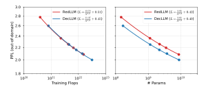

Figure 10: Fitted scaling law on out-of-domain dataset (Paloma). The scaling behavior is consistent with the in-domain evaluation.

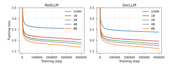

Figure 11: Pretraining loss curve. Note the loss is not directly comparable between RedLLM and DecLLM due to their difference in pretraining objective.

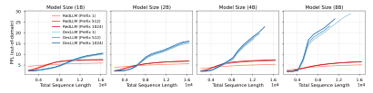

Figure 12: PPL curves for length extrapolation on out-of-domain dataset (Paloma). The extrapolation result is consistent with the in-domain evaluation.

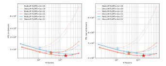

Figure 13: IsoFLOP slices of RedLLM and DecLLM with three different compute budget.  $\star$  indicates the compute-optimal configuration for each compute budget. Note RedLLM curves are plotted in blue.

|             | Setup     |                              | 150M                    | 1B                      | 2B                      | 4B                      | 8B                      |
|-------------|-----------|------------------------------|-------------------------|-------------------------|-------------------------|-------------------------|-------------------------|
| Pretraining | Zero-Shot | RedLLM DecLLM             | 18.11 21.14          | 18.82 24.39          | 19.38 26.29          | 19.39 28.12          | 20.04 31.13          |
|             | Few-Shot  | RedLLM DecLLM             | 26.51 26.21          | 27.84 32.79          | 30.88 35.33          | 30.01 38.79          | 35.13 43.37          |
| Finetuning  | Zero-Shot | RedLLM DecLLM + BiAttn | 31.23 29.97 33.73 | 48.55 43.70 50.12 | 50.19 53.84 56.15 | 55.61 54.63 58.07 | 59.69 58.26 63.03 |
|             | Few-Shot  | RedLLM DecLLM + BiAttn | 31.24 30.14 31.50 | 47.32 41.58 48.13 | 51.30 51.82 56.52 | 56.37 57.22 55.95 | 61.32 59.02 62.54 |

Table 2: Results for zero- and few-shot downstream performance. "+ BiAttn": DecLLM with bidirectional input attention enabled.

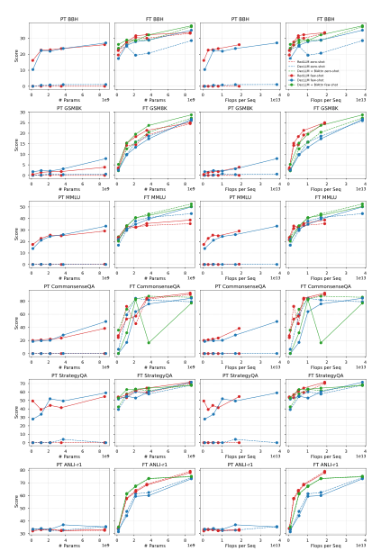

Figure 14: Zero- and few-shot downstream performance per task. "PT": pretraining; "FT": finetuning.

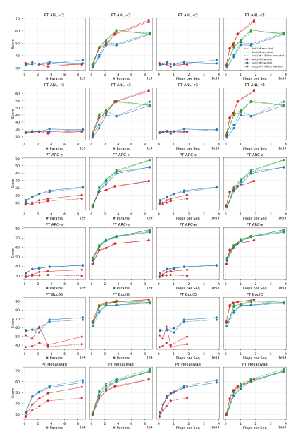

Figure 15: Zero- and few-shot downstream performance per task. "PT": pretraining; "FT": finetuning.

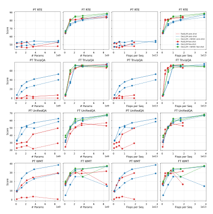

Figure 16: Zero- and few-shot downstream performance per task. "PT": pretraining; "FT": finetuning.