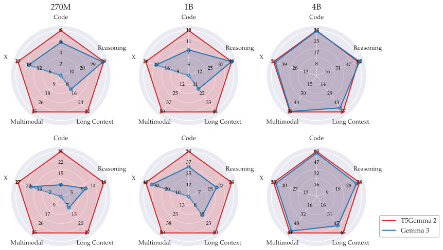
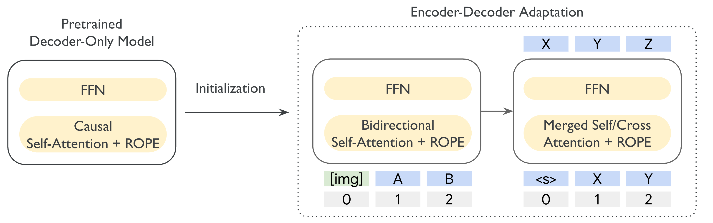

**Source:** *T5Gemma 2: Seeing, Reading, and Understanding Longer* — [PDF](https://arxiv.org/pdf/2512.14856v2) · [arXiv](https://arxiv.org/abs/2512.14856v2)

\uselogo

# T5Gemma 2: Seeing, Reading, and Understanding Longer

Biao Zhang  Affiliation: \thepa Paul Suganthan  Affiliation: \thepa Gaël Liu  Affiliation: \thepa Ilya Philippov  Affiliation: \thepa Sahil Dua  Affiliation: \thepa Ben Hora  Affiliation: \thepa Kat Black  Affiliation: \thepa Gus Martins  Affiliation: \thepa Omar Sanseviero  Affiliation: \thepa Shreya Pathak  Affiliation: \thepa Cassidy Hardin  Affiliation: \thepa Francesco Visin  Affiliation: \thepa Jiageng Zhang  Affiliation: \thepa Kathleen Kenealy  Affiliation: \thepa Qin Yin  Affiliation: \thepa Xiaodan Song  Affiliation: \thepa Olivier Lacombe  Affiliation: \thepa Armand Joulin  Affiliation: \thepa Tris Warkentin  Affiliation: \thepa Adam Roberts  Corresponding author: biaojiaxing@google.com. Note, ∗ Core contributors. † Project Advisor.  Affiliation: \thepa

###### Abstract

We introduce T5Gemma 2, the next generation of the T5Gemma family of lightweight open encoder-decoder models, featuring strong multilingual, multimodal and long-context capabilities. T5Gemma 2 follows the adaptation recipe (via UL2) in T5Gemma – adapting a pretrained decoder-only model into an encoder-decoder model, and extends it from text-only regime to multimodal based on the Gemma 3 models. We further propose two methods to improve the efficiency: tied word embedding that shares all embeddings across encoder and decoder, and merged attention that unifies decoder self- and cross-attention into a single joint module. Experiments demonstrate the generality of the adaptation strategy over architectures and modalities as well as the unique strength of the encoder-decoder architecture on long context modeling. Similar to T5Gemma, T5Gemma 2 yields comparable or better pretraining performance and significantly improved post-training performance than its Gemma 3 counterpart. We release the pretrained models (270M-270M, 1B-1B and 4B-4B) to the community for future research.

 Figure 1:  Summary of pretraining (top) and post-training (bottom) performance for Gemma 3 and T5Gemma 2 at 270M, 1B and 4B over five capabilities. 270M for T5Gemma 2 means a 270M encoder with a 270M decoder (the same applies to 1B and 4B). X: multilingual. Note the post-training result for T5Gemma 2 is for illustration, where we only performed slight supervised finetuning without RL.

## 1 Introduction

The ability of jointly reading and perceiving under sufficient context has become essential in large language models (LLMs) for acquiring general world knowledge and advanced intelligence, as well as for many real-world applications, regardless of model architectures ([Comanici et al., 2025](https://arxiv.org/html/2512.14856v2#bib.bib6); [Achiam et al., 2023](https://arxiv.org/html/2512.14856v2#bib.bib7); [Anthropic, 2024](https://arxiv.org/html/2512.14856v2#bib.bib8)). In recent years, the encoder-decoder architecture has regained increasing interests in LLMs for its competitive scaling properties and flexible architectures ([Zhang et al., 2022](https://arxiv.org/html/2512.14856v2#bib.bib11); [Zhang et al., 2025a](https://arxiv.org/html/2512.14856v2#bib.bib5)) and promising pre-/post-training performance ([Xue et al., 2021](https://arxiv.org/html/2512.14856v2#bib.bib64); [Xue et al., 2022](https://arxiv.org/html/2512.14856v2#bib.bib63); [Ao et al., 2022](https://arxiv.org/html/2512.14856v2#bib.bib65); [Tay et al., 2022](https://arxiv.org/html/2512.14856v2#bib.bib3); [Wang et al., 2022](https://arxiv.org/html/2512.14856v2#bib.bib14); [Li et al., 2023](https://arxiv.org/html/2512.14856v2#bib.bib15); [Raffel et al., 2020](https://arxiv.org/html/2512.14856v2#bib.bib12); [Elfeki et al., 2025](https://arxiv.org/html/2512.14856v2#bib.bib16)). Particularly, T5Gemma establishes modern, general-purpose encoder-decoder LLMs with non-trivial performance across benchmarks ([Zhang et al., 2025b](https://arxiv.org/html/2512.14856v2#bib.bib1)). Still, the vast majority of these models (if not all) are blind, operating exclusively on text-based data with limited context length – a substantial gap compared to the advanced decoder-only LLMs ([Xu et al., 2025](https://arxiv.org/html/2512.14856v2#bib.bib9); [Team et al., 2025b](https://arxiv.org/html/2512.14856v2#bib.bib10); [Team et al., 2025a](https://arxiv.org/html/2512.14856v2#bib.bib2)).

 Figure 2:  Overview of T5Gemma 2. Encoder/decoder parameters are initialized from the pretrained decoder-only model, and then pretrained with UL2. We tie all word embeddings (in blue) and merge decoder self- and cross-attention sub-layers. Image is preprocessed by SigLIP into 256 embedding tokens and fed to the encoder for vision understanding (see [img] for illustration).

In this paper, we fill this gap and present T5Gemma 2, a new family of lightweight open encoder-decoder LLMs with strong multilingual, multimodal and long-context capabilities. T5Gemma 2 follows the adaptation recipe from T5Gemma ([Zhang et al., 2025b](https://arxiv.org/html/2512.14856v2#bib.bib1)): initializing model parameters from a pretrained decoder-only checkpoint and then adapting them with the UL2 objective as in Figure [2](https://arxiv.org/html/2512.14856v2#S1.F2 "Figure 2 ‣ 1 Introduction ‣ T5Gemma 2: Seeing, Reading, and Understanding Longer"). We further extend the recipe from the text-only realm to multimodal and long-context based on the powerful Gemma 3 models ([Team et al., 2025a](https://arxiv.org/html/2512.14856v2#bib.bib2)). For vision modeling, T5Gemma 2 reuses the same vision encoder from Gemma 3 and keeps it frozen; vision tokens are always fed to the encoder and all encoder tokens always have full visibility to each other in the self attention. For long-context modeling, we adopt the positional interpolation methods ([Chen et al., 2023](https://arxiv.org/html/2512.14856v2#bib.bib62); [Team et al., 2025a](https://arxiv.org/html/2512.14856v2#bib.bib2)). We also propose two strategies to save model parameters and improve the efficiency: 1) tying all word embeddings across encoder and decoder; and 2) merging the decoder self- and cross-attention into a single unified merged attention.

T5Gemma 2 features three model sizes: 270M-270M, 1B-1B, and 4B-4B. We pretrain each model on \(\sim\)2T tokens with an input/output sequence length up to 16K, and perform evaluation following Gemma 3. As in Figure [1](https://arxiv.org/html/2512.14856v2#S0.F1 "Figure 1 ‣ T5Gemma 2: Seeing, Reading, and Understanding Longer"), the resulting T5Gemma 2 model shows competitive performance across different capabilities, matching and even surpassing its Gemma 3 counterpart in both pre- and post-training. Particularly, T5Gemma 2 270M-270M and 1B-1B yield encouraging multimodal performance even though their Gemma 3 base models are text-only, resonating with PaliGemma ([Steiner et al., 2024](https://arxiv.org/html/2512.14856v2#bib.bib17)). Besides, T5Gemma 2 delivers consistently improved long-context performance (up to 128K) despite of being pretrained on shorter sequences (only 16K), suggesting the special advantage of the encoder-decoder architecture on handling long context ([Zhang et al., 2025a](https://arxiv.org/html/2512.14856v2#bib.bib5)). We present the detailed results and also provide ablations justifying our architectural designs.

Setting | Performance | #Parameters  
---|---|---  
Baseline | 47.8 | 4417M (1180M)  
w/ Tied Embedding | 47.7 | 4417M (590M)  
w/ Merged Attention | 47.5 | 4049M (1180M)  
w/ Cross Attention on Global Layers Only | 46.5 | 4233M (1180M)

 Table 1:  Architectural ablations for T5Gemma 2B-2B based on Gemma 2 2B. All models are pretrained on 400B tokens with PrefixLM+KD data. The performance is measured following the T5Gemma pretraining evaluation ([Zhang et al., 2025b](https://arxiv.org/html/2512.14856v2#bib.bib1)); #Parameters indicates the number of model (embedding) parameters.

## 2 T5Gemma 2

T5Gemma 2 is a Transformer-based encoder-decoder LLM ([Vaswani et al., 2017](https://arxiv.org/html/2512.14856v2#bib.bib13)). Its basic building block follows Gemma 3: grouped-query attention ([Ainslie et al., 2023](https://arxiv.org/html/2512.14856v2#bib.bib18)) with QK-norm ([Dehghani et al., 2023](https://arxiv.org/html/2512.14856v2#bib.bib20)), pre- and post-norm with RMSNorm ([Zhang and Sennrich, 2019](https://arxiv.org/html/2512.14856v2#bib.bib4)), RoPE for positional encoding ([Su et al., 2024](https://arxiv.org/html/2512.14856v2#bib.bib21)), and interleaved local and global attention layers with a ratio of 5:1. To improve long-context modeling, we set the RoPE base frequency to 10k and 1M for local and global attention layers, respectively ([Team et al., 2025a](https://arxiv.org/html/2512.14856v2#bib.bib2)). The 400M SigLIP encoder is adopted as the vision encoder ([Zhai et al., 2023](https://arxiv.org/html/2512.14856v2#bib.bib19)), which transforms an image to 256 embedding tokens and is frozen during the training.

#### Tied Embedding

T5Gemma uses separate word embeddings for the encoder and the decoder, which add a significant amount of model parameters particularly for small models. In T5Gemma 2, we instead tie all word embeddings (encoder input embedding, decoder input embedding and decoder output/softmax embedding) following T5 ([Raffel et al., 2020](https://arxiv.org/html/2512.14856v2#bib.bib12); [Press and Wolf, 2017](https://arxiv.org/html/2512.14856v2#bib.bib68)). Table [1](https://arxiv.org/html/2512.14856v2#S1.T1 "Table 1 ‣ 1 Introduction ‣ T5Gemma 2: Seeing, Reading, and Understanding Longer") shows that tying embeddings leads to nearly no quality change but reduces the parameters by 10.5%, suggesting the high redundancy of embedding parameters.

#### Merged Attention

In the encoder-decoder architecture, cross-attention is often represented as a separated sub-layer in the decoder block, inserted in between the self-attention and feed-forward sub-layers. However, the functionality of the self- and cross-attention shares high similarity: gathering relevant information from the past. Inspired by previous studies ([Zhang et al., 2019](https://arxiv.org/html/2512.14856v2#bib.bib22); [Fu et al., 2023](https://arxiv.org/html/2512.14856v2#bib.bib23); [Chowdhery et al., 2023](https://arxiv.org/html/2512.14856v2#bib.bib24)), we merge these two types of attentions into a single module with shared attention parameters.

Concretely, given the encoder output \(\mathbf{H}\in\mathbb{R}^{n\times d}\) and the decoder self-attention input \(\mathbf{X}\in\mathbb{R}^{m\times d}\), the merged attention operates as below:

\[\begin{aligned}
 & \displaystyle\mathbf{Q}\in\mathbb{R}^{m\times d_{h}}=\mathbf{X}\mathbf{W}_{q} &  & \text{(1)} \\
 & \displaystyle\mathbf{K}\in\mathbb{R}^{(m+n)\times d_{h}}=\left[\mathbf{X};\mathbf{H}\right]\mathbf{W}_{k} &  & \text{(2)} \\
 & \displaystyle\mathbf{V}\in\mathbb{R}^{(m+n)\times d_{h}}=\left[\mathbf{X};\mathbf{H}\right]\mathbf{W}_{v} &  & \text{(3)} \\
 & \displaystyle\mathbf{A}\in\mathbb{R}^{m\times d_{h}}=\text{SoftMax}\left(\frac{\mathbf{Q}\mathbf{K}^{T}}{\sqrt{d_{h}}}\odot\mathbf{M}\right)\mathbf{V} &  & \text{(4)} \\
 & \displaystyle\mathbf{O}\in\mathbb{R}^{m\times d}=\mathbf{A}\mathbf{W}_{o} &  & \text{(5)}
\end{aligned}\]

 

where \(n\)/\(m\) represents the encoder/decoder input length and \(d\)/\(d_{h}\) is model/head dimension. For simplicity, we only describe the single head case. \(\mathbf{W}_{q},\mathbf{W}_{k},\mathbf{W}_{v}\in\mathbb{R}^{d\times d_{h}}\) and \(\mathbf{W}_{o}\in\mathbb{R}^{d_{h}\times d}\) are regular attention weight parameters. We concatenate the encoder output and decoder input \(\left[\mathbf{X};\mathbf{H}\right]\) such that both types of attention can be performed together. Note attention logits are also normalized jointly, similar to the decoder-only models. The masking \(\mathbf{M}\in\mathbb{R}^{m\times(m+n)}\) handles the visibility to tokens from both encoder and decoder.

Merged attention narrows the architectural differences between the T5Gemma 2 decoder and the Gemma 3 decoder (see Figure [2](https://arxiv.org/html/2512.14856v2#S1.F2 "Figure 2 ‣ 1 Introduction ‣ T5Gemma 2: Seeing, Reading, and Understanding Longer")), which eases the parameter initialization. Similarly, the encoder and decoder in T5Gemma 2 have roughly the same model parameters (see Table [2](https://arxiv.org/html/2512.14856v2#S2.T2 "Table 2 ‣ Rejected Ablation: Cross-Attention on Global Layers Only ‣ 2 T5Gemma 2 ‣ T5Gemma 2: Seeing, Reading, and Understanding Longer")). Ablations in Table [1](https://arxiv.org/html/2512.14856v2#S1.T1 "Table 1 ‣ 1 Introduction ‣ T5Gemma 2: Seeing, Reading, and Understanding Longer") show that merged attention saves 6.5% parameters and results in slight quality reduction11 1 Note the parameter reduction (6.5%) is based on the total parameters, i.e, both model and embedding parameters., \(\sim\)0.3 points on average, which we consider as an acceptable trade-off.

#### Rejected Ablation: Cross-Attention on Global Layers Only

By default, T5Gemma applies cross-attention to all decoder layers following the standard encoder-decoder architecture ([Vaswani et al., 2017](https://arxiv.org/html/2512.14856v2#bib.bib13)). However, this adds non-ignorable computational cost particularly considering the autoregressive inference bottleneck and its global-attention structure. We thus explored a variant where we only apply it to decoder layers with global self-attention sub-layers, i.e. adding one cross-attention sub-layer every six decoder layers. Unfortunately, the experiments show a substantial quality drop by \(\sim\)1.3 points on average (see Table [1](https://arxiv.org/html/2512.14856v2#S1.T1 "Table 1 ‣ 1 Introduction ‣ T5Gemma 2: Seeing, Reading, and Understanding Longer")). We consider this direction as reasonable but will need more efforts to retain the performance.

<table id="S2.T2.2" class="ltx_tabular ltx_centering ltx_guessed_headers ltx_align_middle">
<thead class="ltx_thead">
<tr id="S2.T2.2.1" class="ltx_tr">
<th id="S2.T2.2.1.1" class="ltx_td ltx_align_left ltx_th ltx_th_column ltx_border_tt" rowspan="2">Model</th>
<th id="S2.T2.2.1.2" class="ltx_td ltx_align_right ltx_th ltx_th_column ltx_border_tt" rowspan="2">Vision Encoder</th>
<th id="S2.T2.2.1.3" class="ltx_td ltx_align_right ltx_th ltx_th_column ltx_border_tt" rowspan="2">Embedding</th>
<th id="S2.T2.2.1.4" class="ltx_td ltx_align_center ltx_th ltx_th_column ltx_border_tt" colspan="2">Non-Embedding</th></tr>
<tr id="S2.T2.2.2" class="ltx_tr">
<th id="S2.T2.2.2.1" class="ltx_td ltx_align_right ltx_th ltx_th_column ltx_border_t">Encoder</th>
<th id="S2.T2.2.2.2" class="ltx_td ltx_align_right ltx_th ltx_th_column ltx_border_t">Decoder</th></tr>
</thead>
<tbody class="ltx_tbody">
<tr id="S2.T2.2.3" class="ltx_tr">
<td id="S2.T2.2.3.1" class="ltx_td ltx_align_left ltx_border_t">270M-270M</td>
<td id="S2.T2.2.3.2" class="ltx_td ltx_align_right ltx_border_t">417M</td>
<td id="S2.T2.2.3.3" class="ltx_td ltx_align_right ltx_border_t">168M</td>
<td id="S2.T2.2.3.4" class="ltx_td ltx_align_right ltx_border_t">100M</td>
<td id="S2.T2.2.3.5" class="ltx_td ltx_align_right ltx_border_t">100M</td></tr>
<tr id="S2.T2.2.4" class="ltx_tr">
<td id="S2.T2.2.4.1" class="ltx_td ltx_align_left">1B-1B</td>
<td id="S2.T2.2.4.2" class="ltx_td ltx_align_right">417M</td>
<td id="S2.T2.2.4.3" class="ltx_td ltx_align_right">302M</td>
<td id="S2.T2.2.4.4" class="ltx_td ltx_align_right">698M</td>
<td id="S2.T2.2.4.5" class="ltx_td ltx_align_right">698M</td></tr>
<tr id="S2.T2.2.5" class="ltx_tr">
<td id="S2.T2.2.5.1" class="ltx_td ltx_align_left ltx_border_bb">4B-4B</td>
<td id="S2.T2.2.5.2" class="ltx_td ltx_align_right ltx_border_bb">417M</td>
<td id="S2.T2.2.5.3" class="ltx_td ltx_align_right ltx_border_bb">675M</td>
<td id="S2.T2.2.5.4" class="ltx_td ltx_align_right ltx_border_bb">3209M</td>
<td id="S2.T2.2.5.5" class="ltx_td ltx_align_right ltx_border_bb">3209M</td></tr>
</tbody>
</table>

 Table 2:  Number of parameters for T5Gemma 2 models.

## 3 Setup

### 3.1 Pretraining

#### Data

Our pretraining data follows Gemma 3, which is a mixture of multilingual web documents, code, mathematical corpus and images ([Team et al., 2025a](https://arxiv.org/html/2512.14856v2#bib.bib2)). We preprocess the data with UL2 ([Tay et al., 2022](https://arxiv.org/html/2512.14856v2#bib.bib3)) into \(\leq\)16K input sequences paired with \(\leq\)16K target outputs. Specifically, for text data, we apply the following five denoising tasks: \((\mu=3,r=0.15,n),(\mu=12,r=0.5,n),(\mu=32,r=0.15,n),(\mu=32,r=0.5,n)\) and \((\mu=\frac{3}{4}L,r=0.75,1)\) with a mixing ratio of 1:1:1:1:4, where \(\mu\) is the mean span length, \(r\) is the corruption rate, \(n\) is the number of corrupted spans, and \(L\) is the input sequence length. We refer the readers to [Tay et al. (2022)](https://arxiv.org/html/2512.14856v2#bib.bib3) for more details. For vision data, we only use prefix language modeling: all input tokens until the end of the final image are used as prefix, and the remaining text tokens are used as targets. Note, distillation is not used. The final pretraining data includes \(\sim\)2T tokens.

#### Optimization

We initialize T5Gemma 2 parameters from the corresponding Gemma 3 pretraining checkpoint. All models are trained with a batch size of 4.2M tokens, and with the standard cross-entropy loss. Learning rate follows cosine decay with a warmup step of 100. To stabilize the training, we apply global gradient clipping at 1.0 and weight decay. We perform a simple grid search to decide the optimal learning rate for each model. The final pretraining checkpoint is created by averaging over the last 5 checkpoints (saved with an interval of 10K steps) [Wortsman et al. (2022)](https://arxiv.org/html/2512.14856v2#bib.bib66).

<table id="S3.T3.2" class="ltx_tabular ltx_centering ltx_guessed_headers ltx_align_middle">
<thead class="ltx_thead">
<tr id="S3.T3.2.1" class="ltx_tr">
<th id="S3.T3.2.1.1" class="ltx_td ltx_align_left ltx_th ltx_th_column ltx_border_tt">Model</th>
<th id="S3.T3.2.1.2" class="ltx_td ltx_align_left ltx_th ltx_th_column ltx_border_tt">Setting</th>
<th id="S3.T3.2.1.3" class="ltx_td ltx_align_right ltx_th ltx_th_column ltx_border_tt">Pretraining Performance</th></tr>
</thead>
<tbody class="ltx_tbody">
<tr id="S3.T3.2.2" class="ltx_tr">
<td id="S3.T3.2.2.1" class="ltx_td ltx_align_left ltx_border_t" rowspan="3">T5Gemma 2 270M-270M</td>
<td id="S3.T3.2.2.2" class="ltx_td ltx_align_left ltx_border_t">PrefixLM + KD</td>
<td id="S3.T3.2.2.3" class="ltx_td ltx_align_right ltx_border_t">30.1</td></tr>
<tr id="S3.T3.2.3" class="ltx_tr">
<td id="S3.T3.2.3.1" class="ltx_td ltx_align_left">UL2 + KD</td>
<td id="S3.T3.2.3.2" class="ltx_td ltx_align_right">30.5</td></tr>
<tr id="S3.T3.2.4" class="ltx_tr">
<td id="S3.T3.2.4.1" class="ltx_td ltx_align_left">UL2</td>
<td id="S3.T3.2.4.2" class="ltx_td ltx_align_right">30.6</td></tr>
<tr id="S3.T3.2.5" class="ltx_tr">
<td id="S3.T3.2.5.1" class="ltx_td ltx_align_left ltx_border_bb ltx_border_t" rowspan="3">T5Gemma 2 1B-1B</td>
<td id="S3.T3.2.5.2" class="ltx_td ltx_align_left ltx_border_t">PrefixLM + KD</td>
<td id="S3.T3.2.5.3" class="ltx_td ltx_align_right ltx_border_t">38.8</td></tr>
<tr id="S3.T3.2.6" class="ltx_tr">
<td id="S3.T3.2.6.1" class="ltx_td ltx_align_left">UL2 + KD</td>
<td id="S3.T3.2.6.2" class="ltx_td ltx_align_right">40.2</td></tr>
<tr id="S3.T3.2.7" class="ltx_tr">
<td id="S3.T3.2.7.1" class="ltx_td ltx_align_left ltx_border_bb">UL2</td>
<td id="S3.T3.2.7.2" class="ltx_td ltx_align_right ltx_border_bb">39.8</td></tr>
</tbody>
</table>

 Table 3:  Data ablations for T5Gemma 2. Note the pretraining performance is measured following T5Gemma ([Zhang et al., 2025b](https://arxiv.org/html/2512.14856v2#bib.bib1)), similar to Table [1](https://arxiv.org/html/2512.14856v2#S1.T1 "Table 1 ‣ 1 Introduction ‣ T5Gemma 2: Seeing, Reading, and Understanding Longer"). UL2 and UL2+KD deliver comparable performance, which generally surpasses PrefixLM+KD.

### 3.2 Post-training

We also perform slight instruction tuning to showcase the strengths of encoder-decoder LLMs on downstream finetuning. Different from Gemma 3 post-training which includes distillation from stronger teacher and RL finetuning ([Team et al., 2025a](https://arxiv.org/html/2512.14856v2#bib.bib2)), we only apply distillation learning and train models with much less compute. Note the post-training performance in this paper should be considered as the lowerbound.

### 3.3 Evaluation

We evaluate the models following Gemma 3 ([Team et al., 2025a](https://arxiv.org/html/2512.14856v2#bib.bib2)). Benchmarks include:

Reasoning and factuality:
    

HellaSwag ([Zellers et al., 2019](https://arxiv.org/html/2512.14856v2#bib.bib40)), BoolQ ([Clark et al., 2019](https://arxiv.org/html/2512.14856v2#bib.bib32)), PIQA ([Bisk et al., 2020](https://arxiv.org/html/2512.14856v2#bib.bib42)), SIQA ([Sap et al., 2019](https://arxiv.org/html/2512.14856v2#bib.bib31)), TriviaQA ([Joshi et al., 2017](https://arxiv.org/html/2512.14856v2#bib.bib41)), Natural Questions ([Kwiatkowski et al., 2019](https://arxiv.org/html/2512.14856v2#bib.bib33)), ARC-C and ARC-E ([Clark et al., 2018](https://arxiv.org/html/2512.14856v2#bib.bib30)), WinoGrande ([Sakaguchi et al., 2021](https://arxiv.org/html/2512.14856v2#bib.bib29)), BBH ([Suzgun et al., 2022](https://arxiv.org/html/2512.14856v2#bib.bib27)), DROP ([Dua et al., 2019](https://arxiv.org/html/2512.14856v2#bib.bib38)), and BIG-Bench Extra Hard ([Kazemi et al., 2025](https://arxiv.org/html/2512.14856v2#bib.bib60)).

Stem and code:
    

MMLU-Pro ([Wang et al., 2024](https://arxiv.org/html/2512.14856v2#bib.bib26)), AGIEval ([Zhong et al., 2023](https://arxiv.org/html/2512.14856v2#bib.bib39)), MATH ([Hendrycks et al., 2021](https://arxiv.org/html/2512.14856v2#bib.bib25)), GSM8K ([Cobbe et al., 2021](https://arxiv.org/html/2512.14856v2#bib.bib28)), GPQA ([Rein et al., 2023](https://arxiv.org/html/2512.14856v2#bib.bib37)), MBPP ([Austin et al., 2021](https://arxiv.org/html/2512.14856v2#bib.bib34)), and HumanEval ([Chen et al., 2021](https://arxiv.org/html/2512.14856v2#bib.bib36)).

Multilingual:
    

MGSM ([Shi et al., 2022](https://arxiv.org/html/2512.14856v2#bib.bib35)), Global-MMLU-Lite ([Singh et al., 2024](https://arxiv.org/html/2512.14856v2#bib.bib54)), WMT24++ ([Deutsch et al., 2025](https://arxiv.org/html/2512.14856v2#bib.bib55)), FLoRes ([Goyal et al., 2022](https://arxiv.org/html/2512.14856v2#bib.bib56)), and XQuAD ([Artetxe et al., 2019](https://arxiv.org/html/2512.14856v2#bib.bib57)).

Multimodal:
    

COCO Caption ([Chen et al., 2015](https://arxiv.org/html/2512.14856v2#bib.bib43)), DocVQA ([Mathew et al., 2021](https://arxiv.org/html/2512.14856v2#bib.bib44)), InfographicVQA ([Mathew et al., 2022](https://arxiv.org/html/2512.14856v2#bib.bib45)), MMMU ([Yue et al., 2024](https://arxiv.org/html/2512.14856v2#bib.bib46)), TextVQA ([Singh et al., 2019](https://arxiv.org/html/2512.14856v2#bib.bib47)), RealWorldQA ([xAI, 2024](https://arxiv.org/html/2512.14856v2#bib.bib48)), AI2D ([Kembhavi et al., 2016](https://arxiv.org/html/2512.14856v2#bib.bib49)), ChartQA ([Masry et al., 2022](https://arxiv.org/html/2512.14856v2#bib.bib50)), VQA v2 ([Goyal et al., 2017](https://arxiv.org/html/2512.14856v2#bib.bib51)), TallyQA ([Acharya et al., 2019](https://arxiv.org/html/2512.14856v2#bib.bib52)), and SpatialSense VQA ([Yang et al., 2019](https://arxiv.org/html/2512.14856v2#bib.bib53)).

Long Context:
    

RULER ([Hsieh et al., 2024](https://arxiv.org/html/2512.14856v2#bib.bib58)) and MRCR ([Vodrahalli et al., 2024](https://arxiv.org/html/2512.14856v2#bib.bib59)).

## 4 Results

<table id="S4.T4.2" class="ltx_tabular ltx_centering ltx_guessed_headers ltx_align_middle">
<tbody class="ltx_tbody">
<tr id="S4.T4.2.1" class="ltx_tr">
<th id="S4.T4.2.1.1" class="ltx_td ltx_th ltx_th_row ltx_border_tt"></th>
<th id="S4.T4.2.1.2" class="ltx_td ltx_align_left ltx_th ltx_th_row ltx_border_tt" rowspan="2">Benchmark</th>
<td id="S4.T4.2.1.3" class="ltx_td ltx_align_center ltx_border_tt" colspan="3">Gemma 3</td>
<td id="S4.T4.2.1.4" class="ltx_td ltx_align_center ltx_border_tt" colspan="2">T5Gemma</td>
<td id="S4.T4.2.1.5" class="ltx_td ltx_align_center ltx_border_tt" colspan="3">T5Gemma 2</td></tr>
<tr id="S4.T4.2.2" class="ltx_tr">
<th id="S4.T4.2.2.1" class="ltx_td ltx_th ltx_th_row"></th>
<td id="S4.T4.2.2.2" class="ltx_td ltx_align_right ltx_border_t">270M</td>
<td id="S4.T4.2.2.3" class="ltx_td ltx_align_right ltx_border_t">1B</td>
<td id="S4.T4.2.2.4" class="ltx_td ltx_align_right ltx_border_t">4B</td>
<td id="S4.T4.2.2.5" class="ltx_td ltx_align_right ltx_border_t">2B-2B</td>
<td id="S4.T4.2.2.6" class="ltx_td ltx_align_right ltx_border_t">9B-9B</td>
<td id="S4.T4.2.2.7" class="ltx_td ltx_align_right ltx_border_t">270M-270M</td>
<td id="S4.T4.2.2.8" class="ltx_td ltx_align_right ltx_border_t">1B-1B</td>
<td id="S4.T4.2.2.9" class="ltx_td ltx_align_right ltx_border_t">4B-4B</td></tr>
<tr id="S4.T4.2.3" class="ltx_tr">
<th id="S4.T4.2.3.1" class="ltx_td ltx_align_left ltx_th ltx_th_row ltx_border_t" rowspan="12">

Reasoning and Factuality
</th>
<th id="S4.T4.2.3.2" class="ltx_td ltx_align_left ltx_th ltx_th_row ltx_border_t">HellaSwag</th>
<td id="S4.T4.2.3.3" class="ltx_td ltx_align_right ltx_border_t">39.4</td>
<td id="S4.T4.2.3.4" class="ltx_td ltx_align_right ltx_border_t">60.4</td>
<td id="S4.T4.2.3.5" class="ltx_td ltx_align_right ltx_border_t">74.9</td>
<td id="S4.T4.2.3.6" class="ltx_td ltx_align_right ltx_border_t">74.8</td>
<td id="S4.T4.2.3.7" class="ltx_td ltx_align_right ltx_border_t">80.9</td>
<td id="S4.T4.2.3.8" class="ltx_td ltx_align_right ltx_border_t">41.1</td>
<td id="S4.T4.2.3.9" class="ltx_td ltx_align_right ltx_border_t">62.9</td>
<td id="S4.T4.2.3.10" class="ltx_td ltx_align_right ltx_border_t">77.4</td></tr>
<tr id="S4.T4.2.4" class="ltx_tr">
<th id="S4.T4.2.4.1" class="ltx_td ltx_align_left ltx_th ltx_th_row">BoolQ</th>
<td id="S4.T4.2.4.2" class="ltx_td ltx_align_right">60.5</td>
<td id="S4.T4.2.4.3" class="ltx_td ltx_align_right">66.1</td>
<td id="S4.T4.2.4.4" class="ltx_td ltx_align_right">79.1</td>
<td id="S4.T4.2.4.5" class="ltx_td ltx_align_right">75.5</td>
<td id="S4.T4.2.4.6" class="ltx_td ltx_align_right">85.7</td>
<td id="S4.T4.2.4.7" class="ltx_td ltx_align_right">57.4</td>
<td id="S4.T4.2.4.8" class="ltx_td ltx_align_right">68.5</td>
<td id="S4.T4.2.4.9" class="ltx_td ltx_align_right">79.3</td></tr>
<tr id="S4.T4.2.5" class="ltx_tr">
<th id="S4.T4.2.5.1" class="ltx_td ltx_align_left ltx_th ltx_th_row">PIQA</th>
<td id="S4.T4.2.5.2" class="ltx_td ltx_align_right">67.7</td>
<td id="S4.T4.2.5.3" class="ltx_td ltx_align_right">74.7</td>
<td id="S4.T4.2.5.4" class="ltx_td ltx_align_right">79.7</td>
<td id="S4.T4.2.5.5" class="ltx_td ltx_align_right">79.0</td>
<td id="S4.T4.2.5.6" class="ltx_td ltx_align_right">81.1</td>
<td id="S4.T4.2.5.7" class="ltx_td ltx_align_right">66.5</td>
<td id="S4.T4.2.5.8" class="ltx_td ltx_align_right">74.3</td>
<td id="S4.T4.2.5.9" class="ltx_td ltx_align_right">79.2</td></tr>
<tr id="S4.T4.2.6" class="ltx_tr">
<th id="S4.T4.2.6.1" class="ltx_td ltx_align_left ltx_th ltx_th_row">SocialIQA</th>
<td id="S4.T4.2.6.2" class="ltx_td ltx_align_right">45.0</td>
<td id="S4.T4.2.6.3" class="ltx_td ltx_align_right">46.9</td>
<td id="S4.T4.2.6.4" class="ltx_td ltx_align_right">49.0</td>
<td id="S4.T4.2.6.5" class="ltx_td ltx_align_right">49.8</td>
<td id="S4.T4.2.6.6" class="ltx_td ltx_align_right">50.1</td>
<td id="S4.T4.2.6.7" class="ltx_td ltx_align_right">46.1</td>
<td id="S4.T4.2.6.8" class="ltx_td ltx_align_right">47.7</td>
<td id="S4.T4.2.6.9" class="ltx_td ltx_align_right">49.9</td></tr>
<tr id="S4.T4.2.7" class="ltx_tr">
<th id="S4.T4.2.7.1" class="ltx_td ltx_align_left ltx_th ltx_th_row">TriviaQA</th>
<td id="S4.T4.2.7.2" class="ltx_td ltx_align_right">14.3</td>
<td id="S4.T4.2.7.3" class="ltx_td ltx_align_right">39.8</td>
<td id="S4.T4.2.7.4" class="ltx_td ltx_align_right">65.7</td>
<td id="S4.T4.2.7.5" class="ltx_td ltx_align_right">51.2</td>
<td id="S4.T4.2.7.6" class="ltx_td ltx_align_right">75.2</td>
<td id="S4.T4.2.7.7" class="ltx_td ltx_align_right">14.8</td>
<td id="S4.T4.2.7.8" class="ltx_td ltx_align_right">29.0</td>
<td id="S4.T4.2.7.9" class="ltx_td ltx_align_right">53.1</td></tr>
<tr id="S4.T4.2.8" class="ltx_tr">
<th id="S4.T4.2.8.1" class="ltx_td ltx_align_left ltx_th ltx_th_row">Natural Questions</th>
<td id="S4.T4.2.8.2" class="ltx_td ltx_align_right">2.8</td>
<td id="S4.T4.2.8.3" class="ltx_td ltx_align_right">9.6</td>
<td id="S4.T4.2.8.4" class="ltx_td ltx_align_right">20.2</td>
<td id="S4.T4.2.8.5" class="ltx_td ltx_align_right">15.1</td>
<td id="S4.T4.2.8.6" class="ltx_td ltx_align_right">28.6</td>
<td id="S4.T4.2.8.7" class="ltx_td ltx_align_right">3.0</td>
<td id="S4.T4.2.8.8" class="ltx_td ltx_align_right">8.9</td>
<td id="S4.T4.2.8.9" class="ltx_td ltx_align_right">17.2</td></tr>
<tr id="S4.T4.2.9" class="ltx_tr">
<th id="S4.T4.2.9.1" class="ltx_td ltx_align_left ltx_th ltx_th_row">ARC-c</th>
<td id="S4.T4.2.9.2" class="ltx_td ltx_align_right">28.2</td>
<td id="S4.T4.2.9.3" class="ltx_td ltx_align_right">39.4</td>
<td id="S4.T4.2.9.4" class="ltx_td ltx_align_right">56.3</td>
<td id="S4.T4.2.9.5" class="ltx_td ltx_align_right">52.4</td>
<td id="S4.T4.2.9.6" class="ltx_td ltx_align_right">65.6</td>
<td id="S4.T4.2.9.7" class="ltx_td ltx_align_right">27.9</td>
<td id="S4.T4.2.9.8" class="ltx_td ltx_align_right">41.0</td>
<td id="S4.T4.2.9.9" class="ltx_td ltx_align_right">56.1</td></tr>
<tr id="S4.T4.2.10" class="ltx_tr">
<th id="S4.T4.2.10.1" class="ltx_td ltx_align_left ltx_th ltx_th_row">ARC-e</th>
<td id="S4.T4.2.10.2" class="ltx_td ltx_align_right">56.1</td>
<td id="S4.T4.2.10.3" class="ltx_td ltx_align_right">72.2</td>
<td id="S4.T4.2.10.4" class="ltx_td ltx_align_right">81.9</td>
<td id="S4.T4.2.10.5" class="ltx_td ltx_align_right">77.1</td>
<td id="S4.T4.2.10.6" class="ltx_td ltx_align_right">85.4</td>
<td id="S4.T4.2.10.7" class="ltx_td ltx_align_right">57.9</td>
<td id="S4.T4.2.10.8" class="ltx_td ltx_align_right">67.7</td>
<td id="S4.T4.2.10.9" class="ltx_td ltx_align_right">74.3</td></tr>
<tr id="S4.T4.2.11" class="ltx_tr">
<th id="S4.T4.2.11.1" class="ltx_td ltx_align_left ltx_th ltx_th_row">WinoGrande</th>
<td id="S4.T4.2.11.2" class="ltx_td ltx_align_right">51.9</td>
<td id="S4.T4.2.11.3" class="ltx_td ltx_align_right">58.7</td>
<td id="S4.T4.2.11.4" class="ltx_td ltx_align_right">68.0</td>
<td id="S4.T4.2.11.5" class="ltx_td ltx_align_right">69.9</td>
<td id="S4.T4.2.11.6" class="ltx_td ltx_align_right">78.8</td>
<td id="S4.T4.2.11.7" class="ltx_td ltx_align_right">53.9</td>
<td id="S4.T4.2.11.8" class="ltx_td ltx_align_right">60.8</td>
<td id="S4.T4.2.11.9" class="ltx_td ltx_align_right">71.6</td></tr>
<tr id="S4.T4.2.12" class="ltx_tr">
<th id="S4.T4.2.12.1" class="ltx_td ltx_align_left ltx_th ltx_th_row">BIG-Bench Hard</th>
<td id="S4.T4.2.12.2" class="ltx_td ltx_align_right">23.6</td>
<td id="S4.T4.2.12.3" class="ltx_td ltx_align_right">28.3</td>
<td id="S4.T4.2.12.4" class="ltx_td ltx_align_right">50.9</td>
<td id="S4.T4.2.12.5" class="ltx_td ltx_align_right">54.8</td>
<td id="S4.T4.2.12.6" class="ltx_td ltx_align_right">74.4</td>
<td id="S4.T4.2.12.7" class="ltx_td ltx_align_right">22.9</td>
<td id="S4.T4.2.12.8" class="ltx_td ltx_align_right">28.5</td>
<td id="S4.T4.2.12.9" class="ltx_td ltx_align_right">43.7</td></tr>
<tr id="S4.T4.2.13" class="ltx_tr">
<th id="S4.T4.2.13.1" class="ltx_td ltx_align_left ltx_th ltx_th_row">DROP</th>
<td id="S4.T4.2.13.2" class="ltx_td ltx_align_right">30.9</td>
<td id="S4.T4.2.13.3" class="ltx_td ltx_align_right">42.4</td>
<td id="S4.T4.2.13.4" class="ltx_td ltx_align_right">60.3</td>
<td id="S4.T4.2.13.5" class="ltx_td ltx_align_right">61.3</td>
<td id="S4.T4.2.13.6" class="ltx_td ltx_align_right">75.6</td>
<td id="S4.T4.2.13.7" class="ltx_td ltx_align_right">39.4</td>
<td id="S4.T4.2.13.8" class="ltx_td ltx_align_right">51.2</td>
<td id="S4.T4.2.13.9" class="ltx_td ltx_align_right">66.7</td></tr>
<tr id="S4.T4.2.14" class="ltx_tr">
<th id="S4.T4.2.14.1" class="ltx_td ltx_align_left ltx_th ltx_th_row">Average</th>
<td id="S4.T4.2.14.2" class="ltx_td ltx_align_right">38.2</td>
<td id="S4.T4.2.14.3" class="ltx_td ltx_align_right">49.0</td>
<td id="S4.T4.2.14.4" class="ltx_td ltx_align_right">62.4</td>
<td id="S4.T4.2.14.5" class="ltx_td ltx_align_right">60.1</td>
<td id="S4.T4.2.14.6" class="ltx_td ltx_align_right">71.0</td>
<td id="S4.T4.2.14.7" class="ltx_td ltx_align_right">39.2</td>
<td id="S4.T4.2.14.8" class="ltx_td ltx_align_right">49.1</td>
<td id="S4.T4.2.14.9" class="ltx_td ltx_align_right">60.8</td></tr>
<tr id="S4.T4.2.15" class="ltx_tr">
<th id="S4.T4.2.15.1" class="ltx_td ltx_align_left ltx_th ltx_th_row ltx_border_t" rowspan="8">

Stem and Code
</th>
<th id="S4.T4.2.15.2" class="ltx_td ltx_align_left ltx_th ltx_th_row ltx_border_t">MMLU (Pro COT)</th>
<td id="S4.T4.2.15.3" class="ltx_td ltx_align_right ltx_border_t">7.7</td>
<td id="S4.T4.2.15.4" class="ltx_td ltx_align_right ltx_border_t">9.8</td>
<td id="S4.T4.2.15.5" class="ltx_td ltx_align_right ltx_border_t">28.9</td>
<td id="S4.T4.2.15.6" class="ltx_td ltx_align_right ltx_border_t">30.7</td>
<td id="S4.T4.2.15.7" class="ltx_td ltx_align_right ltx_border_t">47.9</td>
<td id="S4.T4.2.15.8" class="ltx_td ltx_align_right ltx_border_t">10.6</td>
<td id="S4.T4.2.15.9" class="ltx_td ltx_align_right ltx_border_t">16.1</td>
<td id="S4.T4.2.15.10" class="ltx_td ltx_align_right ltx_border_t">33.2</td></tr>
<tr id="S4.T4.2.16" class="ltx_tr">
<th id="S4.T4.2.16.1" class="ltx_td ltx_align_left ltx_th ltx_th_row">AGIEval</th>
<td id="S4.T4.2.16.2" class="ltx_td ltx_align_right">20.8</td>
<td id="S4.T4.2.16.3" class="ltx_td ltx_align_right">21.8</td>
<td id="S4.T4.2.16.4" class="ltx_td ltx_align_right">41.6</td>
<td id="S4.T4.2.16.5" class="ltx_td ltx_align_right">35.2</td>
<td id="S4.T4.2.16.6" class="ltx_td ltx_align_right">53.6</td>
<td id="S4.T4.2.16.7" class="ltx_td ltx_align_right">20.9</td>
<td id="S4.T4.2.16.8" class="ltx_td ltx_align_right">23.8</td>
<td id="S4.T4.2.16.9" class="ltx_td ltx_align_right">41.1</td></tr>
<tr id="S4.T4.2.17" class="ltx_tr">
<th id="S4.T4.2.17.1" class="ltx_td ltx_align_left ltx_th ltx_th_row">MATH</th>
<td id="S4.T4.2.17.2" class="ltx_td ltx_align_right">1.1</td>
<td id="S4.T4.2.17.3" class="ltx_td ltx_align_right">1.5</td>
<td id="S4.T4.2.17.4" class="ltx_td ltx_align_right">24.6</td>
<td id="S4.T4.2.17.5" class="ltx_td ltx_align_right">22.1</td>
<td id="S4.T4.2.17.6" class="ltx_td ltx_align_right">39.6</td>
<td id="S4.T4.2.17.7" class="ltx_td ltx_align_right">1.5</td>
<td id="S4.T4.2.17.8" class="ltx_td ltx_align_right">4.5</td>
<td id="S4.T4.2.17.9" class="ltx_td ltx_align_right">21.2</td></tr>
<tr id="S4.T4.2.18" class="ltx_tr">
<th id="S4.T4.2.18.1" class="ltx_td ltx_align_left ltx_th ltx_th_row">GSM8K</th>
<td id="S4.T4.2.18.2" class="ltx_td ltx_align_right">0.5</td>
<td id="S4.T4.2.18.3" class="ltx_td ltx_align_right">1.3</td>
<td id="S4.T4.2.18.4" class="ltx_td ltx_align_right">38.1</td>
<td id="S4.T4.2.18.5" class="ltx_td ltx_align_right">46.7</td>
<td id="S4.T4.2.18.6" class="ltx_td ltx_align_right">74.7</td>
<td id="S4.T4.2.18.7" class="ltx_td ltx_align_right">1.7</td>
<td id="S4.T4.2.18.8" class="ltx_td ltx_align_right">9.1</td>
<td id="S4.T4.2.18.9" class="ltx_td ltx_align_right">44.0</td></tr>
<tr id="S4.T4.2.19" class="ltx_tr">
<th id="S4.T4.2.19.1" class="ltx_td ltx_align_left ltx_th ltx_th_row">GPQA</th>
<td id="S4.T4.2.19.2" class="ltx_td ltx_align_right">6.9</td>
<td id="S4.T4.2.19.3" class="ltx_td ltx_align_right">9.6</td>
<td id="S4.T4.2.19.4" class="ltx_td ltx_align_right">15.0</td>
<td id="S4.T4.2.19.5" class="ltx_td ltx_align_right">18.5</td>
<td id="S4.T4.2.19.6" class="ltx_td ltx_align_right">23.9</td>
<td id="S4.T4.2.19.7" class="ltx_td ltx_align_right">9.6</td>
<td id="S4.T4.2.19.8" class="ltx_td ltx_align_right">10.5</td>
<td id="S4.T4.2.19.9" class="ltx_td ltx_align_right">17.6</td></tr>
<tr id="S4.T4.2.20" class="ltx_tr">
<th id="S4.T4.2.20.1" class="ltx_td ltx_align_left ltx_th ltx_th_row">MBPP</th>
<td id="S4.T4.2.20.2" class="ltx_td ltx_align_right">0.6</td>
<td id="S4.T4.2.20.3" class="ltx_td ltx_align_right">9.4</td>
<td id="S4.T4.2.20.4" class="ltx_td ltx_align_right">45.8</td>
<td id="S4.T4.2.20.5" class="ltx_td ltx_align_right">38.0</td>
<td id="S4.T4.2.20.6" class="ltx_td ltx_align_right">53.8</td>
<td id="S4.T4.2.20.7" class="ltx_td ltx_align_right">5.6</td>
<td id="S4.T4.2.20.8" class="ltx_td ltx_align_right">25.2</td>
<td id="S4.T4.2.20.9" class="ltx_td ltx_align_right">44.8</td></tr>
<tr id="S4.T4.2.21" class="ltx_tr">
<th id="S4.T4.2.21.1" class="ltx_td ltx_align_left ltx_th ltx_th_row">HumanEval</th>
<td id="S4.T4.2.21.2" class="ltx_td ltx_align_right">2.4</td>
<td id="S4.T4.2.21.3" class="ltx_td ltx_align_right">6.1</td>
<td id="S4.T4.2.21.4" class="ltx_td ltx_align_right">36.0</td>
<td id="S4.T4.2.21.5" class="ltx_td ltx_align_right">26.8</td>
<td id="S4.T4.2.21.6" class="ltx_td ltx_align_right">41.5</td>
<td id="S4.T4.2.21.7" class="ltx_td ltx_align_right">4.3</td>
<td id="S4.T4.2.21.8" class="ltx_td ltx_align_right">15.2</td>
<td id="S4.T4.2.21.9" class="ltx_td ltx_align_right">30.5</td></tr>
<tr id="S4.T4.2.22" class="ltx_tr">
<th id="S4.T4.2.22.1" class="ltx_td ltx_align_left ltx_th ltx_th_row">Average</th>
<td id="S4.T4.2.22.2" class="ltx_td ltx_align_right">5.7</td>
<td id="S4.T4.2.22.3" class="ltx_td ltx_align_right">8.5</td>
<td id="S4.T4.2.22.4" class="ltx_td ltx_align_right">32.8</td>
<td id="S4.T4.2.22.5" class="ltx_td ltx_align_right">31.1</td>
<td id="S4.T4.2.22.6" class="ltx_td ltx_align_right">47.9</td>
<td id="S4.T4.2.22.7" class="ltx_td ltx_align_right">7.7</td>
<td id="S4.T4.2.22.8" class="ltx_td ltx_align_right">14.9</td>
<td id="S4.T4.2.22.9" class="ltx_td ltx_align_right">33.2</td></tr>
<tr id="S4.T4.2.23" class="ltx_tr">
<th id="S4.T4.2.23.1" class="ltx_td ltx_align_left ltx_th ltx_th_row ltx_border_t" rowspan="6">

Multilingual
</th>
<th id="S4.T4.2.23.2" class="ltx_td ltx_align_left ltx_th ltx_th_row ltx_border_t">MGSM</th>
<td id="S4.T4.2.23.3" class="ltx_td ltx_align_right ltx_border_t">1.6</td>
<td id="S4.T4.2.23.4" class="ltx_td ltx_align_right ltx_border_t">1.9</td>
<td id="S4.T4.2.23.5" class="ltx_td ltx_align_right ltx_border_t">35.3</td>
<td id="S4.T4.2.23.6" class="ltx_td ltx_align_right ltx_border_t">35.2</td>
<td id="S4.T4.2.23.7" class="ltx_td ltx_align_right ltx_border_t">65.6</td>
<td id="S4.T4.2.23.8" class="ltx_td ltx_align_right ltx_border_t">1.8</td>
<td id="S4.T4.2.23.9" class="ltx_td ltx_align_right ltx_border_t">8.9</td>
<td id="S4.T4.2.23.10" class="ltx_td ltx_align_right ltx_border_t">42.1</td></tr>
<tr id="S4.T4.2.24" class="ltx_tr">
<th id="S4.T4.2.24.1" class="ltx_td ltx_align_left ltx_th ltx_th_row">Global-MMLU-Lite</th>
<td id="S4.T4.2.24.2" class="ltx_td ltx_align_right">27.0</td>
<td id="S4.T4.2.24.3" class="ltx_td ltx_align_right">24.5</td>
<td id="S4.T4.2.24.4" class="ltx_td ltx_align_right">57.0</td>
<td id="S4.T4.2.24.5" class="ltx_td ltx_align_right">40.3</td>
<td id="S4.T4.2.24.6" class="ltx_td ltx_align_right">66.1</td>
<td id="S4.T4.2.24.7" class="ltx_td ltx_align_right">23.4</td>
<td id="S4.T4.2.24.8" class="ltx_td ltx_align_right">33.1</td>
<td id="S4.T4.2.24.9" class="ltx_td ltx_align_right">53.5</td></tr>
<tr id="S4.T4.2.25" class="ltx_tr">
<th id="S4.T4.2.25.1" class="ltx_td ltx_align_left ltx_th ltx_th_row">WMT24++ (ChrF)</th>
<td id="S4.T4.2.25.2" class="ltx_td ltx_align_right">18.3</td>
<td id="S4.T4.2.25.3" class="ltx_td ltx_align_right">36.7</td>
<td id="S4.T4.2.25.4" class="ltx_td ltx_align_right">48.4</td>
<td id="S4.T4.2.25.5" class="ltx_td ltx_align_right">40.8</td>
<td id="S4.T4.2.25.6" class="ltx_td ltx_align_right">51.5</td>
<td id="S4.T4.2.25.7" class="ltx_td ltx_align_right">26.9</td>
<td id="S4.T4.2.25.8" class="ltx_td ltx_align_right">40.9</td>
<td id="S4.T4.2.25.9" class="ltx_td ltx_align_right">49.2</td></tr>
<tr id="S4.T4.2.26" class="ltx_tr">
<th id="S4.T4.2.26.1" class="ltx_td ltx_align_left ltx_th ltx_th_row">FloRes</th>
<td id="S4.T4.2.26.2" class="ltx_td ltx_align_right">20.3</td>
<td id="S4.T4.2.26.3" class="ltx_td ltx_align_right">29.6</td>
<td id="S4.T4.2.26.4" class="ltx_td ltx_align_right">39.2</td>
<td id="S4.T4.2.26.5" class="ltx_td ltx_align_right">31.8</td>
<td id="S4.T4.2.26.6" class="ltx_td ltx_align_right">42.8</td>
<td id="S4.T4.2.26.7" class="ltx_td ltx_align_right">23.9</td>
<td id="S4.T4.2.26.8" class="ltx_td ltx_align_right">33.8</td>
<td id="S4.T4.2.26.9" class="ltx_td ltx_align_right">41.8</td></tr>
<tr id="S4.T4.2.27" class="ltx_tr">
<th id="S4.T4.2.27.1" class="ltx_td ltx_align_left ltx_th ltx_th_row">XQuAD (all)</th>
<td id="S4.T4.2.27.2" class="ltx_td ltx_align_right">20.7</td>
<td id="S4.T4.2.27.3" class="ltx_td ltx_align_right">43.8</td>
<td id="S4.T4.2.27.4" class="ltx_td ltx_align_right">68.1</td>
<td id="S4.T4.2.27.5" class="ltx_td ltx_align_right">58.0</td>
<td id="S4.T4.2.27.6" class="ltx_td ltx_align_right">73.8</td>
<td id="S4.T4.2.27.7" class="ltx_td ltx_align_right">40.8</td>
<td id="S4.T4.2.27.8" class="ltx_td ltx_align_right">63.1</td>
<td id="S4.T4.2.27.9" class="ltx_td ltx_align_right">70.6</td></tr>
<tr id="S4.T4.2.28" class="ltx_tr">
<th id="S4.T4.2.28.1" class="ltx_td ltx_align_left ltx_th ltx_th_row">Average</th>
<td id="S4.T4.2.28.2" class="ltx_td ltx_align_right">17.6</td>
<td id="S4.T4.2.28.3" class="ltx_td ltx_align_right">27.3</td>
<td id="S4.T4.2.28.4" class="ltx_td ltx_align_right">49.6</td>
<td id="S4.T4.2.28.5" class="ltx_td ltx_align_right">41.2</td>
<td id="S4.T4.2.28.6" class="ltx_td ltx_align_right">59.9</td>
<td id="S4.T4.2.28.7" class="ltx_td ltx_align_right">23.4</td>
<td id="S4.T4.2.28.8" class="ltx_td ltx_align_right">36.0</td>
<td id="S4.T4.2.28.9" class="ltx_td ltx_align_right">51.4</td></tr>
<tr id="S4.T4.2.29" class="ltx_tr">
<th id="S4.T4.2.29.1" class="ltx_td ltx_align_left ltx_th ltx_th_row ltx_border_t" rowspan="12">

Multimodal
</th>
<th id="S4.T4.2.29.2" class="ltx_td ltx_align_left ltx_th ltx_th_row ltx_border_t">COCOcap</th>
<td id="S4.T4.2.29.3" class="ltx_td ltx_align_right ltx_border_t">-</td>
<td id="S4.T4.2.29.4" class="ltx_td ltx_align_right ltx_border_t">-</td>
<td id="S4.T4.2.29.5" class="ltx_td ltx_align_right ltx_border_t">101.8</td>
<td id="S4.T4.2.29.6" class="ltx_td ltx_align_right ltx_border_t">-</td>
<td id="S4.T4.2.29.7" class="ltx_td ltx_align_right ltx_border_t">-</td>
<td id="S4.T4.2.29.8" class="ltx_td ltx_align_right ltx_border_t">69.6</td>
<td id="S4.T4.2.29.9" class="ltx_td ltx_align_right ltx_border_t">86.0</td>
<td id="S4.T4.2.29.10" class="ltx_td ltx_align_right ltx_border_t">105.4</td></tr>
<tr id="S4.T4.2.30" class="ltx_tr">
<th id="S4.T4.2.30.1" class="ltx_td ltx_align_left ltx_th ltx_th_row">DocVQA (val)∗</th>
<td id="S4.T4.2.30.2" class="ltx_td ltx_align_right">-</td>
<td id="S4.T4.2.30.3" class="ltx_td ltx_align_right">-</td>
<td id="S4.T4.2.30.4" class="ltx_td ltx_align_right">73.0</td>
<td id="S4.T4.2.30.5" class="ltx_td ltx_align_right">-</td>
<td id="S4.T4.2.30.6" class="ltx_td ltx_align_right">-</td>
<td id="S4.T4.2.30.7" class="ltx_td ltx_align_right">41.6</td>
<td id="S4.T4.2.30.8" class="ltx_td ltx_align_right">66.6</td>
<td id="S4.T4.2.30.9" class="ltx_td ltx_align_right">74.7</td></tr>
<tr id="S4.T4.2.31" class="ltx_tr">
<th id="S4.T4.2.31.1" class="ltx_td ltx_align_left ltx_th ltx_th_row">InfoVQA (val)∗</th>
<td id="S4.T4.2.31.2" class="ltx_td ltx_align_right">-</td>
<td id="S4.T4.2.31.3" class="ltx_td ltx_align_right">-</td>
<td id="S4.T4.2.31.4" class="ltx_td ltx_align_right">44.0</td>
<td id="S4.T4.2.31.5" class="ltx_td ltx_align_right">-</td>
<td id="S4.T4.2.31.6" class="ltx_td ltx_align_right">-</td>
<td id="S4.T4.2.31.7" class="ltx_td ltx_align_right">20.2</td>
<td id="S4.T4.2.31.8" class="ltx_td ltx_align_right">36.4</td>
<td id="S4.T4.2.31.9" class="ltx_td ltx_align_right">46.0</td></tr>
<tr id="S4.T4.2.32" class="ltx_tr">
<th id="S4.T4.2.32.1" class="ltx_td ltx_align_left ltx_th ltx_th_row">MMMU (pt)</th>
<td id="S4.T4.2.32.2" class="ltx_td ltx_align_right">-</td>
<td id="S4.T4.2.32.3" class="ltx_td ltx_align_right">-</td>
<td id="S4.T4.2.32.4" class="ltx_td ltx_align_right">37.9</td>
<td id="S4.T4.2.32.5" class="ltx_td ltx_align_right">-</td>
<td id="S4.T4.2.32.6" class="ltx_td ltx_align_right">-</td>
<td id="S4.T4.2.32.7" class="ltx_td ltx_align_right">22.7</td>
<td id="S4.T4.2.32.8" class="ltx_td ltx_align_right">28.4</td>
<td id="S4.T4.2.32.9" class="ltx_td ltx_align_right">39.4</td></tr>
<tr id="S4.T4.2.33" class="ltx_tr">
<th id="S4.T4.2.33.1" class="ltx_td ltx_align_left ltx_th ltx_th_row">TextVQA (val)</th>
<td id="S4.T4.2.33.2" class="ltx_td ltx_align_right">-</td>
<td id="S4.T4.2.33.3" class="ltx_td ltx_align_right">-</td>
<td id="S4.T4.2.33.4" class="ltx_td ltx_align_right">58.7</td>
<td id="S4.T4.2.33.5" class="ltx_td ltx_align_right">-</td>
<td id="S4.T4.2.33.6" class="ltx_td ltx_align_right">-</td>
<td id="S4.T4.2.33.7" class="ltx_td ltx_align_right">34.1</td>
<td id="S4.T4.2.33.8" class="ltx_td ltx_align_right">53.1</td>
<td id="S4.T4.2.33.9" class="ltx_td ltx_align_right">58.4</td></tr>
<tr id="S4.T4.2.34" class="ltx_tr">
<th id="S4.T4.2.34.1" class="ltx_td ltx_align_left ltx_th ltx_th_row">RealWorldQA</th>
<td id="S4.T4.2.34.2" class="ltx_td ltx_align_right">-</td>
<td id="S4.T4.2.34.3" class="ltx_td ltx_align_right">-</td>
<td id="S4.T4.2.34.4" class="ltx_td ltx_align_right">43.5</td>
<td id="S4.T4.2.34.5" class="ltx_td ltx_align_right">-</td>
<td id="S4.T4.2.34.6" class="ltx_td ltx_align_right">-</td>
<td id="S4.T4.2.34.7" class="ltx_td ltx_align_right">27.2</td>
<td id="S4.T4.2.34.8" class="ltx_td ltx_align_right">42.4</td>
<td id="S4.T4.2.34.9" class="ltx_td ltx_align_right">46.1</td></tr>
<tr id="S4.T4.2.35" class="ltx_tr">
<th id="S4.T4.2.35.1" class="ltx_td ltx_align_left ltx_th ltx_th_row">AI2D</th>
<td id="S4.T4.2.35.2" class="ltx_td ltx_align_right">-</td>
<td id="S4.T4.2.35.3" class="ltx_td ltx_align_right">-</td>
<td id="S4.T4.2.35.4" class="ltx_td ltx_align_right">63.1</td>
<td id="S4.T4.2.35.5" class="ltx_td ltx_align_right">-</td>
<td id="S4.T4.2.35.6" class="ltx_td ltx_align_right">-</td>
<td id="S4.T4.2.35.7" class="ltx_td ltx_align_right">26.5</td>
<td id="S4.T4.2.35.8" class="ltx_td ltx_align_right">44.8</td>
<td id="S4.T4.2.35.9" class="ltx_td ltx_align_right">61.6</td></tr>
<tr id="S4.T4.2.36" class="ltx_tr">
<th id="S4.T4.2.36.1" class="ltx_td ltx_align_left ltx_th ltx_th_row">ChartQA</th>
<td id="S4.T4.2.36.2" class="ltx_td ltx_align_right">-</td>
<td id="S4.T4.2.36.3" class="ltx_td ltx_align_right">-</td>
<td id="S4.T4.2.36.4" class="ltx_td ltx_align_right">63.2</td>
<td id="S4.T4.2.36.5" class="ltx_td ltx_align_right">-</td>
<td id="S4.T4.2.36.6" class="ltx_td ltx_align_right">-</td>
<td id="S4.T4.2.36.7" class="ltx_td ltx_align_right">29.2</td>
<td id="S4.T4.2.36.8" class="ltx_td ltx_align_right">50.2</td>
<td id="S4.T4.2.36.9" class="ltx_td ltx_align_right">66.0</td></tr>
<tr id="S4.T4.2.37" class="ltx_tr">
<th id="S4.T4.2.37.1" class="ltx_td ltx_align_left ltx_th ltx_th_row">VQAv2</th>
<td id="S4.T4.2.37.2" class="ltx_td ltx_align_right">-</td>
<td id="S4.T4.2.37.3" class="ltx_td ltx_align_right">-</td>
<td id="S4.T4.2.37.4" class="ltx_td ltx_align_right">63.8</td>
<td id="S4.T4.2.37.5" class="ltx_td ltx_align_right">-</td>
<td id="S4.T4.2.37.6" class="ltx_td ltx_align_right">-</td>
<td id="S4.T4.2.37.7" class="ltx_td ltx_align_right">38.8</td>
<td id="S4.T4.2.37.8" class="ltx_td ltx_align_right">57.8</td>
<td id="S4.T4.2.37.9" class="ltx_td ltx_align_right">62.7</td></tr>
<tr id="S4.T4.2.38" class="ltx_tr">
<th id="S4.T4.2.38.1" class="ltx_td ltx_align_left ltx_th ltx_th_row">TallyQA</th>
<td id="S4.T4.2.38.2" class="ltx_td ltx_align_right">-</td>
<td id="S4.T4.2.38.3" class="ltx_td ltx_align_right">-</td>
<td id="S4.T4.2.38.4" class="ltx_td ltx_align_right">42.8</td>
<td id="S4.T4.2.38.5" class="ltx_td ltx_align_right">-</td>
<td id="S4.T4.2.38.6" class="ltx_td ltx_align_right">-</td>
<td id="S4.T4.2.38.7" class="ltx_td ltx_align_right">26.4</td>
<td id="S4.T4.2.38.8" class="ltx_td ltx_align_right">32.2</td>
<td id="S4.T4.2.38.9" class="ltx_td ltx_align_right">39.6</td></tr>
<tr id="S4.T4.2.39" class="ltx_tr">
<th id="S4.T4.2.39.1" class="ltx_td ltx_align_left ltx_th ltx_th_row">SpatialSense VQA</th>
<td id="S4.T4.2.39.2" class="ltx_td ltx_align_right">-</td>
<td id="S4.T4.2.39.3" class="ltx_td ltx_align_right">-</td>
<td id="S4.T4.2.39.4" class="ltx_td ltx_align_right">51.3</td>
<td id="S4.T4.2.39.5" class="ltx_td ltx_align_right">-</td>
<td id="S4.T4.2.39.6" class="ltx_td ltx_align_right">-</td>
<td id="S4.T4.2.39.7" class="ltx_td ltx_align_right">50.4</td>
<td id="S4.T4.2.39.8" class="ltx_td ltx_align_right">50.2</td>
<td id="S4.T4.2.39.9" class="ltx_td ltx_align_right">51.7</td></tr>
<tr id="S4.T4.2.40" class="ltx_tr">
<th id="S4.T4.2.40.1" class="ltx_td ltx_align_left ltx_th ltx_th_row">Average</th>
<td id="S4.T4.2.40.2" class="ltx_td ltx_align_right">-</td>
<td id="S4.T4.2.40.3" class="ltx_td ltx_align_right">-</td>
<td id="S4.T4.2.40.4" class="ltx_td ltx_align_right">58.5</td>
<td id="S4.T4.2.40.5" class="ltx_td ltx_align_right">-</td>
<td id="S4.T4.2.40.6" class="ltx_td ltx_align_right">-</td>
<td id="S4.T4.2.40.7" class="ltx_td ltx_align_right">35.1</td>
<td id="S4.T4.2.40.8" class="ltx_td ltx_align_right">49.8</td>
<td id="S4.T4.2.40.9" class="ltx_td ltx_align_right">59.2</td></tr>
<tr id="S4.T4.2.41" class="ltx_tr">
<th id="S4.T4.2.41.1" class="ltx_td ltx_align_left ltx_th ltx_th_row ltx_border_bb ltx_border_t" rowspan="5">

Long Context
</th>
<th id="S4.T4.2.41.2" class="ltx_td ltx_align_left ltx_th ltx_th_row ltx_border_t">Ruler 32K</th>
<td id="S4.T4.2.41.3" class="ltx_td ltx_align_right ltx_border_t">21.3</td>
<td id="S4.T4.2.41.4" class="ltx_td ltx_align_right ltx_border_t">23.3</td>
<td id="S4.T4.2.41.5" class="ltx_td ltx_align_right ltx_border_t">66.8</td>
<td id="S4.T4.2.41.6" class="ltx_td ltx_align_right ltx_border_t">0.2</td>
<td id="S4.T4.2.41.7" class="ltx_td ltx_align_right ltx_border_t">0.0</td>
<td id="S4.T4.2.41.8" class="ltx_td ltx_align_right ltx_border_t">57.3</td>
<td id="S4.T4.2.41.9" class="ltx_td ltx_align_right ltx_border_t">69.2</td>
<td id="S4.T4.2.41.10" class="ltx_td ltx_align_right ltx_border_t">81.7</td></tr>
<tr id="S4.T4.2.42" class="ltx_tr">
<th id="S4.T4.2.42.1" class="ltx_td ltx_align_left ltx_th ltx_th_row">Ruler 128K</th>
<td id="S4.T4.2.42.2" class="ltx_td ltx_align_right">4.4</td>
<td id="S4.T4.2.42.3" class="ltx_td ltx_align_right">7.0</td>
<td id="S4.T4.2.42.4" class="ltx_td ltx_align_right">51.7</td>
<td id="S4.T4.2.42.5" class="ltx_td ltx_align_right">0.5</td>
<td id="S4.T4.2.42.6" class="ltx_td ltx_align_right">0.5</td>
<td id="S4.T4.2.42.7" class="ltx_td ltx_align_right">25.5</td>
<td id="S4.T4.2.42.8" class="ltx_td ltx_align_right">35.1</td>
<td id="S4.T4.2.42.9" class="ltx_td ltx_align_right">57.6</td></tr>
<tr id="S4.T4.2.43" class="ltx_tr">
<th id="S4.T4.2.43.1" class="ltx_td ltx_align_left ltx_th ltx_th_row">MRCR 32K</th>
<td id="S4.T4.2.43.2" class="ltx_td ltx_align_right">14.6</td>
<td id="S4.T4.2.43.3" class="ltx_td ltx_align_right">20.8</td>
<td id="S4.T4.2.43.4" class="ltx_td ltx_align_right">46.5</td>
<td id="S4.T4.2.43.5" class="ltx_td ltx_align_right">35.3</td>
<td id="S4.T4.2.43.6" class="ltx_td ltx_align_right">46.0</td>
<td id="S4.T4.2.43.7" class="ltx_td ltx_align_right">23.4</td>
<td id="S4.T4.2.43.8" class="ltx_td ltx_align_right">38.6</td>
<td id="S4.T4.2.43.9" class="ltx_td ltx_align_right">49.4</td></tr>
<tr id="S4.T4.2.44" class="ltx_tr">
<th id="S4.T4.2.44.1" class="ltx_td ltx_align_left ltx_th ltx_th_row">MRCR 128K</th>
<td id="S4.T4.2.44.2" class="ltx_td ltx_align_right">7.8</td>
<td id="S4.T4.2.44.3" class="ltx_td ltx_align_right">13.8</td>
<td id="S4.T4.2.44.4" class="ltx_td ltx_align_right">37.8</td>
<td id="S4.T4.2.44.5" class="ltx_td ltx_align_right">15.6</td>
<td id="S4.T4.2.44.6" class="ltx_td ltx_align_right">22.3</td>
<td id="S4.T4.2.44.7" class="ltx_td ltx_align_right">20.4</td>
<td id="S4.T4.2.44.8" class="ltx_td ltx_align_right">32.5</td>
<td id="S4.T4.2.44.9" class="ltx_td ltx_align_right">39.8</td></tr>
<tr id="S4.T4.2.45" class="ltx_tr">
<th id="S4.T4.2.45.1" class="ltx_td ltx_align_left ltx_th ltx_th_row ltx_border_bb">Average</th>
<td id="S4.T4.2.45.2" class="ltx_td ltx_align_right ltx_border_bb">12.0</td>
<td id="S4.T4.2.45.3" class="ltx_td ltx_align_right ltx_border_bb">16.2</td>
<td id="S4.T4.2.45.4" class="ltx_td ltx_align_right ltx_border_bb">50.7</td>
<td id="S4.T4.2.45.5" class="ltx_td ltx_align_right ltx_border_bb">12.9</td>
<td id="S4.T4.2.45.6" class="ltx_td ltx_align_right ltx_border_bb">17.2</td>
<td id="S4.T4.2.45.7" class="ltx_td ltx_align_right ltx_border_bb">31.7</td>
<td id="S4.T4.2.45.8" class="ltx_td ltx_align_right ltx_border_bb">43.8</td>
<td id="S4.T4.2.45.9" class="ltx_td ltx_align_right ltx_border_bb">57.1</td></tr>
</tbody>
</table>

 Table 4:  Detailed pretraining results for Gemma 3, T5Gemma, and T5Gemma 2. Note Gemma 3 270M&1B and T5Gemma 2B-2B&9B-9B are text-only models. ∗: approximate results which can’t be compared across papers. In general, T5Gemma 2 shows strong multi-modal and long-context performance. Best results are highlighted in bold. 

<table id="S4.T5.2" class="ltx_tabular ltx_centering ltx_guessed_headers ltx_align_middle">
<tbody class="ltx_tbody">
<tr id="S4.T5.2.1" class="ltx_tr">
<th id="S4.T5.2.1.1" class="ltx_td ltx_th ltx_th_row ltx_border_tt"></th>
<th id="S4.T5.2.1.2" class="ltx_td ltx_align_left ltx_th ltx_th_row ltx_border_tt" rowspan="2">Benchmark</th>
<td id="S4.T5.2.1.3" class="ltx_td ltx_align_center ltx_border_tt" colspan="3">Gemma 3</td>
<td id="S4.T5.2.1.4" class="ltx_td ltx_align_center ltx_border_tt" colspan="2">T5Gemma</td>
<td id="S4.T5.2.1.5" class="ltx_td ltx_align_center ltx_border_tt" colspan="3">T5Gemma 2</td></tr>
<tr id="S4.T5.2.2" class="ltx_tr">
<th id="S4.T5.2.2.1" class="ltx_td ltx_th ltx_th_row"></th>
<td id="S4.T5.2.2.2" class="ltx_td ltx_align_right ltx_border_t">270M</td>
<td id="S4.T5.2.2.3" class="ltx_td ltx_align_right ltx_border_t">1B</td>
<td id="S4.T5.2.2.4" class="ltx_td ltx_align_right ltx_border_t">4B</td>
<td id="S4.T5.2.2.5" class="ltx_td ltx_align_right ltx_border_t">2B-2B</td>
<td id="S4.T5.2.2.6" class="ltx_td ltx_align_right ltx_border_t">9B-9B</td>
<td id="S4.T5.2.2.7" class="ltx_td ltx_align_right ltx_border_t">270M-270M</td>
<td id="S4.T5.2.2.8" class="ltx_td ltx_align_right ltx_border_t">1B-1B</td>
<td id="S4.T5.2.2.9" class="ltx_td ltx_align_right ltx_border_t">4B-4B</td></tr>
<tr id="S4.T5.2.3" class="ltx_tr">
<th id="S4.T5.2.3.1" class="ltx_td ltx_align_left ltx_th ltx_th_row ltx_border_t" rowspan="4">

Reasoning
</th>
<th id="S4.T5.2.3.2" class="ltx_td ltx_align_left ltx_th ltx_th_row ltx_border_t">GPQA Diamond</th>
<td id="S4.T5.2.3.3" class="ltx_td ltx_align_right ltx_border_t">19.7</td>
<td id="S4.T5.2.3.4" class="ltx_td ltx_align_right ltx_border_t">14.1</td>
<td id="S4.T5.2.3.5" class="ltx_td ltx_align_right ltx_border_t">24.7</td>
<td id="S4.T5.2.3.6" class="ltx_td ltx_align_right ltx_border_t">20.7</td>
<td id="S4.T5.2.3.7" class="ltx_td ltx_align_right ltx_border_t">33.3</td>
<td id="S4.T5.2.3.8" class="ltx_td ltx_align_right ltx_border_t">16.2</td>
<td id="S4.T5.2.3.9" class="ltx_td ltx_align_right ltx_border_t">23.2</td>
<td id="S4.T5.2.3.10" class="ltx_td ltx_align_right ltx_border_t">27.8</td></tr>
<tr id="S4.T5.2.4" class="ltx_tr">
<th id="S4.T5.2.4.1" class="ltx_td ltx_align_left ltx_th ltx_th_row">BIG-Bench Hard</th>
<td id="S4.T5.2.4.2" class="ltx_td ltx_align_right">10.0</td>
<td id="S4.T5.2.4.3" class="ltx_td ltx_align_right">36.3</td>
<td id="S4.T5.2.4.4" class="ltx_td ltx_align_right">71.7</td>
<td id="S4.T5.2.4.5" class="ltx_td ltx_align_right">58.2</td>
<td id="S4.T5.2.4.6" class="ltx_td ltx_align_right">80.4</td>
<td id="S4.T5.2.4.7" class="ltx_td ltx_align_right">34.6</td>
<td id="S4.T5.2.4.8" class="ltx_td ltx_align_right">59.2</td>
<td id="S4.T5.2.4.9" class="ltx_td ltx_align_right">75.0</td></tr>
<tr id="S4.T5.2.5" class="ltx_tr">
<th id="S4.T5.2.5.1" class="ltx_td ltx_align_left ltx_th ltx_th_row">BIG-Bench Extra Hard</th>
<td id="S4.T5.2.5.2" class="ltx_td ltx_align_right">1.7</td>
<td id="S4.T5.2.5.3" class="ltx_td ltx_align_right">7.2</td>
<td id="S4.T5.2.5.4" class="ltx_td ltx_align_right">8.7</td>
<td id="S4.T5.2.5.5" class="ltx_td ltx_align_right">9.1</td>
<td id="S4.T5.2.5.6" class="ltx_td ltx_align_right">10.6</td>
<td id="S4.T5.2.5.7" class="ltx_td ltx_align_right">3.5</td>
<td id="S4.T5.2.5.8" class="ltx_td ltx_align_right">6.3</td>
<td id="S4.T5.2.5.9" class="ltx_td ltx_align_right">10.4</td></tr>
<tr id="S4.T5.2.6" class="ltx_tr">
<th id="S4.T5.2.6.1" class="ltx_td ltx_align_left ltx_th ltx_th_row">Average</th>
<td id="S4.T5.2.6.2" class="ltx_td ltx_align_right">10.5</td>
<td id="S4.T5.2.6.3" class="ltx_td ltx_align_right">19.2</td>
<td id="S4.T5.2.6.4" class="ltx_td ltx_align_right">35.1</td>
<td id="S4.T5.2.6.5" class="ltx_td ltx_align_right">29.3</td>
<td id="S4.T5.2.6.6" class="ltx_td ltx_align_right">41.5</td>
<td id="S4.T5.2.6.7" class="ltx_td ltx_align_right">18.1</td>
<td id="S4.T5.2.6.8" class="ltx_td ltx_align_right">29.6</td>
<td id="S4.T5.2.6.9" class="ltx_td ltx_align_right">37.7</td></tr>
<tr id="S4.T5.2.7" class="ltx_tr">
<th id="S4.T5.2.7.1" class="ltx_td ltx_align_left ltx_th ltx_th_row ltx_border_t" rowspan="7">

Stem and Code
</th>
<th id="S4.T5.2.7.2" class="ltx_td ltx_align_left ltx_th ltx_th_row ltx_border_t">MMLU (Pro)</th>
<td id="S4.T5.2.7.3" class="ltx_td ltx_align_right ltx_border_t">1.3</td>
<td id="S4.T5.2.7.4" class="ltx_td ltx_align_right ltx_border_t">13.2</td>
<td id="S4.T5.2.7.5" class="ltx_td ltx_align_right ltx_border_t">40.9</td>
<td id="S4.T5.2.7.6" class="ltx_td ltx_align_right ltx_border_t">32.3</td>
<td id="S4.T5.2.7.7" class="ltx_td ltx_align_right ltx_border_t">54.5</td>
<td id="S4.T5.2.7.8" class="ltx_td ltx_align_right ltx_border_t">10.5</td>
<td id="S4.T5.2.7.9" class="ltx_td ltx_align_right ltx_border_t">25.9</td>
<td id="S4.T5.2.7.10" class="ltx_td ltx_align_right ltx_border_t">44.4</td></tr>
<tr id="S4.T5.2.8" class="ltx_tr">
<th id="S4.T5.2.8.1" class="ltx_td ltx_align_left ltx_th ltx_th_row">HiddenMath</th>
<td id="S4.T5.2.8.2" class="ltx_td ltx_align_right">0.4</td>
<td id="S4.T5.2.8.3" class="ltx_td ltx_align_right">11.4</td>
<td id="S4.T5.2.8.4" class="ltx_td ltx_align_right">35.1</td>
<td id="S4.T5.2.8.5" class="ltx_td ltx_align_right">4.4</td>
<td id="S4.T5.2.8.6" class="ltx_td ltx_align_right">13.3</td>
<td id="S4.T5.2.8.7" class="ltx_td ltx_align_right">3.3</td>
<td id="S4.T5.2.8.8" class="ltx_td ltx_align_right">17.3</td>
<td id="S4.T5.2.8.9" class="ltx_td ltx_align_right">28.8</td></tr>
<tr id="S4.T5.2.9" class="ltx_tr">
<th id="S4.T5.2.9.1" class="ltx_td ltx_align_left ltx_th ltx_th_row">MBPP</th>
<td id="S4.T5.2.9.2" class="ltx_td ltx_align_right">11.4</td>
<td id="S4.T5.2.9.3" class="ltx_td ltx_align_right">36.0</td>
<td id="S4.T5.2.9.4" class="ltx_td ltx_align_right">62.6</td>
<td id="S4.T5.2.9.5" class="ltx_td ltx_align_right">43.8</td>
<td id="S4.T5.2.9.6" class="ltx_td ltx_align_right">64.4</td>
<td id="S4.T5.2.9.7" class="ltx_td ltx_align_right">32.0</td>
<td id="S4.T5.2.9.8" class="ltx_td ltx_align_right">54.8</td>
<td id="S4.T5.2.9.9" class="ltx_td ltx_align_right">66.8</td></tr>
<tr id="S4.T5.2.10" class="ltx_tr">
<th id="S4.T5.2.10.1" class="ltx_td ltx_align_left ltx_th ltx_th_row">HumanEval</th>
<td id="S4.T5.2.10.2" class="ltx_td ltx_align_right">14.6</td>
<td id="S4.T5.2.10.3" class="ltx_td ltx_align_right">43.9</td>
<td id="S4.T5.2.10.4" class="ltx_td ltx_align_right">70.7</td>
<td id="S4.T5.2.10.5" class="ltx_td ltx_align_right">46.3</td>
<td id="S4.T5.2.10.6" class="ltx_td ltx_align_right">74.4</td>
<td id="S4.T5.2.10.7" class="ltx_td ltx_align_right">42.1</td>
<td id="S4.T5.2.10.8" class="ltx_td ltx_align_right">61.6</td>
<td id="S4.T5.2.10.9" class="ltx_td ltx_align_right">76.8</td></tr>
<tr id="S4.T5.2.11" class="ltx_tr">
<th id="S4.T5.2.11.1" class="ltx_td ltx_align_left ltx_th ltx_th_row">Natural2Code</th>
<td id="S4.T5.2.11.2" class="ltx_td ltx_align_right">16.9</td>
<td id="S4.T5.2.11.3" class="ltx_td ltx_align_right">58.0</td>
<td id="S4.T5.2.11.4" class="ltx_td ltx_align_right">72.0</td>
<td id="S4.T5.2.11.5" class="ltx_td ltx_align_right">56.0</td>
<td id="S4.T5.2.11.6" class="ltx_td ltx_align_right">75.4</td>
<td id="S4.T5.2.11.7" class="ltx_td ltx_align_right">54.6</td>
<td id="S4.T5.2.11.8" class="ltx_td ltx_align_right">68.1</td>
<td id="S4.T5.2.11.9" class="ltx_td ltx_align_right">72.9</td></tr>
<tr id="S4.T5.2.12" class="ltx_tr">
<th id="S4.T5.2.12.1" class="ltx_td ltx_align_left ltx_th ltx_th_row">GSM8K</th>
<td id="S4.T5.2.12.2" class="ltx_td ltx_align_right">1.9</td>
<td id="S4.T5.2.12.3" class="ltx_td ltx_align_right">35.9</td>
<td id="S4.T5.2.12.4" class="ltx_td ltx_align_right">84.0</td>
<td id="S4.T5.2.12.5" class="ltx_td ltx_align_right">69.7</td>
<td id="S4.T5.2.12.6" class="ltx_td ltx_align_right">89.9</td>
<td id="S4.T5.2.12.7" class="ltx_td ltx_align_right">36.5</td>
<td id="S4.T5.2.12.8" class="ltx_td ltx_align_right">72.1</td>
<td id="S4.T5.2.12.9" class="ltx_td ltx_align_right">88.6</td></tr>
<tr id="S4.T5.2.13" class="ltx_tr">
<th id="S4.T5.2.13.1" class="ltx_td ltx_align_left ltx_th ltx_th_row">Average</th>
<td id="S4.T5.2.13.2" class="ltx_td ltx_align_right">7.8</td>
<td id="S4.T5.2.13.3" class="ltx_td ltx_align_right">33.1</td>
<td id="S4.T5.2.13.4" class="ltx_td ltx_align_right">60.9</td>
<td id="S4.T5.2.13.5" class="ltx_td ltx_align_right">42.1</td>
<td id="S4.T5.2.13.6" class="ltx_td ltx_align_right">62.0</td>
<td id="S4.T5.2.13.7" class="ltx_td ltx_align_right">29.8</td>
<td id="S4.T5.2.13.8" class="ltx_td ltx_align_right">50.0</td>
<td id="S4.T5.2.13.9" class="ltx_td ltx_align_right">63.1</td></tr>
<tr id="S4.T5.2.14" class="ltx_tr">
<th id="S4.T5.2.14.1" class="ltx_td ltx_align_left ltx_th ltx_th_row ltx_border_t" rowspan="3">

Multilingual
</th>
<th id="S4.T5.2.14.2" class="ltx_td ltx_align_left ltx_th ltx_th_row ltx_border_t">Global MMLU Lite</th>
<td id="S4.T5.2.14.3" class="ltx_td ltx_align_right ltx_border_t">19.7</td>
<td id="S4.T5.2.14.4" class="ltx_td ltx_align_right ltx_border_t">34.9</td>
<td id="S4.T5.2.14.5" class="ltx_td ltx_align_right ltx_border_t">53.4</td>
<td id="S4.T5.2.14.6" class="ltx_td ltx_align_right ltx_border_t">50.4</td>
<td id="S4.T5.2.14.7" class="ltx_td ltx_align_right ltx_border_t">67.3</td>
<td id="S4.T5.2.14.8" class="ltx_td ltx_align_right ltx_border_t">28.6</td>
<td id="S4.T5.2.14.9" class="ltx_td ltx_align_right ltx_border_t">42.3</td>
<td id="S4.T5.2.14.10" class="ltx_td ltx_align_right ltx_border_t">59.6</td></tr>
<tr id="S4.T5.2.15" class="ltx_tr">
<th id="S4.T5.2.15.1" class="ltx_td ltx_align_left ltx_th ltx_th_row">WMT24++</th>
<td id="S4.T5.2.15.2" class="ltx_td ltx_align_right">17.5</td>
<td id="S4.T5.2.15.3" class="ltx_td ltx_align_right">34.7</td>
<td id="S4.T5.2.15.4" class="ltx_td ltx_align_right">47.0</td>
<td id="S4.T5.2.15.5" class="ltx_td ltx_align_right">39.1</td>
<td id="S4.T5.2.15.6" class="ltx_td ltx_align_right">48.0</td>
<td id="S4.T5.2.15.7" class="ltx_td ltx_align_right">24.6</td>
<td id="S4.T5.2.15.8" class="ltx_td ltx_align_right">38.5</td>
<td id="S4.T5.2.15.9" class="ltx_td ltx_align_right">46.5</td></tr>
<tr id="S4.T5.2.16" class="ltx_tr">
<th id="S4.T5.2.16.1" class="ltx_td ltx_align_left ltx_th ltx_th_row">Average</th>
<td id="S4.T5.2.16.2" class="ltx_td ltx_align_right">18.6</td>
<td id="S4.T5.2.16.3" class="ltx_td ltx_align_right">34.8</td>
<td id="S4.T5.2.16.4" class="ltx_td ltx_align_right">50.2</td>
<td id="S4.T5.2.16.5" class="ltx_td ltx_align_right">44.8</td>
<td id="S4.T5.2.16.6" class="ltx_td ltx_align_right">57.7</td>
<td id="S4.T5.2.16.7" class="ltx_td ltx_align_right">26.6</td>
<td id="S4.T5.2.16.8" class="ltx_td ltx_align_right">40.4</td>
<td id="S4.T5.2.16.9" class="ltx_td ltx_align_right">53.0</td></tr>
<tr id="S4.T5.2.17" class="ltx_tr">
<th id="S4.T5.2.17.1" class="ltx_td ltx_align_left ltx_th ltx_th_row ltx_border_t" rowspan="8">

Multimodal
</th>
<th id="S4.T5.2.17.2" class="ltx_td ltx_align_left ltx_th ltx_th_row ltx_border_t">MMMU (val)</th>
<td id="S4.T5.2.17.3" class="ltx_td ltx_align_right ltx_border_t">-</td>
<td id="S4.T5.2.17.4" class="ltx_td ltx_align_right ltx_border_t">-</td>
<td id="S4.T5.2.17.5" class="ltx_td ltx_align_right ltx_border_t">47.3</td>
<td id="S4.T5.2.17.6" class="ltx_td ltx_align_right ltx_border_t">-</td>
<td id="S4.T5.2.17.7" class="ltx_td ltx_align_right ltx_border_t">-</td>
<td id="S4.T5.2.17.8" class="ltx_td ltx_align_right ltx_border_t">30.8</td>
<td id="S4.T5.2.17.9" class="ltx_td ltx_align_right ltx_border_t">37.8</td>
<td id="S4.T5.2.17.10" class="ltx_td ltx_align_right ltx_border_t">47.8</td></tr>
<tr id="S4.T5.2.18" class="ltx_tr">
<th id="S4.T5.2.18.1" class="ltx_td ltx_align_left ltx_th ltx_th_row">DocVQA∗</th>
<td id="S4.T5.2.18.2" class="ltx_td ltx_align_right">-</td>
<td id="S4.T5.2.18.3" class="ltx_td ltx_align_right">-</td>
<td id="S4.T5.2.18.4" class="ltx_td ltx_align_right">74.1</td>
<td id="S4.T5.2.18.5" class="ltx_td ltx_align_right">-</td>
<td id="S4.T5.2.18.6" class="ltx_td ltx_align_right">-</td>
<td id="S4.T5.2.18.7" class="ltx_td ltx_align_right">42.2</td>
<td id="S4.T5.2.18.8" class="ltx_td ltx_align_right">63.2</td>
<td id="S4.T5.2.18.9" class="ltx_td ltx_align_right">75.2</td></tr>
<tr id="S4.T5.2.19" class="ltx_tr">
<th id="S4.T5.2.19.1" class="ltx_td ltx_align_left ltx_th ltx_th_row">InfoVQA∗</th>
<td id="S4.T5.2.19.2" class="ltx_td ltx_align_right">-</td>
<td id="S4.T5.2.19.3" class="ltx_td ltx_align_right">-</td>
<td id="S4.T5.2.19.4" class="ltx_td ltx_align_right">40.0</td>
<td id="S4.T5.2.19.5" class="ltx_td ltx_align_right">-</td>
<td id="S4.T5.2.19.6" class="ltx_td ltx_align_right">-</td>
<td id="S4.T5.2.19.7" class="ltx_td ltx_align_right">19.9</td>
<td id="S4.T5.2.19.8" class="ltx_td ltx_align_right">33.4</td>
<td id="S4.T5.2.19.9" class="ltx_td ltx_align_right">43.5</td></tr>
<tr id="S4.T5.2.20" class="ltx_tr">
<th id="S4.T5.2.20.1" class="ltx_td ltx_align_left ltx_th ltx_th_row">TextVQA</th>
<td id="S4.T5.2.20.2" class="ltx_td ltx_align_right">-</td>
<td id="S4.T5.2.20.3" class="ltx_td ltx_align_right">-</td>
<td id="S4.T5.2.20.4" class="ltx_td ltx_align_right">57.5</td>
<td id="S4.T5.2.20.5" class="ltx_td ltx_align_right">-</td>
<td id="S4.T5.2.20.6" class="ltx_td ltx_align_right">-</td>
<td id="S4.T5.2.20.7" class="ltx_td ltx_align_right">35.0</td>
<td id="S4.T5.2.20.8" class="ltx_td ltx_align_right">28.5</td>
<td id="S4.T5.2.20.9" class="ltx_td ltx_align_right">59.0</td></tr>
<tr id="S4.T5.2.21" class="ltx_tr">
<th id="S4.T5.2.21.1" class="ltx_td ltx_align_left ltx_th ltx_th_row">AI2D</th>
<td id="S4.T5.2.21.2" class="ltx_td ltx_align_right">-</td>
<td id="S4.T5.2.21.3" class="ltx_td ltx_align_right">-</td>
<td id="S4.T5.2.21.4" class="ltx_td ltx_align_right">75.0</td>
<td id="S4.T5.2.21.5" class="ltx_td ltx_align_right">-</td>
<td id="S4.T5.2.21.6" class="ltx_td ltx_align_right">-</td>
<td id="S4.T5.2.21.7" class="ltx_td ltx_align_right">48.8</td>
<td id="S4.T5.2.21.8" class="ltx_td ltx_align_right">69.6</td>
<td id="S4.T5.2.21.9" class="ltx_td ltx_align_right">78.3</td></tr>
<tr id="S4.T5.2.22" class="ltx_tr">
<th id="S4.T5.2.22.1" class="ltx_td ltx_align_left ltx_th ltx_th_row">ChartQA</th>
<td id="S4.T5.2.22.2" class="ltx_td ltx_align_right">-</td>
<td id="S4.T5.2.22.3" class="ltx_td ltx_align_right">-</td>
<td id="S4.T5.2.22.4" class="ltx_td ltx_align_right">69.0</td>
<td id="S4.T5.2.22.5" class="ltx_td ltx_align_right">-</td>
<td id="S4.T5.2.22.6" class="ltx_td ltx_align_right">-</td>
<td id="S4.T5.2.22.7" class="ltx_td ltx_align_right">36.4</td>
<td id="S4.T5.2.22.8" class="ltx_td ltx_align_right">56.8</td>
<td id="S4.T5.2.22.9" class="ltx_td ltx_align_right">75.0</td></tr>
<tr id="S4.T5.2.23" class="ltx_tr">
<th id="S4.T5.2.23.1" class="ltx_td ltx_align_left ltx_th ltx_th_row">VQAv2 (val)</th>
<td id="S4.T5.2.23.2" class="ltx_td ltx_align_right">-</td>
<td id="S4.T5.2.23.3" class="ltx_td ltx_align_right">-</td>
<td id="S4.T5.2.23.4" class="ltx_td ltx_align_right">59.3</td>
<td id="S4.T5.2.23.5" class="ltx_td ltx_align_right">-</td>
<td id="S4.T5.2.23.6" class="ltx_td ltx_align_right">-</td>
<td id="S4.T5.2.23.7" class="ltx_td ltx_align_right">29.2</td>
<td id="S4.T5.2.23.8" class="ltx_td ltx_align_right">61.2</td>
<td id="S4.T5.2.23.9" class="ltx_td ltx_align_right">67.3</td></tr>
<tr id="S4.T5.2.24" class="ltx_tr">
<th id="S4.T5.2.24.1" class="ltx_td ltx_align_left ltx_th ltx_th_row">Average</th>
<td id="S4.T5.2.24.2" class="ltx_td ltx_align_right">-</td>
<td id="S4.T5.2.24.3" class="ltx_td ltx_align_right">-</td>
<td id="S4.T5.2.24.4" class="ltx_td ltx_align_right">60.3</td>
<td id="S4.T5.2.24.5" class="ltx_td ltx_align_right">-</td>
<td id="S4.T5.2.24.6" class="ltx_td ltx_align_right">-</td>
<td id="S4.T5.2.24.7" class="ltx_td ltx_align_right">34.6</td>
<td id="S4.T5.2.24.8" class="ltx_td ltx_align_right">50.1</td>
<td id="S4.T5.2.24.9" class="ltx_td ltx_align_right">63.7</td></tr>
<tr id="S4.T5.2.25" class="ltx_tr">
<th id="S4.T5.2.25.1" class="ltx_td ltx_align_left ltx_th ltx_th_row ltx_border_bb ltx_border_t" rowspan="5">

Long Context
</th>
<th id="S4.T5.2.25.2" class="ltx_td ltx_align_left ltx_th ltx_th_row ltx_border_t">Ruler 32K</th>
<td id="S4.T5.2.25.3" class="ltx_td ltx_align_right ltx_border_t">16.2</td>
<td id="S4.T5.2.25.4" class="ltx_td ltx_align_right ltx_border_t">31.2</td>
<td id="S4.T5.2.25.5" class="ltx_td ltx_align_right ltx_border_t">61.3</td>
<td id="S4.T5.2.25.6" class="ltx_td ltx_align_right ltx_border_t">0.1</td>
<td id="S4.T5.2.25.7" class="ltx_td ltx_align_right ltx_border_t">0.7</td>
<td id="S4.T5.2.25.8" class="ltx_td ltx_align_right ltx_border_t">52.9</td>
<td id="S4.T5.2.25.9" class="ltx_td ltx_align_right ltx_border_t">47.5</td>
<td id="S4.T5.2.25.10" class="ltx_td ltx_align_right ltx_border_t">83.1</td></tr>
<tr id="S4.T5.2.26" class="ltx_tr">
<th id="S4.T5.2.26.1" class="ltx_td ltx_align_left ltx_th ltx_th_row">Ruler 128K</th>
<td id="S4.T5.2.26.2" class="ltx_td ltx_align_right">0.0</td>
<td id="S4.T5.2.26.3" class="ltx_td ltx_align_right">2.5</td>
<td id="S4.T5.2.26.4" class="ltx_td ltx_align_right">46.9</td>
<td id="S4.T5.2.26.5" class="ltx_td ltx_align_right">0.2</td>
<td id="S4.T5.2.26.6" class="ltx_td ltx_align_right">0.2</td>
<td id="S4.T5.2.26.7" class="ltx_td ltx_align_right">11.2</td>
<td id="S4.T5.2.26.8" class="ltx_td ltx_align_right">6.4</td>
<td id="S4.T5.2.26.9" class="ltx_td ltx_align_right">39.5</td></tr>
<tr id="S4.T5.2.27" class="ltx_tr">
<th id="S4.T5.2.27.1" class="ltx_td ltx_align_left ltx_th ltx_th_row">MRCR 32K</th>
<td id="S4.T5.2.27.2" class="ltx_td ltx_align_right">10.1</td>
<td id="S4.T5.2.27.3" class="ltx_td ltx_align_right">14.7</td>
<td id="S4.T5.2.27.4" class="ltx_td ltx_align_right">50.3</td>
<td id="S4.T5.2.27.5" class="ltx_td ltx_align_right">53.6</td>
<td id="S4.T5.2.27.6" class="ltx_td ltx_align_right">56.7</td>
<td id="S4.T5.2.27.7" class="ltx_td ltx_align_right">20.9</td>
<td id="S4.T5.2.27.8" class="ltx_td ltx_align_right">34.8</td>
<td id="S4.T5.2.27.9" class="ltx_td ltx_align_right">69.8</td></tr>
<tr id="S4.T5.2.28" class="ltx_tr">
<th id="S4.T5.2.28.1" class="ltx_td ltx_align_left ltx_th ltx_th_row">MRCR 128K</th>
<td id="S4.T5.2.28.2" class="ltx_td ltx_align_right">6.6</td>
<td id="S4.T5.2.28.3" class="ltx_td ltx_align_right">14.0</td>
<td id="S4.T5.2.28.4" class="ltx_td ltx_align_right">41.9</td>
<td id="S4.T5.2.28.5" class="ltx_td ltx_align_right">24.3</td>
<td id="S4.T5.2.28.6" class="ltx_td ltx_align_right">30.3</td>
<td id="S4.T5.2.28.7" class="ltx_td ltx_align_right">21.9</td>
<td id="S4.T5.2.28.8" class="ltx_td ltx_align_right">31.5</td>
<td id="S4.T5.2.28.9" class="ltx_td ltx_align_right">57.7</td></tr>
<tr id="S4.T5.2.29" class="ltx_tr">
<th id="S4.T5.2.29.1" class="ltx_td ltx_align_left ltx_th ltx_th_row ltx_border_bb">Average</th>
<td id="S4.T5.2.29.2" class="ltx_td ltx_align_right ltx_border_bb">8.2</td>
<td id="S4.T5.2.29.3" class="ltx_td ltx_align_right ltx_border_bb">15.6</td>
<td id="S4.T5.2.29.4" class="ltx_td ltx_align_right ltx_border_bb">50.1</td>
<td id="S4.T5.2.29.5" class="ltx_td ltx_align_right ltx_border_bb">19.6</td>
<td id="S4.T5.2.29.6" class="ltx_td ltx_align_right ltx_border_bb">21.9</td>
<td id="S4.T5.2.29.7" class="ltx_td ltx_align_right ltx_border_bb">26.8</td>
<td id="S4.T5.2.29.8" class="ltx_td ltx_align_right ltx_border_bb">30.1</td>
<td id="S4.T5.2.29.9" class="ltx_td ltx_align_right ltx_border_bb">62.5</td></tr>
</tbody>
</table>

 Table 5:  Detailed post-training results for Gemma 3, T5Gemma, and T5Gemma 2. T5Gemma 2 outperforms Gemma 3 on most capabilities despite its lightweight post-training.

#### PrefixLM+KD, UL2, vs. UL2+KD: Do distillation and training objective matter?

T5Gemma ablates the effect of different pretraining data (PrefixLM+KD vs. UL2), showing mixed results. In T5Gemma 2, we further examine these options and also compare to UL2+KD, where we use teacher logits for real target tokens and one-hot logits for special masking tokens.

Table [3](https://arxiv.org/html/2512.14856v2#S3.T3 "Table 3 ‣ Optimization ‣ 3.1 Pretraining ‣ 3 Setup ‣ T5Gemma 2: Seeing, Reading, and Understanding Longer") shows that PrefixLM+KD generally performs the worst while UL2(+KD) is consistently better for models \(\leq\) 1B-1B. UL2+KD performs slightly better at 1B-1B than UL2 by \(\sim\)0.4 points on average. With T5Gemma results, we argue that the effect of distillation highly depends on the teacher and student modeling capacity ([Zhou et al., 2019](https://arxiv.org/html/2512.14856v2#bib.bib61)). We decided to drop the distillation due to its expensive data loading overhead and simply use UL2 for T5Gemma 2.

#### Text-only LLMs can be adapted into strong multimodal and long-context encoder-decoder models.

While Gemma 3 270M and 1B are text-only and context limited, Table [4](https://arxiv.org/html/2512.14856v2#S4.T4 "Table 4 ‣ 4 Results ‣ T5Gemma 2: Seeing, Reading, and Understanding Longer") shows that our adaptation recipe successfully adapts them into multimodal and long-context with non-trivial performance, resonating with previous findings ([Steiner et al., 2024](https://arxiv.org/html/2512.14856v2#bib.bib17); [Chen et al., 2023](https://arxiv.org/html/2512.14856v2#bib.bib62)). For example, T5Gemma 2 1B-1B yields an average multimodal and long-context result of 49.8 and 43.8, lagging behind Gemma 3 4B by only \(8.7\) and \(6.9\) points, respectively, despite being much smaller. We ascribe this to the special architecture of encoder-decoder models, where the encoder parameters are exclusively used for input/vision understanding with bidirectional attention, and the cross-attention allows for attending to high-level representations of the input.

#### T5Gemma 2 achieves competitive pretraining performance and improved post-training performance than Gemma 3.

Overall, T5Gemma 2 270M-270M and 1B-1B substantially outperform Gemma 3 270M and 1B after pretraining across benchmarks, respectively. It performs on par with or slightly better than Gemma 3 at 4B-4B scale, as shown in Table [4](https://arxiv.org/html/2512.14856v2#S4.T4 "Table 4 ‣ 4 Results ‣ T5Gemma 2: Seeing, Reading, and Understanding Longer"). After post-training, T5Gemma 2 generally surpasses Gemma 3 despite its lightweight finetuning, as shown in Table [5](https://arxiv.org/html/2512.14856v2#S4.T5 "Table 5 ‣ 4 Results ‣ T5Gemma 2: Seeing, Reading, and Understanding Longer"), echoing with previous findings ([Zhang et al., 2025b](https://arxiv.org/html/2512.14856v2#bib.bib1); [Zhang et al., 2025a](https://arxiv.org/html/2512.14856v2#bib.bib5); [Wang et al., 2022](https://arxiv.org/html/2512.14856v2#bib.bib14)). Note the post-training result for T5Gemma 2 is for illustration only, and we believe it could be significantly enhanced with comprehensive RL learning.

We note that T5Gemma 2 shows consistently better long-context and multi-modal performance than Gemma 3 and T5Gemma. This demonstrates 1) the adaptation recipe from T5Gemma generalizes across modalities, and 2) the unique adaptability of encoder-decoder models. We hope these insights can inspire further exploration on the encoder-decoder architecture for general-purpose language modeling.

## 5 Conclusion

We have presented T5Gemma 2, the new collection of vision-language encoder-decoder foundation model. T5Gemma 2 was built by adapting the pretrained decoder-only Gemma 3 models into encoder-decoder on \(\sim\)2T UL2 tokens. We ablated several architecture designs and integrated two proposal to save model parameters: tied embeddings across encoder and decoder, and merged attention unifying decoder self- and cross-attention sub-layers. The resulting decoder architecture resembles the encoder architecture, facilitating the adaptation from decoder-only models.

T5Gemma 2 accepts text and/or image as inputs to the encoder, and generates response text from the decoder. We evaluated the models across a range of benchmarks, covering five capabilities: reasoning and factuality, stem and coding, multilingual, multimodal and long-context. In general, T5Gemma 2 shows competitive pretraining performance than Gemma 3 and improved post-training performance across capabilities.

Especially, T5Gemma 2 shows strong multimodal and long-context performance, thanks to its encoder-decoder architecture. Unlike decoder-only LLMs, T5Gemma 2 has a dedicated set of encoder parameters for input/vision or prompt understanding. Its cross-attention over the encoder outputs also endows it with better ability on retrieving relevant information from the inputs.

Beyond standalone usage, T5Gemma 2 serves as a robust foundation for training high-quality downstream embedding models. For example, EmbeddingGemma ([Vera et al., 2025](https://arxiv.org/html/2512.14856v2#bib.bib67)) leverages T5Gemma 2 checkpoints to achieve state-of-the-art performance on text retrieval benchmarks.

We released all three pretrained checkpoints (270M-270M, 1B-1B and 4B-4B) to facilitate the evaluation, adaptation and research by the community. Note, to the best of our knowledge, T5Gemma 2 presents itself as the first capable long-context encoder-decoder LLMs (up to 128K) in the community. By offering novel insights into encoder-decoder LLMs, we hope this work to be a catalyst for future innovation, ultimately benefiting the development of more sophisticated and powerful LLMs.

## Acknowledgments

We’d like to thank Lechao Xiao for his insightful comments. Our work is made possible by the dedication and efforts of numerous teams at Google. We would like to acknowledge the support from the following teams: DevX, Gemini Infrastructure, Gemini Safety, Gemma, Google Cloud, Google Research Responsible AI, Kaggle, and Gemini Encoder-heavy.

## References

  * Acharya et al. (2019) M. Acharya, K. Kafle, and C. Kanan Tallyqa: answering complex counting questions.  In Proceedings of the AAAI conference on artificial intelligence,  Vol. 33, pp. 8076–8084.  Cited by: [item Multimodal:](https://arxiv.org/html/2512.14856v2#S3.I1.ix4.p1.1 "In 3.3 Evaluation ‣ 3 Setup ‣ T5Gemma 2: Seeing, Reading, and Understanding Longer"). 
  * Achiam et al. (2023) J. Achiam, S. Adler, S. Agarwal, L. Ahmad, I. Akkaya, F. L. Aleman, D. Almeida, J. Altenschmidt, S. Altman, S. Anadkat, et al. Gpt-4 technical report.  arXiv preprint arXiv:2303.08774.  Cited by: [§1](https://arxiv.org/html/2512.14856v2#S1.p1.1 "1 Introduction ‣ T5Gemma 2: Seeing, Reading, and Understanding Longer"). 
  * Ainslie et al. (2023) J. Ainslie, J. Lee-Thorp, M. De Jong, Y. Zemlyanskiy, F. Lebrón, and S. Sanghai Gqa: training generalized multi-query transformer models from multi-head checkpoints.  arXiv preprint arXiv:2305.13245.  Cited by: [§2](https://arxiv.org/html/2512.14856v2#S2.p1.1 "2 T5Gemma 2 ‣ T5Gemma 2: Seeing, Reading, and Understanding Longer"). 
  * Anthropic (2024) Anthropic The claude 3 model family: opus, sonnet, haiku.  .  External Links: [Link](https://www.anthropic.com/) Cited by: [§1](https://arxiv.org/html/2512.14856v2#S1.p1.1 "1 Introduction ‣ T5Gemma 2: Seeing, Reading, and Understanding Longer"). 
  * Ao et al. (2022) J. Ao, R. Wang, L. Zhou, C. Wang, S. Ren, Y. Wu, S. Liu, T. Ko, Q. Li, Y. Zhang, et al. Speecht5: unified-modal encoder-decoder pre-training for spoken language processing.  In Proceedings of the 60th annual meeting of the association for computational linguistics (volume 1: Long papers),  pp. 5723–5738.  Cited by: [§1](https://arxiv.org/html/2512.14856v2#S1.p1.1 "1 Introduction ‣ T5Gemma 2: Seeing, Reading, and Understanding Longer"). 
  * Artetxe et al. (2019) M. Artetxe, S. Ruder, and D. Yogatama On the cross-lingual transferability of monolingual representations.  arXiv preprint arXiv:1910.11856.  Cited by: [item Multilingual:](https://arxiv.org/html/2512.14856v2#S3.I1.ix3.p1.1 "In 3.3 Evaluation ‣ 3 Setup ‣ T5Gemma 2: Seeing, Reading, and Understanding Longer"). 
  * Austin et al. (2021) J. Austin, A. Odena, M. Nye, M. Bosma, H. Michalewski, D. Dohan, E. Jiang, C. Cai, M. Terry, Q. Le, et al. Program synthesis with large language models.  arXiv preprint arXiv:2108.07732.  Cited by: [item Stem and code:](https://arxiv.org/html/2512.14856v2#S3.I1.ix2.p1.1 "In 3.3 Evaluation ‣ 3 Setup ‣ T5Gemma 2: Seeing, Reading, and Understanding Longer"). 
  * Bisk et al. (2020) Y. Bisk, R. Zellers, J. Gao, Y. Choi, et al. Piqa: reasoning about physical commonsense in natural language.  In Proceedings of the AAAI conference on artificial intelligence,  Vol. 34, pp. 7432–7439.  Cited by: [item Reasoning and factuality:](https://arxiv.org/html/2512.14856v2#S3.I1.ix1.p1.1 "In 3.3 Evaluation ‣ 3 Setup ‣ T5Gemma 2: Seeing, Reading, and Understanding Longer"). 
  * Chen et al. (2021) M. Chen, J. Tworek, H. Jun, Q. Yuan, H. P. D. O. Pinto, J. Kaplan, H. Edwards, Y. Burda, N. Joseph, G. Brockman, et al. Evaluating large language models trained on code.  arXiv preprint arXiv:2107.03374.  Cited by: [item Stem and code:](https://arxiv.org/html/2512.14856v2#S3.I1.ix2.p1.1 "In 3.3 Evaluation ‣ 3 Setup ‣ T5Gemma 2: Seeing, Reading, and Understanding Longer"). 
  * Chen et al. (2023) S. Chen, S. Wong, L. Chen, and Y. Tian Extending context window of large language models via positional interpolation.  arXiv preprint arXiv:2306.15595.  Cited by: [§1](https://arxiv.org/html/2512.14856v2#S1.p2.1 "1 Introduction ‣ T5Gemma 2: Seeing, Reading, and Understanding Longer"), [§4](https://arxiv.org/html/2512.14856v2#S4.SS0.SSS0.Px2.p1.1 "Text-only LLMs can be adapted into strong multimodal and long-context encoder-decoder models. ‣ 4 Results ‣ T5Gemma 2: Seeing, Reading, and Understanding Longer"). 
  * Chen et al. (2015) X. Chen, H. Fang, T. Lin, R. Vedantam, S. Gupta, P. Dollár, and C. L. Zitnick Microsoft coco captions: data collection and evaluation server.  arXiv preprint arXiv:1504.00325.  Cited by: [item Multimodal:](https://arxiv.org/html/2512.14856v2#S3.I1.ix4.p1.1 "In 3.3 Evaluation ‣ 3 Setup ‣ T5Gemma 2: Seeing, Reading, and Understanding Longer"). 
  * Chowdhery et al. (2023) A. Chowdhery, S. Narang, J. Devlin, M. Bosma, G. Mishra, A. Roberts, P. Barham, H. W. Chung, C. Sutton, S. Gehrmann, et al. Palm: scaling language modeling with pathways.  Journal of Machine Learning Research 24 (240), pp. 1–113.  Cited by: [§2](https://arxiv.org/html/2512.14856v2#S2.SS0.SSS0.Px2.p1.1 "Merged Attention ‣ 2 T5Gemma 2 ‣ T5Gemma 2: Seeing, Reading, and Understanding Longer"). 
  * Clark et al. (2019) C. Clark, K. Lee, M. Chang, T. Kwiatkowski, M. Collins, and K. Toutanova BoolQ: exploring the surprising difficulty of natural yes/no questions.  In Proceedings of the 2019 Conference of the North American Chapter of the Association for Computational Linguistics: Human Language Technologies, Volume 1 (Long and Short Papers), J. Burstein, C. Doran, and T. Solorio (Eds.),  Minneapolis, Minnesota, pp. 2924–2936.  External Links: [Link](https://aclanthology.org/N19-1300/), [Document](https://dx.doi.org/10.18653/v1/N19-1300) Cited by: [item Reasoning and factuality:](https://arxiv.org/html/2512.14856v2#S3.I1.ix1.p1.1 "In 3.3 Evaluation ‣ 3 Setup ‣ T5Gemma 2: Seeing, Reading, and Understanding Longer"). 
  * Clark et al. (2018) P. Clark, I. Cowhey, O. Etzioni, T. Khot, A. Sabharwal, C. Schoenick, and O. Tafjord Think you have solved question answering? try arc, the ai2 reasoning challenge.  arXiv:1803.05457v1.  Cited by: [item Reasoning and factuality:](https://arxiv.org/html/2512.14856v2#S3.I1.ix1.p1.1 "In 3.3 Evaluation ‣ 3 Setup ‣ T5Gemma 2: Seeing, Reading, and Understanding Longer"). 
  * Cobbe et al. (2021) K. Cobbe, V. Kosaraju, M. Bavarian, M. Chen, H. Jun, L. Kaiser, M. Plappert, J. Tworek, J. Hilton, R. Nakano, C. Hesse, and J. Schulman Training verifiers to solve math word problems.  arXiv preprint arXiv:2110.14168.  Cited by: [item Stem and code:](https://arxiv.org/html/2512.14856v2#S3.I1.ix2.p1.1 "In 3.3 Evaluation ‣ 3 Setup ‣ T5Gemma 2: Seeing, Reading, and Understanding Longer"). 
  * Comanici et al. (2025) G. Comanici, E. Bieber, M. Schaekermann, I. Pasupat, N. Sachdeva, I. Dhillon, M. Blistein, O. Ram, D. Zhang, E. Rosen, et al. Gemini 2.5: pushing the frontier with advanced reasoning, multimodality, long context, and next generation agentic capabilities.  arXiv preprint arXiv:2507.06261.  Cited by: [§1](https://arxiv.org/html/2512.14856v2#S1.p1.1 "1 Introduction ‣ T5Gemma 2: Seeing, Reading, and Understanding Longer"). 
  * Dehghani et al. (2023) M. Dehghani, J. Djolonga, B. Mustafa, P. Padlewski, J. Heek, J. Gilmer, A. P. Steiner, M. Caron, R. Geirhos, I. Alabdulmohsin, et al. Scaling vision transformers to 22 billion parameters.  In International conference on machine learning,  pp. 7480–7512.  Cited by: [§2](https://arxiv.org/html/2512.14856v2#S2.p1.1 "2 T5Gemma 2 ‣ T5Gemma 2: Seeing, Reading, and Understanding Longer"). 
  * Deutsch et al. (2025) D. Deutsch, E. Briakou, I. R. Caswell, M. Finkelstein, R. Galor, J. Juraska, G. Kovacs, A. Lui, R. Rei, J. Riesa, S. Rijhwani, P. Riley, E. Salesky, F. Trabelsi, S. Winkler, B. Zhang, and M. Freitag WMT24++: expanding the language coverage of WMT24 to 55 languages & dialects.  In Findings of the Association for Computational Linguistics: ACL 2025, W. Che, J. Nabende, E. Shutova, and M. T. Pilehvar (Eds.),  Vienna, Austria, pp. 12257–12284.  External Links: [Link](https://aclanthology.org/2025.findings-acl.634/), [Document](https://dx.doi.org/10.18653/v1/2025.findings-acl.634), ISBN 979-8-89176-256-5 Cited by: [item Multilingual:](https://arxiv.org/html/2512.14856v2#S3.I1.ix3.p1.1 "In 3.3 Evaluation ‣ 3 Setup ‣ T5Gemma 2: Seeing, Reading, and Understanding Longer"). 
  * Dua et al. (2019) D. Dua, Y. Wang, P. Dasigi, G. Stanovsky, S. Singh, and M. Gardner DROP: a reading comprehension benchmark requiring discrete reasoning over paragraphs.  arXiv preprint arXiv:1903.00161.  Cited by: [item Reasoning and factuality:](https://arxiv.org/html/2512.14856v2#S3.I1.ix1.p1.1 "In 3.3 Evaluation ‣ 3 Setup ‣ T5Gemma 2: Seeing, Reading, and Understanding Longer"). 
  * Elfeki et al. (2025) M. Elfeki, R. Liu, and C. Voegele Return of the encoder: maximizing parameter efficiency for slms.  arXiv preprint arXiv:2501.16273.  Cited by: [§1](https://arxiv.org/html/2512.14856v2#S1.p1.1 "1 Introduction ‣ T5Gemma 2: Seeing, Reading, and Understanding Longer"). 
  * Fu et al. (2023) Z. Fu, W. Lam, Q. Yu, A. M. So, S. Hu, Z. Liu, and N. Collier Decoder-only or encoder-decoder? interpreting language model as a regularized encoder-decoder.  arXiv preprint arXiv:2304.04052.  Cited by: [§2](https://arxiv.org/html/2512.14856v2#S2.SS0.SSS0.Px2.p1.1 "Merged Attention ‣ 2 T5Gemma 2 ‣ T5Gemma 2: Seeing, Reading, and Understanding Longer"). 
  * Goyal et al. (2022) N. Goyal, C. Gao, V. Chaudhary, P. Chen, G. Wenzek, D. Ju, S. Krishnan, M. Ranzato, F. Guzmán, and A. Fan The flores-101 evaluation benchmark for low-resource and multilingual machine translation.  Transactions of the Association for Computational Linguistics 10, pp. 522–538.  Cited by: [item Multilingual:](https://arxiv.org/html/2512.14856v2#S3.I1.ix3.p1.1 "In 3.3 Evaluation ‣ 3 Setup ‣ T5Gemma 2: Seeing, Reading, and Understanding Longer"). 
  * Goyal et al. (2017) Y. Goyal, T. Khot, D. Summers-Stay, D. Batra, and D. Parikh Making the v in vqa matter: elevating the role of image understanding in visual question answering.  In Proceedings of the IEEE conference on computer vision and pattern recognition,  pp. 6904–6913.  Cited by: [item Multimodal:](https://arxiv.org/html/2512.14856v2#S3.I1.ix4.p1.1 "In 3.3 Evaluation ‣ 3 Setup ‣ T5Gemma 2: Seeing, Reading, and Understanding Longer"). 
  * Hendrycks et al. (2021) D. Hendrycks, C. Burns, S. Basart, A. Zou, M. Mazeika, D. Song, and J. Steinhardt Measuring massive multitask language understanding.  In International Conference on Learning Representations,  External Links: [Link](https://openreview.net/forum?id=d7KBjmI3GmQ) Cited by: [item Stem and code:](https://arxiv.org/html/2512.14856v2#S3.I1.ix2.p1.1 "In 3.3 Evaluation ‣ 3 Setup ‣ T5Gemma 2: Seeing, Reading, and Understanding Longer"). 
  * Hsieh et al. (2024) C. Hsieh, S. Sun, S. Kriman, S. Acharya, D. Rekesh, F. Jia, Y. Zhang, and B. Ginsburg RULER: what’s the real context size of your long-context language models?.  arXiv preprint arXiv:2404.06654.  Cited by: [item Long Context:](https://arxiv.org/html/2512.14856v2#S3.I1.ix5.p1.1 "In 3.3 Evaluation ‣ 3 Setup ‣ T5Gemma 2: Seeing, Reading, and Understanding Longer"). 
  * Joshi et al. (2017) M. Joshi, E. Choi, D. Weld, and L. Zettlemoyer triviaqa: A Large Scale Distantly Supervised Challenge Dataset for Reading Comprehension.  arXiv e-prints, pp. arXiv:1705.03551.  External Links: 1705.03551 Cited by: [item Reasoning and factuality:](https://arxiv.org/html/2512.14856v2#S3.I1.ix1.p1.1 "In 3.3 Evaluation ‣ 3 Setup ‣ T5Gemma 2: Seeing, Reading, and Understanding Longer"). 
  * Kazemi et al. (2025) M. Kazemi, B. Fatemi, H. Bansal, J. Palowitch, C. Anastasiou, S. V. Mehta, L. K. Jain, V. Aglietti, D. Jindal, P. Chen, et al. Big-bench extra hard.  arXiv preprint arXiv:2502.19187.  Cited by: [item Reasoning and factuality:](https://arxiv.org/html/2512.14856v2#S3.I1.ix1.p1.1 "In 3.3 Evaluation ‣ 3 Setup ‣ T5Gemma 2: Seeing, Reading, and Understanding Longer"). 
  * Kembhavi et al. (2016) A. Kembhavi, M. Salvato, E. Kolve, M. Seo, H. Hajishirzi, and A. Farhadi A diagram is worth a dozen images.  In European conference on computer vision,  pp. 235–251.  Cited by: [item Multimodal:](https://arxiv.org/html/2512.14856v2#S3.I1.ix4.p1.1 "In 3.3 Evaluation ‣ 3 Setup ‣ T5Gemma 2: Seeing, Reading, and Understanding Longer"). 
  * Kwiatkowski et al. (2019) T. Kwiatkowski, J. Palomaki, O. Redfield, M. Collins, A. Parikh, C. Alberti, D. Epstein, I. Polosukhin, J. Devlin, K. Lee, K. Toutanova, L. Jones, M. Kelcey, M. Chang, A. M. Dai, J. Uszkoreit, Q. Le, and S. Petrov Natural questions: a benchmark for question answering research.  Transactions of the Association for Computational Linguistics 7, pp. 452–466.  External Links: [Link](https://aclanthology.org/Q19-1026/), [Document](https://dx.doi.org/10.1162/tacl%5Fa%5F00276) Cited by: [item Reasoning and factuality:](https://arxiv.org/html/2512.14856v2#S3.I1.ix1.p1.1 "In 3.3 Evaluation ‣ 3 Setup ‣ T5Gemma 2: Seeing, Reading, and Understanding Longer"). 
  * Li et al. (2023) J. Li, Z. Tang, Y. Ding, P. Wang, P. Guo, W. You, D. Qiao, W. Chen, G. Fu, Q. Zhu, et al. OpenBA: an open-sourced 15b bilingual asymmetric seq2seq model pre-trained from scratch.  arXiv preprint arXiv:2309.10706.  Cited by: [§1](https://arxiv.org/html/2512.14856v2#S1.p1.1 "1 Introduction ‣ T5Gemma 2: Seeing, Reading, and Understanding Longer"). 
  * Masry et al. (2022) A. Masry, D. X. Long, J. Q. Tan, S. Joty, and E. Hoque Chartqa: a benchmark for question answering about charts with visual and logical reasoning.  arXiv preprint arXiv:2203.10244.  Cited by: [item Multimodal:](https://arxiv.org/html/2512.14856v2#S3.I1.ix4.p1.1 "In 3.3 Evaluation ‣ 3 Setup ‣ T5Gemma 2: Seeing, Reading, and Understanding Longer"). 
  * Mathew et al. (2022) M. Mathew, V. Bagal, R. Tito, D. Karatzas, E. Valveny, and C. Jawahar Infographicvqa.  In Proceedings of the IEEE/CVF Winter Conference on Applications of Computer Vision,  pp. 1697–1706.  Cited by: [item Multimodal:](https://arxiv.org/html/2512.14856v2#S3.I1.ix4.p1.1 "In 3.3 Evaluation ‣ 3 Setup ‣ T5Gemma 2: Seeing, Reading, and Understanding Longer"). 
  * Mathew et al. (2021) M. Mathew, D. Karatzas, and C. Jawahar Docvqa: a dataset for vqa on document images.  In Proceedings of the IEEE/CVF winter conference on applications of computer vision,  pp. 2200–2209.  Cited by: [item Multimodal:](https://arxiv.org/html/2512.14856v2#S3.I1.ix4.p1.1 "In 3.3 Evaluation ‣ 3 Setup ‣ T5Gemma 2: Seeing, Reading, and Understanding Longer"). 
  * Press and Wolf (2017) O. Press and L. Wolf Using the output embedding to improve language models.  In Proceedings of the 15th Conference of the European Chapter of the Association for Computational Linguistics: Volume 2, Short Papers, M. Lapata, P. Blunsom, and A. Koller (Eds.),  Valencia, Spain, pp. 157–163.  External Links: [Link](https://aclanthology.org/E17-2025/) Cited by: [§2](https://arxiv.org/html/2512.14856v2#S2.SS0.SSS0.Px1.p1.1 "Tied Embedding ‣ 2 T5Gemma 2 ‣ T5Gemma 2: Seeing, Reading, and Understanding Longer"). 
  * Raffel et al. (2020) C. Raffel, N. Shazeer, A. Roberts, K. Lee, S. Narang, M. Matena, Y. Zhou, W. Li, and P. J. Liu Exploring the limits of transfer learning with a unified text-to-text transformer.  21 (1).  External Links: ISSN 1532-4435 Cited by: [§1](https://arxiv.org/html/2512.14856v2#S1.p1.1 "1 Introduction ‣ T5Gemma 2: Seeing, Reading, and Understanding Longer"), [§2](https://arxiv.org/html/2512.14856v2#S2.SS0.SSS0.Px1.p1.1 "Tied Embedding ‣ 2 T5Gemma 2 ‣ T5Gemma 2: Seeing, Reading, and Understanding Longer"). 
  * Rein et al. (2023) D. Rein, B. L. Hou, A. C. Stickland, J. Petty, R. Y. Pang, J. Dirani, J. Michael, and S. R. Bowman Gpqa: a graduate-level google-proof q&a benchmark.  arXiv preprint arXiv:2311.12022.  Cited by: [item Stem and code:](https://arxiv.org/html/2512.14856v2#S3.I1.ix2.p1.1 "In 3.3 Evaluation ‣ 3 Setup ‣ T5Gemma 2: Seeing, Reading, and Understanding Longer"). 
  * Sakaguchi et al. (2021) K. Sakaguchi, R. L. Bras, C. Bhagavatula, and Y. Choi Winogrande: an adversarial winograd schema challenge at scale.  Communications of the ACM 64 (9), pp. 99–106.  Cited by: [item Reasoning and factuality:](https://arxiv.org/html/2512.14856v2#S3.I1.ix1.p1.1 "In 3.3 Evaluation ‣ 3 Setup ‣ T5Gemma 2: Seeing, Reading, and Understanding Longer"). 
  * Sap et al. (2019) M. Sap, H. Rashkin, D. Chen, R. LeBras, and Y. Choi Socialiqa: commonsense reasoning about social interactions.  arXiv preprint arXiv:1904.09728.  Cited by: [item Reasoning and factuality:](https://arxiv.org/html/2512.14856v2#S3.I1.ix1.p1.1 "In 3.3 Evaluation ‣ 3 Setup ‣ T5Gemma 2: Seeing, Reading, and Understanding Longer"). 
  * Shi et al. (2022) F. Shi, M. Suzgun, M. Freitag, X. Wang, S. Srivats, S. Vosoughi, H. W. Chung, Y. Tay, S. Ruder, D. Zhou, et al. Language models are multilingual chain-of-thought reasoners.  arXiv preprint arXiv:2210.03057.  Cited by: [item Multilingual:](https://arxiv.org/html/2512.14856v2#S3.I1.ix3.p1.1 "In 3.3 Evaluation ‣ 3 Setup ‣ T5Gemma 2: Seeing, Reading, and Understanding Longer"). 
  * Singh et al. (2019) A. Singh, V. Natarajan, M. Shah, Y. Jiang, X. Chen, D. Batra, D. Parikh, and M. Rohrbach Towards vqa models that can read.  In Proceedings of the IEEE/CVF conference on computer vision and pattern recognition,  pp. 8317–8326.  Cited by: [item Multimodal:](https://arxiv.org/html/2512.14856v2#S3.I1.ix4.p1.1 "In 3.3 Evaluation ‣ 3 Setup ‣ T5Gemma 2: Seeing, Reading, and Understanding Longer"). 
  * Singh et al. (2024) S. Singh, A. Romanou, C. Fourrier, D. I. Adelani, J. G. Ngui, D. Vila-Suero, P. Limkonchotiwat, K. Marchisio, W. Q. Leong, Y. Susanto, et al. Global mmlu: understanding and addressing cultural and linguistic biases in multilingual evaluation.  arXiv preprint arXiv:2412.03304.  Cited by: [item Multilingual:](https://arxiv.org/html/2512.14856v2#S3.I1.ix3.p1.1 "In 3.3 Evaluation ‣ 3 Setup ‣ T5Gemma 2: Seeing, Reading, and Understanding Longer"). 
  * Steiner et al. (2024) A. Steiner, A. S. Pinto, M. Tschannen, D. Keysers, X. Wang, Y. Bitton, A. Gritsenko, M. Minderer, A. Sherbondy, S. Long, et al. Paligemma 2: a family of versatile vlms for transfer.  arXiv preprint arXiv:2412.03555.  Cited by: [§1](https://arxiv.org/html/2512.14856v2#S1.p3.1 "1 Introduction ‣ T5Gemma 2: Seeing, Reading, and Understanding Longer"), [§4](https://arxiv.org/html/2512.14856v2#S4.SS0.SSS0.Px2.p1.1 "Text-only LLMs can be adapted into strong multimodal and long-context encoder-decoder models. ‣ 4 Results ‣ T5Gemma 2: Seeing, Reading, and Understanding Longer"). 
  * Su et al. (2024) J. Su, M. Ahmed, Y. Lu, S. Pan, W. Bo, and Y. Liu Roformer: enhanced transformer with rotary position embedding.  Neurocomputing 568, pp. 127063.  Cited by: [§2](https://arxiv.org/html/2512.14856v2#S2.p1.1 "2 T5Gemma 2 ‣ T5Gemma 2: Seeing, Reading, and Understanding Longer"). 
  * Suzgun et al. (2022) M. Suzgun, N. Scales, N. Schärli, S. Gehrmann, Y. Tay, H. W. Chung, A. Chowdhery, Q. V. Le, E. H. Chi, D. Zhou, et al. Challenging big-bench tasks and whether chain-of-thought can solve them.  arXiv preprint arXiv:2210.09261.  Cited by: [item Reasoning and factuality:](https://arxiv.org/html/2512.14856v2#S3.I1.ix1.p1.1 "In 3.3 Evaluation ‣ 3 Setup ‣ T5Gemma 2: Seeing, Reading, and Understanding Longer"). 
  * Tay et al. (2022) Y. Tay, M. Dehghani, V. Q. Tran, X. Garcia, J. Wei, X. Wang, H. W. Chung, S. Shakeri, D. Bahri, T. Schuster, et al. Ul2: unifying language learning paradigms.  arXiv preprint arXiv:2205.05131.  Cited by: [§1](https://arxiv.org/html/2512.14856v2#S1.p1.1 "1 Introduction ‣ T5Gemma 2: Seeing, Reading, and Understanding Longer"), [§3.1](https://arxiv.org/html/2512.14856v2#S3.SS1.SSS0.Px1.p1.1 "Data ‣ 3.1 Pretraining ‣ 3 Setup ‣ T5Gemma 2: Seeing, Reading, and Understanding Longer"). 
  * Team et al. (2025a) G. Team, A. Kamath, J. Ferret, S. Pathak, N. Vieillard, R. Merhej, S. Perrin, T. Matejovicova, A. Ramé, M. Rivière, et al. Gemma 3 technical report.  arXiv preprint arXiv:2503.19786.  Cited by: [§1](https://arxiv.org/html/2512.14856v2#S1.p1.1 "1 Introduction ‣ T5Gemma 2: Seeing, Reading, and Understanding Longer"), [§1](https://arxiv.org/html/2512.14856v2#S1.p2.1 "1 Introduction ‣ T5Gemma 2: Seeing, Reading, and Understanding Longer"), [§2](https://arxiv.org/html/2512.14856v2#S2.p1.1 "2 T5Gemma 2 ‣ T5Gemma 2: Seeing, Reading, and Understanding Longer"), [§3.1](https://arxiv.org/html/2512.14856v2#S3.SS1.SSS0.Px1.p1.1 "Data ‣ 3.1 Pretraining ‣ 3 Setup ‣ T5Gemma 2: Seeing, Reading, and Understanding Longer"), [§3.2](https://arxiv.org/html/2512.14856v2#S3.SS2.p1.1 "3.2 Post-training ‣ 3 Setup ‣ T5Gemma 2: Seeing, Reading, and Understanding Longer"), [§3.3](https://arxiv.org/html/2512.14856v2#S3.SS3.p1.1 "3.3 Evaluation ‣ 3 Setup ‣ T5Gemma 2: Seeing, Reading, and Understanding Longer"). 
  * Team et al. (2025b) K. Team, A. Du, B. Yin, B. Xing, B. Qu, B. Wang, C. Chen, C. Zhang, C. Du, C. Wei, et al. Kimi-vl technical report.  arXiv preprint arXiv:2504.07491.  Cited by: [§1](https://arxiv.org/html/2512.14856v2#S1.p1.1 "1 Introduction ‣ T5Gemma 2: Seeing, Reading, and Understanding Longer"). 
  * Vaswani et al. (2017) A. Vaswani, N. Shazeer, N. Parmar, J. Uszkoreit, L. Jones, A. N. Gomez, Ł. Kaiser, and I. Polosukhin Attention is all you need.  In Advances in Neural Information Processing Systems, I. Guyon, U. V. Luxburg, S. Bengio, H. Wallach, R. Fergus, S. Vishwanathan, and R. Garnett (Eds.),  Vol. 30, pp. .  External Links: [Link](https://proceedings.neurips.cc/paper_files/paper/2017/file/3f5ee243547dee91fbd053c1c4a845aa-Paper.pdf) Cited by: [§2](https://arxiv.org/html/2512.14856v2#S2.SS0.SSS0.Px3.p1.1 "Rejected Ablation: Cross-Attention on Global Layers Only ‣ 2 T5Gemma 2 ‣ T5Gemma 2: Seeing, Reading, and Understanding Longer"), [§2](https://arxiv.org/html/2512.14856v2#S2.p1.1 "2 T5Gemma 2 ‣ T5Gemma 2: Seeing, Reading, and Understanding Longer"). 
  * Vera et al. (2025) H. S. Vera, S. Dua, B. Zhang, I. Naim, F. Chen, G. Cameron, I. Ballantyne, K. Black, Z. Li, et al. EmbeddingGemma: powerful and lightweight text representations.  arXiv preprint arXiv:2509.20354.  External Links: [Link](https://arxiv.org/abs/2509.20354) Cited by: [§5](https://arxiv.org/html/2512.14856v2#S5.p4.1 "5 Conclusion ‣ T5Gemma 2: Seeing, Reading, and Understanding Longer"). 
  * Vodrahalli et al. (2024) K. Vodrahalli, S. Ontanon, N. Tripuraneni, K. Xu, S. Jain, R. Shivanna, J. Hui, N. Dikkala, M. Kazemi, B. Fatemi, et al. Michelangelo: long context evaluations beyond haystacks via latent structure queries.  arXiv preprint arXiv:2409.12640.  Cited by: [item Long Context:](https://arxiv.org/html/2512.14856v2#S3.I1.ix5.p1.1 "In 3.3 Evaluation ‣ 3 Setup ‣ T5Gemma 2: Seeing, Reading, and Understanding Longer"). 
  * Wang et al. (2022) T. Wang, A. Roberts, D. Hesslow, T. L. Scao, H. W. Chung, I. Beltagy, J. Launay, and C. Raffel What language model architecture and pretraining objective works best for zero-shot generalization?.  In Proceedings of the 39th International Conference on Machine Learning, K. Chaudhuri, S. Jegelka, L. Song, C. Szepesvari, G. Niu, and S. Sabato (Eds.),  Proceedings of Machine Learning Research, Vol. 162, pp. 22964–22984.  External Links: [Link](https://proceedings.mlr.press/v162/wang22u.html) Cited by: [§1](https://arxiv.org/html/2512.14856v2#S1.p1.1 "1 Introduction ‣ T5Gemma 2: Seeing, Reading, and Understanding Longer"), [§4](https://arxiv.org/html/2512.14856v2#S4.SS0.SSS0.Px3.p1.1 "T5Gemma 2 achieves competitive pretraining performance and improved post-training performance than Gemma 3. ‣ 4 Results ‣ T5Gemma 2: Seeing, Reading, and Understanding Longer"). 
  * Wang et al. (2024) Y. Wang, X. Ma, G. Zhang, Y. Ni, A. Chandra, S. Guo, W. Ren, A. Arulraj, X. He, Z. Jiang, et al. Mmlu-pro: a more robust and challenging multi-task language understanding benchmark.  arXiv preprint arXiv:2406.01574.  Cited by: [item Stem and code:](https://arxiv.org/html/2512.14856v2#S3.I1.ix2.p1.1 "In 3.3 Evaluation ‣ 3 Setup ‣ T5Gemma 2: Seeing, Reading, and Understanding Longer"). 
  * Wortsman et al. (2022) M. Wortsman, G. Ilharco, S. Y. Gadre, R. Roelofs, R. Gontijo-Lopes, A. S. Morcos, H. Namkoong, A. Farhadi, Y. Carmon, S. Kornblith, et al. Model soups: averaging weights of multiple fine-tuned models improves accuracy without increasing inference time.  In International conference on machine learning,  pp. 23965–23998.  Cited by: [§3.1](https://arxiv.org/html/2512.14856v2#S3.SS1.SSS0.Px2.p1.1 "Optimization ‣ 3.1 Pretraining ‣ 3 Setup ‣ T5Gemma 2: Seeing, Reading, and Understanding Longer"). 
  * xAI (2024) xAI RealWorldQA.  Note: <https://x.ai/news/grok-1.5v> Cited by: [item Multimodal:](https://arxiv.org/html/2512.14856v2#S3.I1.ix4.p1.1 "In 3.3 Evaluation ‣ 3 Setup ‣ T5Gemma 2: Seeing, Reading, and Understanding Longer"). 
  * Xu et al. (2025) J. Xu, Z. Guo, H. Hu, Y. Chu, X. Wang, J. He, Y. Wang, X. Shi, T. He, X. Zhu, et al. Qwen3-omni technical report.  arXiv preprint arXiv:2509.17765.  Cited by: [§1](https://arxiv.org/html/2512.14856v2#S1.p1.1 "1 Introduction ‣ T5Gemma 2: Seeing, Reading, and Understanding Longer"). 
  * Xue et al. (2022) L. Xue, A. Barua, N. Constant, R. Al-Rfou, S. Narang, M. Kale, A. Roberts, and C. Raffel ByT5: towards a token-free future with pre-trained byte-to-byte models.  Transactions of the Association for Computational Linguistics 10, pp. 291–306.  Cited by: [§1](https://arxiv.org/html/2512.14856v2#S1.p1.1 "1 Introduction ‣ T5Gemma 2: Seeing, Reading, and Understanding Longer"). 
  * Xue et al. (2021) L. Xue, N. Constant, A. Roberts, M. Kale, R. Al-Rfou, A. Siddhant, A. Barua, and C. Raffel MT5: a massively multilingual pre-trained text-to-text transformer.  In Proceedings of the 2021 conference of the North American chapter of the association for computational linguistics: Human language technologies,  pp. 483–498.  Cited by: [§1](https://arxiv.org/html/2512.14856v2#S1.p1.1 "1 Introduction ‣ T5Gemma 2: Seeing, Reading, and Understanding Longer"). 
  * Yang et al. (2019) K. Yang, O. Russakovsky, and J. Deng Spatialsense: an adversarially crowdsourced benchmark for spatial relation recognition.  In Proceedings of the IEEE/CVF International Conference on Computer Vision,  pp. 2051–2060.  Cited by: [item Multimodal:](https://arxiv.org/html/2512.14856v2#S3.I1.ix4.p1.1 "In 3.3 Evaluation ‣ 3 Setup ‣ T5Gemma 2: Seeing, Reading, and Understanding Longer"). 
  * Yue et al. (2024) X. Yue, Y. Ni, K. Zhang, T. Zheng, R. Liu, G. Zhang, S. Stevens, D. Jiang, W. Ren, Y. Sun, et al. Mmmu: a massive multi-discipline multimodal understanding and reasoning benchmark for expert agi.  In Proceedings of the IEEE/CVF Conference on Computer Vision and Pattern Recognition,  pp. 9556–9567.  Cited by: [item Multimodal:](https://arxiv.org/html/2512.14856v2#S3.I1.ix4.p1.1 "In 3.3 Evaluation ‣ 3 Setup ‣ T5Gemma 2: Seeing, Reading, and Understanding Longer"). 
  * Zellers et al. (2019) R. Zellers, A. Holtzman, Y. Bisk, A. Farhadi, and Y. Choi HellaSwag: can a machine really finish your sentence?.  In Proceedings of the 57th Annual Meeting of the Association for Computational Linguistics,  Cited by: [item Reasoning and factuality:](https://arxiv.org/html/2512.14856v2#S3.I1.ix1.p1.1 "In 3.3 Evaluation ‣ 3 Setup ‣ T5Gemma 2: Seeing, Reading, and Understanding Longer"). 
  * Zhai et al. (2023) X. Zhai, B. Mustafa, A. Kolesnikov, and L. Beyer Sigmoid loss for language image pre-training.  In Proceedings of the IEEE/CVF international conference on computer vision,  pp. 11975–11986.  Cited by: [§2](https://arxiv.org/html/2512.14856v2#S2.p1.1 "2 T5Gemma 2 ‣ T5Gemma 2: Seeing, Reading, and Understanding Longer"). 
  * Zhang et al. (2025a) B. Zhang, Y. Cheng, S. Shakeri, X. Wang, M. Ma, and O. Firat Encoder-decoder or decoder-only? revisiting encoder-decoder large language model.  arXiv preprint arXiv:2510.26622.  Cited by: [§1](https://arxiv.org/html/2512.14856v2#S1.p1.1 "1 Introduction ‣ T5Gemma 2: Seeing, Reading, and Understanding Longer"), [§1](https://arxiv.org/html/2512.14856v2#S1.p3.1 "1 Introduction ‣ T5Gemma 2: Seeing, Reading, and Understanding Longer"), [§4](https://arxiv.org/html/2512.14856v2#S4.SS0.SSS0.Px3.p1.1 "T5Gemma 2 achieves competitive pretraining performance and improved post-training performance than Gemma 3. ‣ 4 Results ‣ T5Gemma 2: Seeing, Reading, and Understanding Longer"). 
  * Zhang et al. (2022) B. Zhang, B. Ghorbani, A. Bapna, Y. Cheng, X. Garcia, J. Shen, and O. Firat Examining scaling and transfer of language model architectures for machine translation.  In Proceedings of the 39th International Conference on Machine Learning, K. Chaudhuri, S. Jegelka, L. Song, C. Szepesvari, G. Niu, and S. Sabato (Eds.),  Proceedings of Machine Learning Research, Vol. 162, pp. 26176–26192.  External Links: [Link](https://proceedings.mlr.press/v162/zhang22h.html) Cited by: [§1](https://arxiv.org/html/2512.14856v2#S1.p1.1 "1 Introduction ‣ T5Gemma 2: Seeing, Reading, and Understanding Longer"). 
  * Zhang et al. (2025b) B. Zhang, F. Moiseev, J. Ainslie, P. Suganthan, M. Ma, S. Bhupatiraju, F. Lebron, O. Firat, A. Joulin, and Z. Dong Encoder-decoder gemma: improving the quality-efficiency trade-off via adaptation.  arXiv preprint arXiv:2504.06225.  Cited by: [Table 1](https://arxiv.org/html/2512.14856v2#S1.T1 "In 1 Introduction ‣ T5Gemma 2: Seeing, Reading, and Understanding Longer"), [§1](https://arxiv.org/html/2512.14856v2#S1.p1.1 "1 Introduction ‣ T5Gemma 2: Seeing, Reading, and Understanding Longer"), [§1](https://arxiv.org/html/2512.14856v2#S1.p2.1 "1 Introduction ‣ T5Gemma 2: Seeing, Reading, and Understanding Longer"), [Table 3](https://arxiv.org/html/2512.14856v2#S3.T3 "In Optimization ‣ 3.1 Pretraining ‣ 3 Setup ‣ T5Gemma 2: Seeing, Reading, and Understanding Longer"), [§4](https://arxiv.org/html/2512.14856v2#S4.SS0.SSS0.Px3.p1.1 "T5Gemma 2 achieves competitive pretraining performance and improved post-training performance than Gemma 3. ‣ 4 Results ‣ T5Gemma 2: Seeing, Reading, and Understanding Longer"). 
  * Zhang and Sennrich (2019) B. Zhang and R. Sennrich Root mean square layer normalization.  Advances in neural information processing systems 32.  Cited by: [§2](https://arxiv.org/html/2512.14856v2#S2.p1.1 "2 T5Gemma 2 ‣ T5Gemma 2: Seeing, Reading, and Understanding Longer"). 
  * Zhang et al. (2019) B. Zhang, I. Titov, and R. Sennrich Improving deep transformer with depth-scaled initialization and merged attention.  arXiv preprint arXiv:1908.11365.  Cited by: [§2](https://arxiv.org/html/2512.14856v2#S2.SS0.SSS0.Px2.p1.1 "Merged Attention ‣ 2 T5Gemma 2 ‣ T5Gemma 2: Seeing, Reading, and Understanding Longer"). 
  * Zhong et al. (2023) W. Zhong, R. Cui, Y. Guo, Y. Liang, S. Lu, Y. Wang, A. Saied, W. Chen, and N. Duan Agieval: a human-centric benchmark for evaluating foundation models.  arXiv preprint arXiv:2304.06364.  Cited by: [item Stem and code:](https://arxiv.org/html/2512.14856v2#S3.I1.ix2.p1.1 "In 3.3 Evaluation ‣ 3 Setup ‣ T5Gemma 2: Seeing, Reading, and Understanding Longer"). 
  * Zhou et al. (2019) C. Zhou, G. Neubig, and J. Gu Understanding knowledge distillation in non-autoregressive machine translation.  arXiv preprint arXiv:1911.02727.  Cited by: [§4](https://arxiv.org/html/2512.14856v2#S4.SS0.SSS0.Px1.p2.1 "PrefixLM+KD, UL2, vs. UL2+KD: Do distillation and training objective matter? ‣ 4 Results ‣ T5Gemma 2: Seeing, Reading, and Understanding Longer"). 

