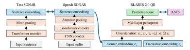
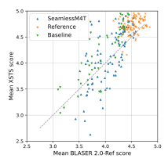

**Source:** *BLASER 2.0: a Metric for Evaluation and Quality Estimation of Massively Multilingual Speech and Text Translation* — [PDF](https://aclanthology.org/2024.findings-emnlp.943.pdf)

# BLASER 2.0: a metric for evaluation and quality estimation of massively multilingual speech and text translation

## David Dale, Marta R. Costa-jussà FAIR, Meta

{daviddale, costajussa}@meta.com

## Abstract

We present BLASER 2.0, an automatic metric of machine translation quality which supports both speech and text modalities. Compared to its predecessor BLASER [\(Chen et al.,](#page-5-0) [2023\)](#page-5-0), BLASER 2.0 is based on better underlying text and speech representations that cover 202 text languages and 57 speech onesand extends the training data. BLASER 2.0 comes in two varieties: a reference-based and a reference-free (quality estimation) model. We demonstrate that the reference-free version is applicable not only at the dataset level, for evaluating the overall model performance, but also at the sentence level, for scoring individual translations. In particular, we show its applicability for detecting translation hallucinations and filtering training datasets to obtain more reliable translation models. The BLASER 2.0 models are publicly available at [github.com/facebookresearch/SONAR.](https://github.com/facebookresearch/SONAR)

## 1 Introduction

Automatic evaluation of machine translation (MT) is difficult both because it requires good understanding of both source and target languages, and because the number of possible ways to express a thought in a language is often intractably large. Although there are commonly accepted evaluation metrics, such as BLEU [\(Papineni et al.,](#page-6-0) [2002\)](#page-6-0), the search of the MT community for better metrics is still ongoing.

Traditionally, MT is evaluated by comparing the translations to the references with metrics like BLEU/spBLEU [\(NLLB Team et al.,](#page-6-1) [2022\)](#page-6-1) or ChrF++ [\(Popovic´,](#page-6-2) [2015\)](#page-6-2) that estimate the proportion of common word or character n-grams in the texts. However, to evaluate translation accuracy, we would really prefer to compare the meanings (not the surface forms) of the translation and the source (not the reference). Also, when the translation is in the speech modality, n-grams are no longer available, so the direct comparison is impossible. A workaround for this is to use automatic

speech recognition systems and compare texts (e.g. ASR-BLEU by [Jia et al.](#page-6-3) [\(2019\)](#page-6-3)), but ASR introduces an additional layer of errors.

A principled solution would be to use representations for the source and translation that abstract away from the form and the language, but preserve the meaning, and use an appropriate function to compare them. BLASER [\(Chen et al.,](#page-5-0) [2023\)](#page-5-0) is using LASER3 embeddings [\(Heffernan et al.,](#page-5-1) [2022\)](#page-5-1) as the representations, and a trainable function for predicting the human judgement of semantic similarity based on the source, translation, and reference embeddings. It was partially inspired by the COMET model [\(Rei et al.,](#page-6-4) [2020\)](#page-6-4) that later evolved into CometKiwi [\(Rei et al.,](#page-6-5) [2022\)](#page-6-5) and xCOMET [\(Guerreiro et al.,](#page-5-2) [2023\)](#page-5-2). Another notable reference is BLEURT [\(Sellam et al.,](#page-6-6) [2020\)](#page-6-6). All these metrics are based on text-only representations, and may not be easily extendable for speech or for texts in other languages. BLASER seems to be the only MT evaluation model based on language- and modalityagnostic sentence representations, but it has been applied only for evaluating S2ST outputs[1](#page-0-0) .

This paper describes the BLASER 2.0 models, which build upon BLASER by using better underlying text and speech representations based on SONAR [\(Duquenne et al.,](#page-5-3) [2023\)](#page-5-3) and extending the training data. It also introduces a referencefree model (BLASER 2.0-QE), suitable for a more diverse set of evaluation tasks where a reference translation is not always available. To the best of our knowledge, this is the first non-cascaded[2](#page-0-1) QE metric for speech translation that covers a wide range of languages. Finally, this paper demonstrates the application of BLASER 2.0 for tasks beyond evaluating speech translation models: hallucination detection and filtering MT training data.

1 S2ST, S2TT, T2ST and T2TT stand for speech-to-speech, speech-to-text, text-to-speech and text-to-text translation.

2That is, a metric that encodes the speech directly instead of relying on ASR outputs.

Figure 1: Left: the architecture of SONAR (Duquenne et al., 2023). Right: the architecture of BLASER 2.0-QE. The source and translation embeddings can be computed from text or from speech, interchangeably.

## 2 Development of BLASER 2.0

BLASER 2.0 is the new version of BLASER (Chen et al., 2023), which works with both speech and text modalities — hence being modality-agnostic. Like its predecessor, our approach leverages the similarity between sentence representations. It uses SONAR embeddings (Duquenne et al., 2023), supports 57 languages in the speech modality and 202 in text, and is extendable to future encoders for new languages or modalities that share the same embedding space. The architectures of SONAR and BLASER 2.0 are shown in Figure 1.

**Architecture** BLASER 2.0 takes the source input, the translated output from any S2ST, S2TT, or T2TT model, and the reference speech segment or text, and converts them into embedding vectors  $(e_s, e_t, \text{ and } e_r, \text{ respectively})$ . The reference-based model version BLASER 2.0-Ref concatenates the 6 vectors of these embeddings and their derivatives3:  $[e_r; e_t; e_s \odot e_t; |e_s - e_t|; e_r \odot e_t; |e_r - e_t|]$ . The resulting vector is fed into a small dense neural network (a 3-layer perceptron with tanh activations) that predicts an XSTS score for each translation output. The reference-free model (called BLASER 2.0-QE, for Quality Estimation) has a similar architecture, but uses only source and translation. Thus, its input to the perceptron is  $[e_s; e_t; e_s \odot e_t; |e_s - e_t|]$ . For both models, we mostly reuse the BLASER hyperparameters (more details in Appendix A).

As an unsupervised baseline4 we use, like Chen et al. (2023), the average of source-translation and reference-translation cosine similarities.

**Data** The target labels for BLASER and BLASER 2.0 are obtained with XSTS (Licht et al., 2022), a human protocol for annotating cross-lingual text

similarity on the scale from 1 (the source and translation share very little meaning) to 5 (the meaning and style are preserved completely). XSTS deliberately focuses on translation accuracy, and does not penalize for fluency or audio quality issues if they do not interfere with the meaning or style preservation. The training data for BLASER 2.0 includes: the same S2ST annotations as in BLASER; 5 additional S2ST, S2TT, and T2ST annotations from internal studies6 based on FLEURS (Conneau et al., 2023) and several other multilingual datasets traditionally used in the speech translation research community; additional T2TT annotations from NLLB human evaluations (NLLB Team et al., 2022). We filter out the audio files longer than 30 seconds because the SONAR encoders were not trained with longer audios. For the original BLASER data, train/test splits were reused; other datasets were split randomly in 80/20 proportion so that the same source audio or text always goes to the same partition. Table 1 reports details on the data. All the languages used for training or evaluation of BLASER 2.0 models are listed in Appendix F.

### 3 Experiments

#### 3.1 Comparison to BLASER

Following the BLASER methodology, we evaluate the models by Pearson correlation of their predictions with XSTS scores for each translation direction. Their means are presented in the last four columns of Table 1 for all data partitions. BLASER 2.0-REF outperforms the unsupervised baseline on

&lt;sup>3The symbol  $\odot$  denotes here coordinate-wise multiplication, and |x| denotes coordinate-wise absolute values of x.

&lt;sup>4It is introduced for ablation purposes: evaluating the impact of including the trainable module in BLASER 2.0.

&lt;sup>5Except the hk-en pair; SONAR does not support Hokkien.

&lt;sup>6The studies included several versions of in-house end-to-end speech translation models similar to UnitY(Inaguma et al., 2023) and cascaded external models, including Whisper and Google Translate chained with speech synthesis. It also included some speech translations produced by humans. The audio pairs were annotated by vendor-managed bilingual annotators who passed qualification tests, using the same XSTS annotation guidelines (Licht et al., 2022) as in BLASER.

|                    |           |            |         |       | BLASER 2.0 | BLASER |      |      |
|--------------------|-----------|------------|---------|-------|------------|--------|------|------|
| Data partition     | test size | train size | systems | langs | ρunsup.    | ρRef   | ρQE  | ρRef |
| BLASER S2ST data   | 7795      | 7842       | 10      | 5     | 0.58       | 0.58   | 0.54 | 0.58 |
| Other S2ST data    | 7462      | 18752      | 9       | 14    | 0.40       | 0.42   | 0.39 |      |
| S2TT and T2ST data | 5205      | 10246      | 7       | 8     | 0.42       | 0.47   | 0.54 |      |
| T2TT data          | 20311     | 86776      | 2       | 59    | 0.41       | 0.45   | 0.45 | 0.26 |
| All data           | 40773     | 123616     | 24      | 62    | 0.41       | 0.45   | 0.44 |      |

Table 1: The data for BLASER 2.0: test and train size, number of systems and languages, and average per-direction Pearson correlation BLASER 2.0 and BLASER models with XSTS labels on the test subset of each partition.

each partition. BLASER 2.0-QE scores between them in most cases, but for the mixed-modality data, it outperforms the reference-based version.[7](#page-2-1)

On the original S2ST BLASER test set, BLASER 2.0-REF achieves the same average correlation with human judgements as BLASER, whereas the unsupervised 2.0 model outperforms its predecessor and reaches the same performance as the supervised one.[8](#page-2-2) This might indicate that the BLASER data could be "easy" enough for the SONAR space to achieve good performance without additional training. The other data subsets seem to be more difficult (maybe, due to the larger set of languages or stronger translation systems), as the supervised models mostly outperform the unsupervised one.

Although BLASER was intended for speech only, we tried computing its scores with the T2TT data. Their average is given in the last column of Table [1,](#page-2-0) and it is significantly below the BLASER 2.0 scores. BLASER 2.0, in contrast, shows robust performance for all modality combinations.

## 3.2 Evaluation with SeamlessM4T data

Data. In [Seamless Communication et al.](#page-6-8) [\(2023\)](#page-6-8), the SeamlessM4T end-to-end speech translation model, as well a baseline model[9](#page-2-3) and human references, were evaluated with the XSTS protocol. The dataset, based on the FLEURS data [\(Conneau et al.,](#page-5-4) [2023\)](#page-5-4), comprises 123260 translations (50% S2ST and 50% S2TT) in 46 directions (23 languages to and from English). We use this data to evaluate BLASER 2.0 on its "native" task of speech translation evaluation, but with potentially more challenging data, as we expect the errors generated by these strong translation models to be rather subtle.

Experiments. With only three systems, systemlevel correlations are not very informative, so we focus on the item-level correlations within each modality and translation direction, and on the correlations of the mean scores for each combination of modality, direction, and system. We report Spearman rank correlations. Because FLEURS has references for all translation directions, we use BLASER 2.0-REF, and discuss the trends of its performance across languages and modalities.

Results. For each of the 92 direction and modality combinations, item-level correlations of XSTS scores and BLASER 2.0-REF predictions are positive, with the lowest of 15%, the highest of 85%, and the mean of 45%. The group-level correlation is 76%, suggesting that aggregated BLASER 2.0 scores can rank speech translation systems reliably. Appendix [C](#page-7-3) discusses these results in more detail.

### 3.3 Evaluation with WMT23 shared tasks

|       |      | QE   |      | Hallucinations |      |      |  |  |
|-------|------|------|------|----------------|------|------|--|--|
| Lang  | B2QE | CK   | BS   | B2QE           | CK   | BS   |  |  |
| en-de | 0.26 | 0.41 | 0.34 | 0.93           | 0.95 | 0.87 |  |  |
| en-gu | 0.39 | 0.58 | 0.34 | 1.00           | 1.00 | 0.96 |  |  |
| en-hi | 0.31 | 0.39 | 0.28 | 0.98           | 0.98 | 0.90 |  |  |
| en-mr | 0.43 | 0.63 | 0.40 | 0.98           | 0.96 | 0.88 |  |  |
| en-ta | 0.37 | 0.55 | 0.51 | 0.99           | 0.99 | 0.89 |  |  |
| en-te | 0.25 | 0.23 | 0.19 | 1.00           | 1.00 | 0.97 |  |  |
| he-en | 0.50 | 0.62 | 0.47 | 0.96           | 0.95 | 0.82 |  |  |
| zh-en | 0.42 | 0.48 | 0.45 | 0.98           | 0.98 | 0.84 |  |  |
| mean  | 0.37 | 0.49 | 0.37 | 0.98           | 0.98 | 0.89 |  |  |

Table 2: Spearman correlations of predictions with the target on the halluciantion-free subset of the WMT 23 QE Task 1 sentence-level data (left), and ROC AUC for detecting hallucinations on the same data (right). B2QE stands for BLASER 2.0-QE, CK stands for wmt22-cometkiwi-da, a comparably-sized model, and BS stands for the baseline system.

Context. WMT Metrics shared task [\(Freitag](#page-5-7) [et al.,](#page-5-7) [2023\)](#page-5-7) and WMT Quality Estimation (QE) shared task [\(Blain et al.,](#page-5-8) [2023\)](#page-5-8) evaluate the per-

7Most of this data comes from automatically aligned datasets, where some references are misaligned with the source. This demonstrates robustness of BLASER 2.0-QE in case of unreliable references.

8A table in Appendix [B](#page-7-2) displays performance of BLASER 2.0 and BLASER for each translation direction.

9Based on Whisper [\(Radford et al.,](#page-6-9) [2023\)](#page-6-9) and, for speech outputs, on YourTTS [\(Casanova et al.,](#page-5-6) [2022\)](#page-5-6).

formance of various MT metrics in two principal settings: with and without access to reference translations. The targets for these evaluation campaigns are obtained through two human annotation schemes: direct assessments (DA) and multidimensional quality metrics (MQM) [\(Lommel](#page-6-10) [et al.,](#page-6-10) [2014\)](#page-6-10). Both schemes do not focus specifically on translation accuracy, so they may be difficult for accuracy-specific metrics such as XSTS and BLASER 2.0 that targets it. But if accuracy is the main source of variation in translation quality, evaluating it with BLASER 2.0 still makes sense.

Experimental Setup. To evaluate BLASER 2.0 in these settings, we compute BLASER 2.0-QE scores on the QE shared task dataset and compare its correlations with the human labels to the numbers reported by [Blain et al.](#page-5-8) [\(2023\)](#page-5-8). We also evaluate BLASER 2.0-REF with the Metrics shared task MTME toolkit.[10](#page-3-0). Note that we do not use any DA or MQM training data for BLASER 2.0.

QE Results. On the QE shared task, BLASER 2.0-QE achieves the same average performance as the baseline provided by the task organizers (Table [2\)](#page-2-4), without being trained on the labels for this task. However, it still lags behind a Comet-Kiwi model.

Hallucination detection. Table [2](#page-2-4) also shows that BLASER 2.0-QE significantly outperforms the baseline and achieves the same performance as COMET-Kiwi in detecting translation hallucinations. This adds up to the evidence in [Dale et al.](#page-5-9) [\(2023\)](#page-5-9) and [Ropers et al.](#page-6-11) [\(2024\)](#page-6-11) that BLASER 2.0 is competitive in hallucination detection.

Metrics Results. On the WMT23 Metrics shared task benchmark, BLASER 2.0-REF achieves 0.711 average correlation with human annotations over the 10 "tasks", which is way below the SOTA metric (0.825), but still higher than non-trainable baselines such as BLEU (0.696). Appendix [D](#page-7-4) demonstrates the full per-task results.

## 3.4 An ablation study for quality estimation

We use the QE shared task as an opportunity to clarify the role of the sentence representation space, supervised fine-tuning, and references in the BLASER 2.0 performance. With this purpose, we evaluate the QE performance of supervised and unsupervised BLASER and BLASER 2.0 models. For all

models that require a reference embedding, we substitute it here with the source embedding, based on the logic that a good reference should be semantically equivalent to the source, and thus a good representation space would map them into identical embedding vectors.

|       | BLASER |      | BLASER 2.0 |      |      |  |  |  |
|-------|--------|------|------------|------|------|--|--|--|
| Lang  | B1U    | B1R  | B2U        | B2QE | B2R  |  |  |  |
| en-de | 0.09   | 0.22 | 0.17       | 0.26 | 0.21 |  |  |  |
| en-gu | 0.14   | 0.22 | 0.24       | 0.39 | 0.33 |  |  |  |
| en-hi | 0.10   | 0.25 | 0.20       | 0.31 | 0.26 |  |  |  |
| en-mr | 0.25   | 0.25 | 0.36       | 0.43 | 0.42 |  |  |  |
| en-ta | 0.05   | 0.06 | 0.28       | 0.37 | 0.30 |  |  |  |
| en-te | 0.06   | 0.07 | 0.16       | 0.25 | 0.22 |  |  |  |
| he-en | 0.31   | 0.40 | 0.52       | 0.50 | 0.50 |  |  |  |
| zh-en | 0.29   | 0.33 | 0.29       | 0.42 | 0.37 |  |  |  |
| mean  | 0.16   | 0.23 | 0.28       | 0.37 | 0.33 |  |  |  |

Table 3: Spearman correlations on the halluciantion-free subset of the WMT 23 QE Task 1 sentence-level data. BLASER-unsupervised is represented as B1U, BLASER as B1R, BLASER 2.0-unsupervised as B2U, BLASER 2.0-QE as B2QE, and BLASER 2.0-REF as B2R.

Table [3](#page-3-1) reports the evaluation results and suggests several conclusions:

- 1. B2U (SONAR cosine similarity) outperforms B1U (LASER3 cosine similarity), suggesting that the SONAR space suits better for QE.
- 2. For both BLASER and BLASER 2.0, the trained models outperform the untrained ones in almost all cases, which means that training with XSTS labels is relevant for the QE task.
- 3. BLASER 2.0-QE outperforms BLASER 2.0- REF (which uses source embeddings instead of reference embeddings), which implies that having a specialized QE model is not redundant. Apparently, something in BLASER 2.0- REF makes it treat the source and reference embeddings differently[11](#page-3-2), so that using it with the former in the place of the latter is worse that using a reference-free model.

Thus, this small study demonstrates that all three major features of BLASER 2.0-QE (SONAR space, supervised fine-tuning, and reference-free setup) are contributing to its performance in the QE task.

## 3.5 Using BLASER 2.0 to filter training data

Context An alternative to detecting and mitigating hallucinations at inference time is to "bake" the competences of BLASER 2.0 directly into the

10[github.com/google-research/mt-metrics-eval](https://github.com/google-research/mt-metrics-eval)

11Maybe, the SONAR embedding space not being completely language-agnostic plays a role.

translation model, without changing its inference. One way to achieve this is to use BLASER 2.0 as a reward function for reinforcement learning, but we follow Peter et al. (2023) with a simpler approach: use the QE model for filtering the training data.

**Experimental setup.** To keep the training experiments relatively simple and reproducible, we focus on translation between English and 8 languages: 3 high-resourced ones (deu, fra, rus) and 5 lower-resourced ones (est, azj, urd, xho, mya), representing diverse language families and scripts. As the base training data, we select the first 1 million translations from the NLLB dataset, automatically mined from monolingual corpora. We fine-tune an mBART-50 model12 on the unfilered version of this data, and on its versions filtered with various scores: no filter; BLASER 2.0-QE scores; margin (the margin score (distributed with the dataset) based on LASER3 embeddings); cometkiwi scores13 (Rei et al., 2022), and NLLB, the mean token log-probability predicted by the NLLB-200-600M model.

$$\frac{\text{The NLLB score was computed as}}{\frac{1}{2} \left( \frac{\sum_{i=1}^{|t|} \log p(t_i|s, t_{0:i-1})}{|t|} + \frac{\sum_{i=1}^{|s|} \log p(s_i|s, s_{0:i-1})}{|s|} \right)},$$

where s and t are the source and the target as sequences of tokens,  $s_i$  and  $t_i$  are their i'th tokens, and  $s_{0:i-1}$  and  $t_{0:i-1}$  are their prefixes before the position i. p denotes the probability that the translation model assigns to the current target token given the target prefix and the source.

To ensure comparability, each filtering method drops 50% of the dataset. After that, we fine-tune the model for 100K steps to translate in all 16 directions. We evaluate the models on the FLORES-200 dataset (NLLB Team et al., 2022).

Results in translation quality. Table 4 provides mean BLEU and xCOMET14 scores for models trained with various data filtering methods. The margin baseline demonstrated almost no improvement on average, but BLASER 2.0 and NLLB filtering both increased the translation quality by about 1 BLEU point. CometKiwi occupies an intermediate position. xCOMET, a state-of-the-art neural metric, supports similar conclusions.

| score         | BL           | EU    | xCOMET |       |  |  |
|---------------|--------------|-------|--------|-------|--|--|
| filtering     | en-xx        | xx-en | en-xx  | xx-en |  |  |
| No filter     | 14.5         | 21.3  | 56.9   | 65.4  |  |  |
| Margin        | 14.5         | 21.4  | 56.8   | 65.5  |  |  |
| CometKiwi     | 14.9         | 21.9  | 58.5   | 66.3  |  |  |
| BLASER 2.0-QE | 15.3         | 22.2  | 58.8   | 67.5  |  |  |
| NLLB          | 1 <b>5.6</b> | 22.2  | 59.4   | 67.6  |  |  |

Table 4: BLEU and xCOMET (x100) scores for an MT model trained with different data filters, averaged across languages, for into-English and from-English translations. Full results in Appendix E.

The results of filtering the from-English data with BLASER 2.0 are slightly worse than for NLLB. Manual inspection of sampled translation outputs revealed that all four models had fluency problems, potentially related to them being undertrained. The model trained with NLLB filtering seems to have slightly less such problems, probably because filtering with perplexity helped train the model on more fluent data. This might explain that BLASER-filtered model lags behind the NLLB-filtered one on the from-English translation directions, as into-English translation has less problems with fluency.

Despite this gap, filtering with BLASER 2.0 scores may have two potential advantages. One is extensibility: upon collecting a dataset for a new language, it may be easier to train a SONAR encoder for it (to enable computing BLASER 2.0) than training a translation model to and from this new language. The second advantage is setting the threshold: because BLASER 2.0 scores follow the XSTS scale, they are highly interpretable, and choosing a filtering threshold might probably be done in a more language-agnostic way than for filtering with token log-probabilities which are highly tokenization- and language-dependent.

#### 4 Conclusions

BLASER 2.0 is a multilingual and multimodal metric for translation evaluation and quality estimation. Compared to its previous version, the second BLASER has better coverage of modalities and supports reference-free evaluation. BLASER 2.0 covers 202 languages in text and 57 languages in speech and provides well calibrated, interpretable and cross-lingually comparable scores. Apart from evaluating translation models, BLASER 2.0 is suitable for pointwise scoring of source-translation pairs, which enables its use for hallucination detection and training data filtering.

&lt;sup>12We chose this model as it has been pretrained to understand and generate diverse languaghes, but has not been trained on the translation task, so its translation skills would be directly determined by the fine-tuning data.

&lt;sup>13wmt22-cometkiwi-da

 $^{14}$ xCOMET-XL

## Limitations

Annotations. The annotations on the training data were provided by professionals and they were all paid a fair rate.

Translation quality aspects. The XSTS protocol used to annotate our training data deliberately focuses on evaluating translation accuracy, and does not penalize for fluency issues unless they interfere with meaning or make the translation incoherent. For speech translation, the quality and naturalness of the sound are also not covered. Thus, XSTS and its derivative BLASER 2.0 are not comprehensive metrics of translation quality; they are intended to discriminate only translations with different levels of accuracy, and may be insufficiently sensitive to other quality aspects.

Dependence on SONAR. BLASER 2.0 is a metric based on SONAR sentence encoders [\(Duquenne](#page-5-3) [et al.,](#page-5-3) [2023\)](#page-5-3) and may inherit some of their biases or limitations. Moreover, if SONAR encoders have any "blind spot", there is a chance that both SONAR-based translation models and BLASER 2.0 inherit it. Therefore, BLASER 2.0 scores may exhibit undue preferences towards MT models based on SONAR or trained on the datasets filtered or aligned using SONAR embeddings. Because of these limitations, BLASER 2.0 scores may not always choose the MT model that best aligns with human preferences. Therefore, we recommend using automatic metrics, such as BLASER 2.0, to inform experiments and development of translation models, but including human annotations and qualitative analysis into the final model evaluation.

Distribution. BLASER 2.0 models are distributed under a CC-BY-NC-4.0 license, following the SONAR encoders on which they are based.

## References

Frederic Blain, Chrysoula Zerva, Ricardo Rei, Nuno M. Guerreiro, Diptesh Kanojia, José G. C. de Souza, Beatriz Silva, Tânia Vaz, Yan Jingxuan, Fatemeh Azadi, Constantin Orasan, and André Martins. 2023. [Findings of the WMT 2023 shared task on quality](https://doi.org/10.18653/v1/2023.wmt-1.52) [estimation.](https://doi.org/10.18653/v1/2023.wmt-1.52) In *Proceedings of the Eighth Conference on Machine Translation*, pages 629–653, Singapore. Association for Computational Linguistics.

Edresson Casanova, Julian Weber, Christopher D Shulby, Arnaldo Candido Junior, Eren Gölge, and Moacir A Ponti. 2022. Yourtts: Towards zero-shot multi-speaker tts and zero-shot voice conversion for

everyone. In *International Conference on Machine Learning*, pages 2709–2720. PMLR.

Mingda Chen, Paul-Ambroise Duquenne, Pierre Andrews, Justine Kao, Alexandre Mourachko, Holger Schwenk, and Marta R. Costa-jussà. 2023. [BLASER:](https://aclanthology.org/2023.acl-long.504) [A text-free speech-to-speech translation evaluation](https://aclanthology.org/2023.acl-long.504) [metric.](https://aclanthology.org/2023.acl-long.504) In *Proceedings of the 61st Annual Meeting of the Association for Computational Linguistics (Volume 1: Long Papers)*, pages 9064–9079, Toronto, Canada. Association for Computational Linguistics.

Alexis Conneau, Min Ma, Simran Khanuja, Yu Zhang, Vera Axelrod, Siddharth Dalmia, Jason Riesa, Clara Rivera, and Ankur Bapna. 2023. Fleurs: Few-shot learning evaluation of universal representations of speech. In *2022 IEEE Spoken Language Technology Workshop (SLT)*, pages 798–805. IEEE.

David Dale, Elena Voita, Janice Lam, Prangthip Hansanti, Christophe Ropers, Elahe Kalbassi, Cynthia Gao, Loic Barrault, and Marta Costa-jussà. 2023. [HalOmi: A manually annotated benchmark for mul](https://doi.org/10.18653/v1/2023.emnlp-main.42)[tilingual hallucination and omission detection in ma](https://doi.org/10.18653/v1/2023.emnlp-main.42)[chine translation.](https://doi.org/10.18653/v1/2023.emnlp-main.42) In *Proceedings of the 2023 Conference on Empirical Methods in Natural Language Processing*, pages 638–653, Singapore. Association for Computational Linguistics.

Paul-Ambroise Duquenne, Holger Schwenk, and Benoit Sagot. 2023. [SONAR: sentence-level multi](https://arxiv.org/abs/2308.11466)[modal and language-agnostic representations.](https://arxiv.org/abs/2308.11466) *arXiv preprint*.

Markus Freitag, Nitika Mathur, Chi-kiu Lo, Eleftherios Avramidis, Ricardo Rei, Brian Thompson, Tom Kocmi, Frederic Blain, Daniel Deutsch, Craig Stewart, Chrysoula Zerva, Sheila Castilho, Alon Lavie, and George Foster. 2023. [Results of WMT23 metrics](https://doi.org/10.18653/v1/2023.wmt-1.51) [shared task: Metrics might be guilty but references](https://doi.org/10.18653/v1/2023.wmt-1.51) [are not innocent.](https://doi.org/10.18653/v1/2023.wmt-1.51) In *Proceedings of the Eighth Conference on Machine Translation*, pages 578–628, Singapore. Association for Computational Linguistics.

Nuno M Guerreiro, Ricardo Rei, Daan van Stigt, Luisa Coheur, Pierre Colombo, and André FT Martins. 2023. xcomet: Transparent machine translation evaluation through fine-grained error detection. *arXiv preprint arXiv:2310.10482*.

Kevin Heffernan, Onur Çelebi, and Holger Schwenk. 2022. [Bitext mining using distilled sentence repre](https://doi.org/10.18653/v1/2022.findings-emnlp.154)[sentations for low-resource languages.](https://doi.org/10.18653/v1/2022.findings-emnlp.154) In *Findings of the Association for Computational Linguistics: EMNLP 2022*, pages 2101–2112, Abu Dhabi, United Arab Emirates. Association for Computational Linguistics.

Hirofumi Inaguma, Sravya Popuri, Ilia Kulikov, Peng-Jen Chen, Changhan Wang, Yu-An Chung, Yun Tang, Ann Lee, Shinji Watanabe, and Juan Pino. 2023. [UnitY: Two-pass direct speech-to-speech translation](https://doi.org/10.18653/v1/2023.acl-long.872) [with discrete units.](https://doi.org/10.18653/v1/2023.acl-long.872) In *Proceedings of the 61st Annual Meeting of the Association for Computational*

- *Linguistics (Volume 1: Long Papers)*, pages 15655– 15680, Toronto, Canada. Association for Computational Linguistics.
- Ye Jia, Ron J Weiss, Fadi Biadsy, Wolfgang Macherey, Melvin Johnson, Zhifeng Chen, and Yonghui Wu. 2019. Direct speech-to-speech translation with a sequence-to-sequence model. *arXiv preprint arXiv:1904.06037*.
- Daniel Licht, Cynthia Gao, Janice Lam, Francisco Guzman, Mona Diab, and Philipp Koehn. 2022. [Consis](https://aclanthology.org/2022.amta-research.24)[tent human evaluation of machine translation across](https://aclanthology.org/2022.amta-research.24) [language pairs.](https://aclanthology.org/2022.amta-research.24) In *Proceedings of the 15th biennial conference of the Association for Machine Translation in the Americas (Volume 1: Research Track)*, pages 309–321, Orlando, USA. Association for Machine Translation in the Americas.
- Arle Lommel, Hans Uszkoreit, and Aljoscha Burchardt. 2014. Multidimensional quality metrics (mqm): A framework for declaring and describing translation quality metrics. *Tradumàtica*, (12):0455–463.
- NLLB Team, Marta R. Costa-jussà, James Cross, Onur Çelebi, Maha Elbayad, Kenneth Heafield, Kevin Heffernan, Elahe Kalbassi, Janice Lam, Daniel Licht, Jean Maillard, Anna Sun, Skyler Wang, Guillaume Wenzek, Al Youngblood, Bapi Akula, Loic Barrault, Gabriel Mejia-Gonzalez, Prangthip Hansanti, John Hoffman, Semarley Jarrett, Kaushik Ram Sadagopan, Dirk Rowe, Shannon Spruit, Chau Tran, Pierre Andrews, Necip Fazil Ayan, Shruti Bhosale, Sergey Edunov, Angela Fan, Cynthia Gao, Vedanuj Goswami, Francisco Guzmán, Philipp Koehn, Alexandre Mourachko, Christophe Ropers, Safiyyah Saleem, Holger Schwenk, and Jeff Wang. 2022. [No language left behind: Scaling human](https://arxiv.org/abs/2207.04672)[centered machine translation.](https://arxiv.org/abs/2207.04672)
- Kishore Papineni, Salim Roukos, Todd Ward, and Wei-Jing Zhu. 2002. [Bleu: a method for automatic evalu](https://doi.org/10.3115/1073083.1073135)[ation of machine translation.](https://doi.org/10.3115/1073083.1073135) In *Proceedings of the 40th Annual Meeting of the Association for Computational Linguistics*, pages 311–318, Philadelphia, Pennsylvania, USA. Association for Computational Linguistics.
- Jan-Thorsten Peter, David Vilar, Daniel Deutsch, Mara Finkelstein, Juraj Juraska, and Markus Freitag. 2023. [There's no data like better data: Using QE metrics](https://doi.org/10.18653/v1/2023.wmt-1.50) [for MT data filtering.](https://doi.org/10.18653/v1/2023.wmt-1.50) In *Proceedings of the Eighth Conference on Machine Translation*, pages 561–577, Singapore. Association for Computational Linguistics.
- Maja Popovic. 2015. ´ [chrF: character n-gram F-score](https://doi.org/10.18653/v1/W15-3049) [for automatic MT evaluation.](https://doi.org/10.18653/v1/W15-3049) In *Proceedings of the Tenth Workshop on Statistical Machine Translation*, pages 392–395, Lisbon, Portugal. Association for Computational Linguistics.
- Alec Radford, Jong Wook Kim, Tao Xu, Greg Brockman, Christine McLeavey, and Ilya Sutskever. 2023.

- Robust speech recognition via large-scale weak supervision. In *International conference on machine learning*, pages 28492–28518. PMLR.
- Ricardo Rei, Craig Stewart, Ana C Farinha, and Alon Lavie. 2020. Comet: A neural framework for mt evaluation. In *Proceedings of the 2020 Conference on Empirical Methods in Natural Language Processing (EMNLP)*. Association for Computational Linguistics.
- Ricardo Rei, Marcos Treviso, Nuno M. Guerreiro, Chrysoula Zerva, Ana C Farinha, Christine Maroti, José G. C. de Souza, Taisiya Glushkova, Duarte Alves, Luisa Coheur, Alon Lavie, and André F. T. Martins. 2022. [CometKiwi: IST-unbabel 2022 sub](https://aclanthology.org/2022.wmt-1.60)[mission for the quality estimation shared task.](https://aclanthology.org/2022.wmt-1.60) In *Proceedings of the Seventh Conference on Machine Translation (WMT)*, pages 634–645, Abu Dhabi, United Arab Emirates (Hybrid). Association for Computational Linguistics.
- Christophe Ropers, David Dale, Prangthip Hansanti, Gabriel Mejia Gonzalez, Ivan Evtimov, Corinne Wong, Christophe Touret, Kristina Pereyra, Seohyun Sonia Kim, Cristian Canton Ferrer, Pierre Andrews, and Marta R. Costa-jussà. 2024. [Towards red](https://arxiv.org/abs/2401.16247) [teaming in multimodal and multilingual translation.](https://arxiv.org/abs/2401.16247) *Preprint*, arXiv:2401.16247.
- Seamless Communication, Loïc Barrault, Yu-An Chung, Mariano Cora Meglioli, David Dale, Ning Dong, Paul-Ambroise Duquenne, Hady Elsahar, Hongyu Gong, Kevin Heffernan, John Hoffman, Christopher Klaiber, Pengwei Li, Daniel Licht, Jean Maillard, Alice Rakotoarison, Kaushik Ram Sadagopan, Guillaume Wenzek, Ethan Ye, Bapi Akula, Peng-Jen Chen, Naji El Hachem, Brian Ellis, Gabriel Mejia Gonzalez, Justin Haaheim, Prangthip Hansanti, Russ Howes, Bernie Huang, Min-Jae Hwang, Hirofumi Inaguma, Somya Jain, Elahe Kalbassi, Amanda Kallet, Ilia Kulikov, Janice Lam, Daniel Li, Xutai Ma, Ruslan Mavlyutov, Benjamin Peloquin, Mohamed Ramadan, Abinesh Ramakrishnan, Anna Sun, Kevin Tran, Tuan Tran, Igor Tufanov, Vish Vogeti, Carleigh Wood, Yilin Yang, Bokai Yu, Pierre Andrews, Can Balioglu, Marta R. Costa-jussà, Onur Celebi, Maha Elbayad, Cynthia Gao, Francisco Guzmán, Justine Kao, Ann Lee, Alexandre Mourachko, Juan Pino, Sravya Popuri, Christophe Ropers, Safiyyah Saleem, Holger Schwenk, Paden Tomasello, Changhan Wang, Jeff Wang, and Skyler Wang. 2023. [Seamlessm4t](https://arxiv.org/abs/2308.11596)[massively multilingual & multimodal machine trans](https://arxiv.org/abs/2308.11596)[lation.](https://arxiv.org/abs/2308.11596)
- Thibault Sellam, Dipanjan Das, and Ankur Parikh. 2020. [BLEURT: Learning robust metrics for text genera](https://doi.org/10.18653/v1/2020.acl-main.704)[tion.](https://doi.org/10.18653/v1/2020.acl-main.704) In *Proceedings of the 58th Annual Meeting of the Association for Computational Linguistics*, pages 7881–7892, Online. Association for Computational Linguistics.

#### A Training details

For BLASER 2.0 models, we used the training code from BLASER 15 with a few modifications in the hyperparameters intended to mitigate overfitting: 50% dropout, 0.1 weight decay, batch size of 1024, and linear decay of the learning rate to 0 by the end of the training. To compensate for the increased batch size, we trained for 50 instead of 20 epochs.

All computations were done on a single GPU. Training of BLASER 2.0 models took only several GPU-minutes, and encoding all texts and speech with SONAR encoders for training and evaluation took less than one GPU-day.

## **B** Per-language comparison with BLASER

Table 5 presents the performance of BLASER and BLASER 2.0 models on the BLASER test data. The unsupervised 2.0 model slightly outperforms its predecessor. BLASER and BLASER 2.0-REF models have the same average correlation with human judgments.

# C Evaluation with SeamlessM4T data, detailed results

In this section, we describe in more details the results of evaluating BLASER 2.0-REF on the SeamlessM4T data in Section 3.2.

Table 6 shows that for each of the 92 direction and modality combinations, item-level correlations of XSTS scores and BLASER 2.0-REF predictions are positive, with the lowest of 15% and the highest of 85%. The into-English translations feature slightly higher correlations (45% on average) than the from-English translations (40% on average), perhaps, because SONAR is more accurate with English, and the target-side language matters more for BLASER 2.0-REF. For the S2ST modality, the average correlation (49%) is much higher than for the S2TT modality (35%). This may be partially explained by S2ST being a harder task, with more severe errors that are easier for BLASER 2.0 to spot.

Figure 2 displays the average XSTS scores and BLASER 2.0-REF predictions per modality, direction and system. For both translation systems, they demonstrate high Spearman correlation (72% for Seamless and 80% for the baseline system), but human references, with their average XSTS scores

Figure 2: Mean XSTS scores and BLASER 2.0-REF predictions for the SeamlessM4T evaluation data (per translation direction, system and modality).

of 4.5-5, demonstrate very little variation in quality, and therefore very moderate 29% correlation. The overall correlation of these group-level mean predicted scores with the mean XSTS labels in solid 76%, suggesting that when there is sufficient variation in speech translation quality, the aggregated BLASER 2.0-REF scores can correctly reflect it.

## D WMT23 Metrics shared task benchmark

Table 7 presents the performance of BLASER 2.0 models on the WMT23 Metrics shared task benchmark. BLASER 2.0-REF achieves 0.711 average correlation with human annotations over the 10 tasks, which is way below the SOTA metric (0.825), but still higher than non-trainable baselines such as BLEU (0.696).

# E Full evaluation results for training data filtering

Table 8 gives the full per-direction results of scoring the translations obtained with various training data filtering methods. In addition to the BLEU and xCOMET evaluation, we also report BLASER 2.0-QE scores.

#### F Languages registry

**Languages registry** Table 9 presents the list of the 71 languages used within this work for training or evaluating BLASER 2.0 models.

|                  |         | †Pearson Correlation |         |         |         |         |         |  |  |  |  |  |
|------------------|---------|----------------------|---------|---------|---------|---------|---------|--|--|--|--|--|
| Model            | eng-deu | eng-spa              | eng-fra | spa-eng | fra-eng | rus-eng | average |  |  |  |  |  |
| BLASER unsup     | 0.32    | 0.58                 | 0.64    | 0.50    | 0.48    | 0.43    | 0.49    |  |  |  |  |  |
| BLASER 2.0 unsup | 0.37    | 0.75                 | 0.71    | 0.59    | 0.57    | 0.49    | 0.58    |  |  |  |  |  |
| BLASER           | 0.33    | 0.75                 | 0.71    | 0.58    | 0.57    | 0.53    | 0.58    |  |  |  |  |  |
| BLASER 2.0 Ref   | 0.36    | 0.75                 | 0.73    | 0.58    | 0.56    | 0.50    | 0.58    |  |  |  |  |  |
| Blaser 2.0 QE    | 0.34    | 0.73                 | 0.71    | 0.54    | 0.48    | 0.45    | 0.54    |  |  |  |  |  |

Table 5: Pearson correlations of BLASER and BLASER 2.0 models with XSTS scores on the BLASER test data.

| modality  | S2    | ST    | S2'   | TT    |  |
|-----------|-------|-------|-------|-------|--|
| direction | en-xx | xx-en | en-xx | xx-en |  |
| arb       | 0.56  | 0.48  | 0.29  | 0.52  |  |
| ben       | 0.39  | 0.65  | 0.25  | 0.65  |  |
| cat       | 0.37  | 0.38  | 0.25  | 0.38  |  |
| cmn       | 0.75  | 0.60  | 0.49  | 0.51  |  |
| deu       | 0.56  | 0.37  | 0.25  | 0.30  |  |
| fin       | 0.63  | 0.60  | 0.34  | 0.53  |  |
| fra       | 0.54  | 0.34  | 0.32  | 0.34  |  |
| hin       | 0.32  | 0.29  | 0.17  | 0.36  |  |
| ind       | 0.62  | 0.43  | 0.16  | 0.35  |  |
| ita       | 0.34  | 0.26  | 0.15  | 0.18  |  |
| jpn       | 0.70  | 0.65  | 0.43  | 0.62  |  |
| kor       | 0.49  | 0.41  | 0.31  | 0.36  |  |
| nld       | 0.47  | 0.37  | 0.21  | 0.32  |  |
| por       | 0.40  | 0.29  | 0.22  | 0.24  |  |
| ron       | 0.53  | 0.44  | 0.30  | 0.45  |  |
| rus       | 0.63  | 0.43  | 0.36  | 0.32  |  |
| spa       | 0.41  | 0.30  | 0.20  | 0.16  |  |
| swh       | 0.58  | 0.85  | 0.30  | 0.82  |  |
| tel       | 0.53  | 0.49  | 0.15  | 0.57  |  |
| tha       | 0.65  | 0.63  | 0.37  | 0.59  |  |
| tur       | 0.55  | 0.47  | 0.28  | 0.41  |  |
| urd       | 0.42  | 0.50  | 0.25  | 0.54  |  |
| vie       | 0.53  | 0.54  | 0.21  | 0.54  |  |
| mean      | 0.52  | 0.47  | 0.27  | 0.44  |  |
| min       | 0.32  | 0.26  | 0.15  | 0.16  |  |
| max       | 0.75  | 0.85  | 0.49  | 0.82  |  |

Table 6: Item-level Spearman correlations of XSTS scores and BLASER 2.0-REF predictions on the SeamlessM4T data, for each combination of translation direction (from-English and into-English) and modality.

| lang:                   |          | all      | en-de   | en-de   | en-de | he-en   | he-en   | he-en | zh-en   | zh-en   | zh-en  |
|-------------------------|----------|----------|---------|---------|-------|---------|---------|-------|---------|---------|--------|
| level:                  |          | sys      | sys     | seg     | seg   | sys     | seg     | seg   | sys     | seg     | seg    |
| corr_fcn:               |          | accuracy | pearson | pearson | acc-t | pearson | pearson | acc-t | pearson | pearson | acc-t  |
| metric                  | avg-corr | task1    | task2   | task3   | task4 | task5   | task6   | task7 | task8   | task9   | task10 |
| XCOMET-Ensemble         | 0.825    | 0.928    | 0.980   | 0.695   | 0.604 | 0.950   | 0.556   | 0.586 | 0.927   | 0.650   | 0.543  |
| XCOMET-QE-Ensemble      | 0.808    | 0.908    | 0.974   | 0.679   | 0.588 | 0.909   | 0.498   | 0.554 | 0.892   | 0.647   | 0.533  |
| MetricX-23              | 0.808    | 0.908    | 0.977   | 0.585   | 0.603 | 0.910   | 0.548   | 0.577 | 0.873   | 0.625   | 0.531  |
| GEMBA-MQM               | 0.802    | 0.944    | 0.993   | 0.502   | 0.572 | 0.939   | 0.401   | 0.564 | 0.991   | 0.449   | 0.522  |
| MetricX-23-QE           | 0.800    | 0.892    | 0.969   | 0.626   | 0.596 | 0.858   | 0.520   | 0.564 | 0.859   | 0.647   | 0.527  |
| mbr-metricx-qe          | 0.788    | 0.880    | 0.976   | 0.571   | 0.584 | 0.915   | 0.411   | 0.553 | 0.936   | 0.489   | 0.537  |
| MaTESe                  | 0.782    | 0.904    | 0.918   | 0.554   | 0.528 | 0.906   | 0.459   | 0.550 | 0.889   | 0.511   | 0.479  |
| _CometKiwi              | 0.782    | 0.904    | 0.946   | 0.475   | 0.569 | 0.860   | 0.387   | 0.544 | 0.963   | 0.442   | 0.525  |
| _COMET                  | 0.779    | 0.900    | 0.990   | 0.432   | 0.574 | 0.940   | 0.401   | 0.532 | 0.898   | 0.396   | 0.514  |
| _BLEURT-20              | 0.776    | 0.892    | 0.990   | 0.484   | 0.572 | 0.937   | 0.382   | 0.519 | 0.880   | 0.378   | 0.518  |
| KG-BERTScore            | 0.774    | 0.884    | 0.926   | 0.451   | 0.556 | 0.908   | 0.382   | 0.537 | 0.962   | 0.430   | 0.516  |
| sescoreX                | 0.772    | 0.892    | 0.952   | 0.519   | 0.563 | 0.901   | 0.385   | 0.484 | 0.797   | 0.536   | 0.499  |
| cometoid22-wmt22        | 0.772    | 0.880    | 0.973   | 0.441   | 0.578 | 0.839   | 0.365   | 0.515 | 0.940   | 0.479   | 0.515  |
| _docWMT22CometDA        | 0.768    | 0.904    | 0.990   | 0.394   | 0.559 | 0.922   | 0.339   | 0.497 | 0.907   | 0.353   | 0.493  |
| _docWMT22CometKiwiDA    | 0.767    | 0.900    | 0.970   | 0.444   | 0.547 | 0.906   | 0.286   | 0.489 | 0.965   | 0.387   | 0.493  |
| Calibri-COMET22         | 0.767    | 0.904    | 0.963   | 0.413   | 0.522 | 0.930   | 0.401   | 0.515 | 0.863   | 0.396   | 0.474  |
| Calibri-COMET22-QE      | 0.755    | 0.863    | 0.978   | 0.441   | 0.483 | 0.778   | 0.395   | 0.506 | 0.934   | 0.443   | 0.491  |
| _YiSi-1                 | 0.754    | 0.871    | 0.925   | 0.366   | 0.542 | 0.917   | 0.395   | 0.529 | 0.823   | 0.290   | 0.504  |
| _MS-COMET-QE-22         | 0.744    | 0.871    | 0.959   | 0.310   | 0.546 | 0.721   | 0.295   | 0.498 | 0.901   | 0.367   | 0.498  |
| _prismRef               | 0.744    | 0.851    | 0.920   | 0.516   | 0.518 | 0.956   | 0.319   | 0.528 | 0.762   | 0.183   | 0.504  |
| mre-score-labse-regular | 0.743    | 0.888    | 0.942   | 0.111   | 0.530 | 0.958   | 0.378   | 0.522 | 0.903   | 0.145   | 0.481  |
| _BERTscore              | 0.742    | 0.871    | 0.891   | 0.325   | 0.528 | 0.895   | 0.335   | 0.515 | 0.810   | 0.236   | 0.499  |
| XLsim                   | 0.719    | 0.855    | 0.925   | 0.239   | 0.527 | 0.887   | 0.233   | 0.480 | 0.796   | 0.111   | 0.464  |
| BLASER-2.0-Ref          | 0.711    | 0.791    | 0.811   | 0.418   | 0.497 | 0.690   | 0.334   | 0.513 | 0.831   | 0.266   | 0.477  |
| _f200spBLEU             | 0.704    | 0.819    | 0.919   | 0.237   | 0.526 | 0.805   | 0.230   | 0.447 | 0.772   | 0.108   | 0.476  |
| MEE4                    | 0.704    | 0.823    | 0.861   | 0.202   | 0.529 | 0.879   | 0.256   | 0.441 | 0.743   | 0.105   | 0.480  |
| tokengram_F             | 0.703    | 0.815    | 0.858   | 0.227   | 0.520 | 0.878   | 0.226   | 0.461 | 0.795   | 0.060   | 0.485  |
| embed_llama             | 0.701    | 0.831    | 0.861   | 0.250   | 0.483 | 0.841   | 0.215   | 0.430 | 0.785   | 0.161   | 0.447  |
| _BLEU                   | 0.696    | 0.815    | 0.917   | 0.192   | 0.520 | 0.769   | 0.220   | 0.442 | 0.734   | 0.119   | 0.472  |
| _chrF                   | 0.694    | 0.795    | 0.866   | 0.232   | 0.519 | 0.776   | 0.221   | 0.460 | 0.809   | 0.063   | 0.485  |
| eBLEU                   | 0.692    | 0.859    | 0.918   | -0.011  | 0.512 | 0.911   | 0.131   | 0.445 | 0.727   | -0.084  | 0.473  |
| _Random-sysname         | 0.529    | 0.578    | 0.357   | 0.064   | 0.409 | 0.209   | 0.041   | 0.428 | 0.093   | 0.018   | 0.381  |
| _prismSrc               | 0.455    | 0.386    | -0.327  | 0.425   | 0.426 | -0.017  | 0.140   | 0.441 | -0.406  | 0.223   | 0.421  |

Table 7: The WMT23 Metrics shared task benchmark with BLASER 2.0-REF included. The table was produced with the MTME tool (<https://github.com/google-research/mt-metrics-eval>).

| Direction         | BLASER 2.0-QE |        |       |        |      |           | xCOMET |       |        |      | BLEU      |        |       |        |      |
|-------------------|---------------|--------|-------|--------|------|-----------|--------|-------|--------|------|-----------|--------|-------|--------|------|
|                   | No filter     | Margin | COMET | BLASER | NLLB | No filter | Margin | COMET | BLASER | NLLB | No filter | Margin | COMET | BLASER | NLLB |
| eng_Latn-azj_Latn | 4.0           | 4.0    | 3.2   | 4.1    | 4.0  | 56.2      | 56.4   | 58.2  | 58.4   | 58.7 | 8.4       | 8.0    | 8.5   | 8.3    | 9.3  |
| eng_Latn-deu_Latn | 4.6           | 4.6    | 3.7   | 4.6    | 4.6  | 81.7      | 81.3   | 82.4  | 82.3   | 82.6 | 22.8      | 23.4   | 24.1  | 23.9   | 24.4 |
| eng_Latn-est_Latn | 4.3           | 4.4    | 2.6   | 4.4    | 4.4  | 62.9      | 62.3   | 65.4  | 63.8   | 65.7 | 15.7      | 16.4   | 16.9  | 16.8   | 16.7 |
| eng_Latn-fra_Latn | 4.7           | 4.7    | 4.3   | 4.7    | 4.7  | 70.5      | 69.5   | 69.5  | 71.6   | 71.8 | 30.4      | 29.8   | 29.5  | 31.2   | 31.2 |
| eng_Latn-mya_Mymr | 3.6           | 3.6    | 3.5   | 3.7    | 3.6  | 37.5      | 38.3   | 40.0  | 39.7   | 41.4 | 1.1       | 1.3    | 1.4   | 1.3    | 1.6  |
| eng_Latn-rus_Cyrl | 4.5           | 4.5    | 4.2   | 4.5    | 4.5  | 60.7      | 61.3   | 60.7  | 62.0   | 61.9 | 15.5      | 15.9   | 16.1  | 16.9   | 17.7 |
| eng_Latn-urd_Arab | 4.1           | 4.1    | 4.1   | 4.1    | 4.1  | 45.9      | 44.6   | 50.0  | 48.0   | 49.0 | 14.6      | 14.2   | 14.6  | 15.5   | 15.7 |
| eng_Latn-xho_Latn | 3.9           | 3.9    | 3.3   | 4.1    | 4.0  | 39.5      | 40.7   | 41.7  | 44.5   | 43.7 | 7.6       | 7.1    | 8.3   | 8.8    | 8.5  |
| azj_Latn-eng_Latn | 4.0           | 4.0    | 3.6   | 4.0    | 4.0  | 63.6      | 65.1   | 66.5  | 67.4   | 67.5 | 12.6      | 12.9   | 13.6  | 13.6   | 13.6 |
| deu_Latn-eng_Latn | 4.4           | 4.4    | 4.1   | 4.4    | 4.4  | 83.2      | 83.4   | 83.5  | 83.9   | 83.8 | 30.0      | 29.9   | 30.0  | 30.4   | 30.7 |
| est_Latn-eng_Latn | 4.2           | 4.2    | 3.8   | 4.3    | 4.3  | 71.2      | 71.1   | 72.7  | 73.0   | 73.5 | 23.6      | 23.9   | 24.4  | 24.6   | 24.6 |
| fra_Latn-eng_Latn | 4.4           | 4.4    | 4.1   | 4.4    | 4.5  | 83.6      | 84.0   | 83.1  | 84.6   | 84.7 | 32.7      | 32.2   | 33.0  | 33.2   | 32.9 |
| mya_Mymr-eng_Latn | 3.4           | 3.3    | 3.2   | 3.4    | 3.4  | 42.8      | 42.2   | 44.7  | 45.7   | 44.6 | 10.7      | 11.2   | 12.3  | 12.2   | 11.7 |
| rus_Cyrl-eng_Latn | 4.3           | 4.3    | 4.0   | 4.3    | 4.3  | 73.4      | 74.2   | 73.5  | 74.5   | 76.0 | 22.2      | 22.0   | 22.2  | 22.2   | 22.7 |
| urd_Arab-eng_Latn | 3.9           | 3.9    | 3.7   | 4.0    | 4.0  | 59.9      | 58.5   | 60.9  | 61.9   | 62.2 | 20.2      | 20.1   | 20.4  | 20.7   | 20.9 |
| xho_Latn-eng_Latn | 3.8           | 3.8    | 3.5   | 3.9    | 3.9  | 45.6      | 45.5   | 45.8  | 48.7   | 48.6 | 18.3      | 19.2   | 19.1  | 20.9   | 20.6 |

Table 8: Full results of scoring translations of FLORES obtained with various training data filtering methods.

| Code                 | Language                              | Train        | Test         | Seamless | Metrics task | QE task | Filtering |
|----------------------|---------------------------------------|--------------|--------------|----------|--------------|---------|-----------|
| amh_Ethi             | Amharic                               | Tx           | Tx           |          |              |         |           |
| arb_Arab             | Modern Standard Arabic                | Sp, Tx       | Sp, Tx       | Sp, Tx   |              |         |           |
| ary_Arab             | Moroccan Arabic                       | Tx Tx     | Tx Tx     |          |              |         |           |
| asm_Beng ayr_Latn | Assamese Central Aymara            | Tx           | Tx           |          |              |         |           |
| azi_Latn             | North Azerbaijani                     | 1 1 1        | 1 1 1        |          |              |         | Tx        |
| bam_Latn             | Bambara                               | Tx           | Tx           |          |              |         | 17        |
| bel_Cyrl             | Belarusian                            | Tx           | Tx           |          |              |         |           |
| ben_Beng             | Bengali                               | Sp           | Sp           | Sp, Tx   |              |         |           |
| bul_Cyrl             | Bulgarian                             | Tx           | Tx           |          |              |         |           |
| cat_Latn             | Catalan                               | _            | _            | Sp, Tx   |              |         |           |
| ceb_Latn             | Cebuano                               | Tx           | Tx           |          |              |         |           |
| ces_Latn             | Czech Central Kurdish              | Tx Tx     | Tx Tx     |          |              |         |           |
| ckb_Arab deu_Latn | German                                | Sp, Tx       | Sp, Tx       | Sp, Tx   | Tx           | Tx      | Tx        |
| ell_Grek             | Greek                                 | Tx           | Tx           | Sp, 17   | 1.           | 1 1     | 1 1 1     |
| eng_Latn             | English                               | Sp, Tx       | Sp, Tx       | Sp, Tx   | Tx           | Tx      | Tx        |
| est_Latn             | Estonian                              |              | 1,           |          |              |         | Tx        |
| ewe_Latn             | Ewe                                   | Tx           | Tx           |          |              |         |           |
| fin_Latn             | Finnish                               |              |              | Sp, Tx   |              |         |           |
| fra_Latn             | French                                | Sp, Tx       | Sp, Tx       | Sp, Tx   |              |         | Tx        |
| fuv_Latn             | Nigerian Fulfulde                     | Tx           | Tx           |          |              |         |           |
| gaz_Latn gla_Latn | West Central Oromo Scottish Gaelic | Tx Tx     | Tx Tx     |          |              |         |           |
| guj_Gujr             | Gujarati                              | 1 1 X        | 1 X          |          |              | Tx      |           |
| hau Latn             | Hausa                                 | Tx           | Tx           |          |              | 1 1     |           |
| heb_Hebr             | Hebrew                                | Tx           | Tx           |          | Tx           | Tx      |           |
| hin_Deva             | Hindi                                 | Sp, Tx       | Sp, Tx       | Sp, Tx   |              | Tx      |           |
| hye_Armn             | Armenian                              | Tx           | Tx           |          |              |         |           |
| ibo_Latn             | Igbo                                  | Tx           | Tx           |          |              |         |           |
| ind_Latn             | Indonesian                            | Sp, Tx       | Sp, Tx       | Sp, Tx   |              |         |           |
| isl_Latn             | Icelandic                             | Tx           | Tx           |          |              |         |           |
| ita_Latn             | Italian                               | Tx T      | Tx T      | Sp, Tx   |              |         |           |
| jav_Latn jpn_Jpan | Javanese Japanese                  | Tx Sp, Tx | Tx Sp, Tx | Sp, Tx   |              |         |           |
| kan_Knda             | Kannada                               | Tx           | Tx           | Sp, 17   |              |         |           |
| kor_Hang             | Korean                                | Tx           | Tx           | Sp, Tx   |              |         |           |
| lij_Latn             | Ligurian                              | Tx           | Tx           |          |              |         |           |
| lug_Latn             | Ganda                                 | Tx           | Tx           |          |              |         |           |
| luo_Latn             | Luo                                   | Tx           | Tx           |          |              |         |           |
| mar_Deva             | Marathi                               | Tx           | Tx           |          |              | Tx      | _         |
| mya_Mymr             | Burmese                               | G            | C            | C T      |              |         | Tx        |
| nld_Latn             | Dutch                                 | Sp           | Sp           | Sp, Tx   |              |         |           |
| nno_Latn oci_Latn | Norwegian Nynorsk Occitan          | Tx Tx     | Tx Tx     |          |              |         |           |
| pbt_Arab             | Southern Pashto                       | Tx           | Tx           |          |              |         |           |
| por_Latn             | Portuguese                            | **           | 1.1          | Sp, Tx   |              |         |           |
| quy_Latn             | Ayacucho Quechua                      | Tx           | Tx           | ~F,      |              |         |           |
| ron_Latn             | Romanian                              | Tx           | Tx           | Sp, Tx   |              |         |           |
| rus_Cyrl             | Russian                               | Sp, Tx       | Sp, Tx       | Sp, Tx   |              |         | Tx        |
| som_Latn             | Somali                                | Tx           | Tx           |          |              |         |           |
| spa_Latn             | Spanish                               | Sp, Tx       | Sp, Tx       | Sp, Tx   |              |         |           |
| ssw_Latn             | Swati                                 | Tx T      | Tx T      |          |              |         |           |
| swe_Latn swh_Latn | Swedish                               | Tx           | Tx           | Cn Tv    |              |         |           |
| tam_Taml             | Swahili Tamil                      | Sp Tx     | Sp Tx     | Sp, Tx   |              | Tx      |           |
| tel_Telu             | Telugu                                | 1 1 1        | 1 1 1        | Sp, Tx   |              | Tx      |           |
| tgk_Cyrl             | Tajik                                 | Tx           | Tx           | Sp, 111  |              | 1.1     |           |
| tgl_Latn             | Tagalog                               | Tx           | Tx           |          |              |         |           |
| tha_Thai             | Thai                                  | Tx           | Tx           | Sp, Tx   |              |         |           |
| tir_Ethi             | Tigrinya                              | Tx           | Tx           |          |              |         |           |
| tur_Latn             | Turkish                               | Sp, Tx       | Sp, Tx       | Sp, Tx   |              |         |           |
| twi_Latn             | Twi                                   | Tx           | Tx           |          |              |         |           |
| urd_Arab             | Urdu                                  | Tx           | Tx           | Sp, Tx   |              |         | Tx        |
| vie_Latn             | Vietnamese Wolof                   | Sp, Tx       | Sp, Tx       | Sp, Tx   |              |         |           |
| wol_Latn xho_Latn | Wolof Xhosa                        | Tx           | Tx           |          |              |         | Tx        |
| ydd_Hebr             | Eastern Yiddish                       | Tx           | Tx           |          |              |         | 1 1 1     |
| yue_Hant             | Yue Chinese                           | Tx           | Tx           |          |              |         |           |
| zho_Hans             | Chinese (Simplified)                  | Sp, Tx       | Sp, Tx       | Sp, Tx   | Tx           | Tx      |           |
|                      |                                       |              |              |          | 1            | i .     | 1         |

Table 9: The languages used in this work. "Sp" stands for speech data, and "Tx" stands for text data in the language. "Train" and "Test" columns denote the usage of a language for training and in-domain evaluation of BLASER 2.0 models (Sections 2 and 3.1). "Seamless" denotes evaluating with the SeamlessM4T annotated data. "Metrics task" and "QE task" denote evaluating BLASER 2.0 on that language using the respective shared task (Section 3.3), and "Filtering" denotes evaluating BLASER 2.0 for filtering MT training data in that language (Section 3.5). The language codes follow the NLLB and SONAR convention (NLLB Team et al., 2022; Duquenne et al., 2023): a three-letter ISO 639-3 language code followed by an ISO 15924 script code.