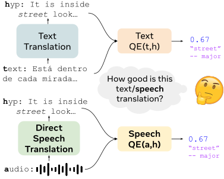
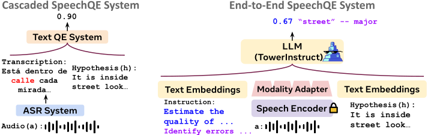
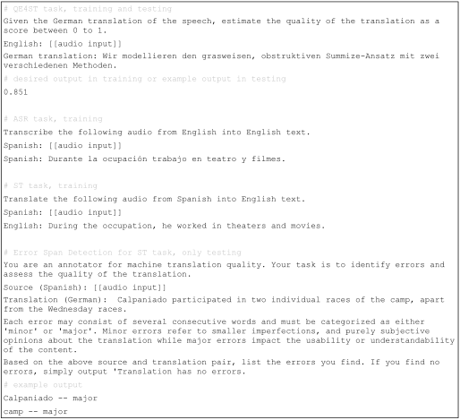

**Source:** *SpeechQE: Estimating the Quality of Direct Speech Translation* — [PDF](https://arxiv.org/pdf/2410.21485) · [arXiv](https://arxiv.org/abs/2410.21485)

# SpeechQE: Estimating the Quality of Direct Speech Translation

HyoJung Han  Affiliation: Computer Science  Affiliation: University of Maryland  Email: [hjhan@cs.umd.edu](mailto:) Kevin Duh  Affiliation: HLTCOE  Affiliation: Johns Hopkins University  Email: [kevinduh@cs.jhu.edu](mailto:) Marine Carpuat  Affiliation: Computer Science  Affiliation: University of Maryland  Email: [marine@cs.umd.edu](mailto:)

###### Abstract

Recent advances in automatic quality estimation for machine translation have exclusively focused on written language, leaving the speech modality underexplored. In this work, we formulate the task of quality estimation for speech translation, construct a benchmark, and evaluate a family of systems based on cascaded and end-to-end architectures. In this process, we introduce a novel end-to-end system leveraging pre-trained text LLM. Results suggest that end-to-end approaches are better suited to estimating the quality of direct speech translation than using quality estimation systems designed for text in cascaded systems. More broadly, we argue that quality estimation of speech translation needs to be studied as a separate problem from that of text, and release our data and models to guide further research in this space.11 1 <https://github.com/h-j-han/SpeechQE>

## 1 Introduction

Recent progress in quality estimation (QE) [Specia et al. (2010)](https://arxiv.org/html/2410.21485#bib.bib42) makes it possible to automatically rate the quality of machine translation (MT) given only the input and output of an MT system. QE ratings have been found to correlate well with human judgments, sometimes as well as reference-based metrics ([Kepler et al., 2019](https://arxiv.org/html/2410.21485#bib.bib20); [Rei et al., 2020](https://arxiv.org/html/2410.21485#bib.bib34); [Rei et al., 2023](https://arxiv.org/html/2410.21485#bib.bib33)). However, this work has focused on text translation.

Meanwhile, the rapid development of speech technology ([Radford et al., 2023](https://arxiv.org/html/2410.21485#bib.bib31); [Seamless Communication et al., 2023](https://arxiv.org/html/2410.21485#bib.bib38)) has expanded the use of speech translation (ST) applications in daily life, thus increasing the need to predict the reliability of their output. This raises the question of whether quality estimation for ST can be performed using a combination of state-of-the-art automatic speech recognition (ASR) and text-based QE (text-QE or MTQE) methods. However, relying on a cascade of ASR and text-QE systems presents two major issues: (1) The current top-performing ST models directly translate the audio input into target language text without transcribing the audio, making it inefficient to run an additional ASR system to generate an input for the text-QE module. (2) ASR transcriptions of the audio input may not match the gold transcription, potentially misleading the text-QE system. Hence, we hypothesize that end-to-end approaches might be better suited for this task.

 Figure 1: Quality Estimation for Speech Translation (SpeechQE) vs. Text Quality Estimation (text-QE). 

 Figure 2: Comparing cascaded and end-to-end approaches to Quality Estimation for Speech Translation (SpeechQE). 

In light of these issues, we formulate the task of quality estimation for speech translation (SpeechQE or STQE, Figure [1](https://arxiv.org/html/2410.21485#S1.F1 "Figure 1 ‣ 1 Introduction ‣ SpeechQE: Estimating the Quality of Direct Speech Translation")) and explore both cascaded and end-to-end (E2E) systems for this task (Figure [2](https://arxiv.org/html/2410.21485#S1.F2 "Figure 2 ‣ 1 Introduction ‣ SpeechQE: Estimating the Quality of Direct Speech Translation")). While we rely on existing ASR and text-QE modules for the cascaded system, we introduce a novel E2E SpeechQE model architecture to address the lack of a dedicated end-to-end system for this task. Our design incorporates a pre-trained speech encoder and a large language model (LLM) to leverage their existing capabilities in extracting high-quality audio features and handling translation-related tasks.

To conduct a thorough evaluation, we contribute an evaluation benchmark and training data for SpeechQE from diverse ST outputs scored with reference-based metrics. Results show that E2E models outperform the cascaded system based on a state-of-the-art (SOTA) ASR module in correlation with both (1) human direct assessment ratings and (2) metric scores. Additionally, our E2E model can detect error spans to some extent in a zero-shot fashion, though the best results are still achieved by cascaded systems with SOTA ASR. Qualitative analysis highlights the robustness of E2E models against wrong speech representation in score prediction, error span detection, and severity prediction. Based on this evidence, we argue that SpeechQE should be studied as a distinct problem from text-QE.

## 2 Background

Quality estimation makes it possible to assess translation quality without reference translations, which is essential for practical use cases ([Specia et al., 2010](https://arxiv.org/html/2410.21485#bib.bib42); [Callison-Burch et al., 2012](https://arxiv.org/html/2410.21485#bib.bib5)). QE signals can benefit end users by helping them decide how to rely on outputs in casual and high-risk settings alike ([Specia et al., 2022](https://arxiv.org/html/2410.21485#bib.bib41); [Mehandru et al., 2023](https://arxiv.org/html/2410.21485#bib.bib27)). They can also benefit downstream tasks or enhance MT itself ([Fernandes et al., 2022](https://arxiv.org/html/2410.21485#bib.bib11)).

The QE task has been framed in various ways, including predicting sentence-level quality ratings ([Callison-Burch et al., 2012](https://arxiv.org/html/2410.21485#bib.bib5)) or word-level binary tags of OK/BAD ([Bojar et al., 2013](https://arxiv.org/html/2410.21485#bib.bib4)). While a wealth of methods have been developed for these tasks, recent work has shown the benefits of developing solutions to address them jointly. OpenKiwi ([Kepler et al., 2019](https://arxiv.org/html/2410.21485#bib.bib20)) streamlined QE by supporting both word-level tagging and regression toward a sentence-level score within a unified toolkit ([Kim et al., 2017](https://arxiv.org/html/2410.21485#bib.bib21)). It was further improved with a training recipe that better supports multilingual generalization ([Rei et al., 2020](https://arxiv.org/html/2410.21485#bib.bib34); [Rei et al., 2023](https://arxiv.org/html/2410.21485#bib.bib33)). Together with the development of learned metrics for reference-based evaluation [Rei et al. (2020)](https://arxiv.org/html/2410.21485#bib.bib34); [Sellam et al. (2020)](https://arxiv.org/html/2410.21485#bib.bib39), this set the stage for a single or family of models that flexibly rate the quality of MT output with or without access to a reference human translation ([Guerreiro et al., 2024](https://arxiv.org/html/2410.21485#bib.bib15); [Juraska et al., 2023](https://arxiv.org/html/2410.21485#bib.bib19)) with high correlations with human quality ratings ([Freitag et al., 2023](https://arxiv.org/html/2410.21485#bib.bib13)). xCOMET ([Guerreiro et al., 2024](https://arxiv.org/html/2410.21485#bib.bib15)) even integrates both sentence-level evaluation and error span detection capabilities while categorizing error spans, thereby enriching the quality measures.

Meanwhile, quality estimation for speech translation remains understudied. [Le et al. (2016)](https://arxiv.org/html/2410.21485#bib.bib22) address the task of tagging each word in an ST output as good or bad, using ASR and MT features. Their approach can be viewed as a cascaded SpeechQE system, which propagates a confidence score in a pipeline of ASR and statistical machine translation (SMT) modules. BLASER2.0 ([Seamless Communication et al., 2023](https://arxiv.org/html/2410.21485#bib.bib38)) produces a similarity score between a translation output and input, using SONAR sentence-embeddings that can compare either speech or text [Duquenne et al. (2023)](https://arxiv.org/html/2410.21485#bib.bib9). While this enables SpeechQE, this approach was initially designed for speech-to-speech translation ([Chen et al., 2023](https://arxiv.org/html/2410.21485#bib.bib6)), and was exposed to only a small amount of training data with quality labels.

With advances in ST technology and their growing use [Rubenstein et al. (2023)](https://arxiv.org/html/2410.21485#bib.bib36), there is a need for QE to support ST scenarios where intermediate automatic speech recognition (ASR) outputs are not available, along with new evaluations to correctly gauge the effectiveness of quality estimation in speech translation.

## 3 SpeechQE: Task and Models

We define the task of estimating the quality of speech translation (SpeechQE or STQE22 2 We choose to use terms SpeechQE and text-QE as main instead of alternative terms STQE and MTQE to emphasize the contrast between speech and text and to facilitate easier reading. More discussion of the terminology in Appendix [E](https://arxiv.org/html/2410.21485#A5 "Appendix E Discussion of the Task Terminology ‣ SpeechQE: Estimating the Quality of Direct Speech Translation").), before introducing our cascaded and E2E systems.

In this work, we focus on predicting sentence-level scores and measuring the correlation of reference ratings provided by humans or reference-based metrics ([Fonseca et al., 2019](https://arxiv.org/html/2410.21485#bib.bib12)). Additionally, we will explore an error span detection task ([Blain et al., 2023](https://arxiv.org/html/2410.21485#bib.bib3)) in Section [5.4](https://arxiv.org/html/2410.21485#S5.SS4 "5.4 Zero-Shot Error Span Detection for ST ‣ 5 Results ‣ SpeechQE: Estimating the Quality of Direct Speech Translation"), to broaden the scope of QE beyond holistic numerical ratings.

We refer to a reference-based metric as \(metric\). Given a reference target text \(r\), an MT hypothesis \(h\) and optionally the MT source text \(t\), the \(metric\) rates the quality of \(h\) as a score \(m\):

\[\begin{aligned}
 & m=metric(h,r)\text{ or }m=metric(t,h,r) &  & \text{(1)}
\end{aligned}\]

 

Likewise, we refer to a text quality estimation system as text-QE. It produces an output score \(q\) given only a source text \(t\) and an MT hypothesis \(h\).

\[\begin{aligned}
 & q=\text{text-QE{}}(t,h) &  & \text{(2)}
\end{aligned}\]

 

In the SpeechQE task (Figure [1](https://arxiv.org/html/2410.21485#S1.F1 "Figure 1 ‣ 1 Introduction ‣ SpeechQE: Estimating the Quality of Direct Speech Translation")), given the source audio \(a\) and the translation hypothesis \(h\), a system outputs the quality score \(q\) for this hypothesis:

\[\begin{aligned}
 & q=SpeechQE{}(a,h) &  & \text{(3)}
\end{aligned}\]

 

### 3.1 Cascaded SpeechQE System

We first consider cascaded SpeechQE systems that output the score \(q_{cas}\) from a text-based QE system with the input of transcribed text \(ASR(a)\) from an ASR system and hypothesis text \(h\) (Figure [2](https://arxiv.org/html/2410.21485#S1.F2 "Figure 2 ‣ 1 Introduction ‣ SpeechQE: Estimating the Quality of Direct Speech Translation")).

\[\begin{aligned}
 & q_{cas}=\text{text-QE{}}(ASR(a),h) &  & \text{(4)}
\end{aligned}\]

 

While the cascaded systems offer a straightforward approach to SpeechQE, they present several issues. First, efficiency is a concern, as there are no naturally occurring intermediate ASR transcripts in the case of direct ST, necessitating additional ASR runs to generate inputs for the text-QE component. This introduces latency that may be undesirable in user-facing quality estimation applications. Second, source transcriptions produced by a separate ASR do not always accurately represent the spoken input, making the text-QE system vulnerable to the wrong speech representation. Third, there is a modality mismatch, as the text-QE component is not adapted to spoken language, which exhibits different styles or errors from written language. These challenges motivate us to explore end-to-end (E2E) SpeechQE solutions.

### 3.2 End-to-End SpeechQE System

We introduce the architecture and training scheme for our E2E SpeechQE model.

#### Model Architecture

Rather than training an integrated model from scratch, we choose to leverage a pre-trained speech encoder and a large language model (LLM) to utilize their abilities in extracting high-quality audio features and handling translation-related tasks, respectively. This approach is particularly useful when there is limited or no data available for training from scratch, as it enables the transfer of knowledge from text-based large language models (text-LLM) to the speech domain. We adopt a popular configuration for integrating speech modality into text-LLM that trains a lightweight modality adapter ([Wu et al., 2023](https://arxiv.org/html/2410.21485#bib.bib50); [Fathullah et al., 2023](https://arxiv.org/html/2410.21485#bib.bib10); [Wang et al., 2023a](https://arxiv.org/html/2410.21485#bib.bib48); [Wang et al., 2023b](https://arxiv.org/html/2410.21485#bib.bib49)), but the optimal architecture for SpeechQE or even broadly for integrating speech modality into text language model remains an open question.

Figure [2](https://arxiv.org/html/2410.21485#S1.F2 "Figure 2 ‣ 1 Introduction ‣ SpeechQE: Estimating the Quality of Direct Speech Translation") shows the overview of E2E system architecture. The E2E SpeechQE model has three parts: pre-trained speech encoder, modality adapter, and pre-trained text-LLM. The speech encoder extracts the audio feature from the raw audio, where we initialize with existing competitive speech models. The modality adapter subsamples the audio features to compress the audio sequence and bridges the speech representation to the text embedding space to output speech embeddings. We fix the speech encoder for all experiments, while the weights of the adapter and text-LLM can be updated depending on the training settings. The input of the text-LLM model is the concatenation of text and audio embedding sequence.

#### Training

Supervised SpeechQE training and evaluation requires triplets of audio inputs, ST hypotheses, and quality ratings. We build a corpus by generating hypotheses with direct ST systems of varying quality and obtain automatic quality labels from reference-based metric (§ [4.1](https://arxiv.org/html/2410.21485#S4.SS1 "4.1 Building SpeechQE Benchmark ‣ 4 Experimental Settings ‣ SpeechQE: Estimating the Quality of Direct Speech Translation")).33 3 This is intended to minimize any bias from the written text domain, rather than augment speech modality with TTS on existing text datasets with human scores. We train the E2E model with the SpeechQE task, complemented with the ASR and ST tasks which provide supervision of mapping between text and speech modality. We consider two training strategies. The first is a simple single-phase approach where we train a modality adapter (and optionally update text-LLM) with all three tasks. The second is a two-phase approach where we first train only an adapter with ASR and ST tasks while freezing text-LLM to focus solely on mapping between text and speech modality. Then, we continue training with the SpeechQE task to let the LLM learn the unseen task of QE. In the second phase, the adapter pre-trained in the previous phase can be frozen or updated, while text-LLM is always trained with LoRA ([Hu et al., 2022](https://arxiv.org/html/2410.21485#bib.bib18)).

We now turn to the empirical evaluation to determine whether the E2E model successfully overcomes the efficiency and modality alignment issues raised by cascaded systems.

## 4 Experimental Settings

CoVoST2/CV4 | ASR | ST | SpeechQE  
---|---|---|---  
es2en | 297k | 79k | 546k  
en2de | 305k | 290k | 589k

 Table 1: Number of instances of training corpus of each speech related tasks. CoVoST2 for ST and SpeechQE, and Common Voice 4 for ASR. SpeechQE set is generated from the subset of ST by seven translation systems. 

Es2En diect ST systems | CoVoST2 | FLEURS  
---|---|---  
whisper-large-v3 | 39.05 | 22.45  
whisper-large-v2 | 39.53 | 23.62  
whisper-large | 38.11 | 22.89  
whisper-medium | 37.39 | 21.93  
whisper-small | 31.27 | 17.78  
whisper-base | 16.93 | 11.67  
whisper-tiny | 7.81 | 6.86  
En2De direct ST systems | CoVoST2 | FLEURS  
seamless-m4t-v2-large | 43.12 | 32.21  
seamless-m4t-large | 40.55 | 31.41  
seamless-m4t-medium | 38.39 | 26.83  
s2t-wav2vec2-large-en-de | 26.98 | 19.92  
s2t-medium-mustc-multilingual-st | 8.08 | 13.43  
s2t-small-mustc-en-de-st | 7.82 | 12.34  
s2t-small-covost2-en-de-st | 14.19 | 9.50

 Table 2: The list of seven direct ST models and their BLEU scores for generating training corpus and test benchmarks of SpeechQE.

In this section, we describe the construction of the SpeechQE benchmark as well as the configuration of the evaluated systems.

### 4.1 Building SpeechQE Benchmark

<table id="S4.T3.2" class="ltx_tabular ltx_centering ltx_guessed_headers ltx_align_middle">
<tbody class="ltx_tbody">
<tr id="S4.T3.2.1" class="ltx_tr">
<th id="S4.T3.2.1.1" class="ltx_td ltx_align_left ltx_th ltx_th_row ltx_border_tt"><math id="S4.T3.m1" class="ltx_Math" alttext="\rho=corr(\text{{q}},\text{{m}})" display="inline" intent=":literal"><semantics><mrow><mi>ρ</mi><mo>=</mo><mrow><mi>c</mi><mo lspace="0em" rspace="0em">​</mo><mi>o</mi><mo lspace="0em" rspace="0em">​</mo><mi>r</mi><mo lspace="0em" rspace="0em">​</mo><mi>r</mi><mo lspace="0em" rspace="0em">​</mo><mrow><mo stretchy="false">(</mo><mtext class="ltx_mathvariant_bold">q</mtext><mo>,</mo><mtext class="ltx_mathvariant_bold">m</mtext><mo stretchy="false">)</mo></mrow></mrow></mrow><annotation encoding="application/x-tex">\rho=corr(\text{{q}},\text{{m}})</annotation></semantics></math>     <math id="S4.T3.m2" class="ltx_Math" alttext="\text{m}_{\text{xCOMET}}=\text{xCOMET}(\text{gold }t,h,r)" display="inline" intent=":literal"><semantics><mrow><msub><mtext>m</mtext><mtext>xCOMET</mtext></msub><mo>=</mo><mrow><mtext>xCOMET</mtext><mo lspace="0em" rspace="0em">​</mo><mrow><mo stretchy="false">(</mo><mrow><mtext>gold </mtext><mo lspace="0em" rspace="0em">​</mo><mi>t</mi></mrow><mo>,</mo><mi>h</mi><mo>,</mo><mi>r</mi><mo stretchy="false">)</mo></mrow></mrow></mrow><annotation encoding="application/x-tex">\text{m}_{\text{xCOMET}}=\text{xCOMET}(\text{gold }t,h,r)</annotation></semantics></math></th>
<td id="S4.T3.2.1.2" class="ltx_td ltx_align_center ltx_border_tt" colspan="2">Es2En</td>
<td id="S4.T3.2.1.3" class="ltx_td ltx_align_center ltx_border_tt" colspan="2">En2De</td></tr>
<tr id="S4.T3.2.2" class="ltx_tr">
<th id="S4.T3.2.2.1" class="ltx_td ltx_align_left ltx_th ltx_th_row">                <math id="S4.T3.m3" class="ltx_Math" alttext="\,\,\text{m}_{\text{MetricX}}=\text{MetricX}(h,r)" display="inline" intent=":literal"><semantics><mrow><msub><mtext>m</mtext><mtext>MetricX</mtext></msub><mo>=</mo><mrow><mtext>MetricX</mtext><mo lspace="0em" rspace="0em">​</mo><mrow><mo stretchy="false">(</mo><mi>h</mi><mo>,</mo><mi>r</mi><mo stretchy="false">)</mo></mrow></mrow></mrow><annotation encoding="application/x-tex">\,\,\text{m}_{\text{MetricX}}=\text{MetricX}(h,r)</annotation></semantics></math></th>
<td id="S4.T3.2.2.2" class="ltx_td ltx_align_center"><math id="S4.T3.m4" class="ltx_Math" alttext="\text{m}_{\text{xCOMET}}" display="inline" intent=":literal"><semantics><msub><mtext>m</mtext><mtext>xCOMET</mtext></msub><annotation encoding="application/x-tex">\text{m}_{\text{xCOMET}}</annotation></semantics></math></td>
<td id="S4.T3.2.2.3" class="ltx_td ltx_align_center"><math id="S4.T3.m5" class="ltx_Math" alttext="\text{m}_{\text{MetricX}}" display="inline" intent=":literal"><semantics><msub><mtext>m</mtext><mtext>MetricX</mtext></msub><annotation encoding="application/x-tex">\text{m}_{\text{MetricX}}</annotation></semantics></math></td>
<td id="S4.T3.2.2.4" class="ltx_td ltx_align_center"><math id="S4.T3.m6" class="ltx_Math" alttext="\text{m}_{\text{xCOMET}}" display="inline" intent=":literal"><semantics><msub><mtext>m</mtext><mtext>xCOMET</mtext></msub><annotation encoding="application/x-tex">\text{m}_{\text{xCOMET}}</annotation></semantics></math></td>
<td id="S4.T3.2.2.5" class="ltx_td ltx_align_center"><math id="S4.T3.m7" class="ltx_Math" alttext="\text{m}_{\text{MetricX}}" display="inline" intent=":literal"><semantics><msub><mtext>m</mtext><mtext>MetricX</mtext></msub><annotation encoding="application/x-tex">\text{m}_{\text{MetricX}}</annotation></semantics></math></td></tr>
<tr id="S4.T3.2.3" class="ltx_tr">
<th id="S4.T3.2.3.1" class="ltx_td ltx_align_center ltx_th ltx_th_row ltx_border_t" colspan="5">Cascaded SpeechQE Systems Correlations<math id="S4.T3.m8" class="ltx_Math" alttext="\,\rho_{cas}=corr(\text{{q}}_{cas},\text{{m}})" display="inline" intent=":literal"><semantics><mrow><msub><mi mathvariant="normal">ρ</mi><mrow><mi mathvariant="normal">c</mi><mo lspace="0em" rspace="0em">​</mo><mi mathvariant="normal">a</mi><mo lspace="0em" rspace="0em">​</mo><mi mathvariant="normal">s</mi></mrow></msub><mo>=</mo><mrow><mi mathvariant="normal">c</mi><mo lspace="0em" rspace="0em">​</mo><mi mathvariant="normal">o</mi><mo lspace="0em" rspace="0em">​</mo><mi mathvariant="normal">r</mi><mo lspace="0em" rspace="0em">​</mo><mi mathvariant="normal">r</mi><mo lspace="0em" rspace="0em">​</mo><mrow><mo stretchy="false">(</mo><msub><mtext>q</mtext><mrow><mi mathvariant="normal">c</mi><mo lspace="0em" rspace="0em">​</mo><mi mathvariant="normal">a</mi><mo lspace="0em" rspace="0em">​</mo><mi mathvariant="normal">s</mi></mrow></msub><mo>,</mo><mtext>m</mtext><mo stretchy="false">)</mo></mrow></mrow></mrow><annotation encoding="application/x-tex">\,\rho_{cas}=corr(\text{{q}}_{cas},\text{{m}})</annotation></semantics></math></th></tr>
<tr id="S4.T3.2.4" class="ltx_tr">
<th id="S4.T3.2.4.1" class="ltx_td ltx_align_left ltx_th ltx_th_row"><math id="S4.T3.m9" class="ltx_Math" alttext="\text{q}_{cas}=\text{xCOMET-qe}(\text{gold }t,h)" display="inline" intent=":literal"><semantics><mrow><msub><mtext>q</mtext><mrow><mi>c</mi><mo lspace="0em" rspace="0em">​</mo><mi>a</mi><mo lspace="0em" rspace="0em">​</mo><mi>s</mi></mrow></msub><mo>=</mo><mrow><mtext>xCOMET-qe</mtext><mo lspace="0em" rspace="0em">​</mo><mrow><mo stretchy="false">(</mo><mrow><mtext>gold </mtext><mo lspace="0em" rspace="0em">​</mo><mi>t</mi></mrow><mo>,</mo><mi>h</mi><mo stretchy="false">)</mo></mrow></mrow></mrow><annotation encoding="application/x-tex">\text{q}_{cas}=\text{xCOMET-qe}(\text{gold }t,h)</annotation></semantics></math></th>
<td id="S4.T3.2.4.2" class="ltx_td ltx_align_center">0.929</td>
<td id="S4.T3.2.4.3" class="ltx_td ltx_align_center"><math id="S4.T3.m10" class="ltx_Math" alttext="\overline{\mbox{0.812}}" display="inline" intent=":literal"><semantics><mover accent="true"><mtext>0.812</mtext><mo stretchy="true">¯</mo></mover><annotation encoding="application/x-tex">\overline{\mbox{0.812}}</annotation></semantics></math></td>
<td id="S4.T3.2.4.4" class="ltx_td ltx_align_center">0.967</td>
<td id="S4.T3.2.4.5" class="ltx_td ltx_align_center"><math id="S4.T3.m11" class="ltx_Math" alttext="\overline{\mbox{0.872}}" display="inline" intent=":literal"><semantics><mover accent="true"><mtext>0.872</mtext><mo stretchy="true">¯</mo></mover><annotation encoding="application/x-tex">\overline{\mbox{0.872}}</annotation></semantics></math></td></tr>
<tr id="S4.T3.2.5" class="ltx_tr">
<th id="S4.T3.2.5.1" class="ltx_td ltx_align_left ltx_th ltx_th_row"><math id="S4.T3.m12" class="ltx_Math" alttext="\text{q}_{cas}=\text{xCOMET-qe}(\text{ASR}(a),h)" display="inline" intent=":literal"><semantics><mrow><msub><mtext>q</mtext><mrow><mi>c</mi><mo lspace="0em" rspace="0em">​</mo><mi>a</mi><mo lspace="0em" rspace="0em">​</mo><mi>s</mi></mrow></msub><mo>=</mo><mrow><mtext>xCOMET-qe</mtext><mo lspace="0em" rspace="0em">​</mo><mrow><mo stretchy="false">(</mo><mrow><mtext>ASR</mtext><mo lspace="0em" rspace="0em">​</mo><mrow><mo stretchy="false">(</mo><mi>a</mi><mo stretchy="false">)</mo></mrow></mrow><mo>,</mo><mi>h</mi><mo stretchy="false">)</mo></mrow></mrow></mrow><annotation encoding="application/x-tex">\text{q}_{cas}=\text{xCOMET-qe}(\text{ASR}(a),h)</annotation></semantics></math></th>
<td id="S4.T3.2.5.2" class="ltx_td ltx_align_center"><math id="S4.T3.m13" class="ltx_Math" alttext="\overline{\mbox{0.892}}" display="inline" intent=":literal"><semantics><mover accent="true"><mtext>0.892</mtext><mo stretchy="true">¯</mo></mover><annotation encoding="application/x-tex">\overline{\mbox{0.892}}</annotation></semantics></math></td>
<td id="S4.T3.2.5.3" class="ltx_td ltx_align_center">0.782</td>
<td id="S4.T3.2.5.4" class="ltx_td ltx_align_center"><math id="S4.T3.m14" class="ltx_Math" alttext="\overline{\mbox{0.910}}" display="inline" intent=":literal"><semantics><mover accent="true"><mtext>0.910</mtext><mo stretchy="true">¯</mo></mover><annotation encoding="application/x-tex">\overline{\mbox{0.910}}</annotation></semantics></math></td>
<td id="S4.T3.2.5.5" class="ltx_td ltx_align_center">0.821</td></tr>
<tr id="S4.T3.2.6" class="ltx_tr">
<th id="S4.T3.2.6.1" class="ltx_td ltx_align_left ltx_th ltx_th_row ltx_border_t"><math id="S4.T3.m15" class="ltx_Math" alttext="\text{q}_{cas}=\text{MetricX-qe}(\text{gold }t,h)" display="inline" intent=":literal"><semantics><mrow><msub><mtext>q</mtext><mrow><mi>c</mi><mo lspace="0em" rspace="0em">​</mo><mi>a</mi><mo lspace="0em" rspace="0em">​</mo><mi>s</mi></mrow></msub><mo>=</mo><mrow><mtext>MetricX-qe</mtext><mo lspace="0em" rspace="0em">​</mo><mrow><mo stretchy="false">(</mo><mrow><mtext>gold </mtext><mo lspace="0em" rspace="0em">​</mo><mi>t</mi></mrow><mo>,</mo><mi>h</mi><mo stretchy="false">)</mo></mrow></mrow></mrow><annotation encoding="application/x-tex">\text{q}_{cas}=\text{MetricX-qe}(\text{gold }t,h)</annotation></semantics></math></th>
<td id="S4.T3.2.6.2" class="ltx_td ltx_align_center ltx_border_t"><math id="S4.T3.m16" class="ltx_Math" alttext="\overline{\mbox{0.834}}" display="inline" intent=":literal"><semantics><mover accent="true"><mtext>0.834</mtext><mo stretchy="true">¯</mo></mover><annotation encoding="application/x-tex">\overline{\mbox{0.834}}</annotation></semantics></math></td>
<td id="S4.T3.2.6.3" class="ltx_td ltx_align_center ltx_border_t">0.844</td>
<td id="S4.T3.2.6.4" class="ltx_td ltx_align_center ltx_border_t"><math id="S4.T3.m17" class="ltx_Math" alttext="\overline{\mbox{0.908}}" display="inline" intent=":literal"><semantics><mover accent="true"><mtext>0.908</mtext><mo stretchy="true">¯</mo></mover><annotation encoding="application/x-tex">\overline{\mbox{0.908}}</annotation></semantics></math></td>
<td id="S4.T3.2.6.5" class="ltx_td ltx_align_center ltx_border_t">0.932</td></tr>
<tr id="S4.T3.2.7" class="ltx_tr">
<th id="S4.T3.2.7.1" class="ltx_td ltx_align_left ltx_th ltx_th_row"><math id="S4.T3.m18" class="ltx_Math" alttext="\text{q}_{cas}=\text{MetricX-qe}(\text{ASR}(a),h)" display="inline" intent=":literal"><semantics><mrow><msub><mtext>q</mtext><mrow><mi>c</mi><mo lspace="0em" rspace="0em">​</mo><mi>a</mi><mo lspace="0em" rspace="0em">​</mo><mi>s</mi></mrow></msub><mo>=</mo><mrow><mtext>MetricX-qe</mtext><mo lspace="0em" rspace="0em">​</mo><mrow><mo stretchy="false">(</mo><mrow><mtext>ASR</mtext><mo lspace="0em" rspace="0em">​</mo><mrow><mo stretchy="false">(</mo><mi>a</mi><mo stretchy="false">)</mo></mrow></mrow><mo>,</mo><mi>h</mi><mo stretchy="false">)</mo></mrow></mrow></mrow><annotation encoding="application/x-tex">\text{q}_{cas}=\text{MetricX-qe}(\text{ASR}(a),h)</annotation></semantics></math></th>
<td id="S4.T3.2.7.2" class="ltx_td ltx_align_center">0.803</td>
<td id="S4.T3.2.7.3" class="ltx_td ltx_align_center">0.803</td>
<td id="S4.T3.2.7.4" class="ltx_td ltx_align_center">0.854</td>
<td id="S4.T3.2.7.5" class="ltx_td ltx_align_center"><math id="S4.T3.m19" class="ltx_Math" alttext="\overline{\mbox{0.871}}" display="inline" intent=":literal"><semantics><mover accent="true"><mtext>0.871</mtext><mo stretchy="true">¯</mo></mover><annotation encoding="application/x-tex">\overline{\mbox{0.871}}</annotation></semantics></math></td></tr>
<tr id="S4.T3.2.8" class="ltx_tr">
<th id="S4.T3.2.8.1" class="ltx_td ltx_align_left ltx_th ltx_th_row ltx_border_t"><math id="S4.T3.m20" class="ltx_Math" alttext="\text{q}_{cas}=\text{text-BLASER2.0-qe}(\text{gold }t,h)" display="inline" intent=":literal"><semantics><mrow><msub><mtext>q</mtext><mrow><mi>c</mi><mo lspace="0em" rspace="0em">​</mo><mi>a</mi><mo lspace="0em" rspace="0em">​</mo><mi>s</mi></mrow></msub><mo>=</mo><mrow><mtext>text-BLASER2.0-qe</mtext><mo lspace="0em" rspace="0em">​</mo><mrow><mo stretchy="false">(</mo><mrow><mtext>gold </mtext><mo lspace="0em" rspace="0em">​</mo><mi>t</mi></mrow><mo>,</mo><mi>h</mi><mo stretchy="false">)</mo></mrow></mrow></mrow><annotation encoding="application/x-tex">\text{q}_{cas}=\text{text-BLASER2.0-qe}(\text{gold }t,h)</annotation></semantics></math></th>
<td id="S4.T3.2.8.2" class="ltx_td ltx_align_center ltx_border_t"><math id="S4.T3.m21" class="ltx_Math" alttext="\overline{\mbox{0.813}}" display="inline" intent=":literal"><semantics><mover accent="true"><mtext>0.813</mtext><mo stretchy="true">¯</mo></mover><annotation encoding="application/x-tex">\overline{\mbox{0.813}}</annotation></semantics></math></td>
<td id="S4.T3.2.8.3" class="ltx_td ltx_align_center ltx_border_t"><math id="S4.T3.m22" class="ltx_Math" alttext="\overline{\mbox{0.739}}" display="inline" intent=":literal"><semantics><mover accent="true"><mtext>0.739</mtext><mo stretchy="true">¯</mo></mover><annotation encoding="application/x-tex">\overline{\mbox{0.739}}</annotation></semantics></math></td>
<td id="S4.T3.2.8.4" class="ltx_td ltx_align_center ltx_border_t"><math id="S4.T3.m23" class="ltx_Math" alttext="\overline{\mbox{0.870}}" display="inline" intent=":literal"><semantics><mover accent="true"><mtext>0.870</mtext><mo stretchy="true">¯</mo></mover><annotation encoding="application/x-tex">\overline{\mbox{0.870}}</annotation></semantics></math></td>
<td id="S4.T3.2.8.5" class="ltx_td ltx_align_center ltx_border_t"><math id="S4.T3.m24" class="ltx_Math" alttext="\overline{\mbox{0.833}}" display="inline" intent=":literal"><semantics><mover accent="true"><mtext>0.833</mtext><mo stretchy="true">¯</mo></mover><annotation encoding="application/x-tex">\overline{\mbox{0.833}}</annotation></semantics></math></td></tr>
<tr id="S4.T3.2.9" class="ltx_tr">
<th id="S4.T3.2.9.1" class="ltx_td ltx_align_left ltx_th ltx_th_row"><math id="S4.T3.m25" class="ltx_Math" alttext="\text{q}_{cas}=\text{text-BLASER2.0-qe}(\text{ASR}(a),h)" display="inline" intent=":literal"><semantics><mrow><msub><mtext>q</mtext><mrow><mi>c</mi><mo lspace="0em" rspace="0em">​</mo><mi>a</mi><mo lspace="0em" rspace="0em">​</mo><mi>s</mi></mrow></msub><mo>=</mo><mrow><mtext>text-BLASER2.0-qe</mtext><mo lspace="0em" rspace="0em">​</mo><mrow><mo stretchy="false">(</mo><mrow><mtext>ASR</mtext><mo lspace="0em" rspace="0em">​</mo><mrow><mo stretchy="false">(</mo><mi>a</mi><mo stretchy="false">)</mo></mrow></mrow><mo>,</mo><mi>h</mi><mo stretchy="false">)</mo></mrow></mrow></mrow><annotation encoding="application/x-tex">\text{q}_{cas}=\text{text-BLASER2.0-qe}(\text{ASR}(a),h)</annotation></semantics></math></th>
<td id="S4.T3.2.9.2" class="ltx_td ltx_align_center">0.776</td>
<td id="S4.T3.2.9.3" class="ltx_td ltx_align_center">0.711</td>
<td id="S4.T3.2.9.4" class="ltx_td ltx_align_center">0.813</td>
<td id="S4.T3.2.9.5" class="ltx_td ltx_align_center">0.771</td></tr>
<tr id="S4.T3.2.10" class="ltx_tr">
<th id="S4.T3.2.10.1" class="ltx_td ltx_align_center ltx_th ltx_th_row ltx_border_t" colspan="5">End-to-End SpeechQE Systems Correlations<math id="S4.T3.m26" class="ltx_Math" alttext="\,\rho_{e2e}=corr(\text{{q}}_{e2e},\text{{m}})" display="inline" intent=":literal"><semantics><mrow><msub><mi mathvariant="normal">ρ</mi><mrow><mi mathvariant="normal">e</mi><mo lspace="0em" rspace="0em">​</mo><mn>2</mn><mo lspace="0em" rspace="0em">​</mo><mi mathvariant="normal">e</mi></mrow></msub><mo>=</mo><mrow><mi mathvariant="normal">c</mi><mo lspace="0em" rspace="0em">​</mo><mi mathvariant="normal">o</mi><mo lspace="0em" rspace="0em">​</mo><mi mathvariant="normal">r</mi><mo lspace="0em" rspace="0em">​</mo><mi mathvariant="normal">r</mi><mo lspace="0em" rspace="0em">​</mo><mrow><mo stretchy="false">(</mo><msub><mtext>q</mtext><mrow><mi mathvariant="normal">e</mi><mo lspace="0em" rspace="0em">​</mo><mn>2</mn><mo lspace="0em" rspace="0em">​</mo><mi mathvariant="normal">e</mi></mrow></msub><mo>,</mo><mtext>m</mtext><mo stretchy="false">)</mo></mrow></mrow></mrow><annotation encoding="application/x-tex">\,\rho_{e2e}=corr(\text{{q}}_{e2e},\text{{m}})</annotation></semantics></math></th></tr>
<tr id="S4.T3.2.11" class="ltx_tr">
<th id="S4.T3.2.11.1" class="ltx_td ltx_align_left ltx_th ltx_th_row"><math id="S4.T3.m27" class="ltx_Math" alttext="\text{q}_{e2e}=\text{BLASER2.0-qe}(a,h)" display="inline" intent=":literal"><semantics><mrow><msub><mtext>q</mtext><mrow><mi>e</mi><mo lspace="0em" rspace="0em">​</mo><mn>2</mn><mo lspace="0em" rspace="0em">​</mo><mi>e</mi></mrow></msub><mo>=</mo><mrow><mtext>BLASER2.0-qe</mtext><mo lspace="0em" rspace="0em">​</mo><mrow><mo stretchy="false">(</mo><mi>a</mi><mo>,</mo><mi>h</mi><mo stretchy="false">)</mo></mrow></mrow></mrow><annotation encoding="application/x-tex">\text{q}_{e2e}=\text{BLASER2.0-qe}(a,h)</annotation></semantics></math></th>
<td id="S4.T3.2.11.2" class="ltx_td ltx_align_center">0.780</td>
<td id="S4.T3.2.11.3" class="ltx_td ltx_align_center">0.712</td>
<td id="S4.T3.2.11.4" class="ltx_td ltx_align_center">0.856</td>
<td id="S4.T3.2.11.5" class="ltx_td ltx_align_center">0.819</td></tr>
<tr id="S4.T3.2.12" class="ltx_tr">
<th id="S4.T3.2.12.1" class="ltx_td ltx_align_left ltx_th ltx_th_row ltx_border_t"><math id="S4.T3.m28" class="ltx_Math" alttext="\text{q}_{e2e}=\text{{TowerInstruct-Fixed+Adapter}}(a,h)" display="inline" intent=":literal"><semantics><mrow><msub><mtext>q</mtext><mrow><mi>e</mi><mo lspace="0em" rspace="0em">​</mo><mn>2</mn><mo lspace="0em" rspace="0em">​</mo><mi>e</mi></mrow></msub><mo>=</mo><mrow><mtext class="ltx_mathvariant_italic">TowerInstruct-Fixed+Adapter</mtext><mo lspace="0em" rspace="0em">​</mo><mrow><mo stretchy="false">(</mo><mi>a</mi><mo>,</mo><mi>h</mi><mo stretchy="false">)</mo></mrow></mrow></mrow><annotation encoding="application/x-tex">\text{q}_{e2e}=\text{{TowerInstruct-Fixed+Adapter}}(a,h)</annotation></semantics></math></th>
<td id="S4.T3.2.12.2" class="ltx_td ltx_align_center ltx_border_t">0.862</td>
<td id="S4.T3.2.12.3" class="ltx_td ltx_align_center ltx_border_t">0.797</td>
<td id="S4.T3.2.12.4" class="ltx_td ltx_align_center ltx_border_t">0.882</td>
<td id="S4.T3.2.12.5" class="ltx_td ltx_align_center ltx_border_t">0.848</td></tr>
<tr id="S4.T3.2.13" class="ltx_tr">
<th id="S4.T3.2.13.1" class="ltx_td ltx_align_left ltx_th ltx_th_row"><math id="S4.T3.m29" class="ltx_Math" alttext="\text{q}_{e2e}=\text{{TowerInstruct-LoRA+Adapter}}(a,h)" display="inline" intent=":literal"><semantics><mrow><msub><mtext>q</mtext><mrow><mi>e</mi><mo lspace="0em" rspace="0em">​</mo><mn>2</mn><mo lspace="0em" rspace="0em">​</mo><mi>e</mi></mrow></msub><mo>=</mo><mrow><mtext class="ltx_mathvariant_italic">TowerInstruct-LoRA+Adapter</mtext><mo lspace="0em" rspace="0em">​</mo><mrow><mo stretchy="false">(</mo><mi>a</mi><mo>,</mo><mi>h</mi><mo stretchy="false">)</mo></mrow></mrow></mrow><annotation encoding="application/x-tex">\text{q}_{e2e}=\text{{TowerInstruct-LoRA+Adapter}}(a,h)</annotation></semantics></math></th>
<td id="S4.T3.2.13.2" class="ltx_td ltx_align_center">0.882</td>
<td id="S4.T3.2.13.3" class="ltx_td ltx_align_center">0.818</td>
<td id="S4.T3.2.13.4" class="ltx_td ltx_align_center">0.914</td>
<td id="S4.T3.2.13.5" class="ltx_td ltx_align_center">0.867</td></tr>
<tr id="S4.T3.2.14" class="ltx_tr">
<th id="S4.T3.2.14.1" class="ltx_td ltx_align_left ltx_th ltx_th_row"><math id="S4.T3.m30" class="ltx_Math" alttext="\text{q}_{e2e}=\text{{TowerInstruct-LoRA+Adapter-pt}}(a,h)" display="inline" intent=":literal"><semantics><mrow><msub><mtext>q</mtext><mrow><mi>e</mi><mo lspace="0em" rspace="0em">​</mo><mn>2</mn><mo lspace="0em" rspace="0em">​</mo><mi>e</mi></mrow></msub><mo>=</mo><mrow><mtext class="ltx_mathvariant_italic">TowerInstruct-LoRA+Adapter-pt</mtext><mo lspace="0em" rspace="0em">​</mo><mrow><mo stretchy="false">(</mo><mi>a</mi><mo>,</mo><mi>h</mi><mo stretchy="false">)</mo></mrow></mrow></mrow><annotation encoding="application/x-tex">\text{q}_{e2e}=\text{{TowerInstruct-LoRA+Adapter-pt}}(a,h)</annotation></semantics></math></th>
<td id="S4.T3.2.14.2" class="ltx_td ltx_align_center">0.890</td>
<td id="S4.T3.2.14.3" class="ltx_td ltx_align_center">0.833</td>
<td id="S4.T3.2.14.4" class="ltx_td ltx_align_center">0.922</td>
<td id="S4.T3.2.14.5" class="ltx_td ltx_align_center">0.872</td></tr>
<tr id="S4.T3.2.15" class="ltx_tr">
<th id="S4.T3.2.15.1" class="ltx_td ltx_align_left ltx_th ltx_th_row ltx_border_bb"><math id="S4.T3.m31" class="ltx_Math" alttext="\text{q}_{e2e}=\text{{TowerInstruct-LoRA+Adapter-pt-Fixed}}(a,h)" display="inline" intent=":literal"><semantics><mrow><msub><mtext>q</mtext><mrow><mi>e</mi><mo lspace="0em" rspace="0em">​</mo><mn>2</mn><mo lspace="0em" rspace="0em">​</mo><mi>e</mi></mrow></msub><mo>=</mo><mrow><mtext class="ltx_mathvariant_italic">TowerInstruct-LoRA+Adapter-pt-Fixed</mtext><mo lspace="0em" rspace="0em">​</mo><mrow><mo stretchy="false">(</mo><mi>a</mi><mo>,</mo><mi>h</mi><mo stretchy="false">)</mo></mrow></mrow></mrow><annotation encoding="application/x-tex">\text{q}_{e2e}=\text{{TowerInstruct-LoRA+Adapter-pt-Fixed}}(a,h)</annotation></semantics></math></th>
<td id="S4.T3.2.15.2" class="ltx_td ltx_align_center ltx_border_bb">0.895</td>
<td id="S4.T3.2.15.3" class="ltx_td ltx_align_center ltx_border_bb">0.834</td>
<td id="S4.T3.2.15.4" class="ltx_td ltx_align_center ltx_border_bb">0.925</td>
<td id="S4.T3.2.15.5" class="ltx_td ltx_align_center ltx_border_bb">0.873</td></tr>
</tbody>
</table>

 Table 3: Correlations (\(\rho\)) between SpeechQE system scores (q) and metric scores (m) for quality of ST on CoVoST2 test. ASR is whisper-large-v3, the cutting-edge model. E2E systems outperform ASR cascaded systems and even some cascaded ones with gold transcriptions. Overlines in cascaded correlation mean that the best E2E system outperforms the corresponding cascaded system. Bolded text in E2E indicate the best score within each column.

We build a training corpus and test benchmark for SpeechQE from CoVoST2 ([Wang et al., 2021](https://arxiv.org/html/2410.21485#bib.bib47)) which is a speech translation corpus based on Common Voice 4 ASR datasets ([Ardila et al., 2020](https://arxiv.org/html/2410.21485#bib.bib2)). We consider two translation directions: Spanish-to-English and English-to-German. We subsample about 80k segments from the training set and 500 from the dev and test of CoVoST2, then run seven different direct ST models to generate the ST hypotheses. The direct ST models are off-the-shelf models of a wide range of translation quality including Whisper ([Radford et al., 2022](https://arxiv.org/html/2410.21485#bib.bib30)) for Es2En, and Seamless-M4T ([Seamless Communication et al., 2023](https://arxiv.org/html/2410.21485#bib.bib38)) and Fairseq S2T ([Wang et al., 2020](https://arxiv.org/html/2410.21485#bib.bib46)) for En2De. The details of ST models are in Table [2](https://arxiv.org/html/2410.21485#S4.T2 "Table 2 ‣ 4 Experimental Settings ‣ SpeechQE: Estimating the Quality of Direct Speech Translation").

Given the generated hypothesis text, reference text, and gold transcription text, we get automatic quality labels from (reference-based) metrics since reference-based scores are generally known to be better correlated with human judgment on translation quality than reference-free scores ([Freitag et al., 2023](https://arxiv.org/html/2410.21485#bib.bib13)). For training, we choose xCOMET-XL ([Guerreiro et al., 2024](https://arxiv.org/html/2410.21485#bib.bib15)) as metric because it is one of the best-performing submissions in the WMT23 metric shared task. The final statistics for the training dataset are in Table [1](https://arxiv.org/html/2410.21485#S4.T1 "Table 1 ‣ 4 Experimental Settings ‣ SpeechQE: Estimating the Quality of Direct Speech Translation"). For the test, we obtain metric scores from both xCOMET-XL and MetricX-23-XL ([Juraska et al., 2023](https://arxiv.org/html/2410.21485#bib.bib19)) as two distinct types of quality labels to avoid biased comparison with the cascaded system.

### 4.2 Cascaded Modeling

For the cascaded system, we use the same set of Whisper models that generates the Es2En ST hypothesis as the ASR module for both the Es2En and En2De cascaded experiments. For QE modules, we use the same metric models that generate reference-based quality labels in Section [4.1](https://arxiv.org/html/2410.21485#S4.SS1 "4.1 Building SpeechQE Benchmark ‣ 4 Experimental Settings ‣ SpeechQE: Estimating the Quality of Direct Speech Translation") but with reference-free inputs: source and hyothesis.44 4 We choose to report QE decoding of MetricX-23-XL instead of the dedicated QE model of MetricX-23-QE-XL as the former has higher correlations with human DA and the findings in the Results sections are the same.

### 4.3 E2E Modeling

We initialize the speech encoder from Whisper-large-v2 and freeze it for all experiments. The text-LLM is TowerInstruct-7B ([Alves et al., 2024](https://arxiv.org/html/2410.21485#bib.bib1)) which is continued pre-training and finetuned with instructions relevant to translation processes from Llama 2 ([Touvron et al., 2023](https://arxiv.org/html/2410.21485#bib.bib45)). This model has not trained on the task of predicting the quality score of a given translation (QE) but has trained on the error span detection task. We either freeze the TowerInstuct model or train it with LoRA (\(r=16\), \(\alpha=32\)). The modality adapter consists of three 1-dimensional convolutional layers followed by a 512-dimensional bottleneck layer ([Houlsby et al., 2019](https://arxiv.org/html/2410.21485#bib.bib17)), following [Wang et al. (2023a)](https://arxiv.org/html/2410.21485#bib.bib48). The adapter is initialized randomly and unfrozen unless stated.

All our E2E models are trained on a single A6000 GPU with a batch size of 8 updated in fixed steps (140k steps for the single phase strategy, and 120k+80k steps for the two-phase strategy). In addition to the SpeechQE training set, we use Common Voice 4 and CoVoST2 for ASR and ST. We use language modeling loss with fixed instruction prompts for each task for all settings, following the chat template of TowerInstruct. More experimental details are in Appendix [D](https://arxiv.org/html/2410.21485#A4 "Appendix D Additional Experimental Details ‣ SpeechQE: Estimating the Quality of Direct Speech Translation") including the instruction prompt templates for each task (Figure [3](https://arxiv.org/html/2410.21485#A5.F3 "Figure 3 ‣ Appendix E Discussion of the Task Terminology ‣ SpeechQE: Estimating the Quality of Direct Speech Translation")).

As another baseline, we use the BLASER2.0-qe to experiment with both cascaded and E2E scenarios. The inputs of E2E setting are SONAR embedding of source speech and target text, while all text embedding is for the cascaded setting.

### 4.4 Evaluation

We evaluate all models on the SpeechQE test set built in Section [4.1](https://arxiv.org/html/2410.21485#S4.SS1 "4.1 Building SpeechQE Benchmark ‣ 4 Experimental Settings ‣ SpeechQE: Estimating the Quality of Direct Speech Translation"), which has two types of metric labels from xCOMET-XL and MetricX-XL. A lower score of MetricX indicates better quality, while that of xCOMET and E2E systems indicates the opposite. To simplify our analysis, we multiply MetricX scores by negative one, which allows us to focus on the extent of correlation without considering the direction. We use the Spearman as the primary measurement following [Blain et al. (2023)](https://arxiv.org/html/2410.21485#bib.bib3).

For evaluation on quality labels by human judgement instead of metric, we compare human direct assessment (DA) score on IWSLT ACL set from [Sperber et al. (2024)](https://arxiv.org/html/2410.21485#bib.bib43) which is based on [Salesky et al. (2023)](https://arxiv.org/html/2410.21485#bib.bib37).55 5 <https://huggingface.co/datasets/IWSLT/da2023> This dataset is based on presentation videos describing their ACL papers, thus including highly technical terms and having domain mismatches between our main training corpus. It contains the source-based DA ratings of 416 hypotheses from each of the ten ST systems, resulting in a total of 4,160 instances. We include additional QE and metric models including sentence BLEU and Comet(KiWi) ([Rei et al., 2022a](https://arxiv.org/html/2410.21485#bib.bib32); [Rei et al., 2022b](https://arxiv.org/html/2410.21485#bib.bib35); [Rei et al., 2023](https://arxiv.org/html/2410.21485#bib.bib33)).

## 5 Results

We first present our main results by comparing SpeechQE ratings with reference-based metrics (§ [5.1](https://arxiv.org/html/2410.21485#S5.SS1 "5.1 Correlation with Reference-based Metrics ‣ 5 Results ‣ SpeechQE: Estimating the Quality of Direct Speech Translation")), then turn to using human ratings of translation quality (§ [5.2](https://arxiv.org/html/2410.21485#S5.SS2 "5.2 SpeechQE Correlation with Human DA ‣ 5 Results ‣ SpeechQE: Estimating the Quality of Direct Speech Translation")). We add the results of varying model sizes and architecture of the cascaded system. (§ [5.3](https://arxiv.org/html/2410.21485#S5.SS3 "5.3 Cascaded Model Size and Architecture ‣ 5 Results ‣ SpeechQE: Estimating the Quality of Direct Speech Translation")). Finally, we evaluate our models on a zero-shot error detection task (§ [5.4](https://arxiv.org/html/2410.21485#S5.SS4 "5.4 Zero-Shot Error Span Detection for ST ‣ 5 Results ‣ SpeechQE: Estimating the Quality of Direct Speech Translation")) and conduct a qualitative analysis of outputs (§ [5.5](https://arxiv.org/html/2410.21485#S5.SS5 "5.5 Example Analysis ‣ 5 Results ‣ SpeechQE: Estimating the Quality of Direct Speech Translation")). We additionally evaluate and train our systems with out-of-domain settings (Appendix [A](https://arxiv.org/html/2410.21485#A1 "Appendix A Robustness to Out-of-Domain Test Sets ‣ SpeechQE: Estimating the Quality of Direct Speech Translation") and [B](https://arxiv.org/html/2410.21485#A2 "Appendix B Adding FLEURS set to E2E Training ‣ SpeechQE: Estimating the Quality of Direct Speech Translation")).

### 5.1 Correlation with Reference-based Metrics

Table [3](https://arxiv.org/html/2410.21485#S4.T3 "Table 3 ‣ 4.1 Building SpeechQE Benchmark ‣ 4 Experimental Settings ‣ SpeechQE: Estimating the Quality of Direct Speech Translation") shows correlations between metric scores as quality labels and SpeechQE system output scores, where the input of metric includes gold transcription source text and reference text.

#### Cascaded.

For metric and text-QE scores, we cross-compare two metric scores (xCOMET and MetricX) as quality labels and two QE scores (xCOMET-qe and MetricX-qe) within cascaded configurations since the matching QE and metric model could favor the output from the model similar to its own. For example, the xCOMET is a single model for both metric and QE with different inputs, showing higher correlation values in the metric-QE model matching configuration (0.929 in Es2En) than mismatch (0.834 or 0.812).

#### E2E.

Among four E2E models, LoRA training the text-LLM with a fixed pre-trained speech adapter (TowerInstruct-LoRA+Adapter-pt-Fixed) performs the best in all language pairs and metric types. The simplest training of fixing LLM and updating only the adapter with all three tasks in a single phase (TowerInstruct-Fixed+Adapter) shows the lowest correlations followed by similar methods but LoRA training the text-LLM (TowerInstruct-LoRA+Adapter). This suggests that a separate training phase for mapping speech-to-text perception is critical and that the weight updates are necessary when a text-LLM is not fine-tuned for the target task and therefore lacks the required capabilities. In this case, TowerInstruct is not fine-tuned with QE tasks, therefore, updating it is necessary. All variants of our E2E system outperform BLASER2.0, perhaps due to its limited exposure to diverse translation quality at training time.

#### E2E vs Cascaded.

The end-to-end SpeechQE systems consistently outperform the cascaded system which included the SOTA ASR system (whisper-large-v3). The best E2E system not only outperforms ASR-based cascades, but cascaded systems that use gold transcriptions in all QE(row)-metric(column) mismatched settings of both language pairs. For instance, 0.834 of E2E versus 0.812 of xCOMET-qe(gold \(t\),\(h\)) cascaded in Es2En MetricX column. Similarly, BLASER2.0 with the E2E setting of speech input and text output outperforms the cascade system with the text input-output setting (text-BLASER2.0).

Overall, the correlation analysis underscores the advantage of end-to-end SpeechQE systems over cascaded ones. The strong correlations with metric scores across various configurations indicate its reliability as a measurement for quality estimation in automatic speech translation tasks, highlighting the potential of end-to-end approaches.

### 5.2 SpeechQE Correlation with Human DA

<table id="S5.T4.2" class="ltx_tabular ltx_centering ltx_guessed_headers ltx_align_middle">
<tbody class="ltx_tbody">
<tr id="S5.T4.2.1" class="ltx_tr">
<th id="S5.T4.2.1.1" class="ltx_td ltx_align_left ltx_th ltx_th_row ltx_border_tt">IWSLT23-ACL En2De Test set</th>
<td id="S5.T4.2.1.2" class="ltx_td ltx_align_center ltx_border_tt">Human DA</td></tr>
<tr id="S5.T4.2.2" class="ltx_tr">
<th id="S5.T4.2.2.1" class="ltx_td ltx_align_left ltx_th ltx_th_row"><math id="S5.T4.m1" class="ltx_Math" alttext="\rho=corr(\text{{x}},\text{{d}})" display="inline" intent=":literal"><semantics><mrow><mi>ρ</mi><mo>=</mo><mrow><mi>c</mi><mo lspace="0em" rspace="0em">​</mo><mi>o</mi><mo lspace="0em" rspace="0em">​</mo><mi>r</mi><mo lspace="0em" rspace="0em">​</mo><mi>r</mi><mo lspace="0em" rspace="0em">​</mo><mrow><mo stretchy="false">(</mo><mtext class="ltx_mathvariant_bold">x</mtext><mo>,</mo><mtext class="ltx_mathvariant_bold">d</mtext><mo stretchy="false">)</mo></mrow></mrow></mrow><annotation encoding="application/x-tex">\rho=corr(\text{{x}},\text{{d}})</annotation></semantics></math></th>
<td id="S5.T4.2.2.2" class="ltx_td ltx_align_center">score <math id="S5.T4.m2" class="ltx_Math" alttext="d" display="inline" intent=":literal"><semantics><mi>d</mi><annotation encoding="application/x-tex">d</annotation></semantics></math></td></tr>
<tr id="S5.T4.2.3" class="ltx_tr">
<th id="S5.T4.2.3.1" class="ltx_td ltx_align_left ltx_th ltx_th_row ltx_border_t" colspan="2">Metric and Human DA correlation <math id="S5.T4.m3" class="ltx_Math" alttext="\rho=corr(\text{{m}},\text{{d}})" display="inline" intent=":literal"><semantics><mrow><mi mathvariant="normal">ρ</mi><mo>=</mo><mrow><mi mathvariant="normal">c</mi><mo lspace="0em" rspace="0em">​</mo><mi mathvariant="normal">o</mi><mo lspace="0em" rspace="0em">​</mo><mi mathvariant="normal">r</mi><mo lspace="0em" rspace="0em">​</mo><mi mathvariant="normal">r</mi><mo lspace="0em" rspace="0em">​</mo><mrow><mo stretchy="false">(</mo><mtext class="ltx_mathvariant_bold">m</mtext><mo>,</mo><mtext class="ltx_mathvariant_bold">d</mtext><mo stretchy="false">)</mo></mrow></mrow></mrow><annotation encoding="application/x-tex">\rho=corr(\text{{m}},\text{{d}})</annotation></semantics></math></th></tr>
<tr id="S5.T4.2.4" class="ltx_tr">
<th id="S5.T4.2.4.1" class="ltx_td ltx_align_left ltx_th ltx_th_row"><math id="S5.T4.m4" class="ltx_Math" alttext="\text{m}\text{ = }\text{xCOMET}(\text{gold }t,h,r)" display="inline" intent=":literal"><semantics><mrow><mrow><mtext>m</mtext><mtext> = </mtext><mtext>xCOMET</mtext></mrow><mo lspace="0em" rspace="0em">​</mo><mrow><mo stretchy="false">(</mo><mrow><mtext>gold </mtext><mo lspace="0em" rspace="0em">​</mo><mi>t</mi></mrow><mo>,</mo><mi>h</mi><mo>,</mo><mi>r</mi><mo stretchy="false">)</mo></mrow></mrow><annotation encoding="application/x-tex">\text{m}\text{ = }\text{xCOMET}(\text{gold }t,h,r)</annotation></semantics></math></th>
<td id="S5.T4.2.4.2" class="ltx_td ltx_align_center">0.557</td></tr>
<tr id="S5.T4.2.5" class="ltx_tr">
<th id="S5.T4.2.5.1" class="ltx_td ltx_align_left ltx_th ltx_th_row"><math id="S5.T4.m5" class="ltx_Math" alttext="\text{m}\text{ = }\text{MetricX}(h,r)" display="inline" intent=":literal"><semantics><mrow><mrow><mtext>m</mtext><mtext> = </mtext><mtext>MetricX</mtext></mrow><mo lspace="0em" rspace="0em">​</mo><mrow><mo stretchy="false">(</mo><mi>h</mi><mo>,</mo><mi>r</mi><mo stretchy="false">)</mo></mrow></mrow><annotation encoding="application/x-tex">\text{m}\text{ = }\text{MetricX}(h,r)</annotation></semantics></math></th>
<td id="S5.T4.2.5.2" class="ltx_td ltx_align_center">0.539</td></tr>
<tr id="S5.T4.2.6" class="ltx_tr">
<th id="S5.T4.2.6.1" class="ltx_td ltx_align_left ltx_th ltx_th_row"><math id="S5.T4.m6" class="ltx_Math" alttext="\text{m}\text{ = }\text{wmt22-comet-da}(\text{gold }t,h,r)" display="inline" intent=":literal"><semantics><mrow><mrow><mtext>m</mtext><mtext> = </mtext><mtext>wmt22-comet-da</mtext></mrow><mo lspace="0em" rspace="0em">​</mo><mrow><mo stretchy="false">(</mo><mrow><mtext>gold </mtext><mo lspace="0em" rspace="0em">​</mo><mi>t</mi></mrow><mo>,</mo><mi>h</mi><mo>,</mo><mi>r</mi><mo stretchy="false">)</mo></mrow></mrow><annotation encoding="application/x-tex">\text{m}\text{ = }\text{wmt22-comet-da}(\text{gold }t,h,r)</annotation></semantics></math></th>
<td id="S5.T4.2.6.2" class="ltx_td ltx_align_center">0.544</td></tr>
<tr id="S5.T4.2.7" class="ltx_tr">
<th id="S5.T4.2.7.1" class="ltx_td ltx_align_left ltx_th ltx_th_row"><math id="S5.T4.m7" class="ltx_Math" alttext="\text{m}\text{ = }\text{sentBLEU}(h,r)" display="inline" intent=":literal"><semantics><mrow><mrow><mtext>m</mtext><mtext> = </mtext><mtext>sentBLEU</mtext></mrow><mo lspace="0em" rspace="0em">​</mo><mrow><mo stretchy="false">(</mo><mi>h</mi><mo>,</mo><mi>r</mi><mo stretchy="false">)</mo></mrow></mrow><annotation encoding="application/x-tex">\text{m}\text{ = }\text{sentBLEU}(h,r)</annotation></semantics></math></th>
<td id="S5.T4.2.7.2" class="ltx_td ltx_align_center">0.336</td></tr>
<tr id="S5.T4.2.8" class="ltx_tr">
<th id="S5.T4.2.8.1" class="ltx_td ltx_align_left ltx_th ltx_th_row ltx_border_t" colspan="2">Cascaded SpeechQE and Human DA <math id="S5.T4.m8" class="ltx_Math" alttext="\rho=corr(\text{{q}}_{cas},\text{{d}})" display="inline" intent=":literal"><semantics><mrow><mi mathvariant="normal">ρ</mi><mo>=</mo><mrow><mi mathvariant="normal">c</mi><mo lspace="0em" rspace="0em">​</mo><mi mathvariant="normal">o</mi><mo lspace="0em" rspace="0em">​</mo><mi mathvariant="normal">r</mi><mo lspace="0em" rspace="0em">​</mo><mi mathvariant="normal">r</mi><mo lspace="0em" rspace="0em">​</mo><mrow><mo stretchy="false">(</mo><msub><mtext class="ltx_mathvariant_bold">q</mtext><mrow><mi mathvariant="normal">c</mi><mo lspace="0em" rspace="0em">​</mo><mi mathvariant="normal">a</mi><mo lspace="0em" rspace="0em">​</mo><mi mathvariant="normal">s</mi></mrow></msub><mo>,</mo><mtext class="ltx_mathvariant_bold">d</mtext><mo stretchy="false">)</mo></mrow></mrow></mrow><annotation encoding="application/x-tex">\rho=corr(\text{{q}}_{cas},\text{{d}})</annotation></semantics></math></th></tr>
<tr id="S5.T4.2.9" class="ltx_tr">
<th id="S5.T4.2.9.1" class="ltx_td ltx_align_left ltx_th ltx_th_row"><math id="S5.T4.m9" class="ltx_Math" alttext="q\text{ = }\text{xCOMET-qe}(\text{gold }t,h)" display="inline" intent=":literal"><semantics><mrow><mi>q</mi><mo lspace="0em" rspace="0em">​</mo><mrow><mtext> = </mtext><mtext>xCOMET-qe</mtext></mrow><mo lspace="0em" rspace="0em">​</mo><mrow><mo stretchy="false">(</mo><mrow><mtext>gold </mtext><mo lspace="0em" rspace="0em">​</mo><mi>t</mi></mrow><mo>,</mo><mi>h</mi><mo stretchy="false">)</mo></mrow></mrow><annotation encoding="application/x-tex">q\text{ = }\text{xCOMET-qe}(\text{gold }t,h)</annotation></semantics></math></th>
<td id="S5.T4.2.9.2" class="ltx_td ltx_align_center">0.544</td></tr>
<tr id="S5.T4.2.10" class="ltx_tr">
<th id="S5.T4.2.10.1" class="ltx_td ltx_align_left ltx_th ltx_th_row"><math id="S5.T4.m10" class="ltx_Math" alttext="q\text{ = }\text{MetricX-qe}(\text{gold }t,h)" display="inline" intent=":literal"><semantics><mrow><mi>q</mi><mo lspace="0em" rspace="0em">​</mo><mrow><mtext> = </mtext><mtext>MetricX-qe</mtext></mrow><mo lspace="0em" rspace="0em">​</mo><mrow><mo stretchy="false">(</mo><mrow><mtext>gold </mtext><mo lspace="0em" rspace="0em">​</mo><mi>t</mi></mrow><mo>,</mo><mi>h</mi><mo stretchy="false">)</mo></mrow></mrow><annotation encoding="application/x-tex">q\text{ = }\text{MetricX-qe}(\text{gold }t,h)</annotation></semantics></math></th>
<td id="S5.T4.2.10.2" class="ltx_td ltx_align_center">0.556</td></tr>
<tr id="S5.T4.2.11" class="ltx_tr">
<th id="S5.T4.2.11.1" class="ltx_td ltx_align_left ltx_th ltx_th_row"><math id="S5.T4.m11" class="ltx_Math" alttext="q\text{ = }\text{wmt23-cometkiwi-da-xl}(\text{gold }t,h)" display="inline" intent=":literal"><semantics><mrow><mi>q</mi><mo lspace="0em" rspace="0em">​</mo><mrow><mtext> = </mtext><mtext>wmt23-cometkiwi-da-xl</mtext></mrow><mo lspace="0em" rspace="0em">​</mo><mrow><mo stretchy="false">(</mo><mrow><mtext>gold </mtext><mo lspace="0em" rspace="0em">​</mo><mi>t</mi></mrow><mo>,</mo><mi>h</mi><mo stretchy="false">)</mo></mrow></mrow><annotation encoding="application/x-tex">q\text{ = }\text{wmt23-cometkiwi-da-xl}(\text{gold }t,h)</annotation></semantics></math></th>
<td id="S5.T4.2.11.2" class="ltx_td ltx_align_center">0.576</td></tr>
<tr id="S5.T4.2.12" class="ltx_tr">
<th id="S5.T4.2.12.1" class="ltx_td ltx_align_left ltx_th ltx_th_row"><math id="S5.T4.m12" class="ltx_Math" alttext="q\text{ = }\text{wmt22-cometkiwi-da}(\text{gold }t,h)" display="inline" intent=":literal"><semantics><mrow><mi>q</mi><mo lspace="0em" rspace="0em">​</mo><mrow><mtext> = </mtext><mtext>wmt22-cometkiwi-da</mtext></mrow><mo lspace="0em" rspace="0em">​</mo><mrow><mo stretchy="false">(</mo><mrow><mtext>gold </mtext><mo lspace="0em" rspace="0em">​</mo><mi>t</mi></mrow><mo>,</mo><mi>h</mi><mo stretchy="false">)</mo></mrow></mrow><annotation encoding="application/x-tex">q\text{ = }\text{wmt22-cometkiwi-da}(\text{gold }t,h)</annotation></semantics></math></th>
<td id="S5.T4.2.12.2" class="ltx_td ltx_align_center">0.580</td></tr>
<tr id="S5.T4.2.13" class="ltx_tr">
<th id="S5.T4.2.13.1" class="ltx_td ltx_align_left ltx_th ltx_th_row ltx_border_t"><math id="S5.T4.m13" class="ltx_Math" alttext="q\text{ = }\text{xCOMET-qe}(\text{ASR}(a),h)" display="inline" intent=":literal"><semantics><mrow><mi>q</mi><mo lspace="0em" rspace="0em">​</mo><mrow><mtext> = </mtext><mtext>xCOMET-qe</mtext></mrow><mo lspace="0em" rspace="0em">​</mo><mrow><mo stretchy="false">(</mo><mrow><mtext>ASR</mtext><mo lspace="0em" rspace="0em">​</mo><mrow><mo stretchy="false">(</mo><mi>a</mi><mo stretchy="false">)</mo></mrow></mrow><mo>,</mo><mi>h</mi><mo stretchy="false">)</mo></mrow></mrow><annotation encoding="application/x-tex">q\text{ = }\text{xCOMET-qe}(\text{ASR}(a),h)</annotation></semantics></math></th>
<td id="S5.T4.2.13.2" class="ltx_td ltx_align_center ltx_border_t">0.485</td></tr>
<tr id="S5.T4.2.14" class="ltx_tr">
<th id="S5.T4.2.14.1" class="ltx_td ltx_align_left ltx_th ltx_th_row"><math id="S5.T4.m14" class="ltx_Math" alttext="q\text{ = }\text{MetricX-qe}(\text{ASR}(a),h)" display="inline" intent=":literal"><semantics><mrow><mi>q</mi><mo lspace="0em" rspace="0em">​</mo><mrow><mtext> = </mtext><mtext>MetricX-qe</mtext></mrow><mo lspace="0em" rspace="0em">​</mo><mrow><mo stretchy="false">(</mo><mrow><mtext>ASR</mtext><mo lspace="0em" rspace="0em">​</mo><mrow><mo stretchy="false">(</mo><mi>a</mi><mo stretchy="false">)</mo></mrow></mrow><mo>,</mo><mi>h</mi><mo stretchy="false">)</mo></mrow></mrow><annotation encoding="application/x-tex">q\text{ = }\text{MetricX-qe}(\text{ASR}(a),h)</annotation></semantics></math></th>
<td id="S5.T4.2.14.2" class="ltx_td ltx_align_center">0.495</td></tr>
<tr id="S5.T4.2.15" class="ltx_tr">
<th id="S5.T4.2.15.1" class="ltx_td ltx_align_left ltx_th ltx_th_row"><math id="S5.T4.m15" class="ltx_Math" alttext="q\text{ = }\text{wmt23-cometkiwi-da-xl}(\text{ASR}(a),h)" display="inline" intent=":literal"><semantics><mrow><mi>q</mi><mo lspace="0em" rspace="0em">​</mo><mrow><mtext> = </mtext><mtext>wmt23-cometkiwi-da-xl</mtext></mrow><mo lspace="0em" rspace="0em">​</mo><mrow><mo stretchy="false">(</mo><mrow><mtext>ASR</mtext><mo lspace="0em" rspace="0em">​</mo><mrow><mo stretchy="false">(</mo><mi>a</mi><mo stretchy="false">)</mo></mrow></mrow><mo>,</mo><mi>h</mi><mo stretchy="false">)</mo></mrow></mrow><annotation encoding="application/x-tex">q\text{ = }\text{wmt23-cometkiwi-da-xl}(\text{ASR}(a),h)</annotation></semantics></math></th>
<td id="S5.T4.2.15.2" class="ltx_td ltx_align_center">0.503</td></tr>
<tr id="S5.T4.2.16" class="ltx_tr">
<th id="S5.T4.2.16.1" class="ltx_td ltx_align_left ltx_th ltx_th_row"><math id="S5.T4.m16" class="ltx_Math" alttext="q\text{ = }\text{wmt22-cometkiwi-da}(\text{ASR}(a),h)" display="inline" intent=":literal"><semantics><mrow><mi>q</mi><mo lspace="0em" rspace="0em">​</mo><mrow><mtext> = </mtext><mtext>wmt22-cometkiwi-da</mtext></mrow><mo lspace="0em" rspace="0em">​</mo><mrow><mo stretchy="false">(</mo><mrow><mtext>ASR</mtext><mo lspace="0em" rspace="0em">​</mo><mrow><mo stretchy="false">(</mo><mi>a</mi><mo stretchy="false">)</mo></mrow></mrow><mo>,</mo><mi>h</mi><mo stretchy="false">)</mo></mrow></mrow><annotation encoding="application/x-tex">q\text{ = }\text{wmt22-cometkiwi-da}(\text{ASR}(a),h)</annotation></semantics></math></th>
<td id="S5.T4.2.16.2" class="ltx_td ltx_align_center">0.486</td></tr>
<tr id="S5.T4.2.17" class="ltx_tr">
<th id="S5.T4.2.17.1" class="ltx_td ltx_align_left ltx_th ltx_th_row"><math id="S5.T4.m17" class="ltx_Math" alttext="q\text{ = }\text{text-BLASER2.0-qe}(\text{ASR}(a),h)" display="inline" intent=":literal"><semantics><mrow><mi>q</mi><mo lspace="0em" rspace="0em">​</mo><mrow><mtext> = </mtext><mtext>text-BLASER2.0-qe</mtext></mrow><mo lspace="0em" rspace="0em">​</mo><mrow><mo stretchy="false">(</mo><mrow><mtext>ASR</mtext><mo lspace="0em" rspace="0em">​</mo><mrow><mo stretchy="false">(</mo><mi>a</mi><mo stretchy="false">)</mo></mrow></mrow><mo>,</mo><mi>h</mi><mo stretchy="false">)</mo></mrow></mrow><annotation encoding="application/x-tex">q\text{ = }\text{text-BLASER2.0-qe}(\text{ASR}(a),h)</annotation></semantics></math></th>
<td id="S5.T4.2.17.2" class="ltx_td ltx_align_center">0.428</td></tr>
<tr id="S5.T4.2.18" class="ltx_tr">
<th id="S5.T4.2.18.1" class="ltx_td ltx_align_left ltx_th ltx_th_row ltx_border_t" colspan="2">E2E SpeechQE &amp; Human DA correlation <math id="S5.T4.m18" class="ltx_Math" alttext="\rho=corr(\text{{q}}_{e2e},\text{{d}})" display="inline" intent=":literal"><semantics><mrow><mi mathvariant="normal">ρ</mi><mo>=</mo><mrow><mi mathvariant="normal">c</mi><mo lspace="0em" rspace="0em">​</mo><mi mathvariant="normal">o</mi><mo lspace="0em" rspace="0em">​</mo><mi mathvariant="normal">r</mi><mo lspace="0em" rspace="0em">​</mo><mi mathvariant="normal">r</mi><mo lspace="0em" rspace="0em">​</mo><mrow><mo stretchy="false">(</mo><msub><mtext class="ltx_mathvariant_bold">q</mtext><mrow><mi mathvariant="normal">e</mi><mo lspace="0em" rspace="0em">​</mo><mn>2</mn><mo lspace="0em" rspace="0em">​</mo><mi mathvariant="normal">e</mi></mrow></msub><mo>,</mo><mtext class="ltx_mathvariant_bold">d</mtext><mo stretchy="false">)</mo></mrow></mrow></mrow><annotation encoding="application/x-tex">\rho=corr(\text{{q}}_{e2e},\text{{d}})</annotation></semantics></math></th></tr>
<tr id="S5.T4.2.19" class="ltx_tr">
<th id="S5.T4.2.19.1" class="ltx_td ltx_align_left ltx_th ltx_th_row"><math id="S5.T4.m19" class="ltx_Math" alttext="q\text{ = }\text{BLASER2.0-qe}(a,h)" display="inline" intent=":literal"><semantics><mrow><mi>q</mi><mo lspace="0em" rspace="0em">​</mo><mrow><mtext> = </mtext><mtext>BLASER2.0-qe</mtext></mrow><mo lspace="0em" rspace="0em">​</mo><mrow><mo stretchy="false">(</mo><mi>a</mi><mo>,</mo><mi>h</mi><mo stretchy="false">)</mo></mrow></mrow><annotation encoding="application/x-tex">q\text{ = }\text{BLASER2.0-qe}(a,h)</annotation></semantics></math></th>
<td id="S5.T4.2.19.2" class="ltx_td ltx_align_center">0.420</td></tr>
<tr id="S5.T4.2.20" class="ltx_tr">
<th id="S5.T4.2.20.1" class="ltx_td ltx_align_left ltx_th ltx_th_row"><math id="S5.T4.m20" class="ltx_Math" alttext="q\text{ = }\text{{TowerInst-LoRA+Adapter-pt}}(a,h)" display="inline" intent=":literal"><semantics><mrow><mi>q</mi><mo lspace="0em" rspace="0em">​</mo><mrow><mtext> = </mtext><mtext class="ltx_mathvariant_italic">TowerInst-LoRA+Adapter-pt</mtext></mrow><mo lspace="0em" rspace="0em">​</mo><mrow><mo stretchy="false">(</mo><mi>a</mi><mo>,</mo><mi>h</mi><mo stretchy="false">)</mo></mrow></mrow><annotation encoding="application/x-tex">q\text{ = }\text{{TowerInst-LoRA+Adapter-pt}}(a,h)</annotation></semantics></math></th>
<td id="S5.T4.2.20.2" class="ltx_td ltx_align_center">0.492</td></tr>
<tr id="S5.T4.2.21" class="ltx_tr">
<th id="S5.T4.2.21.1" class="ltx_td ltx_align_left ltx_th ltx_th_row ltx_border_bb"><math id="S5.T4.m21" class="ltx_Math" alttext="q\text{ = }\text{{TowerInst-LoRA+Adapter-pt-Fixed}}(a,h)" display="inline" intent=":literal"><semantics><mrow><mi>q</mi><mo lspace="0em" rspace="0em">​</mo><mrow><mtext> = </mtext><mtext class="ltx_mathvariant_italic">TowerInst-LoRA+Adapter-pt-Fixed</mtext></mrow><mo lspace="0em" rspace="0em">​</mo><mrow><mo stretchy="false">(</mo><mi>a</mi><mo>,</mo><mi>h</mi><mo stretchy="false">)</mo></mrow></mrow><annotation encoding="application/x-tex">q\text{ = }\text{{TowerInst-LoRA+Adapter-pt-Fixed}}(a,h)</annotation></semantics></math></th>
<td id="S5.T4.2.21.2" class="ltx_td ltx_align_center ltx_border_bb">0.509</td></tr>
</tbody>
</table>

 Table 4: Correlations (\(\rho\)) between human direct assessment scores (d) from IWSLT23-ACL and metric/QE scores (m or q) for English-to-German speech translation. E2E SpeechQE scores correlate better with human labels than cascaded approaches.  

<table id="S5.T5.2" class="ltx_tabular ltx_centering ltx_guessed_headers ltx_align_middle">
<tbody class="ltx_tbody">
<tr id="S5.T5.2.1" class="ltx_tr">
<th id="S5.T5.2.1.1" class="ltx_td ltx_align_left ltx_th ltx_th_row ltx_border_r ltx_border_tt"><math id="S5.T5.m1" class="ltx_Math" alttext="\rho=corr(\text{{q}},\text{{m} or {d}})" display="inline" intent=":literal"><semantics><mrow><mi>ρ</mi><mo>=</mo><mrow><mi>c</mi><mo lspace="0em" rspace="0em">​</mo><mi>o</mi><mo lspace="0em" rspace="0em">​</mo><mi>r</mi><mo lspace="0em" rspace="0em">​</mo><mi>r</mi><mo lspace="0em" rspace="0em">​</mo><mrow><mo stretchy="false">(</mo><mtext class="ltx_mathvariant_bold">q</mtext><mo>,</mo><mrow><mtext class="ltx_mathvariant_bold">m</mtext><mtext> or </mtext><mtext class="ltx_mathvariant_bold">d</mtext></mrow><mo stretchy="false">)</mo></mrow></mrow></mrow><annotation encoding="application/x-tex">\rho=corr(\text{{q}},\text{{m} or {d}})</annotation></semantics></math></th>
<td id="S5.T5.2.1.2" class="ltx_td ltx_align_center ltx_border_r ltx_border_tt" colspan="4">CoVoST2 Es2En Test</td>
<td id="S5.T5.2.1.3" class="ltx_td ltx_align_center ltx_border_tt">IWSLT23</td></tr>
<tr id="S5.T5.2.2" class="ltx_tr">
<th id="S5.T5.2.2.1" class="ltx_td ltx_th ltx_th_row ltx_border_r"></th>
<td id="S5.T5.2.2.2" class="ltx_td ltx_align_center"><math id="S5.T5.m2" class="ltx_Math" alttext="\text{m}_{\text{xCOMET-XL}}" display="inline" intent=":literal"><semantics><msub><mtext>m</mtext><mtext>xCOMET-XL</mtext></msub><annotation encoding="application/x-tex">\text{m}_{\text{xCOMET-XL}}</annotation></semantics></math></td>
<td id="S5.T5.2.2.3" class="ltx_td ltx_align_center"><math id="S5.T5.m3" class="ltx_Math" alttext="\text{m}_{\text{xCOMET-XXL}}" display="inline" intent=":literal"><semantics><msub><mtext>m</mtext><mtext>xCOMET-XXL</mtext></msub><annotation encoding="application/x-tex">\text{m}_{\text{xCOMET-XXL}}</annotation></semantics></math></td>
<td id="S5.T5.2.2.4" class="ltx_td ltx_align_center"><math id="S5.T5.m4" class="ltx_Math" alttext="\text{m}_{\text{MetricX-XL}}" display="inline" intent=":literal"><semantics><msub><mtext>m</mtext><mtext>MetricX-XL</mtext></msub><annotation encoding="application/x-tex">\text{m}_{\text{MetricX-XL}}</annotation></semantics></math></td>
<td id="S5.T5.2.2.5" class="ltx_td ltx_align_center ltx_border_r"><math id="S5.T5.m5" class="ltx_Math" alttext="\text{m}_{\text{MetricX-XXL}}" display="inline" intent=":literal"><semantics><msub><mtext>m</mtext><mtext>MetricX-XXL</mtext></msub><annotation encoding="application/x-tex">\text{m}_{\text{MetricX-XXL}}</annotation></semantics></math></td>
<td id="S5.T5.2.2.6" class="ltx_td ltx_align_center">En2De <math id="S5.T5.m6" class="ltx_Math" alttext="d" display="inline" intent=":literal"><semantics><mi>d</mi><annotation encoding="application/x-tex">d</annotation></semantics></math></td></tr>
<tr id="S5.T5.2.3" class="ltx_tr">
<th id="S5.T5.2.3.1" class="ltx_td ltx_align_center ltx_th ltx_th_row ltx_border_tt" colspan="6">Cascaded Model with XXL Size vs E2E speech-LLM</th></tr>
<tr id="S5.T5.2.4" class="ltx_tr">
<th id="S5.T5.2.4.1" class="ltx_td ltx_align_left ltx_th ltx_th_row ltx_border_r"><math id="S5.T5.m7" class="ltx_Math" alttext="\text{q}_{cas}=" display="inline" intent=":literal"><semantics><mrow><msub><mtext>q</mtext><mrow><mi>c</mi><mo lspace="0em" rspace="0em">​</mo><mi>a</mi><mo lspace="0em" rspace="0em">​</mo><mi>s</mi></mrow></msub><mo>=</mo><mphantom></mphantom></mrow><annotation encoding="application/x-tex">\text{q}_{cas}=</annotation></semantics></math> ASR (1.5B) → xCOMET-XL-qe (3.5B)</th>
<td id="S5.T5.2.4.2" class="ltx_td ltx_align_center">0.892</td>
<td id="S5.T5.2.4.3" class="ltx_td ltx_align_center">0.800</td>
<td id="S5.T5.2.4.4" class="ltx_td ltx_align_center">0.782</td>
<td id="S5.T5.2.4.5" class="ltx_td ltx_align_center ltx_border_r">0.788</td>
<td id="S5.T5.2.4.6" class="ltx_td ltx_align_center">0.485</td></tr>
<tr id="S5.T5.2.5" class="ltx_tr">
<th id="S5.T5.2.5.1" class="ltx_td ltx_align_left ltx_th ltx_th_row ltx_border_r"><math id="S5.T5.m8" class="ltx_Math" alttext="\text{q}_{cas}=" display="inline" intent=":literal"><semantics><mrow><msub><mtext>q</mtext><mrow><mi>c</mi><mo lspace="0em" rspace="0em">​</mo><mi>a</mi><mo lspace="0em" rspace="0em">​</mo><mi>s</mi></mrow></msub><mo>=</mo><mphantom></mphantom></mrow><annotation encoding="application/x-tex">\text{q}_{cas}=</annotation></semantics></math> ASR (1.5B) → xCOMET-XXL-qe (10.7B)</th>
<td id="S5.T5.2.5.2" class="ltx_td ltx_align_center">0.787</td>
<td id="S5.T5.2.5.3" class="ltx_td ltx_align_center">0.873</td>
<td id="S5.T5.2.5.4" class="ltx_td ltx_align_center">0.708</td>
<td id="S5.T5.2.5.5" class="ltx_td ltx_align_center ltx_border_r">0.734</td>
<td id="S5.T5.2.5.6" class="ltx_td ltx_align_center">0.486</td></tr>
<tr id="S5.T5.2.6" class="ltx_tr">
<th id="S5.T5.2.6.1" class="ltx_td ltx_align_left ltx_th ltx_th_row ltx_border_r ltx_border_t"><math id="S5.T5.m9" class="ltx_Math" alttext="\text{q}_{cas}=" display="inline" intent=":literal"><semantics><mrow><msub><mtext>q</mtext><mrow><mi>c</mi><mo lspace="0em" rspace="0em">​</mo><mi>a</mi><mo lspace="0em" rspace="0em">​</mo><mi>s</mi></mrow></msub><mo>=</mo><mphantom></mphantom></mrow><annotation encoding="application/x-tex">\text{q}_{cas}=</annotation></semantics></math> ASR (1.5B) → MetricX-XL-qe (3.7B)</th>
<td id="S5.T5.2.6.2" class="ltx_td ltx_align_center ltx_border_t">0.803</td>
<td id="S5.T5.2.6.3" class="ltx_td ltx_align_center ltx_border_t">0.758</td>
<td id="S5.T5.2.6.4" class="ltx_td ltx_align_center ltx_border_t">0.803</td>
<td id="S5.T5.2.6.5" class="ltx_td ltx_align_center ltx_border_r ltx_border_t">0.766</td>
<td id="S5.T5.2.6.6" class="ltx_td ltx_align_center ltx_border_t">0.495</td></tr>
<tr id="S5.T5.2.7" class="ltx_tr">
<th id="S5.T5.2.7.1" class="ltx_td ltx_align_left ltx_th ltx_th_row ltx_border_r"><math id="S5.T5.m10" class="ltx_Math" alttext="\text{q}_{cas}=" display="inline" intent=":literal"><semantics><mrow><msub><mtext>q</mtext><mrow><mi>c</mi><mo lspace="0em" rspace="0em">​</mo><mi>a</mi><mo lspace="0em" rspace="0em">​</mo><mi>s</mi></mrow></msub><mo>=</mo><mphantom></mphantom></mrow><annotation encoding="application/x-tex">\text{q}_{cas}=</annotation></semantics></math> ASR (1.5B) → MetricX-XXL-qe (13B)</th>
<td id="S5.T5.2.7.2" class="ltx_td ltx_align_center">0.700</td>
<td id="S5.T5.2.7.3" class="ltx_td ltx_align_center">0.677</td>
<td id="S5.T5.2.7.4" class="ltx_td ltx_align_center">0.652</td>
<td id="S5.T5.2.7.5" class="ltx_td ltx_align_center ltx_border_r">0.694</td>
<td id="S5.T5.2.7.6" class="ltx_td ltx_align_center">0.502</td></tr>
<tr id="S5.T5.2.8" class="ltx_tr">
<th id="S5.T5.2.8.1" class="ltx_td ltx_align_center ltx_th ltx_th_row" colspan="6">Cascaded text-LLM vs E2E speech-LLM</th></tr>
<tr id="S5.T5.2.9" class="ltx_tr">
<th id="S5.T5.2.9.1" class="ltx_td ltx_align_left ltx_th ltx_th_row ltx_border_r"><math id="S5.T5.m11" class="ltx_Math" alttext="\text{q}_{cas}=" display="inline" intent=":literal"><semantics><mrow><msub><mtext>q</mtext><mrow><mi>c</mi><mo lspace="0em" rspace="0em">​</mo><mi>a</mi><mo lspace="0em" rspace="0em">​</mo><mi>s</mi></mrow></msub><mo>=</mo><mphantom></mphantom></mrow><annotation encoding="application/x-tex">\text{q}_{cas}=</annotation></semantics></math> ASR (1.5B) → text-TowerInstruct-LoRA (7B)</th>
<td id="S5.T5.2.9.2" class="ltx_td ltx_align_center">0.852</td>
<td id="S5.T5.2.9.3" class="ltx_td ltx_align_center">0.816</td>
<td id="S5.T5.2.9.4" class="ltx_td ltx_align_center">0.780</td>
<td id="S5.T5.2.9.5" class="ltx_td ltx_align_center ltx_border_r">0.785</td>
<td id="S5.T5.2.9.6" class="ltx_td ltx_align_center">_</td></tr>
<tr id="S5.T5.2.10" class="ltx_tr">
<th id="S5.T5.2.10.1" class="ltx_td ltx_align_left ltx_th ltx_th_row ltx_border_bb ltx_border_r"><math id="S5.T5.m12" class="ltx_Math" alttext="\text{q}_{e2e}=" display="inline" intent=":literal"><semantics><mrow><msub><mtext>q</mtext><mrow><mi>e</mi><mo lspace="0em" rspace="0em">​</mo><mn>2</mn><mo lspace="0em" rspace="0em">​</mo><mi>e</mi></mrow></msub><mo>=</mo><mphantom></mphantom></mrow><annotation encoding="application/x-tex">\text{q}_{e2e}=</annotation></semantics></math> TowerInstruct-LoRA+Adapter-pt-Fixed (7.5B)</th>
<td id="S5.T5.2.10.2" class="ltx_td ltx_align_center ltx_border_bb">0.895</td>
<td id="S5.T5.2.10.3" class="ltx_td ltx_align_center ltx_border_bb">0.827</td>
<td id="S5.T5.2.10.4" class="ltx_td ltx_align_center ltx_border_bb">0.834</td>
<td id="S5.T5.2.10.5" class="ltx_td ltx_align_center ltx_border_bb ltx_border_r">0.834</td>
<td id="S5.T5.2.10.6" class="ltx_td ltx_align_center ltx_border_bb">0.509</td></tr>
</tbody>
</table>

 Table 5:  Impact of model size and architecture choices. The table reports correlations (\(\rho\)) between SpeechQE system scores (q) and either metric scores (m) or human direct assessment scores (d, right-most column). Regardless of the size of the text-QE model, the E2E SpeechQE system mostly outperforms the cascaded system. Also, the cascaded system with a similar architecture of text-LLM shows lower performance than E2E SpeechQE system. 

In Table [4](https://arxiv.org/html/2410.21485#S5.T4 "Table 4 ‣ 5.2 SpeechQE Correlation with Human DA ‣ 5 Results ‣ SpeechQE: Estimating the Quality of Direct Speech Translation"), we compare the output quality scores from SpeechQE systems with human direct assessment (DA) scores from the IWSLT-ACL test set, instead of metric scores as in the previous sections. We use the ASR output provided by [Salesky et al. (2023)](https://arxiv.org/html/2410.21485#bib.bib37).66 6 We tried Whisper ASR systems, but the output quality was not acceptable, likely due to the IWSLT23-ACL set being out-of-domain and covering highly technical NLP topics. The ASR provided is Azure API speech-to-text service, which we believe performs comparably to SOTA ASR models. Overall correlations in the IWSLT-ACL setting are lower compared to the prior section. We hypothesize that this may be due in part to the out-of-domain nature of this test set (NLP technical talks), and to the fact that the direct assessment task performed by human judges differs from the tasks performed to obtain the gold ratings that informed our QE and metric model (MQM and WMT DA).

#### Metric vs Gold-QE.

The best correlation between human DA and cascaded text-QE with gold transcription (0.580) shows a higher coefficient than the best metric-human correlation (0.557), unlike the assumptions that metric scores would better correlate with human scores as in [Freitag et al. (2023)](https://arxiv.org/html/2410.21485#bib.bib13). This could result from the annotation process, such as source-based DA, where annotators are shown the source text and the translated target text but not the reference text, or they are shown re-segmented translation system output along with the previous and next system outputs as described in [Sperber et al. (2024)](https://arxiv.org/html/2410.21485#bib.bib43).

#### E2E vs Cascaded.

The best E2E SpeechQE system outperforms all ASR cascaded systems in correlation with human DA. The ASR + WMT23-CometKiWi combination shows the highest correlation among the ASR-based configurations (0.503), but it is still slightly lower than the best E2E system (0.509). Notably, this best E2E system is also the top performer in the previous section. Overall, the data suggests that the best-practice E2E system is more effective in aligning with human judgments on translation quality compared to all cascaded systems with ASR.

### 5.3 Cascaded Model Size and Architecture

Is the dominance of E2E over cascaded models due to the E2E parameter size rather than its end-to-end nature? We address this question by varying the model size and architectural similarity between the cascaded and E2E SpeechQE system.

#### Cascaded with XXL Size.

In Table [5](https://arxiv.org/html/2410.21485#S5.T5 "Table 5 ‣ 5.2 SpeechQE Correlation with Human DA ‣ 5 Results ‣ SpeechQE: Estimating the Quality of Direct Speech Translation"), we evaluate cascaded systems based on bigger text-QE models—text-TowerInstruct-qe(7B), xCOMET-XXL-qe (10.7B), and Metric-23-XXL-qe (13B))—resulting in cascaded SpeechQE systems whose total size is bigger than that of E2E (e.g. total 14.5B of cascaded MetricXXL vs 7.5B of E2E). We also extend the size of metric models in the CoVoST2 comparison. The larger text-QE system generally correlates better with human quality score than smaller cascaded system (rightmost column); however, the performance is still below that of the E2E. Similarly in CoVoST2 test results, the E2E system outperforms the cascaded system regardless of the size of the text-QE model, except for the case where xCOMET-XXL metric favors the QE scores of the same model.

Overall, E2E models tend to show a higher correlation than the cascaded systems with similar/bigger-sized text-QE models, showing the advantages of the E2E system extend across efficiency considerations.

#### Cascaded with text-LLM.

We LoRA fine-tune the TowerInstruct model in Spanish-to-English direction with similar training methods to E2E SpeechQE model but only with text modality input. This produces a text-based QE model based on the same TowerInstruct-7B model as the E2E SpeechQE model. Pairing it with ASR results in a cascaded SpeechQE system with 8.5B parameters as opposed to 7.5B for the E2E system. Yet, the E2E system still outperforms this version of cascaded model. Besides the efficiency advantage, we can also conclude that the improvements are coming from the E2E nature of the approach rather than the LLM-based solution, reaffirming that E2E system is better suited for SpeechQE task than the cascaded system.

<table id="S5.T6.2" class="ltx_tabular ltx_centering ltx_guessed_headers ltx_align_middle">
<tbody class="ltx_tbody">
<tr id="S5.T6.2.1" class="ltx_tr">
<th id="S5.T6.2.1.1" class="ltx_td ltx_align_left ltx_th ltx_th_row ltx_border_tt">ESD for ST</th>
<td id="S5.T6.2.1.2" class="ltx_td ltx_align_center ltx_border_tt">Precision</td>
<td id="S5.T6.2.1.3" class="ltx_td ltx_align_center ltx_border_tt">Recall</td>
<td id="S5.T6.2.1.4" class="ltx_td ltx_align_center ltx_border_tt">F1 Score</td></tr>
<tr id="S5.T6.2.2" class="ltx_tr">
<th id="S5.T6.2.2.1" class="ltx_td ltx_align_center ltx_th ltx_th_row ltx_border_t" colspan="4">Cascaded Systems</th></tr>
<tr id="S5.T6.2.3" class="ltx_tr">
<th id="S5.T6.2.3.1" class="ltx_td ltx_align_left ltx_th ltx_th_row"><math id="S5.T6.m1" class="ltx_Math" alttext="\text{txt-ESD}(\text{gold }t,h)" display="inline" intent=":literal"><semantics><mrow><mtext>txt-ESD</mtext><mo lspace="0em" rspace="0em">​</mo><mrow><mo stretchy="false">(</mo><mrow><mtext>gold </mtext><mo lspace="0em" rspace="0em">​</mo><mi>t</mi></mrow><mo>,</mo><mi>h</mi><mo stretchy="false">)</mo></mrow></mrow><annotation encoding="application/x-tex">\text{txt-ESD}(\text{gold }t,h)</annotation></semantics></math></th>
<td id="S5.T6.2.3.2" class="ltx_td ltx_align_center">0.438</td>
<td id="S5.T6.2.3.3" class="ltx_td ltx_align_center">0.591</td>
<td id="S5.T6.2.3.4" class="ltx_td ltx_align_center">0.503</td></tr>
<tr id="S5.T6.2.4" class="ltx_tr">
<th id="S5.T6.2.4.1" class="ltx_td ltx_align_left ltx_th ltx_th_row"><math id="S5.T6.m2" class="ltx_Math" alttext="\text{txt-ESD}(\text{w-large-v2}(a),h)" display="inline" intent=":literal"><semantics><mrow><mtext>txt-ESD</mtext><mo lspace="0em" rspace="0em">​</mo><mrow><mo stretchy="false">(</mo><mrow><mtext>w-large-v2</mtext><mo lspace="0em" rspace="0em">​</mo><mrow><mo stretchy="false">(</mo><mi>a</mi><mo stretchy="false">)</mo></mrow></mrow><mo>,</mo><mi>h</mi><mo stretchy="false">)</mo></mrow></mrow><annotation encoding="application/x-tex">\text{txt-ESD}(\text{w-large-v2}(a),h)</annotation></semantics></math></th>
<td id="S5.T6.2.4.2" class="ltx_td ltx_align_center">0.434</td>
<td id="S5.T6.2.4.3" class="ltx_td ltx_align_center">0.550</td>
<td id="S5.T6.2.4.4" class="ltx_td ltx_align_center">0.485</td></tr>
<tr id="S5.T6.2.5" class="ltx_tr">
<th id="S5.T6.2.5.1" class="ltx_td ltx_align_left ltx_th ltx_th_row"><math id="S5.T6.m3" class="ltx_Math" alttext="\text{txt-ESD}(\text{w-medium}(a),h)" display="inline" intent=":literal"><semantics><mrow><mtext>txt-ESD</mtext><mo lspace="0em" rspace="0em">​</mo><mrow><mo stretchy="false">(</mo><mrow><mtext>w-medium</mtext><mo lspace="0em" rspace="0em">​</mo><mrow><mo stretchy="false">(</mo><mi>a</mi><mo stretchy="false">)</mo></mrow></mrow><mo>,</mo><mi>h</mi><mo stretchy="false">)</mo></mrow></mrow><annotation encoding="application/x-tex">\text{txt-ESD}(\text{w-medium}(a),h)</annotation></semantics></math></th>
<td id="S5.T6.2.5.2" class="ltx_td ltx_align_center">0.429</td>
<td id="S5.T6.2.5.3" class="ltx_td ltx_align_center"><math id="S5.T6.m4" class="ltx_Math" alttext="\overline{\mbox{0.540}}" display="inline" intent=":literal"><semantics><mover accent="true"><mtext>0.540</mtext><mo stretchy="true">¯</mo></mover><annotation encoding="application/x-tex">\overline{\mbox{0.540}}</annotation></semantics></math></td>
<td id="S5.T6.2.5.4" class="ltx_td ltx_align_center">0.478</td></tr>
<tr id="S5.T6.2.6" class="ltx_tr">
<th id="S5.T6.2.6.1" class="ltx_td ltx_align_left ltx_th ltx_th_row"><math id="S5.T6.m5" class="ltx_Math" alttext="\text{txt-ESD}(\text{w-small}(a),h)" display="inline" intent=":literal"><semantics><mrow><mtext>txt-ESD</mtext><mo lspace="0em" rspace="0em">​</mo><mrow><mo stretchy="false">(</mo><mrow><mtext>w-small</mtext><mo lspace="0em" rspace="0em">​</mo><mrow><mo stretchy="false">(</mo><mi>a</mi><mo stretchy="false">)</mo></mrow></mrow><mo>,</mo><mi>h</mi><mo stretchy="false">)</mo></mrow></mrow><annotation encoding="application/x-tex">\text{txt-ESD}(\text{w-small}(a),h)</annotation></semantics></math></th>
<td id="S5.T6.2.6.2" class="ltx_td ltx_align_center">0.413</td>
<td id="S5.T6.2.6.3" class="ltx_td ltx_align_center">0.535</td>
<td id="S5.T6.2.6.4" class="ltx_td ltx_align_center"><math id="S5.T6.m6" class="ltx_Math" alttext="\overline{\mbox{0.466}}" display="inline" intent=":literal"><semantics><mover accent="true"><mtext>0.466</mtext><mo stretchy="true">¯</mo></mover><annotation encoding="application/x-tex">\overline{\mbox{0.466}}</annotation></semantics></math></td></tr>
<tr id="S5.T6.2.7" class="ltx_tr">
<th id="S5.T6.2.7.1" class="ltx_td ltx_align_left ltx_th ltx_th_row"><math id="S5.T6.m7" class="ltx_Math" alttext="\text{txt-ESD}(\text{w-base}(a),h)" display="inline" intent=":literal"><semantics><mrow><mtext>txt-ESD</mtext><mo lspace="0em" rspace="0em">​</mo><mrow><mo stretchy="false">(</mo><mrow><mtext>w-base</mtext><mo lspace="0em" rspace="0em">​</mo><mrow><mo stretchy="false">(</mo><mi>a</mi><mo stretchy="false">)</mo></mrow></mrow><mo>,</mo><mi>h</mi><mo stretchy="false">)</mo></mrow></mrow><annotation encoding="application/x-tex">\text{txt-ESD}(\text{w-base}(a),h)</annotation></semantics></math></th>
<td id="S5.T6.2.7.2" class="ltx_td ltx_align_center">0.385</td>
<td id="S5.T6.2.7.3" class="ltx_td ltx_align_center">0.550</td>
<td id="S5.T6.2.7.4" class="ltx_td ltx_align_center">0.453</td></tr>
<tr id="S5.T6.2.8" class="ltx_tr">
<th id="S5.T6.2.8.1" class="ltx_td ltx_align_center ltx_th ltx_th_row ltx_border_t" colspan="4">End-to-End Systems</th></tr>
<tr id="S5.T6.2.9" class="ltx_tr">
<th id="S5.T6.2.9.1" class="ltx_td ltx_align_left ltx_th ltx_th_row ltx_border_bb">TowerInst-Fixed+Adt<math id="S5.T6.m8" class="ltx_Math" alttext="(a,h)" display="inline" intent=":literal"><semantics><mrow><mo stretchy="false">(</mo><mi>a</mi><mo>,</mo><mi>h</mi><mo stretchy="false">)</mo></mrow><annotation encoding="application/x-tex">(a,h)</annotation></semantics></math></th>
<td id="S5.T6.2.9.2" class="ltx_td ltx_align_center ltx_border_bb">0.411</td>
<td id="S5.T6.2.9.3" class="ltx_td ltx_align_center ltx_border_bb">0.542</td>
<td id="S5.T6.2.9.4" class="ltx_td ltx_align_center ltx_border_bb">0.467</td></tr>
</tbody>
</table>

 Table 6: Zero-shot error span detection for speech translation (SpeechESD) on CoVoST2 Spanish-to-English test. Even without being explicitly trained by the SpeechESD task, E2E model performs decently suggesting that text-LLM ability is transferable to speech LLM in a zero-shot manner.  

<table id="S5.T7.2" class="ltx_tabular ltx_centering ltx_align_middle">
<tbody class="ltx_tbody">
<tr id="S5.T7.2.1" class="ltx_tr">
<td id="S5.T7.2.1.1" class="ltx_td ltx_align_left ltx_border_tt" colspan="3">Spanish-to-English ST Example</td></tr>
<tr id="S5.T7.2.2" class="ltx_tr">
<td id="S5.T7.2.2.1" class="ltx_td ltx_align_left ltx_border_t">Gold transcription</td>
<td id="S5.T7.2.2.2" class="ltx_td ltx_align_left ltx_border_t" colspan="2">Carpanedo participó en dos carreras individuales del campeonato aparte de la competencia</td></tr>
<tr id="S5.T7.2.3" class="ltx_tr">
<td id="S5.T7.2.3.1" class="ltx_td"></td>
<td id="S5.T7.2.3.2" class="ltx_td ltx_align_left" colspan="2">del miércoles.</td></tr>
<tr id="S5.T7.2.4" class="ltx_tr">
<td id="S5.T7.2.4.1" class="ltx_td ltx_align_left">ASR</td>
<td id="S5.T7.2.4.2" class="ltx_td ltx_align_left" colspan="2">Calpaniado participó en dos carreras individuales del campamento, aparte de las competencias</td></tr>
<tr id="S5.T7.2.5" class="ltx_tr">
<td id="S5.T7.2.5.1" class="ltx_td"></td>
<td id="S5.T7.2.5.2" class="ltx_td ltx_align_left" colspan="2">del miércoles.</td></tr>
<tr id="S5.T7.2.6" class="ltx_tr">
<td id="S5.T7.2.6.1" class="ltx_td ltx_align_left">Hypothesis</td>
<td id="S5.T7.2.6.2" class="ltx_td ltx_align_left" colspan="2">Calpaniado participated in two individual races of the camp, apart from the Wednesday races.</td></tr>
<tr id="S5.T7.2.7" class="ltx_tr">
<td id="S5.T7.2.7.1" class="ltx_td ltx_align_left">Reference</td>
<td id="S5.T7.2.7.2" class="ltx_td ltx_align_left" colspan="2">Beyond Wednesday’s event, Carpanedo competed in two individual races at the Championships.</td></tr>
<tr id="S5.T7.2.8" class="ltx_tr">
<td id="S5.T7.2.8.1" class="ltx_td ltx_align_left ltx_border_t">Systems</td>
<td id="S5.T7.2.8.2" class="ltx_td ltx_align_left ltx_border_t">SpeechQE Scores</td>
<td id="S5.T7.2.8.3" class="ltx_td ltx_align_left ltx_border_t">Error Span Detection</td></tr>
<tr id="S5.T7.2.9" class="ltx_tr">
<td id="S5.T7.2.9.1" class="ltx_td ltx_align_left ltx_border_t">Quality/Error Span Labels</td>
<td id="S5.T7.2.9.2" class="ltx_td ltx_align_left ltx_border_t">0.611</td>
<td id="S5.T7.2.9.3" class="ltx_td ltx_align_left ltx_border_t">Calpaniado – major, of the camp – major, races–major</td></tr>
<tr id="S5.T7.2.10" class="ltx_tr">
<td id="S5.T7.2.10.1" class="ltx_td ltx_align_left">Cascaded Predictions</td>
<td id="S5.T7.2.10.2" class="ltx_td ltx_align_left">0.932</td>
<td id="S5.T7.2.10.3" class="ltx_td ltx_align_left">camp–minor, race–minor</td></tr>
<tr id="S5.T7.2.11" class="ltx_tr">
<td id="S5.T7.2.11.1" class="ltx_td ltx_align_left ltx_border_bb">E2E Predictions</td>
<td id="S5.T7.2.11.2" class="ltx_td ltx_align_left ltx_border_bb">0.497</td>
<td id="S5.T7.2.11.3" class="ltx_td ltx_align_left ltx_border_bb">Calpaniado – major, camp – major</td></tr>
</tbody>
</table>

 Table 7:  Example of Spanish-to-English speech translation and quality estimations of SpeechQE systems. Bolded text represents the wrong ASR or ST spans while underlined indicates the correct ones. Cascaded SpeechQE incorrectly estimates the translation quality of the hypothesis due to speech recognition error, while E2E could correctly catch the errors in the ST. 

### 5.4 Zero-Shot Error Span Detection for ST

Simply providing the quality score may offer a straightforward indication of translation quality, but it can be difficult to interpret when trying to identify specific issues ([Lu et al., 2024](https://arxiv.org/html/2410.21485#bib.bib25)). To broaden the scope of QE beyond overall numerical ratings, we further explore an error span detection (ESD) for ST task (SpeechESD) that predicts the error span within the hypothesis ([Blain et al., 2023](https://arxiv.org/html/2410.21485#bib.bib3)).

We test our E2E model in a zero-shot manner where SpeechESD is an unseen task during the speech adaptation. Since the TowerInstruct is fine-tuned from its base model with several translation-related tasks including error span detection, we can see how effectively the method of injecting speech modality generalizes the capability of text-LLM to speech LLM without explicitly training the target speech task. We evaluate quantitatively in this section and also qualitatively in Section [5.5](https://arxiv.org/html/2410.21485#S5.SS5 "5.5 Example Analysis ‣ 5 Results ‣ SpeechQE: Estimating the Quality of Direct Speech Translation").

#### Experimental Settings.

We use the error span output of the xCOMET metric function as reference-based error span labels and compare the E2E and cascaded system where TowerInstruct is a text-ESD model.77 7 We did not compare with text-xCOMET-qe in this case as we are not training SpeechESD explicitly like SpeechQE and xCOMET-qe output are similar to that of xCOMET-metric. We use the same test set as SpeechQE. The input of the ESD task is source and hypothesis as in the QE task. We calculate the F1 score following [Blain et al. (2023)](https://arxiv.org/html/2410.21485#bib.bib3). For the E2E model, we only run the model that fixes the text-LLM, as the model performs exclusively on a few trained tasks when the weights of text-LLM are updated with those tasks. Also, we build an additional SpeechQE train set from FLEURS train set ([Conneau et al., 2022](https://arxiv.org/html/2410.21485#bib.bib8)) and include it into a single phase SpeechQE training to have better meaningful results in ESD, especially in qualitative analysis.

#### E2E vs Cascaded.

We show F1 score, recall, and precision in Table [6](https://arxiv.org/html/2410.21485#S5.T6 "Table 6 ‣ Cascaded with text-LLM. ‣ 5.3 Cascaded Model Size and Architecture ‣ 5 Results ‣ SpeechQE: Estimating the Quality of Direct Speech Translation"). Cascaded systems show the best performance in SpeechESD indicating that they remain the preferred choice for achieving the highest performance when we do not have speech training data for the target task. Still, even without being explicitly trained by the SpeechESD task, the E2E model performs decently by outperforming cascaded with medium-quality ASR in recall and cascaded with whisper-small in F1-sore. This suggests that text-LLM ability is transferable to speech LLM in a zero-shot manner.

### 5.5 Example Analysis

We analyze the examples of how E2E and cascaded SpeechQE systems score the speech translation quality and detect the error spans. Table [7](https://arxiv.org/html/2410.21485#S5.T7 "Table 7 ‣ Cascaded with text-LLM. ‣ 5.3 Cascaded Model Size and Architecture ‣ 5 Results ‣ SpeechQE: Estimating the Quality of Direct Speech Translation") shows examples of Spanish-to-English speech translation from whisper-large-v2 and quality estimations of SpeechQE systems, where the ASR model of the cascaded system is whisper-medium. We use xCOMET metric outputs of scores, error spans, and severity as the quality and error labels, similar to the setting of Section [5.1](https://arxiv.org/html/2410.21485#S5.SS1 "5.1 Correlation with Reference-based Metrics ‣ 5 Results ‣ SpeechQE: Estimating the Quality of Direct Speech Translation") and [5.4](https://arxiv.org/html/2410.21485#S5.SS4 "5.4 Zero-Shot Error Span Detection for ST ‣ 5 Results ‣ SpeechQE: Estimating the Quality of Direct Speech Translation").

The example translation has two major errors in “Calpaniado” and “camp”, which are supposed to be translated into “Carpanedo” and “championship”. However, the cascaded system estimates the quality of this translation as high as 0.93, and could not detect the error spans or its severity correctly. These issues primarily arise because ASR incorrectly transcribed the name “Calpaniado” as“Calpaniado” and the word “campeonato” (meaning “championship”) as “campamento” (meaning “camp”) In contrast, E2E SpeechQE system is not affected by these issues and correctly detects those major errors. We discuss another example of En2De in Appendix [C](https://arxiv.org/html/2410.21485#A3 "Appendix C Additional Examples in En2De ‣ SpeechQE: Estimating the Quality of Direct Speech Translation").

This example shows that the E2E system is more robust to speech representation error in estimating quality and indicating the error spans for ST.

## 6 Related Work

Recent work has explored how to inject additional modalities into a model pre-trained on a single modality. Various configurations have been proposed to meet different demands including speech modality into text-LLM ([Wu et al., 2023](https://arxiv.org/html/2410.21485#bib.bib50); [Wang et al., 2023a](https://arxiv.org/html/2410.21485#bib.bib48); [Wang et al., 2023b](https://arxiv.org/html/2410.21485#bib.bib49)), visual modality into text-LLM ([Liu et al., 2023](https://arxiv.org/html/2410.21485#bib.bib24); [Li et al., 2023](https://arxiv.org/html/2410.21485#bib.bib23)), visual modality into speech foundation model ([Seo et al., 2023](https://arxiv.org/html/2410.21485#bib.bib40); [May et al., 2023](https://arxiv.org/html/2410.21485#bib.bib26); [Han et al., 2024](https://arxiv.org/html/2410.21485#bib.bib16)), and audio-visual modalities into text-LLM ([Zhang et al., 2023](https://arxiv.org/html/2410.21485#bib.bib51)).

When injecting the speech modality into text-LLM, the main challenges are aligning long speech signals to corresponding text sequences with the same semantic contents, while avoiding overfitting to default training tasks like ASR and ST. Several methods of compressing and aligning the speech and text sequence include the use of convolutional layer ([Wang et al., 2023a](https://arxiv.org/html/2410.21485#bib.bib48)), CTC compression ([Wu et al., 2023](https://arxiv.org/html/2410.21485#bib.bib50); [Pan et al., 2023](https://arxiv.org/html/2410.21485#bib.bib29)), and random downsampling ([Wang et al., 2023b](https://arxiv.org/html/2410.21485#bib.bib49)). Many mention the problem of task overfitting to homogeneous fixed instruction training on limited tasks. They suggest training on many diverse tasks ([Chu et al., 2023](https://arxiv.org/html/2410.21485#bib.bib7); [Tang et al., 2024](https://arxiv.org/html/2410.21485#bib.bib44)) or tuning on diverse speech instructions with TTS-augmented instruction datasets ([Wang et al., 2023b](https://arxiv.org/html/2410.21485#bib.bib49); [Pan et al., 2023](https://arxiv.org/html/2410.21485#bib.bib29)).

However, most of these works focus on ASR, ST, QA, and general instruction following within speech comprehension tasks ([Gaido et al., 2024](https://arxiv.org/html/2410.21485#bib.bib14)). This paper initiates their application to the understudied SpeechQE problem.

## 7 Conclusion

This work focused on the task of SpeechQE, evaluating the quality of speech translation using both cascaded systems and end-to-end systems. We developed an E2E SpeechQE model, proposing methods for corpus creation, training strategies, and architectural design. Our findings indicate that E2E systems are generally better suited to estimate the quality of direct speech translation. Additionally, we examined the error span detection task for ST finding that E2E speech model transfer ability from text-based LLM while cascaded systems with state-of-the-art ASR still hold advantages in performance. We conclude that SpeechQE needs dedicated attention separate from text-QE, due to the growing use cases of ST and the significant potential for further improvements in this field.

Quality estimation in the speech domain opens up a wide range of potential applications. In addition to the promise of helping people use speech translation systems more reliably in their daily lives, quality estimation can enhance speech translation itself, for instance by enabling prefix-to-prefix quality estimation for re-translation and simultaneous speech translation. We contribute data, code, and models to support future work that broadens the scope of the translation-related tasks for the speech domain.

## Limitations

This work assumes that we can use quality evaluation schemes designed for text translation and port them directly to speech to distill the quality estimation ability while adapting it to the speech domain. However, some errors might matter more when translating text than when translating speech (e.g., punctuation, capitalization), while speech inputs might raise new issues (e.g., segmentation). In future work, we encourage the collection of quality annotations specifically designed for speech translation and look forward to investigating how to transfer knowledge from text-QE systems in those settings.

Our E2E models are trained with an A6000 GPU with 8 instances per batch updating up to 200k steps. Training with larger number of GPUs and batch size, as is often the case with speech LLM training, could show better performance in SpeechQE.

Our training tasks include ASR, ST, and SpeechQE with fixed instructions which interfere with the success of downstream zero-shot tasks like error span detection. Further augmenting the training tasks with speech instruction tuning and diverse speech question answering tasks could enhance the performance of ESD.

We experimented with two language pairs, English-to-German and Spanish-to-English, both of which are European languages. We could expand language diversity in future work by including non-European languages, which would help assess the generalizability and robustness of our models across different linguistic and cultural contexts.

We have explored a single type of architecture for speech LLM. Investigating various architectural approaches could help better understand their impact on performance and robustness in SpeechQE performance and transferability of knowledge.

## Acknowledgments

This work was supported, in part, by the Human Language Technology Center of Excellence at Johns Hopkins University. We also extend our gratitude to the team of the SCALE 2023 workshop on Translation of Conversational Speech, whose findings and resources gave us a headstart on this project. Finally, we thank the anonymous reviewers, Nishant Balepur, Xinchen Yang, Dayeon Ki, and the members of the clip lab at umd for their insightful and constructive feedback.

## References

  * Alves et al. (2024) Duarte Miguel Alves, José Pombal, Nuno M Guerreiro, Pedro Henrique Martins, João Alves, Amin Farajian, Ben Peters, Ricardo Rei, Patrick Fernandes, Sweta Agrawal, Pierre Colombo, José G. C. de Souza, and Andre Martins. 2024.  [Tower: An open multilingual large language model for translation-related tasks](https://openreview.net/forum?id=EHPns3hVkj).  In _First Conference on Language Modeling_. 
  * Ardila et al. (2020) Rosana Ardila, Megan Branson, Kelly Davis, Michael Kohler, Josh Meyer, Michael Henretty, Reuben Morais, Lindsay Saunders, Francis Tyers, and Gregor Weber. 2020.  [Common voice: A massively-multilingual speech corpus](https://aclanthology.org/2020.lrec-1.520).  In _Proceedings of the Twelfth Language Resources and Evaluation Conference_ , pages 4218–4222, Marseille, France. European Language Resources Association. 
  * Blain et al. (2023) Frederic Blain, Chrysoula Zerva, Ricardo Rei, Nuno M. Guerreiro, Diptesh Kanojia, José G. C. de Souza, Beatriz Silva, Tânia Vaz, Yan Jingxuan, Fatemeh Azadi, Constantin Orasan, and André Martins. 2023.  [Findings of the WMT 2023 shared task on quality estimation](https://doi.org/10.18653/v1/2023.wmt-1.52).  In _Proceedings of the Eighth Conference on Machine Translation_ , pages 629–653, Singapore. Association for Computational Linguistics. 
  * Bojar et al. (2013) Ondřej Bojar, Christian Buck, Chris Callison-Burch, Christian Federmann, Barry Haddow, Philipp Koehn, Christof Monz, Matt Post, Radu Soricut, and Lucia Specia. 2013.  [Findings of the 2013 Workshop on Statistical Machine Translation](https://aclanthology.org/W13-2201).  In _Proceedings of the Eighth Workshop on Statistical Machine Translation_ , pages 1–44, Sofia, Bulgaria. Association for Computational Linguistics. 
  * Callison-Burch et al. (2012) Chris Callison-Burch, Philipp Koehn, Christof Monz, Matt Post, Radu Soricut, and Lucia Specia. 2012.  [Findings of the 2012 workshop on statistical machine translation](https://aclanthology.org/W12-3102).  In _Proceedings of the Seventh Workshop on Statistical Machine Translation_ , pages 10–51, Montréal, Canada. Association for Computational Linguistics. 
  * Chen et al. (2023) Mingda Chen, Paul-Ambroise Duquenne, Pierre Andrews, Justine Kao, Alexandre Mourachko, Holger Schwenk, and Marta R. Costa-jussà. 2023.  [BLASER: A text-free speech-to-speech translation evaluation metric](https://doi.org/10.18653/v1/2023.acl-long.504).  In _Proceedings of the 61st Annual Meeting of the Association for Computational Linguistics (Volume 1: Long Papers)_ , pages 9064–9079, Toronto, Canada. Association for Computational Linguistics. 
  * Chu et al. (2023) Yunfei Chu, Jin Xu, Xiaohuan Zhou, Qian Yang, Shiliang Zhang, Zhijie Yan, Chang Zhou, and Jingren Zhou. 2023.  [Qwen-audio: Advancing universal audio understanding via unified large-scale audio-language models](https://arxiv.org/abs/2311.07919).  _Preprint_ , arXiv:2311.07919. 
  * Conneau et al. (2022) Alexis Conneau, Min Ma, Simran Khanuja, Yu Zhang, Vera Axelrod, Siddharth Dalmia, Jason Riesa, Clara Rivera, and Ankur Bapna. 2022.  [FLEURS: Few-shot learning evaluation of universal representations of speech](https://arxiv.org/abs/2205.12446).  _arXiv preprint arXiv:2205.12446_. 
  * Duquenne et al. (2023) Paul-Ambroise Duquenne, Holger Schwenk, and Benoît Sagot. 2023.  [Sonar: Sentence-level multimodal and language-agnostic representations](https://arxiv.org/abs/2308.11466).  _Preprint_ , arXiv:2308.11466. 
  * Fathullah et al. (2023) Yassir Fathullah, Chunyang Wu, Egor Lakomkin, Junteng Jia, Yuan Shangguan, Ke Li, Jinxi Guo, Wenhan Xiong, Jay Mahadeokar, Ozlem Kalinli, Christian Fuegen, and Mike Seltzer. 2023.  [Prompting large language models with speech recognition abilities](https://arxiv.org/abs/2307.11795).  _Preprint_ , arXiv:2307.11795. 
  * Fernandes et al. (2022) Patrick Fernandes, António Farinhas, Ricardo Rei, José G. C. de Souza, Perez Ogayo, Graham Neubig, and Andre Martins. 2022.  [Quality-aware decoding for neural machine translation](https://doi.org/10.18653/v1/2022.naacl-main.100).  In _Proceedings of the 2022 Conference of the North American Chapter of the Association for Computational Linguistics: Human Language Technologies_ , pages 1396–1412, Seattle, United States. Association for Computational Linguistics. 
  * Fonseca et al. (2019) Erick Fonseca, Lisa Yankovskaya, André F. T. Martins, Mark Fishel, and Christian Federmann. 2019.  [Findings of the WMT 2019 shared tasks on quality estimation](https://doi.org/10.18653/v1/W19-5401).  In _Proceedings of the Fourth Conference on Machine Translation (Volume 3: Shared Task Papers, Day 2)_ , pages 1–10, Florence, Italy. Association for Computational Linguistics. 
  * Freitag et al. (2023) Markus Freitag, Nitika Mathur, Chi-kiu Lo, Eleftherios Avramidis, Ricardo Rei, Brian Thompson, Tom Kocmi, Frederic Blain, Daniel Deutsch, Craig Stewart, Chrysoula Zerva, Sheila Castilho, Alon Lavie, and George Foster. 2023.  [Results of WMT23 metrics shared task: Metrics might be guilty but references are not innocent](https://doi.org/10.18653/v1/2023.wmt-1.51).  In _Proceedings of the Eighth Conference on Machine Translation_ , pages 578–628, Singapore. Association for Computational Linguistics. 
  * Gaido et al. (2024) Marco Gaido, Sara Papi, Matteo Negri, and Luisa Bentivogli. 2024.  [Speech translation with speech foundation models and large language models: What is there and what is missing?](https://doi.org/10.18653/v1/2024.acl-long.789) In _Proceedings of the 62nd Annual Meeting of the Association for Computational Linguistics (Volume 1: Long Papers)_ , pages 14760–14778, Bangkok, Thailand. Association for Computational Linguistics. 
  * Guerreiro et al. (2024) Nuno M. Guerreiro, Ricardo Rei, Daan van Stigt, Luisa Coheur, Pierre Colombo, and André F. T. Martins. 2024.  [xcomet: Transparent Machine Translation Evaluation through Fine-grained Error Detection](https://doi.org/10.1162/tacl_a_00683).  _Transactions of the Association for Computational Linguistics_ , 12:979–995. 
  * Han et al. (2024) HyoJung Han, Mohamed Anwar, Juan Pino, Wei-Ning Hsu, Marine Carpuat, Bowen Shi, and Changhan Wang. 2024.  [XLAVS-R: Cross-lingual audio-visual speech representation learning for noise-robust speech perception](https://doi.org/10.18653/v1/2024.acl-long.697).  In _Proceedings of the 62nd Annual Meeting of the Association for Computational Linguistics (Volume 1: Long Papers)_ , pages 12896–12911, Bangkok, Thailand. Association for Computational Linguistics. 
  * Houlsby et al. (2019) Neil Houlsby, Andrei Giurgiu, Stanislaw Jastrzebski, Bruna Morrone, Quentin De Laroussilhe, Andrea Gesmundo, Mona Attariyan, and Sylvain Gelly. 2019.  [Parameter-efficient transfer learning for NLP](https://proceedings.mlr.press/v97/houlsby19a.html).  In _Proceedings of the 36th International Conference on Machine Learning_ , volume 97 of _Proceedings of Machine Learning Research_ , pages 2790–2799. PMLR. 
  * Hu et al. (2022) Edward J Hu, yelong shen, Phillip Wallis, Zeyuan Allen-Zhu, Yuanzhi Li, Shean Wang, Lu Wang, and Weizhu Chen. 2022.  [LoRA: Low-rank adaptation of large language models](https://openreview.net/forum?id=nZeVKeeFYf9).  In _International Conference on Learning Representations_. 
  * Juraska et al. (2023) Juraj Juraska, Mara Finkelstein, Daniel Deutsch, Aditya Siddhant, Mehdi Mirzazadeh, and Markus Freitag. 2023.  [MetricX-23: The Google submission to the WMT 2023 metrics shared task](https://doi.org/10.18653/v1/2023.wmt-1.63).  In _Proceedings of the Eighth Conference on Machine Translation_ , pages 756–767, Singapore. Association for Computational Linguistics. 
  * Kepler et al. (2019) Fabio Kepler, Jonay Trénous, Marcos Treviso, Miguel Vera, and André F. T. Martins. 2019.  [OpenKiwi: An open source framework for quality estimation](https://doi.org/10.18653/v1/P19-3020).  In _Proceedings of the 57th Annual Meeting of the Association for Computational Linguistics: System Demonstrations_ , pages 117–122, Florence, Italy. Association for Computational Linguistics. 
  * Kim et al. (2017) Hyun Kim, Jong-Hyeok Lee, and Seung-Hoon Na. 2017.  [Predictor-estimator using multilevel task learning with stack propagation for neural quality estimation](https://doi.org/10.18653/v1/W17-4763).  In _Proceedings of the Second Conference on Machine Translation_ , pages 562–568, Copenhagen, Denmark. Association for Computational Linguistics. 
  * Le et al. (2016) Ngoc-Tien Le, Benjamin Lecouteux, and Laurent Besacier. 2016.  [Joint ASR and MT features for quality estimation in spoken language translation](https://aclanthology.org/2016.iwslt-1.13).  In _Proceedings of the 13th International Conference on Spoken Language Translation_ , Seattle, Washington D.C. International Workshop on Spoken Language Translation. 
  * Li et al. (2023) Junnan Li, Dongxu Li, Silvio Savarese, and Steven Hoi. 2023.  [BLIP-2: Bootstrapping language-image pre-training with frozen image encoders and large language models](https://proceedings.mlr.press/v202/li23q.html).  In _Proceedings of the 40th International Conference on Machine Learning_ , volume 202 of _Proceedings of Machine Learning Research_ , pages 19730–19742. PMLR. 
  * Liu et al. (2023) Haotian Liu, Chunyuan Li, Qingyang Wu, and Yong Jae Lee. 2023.  [Visual instruction tuning](https://openreview.net/forum?id=w0H2xGHlkw).  In _Thirty-seventh Conference on Neural Information Processing Systems_. 
  * Lu et al. (2024) Qingyu Lu, Baopu Qiu, Liang Ding, Kanjian Zhang, Tom Kocmi, and Dacheng Tao. 2024.  [Error analysis prompting enables human-like translation evaluation in large language models](https://doi.org/10.18653/v1/2024.findings-acl.520).  In _Findings of the Association for Computational Linguistics ACL 2024_ , pages 8801–8816, Bangkok, Thailand and virtual meeting. Association for Computational Linguistics. 
  * May et al. (2023) Avner May, Dmitriy Serdyuk, Ankit Parag Shah, Otavio Braga, and Olivier Siohan. 2023.  [Audio-visual fine-tuning of audio-only asr models](https://arxiv.org/abs/2312.09369).  _Preprint_ , arXiv:2312.09369. 
  * Mehandru et al. (2023) Nikita Mehandru, Sweta Agrawal, Yimin Xiao, Ge Gao, Elaine Khoong, Marine Carpuat, and Niloufar Salehi. 2023.  [Physician detection of clinical harm in machine translation: Quality estimation aids in reliance and backtranslation identifies critical errors](https://doi.org/10.18653/v1/2023.emnlp-main.712).  In _Proceedings of the 2023 Conference on Empirical Methods in Natural Language Processing_ , pages 11633–11647, Singapore. Association for Computational Linguistics. 
  * Negri et al. (2014) Matteo Negri, Marco Turchi, José G. C. de Souza, and Daniele Falavigna. 2014.  [Quality estimation for automatic speech recognition](https://aclanthology.org/C14-1171).  In _Proceedings of COLING 2014, the 25th International Conference on Computational Linguistics: Technical Papers_ , pages 1813–1823, Dublin, Ireland. Dublin City University and Association for Computational Linguistics. 
  * Pan et al. (2023) Jing Pan, Jian Wu, Yashesh Gaur, Sunit Sivasankaran, Zhuo Chen, Shujie Liu, and Jinyu Li. 2023.  [Cosmic: Data efficient instruction-tuning for speech in-context learning](https://arxiv.org/abs/2311.02248).  _Preprint_ , arXiv:2311.02248. 
  * Radford et al. (2022) Alec Radford, Jong Wook Kim, Tao Xu, Greg Brockman, Christine McLeavey, and Ilya Sutskever. 2022.  [Robust speech recognition via large-scale weak supervision](https://doi.org/10.48550/ARXIV.2212.04356).  _arXiv preprint_. 
  * Radford et al. (2023) Alec Radford, Jong Wook Kim, Tao Xu, Greg Brockman, Christine McLeavey, and Ilya Sutskever. 2023.  [Robust speech recognition via large-scale weak supervision](https://dl.acm.org/doi/10.5555/3618408.3619590).  In _Proceedings of the 40th International Conference on Machine Learning_ , ICML’23. JMLR.org. 
  * Rei et al. (2022a) Ricardo Rei, José G. C. de Souza, Duarte Alves, Chrysoula Zerva, Ana C Farinha, Taisiya Glushkova, Alon Lavie, Luisa Coheur, and André F. T. Martins. 2022a.  [COMET-22: Unbabel-IST 2022 submission for the metrics shared task](https://aclanthology.org/2022.wmt-1.52).  In _Proceedings of the Seventh Conference on Machine Translation (WMT)_ , pages 578–585, Abu Dhabi, United Arab Emirates (Hybrid). Association for Computational Linguistics. 
  * Rei et al. (2023) Ricardo Rei, Nuno M. Guerreiro, José Pombal, Daan van Stigt, Marcos Treviso, Luisa Coheur, José G. C. de Souza, and André Martins. 2023.  [Scaling up CometKiwi: Unbabel-IST 2023 submission for the quality estimation shared task](https://doi.org/10.18653/v1/2023.wmt-1.73).  In _Proceedings of the Eighth Conference on Machine Translation_ , pages 841–848, Singapore. Association for Computational Linguistics. 
  * Rei et al. (2020) Ricardo Rei, Craig Stewart, Ana C Farinha, and Alon Lavie. 2020.  [COMET: A neural framework for MT evaluation](https://doi.org/10.18653/v1/2020.emnlp-main.213).  In _Proceedings of the 2020 Conference on Empirical Methods in Natural Language Processing (EMNLP)_ , pages 2685–2702, Online. Association for Computational Linguistics. 
  * Rei et al. (2022b) Ricardo Rei, Marcos Treviso, Nuno M. Guerreiro, Chrysoula Zerva, Ana C Farinha, Christine Maroti, José G. C. de Souza, Taisiya Glushkova, Duarte Alves, Luisa Coheur, Alon Lavie, and André F. T. Martins. 2022b.  [CometKiwi: IST-unbabel 2022 submission for the quality estimation shared task](https://aclanthology.org/2022.wmt-1.60).  In _Proceedings of the Seventh Conference on Machine Translation (WMT)_ , pages 634–645, Abu Dhabi, United Arab Emirates (Hybrid). Association for Computational Linguistics. 
  * Rubenstein et al. (2023) Paul K. Rubenstein, Chulayuth Asawaroengchai, Duc Dung Nguyen, Ankur Bapna, Zalán Borsos, Félix de Chaumont Quitry, Peter Chen, Dalia El Badawy, Wei Han, Eugene Kharitonov, Hannah Muckenhirn, Dirk Padfield, James Qin, Danny Rozenberg, Tara Sainath, Johan Schalkwyk, Matt Sharifi, Michelle Tadmor Ramanovich, Marco Tagliasacchi, Alexandru Tudor, Mihajlo Velimirović, Damien Vincent, Jiahui Yu, Yongqiang Wang, Vicky Zayats, Neil Zeghidour, Yu Zhang, Zhishuai Zhang, Lukas Zilka, and Christian Frank. 2023.  [Audiopalm: A large language model that can speak and listen](https://arxiv.org/abs/2306.12925).  _Preprint_ , arXiv:2306.12925. 
  * Salesky et al. (2023) Elizabeth Salesky, Kareem Darwish, Mohamed Al-Badrashiny, Mona Diab, and Jan Niehues. 2023.  [Evaluating multilingual speech translation under realistic conditions with resegmentation and terminology](https://doi.org/10.18653/v1/2023.iwslt-1.2).  In _Proceedings of the 20th International Conference on Spoken Language Translation (IWSLT 2023)_ , pages 62–78, Toronto, Canada (in-person and online). Association for Computational Linguistics. 
  * Seamless Communication et al. (2023) Seamless Communication, Loïc Barrault, Yu-An Chung, Mariano Cora Meglioli, David Dale, Ning Dong, Paul-Ambroise Duquenne, Hady Elsahar, Hongyu Gong, Kevin Heffernan, John Hoffman, Christopher Klaiber, Pengwei Li, Daniel Licht, Jean Maillard, Alice Rakotoarison, Kaushik Ram Sadagopan, Guillaume Wenzek, Ethan Ye, Bapi Akula, Peng-Jen Chen, Naji El Hachem, Brian Ellis, Gabriel Mejia Gonzalez, Justin Haaheim, Prangthip Hansanti, Russ Howes, Bernie Huang, Min-Jae Hwang, Hirofumi Inaguma, Somya Jain, Elahe Kalbassi, Amanda Kallet, Ilia Kulikov, Janice Lam, Daniel Li, Xutai Ma, Ruslan Mavlyutov, Benjamin Peloquin, Mohamed Ramadan, Abinesh Ramakrishnan, Anna Sun, Kevin Tran, Tuan Tran, Igor Tufanov, Vish Vogeti, Carleigh Wood, Yilin Yang, Bokai Yu, Pierre Andrews, Can Balioglu, Marta R. Costa-jussà, Onur Celebi, Maha Elbayad, Cynthia Gao, Francisco Guzmán, Justine Kao, Ann Lee, Alexandre Mourachko, Juan Pino, Sravya Popuri, Christophe Ropers, Safiyyah Saleem, Holger Schwenk, Paden Tomasello, Changhan Wang, Jeff Wang, and Skyler Wang. 2023.  [SeamlessM4T: Massively Multilingual & Multimodal Machine Translation](https://arxiv.org/abs/2308.11596).  _Preprint_ , arXiv:2308.11596. 
  * Sellam et al. (2020) Thibault Sellam, Dipanjan Das, and Ankur Parikh. 2020.  [BLEURT: Learning robust metrics for text generation](https://doi.org/10.18653/v1/2020.acl-main.704).  In _Proceedings of the 58th Annual Meeting of the Association for Computational Linguistics_ , pages 7881–7892, Online. Association for Computational Linguistics. 
  * Seo et al. (2023) Paul Hongsuck Seo, Arsha Nagrani, and Cordelia Schmid. 2023.  [Avformer: Injecting vision into frozen speech models for zero-shot av-asr](https://openaccess.thecvf.com/content/CVPR2023/html/Seo_AVFormer_Injecting_Vision_Into_Frozen_Speech_Models_for_Zero-Shot_AV-ASR_CVPR_2023_paper.html).  In _Proceedings of the IEEE/CVF Conference on Computer Vision and Pattern Recognition_ , pages 22922–22931. 
  * Specia et al. (2022) L. Specia, C. Scarton, and G.H. Paetzold. 2022.  [_Quality Estimation for Machine Translation_](https://books.google.com/books?id=7YhyEAAAQBAJ).  Synthesis Lectures on Human Language Technologies. Springer International Publishing. 
  * Specia et al. (2010) Lucia Specia, Dhwaj Raj, and Marco Turchi. 2010.  [Machine translation evaluation versus quality estimation](https://doi.org/10.1007/s10590-010-9077-2).  _Machine Translation_ , 24(1):39–50. 
  * Sperber et al. (2024) Matthias Sperber, Ondřej Bojar, Barry Haddow, Dávid Javorský, Xutai Ma, Matteo Negri, Jan Niehues, Peter Polák, Elizabeth Salesky, Katsuhito Sudoh, and Marco Turchi. 2024.  [Evaluating the IWSLT2023 speech translation tasks: Human annotations, automatic metrics, and segmentation](https://aclanthology.org/2024.lrec-main.575).  In _Proceedings of the 2024 Joint International Conference on Computational Linguistics, Language Resources and Evaluation (LREC-COLING 2024)_ , pages 6484–6495, Torino, Italia. ELRA and ICCL. 
  * Tang et al. (2024) Changli Tang, Wenyi Yu, Guangzhi Sun, Xianzhao Chen, Tian Tan, Wei Li, Lu Lu, Zejun MA, and Chao Zhang. 2024.  [SALMONN: Towards generic hearing abilities for large language models](https://openreview.net/forum?id=14rn7HpKVk).  In _The Twelfth International Conference on Learning Representations_. 
  * Touvron et al. (2023) Hugo Touvron, Louis Martin, Kevin Stone, Peter Albert, Amjad Almahairi, Yasmine Babaei, Nikolay Bashlykov, Soumya Batra, Prajjwal Bhargava, Shruti Bhosale, Dan Bikel, Lukas Blecher, Cristian Canton Ferrer, Moya Chen, Guillem Cucurull, David Esiobu, Jude Fernandes, Jeremy Fu, Wenyin Fu, Brian Fuller, Cynthia Gao, Vedanuj Goswami, Naman Goyal, Anthony Hartshorn, Saghar Hosseini, Rui Hou, Hakan Inan, Marcin Kardas, Viktor Kerkez, Madian Khabsa, Isabel Kloumann, Artem Korenev, Punit Singh Koura, Marie-Anne Lachaux, Thibaut Lavril, Jenya Lee, Diana Liskovich, Yinghai Lu, Yuning Mao, Xavier Martinet, Todor Mihaylov, Pushkar Mishra, Igor Molybog, Yixin Nie, Andrew Poulton, Jeremy Reizenstein, Rashi Rungta, Kalyan Saladi, Alan Schelten, Ruan Silva, Eric Michael Smith, Ranjan Subramanian, Xiaoqing Ellen Tan, Binh Tang, Ross Taylor, Adina Williams, Jian Xiang Kuan, Puxin Xu, Zheng Yan, Iliyan Zarov, Yuchen Zhang, Angela Fan, Melanie Kambadur, Sharan Narang, Aurelien Rodriguez, Robert Stojnic, Sergey Edunov, and Thomas Scialom. 2023.  [Llama 2: Open foundation and fine-tuned chat models](https://arxiv.org/abs/2307.09288).  _Preprint_ , arXiv:2307.09288. 
  * Wang et al. (2020) Changhan Wang, Yun Tang, Xutai Ma, Anne Wu, Dmytro Okhonko, and Juan Pino. 2020.  [Fairseq S2T: Fast speech-to-text modeling with fairseq](https://aclanthology.org/2020.aacl-demo.6).  In _Proceedings of the 1st Conference of the Asia-Pacific Chapter of the Association for Computational Linguistics and the 10th International Joint Conference on Natural Language Processing: System Demonstrations_ , pages 33–39, Suzhou, China. Association for Computational Linguistics. 
  * Wang et al. (2021) Changhan Wang, Anne Wu, Jiatao Gu, and Juan Pino. 2021.  [CoVoST 2 and Massively Multilingual Speech Translation](https://doi.org/10.21437/Interspeech.2021-2027).  In _Proc. Interspeech 2021_ , pages 2247–2251. 
  * Wang et al. (2023a) Chen Wang, Minpeng Liao, Zhongqiang Huang, Jinliang Lu, Junhong Wu, Yuchen Liu, Chengqing Zong, and Jiajun Zhang. 2023a.  [Blsp: Bootstrapping language-speech pre-training via behavior alignment of continuation writing](https://arxiv.org/abs/2309.00916).  _Preprint_ , arXiv:2309.00916. 
  * Wang et al. (2023b) Mingqiu Wang, Wei Han, Izhak Shafran, Zelin Wu, Chung-Cheng Chiu, Yuan Cao, Nanxin Chen, Yu Zhang, Hagen Soltau, Paul K. Rubenstein, Lukas Zilka, Dian Yu, Golan Pundak, Nikhil Siddhartha, Johan Schalkwyk, and Yonghui Wu. 2023b.  [Slm: Bridge the thin gap between speech and text foundation models](https://doi.org/10.1109/ASRU57964.2023.10389703).  In _2023 IEEE Automatic Speech Recognition and Understanding Workshop (ASRU)_ , pages 1–8. 
  * Wu et al. (2023) Jian Wu, Yashesh Gaur, Zhuo Chen, Long Zhou, Yimeng Zhu, Tianrui Wang, Jinyu Li, Shujie Liu, Bo Ren, Linquan Liu, and Yu Wu. 2023.  [On decoder-only architecture for speech-to-text and large language model integration](https://doi.org/10.1109/ASRU57964.2023.10389705).  In _2023 IEEE Automatic Speech Recognition and Understanding Workshop (ASRU)_ , pages 1–8. 
  * Zhang et al. (2023) Hang Zhang, Xin Li, and Lidong Bing. 2023.  [Video-LLaMA: An instruction-tuned audio-visual language model for video understanding](https://doi.org/10.18653/v1/2023.emnlp-demo.49).  In _Proceedings of the 2023 Conference on Empirical Methods in Natural Language Processing: System Demonstrations_ , pages 543–553, Singapore. Association for Computational Linguistics. 

<table id="A0.T8.2" class="ltx_tabular ltx_centering ltx_align_middle">
<tbody class="ltx_tbody">
<tr id="A0.T8.2.1" class="ltx_tr">
<td id="A0.T8.2.1.1" class="ltx_td ltx_align_left ltx_border_tt">Out-of-Domain Test set (FLEURS)</td>
<td id="A0.T8.2.1.2" class="ltx_td ltx_align_center ltx_border_tt" colspan="2">Es2En</td></tr>
<tr id="A0.T8.2.2" class="ltx_tr">
<td id="A0.T8.2.2.1" class="ltx_td ltx_align_left">SpeechQE score q <math id="A0.T8.m1" class="ltx_Math" alttext="\downarrow" display="inline" intent=":literal"><semantics><mo stretchy="false">↓</mo><annotation encoding="application/x-tex">\downarrow</annotation></semantics></math></td>
<td id="A0.T8.2.2.2" class="ltx_td ltx_align_center"><math id="A0.T8.m2" class="ltx_Math" alttext="\text{m}_{\text{xCOMET}}" display="inline" intent=":literal"><semantics><msub><mtext>m</mtext><mtext>xCOMET</mtext></msub><annotation encoding="application/x-tex">\text{m}_{\text{xCOMET}}</annotation></semantics></math></td>
<td id="A0.T8.2.2.3" class="ltx_td ltx_align_left"><math id="A0.T8.m3" class="ltx_Math" alttext="\text{m}_{\text{MetricX}}" display="inline" intent=":literal"><semantics><msub><mtext>m</mtext><mtext>MetricX</mtext></msub><annotation encoding="application/x-tex">\text{m}_{\text{MetricX}}</annotation></semantics></math></td></tr>
<tr id="A0.T8.2.3" class="ltx_tr">
<td id="A0.T8.2.3.1" class="ltx_td ltx_align_center ltx_border_t" colspan="3">Cascaded SpeechQE Systems <math id="A0.T8.m4" class="ltx_Math" alttext="\,\rho_{cas}=corr(\text{{q}}_{cas},\text{{m}})" display="inline" intent=":literal"><semantics><mrow><msub><mi mathvariant="normal">ρ</mi><mrow><mi mathvariant="normal">c</mi><mo lspace="0em" rspace="0em">​</mo><mi mathvariant="normal">a</mi><mo lspace="0em" rspace="0em">​</mo><mi mathvariant="normal">s</mi></mrow></msub><mo>=</mo><mrow><mi mathvariant="normal">c</mi><mo lspace="0em" rspace="0em">​</mo><mi mathvariant="normal">o</mi><mo lspace="0em" rspace="0em">​</mo><mi mathvariant="normal">r</mi><mo lspace="0em" rspace="0em">​</mo><mi mathvariant="normal">r</mi><mo lspace="0em" rspace="0em">​</mo><mrow><mo stretchy="false">(</mo><msub><mtext>q</mtext><mrow><mi mathvariant="normal">c</mi><mo lspace="0em" rspace="0em">​</mo><mi mathvariant="normal">a</mi><mo lspace="0em" rspace="0em">​</mo><mi mathvariant="normal">s</mi></mrow></msub><mo>,</mo><mtext>m</mtext><mo stretchy="false">)</mo></mrow></mrow></mrow><annotation encoding="application/x-tex">\,\rho_{cas}=corr(\text{{q}}_{cas},\text{{m}})</annotation></semantics></math></td></tr>
<tr id="A0.T8.2.4" class="ltx_tr">
<td id="A0.T8.2.4.1" class="ltx_td ltx_align_left"><math id="A0.T8.m5" class="ltx_Math" alttext="\text{xCOMET-qe}(\text{gold }t,h)" display="inline" intent=":literal"><semantics><mrow><mtext>xCOMET-qe</mtext><mo lspace="0em" rspace="0em">​</mo><mrow><mo stretchy="false">(</mo><mrow><mtext>gold </mtext><mo lspace="0em" rspace="0em">​</mo><mi>t</mi></mrow><mo>,</mo><mi>h</mi><mo stretchy="false">)</mo></mrow></mrow><annotation encoding="application/x-tex">\text{xCOMET-qe}(\text{gold }t,h)</annotation></semantics></math></td>
<td id="A0.T8.2.4.2" class="ltx_td ltx_align_center">0.945</td>
<td id="A0.T8.2.4.3" class="ltx_td ltx_align_left"><math id="A0.T8.m6" class="ltx_Math" alttext="\overline{\mbox{0.849}}" display="inline" intent=":literal"><semantics><mover accent="true"><mtext>0.849</mtext><mo stretchy="true">¯</mo></mover><annotation encoding="application/x-tex">\overline{\mbox{0.849}}</annotation></semantics></math></td></tr>
<tr id="A0.T8.2.5" class="ltx_tr">
<td id="A0.T8.2.5.1" class="ltx_td ltx_align_left"><math id="A0.T8.m7" class="ltx_Math" alttext="\text{xCOMET-qe}(\text{whspr-large-v3}(a),h)" display="inline" intent=":literal"><semantics><mrow><mtext>xCOMET-qe</mtext><mo lspace="0em" rspace="0em">​</mo><mrow><mo stretchy="false">(</mo><mrow><mtext>whspr-large-v3</mtext><mo lspace="0em" rspace="0em">​</mo><mrow><mo stretchy="false">(</mo><mi>a</mi><mo stretchy="false">)</mo></mrow></mrow><mo>,</mo><mi>h</mi><mo stretchy="false">)</mo></mrow></mrow><annotation encoding="application/x-tex">\text{xCOMET-qe}(\text{whspr-large-v3}(a),h)</annotation></semantics></math></td>
<td id="A0.T8.2.5.2" class="ltx_td ltx_align_center">0.919</td>
<td id="A0.T8.2.5.3" class="ltx_td ltx_align_left">0.824</td></tr>
<tr id="A0.T8.2.6" class="ltx_tr">
<td id="A0.T8.2.6.1" class="ltx_td ltx_align_left"><math id="A0.T8.m8" class="ltx_Math" alttext="\text{xCOMET-qe}(\text{whspr-large-v2}(a),h)" display="inline" intent=":literal"><semantics><mrow><mtext>xCOMET-qe</mtext><mo lspace="0em" rspace="0em">​</mo><mrow><mo stretchy="false">(</mo><mrow><mtext>whspr-large-v2</mtext><mo lspace="0em" rspace="0em">​</mo><mrow><mo stretchy="false">(</mo><mi>a</mi><mo stretchy="false">)</mo></mrow></mrow><mo>,</mo><mi>h</mi><mo stretchy="false">)</mo></mrow></mrow><annotation encoding="application/x-tex">\text{xCOMET-qe}(\text{whspr-large-v2}(a),h)</annotation></semantics></math></td>
<td id="A0.T8.2.6.2" class="ltx_td ltx_align_center">0.919</td>
<td id="A0.T8.2.6.3" class="ltx_td ltx_align_left">0.825</td></tr>
<tr id="A0.T8.2.7" class="ltx_tr">
<td id="A0.T8.2.7.1" class="ltx_td ltx_align_left"><math id="A0.T8.m9" class="ltx_Math" alttext="\text{xCOMET-qe}(\text{whspr-medium}(a),h)" display="inline" intent=":literal"><semantics><mrow><mtext>xCOMET-qe</mtext><mo lspace="0em" rspace="0em">​</mo><mrow><mo stretchy="false">(</mo><mrow><mtext>whspr-medium</mtext><mo lspace="0em" rspace="0em">​</mo><mrow><mo stretchy="false">(</mo><mi>a</mi><mo stretchy="false">)</mo></mrow></mrow><mo>,</mo><mi>h</mi><mo stretchy="false">)</mo></mrow></mrow><annotation encoding="application/x-tex">\text{xCOMET-qe}(\text{whspr-medium}(a),h)</annotation></semantics></math></td>
<td id="A0.T8.2.7.2" class="ltx_td ltx_align_center"><math id="A0.T8.m10" class="ltx_Math" alttext="\overline{\mbox{0.906}}" display="inline" intent=":literal"><semantics><mover accent="true"><mtext>0.906</mtext><mo stretchy="true">¯</mo></mover><annotation encoding="application/x-tex">\overline{\mbox{0.906}}</annotation></semantics></math></td>
<td id="A0.T8.2.7.3" class="ltx_td ltx_align_left">0.813</td></tr>
<tr id="A0.T8.2.8" class="ltx_tr">
<td id="A0.T8.2.8.1" class="ltx_td ltx_align_left"><math id="A0.T8.m11" class="ltx_Math" alttext="\text{xCOMET-qe}(\text{whspr-small}(a),h)" display="inline" intent=":literal"><semantics><mrow><mtext>xCOMET-qe</mtext><mo lspace="0em" rspace="0em">​</mo><mrow><mo stretchy="false">(</mo><mrow><mtext>whspr-small</mtext><mo lspace="0em" rspace="0em">​</mo><mrow><mo stretchy="false">(</mo><mi>a</mi><mo stretchy="false">)</mo></mrow></mrow><mo>,</mo><mi>h</mi><mo stretchy="false">)</mo></mrow></mrow><annotation encoding="application/x-tex">\text{xCOMET-qe}(\text{whspr-small}(a),h)</annotation></semantics></math></td>
<td id="A0.T8.2.8.2" class="ltx_td ltx_align_center">0.895</td>
<td id="A0.T8.2.8.3" class="ltx_td ltx_align_left">0.804</td></tr>
<tr id="A0.T8.2.9" class="ltx_tr">
<td id="A0.T8.2.9.1" class="ltx_td ltx_align_left"><math id="A0.T8.m12" class="ltx_Math" alttext="\text{xCOMET-qe}(\text{whisper-base}(a),h)" display="inline" intent=":literal"><semantics><mrow><mtext>xCOMET-qe</mtext><mo lspace="0em" rspace="0em">​</mo><mrow><mo stretchy="false">(</mo><mrow><mtext>whisper-base</mtext><mo lspace="0em" rspace="0em">​</mo><mrow><mo stretchy="false">(</mo><mi>a</mi><mo stretchy="false">)</mo></mrow></mrow><mo>,</mo><mi>h</mi><mo stretchy="false">)</mo></mrow></mrow><annotation encoding="application/x-tex">\text{xCOMET-qe}(\text{whisper-base}(a),h)</annotation></semantics></math></td>
<td id="A0.T8.2.9.2" class="ltx_td ltx_align_center">0.852</td>
<td id="A0.T8.2.9.3" class="ltx_td ltx_align_left">0.776</td></tr>
<tr id="A0.T8.2.10" class="ltx_tr">
<td id="A0.T8.2.10.1" class="ltx_td ltx_align_left ltx_border_t"><math id="A0.T8.m13" class="ltx_Math" alttext="\text{MetricX-qe}(\text{gold }t,h)" display="inline" intent=":literal"><semantics><mrow><mtext>MetricX-qe</mtext><mo lspace="0em" rspace="0em">​</mo><mrow><mo stretchy="false">(</mo><mrow><mtext>gold </mtext><mo lspace="0em" rspace="0em">​</mo><mi>t</mi></mrow><mo>,</mo><mi>h</mi><mo stretchy="false">)</mo></mrow></mrow><annotation encoding="application/x-tex">\text{MetricX-qe}(\text{gold }t,h)</annotation></semantics></math></td>
<td id="A0.T8.2.10.2" class="ltx_td ltx_align_center ltx_border_t"><math id="A0.T8.m14" class="ltx_Math" alttext="\overline{\mbox{0.855}}" display="inline" intent=":literal"><semantics><mover accent="true"><mtext>0.855</mtext><mo stretchy="true">¯</mo></mover><annotation encoding="application/x-tex">\overline{\mbox{0.855}}</annotation></semantics></math></td>
<td id="A0.T8.2.10.3" class="ltx_td ltx_align_left ltx_border_t">0.893</td></tr>
<tr id="A0.T8.2.11" class="ltx_tr">
<td id="A0.T8.2.11.1" class="ltx_td ltx_align_left"><math id="A0.T8.m15" class="ltx_Math" alttext="\text{MetricX-qe}(\text{whspr-large-v3}(a),h)" display="inline" intent=":literal"><semantics><mrow><mtext>MetricX-qe</mtext><mo lspace="0em" rspace="0em">​</mo><mrow><mo stretchy="false">(</mo><mrow><mtext>whspr-large-v3</mtext><mo lspace="0em" rspace="0em">​</mo><mrow><mo stretchy="false">(</mo><mi>a</mi><mo stretchy="false">)</mo></mrow></mrow><mo>,</mo><mi>h</mi><mo stretchy="false">)</mo></mrow></mrow><annotation encoding="application/x-tex">\text{MetricX-qe}(\text{whspr-large-v3}(a),h)</annotation></semantics></math></td>
<td id="A0.T8.2.11.2" class="ltx_td ltx_align_center">0.834</td>
<td id="A0.T8.2.11.3" class="ltx_td ltx_align_left">0.858</td></tr>
<tr id="A0.T8.2.12" class="ltx_tr">
<td id="A0.T8.2.12.1" class="ltx_td ltx_align_left"><math id="A0.T8.m16" class="ltx_Math" alttext="\text{MetricX-qe}(\text{whspr-large-v2}(a),h)" display="inline" intent=":literal"><semantics><mrow><mtext>MetricX-qe</mtext><mo lspace="0em" rspace="0em">​</mo><mrow><mo stretchy="false">(</mo><mrow><mtext>whspr-large-v2</mtext><mo lspace="0em" rspace="0em">​</mo><mrow><mo stretchy="false">(</mo><mi>a</mi><mo stretchy="false">)</mo></mrow></mrow><mo>,</mo><mi>h</mi><mo stretchy="false">)</mo></mrow></mrow><annotation encoding="application/x-tex">\text{MetricX-qe}(\text{whspr-large-v2}(a),h)</annotation></semantics></math></td>
<td id="A0.T8.2.12.2" class="ltx_td ltx_align_center">0.833</td>
<td id="A0.T8.2.12.3" class="ltx_td ltx_align_left">0.860</td></tr>
<tr id="A0.T8.2.13" class="ltx_tr">
<td id="A0.T8.2.13.1" class="ltx_td ltx_align_left"><math id="A0.T8.m17" class="ltx_Math" alttext="\text{MetricX-qe}(\text{whspr-medium}(a),h)" display="inline" intent=":literal"><semantics><mrow><mtext>MetricX-qe</mtext><mo lspace="0em" rspace="0em">​</mo><mrow><mo stretchy="false">(</mo><mrow><mtext>whspr-medium</mtext><mo lspace="0em" rspace="0em">​</mo><mrow><mo stretchy="false">(</mo><mi>a</mi><mo stretchy="false">)</mo></mrow></mrow><mo>,</mo><mi>h</mi><mo stretchy="false">)</mo></mrow></mrow><annotation encoding="application/x-tex">\text{MetricX-qe}(\text{whspr-medium}(a),h)</annotation></semantics></math></td>
<td id="A0.T8.2.13.2" class="ltx_td ltx_align_center">0.815</td>
<td id="A0.T8.2.13.3" class="ltx_td ltx_align_left">0.840</td></tr>
<tr id="A0.T8.2.14" class="ltx_tr">
<td id="A0.T8.2.14.1" class="ltx_td ltx_align_left"><math id="A0.T8.m18" class="ltx_Math" alttext="\text{MetricX-qe}(\text{whspr-small}(a),h)" display="inline" intent=":literal"><semantics><mrow><mtext>MetricX-qe</mtext><mo lspace="0em" rspace="0em">​</mo><mrow><mo stretchy="false">(</mo><mrow><mtext>whspr-small</mtext><mo lspace="0em" rspace="0em">​</mo><mrow><mo stretchy="false">(</mo><mi>a</mi><mo stretchy="false">)</mo></mrow></mrow><mo>,</mo><mi>h</mi><mo stretchy="false">)</mo></mrow></mrow><annotation encoding="application/x-tex">\text{MetricX-qe}(\text{whspr-small}(a),h)</annotation></semantics></math></td>
<td id="A0.T8.2.14.2" class="ltx_td ltx_align_center">0.791</td>
<td id="A0.T8.2.14.3" class="ltx_td ltx_align_left">0.810</td></tr>
<tr id="A0.T8.2.15" class="ltx_tr">
<td id="A0.T8.2.15.1" class="ltx_td ltx_align_left"><math id="A0.T8.m19" class="ltx_Math" alttext="\text{MetricX-qe}(\text{whspr-base}(a),h)" display="inline" intent=":literal"><semantics><mrow><mtext>MetricX-qe</mtext><mo lspace="0em" rspace="0em">​</mo><mrow><mo stretchy="false">(</mo><mrow><mtext>whspr-base</mtext><mo lspace="0em" rspace="0em">​</mo><mrow><mo stretchy="false">(</mo><mi>a</mi><mo stretchy="false">)</mo></mrow></mrow><mo>,</mo><mi>h</mi><mo stretchy="false">)</mo></mrow></mrow><annotation encoding="application/x-tex">\text{MetricX-qe}(\text{whspr-base}(a),h)</annotation></semantics></math></td>
<td id="A0.T8.2.15.2" class="ltx_td ltx_align_center">0.709</td>
<td id="A0.T8.2.15.3" class="ltx_td ltx_align_left">0.726</td></tr>
<tr id="A0.T8.2.16" class="ltx_tr">
<td id="A0.T8.2.16.1" class="ltx_td ltx_align_center ltx_border_t" colspan="3">End-to-End SpeechQE Systems <math id="A0.T8.m20" class="ltx_Math" alttext="\,\rho_{e2e}=corr(\text{{q}}_{e2e},\text{{m}})" display="inline" intent=":literal"><semantics><mrow><msub><mi mathvariant="normal">ρ</mi><mrow><mi mathvariant="normal">e</mi><mo lspace="0em" rspace="0em">​</mo><mn>2</mn><mo lspace="0em" rspace="0em">​</mo><mi mathvariant="normal">e</mi></mrow></msub><mo>=</mo><mrow><mi mathvariant="normal">c</mi><mo lspace="0em" rspace="0em">​</mo><mi mathvariant="normal">o</mi><mo lspace="0em" rspace="0em">​</mo><mi mathvariant="normal">r</mi><mo lspace="0em" rspace="0em">​</mo><mi mathvariant="normal">r</mi><mo lspace="0em" rspace="0em">​</mo><mrow><mo stretchy="false">(</mo><msub><mtext>q</mtext><mrow><mi mathvariant="normal">e</mi><mo lspace="0em" rspace="0em">​</mo><mn>2</mn><mo lspace="0em" rspace="0em">​</mo><mi mathvariant="normal">e</mi></mrow></msub><mo>,</mo><mtext>m</mtext><mo stretchy="false">)</mo></mrow></mrow></mrow><annotation encoding="application/x-tex">\,\rho_{e2e}=corr(\text{{q}}_{e2e},\text{{m}})</annotation></semantics></math></td></tr>
<tr id="A0.T8.2.17" class="ltx_tr">
<td id="A0.T8.2.17.1" class="ltx_td ltx_align_left">TowerInst-LoRA+Adapter-pt<math id="A0.T8.m21" class="ltx_Math" alttext="(a,h)" display="inline" intent=":literal"><semantics><mrow><mo stretchy="false">(</mo><mi>a</mi><mo>,</mo><mi>h</mi><mo stretchy="false">)</mo></mrow><annotation encoding="application/x-tex">(a,h)</annotation></semantics></math></td>
<td id="A0.T8.2.17.2" class="ltx_td ltx_align_center">0.897</td>
<td id="A0.T8.2.17.3" class="ltx_td ltx_align_left">0.858</td></tr>
<tr id="A0.T8.2.18" class="ltx_tr">
<td id="A0.T8.2.18.1" class="ltx_td ltx_align_left">TowerInst-LoRA+Adt-pt-Fixed<math id="A0.T8.m22" class="ltx_Math" alttext="(a,h)" display="inline" intent=":literal"><semantics><mrow><mo stretchy="false">(</mo><mi>a</mi><mo>,</mo><mi>h</mi><mo stretchy="false">)</mo></mrow><annotation encoding="application/x-tex">(a,h)</annotation></semantics></math></td>
<td id="A0.T8.2.18.2" class="ltx_td ltx_align_center">0.892</td>
<td id="A0.T8.2.18.3" class="ltx_td ltx_align_left">0.849</td></tr>
<tr id="A0.T8.2.19" class="ltx_tr">
<td id="A0.T8.2.19.1" class="ltx_td ltx_align_center" colspan="2">Adding FLEURS to E2E Training</td>
<td id="A0.T8.2.19.2" class="ltx_td"></td></tr>
<tr id="A0.T8.2.20" class="ltx_tr">
<td id="A0.T8.2.20.1" class="ltx_td ltx_align_left">TowerInst-LoRA+Adapter-pt<math id="A0.T8.m23" class="ltx_Math" alttext="(a,h)" display="inline" intent=":literal"><semantics><mrow><mo stretchy="false">(</mo><mi>a</mi><mo>,</mo><mi>h</mi><mo stretchy="false">)</mo></mrow><annotation encoding="application/x-tex">(a,h)</annotation></semantics></math></td>
<td id="A0.T8.2.20.2" class="ltx_td ltx_align_center">0.904</td>
<td id="A0.T8.2.20.3" class="ltx_td ltx_align_left">0.872</td></tr>
<tr id="A0.T8.2.21" class="ltx_tr">
<td id="A0.T8.2.21.1" class="ltx_td ltx_align_left ltx_border_bb">TowerInst-LoRA+Adt-pt-Fixed<math id="A0.T8.m24" class="ltx_Math" alttext="(a,h)" display="inline" intent=":literal"><semantics><mrow><mo stretchy="false">(</mo><mi>a</mi><mo>,</mo><mi>h</mi><mo stretchy="false">)</mo></mrow><annotation encoding="application/x-tex">(a,h)</annotation></semantics></math></td>
<td id="A0.T8.2.21.2" class="ltx_td ltx_align_center ltx_border_bb">0.906</td>
<td id="A0.T8.2.21.3" class="ltx_td ltx_align_left ltx_border_bb">0.873</td></tr>
</tbody>
</table>

 Table 8:  Correlations on out-of-domain (OOD) test set of Spanish-to-English FLEURS. Cascaded shows better audio domain robustness than E2E as E2E models are trained on limited data. Still, E2E outperforms gold-cascaded when compared with cross QE-metric cascade configuration in different model families. We also experiment with additional FLEURS training, which increases (now in-domain) FLEURS test correlation score. 

## Appendix A Robustness to Out-of-Domain Test Sets

We also explore how the SpeechQE systems are robust to the domain changes. We build a test set with FLEURS ([Conneau et al., 2022](https://arxiv.org/html/2410.21485#bib.bib8)) for out-of-domain (OOD) evaluation following the same protocol as an in-domain test set. Table [8](https://arxiv.org/html/2410.21485#A0.T8 "Table 8 ‣ SpeechQE: Estimating the Quality of Direct Speech Translation") shows correlations between SpeechQE system score and metric score on the out-of-domain test set of FLEURS.

#### Effect of ASR quality in Cascaded.

We present cascaded results with a wide quality range of ASR, from whisper-large v3 to whisper-base. The correlations are proportional to the ASR performances, while gold cascaded is an upper bound.

#### Robustness Effect of Training E2E Adapter with Target Task

In contrast to Section [5.1](https://arxiv.org/html/2410.21485#S5.SS1 "5.1 Correlation with Reference-based Metrics ‣ 5 Results ‣ SpeechQE: Estimating the Quality of Direct Speech Translation"), the best-performing E2E model is the model that updates the pre-trained adapter weight in the final training stage with the SpeechQE task. We note that the training of the adapter and the final E2E model is based solely on Common Voice audio, where the adapter is trained with ASR and ST tasks and the final E2E model is only trained with the SpeechQE.

We conclude that E2E models become more robust to audio domain shift if the speech adapter is trained with the target task—SpeechQE in this case—instead of being frozen.

#### E2E vs Cascaded.

The results suggest that cascaded systems have better domain robustness when comparing the correlation between matching QE and metric models like the pair of ASR + xCOMET-qe and xCOMET metric scores. In those cases, the E2E system (e.g. 0.858 in MetricX) only outperforms the cascaded system with medium-quality ASR systems (e.g. 0.840 with whisper-medium ASR). This advantage is likely due to ASR systems being trained on a broader domain of audio corpora, whereas E2E systems are limited to Common Voice domain. Nevertheless, the E2E system shows competitive correlations in settings with non-matching QE and metric models (e.g., xCOMET-qe and MetricX metric), outperforming the cascaded systems of gold transcription and text-QE.

<table id="A1.T9.2" class="ltx_tabular ltx_centering ltx_guessed_headers ltx_align_middle">
<tbody class="ltx_tbody">
<tr id="A1.T9.2.1" class="ltx_tr">
<th id="A1.T9.2.1.1" class="ltx_td ltx_align_left ltx_th ltx_th_row ltx_border_tt"><math id="A1.T9.m1" class="ltx_Math" alttext="\rho=corr(\text{{q}},\text{{m} or {d}})" display="inline" intent=":literal"><semantics><mrow><mi>ρ</mi><mo>=</mo><mrow><mi>c</mi><mo lspace="0em" rspace="0em">​</mo><mi>o</mi><mo lspace="0em" rspace="0em">​</mo><mi>r</mi><mo lspace="0em" rspace="0em">​</mo><mi>r</mi><mo lspace="0em" rspace="0em">​</mo><mrow><mo stretchy="false">(</mo><mtext class="ltx_mathvariant_bold">q</mtext><mo>,</mo><mrow><mtext class="ltx_mathvariant_bold">m</mtext><mtext> or </mtext><mtext class="ltx_mathvariant_bold">d</mtext></mrow><mo stretchy="false">)</mo></mrow></mrow></mrow><annotation encoding="application/x-tex">\rho=corr(\text{{q}},\text{{m} or {d}})</annotation></semantics></math></th>
<td id="A1.T9.2.1.2" class="ltx_td ltx_align_center ltx_border_tt" colspan="2">CoVoST2 Es2En</td>
<td id="A1.T9.2.1.3" class="ltx_td ltx_align_center ltx_border_r ltx_border_tt" colspan="2">CoVoST2 En2De</td>
<td id="A1.T9.2.1.4" class="ltx_td ltx_align_center ltx_border_tt">IWSLT23</td></tr>
<tr id="A1.T9.2.2" class="ltx_tr">
<th id="A1.T9.2.2.1" class="ltx_td ltx_th ltx_th_row"></th>
<td id="A1.T9.2.2.2" class="ltx_td ltx_align_center"><math id="A1.T9.m2" class="ltx_Math" alttext="\text{m}_{\text{xCOMET}}" display="inline" intent=":literal"><semantics><msub><mtext>m</mtext><mtext>xCOMET</mtext></msub><annotation encoding="application/x-tex">\text{m}_{\text{xCOMET}}</annotation></semantics></math></td>
<td id="A1.T9.2.2.3" class="ltx_td ltx_align_center"><math id="A1.T9.m3" class="ltx_Math" alttext="\text{m}_{\text{MetricX}}" display="inline" intent=":literal"><semantics><msub><mtext>m</mtext><mtext>MetricX</mtext></msub><annotation encoding="application/x-tex">\text{m}_{\text{MetricX}}</annotation></semantics></math></td>
<td id="A1.T9.2.2.4" class="ltx_td ltx_align_center"><math id="A1.T9.m4" class="ltx_Math" alttext="\text{m}_{\text{xCOMET}}" display="inline" intent=":literal"><semantics><msub><mtext>m</mtext><mtext>xCOMET</mtext></msub><annotation encoding="application/x-tex">\text{m}_{\text{xCOMET}}</annotation></semantics></math></td>
<td id="A1.T9.2.2.5" class="ltx_td ltx_align_center ltx_border_r"><math id="A1.T9.m5" class="ltx_Math" alttext="\text{m}_{\text{MetricX}}" display="inline" intent=":literal"><semantics><msub><mtext>m</mtext><mtext>MetricX</mtext></msub><annotation encoding="application/x-tex">\text{m}_{\text{MetricX}}</annotation></semantics></math></td>
<td id="A1.T9.2.2.6" class="ltx_td ltx_align_center">En2De <math id="A1.T9.m6" class="ltx_Math" alttext="d" display="inline" intent=":literal"><semantics><mi>d</mi><annotation encoding="application/x-tex">d</annotation></semantics></math></td></tr>
<tr id="A1.T9.2.3" class="ltx_tr">
<th id="A1.T9.2.3.1" class="ltx_td ltx_align_right ltx_th ltx_th_row ltx_border_t" colspan="6">Cascaded SpeechQE Systems Correlations<math id="A1.T9.m7" class="ltx_Math" alttext="\,\rho_{cas}=corr(\text{{q}}_{cas},\text{{m}})\quad\quad\quad\quad\quad\rho_{cas}=corr(\text{{q}}_{cas},\text{{d}})" display="inline" intent=":literal"><semantics><mrow><mrow><msub><mi mathvariant="normal">ρ</mi><mrow><mi mathvariant="normal">c</mi><mo lspace="0em" rspace="0em">​</mo><mi mathvariant="normal">a</mi><mo lspace="0em" rspace="0em">​</mo><mi mathvariant="normal">s</mi></mrow></msub><mo>=</mo><mrow><mi mathvariant="normal">c</mi><mo lspace="0em" rspace="0em">​</mo><mi mathvariant="normal">o</mi><mo lspace="0em" rspace="0em">​</mo><mi mathvariant="normal">r</mi><mo lspace="0em" rspace="0em">​</mo><mi mathvariant="normal">r</mi><mo lspace="0em" rspace="0em">​</mo><mrow><mo stretchy="false">(</mo><msub><mtext>q</mtext><mrow><mi mathvariant="normal">c</mi><mo lspace="0em" rspace="0em">​</mo><mi mathvariant="normal">a</mi><mo lspace="0em" rspace="0em">​</mo><mi mathvariant="normal">s</mi></mrow></msub><mo>,</mo><mtext>m</mtext><mo stretchy="false">)</mo></mrow></mrow></mrow><mspace style="width:5em;" width="5em"></mspace><mrow><msub><mi mathvariant="normal">ρ</mi><mrow><mi mathvariant="normal">c</mi><mo lspace="0em" rspace="0em">​</mo><mi mathvariant="normal">a</mi><mo lspace="0em" rspace="0em">​</mo><mi mathvariant="normal">s</mi></mrow></msub><mo>=</mo><mrow><mi mathvariant="normal">c</mi><mo lspace="0em" rspace="0em">​</mo><mi mathvariant="normal">o</mi><mo lspace="0em" rspace="0em">​</mo><mi mathvariant="normal">r</mi><mo lspace="0em" rspace="0em">​</mo><mi mathvariant="normal">r</mi><mo lspace="0em" rspace="0em">​</mo><mrow><mo stretchy="false">(</mo><msub><mtext>q</mtext><mrow><mi mathvariant="normal">c</mi><mo lspace="0em" rspace="0em">​</mo><mi mathvariant="normal">a</mi><mo lspace="0em" rspace="0em">​</mo><mi mathvariant="normal">s</mi></mrow></msub><mo>,</mo><mtext>d</mtext><mo stretchy="false">)</mo></mrow></mrow></mrow></mrow><annotation encoding="application/x-tex">\,\rho_{cas}=corr(\text{{q}}_{cas},\text{{m}})\quad\quad\quad\quad\quad\rho_{cas}=corr(\text{{q}}_{cas},\text{{d}})</annotation></semantics></math></th></tr>
<tr id="A1.T9.2.4" class="ltx_tr">
<th id="A1.T9.2.4.1" class="ltx_td ltx_align_left ltx_th ltx_th_row"><math id="A1.T9.m8" class="ltx_Math" alttext="\text{q}_{cas}=\text{xCOMET-qe}(\text{ASR}(a),h)" display="inline" intent=":literal"><semantics><mrow><msub><mtext>q</mtext><mrow><mi>c</mi><mo lspace="0em" rspace="0em">​</mo><mi>a</mi><mo lspace="0em" rspace="0em">​</mo><mi>s</mi></mrow></msub><mo>=</mo><mrow><mtext>xCOMET-qe</mtext><mo lspace="0em" rspace="0em">​</mo><mrow><mo stretchy="false">(</mo><mrow><mtext>ASR</mtext><mo lspace="0em" rspace="0em">​</mo><mrow><mo stretchy="false">(</mo><mi>a</mi><mo stretchy="false">)</mo></mrow></mrow><mo>,</mo><mi>h</mi><mo stretchy="false">)</mo></mrow></mrow></mrow><annotation encoding="application/x-tex">\text{q}_{cas}=\text{xCOMET-qe}(\text{ASR}(a),h)</annotation></semantics></math></th>
<td id="A1.T9.2.4.2" class="ltx_td ltx_align_center">0.892</td>
<td id="A1.T9.2.4.3" class="ltx_td ltx_align_center">0.782</td>
<td id="A1.T9.2.4.4" class="ltx_td ltx_align_center">0.910</td>
<td id="A1.T9.2.4.5" class="ltx_td ltx_align_center ltx_border_r">0.821</td>
<td id="A1.T9.2.4.6" class="ltx_td ltx_align_center">0.485</td></tr>
<tr id="A1.T9.2.5" class="ltx_tr">
<th id="A1.T9.2.5.1" class="ltx_td ltx_align_left ltx_th ltx_th_row"><math id="A1.T9.m9" class="ltx_Math" alttext="\text{q}_{cas}=\text{MetricX-qe}(\text{ASR}(a),h)" display="inline" intent=":literal"><semantics><mrow><msub><mtext>q</mtext><mrow><mi>c</mi><mo lspace="0em" rspace="0em">​</mo><mi>a</mi><mo lspace="0em" rspace="0em">​</mo><mi>s</mi></mrow></msub><mo>=</mo><mrow><mtext>MetricX-qe</mtext><mo lspace="0em" rspace="0em">​</mo><mrow><mo stretchy="false">(</mo><mrow><mtext>ASR</mtext><mo lspace="0em" rspace="0em">​</mo><mrow><mo stretchy="false">(</mo><mi>a</mi><mo stretchy="false">)</mo></mrow></mrow><mo>,</mo><mi>h</mi><mo stretchy="false">)</mo></mrow></mrow></mrow><annotation encoding="application/x-tex">\text{q}_{cas}=\text{MetricX-qe}(\text{ASR}(a),h)</annotation></semantics></math></th>
<td id="A1.T9.2.5.2" class="ltx_td ltx_align_center">0.803</td>
<td id="A1.T9.2.5.3" class="ltx_td ltx_align_center">0.803</td>
<td id="A1.T9.2.5.4" class="ltx_td ltx_align_center">0.854</td>
<td id="A1.T9.2.5.5" class="ltx_td ltx_align_center ltx_border_r">0.871</td>
<td id="A1.T9.2.5.6" class="ltx_td ltx_align_center">0.495</td></tr>
<tr id="A1.T9.2.6" class="ltx_tr">
<th id="A1.T9.2.6.1" class="ltx_td ltx_align_right ltx_th ltx_th_row ltx_border_t" colspan="6">End-to-End SpeechQE Systems Correlations<math id="A1.T9.m10" class="ltx_Math" alttext="\,\rho_{e2e}=corr(\text{{q}}_{e2e},\text{{m}})\quad\quad\quad\quad\quad\rho_{e2e}=corr(\text{{q}}_{e2e},\text{{d}})" display="inline" intent=":literal"><semantics><mrow><mrow><msub><mi mathvariant="normal">ρ</mi><mrow><mi mathvariant="normal">e</mi><mo lspace="0em" rspace="0em">​</mo><mn>2</mn><mo lspace="0em" rspace="0em">​</mo><mi mathvariant="normal">e</mi></mrow></msub><mo>=</mo><mrow><mi mathvariant="normal">c</mi><mo lspace="0em" rspace="0em">​</mo><mi mathvariant="normal">o</mi><mo lspace="0em" rspace="0em">​</mo><mi mathvariant="normal">r</mi><mo lspace="0em" rspace="0em">​</mo><mi mathvariant="normal">r</mi><mo lspace="0em" rspace="0em">​</mo><mrow><mo stretchy="false">(</mo><msub><mtext>q</mtext><mrow><mi mathvariant="normal">e</mi><mo lspace="0em" rspace="0em">​</mo><mn>2</mn><mo lspace="0em" rspace="0em">​</mo><mi mathvariant="normal">e</mi></mrow></msub><mo>,</mo><mtext>m</mtext><mo stretchy="false">)</mo></mrow></mrow></mrow><mspace style="width:5em;" width="5em"></mspace><mrow><msub><mi mathvariant="normal">ρ</mi><mrow><mi mathvariant="normal">e</mi><mo lspace="0em" rspace="0em">​</mo><mn>2</mn><mo lspace="0em" rspace="0em">​</mo><mi mathvariant="normal">e</mi></mrow></msub><mo>=</mo><mrow><mi mathvariant="normal">c</mi><mo lspace="0em" rspace="0em">​</mo><mi mathvariant="normal">o</mi><mo lspace="0em" rspace="0em">​</mo><mi mathvariant="normal">r</mi><mo lspace="0em" rspace="0em">​</mo><mi mathvariant="normal">r</mi><mo lspace="0em" rspace="0em">​</mo><mrow><mo stretchy="false">(</mo><msub><mtext>q</mtext><mrow><mi mathvariant="normal">e</mi><mo lspace="0em" rspace="0em">​</mo><mn>2</mn><mo lspace="0em" rspace="0em">​</mo><mi mathvariant="normal">e</mi></mrow></msub><mo>,</mo><mtext>d</mtext><mo stretchy="false">)</mo></mrow></mrow></mrow></mrow><annotation encoding="application/x-tex">\,\rho_{e2e}=corr(\text{{q}}_{e2e},\text{{m}})\quad\quad\quad\quad\quad\rho_{e2e}=corr(\text{{q}}_{e2e},\text{{d}})</annotation></semantics></math></th></tr>
<tr id="A1.T9.2.7" class="ltx_tr">
<th id="A1.T9.2.7.1" class="ltx_td ltx_align_left ltx_th ltx_th_row"><math id="A1.T9.m11" class="ltx_Math" alttext="\text{q}_{e2e}=\text{{TowerInstruct-LoRA+Adapter-pt}}(a,h)" display="inline" intent=":literal"><semantics><mrow><msub><mtext>q</mtext><mrow><mi>e</mi><mo lspace="0em" rspace="0em">​</mo><mn>2</mn><mo lspace="0em" rspace="0em">​</mo><mi>e</mi></mrow></msub><mo>=</mo><mrow><mtext class="ltx_mathvariant_italic">TowerInstruct-LoRA+Adapter-pt</mtext><mo lspace="0em" rspace="0em">​</mo><mrow><mo stretchy="false">(</mo><mi>a</mi><mo>,</mo><mi>h</mi><mo stretchy="false">)</mo></mrow></mrow></mrow><annotation encoding="application/x-tex">\text{q}_{e2e}=\text{{TowerInstruct-LoRA+Adapter-pt}}(a,h)</annotation></semantics></math></th>
<td id="A1.T9.2.7.2" class="ltx_td ltx_align_center">0.890</td>
<td id="A1.T9.2.7.3" class="ltx_td ltx_align_center">0.833</td>
<td id="A1.T9.2.7.4" class="ltx_td ltx_align_center">0.922</td>
<td id="A1.T9.2.7.5" class="ltx_td ltx_align_center ltx_border_r">0.872</td>
<td id="A1.T9.2.7.6" class="ltx_td ltx_align_center">0.492</td></tr>
<tr id="A1.T9.2.8" class="ltx_tr">
<th id="A1.T9.2.8.1" class="ltx_td ltx_align_left ltx_th ltx_th_row"><math id="A1.T9.m12" class="ltx_Math" alttext="\text{q}_{e2e}=\text{{TowerInstruct-LoRA+Adapter-pt-Fixed}}(a,h)" display="inline" intent=":literal"><semantics><mrow><msub><mtext>q</mtext><mrow><mi>e</mi><mo lspace="0em" rspace="0em">​</mo><mn>2</mn><mo lspace="0em" rspace="0em">​</mo><mi>e</mi></mrow></msub><mo>=</mo><mrow><mtext class="ltx_mathvariant_italic">TowerInstruct-LoRA+Adapter-pt-Fixed</mtext><mo lspace="0em" rspace="0em">​</mo><mrow><mo stretchy="false">(</mo><mi>a</mi><mo>,</mo><mi>h</mi><mo stretchy="false">)</mo></mrow></mrow></mrow><annotation encoding="application/x-tex">\text{q}_{e2e}=\text{{TowerInstruct-LoRA+Adapter-pt-Fixed}}(a,h)</annotation></semantics></math></th>
<td id="A1.T9.2.8.2" class="ltx_td ltx_align_center">0.895</td>
<td id="A1.T9.2.8.3" class="ltx_td ltx_align_center">0.834</td>
<td id="A1.T9.2.8.4" class="ltx_td ltx_align_center">0.925</td>
<td id="A1.T9.2.8.5" class="ltx_td ltx_align_center ltx_border_r">0.873</td>
<td id="A1.T9.2.8.6" class="ltx_td ltx_align_center">0.5085</td></tr>
<tr id="A1.T9.2.9" class="ltx_tr">
<th id="A1.T9.2.9.1" class="ltx_td ltx_align_center ltx_th ltx_th_row" colspan="2">Adding FLEURS to E2E Training</th>
<td id="A1.T9.2.9.2" class="ltx_td"></td>
<td id="A1.T9.2.9.3" class="ltx_td"></td>
<td id="A1.T9.2.9.4" class="ltx_td"></td>
<td id="A1.T9.2.9.5" class="ltx_td"></td></tr>
<tr id="A1.T9.2.10" class="ltx_tr">
<th id="A1.T9.2.10.1" class="ltx_td ltx_align_left ltx_th ltx_th_row"><math id="A1.T9.m13" class="ltx_Math" alttext="\text{q}_{e2e}=\text{{TowerInstruct-LoRA+Adapter-pt}}(a,h)" display="inline" intent=":literal"><semantics><mrow><msub><mtext>q</mtext><mrow><mi>e</mi><mo lspace="0em" rspace="0em">​</mo><mn>2</mn><mo lspace="0em" rspace="0em">​</mo><mi>e</mi></mrow></msub><mo>=</mo><mrow><mtext class="ltx_mathvariant_italic">TowerInstruct-LoRA+Adapter-pt</mtext><mo lspace="0em" rspace="0em">​</mo><mrow><mo stretchy="false">(</mo><mi>a</mi><mo>,</mo><mi>h</mi><mo stretchy="false">)</mo></mrow></mrow></mrow><annotation encoding="application/x-tex">\text{q}_{e2e}=\text{{TowerInstruct-LoRA+Adapter-pt}}(a,h)</annotation></semantics></math></th>
<td id="A1.T9.2.10.2" class="ltx_td ltx_align_center">0.893</td>
<td id="A1.T9.2.10.3" class="ltx_td ltx_align_center">0.828</td>
<td id="A1.T9.2.10.4" class="ltx_td ltx_align_center">0.916</td>
<td id="A1.T9.2.10.5" class="ltx_td ltx_align_center ltx_border_r">0.868</td>
<td id="A1.T9.2.10.6" class="ltx_td ltx_align_center">0.501</td></tr>
<tr id="A1.T9.2.11" class="ltx_tr">
<th id="A1.T9.2.11.1" class="ltx_td ltx_align_left ltx_th ltx_th_row ltx_border_bb"><math id="A1.T9.m14" class="ltx_Math" alttext="\text{q}_{e2e}=\text{{TowerInstruct-LoRA+Adapter-pt-Fixed}}(a,h)" display="inline" intent=":literal"><semantics><mrow><msub><mtext>q</mtext><mrow><mi>e</mi><mo lspace="0em" rspace="0em">​</mo><mn>2</mn><mo lspace="0em" rspace="0em">​</mo><mi>e</mi></mrow></msub><mo>=</mo><mrow><mtext class="ltx_mathvariant_italic">TowerInstruct-LoRA+Adapter-pt-Fixed</mtext><mo lspace="0em" rspace="0em">​</mo><mrow><mo stretchy="false">(</mo><mi>a</mi><mo>,</mo><mi>h</mi><mo stretchy="false">)</mo></mrow></mrow></mrow><annotation encoding="application/x-tex">\text{q}_{e2e}=\text{{TowerInstruct-LoRA+Adapter-pt-Fixed}}(a,h)</annotation></semantics></math></th>
<td id="A1.T9.2.11.2" class="ltx_td ltx_align_center ltx_border_bb">0.888</td>
<td id="A1.T9.2.11.3" class="ltx_td ltx_align_center ltx_border_bb">0.826</td>
<td id="A1.T9.2.11.4" class="ltx_td ltx_align_center ltx_border_bb">0.920</td>
<td id="A1.T9.2.11.5" class="ltx_td ltx_align_center ltx_border_bb ltx_border_r">0.871</td>
<td id="A1.T9.2.11.6" class="ltx_td ltx_align_center ltx_border_bb">0.5091</td></tr>
</tbody>
</table>

 Table 9:  CoVoST2 and IWSLT23-ACL results of the E2E models trained on a single-domain of CoVoST2 corpus (first two rows of E2E section) and multi-domain corpus including CoVoST2 and FLEURS (last two rows). Adding the FLEURS domain decreases performance on the CoVoST2 domain but slightly improves in correlation with IWSLT23-ACL human direct assessment scores, while still outperforming the cascaded SpeechQE system. 

## Appendix B Adding FLEURS set to E2E Training

Training a model on a single speech domain may lead to learning domain-specific speech representation, such as particular accents or speaking styles. We experiment with an additional SpeechQE training set to verify whether the conclusion from single-domain experiments holds in broader settings. We create an additional SpeechQE training set from the FLEURS dataset (20k), which is relatively small compared to CoVoST2 (more than 500k). We include it into a single phase SpeechQE training, which is the same corpus setting described in Section [5.4](https://arxiv.org/html/2410.21485#S5.SS4 "5.4 Zero-Shot Error Span Detection for ST ‣ 5 Results ‣ SpeechQE: Estimating the Quality of Direct Speech Translation"). We present the evaluation results on CoVoST2 and IWSLT23-ACL in Table [9](https://arxiv.org/html/2410.21485#A1.T9 "Table 9 ‣ E2E vs Cascaded. ‣ Appendix A Robustness to Out-of-Domain Test Sets ‣ SpeechQE: Estimating the Quality of Direct Speech Translation") and on FLEURS in Table [8](https://arxiv.org/html/2410.21485#A0.T8 "Table 8 ‣ SpeechQE: Estimating the Quality of Direct Speech Translation"), specifically in the last two rows of each table.

First, adding the FLEURS domain shows higher correlations on the FLEURS domain as anticipated (last two rows of Table [8](https://arxiv.org/html/2410.21485#A0.T8 "Table 8 ‣ SpeechQE: Estimating the Quality of Direct Speech Translation")). In contrast, it reduces performance on the CoVoST2 domain but still outperforms the cascaded SpeechQE systems (Table [9](https://arxiv.org/html/2410.21485#A1.T9 "Table 9 ‣ E2E vs Cascaded. ‣ Appendix A Robustness to Out-of-Domain Test Sets ‣ SpeechQE: Estimating the Quality of Direct Speech Translation")). Interestingly, the correlation between the human score of IWSLT-ACL and the SpeechQE system score (rightmost column in Table [9](https://arxiv.org/html/2410.21485#A1.T9 "Table 9 ‣ E2E vs Cascaded. ‣ Appendix A Robustness to Out-of-Domain Test Sets ‣ SpeechQE: Estimating the Quality of Direct Speech Translation")) shows that adding even a small set from another domain slightly increases the alignment with human judgments. Although this improvement may not be statistically significant, it suggests that training on multiple speech domains (CoVoST2 + FLEURS) increases robustness against domain shifts during testing (as IWSLT ACL is also out-of-domain).

In conclusion, the findings from single-domain experiments remain valid after incorporating the FLEURS set into training, while also indicating increased robustness to domain shifts.

## Appendix C Additional Examples in En2De

Table [10](https://arxiv.org/html/2410.21485#A5.T10 "Table 10 ‣ Appendix E Discussion of the Task Terminology ‣ SpeechQE: Estimating the Quality of Direct Speech Translation") shows examples of English-to-German speech translation results from s2t-medium-mustc-multilingual-st in Table [2](https://arxiv.org/html/2410.21485#S4.T2 "Table 2 ‣ 4 Experimental Settings ‣ SpeechQE: Estimating the Quality of Direct Speech Translation"). The translation has several major errors and both cascaded and E2E systems are able to detect the errors. However, the cascaded system incorrectly predicts the severities as minor and ends up estimating the quality score to be 0.852. One could be partly due to an ASR error where it incorrectly transcribed “GBP” as “GPP”, which might trigger the cascaded system to set its severity as a minor for the translation of “GP”.

## Appendix D Additional Experimental Details

For E2E training, we use a learning rate of 5e-5 and a weight decay of 0.05. For LoRA training, we update q|k|v|o projection in each attention layer with the rank of \(r=16\) and a scaling parameter of \(\alpha=32\). The size of the resulting E2E SpeechQE model is about 8.5B given that TowerInstruct text-LLM is 7B and whisper-large-v2 is 1.5B. For decoding, we use a temperature of 0.1 and set the maximum new tokens up to 500. The presented numbers in all tables are a single run for cascaded where the outputs do not change with the same input and the mean of three runs for E2E. We use off-the-shelf models from the huggingface hub and use torch and transformer libraries for the implementation.

## Appendix E Discussion of the Task Terminology

In the research area of machine translation (MT), the term QE traditionally stands for machine translation quality estimation, though the more precise acronym is MTQE. Also, MT typically indicates text-to-text translation, while ST refers to speech-to-text translation. Given the implications of QE, we add “speech” to indicate the task of quality estimation for speech translation, where the more accurate acronym would be STQE. We use SpeechQE for speech translation quality estimation and text-QE for machine translation quality estimation as main wordings instead of (more accurate) alternatives of STQE and MTQE to emphasize the contrast between speech and text and to facilitate easier reading. While SpeechQE could be ambiguous considering that it can be QE either for ASR or ST, previous works on ASR quality estimation ([Negri et al., 2014](https://arxiv.org/html/2410.21485#bib.bib28); [Rubenstein et al., 2023](https://arxiv.org/html/2410.21485#bib.bib36)) use the phrase “ASR-QE”, which safely distinguishes them from STQE or SpeechQE.

<table id="A5.T10.2" class="ltx_tabular ltx_centering ltx_align_middle">
<tbody class="ltx_tbody">
<tr id="A5.T10.2.1" class="ltx_tr">
<td id="A5.T10.2.1.1" class="ltx_td ltx_align_left ltx_border_tt" colspan="3">English-to-German ST Example</td></tr>
<tr id="A5.T10.2.2" class="ltx_tr">
<td id="A5.T10.2.2.1" class="ltx_td ltx_align_left ltx_border_t">Gold transcription</td>
<td id="A5.T10.2.2.2" class="ltx_td ltx_align_left ltx_border_t" colspan="2">The official Falklands currency is the Falkland pound (FKP)</td></tr>
<tr id="A5.T10.2.3" class="ltx_tr">
<td id="A5.T10.2.3.1" class="ltx_td"></td>
<td id="A5.T10.2.3.2" class="ltx_td ltx_align_left" colspan="2">whose value is set equivalent to that of one British pound (GBP).</td></tr>
<tr id="A5.T10.2.4" class="ltx_tr">
<td id="A5.T10.2.4.1" class="ltx_td ltx_align_left">ASR</td>
<td id="A5.T10.2.4.2" class="ltx_td ltx_align_left" colspan="2">The official Falklands currency is the Falkland Pound, FKP,</td></tr>
<tr id="A5.T10.2.5" class="ltx_tr">
<td id="A5.T10.2.5.1" class="ltx_td"></td>
<td id="A5.T10.2.5.2" class="ltx_td ltx_align_left" colspan="2">whose value is equivalent to that of a British Pound, GPP.</td></tr>
<tr id="A5.T10.2.6" class="ltx_tr">
<td id="A5.T10.2.6.1" class="ltx_td ltx_align_left">Hypothesis</td>
<td id="A5.T10.2.6.2" class="ltx_td ltx_align_left" colspan="2">Die offizielle Fäklins Währung ist ein Fäklin Pfund, FKP,</td></tr>
<tr id="A5.T10.2.7" class="ltx_tr">
<td id="A5.T10.2.7.1" class="ltx_td"></td>
<td id="A5.T10.2.7.2" class="ltx_td ltx_align_left" colspan="2">der uns wertvoll ist, genauso wie ein britischer Pfund, GP.</td></tr>
<tr id="A5.T10.2.8" class="ltx_tr">
<td id="A5.T10.2.8.1" class="ltx_td ltx_align_left">Reference</td>
<td id="A5.T10.2.8.2" class="ltx_td ltx_align_left" colspan="2">Die offizielle Währung der Falklandinseln ist das Falkland Pound (FKP),</td></tr>
<tr id="A5.T10.2.9" class="ltx_tr">
<td id="A5.T10.2.9.1" class="ltx_td"></td>
<td id="A5.T10.2.9.2" class="ltx_td ltx_align_left" colspan="2">dessen Wert in Einklang mit dem Wert des Britischen Pfunds (GBP) festgelegt wird.</td></tr>
<tr id="A5.T10.2.10" class="ltx_tr">
<td id="A5.T10.2.10.1" class="ltx_td ltx_align_left ltx_border_t">Systems</td>
<td id="A5.T10.2.10.2" class="ltx_td ltx_align_left ltx_border_t">SpeechQE Scores</td>
<td id="A5.T10.2.10.3" class="ltx_td ltx_align_left ltx_border_t">Error Span Detection</td></tr>
<tr id="A5.T10.2.11" class="ltx_tr">
<td id="A5.T10.2.11.1" class="ltx_td ltx_align_left ltx_border_t">Quality/Error Span Labels</td>
<td id="A5.T10.2.11.2" class="ltx_td ltx_align_left ltx_border_t">0.539</td>
<td id="A5.T10.2.11.3" class="ltx_td ltx_align_left ltx_border_t">“e Fäklins W” – major, “hrung ist ein Fäklin Pfund, FKP,</td></tr>
<tr id="A5.T10.2.12" class="ltx_tr">
<td id="A5.T10.2.12.1" class="ltx_td"></td>
<td id="A5.T10.2.12.2" class="ltx_td"></td>
<td id="A5.T10.2.12.3" class="ltx_td ltx_align_left">der uns wertvoll ist, genauso wie ein britischer Pfund, GP.” – major,</td></tr>
<tr id="A5.T10.2.13" class="ltx_tr">
<td id="A5.T10.2.13.1" class="ltx_td ltx_align_left">Cascaded Predictions</td>
<td id="A5.T10.2.13.2" class="ltx_td ltx_align_left">0.852</td>
<td id="A5.T10.2.13.3" class="ltx_td ltx_align_left">“e Fäklins Währung” – minor, “ein Fäklin Pfund” – minor, FKP – minor,</td></tr>
<tr id="A5.T10.2.14" class="ltx_tr">
<td id="A5.T10.2.14.1" class="ltx_td"></td>
<td id="A5.T10.2.14.2" class="ltx_td"></td>
<td id="A5.T10.2.14.3" class="ltx_td ltx_align_left">“der uns wertvoll ist, genauso” – minor, “britischer Pfund, GP” – minor</td></tr>
<tr id="A5.T10.2.15" class="ltx_tr">
<td id="A5.T10.2.15.1" class="ltx_td ltx_align_left">E2E Predictions</td>
<td id="A5.T10.2.15.2" class="ltx_td ltx_align_left">0.550</td>
<td id="A5.T10.2.15.3" class="ltx_td ltx_align_left">Fäklins – major, FKP – major, “uns wertvoll ist” – major,</td></tr>
<tr id="A5.T10.2.16" class="ltx_tr">
<td id="A5.T10.2.16.1" class="ltx_td ltx_border_bb"></td>
<td id="A5.T10.2.16.2" class="ltx_td ltx_border_bb"></td>
<td id="A5.T10.2.16.3" class="ltx_td ltx_align_left ltx_border_bb">“genauso wie” – major, “britischer Pfund – major, GP – major</td></tr>
</tbody>
</table>

 Table 10:  Example of English-to-German speech translation and quality estimations of SpeechQE systems. Both cascaded and E2E SpeechQE systems could detect errors. However, the cascaded system estimates the severity lower than that of the metric labels partly due to ASR error while E2E could estimate the quality closely to labels.  

 Figure 3: Prompt template of SpeechQE (quality estimation for speech translation), ASR, ST, and SpeechESD (error span detection for ST) task. 
