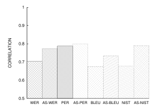
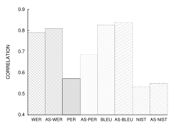
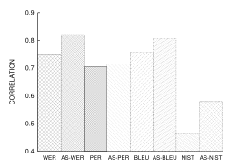

**Source:** *Evaluating Machine Translation Output with Automatic Sentence Segmentation* — [PDF](https://aclanthology.org/2005.iwslt-1.19.pdf)

# **Evaluating Machine Translation Output with Automatic Sentence Segmentation**

*Evgeny Matusov, Gregor Leusch, Oliver Bender, Hermann Ney*

Lehrstuhl fur Informatik VI - Computer Science Department ¨ RWTH Aachen University, Aachen, Germany.

{matusov,leusch,bender,ney}@i6.informatik.rwth-aachen.de

## **Abstract**

This paper presents a novel automatic sentence segmentation method for evaluating machine translation output with possibly erroneous sentence boundaries. The algorithm can process translation hypotheses with segment boundaries which do not correspond to the reference segment boundaries, or a completely unsegmented text stream. Thus, the method is especially useful for evaluating translations of spoken language. The evaluation procedure takes advantage of the edit distance algorithm and is able to handle multiple reference translations. It efficiently produces an optimal automatic segmentation of the hypotheses and thus allows application of existing well-established evaluation measures. Experiments show that the evaluation measures based on the automatically produced segmentation correlate with the human judgement at least as well as the evaluation measures which are based on manual sentence boundaries.

## **1. Introduction**

Evaluation of the produced results is crucial for natural language processing (NLP) research in general and, in particular for machine translation (MT). Human evaluation of MT system output is a time consuming and expensive task. This is why automatic evaluation is preferred to human evaluation in the research community. A variety of automatic evaluation measures have been proposed and studied over the last years. All of the wide-spread evaluation measures like BLEU [1], NIST [2], and word error rate compare translation hypotheses with human reference translations. Since a human translator usually translates one sentence of a source language text at a time, all of these measures include the concept of sentences, or more generally, segments1 . Each evaluation algorithm expects that a machine translation system will produce exactly one target language segment for each source language segment. Thus, the total number of segments in the automatically translated document must be equal to the number of reference segments in the manually translated document.

In case of speech translation, the concept of sentences is in general not well-defined. A speaker may leave a sentence incomplete, make long pauses, or speak for a long time without making a pause. A human transcriber of speech is usually able to subjectively segment the raw transcriptions into sentence-like units. In addition, if he or she was instructed to produce meaningful units, each of which has clear semantics, then these sentence-like units can be properly translated into sentence-like units in the target language.

However, an automatic speech translation system is expected to translate automatically recognized utterances. In the few speech translation evaluations in the past, an automatic speech recognition (ASR) system was forced to generate segment boundaries in the timeframes which had been defined by a human transcriber. This restriction implied that a manual transcription and segmentation of the test speech utterances had to be performed in advance. We argue that this type of evaluation does not reflect real-life conditions. In an on-line speech translation system, the correct utterance transcription is unknown to the ASR component, and segmentation is done automatically based on prosodic or language model features. This automatic segmentation should define the initial sentence-like units for translation. In addition, some of these units may then be split or merged by the translation system to meet the constraints or modelling assumptions of the translation algorithm. Under these more realistic conditions the automatic segmentation of the input for MT and thus the segment boundaries in the produced translations do not correspond to the segment boundaries in the manual reference translations. Therefore, most of the existing MT error measures will not be applicable for evaluation.

In this paper, we propose an algorithm that is able to find an optimal re-segmentation of the MT output based on the segmentation of the human reference translations. The algorithm is based on the Levenshtein edit distance algorithm [3], but is extended to take into account multiple human reference translations for each segment. As a result of this segmentation we obtain a novel evaluation measure – *automatic segmentation word error rate (AS-WER)*.

The paper is organized as follows. In Section 2, we review the most popular MT evaluation measures and discuss if and how they can be modified to cope with automatic segmentation of MT output. Section 3 presents the algorithm for automatic segmentation. In Section 4, we compare the error measures based on automatic segmentation with the error measures based on human segmentation and show that the

1Throughout the paper, we will use the term "segment", by which we mean a sequence of words that may or may not have proper punctuation.

new evaluation measures give accurate estimates of translation quality for different tasks and systems. We conclude the paper with Section 5, where we discuss the applications of the new evaluation strategy and future work.

### 2. Current MT Evaluation Measures

Here, we analyze the most popular MT evaluation measures and their suitability for evaluation of translation output with possibly incorrect segment boundaries. The measures that are widely used in research and evaluation campaigns are WER, PER, BLEU, and NIST.

Let a test document consist of  $k=1,\ldots,K$  candidate segments  $E_k$  generated by an MT system. We also assume that we have R reference translation documents. Each reference document has the same number of segments, where each segment is a translation of the "correct" segmentation of the manually transcribed speech input2. If the segmentation of the MT output corresponds to the segmentation of the manual reference translations, then for each candidate segment  $E_k$ , we have R reference sentences  $\widetilde{E}_{rk}$ . Let  $I_k$  denote the length of a candidate segment  $E_k$ , and  $N_{rk}$  the reference lengths of each reference segment  $\widetilde{E}_{rk}$ . From the reference lengths, an optimal reference segment length  $N_k^*$  is selected as the length of the reference with the lowest segment-level error rate or best score [4].

With this, we write the total candidate length over the document as  $I:=\sum_k I_k$ , and the total reference length as  $N^*:=\sum_k N_k^*$ .

### 2.1. WER

The segment-level word error rate is defined as the Levenshtein distance  $d_L(E_k, \widetilde{E}_{rk})$  between a candidate segment  $E_k$  and a reference segment  $\widetilde{E}_{rk}$ , divided by the reference length  $N_k^*$  for normalization.

For a whole candidate corpus with multiple references, the segment-level scores are combined, and the WER is defined to be:

$$WER := \frac{1}{N^*} \sum_{k} \min_{r} d_L(E_k, \widetilde{E}_{rk})$$
 (1)

In this paper, we also evaluate MT output at document level. When evaluating at document level, we consider the whole candidate document and the documents of reference translations to be single segments (thus, K is equal to 1 in Eq. 1). This is different from the usual interpretation of the term which implies the average over segment-level scores.

Word error rate on document level without segmentation into sentences is often computed for the evaluation of ASR performance. In ASR research, where there is a unique reference transcription for an utterance, such document-level

evaluation is acceptable. In machine translation evaluation, many different, but correct translations are possible; thus, multiple references are commonly used. However, the document-level *multiple-reference* WER calculation is not possible. According to Eq. 1, such a calculation will always degenerate to a single-reference WER calculation, since the reference document with the smallest Levenshtein distance to the candidate document will be selected.

#### 2.2. PER

The position independent error rate [5] ignores the ordering of the words within a segment. Independent of the word position, the minimum number of deletions, insertions and substitutions to transform the candidate segment into the reference segment is calculated. Using the counts  $n_{er}$ ,  $\tilde{n}_{erk}$  of a word e in the candidate segment  $E_k$ , and the reference segment  $\tilde{E}_{rk}$ , respectively, we can calculate this distance as

$$d_{\text{PER}}\big(E_k,\widetilde{E}_{rk}\big) := \frac{1}{2}\Big(\big|I_k - N_{rk}\big| + \sum_{e} \big|n_{ek} - \tilde{n}_{erk}\big|\Big)$$

This distance is then normalized to obtain an error rate, the PER, as described in section 2.1.

Calculating PER on document level results in clearly too optimistic estimates of the translation quality since, e. g. the first word in the candidate document will be counted as correct if the same word appears as a last (e. g. 500th) word in a reference translation document. Another approach would be to "chop" the candidate corpus into units of some length and to compute PER on these units. The unit length may be equal to the average reference segment length for all units in the corpus, or may be specific to individual reference units. However, experimental evidence suggests that the resulting estimates of translation quality are rather poor. The length of the (implicit) segments in the candidate translations may substantially differ from the length of the reference sentences. Consequently, meaningful sentence-like units are necessary for the PER measure.

#### 2.3. BLEU and NIST

BLEU [1] is a precision measure based on m-gram count vectors. The precision is modified such that multiple references are combined into a single m-gram count vector. Multiple occurrences of an m-gram in the candidate sentence are counted as correct only up to the maximum occurrence count within the reference sentences. Typically, the m-grams of size  $m=1,\ldots,4$  are considered. To avoid a bias towards short candidate segments consisting of "safe guesses" only, segments shorter than the reference length are penalized with a brevity penalty.

The NIST score [2] extends the BLEU score by taking information weights of the m-grams into account. The NIST score is the sum over all information counts of the co-occurring m-grams, which are summed up separately for each  $m=1,\ldots,5$  and normalized by the total m-gram count. As in BLEU, there is a brevity penalty to avoid a bias

&lt;sup>2Here, the assumption is that each segment has the same number of reference translations. This is not a real restriction since the same translation can appear in several reference documents.

towards short candidates. Due to the information weights, the value of the NIST score depends highly on the selection of the reference documents.

Both measures can be computed at document level. However, as in the case of PER, the resulting scores will be too optimistic (see Section 4), since incorrect m-grams appearing in one portion of a candidate document will be matched against the same m-grams in completely different portions in the reference translation document.

### 3. The Algorithm

The main idea of the proposed automatic re-segmentation algorithm is to make use of the Levenshtein alignment between the candidate translations and human references on document level. The Levenshtein alignment between the sequence of candidate words for the whole document and a sequence of reference translation words can be found by backtracing the decisions of the Levenshtein edit distance algorithm. Based on this automatic alignment, the segment boundaries of the reference document can be transferred to the corpus of candidate translations.

#### 3.1. Notation

More formally. given reference document  $w_1,\ldots,w_n,\ldots,w_N$ with segmentation K segments defined by the sequence of indices  $n_1, \ldots, n_k, \ldots, n_K := N$ , and a candidate document  $e_1, \ldots, e_i, \ldots, e_I$ , we find a Levenshtein alignment between the two documents with minimal costs and obtain the segmentation of the candidate document, denoted by  $i_1, \ldots, i_k, \ldots, i_K := I$ , by marking words which are Levenshtein-aligned to reference words  $w_{n_k}$ .

This procedure has to be extended to work with multiple reference documents  $r=1,\ldots,R$ . To simplify the algorithm, we assume that a reference translation of a segment k has the same length across reference documents. To obtain such a set of reference documents, we apply a preprocessing step. First, for each segment, the reference translation with the maximum length is determined. Then, to the end of every other reference translation of the segment, we attach a number of "empty word" symbols \$ so that the segment would have this maximum length. In addition, at each segment boundary (including the document end) we insert an artificial segment end symbol. This is done to make the approach independent of the punctuation marks, which may not be present in the references or do not always stand for a segment boundary.

After this transformation, each reference document has the same length (in words), given by:

$$N := K + \sum_{k=1}^{K} \max_{r} N_{r,k}$$

### 3.2. Dynamic Programming

The proposed algorithm is similar to the algorithm for speech recognition of connected words with whole word models [6]. In that dynamic programming algorithm, there are two distinct recursion expressions, one for within-word transitions, and one for transitions across a word boundary. Here, we differentiate between the alignment within a segment and the recombination of hypotheses at segment boundaries.

For the within-segment alignment, we determine the costs of aligning a portion of the candidate translation to a pre-defined reference segment. As in the usual Levenshtein distance algorithm, these are recursively computed using the auxiliary quantity D(i, n, r) in the dynamic programming:

$$D(i, n, r) = \min\{D(i - 1, n - 1, r) + 1 - \delta(e_i, w_{nr}), \\ D(i - 1, n, r) + 1, D(i, n - 1, r) + 1\}$$

Here, given the previously aligned words, we determine what possibility has the lowest costs: either the candidate word  $e_i$  matches the word  $w_{nr}$  in the r-th reference document, or it is a substitution, an insertion or a deletion error. A special case here is when a reference translation that does not have the maximum length has already been completely processed. Then the current word  $w_{nr}$  is the empty word \$, and it is treated as a deletion with no costs:

$$D(i, n, r) = D(i, n - 1, r), \text{ if } w_{nr} = \$.$$

The index of the last candidate word of the previous segment is saved in a backpointer B(i,n,r); the backpointer of the best predecessor hypothesis is passed on in each recursion step.

The hypotheses are recombined at reference segment boundaries. This type of recombination allows for two consecutive candidate segments to be scored with segments from different reference documents. Assuming that a boundary for the k-th segment is to be inserted after the candidate word  $e_i$ , we determine the reference which has the smallest edit distance  $D(i, n_k, r)$  to the hypothesized segment that ends with  $e_i$ . We memorize this locally optimal reference in a backpointer BR(i, k):

$$D(i, n = n_k, r) = \min_{\substack{r'=1,...,R}} D(i, n - 1, r')$$

$$BR(i, k) = \hat{r} = \underset{\substack{r'=1,...,R}}{\operatorname{argmin}} D(i, n - 1, r')$$

$$BP(i, k) = B(i, n - 1, \hat{r})$$

In a backpointer BP(i,k), we save the index of the last word of the hypothesized segment k-1, which was propagated in the recursive evaluation. Note that in contrast to speech recognition, where any number of words can be recognized, the number of segments here is fixed. That is why the backpointer arrays BR and BP have the second dimension k in addition to the dimension i (which corresponds to the time frame index in speech recognition).

The algorithm terminates when the last word in each reference document and candidate corpus is reached. The optimal number of edit operations is then given by

$$d_L = \min_r D(I, N, r)$$

With the help of the backpointer arrays BP and BR, the sentence boundary decisions  $i_1,\ldots,i_K$  are recursively backtraced from  $i_K=I$ , together with the optimal sequence of reference segments  $\hat{r}_1,\ldots,\hat{r}_K$ . These reference segments can be viewed as a new single-reference document  $\hat{E}$  that contains, for each segment, a selected translation from the original reference documents. Let  $\hat{N}$  be the number of words in  $\hat{E}$ . Then the automatic segmentation word error rate (ASWER) is given by:

$$AS\text{-WER} = \frac{d_L}{\hat{N}}$$

### 3.3. Complexity of the Algorithm

Since the decisions of the algorithm in the recursive evaluation depend, in each step, only on the previous words  $e_{i-1}$  and  $w_{n-1}$ , the memory complexity can be reduced with the so called "one column" solution. Here, for each reference document index  $r=1,\ldots,R$ , we keep only an array A of length N. The element A[n] in this array represents the calculation of D(i-1,n,r) and is overwritten with D(i,n,r) based on the entry A[n-1] which holds the value D(i,n-1,r) and on the value of a buffer variable which temporarily holds D(i-1,n-1,r). Thus, the total memory complexity of the algorithm is  $O(N \cdot R + I \cdot K)$ : two arrays of size  $I \times K$  are required to save backpointers with optimal segmentation boundaries and sequences of reference segments.

The time complexity of the algorithm is dominated by the product of the reference document length, the candidate corpus length and the number of references, i.e. it is  $O(N \cdot I \cdot R)$ .

Experimentally, our C++ implementation of the algorithm using integer word indices and costs is rather efficient. For instance, it takes 2-3 minutes and max. 400 MB of memory on a desktop PC to align a corpus of 20K words using two reference documents with 2643 segments.

### 4. Experiments

To assess the novel evaluation measure and the effect of automatic segmentation for the candidate translations, we performed the following experiments. First, we calculated scores for several automatic evaluation measures – WER, PER, BLEU, NIST– using the available candidate translation documents with manual segmentation3. This segmentation corresponds to the segmentation of the source language document and the segmentation of the reference translations.

Table 1: Corpus statistics.

|                   | TC-STAR | BTEC CE |
|-------------------|---------|---------|
| Source language   | Spanish | Chinese |
| Target language   | English | English |
| Segments          | 2643    | 500     |
| Running words     | 20164   | 3632    |
| Ref. translations | 2       | 16      |
| Avg. ref. length  | 7.8     | 7.3     |
| Candidate systems | 4       | 20      |

Figure 1: Pearson's correlation coefficients for the human adequacy judgements (IWSLT task).

Then, we removed the segment boundaries from the candidate translations and determined the segmentation automatically using the Levenshtein distance based algorithm as described in Section 3. As a consequence of the alignment procedure we obtained the AS-WER. In addition, using the resulting automatic segmentation which corresponds to the segmentation of the reference documents, we recomputed the other evaluation measures. In the following, we denote these measures by AS-PER, AS-BLEU, and AS-NIST.

We calculated the evaluation measures on two different tasks. The first task is the IWSLT BTEC 2004 Chinese-to-English evaluation [8]. Here, we evaluated translation output of twenty MT systems which had participated in this public evaluation. The evaluation was case-insensitive, and the translation hypotheses and references did not include punctuation marks. Additionally, we scored the translations of four MT systems from different research groups which took part in the first MT evaluation in the framework of the European research project TC-STAR [9]. We addressed only the condition of translating verbatim (exactly transcribed) speech from Spanish to English. Here, the evaluation was case-sensitive, but again without considering punctuation. The evaluation corpus statistics for both tasks are given in Table 1.

&lt;sup>3The scores were calculated using the internal C++ implementations, but preprocessing of the hypotheses was done as in the NIST MT evaluation [7].

Figure 2: Pearson's correlation coefficients for the human fluency judgements (IWSLT task).

Figure 3: Kendall's correlation coefficients for the human ranking of translation systems (IWSLT task).

In both tasks, we evaluated translations of spoken language, i.e. a translation system had to deal with incomplete/not well-formed sentences, hesitations, repetitions, etc. In the experiments with the automatic segmentation measures, we considered the whole document (e.g. more than 20K words on the TC-STAR task) as a single text stream in which K segment boundaries (e.g. K=2643 on the TC-STAR task) are to be inserted automatically.

For the IWSLT task, a human evaluation of translation quality had been performed; its results were made publicly available. We compared automatic evaluation results with human evaluation of adequacy and fluency by computing the correlation between human and automatic evaluation at system level. We chose Pearson's r to calculate the correlation. Figures 1 and 2 show the correlation with adequacy and fluency, respectively. The even columns of the graph show the correlation for the error measures using automatic segmenta-

Table 2: Comparison of the evaluation measures as calculated using the correct and the automatic segmentation (TC-STAR task).

| Error               | System |      |      |      |
|---------------------|--------|------|------|------|
| measure:            | A      | В    | C    | D    |
| WER [%]             | 37.4   | 40.4 | 41.4 | 47.9 |
| AS-WER [%]          | 36.2   | 39.1 | 40.0 | 45.7 |
| PER [%]             | 30.7   | 33.7 | 33.9 | 40.6 |
| AS-PER [%]          | 30.6   | 33.4 | 33.9 | 39.7 |
| BLEU [%]            | 51.1   | 47.8 | 47.4 | 40.6 |
| AS-BLEU [%]         | 50.9   | 47.5 | 47.2 | 40.6 |
| NIST                | 10.34  | 9.99 | 9.74 | 8.65 |
| AS-NIST             | 10.29  | 9.92 | 9.68 | 8.65 |
| Segmentation ER [%] | 6.5    | 8.0  | 7.8  | 9.5  |

tion. It can be observed that the correlation of these measures with the human judgments regarding adequacy or fluency is better than when manual segmentation is used.

In addition, the Kendall's  $\tau$  for rank correlation [10] was calculated. Figure 3 shows that the evaluation measures based on automatic segmentation can rank the systems as well as the measures based on manual segmentation, or even better. The improvements in correlation with the automatic segmentation should not be overestimated since only 20 observations are involved. Nevertheless, it is clear that the ASWER and other measures which can take input with incorrect segment boundaries are as suitable for the evaluation and ranking of MT systems as the measures which require correct segmentation.

On the TC-STAR task, no human evaluation of translation output had been performed. Here, in a contrastive experiment, we present the absolute values for the involved error measures using correct/automatic segmentation in Table 2. First, it is important to note that re-segmentation of the translation outputs with our algorithm does not change the ranking of the four systems A,B,C,D as given e. g. by the word error rate

The values for the AS-WER are somewhat lower here than those for WER, but can also be higher, as the experiments on the IWSLT task have shown. This can be explained by different normalization. In the case of AS-WER, the Levenshtein distance  $d_L$  is divided by the length of an optimal sequence of reference segments. For each segment, a reference with the lowest number of substitution, insertion and deletion errors is selected. This optimal reference is determined when computing Levenshtein alignment for the whole document. Thus, it is not always the same as in the case of sentence-wise alignment, where (and this is another difference) the reference with the lowest *normalized* error count is selected [4].

Another interesting observation is the fact that the values of the other measures PER, BLEU, and NIST are not seri-

Table 4: Two examples of automatic vs. manual segmentation.

| ORIGINAL SEGMENTATION                                       | AUTOMATIC SEGMENTATION                  | MULTIPLE REFERENCES                                                                          |
|-------------------------------------------------------------|-----------------------------------------|----------------------------------------------------------------------------------------------|
| I can only but that as soon as possible I can only but that |                                         | that only leaves me # the only thing left for me to do                                       |
| invite Mister Barroso                                       |                                         | as soon as possible invite Mister Barroso to invite Mister Barroso # is to invite Mr Barroso |
| but that as soon as possible                                | but that as soon as possible we propose | but as soon as possible # but as soon as possible                                            |
| we propose                                                  | a proposal                              | they put to us # a proposal                                                                  |
| a proposal on which Parliament                              | on which Parliament                     | a motion on whether Parliament # on which the Parliament                                     |

Table 3: Comparison of the BLEU/NIST scores on document level with the same scores computed using correct and automatic segmentation (TC-STAR task).

| Error               | System |       |       |       |
|---------------------|--------|-------|-------|-------|
| measure :           | A      | B     | C     | D     |
| BLEU [%]            | 51.1   | 47.8  | 47.4  | 40.6  |
| AS-BLEU [%]         | 50.9   | 47.5  | 47.2  | 40.6  |
| BLEU doc. level [%] | 55.3   | 50.5  | 50.9  | 47.5  |
| NIST                | 10.34  | 9.99  | 9.74  | 8.65  |
| AS-NIST             | 10.29  | 9.92  | 9.68  | 8.65  |
| NIST doc. level     | 11.57  | 11.23 | 11.12 | 10.89 |

ously affected by automatic segmentation. This suggests that Levenshtein distance based segmentation produces reliable segments not only for calculation of the WER, but also for calculation of error measures not based on this distance. In contrast, when we compute BLEU/NIST scores on document level (see Section 2.3), the obtained values differ dramatically from the values with correct segmentation and overestimate the performance of the translation systems (see Table 3). Moreover, the difference between systems in terms of e. g. the BLEU score may be significantly underestimated. For example, the difference in the BLEU scores at document level between systems B and D is only 6% (vs. 15% as given by the BLEU scores using correct segmentation).

Finally, for the introduced error measures with automatic segmentation, we observe that even if the word error rate is high (about 50% or more, like for system D at the TC-STAR evaluation and most of the systems at the IWSLT evaluation), the difference between the error rates using manual and automatic segmentation is still not very big. Thus, the proposed algorithm is able to produce an acceptable segmentation even if the number of matched words between a candidate and a reference document is small. This statement is supported by the *segmentation error rate*. We define this error rate as the word error rate between a document with candidate translations and manual (correct) segmentation and *the same* document with automatic segmentation, computed on segment level. Thus, this error rate is 0 if the automatic segmentation is correct. In Table 2, the segmentation error rate is below 10% for all systems, and degrades only slightly with the degrading WER. The robustness of automatic segmentation is important for evaluating translations of automatically recognized speech which at present usually have high error rates.

Table 4 gives two examples of an automatic segmentation of a candidate translation for the TC-STAR task. In this table, the manual segmentation and the two corresponding reference translations are also shown. Note that the manual segmentation is not always perfect or at least does not always correspond to every reference translation; automatic segmentation is sometimes able to correct such discrepancies.

## **5. Conclusions**

In this paper, we described a novel method of automatic sentence segmentation that is used to evaluate machine translation quality. The proposed algorithm does not require the MT output to have the same segmentation into sentences or sentence-like units as the reference translations. Automatic re-segmentation of candidate translations is efficiently determined with a modified Levenshtein distance algorithm based on the segmentation in the multiple reference translations. This algorithm computes a novel error measure: automatic segmentation word error rate, or AS-WER. It is also possible to apply existing evaluation measures to the automatically re-segmented translations.

Experiments have shown that the AS-WER and other automatic segmentation measures correlate at least as well with human judgment as the measures which rely on correct segmentation. The automatic segmentation method is especially important for evaluating translations of automatically recognized and segmented speech. We expect that the proposed evaluation framework can facilitate co-operation between speech recognition and machine translation research communities since it resolves the issue of different segmentation requirements for the two tasks.

## **6. Acknowledgement**

This work was in part funded by the European Union under the integrated project TC-STAR – Technology and Corpora for Speech to Speech Translation (IST-2002-FP6-506738). We would like to thank our colleague David Vilar for fruitful discussions on the topic of this work.

## **7. References**

- [1] K. A. Papineni, S. Roukos, T. Ward, and W. J. Zhu. 2001. Bleu: a method for automatic evaluation of machine translation. Technical Report RC22176 (W0109-022), IBM Research Division, Thomas J. Watson Research Center, September.
- [2] G. Doddington. 2002. Automatic evaluation of machine translation quality using n-gram co-occurrence statistics. In *Proc. ARPA Workshop on Human Language Technology*.
- [3] V. I. Levenshtein. 1966. Binary codes capable of correcting deletions, insertions and reversals. *Soviet Physics Doklady*, 10(8), pp. 707–710, February.
- [4] G. Leusch, N. Ueffing, D. Vilar, and H. Ney. 2005. Preprocessing and Normalization for Automatic Evaluation of Machine Translation. In *Proc. Intrinsic and Extrinsic Evaluation Measures for MT and/or Summarization Workshop at ACL 2005*, pp. 17–24, Ann Arbor, Michigan, USA, June.
- [5] C. Tillmann, S. Vogel, H. Ney, A. Zubiaga, and H. Sawaf. 1997. Accelerated DP based search for statistical translation. In *European Conf. on Speech Communication and Technology*, pp. 2667–2670, Rhodes, Greece, September.
- [6] L. Rabiner and B. H. Juang. 1993. Fundamentals of Speech Recognition. Prentice Hall, Englewood Cliffs, NJ, chapter 7.
- [7] K. A. Papineni. 2002. The NIST mteval scoring software. http://www.itl.nist.gov/iad/ 894.01/tests/mt/resources/scoring.htm.
- [8] Y. Akiba, M. Federico, N. Kando, H. Nakaiwa, M. Paul, and J. Tsujii. 2004. Overview of the IWSLT04 evaluation campaign. In *Proc. IWSLT*, pp. 1–12, Kyoto, Japan, September.
- [9] European Research Project TC-STAR Technology and Corpora for Speech-to-Speech Translation. 2005. http://www.tc-star.org.
- [10] M. G. Kendall. 1970. Rank Correlation Methods. Charles Griffin & Co Ltd, London.