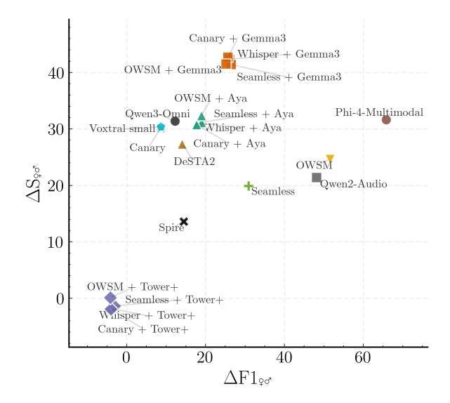
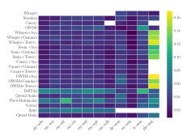
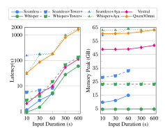
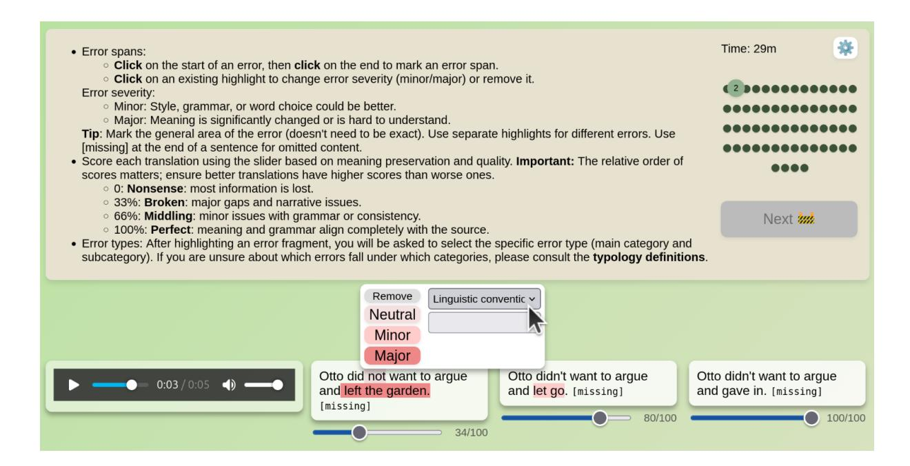
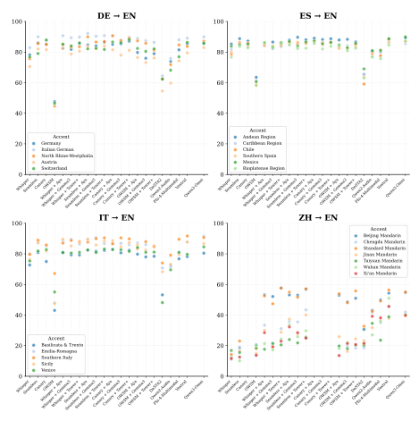

**Source:** *Hearing to Translate: The Effectiveness of Speech Modality Integration into LLMs* — [PDF](https://arxiv.org/pdf/2512.16378) · [arXiv](https://arxiv.org/abs/2512.16378)

# Hearing to Translate:

## The Effectiveness of Speech Modality Integration into LLMs

Sara Papi 1 , Javier Garcia Gilabert 2 , Zachary Hopton 3 , Vilém Zouhar 4 , Carlos Escolano5 , Gerard I. Gállego2,5 , Jorge Iranzo-Sánchez6 , Ahrii Kim7 , Dominik Machácek ˇ 8 , Patricia Schmidtova8 , Maike Züfle9

1Fondazione Bruno Kessler, 2Barcelona Supercomputing Center, 3University of Zurich, 4ETH Zurich, 5Universitat Politècnica de Catalunya, 6Universitat Politècnica de València, 7Soongsil University, 8Charles University, 9KIT

Correspondence: [spapi@fbk.eu](mailto:spapi@fbk.eu)

## Abstract

As Large Language Models (LLMs) expand beyond text, integrating speech as a native modality has given rise to Speech-LLMs, which directly process spoken language and enable speech-to-text translation (ST) and other downstream tasks, bypassing traditional transcription-based pipelines. Whether this integration improves ST quality over established cascaded architectures, however, remains an open question. We present Hearing to Translate,[1](#page-0-0) the first comprehensive test suite rigorously benchmarking 6 state-of-the-art SpeechLLMs against 16 strong direct and cascade systems that couple leading speech foundation models (SFM), with multilingual LLMs. Our analysis spans 16 benchmarks, 13 language pairs, and 9 challenging conditions, including disfluent, noisy, and long-form speech. Across this extensive evaluation, we find that cascaded systems remain the most reliable solution overall, but most recent SpeechLLMs can match or even outperform cascades in various settings while SFMs lag behind both, highlighting that integrating an LLM, either within the model or in a pipeline, is essential for high-quality speech translation.

## 1 Introduction

Large Language Models (LLMs) have transformed natural language processing, enabling unprecedented generalization and reasoning capabilities across a wide range of text-based tasks [\(Achiam](#page-12-0) [et al.,](#page-12-0) [2023;](#page-12-0) [Touvron et al.,](#page-20-0) [2023\)](#page-20-0). Recently, these models have been extended beyond text to encompass multimodal inputs, including vision and audio. Among these modalities, speech holds a particularly central role, as it is the most natural and information-rich form of human communication, conveying not only linguistic content but also prosodic, emotional, and paralinguistic cues [\(Schuller,](#page-19-0) [2018\)](#page-19-0). Integrating this modality into LLMs promises a new generation of language technologies that can process and understand spoken language in a more human-like and contextually grounded manner [\(Latif et al.,](#page-17-0) [2023\)](#page-17-0).

This motivated the emergence of SpeechLLMs: models that extend text-based LLMs with the ability to process spoken language directly. A Speech-LLM typically integrates an audio encoder, often derived from powerful Speech Foundation Models (SFMs) such as Whisper [\(Radford et al.,](#page-18-0) [2023\)](#page-18-0) or SeamlessM4T [\(Barrault et al.,](#page-13-0) [2023\)](#page-13-0), with one or more adapters that bridge the gap between acoustic representations and the embedding space of an LLM such as Gemma [\(Gemma Team et al.,](#page-15-0) [2025\)](#page-15-0) or Tower+ [\(Rei et al.,](#page-18-1) [2025\)](#page-18-1). This paradigm challenges the traditional architectures that have long

core contributor and PI of the project, core contributors, in order of contribution; other authors are ordered alphabetically. 1The *Hearing-to-Translate Suite* is released at [https://](https://github.com/sarapapi/hearing2translate) [github.com/sarapapi/hearing2translate](https://github.com/sarapapi/hearing2translate).

dominated speech-to-text translation (ST). Conventional ST systems are typically either *cascade* or *direct* [\(Bentivogli et al.,](#page-14-0) [2021\)](#page-14-0). In cascaded setups, a dedicated Automatic Speech Recognition (ASR) model first transcribes the input speech into text, which is then translated by a separate Machine Translation (MT) or, more recently, LLM-based module. This modular design remains highly effective, as it allows each component to be trained on large available corpora and fine-tuned independently for new languages or domains, but it also introduces limitations: translation quality is tightly coupled to ASR accuracy [\(Ney,](#page-17-1) [1999\)](#page-17-1), potentially leading to error propagation issues [\(Sperber and](#page-19-1) [Paulik,](#page-19-1) [2020\)](#page-19-1), increased latency and computational costs, as two models have to be sequentially executed [\(Papi et al.,](#page-18-2) [2025\)](#page-18-2), and the intermediate transcription step discards prosodic and paralinguistic information that may enrich meaning [\(Tsia](#page-20-1)[mas et al.,](#page-20-1) [2024\)](#page-20-1). Direct ST models, in contrast, attempt to bypass these issues by mapping speech directly to translated text end-to-end [\(Bérard et al.,](#page-14-1) [2016;](#page-14-1) [Weiss et al.,](#page-20-2) [2017\)](#page-20-2). However, these models are often data-hungry [\(Nguyen et al.,](#page-18-3) [2020;](#page-18-3) [Jia](#page-16-0) [et al.,](#page-16-0) [2022;](#page-16-0) [Xu et al.,](#page-20-3) [2023\)](#page-20-3), limited by the scarcity of large-scale parallel speech-translation corpora, and less flexible at test time, lacking the in-context reasoning and adaptability of LLMs.

SpeechLLMs offer a novel alternative to these monolithic ST models. By integrating the speech modality within a general-purpose LLM, they combine end-to-end speech processing with the linguistic knowledge and contextual flexibility of LLMs, enabling translation, adaptation to user intent, and handling of cross-lingual contexts [\(Ruben](#page-18-4)[stein et al.,](#page-18-4) [2023\)](#page-18-4). These properties make Speech-LLMs an appealing framework for massively multilingual translation systems that can seamlessly operate across text and speech [\(Bapna et al.,](#page-13-1) [2022;](#page-13-1) [Nguyen et al.,](#page-18-5) [2025\)](#page-18-5). However, the practical benefits of this integration remain an open question. It is unclear whether SpeechLLMs can match (or surpass) the performance of translation-specialized direct or cascaded systems that combine powerful SFMs with high-performing LLMs. Furthermore, existing works rarely compare these paradigms systematically [\(Gaido et al.,](#page-15-1) [2024\)](#page-15-1) or consider complex real-world speech phenomena such as disfluencies, background noise, and code-switching.

In this paper, we present Hearing to Translate, the first comprehensive test suite evaluating the

effectiveness of speech modality integration into LLMs for translation. We systematically compare 6 state-of-the-art SpeechLLMs against 16 strong systems (4 direct and 12 cascade) built on top of leading SFMs and multilingual and translation-oriented LLMs. Our evaluation encompasses 13 language pairs and 16 benchmarks, covering 9 diverse conditions that capture a range of linguistic and acoustic phenomena, enabling a comprehensive assessment of translation quality and robustness in realistic settings. Through this analysis, we address a fundamental question for the SpeechLLM era: *Does integrating the speech modality directly into LLMs truly enhance speech translation, or do cascaded architectures or traditional direct models remain the most effective solutions?*

## 2 Related Works

# Cascaded vs. Direct ST: A Historical Compar-

ison. The comparison between cascaded and direct architectures has long been a central topic in ST research. Though early works highlighted the potential of end-to-end models to reduce error propagation and latency while achieving comparable or superior results to pipeline approaches [\(Indurthi](#page-16-1) [et al.,](#page-16-1) [2020\)](#page-16-1), recent evidence paints a more nuanced picture. Most recent IWSLT evaluation campaigns [\(Ahmad et al.,](#page-12-1) [2024;](#page-12-1) [Abdulmumin et al.,](#page-12-2) [2025\)](#page-12-2) consistently report that cascades, especially those combining strong SFMs with high-performing LLMs [\(Koneru et al.,](#page-16-2) [2025;](#page-16-2) [Wang et al.,](#page-20-4) [2025\)](#page-20-4), again outperform direct approaches across multiple language pairs and acoustic conditions. Similarly, [Min et al.](#page-17-2) [\(2025\)](#page-17-2) show that despite architectural advances, direct systems still struggle to generalize in realistic multilingual or low-resource scenarios. While these studies have clarified the strengths and weaknesses of each paradigm, systematic comparisons in the era of LLM-enhanced models remain limited [\(Gaido et al.,](#page-15-1) [2024\)](#page-15-1). Our work revisits this long-standing debate under a new lens: evaluating how SpeechLLMs reshapes the traditional balance between cascaded and direct ST.

The LLM Era is Here, for MT. LLMs have recently transformed the MT landscape, achieving performance comparable to or surpassing specialized translation models in recent WMT campaigns [\(Kocmi et al.,](#page-16-3) [2024a,](#page-16-3) [2025b\)](#page-16-4). Their broad multilingual coverage, contextual reasoning, and in-context learning enable high-quality translation without task-specific fine-tuning [\(Garcia et al.,](#page-15-2) [2023;](#page-15-2) [Stap](#page-19-2)

[et al.,](#page-19-2) [2024;](#page-19-2) [Deutsch et al.,](#page-14-2) [2025\)](#page-14-2). Beyond raw accuracy, LLMs excel in adaptation to user intent [\(Sarti et al.,](#page-19-3) [2023\)](#page-19-3), style and formality control [\(Rippeth et al.,](#page-18-6) [2022\)](#page-18-6), and explaining and correcting their own translations [\(Treviso et al.,](#page-20-5) [2024\)](#page-20-5) dimensions traditionally outside the scope of standard MT models. This paradigm shift has sparked growing interest in extending LLMs beyond text to speech, motivating the development of Speech-LLMs for ST. However, while the superiority of LLMs over traditional MT systems has been established in text translation, this assumption has not yet been verified for SpeechLLMs in ST. Our work directly addresses this gap, providing the first study testing whether the advantages of LLM-based translation extend to the speech modality.

## 3 The Hearing-to-Translate Suite

In this section, we describe the main ingredients of the test suite: the analyzed phenomena (Section [3.1\)](#page-2-0), the selected benchmarks (Section [3.2\)](#page-2-1), and the metrics used for evaluation (Section [3.3\)](#page-4-0).

#### 3.1 Categorization of Analyzed Phenomena

To evaluate the robustness and generalization ability of SpeechLLMs across realistic scenarios, we introduce a diverse set of conditions collectively referred to as the Hearing-to-Translate Suite. Each condition targets a specific linguistic, acoustic, or sociolinguistic phenomenon known to challenge speech and translation systems [\(Shah et al.,](#page-19-4) [2024\)](#page-19-4). The suite enables a controlled and comprehensive analysis of model behavior across nine categories:

- **GENERIC** Clean, well-segmented speech from standard benchmarks, used as a reference for model performance under ideal conditions.
- **GENDER BIAS** Utterances balanced across male and female speakers to examine whether translation outputs preserve or distort gendered information and pronoun use.
- **ACCENTS** Speech from different geographic varieties of a given language, assessing the ability of models to generalize beyond the accent or dialect distribution seen during training.
- **CODE SWITCHING** Segments containing intrasentential language alternation, which require models to dynamically adapt to mixed-language input and maintain coherence in translation.
- **DISFLUENCIES** Spontaneous speech containing hesitations, repetitions, and self-corrections, used

- to evaluate how well models handle natural, nonscripted communication.
- **NAMED ENTITIES** Speech including person names, locations, and organizations, testing the preservation and accuracy of proper nouns.
- **NOISE** Audio with added environmental or background noise, evaluating the robustness of models to unclean acoustic conditions.
- **EMOTION** Emotionally expressive speech, assessing whether prosodic and affective cues influence translation fidelity and tone.
- **LONG-FORM** Extended audio segments containing multiple sentences, often of several minutes, used to evaluate contextual consistency and memory handling in translation models.

#### 3.2 Benchmarks

To ground the analysis of the phenomena introduced in Section [3.1,](#page-2-0) we select and create a set of benchmarks that collectively cover the nine categories. A summary, with license and covered languages, is presented in Table [1.](#page-3-0) For each of them, we provide a brief description below:

- FLEURS: It is an n-way parallel speech-text benchmark covering 102 languages, built on the FLoRes-101 MT dataset [\(Goyal et al.,](#page-15-3) [2022\)](#page-15-3). It provides roughly 12 hours of speech per language and supports evaluation of ASR, ST, language identification, and retrieval. Data collection enforced a balanced speaker sex ratio where possible, enabling analyses of gender bias [\(Attanasio](#page-13-2) [et al.,](#page-13-2) [2024\)](#page-13-2).
- CoVoST2: It is a ST benchmark created for 15 English-to-many and 21 many-to-English language pairs. The source segments (audio and transcripts) are derived from validated segments in version 4 of Common Voice [\(Ardila et al.,](#page-13-3) [2020\)](#page-13-3), and translated by professionals and verified using embedding-based approaches and length heuristics to ensure quality.
- EuroParlST: It is a many-to-many speech translation dataset covering 9 European languages, built from European Parliament debates held between 2008 and 2012. It provides full speech recordings of parliamentary interventions, along with transcripts, translations, speaker metadata, and gold sentence segmentation. In this work, we leverage the en-de audios for deriving the en-zh, not originally supported by the benchmark.
- WMT: The General MT Shared Task annually tracks progress in MT. Since 2024, it has in-

| Benchmark                                                                                                   | License                           | Phenomena              | Src Lang                                                                   |
|-------------------------------------------------------------------------------------------------------------|-----------------------------------|------------------------|----------------------------------------------------------------------------|
| FLEURS (Conneau et al., 2022)                                                                               | CC-BY 4.0                         | GENERIC GENDER BIAS | en de es fr it pt zh                                     |
| CoVoST2 (Wang et al., 2020) EuroParlST (Iranzo-Sánchez et al., 2020) WMT (Kocmi et al., 2024a, 2025b) | CC-0 CC-BY-NC 4.0 CC-BY 3.0 | GENERIC                | en de es it pt zh en de es fr it pt en |
| WinoST (Costa-jussà et al., 2022)                                                                           | Custom                            | GENDER BIAS            | en                                                                         |
| CommonAccent (Zuluaga-Gomez et al., 2023) CC-0 ManDi (Zhao and Chodroff, 2022)                           | CC-BY-NC 3.0                      | ACCENTS                | en de es it zh                                                 |
| CS-Dialogue (Zhou et al., 2025) CS-FLEURS (Yan et al., 2025)                                             | CC-BY-NC-SA 4.0 CC-BY-NC 4.0   | CODE SWITCHING         | zh de es fr zh                                                 |
| LibriStutter (Panayotov et al., 2015)                                                                       | CC-BY-NC 4.0                      | DISFLUENCIES           | en                                                                         |
| NEuRoparlST (Gaido et al., 2021)                                                                            | CC-BY-NC 4.0                      | NAMED ENTITIES         | en                                                                         |
| NoisyFLEURS NEW!                                                                                            | CC-BY-NC 4.0                      | NOISE                  | en de es fr it pt zh                                     |
| EmotionTalk (Sun et al., 2025) mExpresso (Seamless Comm. et al., 2023)                                   | CC-BY-NC-SA 4.0 CC-BY-NC 4.0   | EMOTION                | zh en                                                                   |
| ACL 60/60 (Salesky et al., 2023) MCIF (Papi et al., 2026)                                                | CC-BY 4.0                         | LONG-FORM              | en                                                                         |

Table 1: Benchmarks list with their covered phenomena, and source language (in ISO 639 two-letter language code).

cluded a *speech domain* built from publicly available one-minute YouTube videos, with randomly sampled 30-50s segments containing at least 30% speech. The benchmark is challenging due to the presence of background noise. It covers 10-15 language pairs per edition, mostly out of English, with human reference translations.

- WinoST: WinoST is a dataset designed to evaluate gender bias in ST systems. It is the speech version of the WinoMT dataset [\(Stanovsky et al.,](#page-19-7) [2019\)](#page-19-7), and is used to assess inaccuracies in translations that arise from gender stereotypes, focusing on the gender information present in the sentence content rather than the speaker's voice.
- CommonAccent: Designed for accent-robust ASR, CommonAccent includes validated speech segments with accent or dialect annotations from Common Voice v7/v11 [\(Ardila et al.,](#page-13-3) [2020\)](#page-13-3). Languages have 4-16 varieties, and test sets are balanced by capping each variety at 100 segments.
- ManDi: It targets Mandarin dialect variation, with 9.6 hours of speech from 36 speakers across six regional dialects plus Standard Mandarin. Speakers read the same materials in both Standard Mandarin and their native dialect. We use only the poem and short-passage recordings, discarding single word recordings.
- CS-Dialogue: It is a 104-hour dataset of spontaneous Mandarin-English dialogues with 200

- speakers, covering seven topics. We use only the code-switching portion of the test split, which consists primarily of Mandarin utterances containing embedded English.
- CS-FLEURS: Derived from FLEURS, it spans 52 languages and provides real and synthetic code-switched data for ASR and ST. For this work, we evaluate a subset of into-English pairs with read human speech.
- LibriStutter: It is derived from LibriSpeech [\(Panayotov et al.,](#page-18-7) [2015\)](#page-18-7) by automatically inserting disfluencies such as interjections, sound repetitions, word/phrase repetitions, and prolongations, to evaluate their impact on ST quality.
- NEuRoparlST: It is a derivative of EuroparlST with manually annotated Named Entities (NEs) and domain terminology for both transcripts and translated texts.
- NoisyFLEURS: Derived from FLEURS [\(Con](#page-14-3)[neau et al.,](#page-14-3) [2022\)](#page-14-3), it is created for this work to evaluate noise robustness. We add two types of realistic noise—babble (B) and ambient (A) from the MUSAN corpus [\(Snyder et al.,](#page-19-8) [2015\)](#page-19-8) following [Anwar et al.](#page-13-4) [\(2023\)](#page-13-4) to simulate challenging acoustic conditions.[2](#page-3-1)
- EmotionTalk: This dataset contains Chinese

2NoisyFLEURS is released under the CC-BY-NC 4.0 license at [https://huggingface.co/datasets/maikezu/](https://huggingface.co/datasets/maikezu/noisy-fleurs) [noisy-fleurs](https://huggingface.co/datasets/maikezu/noisy-fleurs)

dyadic conversations recorded with 19 professional actors, annotated for seven emotions (happy, surprise, sad, disgust, anger, fear, neutral), their intensity, and speaking-style captions.

- mExpresso: This benchmark is based on an expanded subset of the Expresso dataset (Nguyen et al., 2023), containing seven read speech with different emotions/styles (default, happy, sad, confused, enunciated, whisper, laughing).
- ACL 60/60: Based on ACL 2022 presentations, it captures realistic conditions such as long-form audio and domain-specific terminology. It contains English audio with transcripts and translations into 10 languages. Audio was segmented and transcribed with ASR and manually postedited, while MT outputs were post-edited to ensure alignment and correct handling of technical terminology.
- MCIF: It assesses crosslingual instructionfollowing in multimodal LLMs, offering 3 fully parallel modalities (text, speech, video) across 4 languages, with both short- and long-form inputs. Specifically for ST, it comprises 2 hours of human-annotated scientific talks from English into three languages (German, Italian, Chinese).

#### 3.3 Metrics

Most speech benchmarks lack reference translations, and recent work has raised concerns about the reliability of reference-based automatic metrics (Freitag et al., 2023; Zouhar and Bojar, 2024). Accordingly, we rely on quality estimation (QE) metrics for evaluation. To this end, we employ  $\mathbf{xCOMET}_{\mathbf{S}}^{\mathbf{QE}}$  and  $\mathbf{METRICX}_{\mathbf{S}}^{\mathbf{QE}}$ : modified versions of xCOMET (Guerreiro et al., 2024) and MET-RICX (Juraska et al., 2024) designed to penalize off-target outputs. This strict evaluation follows the recommendation of Zouhar et al. (2024) and applies the maximal penalty to any translation identified by LINGUAPY3 as being in the wrong language. Specific settings are reported in Appendix B. Besides pure quality-based scores, we also report tailored metrics, which are presented below:

**Performance Gap.** For several phenomena, we quantify performance variation through a unified gap formulation, which measures the relative difference between two quantities,  $Q_A$  and  $Q_B$ :

$$\Delta = 100 \cdot (Q_A - Q_B) / Q_A$$

where  $Q_A$  and  $Q_B$  denote evaluation scores computed on two contrasting subsets of the same benchmark, using either **xCOMET**SQE or task-specific metrics. A value close to zero indicates comparable performance across conditions; positive values indicate better performance on subset A than on B, while negative values indicate better performance on B than on A. The gap is computed for the following phenomena:

- Gender Speaker Gap  $(\Delta_{\varphi \sigma})$ : Following Attanasio et al. (2024), we instantiate the gap by comparing the translation quality (either **xCOMET**SQE or **METRICX**SQE) of male  $(A = \sigma)$  and female  $(B = \varphi)$  speakers, capturing relative performance disparities across speaker gender.
- Gender Coreference Gap  $(\Delta \mathbf{F1}_{\varphi \sigma})$ : For WinoST, we compute the relative difference in coreference resolution accuracy by applying the gap formulation to  $\mathbf{F1}$  scores obtained on male  $(A = \sigma)$  and female  $(B = \varphi)$  subsets, using the official evaluation script.4
- Accent Gap ( $\Delta_{accent}$ ): Accent robustness is evaluated by contrasting translation quality on standard varieties (A = STD) with non-standard or regional varieties ( $B = \neg STD$ ).5
- **Disfluency Gap** ( $\Delta_{\text{disfluency}}$ ): To assess robustness to speech disfluencies, we compare translation quality on fluent (A = fl) and disfluent (B = disfl) speech subsets.
- Noise Gap ( $\Delta_{\text{noise}}$ ): Noise robustness is quantified by instantiating the gap between translation quality obtained on clean (A = clean) and noisy (B = noisy) speech conditions.
- Length Gap ( $\Delta_{length}$ ): We measure sensitivity to long-form speech by contrasting short-form (A = short) and long-form (B = long) inputs. A large positive  $\Delta_{length}$  indicates substantial degradation when processing entire talks rather than sentence-level segments. Since short-form segments are not paired with references, we resegment system outputs and align them to references using SentencePiece (Kudo and Richardson, 2018) and MWERSEGMENTER (Matusov et al., 2005), following standard ST evaluation practice (Ansari et al., 2020).

**Accuracy.** For named entities and domainspecific terminology, we report **case-sensitive ac-**

3https://github.com/pemistahl/lingua-py

4https://github.com/gabrielStanovsky/mt\_gender

&lt;sup>5This metric is applied only to ManDi, as CommonAccent does not define a single standard variety.

curacy (%NE, %term) using the official NEuroParl-ST evaluation script.[6](#page-5-0) Specifically:

$$\%_{NE} = M_{NE}/|NE|$$
 $\%_{term} = M_{Term}/|Term|$ 

where MNE and MT erm denote exact string matches in system outputs, and NE and T erm are the corresponding reference sets.

## 4 Experimental Settings

#### 4.1 Models

To allow for wider accessibility and easier reproduction of our results, we consider models with less than 32 billion parameters. Our analysis focuses on the three paradigms: SFMs ■ (used either as ASR or directly for ST), cascades composed of SFMs, and LLMs ■ and SpeechLLMs ■. Specifically, we selected: Whisper, SeamlessM4T, Canary, and OWSM as SFMs; Aya Expanse, Gemma, and Tower+ as LLMs; and Phi-4-Multimodal, Qwen2- Audio, Qwen3-Omni, DeSTA2, Voxtral, and Spire as SpeechLLMs. Specific model descriptions, and details are reported in Appendix [C.](#page-22-1)

#### 4.2 Languages and Inference

Given the broad language coverage of current LLMs and SFMs, we select languages based on those most commonly supported across the Speech-LLMs analyzed in our study. The evaluation focuses on {de, fr, it, es, pt, zh}→en and en→{de, nl, fr, it, es, pt, zh}. For LLMs, we follow the official translation prompt from the WMT 2025 General MT Shared Task [\(Kocmi et al.,](#page-16-4) [2025b\)](#page-16-4), which we adapt for SpeechLLMs to accommodate spoken inputs (see Appendix [D\)](#page-25-0). For SFMs, which do not support prompting, we specify either the target language or both the source and target languages, depending on the specific model. Default decoding parameters are used for all models,[7](#page-5-1) reflecting real-world, out-of-the-box performance. All inferences are performed using the Hugging Face Transformers library (see Appendix [C\)](#page-22-1), except for OWSM, available only via ESPnet [\(Watanabe et al.,](#page-20-10) [2018\)](#page-20-10), and Canary, available via NVIDIA NeMo [\(Kuchaiev et al.,](#page-17-5) [2019\)](#page-17-5).

## 5 Results

We first present the overall results of the 22 systems analyzed in the paper, highlighting key trends (Section [5.1\)](#page-5-2). Then, we delve into two main aspects of ST evaluation, gender bias and accents (Section [5.2\)](#page-8-0), and provide human evaluation results with automatic metrics correlation (Section [5.3\)](#page-8-1).

#### 5.1 Overall Results

Aggregated xCOMETQE *S* are presented in Table [2,](#page-6-0) while aggregated METRICX QE *S* in Appendix [F.](#page-27-0)

Across the **GENERIC** benchmarks, a consistent picture emerges: cascaded systems remain difficult to outperform but some SpeechLLMs are closing the gap. Cascades outperform[8](#page-5-3) most Speech-LLMs and SFMs, with Voxtral and Qwen3-Omni standing out as the only SpeechLLMs that reliably close—and sometimes overturn—the gap with bestperforming cascades. SFMs generally lag behind, and most SpeechLLMs struggle to match strong SFMs such as Whisper, and Seamless. OWSM performs worst as a standalone SFM, while, in combination with LLMs, it is able to recover most of its gap, indicating a poor language model ability. Overall, the strongest average results come from Canary and Whisper paired with Aya, Qwen3-Omni and Voxtral, which are also the largest cascades and SpeechLLMs in our evaluation.

In the **GENDER BIAS** category, most models exhibit relatively small gender gaps (∆♀♂from 0.9 to –2.4 on FLEURS), except OWSM, which is skewed toward male speakers. Gaps tend to be slightly larger when translating from English than into English. No single paradigm dominates: the smallest gaps are reached by OWSM+Gemma3, Qwen3- Omni, Voxtral, Seamless, and Whisper+Aya. By contrast, WinoST exposes substantially larger F1 gaps. While SpeechLLMs like Qwen2-Audio and Phi-4-Multimodal show high disparities, bias in cascades is contingent on the choice of LLM, indicating that gender bias stems primarily from the text-generation module rather than the speech module: pairing ASR modules with Gemma3 results in substantial gaps, whereas using a specialized translation model like Tower+ significantly mitigates this disparity.

For **ACCENTS** , Seamless—used either directly or inside a cascade—achieves the strongest performance on CommonAccent, outperforming both

6 [https://github.com/mgaido91/FBK-fairseq-ST/](https://github.com/mgaido91/FBK-fairseq-ST/blob/emnlp2021/scripts/eval/ne_terms_accuracy.py) [blob/emnlp2021/scripts/eval/ne\\_terms\\_accuracy.py](https://github.com/mgaido91/FBK-fairseq-ST/blob/emnlp2021/scripts/eval/ne_terms_accuracy.py)

7The only exception is Spire, which produced unusable outputs under default settings and was therefore run with beam search (beam size 5).

8According to [Kocmi et al.](#page-16-7) [\(2024c\)](#page-16-7), a difference of 2 xCOMET corresponds to 90% agreement by humans.

|                                                                                                                         | GENERIC      |              |                                                                                                                                                                                                                |                                                                                                                               |                                                                                                     |                                                                                                    |                                                                                                                  | GENDER BIAS                                          |                                                                                                                                                                                                                                                                                                                                                                                                                                                                                                                                                                                                                                                                                                                                                                                                                                                                                                                                                                                                                                                                                                                                                                                                                                                                                                                                                                                                                                                                                                                                                                                                                                                                                                                                                                                                                                                                                                                                                                                                                                                                                                                                |                                                                                                                                                                                                                                                                                                                                                                                                                                                                                                                                                                                                                                                                                                                                                                                                                                                                                                                                                                                                                                                                                                                                                                                                                                                                                                                                                                                                                                                                                                                                                                                                                                                                                                                                                                                                                                                                                                                                                                                                                                                                                                                         |                                                                                                                                                                                                                                                                                                                                                                                                                                                                                                                                                                                                                                                                                                                                                                                                                                                                                                                                                                                                                                                                                                                                                                                                                                                                                                                                                                                                                                                                                                                                                                                                                                                                                                                                                                                                                                                                                                                                                                                                                                                                                                                            | ACCENTS                                                                         |                                                                                                                                      |                                                                                    | CODE SWITCHING                                                                    |                                    |
|-------------------------------------------------------------------------------------------------------------------------|--------------|--------------|----------------------------------------------------------------------------------------------------------------------------------------------------------------------------------------------------------------|-------------------------------------------------------------------------------------------------------------------------------|-----------------------------------------------------------------------------------------------------|----------------------------------------------------------------------------------------------------|------------------------------------------------------------------------------------------------------------------|------------------------------------------------------|--------------------------------------------------------------------------------------------------------------------------------------------------------------------------------------------------------------------------------------------------------------------------------------------------------------------------------------------------------------------------------------------------------------------------------------------------------------------------------------------------------------------------------------------------------------------------------------------------------------------------------------------------------------------------------------------------------------------------------------------------------------------------------------------------------------------------------------------------------------------------------------------------------------------------------------------------------------------------------------------------------------------------------------------------------------------------------------------------------------------------------------------------------------------------------------------------------------------------------------------------------------------------------------------------------------------------------------------------------------------------------------------------------------------------------------------------------------------------------------------------------------------------------------------------------------------------------------------------------------------------------------------------------------------------------------------------------------------------------------------------------------------------------------------------------------------------------------------------------------------------------------------------------------------------------------------------------------------------------------------------------------------------------------------------------------------------------------------------------------------------------|-------------------------------------------------------------------------------------------------------------------------------------------------------------------------------------------------------------------------------------------------------------------------------------------------------------------------------------------------------------------------------------------------------------------------------------------------------------------------------------------------------------------------------------------------------------------------------------------------------------------------------------------------------------------------------------------------------------------------------------------------------------------------------------------------------------------------------------------------------------------------------------------------------------------------------------------------------------------------------------------------------------------------------------------------------------------------------------------------------------------------------------------------------------------------------------------------------------------------------------------------------------------------------------------------------------------------------------------------------------------------------------------------------------------------------------------------------------------------------------------------------------------------------------------------------------------------------------------------------------------------------------------------------------------------------------------------------------------------------------------------------------------------------------------------------------------------------------------------------------------------------------------------------------------------------------------------------------------------------------------------------------------------------------------------------------------------------------------------------------------------|----------------------------------------------------------------------------------------------------------------------------------------------------------------------------------------------------------------------------------------------------------------------------------------------------------------------------------------------------------------------------------------------------------------------------------------------------------------------------------------------------------------------------------------------------------------------------------------------------------------------------------------------------------------------------------------------------------------------------------------------------------------------------------------------------------------------------------------------------------------------------------------------------------------------------------------------------------------------------------------------------------------------------------------------------------------------------------------------------------------------------------------------------------------------------------------------------------------------------------------------------------------------------------------------------------------------------------------------------------------------------------------------------------------------------------------------------------------------------------------------------------------------------------------------------------------------------------------------------------------------------------------------------------------------------------------------------------------------------------------------------------------------------------------------------------------------------------------------------------------------------------------------------------------------------------------------------------------------------------------------------------------------------------------------------------------------------------------------------------------------------|---------------------------------------------------------------------------------|--------------------------------------------------------------------------------------------------------------------------------------|------------------------------------------------------------------------------------|-----------------------------------------------------------------------------------|------------------------------------|
|                                                                                                                         | FLE          | URS          | CoVo                                                                                                                                                                                                           | ST2                                                                                                                           | EuroP                                                                                               | arl-ST                                                                                             | WMT                                                                                                              | FLE                                                  | JRS                                                                                                                                                                                                                                                                                                                                                                                                                                                                                                                                                                                                                                                                                                                                                                                                                                                                                                                                                                                                                                                                                                                                                                                                                                                                                                                                                                                                                                                                                                                                                                                                                                                                                                                                                                                                                                                                                                                                                                                                                                                                                                                            | WinoST                                                                                                                                                                                                                                                                                                                                                                                                                                                                                                                                                                                                                                                                                                                                                                                                                                                                                                                                                                                                                                                                                                                                                                                                                                                                                                                                                                                                                                                                                                                                                                                                                                                                                                                                                                                                                                                                                                                                                                                                                                                                                                                  | Commo                                                                                                                                                                                                                                                                                                                                                                                                                                                                                                                                                                                                                                                                                                                                                                                                                                                                                                                                                                                                                                                                                                                                                                                                                                                                                                                                                                                                                                                                                                                                                                                                                                                                                                                                                                                                                                                                                                                                                                                                                                                                                                                      | Accent                                                                          | ManDi                                                                                                                                | CS-Dialogu                                                                         | ie CS-FL                                                                          | EURS                               |
|                                                                                                                         |              |              | xC                                                                                                                                                                                                             | OMET                                                                                                                          | ΣΕ                                                                                                  |                                                                                                    | _                                                                                                                | $\Delta_{\varsigma}$                                 | ođ                                                                                                                                                                                                                                                                                                                                                                                                                                                                                                                                                                                                                                                                                                                                                                                                                                                                                                                                                                                                                                                                                                                                                                                                                                                                                                                                                                                                                                                                                                                                                                                                                                                                                                                                                                                                                                                                                                                                                                                                                                                                                                                             |  Δ <b>F1</b> ♀♂                                                                                                                                                                                                                                                                                                                                                                                                                                                                                                                                                                                                                                                                                                                                                                                                                                                                                                                                                                                                                                                                                                                                                                                                                                                                                                                                                                                                                                                                                                                                                                                                                                                                                                                                                                                                                                                                                                                                                                                                                                                                                           | xCOM                                                                                                                                                                                                                                                                                                                                                                                                                                                                                                                                                                                                                                                                                                                                                                                                                                                                                                                                                                                                                                                                                                                                                                                                                                                                                                                                                                                                                                                                                                                                                                                                                                                                                                                                                                                                                                                                                                                                                                                                                                                                                                                       | ET CE                                                                           | $\Delta_{\rm accent}$                                                                                                                | xco                                                                                | OMET S QE                                                              |                                    |
|                                                                                                                         | en-x         | x-en         | en-x                                                                                                                                                                                                           | x-en                                                                                                                          | en-x                                                                                                | x-en                                                                                               | en-x                                                                                                             | en-x                                                 | x-en                                                                                                                                                                                                                                                                                                                                                                                                                                                                                                                                                                                                                                                                                                                                                                                                                                                                                                                                                                                                                                                                                                                                                                                                                                                                                                                                                                                                                                                                                                                                                                                                                                                                                                                                                                                                                                                                                                                                                                                                                                                                                                                           | en-x                                                                                                                                                                                                                                                                                                                                                                                                                                                                                                                                                                                                                                                                                                                                                                                                                                                                                                                                                                                                                                                                                                                                                                                                                                                                                                                                                                                                                                                                                                                                                                                                                                                                                                                                                                                                                                                                                                                                                                                                                                                                                                                    | en-x                                                                                                                                                                                                                                                                                                                                                                                                                                                                                                                                                                                                                                                                                                                                                                                                                                                                                                                                                                                                                                                                                                                                                                                                                                                                                                                                                                                                                                                                                                                                                                                                                                                                                                                                                                                                                                                                                                                                                                                                                                                                                                                       | x-en                                                                            | zh-en                                                                                                                                | zh-en                                                                              | X-                                                                                | en                                 |
| Whisper                                                                                                                 | -            | 84.8         | -                                                                                                                                                                                                              | 73.3                                                                                                                          | -                                                                                                   | 79.2                                                                                               | -                                                                                                                | -                                                    | 0.7                                                                                                                                                                                                                                                                                                                                                                                                                                                                                                                                                                                                                                                                                                                                                                                                                                                                                                                                                                                                                                                                                                                                                                                                                                                                                                                                                                                                                                                                                                                                                                                                                                                                                                                                                                                                                                                                                                                                                                                                                                                                                                                            | -                                                                                                                                                                                                                                                                                                                                                                                                                                                                                                                                                                                                                                                                                                                                                                                                                                                                                                                                                                                                                                                                                                                                                                                                                                                                                                                                                                                                                                                                                                                                                                                                                                                                                                                                                                                                                                                                                                                                                                                                                                                                                                                       | -                                                                                                                                                                                                                                                                                                                                                                                                                                                                                                                                                                                                                                                                                                                                                                                                                                                                                                                                                                                                                                                                                                                                                                                                                                                                                                                                                                                                                                                                                                                                                                                                                                                                                                                                                                                                                                                                                                                                                                                                                                                                                                                          | 78.2                                                                            | 4.6                                                                                                                                  | 69.7                                                                               | 76                                                                                | 5.0                                |
| Seamless                                                                                                                | 88.6         | 88.3         | 87.4                                                                                                                                                                                                           | 83.9                                                                                                                          | 77.1                                                                                                | 83.4                                                                                               | 26.6                                                                                                             | -1.3                                                 | 0.1                                                                                                                                                                                                                                                                                                                                                                                                                                                                                                                                                                                                                                                                                                                                                                                                                                                                                                                                                                                                                                                                                                                                                                                                                                                                                                                                                                                                                                                                                                                                                                                                                                                                                                                                                                                                                                                                                                                                                                                                                                                                                                                            | 30.9                                                                                                                                                                                                                                                                                                                                                                                                                                                                                                                                                                                                                                                                                                                                                                                                                                                                                                                                                                                                                                                                                                                                                                                                                                                                                                                                                                                                                                                                                                                                                                                                                                                                                                                                                                                                                                                                                                                                                                                                                                                                                                                    | 90.1                                                                                                                                                                                                                                                                                                                                                                                                                                                                                                                                                                                                                                                                                                                                                                                                                                                                                                                                                                                                                                                                                                                                                                                                                                                                                                                                                                                                                                                                                                                                                                                                                                                                                                                                                                                                                                                                                                                                                                                                                                                                                                                       | 85.2                                                                            | 31.1                                                                                                                                 | 65.0                                                                               | 85                                                                                | 5.5                                |
| Canary                                                                                                                  | -            | -            | -                                                                                                                                                                                                              | 66.0                                                                                                                          | -                                                                                                   | 86.4                                                                                               | -                                                                                                                | -                                                    | -                                                                                                                                                                                                                                                                                                                                                                                                                                                                                                                                                                                                                                                                                                                                                                                                                                                                                                                                                                                                                                                                                                                                                                                                                                                                                                                                                                                                                                                                                                                                                                                                                                                                                                                                                                                                                                                                                                                                                                                                                                                                                                                              | 8.6                                                                                                                                                                                                                                                                                                                                                                                                                                                                                                                                                                                                                                                                                                                                                                                                                                                                                                                                                                                                                                                                                                                                                                                                                                                                                                                                                                                                                                                                                                                                                                                                                                                                                                                                                                                                                                                                                                                                                                                                                                                                                                                     | -                                                                                                                                                                                                                                                                                                                                                                                                                                                                                                                                                                                                                                                                                                                                                                                                                                                                                                                                                                                                                                                                                                                                                                                                                                                                                                                                                                                                                                                                                                                                                                                                                                                                                                                                                                                                                                                                                                                                                                                                                                                                                                                          | 84.1                                                                            | -                                                                                                                                    | -                                                                                  |                                                                                   | -                                  |
| OWSM                                                                                                                    | 51.7         | 44.4         | 53.1                                                                                                                                                                                                           | 48.2                                                                                                                          | 55.1                                                                                                | 42.6                                                                                               | 25.3                                                                                                             | 8.5                                                  | 9.6                                                                                                                                                                                                                                                                                                                                                                                                                                                                                                                                                                                                                                                                                                                                                                                                                                                                                                                                                                                                                                                                                                                                                                                                                                                                                                                                                                                                                                                                                                                                                                                                                                                                                                                                                                                                                                                                                                                                                                                                                                                                                                                            | 51.6                                                                                                                                                                                                                                                                                                                                                                                                                                                                                                                                                                                                                                                                                                                                                                                                                                                                                                                                                                                                                                                                                                                                                                                                                                                                                                                                                                                                                                                                                                                                                                                                                                                                                                                                                                                                                                                                                                                                                                                                                                                                                                                    | 53.5                                                                                                                                                                                                                                                                                                                                                                                                                                                                                                                                                                                                                                                                                                                                                                                                                                                                                                                                                                                                                                                                                                                                                                                                                                                                                                                                                                                                                                                                                                                                                                                                                                                                                                                                                                                                                                                                                                                                                                                                                                                                                                                       | 52.7                                                                            | 1.8                                                                                                                                  | 30.4                                                                               | 53                                                                                | 3.6                                |
| Whisper + Aya                                                                                                           | 93.2         | 92.6         | 84.5                                                                                                                                                                                                           | 82.5                                                                                                                          | 91.4                                                                                                | 86.3                                                                                               | 66.2                                                                                                             | -1.1                                                 | -0.4                                                                                                                                                                                                                                                                                                                                                                                                                                                                                                                                                                                                                                                                                                                                                                                                                                                                                                                                                                                                                                                                                                                                                                                                                                                                                                                                                                                                                                                                                                                                                                                                                                                                                                                                                                                                                                                                                                                                                                                                                                                                                                                           | 17.8                                                                                                                                                                                                                                                                                                                                                                                                                                                                                                                                                                                                                                                                                                                                                                                                                                                                                                                                                                                                                                                                                                                                                                                                                                                                                                                                                                                                                                                                                                                                                                                                                                                                                                                                                                                                                                                                                                                                                                                                                                                                                                                    | 86.6                                                                                                                                                                                                                                                                                                                                                                                                                                                                                                                                                                                                                                                                                                                                                                                                                                                                                                                                                                                                                                                                                                                                                                                                                                                                                                                                                                                                                                                                                                                                                                                                                                                                                                                                                                                                                                                                                                                                                                                                                                                                                                                       | 85.2                                                                            | 38.9                                                                                                                                 | 78.8                                                                               | 90                                                                                | 0.2                                |
| + Gemma3                                                                                                                | 92.9         | 91.7         | 83.8                                                                                                                                                                                                           | 81.5                                                                                                                          | 90.7                                                                                                | 85.3                                                                                               | 64.9                                                                                                             | -2.0                                                 | 0.3                                                                                                                                                                                                                                                                                                                                                                                                                                                                                                                                                                                                                                                                                                                                                                                                                                                                                                                                                                                                                                                                                                                                                                                                                                                                                                                                                                                                                                                                                                                                                                                                                                                                                                                                                                                                                                                                                                                                                                                                                                                                                                                            | 26.1                                                                                                                                                                                                                                                                                                                                                                                                                                                                                                                                                                                                                                                                                                                                                                                                                                                                                                                                                                                                                                                                                                                                                                                                                                                                                                                                                                                                                                                                                                                                                                                                                                                                                                                                                                                                                                                                                                                                                                                                                                                                                                                    | 85.5                                                                                                                                                                                                                                                                                                                                                                                                                                                                                                                                                                                                                                                                                                                                                                                                                                                                                                                                                                                                                                                                                                                                                                                                                                                                                                                                                                                                                                                                                                                                                                                                                                                                                                                                                                                                                                                                                                                                                                                                                                                                                                                       | 84.0                                                                            | 41.3                                                                                                                                 | 76.8                                                                               | 89                                                                                | 0.6                                |
| + Tower+                                                                                                                | 93.2         | 92.8         | 84.4                                                                                                                                                                                                           | 82.3                                                                                                                          | 91.4                                                                                                | 86.1                                                                                               | 63.9                                                                                                             | -1.5                                                 | 0.7                                                                                                                                                                                                                                                                                                                                                                                                                                                                                                                                                                                                                                                                                                                                                                                                                                                                                                                                                                                                                                                                                                                                                                                                                                                                                                                                                                                                                                                                                                                                                                                                                                                                                                                                                                                                                                                                                                                                                                                                                                                                                                                            | -3.9                                                                                                                                                                                                                                                                                                                                                                                                                                                                                                                                                                                                                                                                                                                                                                                                                                                                                                                                                                                                                                                                                                                                                                                                                                                                                                                                                                                                                                                                                                                                                                                                                                                                                                                                                                                                                                                                                                                                                                                                                                                                                                                    | 86.0                                                                                                                                                                                                                                                                                                                                                                                                                                                                                                                                                                                                                                                                                                                                                                                                                                                                                                                                                                                                                                                                                                                                                                                                                                                                                                                                                                                                                                                                                                                                                                                                                                                                                                                                                                                                                                                                                                                                                                                                                                                                                                                       | 84.9                                                                            | 42.6                                                                                                                                 | 77.0                                                                               |                                                                                   | ).2                                |
| Seamless + Aya                                                                                                          | 93.2         | 91.1         | 88.9                                                                                                                                                                                                           | 85.4                                                                                                                          | 91.0                                                                                                | 87.4                                                                                               | 36.6                                                                                                             | -1.7                                                 | -0.3                                                                                                                                                                                                                                                                                                                                                                                                                                                                                                                                                                                                                                                                                                                                                                                                                                                                                                                                                                                                                                                                                                                                                                                                                                                                                                                                                                                                                                                                                                                                                                                                                                                                                                                                                                                                                                                                                                                                                                                                                                                                                                                           | 19.0                                                                                                                                                                                                                                                                                                                                                                                                                                                                                                                                                                                                                                                                                                                                                                                                                                                                                                                                                                                                                                                                                                                                                                                                                                                                                                                                                                                                                                                                                                                                                                                                                                                                                                                                                                                                                                                                                                                                                                                                                                                                                                                    | 91.7                                                                                                                                                                                                                                                                                                                                                                                                                                                                                                                                                                                                                                                                                                                                                                                                                                                                                                                                                                                                                                                                                                                                                                                                                                                                                                                                                                                                                                                                                                                                                                                                                                                                                                                                                                                                                                                                                                                                                                                                                                                                                                                       | 86.3                                                                            | 32.2                                                                                                                                 | 75.4                                                                               | 86                                                                                | 5.6                                |
| + Gemma3                                                                                                                | 93.0         | 90.2         | 88.1                                                                                                                                                                                                           | 84.4                                                                                                                          | 90.4                                                                                                | 86.3                                                                                               | 36.0                                                                                                             | -2.2                                                 | 0.5                                                                                                                                                                                                                                                                                                                                                                                                                                                                                                                                                                                                                                                                                                                                                                                                                                                                                                                                                                                                                                                                                                                                                                                                                                                                                                                                                                                                                                                                                                                                                                                                                                                                                                                                                                                                                                                                                                                                                                                                                                                                                                                            | 26.5                                                                                                                                                                                                                                                                                                                                                                                                                                                                                                                                                                                                                                                                                                                                                                                                                                                                                                                                                                                                                                                                                                                                                                                                                                                                                                                                                                                                                                                                                                                                                                                                                                                                                                                                                                                                                                                                                                                                                                                                                                                                                                                    | 91.1                                                                                                                                                                                                                                                                                                                                                                                                                                                                                                                                                                                                                                                                                                                                                                                                                                                                                                                                                                                                                                                                                                                                                                                                                                                                                                                                                                                                                                                                                                                                                                                                                                                                                                                                                                                                                                                                                                                                                                                                                                                                                                                       | 85.5                                                                            | 34.7                                                                                                                                 | 71.5                                                                               |                                                                                   | 1.5                                |
| + Tower+                                                                                                                | 93.3         | 90.9         | 88.7                                                                                                                                                                                                           | 85.2                                                                                                                          | 91.1                                                                                                | 87.0                                                                                               | 36.2                                                                                                             | -2.4                                                 | 0.8                                                                                                                                                                                                                                                                                                                                                                                                                                                                                                                                                                                                                                                                                                                                                                                                                                                                                                                                                                                                                                                                                                                                                                                                                                                                                                                                                                                                                                                                                                                                                                                                                                                                                                                                                                                                                                                                                                                                                                                                                                                                                                                            | -3.1                                                                                                                                                                                                                                                                                                                                                                                                                                                                                                                                                                                                                                                                                                                                                                                                                                                                                                                                                                                                                                                                                                                                                                                                                                                                                                                                                                                                                                                                                                                                                                                                                                                                                                                                                                                                                                                                                                                                                                                                                                                                                                                    | 91.4                                                                                                                                                                                                                                                                                                                                                                                                                                                                                                                                                                                                                                                                                                                                                                                                                                                                                                                                                                                                                                                                                                                                                                                                                                                                                                                                                                                                                                                                                                                                                                                                                                                                                                                                                                                                                                                                                                                                                                                                                                                                                                                       | 85.9                                                                            | 32.8                                                                                                                                 | 71.7                                                                               | 85                                                                                | 5.9                                |
| Canary + Aya                                                                                                            | 93.6         | -            | 86.4                                                                                                                                                                                                           | -                                                                                                                             | 92.3                                                                                                | 88.3                                                                                               | 66.1                                                                                                             | -1.4                                                 | -                                                                                                                                                                                                                                                                                                                                                                                                                                                                                                                                                                                                                                                                                                                                                                                                                                                                                                                                                                                                                                                                                                                                                                                                                                                                                                                                                                                                                                                                                                                                                                                                                                                                                                                                                                                                                                                                                                                                                                                                                                                                                                                              | 17.7                                                                                                                                                                                                                                                                                                                                                                                                                                                                                                                                                                                                                                                                                                                                                                                                                                                                                                                                                                                                                                                                                                                                                                                                                                                                                                                                                                                                                                                                                                                                                                                                                                                                                                                                                                                                                                                                                                                                                                                                                                                                                                                    | 88.8                                                                                                                                                                                                                                                                                                                                                                                                                                                                                                                                                                                                                                                                                                                                                                                                                                                                                                                                                                                                                                                                                                                                                                                                                                                                                                                                                                                                                                                                                                                                                                                                                                                                                                                                                                                                                                                                                                                                                                                                                                                                                                                       | 86.4                                                                            | -                                                                                                                                    | -                                                                                  |                                                                                   | -                                  |
| + Gemma3                                                                                                                | 93.3         | -            | 85.4                                                                                                                                                                                                           | -                                                                                                                             | 91.7                                                                                                | 87.2                                                                                               | 64.9                                                                                                             | -0.9                                                 | -                                                                                                                                                                                                                                                                                                                                                                                                                                                                                                                                                                                                                                                                                                                                                                                                                                                                                                                                                                                                                                                                                                                                                                                                                                                                                                                                                                                                                                                                                                                                                                                                                                                                                                                                                                                                                                                                                                                                                                                                                                                                                                                              | 25.7                                                                                                                                                                                                                                                                                                                                                                                                                                                                                                                                                                                                                                                                                                                                                                                                                                                                                                                                                                                                                                                                                                                                                                                                                                                                                                                                                                                                                                                                                                                                                                                                                                                                                                                                                                                                                                                                                                                                                                                                                                                                                                                    | 88.1                                                                                                                                                                                                                                                                                                                                                                                                                                                                                                                                                                                                                                                                                                                                                                                                                                                                                                                                                                                                                                                                                                                                                                                                                                                                                                                                                                                                                                                                                                                                                                                                                                                                                                                                                                                                                                                                                                                                                                                                                                                                                                                       | 85.1                                                                            | -                                                                                                                                    | -                                                                                  |                                                                                   | -                                  |
| + Tower+                                                                                                                | 93.6         | -            | 86.1                                                                                                                                                                                                           | -                                                                                                                             | 92.5                                                                                                | 87.8                                                                                               | 63.9                                                                                                             | -0.9                                                 | -                                                                                                                                                                                                                                                                                                                                                                                                                                                                                                                                                                                                                                                                                                                                                                                                                                                                                                                                                                                                                                                                                                                                                                                                                                                                                                                                                                                                                                                                                                                                                                                                                                                                                                                                                                                                                                                                                                                                                                                                                                                                                                                              | -4.0                                                                                                                                                                                                                                                                                                                                                                                                                                                                                                                                                                                                                                                                                                                                                                                                                                                                                                                                                                                                                                                                                                                                                                                                                                                                                                                                                                                                                                                                                                                                                                                                                                                                                                                                                                                                                                                                                                                                                                                                                                                                                                                    | 88.6                                                                                                                                                                                                                                                                                                                                                                                                                                                                                                                                                                                                                                                                                                                                                                                                                                                                                                                                                                                                                                                                                                                                                                                                                                                                                                                                                                                                                                                                                                                                                                                                                                                                                                                                                                                                                                                                                                                                                                                                                                                                                                                       | 86.2                                                                            | -                                                                                                                                    | -                                                                                  |                                                                                   | -                                  |
| OWSM + Aya                                                                                                              | 91.8         | 90.0         | 84.5                                                                                                                                                                                                           | 82.0                                                                                                                          | 90.2                                                                                                | 84.1                                                                                               | 53.7                                                                                                             | -2.1                                                 | -0.6                                                                                                                                                                                                                                                                                                                                                                                                                                                                                                                                                                                                                                                                                                                                                                                                                                                                                                                                                                                                                                                                                                                                                                                                                                                                                                                                                                                                                                                                                                                                                                                                                                                                                                                                                                                                                                                                                                                                                                                                                                                                                                                           | 18.9                                                                                                                                                                                                                                                                                                                                                                                                                                                                                                                                                                                                                                                                                                                                                                                                                                                                                                                                                                                                                                                                                                                                                                                                                                                                                                                                                                                                                                                                                                                                                                                                                                                                                                                                                                                                                                                                                                                                                                                                                                                                                                                    | 85.6                                                                                                                                                                                                                                                                                                                                                                                                                                                                                                                                                                                                                                                                                                                                                                                                                                                                                                                                                                                                                                                                                                                                                                                                                                                                                                                                                                                                                                                                                                                                                                                                                                                                                                                                                                                                                                                                                                                                                                                                                                                                                                                       | 83.8                                                                            | 48.3                                                                                                                                 | 67.6                                                                               |                                                                                   | 3.6                                |
| + Gemma3                                                                                                                | 91.7         | 88.5         | 83.5                                                                                                                                                                                                           | 80.7                                                                                                                          | 89.4                                                                                                | 82.6                                                                                               | 52.4                                                                                                             | 0.3                                                  | 0.0                                                                                                                                                                                                                                                                                                                                                                                                                                                                                                                                                                                                                                                                                                                                                                                                                                                                                                                                                                                                                                                                                                                                                                                                                                                                                                                                                                                                                                                                                                                                                                                                                                                                                                                                                                                                                                                                                                                                                                                                                                                                                                                            | 25.2                                                                                                                                                                                                                                                                                                                                                                                                                                                                                                                                                                                                                                                                                                                                                                                                                                                                                                                                                                                                                                                                                                                                                                                                                                                                                                                                                                                                                                                                                                                                                                                                                                                                                                                                                                                                                                                                                                                                                                                                                                                                                                                    | 85.1                                                                                                                                                                                                                                                                                                                                                                                                                                                                                                                                                                                                                                                                                                                                                                                                                                                                                                                                                                                                                                                                                                                                                                                                                                                                                                                                                                                                                                                                                                                                                                                                                                                                                                                                                                                                                                                                                                                                                                                                                                                                                                                       | 82.4                                                                            | 44.0                                                                                                                                 | 63.2                                                                               |                                                                                   | 1.5                                |
| + Tower+                                                                                                                | 91.9         | 89.9         | 84.2                                                                                                                                                                                                           | 81.5                                                                                                                          | 90.3                                                                                                | 83.6                                                                                               | 52.3                                                                                                             | -1.7                                                 | 0.3                                                                                                                                                                                                                                                                                                                                                                                                                                                                                                                                                                                                                                                                                                                                                                                                                                                                                                                                                                                                                                                                                                                                                                                                                                                                                                                                                                                                                                                                                                                                                                                                                                                                                                                                                                                                                                                                                                                                                                                                                                                                                                                            | -4.2                                                                                                                                                                                                                                                                                                                                                                                                                                                                                                                                                                                                                                                                                                                                                                                                                                                                                                                                                                                                                                                                                                                                                                                                                                                                                                                                                                                                                                                                                                                                                                                                                                                                                                                                                                                                                                                                                                                                                                                                                                                                                                                    | 85.3                                                                                                                                                                                                                                                                                                                                                                                                                                                                                                                                                                                                                                                                                                                                                                                                                                                                                                                                                                                                                                                                                                                                                                                                                                                                                                                                                                                                                                                                                                                                                                                                                                                                                                                                                                                                                                                                                                                                                                                                                                                                                                                       | 82.7                                                                            | 49.2                                                                                                                                 | 64.2                                                                               |                                                                                   | 3.1                                |
| DeSTA2 Qwen2-Audio                                                                                                   | 78.3 82.2 | 77.9 80.6 | 65.2 77.9                                                                                                                                                                                                   | 59.4 74.1                                                                                                                  | 58.2 84.1                                                                                        | 65.2 77.9                                                                                       | 46.3 38.0                                                                                                     | -0.3 -1.6                                         | -1.6 0.5                                                                                                                                                                                                                                                                                                                                                                                                                                                                                                                                                                                                                                                                                                                                                                                                                                                                                                                                                                                                                                                                                                                                                                                                                                                                                                                                                                                                                                                                                                                                                                                                                                                                                                                                                                                                                                                                                                                                                                                                                                                                                                                    | 14.0 48.1                                                                                                                                                                                                                                                                                                                                                                                                                                                                                                                                                                                                                                                                                                                                                                                                                                                                                                                                                                                                                                                                                                                                                                                                                                                                                                                                                                                                                                                                                                                                                                                                                                                                                                                                                                                                                                                                                                                                                                                                                                                                                                            | 66.4 80.9                                                                                                                                                                                                                                                                                                                                                                                                                                                                                                                                                                                                                                                                                                                                                                                                                                                                                                                                                                                                                                                                                                                                                                                                                                                                                                                                                                                                                                                                                                                                                                                                                                                                                                                                                                                                                                                                                                                                                                                                                                                                                                               | 62.8 73.9                                                                    | 28.0 14.2                                                                                                                         | 68.4 69.7                                                                       |                                                                                   | 1.2 2.9                         |
| _                                                                                                                       |              |              |                                                                                                                                                                                                                |                                                                                                                               |                                                                                                     |                                                                                                    |                                                                                                                  |                                                      |                                                                                                                                                                                                                                                                                                                                                                                                                                                                                                                                                                                                                                                                                                                                                                                                                                                                                                                                                                                                                                                                                                                                                                                                                                                                                                                                                                                                                                                                                                                                                                                                                                                                                                                                                                                                                                                                                                                                                                                                                                                                                                                                |                                                                                                                                                                                                                                                                                                                                                                                                                                                                                                                                                                                                                                                                                                                                                                                                                                                                                                                                                                                                                                                                                                                                                                                                                                                                                                                                                                                                                                                                                                                                                                                                                                                                                                                                                                                                                                                                                                                                                                                                                                                                                                                         |                                                                                                                                                                                                                                                                                                                                                                                                                                                                                                                                                                                                                                                                                                                                                                                                                                                                                                                                                                                                                                                                                                                                                                                                                                                                                                                                                                                                                                                                                                                                                                                                                                                                                                                                                                                                                                                                                                                                                                                                                                                                                                                            |                                                                                 |                                                                                                                                      |                                                                                    |                                                                                   |                                    |
| Phi-4-Multimodal Voxtral                                                                                             | 71.0         | 88.1 91.8 | 61.0 85.0                                                                                                                                                                                                   | 66.0 81.9                                                                                                                  | 68.3 91.4                                                                                        | 77.1 86.3                                                                                       | 39.8 65.2                                                                                                     | -2.3 -1.0                                         | 0.9                                                                                                                                                                                                                                                                                                                                                                                                                                                                                                                                                                                                                                                                                                                                                                                                                                                                                                                                                                                                                                                                                                                                                                                                                                                                                                                                                                                                                                                                                                                                                                                                                                                                                                                                                                                                                                                                                                                                                                                                                                                                                                                            | 65.8 8.6                                                                                                                                                                                                                                                                                                                                                                                                                                                                                                                                                                                                                                                                                                                                                                                                                                                                                                                                                                                                                                                                                                                                                                                                                                                                                                                                                                                                                                                                                                                                                                                                                                                                                                                                                                                                                                                                                                                                                                                                                                                                                                             | 75.1 87.8                                                                                                                                                                                                                                                                                                                                                                                                                                                                                                                                                                                                                                                                                                                                                                                                                                                                                                                                                                                                                                                                                                                                                                                                                                                                                                                                                                                                                                                                                                                                                                                                                                                                                                                                                                                                                                                                                                                                                                                                                                                                                                               | 80.5 85.6                                                                    | 23.7 17.8                                                                                                                         | 61.7 79.1                                                                       |                                                                                   | 5.5 1.9                         |
| Spire                                                                                                                   | 81.4         | 91.0         | 66.8                                                                                                                                                                                                           | -                                                                                                                             | 81.2                                                                                                | - 00.3                                                                                             | 38.7                                                                                                             | -0.8                                                 | -0.3                                                                                                                                                                                                                                                                                                                                                                                                                                                                                                                                                                                                                                                                                                                                                                                                                                                                                                                                                                                                                                                                                                                                                                                                                                                                                                                                                                                                                                                                                                                                                                                                                                                                                                                                                                                                                                                                                                                                                                                                                                                                                                                           | 14.5                                                                                                                                                                                                                                                                                                                                                                                                                                                                                                                                                                                                                                                                                                                                                                                                                                                                                                                                                                                                                                                                                                                                                                                                                                                                                                                                                                                                                                                                                                                                                                                                                                                                                                                                                                                                                                                                                                                                                                                                                                                                                                                    | 73.7                                                                                                                                                                                                                                                                                                                                                                                                                                                                                                                                                                                                                                                                                                                                                                                                                                                                                                                                                                                                                                                                                                                                                                                                                                                                                                                                                                                                                                                                                                                                                                                                                                                                                                                                                                                                                                                                                                                                                                                                                                                                                                                       | -                                                                               | -                                                                                                                                    | 79.1                                                                               |                                                                                   | 1.9                                |
| Qwen3-Omni                                                                                                              | 94.4         | 93.5         | 87.7                                                                                                                                                                                                           | 85.2                                                                                                                          | 91.8                                                                                                | 87.4                                                                                               | 66.3                                                                                                             | -0.5                                                 | 0.2                                                                                                                                                                                                                                                                                                                                                                                                                                                                                                                                                                                                                                                                                                                                                                                                                                                                                                                                                                                                                                                                                                                                                                                                                                                                                                                                                                                                                                                                                                                                                                                                                                                                                                                                                                                                                                                                                                                                                                                                                                                                                                                            | 12.2                                                                                                                                                                                                                                                                                                                                                                                                                                                                                                                                                                                                                                                                                                                                                                                                                                                                                                                                                                                                                                                                                                                                                                                                                                                                                                                                                                                                                                                                                                                                                                                                                                                                                                                                                                                                                                                                                                                                                                                                                                                                                                                    | 88.5                                                                                                                                                                                                                                                                                                                                                                                                                                                                                                                                                                                                                                                                                                                                                                                                                                                                                                                                                                                                                                                                                                                                                                                                                                                                                                                                                                                                                                                                                                                                                                                                                                                                                                                                                                                                                                                                                                                                                                                                                                                                                                                       | 88.0                                                                            | 20.2                                                                                                                                 | 70.3                                                                               |                                                                                   | 1.0                                |
| <b>C</b>                                                                                                                | 7            |              |                                                                                                                                                                                                                |                                                                                                                               |                                                                                                     |                                                                                                    |                                                                                                                  |                                                      |                                                                                                                                                                                                                                                                                                                                                                                                                                                                                                                                                                                                                                                                                                                                                                                                                                                                                                                                                                                                                                                                                                                                                                                                                                                                                                                                                                                                                                                                                                                                                                                                                                                                                                                                                                                                                                                                                                                                                                                                                                                                                                                                |                                                                                                                                                                                                                                                                                                                                                                                                                                                                                                                                                                                                                                                                                                                                                                                                                                                                                                                                                                                                                                                                                                                                                                                                                                                                                                                                                                                                                                                                                                                                                                                                                                                                                                                                                                                                                                                                                                                                                                                                                                                                                                                         | 0010                                                                                                                                                                                                                                                                                                                                                                                                                                                                                                                                                                                                                                                                                                                                                                                                                                                                                                                                                                                                                                                                                                                                                                                                                                                                                                                                                                                                                                                                                                                                                                                                                                                                                                                                                                                                                                                                                                                                                                                                                                                                                                                       |                                                                                 |                                                                                                                                      |                                                                                    |                                                                                   |                                    |
|                                                                                                                         |              |              | DISFLU                                                                                                                                                                                                         | ENCIES                                                                                                                        | NAI                                                                                                 | MED EN                                                                                             | TITIES                                                                                                           | NOISE                                                |                                                                                                                                                                                                                                                                                                                                                                                                                                                                                                                                                                                                                                                                                                                                                                                                                                                                                                                                                                                                                                                                                                                                                                                                                                                                                                                                                                                                                                                                                                                                                                                                                                                                                                                                                                                                                                                                                                                                                                                                                                                                                                                                |                                                                                                                                                                                                                                                                                                                                                                                                                                                                                                                                                                                                                                                                                                                                                                                                                                                                                                                                                                                                                                                                                                                                                                                                                                                                                                                                                                                                                                                                                                                                                                                                                                                                                                                                                                                                                                                                                                                                                                                                                                                                                                                         | EMO                                                                                                                                                                                                                                                                                                                                                                                                                                                                                                                                                                                                                                                                                                                                                                                                                                                                                                                                                                                                                                                                                                                                                                                                                                                                                                                                                                                                                                                                                                                                                                                                                                                                                                                                                                                                                                                                                                                                                                                                                                                                                                                        |                                                                                 |                                                                                                                                      | LON                                                                                | LONG-                                                                             | FORM                               |
|                                                                                                                         |              |              | Libris                                                                                                                                                                                                         | Stutter                                                                                                                       | _                                                                                                   | NEuRop                                                                                             | arl-ST                                                                                                           | Nois                                                 | yFLEUF                                                                                                                                                                                                                                                                                                                                                                                                                                                                                                                                                                                                                                                                                                                                                                                                                                                                                                                                                                                                                                                                                                                                                                                                                                                                                                                                                                                                                                                                                                                                                                                                                                                                                                                                                                                                                                                                                                                                                                                                                                                                                                                         | RS B Nois                                                                                                                                                                                                                                                                                                                                                                                                                                                                                                                                                                                                                                                                                                                                                                                                                                                                                                                                                                                                                                                                                                                                                                                                                                                                                                                                                                                                                                                                                                                                                                                                                                                                                                                                                                                                                                                                                                                                                                                                                                                                                                    | isyFLEURS A mExpres                                                                                                                                                                                                                                                                                                                                                                                                                                                                                                                                                                                                                                                                                                                                                                                                                                                                                                                                                                                                                                                                                                                                                                                                                                                                                                                                                                                                                                                                                                                                                                                                                                                                                                                                                                                                                                                                                                                                                                                                                                                                                             |                                                                                 | xpresso E                                                                                                                            |                                                                                    |                                                                                   | MCIF                               |
|                                                                                                                         |              |              | $\Delta_{\rm dist}$                                                                                                                                                                                            | luency                                                                                                                        | $\%_{\rm N}$                                                                                        | Π(                                                                                                | % term                                                                                                |                                                      |                                                                                                                                                                                                                                                                                                                                                                                                                                                                                                                                                                                                                                                                                                                                                                                                                                                                                                                                                                                                                                                                                                                                                                                                                                                                                                                                                                                                                                                                                                                                                                                                                                                                                                                                                                                                                                                                                                                                                                                                                                                                                                                                | $\Delta_{\text{noise}}$                                                                                                                                                                                                                                                                                                                                                                                                                                                                                                                                                                                                                                                                                                                                                                                                                                                                                                                                                                                                                                                                                                                                                                                                                                                                                                                                                                                                                                                                                                                                                                                                                                                                                                                                                                                                                                                                                                                                                                                                                                                                                                 |                                                                                                                                                                                                                                                                                                                                                                                                                                                                                                                                                                                                                                                                                                                                                                                                                                                                                                                                                                                                                                                                                                                                                                                                                                                                                                                                                                                                                                                                                                                                                                                                                                                                                                                                                                                                                                                                                                                                                                                                                                                                                                                            |                                                                                 | xCOMI                                                                                                                                | O.F.                                                                               |                                                                                   |                                    |
| 3371 :                                                                                                                  |              |              | en                                                                                                                                                                                                             | 1_Y                                                                                                                           |                                                                                                     |                                                                                                    |                                                                                                                  |                                                      |                                                                                                                                                                                                                                                                                                                                                                                                                                                                                                                                                                                                                                                                                                                                                                                                                                                                                                                                                                                                                                                                                                                                                                                                                                                                                                                                                                                                                                                                                                                                                                                                                                                                                                                                                                                                                                                                                                                                                                                                                                                                                                                                |                                                                                                                                                                                                                                                                                                                                                                                                                                                                                                                                                                                                                                                                                                                                                                                                                                                                                                                                                                                                                                                                                                                                                                                                                                                                                                                                                                                                                                                                                                                                                                                                                                                                                                                                                                                                                                                                                                                                                                                                                                                                                                                         |                                                                                                                                                                                                                                                                                                                                                                                                                                                                                                                                                                                                                                                                                                                                                                                                                                                                                                                                                                                                                                                                                                                                                                                                                                                                                                                                                                                                                                                                                                                                                                                                                                                                                                                                                                                                                                                                                                                                                                                                                                                                                                                            |                                                                                 |                                                                                                                                      |                                                                                    | $\Delta_{\mathrm{len}}$                                                           |                                    |
| Whisper                                                                                                                 |              |              |                                                                                                                                                                                                                | 1 A                                                                                                                           | en-                                                                                                 | X                                                                                                  | en-x                                                                                                             | en-                                                  |                                                                                                                                                                                                                                                                                                                                                                                                                                                                                                                                                                                                                                                                                                                                                                                                                                                                                                                                                                                                                                                                                                                                                                                                                                                                                                                                                                                                                                                                                                                                                                                                                                                                                                                                                                                                                                                                                                                                                                                                                                                                                                                                | en en-                                                                                                                                                                                                                                                                                                                                                                                                                                                                                                                                                                                                                                                                                                                                                                                                                                                                                                                                                                                                                                                                                                                                                                                                                                                                                                                                                                                                                                                                                                                                                                                                                                                                                                                                                                                                                                                                                                                                                                                                                                                                                                                  |                                                                                                                                                                                                                                                                                                                                                                                                                                                                                                                                                                                                                                                                                                                                                                                                                                                                                                                                                                                                                                                                                                                                                                                                                                                                                                                                                                                                                                                                                                                                                                                                                                                                                                                                                                                                                                                                                                                                                                                                                                                                                                                            |                                                                                 | n-x                                                                                                                                  | zh-en                                                                              | Δ len en-x                                                          | en-x                               |
| Seamless                                                                                                                |              |              |                                                                                                                                                                                                                | -                                                                                                                             | -                                                                                                   |                                                                                                    | en-x                                                                                                             | -                                                    | 54                                                                                                                                                                                                                                                                                                                                                                                                                                                                                                                                                                                                                                                                                                                                                                                                                                                                                                                                                                                                                                                                                                                                                                                                                                                                                                                                                                                                                                                                                                                                                                                                                                                                                                                                                                                                                                                                                                                                                                                                                                                                                                                             | en en- 1.4 -                                                                                                                                                                                                                                                                                                                                                                                                                                                                                                                                                                                                                                                                                                                                                                                                                                                                                                                                                                                                                                                                                                                                                                                                                                                                                                                                                                                                                                                                                                                                                                                                                                                                                                                                                                                                                                                                                                                                                                                                                                                                                                         | 13.                                                                                                                                                                                                                                                                                                                                                                                                                                                                                                                                                                                                                                                                                                                                                                                                                                                                                                                                                                                                                                                                                                                                                                                                                                                                                                                                                                                                                                                                                                                                                                                                                                                                                                                                                                                                                                                                                                                                                                                                                                                                                                                        | 1                                                                               | n-x -                                                                                                                             | zh-en 68.3                                                                      |                                                                                   |                                    |
| Canary                                                                                                                  |              |              |                                                                                                                                                                                                                | - 4.7                                                                                                                      | 61.                                                                                                 | .3                                                                                                 | en-x - 71.2                                                                                                | 58.                                                  | 54 9 57                                                                                                                                                                                                                                                                                                                                                                                                                                                                                                                                                                                                                                                                                                                                                                                                                                                                                                                                                                                                                                                                                                                                                                                                                                                                                                                                                                                                                                                                                                                                                                                                                                                                                                                                                                                                                                                                                                                                                                                                                                                                                                                     | en en- 1.4 - 7.4 11.                                                                                                                                                                                                                                                                                                                                                                                                                                                                                                                                                                                                                                                                                                                                                                                                                                                                                                                                                                                                                                                                                                                                                                                                                                                                                                                                                                                                                                                                                                                                                                                                                                                                                                                                                                                                                                                                                                                                                                                                                                                                                              | 13. 9 11.                                                                                                                                                                                                                                                                                                                                                                                                                                                                                                                                                                                                                                                                                                                                                                                                                                                                                                                                                                                                                                                                                                                                                                                                                                                                                                                                                                                                                                                                                                                                                                                                                                                                                                                                                                                                                                                                                                                                                                                                                                                                                                               | 1                                                                               | n-x - 79.2                                                                                                                     | zh-en 68.3 64.3                                                              |                                                                                   |                                    |
|                                                                                                                         |              |              |                                                                                                                                                                                                                | - 4.7 -                                                                                                                 | 61.                                                                                                 | .3                                                                                                 | en-x - 71.2 79.3                                                                                        | 58.                                                  | 9 57                                                                                                                                                                                                                                                                                                                                                                                                                                                                                                                                                                                                                                                                                                                                                                                                                                                                                                                                                                                                                                                                                                                                                                                                                                                                                                                                                                                                                                                                                                                                                                                                                                                                                                                                                                                                                                                                                                                                                                                                                                                                                                                           | en en- 1.4 - 7.4 11.                                                                                                                                                                                                                                                                                                                                                                                                                                                                                                                                                                                                                                                                                                                                                                                                                                                                                                                                                                                                                                                                                                                                                                                                                                                                                                                                                                                                                                                                                                                                                                                                                                                                                                                                                                                                                                                                                                                                                                                                                                                                                              | 13. 9 11.                                                                                                                                                                                                                                                                                                                                                                                                                                                                                                                                                                                                                                                                                                                                                                                                                                                                                                                                                                                                                                                                                                                                                                                                                                                                                                                                                                                                                                                                                                                                                                                                                                                                                                                                                                                                                                                                                                                                                                                                                                                                                                               | 9 7                                                                             | n-x - 79.2                                                                                                                     | zh-en 68.3 64.3                                                              | en-x - -                                                                    | en-x - -                     |
| OWSM                                                                                                                    |              |              | 30                                                                                                                                                                                                             | - 4.7 - 0.4                                                                                                          | 61. 66. 43.                                                                                   | .3 .3                                                                                           | en-x 71.2 79.3 64.7                                                                                     | 58. -                                             | 54 9 57 6 63                                                                                                                                                                                                                                                                                                                                                                                                                                                                                                                                                                                                                                                                                                                                                                                                                                                                                                                                                                                                                                                                                                                                                                                                                                                                                                                                                                                                                                                                                                                                                                                                                                                                                                                                                                                                                                                                                                                                                                                                                                                                                                             | en en- 4.4 - 7.4 11.  3.9 19.                                                                                                                                                                                                                                                                                                                                                                                                                                                                                                                                                                                                                                                                                                                                                                                                                                                                                                                                                                                                                                                                                                                                                                                                                                                                                                                                                                                                                                                                                                                                                                                                                                                                                                                                                                                                                                                                                                                                                                                                                                                                               | 13. 9 11. - .5 19.                                                                                                                                                                                                                                                                                                                                                                                                                                                                                                                                                                                                                                                                                                                                                                                                                                                                                                                                                                                                                                                                                                                                                                                                                                                                                                                                                                                                                                                                                                                                                                                                                                                                                                                                                                                                                                                                                                                                                                                                                                                                                                | 1 9 7 8 6                                                                 | 79.2 - 52.6                                                                                                                    | zh-en 68.3 64.3 - 26.0                                                 | en-x 26.9                                                                         | en-x - - - 11.0        |
| Whisper + Aya                                                                                                           |              |              | 30                                                                                                                                                                                                             | - 4.7 - 0.4 5.9                                                                                                   | 61. 66. 43. 65.                                                                            | .3 .3 .1                                                                                     | 71.2 79.3 64.7 79.2                                                                                     | 58. - 66. 51.                               | 54 9 57 6 63 3 53                                                                                                                                                                                                                                                                                                                                                                                                                                                                                                                                                                                                                                                                                                                                                                                                                                                                                                                                                                                                                                                                                                                                                                                                                                                                                                                                                                                                                                                                                                                                                                                                                                                                                                                                                                                                                                                                                                                                                                                                                                                                                                     | en en- 4.4 - 7.4 11. - - 3.9 19. 3.1 8.                                                                                                                                                                                                                                                                                                                                                                                                                                                                                                                                                                                                                                                                                                                                                                                                                                                                                                                                                                                                                                                                                                                                                                                                                                                                                                                                                                                                                                                                                                                                                                                                                                                                                                                                                                                                                                                                                                                                                                                                                                                               | 13. 9 11. - .5 19. 1 11.                                                                                                                                                                                                                                                                                                                                                                                                                                                                                                                                                                                                                                                                                                                                                                                                                                                                                                                                                                                                                                                                                                                                                                                                                                                                                                                                                                                                                                                                                                                                                                                                                                                                                                                                                                                                                                                                                                                                                                                                                                                                                       | 1 9 7 8 6 8 8                                                          | 79.2 - 52.6 37.4                                                                                                            | zh-en 68.3 64.3 - 26.0 78.1                                         | en-x 26.9 5.3                                                                     | en-x - - - 11.0 4.6 |
| Whisper + Aya + Gemma3                                                                                               |              |              | 30 5                                                                                                                                                                                                        | - 4.7 - 0.4 6.9                                                                                                   | 61 66 43 65 64                                                                          | .3 .3 .1 .1                                                                               | en-x 71.2 79.3 64.7 79.2 76.6                                                                     | 58. - 66. 51. 50.                        | 54 9 57 6 63 3 53 8 54                                                                                                                                                                                                                                                                                                                                                                                                                                                                                                                                                                                                                                                                                                                                                                                                                                                                                                                                                                                                                                                                                                                                                                                                                                                                                                                                                                                                                                                                                                                                                                                                                                                                                                                                                                                                                                                                                                                                                                                                                                                                                             | en en- 4.4 7.4 11.  3.9 19. 3.1 8.4.1 8.6                                                                                                                                                                                                                                                                                                                                                                                                                                                                                                                                                                                                                                                                                                                                                                                                                                                                                                                                                                                                                                                                                                                                                                                                                                                                                                                                                                                                                                                                                                                                                                                                                                                                                                                                                                                                                                                                                                                                                                                                                                                                | 13. 9 11. - 5 19. 1 11. 0 11.                                                                                                                                                                                                                                                                                                                                                                                                                                                                                                                                                                                                                                                                                                                                                                                                                                                                                                                                                                                                                                                                                                                                                                                                                                                                                                                                                                                                                                                                                                                                                                                                                                                                                                                                                                                                                                                                                                                                                                                                                                                                               | 1 9 7 8 6 8 8 4 8                                                   | 79.2 - 52.6 37.4                                                                                                            | zh-en 68.3 64.3 - 26.0 78.1 76.9                                 | en-x 26.9 5.3 4.4                                                                 | en-x                               |
| Whisper + Aya + Gemma3 + Tower+                                                                                   |              |              | 30 5 6 6                                                                                                                                                                                              | - 4.7 - 0.4 6.9 6.0                                                                                            | 61 66 43 65 64 66                                                                    | .3 .3 .1 .1 .2                                                                         | en-x 71.2 79.3 64.7 79.2 76.6 80.4                                                             | 58. 66. 51. 50.                             | 549 577 6 633 538 541 511                                                                                                                                                                                                                                                                                                                                                                                                                                                                                                                                                                                                                                                                                                                                                                                                                                                                                                                                                                                                                                                                                                                                                                                                                                                                                                                                                                                                                                                                                                                                                                                                                                                                                                                                                                                                                                                                                                                                                                                                                                                                                                   | en en- 1.4 - 7.4 11.  3.9 19. 3.1 8. 4.1 8.0                                                                                                                                                                                                                                                                                                                                                                                                                                                                                                                                                                                                                                                                                                                                                                                                                                                                                                                                                                                                                                                                                                                                                                                                                                                                                                                                                                                                                                                                                                                                                                                                                                                                                                                                                                                                                                                                                                                                                                                                                                                          | 13. 9 115 19. 1 11. 0 11. 8 11.                                                                                                                                                                                                                                                                                                                                                                                                                                                                                                                                                                                                                                                                                                                                                                                                                                                                                                                                                                                                                                                                                                                                                                                                                                                                                                                                                                                                                                                                                                                                                                                                                                                                                                                                                                                                                                                                                                                                                                                                                                                                                            | 1 9 7 7 8 6 8 8 8 8 8 4 8 8 1 8 8 1                                             | 79.2 - 52.6 37.4 35.9 36.5                                                                                            | zh-en 68.3 64.3 - 26.0 78.1 76.9                                 | en-x 26.9 5.3                                                                     | en-x - - - 11.0 4.6 |
| Whisper + Aya + Gemma3 + Tower+ Seamless + Aya                                                                 |              |              | 30 5 6 6                                                                                                                                                                                              | - 4.7 - 0.4 6.9 6.0 6.7 4.5                                                                              | 61 66 43 65 64 66 66                                                              | .3 .3 .1 .1 .2 .9                                                                   | 71.2 79.3 64.7 79.2 76.6 80.4 79.9                                                             | 58. 66. 51. 50. 55.                      | 549 57 6 63 3 53 8 54 1 51 0 58                                                                                                                                                                                                                                                                                                                                                                                                                                                                                                                                                                                                                                                                                                                                                                                                                                                                                                                                                                                                                                                                                                                                                                                                                                                                                                                                                                                                                                                                                                                                                                                                                                                                                                                                                                                                                                                                                                                                                                                                                                                                                 | en en- 4.4 7.4 11.  33.9 19. 33.1 8. 4.1 8.0 7.3. 9.3.4 9.3                                                                                                                                                                                                                                                                                                                                                                                                                                                                                                                                                                                                                                                                                                                                                                                                                                                                                                                                                                                                                                                                                                                                                                                                                                                                                                                                                                                                                                                                                                                                                                                                                                                                                                                                                                                                                                                                                                                                                                                                                                     | 13. 9 11 5 19. 1 11. 0 11. 2 11.                                                                                                                                                                                                                                                                                                                                                                                                                                                                                                                                                                                                                                                                                                                                                                                                                                                                                                                                                                                                                                                                                                                                                                                                                                                                                                                                                                                                                                                                                                                                                                                                                                                                                                                                                                                                                                                                                                                                                                                                                                                                                           | 1                                                                               | n-x - 79.2 - 52.6 37.4 35.9 36.5                                                                                | zh-en 68.3 64.3 - 26.0 78.1 76.9 76.9 77.9                 | en-x 26.9 5.3 4.4                                                                 | en-x                               |
| Whisper + Aya + Gemma3 + Tower+ Seamless + Aya + Gemma3                                                     |              |              | 30 5 6 6 14 23                                                                                                                                                                                  | - 4.7 - 0.4 6.9 6.0 6.7 44.5                                                                             | 61. 66. 43. 65. 64. 66. 66.                                                       | .3 .3 .1 .1 .2 .9 .0                                                             | 71.2 79.3 64.7 79.2 76.6 80.4 79.9 77.3                                                     | 58. 66. 51. 50. 55. 55.               | 54 9 57 6 63 3 53 8 54 1 51 0 58 1 59                                                                                                                                                                                                                                                                                                                                                                                                                                                                                                                                                                                                                                                                                                                                                                                                                                                                                                                                                                                                                                                                                                                                                                                                                                                                                                                                                                                                                                                                                                                                                                                                                                                                                                                                                                                                                                                                                                                                                                                                                                                                     | en en- 4.4 11.5 3.9 19.3 3.1 8.4.1 8.4.1 8.4.1 8.4.1 9.3.4 9.3.4 9.3.7 9.3.4                                                                                                                                                                                                                                                                                                                                                                                                                                                                                                                                                                                                                                                                                                                                                                                                                                                                                                                                                                                                                                                                                                                                                                                                                                                                                                                                                                                                                                                                                                                                                                                                                                                                                                                                                                                                                                                                                                                                                                                                                                | 13.  -  5 19. 1 11. 0 11. 0 11. 2 11. 3 11.                                                                                                                                                                                                                                                                                                                                                                                                                                                                                                                                                                                                                                                                                                                                                                                                                                                                                                                                                                                                                                                                                                                                                                                                                                                                                                                                                                                                                                                                                                                                                                                                                                                                                                                                                                                                                                                                                                                                                                                                                                                                                | 1                                                                               | n-x - - - - - - - - - - - - - - - - - -                                        | zh-en 68.3 64.3 - 26.0 78.1 76.9 77.9 75.8                 | en-x 26.9 5.3 4.4 4.8                                                             | en-x                               |
| Whisper + Aya + Gemma3 + Tower+ Seamless + Aya + Gemma3 + Tower+                                         |              |              | 30 55 66 66 14 22                                                                                                                                                                               | - 4.7 - 0.4 - 9 - 6.0 - 6.7 - 4.5 - 3.8 - 8.7                                                            | 61 66 43 65 64 66 66 65 67                                                  | .3 .3 .1 .1 .2 .9 .0                                                             | en-x 71.2 79.3 64.7 79.2 76.6 80.4 79.9 77.3 81.2                                     | 58. 66. 51. 50. 55. 55.               | 54 9 57 6 63 3 53 8 54 1 51 0 58 1 59 3 59                                                                                                                                                                                                                                                                                                                                                                                                                                                                                                                                                                                                                                                                                                                                                                                                                                                                                                                                                                                                                                                                                                                                                                                                                                                                                                                                                                                                                                                                                                                                                                                                                                                                                                                                                                                                                                                                                                                                                                                                                                                             | en en- 4.4 7.4 11 3.9 19. 3.1 8. 4.1 8. 1.0 7. 3.4 9. 3.4 9. 9.2 9.2 9.2                                                                                                                                                                                                                                                                                                                                                                                                                                                                                                                                                                                                                                                                                                                                                                                                                                                                                                                                                                                                                                                                                                                                                                                                                                                                                                                                                                                                                                                                                                                                                                                                                                                                                                                                                                                                                                                                                                                                                                                                                                                | 13. 9 11 5 19. 1 11. 0 11. 3 11. 5 11. 5 11.                                                                                                                                                                                                                                                                                                                                                                                                                                                                                                                                                                                                                                                                                                                                                                                                                                                                                                                                                                                                                                                                                                                                                                                                                                                                                                                                                                                                                                                                                                                                                                                                                                                                                                                                                                                                                                                                                                                                                                                                                                                                               | 1 9 7 7 8 8 6 8 8 8 8 8 8 1 8 1 8 1 8 6 8 8 3 8 8 8 8 8 8 8 8 8 9 9 9 9 9 9 9 9 | n-x 79.2 - 62.6 87.4 85.9 86.5 83.4 83.0 82.4                                                             | zh-en 68.3 64.3 - 26.0 78.1 76.9 76.9 77.9 75.8 75.9 | en-x                                                                              | en-x                               |
| Whisper + Aya + Gemma3 + Tower+ Seamless + Aya + Gemma3 + Tower+ Canary + Aya                         |              |              | 36 55 66 66 14 22 18                                                                                                                                                                         | 4.7 - 0.4 6.9 6.0 6.7 4.5 3.8 8.7 4.0                                                              | 61 66 43 65 64 66 66 65 67 65                                            | .3 .3 .1 .1 .2 .9 .0 .0                                                       | en-x 71.2 79.3 64.7 79.2 76.6 80.4 79.9 77.3 81.2 80.2                                                           | 58. 66. 51. 50. 55. 55. 58.        | 54 9 57 6 63 3 53 8 54 1 51 0 58 1 59 8                                                                                                                                                                                                                                                                                                                                                                                                                                                                                                                                                                                                                                                                                                                                                                                                                                                                                                                                                                                                                                                                                                                                                                                                                                                                                                                                                                                                                                                                                                                                                                                                                                                                                                                                                                                                                                                                                                                                                                                                                                                                | en en- 4.4 4.4 11 3.9 19.3 3.1 8. 4.1 8.64.1 8.64.1 8.64.1 8.64.1 8.64.1 8.64.1 8.64.1 8.64.1 8.64.1 8.64.1 8.64.1 8.64.1 8.64.1 8.64.1 8.64.1 8.64.1 8.64.1 8.64.1 8.64.1 8.64.1 8.64.1 8.64.1 8.64.1 8.64.1 8.64.1 8.64.1 8.64.1 8.64.1 8.64.1 8.64.1 8.64.1 8.64.1 8.64.1 8.64.1 8.64.1 8.64.1 8.64.1 8.64.1 8.64.1 8.64.1 8.64.1 8.64.1 8.64.1 8.64.1 8.64.1 8.64.1 8.64.1 8.64.1 8.64.1 8.64.1 8.64.1 8.64.1 8.64.1 8.64.1 8.64.1 8.64.1 8.64.1 8.64.1 8.64.1 8.64.1 8.64.1 8.64.1 8.64.1 8.64.1 8.64.1 8.64.1 8.64.1 8.64.1 8.64.1 8.64.1 8.64.1 8.64.1 8.64.1 8.64.1 8.64.1 8.64.1 8.64.1 8.64.1 8.64.1 8.64.1 8.64.1 8.64.1 8.64.1 8.64.1 8.64.1 8.64.1 8.64.1 8.64.1 8.64.1 8.64.1 8.64.1 8.64.1 8.64.1 8.64.1 8.64.1 8.64.1 8.64.1 8.64.1 8.64.1 8.64.1 8.64.1 8.64.1 8.64.1 8.64.1 8.64.1 8.64.1 8.64.1 8.64.1 8.64.1 8.64.1 8.64.1 8.64.1 8.64.1 8.64.1 8.64.1 8.64.1 8.64.1 8.64.1 8.64.1 8.64.1 8.64.1 8.64.1 8.64.1 8.64.1 8.64.1 8.64.1 8.64.1 8.64.1 8.64.1 8.64.1 8.64.1 8.64.1 8.64.1 8.64.1 8.64.1 8.64.1 8.64.1 8.64.1 8.64.1 8.64.1 8.64.1 8.64.1 8.64.1 8.64.1 8.64.1 8.64.1 8.64.1 8.64.1 8.64.1 8.64.1 8.64.1 8.64.1 8.64.1 8.64.1 8.64.1 8.64.1 8.64.1 8.64.1 8.64.1 8.64.1 8.64.1 8.64.1 8.64.1 8.64.1 8.64.1 8.64.1 8.64.1 8.64.1 8.64.1 8.64.1 8.64.1 8.64.1 8.64.1 8.64.1 8.64.1 8.64.1 8.64.1 8.64.1 8.64.1 8.64.1 8.64.1 8.64.1 8.64.1 8.64.1 8.64.1 8.64.1 8.64.1 8.64.1 8.64.1 8.64.1 8.64.1 8.64.1 8.64.1 8.64.1 8.64.1 8.64.1 8.64.1 8.64.1 8.64.1 8.64.1 8.64.1 8.64.1 8.64.1 8.64.1 8.64.1 8.64.1 8.64.1 8.64.1 8.64.1 8.64.1 8.64.1 8.64.1 8.64.1 8.64.1 8.64.1 8.64.1 8.64.1 8.64.1 8.64.1 8.64.1 8.64.1 8.64.1 8.64.1 8.64.1 8.64.1 8.64.1 8.64.1 8.64.1 8.64.1 8.64.1 8.64.1 8.64.1 8.64.1 8.64.1 8.64.1 8.64.1 8.64.1 8.64.1 8.64.1 8.64.1 8.64.1 8.64.1 8.64.1 8.64.1 8.64.1 8.64.1 8.64.1 8.64.1 8.64.1 8.64.1 8.64.1 8.64.1 8.64.1 8.64.1 8.64.1 8.64.1 8.64.1 8.64.1 8.64.1 8.64.1 8.64.1 8.64.1 8.64.1 8.64.1 8.64.1 8.64.1 8.64.1 8.64.1 8.64.1 8.64.1 8.64.1 8.64.1 8.64.1 8.64.1 8.64.1 8.64.1 8.64.1 8.64.1 8.64.1 8.64.1 8.64.1 8.64.1 8.64.1 8.64.1 8.64.1 8.64.1 | 13.                                                                                                                                                                                                                                                                                                                                                                                                                                                                                                                                                                                                                                                                                                                                                                                                                                                                                                                                                                                                                                                                                                                                                                                                                                                                                                                                                                                                                                                                                                                                                                                                                                                                                                                                                                                                                                                                                                                                                                                                                                                                                                                        | 1                                                                               | 79.2 62.6 67.4 68.5 86.5 83.4 83.0 83.4 87.2                                                                 | zh-en 68.3 64.3 - 26.0 78.1 76.9 76.9 77.9 75.8 75.9 | en-x 26.9 5.3 4.4 4.80.5                                                          | en-x                               |
| Whisper + Aya + Gemma3 + Tower+ Seamless + Aya + Gemma3 + Tower+                                         |              |              | 30 55 66 66 14 22 18                                                                                                                                                                         | 44.7                                                                                                                       | 61 66. 43. 65. 64. 66. 65. 67. 65.                                          | .3 .3 .1 .1 .2 .9 .0 .0                                                       | en-x  71.2  79.3  64.7  79.2  76.6  80.4  79.9  77.3  81.2  80.2  77.8                                           | 58. 66. 51. 50. 55. 55. 55. 58. | 54 54 56 66 63 33 53 54 54 55 55 55 56 56 57 57 57 57 57 57 57 57 57 57                                                                                                                                                                                                                                                                                                                                                                                                                                                                                                                                                                                                                                                                                                                                                                                                                                                                                                                                                                                                                                                                                                                                                                                                                                                                                                                                                                                                                                                                                                                                                                                                                                                                                                                                                                                                                                                                                                                                                                                   | en en- 4.4 4.4 11 3.3.9 19. 3.1 8. 4.1 8. 4.1 8. 4.1 9. 3.4 9. 5. 6. 7. 8. 6. 8. 6. 8. 6. 8. 6.                                                                                                                                                                                                                                                                                                                                                                                                                                                                                                                                                                                                                                                                                                                                                                                                                                                                                                                                                                                                                                                                                                                                                                                                                                                                                                                                                                                                                                                                                                                                                                                                                                                                                                                                                                                                                                                                                                                                                                                                                         | 13. 9 11 5 19. 1 11. 0 11. 2 11. 3 11. 2 11. 4 -                                                                                                                                                                                                                                                                                                                                                                                                                                                                                                                                                                                                                                                                                                                                                                                                                                                                                                                                                                                                                                                                                                                                                                                                                                                                                                                                                                                                                                                                                                                                                                                                                                                                                                                                                                                                                                                                                                                                                                                                                                                                           | 1 9 7 7 8 8 6 8 8 8 8 8 8 1 8 1 8 1 8 8 8 8 8 8                                 | n-x 79.2 52.6 87.4 85.9 86.5 33.4 83.0 82.4 87.2                                                          | zh-en 68.3 64.3 - 26.0 78.1 76.9 76.9 77.9 75.8 75.9 | en-x                                                                              | en-x                               |
| Whisper + Aya + Gemma3 + Tower+ Seamless + Aya + Gemma3 + Tower+ Canary + Aya + Gemma3             |              |              | 30 55 66 66 14 22 18 14                                                                                                                                                                   | 4.7 - 0.4 6.9 6.0 6.7 4.5 3.8 8.7 4.0                                                              | 61 66 43 65 64 66 66 65 67 65                                            | .3 .3 .1 .1 .2 .9 .0 .0 .0 .6 .8                                     | en-x 71.2 79.3 64.7 79.2 76.6 80.4 79.9 77.3 81.2 80.2                                                           | 58. 66. 51. 50. 55. 55. 58.        | 54 9 57 6 63 3 53 8 54 1 51 0 58 1 59 8 3 6                                                                                                                                                                                                                                                                                                                                                                                                                                                                                                                                                                                                                                                                                                                                                                                                                                                                                                                                                                                                                                                                                                                                                                                                                                                                                                                                                                                                                                                                                                                                                                                                                                                                                                                                                                                                                                                                                                                                                                                                                                                         | en en- 4.4 7.4 11 3.9 19. 3.1 8. 4.1 8. 4.1 8. 4.1 9. 3.4 9. 3.4 9. 4.1 8. 4.1 8. 4.1 8. 4.1 8. 4.1 8. 4.1 8. 4.1 8. 4.1 8. 4.1 8. 4.1 8. 4.1 8. 4.1 8. 4.1 8. 4.1 8. 4.1 8. 4.1 8. 4.1 8. 4.1 8. 4.1 8. 4.1 8. 4.1 8. 4.1 8. 4.1 8. 4.1 8. 4.1 8. 4.1 8. 4.1 8. 4.1 8. 4.1 8. 4.1 8. 4.1 8. 4.1 8. 4.1 8. 4.1 8. 4.1 8. 4.1 8. 4.1 8. 4.1 8. 4.1 8. 4.1 8. 4.1 8. 4.1 8. 4.1 8. 4.1 8. 4.1 8. 4.1 8. 4.1 8. 4.1 8. 4.1 8. 4.1 8. 4.1 8. 4.1 8. 4.1 8. 4.1 8. 4.1 8. 4.1 8. 4.1 8. 4.1 8. 4.1 8. 4.1 8. 4.1 8. 4.1 8. 4.1 8. 4.1 8. 4.1 8. 4.1 8. 4.1 8. 4.1 8. 4.1 8. 4.1 8. 4.1 8. 4.1 8. 4.1 8. 4.1 8. 4.1 8. 4.1 8. 4.1 8. 4.1 8. 4.1 8. 4.1 8. 4.1 8. 4.1 8. 4.1 8. 4.1 8. 4.1 8. 4.1 8. 4.1 8. 4.1 8. 4.1 8. 4.1 8. 4.1 8. 4.1 8. 4.1 8. 4.1 8. 4.1 8. 4.1 8. 4.1 8. 4.1 8. 4.1 8. 4.1 8. 4.1 8. 4.1 8. 4.1 8. 4.1 8. 4.1 8. 4.1 8. 4.1 8. 4.1 8. 4.1 8. 4.1 8. 4.1 8. 4.1 8. 4.1 8. 4.1 8. 4.1 8. 4.1 8. 4.1 8. 4.1 8. 4.1 8. 4.1 8. 4.1 8. 4.1 8. 4.1 8. 4.1 8. 4.1 8. 4.1 8. 4.1 8. 4.1 8. 4.1 8. 4.1 8. 4.1 8. 4.1 8. 4.1 8. 4.1 8. 4.1 8. 4.1 8. 4.1 8. 4.1 8. 4.1 8. 4.1 8. 4.1 8. 4.1 8. 4.1 8. 4.1 8. 4.1 8. 4.1 8. 4.1 8. 4.1 8. 4.1 8. 4.1 8. 4.1 8. 4.1 8. 4.1 8. 4.1 8. 4.1 8. 4.1 8. 4.1 8. 4.1 8. 4.1 8. 4.1 8. 4.1 8. 4.1 8. 4.1 8. 4.1 8. 4.1 8. 4.1 8. 4.1 8. 4.1 8. 4.1 8. 4.1 8. 4.1 8. 4.1 8. 4.1 8. 4.1 8. 4.1 8. 4.1 8. 4.1 8. 4.1 8. 4.1 8. 4.1 8. 4.1 8. 4.1 8. 4.1 8. 4.1 8. 4.1 8. 4.1 8. 4.1 8. 4.1 8. 4.1 8. 4.1 8. 4.1 8. 4.1 8. 4.1 8. 4.1 8. 4.1 8. 4.1 8. 4.1 8. 4.1 8. 4.1 8. 4.1 8. 4.1 8. 4.1 8. 4.1 8. 4.1 8. 4.1 8. 4.1 8. 4.1 8. 4.1 8. 4.1 8. 4.1 8. 4.1 8. 4.1 8. 4.1 8. 4.1 8. 4.1 8. 4.1 8. 4.1 8. 4.1 8. 4.1 8. 4.1 8. 4.1 8. 4.1 8. 4.1 8. 4.1 8. 4.1 8. 4.1 8. 4.1 8. 4.1 8. 4.1 8. 4.1 8. 4.1 8. 4.1 8. 4.1 8. 4.1 8. 4.1 8. 4.1 8. 4.1 8. 4.1 8. 4.1 8. 4.1 8. 4.1 8. 4.1 8. 4.1 8. 4.1 8. 4.1 8. 4.1 8. 4.1 8. 4.1 8. 4.1 8. 4.1 8. 4.1 8. 4.1 8. 4.1 8. 4.1 8. 4.1 8. 4.1 8. 4.1 8. 4.1 8. 4.1 8. 4.1 8. 4.1 8. 4.1 8. 4.1 8. 4.1 8. 4.1 8. 4.1 8. 4.1 8. 4.1 8. 4.1 8. 4.1 8. 4.1 8. 4.1 8. 4.1 8. 4.1 8. 4.1 8. 4.1 8. 4.1 8. 4.1 8. 4.1 8. 4.1 8. 4.1 8. 4    | 13. 9 11 5 19. 1 11. 0 11. 3 11. 2 11. 3 11. 5 11. 4 - 4 -                                                                                                                                                                                                                                                                                                                                                                                                                                                                                                                                                                                                                                                                                                                                                                                                                                                                                                                                                                                                                                                                                                                                                                                                                                                                                                                                                                                                                                                                                                                                                                                                                                                                                                                                                                                                                                                                                                                                                                                                                                                                 | 1 9 7 7 8 8 6 8 8 8 8 8 8 8 8 8 8 8 8 8 8 8                                     | 79.2 62.6 67.4 68.5 86.5 83.4 83.0 83.4 87.2                                                                 | zh-en 68.3 64.3 - 26.0 78.1 76.9 76.9 77.9 75.8 75.9 | en-x 26.9 5.3 4.4 4.80.5                                                          | en-x                               |
| Whisper + Aya + Gemma3 + Tower+ Seamless + Aya + Gemma3 + Tower+ Canary + Aya + Gemma3 + Tower+ OWSM + Aya              |              |              | 30 55 66 66 14 23 18 14 19 10                                                                                                                                                       | - 44.7 - 0.4 - 9 - 6.0 - 7 - 44.5 - 3.8 - 8.7 - 4.0 - 9.9 - 6.3 - 4.5                        | 61 66 43 65 64 66 66 65 67 65 64 67 62                          | .3 .3 .1 .1 .2 .9 .0 .0 .6 .8 .6                                     | en-x  71.2  79.3  64.7  79.2  76.6  80.4  79.9  77.3  81.2  80.2  77.8  81.1  79.5                               | 58. 66. 51. 50. 55. 55. 55. 58. 59. 67.              | 52 9 57 6 63 3 53 8 52 1 51 0 58 1 59 8 3 6 65 6 68                                                                                                                                                                                                                                                                                                                                                                                                                                                                                                                                                                                                                                                                                                                                                                                                                                                                                                                                                                                                                                                                                                                                                                                                                                                                                                                                                                                                                                                                                                                                                                                                                                                                                                                                                                                                                                                                                                                                                                                                                                              | en en- 4.4 7.4 11 3.9 19. 3.1 8. 4.1 8.6 1.0 7.3 3.4 9.2 3.4 9.2 8.6 8.6 8.7 8.7 8.7 8.8 8.8 8.8                                                                                                                                                                                                                                                                                                                                                                                                                                                                                                                                                                                                                                                                                                                                                                                                                                                                                                                                                                                                                                                                                                                                                                                                                                                                                                                                                                                                                                                                                                                                                                                                                                                                                                                                                                                                                                                                                                                                                                                                                        | 13. 9 11 5 19. 1 11. 0 11. 8 11. 2 11. 5 11. 5 11. 5 11. 6 11. 7 11. 8 11. 9 11. 9 11. 9 11. 9 11. 9 11. 9 11. 9 11. 9 11. 9 11. 9 11. 9 11. 9 11. 9 11. 9 11. 9 11. 9 11. 9 11. 9 11. 9 11. 9 11. 9 11. 9 11. 9 11. 9 11. 9 11. 9 11. 9 11. 9 11. 9 11. 9 11. 9 11. 9 11. 9 11. 9 11. 9 11. 9 11. 9 11. 9 11. 9 11. 9 11. 9 11. 9 11. 9 11. 9 11. 9 11. 9 11. 9 11. 9 11. 9 11. 9 11. 9 11. 9 11. 9 11. 9 11. 9 11. 9 11. 9 11. 9 11. 9 11. 9 11. 9 11. 9 11. 9 11. 9 11. 9 11. 9 11. 9 11. 9 11. 9 11. 9 11. 9 11. 9 11. 9 11. 9 11. 9 11. 9 11. 9 11. 9 11. 9 11. 9 11. 9 11. 9 11. 9 11. 9 11. 9 11. 9 11. 9 11. 9 11. 9 11. 9 11. 9 11. 9 11. 9 11. 9 11. 9 11. 9 11. 9 11. 9 11. 9 11. 9 11. 9 11. 9 11. 9 11. 9 11. 9 11. 9 11. 9 11. 9 11. 9 11. 9 11. 9 11. 9 11. 9 11. 9 11. 9 11. 9 11. 9 11. 9 11. 9 11. 9 11. 9 11. 9 11. 9 11. 9 11. 9 11. 9 11. 9 11. 9 11. 9 11. 9 11. 9 11. 9 11. 9 11. 9 11. 9 11. 9 11. 9 11. 9 11. 9 11. 9 11. 9 11. 9 11. 9 11. 9 11. 9 11. 9 11. 9 11. 9 11. 9 11. 9 11. 9 11. 9 11. 9 11. 9 11. 9 11. 9 11. 9 11. 9 11. 9 11. 9 11. 9 11. 9 11. 9 11. 9 11. 9 11. 9 11. 9 11. 9 11. 9 11. 9 11. 9 11. 9 11. 9 11. 9 11. 9 11. 9 11. 9 11. 9 11. 9 11. 9 11. 9 11. 9 11. 9 11. 9 11. 9 11. 9 11. 9 11. 9 11. 9 11. 9 11. 9 11. 9 11. 9 11. 9 11. 9 11. 9 11. 9 11. 9 11. 9 11. 9 11. 9 11. 9 11. 9 11. 9 11. 9 11. 9 11. 9 11. 9 11. 9 11. 9 11. 9 11. 9 11. 9 11. 9 11. 9 11. 9 11. 9 11. 9 11. 9 11. 9 11. 9 11. 9 11. 9 11. 9 11. 9 11. 9 11. 9 11. 9 11. 9 11. 9 11. 9 11. 9 11. 9 11. 9 11. 9 11. 9 11. 9 11. 9 11. 9 11. 9 11. 9 11. 9 11. 9 11. 9 11. 9 11. 9 11. 9 11. 9 11. 9 11. 9 11. 9 11. 9 11. 9 11. 9 11. 9 11. 9 11. 9 11. 9 11. 9 11. 9 11. 9 11. 9 11. 9 11. 9 11. 9 11. 9 11. 9 11. 9 11. 9 11. 9 11. 9 11. 9 11. 9 11. 9 11. 9 11. 9 11. 9 11. 9 11. 9 11. 9 11. 9 11. 9 11. 9 11. 9 11. 9 11. 9 11. 9 11. 9 11. 9 11. 9 11. 9 11. 9 11. 9 11. 9 11. 9 11. 9 11. 9 11. 9 11. 9 11. 9 11. 9 11. 9 11. 9 11. 9 11. 9 11. 9 11. 9 11. 9 11. 9 11. 9 11. 9 11. 9 11. 9 11. 9 11. 9 11. 9 11. 9 11. 9 11. 9 11. 9 11. 9 11. 9 11. 9 11. 9 11. 9 11. 9 11. 9 11. 9 11. | 1 9 7 8 6 8 8 8 8 8 8 8 8 8 8 8 8 8 8 8 8 8                                     | n-x 79.2 - 52.6 87.4 85.9 86.5 83.4 83.0 82.4 87.2 85.6 86.3 85.8                             | zh-en 68.3 64.3 - 26.0 78.1 76.9 77.9 75.8 75.9 73.5                               | en-x                                                                              | en-x                               |
| Whisper + Aya + Gemma3 + Tower+ Seamless + Aya + Gemma3 + Tower+ Canary + Aya + Gemma3 + Tower+ |              |              | 30 55 66 66 14 22 18 14 19 10                                                                                                                                                       | 4.7 - 0.4 6.9 6.0 6.7 4.5 3.8 8.7 4.0 9.9 6.3                                                | 61 66 43 65 64 66 66 65 67 65 64 67                                | .3 .3 .1 .1 .2 .9 .0 .0 .0 .6 .8 .6 .7                         | en-x                                                                                                             | 58. 66. 51. 50. 55. 55. 55. 55. 58.                  | 549 57 57 57 57 57 57 57 57 57 57 57 57 57                                                                                                                                                                                                                                                                                                                                                                                                                                                                                                                                                                                                                                                                                                                                                                                                                                                                                                                                                                                                                                                                                                                                                                                                                                                                                                                                                                                                                                                                                                                                                                                                                                                                                                                                                                                                                                                                                                                                                                                                                                                                                     | en en- 4.4 7.4 11 3.9 19. 3.1 8. 4.1 8. 1.0 7. 3.4 9. 3.4 9. 3.4 9. 8.6 8.6 8.6 8.6 8.6 8.6 8.6 8.6 8.6 8.6                                                                                                                                                                                                                                                                                                                                                                                                                                                                                                                                                                                                                                                                                                                                                                                                                                                                                                                                                                                                                                                                                                                                                                                                                                                                                                                                                                                                                                                                                                                                                                                                                                                                                                                                                                                                                                                                                                                                                                                                             | 13. 9 11 5 19. 1 11. 0 11. 3 11. 2 11. 5 11. 5 11. 7 11. 8 11. 9 18.                                                                                                                                                                                                                                                                                                                                                                                                                                                                                                                                                                                                                                                                                                                                                                                                                                                                                                                                                                                                                                                                                                                                                                                                                                                                                                                                                                                                                                                                                                                                                                                                                                                                                                                                                                                                                                                                                                                                                                                                                                                       | 1                                                                               | 79.2 - 52.6 37.4 35.9 36.5 33.4 33.0 32.4 37.2 35.6 36.3                                               | zh-en 68.3 64.3 - 26.0 78.1 76.9 76.9 77.9 75.8 75.9 | en-x                                                                              | en-x                               |
| Whisper + Aya + Gemma3 + Tower+ Seamless + Aya + Gemma3 + Tower+ Canary + Aya + Gemma3 + Tower+ OWSM + Aya + Gemma3     |              |              | 30 55 66 66 14 22: 18 14 19 10 14 22: 17                                                                                                                                   | - 44.7 - 0.4 - 9 - 0.0 - 0.7 - 44.5 - 33.8 - 83.7 - 44.0 - 9.9 - 6.3 - 4.5 - 2.8          | 61 66 43 65 64 66 66 65 67 65 64 67 62 61                    | .3 .3 .1 .1 .2 .9 .0 .0 .0 .6 .8 .6 .7 .8                   | en-x  71.2  79.3  64.7  79.2  76.6  80.4  79.9  77.3  81.2  80.2  77.8  81.1  79.5  77.0                         | 58                                                   | 549 576 6 633 538 541 550 588 3 56 6 6 6 6 6 6 6 6 6 6 6 6 6 6 6 6 6                                                                                                                                                                                                                                                                                                                                                                                                                                                                                                                                                                                                                                                                                                                                                                                                                                                                                                                                                                                                                                                                                                                                                                                                                                                                                                                                                                                                                                                                                                                                                                                                                                                                                                                                                                                                                                                                                                                                                                                                                                                           | en en- 4.4 7.4 11 3.9 19. 3.1 8. 4.1 8.6. 7.2 9.2 9.2 9.3 8.6 8.6 8.1 9.0 14.1 9.0 14.1                                                                                                                                                                                                                                                                                                                                                                                                                                                                                                                                                                                                                                                                                                                                                                                                                                                                                                                                                                                                                                                                                                                                                                                                                                                                                                                                                                                                                                                                                                                                                                                                                                                                                                                                                                                                                                                                                                                                                                                                                                 | 13. 9 11 5 19. 1 11. 0 11. 2 11. 3 11. 2 11. 4 - 5 16. 9 18. 4 84.                                                                                                                                                                                                                                                                                                                                                                                                                                                                                                                                                                                                                                                                                                                                                                                                                                                                                                                                                                                                                                                                                                                                                                                                                                                                                                                                                                                                                                                                                                                                                                                                                                                                                                                                                                                                                                                                                                                                                                                                                                                         | 1 99 77 88 66 88 88 84 84 85 88 88 88 88 88 88 88 88 88 88 88 88                | n-x                                                                                                                               | zh-en 68.3 64.3 - 26.0 78.1 76.9 76.9 77.9 75.8 75.9 73.5 71.6                     | en-x                                                                              | en-x                               |
| Whisper + Aya                                                                                                           |              |              | 30 55 66 66 14 22: 18 14 19 10 14 22: 11                                                                                                                                   | 4.7 -0.4 -9 -6.0 -7 -4.5 -3.8 -8.7 -4.0 -9.9 -6.3 -4.5 -2.8 -7.2                       | 61 66. 43. 65. 64. 66. 65. 67. 65. 64. 67. 62. 61. 65.       | .3 .3 .1 .1 .2 .9 .0 .0 .6 .8 .8 .6 .7 .8                   | en-x  71.2  79.3  64.7  79.2  76.6  80.4  79.9  77.3  81.2  80.2  77.8  81.1  79.5  77.0  80.7                   | 58. 66. 51. 50. 55. 55. 55. 58. 59. 67. 69.          | 549 555 568 54 54 55 68 3 70 7 75 7 75 7 75 7 75 7 75 7 75 7 7 7 7                                                                                                                                                                                                                                                                                                                                                                                                                                                                                                                                                                                                                                                                                                                                                                                                                                                                                                                                                                                                                                                                                                                                                                                                                                                                                                                                                                                                                                                                                                                                                                                                                                                                                                                                                                                                                                                                                                                                                                                                                                                             | en en- 4.4 7.4 11 3.9 19. 3.1 8. 4.1 8.64.1 8.64.1 9.2 9.2 9.2 9.2 9.2 9.3 1.4 1.0 0.4 14. 1.6 84.                                                                                                                                                                                                                                                                                                                                                                                                                                                                                                                                                                                                                                                                                                                                                                                                                                                                                                                                                                                                                                                                                                                                                                                                                                                                                                                                                                                                                                                                                                                                                                                                                                                                                                                                                                                                                                                                                                                                                                                                                      | 13. 9 11 5 19. 1 11. 0 11. 3 11. 2 11. 3 11. 5 11. 5 11. 6 - 6 16. 9 18. 4 84. 9 24.                                                                                                                                                                                                                                                                                                                                                                                                                                                                                                                                                                                                                                                                                                                                                                                                                                                                                                                                                                                                                                                                                                                                                                                                                                                                                                                                                                                                                                                                                                                                                                                                                                                                                                                                                                                                                                                                                                                                                                                                                                       | 1 99 77 88 68 88 88 84 84 84 85 88 88 88 88 88 88 88 88 88 88 88 88             | n-x 79.2 52.6 87.4 85.9 86.5 83.4 83.0 82.4 87.2 85.6 86.3 85.8 84.4                          | zh-en 68.3 64.3 - 26.0 78.1 76.9 76.9 77.9 75.8 75.9 73.5 71.6 72.7                | en-x                                                                              | en-x                               |
| Whisper + Aya                                                                                                           |              |              | 30 55 66 66 14 223 18 14 19 10 14 223 11 10 20 11 10 10 10 10 10 10 10 10 10 10 10 10                                         | 4.7 - - 0.4 .9 .0 .7 4.5 3.8 8.7 4.0 9.9 6.3 4.5 2.8 7.2                         | 611 666 433 655 644 666 655 677 655 644 67 62 611 655 433 | .3 .3 .1 .1 .2 .9 .0 .0 .0 .6 .8 .6 .7 .8 .7 .7       | en-x  71.2  79.3  64.7  79.2  76.6  80.4  79.9  77.3  81.2  80.2  77.8  81.1  79.5  77.0  80.7  52.1             | 58. 66. 51. 50. 55. 55. 55. 58. 59. 67. 69.          | 549 57 57 57 57 57 57 57 57 57 57 57 57 57                                                                                                                                                                                                                                                                                                                                                                                                                                                                                                                                                                                                                                                                                                                                                                                                                                                                                                                                                                                                                                                                                                                                                                                                                                                                                                                                                                                                                                                                                                                                                                                                                                                                                                                                                                                                                                                                                                                                                                                                                                                                                     | en en- 4.4 7.4 11 3.9 19. 3.1 8. 4.1 8.0. 7.3.4 9. 3.4 9. 3.4 9. 3.4 9. 4.1 8. 4.1 8. 4.1 8. 4.1 8. 4.1 8. 4.1 8. 4.1 8. 4.1 8. 4.1 8. 4.1 8. 4.1 8. 4.1 8. 4.1 8. 4.1 8. 4.1 8. 4.1 8. 4.1 8. 4.1 8. 4.1 8. 4.1 8. 4.1 8. 4.1 8. 4.1 8. 4.1 8. 4.1 8. 4.1 8. 4.1 8. 4.1 8. 4.1 8. 4.1 8. 4.1 8. 4.1 8. 4.1 8. 4.1 8. 4.1 8. 4.1 8. 4.1 8. 4.1 8. 4.1 8. 4.1 8. 4.1 8. 4.1 8. 4.1 8. 4.1 8. 4.1 8. 4.1 8. 4.1 8. 4.1 8. 4.1 8. 4.1 8. 4.1 8. 4.1 8. 4.1 8. 4.1 8. 4.1 8. 4.1 8. 4.1 8. 4.1 8. 4.1 8. 4.1 8. 4.1 8. 4.1 8. 4.1 8. 4.1 8. 4.1 8. 4.1 8. 4.1 8. 4.1 8. 4.1 8. 4.1 8. 4.1 8. 4.1 8. 4.1 8. 4.1 8. 4.1 8. 4.1 8. 4.1 8. 4.1 8. 4.1 8. 4.1 8. 4.1 8. 4.1 8. 4.1 8. 4.1 8. 4.1 8. 4.1 8. 4.1 8. 4.1 8. 4.1 8. 4.1 8. 4.1 8. 4.1 8. 4.1 8. 4.1 8. 4.1 8. 4.1 8. 4.1 8. 4.1 8. 4.1 8. 4.1 8. 4.1 8. 4.1 8. 4.1 8. 4.1 8. 4.1 8. 4.1 8. 4.1 8. 4.1 8. 4.1 8. 4.1 8. 4.1 8. 4.1 8. 4.1 8. 4.1 8. 4.1 8. 4.1 8. 4.1 8. 4.1 8. 4.1 8. 4.1 8. 4.1 8. 4.1 8. 4.1 8. 4.1 8. 4.1 8. 4.1 8. 4.1 8. 4.1 8. 4.1 8. 4.1 8. 4.1 8. 4.1 8. 4.1 8. 4.1 8. 4.1 8. 4.1 8. 4.1 8. 4.1 8. 4.1 8. 4.1 8. 4.1 8. 4.1 8. 4.1 8. 4.1 8. 4.1 8. 4.1 8. 4.1 8. 4.1 8. 4.1 8. 4.1 8. 4.1 8. 4.1 8. 4.1 8. 4.1 8. 4.1 8. 4.1 8. 4.1 8. 4.1 8. 4.1 8. 4.1 8. 4.1 8. 4.1 8. 4.1 8. 4.1 8. 4.1 8. 4.1 8. 4.1 8. 4.1 8. 4.1 8. 4.1 8. 4.1 8. 4.1 8. 4.1 8. 4.1 8. 4.1 8. 4.1 8. 4.1 8. 4.1 8. 4.1 8. 4.1 8. 4.1 8. 4.1 8. 4.1 8. 4.1 8. 4.1 8. 4.1 8. 4.1 8. 4.1 8. 4.1 8. 4.1 8. 4.1 8. 4.1 8. 4.1 8. 4.1 8. 4.1 8. 4.1 8. 4.1 8. 4.1 8. 4.1 8. 4.1 8. 4.1 8. 4.1 8. 4.1 8. 4.1 8. 4.1 8. 4.1 8. 4.1 8. 4.1 8. 4.1 8. 4.1 8. 4.1 8. 4.1 8. 4.1 8. 4.1 8. 4.1 8. 4.1 8. 4.1 8. 4.1 8. 4.1 8. 4.1 8. 4.1 8. 4.1 8. 4.1 8. 4.1 8. 4.1 8. 4.1 8. 4.1 8. 4.1 8. 4.1 8. 4.1 8. 4.1 8. 4.1 8. 4.1 8. 4.1 8. 4.1 8. 4.1 8. 4.1 8. 4.1 8. 4.1 8. 4.1 8. 4.1 8. 4.1 8. 4.1 8. 4.1 8. 4.1 8. 4.1 8. 4.1 8. 4.1 8. 4.1 8. 4.1 8. 4.1 8. 4.1 8. 4.1 8. 4.1 8. 4.1 8. 4.1 8. 4.1 8. 4.1 8. 4.1 8. 4.1 8. 4.1 8. 4.1 8. 4.1 8. 4.1 8. 4.1 8. 4.1 8. 4.1 8. 4.1 8. 4.1 8. 4.1 8. 4.1 8. 4.1 8. 4.1 8. 4.1 8. 4.1 8. 4.1 8. 4.1 8. 4.1 8. 4.1 8. 4.1 8. 4.1 8.  | 13. 9 11 5 19. 1 11. 0 11. 2 11. 3 11. 5 11. 5 11. 6 11. 7 11. 8 11. 9 18. 4 84. 9 24. 0 17.                                                                                                                                                                                                                                                                                                                                                                                                                                                                                                                                                                                                                                                                                                                                                                                                                                                                                                                                                                                                                                                                                                                                                                                                                                                                                                                                                                                                                                                                                                                                                                                                                                                                                                                                                                                                                                                                                                                                                                                                                               | 1                                                                               | n-x 79.2 52.6 87.4 85.9 86.5 83.4 83.0 82.4 87.2 85.6 86.3 85.8 84.4 85.1 86.2          | zh-en 68.3 64.3 - 26.0 78.1 76.9 76.9 77.9 75.8 75.9 73.5 71.6 72.7 59.7           | en-x                                                                              | en-x                               |
| Whisper + Aya                                                                                                           |              |              | 30 55 66 66 14 23 18 14 19 10 14 22 11 10 22 11 10 22 11 11 12 12 14 14 14 14 14 14 14 14 14 14 14 14 14 | 4.7 -0.4 6.9 6.0 6.7 4.5 3.8 3.7 4.0 9.9 6.3 4.5 2.8 7.2 0.6                        | 61 66 43 65 64 66 65 67 65 64 67 62 61 65 43 62        | .3 .3 .1 .1 .2 .9 .0 .0 .6 .8 .8 .7 .1 .7 .7             | en-x  71.2  79.3  64.7  79.2  76.6  80.4  79.9  77.3  81.2  80.2  77.8  81.1  79.5  77.0  80.7  52.1  73.3       | 58                                                   | 549 57 57 57 57 57 57 57 57 57 57 57 57 57                                                                                                                                                                                                                                                                                                                                                                                                                                                                                                                                                                                                                                                                                                                                                                                                                                                                                                                                                                                                                                                                                                                                                                                                                                                                                                                                                                                                                                                                                                                                                                                                                                                                                                                                                                                                                                                                                                                                                                                                                                                                                     | en en- 4.4 7.4 11 3.9 19. 3.1 8. 4.1 8.0 7.3. 4.1 8.0 7.3. 4.1 8.1 1.0 7.3 3.4 9.2 8.3 8.4 1.3 19. 7.3 10.                                                                                                                                                                                                                                                                                                                                                                                                                                                                                                                                                                                                                                                                                                                                                                                                                                                                                                                                                                                                                                                                                                                                                                                                                                                                                                                                                                                                                                                                                                                                                                                                                                                                                                                                                                                                                                                                                                                                                                                                              | 13. 9 11 5 19. 1 11. 0 11. 1 11. 2 11. 3 11. 5 11. 5 16. 9 18. 4 84. 9 24. 1 7. 6 7.3                                                                                                                                                                                                                                                                                                                                                                                                                                                                                                                                                                                                                                                                                                                                                                                                                                                                                                                                                                                                                                                                                                                                                                                                                                                                                                                                                                                                                                                                                                                                                                                                                                                                                                                                                                                                                                                                                                                                                                                                                                      | 1                                                                               | 79.2 79.2 52.6 87.4 85.9 86.5 83.4 83.0 82.4 87.2 85.6 86.3 85.8 84.4 85.1 88.2 73.3 | zh-en 68.3 64.3 - 26.0 78.1 76.9 76.9 77.9 75.8 75.9 73.5 71.6 72.7 59.7 70.0      | en-x                                                                              | en-x                               |
| Whisper + Aya                                                                                                           |              |              | 30 55 66 66 14 22 18 14 19 10 14 22 11 10 22 20 3                                                                                                              | 14.7 1.0.4 1.9 1.0 1.7 1.5 1.8 1.8 1.8 1.9 1.0 1.0 1.0 1.0 1.0 1.0 1.0 1.0 | 61 66 43 65 64 66 65 67 65 64 67 62 61 65 43 62        | .3 .3 .1 .1 .2 .9 .0 .0 .6 .8 .6 .7 .8 .7 .1 .7 .7 | en-x  71.2  79.3  64.7  79.2  76.6  80.4  79.9  77.3  81.2  80.2  77.8  81.1  79.5  77.0  80.7  52.1  73.3  65.5 | 58                                                   | 549 57 56 66 63 53 53 55 56 66 65 56 66 65 57 77 77 77 71 36 66 67 77 71 36 67 77 71 36 67 77 71 36 67 77 71 36 71 36 71 36 71 36 71 36 71 36 71 36 71 36 71 36 71 36 71 36 71 36 71 36 71 36 71 36 71 36 71 36 71 36 71 36 71 36 71 36 71 36 71 36 71 36 71 36 71 36 71 36 71 36 71 36 71 36 71 36 71 36 71 36 71 36 71 36 71 36 71 36 71 36 71 36 71 36 71 36 71 36 71 36 71 36 71 36 71 36 71 36 71 36 71 36 71 36 71 36 71 36 71 36 71 36 71 36 71 36 71 36 71 36 71 36 71 36 71 36 71 36 71 36 71 36 71 36 71 36 71 36 71 36 71 36 71 36 71 36 71 36 71 36 71 36 71 36 71 36 71 36 71 36 71 36 71 36 71 36 71 36 71 36 71 36 71 36 71 36 71 36 71 36 71 36 71 36 71 36 71 36 71 36 71 36 71 36 71 36 71 36 71 36 71 36 71 36 71 36 71 36 71 36 71 36 71 36 71 36 71 36 71 36 71 36 71 36 71 36 71 36 71 36 71 36 71 36 71 36 71 36 71 36 71 36 71 36 71 36 71 36 71 36 71 36 71 36 71 36 71 36 71 36 71 36 71 36 71 36 71 36 71 36 71 36 71 36 71 36 71 36 71 36 71 36 71 36 71 36 71 36 71 36 71 36 71 36 71 36 71 36 71 36 71 36 71 36 71 36 71 36 71 36 71 36 71 36 71 36 71 36 71 36 71 36 71 36 71 36 71 36 71 36 71 36 71 36 71 36 71 36 71 36 71 36 71 36 71 36 71 36 71 36 71 36 71 36 71 36 71 36 71 36 71 36 71 36 71 36 71 36 71 36 71 36 71 36 71 36 71 36 71 36 71 36 71 36 71 36 71 36 71 36 71 36 71 36 71 36 71 36 71 36 71 36 71 36 71 36 71 36 71 36 71 36 71 36 71 36 71 36 71 36 71 36 71 36 71 36 71 36 71 36 71 36 71 36 71 36 71 36 71 36 71 36 71 36 71 36 71 36 71 36 71 36 71 36 71 36 71 36 71 36 71 36 71 36 71 36 71 36 71 36 71 36 71 36 71 36 71 36 71 36 71 36 71 36 71 36 71 36 71 36 71 36 71 36 71 36 71 36 71 36 71 36 71 36 71 36 71 36 71 36 71 36 71 36 71 36 71 36 71 36 71 36 71 36 71 36 71 36 71 36 71 36 71 36 71 36 71 36 71 36 71 36 71 36 71 36 71 36 71 36 71 36 71 36 71 36 71 36 71 36 71 36 71 36 71 36 71 36 71 36 71 36 71 36 71 36 71 36 71 36 71 36 71 36 71 36 71 36 71 36 71 36 71 36 71 36 71 36 71 36 71 36 71 36 71 36 71 36 71 36 71 36 71 36 71 36 71 36 71 36 71 36 71 36 71 36 71 36 71 36 71 36 71 36 71 36 71 36 71 36 71 36 71 36 71 36 71 36 71 36 71 | en en- 4.4 7.4 11 7.4 11 3.9 19. 3.1 8. 4.1 8.0 1.0 7.3 3.4 9.2 9.2 9.2 9.2 9.2 8.3 8.4 1.4 1.6 84 1.3 19. 7.3 10. 6.8 5.6                                                                                                                                                                                                                                                                                                                                                                                                                                                                                                                                                                                                                                                                                                                                                                                                                                                                                                                                                                                                                                                                                                                                                                                                                                                                                                                                                                                                                                                                                                                                                                                                                                                                                                                                                                                                                                                                                                                                                                                              | 13. 9 11 5 19. 1 11. 0 11. 8 11. 2 11. 3 11. 5 12 4 - 4 - 5 16. 9 18. 4 84. 9 24. 0 17. 6 7.3                                                                                                                                                                                                                                                                                                                                                                                                                                                                                                                                                                                                                                                                                                                                                                                                                                                                                                                                                                                                                                                                                                                                                                                                                                                                                                                                                                                                                                                                                                                                                                                                                                                                                                                                                                                                                                                                                                                                                                                                                              | 1                                                                               | n-x                                                                                                                               | zh-en 68.3 64.3 - 26.0 78.1 76.9 77.9 75.8 75.9 73.5 71.6 72.7 59.7 70.0 67.7      | en-x  26.9  5.3  4.4  4.8  -  -0.5  -1.8  -0.8  1.9  -0.1  -0.4  93.8  94.2  -6.1 | en-x                               |

Table 2: Overall performance of the 22 evaluated systems. en-x denotes averages across all target languages, except where each benchmark covers a specific subset (e.g., WinoST: de/es/fr/it/pt; NEuRoparl-ST: es/fr/it; ACL 60/60: de/fr/zh/pt; MCIF: de/it/zh).

best cascades and SpeechLLMs by at least 1.5 **xCOMET**SQE on en-x. OWSM and most Speech-LLMs (except Qwen3-Omni and Voxtral) struggle to generalize across accents. The ManDi results reveal that SFMs (Whisper, OWSM) and Speech-LLMs (Qwen2-Audio, Voxtral) are less biased toward standard Chinese, while cascades exhibit substantial bias toward the standard variety. These findings confirm that accent robustness is driven primarily by the speech encoder, with some SFMs displaying superiority depending on the languages.

In **CODE SWITCHING**, cascaded Whisper, and especially Voxtral, achieve top performance. Despite both the cascaded Whisper and Voxtral leveraging Whisper as speech encoder, Whisper alone lags behind the other two paradigms, indicating that both encoder and decoder matter for code-switching, as proved by the lower results obtained by SFMs compared to their cascaded counterparts.

For **DISFLUENCIES**, Voxtral, DeSTA2, and Whisper cascades are the most robust to stuttered speech. Seamless, OWSM, and Phi-4-Multimodal show large degradations (43-75 $\Delta_{\rm disfluency}$ ). Interestingly, DeSTA2 and Voxtral outperform Qwen2-Audio (having double and five times, respectively,  $\Delta_{\rm disfluency}$ ), even though all three rely on the Whisper encoder, suggesting that robustness to disfluencies is not driven solely by the speech encoder, but also by how it is integrated into the LLM.

In NAMED ENTITIES, trends in NE and terminology accuracy largely align: systems that handle NEs well also handle terminology well. NE accuracy and overall translation quality are also correlated, but not perfectly aligned. For instance, the highest translation quality on EuroParl-ST en—x is achieved by Canary-based cascades, whereas the best NE accuracy (on the same test set) is observed in systems combining Tower+ (with the strongest results when paired with Seamless), followed by Qwen3-Omni. This suggests that the choice of LLM plays a central role in NE and terminology accuracy, only partially reflected in overall quality scores, highlighting the value of targeted metrics.

In noisy conditions (NOISE), all models degrade under both noise types, with babble noise causing extreme degradation (minimum  $38\Delta_{noise}$ ). Interestingly, all SpeechLLMs except Spire show equal or greater robustness than both SFMs and cascades. A manual inspection revealed that SFMs used as ASR components in cascades often hallucinate under noise, and LLMs, lacking access to the original

audio, propagate or amplify these errors. In this category, SpeechLLMs are the most reliable choice.

In **EMOTION**, cascades are more robust than both SFMs and SpeechLLMs (with the exception of Qwen3-Omni) despite lacking direct access to audio cues at the LLM stage. Contrary to prior work (Tsiamas et al., 2024), which found direct systems better at capturing prosody, our results show that direct models are not better at handling emotional speech, where cascades remain more stable.

In LONG-FORM, DeSTA2 and Qwen2-Audio show extreme length degradation ( $\Delta_{length} \approx 91-94$ ), suggesting poor suitability for document-level ST despite strong sentence-level results. SFMs9 achieve mid-range scores but still degrade due to their sentence-level optimization. In contrast, cascades with OWSM, Canary, and Voxtral achieve nearzero  $\Delta_{length}$ , indicating far superior long-form robustness. Interestingly, these cascaded systems degrade slightly on short-form inputs (negative  $\Delta_{\text{length}}$ ), suggesting a higher level of LLM research maturity in handling long context (as also shown by Pang et al., 2025) compared to Speech-LLMs and SFMs. Among SpeechLLMs, Voxtral is again particularly notable: although it uses chunking for acoustic encoding (see Appendix C), it re-concatenates all chunk representations before feeding them into the LLM, enabling real longcontext ST. This architectural design makes Voxtral the strongest option for real long-form scenarios, which, in contrast to Canary, OWSM, and Whisper, can actually exploit contextual information.

All in all, we summarize the main findings as:

#### **Takeaways**

- Cascade systems remain the most reliable overall, delivering the strongest and most consistent translation quality across languages, benchmarks, and acoustic conditions.
- SpeechLLMs show growing potential: the best models match or even surpass cascades in several settings, particularly when speech and language components are tightly integrated.
- Standalone SFMs lag behind both cascades and SpeechLLMs, indicating that the improved linguistic abilities achieved by current LLMs are crucial for accurate translation.
- No paradigm dominates universally, and robustness is phenomenon-dependent: Cascades excel on emotional and long-form speech, SpeechLLMs are more resilient to noise and code switching, accent/dialect performance is primar-

&lt;sup>9Seamless and Spire were excluded as they lack native support for long-form inference.

ily encoder-driven across paradigms, and gender bias disparity and named entities accuracy are tied to the LLM decoder.

#### 5.2 Analysis

Gender Bias. Beyond gender-term disparity, WinoST enables assessing whether models favour gender-stereotypical translations. A prostereotypical set contains occupations aligned with common societal biases (e.g., developer tagged as male, hairdresser as female), while an antistereotypical set inverts these assignments (e.g., developer as female, hairdresser as male). We compute the Stereotypical Gap  $(\Delta S_{QG})$  as a performance gap (Section 3.3) where  $Q_A = \%_{pro}$  and  $Q_B = \mathcal{R}_{anti}$  are the accuracy of the set of sentences with pro-stereotypical entities and the set with anti-stereotypical entities respectively. Figure 1 shows the relationship between  $\Delta \mathbf{F1}_{\circ \circ}$  and  $\Delta S_{\circ \sigma}$ . Cascades using Tower+ demonstrate the most equitable performance, clustering near 0 with negligible bias across both metrics. In contrast, other systems show higher  $\Delta S_{\circ \circ}$  scores, indicating significant degradation when translating antistereotypical roles. This suggests that models overrely on training priors rather than contextual cues for gender resolution, consistent with prior findings in MT (Savoldi et al., 2025) and LLM generation (Kotek et al., 2023). Moreover,  $\Delta \mathbf{F} \mathbf{1}_{\circ \sigma}$  and  $\Delta \mathbf{S}_{\circ \sigma}$ are positively correlated (r = 0.54), indicating that models struggling with gender co-reference also exhibit stronger pro-stereotypical bias.

Figure 1: Plot showing the relationship between Gender Coreference Gap  $(\Delta F1_{\varsigma\varsigma'})$  and Stereotypical Gap  $(\Delta S_{\varsigma\varsigma'})$  across all evaluated systems.

**Accents.** On the accents benchmarks, x-en generally underperforms en-x, with Phi-4-Multimodal as a notable exception (**xCOMET** $_{s}^{QE}$  80.5 vs. 75.1). In ManDi, zh-en scores are markedly lower than CommonAccent x-en. While averages provide a coarse view of accent robustness, they obscure patterns in models' weaknesses and strengths with respect to performance on specific accents, which we report in Appendix G. To summarize this variability, Figure 2 presents the standard deviation of **xCOMET**sQE across source accents, revealing pronounced instability for several SpeechLLMs (DeSTA2, Phi-4-Multimodal, and Spire) on CommonAccent, and for cascaded systems on ManDi, driven by large gaps between standard Mandarin and other dialects. Across datasets, the most challenging accents include South Asian English, Austrian German, Rioplatense Spanish, and Basilicata-Trentino Italian. In ManDi, standard Mandarin yields the highest scores, while Taiyuan performs worst, likely reflecting both training data biases toward the standard variety and linguistic divergence, such as the Taiyuan tone merger (Zhao and Chodroff, 2022). Overall, these results show that strong ST performance on a standard variety does not reliably transfer to other accents/dialects, underscoring the need for more diverse and accent-aware training strategies (Lonergan et al., 2023; Hopton and Chodroff, 2025; Sameti et al., 2025).

Figure 2: Standard deviation of **xCOMET**SQE scores for ManDi (zh-en) and CommonAccent (all other directions) across source-language accent. Numerical values can be found in Table 11.

#### 5.3 Human Evaluation

So far, translation quality has been assessed using automatic metrics, which are known to be imperfect and offer limited insight into error types

[\(Lavie et al.,](#page-17-7) [2025\)](#page-17-7). To ensure their reliability, we conducted a small-scale human evaluation on CoVoST2, comparing one of the top-performing models of each paradigm in the **GENERIC** category: Seamless (SFM), Voxtral (SpeechLLM), and Canary+Aya (cascade). The annotations were done by five native speakers of the respective non-English languages.[10](#page-9-0) We used a combination of ESA and MQM protocols [\(Kocmi et al.,](#page-16-9) [2024b;](#page-16-9) [Freitag et al.,](#page-14-6) [2021\)](#page-14-6) with three model outputs next to each other (an extension of side-by-side by [Song et al.,](#page-19-11) [2025\)](#page-19-11). We used Pearmut [\(Zouhar and Kocmi,](#page-21-4) [2026\)](#page-21-4) as an annotation interface (see Appendix [A\)](#page-22-2) and collect the scores (e.g., 80/100) as well as marked error types (e.g., Accuracy/Omission). The human scores are reported in Table [3](#page-9-1) and closely mirror the automated results, particularly for x-en translation, where Canary+Aya consistently outperforms Voxtral and Seamless.

|         | Cascade | SpeechLLM | SFM   |
|---------|---------|-----------|-------|
| Average | 81.66   | 80.41     | 78.33 |
| en-de   | 85.21   | 82.69     | 84.52 |
| en-es   | 80.28   | 84.17     | 89.60 |
| en-it   | 78.61   | 79.23     | 78.93 |
| en-zh   | 76.00   | 72.78     | 54.87 |
| en-nl   | 63.47   | 68.03     | 67.78 |
| de-en   | 84.03   | 80.60     | 77.08 |
| es-en   | 94.79   | 94.44     | 89.92 |
| it-en   | 90.43   | 81.02     | 83.41 |

Table 3: Average scores for human evaluation. Each language pair had 60 items annotated.

Table [4](#page-9-2) shows that error type distributions are largely similar across paradigms. Similar to textual MT, simple mistranslations are the most common errors [\(Freitag et al.,](#page-14-6) [2021\)](#page-14-6). Omissions are two times more frequent in the SpeechLLM than they are in cascade and SFM, and SpeechLLM and direct models suffer more from undertranslation than cascades (as previously demonstrated by [Bentivogli et al.,](#page-14-0) [2021\)](#page-14-0). As expected, models employing LLMs are more affected by overtranslation [\(Bawden and Yvon,](#page-14-7) [2023\)](#page-14-7), doubling this error compared to the SFM. Lastly, wrong terminology represents the second most frequent error type, attesting to 11.5-12.5% of the identified errors, and underscoring the importance of measuring NE and term accuracy, as discussed in Section [5.1.](#page-5-2)

|                                    | Cascade    | SpeechLLM SFM |            |  |  |
|------------------------------------|------------|---------------|------------|--|--|
| Accuracy/Mistranslation            | 71 (45.2%) | 64 (41.3%)    | 77 (46.1%) |  |  |
| Terminology/Wrong term 18 (11.5%)  |            | 21 (13.5%)    | 21 (12.6%) |  |  |
| Accuracy/Overtranslation 14 (8.9%) |            | 12 (7.7%)     | 7 (4.2%)   |  |  |
| Style/Unidiomatic style            | 9 (5.7%)   | 8 (5.2%)      | 8 (4.8%)   |  |  |
| Linguistic/Grammar                 | 7 (4.5%)   | 5 (3.2%)      | 12 (7.2%)  |  |  |
| Accuracy/Omission                  | 6 (3.8%)   | 10 (6.5%)     | 5 (3.0%)   |  |  |
| Accuracy/Undertransl.              | 4 (2.5%)   | 9 (5.8%)      | 7 (4.2%)   |  |  |

Table 4: Top seven error types (from [MQM error ty](https://themqm.org/the-mqm-typology/)[pology\)](https://themqm.org/the-mqm-typology/) per model (summed across all languages).

|         |        | XCOMETQE S | QE METRICX S |       |  |  |  |
|---------|--------|---------------|--------------------|-------|--|--|--|
|         | global | item          | global             | item  |  |  |  |
| Average | 0.460  | 0.152         | 0.574              | 0.134 |  |  |  |
| en-de   | 0.341  | 0.098         | 0.412              | 0.054 |  |  |  |
| en-es   | 0.613  | 0.237         | 0.807              | 0.181 |  |  |  |
| en-it   | 0.453  | -0.002        | 0.556              | 0.103 |  |  |  |
| en-zh   | 0.523  | 0.250         | 0.546              | 0.239 |  |  |  |
| en-nl   | 0.312  | 0.202         | 0.531              | 0.149 |  |  |  |
| de-en   | 0.630  | 0.189         | 0.676              | 0.042 |  |  |  |
| es-en   | 0.416  | 0.112         | 0.592              | 0.081 |  |  |  |
| it-en   | 0.390  | 0.128         | 0.470              | 0.224 |  |  |  |

Table 5: Correlations (item=group-by-item Spearman, global=micro-Pearson) between human scores and strict versions of automated metrics.

Correlation with Automatic Metrics. Finally, we assess the agreement between human judgments and automated metrics along two dimensions: *overall scoring* and *ranking* models' outputs for the same source. We quantify the former using global Pearson correlation and the latter using group-byitem Spearman correlation [\(Lavie et al.,](#page-17-7) [2025\)](#page-17-7). As shown in Table [5,](#page-9-3) automated metrics struggle to distinguish models at the item level, likely due to close ties and subtle quality differences. In contrast, at the global level across most languages, both metrics reach a micro-Pearson correlation of around 0.5, comparable to reference-based metrics [\(Machácek et al.](#page-17-8) ˇ , [2023;](#page-17-8) [Han et al.,](#page-15-7) [2024\)](#page-15-7). This indicates that automatic QE metrics provide sufficiently reliable system-level comparisons for ST, justifying their use throughout this study.

## 6 Discussion

Comparison with Proprietary Models. To assess how open-weight systems compare against proprietary models, we evaluate Gemini-2.5-flash on a subset of benchmarks. As shown in Table [6,](#page-10-0) Gemini-2.5-flash is competitive on **GENERIC** , often matching the strongest SpeechLLM. On the **GENDER BIAS** FLEURS subset, it shows small gender gaps, achieving parity levels comparable to the

10Human annotations are released under the CC-BY 4.0 license at [https://huggingface.co/datasets/zouharvi/](https://huggingface.co/datasets/zouharvi/hearing2translate-humeval) [hearing2translate-humeval](https://huggingface.co/datasets/zouharvi/hearing2translate-humeval).

|                  |      |      |                                | GENERI | C           |      | GENDE | R BIAS | NAMED ENTITIES |                 |        |
|------------------|------|------|--------------------------------|--------|-------------|------|-------|--------|----------------|-----------------|--------|
|                  | FLE  | URS  | CoVoST2                        |        | EuroParl-ST |      | WMT   | FLEURS |                | NEuRoparl-ST    |        |
|                  |      |      | $\mathbf{x}_{S}^{\mathrm{QE}}$ |        |             |      |       | Δ      | <b>.</b> ₽₫    | % NE | % term |
|                  | en-x | x-en | en-x                           | x-en   | en-x        | x-en | en-x  | en-x   | x-en           | en-x            | en-x   |
| Best SFM         | 88.6 | 88.3 | 87.4                           | 83.9   | 77.1        | 83.4 | 26.6  | -1.3   | 0.1            | 61.3            | 71.2   |
| Best Cascade     | 93.2 | 92.6 | 84.5                           | 82.5   | 91.4        | 86.3 | 66.2  | -1.1   | -0.4           | 65.1            | 79.2   |
| Best SpeechLLM   | 94.4 | 93.5 | 87.7                           | 85.2   | 91.8        | 87.4 | 66.3  | -0.5   | 0.2            | 74.5            | 80.9   |
| Gemini-2.5-flash | 94.3 | 93.3 | 84.3                           | 82.5   | 90.0        | 84.7 | 66.3  | -1.8   | -0.6           | 65.8            | 81.5   |

Table 6: Comparative results across the Hearing-to-Translate suite. Performance of the best-in-class SFM, Cascade, and SpeechLLM architectures of Table 2 compared against Gemini-2.5-flash.

best open-weight systems. In **NAMED ENTITIES**, the proprietary model outperforms the best SFM and cascade systems in both NE and terminology accuracy, while it lags behind the best SpeechLLM in terms of NE and performs comparably in terminology. Overall, these results indicate that top open-weight models can match—and in some settings surpass—proprietary systems.

Computational Efficiency and Latency. To offer an additional perspective on the comparison between the three paradigms, we benchmark the memory efficiency and latency of the top two performing systems implemented within the same environment (HuggingFace).11 Measurements are end-to-end, including feature extraction, and are computed on audio inputs of [10, 30, 60, 300, 600] seconds at 16 kHz, with batch size 1 and greedy decoding capped at 4096 output tokens on an NVIDIA A100 (64GB VRAM). Each experiment is repeated for 20 runs, and the average latency (in seconds) and peak memory usage (in GB) are reported in Figure 3. As expected, the largest (and best performing) models are also the most computationally intensive: the cascade with Aya and the Qwen3-Omni SpeechLLM are the least efficient in terms of both inference latency and memory usage, requiring  $\times 27-34$  the latency and  $\times 6-14$ the memory of the benchmarked SFMs. Voxtral lies in between, being substantially faster than Ayabased cascades and Qwen3-Omni (up to ×33 lower latency), while still requiring more memory than SFMs and Tower+-based cascades (up to +52GB). Overall, these results highlight a clear trade-off between translation quality and computational efficiency across the evaluated paradigms.

**Effect of Models' Training Mixture.** The models considered in this study are trained on substan-

Figure 3: Latency (s) and Memory Peak (GB) for the top-2 models for each paradigm. Seamless values not reported are due to out of memory. Note that the Whisper VRAM is almost constant due to chunking mechanisms described in Appendix C.

tially different data mixtures and training strategies (see Appendix C), which may directly impact their performance on the Hearing-to-Translate suite. On the one hand, speech-native models (including SFMs and several SpeechLLMs) are explicitly trained with speech supervision for ASR and/or ST (Barrault et al., 2023; Rao Koluguri et al., 2025). These systems are directly optimized to map acoustic representations to text, often through end-to-end objectives or tightly aligned speech-text pretraining, leading to strong inductive biases toward transcription fidelity and acoustic robustness. On the other hand, text-native models (LLMs) are trained purely on multilingual text corpora and later applied in a cascaded setting that relies on an external transcription stage. Their performance therefore depends primarily on multilingual text modeling capacity, which is typically stronger than that of speech models due to training on massive text collections spanning many languages (Liu et al.,

&lt;sup>11This excludes models such as Canary and OWSM.

[2025b\)](#page-17-9). Notably, among SpeechLLMs, models that incorporate speech already during pretraining rather than only during adaptation (e.g., Voxtral, Qwen3-Omni) tend to outperform other speechnative systems, suggesting that early multimodal alignment may play an important role in effectively integrating the speech modality into LLMs.

Cascade vs. SpeechLLM with the same LLM Backbone. Comparing a SpeechLLM with cascaded models that leverage the same LLM backbone better isolates the effect of speech modality integration, partially disentangling it from differences in LLM training, quality, and robustness. Table [7](#page-11-0) reports the performance of Qwen3-Omni and cascaded systems based on the same LLM, Qwen3,[12](#page-11-1) on **GENERIC** . The results show that Qwen3-Omni generally outperforms the corresponding cascades, while remaining competitive in the few cases where cascades perform slightly better, highlighting the promise of the SpeechLLM paradigm. These gains come at the cost of additional training to integrate speech encoders into the LLM, rather than combining off-the-shelf components, but yields clear performance improvements.

|                  | FLEURS |      | CoVoST2 |      |      | EuroParl-ST WMT |      |
|------------------|--------|------|---------|------|------|-----------------|------|
|                  | en-x   | x-en | en-x    | x-en | en-x | x-en            | en-x |
| Qwen3-Omni       | 94.4   | 93.5 | 87.7    | 85.2 | 91.8 | 87.4            | 66.3 |
| Whisper + Qwen3  | 92.7   | 92.1 | 84.1    | 82.0 | 90.8 | 86.2            | 65.0 |
| Seamless + Qwen3 | 92.9   | 90.9 | 88.3    | 84.8 | 90.5 | 87.1            | 35.8 |
| Canary + Qwen3   | 93.1   | -    | 85.8    | -    | 91.7 | 87.9            | 64.8 |
| OWSM + Qwen3     | 91.3   | 89.4 | 83.9    | 81.3 | 89.6 | 83.6            | 52.8 |

Table 7: Comparison of SpeechLLM and cascade models with the same LLM backbone (Qwen3).

Prompt and Parameter Sensitivity. Prompt formulation and decoding parameters can influence the outputs of large language models, although the magnitude of this effect varies across tasks and languages [\(Mondshine et al.,](#page-17-10) [2025\)](#page-17-10). In translation, prior work suggests that prompt variations generally have a smaller impact compared to tasks such as reasoning or summarization, particularly for high-resource language pairs [\(Kocmi et al.,](#page-16-10) [2025a;](#page-16-10) [Aly et al.,](#page-13-6) [2025;](#page-13-6) [Schmidtová et al.,](#page-19-12) [2026\)](#page-19-12). Standardized prompts, such as those used in WMT Shared Tasks [\(Kocmi et al.,](#page-16-4) [2025b\)](#page-16-4), are commonly adopted to improve reproducibility and comparability across MT studies [\(Deutsch et al.,](#page-14-2) [2025\)](#page-14-2). In our experiments, we evaluate all models using the same

prompt template and suggested decoding configuration, ensuring that performance differences reflect off-the-shelf models' usage. While reformulations and prompt engineering [\(Brown et al.,](#page-14-8) [2020\)](#page-14-8) may affect absolute scores [\(Garces Arias et al.,](#page-15-8) [2025\)](#page-15-8), prior analyses in related translation settings [\(Papi](#page-18-8) [et al.,](#page-18-8) [2026\)](#page-18-8) suggest that such effects are unlikely to alter comparative conclusions substantially.

Validity of QE Metrics. Our evaluation relies on quality estimation metrics due to the scarcity of high-quality reference translations in speech benchmarks. We validate this approach by assessing their alignment with reference-based metrics and human judgments. Table [8](#page-11-2) indicates that QE metrics are extremely strong proxies for referencebased evaluation: on benchmarks with available references, global correlations between QE and standard variants of XCOMET and METRICX approach 1.0. Regarding human alignment, while segment-level differentiation remains challenging, Table [5](#page-9-3) shows system-level correlations reaching 0.57 for METRICX. This performance is comparable to reference-based baselines reported in recent metrics campaigns [\(Lavie et al.,](#page-17-7) [2025\)](#page-17-7). Despite the limited scale of our human evaluation, the consistency across metric-to-metric and metric-to-human comparisons supports the validity of the architectural rankings presented in this work.

|               |        | XCOMETS | METRICXS |       |
|---------------|--------|---------|----------|-------|
|               | global | item    | global   | item  |
| ACL6060-long  | 1.000  | 0.912   | 1.000    | 0.918 |
| ACL6060-short | 0.999  | 0.861   | 0.999    | 0.878 |
| CoVoST2       | 0.998  | 0.804   | 0.999    | 0.781 |
| CS-FLEURS     | 0.998  | 0.879   | 0.998    | 0.867 |
| EuroParl-ST   | 0.998  | 0.807   | 1.000    | 0.859 |
| FLEURS        | 0.999  | 0.831   | 0.999    | 0.882 |
| MCIF-long     | 1.000  | 0.907   | 1.000    | 0.912 |
| MCIF-short    | 0.999  | 0.891   | 0.999    | 0.893 |
| mExpresso     | 0.998  | 0.809   | 0.999    | 0.794 |

Table 8: Correlations (item=group-by-item Spearman, global=micro-Pearson) between strict quality-estimation and reference-based variants of XCOMET and METRICX, averaged over referencebased language pairs.

## 7 Conclusions

We introduced *Hearing to Translate*, a comprehensive test suite for evaluating 22 ST systems across 13 language pairs, 9 phenomena, and 16 benchmarks. Our results show that cascaded architectures remain the most reliable, but recent

12[Qwen/Qwen3-30B-A3B-Instruct-2507](https://huggingface.co/Qwen/Qwen3-30B-A3B-Instruct-2507)

SpeechLLMs, which are rapidly evolving, are able to match or even outperform them in various settings, such as noise, code-switching, and disfluencies. Standalone SFMs lag behind, highlighting the crucial role of LLMs (either integrated or as part of a cascade) for high-quality ST. Targeted analyses of gender bias and accent variation further reveal that all three paradigms struggle to leverage contextual cues for gender assignment, often defaulting to masculine forms, with bias mostly driven by the LLM component. Models, particularly Speech-LLMs, exhibit high sensitivity to accents, showing substantial performance variations. Human evaluation highlights recurring ST error patterns, with mistranslations, terminology errors, and overtranslation emerging as the dominant failures—with the latter being especially prevalent in LLM-based systems—and their alignment with automatic metrics validates our evaluation framework.

## Acknowledgments

This work has received funding from the European Union's Horizon research and innovation programme under grant agreement No 101135798, project Meetween (My Personal AI Mediator for Virtual MEETings BetWEEN People). This research was also supported by the G-LAMP Program of the National Research Foundation of Korea (NRF) grant funded by the Ministry of Education (No. RS-2025-25441317). The authors acknowledge the support of the National Recovery Plan funded project MPO 60273/24/21300/21000 CEDMO 2.0 NPO. This paper has received funding from the Project OP JAK Mezisektorová spolupráce Nr. CZ.02.01.01/00/23\_020/0008518 named "Jazykoveda, um ˇ elá inteligence a jazykové ˇ a ˇrecové technologie: od výzkumu k aplikacím." ˇ This research was also co-funded by the European Union (ERC, NG-NLG, 101039303) and by Charles University projects GAUK 252986. This work was also supported by MLLM4TRA (PID2024-158157OB-C32) funded by MCIN/AEI/10.13039/501100011033/FEDER, UE. This work was also supported by the ELO-QUENCE project (Horizon Europe Grant Number 101135916). This work is also funded by the Ministerio para la Transformación Digital y de la Función Pública and Plan de Recuperación, Transformación y Resiliencia – Funded by EU – NextGenerationEU within the framework of the project Modelos del Lenguaje. The research leading to these results has

also received funding from EU4Health Programme 2021–2027 as part of Europe's Beating Cancer Plan under Grant Agreements no. 101129375; and from the Government of Spain's grant PID2021- 122443OB-I00 funded by MICIU/AEI/10.13039/ 501100011033 and by "ERDF/EU", in addition to the financial support of Generalitat Valenciana under project IDIFEDER/2021/059. Zachary Hopton was supported by the Swiss National Science Foundation (Grant No. 10003607). Vilém Zouhar gratefully acknowledges the support of the Google PhD Fellowship.

We extend our appreciation to Nuo Xu and David Kaczér for their human annotation effort.

## References

Idris Abdulmumin, Victor Agostinelli, Tanel Alumäe, Antonios Anastasopoulos, Luisa Bentivogli, Ondˇrej Bojar, Claudia Borg, Fethi Bougares, Roldano Cattoni, Mauro Cettolo, Lizhong Chen, William Chen, Raj Dabre, Yannick Estève, Marcello Federico, Mark Fishel, Marco Gaido, Dávid Javorský, Marek Kasztelnik, and 33 others. 2025. [Findings of the IWSLT](https://doi.org/10.18653/v1/2025.iwslt-1.44) [2025 evaluation campaign.](https://doi.org/10.18653/v1/2025.iwslt-1.44) In *Proceedings of the 22nd International Conference on Spoken Language Translation (IWSLT 2025)*, pages 412– 481. Association for Computational Linguistics.

Abdelrahman Abouelenin, Atabak Ashfaq, Adam Atkinson, Hany Awadalla, Nguyen Bach, Jianmin Bao, Alon Benhaim, Martin Cai, Vishrav Chaudhary, Congcong Chen, and 1 others. 2025. [Phi-4-mini technical report: Compact yet power](https://arxiv.org/abs/2503.01743)[ful multimodal language models via mixture-of](https://arxiv.org/abs/2503.01743)[loras.](https://arxiv.org/abs/2503.01743) *arXiv preprint arXiv:2503.01743*.

Josh Achiam, Steven Adler, Sandhini Agarwal, Lama Ahmad, Ilge Akkaya, Florencia Leoni Aleman, Diogo Almeida, Janko Altenschmidt, Sam Altman, Shyamal Anadkat, and 1 others. 2023. [Gpt-4 technical report.](https://arxiv.org/abs/2303.08774) *arXiv preprint arXiv:2303.08774*.

Ibrahim Said Ahmad, Antonios Anastasopoulos, Ondˇrej Bojar, Claudia Borg, Marine Carpuat, Roldano Cattoni, Mauro Cettolo, William Chen, Qianqian Dong, Marcello Federico, Barry Haddow, Dávid Javorský, Mateusz Krubinski, ´ Tsz Kin Lam, Xutai Ma, Prashant Mathur, Evgeny Matusov, Chandresh Maurya, John Mc-Crae, and 25 others. 2024. [FINDINGS OF THE](https://doi.org/10.18653/v1/2024.iwslt-1.1)

- [IWSLT 2024 EVALUATION CAMPAIGN.](https://doi.org/10.18653/v1/2024.iwslt-1.1) In *Proceedings of the 21st International Conference on Spoken Language Translation (IWSLT 2024)*, pages 1–11. Association for Computational Linguistics.
- Joshua Ainslie, James Lee-Thorp, Michiel de Jong, Yury Zemlyanskiy, Federico Lebron, and Sumit Sanghai. 2023. [GQA: Training generalized](https://doi.org/10.18653/v1/2023.emnlp-main.298) [multi-query transformer models from multi-head](https://doi.org/10.18653/v1/2023.emnlp-main.298) [checkpoints.](https://doi.org/10.18653/v1/2023.emnlp-main.298) In *Proceedings of the 2023 Conference on Empirical Methods in Natural Language Processing*, pages 4895–4901. Association for Computational Linguistics.
- Duarte Miguel Alves, José Pombal, Nuno M Guerreiro, Pedro Henrique Martins, João Alves, Amin Farajian, Ben Peters, Ricardo Rei, Patrick Fernandes, Sweta Agrawal, Pierre Colombo, José G. C. de Souza, and Andre Martins. 2024. [Tower: An open multilingual large language](https://openreview.net/forum?id=EHPns3hVkj) [model for translation-related tasks.](https://openreview.net/forum?id=EHPns3hVkj) In *First Conference on Language Modeling*.
- Walid Mohamed Aly, Taysir Hassan A. Soliman, and Amr Mohamed AbdelAziz. 2025. [An eval](https://arxiv.org/abs/2507.05123)[uation of large language models on text sum](https://arxiv.org/abs/2507.05123)[marization tasks using prompt engineering tech](https://arxiv.org/abs/2507.05123)[niques.](https://arxiv.org/abs/2507.05123) *Preprint*, arXiv:2507.05123.
- Kshitij Ambilduke, Ben Peters, Sonal Sannigrahi, Anil Keshwani, Tsz Kin Lam, Bruno Martins, André F. T. Martins, and Marcely Zanon Boito. 2025. [From TOWER to SPIRE: Adding the](https://arxiv.org/abs/2503.10620) [speech modality to a text-only LLM.](https://arxiv.org/abs/2503.10620) *Preprint*, arXiv:2503.10620.
- Ebrahim Ansari, Amittai Axelrod, Nguyen Bach, Ondˇrej Bojar, Roldano Cattoni, Fahim Dalvi, Nadir Durrani, Marcello Federico, Christian Federmann, Jiatao Gu, Fei Huang, Kevin Knight, Xutai Ma, Ajay Nagesh, Matteo Negri, Jan Niehues, Juan Pino, Elizabeth Salesky, Xing Shi, and 4 others. 2020. [FINDINGS OF THE IWSLT](https://doi.org/10.18653/v1/2020.iwslt-1.1) [2020 EVALUATION CAMPAIGN.](https://doi.org/10.18653/v1/2020.iwslt-1.1) In *Proceedings of the 17th International Conference on Spoken Language Translation*, pages 1–34. Association for Computational Linguistics.
- Mohamed Anwar, Bowen Shi, Vedanuj Goswami, Wei-Ning Hsu, Juan Pino 0001, and Changhan Wang. 2023. [MuAViC: A multilingual audio](https://doi.org/10.21437/Interspeech.2023-2279)[visual corpus for robust speech recognition and](https://doi.org/10.21437/Interspeech.2023-2279) [robust speech-to-text translation.](https://doi.org/10.21437/Interspeech.2023-2279) In *24th Annual*

- *Conference of the International Speech Communication Association, Interspeech 2023, Dublin, Ireland, August 20-24, 2023*, pages 4064–4068. ISCA.
- Rosana Ardila, Megan Branson, Kelly Davis, Michael Kohler, Josh Meyer, Michael Henretty, Reuben Morais, Lindsay Saunders, Francis Tyers, and Gregor Weber. 2020. [Common voice:](https://aclanthology.org/2020.lrec-1.520/) [A massively-multilingual speech corpus.](https://aclanthology.org/2020.lrec-1.520/) In *Proceedings of the Twelfth Language Resources and Evaluation Conference*, pages 4218–4222. European Language Resources Association.
- Giuseppe Attanasio, Beatrice Savoldi, Dennis Fucci, and Dirk Hovy. 2024. [Twists, humps,](https://doi.org/10.18653/v1/2024.emnlp-main.1188) [and pebbles: Multilingual speech recognition](https://doi.org/10.18653/v1/2024.emnlp-main.1188) [models exhibit gender performance gaps.](https://doi.org/10.18653/v1/2024.emnlp-main.1188) In *Proceedings of the 2024 Conference on Empirical Methods in Natural Language Processing*, pages 21318–21340. Association for Computational Linguistics.
- Alexei Baevski, Yuhao Zhou, Abdelrahman Mohamed, and Michael Auli. 2020. [wav2vec 2.0: A](https://proceedings.neurips.cc/paper/2020/hash/92d1e1eb1cd6f9fba3227870bb6d7f07-Abstract.html) [framework for self-supervised learning of speech](https://proceedings.neurips.cc/paper/2020/hash/92d1e1eb1cd6f9fba3227870bb6d7f07-Abstract.html) [representations.](https://proceedings.neurips.cc/paper/2020/hash/92d1e1eb1cd6f9fba3227870bb6d7f07-Abstract.html) *Advances in neural information processing systems*, 33:12449–12460.
- Jinze Bai, Shuai Bai, Yunfei Chu, Zeyu Cui, Kai Dang, Xiaodong Deng, Yang Fan, Wenbin Ge, Yu Han, Fei Huang, and 1 others. 2023. [Qwen technical report.](https://arxiv.org/abs/2309.16609) *arXiv preprint arXiv:2309.16609*.
- Shuai Bai, Yuxuan Cai, Ruizhe Chen, Keqin Chen, Xionghui Chen, Zesen Cheng, Lianghao Deng, Wei Ding, Chang Gao, Chunjiang Ge, Wenbin Ge, Zhifang Guo, Qidong Huang, Jie Huang, Fei Huang, Binyuan Hui, Shutong Jiang, Zhaohai Li, Mingsheng Li, and 45 others. 2025. [Qwen3-vl](https://arxiv.org/abs/2511.21631) [technical report.](https://arxiv.org/abs/2511.21631) *Preprint*, arXiv:2511.21631.
- Ankur Bapna, Colin Cherry, Yu Zhang, Ye Jia, Melvin Johnson, Yong Cheng, Simran Khanuja, Jason Riesa, and Alexis Conneau. 2022. [mslam: Massively multilingual joint pre](https://arxiv.org/abs/2202.01374)[training for speech and text.](https://arxiv.org/abs/2202.01374) *arXiv preprint arXiv:2202.01374*.
- Loïc Barrault, Yu-An Chung, Mariano Cora Meglioli, David Dale, Ning Dong, Paul-Ambroise Duquenne, Hady Elsahar, Hongyu Gong, Kevin Heffernan, John Hoffman, and 1 others. 2023.

- [Seamlessm4t: massively multilingual & mul](https://arxiv.org/abs/2308.11596)[timodal machine translation.](https://arxiv.org/abs/2308.11596) *arXiv preprint arXiv:2308.11596*.
- Rachel Bawden and François Yvon. 2023. [Investi](https://aclanthology.org/2023.eamt-1.16/)[gating the translation performance of a large mul](https://aclanthology.org/2023.eamt-1.16/)[tilingual language model: the case of BLOOM.](https://aclanthology.org/2023.eamt-1.16/) In *Proceedings of the 24th Annual Conference of the European Association for Machine Translation*, pages 157–170. European Association for Machine Translation.
- Luisa Bentivogli, Mauro Cettolo, Marco Gaido, Alina Karakanta, Alberto Martinelli, Matteo Negri, and Marco Turchi. 2021. [Cascade versus](https://doi.org/10.18653/v1/2021.acl-long.224) [direct speech translation: Do the differences still](https://doi.org/10.18653/v1/2021.acl-long.224) [make a difference?](https://doi.org/10.18653/v1/2021.acl-long.224) In *Proceedings of the 59th Annual Meeting of the Association for Computational Linguistics and the 11th International Joint Conference on Natural Language Processing (Volume 1: Long Papers)*, pages 2873–2887. Association for Computational Linguistics.
- Alexandre Bérard, Olivier Pietquin, Christophe Servan, and Laurent Besacier. 2016. [Listen](https://arxiv.org/abs/1612.01744) [and translate: A proof of concept for end-to](https://arxiv.org/abs/1612.01744)[end speech-to-text translation.](https://arxiv.org/abs/1612.01744) *arXiv preprint arXiv:1612.01744*.
- Tom Brown, Benjamin Mann, Nick Ryder, Melanie Subbiah, Jared D Kaplan, Prafulla Dhariwal, Arvind Neelakantan, Pranav Shyam, Girish Sastry, Amanda Askell, Sandhini Agarwal, Ariel Herbert-Voss, Gretchen Krueger, Tom Henighan, Rewon Child, Aditya Ramesh, Daniel Ziegler, Jeffrey Wu, Clemens Winter, and 12 others. 2020. [Language models are few-shot learners.](https://proceedings.neurips.cc/paper_files/paper/2020/file/1457c0d6bfcb4967418bfb8ac142f64a-Paper.pdf) In *Advances in Neural Information Processing Systems*, volume 33, pages 1877–1901. Curran Associates, Inc.
- Yunfei Chu, Jin Xu, Qian Yang, Haojie Wei, Xipin Wei, Zhifang Guo, Yichong Leng, Yuanjun Lv, Jinzheng He, Junyang Lin, and 1 others. 2024. [Qwen2-audio technical report.](https://arxiv.org/abs/2407.10759) *arXiv preprint arXiv:2407.10759*.
- Alexis Conneau, Min Ma, Simran Khanuja, Yu Zhang, Vera Axelrod, Siddharth Dalmia, Jason Riesa, Clara Rivera, and Ankur Bapna. 2022. [FLEURS: Few-shot learning evaluation of uni](https://arxiv.org/abs/2205.12446)[versal representations of speech.](https://arxiv.org/abs/2205.12446) *arXiv preprint arXiv:2205.12446*.

- Marta R. Costa-jussà, Christine Basta, and Gerard I. Gállego. 2022. [Evaluating gender bias in](https://aclanthology.org/2022.lrec-1.230/) [speech translation.](https://aclanthology.org/2022.lrec-1.230/) In *Proceedings of the Thirteenth Language Resources and Evaluation Conference*, pages 2141–2147. European Language Resources Association.
- Marta R Costa-Jussà, James Cross, Onur Çelebi, Maha Elbayad, Kenneth Heafield, Kevin Heffernan, Elahe Kalbassi, Janice Lam, Daniel Licht, Jean Maillard, and 1 others. 2022. [No language](https://arxiv.org/abs/2207.04672) [left behind: Scaling human-centered machine](https://arxiv.org/abs/2207.04672) [translation.](https://arxiv.org/abs/2207.04672) *arXiv preprint arXiv:2207.04672*.
- John Dang, Shivalika Singh, Daniel D'souza, Arash Ahmadian, Alejandro Salamanca, Madeline Smith, Aidan Peppin, Sungjin Hong, Manoj Govindassamy, Terrence Zhao, Sandra Kublik, Meor Amer, Viraat Aryabumi, Jon Ander Campos, Yi-Chern Tan, Tom Kocmi, Florian Strub, Nathan Grinsztajn, Yannis Flet-Berliac, and 26 others. 2024. [Aya expanse: Combining research](https://arxiv.org/abs/2412.04261) [breakthroughs for a new multilingual frontier.](https://arxiv.org/abs/2412.04261) *Preprint*, arXiv:2412.04261.
- Daniel Deutsch, Eleftheria Briakou, Isaac Rayburn Caswell, Mara Finkelstein, Rebecca Galor, Juraj Juraska, Geza Kovacs, Alison Lui, Ricardo Rei, Jason Riesa, Shruti Rijhwani, Parker Riley, Elizabeth Salesky, Firas Trabelsi, Stephanie Winkler, Biao Zhang, and Markus Freitag. 2025. [WMT24++: Expanding the language coverage](https://doi.org/10.18653/v1/2025.findings-acl.634) [of WMT24 to 55 languages & dialects.](https://doi.org/10.18653/v1/2025.findings-acl.634) In *Findings of the Association for Computational Linguistics: ACL 2025*, pages 12257–12284. Association for Computational Linguistics.
- Markus Freitag, George Foster, David Grangier, Viresh Ratnakar, Qijun Tan, and Wolfgang Macherey. 2021. [Experts, errors, and context:](https://doi.org/10.1162/tacl_a_00437) [A large-scale study of human evaluation for ma](https://doi.org/10.1162/tacl_a_00437)[chine translation.](https://doi.org/10.1162/tacl_a_00437) *Transactions of the Association for Computational Linguistics*, 9:1460– 1474.
- Markus Freitag, Nitika Mathur, Chi-kiu Lo, Eleftherios Avramidis, Ricardo Rei, Brian Thompson, Tom Kocmi, Frederic Blain, Daniel Deutsch, Craig Stewart, Chrysoula Zerva, Sheila Castilho, Alon Lavie, and George Foster. 2023. [Results](https://doi.org/10.18653/v1/2023.wmt-1.51) [of WMT23 metrics shared task: Metrics might](https://doi.org/10.18653/v1/2023.wmt-1.51) [be guilty but references are not innocent.](https://doi.org/10.18653/v1/2023.wmt-1.51) In *Proceedings of the Eighth Conference on Ma-*

- *chine Translation*, pages 578–628. Association for Computational Linguistics.
- Marco Gaido, Sara Papi, Matteo Negri, and Luisa Bentivogli. 2024. [Speech translation with](https://doi.org/10.18653/v1/2024.acl-long.789) [speech foundation models and large language](https://doi.org/10.18653/v1/2024.acl-long.789) [models: What is there and what is missing?](https://doi.org/10.18653/v1/2024.acl-long.789) In *Proceedings of the 62nd Annual Meeting of the Association for Computational Linguistics (Volume 1: Long Papers)*, pages 14760–14778. Association for Computational Linguistics.
- Marco Gaido, Susana Rodríguez, Matteo Negri, Luisa Bentivogli, and Marco Turchi. 2021. [Is](https://doi.org/10.18653/v1/2021.emnlp-main.128) ["moby dick" a whale or a bird? named entities](https://doi.org/10.18653/v1/2021.emnlp-main.128) [and terminology in speech translation.](https://doi.org/10.18653/v1/2021.emnlp-main.128) In *Proceedings of the 2021 Conference on Empirical Methods in Natural Language Processing*, pages 1707–1716. Association for Computational Linguistics.
- Esteban Garces Arias, Meimingwei Li, Christian Heumann, and Matthias Assenmacher. 2025. [Decoding decoded: Understanding hyperparam](https://aclanthology.org/2025.coling-main.668/)[eter effects in open-ended text generation.](https://aclanthology.org/2025.coling-main.668/) In *Proceedings of the 31st International Conference on Computational Linguistics*, pages 9992– 10020. Association for Computational Linguistics.
- Xavier Garcia, Yamini Bansal, Colin Cherry, George Foster, Maxim Krikun, Melvin Johnson, and Orhan Firat. 2023. [The unreasonable effec](https://proceedings.mlr.press/v202/garcia23a.html)[tiveness of few-shot learning for machine trans](https://proceedings.mlr.press/v202/garcia23a.html)[lation.](https://proceedings.mlr.press/v202/garcia23a.html) In *International Conference on Machine Learning*, pages 10867–10878. PMLR.
- Gemma Team, Aishwarya Kamath, Johan Ferret, Shreya Pathak, Nino Vieillard, Ramona Merhej, Sarah Perrin, Tatiana Matejovicova, Alexandre Ramé, Morgane Rivière, and 1 others. 2025. [Gemma 3 technical report.](https://arxiv.org/abs/2503.19786) *arXiv preprint arXiv:2503.19786*.
- Naman Goyal, Cynthia Gao, Vishrav Chaudhary, Peng-Jen Chen, Guillaume Wenzek, Da Ju, Sanjana Krishnan, Marc'Aurelio Ranzato, Francisco Guzmán, and Angela Fan. 2022. [The Flores-101](https://doi.org/10.1162/tacl_a_00474) [evaluation benchmark for low-resource and mul](https://doi.org/10.1162/tacl_a_00474)[tilingual machine translation.](https://doi.org/10.1162/tacl_a_00474) *Transactions of the Association for Computational Linguistics*, 10:522–538.

- Aaron Grattafiori, Abhimanyu Dubey, Abhinav Jauhri, Abhinav Pandey, Abhishek Kadian, Ahmad Al-Dahle, Aiesha Letman, Akhil Mathur, Alan Schelten, Alex Vaughan, and 1 others. 2024. [The llama 3 herd of models.](https://arxiv.org/abs/2407.21783) *arXiv preprint arXiv:2407.21783*.
- Nuno M. Guerreiro, Ricardo Rei, Daan van Stigt, Luisa Coheur, Pierre Colombo, and André F. T. Martins. 2024. [xcomet: Transparent machine](https://doi.org/10.1162/tacl_a_00683) [translation evaluation through fine-grained error](https://doi.org/10.1162/tacl_a_00683) [detection.](https://doi.org/10.1162/tacl_a_00683) *Transactions of the Association for Computational Linguistics*, 12:979–995.
- Anmol Gulati, James Qin, Chung-Cheng Chiu, Niki Parmar, Yu Zhang, Jiahui Yu, Wei Han, Shibo Wang, Zhengdong Zhang, Yonghui Wu, and Ruoming Pang. 2020. [Conformer:](https://doi.org/10.21437/Interspeech.2020-3015) [Convolution-augmented transformer for speech](https://doi.org/10.21437/Interspeech.2020-3015) [recognition.](https://doi.org/10.21437/Interspeech.2020-3015) In *Interspeech 2020*, pages 5036– 5040.
- Shangmin Guo, Biao Zhang, Tianlin Liu, Tianqi Liu, Misha Khalman, Felipe Llinares, Alexandre Rame, Thomas Mesnard, Yao Zhao, Bilal Piot, and 1 others. 2024. [Direct language model align](https://arxiv.org/abs/2402.04792)[ment from online ai feedback.](https://arxiv.org/abs/2402.04792) *arXiv preprint arXiv:2402.04792*.
- HyoJung Han, Kevin Duh, and Marine Carpuat. 2024. [SpeechQE: Estimating the quality of di](https://doi.org/10.18653/v1/2024.emnlp-main.1218)[rect speech translation.](https://doi.org/10.18653/v1/2024.emnlp-main.1218) In *Proceedings of the 2024 Conference on Empirical Methods in Natural Language Processing*, pages 21852–21867. Association for Computational Linguistics.
- Zachary Hopton and Eleanor Chodroff. 2025. [The](https://doi.org/10.18653/v1/2025.sigmorphon-main.3) [impact of dialect variation on robust automatic](https://doi.org/10.18653/v1/2025.sigmorphon-main.3) [speech recognition for Catalan.](https://doi.org/10.18653/v1/2025.sigmorphon-main.3) In *Proceedings of the The 22nd SIGMORPHON workshop on Computational Morphology, Phonology, and Phonetics*, pages 23–33. Association for Computational Linguistics.
- Wei-Ning Hsu, Benjamin Bolte, Yao-Hung Hubert Tsai, Kushal Lakhotia, Ruslan Salakhutdinov, and Abdelrahman Mohamed. 2021. [Hu-](https://doi.org/10.1109/TASLP.2021.3122291)[BERT: Self-Supervised speech representation](https://doi.org/10.1109/TASLP.2021.3122291) [learning by masked prediction of hidden units.](https://doi.org/10.1109/TASLP.2021.3122291) *IEEE/ACM Trans. Audio, Speech and Lang. Proc.*, 29:3451–3460.
- Edward J Hu, yelong shen, Phillip Wallis, Zeyuan Allen-Zhu, Yuanzhi Li, Shean Wang, Lu Wang,

- and Weizhu Chen. 2022. [LoRA: Low-Rank](https://openreview.net/forum?id=nZeVKeeFYf9) [adaptation of large language models.](https://openreview.net/forum?id=nZeVKeeFYf9) In *International Conference on Learning Representations*.
- Sathish Indurthi, Houjeung Han, Nikhil Kumar Lakumarapu, Beomseok Lee, Insoo Chung, Sangha Kim, and Chanwoo Kim. 2020. [End-end](https://doi.org/10.1109/ICASSP40776.2020.9054759) [speech-to-text translation with modality agnos](https://doi.org/10.1109/ICASSP40776.2020.9054759)[tic meta-learning.](https://doi.org/10.1109/ICASSP40776.2020.9054759) In *ICASSP 2020 - 2020 IEEE International Conference on Acoustics, Speech and Signal Processing (ICASSP)*, pages 7904– 7908.
- J. Iranzo-Sánchez, J. A. Silvestre-Cerdà, J. Jorge, N. Roselló, A. Giménez, A. Sanchis, J. Civera, and A. Juan. 2020. [Europarl-ST: A multilingual](https://ieeexplore.ieee.org/abstract/document/9054626/) [corpus for speech translation of parliamentary](https://ieeexplore.ieee.org/abstract/document/9054626/) [debates.](https://ieeexplore.ieee.org/abstract/document/9054626/) In *ICASSP 2020 - 2020 IEEE International Conference on Acoustics, Speech and Signal Processing (ICASSP)*, pages 8229–8233.
- Ye Jia, Yifan Ding, Ankur Bapna, Colin Cherry, Yu Zhang, Alexis Conneau, and Nobu Morioka. 2022. [Leveraging unsupervised and weakly](https://doi.org/10.21437/Interspeech.2022-10938)[supervised data to improve direct speech-to](https://doi.org/10.21437/Interspeech.2022-10938)[speech translation.](https://doi.org/10.21437/Interspeech.2022-10938) In *Interspeech 2022*, pages 1721–1725.
- Juraj Juraska, Daniel Deutsch, Mara Finkelstein, and Markus Freitag. 2024. [MetricX-24: The](https://doi.org/10.18653/v1/2024.wmt-1.35) [Google submission to the WMT 2024 metrics](https://doi.org/10.18653/v1/2024.wmt-1.35) [shared task.](https://doi.org/10.18653/v1/2024.wmt-1.35) In *Proceedings of the Ninth Conference on Machine Translation*, pages 492–504. Association for Computational Linguistics.
- Tom Kocmi, Sweta Agrawal, Ekaterina Artemova, Eleftherios Avramidis, Eleftheria Briakou, Pinzhen Chen, Marzieh Fadaee, Markus Freitag, Roman Grundkiewicz, Yupeng Hou, Philipp Koehn, Julia Kreutzer, Saab Mansour, Stefano Perrella, Lorenzo Proietti, Parker Riley, Eduardo Sánchez, Patricia Schmidtova, Mariya Shmatova, and Vilém Zouhar. 2025a. [Findings of](https://doi.org/10.18653/v1/2025.wmt-1.23) [the WMT25 multilingual instruction shared task:](https://doi.org/10.18653/v1/2025.wmt-1.23) [Persistent hurdles in reasoning, generation, and](https://doi.org/10.18653/v1/2025.wmt-1.23) [evaluation.](https://doi.org/10.18653/v1/2025.wmt-1.23) In *Proceedings of the Tenth Conference on Machine Translation*, pages 414–435, Suzhou, China. Association for Computational Linguistics.
- Tom Kocmi, Ekaterina Artemova, Eleftherios Avramidis, Rachel Bawden, Ondˇrej Bojar, Konstantin Dranch, Anton Dvorkovich, Sergey Dukanov, Mark Fishel, Markus Freitag,

- Thamme Gowda, Roman Grundkiewicz, Barry Haddow, Marzena Karpinska, Philipp Koehn, Howard Lakougna, Jessica M. Lundin, Christof Monz, Kenton Murray, and 10 others. 2025b. [Findings of the WMT25 general machine transla](https://aclanthology.org/2025.wmt-1.22/)[tion shared task: Time to stop evaluating on easy](https://aclanthology.org/2025.wmt-1.22/) [test sets.](https://aclanthology.org/2025.wmt-1.22/) In *Proceedings of the Tenth Conference on Machine Translation*, China. Association for Computational Linguistics.
- Tom Kocmi, Eleftherios Avramidis, Rachel Bawden, Ondˇrej Bojar, Anton Dvorkovich, Christian Federmann, Mark Fishel, Markus Freitag, Thamme Gowda, Roman Grundkiewicz, Barry Haddow, Marzena Karpinska, Philipp Koehn, Benjamin Marie, Christof Monz, Kenton Murray, Masaaki Nagata, Martin Popel, Maja Popovic,´ and 3 others. 2024a. [Findings of the WMT24](https://doi.org/10.18653/v1/2024.wmt-1.1) [general machine translation shared task: The](https://doi.org/10.18653/v1/2024.wmt-1.1) [LLM era is here but MT is not solved yet.](https://doi.org/10.18653/v1/2024.wmt-1.1) In *Proceedings of the Ninth Conference on Machine Translation*, pages 1–46. Association for Computational Linguistics.
- Tom Kocmi, Vilém Zouhar, Eleftherios Avramidis, Roman Grundkiewicz, Marzena Karpinska, Maja Popovic, Mrinmaya Sachan, and Mariya ´ Shmatova. 2024b. [Error span annotation: A bal](https://doi.org/10.18653/v1/2024.wmt-1.131)[anced approach for human evaluation of machine](https://doi.org/10.18653/v1/2024.wmt-1.131) [translation.](https://doi.org/10.18653/v1/2024.wmt-1.131) In *Proceedings of the Ninth Conference on Machine Translation*, pages 1440–1453. Association for Computational Linguistics.
- Tom Kocmi, Vilém Zouhar, Christian Federmann, and Matt Post. 2024c. [Navigating the metrics](https://doi.org/10.18653/v1/2024.acl-long.110) [maze: Reconciling score magnitudes and accura](https://doi.org/10.18653/v1/2024.acl-long.110)[cies.](https://doi.org/10.18653/v1/2024.acl-long.110) In *Proceedings of the 62nd Annual Meeting of the Association for Computational Linguistics (Volume 1: Long Papers)*, pages 1999–2014. Association for Computational Linguistics.
- Sai Koneru, Maike Züfle, Thai Binh Nguyen, Seymanur Akti, Jan Niehues, and Alexander Waibel. 2025. [KIT's offline speech translation and in](https://doi.org/10.18653/v1/2025.iwslt-1.22)[struction following submission for IWSLT 2025.](https://doi.org/10.18653/v1/2025.iwslt-1.22) In *Proceedings of the 22nd International Conference on Spoken Language Translation (IWSLT 2025)*, pages 232–244. Association for Computational Linguistics.
- Hadas Kotek, Rikker Dockum, and David Q. Sun. 2023. [Gender bias and stereotypes in large lan](https://doi.org/10.1145/3582269.3615599)[guage models.](https://doi.org/10.1145/3582269.3615599) In *Proceedings of The ACM Collective Intelligence Conference, CI, 2023, Delft,*

- *Netherlands, November 6-9, 2023*, pages 12–24. ACM.
- Oleksii Kuchaiev, Jason Li, Huyen Nguyen, Oleksii Hrinchuk, Ryan Leary, Boris Ginsburg, Samuel Kriman, Stanislav Beliaev, Vitaly Lavrukhin, Jack Cook, and 1 others. 2019. [Nemo: A toolkit](https://arxiv.org/abs/1909.09577) [for building ai applications using neural modules.](https://arxiv.org/abs/1909.09577) *arXiv preprint arXiv:1909.09577*.
- Taku Kudo and John Richardson. 2018. [Senten](https://arxiv.org/abs/1808.06226)[cepiece: A simple and language independent](https://arxiv.org/abs/1808.06226) [subword tokenizer and detokenizer for neural](https://arxiv.org/abs/1808.06226) [text processing.](https://arxiv.org/abs/1808.06226) *Preprint*, arXiv:1808.06226.
- Siddique Latif, Moazzam Shoukat, Fahad Shamshad, Muhammad Usama, Yi Ren, Heriberto Cuayáhuitl, Wenwu Wang, Xulong Zhang, Roberto Togneri, Erik Cambria, and 1 others. 2023. [Sparks of large audio models: A survey](https://arxiv.org/abs/2308.12792) [and outlook.](https://arxiv.org/abs/2308.12792) *arXiv preprint arXiv:2308.12792*.
- Alon Lavie, Greg Hanneman, Sweta Agrawal, Diptesh Kanojia, Chi-Kiu Lo, Vilém Zouhar, Frederic Blain, Chrysoula Zerva, Eleftherios Avramidis, Sourabh Deoghare, Archchana Sindhujan, Jiayi Wang, David Ifeoluwa Adelani, Brian Thompson, Tom Kocmi, Markus Freitag, and Daniel Deutsch. 2025. [Findings of the](https://doi.org/10.18653/v1/2025.wmt-1.24) [WMT25 shared task on automated translation](https://doi.org/10.18653/v1/2025.wmt-1.24) [evaluation systems: Linguistic diversity is chal](https://doi.org/10.18653/v1/2025.wmt-1.24)[lenging and references still help.](https://doi.org/10.18653/v1/2025.wmt-1.24) In *Proceedings of the Tenth Conference on Machine Translation*, pages 436–483, Suzhou, China. Association for Computational Linguistics.
- Junnan Li, Dongxu Li, Silvio Savarese, and Steven Hoi. 2023. [Blip-2: Bootstrapping language](https://proceedings.mlr.press/v202/li23q)[image pre-training with frozen image encoders](https://proceedings.mlr.press/v202/li23q) [and large language models.](https://proceedings.mlr.press/v202/li23q) In *International conference on machine learning*, pages 19730– 19742. PMLR.
- Alexander H Liu, Andy Ehrenberg, Andy Lo, Clément Denoix, Corentin Barreau, Guillaume Lample, Jean-Malo Delignon, Khyathi Raghavi Chandu, Patrick von Platen, Pavankumar Reddy Muddireddy, and 1 others. 2025a. [Voxtral.](https://arxiv.org/abs/2507.13264) *arXiv preprint arXiv:2507.13264*.
- Yang Liu, Jiahuan Cao, Chongyu Liu, Kai Ding, and Lianwen Jin. 2025b. Datasets for large language models: A comprehensive survey. *Artificial Intelligence Review*, 58(12):403.

- Liam Lonergan, Mengjie Qian, Neasa Ní Chiaráin, Christer Gobl, and Ailbhe Ní Chasaide. 2023. [Towards dialect-inclusive recognition in a low](https://doi.org/10.21437/INTERSPEECH.2023-2528)[resource language: Are balanced corpora the](https://doi.org/10.21437/INTERSPEECH.2023-2528) [answer?](https://doi.org/10.21437/INTERSPEECH.2023-2528) In *24th Annual Conference of the International Speech Communication Association Interspeech 2023, Dublin, Ireland, August 20-24, 2023*, pages 5082–5086. ISCA.
- Ke-Han Lu, Zhehuai Chen, Szu-Wei Fu, Chao-Han Huck Yang, Jagadeesh Balam, Boris Ginsburg, Yu-Chiang Frank Wang, and Hung-yi Lee. 2024. [DeSTA2: Developing instruction](https://arxiv.org/abs/2409.20007)[following speech language model without](https://arxiv.org/abs/2409.20007) [speech instruction-tuning data.](https://arxiv.org/abs/2409.20007) *arXiv preprint arXiv:2409.20007*.
- Dominik Machácek, Ond ˇ ˇrej Bojar, and Raj Dabre. 2023. [MT metrics correlate with human rat](https://doi.org/10.18653/v1/2023.iwslt-1.12)[ings of simultaneous speech translation.](https://doi.org/10.18653/v1/2023.iwslt-1.12) In *Proceedings of the 20th International Conference on Spoken Language Translation (IWSLT 2023)*, pages 169–179. Association for Computational Linguistics.
- Evgeny Matusov, Gregor Leusch, Oliver Bender, and Hermann Ney. 2005. [Evaluating machine](https://aclanthology.org/2005.iwslt-1.19/) [translation output with automatic sentence seg](https://aclanthology.org/2005.iwslt-1.19/)[mentation.](https://aclanthology.org/2005.iwslt-1.19/) In *Proceedings of the Second International Workshop on Spoken Language Translation*.
- Anna Min, Chenxu Hu, Yi Ren, and Hang Zhao. 2025. [When end-to-end is overkill: Rethink](https://arxiv.org/abs/2502.00377)[ing cascaded speech-to-text translation.](https://arxiv.org/abs/2502.00377) *arXiv preprint arXiv:2502.00377*.
- Itai Mondshine, Tzuf Paz-Argaman, and Reut Tsarfaty. 2025. [Beyond English: The impact of](https://doi.org/10.18653/v1/2025.loresmt-1.9) [prompt translation strategies across languages](https://doi.org/10.18653/v1/2025.loresmt-1.9) [and tasks in multilingual LLMs.](https://doi.org/10.18653/v1/2025.loresmt-1.9) In *Proceedings of the Eighth Workshop on Technologies for Machine Translation of Low-Resource Languages (LoResMT 2025)*, pages 81–104. Association for Computational Linguistics.
- H. Ney. 1999. [Speech translation: Coupling of](https://doi.org/10.1109/ICASSP.1999.758176) [recognition and translation.](https://doi.org/10.1109/ICASSP.1999.758176) In *1999 IEEE International Conference on Acoustics, Speech, and Signal Processing. Proceedings. ICASSP99 (Cat. No.99CH36258)*, volume 1, pages 517–520 vol.1.

- Thai-Son Nguyen, Sebastian Stüker, Jan Niehues, and Alex Waibel. 2020. [Improving sequence](https://doi.org/10.1109/ICASSP40776.2020.9054130)[to-sequence speech recognition training with on](https://doi.org/10.1109/ICASSP40776.2020.9054130)[the-fly data augmentation.](https://doi.org/10.1109/ICASSP40776.2020.9054130) In *ICASSP 2020 - 2020 IEEE International Conference on Acoustics, Speech and Signal Processing (ICASSP)*, pages 7689–7693.
- Tu Anh Nguyen, Wei-Ning Hsu, Antony D'Avirro, Bowen Shi, Itai Gat, Maryam Fazel-Zarani, Tal Remez, Jade Copet, Gabriel Synnaeve, Michael Hassid, Felix Kreuk, Yossi Adi, and Emmanuel Dupoux. 2023. [Expresso: A benchmark and](https://doi.org/10.21437/Interspeech.2023-1905) [analysis of discrete expressive speech resynthe](https://doi.org/10.21437/Interspeech.2023-1905)[sis.](https://doi.org/10.21437/Interspeech.2023-1905) In *Interspeech 2023*, pages 4823–4827.
- Tu Anh Nguyen, Benjamin Muller, Bokai Yu, Marta R. Costa-jussa, Maha Elbayad, Sravya Popuri, Christophe Ropers, Paul-Ambroise Duquenne, Robin Algayres, Ruslan Mavlyutov, Itai Gat, Mary Williamson, Gabriel Synnaeve, Juan Pino, Benoît Sagot, and Emmanuel Dupoux. 2025. [SpiRit-LM: Interleaved spoken and writ](https://doi.org/10.1162/tacl_a_00728)[ten language model.](https://doi.org/10.1162/tacl_a_00728) *Transactions of the Association for Computational Linguistics*, 13:30–52.
- Vassil Panayotov, Guoguo Chen, Daniel Povey, and Sanjeev Khudanpur. 2015. [Librispeech:](https://doi.org/10.1109/ICASSP.2015.7178964) [An ASR corpus based on public domain au](https://doi.org/10.1109/ICASSP.2015.7178964)[dio books.](https://doi.org/10.1109/ICASSP.2015.7178964) In *2015 IEEE International Conference on Acoustics, Speech and Signal Processing (ICASSP)*, pages 5206–5210.
- Jianhui Pang, Fanghua Ye, Derek Fai Wong, Dian Yu, Shuming Shi, Zhaopeng Tu, and Longyue Wang. 2025. [Salute the classic: Revisiting chal](https://doi.org/10.1162/tacl_a_00730)[lenges of machine translation in the age of large](https://doi.org/10.1162/tacl_a_00730) [language models.](https://doi.org/10.1162/tacl_a_00730) *Transactions of the Association for Computational Linguistics*, 13:73–95.
- Sara Papi, Peter Polák, Dominik Machácek, and ˇ Ondˇrej Bojar. 2025. [How "real" is your real](https://doi.org/10.1162/tacl_a_00740)[time simultaneous speech-to-text translation sys](https://doi.org/10.1162/tacl_a_00740)[tem?](https://doi.org/10.1162/tacl_a_00740) *Transactions of the Association for Computational Linguistics*, 13:281–313.
- Sara Papi, Maike Züfle, Marco Gaido, Beatrice Savoldi, Danni Liu, Ioannis Douros, Luisa Bentivogli, and Jan Niehues. 2026. [MCIF: Multi](https://openreview.net/forum?id=PtPYZYfa0h)[modal crosslingual instruction-following bench](https://openreview.net/forum?id=PtPYZYfa0h)[mark from scientific talks.](https://openreview.net/forum?id=PtPYZYfa0h) In *The Fourteenth International Conference on Learning Representations*.

- Yifan Peng, Muhammad Shakeel, Yui Sudo, William Chen, Jinchuan Tian, Chyi-Jiunn Lin, and Shinji Watanabe. 2025. [OWSM v4: Improv](https://doi.org/10.21437/Interspeech.2025-1062)[ing open whisper-style speech models via data](https://doi.org/10.21437/Interspeech.2025-1062) [scaling and cleaning.](https://doi.org/10.21437/Interspeech.2025-1062) In *Interspeech 2025*, pages 2225–2229.
- Alec Radford, Jong Wook Kim, Tao Xu, Greg Brockman, Christine McLeavey, and Ilya Sutskever. 2023. [Robust speech recognition via](http://proceedings.mlr.press/v202/radford23a.html) [large-scale weak supervision.](http://proceedings.mlr.press/v202/radford23a.html) In *International conference on machine learning*, pages 28492– 28518. PMLR.
- Rafael Rafailov, Archit Sharma, Eric Mitchell, Christopher D Manning, Stefano Ermon, and Chelsea Finn. 2023. [Direct preference optimiza](https://proceedings.neurips.cc/paper_files/paper/2023/hash/a85b405ed65c6477a4fe8302b5e06ce7-Abstract-Conference.html)[tion: Your language model is secretly a reward](https://proceedings.neurips.cc/paper_files/paper/2023/hash/a85b405ed65c6477a4fe8302b5e06ce7-Abstract-Conference.html) [model.](https://proceedings.neurips.cc/paper_files/paper/2023/hash/a85b405ed65c6477a4fe8302b5e06ce7-Abstract-Conference.html) *Advances in neural information processing systems*, 36:53728–53741.
- Nithin Rao Koluguri, Monica Sekoyan, George Zelenfroynd, Sasha Meister, Shuoyang Ding, Sofia Kostandian, He Huang, Nikolay Karpov, Jagadeesh Balam, Vitaly Lavrukhin, Yifan Peng, Sara Papi, Marco Gaido, Alessio Brutti, and Boris Ginsburg. 2025. [Granary: Speech recogni](https://doi.org/10.21437/Interspeech.2025-540)[tion and translation dataset in 25 european lan](https://doi.org/10.21437/Interspeech.2025-540)[guages.](https://doi.org/10.21437/Interspeech.2025-540) In *Interspeech 2025*, pages 3923–3927.
- Ricardo Rei, Nuno M Guerreiro, José Pombal, João Alves, Pedro Teixeirinha, Amin Farajian, and André FT Martins. 2025. [Tower+: Bridging gen](https://arxiv.org/abs/2506.17080)[erality and translation specialization in multilin](https://arxiv.org/abs/2506.17080)[gual LLMs.](https://arxiv.org/abs/2506.17080) *arXiv preprint arXiv:2506.17080*.
- Dima Rekesh, Samuel Kriman, Somshubra Majumdar, Vahid Noroozi, He Juang, Oleksii Hrinchuk, Ankur Kumar, and Boris Ginsburg. 2023. [Fast](https://ieeexplore.ieee.org/abstract/document/10389701) [conformer with linearly scalable attention for](https://ieeexplore.ieee.org/abstract/document/10389701) [efficient speech recognition.](https://ieeexplore.ieee.org/abstract/document/10389701) *2023 IEEE Automatic Speech Recognition and Understanding Workshop (ASRU)*, pages 1–8.
- Elijah Rippeth, Sweta Agrawal, and Marine Carpuat. 2022. [Controlling translation formality](https://doi.org/10.18653/v1/2022.iwslt-1.30) [using pre-trained multilingual language models.](https://doi.org/10.18653/v1/2022.iwslt-1.30) In *Proceedings of the 19th International Conference on Spoken Language Translation (IWSLT 2022)*, pages 327–340. Association for Computational Linguistics.
- Paul K Rubenstein, Chulayuth Asawaroengchai, Duc Dung Nguyen, Ankur Bapna, Zalán Borsos,

- Félix de Chaumont Quitry, Peter Chen, Dalia El Badawy, Wei Han, Eugene Kharitonov, and 1 others. 2023. [Audiopalm: A large language](https://arxiv.org/abs/2306.12925) [model that can speak and listen.](https://arxiv.org/abs/2306.12925) *arXiv preprint arXiv:2306.12925*.
- Elizabeth Salesky, Kareem Darwish, Mohamed Al-Badrashiny, Mona Diab, and Jan Niehues. 2023. [Evaluating multilingual speech translation un](https://doi.org/10.18653/v1/2023.iwslt-1.2)[der realistic conditions with resegmentation and](https://doi.org/10.18653/v1/2023.iwslt-1.2) [terminology.](https://doi.org/10.18653/v1/2023.iwslt-1.2) In *Proceedings of the 20th International Conference on Spoken Language Translation (IWSLT 2023)*, pages 62–78. Association for Computational Linguistics.
- Mohammad Hossein Sameti, Sepehr Harfi Moridani, Ali Zarean, and Hossein Sameti. 2025. [Accent-invariant automatic speech recognition](https://doi.org/10.48550/arXiv.2510.09528) [via saliency-driven spectrogram masking.](https://doi.org/10.48550/arXiv.2510.09528)
- Gabriele Sarti, Phu Mon Htut, Xing Niu, Benjamin Hsu, Anna Currey, Georgiana Dinu, and Maria Nadejde. 2023. [RAMP: Retrieval](https://doi.org/10.18653/v1/2023.acl-short.126) [and attribute-marking enhanced prompting for](https://doi.org/10.18653/v1/2023.acl-short.126) [attribute-controlled translation.](https://doi.org/10.18653/v1/2023.acl-short.126) In *Proceedings of the 61st Annual Meeting of the Association for Computational Linguistics (Volume 2: Short Papers)*, pages 1476–1490. Association for Computational Linguistics.
- Beatrice Savoldi, Jasmijn Bastings, Luisa Bentivogli, and Eva Vanmassenhove. 2025. [A](https://doi.org/10.1016/J.PATTER.2025.101257) [decade of gender bias in machine translation.](https://doi.org/10.1016/J.PATTER.2025.101257) *Patterns*, 6(7):101257.
- Patrícia Schmidtová, Niyati Bafna, Seth Aycock, Gianluca Vico, Wiktor Kamzela, Kathy Hämmerl, and Vilém Zouhar. 2026. [How impor](https://doi.org/10.18653/v1/2026.findings-eacl.38)[tant is 'perfect' English for machine translation](https://doi.org/10.18653/v1/2026.findings-eacl.38) [prompts?](https://doi.org/10.18653/v1/2026.findings-eacl.38) In *Findings of the Association for Computational Linguistics: EACL 2026*, pages 760–777, Rabat, Morocco. Association for Computational Linguistics.
- Björn W. Schuller. 2018. [Speech emotion recogni](https://doi.org/10.1145/3129340)[tion: Two decades in a nutshell, benchmarks, and](https://doi.org/10.1145/3129340) [ongoing trends.](https://doi.org/10.1145/3129340) *Commun. ACM*, 61(5):90–99.
- Seamless Comm., Loïc Barrault, Yu-An Chung, Mariano Coria Meglioli, David Dale, Ning Dong, Mark Duppenthaler, Paul-Ambroise Duquenne, Brian Ellis, Hady Elsahar, Justin Haaheim, John Hoffman, Min-Jae Hwang, Hirofumi Inaguma, Christopher Klaiber, Ilia Kulikov, Pengwei Li,

- Daniel Licht, Jean Maillard, and 46 others. 2023. [Seamless: Multilingual expressive and stream](https://arxiv.org/abs/2312.05187)[ing speech translation.](https://arxiv.org/abs/2312.05187)
- Monica Sekoyan, Nithin Rao Koluguri, Nune Tadevosyan, Piotr Zelasko, Travis Bartley, Nikolay Karpov, Jagadeesh Balam, and Boris Ginsburg. 2025. [Canary-1b-v2 & parakeet-tdt-0.6b-v3: Ef](https://arxiv.org/abs/2509.14128)[ficient and high-performance models for multi](https://arxiv.org/abs/2509.14128)[lingual asr and ast.](https://arxiv.org/abs/2509.14128) *Preprint*, arXiv:2509.14128.
- Muhammad A Shah, David Solans Noguero, Mikko A Heikkila, Bhiksha Raj, and Nicolas Kourtellis. 2024. [Speech robust bench: A robust](https://arxiv.org/abs/2403.07937)[ness benchmark for speech recognition.](https://arxiv.org/abs/2403.07937) *arXiv preprint arXiv:2403.07937*.
- Noam Shazeer. 2020. [GLU variants improve trans](https://arxiv.org/abs/2002.05202)[former.](https://arxiv.org/abs/2002.05202) *Preprint*, arXiv:2002.05202.
- David Snyder, Guoguo Chen, and Daniel Povey. 2015. [MUSAN: A Music, Speech, and Noise](https://arxiv.org/abs/1510.08484) [Corpus.](https://arxiv.org/abs/1510.08484) ArXiv:1510.08484v1.
- Yixiao Song, Parker Riley, Daniel Deutsch, and Markus Freitag. 2025. [Enhancing human eval](https://arxiv.org/abs/2502.17797)[uation in machine translation with comparative](https://arxiv.org/abs/2502.17797) [judgment.](https://arxiv.org/abs/2502.17797) *arXiv preprint arXiv:2502.17797*.
- Matthias Sperber and Matthias Paulik. 2020. [Speech translation and the end-to-end promise:](https://doi.org/10.18653/v1/2020.acl-main.661) [Taking stock of where we are.](https://doi.org/10.18653/v1/2020.acl-main.661) In *Proceedings of the 58th Annual Meeting of the Association for Computational Linguistics*, pages 7409–7421. Association for Computational Linguistics.
- Gabriel Stanovsky, Noah A. Smith, and Luke Zettlemoyer. 2019. [Evaluating gender bias in](https://doi.org/10.18653/v1/P19-1164) [machine translation.](https://doi.org/10.18653/v1/P19-1164) In *Proceedings of the 57th Annual Meeting of the Association for Computational Linguistics*, pages 1679–1684. Association for Computational Linguistics.
- David Stap, Eva Hasler, Bill Byrne, Christof Monz, and Ke Tran. 2024. [The fine-tuning paradox:](https://doi.org/10.18653/v1/2024.acl-long.336) [Boosting translation quality without sacrificing](https://doi.org/10.18653/v1/2024.acl-long.336) [LLM abilities.](https://doi.org/10.18653/v1/2024.acl-long.336) In *Proceedings of the 62nd Annual Meeting of the Association for Computational Linguistics (Volume 1: Long Papers)*, pages 6189–6206. Association for Computational Linguistics.
- Jianlin Su, Yu Lu, Shengfeng Pan, Ahmed Murtadha, Bo Wen, and Yunfeng Liu. 2023. [Ro](https://arxiv.org/abs/2104.09864)[former: Enhanced transformer with rotary posi](https://arxiv.org/abs/2104.09864)[tion embedding.](https://arxiv.org/abs/2104.09864) *Preprint*, arXiv:2104.09864.

- Haoqin Sun, Xuechen Wang, Jinghua Zhao, Shiwan Zhao, Jiaming Zhou, Hui Wang, Jiabei He, Aobo Kong, Xi Yang, Yequan Wang, Yonghua Lin, and Yong Qin. 2025. [Emotiontalk: An inter](https://arxiv.org/abs/2505.23018)[active chinese multimodal emotion dataset with](https://arxiv.org/abs/2505.23018) [rich annotations.](https://arxiv.org/abs/2505.23018) *Preprint*, arXiv:2505.23018.
- Hugo Touvron, Thibaut Lavril, Gautier Izacard, Xavier Martinet, Marie-Anne Lachaux, Timothée Lacroix, Baptiste Rozière, Naman Goyal, Eric Hambro, Faisal Azhar, and 1 others. 2023. [Llama: Open and efficient foundation language](https://arxiv.org/abs/2302.13971) [models.](https://arxiv.org/abs/2302.13971) *arXiv preprint arXiv:2302.13971*.
- Marcos V Treviso, Nuno M Guerreiro, Sweta Agrawal, Ricardo Rei, José Pombal, Tania Vaz, Helena Wu, Beatriz Silva, Daan Van Stigt, and Andre Martins. 2024. [xTower: A multilingual](https://doi.org/10.18653/v1/2024.findings-emnlp.892) [LLM for explaining and correcting translation er](https://doi.org/10.18653/v1/2024.findings-emnlp.892)[rors.](https://doi.org/10.18653/v1/2024.findings-emnlp.892) In *Findings of the Association for Computational Linguistics: EMNLP 2024*, pages 15222– 15239. Association for Computational Linguistics.
- Ioannis Tsiamas, Matthias Sperber, Andrew Finch, and Sarthak Garg. 2024. [Speech is more than](https://doi.org/10.18653/v1/2024.wmt-1.119) [words: Do speech-to-text translation systems](https://doi.org/10.18653/v1/2024.wmt-1.119) [leverage prosody?](https://doi.org/10.18653/v1/2024.wmt-1.119) In *Proceedings of the Ninth Conference on Machine Translation*, pages 1235– 1257. Association for Computational Linguistics.
- Changhan Wang, Anne Wu, and Juan Pino. 2020. [CoVoST 2: A massively multilingual](https://arxiv.org/abs/2007.10310) [speech-to-text translation corpus.](https://arxiv.org/abs/2007.10310) *Preprint*, arXiv:2007.10310.
- Wenxuan Wang, Yingxin Zhang, Yifan Jin, Binbin Du, and Yuke Li. 2025. [NYA's offline speech](https://doi.org/10.18653/v1/2025.iwslt-1.19) [translation system for IWSLT 2025.](https://doi.org/10.18653/v1/2025.iwslt-1.19) In *Proceedings of the 22nd International Conference on Spoken Language Translation (IWSLT 2025)*, pages 206–211. Association for Computational Linguistics.
- Shinji Watanabe, Takaaki Hori, Shigeki Karita, Tomoki Hayashi, Jiro Nishitoba, Yuya Unno, Nelson Enrique Yalta Soplin, Jahn Heymann, Matthew Wiesner, Nanxin Chen, Adithya Renduchintala, and Tsubasa Ochiai. 2018. [ESPnet:](https://doi.org/10.21437/Interspeech.2018-1456) [End-to-End speech processing toolkit.](https://doi.org/10.21437/Interspeech.2018-1456) In *Proceedings of Interspeech*, pages 2207–2211.
- Ron J. Weiss, Jan Chorowski, Navdeep Jaitly, Yonghui Wu, and Zhifeng Chen. 2017.

- [Sequence-to-sequence models can directly](https://doi.org/10.21437/Interspeech.2017-503) [translate foreign speech.](https://doi.org/10.21437/Interspeech.2017-503) In *Interspeech 2017*, pages 2625–2629.
- Chen Xu, Rong Ye, Qianqian Dong, Chengqi Zhao, Tom Ko, Mingxuan Wang, Tong Xiao, and Jingbo Zhu. 2023. [Recent advances in di](https://doi.org/10.24963/ijcai.2023/761)[rect speech-to-text translation.](https://doi.org/10.24963/ijcai.2023/761) In *Proceedings of the Thirty-Second International Joint Conference on Artificial Intelligence*, IJCAI '23.
- Jin Xu, Zhifang Guo, Jinzheng He, Hangrui Hu, Ting He, Shuai Bai, Keqin Chen, Jialin Wang, Yang Fan, Kai Dang, Bin Zhang, Xiong Wang, Yunfei Chu, and Junyang Lin. 2025a. [Qwen2.5-omni technical report.](https://arxiv.org/abs/2503.20215) *Preprint*, arXiv:2503.20215.
- Jin Xu, Zhifang Guo, Hangrui Hu, Yunfei Chu, Xiong Wang, Jinzheng He, Yuxuan Wang, Xian Shi, Ting He, Xinfa Zhu, Yuanjun Lv, Yongqi Wang, Dake Guo, He Wang, Linhan Ma, Pei Zhang, Xinyu Zhang, Hongkun Hao, Zishan Guo, and 19 others. 2025b. [Qwen3-omni techni](https://arxiv.org/abs/2509.17765)[cal report.](https://arxiv.org/abs/2509.17765) *Preprint*, arXiv:2509.17765.
- Brian Yan, Injy Hamed, Shuichiro Shimizu, Vasista Sai Lodagala, William Chen, Olga Iakovenko, Bashar Talafha, Amir Hussein, Alexander Polok, Kalvin Chang, Dominik Klement, Sara Althubaiti, Puyuan Peng, Matthew Wiesner, Thamar Solorio, Ahmed Ali, Sanjeev Khudanpur, and Shinji Watanabe. 2025. [CS-](https://doi.org/10.21437/Interspeech.2025-2247)[FLEURS: A massively multilingual and code](https://doi.org/10.21437/Interspeech.2025-2247)[switched speech dataset.](https://doi.org/10.21437/Interspeech.2025-2247) In *Interspeech 2025*, pages 743–747.
- An Yang, Anfeng Li, Baosong Yang, Beichen Zhang, Binyuan Hui, Bo Zheng, Bowen Yu, Chang Gao, Chengen Huang, Chenxu Lv, Chujie Zheng, Dayiheng Liu, Fan Zhou, Fei Huang, Feng Hu, Hao Ge, Haoran Wei, Huan Lin, Jialong Tang, and 41 others. 2025. [Qwen3 techni](https://arxiv.org/abs/2505.09388)[cal report.](https://arxiv.org/abs/2505.09388) *Preprint*, arXiv:2505.09388.
- Liang Zhao and Eleanor Chodroff. 2022. [The](https://aclanthology.org/2022.lrec-1.213/) [ManDi corpus: A spoken corpus of Mandarin](https://aclanthology.org/2022.lrec-1.213/) [regional dialects.](https://aclanthology.org/2022.lrec-1.213/) In *Proceedings of the Thirteenth Language Resources and Evaluation Conference*, pages 1985–1990. European Language Resources Association.
- Chujie Zheng, Shixuan Liu, Mingze Li, Xiong-Hui Chen, Bowen Yu, Chang Gao, Kai Dang,

- Yuqiong Liu, Rui Men, An Yang, Jingren Zhou, and Junyang Lin. 2025. [Group sequence policy](https://arxiv.org/abs/2507.18071) [optimization.](https://arxiv.org/abs/2507.18071) *Preprint*, arXiv:2507.18071.
- Jiaming Zhou, Yujie Guo, Shiwan Zhao, Haoqin Sun, Hui Wang, Jiabei He, Aobo Kong, Shiyao Wang, Xi Yang, Yequan Wang, Yonghua Lin, and Yong Qin. 2025. [CS-Dialogue: A 104](https://arxiv.org/abs/2502.18913) [hour dataset of spontaneous mandarin-english](https://arxiv.org/abs/2502.18913) [code-switching dialogues for speech recognition.](https://arxiv.org/abs/2502.18913) *Preprint*, arXiv:2502.18913.
- Vilém Zouhar and Ondˇrej Bojar. 2024. [Quality and](https://aclanthology.org/2024.humeval-1.1/) [quantity of machine translation references for](https://aclanthology.org/2024.humeval-1.1/) [automatic metrics.](https://aclanthology.org/2024.humeval-1.1/) In *Proceedings of the Fourth Workshop on Human Evaluation of NLP Systems (HumEval) @ LREC-COLING 2024*, pages 1–11. ELRA and ICCL.
- Vilém Zouhar, Pinzhen Chen, Tsz Kin Lam, Nikita Moghe, and Barry Haddow. 2024. [Pitfalls and](https://doi.org/10.18653/v1/2024.wmt-1.121) [outlooks in using COMET.](https://doi.org/10.18653/v1/2024.wmt-1.121) In *Proceedings of the Ninth Conference on Machine Translation*, pages 1272–1288. Association for Computational Linguistics.
- Vilém Zouhar and Tom Kocmi. 2026. [Pearmut:](https://arxiv.org/abs/2601.02933) [Human evaluation of translation made trivial.](https://arxiv.org/abs/2601.02933) *Preprint*, arXiv:2601.02933.
- Juan Zuluaga-Gomez, Sara Ahmed, Danielius Visockas, and Cem Subakan. 2023. [Commonac](https://doi.org/10.21437/INTERSPEECH.2023-2419)[cent: Exploring large acoustic pretrained mod](https://doi.org/10.21437/INTERSPEECH.2023-2419)[els for accent classification based on common](https://doi.org/10.21437/INTERSPEECH.2023-2419) [voice.](https://doi.org/10.21437/INTERSPEECH.2023-2419) In *24th Annual Conference of the International Speech Communication Association Interspeech 2023, Dublin, Ireland, August 20-24, 2023*, pages 5291–5295. ISCA.

Figure 4: Screenshot of the Pearmut [\(Zouhar and Kocmi,](#page-21-4) [2026\)](#page-21-4) annotation interface together with annotation guidelines. The annotator first listens to the source audio, then scans the three model outputs where they mark error spans with severities and categories. Lastly, the annotator assigns the final scores and proceeds to the next item.

## A Human Evaluation Interface

Annotation guidelines and interface are shown in Figure [4.](#page-22-3)

## B Evaluation Settings

All evaluations are conducted using Python 3.9.16. For xCOMET, we report scores with unbabel/xcomet-xxl. Scores were computed using the comet library (v2.2.2) with fp32 precision. For METRICX, we report scores using google/metricx-24-hybrid-xxl-v2p6-bfloat16.

## C Model Details

The descriptions of the SFMs, LLMs, and Speech-LLMs used in our study are provided below. Models' weights, parameters, and library versions are reported Table [9.](#page-23-0)

## C.1 SFMs

We select the most popular SFMs supporting translation tasks and covering a wide set of languages:

Whisper. It is a Transformer encoder-decoder model trained on large-scale weakly and pseudolabeled audio in many languages for ASR and direct many-to-English translation. We use the bestperforming large-v3 model with 1.5B parameters that was trained on 5M hours for 99 languages,

from which 58 achieve better than 50% WER on the ASR task. To process long-form audio, we adopt the chunked decoding pipeline provided in Transformers.[13](#page-22-4) This approach processes the input in 30-second segments, dynamically shifting the window based on timestamps predicted by the model itself. It also incorporates strategies such as temperature scaling and beam search to mitigate timestamp inaccuracies. We do not employ any external voice activity detection tool when using Whisper in this work.

Seamless. SeamlessM4T is a foundational allin-one Massively Multilingual and Multimodal Machine Translation model covering multiple languages and modalities. We use the v2-large model, supporting 101-to-96 speech-to-text languages. For ST, it is composed of a Conformer encoder [\(Gu](#page-15-9)[lati et al.,](#page-15-9) [2020\)](#page-15-9) initialized from w2v-BERT 2.0 [\(Baevski et al.,](#page-13-7) [2020\)](#page-13-7), pretrained on over 4M hours, and a Transformer decoder initialized from NLLB [\(Costa-Jussà et al.,](#page-14-9) [2022\)](#page-14-9). Since there is no standard implementation for processing long-form speech with this model, we do not process it in this work.

13[https://huggingface.co/openai/whisper-large](https://huggingface.co/openai/whisper-large-v3#chunked-long-form)[v3#chunked-long-form](https://huggingface.co/openai/whisper-large-v3#chunked-long-form)

| Model                                      | Param. | Weights                                   | HFv    |
|--------------------------------------------|--------|-------------------------------------------|--------|
| Aya (Dang et al., 2024)                    | 32B    | CohereLabs/aya-expanse-32b                | 4.51.0 |
| Gemma3 (Gemma Team et al., 2025)           | 12B    | <pre>google/gemma-3-12b-it</pre>          | 4.51.0 |
| Tower+ (Rei et al., 2025)                  | 9B     | Unbabel/Tower-Plus-9B                     | 4.51.0 |
| ■ Whisper (Radford et al., 2023)           | 1.6B   | openai/whisper-large-v3                   | 4.51.3 |
| Seamless (Barrault et al., 2023)           | 2.3B   | <pre>facebook/seamless-m4t-v2-large</pre> | 4.51.3 |
| Canary (Sekoyan et al., 2025)              | 1B     | nvidia/canary-1b-v2                       | X      |
| ■ OWSM (Peng et al., 2025)                 | 1B     | espnet/owsm_ctc_v4_1B                     | X      |
| ■ DeSTA2 (Lu et al., 2024)                 | 8B     | DeSTA-ntu/DeSTA2-8B-beta                  | 4.51.3 |
| Phi-4-Multimodal (Abouelenin et al., 2025) | 5.6B   | microsoft/Phi-4-multimodal-instruct       | 4.48.2 |
| Qwen2-Audio (Chu et al., 2024)             | 7B     | Qwen/Qwen2-Audio-7B-Instruct              | 4.51.3 |
| Qwen3-Omni (Xu et al., 2025b)              | 30B    | Qwen/Qwen3-Omni-30B-A3B-Instruct          | 5.0.0  |
| ■ Spire (Ambilduke et al., 2025)           | 7B     | utter-project/SpireFull                   | 4.40.1 |
| Voxtral (Liu et al., 2025a)                | 24B    | mistralai/Voxtral-Small-24B-2507          | 4.54.0 |

Table 9: Details of the analyzed models, including the number of parameters, category (LLM, SFM, and SpeechLLM), their public weights release, and the HuggingFace Transformer version (HFv).

Canary. It is FastConformer encoder (Rekesh et al., 2023) and Transformer decoder model trained for ASR and English-to-X and X-to-English ST for 25 European languages. The model is trained on 1.7M hours contained in Granary (Rao Koluguri et al., 2025), covering various domains. We use the v2 version with 1B parameters, which is released under a permissive CC BY 4.0 license. Long-form audio is handled by the default implementation in the NeMo toolkit. It segments the audio into 30-40 second chunks, with a 1-second overlap between adjacent chunks. The overlapping transcripts are then merged with the longest common subsequence algorithm.

**OWSM.** The Open Whisper-style Speech Model (OWSM) is a family of open speech foundation models trained on academic-scale resources with reproducible pipelines (about 166k hours), covering over 150 languages. Initially inspired by the Whisper architecture, successive releases have progressively improved performance through larger datasets, refined preprocessing, and more powerful architectures. We use the CTC-based encoder-only variant of OWSM 4.0 with 1B parameters (latest version at the time of writing) for its superior robustness on long-form input, faster inference, and stronger ST performance compared to its encoderdecoder counterpart. Moreover, it is currently the only large-scale non-autoregressive model supporting both ST and ASR, making it especially interesting for this study. Long-form inference is performed using the batched parallel decoding algorithm implemented in ESPnet (Watanabe et al., 2018).

#### C.2 LLMs

To maintain comparable sizes with existing SFMs and SpeechLLMs, and to allow easier reproducibility of the outputs, we choose to include one medium-sized model (20-40B parameters), one small model (<20B parameters), and one translation-specific LLM. To select the actual models, we rely on the WMT25 General MT Findings (Kocmi et al., 2025b), identifying the topperforming LLMs that met our size constraints for each language pair under consideration.

For the translation-specific and small-model categories, the choice was clear with Tower+ 9B and Gemma 3 12B standing out in their respective categories. For the medium-sized category, we considered Aya Expanse 32B and Gemma 3 27B, and ultimately selected Aya Expanse due to its stronger performance across more language pairs as well as to promote model diversity in our selection.

Aya. Aya Expanse 32B is a decoder-only multilingual model built upon the Cohere Command architecture and optimized for 23 high-resource and mid-resource languages, covering all of the languages in our scope. It incorporates standard modern Transformer components such as SwiGLU activations (Shazeer, 2020), RoPE positional embeddings (Su et al., 2023), and Grouped-Query Attention (Ainslie et al., 2023). Its maximum context window is 128k tokens. The model is trained with a two-stage multilingual preference optimization pipeline: offline preference training followed by online preference training. It is further improved through weighted model merging across intermediate checkpoints. Aya Expanse combines strong

general-purpose multilingual capabilities with competitive translation performance in a wide range of language pairs. The size of the training data is not disclosed publicly, but it was trained on multilingual LLM tasks, including translation, summarization, and question answering.

Gemma3. Gemma 3 12B is a small multimodal model, supporting both image and text inputs and over 140 languages. Similarly to Aya, it offers a 128k-token context window and uses a decoder-only architecture with Grouped-Query Attention [\(Ainslie et al.,](#page-13-9) [2023\)](#page-13-9). Training includes distillation from larger Gemma models and a post-training phase targeting multilingual and instruction-following performance. Gemma 3 12B offers a strong balance between model size, multilingual coverage, and general-purpose performance. The training data size has not been disclosed as well as the set of tasks, which, in general, include multimodal understanding: text, images, video, multimodal reasoning, and generation.

Tower+. Tower+ 9B is a translation-focused model developed on top of the Gemma 2 9B foundation. Its training follows a four-stage recipe: Continued Pretraining (on 32 billion tokens) to strengthen multilingual representations, Instruction Tuning, Weighted Preference Optimization, and Reinforcement Learning with Verifiable Rewards. Tower+ surpasses larger general-purpose LLMs in translation quality in some of our selected language pairs, making it a competitive specialized option while being the smallest text LLM in our scope. It covers 47 language pairs, including 27 dialects.

#### C.3 SpeechLLMs

We select the SpeechLLMs available on Hugging-Face and covering translation tasks (e.g., models covering English transcription only are discarded):

Phi-4-Multimodal. Phi-4-Multimodal is a multimodal LLM that integrates text, image, and speech input modalities into a single model. The pretrained speech encoder (consisting of 3 convolution layers–with a total subsampling rate of 8, and 80ms token rate–and 24 Conformer blocks; [Gulati](#page-15-9) [et al.,](#page-15-9) [2020\)](#page-15-9) is connected with the Phi-4-Mini LLM through an audio adapter (a 2-layer MLP), and LoRA [\(Hu et al.,](#page-15-10) [2022\)](#page-15-10) is applied to the LLM. The training follows a 2-stage approach: a pre-training with large-scale ASR data (of approximately 2M hours) to align the speech encoder and the adapter

with Phi-4-Mini in the semantic space (leaving only the LLM frozen), and a post-training with about 100M curated supervised samples (updating both the adapter and LoRA parameters only). The model covers 8 input languages: Chinese, English, French, German, Italian, Japanese, Portuguese, and Spanish. Given the 128k context length of the LLM, theoretically Phi-4-Multimodal can support a maximum of 2.8 hours of audio (as 750 tokens corresponds to 1-minute audio), but the model has not been finetuned on long audio data over 30 minutes.

Qwen2-Audio. It is a large-scale SpeechLLM (Apache 2.0 license) featuring two distinct audio interaction modes for voice chat and audio analysis. In voice chat mode, users can engage in voice interactions without textual input. In the audio analysis mode, users can provide both audio and text instructions during the interaction. Qwen2-Audio is based on the Whisper large-v3 encoder with an additional pooling layer (performing a subsampling of 2) and Qwen-7B [\(Bai et al.,](#page-13-10) [2023\)](#page-13-10) LLM. The model is first pre-trained on multiple tasks (including ASR) with natural language prompts, then it is fine-tuned with the two audio interaction modes, and, lastly, DPO [\(Rafailov et al.,](#page-18-14) [2023\)](#page-18-14) is applied.

Qwen3-Omni. It is the most recent Omni model from the Qwen family capable of processing text, speech, and video, and generating speech and text. It supports 119 languages for text, and 20 for speech understanding. Released under Apache 2.0 license, the model follows a Thinker-Talker Mixture of Experts architecture [\(Xu et al.,](#page-20-12) [2025a\)](#page-20-12) equipped with Qwen3-30B-A3B [\(Yang et al.,](#page-20-13) [2025\)](#page-20-13) as LLM, Qwen3-VL [\(Bai et al.,](#page-13-11) [2025\)](#page-13-11) as video encoder, and an attention-based encoder-decoder speech encoder (with 0.6B parameters) trained from scratch on 20 million hours of supervised audio data, with 80% Chinese and English pseudolabeled ASR data, 10% ASR data from other languages, and 10% audio understanding data. The audio is transformed into filterbank features and then downsampled by a factor of 8 through Conv2D blocks. The model is pretrained following a threestage approach: *1)* encoder alignment, where the pretrained vision and speech encoders are loaded and the adapters are trained separately, *2)* general stage during which the model is trained on all modalities (text, audio, image, video, and videoaudio) on a large-scale dataset of 2 trillion tokens, and *3)* long context, where the maximum token

length is increased from 8,192 to 32,768 and longer audio and video are included in the training data. This is followed by a post-training phase, where instruction-following capabilities are introduced into the model by supervised fine-tuning, knowledge distillation from bigger models (Qwen3-32B or Qwen3-235B-A22B), and preference optimization (specifically, GSPO by [Zheng et al.](#page-20-14) [2025\)](#page-20-14).

DeSTA2. It is a SpeechLLM built on Whispersmall and LLaMa 3 [\(Grattafiori et al.,](#page-15-11) [2024\)](#page-15-11), augmented with a Q-Former adapter [\(Li et al.,](#page-17-13) [2023\)](#page-17-13). It is trained on a mix of datasets totaling 155 hours (including speech with noise and reverberation) covering multiple tasks, with additional metadata such as speaker gender, age, accent, and emotion extracted from external models. Both the LLM and the Whisper components are kept frozen during training. Unlike the other SpeechLLMs considered in this study, DeSTA2 uses both the encoder and decoder of Whisper, providing the transcript alongside speech features to the LLM, implementing a hybrid between direct and cascaded architectures.

Voxtral. Voxtral is a family of two open-weight SpeechLLMs (Apache 2.0 license) supporting 8 input languages (the ones used in this study plus Hindi), a context window of 32k tokens, and up to 40 minutes of speech input. The models are trained in three phases: pretraining (with speechtext interleaving; [Nguyen et al.](#page-18-5) [2025\)](#page-18-5), supervised finetuning (with a mixture of synthetized data), and preference alignment (with standard and online DPO; [Guo et al.](#page-15-12) [2024\)](#page-15-12). It was pretrained on large audio-text corpora (exact hours not disclosed) spanning tasks such as ASR, ST, audio question answering, audio summarization, and long-context audio understanding. We adopt the small version with 24B parameters that is made of the Whisper encoder, which processes the input in chunks of 30s, an MLP adapter, which maps the audio sequence in the LLM embedding space by also performing a downsampling of 4, and the Mistral Small 3.1 24B[14](#page-25-1) model as decoder.

Spire. Spire is a speech-augmented LLM with 7B parameters, released under the CC-BY-NC 4.0 license. It builds on the multilingual LLM Tower [\(Alves et al.,](#page-13-12) [2024\)](#page-13-12) by introducing a discretized speech interface, where acoustic representations from HuBERT [\(Hsu et al.,](#page-15-13) [2021\)](#page-15-13) are quantized with k-means clustering. Training follows a twostage strategy: continued pretraining of TowerBase on mixed text-speech data (totaling 42k hours), and subsequent instruction tuning on text translation, ASR, and ST tasks. The main variant, Spire-Full, preserves strong text-translation performance from Tower, while extending the model to English speech recognition and translation into 10 languages. It is important to note that the model is only instruction-tuned for speech recognition and translation tasks, and it relies on tightly defined instruction formats. As a result, its scope remains narrow, and Spire should be considered as a particular case of a SpeechLLM with no general-purpose capabilities.

## D Prompts

The prompts used for LLMs and Speech-LLMs[15](#page-25-2) are reported below. The **{src\_lang}** and **{tgt\_lang}** are replaced with the extended language name (e.g., **English** or **Chinese (Simplified)**).

## LLMs Prompt

You are a professional **{src\_lang}**-to-**{tgt\_lang}** translator. Your goal is to accurately convey the meaning and nuances of the original **{src\_lang}** text while adhering to **{tgt\_lang}** grammar, vocabulary, and cultural sensitivities. Preserve the line breaks. Use precise terminology and a tone appropriate for academic or instructional materials. Produce only the **{tgt\_lang}** translation, without any additional explanations or commentary. Please translate the provided **{src\_lang}** text into **{tgt\_lang}**:

#### SpeechLLMs Prompt

You are a professional **{src\_lang}**-to-**{tgt\_lang}** translator. Your goal is to accurately convey the meaning and nuances of the original **{src\_lang}** speech while adhering to **{tgt\_lang}** grammar, vocabulary, and cultural sensitivities. Use precise terminology and a tone appropriate for academic or instructional materials. Produce only the **{tgt\_lang}** translation, without any additional explanations or commentary. Please translate the provided

14<https://mistral.ai/news/mistral-small-3-1>

15For Spire, we use the prompt template it was trained on: Speech: **{DSUs}**\n**{tgt\_lang}**:

## E Limitations

While our study provides a comprehensive evaluation of SpeechLLMs across multiple languages, benchmarks, and speech phenomena, it has a few inherent limitations. First, the analysis remains English-centric, reflecting the current language support of available SpeechLLMs. Expanding to a fully multilingual setup will require broader model coverage and additional resources. Second, we do not report results for traditional neural MT models, as our focus is on assessing the integration of speech within LLMs and the comparison with cascaded and direct speech-to-text translation pipelines. Third, we do not include toxicity or safety benchmarks, since no publicly available datasets currently target these aspects in speechto-text translation. Despite these constraints, our work provides the first systematic, phenomenonaware evaluation of SpeechLLMs, offering critical insights into their translation quality, robustness, and the practical trade-offs between integrated and modular architectures.

## F METRICXQE Overall Results

We report the overall results using  $\mathbf{METRICX}_S^{\mathbf{QE}}$  in Table 10. To ensure consistency with  $\mathbf{xCOMET}_S^{\mathbf{QE}}$ , where higher values indicate better performance, we transform the scores as  $100-4\cdot\mathbf{METRICX}_S^{\mathbf{QE}}$ ,

mapping them to the [0, 100] range.

#### **G** Accent-specific Results

Accent-specific results are presented in Figs. 5 and 6, and numeric values used to create Fig. 2 are reported in Table 11.

|                                                                                                                                                                                                                                                                                                                                                                                                                                                                                                                                                                                                                                                                                                                                                                                                                                                                                                                                                                                                                                                                                                                                                                                                                                                                                                                                                                                                                                                                                                                                                                                                                                                                                                                                                                                                                                                                                                                                                                                                                                                                                                                                |                                                                                               | GENERIC |      |                                                                                                                                                                                                                                                                                                                                                                                                                                                                                                                                                                                                                                                                                                                                                                                                                                                                                                                                                                                                                                                                                                                                                                                                                                                                                                                                                                                                                                                                                                                                                                                                                                                                                                                                                                                                                                                                                                                                                                                                                                                                                                                                |                                                                                                                                                                                                                                                                                                                                                                                                                                                                                                                                                                                                                                                                                                                                                                                                                                                                                                                                                                                                                                                                                                                                                                                                                                                                                                                                                                                                                                                                                                                                                                                                                                                                                                                                                                                                                                                                                                                                                                                                                                                                                                                                |                                                                                                                                              |                                                                                                                         |                                                                                                                | ER BIAS                                                                                                                               |                                                                                                                                                                                                                                                                                                                                                                                                                                                                                                                                                                                                                                                                                                                                                                                                                                                                                                                                                                                                                                                                                                                                                                                                                                                                                                                                                                                                                                                                                                                                                                                                                                                                                                                                                                                                                                                                                                                                                                                                                                                                                                                                | ACCENT                                                                                                                                                                                                                                                                                                                                                                                                                                                                                                                                                                                                                                                                                                                                                                                                                                                                                                                                                                                                                                                                                                                                                                                                                                                                                                                                                                                                                                                                                                                                                                                                                                                                                                                                                                                                                                                                                                                                                                                                                                                                                                                        | S                                                                                                                                                                                                                                                                                                                                                                                                                                                                                                                                                                                                                                                                                                                                                                                                                                                                                                                                                                                                                                                                                                                                                                                                                                                                                                                                                                                                                                                                                                                                                                                                                                                                                                                                                                                                                                                                                                                                                                                                                                                                                                                              | CODE SWITCHING                                                        |                                |
|--------------------------------------------------------------------------------------------------------------------------------------------------------------------------------------------------------------------------------------------------------------------------------------------------------------------------------------------------------------------------------------------------------------------------------------------------------------------------------------------------------------------------------------------------------------------------------------------------------------------------------------------------------------------------------------------------------------------------------------------------------------------------------------------------------------------------------------------------------------------------------------------------------------------------------------------------------------------------------------------------------------------------------------------------------------------------------------------------------------------------------------------------------------------------------------------------------------------------------------------------------------------------------------------------------------------------------------------------------------------------------------------------------------------------------------------------------------------------------------------------------------------------------------------------------------------------------------------------------------------------------------------------------------------------------------------------------------------------------------------------------------------------------------------------------------------------------------------------------------------------------------------------------------------------------------------------------------------------------------------------------------------------------------------------------------------------------------------------------------------------------|-----------------------------------------------------------------------------------------------|---------|------|--------------------------------------------------------------------------------------------------------------------------------------------------------------------------------------------------------------------------------------------------------------------------------------------------------------------------------------------------------------------------------------------------------------------------------------------------------------------------------------------------------------------------------------------------------------------------------------------------------------------------------------------------------------------------------------------------------------------------------------------------------------------------------------------------------------------------------------------------------------------------------------------------------------------------------------------------------------------------------------------------------------------------------------------------------------------------------------------------------------------------------------------------------------------------------------------------------------------------------------------------------------------------------------------------------------------------------------------------------------------------------------------------------------------------------------------------------------------------------------------------------------------------------------------------------------------------------------------------------------------------------------------------------------------------------------------------------------------------------------------------------------------------------------------------------------------------------------------------------------------------------------------------------------------------------------------------------------------------------------------------------------------------------------------------------------------------------------------------------------------------------|--------------------------------------------------------------------------------------------------------------------------------------------------------------------------------------------------------------------------------------------------------------------------------------------------------------------------------------------------------------------------------------------------------------------------------------------------------------------------------------------------------------------------------------------------------------------------------------------------------------------------------------------------------------------------------------------------------------------------------------------------------------------------------------------------------------------------------------------------------------------------------------------------------------------------------------------------------------------------------------------------------------------------------------------------------------------------------------------------------------------------------------------------------------------------------------------------------------------------------------------------------------------------------------------------------------------------------------------------------------------------------------------------------------------------------------------------------------------------------------------------------------------------------------------------------------------------------------------------------------------------------------------------------------------------------------------------------------------------------------------------------------------------------------------------------------------------------------------------------------------------------------------------------------------------------------------------------------------------------------------------------------------------------------------------------------------------------------------------------------------------------|----------------------------------------------------------------------------------------------------------------------------------------------|-------------------------------------------------------------------------------------------------------------------------|----------------------------------------------------------------------------------------------------------------|---------------------------------------------------------------------------------------------------------------------------------------|--------------------------------------------------------------------------------------------------------------------------------------------------------------------------------------------------------------------------------------------------------------------------------------------------------------------------------------------------------------------------------------------------------------------------------------------------------------------------------------------------------------------------------------------------------------------------------------------------------------------------------------------------------------------------------------------------------------------------------------------------------------------------------------------------------------------------------------------------------------------------------------------------------------------------------------------------------------------------------------------------------------------------------------------------------------------------------------------------------------------------------------------------------------------------------------------------------------------------------------------------------------------------------------------------------------------------------------------------------------------------------------------------------------------------------------------------------------------------------------------------------------------------------------------------------------------------------------------------------------------------------------------------------------------------------------------------------------------------------------------------------------------------------------------------------------------------------------------------------------------------------------------------------------------------------------------------------------------------------------------------------------------------------------------------------------------------------------------------------------------------------|-------------------------------------------------------------------------------------------------------------------------------------------------------------------------------------------------------------------------------------------------------------------------------------------------------------------------------------------------------------------------------------------------------------------------------------------------------------------------------------------------------------------------------------------------------------------------------------------------------------------------------------------------------------------------------------------------------------------------------------------------------------------------------------------------------------------------------------------------------------------------------------------------------------------------------------------------------------------------------------------------------------------------------------------------------------------------------------------------------------------------------------------------------------------------------------------------------------------------------------------------------------------------------------------------------------------------------------------------------------------------------------------------------------------------------------------------------------------------------------------------------------------------------------------------------------------------------------------------------------------------------------------------------------------------------------------------------------------------------------------------------------------------------------------------------------------------------------------------------------------------------------------------------------------------------------------------------------------------------------------------------------------------------------------------------------------------------------------------------------------------------|--------------------------------------------------------------------------------------------------------------------------------------------------------------------------------------------------------------------------------------------------------------------------------------------------------------------------------------------------------------------------------------------------------------------------------------------------------------------------------------------------------------------------------------------------------------------------------------------------------------------------------------------------------------------------------------------------------------------------------------------------------------------------------------------------------------------------------------------------------------------------------------------------------------------------------------------------------------------------------------------------------------------------------------------------------------------------------------------------------------------------------------------------------------------------------------------------------------------------------------------------------------------------------------------------------------------------------------------------------------------------------------------------------------------------------------------------------------------------------------------------------------------------------------------------------------------------------------------------------------------------------------------------------------------------------------------------------------------------------------------------------------------------------------------------------------------------------------------------------------------------------------------------------------------------------------------------------------------------------------------------------------------------------------------------------------------------------------------------------------------------------|-----------------------------------------------------------------------|--------------------------------|
|                                                                                                                                                                                                                                                                                                                                                                                                                                                                                                                                                                                                                                                                                                                                                                                                                                                                                                                                                                                                                                                                                                                                                                                                                                                                                                                                                                                                                                                                                                                                                                                                                                                                                                                                                                                                                                                                                                                                                                                                                                                                                                                                | FLE                                                                                           | URS     | CoV  | oST2                                                                                                                                                                                                                                                                                                                                                                                                                                                                                                                                                                                                                                                                                                                                                                                                                                                                                                                                                                                                                                                                                                                                                                                                                                                                                                                                                                                                                                                                                                                                                                                                                                                                                                                                                                                                                                                                                                                                                                                                                                                                                                                           | EuroP                                                                                                                                                                                                                                                                                                                                                                                                                                                                                                                                                                                                                                                                                                                                                                                                                                                                                                                                                                                                                                                                                                                                                                                                                                                                                                                                                                                                                                                                                                                                                                                                                                                                                                                                                                                                                                                                                                                                                                                                                                                                                                                          | arl-ST                                                                                                                                       | WMT                                                                                                                     | FL                                                                                                             | EURS                                                                                                                                  | Commo                                                                                                                                                                                                                                                                                                                                                                                                                                                                                                                                                                                                                                                                                                                                                                                                                                                                                                                                                                                                                                                                                                                                                                                                                                                                                                                                                                                                                                                                                                                                                                                                                                                                                                                                                                                                                                                                                                                                                                                                                                                                                                                          | nAccent                                                                                                                                                                                                                                                                                                                                                                                                                                                                                                                                                                                                                                                                                                                                                                                                                                                                                                                                                                                                                                                                                                                                                                                                                                                                                                                                                                                                                                                                                                                                                                                                                                                                                                                                                                                                                                                                                                                                                                                                                                                                                                                       | ManDi                                                                                                                                                                                                                                                                                                                                                                                                                                                                                                                                                                                                                                                                                                                                                                                                                                                                                                                                                                                                                                                                                                                                                                                                                                                                                                                                                                                                                                                                                                                                                                                                                                                                                                                                                                                                                                                                                                                                                                                                                                                                                                                          | CS-Dialogue                                                           | CS-FLEURS                      |
|                                                                                                                                                                                                                                                                                                                                                                                                                                                                                                                                                                                                                                                                                                                                                                                                                                                                                                                                                                                                                                                                                                                                                                                                                                                                                                                                                                                                                                                                                                                                                                                                                                                                                                                                                                                                                                                                                                                                                                                                                                                                                                                                |                                                                                               |         | M    | IETRICX                                                                                                                                                                                                                                                                                                                                                                                                                                                                                                                                                                                                                                                                                                                                                                                                                                                                                                                                                                                                                                                                                                                                                                                                                                                                                                                                                                                                                                                                                                                                                                                                                                                                                                                                                                                                                                                                                                                                                                                                                                                                                                                        | )E                                                                                                                                                                                                                                                                                                                                                                                                                                                                                                                                                                                                                                                                                                                                                                                                                                                                                                                                                                                                                                                                                                                                                                                                                                                                                                                                                                                                                                                                                                                                                                                                                                                                                                                                                                                                                                                                                                                                                                                                                                                                                                                             |                                                                                                                                              |                                                                                                                         |                                                                                                                | Δ 2 σ'                                                                                                                     | METR                                                                                                                                                                                                                                                                                                                                                                                                                                                                                                                                                                                                                                                                                                                                                                                                                                                                                                                                                                                                                                                                                                                                                                                                                                                                                                                                                                                                                                                                                                                                                                                                                                                                                                                                                                                                                                                                                                                                                                                                                                                                                                                           | ICX QE                                                                                                                                                                                                                                                                                                                                                                                                                                                                                                                                                                                                                                                                                                                                                                                                                                                                                                                                                                                                                                                                                                                                                                                                                                                                                                                                                                                                                                                                                                                                                                                                                                                                                                                                                                                                                                                                                                                                                                                                                                                                                                             | $\Delta_{\mathrm{accent}}$                                                                                                                                                                                                                                                                                                                                                                                                                                                                                                                                                                                                                                                                                                                                                                                                                                                                                                                                                                                                                                                                                                                                                                                                                                                                                                                                                                                                                                                                                                                                                                                                                                                                                                                                                                                                                                                                                                                                                                                                                                                                                                     | METR                                                                  | $\mathbf{x}_{S}^{\mathrm{QE}}$ |
|                                                                                                                                                                                                                                                                                                                                                                                                                                                                                                                                                                                                                                                                                                                                                                                                                                                                                                                                                                                                                                                                                                                                                                                                                                                                                                                                                                                                                                                                                                                                                                                                                                                                                                                                                                                                                                                                                                                                                                                                                                                                                                                                | en-x                                                                                          | x-en    | en-x | x-en                                                                                                                                                                                                                                                                                                                                                                                                                                                                                                                                                                                                                                                                                                                                                                                                                                                                                                                                                                                                                                                                                                                                                                                                                                                                                                                                                                                                                                                                                                                                                                                                                                                                                                                                                                                                                                                                                                                                                                                                                                                                                                                           | en-x                                                                                                                                                                                                                                                                                                                                                                                                                                                                                                                                                                                                                                                                                                                                                                                                                                                                                                                                                                                                                                                                                                                                                                                                                                                                                                                                                                                                                                                                                                                                                                                                                                                                                                                                                                                                                                                                                                                                                                                                                                                                                                                           | x-en                                                                                                                                         | en-x                                                                                                                    | en-x                                                                                                           | x-en                                                                                                                                  | en-x                                                                                                                                                                                                                                                                                                                                                                                                                                                                                                                                                                                                                                                                                                                                                                                                                                                                                                                                                                                                                                                                                                                                                                                                                                                                                                                                                                                                                                                                                                                                                                                                                                                                                                                                                                                                                                                                                                                                                                                                                                                                                                                           | x-en                                                                                                                                                                                                                                                                                                                                                                                                                                                                                                                                                                                                                                                                                                                                                                                                                                                                                                                                                                                                                                                                                                                                                                                                                                                                                                                                                                                                                                                                                                                                                                                                                                                                                                                                                                                                                                                                                                                                                                                                                                                                                                                          | zh-en                                                                                                                                                                                                                                                                                                                                                                                                                                                                                                                                                                                                                                                                                                                                                                                                                                                                                                                                                                                                                                                                                                                                                                                                                                                                                                                                                                                                                                                                                                                                                                                                                                                                                                                                                                                                                                                                                                                                                                                                                                                                                                                          | zh-en                                                                 | x-en                           |
| Whisper                                                                                                                                                                                                                                                                                                                                                                                                                                                                                                                                                                                                                                                                                                                                                                                                                                                                                                                                                                                                                                                                                                                                                                                                                                                                                                                                                                                                                                                                                                                                                                                                                                                                                                                                                                                                                                                                                                                                                                                                                                                                                                                        | -                                                                                             | 83.0    | -    | 72.8                                                                                                                                                                                                                                                                                                                                                                                                                                                                                                                                                                                                                                                                                                                                                                                                                                                                                                                                                                                                                                                                                                                                                                                                                                                                                                                                                                                                                                                                                                                                                                                                                                                                                                                                                                                                                                                                                                                                                                                                                                                                                                                           | -                                                                                                                                                                                                                                                                                                                                                                                                                                                                                                                                                                                                                                                                                                                                                                                                                                                                                                                                                                                                                                                                                                                                                                                                                                                                                                                                                                                                                                                                                                                                                                                                                                                                                                                                                                                                                                                                                                                                                                                                                                                                                                                              | 78.7                                                                                                                                         | -                                                                                                                       | -                                                                                                              | 0.5                                                                                                                                   | -                                                                                                                                                                                                                                                                                                                                                                                                                                                                                                                                                                                                                                                                                                                                                                                                                                                                                                                                                                                                                                                                                                                                                                                                                                                                                                                                                                                                                                                                                                                                                                                                                                                                                                                                                                                                                                                                                                                                                                                                                                                                                                                              | 76.1                                                                                                                                                                                                                                                                                                                                                                                                                                                                                                                                                                                                                                                                                                                                                                                                                                                                                                                                                                                                                                                                                                                                                                                                                                                                                                                                                                                                                                                                                                                                                                                                                                                                                                                                                                                                                                                                                                                                                                                                                                                                                                                          | 32.5                                                                                                                                                                                                                                                                                                                                                                                                                                                                                                                                                                                                                                                                                                                                                                                                                                                                                                                                                                                                                                                                                                                                                                                                                                                                                                                                                                                                                                                                                                                                                                                                                                                                                                                                                                                                                                                                                                                                                                                                                                                                                                                           | 69.8                                                                  | 70.9                           |
| Seamless                                                                                                                                                                                                                                                                                                                                                                                                                                                                                                                                                                                                                                                                                                                                                                                                                                                                                                                                                                                                                                                                                                                                                                                                                                                                                                                                                                                                                                                                                                                                                                                                                                                                                                                                                                                                                                                                                                                                                                                                                                                                                                                       | 86.2                                                                                          | 86.3    | 86.1 | 80.2                                                                                                                                                                                                                                                                                                                                                                                                                                                                                                                                                                                                                                                                                                                                                                                                                                                                                                                                                                                                                                                                                                                                                                                                                                                                                                                                                                                                                                                                                                                                                                                                                                                                                                                                                                                                                                                                                                                                                                                                                                                                                                                           | 70.9                                                                                                                                                                                                                                                                                                                                                                                                                                                                                                                                                                                                                                                                                                                                                                                                                                                                                                                                                                                                                                                                                                                                                                                                                                                                                                                                                                                                                                                                                                                                                                                                                                                                                                                                                                                                                                                                                                                                                                                                                                                                                                                           | 81.8                                                                                                                                         | 26.4                                                                                                                    | -1.0                                                                                                           | 0.1                                                                                                                                   | 86.8                                                                                                                                                                                                                                                                                                                                                                                                                                                                                                                                                                                                                                                                                                                                                                                                                                                                                                                                                                                                                                                                                                                                                                                                                                                                                                                                                                                                                                                                                                                                                                                                                                                                                                                                                                                                                                                                                                                                                                                                                                                                                                                           | 82.1                                                                                                                                                                                                                                                                                                                                                                                                                                                                                                                                                                                                                                                                                                                                                                                                                                                                                                                                                                                                                                                                                                                                                                                                                                                                                                                                                                                                                                                                                                                                                                                                                                                                                                                                                                                                                                                                                                                                                                                                                                                                                                                          | 37.0                                                                                                                                                                                                                                                                                                                                                                                                                                                                                                                                                                                                                                                                                                                                                                                                                                                                                                                                                                                                                                                                                                                                                                                                                                                                                                                                                                                                                                                                                                                                                                                                                                                                                                                                                                                                                                                                                                                                                                                                                                                                                                                           | 65.0                                                                  | 79.4                           |
| Canary                                                                                                                                                                                                                                                                                                                                                                                                                                                                                                                                                                                                                                                                                                                                                                                                                                                                                                                                                                                                                                                                                                                                                                                                                                                                                                                                                                                                                                                                                                                                                                                                                                                                                                                                                                                                                                                                                                                                                                                                                                                                                                                         | -                                                                                             | -       | -    | 64.5                                                                                                                                                                                                                                                                                                                                                                                                                                                                                                                                                                                                                                                                                                                                                                                                                                                                                                                                                                                                                                                                                                                                                                                                                                                                                                                                                                                                                                                                                                                                                                                                                                                                                                                                                                                                                                                                                                                                                                                                                                                                                                                           | -                                                                                                                                                                                                                                                                                                                                                                                                                                                                                                                                                                                                                                                                                                                                                                                                                                                                                                                                                                                                                                                                                                                                                                                                                                                                                                                                                                                                                                                                                                                                                                                                                                                                                                                                                                                                                                                                                                                                                                                                                                                                                                                              | 83.8                                                                                                                                         | -                                                                                                                       | -                                                                                                              | -                                                                                                                                     | -                                                                                                                                                                                                                                                                                                                                                                                                                                                                                                                                                                                                                                                                                                                                                                                                                                                                                                                                                                                                                                                                                                                                                                                                                                                                                                                                                                                                                                                                                                                                                                                                                                                                                                                                                                                                                                                                                                                                                                                                                                                                                                                              | 80.8                                                                                                                                                                                                                                                                                                                                                                                                                                                                                                                                                                                                                                                                                                                                                                                                                                                                                                                                                                                                                                                                                                                                                                                                                                                                                                                                                                                                                                                                                                                                                                                                                                                                                                                                                                                                                                                                                                                                                                                                                                                                                                                          | -                                                                                                                                                                                                                                                                                                                                                                                                                                                                                                                                                                                                                                                                                                                                                                                                                                                                                                                                                                                                                                                                                                                                                                                                                                                                                                                                                                                                                                                                                                                                                                                                                                                                                                                                                                                                                                                                                                                                                                                                                                                                                                                              | -                                                                     | -                              |
| OWSM                                                                                                                                                                                                                                                                                                                                                                                                                                                                                                                                                                                                                                                                                                                                                                                                                                                                                                                                                                                                                                                                                                                                                                                                                                                                                                                                                                                                                                                                                                                                                                                                                                                                                                                                                                                                                                                                                                                                                                                                                                                                                                                           | 49.9                                                                                          | 51.9    | 52.9 | 48.0                                                                                                                                                                                                                                                                                                                                                                                                                                                                                                                                                                                                                                                                                                                                                                                                                                                                                                                                                                                                                                                                                                                                                                                                                                                                                                                                                                                                                                                                                                                                                                                                                                                                                                                                                                                                                                                                                                                                                                                                                                                                                                                           | 54.8                                                                                                                                                                                                                                                                                                                                                                                                                                                                                                                                                                                                                                                                                                                                                                                                                                                                                                                                                                                                                                                                                                                                                                                                                                                                                                                                                                                                                                                                                                                                                                                                                                                                                                                                                                                                                                                                                                                                                                                                                                                                                                                           | 55.0                                                                                                                                         | 29.1                                                                                                                    | -7.1                                                                                                           | 2.2                                                                                                                                   | 50.2                                                                                                                                                                                                                                                                                                                                                                                                                                                                                                                                                                                                                                                                                                                                                                                                                                                                                                                                                                                                                                                                                                                                                                                                                                                                                                                                                                                                                                                                                                                                                                                                                                                                                                                                                                                                                                                                                                                                                                                                                                                                                                                           | 54.7                                                                                                                                                                                                                                                                                                                                                                                                                                                                                                                                                                                                                                                                                                                                                                                                                                                                                                                                                                                                                                                                                                                                                                                                                                                                                                                                                                                                                                                                                                                                                                                                                                                                                                                                                                                                                                                                                                                                                                                                                                                                                                                          | 31.6                                                                                                                                                                                                                                                                                                                                                                                                                                                                                                                                                                                                                                                                                                                                                                                                                                                                                                                                                                                                                                                                                                                                                                                                                                                                                                                                                                                                                                                                                                                                                                                                                                                                                                                                                                                                                                                                                                                                                                                                                                                                                                                           | 27.4                                                                  | 53.4                           |
| Whisper + Aya                                                                                                                                                                                                                                                                                                                                                                                                                                                                                                                                                                                                                                                                                                                                                                                                                                                                                                                                                                                                                                                                                                                                                                                                                                                                                                                                                                                                                                                                                                                                                                                                                                                                                                                                                                                                                                                                                                                                                                                                                                                                                                                  | 91.3                                                                                          | 91.5    | 84.8 | 81.9                                                                                                                                                                                                                                                                                                                                                                                                                                                                                                                                                                                                                                                                                                                                                                                                                                                                                                                                                                                                                                                                                                                                                                                                                                                                                                                                                                                                                                                                                                                                                                                                                                                                                                                                                                                                                                                                                                                                                                                                                                                                                                                           | 90.3                                                                                                                                                                                                                                                                                                                                                                                                                                                                                                                                                                                                                                                                                                                                                                                                                                                                                                                                                                                                                                                                                                                                                                                                                                                                                                                                                                                                                                                                                                                                                                                                                                                                                                                                                                                                                                                                                                                                                                                                                                                                                                                           | 85.1                                                                                                                                         | 80.4                                                                                                                    | -0.6                                                                                                           | -0.0                                                                                                                                  | 84.6                                                                                                                                                                                                                                                                                                                                                                                                                                                                                                                                                                                                                                                                                                                                                                                                                                                                                                                                                                                                                                                                                                                                                                                                                                                                                                                                                                                                                                                                                                                                                                                                                                                                                                                                                                                                                                                                                                                                                                                                                                                                                                                           | 83.7                                                                                                                                                                                                                                                                                                                                                                                                                                                                                                                                                                                                                                                                                                                                                                                                                                                                                                                                                                                                                                                                                                                                                                                                                                                                                                                                                                                                                                                                                                                                                                                                                                                                                                                                                                                                                                                                                                                                                                                                                                                                                                                          | 18.6                                                                                                                                                                                                                                                                                                                                                                                                                                                                                                                                                                                                                                                                                                                                                                                                                                                                                                                                                                                                                                                                                                                                                                                                                                                                                                                                                                                                                                                                                                                                                                                                                                                                                                                                                                                                                                                                                                                                                                                                                                                                                                                           | 79.7                                                                  | 85.1                           |
| + Gemma3                                                                                                                                                                                                                                                                                                                                                                                                                                                                                                                                                                                                                                                                                                                                                                                                                                                                                                                                                                                                                                                                                                                                                                                                                                                                                                                                                                                                                                                                                                                                                                                                                                                                                                                                                                                                                                                                                                                                                                                                                                                                                                                       | 91.2                                                                                          | 90.8    | 84.7 | 80.8                                                                                                                                                                                                                                                                                                                                                                                                                                                                                                                                                                                                                                                                                                                                                                                                                                                                                                                                                                                                                                                                                                                                                                                                                                                                                                                                                                                                                                                                                                                                                                                                                                                                                                                                                                                                                                                                                                                                                                                                                                                                                                                           | 89.9                                                                                                                                                                                                                                                                                                                                                                                                                                                                                                                                                                                                                                                                                                                                                                                                                                                                                                                                                                                                                                                                                                                                                                                                                                                                                                                                                                                                                                                                                                                                                                                                                                                                                                                                                                                                                                                                                                                                                                                                                                                                                                                           | 84.4                                                                                                                                         | 78.6                                                                                                                    | -0.6                                                                                                           | -0.2                                                                                                                                  | 84.0                                                                                                                                                                                                                                                                                                                                                                                                                                                                                                                                                                                                                                                                                                                                                                                                                                                                                                                                                                                                                                                                                                                                                                                                                                                                                                                                                                                                                                                                                                                                                                                                                                                                                                                                                                                                                                                                                                                                                                                                                                                                                                                           | 82.6                                                                                                                                                                                                                                                                                                                                                                                                                                                                                                                                                                                                                                                                                                                                                                                                                                                                                                                                                                                                                                                                                                                                                                                                                                                                                                                                                                                                                                                                                                                                                                                                                                                                                                                                                                                                                                                                                                                                                                                                                                                                                                                          | 32.4                                                                                                                                                                                                                                                                                                                                                                                                                                                                                                                                                                                                                                                                                                                                                                                                                                                                                                                                                                                                                                                                                                                                                                                                                                                                                                                                                                                                                                                                                                                                                                                                                                                                                                                                                                                                                                                                                                                                                                                                                                                                                                                           | 77.7                                                                  | 83.9                           |
| + Tower+                                                                                                                                                                                                                                                                                                                                                                                                                                                                                                                                                                                                                                                                                                                                                                                                                                                                                                                                                                                                                                                                                                                                                                                                                                                                                                                                                                                                                                                                                                                                                                                                                                                                                                                                                                                                                                                                                                                                                                                                                                                                                                                       | 91.1                                                                                          | 91.3    | 84.7 | 81.4                                                                                                                                                                                                                                                                                                                                                                                                                                                                                                                                                                                                                                                                                                                                                                                                                                                                                                                                                                                                                                                                                                                                                                                                                                                                                                                                                                                                                                                                                                                                                                                                                                                                                                                                                                                                                                                                                                                                                                                                                                                                                                                           | 90.2                                                                                                                                                                                                                                                                                                                                                                                                                                                                                                                                                                                                                                                                                                                                                                                                                                                                                                                                                                                                                                                                                                                                                                                                                                                                                                                                                                                                                                                                                                                                                                                                                                                                                                                                                                                                                                                                                                                                                                                                                                                                                                                           | 84.9                                                                                                                                         | 78.3                                                                                                                    | -0.8                                                                                                           | 0.5                                                                                                                                   | 83.9                                                                                                                                                                                                                                                                                                                                                                                                                                                                                                                                                                                                                                                                                                                                                                                                                                                                                                                                                                                                                                                                                                                                                                                                                                                                                                                                                                                                                                                                                                                                                                                                                                                                                                                                                                                                                                                                                                                                                                                                                                                                                                                           | 83.4                                                                                                                                                                                                                                                                                                                                                                                                                                                                                                                                                                                                                                                                                                                                                                                                                                                                                                                                                                                                                                                                                                                                                                                                                                                                                                                                                                                                                                                                                                                                                                                                                                                                                                                                                                                                                                                                                                                                                                                                                                                                                                                          | 34.6                                                                                                                                                                                                                                                                                                                                                                                                                                                                                                                                                                                                                                                                                                                                                                                                                                                                                                                                                                                                                                                                                                                                                                                                                                                                                                                                                                                                                                                                                                                                                                                                                                                                                                                                                                                                                                                                                                                                                                                                                                                                                                                           | 77.8                                                                  | 84.6                           |
| Seamless + Aya                                                                                                                                                                                                                                                                                                                                                                                                                                                                                                                                                                                                                                                                                                                                                                                                                                                                                                                                                                                                                                                                                                                                                                                                                                                                                                                                                                                                                                                                                                                                                                                                                                                                                                                                                                                                                                                                                                                                                                                                                                                                                                                 | 91.3                                                                                          | 90.4    | 88.1 | 82.5                                                                                                                                                                                                                                                                                                                                                                                                                                                                                                                                                                                                                                                                                                                                                                                                                                                                                                                                                                                                                                                                                                                                                                                                                                                                                                                                                                                                                                                                                                                                                                                                                                                                                                                                                                                                                                                                                                                                                                                                                                                                                                                           | 89.7                                                                                                                                                                                                                                                                                                                                                                                                                                                                                                                                                                                                                                                                                                                                                                                                                                                                                                                                                                                                                                                                                                                                                                                                                                                                                                                                                                                                                                                                                                                                                                                                                                                                                                                                                                                                                                                                                                                                                                                                                                                                                                                           | 85.4                                                                                                                                         | 42.9                                                                                                                    | -1.0                                                                                                           | 0.1                                                                                                                                   | 89.0                                                                                                                                                                                                                                                                                                                                                                                                                                                                                                                                                                                                                                                                                                                                                                                                                                                                                                                                                                                                                                                                                                                                                                                                                                                                                                                                                                                                                                                                                                                                                                                                                                                                                                                                                                                                                                                                                                                                                                                                                                                                                                                           | 84.3                                                                                                                                                                                                                                                                                                                                                                                                                                                                                                                                                                                                                                                                                                                                                                                                                                                                                                                                                                                                                                                                                                                                                                                                                                                                                                                                                                                                                                                                                                                                                                                                                                                                                                                                                                                                                                                                                                                                                                                                                                                                                                                          | 10.0                                                                                                                                                                                                                                                                                                                                                                                                                                                                                                                                                                                                                                                                                                                                                                                                                                                                                                                                                                                                                                                                                                                                                                                                                                                                                                                                                                                                                                                                                                                                                                                                                                                                                                                                                                                                                                                                                                                                                                                                                                                                                                                           | 76.3                                                                  | 82.6                           |
| + Gemma                                                                                                                                                                                                                                                                                                                                                                                                                                                                                                                                                                                                                                                                                                                                                                                                                                                                                                                                                                                                                                                                                                                                                                                                                                                                                                                                                                                                                                                                                                                                                                                                                                                                                                                                                                                                                                                                                                                                                                                                                                                                                                                        | 91.3                                                                                          | 89.8    | 87.9 | 81.5                                                                                                                                                                                                                                                                                                                                                                                                                                                                                                                                                                                                                                                                                                                                                                                                                                                                                                                                                                                                                                                                                                                                                                                                                                                                                                                                                                                                                                                                                                                                                                                                                                                                                                                                                                                                                                                                                                                                                                                                                                                                                                                           | 89.4                                                                                                                                                                                                                                                                                                                                                                                                                                                                                                                                                                                                                                                                                                                                                                                                                                                                                                                                                                                                                                                                                                                                                                                                                                                                                                                                                                                                                                                                                                                                                                                                                                                                                                                                                                                                                                                                                                                                                                                                                                                                                                                           | 84.7                                                                                                                                         | 42.9                                                                                                                    | -1.2                                                                                                           | 0.1                                                                                                                                   | 88.6                                                                                                                                                                                                                                                                                                                                                                                                                                                                                                                                                                                                                                                                                                                                                                                                                                                                                                                                                                                                                                                                                                                                                                                                                                                                                                                                                                                                                                                                                                                                                                                                                                                                                                                                                                                                                                                                                                                                                                                                                                                                                                                           | 83.4                                                                                                                                                                                                                                                                                                                                                                                                                                                                                                                                                                                                                                                                                                                                                                                                                                                                                                                                                                                                                                                                                                                                                                                                                                                                                                                                                                                                                                                                                                                                                                                                                                                                                                                                                                                                                                                                                                                                                                                                                                                                                                                          | 22.7                                                                                                                                                                                                                                                                                                                                                                                                                                                                                                                                                                                                                                                                                                                                                                                                                                                                                                                                                                                                                                                                                                                                                                                                                                                                                                                                                                                                                                                                                                                                                                                                                                                                                                                                                                                                                                                                                                                                                                                                                                                                                                                           | 72.3                                                                  | 81.2                           |
| + Tower+                                                                                                                                                                                                                                                                                                                                                                                                                                                                                                                                                                                                                                                                                                                                                                                                                                                                                                                                                                                                                                                                                                                                                                                                                                                                                                                                                                                                                                                                                                                                                                                                                                                                                                                                                                                                                                                                                                                                                                                                                                                                                                                       | 91.3                                                                                          | 89.9    | 87.9 | 82.0                                                                                                                                                                                                                                                                                                                                                                                                                                                                                                                                                                                                                                                                                                                                                                                                                                                                                                                                                                                                                                                                                                                                                                                                                                                                                                                                                                                                                                                                                                                                                                                                                                                                                                                                                                                                                                                                                                                                                                                                                                                                                                                           | 89.6                                                                                                                                                                                                                                                                                                                                                                                                                                                                                                                                                                                                                                                                                                                                                                                                                                                                                                                                                                                                                                                                                                                                                                                                                                                                                                                                                                                                                                                                                                                                                                                                                                                                                                                                                                                                                                                                                                                                                                                                                                                                                                                           | 85.3                                                                                                                                         | 41.5                                                                                                                    | -1.4                                                                                                           | 0.2                                                                                                                                   | 88.5                                                                                                                                                                                                                                                                                                                                                                                                                                                                                                                                                                                                                                                                                                                                                                                                                                                                                                                                                                                                                                                                                                                                                                                                                                                                                                                                                                                                                                                                                                                                                                                                                                                                                                                                                                                                                                                                                                                                                                                                                                                                                                                           | 83.8                                                                                                                                                                                                                                                                                                                                                                                                                                                                                                                                                                                                                                                                                                                                                                                                                                                                                                                                                                                                                                                                                                                                                                                                                                                                                                                                                                                                                                                                                                                                                                                                                                                                                                                                                                                                                                                                                                                                                                                                                                                                                                                          | 18.8                                                                                                                                                                                                                                                                                                                                                                                                                                                                                                                                                                                                                                                                                                                                                                                                                                                                                                                                                                                                                                                                                                                                                                                                                                                                                                                                                                                                                                                                                                                                                                                                                                                                                                                                                                                                                                                                                                                                                                                                                                                                                                                           | 71.2                                                                  | 81.9                           |
| Canary + Aya                                                                                                                                                                                                                                                                                                                                                                                                                                                                                                                                                                                                                                                                                                                                                                                                                                                                                                                                                                                                                                                                                                                                                                                                                                                                                                                                                                                                                                                                                                                                                                                                                                                                                                                                                                                                                                                                                                                                                                                                                                                                                                                   | 91.5                                                                                          | -       | 86.2 | -                                                                                                                                                                                                                                                                                                                                                                                                                                                                                                                                                                                                                                                                                                                                                                                                                                                                                                                                                                                                                                                                                                                                                                                                                                                                                                                                                                                                                                                                                                                                                                                                                                                                                                                                                                                                                                                                                                                                                                                                                                                                                                                              | 91.0                                                                                                                                                                                                                                                                                                                                                                                                                                                                                                                                                                                                                                                                                                                                                                                                                                                                                                                                                                                                                                                                                                                                                                                                                                                                                                                                                                                                                                                                                                                                                                                                                                                                                                                                                                                                                                                                                                                                                                                                                                                                                                                           | 85.8                                                                                                                                         | 80.3                                                                                                                    | -0.2                                                                                                           | -                                                                                                                                     | 86.5                                                                                                                                                                                                                                                                                                                                                                                                                                                                                                                                                                                                                                                                                                                                                                                                                                                                                                                                                                                                                                                                                                                                                                                                                                                                                                                                                                                                                                                                                                                                                                                                                                                                                                                                                                                                                                                                                                                                                                                                                                                                                                                           | 84.4                                                                                                                                                                                                                                                                                                                                                                                                                                                                                                                                                                                                                                                                                                                                                                                                                                                                                                                                                                                                                                                                                                                                                                                                                                                                                                                                                                                                                                                                                                                                                                                                                                                                                                                                                                                                                                                                                                                                                                                                                                                                                                                          | -                                                                                                                                                                                                                                                                                                                                                                                                                                                                                                                                                                                                                                                                                                                                                                                                                                                                                                                                                                                                                                                                                                                                                                                                                                                                                                                                                                                                                                                                                                                                                                                                                                                                                                                                                                                                                                                                                                                                                                                                                                                                                                                              | -                                                                     | -                              |
| + Gemma3                                                                                                                                                                                                                                                                                                                                                                                                                                                                                                                                                                                                                                                                                                                                                                                                                                                                                                                                                                                                                                                                                                                                                                                                                                                                                                                                                                                                                                                                                                                                                                                                                                                                                                                                                                                                                                                                                                                                                                                                                                                                                                                       | 91.4                                                                                          | -       | 85.9 | -                                                                                                                                                                                                                                                                                                                                                                                                                                                                                                                                                                                                                                                                                                                                                                                                                                                                                                                                                                                                                                                                                                                                                                                                                                                                                                                                                                                                                                                                                                                                                                                                                                                                                                                                                                                                                                                                                                                                                                                                                                                                                                                              | 90.6                                                                                                                                                                                                                                                                                                                                                                                                                                                                                                                                                                                                                                                                                                                                                                                                                                                                                                                                                                                                                                                                                                                                                                                                                                                                                                                                                                                                                                                                                                                                                                                                                                                                                                                                                                                                                                                                                                                                                                                                                                                                                                                           | 85.0                                                                                                                                         | 79.8                                                                                                                    | -0.4                                                                                                           | -                                                                                                                                     | 86.0                                                                                                                                                                                                                                                                                                                                                                                                                                                                                                                                                                                                                                                                                                                                                                                                                                                                                                                                                                                                                                                                                                                                                                                                                                                                                                                                                                                                                                                                                                                                                                                                                                                                                                                                                                                                                                                                                                                                                                                                                                                                                                                           | 83.2                                                                                                                                                                                                                                                                                                                                                                                                                                                                                                                                                                                                                                                                                                                                                                                                                                                                                                                                                                                                                                                                                                                                                                                                                                                                                                                                                                                                                                                                                                                                                                                                                                                                                                                                                                                                                                                                                                                                                                                                                                                                                                                          | -                                                                                                                                                                                                                                                                                                                                                                                                                                                                                                                                                                                                                                                                                                                                                                                                                                                                                                                                                                                                                                                                                                                                                                                                                                                                                                                                                                                                                                                                                                                                                                                                                                                                                                                                                                                                                                                                                                                                                                                                                                                                                                                              | -                                                                     | -                              |
| + Tower+                                                                                                                                                                                                                                                                                                                                                                                                                                                                                                                                                                                                                                                                                                                                                                                                                                                                                                                                                                                                                                                                                                                                                                                                                                                                                                                                                                                                                                                                                                                                                                                                                                                                                                                                                                                                                                                                                                                                                                                                                                                                                                                       | 91.4                                                                                          | -       | 85.9 | -                                                                                                                                                                                                                                                                                                                                                                                                                                                                                                                                                                                                                                                                                                                                                                                                                                                                                                                                                                                                                                                                                                                                                                                                                                                                                                                                                                                                                                                                                                                                                                                                                                                                                                                                                                                                                                                                                                                                                                                                                                                                                                                              | 90.9                                                                                                                                                                                                                                                                                                                                                                                                                                                                                                                                                                                                                                                                                                                                                                                                                                                                                                                                                                                                                                                                                                                                                                                                                                                                                                                                                                                                                                                                                                                                                                                                                                                                                                                                                                                                                                                                                                                                                                                                                                                                                                                           | 85.6                                                                                                                                         | 78.2                                                                                                                    | 0.1                                                                                                            | -                                                                                                                                     | 86.0                                                                                                                                                                                                                                                                                                                                                                                                                                                                                                                                                                                                                                                                                                                                                                                                                                                                                                                                                                                                                                                                                                                                                                                                                                                                                                                                                                                                                                                                                                                                                                                                                                                                                                                                                                                                                                                                                                                                                                                                                                                                                                                           | 83.9                                                                                                                                                                                                                                                                                                                                                                                                                                                                                                                                                                                                                                                                                                                                                                                                                                                                                                                                                                                                                                                                                                                                                                                                                                                                                                                                                                                                                                                                                                                                                                                                                                                                                                                                                                                                                                                                                                                                                                                                                                                                                                                          | -                                                                                                                                                                                                                                                                                                                                                                                                                                                                                                                                                                                                                                                                                                                                                                                                                                                                                                                                                                                                                                                                                                                                                                                                                                                                                                                                                                                                                                                                                                                                                                                                                                                                                                                                                                                                                                                                                                                                                                                                                                                                                                                              | -                                                                     | -                              |
| OWSM + Aya                                                                                                                                                                                                                                                                                                                                                                                                                                                                                                                                                                                                                                                                                                                                                                                                                                                                                                                                                                                                                                                                                                                                                                                                                                                                                                                                                                                                                                                                                                                                                                                                                                                                                                                                                                                                                                                                                                                                                                                                                                                                                                                     | 89.9                                                                                          | 89.5    | 84.4 | 81.0                                                                                                                                                                                                                                                                                                                                                                                                                                                                                                                                                                                                                                                                                                                                                                                                                                                                                                                                                                                                                                                                                                                                                                                                                                                                                                                                                                                                                                                                                                                                                                                                                                                                                                                                                                                                                                                                                                                                                                                                                                                                                                                           | 89.0                                                                                                                                                                                                                                                                                                                                                                                                                                                                                                                                                                                                                                                                                                                                                                                                                                                                                                                                                                                                                                                                                                                                                                                                                                                                                                                                                                                                                                                                                                                                                                                                                                                                                                                                                                                                                                                                                                                                                                                                                                                                                                                           | 83.5                                                                                                                                         | 58.8                                                                                                                    | -0.8                                                                                                           | 0.2                                                                                                                                   | 83.6                                                                                                                                                                                                                                                                                                                                                                                                                                                                                                                                                                                                                                                                                                                                                                                                                                                                                                                                                                                                                                                                                                                                                                                                                                                                                                                                                                                                                                                                                                                                                                                                                                                                                                                                                                                                                                                                                                                                                                                                                                                                                                                           | 82.4                                                                                                                                                                                                                                                                                                                                                                                                                                                                                                                                                                                                                                                                                                                                                                                                                                                                                                                                                                                                                                                                                                                                                                                                                                                                                                                                                                                                                                                                                                                                                                                                                                                                                                                                                                                                                                                                                                                                                                                                                                                                                                                          | 32.4                                                                                                                                                                                                                                                                                                                                                                                                                                                                                                                                                                                                                                                                                                                                                                                                                                                                                                                                                                                                                                                                                                                                                                                                                                                                                                                                                                                                                                                                                                                                                                                                                                                                                                                                                                                                                                                                                                                                                                                                                                                                                                                           | 70.9                                                                  | 80.3                           |
| + Gemma3                                                                                                                                                                                                                                                                                                                                                                                                                                                                                                                                                                                                                                                                                                                                                                                                                                                                                                                                                                                                                                                                                                                                                                                                                                                                                                                                                                                                                                                                                                                                                                                                                                                                                                                                                                                                                                                                                                                                                                                                                                                                                                                       | 89.7                                                                                          | 88.2    | 84.1 | 79.5                                                                                                                                                                                                                                                                                                                                                                                                                                                                                                                                                                                                                                                                                                                                                                                                                                                                                                                                                                                                                                                                                                                                                                                                                                                                                                                                                                                                                                                                                                                                                                                                                                                                                                                                                                                                                                                                                                                                                                                                                                                                                                                           | 88.6                                                                                                                                                                                                                                                                                                                                                                                                                                                                                                                                                                                                                                                                                                                                                                                                                                                                                                                                                                                                                                                                                                                                                                                                                                                                                                                                                                                                                                                                                                                                                                                                                                                                                                                                                                                                                                                                                                                                                                                                                                                                                                                           | 82.4                                                                                                                                         | 57.9                                                                                                                    | 0.1                                                                                                            | 0.1                                                                                                                                   | 83.2                                                                                                                                                                                                                                                                                                                                                                                                                                                                                                                                                                                                                                                                                                                                                                                                                                                                                                                                                                                                                                                                                                                                                                                                                                                                                                                                                                                                                                                                                                                                                                                                                                                                                                                                                                                                                                                                                                                                                                                                                                                                                                                           | 81.1                                                                                                                                                                                                                                                                                                                                                                                                                                                                                                                                                                                                                                                                                                                                                                                                                                                                                                                                                                                                                                                                                                                                                                                                                                                                                                                                                                                                                                                                                                                                                                                                                                                                                                                                                                                                                                                                                                                                                                                                                                                                                                                          | 49.2                                                                                                                                                                                                                                                                                                                                                                                                                                                                                                                                                                                                                                                                                                                                                                                                                                                                                                                                                                                                                                                                                                                                                                                                                                                                                                                                                                                                                                                                                                                                                                                                                                                                                                                                                                                                                                                                                                                                                                                                                                                                                                                           | 65.3                                                                  | 77.6                           |
| + Tower+                                                                                                                                                                                                                                                                                                                                                                                                                                                                                                                                                                                                                                                                                                                                                                                                                                                                                                                                                                                                                                                                                                                                                                                                                                                                                                                                                                                                                                                                                                                                                                                                                                                                                                                                                                                                                                                                                                                                                                                                                                                                                                                       | 89.5                                                                                          | 89.0    | 84.0 | 80.2                                                                                                                                                                                                                                                                                                                                                                                                                                                                                                                                                                                                                                                                                                                                                                                                                                                                                                                                                                                                                                                                                                                                                                                                                                                                                                                                                                                                                                                                                                                                                                                                                                                                                                                                                                                                                                                                                                                                                                                                                                                                                                                           | 88.8                                                                                                                                                                                                                                                                                                                                                                                                                                                                                                                                                                                                                                                                                                                                                                                                                                                                                                                                                                                                                                                                                                                                                                                                                                                                                                                                                                                                                                                                                                                                                                                                                                                                                                                                                                                                                                                                                                                                                                                                                                                                                                                           | 83.2                                                                                                                                         | 54.5                                                                                                                    | -0.4                                                                                                           | 0.6                                                                                                                                   | 82.9                                                                                                                                                                                                                                                                                                                                                                                                                                                                                                                                                                                                                                                                                                                                                                                                                                                                                                                                                                                                                                                                                                                                                                                                                                                                                                                                                                                                                                                                                                                                                                                                                                                                                                                                                                                                                                                                                                                                                                                                                                                                                                                           | 81.0                                                                                                                                                                                                                                                                                                                                                                                                                                                                                                                                                                                                                                                                                                                                                                                                                                                                                                                                                                                                                                                                                                                                                                                                                                                                                                                                                                                                                                                                                                                                                                                                                                                                                                                                                                                                                                                                                                                                                                                                                                                                                                                          | 47.5                                                                                                                                                                                                                                                                                                                                                                                                                                                                                                                                                                                                                                                                                                                                                                                                                                                                                                                                                                                                                                                                                                                                                                                                                                                                                                                                                                                                                                                                                                                                                                                                                                                                                                                                                                                                                                                                                                                                                                                                                                                                                                                           | 65.7                                                                  | 78.4                           |
| DeSTA2                                                                                                                                                                                                                                                                                                                                                                                                                                                                                                                                                                                                                                                                                                                                                                                                                                                                                                                                                                                                                                                                                                                                                                                                                                                                                                                                                                                                                                                                                                                                                                                                                                                                                                                                                                                                                                                                                                                                                                                                                                                                                                                         | 79.3                                                                                          | 83.4    | 68.6 | 70.2                                                                                                                                                                                                                                                                                                                                                                                                                                                                                                                                                                                                                                                                                                                                                                                                                                                                                                                                                                                                                                                                                                                                                                                                                                                                                                                                                                                                                                                                                                                                                                                                                                                                                                                                                                                                                                                                                                                                                                                                                                                                                                                           | 64.0                                                                                                                                                                                                                                                                                                                                                                                                                                                                                                                                                                                                                                                                                                                                                                                                                                                                                                                                                                                                                                                                                                                                                                                                                                                                                                                                                                                                                                                                                                                                                                                                                                                                                                                                                                                                                                                                                                                                                                                                                                                                                                                           | 76.9                                                                                                                                         | 55.7                                                                                                                    | -2.3                                                                                                           | -1.7                                                                                                                                  | 68.0                                                                                                                                                                                                                                                                                                                                                                                                                                                                                                                                                                                                                                                                                                                                                                                                                                                                                                                                                                                                                                                                                                                                                                                                                                                                                                                                                                                                                                                                                                                                                                                                                                                                                                                                                                                                                                                                                                                                                                                                                                                                                                                           | 72.1                                                                                                                                                                                                                                                                                                                                                                                                                                                                                                                                                                                                                                                                                                                                                                                                                                                                                                                                                                                                                                                                                                                                                                                                                                                                                                                                                                                                                                                                                                                                                                                                                                                                                                                                                                                                                                                                                                                                                                                                                                                                                                                          | 32.3                                                                                                                                                                                                                                                                                                                                                                                                                                                                                                                                                                                                                                                                                                                                                                                                                                                                                                                                                                                                                                                                                                                                                                                                                                                                                                                                                                                                                                                                                                                                                                                                                                                                                                                                                                                                                                                                                                                                                                                                                                                                                                                           | 72.8                                                                  | 76.5                           |
| Qwen2-Audio                                                                                                                                                                                                                                                                                                                                                                                                                                                                                                                                                                                                                                                                                                                                                                                                                                                                                                                                                                                                                                                                                                                                                                                                                                                                                                                                                                                                                                                                                                                                                                                                                                                                                                                                                                                                                                                                                                                                                                                                                                                                                                                    | 79.9                                                                                          | 82.5    | 78.4 | 74.7                                                                                                                                                                                                                                                                                                                                                                                                                                                                                                                                                                                                                                                                                                                                                                                                                                                                                                                                                                                                                                                                                                                                                                                                                                                                                                                                                                                                                                                                                                                                                                                                                                                                                                                                                                                                                                                                                                                                                                                                                                                                                                                           | 83.9                                                                                                                                                                                                                                                                                                                                                                                                                                                                                                                                                                                                                                                                                                                                                                                                                                                                                                                                                                                                                                                                                                                                                                                                                                                                                                                                                                                                                                                                                                                                                                                                                                                                                                                                                                                                                                                                                                                                                                                                                                                                                                                           | 79.3                                                                                                                                         | 47.9                                                                                                                    | -1.7                                                                                                           | 0.3                                                                                                                                   | 78.3                                                                                                                                                                                                                                                                                                                                                                                                                                                                                                                                                                                                                                                                                                                                                                                                                                                                                                                                                                                                                                                                                                                                                                                                                                                                                                                                                                                                                                                                                                                                                                                                                                                                                                                                                                                                                                                                                                                                                                                                                                                                                                                           | 75.4                                                                                                                                                                                                                                                                                                                                                                                                                                                                                                                                                                                                                                                                                                                                                                                                                                                                                                                                                                                                                                                                                                                                                                                                                                                                                                                                                                                                                                                                                                                                                                                                                                                                                                                                                                                                                                                                                                                                                                                                                                                                                                                          | 1.9                                                                                                                                                                                                                                                                                                                                                                                                                                                                                                                                                                                                                                                                                                                                                                                                                                                                                                                                                                                                                                                                                                                                                                                                                                                                                                                                                                                                                                                                                                                                                                                                                                                                                                                                                                                                                                                                                                                                                                                                                                                                                                                            | 72.6                                                                  | 79.9                           |
| Phi-4-Multimodal                                                                                                                                                                                                                                                                                                                                                                                                                                                                                                                                                                                                                                                                                                                                                                                                                                                                                                                                                                                                                                                                                                                                                                                                                                                                                                                                                                                                                                                                                                                                                                                                                                                                                                                                                                                                                                                                                                                                                                                                                                                                                                               | 68.1                                                                                          | 86.6    | 59.0 | 71.0                                                                                                                                                                                                                                                                                                                                                                                                                                                                                                                                                                                                                                                                                                                                                                                                                                                                                                                                                                                                                                                                                                                                                                                                                                                                                                                                                                                                                                                                                                                                                                                                                                                                                                                                                                                                                                                                                                                                                                                                                                                                                                                           | 66.2                                                                                                                                                                                                                                                                                                                                                                                                                                                                                                                                                                                                                                                                                                                                                                                                                                                                                                                                                                                                                                                                                                                                                                                                                                                                                                                                                                                                                                                                                                                                                                                                                                                                                                                                                                                                                                                                                                                                                                                                                                                                                                                           | 76.4                                                                                                                                         | 49.6                                                                                                                    | -1.7                                                                                                           | 0.7                                                                                                                                   | 71.6                                                                                                                                                                                                                                                                                                                                                                                                                                                                                                                                                                                                                                                                                                                                                                                                                                                                                                                                                                                                                                                                                                                                                                                                                                                                                                                                                                                                                                                                                                                                                                                                                                                                                                                                                                                                                                                                                                                                                                                                                                                                                                                           | 77.5                                                                                                                                                                                                                                                                                                                                                                                                                                                                                                                                                                                                                                                                                                                                                                                                                                                                                                                                                                                                                                                                                                                                                                                                                                                                                                                                                                                                                                                                                                                                                                                                                                                                                                                                                                                                                                                                                                                                                                                                                                                                                                                          | 8.9                                                                                                                                                                                                                                                                                                                                                                                                                                                                                                                                                                                                                                                                                                                                                                                                                                                                                                                                                                                                                                                                                                                                                                                                                                                                                                                                                                                                                                                                                                                                                                                                                                                                                                                                                                                                                                                                                                                                                                                                                                                                                                                            | 61.8                                                                  | 80.5                           |
| Voxtral                                                                                                                                                                                                                                                                                                                                                                                                                                                                                                                                                                                                                                                                                                                                                                                                                                                                                                                                                                                                                                                                                                                                                                                                                                                                                                                                                                                                                                                                                                                                                                                                                                                                                                                                                                                                                                                                                                                                                                                                                                                                                                                        | 92.7                                                                                          | 91.0    | 85.4 | 80.1                                                                                                                                                                                                                                                                                                                                                                                                                                                                                                                                                                                                                                                                                                                                                                                                                                                                                                                                                                                                                                                                                                                                                                                                                                                                                                                                                                                                                                                                                                                                                                                                                                                                                                                                                                                                                                                                                                                                                                                                                                                                                                                           | 90.2                                                                                                                                                                                                                                                                                                                                                                                                                                                                                                                                                                                                                                                                                                                                                                                                                                                                                                                                                                                                                                                                                                                                                                                                                                                                                                                                                                                                                                                                                                                                                                                                                                                                                                                                                                                                                                                                                                                                                                                                                                                                                                                           | 84.7                                                                                                                                         | 79.8                                                                                                                    | -0.9                                                                                                           | 0.6                                                                                                                                   | 85.7                                                                                                                                                                                                                                                                                                                                                                                                                                                                                                                                                                                                                                                                                                                                                                                                                                                                                                                                                                                                                                                                                                                                                                                                                                                                                                                                                                                                                                                                                                                                                                                                                                                                                                                                                                                                                                                                                                                                                                                                                                                                                                                           | 83.3                                                                                                                                                                                                                                                                                                                                                                                                                                                                                                                                                                                                                                                                                                                                                                                                                                                                                                                                                                                                                                                                                                                                                                                                                                                                                                                                                                                                                                                                                                                                                                                                                                                                                                                                                                                                                                                                                                                                                                                                                                                                                                                          | 11.3                                                                                                                                                                                                                                                                                                                                                                                                                                                                                                                                                                                                                                                                                                                                                                                                                                                                                                                                                                                                                                                                                                                                                                                                                                                                                                                                                                                                                                                                                                                                                                                                                                                                                                                                                                                                                                                                                                                                                                                                                                                                                                                           | 79.5                                                                  | 86.0                           |
| Spire                                                                                                                                                                                                                                                                                                                                                                                                                                                                                                                                                                                                                                                                                                                                                                                                                                                                                                                                                                                                                                                                                                                                                                                                                                                                                                                                                                                                                                                                                                                                                                                                                                                                                                                                                                                                                                                                                                                                                                                                                                                                                                                          | 81.3                                                                                          | -       | 70.2 | -                                                                                                                                                                                                                                                                                                                                                                                                                                                                                                                                                                                                                                                                                                                                                                                                                                                                                                                                                                                                                                                                                                                                                                                                                                                                                                                                                                                                                                                                                                                                                                                                                                                                                                                                                                                                                                                                                                                                                                                                                                                                                                                              | 83.6                                                                                                                                                                                                                                                                                                                                                                                                                                                                                                                                                                                                                                                                                                                                                                                                                                                                                                                                                                                                                                                                                                                                                                                                                                                                                                                                                                                                                                                                                                                                                                                                                                                                                                                                                                                                                                                                                                                                                                                                                                                                                                                           | -                                                                                                                                            | 52.0                                                                                                                    | -0.6                                                                                                           | -                                                                                                                                     | 73.4                                                                                                                                                                                                                                                                                                                                                                                                                                                                                                                                                                                                                                                                                                                                                                                                                                                                                                                                                                                                                                                                                                                                                                                                                                                                                                                                                                                                                                                                                                                                                                                                                                                                                                                                                                                                                                                                                                                                                                                                                                                                                                                           | -                                                                                                                                                                                                                                                                                                                                                                                                                                                                                                                                                                                                                                                                                                                                                                                                                                                                                                                                                                                                                                                                                                                                                                                                                                                                                                                                                                                                                                                                                                                                                                                                                                                                                                                                                                                                                                                                                                                                                                                                                                                                                                                             | -                                                                                                                                                                                                                                                                                                                                                                                                                                                                                                                                                                                                                                                                                                                                                                                                                                                                                                                                                                                                                                                                                                                                                                                                                                                                                                                                                                                                                                                                                                                                                                                                                                                                                                                                                                                                                                                                                                                                                                                                                                                                                                                              | -                                                                     | -                              |
| Qwen3-Omni                                                                                                                                                                                                                                                                                                                                                                                                                                                                                                                                                                                                                                                                                                                                                                                                                                                                                                                                                                                                                                                                                                                                                                                                                                                                                                                                                                                                                                                                                                                                                                                                                                                                                                                                                                                                                                                                                                                                                                                                                                                                                                                     | 91.8                                                                                          | 92.1    | 87.1 | 83.1                                                                                                                                                                                                                                                                                                                                                                                                                                                                                                                                                                                                                                                                                                                                                                                                                                                                                                                                                                                                                                                                                                                                                                                                                                                                                                                                                                                                                                                                                                                                                                                                                                                                                                                                                                                                                                                                                                                                                                                                                                                                                                                           | 90.6                                                                                                                                                                                                                                                                                                                                                                                                                                                                                                                                                                                                                                                                                                                                                                                                                                                                                                                                                                                                                                                                                                                                                                                                                                                                                                                                                                                                                                                                                                                                                                                                                                                                                                                                                                                                                                                                                                                                                                                                                                                                                                                           | 85.8                                                                                                                                         | 80.7                                                                                                                    | -0.4                                                                                                           | -0.3                                                                                                                                  | 86.2                                                                                                                                                                                                                                                                                                                                                                                                                                                                                                                                                                                                                                                                                                                                                                                                                                                                                                                                                                                                                                                                                                                                                                                                                                                                                                                                                                                                                                                                                                                                                                                                                                                                                                                                                                                                                                                                                                                                                                                                                                                                                                                           | 85.6                                                                                                                                                                                                                                                                                                                                                                                                                                                                                                                                                                                                                                                                                                                                                                                                                                                                                                                                                                                                                                                                                                                                                                                                                                                                                                                                                                                                                                                                                                                                                                                                                                                                                                                                                                                                                                                                                                                                                                                                                                                                                                                          | -9.2                                                                                                                                                                                                                                                                                                                                                                                                                                                                                                                                                                                                                                                                                                                                                                                                                                                                                                                                                                                                                                                                                                                                                                                                                                                                                                                                                                                                                                                                                                                                                                                                                                                                                                                                                                                                                                                                                                                                                                                                                                                                                                                           | 71.0                                                                  | 87.3                           |
|                                                                                                                                                                                                                                                                                                                                                                                                                                                                                                                                                                                                                                                                                                                                                                                                                                                                                                                                                                                                                                                                                                                                                                                                                                                                                                                                                                                                                                                                                                                                                                                                                                                                                                                                                                                                                                                                                                                                                                                                                                                                                                                                |                                                                                               |         |      |                                                                                                                                                                                                                                                                                                                                                                                                                                                                                                                                                                                                                                                                                                                                                                                                                                                                                                                                                                                                                                                                                                                                                                                                                                                                                                                                                                                                                                                                                                                                                                                                                                                                                                                                                                                                                                                                                                                                                                                                                                                                                                                                |                                                                                                                                                                                                                                                                                                                                                                                                                                                                                                                                                                                                                                                                                                                                                                                                                                                                                                                                                                                                                                                                                                                                                                                                                                                                                                                                                                                                                                                                                                                                                                                                                                                                                                                                                                                                                                                                                                                                                                                                                                                                                                                                |                                                                                                                                              |                                                                                                                         |                                                                                                                |                                                                                                                                       |                                                                                                                                                                                                                                                                                                                                                                                                                                                                                                                                                                                                                                                                                                                                                                                                                                                                                                                                                                                                                                                                                                                                                                                                                                                                                                                                                                                                                                                                                                                                                                                                                                                                                                                                                                                                                                                                                                                                                                                                                                                                                                                                |                                                                                                                                                                                                                                                                                                                                                                                                                                                                                                                                                                                                                                                                                                                                                                                                                                                                                                                                                                                                                                                                                                                                                                                                                                                                                                                                                                                                                                                                                                                                                                                                                                                                                                                                                                                                                                                                                                                                                                                                                                                                                                                               |                                                                                                                                                                                                                                                                                                                                                                                                                                                                                                                                                                                                                                                                                                                                                                                                                                                                                                                                                                                                                                                                                                                                                                                                                                                                                                                                                                                                                                                                                                                                                                                                                                                                                                                                                                                                                                                                                                                                                                                                                                                                                                                                |                                                                       |                                |
|                                                                                                                                                                                                                                                                                                                                                                                                                                                                                                                                                                                                                                                                                                                                                                                                                                                                                                                                                                                                                                                                                                                                                                                                                                                                                                                                                                                                                                                                                                                                                                                                                                                                                                                                                                                                                                                                                                                                                                                                                                                                                                                                |                                                                                               |         |      | DISFLU                                                                                                                                                                                                                                                                                                                                                                                                                                                                                                                                                                                                                                                                                                                                                                                                                                                                                                                                                                                                                                                                                                                                                                                                                                                                                                                                                                                                                                                                                                                                                                                                                                                                                                                                                                                                                                                                                                                                                                                                                                                                                                                         | ENCIES                                                                                                                                                                                                                                                                                                                                                                                                                                                                                                                                                                                                                                                                                                                                                                                                                                                                                                                                                                                                                                                                                                                                                                                                                                                                                                                                                                                                                                                                                                                                                                                                                                                                                                                                                                                                                                                                                                                                                                                                                                                                                                                         |                                                                                                                                              | NO                                                                                                                      | ISE                                                                                                            |                                                                                                                                       | EMC                                                                                                                                                                                                                                                                                                                                                                                                                                                                                                                                                                                                                                                                                                                                                                                                                                                                                                                                                                                                                                                                                                                                                                                                                                                                                                                                                                                                                                                                                                                                                                                                                                                                                                                                                                                                                                                                                                                                                                                                                                                                                                                            | OTION                                                                                                                                                                                                                                                                                                                                                                                                                                                                                                                                                                                                                                                                                                                                                                                                                                                                                                                                                                                                                                                                                                                                                                                                                                                                                                                                                                                                                                                                                                                                                                                                                                                                                                                                                                                                                                                                                                                                                                                                                                                                                                                         | L                                                                                                                                                                                                                                                                                                                                                                                                                                                                                                                                                                                                                                                                                                                                                                                                                                                                                                                                                                                                                                                                                                                                                                                                                                                                                                                                                                                                                                                                                                                                                                                                                                                                                                                                                                                                                                                                                                                                                                                                                                                                                                                              | ONG-FORM                                                              |                                |
|                                                                                                                                                                                                                                                                                                                                                                                                                                                                                                                                                                                                                                                                                                                                                                                                                                                                                                                                                                                                                                                                                                                                                                                                                                                                                                                                                                                                                                                                                                                                                                                                                                                                                                                                                                                                                                                                                                                                                                                                                                                                                                                                |                                                                                               |         |      | DISFLUE LibriS                                                                                                                                                                                                                                                                                                                                                                                                                                                                                                                                                                                                                                                                                                                                                                                                                                                                                                                                                                                                                                                                                                                                                                                                                                                                                                                                                                                                                                                                                                                                                                                                                                                                                                                                                                                                                                                                                                                                                                                                                                                                                                              |                                                                                                                                                                                                                                                                                                                                                                                                                                                                                                                                                                                                                                                                                                                                                                                                                                                                                                                                                                                                                                                                                                                                                                                                                                                                                                                                                                                                                                                                                                                                                                                                                                                                                                                                                                                                                                                                                                                                                                                                                                                                                                                                | NoisyF                                                                                                                                       | NO                                                                                                                      |                                                                                                                | LEURSA                                                                                                                                | mExpresso                                                                                                                                                                                                                                                                                                                                                                                                                                                                                                                                                                                                                                                                                                                                                                                                                                                                                                                                                                                                                                                                                                                                                                                                                                                                                                                                                                                                                                                                                                                                                                                                                                                                                                                                                                                                                                                                                                                                                                                                                                                                                                                      | Emotion                                                                                                                                                                                                                                                                                                                                                                                                                                                                                                                                                                                                                                                                                                                                                                                                                                                                                                                                                                                                                                                                                                                                                                                                                                                                                                                                                                                                                                                                                                                                                                                                                                                                                                                                                                                                                                                                                                                                                                                                                                                                                                                       | _ =                                                                                                                                                                                                                                                                                                                                                                                                                                                                                                                                                                                                                                                                                                                                                                                                                                                                                                                                                                                                                                                                                                                                                                                                                                                                                                                                                                                                                                                                                                                                                                                                                                                                                                                                                                                                                                                                                                                                                                                                                                                                                                                            | ONG-FORM  L6060 MCIF                                                  |                                |
|                                                                                                                                                                                                                                                                                                                                                                                                                                                                                                                                                                                                                                                                                                                                                                                                                                                                                                                                                                                                                                                                                                                                                                                                                                                                                                                                                                                                                                                                                                                                                                                                                                                                                                                                                                                                                                                                                                                                                                                                                                                                                                                                |                                                                                               |         |      | LibriS $\Delta_{\rm disfl}$                                                                                                                                                                                                                                                                                                                                                                                                                                                                                                                                                                                                                                                                                                                                                                                                                                                                                                                                                                                                                                                                                                                                                                                                                                                                                                                                                                                                                                                                                                                                                                                                                                                                                                                                                                                                                                                                                                                                                                                                                                                                                                    | tutter                                                                                                                                                                                                                                                                                                                                                                                                                                                                                                                                                                                                                                                                                                                                                                                                                                                                                                                                                                                                                                                                                                                                                                                                                                                                                                                                                                                                                                                                                                                                                                                                                                                                                                                                                                                                                                                                                                                                                                                                                                                                                                                         |                                                                                                                                              | LEURS B Δ                                                                                                    | NoisyFI noise                                                                                               |                                                                                                                                       | mExpresso MET                                                                                                                                                                                                                                                                                                                                                                                                                                                                                                                                                                                                                                                                                                                                                                                                                                                                                                                                                                                                                                                                                                                                                                                                                                                                                                                                                                                                                                                                                                                                                                                                                                                                                                                                                                                                                                                                                                                                                                                                                                                                                                               | Emotion                                                                                                                                                                                                                                                                                                                                                                                                                                                                                                                                                                                                                                                                                                                                                                                                                                                                                                                                                                                                                                                                                                                                                                                                                                                                                                                                                                                                                                                                                                                                                                                                                                                                                                                                                                                                                                                                                                                                                                                                                                                                                                                       | Talk ACI                                                                                                                                                                                                                                                                                                                                                                                                                                                                                                                                                                                                                                                                                                                                                                                                                                                                                                                                                                                                                                                                                                                                                                                                                                                                                                                                                                                                                                                                                                                                                                                                                                                                                                                                                                                                                                                                                                                                                                                                                                                                                                                       | Δ length                                                   |                                |
| Whi.                                                                                                                                                                                                                                                                                                                                                                                                                                                                                                                                                                                                                                                                                                                                                                                                                                                                                                                                                                                                                                                                                                                                                                                                                                                                                                                                                                                                                                                                                                                                                                                                                                                                                                                                                                                                                                                                                                                                                                                                                                                                                                                           |                                                                                               |         |      | LibriS Δ disfl en-                                                                                                                                                                                                                                                                                                                                                                                                                                                                                                                                                                                                                                                                                                                                                                                                                                                                                                                                                                                                                                                                                                                                                                                                                                                                                                                                                                                                                                                                                                                                                                                                                                                                                                                                                                                                                                                                                                                                                                                                                                                                                            | tutter uency -X                                                                                                                                                                                                                                                                                                                                                                                                                                                                                                                                                                                                                                                                                                                                                                                                                                                                                                                                                                                                                                                                                                                                                                                                                                                                                                                                                                                                                                                                                                                                                                                                                                                                                                                                                                                                                                                                                                                                                                                                                                                                                                          | en-x                                                                                                                                         | LEURS B Δ i x-en                                                                                  | NoisyFI noise en-x                                                                                       | x-en                                                                                                                                  | mExpresso  MET                                                                                                                                                                                                                                                                                                                                                                                                                                                                                                                                                                                                                                                                                                                                                                                                                                                                                                                                                                                                                                                                                                                                                                                                                                                                                                                                                                                                                                                                                                                                                                                                                                                                                                                                                                                                                                                                                                                                                                                                                                                                                                                 | Emotion RICX QE zh-e                                                                                                                                                                                                                                                                                                                                                                                                                                                                                                                                                                                                                                                                                                                                                                                                                                                                                                                                                                                                                                                                                                                                                                                                                                                                                                                                                                                                                                                                                                                                                                                                                                                                                                                                                                                                                                                                                                                                                                                                                                                                                         | Talk ACI                                                                                                                                                                                                                                                                                                                                                                                                                                                                                                                                                                                                                                                                                                                                                                                                                                                                                                                                                                                                                                                                                                                                                                                                                                                                                                                                                                                                                                                                                                                                                                                                                                                                                                                                                                                                                                                                                                                                                                                                                                                                                                                       | Δ length n-x en-x                                          |                                |
| Whisper                                                                                                                                                                                                                                                                                                                                                                                                                                                                                                                                                                                                                                                                                                                                                                                                                                                                                                                                                                                                                                                                                                                                                                                                                                                                                                                                                                                                                                                                                                                                                                                                                                                                                                                                                                                                                                                                                                                                                                                                                                                                                                                        |                                                                                               |         |      | LibriS Δ disfli \nen-                                                                                                                                                                                                                                                                                                                                                                                                                                                                                                                                                                                                                                                                                                                                                                                                                                                                                                                                                                                                                                                                                                                                                                                                                                                                                                                                                                                                                                                                                                                                                                                                                                                                                                                                                                                                                                                                                                                                                                                                                                                                                         | tutter\nuency -X                                                                                                                                                                                                                                                                                                                                                                                                                                                                                                                                                                                                                                                                                                                                                                                                                                                                                                                                                                                                                                                                                                                                                                                                                                                                                                                                                                                                                                                                                                                                                                                                                                                                                                                                                                                                                                                                                                                                                                                                                                                                                                               | en-x                                                                                                                                         | LEURS B Δ x-en 48.6                                                                                          | NoisyFI noise en-x                                                                                       | x-en                                                                                                                                  | mExpresso  METE                                                                                                                                                                                                                                                                                                                                                                                                                                                                                                                                                                                                                                                                                                                                                                                                                                                                                                                                                                                                                                                                                                                                                                                                                                                                                                                                                                                                                                                                                                                                                                                                                                                                                                                                                                                                                                                                                                                                                                                                                                                                                                                | Emotion  RICX S QE zh-e                                                                                                                                                                                                                                                                                                                                                                                                                                                                                                                                                                                                                                                                                                                                                                                                                                                                                                                                                                                                                                                                                                                                                                                                                                                                                                                                                                                                                                                                                                                                                                                                                                                                                                                                                                                                                                                                                                                                                                                                                                                                                 | Talk ACI                                                                                                                                                                                                                                                                                                                                                                                                                                                                                                                                                                                                                                                                                                                                                                                                                                                                                                                                                                                                                                                                                                                                                                                                                                                                                                                                                                                                                                                                                                                                                                                                                                                                                                                                                                                                                                                                                                                                                                                                                                                                                                                       | Δ length                                                   | _                              |
| Seamless                                                                                                                                                                                                                                                                                                                                                                                                                                                                                                                                                                                                                                                                                                                                                                                                                                                                                                                                                                                                                                                                                                                                                                                                                                                                                                                                                                                                                                                                                                                                                                                                                                                                                                                                                                                                                                                                                                                                                                                                                                                                                                                       |                                                                                               |         |      | LibriS Δ disfl \nen-                                                                                                                                                                                                                                                                                                                                                                                                                                                                                                                                                                                                                                                                                                                                                                                                                                                                                                                                                                                                                                                                                                                                                                                                                                                                                                                                                                                                                                                                                                                                                                                                                                                                                                                                                                                                                                                                                                                                                                                                                                                                                                | tutter\nuency -X                                                                                                                                                                                                                                                                                                                                                                                                                                                                                                                                                                                                                                                                                                                                                                                                                                                                                                                                                                                                                                                                                                                                                                                                                                                                                                                                                                                                                                                                                                                                                                                                                                                                                                                                                                                                                                                                                                                                                                                                                                                                                                               | en-x - 59.2                                                                                                                            | Δ x -en 48.6 51.0                                                                                            | NoisyFI noise en-x -                                                                                  | x-en 10.1 9.0                                                                                                                   | METTERS OF THE STATE OF THE STATE OF THE STATE OF THE STATE OF THE STATE OF THE STATE OF THE STATE OF THE STATE OF THE STATE OF THE STATE OF THE STATE OF THE STATE OF THE STATE OF THE STATE OF THE STATE OF THE STATE OF THE STATE OF THE STATE OF THE STATE OF THE STATE OF THE STATE OF THE STATE OF THE STATE OF THE STATE OF THE STATE OF THE STATE OF THE STATE OF THE STATE OF THE STATE OF THE STATE OF THE STATE OF THE STATE OF THE STATE OF THE STATE OF THE STATE OF THE STATE OF THE STATE OF THE STATE OF THE STATE OF THE STATE OF THE STATE OF THE STATE OF THE STATE OF THE STATE OF THE STATE OF THE STATE OF THE STATE OF THE STATE OF THE STATE OF THE STATE OF THE STATE OF THE STATE OF THE STATE OF THE STATE OF THE STATE OF THE STATE OF THE STATE OF THE STATE OF THE STATE OF THE STATE OF THE STATE OF THE STATE OF THE STATE OF THE STATE OF THE STATE OF THE STATE OF THE STATE OF THE STATE OF THE STATE OF THE STATE OF THE STATE OF THE STATE OF THE STATE OF THE STATE OF THE STATE OF THE STATE OF THE STATE OF THE STATE OF THE STATE OF THE STATE OF THE STATE OF THE STATE OF THE STATE OF THE STATE OF THE STATE OF THE STATE OF THE STATE OF THE STATE OF THE STATE OF THE STATE OF THE STATE OF THE STATE OF THE STATE OF THE STATE OF THE STATE OF THE STATE OF THE STATE OF THE STATE OF THE STATE OF THE STATE OF THE STATE OF THE STATE OF THE STATE OF THE STATE OF THE STATE OF THE STATE OF THE STATE OF THE STATE OF THE STATE OF THE STATE OF THE STATE OF THE STATE OF THE STATE OF THE STATE OF THE STATE OF THE STATE OF THE STATE OF THE STATE OF THE STATE OF THE STATE OF THE STATE OF THE STATE OF THE STATE OF THE STATE OF THE STATE OF THE STATE OF THE STATE OF THE STATE OF THE STATE OF THE STATE OF THE STATE OF THE STATE OF THE STATE OF THE STATE OF THE STATE OF THE STATE OF THE STATE OF THE STATE OF THE STATE OF THE STATE OF THE STATE OF THE STATE OF THE STATE OF THE STATE OF THE STATE OF THE STATE OF THE STATE OF THE STATE OF THE STATE OF THE STATE OF THE STATE OF THE STATE OF THE STATE OF THE STATE OF THE STATE OF THE STATE OF THE STA | Emotion RICX S QE zh-e 75.                                                                                                                                                                                                                                                                                                                                                                                                                                                                                                                                                                                                                                                                                                                                                                                                                                                                                                                                                                                                                                                                                                                                                                                                                                                                                                                                                                                                                                                                                                                                                                                                                                                                                                                                                                                                                                                                                                                                                                                                                                                                              | Talk ACI                                                                                                                                                                                                                                                                                                                                                                                                                                                                                                                                                                                                                                                                                                                                                                                                                                                                                                                                                                                                                                                                                                                                                                                                                                                                                                                                                                                                                                                                                                                                                                                                                                                                                                                                                                                                                                                                                                                                                                                                                                                                                                                       | Δ length n-x en-x                                          | _                              |
| Seamless Canary                                                                                                                                                                                                                                                                                                                                                                                                                                                                                                                                                                                                                                                                                                                                                                                                                                                                                                                                                                                                                                                                                                                                                                                                                                                                                                                                                                                                                                                                                                                                                                                                                                                                                                                                                                                                                                                                                                                                                                                                                                                                                                             |                                                                                               |         |      | LibriS  Δ disfli \nen-                                                                                                                                                                                                                                                                                                                                                                                                                                                                                                                                                                                                                                                                                                                                                                                                                                                                                                                                                                                                                                                                                                                                                                                                                                                                                                                                                                                                                                                                                                                                                                                                                                                                                                                                                                                                                                                                                                                                                                                                                                                                                              | tutter\nuency -X                                                                                                                                                                                                                                                                                                                                                                                                                                                                                                                                                                                                                                                                                                                                                                                                                                                                                                                                                                                                                                                                                                                                                                                                                                                                                                                                                                                                                                                                                                                                                                                                                                                                                                                                                                                                                                                                                                                                                                                                                                                                                                               | en-x - 59.2                                                                                                                            | Δ 1 x-en 48.6 51.0                                                                                  | NoisyFI noise en-x - 11.4                                                                          | x-en 10.1 9.0                                                                                                                         | METTERS OF THE PROPERTY OF THE PROPERTY OF THE PROPERTY OF THE PROPERTY OF THE PROPERTY OF THE PROPERTY OF THE PROPERTY OF THE PROPERTY OF THE PROPERTY OF THE PROPERTY OF THE PROPERTY OF THE PROPERTY OF THE PROPERTY OF THE PROPERTY OF THE PROPERTY OF THE PROPERTY OF THE PROPERTY OF THE PROPERTY OF THE PROPERTY OF THE PROPERTY OF THE PROPERTY OF THE PROPERTY OF THE PROPERTY OF THE PROPERTY OF THE PROPERTY OF THE PROPERTY OF THE PROPERTY OF THE PROPERTY OF THE PROPERTY OF THE PROPERTY OF THE PROPERTY OF THE PROPERTY OF THE PROPERTY OF THE PROPERTY OF THE PROPERTY OF THE PROPERTY OF THE PROPERTY OF THE PROPERTY OF THE PROPERTY OF THE PROPERTY OF THE PROPERTY OF THE PROPERTY OF THE PROPERTY OF THE PROPERTY OF THE PROPERTY OF THE PROPERTY OF THE PROPERTY OF THE PROPERTY OF THE PROPERTY OF THE PROPERTY OF THE PROPERTY OF THE PROPERTY OF THE PROPERTY OF THE PROPERTY OF THE PROPERTY OF THE PROPERTY OF THE PROPERTY OF THE PROPERTY OF THE PROPERTY OF THE PROPERTY OF THE PROPERTY OF THE PROPERTY OF THE PROPERTY OF THE PROPERTY OF THE PROPERTY OF THE PROPERTY OF THE PROPERTY OF THE PROPERTY OF THE PROPERTY OF THE PROPERTY OF THE PROPERTY OF THE PROPERTY OF THE PROPERTY OF THE PROPERTY OF THE PROPERTY OF THE PROPERTY OF THE PROPERTY OF THE PROPERTY OF THE PROPERTY OF THE PROPERTY OF THE PROPERTY OF THE PROPERTY OF THE PROPERTY OF THE PROPERTY OF THE PROPERTY OF THE PROPERTY OF THE PROPERTY OF THE PROPERTY OF THE PROPERTY OF THE PROPERTY OF THE PROPERTY OF THE PROPERTY OF THE PROPERTY OF THE PROPERTY OF THE PROPERTY OF THE PROPERTY OF THE PROPERTY OF THE PROPERTY OF THE PROPERTY OF THE PROPERTY OF THE PROPERTY OF THE PROPERTY OF THE PROPERTY OF THE PROPERTY OF THE PROPERTY OF THE PROPERTY OF THE PROPERTY OF THE PROPERTY OF THE PROPERTY OF THE PROPERTY OF THE PROPERTY OF THE PROPERTY OF THE PROPERTY OF THE PROPERTY OF THE PROPERTY OF THE PROPERTY OF THE PROPERTY OF THE PROPERTY OF THE PROPERTY OF THE PROPERTY OF THE PROPERTY OF THE PROPERTY OF THE PROPERTY OF THE PROPERTY OF THE PROPERTY OF THE PROPERTY OF THE PROPERTY OF THE | Emotion RICX QE zh-e 75. 74.                                                                                                                                                                                                                                                                                                                                                                                                                                                                                                                                                                                                                                                                                                                                                                                                                                                                                                                                                                                                                                                                                                                                                                                                                                                                                                                                                                                                                                                                                                                                                                                                                                                                                                                                                                                                                                                                                                                                                                                                                                                                                       | Talk ACI                                                                                                                                                                                                                                                                                                                                                                                                                                                                                                                                                                                                                                                                                                                                                                                                                                                                                                                                                                                                                                                                                                                                                                                                                                                                                                                                                                                                                                                                                                                                                                                                                                                                                                                                                                                                                                                                                                                                                                                                                                                                                                                       |                                                                       |                                |
| Seamless Canary OWSM                                                                                                                                                                                                                                                                                                                                                                                                                                                                                                                                                                                                                                                                                                                                                                                                                                                                                                                                                                                                                                                                                                                                                                                                                                                                                                                                                                                                                                                                                                                                                                                                                                                                                                                                                                                                                                                                                                                                                                                                                                                                                                     | Avo                                                                                           |         |      | LibriS  Δ disfl \nen-                                                                                                                                                                                                                                                                                                                                                                                                                                                                                                                                                                                                                                                                                                                                                                                                                                                                                                                                                                                                                                                                                                                                                                                                                                                                                                                                                                                                                                                                                                                                                                                                                                                                                                                                                                                                                                                                                                                                                                                                                                                                                               | tutter \nuency -X                                                                                                                                                                                                                                                                                                                                                                                                                                                                                                                                                                                                                                                                                                                                                                                                                                                                                                                                                                                                                                                                                                                                                                                                                                                                                                                                                                                                                                                                                                                                                                                                                                                                                                                                                                                                                                                                                                                                                                                                                                                                                                              | en-x - 59.2 - 75.8                                                                                                               | Δ 1 x-en 48.6 51.0 -                                                                             | NoisyFI noise en-x - 11.4 - 19.8                                                             | x-en 10.1 9.0                                                                                                                   | MET en-x - 80.1 - 63.7                                                                                                                                                                                                                                                                                                                                                                                                                                                                                                                                                                                                                                                                                                                                                                                                                                                                                                                                                                                                                                                                                                                                                                                                                                                                                                                                                                                                                                                                                                                                                                                                                                                                                                                                                                                                                                                                                                                                                                                                                                                                                                         | Emotion RICX QE zh-e 75. 74.                                                                                                                                                                                                                                                                                                                                                                                                                                                                                                                                                                                                                                                                                                                                                                                                                                                                                                                                                                                                                                                                                                                                                                                                                                                                                                                                                                                                                                                                                                                                                                                                                                                                                                                                                                                                                                                                                                                                                                                                                                                                                       | n er                                                                                                                                                                                                                                                                                                                                                                                                                                                                                                                                                                                                                                                                                                                                                                                                                                                                                                                                                                                                                                                                                                                                                                                                                                                                                                                                                                                                                                                                                                                                                                                                                                                                                                                                                                                                                                                                                                                                                                                                                                                                                                                           | Δ length                                                   | _                              |
| Seamless Canary OWSM Whisper +                                                                                                                                                                                                                                                                                                                                                                                                                                                                                                                                                                                                                                                                                                                                                                                                                                                                                                                                                                                                                                                                                                                                                                                                                                                                                                                                                                                                                                                                                                                                                                                                                                                                                                                                                                                                                                                                                                                                                                                                                                                                                        | -                                                                                             |         |      |                                                                                                                                                                                                                                                                                                                                                                                                                                                                                                                                                                                                                                                                                                                                                                                                                                                                                                                                                                                                                                                                                                                                                                                                                                                                                                                                                                                                                                                                                                                                                                                                                                                                                                                                                                                                                                                                                                                                                                                                                                                                                                                                | tutter  Lack State State State State State State State State State State State State State State State State State State State State State State State State State State State State State State State State State State State State State State State State State State State State State State State State State State State State State State State State State State State State State State State State State State State State State State State State State State State State State State State State State State State State State State State State State State State State State State State State State State State State State State State State State State State State State State State State State State State State State State State State State State State State State State State State State State State State State State State State State State State State State State State State State State State State State State State State State State State State State State State State State State State State State State State State State State State State State State State State State State State State State State State State State State State State State State State State State State State State State State State State State State State State State State State State State State State State State State State State State State State State State State State State State State State State State State State State State State State State State State State State State State State State State State State State State State State State State State State State State State State State State State State State State State State State State State State State State State State State State State State State State State State State State State State State State State State State State State State State State State State State State State State State State State State State State State State State State State State State State State State State State State State State State State State State State State State State State State State State State State State | en-x 59.2 - 75.8 50.8                                                                                                            | LEURS B $\Delta_1$ x-en  48.6  51.0  -  68.4  47.9                                                           | NoisyFI noise\nen-x - 11.4 - 19.8 7.1                                                                          | x-en 10.1 9.0 - 15.8 8.7                                                                                               | mExpresso  MET\nen-x  - 80.1  - 63.7  87.8                                                                                                                                                                                                                                                                                                                                                                                                                                                                                                                                                                                                                                                                                                                                                                                                                                                                                                                                                                                                                                                                                                                                                                                                                                                                                                                                                                                                                                                                                                                                                                                                                                                                                                                                                                                                                                                                                                                                                                                                                                                                                     | Emotion  RICX QE zh-e  75.  74.  -  32.  84.                                                                                                                                                                                                                                                                                                                                                                                                                                                                                                                                                                                                                                                                                                                                                                                                                                                                                                                                                                                                                                                                                                                                                                                                                                                                                                                                                                                                                                                                                                                                                                                                                                                                                                                                                                                                                                                                                                                                                                                                                                                                       | Talk ACI                                                                                                                                                                                                                                                                                                                                                                                                                                                                                                                                                                                                                                                                                                                                                                                                                                                                                                                                                                                                                                                                                                                                                                                                                                                                                                                                                                                                                                                                                                                                                                                                                                                                                                                                                                                                                                                                                                                                                                                                                                                                                                                       |                                                                       | _                              |
| Seamless Canary OWSM Whisper +                                                                                                                                                                                                                                                                                                                                                                                                                                                                                                                                                                                                                                                                                                                                                                                                                                                                                                                                                                                                                                                                                                                                                                                                                                                                                                                                                                                                                                                                                                                                                                                                                                                                                                                                                                                                                                                                                                                                                                                                                                                                                        | Gemma3                                                                                        |         |      | LibriS                                                                                                                                                                                                                                                                                                                                                                                                                                                                                                                                                                                                                                                                                                                                                                                                                                                                                                                                                                                                                                                                                                                                                                                                                                                                                                                                                                                                                                                                                                                                                                                                                                                                                                                                                                                                                                                                                                                                                                                                                                                                                                                         |                                                                                                                                                                                                                                                                                                                                                                                                                                                                                                                                                                                                                                                                                                                                                                                                                                                                                                                                                                                                                                                                                                                                                                                                                                                                                                                                                                                                                                                                                                                                                                                                                                                                                                                                                                                                                                                                                                                                                                                                                                                                                                                                | en-x 59.2 - 75.8 50.8 51.3                                                                                                    | LEURS B X-en  48.6  51.0  -  68.4  47.9  48.3                                                                | NoisyFI noise\nen-x - 11.4 - 19.8 7.1 7.4                                                                      | x-en 10.1 9.0 - 15.8 8.7 8.6                                                                                                          | MET en-x - 80.1 - 63.7 87.8 86.7                                                                                                                                                                                                                                                                                                                                                                                                                                                                                                                                                                                                                                                                                                                                                                                                                                                                                                                                                                                                                                                                                                                                                                                                                                                                                                                                                                                                                                                                                                                                                                                                                                                                                                                                                                                                                                                                                                                                                                                                                                                                                               | Emotion  RICX QE Zh-e  75.  74.  -  32.  84.                                                                                                                                                                                                                                                                                                                                                                                                                                                                                                                                                                                                                                                                                                                                                                                                                                                                                                                                                                                                                                                                                                                                                                                                                                                                                                                                                                                                                                                                                                                                                                                                                                                                                                                                                                                                                                                                                                                                                                                                                                                                       | ACI ACI ACI ACI ACI ACI ACI ACI ACI ACI                                                                                                                                                                                                                                                                                                                                                                                                                                                                                                                                                                                                                                                                                                                                                                                                                                                                                                                                                                                                                                                                                                                                                                                                                                                                                                                                                                                                                                                                                                                                                                                                                                                                                                                                                                                                                                                                                                                                                                                                                                                                                        |                                                                       | _                              |
| Seamless Canary OWSM Whisper + + +                                                                                                                                                                                                                                                                                                                                                                                                                                                                                                                                                                                                                                                                                                                                                                                                                                                                                                                                                                                                                                                                                                                                                                                                                                                                                                                                                                                                                                                                                                                                                                                                                                                                                                                                                                                                                                                                                                                                                                                                                                                                              | Gemma3 Tower+                                                                              |         |      | LibriS  Δ disfi \nen-  36  -  25  2.  3.                                                                                                                                                                                                                                                                                                                                                                                                                                                                                                                                                                                                                                                                                                                                                                                                                                                                                                                                                                                                                                                                                                                                                                                                                                                                                                                                                                                                                                                                                                                                                                                                                                                                                                                                                                                                                                                                                                                                                                                                                                                                            |                                                                                                                                                                                                                                                                                                                                                                                                                                                                                                                                                                                                                                                                                                                                                                                                                                                                                                                                                                                                                                                                                                                                                                                                                                                                                                                                                                                                                                                                                                                                                                                                                                                                                                                                                                                                                                                                                                                                                                                                                                                                                                                                | en-x 59.2 75.8 50.8 51.3 50.1                                                                                                                | LEURS B X-en  48.6  51.0  -  68.4  47.9  48.3  44.2                                                          | NoisyFI noise\nen-x - 11.4 - 19.8 7.1 7.4 7.1                                                                  | x-en 10.1 9.0 - 15.8 8.7 8.6 8.0                                                                                 | MET: en-x - 80.1 - 63.7 87.8 86.7 86.8                                                                                                                                                                                                                                                                                                                                                                                                                                                                                                                                                                                                                                                                                                                                                                                                                                                                                                                                                                                                                                                                                                                                                                                                                                                                                                                                                                                                                                                                                                                                                                                                                                                                                                                                                                                                                                                                                                                                                                                                                                                                 | Emotion  Zh-e  75.  74.  32.  84.  83.  82.                                                                                                                                                                                                                                                                                                                                                                                                                                                                                                                                                                                                                                                                                                                                                                                                                                                                                                                                                                                                                                                                                                                                                                                                                                                                                                                                                                                                                                                                                                                                                                                                                                                                                                                                                                                                                                                                                                                                                                                                                                                                                   | ACI ACI ACI ACI ACI ACI ACI ACI ACI ACI                                                                                                                                                                                                                                                                                                                                                                                                                                                                                                                                                                                                                                                                                                                                                                                                                                                                                                                                                                                                                                                                                                                                                                                                                                                                                                                                                                                                                                                                                                                                                                                                                                                                                                                                                                                                                                                                                                                                                                                                                                                                                        |                                                                       |                                |
| Seamless Canary OWSM Whisper + + Seamless                                                                                                                                                                                                                                                                                                                                                                                                                                                                                                                                                                                                                                                                                                                                                                                                                                                                                                                                                                                                                                                                                                                                                                                                                                                                                                                                                                                                                                                                                                                                                                                                                                                                                                                                                                                                                                                                                                                                                                                                                                                                                      | Gemma3 Tower+ + Aya                                                                     |         |      | LibriS  \[ \Delta_{\text{disfh}} \] \nen-  366   255  2.  3.  7.                                                                                                                                                                                                                                                                                                                                                                                                                                                                                                                                                                                                                                                                                                                                                                                                                                                                                                                                                                                                                                                                                                                                                                                                                                                                                                                                                                                                                                                                                                                                                                                                                                                                                                                                                                                                                                                                                                                                                                                                                                                               | .7 7 4 9 6                                                                                                                                                                                                                                                                                                                                                                                                                                                                                                                                                                                                                                                                                                                                                                                                                                                                                                                                                                                                                                                                                                                                                                                                                                                                                                                                                                                                                                                                                                                                                                                                                                                                                                                                                                                                                                                                                                                                                                                                                                                                                                         | en-x 59.2 75.8 50.8 51.3 50.1 53.9                                                                                                           | x-en 48.6 51.0 - 68.4 47.9 48.3 44.2 51.7                                                                               | NoisyFI noise\nen-x - 11.4 - 19.8 7.1 7.4 7.1 8.4                                                              | x-en 10.1 9.0 - 15.8 8.7 8.6 8.0 8.3                                                                          | METTERS NO. 1 - 63.7 87.8 86.7 86.8 86.3                                                                                                                                                                                                                                                                                                                                                                                                                                                                                                                                                                                                                                                                                                                                                                                                                                                                                                                                                                                                                                                                                                                                                                                                                                                                                                                                                                                                                                                                                                                                                                                                                                                                                                                                                                                                                                                                                                                                                                                                                                                                                       | Emotion  RICX QE 75.  74.  -  32.  84.  83.  82.  84.                                                                                                                                                                                                                                                                                                                                                                                                                                                                                                                                                                                                                                                                                                                                                                                                                                                                                                                                                                                                                                                                                                                                                                                                                                                                                                                                                                                                                                                                                                                                                                                                                                                                                                                                                                                                                                                                                                                                                                                                                                                              | ACI ACI ACI ACI ACI ACI ACI ACI ACI ACI                                                                                                                                                                                                                                                                                                                                                                                                                                                                                                                                                                                                                                                                                                                                                                                                                                                                                                                                                                                                                                                                                                                                                                                                                                                                                                                                                                                                                                                                                                                                                                                                                                                                                                                                                                                                                                                                                                                                                                                                                                                                                        | Δ length n-x en-x                                          |                                |
| Seamless Canary OWSM Whisper + + Seamless                                                                                                                                                                                                                                                                                                                                                                                                                                                                                                                                                                                                                                                                                                                                                                                                                                                                                                                                                                                                                                                                                                                                                                                                                                                                                                                                                                                                                                                                                                                                                                                                                                                                                                                                                                                                                                                                                                                                                                                                                                                                                      | Gemma3 Tower+                                                                              |         |      | LibriS  Δ disfi \nen-  36  -  25  2.  3.                                                                                                                                                                                                                                                                                                                                                                                                                                                                                                                                                                                                                                                                                                                                                                                                                                                                                                                                                                                                                                                                                                                                                                                                                                                                                                                                                                                                                                                                                                                                                                                                                                                                                                                                                                                                                                                                                                                                                                                                                                                                            | .66                                                                                                                                                                                                                                                                                                                                                                                                                                                                                                                                                                                                                                                                                                                                                                                                                                                                                                                                                                                                                                                                                                                                                                                                                                                                                                                                                                                                                                                                                                                                                                                                                                                                                                                                                                                                                                                                                                                                                                                                                                                                                                                            | en-x 59.2 75.8 50.8 51.3 50.1                                                                                                                | LEURS B X-en  48.6  51.0  -  68.4  47.9  48.3  44.2                                                          | NoisyFI noise\nen-x - 11.4 - 19.8 7.1 7.4 7.1                                                                  | x-en 10.1 9.0 - 15.8 8.7 8.6 8.0                                                                                 | MET: en-x - 80.1 - 63.7 87.8 86.7 86.8                                                                                                                                                                                                                                                                                                                                                                                                                                                                                                                                                                                                                                                                                                                                                                                                                                                                                                                                                                                                                                                                                                                                                                                                                                                                                                                                                                                                                                                                                                                                                                                                                                                                                                                                                                                                                                                                                                                                                                                                                                                                 | Emotion  Zh-e  75.  74.  32.  84.  83.  82.                                                                                                                                                                                                                                                                                                                                                                                                                                                                                                                                                                                                                                                                                                                                                                                                                                                                                                                                                                                                                                                                                                                                                                                                                                                                                                                                                                                                                                                                                                                                                                                                                                                                                                                                                                                                                                                                                                                                                                                                                                                                                   | nn ei                                                                                                                                                                                                                                                                                                                                                                                                                                                                                                                                                                                                                                                                                                                                                                                                                                                                                                                                                                                                                                                                                                                                                                                                                                                                                                                                                                                                                                                                                                                                                                                                                                                                                                                                                                                                                                                                                                                                                                                                                                                                                                                          | $\Delta_{\text{length}}$ MCIF $\Delta_{\text{length}}$ en-x en-x en-x |                                |
| Seamless Canary OWSM Whisper + + Seamless                                                                                                                                                                                                                                                                                                                                                                                                                                                                                                                                                                                                                                                                                                                                                                                                                                                                                                                                                                                                                                                                                                                                                                                                                                                                                                                                                                                                                                                                                                                                                                                                                                                                                                                                                                                                                                                                                                                                                                                                                                                                                      | Gemma3 Tower+ + Aya Gemma3 Tower+                                                 |         |      | Libris  \[ \Delta_{\text{disfile}} \] \nen-  366  -  255  2.  3.  3.  7.                                                                                                                                                                                                                                                                                                                                                                                                                                                                                                                                                                                                                                                                                                                                                                                                                                                                                                                                                                                                                                                                                                                                                                                                                                                                                                                                                                                                                                                                                                                                                                                                                                                                                                                                                                                                                                                                                                                                                                                                                                                       | 1.7 7 4 9 6 63 7 7                                                                                                                                                                                                                                                                                                                                                                                                                                                                                                                                                                                                                                                                                                                                                                                                                                                                                                                                                                                                                                                                                                                                                                                                                                                                                                                                                                                                                                                                                                                                                                                                                                                                                                                                                                                                                                                                                                                                                                                                                                                                                                             | en-x 59.2 75.8 50.8 51.3 50.1 53.9 53.8                                                                                                      | LEURS B X-en  48.6  51.0  -  68.4  47.9  48.3  44.2  51.7  53.5                                              | NoisyFI noise\nen-x - 11.4 - 19.8 7.1 7.4 7.1 8.4 8.3                                                          | x-en 10.1 9.0 - 15.8 8.7 8.6 8.0 8.3 8.8                                                                   | MET en-X - 80.1 - 63.7 87.8 86.7 86.8 86.3 85.4                                                                                                                                                                                                                                                                                                                                                                                                                                                                                                                                                                                                                                                                                                                                                                                                                                                                                                                                                                                                                                                                                                                                                                                                                                                                                                                                                                                                                                                                                                                                                                                                                                                                                                                                                                                                                                                                                                                                                                                                                                                                                | Emotion RICX QE zh-e 75. 74 32. 84. 83. 82. 84.                                                                                                                                                                                                                                                                                                                                                                                                                                                                                                                                                                                                                                                                                                                                                                                                                                                                                                                                                                                                                                                                                                                                                                                                                                                                                                                                                                                                                                                                                                                                                                                                                                                                                                                                                                                                                                                                                                                                                                                                                                                                    | nn ei 22 00                                                                                                                                                                                                                                                                                                                                                                                                                                                                                                                                                                                                                                                                                                                                                                                                                                                                                                                                                                                                                                                                                                                                                                                                                                                                                                                                                                                                                                                                                                                                                                                                                                                                                                                                                                                                                                                                                                                                                                                                                                                                                                                    | Δ length n-x en-x                                          |                                |
| Seamless Canary OWSM Whisper + + Seamless + Canary +                                                                                                                                                                                                                                                                                                                                                                                                                                                                                                                                                                                                                                                                                                                                                                                                                                                                                                                                                                                                                                                                                                                                                                                                                                                                                                                                                                                                                                                                                                                                                                                                                                                                                                                                                                                                                                                                                                                                                                                                                                                                           | Gemma3 Tower+ + Aya Gemma3 Tower+                                                 |         |      | Libris  \[ \Delta_{\text{disfile}} \]                                                                                                                                                                                                                                                                                                                                                                                                                                                                                                                                                                                                                                                                                                                                                                                                                                                                                                                                                                                                                                                                                                                                                                                                                                                                                                                                                                                                                                                                                                                                                                                                                                                                                                                                                                                                                                                                                                                                                                                                                                                                                          |                                                                                                                                                                                                                                                                                                                                                                                                                                                                                                                                                                                                                                                                                                                                                                                                                                                                                                                                                                                                                                                                                                                                                                                                                                                                                                                                                                                                                                                                                                                                                                                                                                                                                                                                                                                                                                                                                                                                                                                                                                                                                                                                | en-x 59.2 75.8 50.8 51.3 50.1 53.9 53.8 54.5                                                                                                 | LEURS B Δ, x-en 48.6 51.0 - 68.4 47.9 48.3 44.2 51.7 53.5 53.1                                               | NoisyFI noise\nen-x - 11.4 - 19.8 7.1 7.4 7.1 8.4 8.3 8.7                                                      | x-en 10.1 9.0 - 15.8 8.7 8.6 8.0 8.3 8.8 8.6                                                            | mExpresso  MET en-X  -  80.1  -  63.7  87.8  86.7  86.8  86.3  85.4  84.9                                                                                                                                                                                                                                                                                                                                                                                                                                                                                                                                                                                                                                                                                                                                                                                                                                                                                                                                                                                                                                                                                                                                                                                                                                                                                                                                                                                                                                                                                                                                                                                                                                                                                                                                                                                                                                                                                                                                                                                                                                                      | Emotion RICX QE zh-ee 75. 74 32. 84. 83. 82. 84.                                                                                                                                                                                                                                                                                                                                                                                                                                                                                                                                                                                                                                                                                                                                                                                                                                                                                                                                                                                                                                                                                                                                                                                                                                                                                                                                                                                                                                                                                                                                                                                                                                                                                                                                                                                                                                                                                                                                                                                                                                                                   | n en en en en en en en en en en en en en                                                                                                                                                                                                                                                                                                                                                                                                                                                                                                                                                                                                                                                                                                                                                                                                                                                                                                                                                                                                                                                                                                                                                                                                                                                                                                                                                                                                                                                                                                                                                                                                                                                                                                                                                                                                                                                                                                                                                                                                                                                                                       |                                                                       |                                |
| Seamless Canary OWSM Whisper + + Seamless - Canary +                                                                                                                                                                                                                                                                                                                                                                                                                                                                                                                                                                                                                                                                                                                                                                                                                                                                                                                                                                                                                                                                                                                                                                                                                                                                                                                                                                                                                                                                                                                                                                                                                                                                                                                                                                                                                                                                                                                                                                                                                                                                           | Gemma3 Tower+ + Aya Gemma3 Tower+ Aya                                                         |         |      | Libris  \[ \Delta_{\text{distrib}} \] \nen-  366  255  2.  3.  3.  7.  111  9.  6.                                                                                                                                                                                                                                                                                                                                                                                                                                                                                                                                                                                                                                                                                                                                                                                                                                                                                                                                                                                                                                                                                                                                                                                                                                                                                                                                                                                                                                                                                                                                                                                                                                                                                                                                                                                                                                                                                                                                                                                                                                             |                                                                                                                                                                                                                                                                                                                                                                                                                                                                                                                                                                                                                                                                                                                                                                                                                                                                                                                                                                                                                                                                                                                                                                                                                                                                                                                                                                                                                                                                                                                                                                                                                                                                                                                                                                                                                                                                                                                                                                                                                                                                                                                                | en-x 59.2 75.8 50.8 51.3 50.1 53.9 53.8 54.5 57.4                                                                                            | LEURS B A; x-en  48.6  51.0  -  68.4  47.9  48.3  44.2  51.7  53.5  53.1                                     | NoisyFI noise\nen-x - 11.4 - 19.8 7.1 7.4 7.1 8.4 8.3 8.7 7.8                                                  | x-en 10.1 9.0 - 15.8 8.7 8.6 8.0 8.3 8.8 8.6                                                            | mExpresso  MET:\nen-x  - 80.1  - 63.7  87.8  86.7  86.8  86.3  85.4  84.9  87.6                                                                                                                                                                                                                                                                                                                                                                                                                                                                                                                                                                                                                                                                                                                                                                                                                                                                                                                                                                                                                                                                                                                                                                                                                                                                                                                                                                                                                                                                                                                                                                                                                                                                                                                                                                                                                                                                                                                                                                                                                                                | Emotion  RICX QE Zh-e 75. 74 32. 84. 83. 82. 84.                                                                                                                                                                                                                                                                                                                                                                                                                                                                                                                                                                                                                                                                                                                                                                                                                                                                                                                                                                                                                                                                                                                                                                                                                                                                                                                                                                                                                                                                                                                                                                                                                                                                                                                                                                                                                                                                                                                                                                                                                                                                   | nn ei                                                                                                                                                                                                                                                                                                                                                                                                                                                                                                                                                                                                                                                                                                                                                                                                                                                                                                                                                                                                                                                                                                                                                                                                                                                                                                                                                                                                                                                                                                                                                                                                                                                                                                                                                                                                                                                                                                                                                                                                                                                                                                                          |                                                                       |                                |
| Seamless Canary OWSM Whisper + + Seamless - Canary +                                                                                                                                                                                                                                                                                                                                                                                                                                                                                                                                                                                                                                                                                                                                                                                                                                                                                                                                                                                                                                                                                                                                                                                                                                                                                                                                                                                                                                                                                                                                                                                                                                                                                                                                                                                                                                                                                                                                                                                                                                                                           | Gemma3 Tower+ + Aya Gemma3 Tower+ Aya Gemma3 Gemma3                                           |         |      | Libris  \[ \Delta_{\text{distrib}} \\  \Delta_{\text{distrib}} \\  \text{26} \\  \text{25} \\  \text{2.} \\  \text{3.} \\  \text{3.} \\  \text{3.} \\  \text{7.} \\  \text{11} \\  \text{9.} \\  \text{6.} \\  \text{9.} \end{array}                                                                                                                                                                                                                                                                                                                                                                                                                                                                                                                                                                                                                                                                                                                                                                                                                                                                                                                                                                                                                                                                                                                                                                                                                                                                                                                                                                                                                                                                                                                                                                                                                                                                                                                                                                                                                                                                                           |                                                                                                                                                                                                                                                                                                                                                                                                                                                                                                                                                                                                                                                                                                                                                                                                                                                                                                                                                                                                                                                                                                                                                                                                                                                                                                                                                                                                                                                                                                                                                                                                                                                                                                                                                                                                                                                                                                                                                                                                                                                                                                                                | en-x 59.2 75.8 50.8 51.3 50.1 53.9 53.8 54.5 57.4 57.6                                                                                       | LEURS B X-en  48.6  51.0  -  68.4  47.9  48.3  44.2  51.7  53.5  53.1                                        | NoisyFI noise\nen-x  - 11.4 - 19.8 7.1 7.4 7.1 8.4 8.3 8.7 7.8 7.5                                             | x-en 10.1 9.0 15.8 8.7 8.6 8.0 8.3 8.8 8.6                                                                 | mExpresso  MET:\nen-x  - 80.1  - 63.7  87.8  86.7  86.8  86.3  85.4  84.9  87.6  86.5                                                                                                                                                                                                                                                                                                                                                                                                                                                                                                                                                                                                                                                                                                                                                                                                                                                                                                                                                                                                                                                                                                                                                                                                                                                                                                                                                                                                                                                                                                                                                                                                                                                                                                                                                                                                                                                                                                                                                                                                                                          | Emotion  RICX QE Zh-e 75. 74 32. 84. 83. 82. 84.                                                                                                                                                                                                                                                                                                                                                                                                                                                                                                                                                                                                                                                                                                                                                                                                                                                                                                                                                                                                                                                                                                                                                                                                                                                                                                                                                                                                                                                                                                                                                                                                                                                                                                                                                                                                                                                                                                                                                                                                                                                                   | n en en 22 0 0 9 2 2 1 1 1 1 1 1 1 1 1 1 1 1 1 1 1 1 1                                                                                                                                                                                                                                                                                                                                                                                                                                                                                                                                                                                                                                                                                                                                                                                                                                                                                                                                                                                                                                                                                                                                                                                                                                                                                                                                                                                                                                                                                                                                                                                                                                                                                                                                                                                                                                                                                                                                                                                                                                                                         | $ \begin{array}{c ccccccccccccccccccccccccccccccccccc$                |                                |
| Seamless Canary OWSM Whisper + + Seamless - Canary + OWSM +                                                                                                                                                                                                                                                                                                                                                                                                                                                                                                                                                                                                                                                                                                                                                                                                                                                                                                                                                                                                                                                                                                                                                                                                                                                                                                                                                                                                                                                                                                                                                                                                                                                                                                                                                                                                                                                                                                                                                                                                                                                                    | Gemma3 Tower+ + Aya Gemma3 Tower+ Aya Gemma3 Gemma3                                           |         |      | Libris  \[ \Delta_{\text{distfl}} \\ \text{en-} \\ \text{36} \\ \text{case} \\ \text{25} \\ \text{2.} \\ \text{3.} \\ \text{3.} \\ \text{3.} \\ \text{3.} \\ \text{3.} \\ \text{5.} \\ \text{6.} \\ \text{9.} \\ \text{6.} \\ \text{9.} \\ \text{8.} \\ \text{7.} \end{array}                                                                                                                                                                                                                                                                                                                                                                                                                                                                                                                                                                                                                                                                                                                                                                                                                                                                                                                                                                                                                                                                                                                                                                                                                                                                                                                                                                                                                                                                                                                                                                                                                                                                                                                                                                                                                                                  |                                                                                                                                                                                                                                                                                                                                                                                                                                                                                                                                                                                                                                                                                                                                                                                                                                                                                                                                                                                                                                                                                                                                                                                                                                                                                                                                                                                                                                                                                                                                                                                                                                                                                                                                                                                                                                                                                                                                                                                                                                                                                                                                | en-x 59.2 75.8 50.8 51.3 50.1 53.9 53.8 54.5 57.4 57.6 58.3                                                 | LEURS B X-en  48.6  51.0  -  68.4  47.9  48.3  44.2  51.7  53.5  53.1                                        | NoisyFI noise\nen-x  - 11.4 - 19.8 7.1 7.4 7.1 8.4 8.3 8.7 7.8 7.5 7.9                                         | x-en 10.1 9.0 - 15.8 8.7 8.6 8.0 8.3 8.8 8.6                                                            | mExpresso  MET:\nen-x  - 80.1  - 63.7  87.8 86.7 86.8 86.3 85.4 84.9 87.6 86.5 86.7                                                                                                                                                                                                                                                                                                                                                                                                                                                                                                                                                                                                                                                                                                                                                                                                                                                                                                                                                                                                                                                                                                                                                                                                                                                                                                                                                                                                                                                                                                                                                                                                                                                                                                                                                                                                                                                                                                                                                                                                                                            | Emotion  RICX S  Zh-e  75.  74.  -  32.  84.  83.  82.  84.  82.                                                                                                                                                                                                                                                                                                                                                                                                                                                                                                                                                                                                                                                                                                                                                                                                                                                                                                                                                                                                                                                                                                                                                                                                                                                                                                                                                                                                                                                                                                                                                                                                                                                                                                                                                                                                                                                                                                                                                                                                                                                              | Talk ACI                                                                                                                                                                                                                                                                                                                                                                                                                                                                                                                                                                                                                                                                                                                                                                                                                                                                                                                                                                                                                                                                                                                                                                                                                                                                                                                                                                                                                                                                                                                                                                                                                                                                                                                                                                                                                                                                                                                                                                                                                                                                                                                       | $ \begin{array}{c ccccccccccccccccccccccccccccccccccc$                |                                |
| Seamless Canary OWSM Whisper + + Seamless - Canary + + COWSM +                                                                                                                                                                                                                                                                                                                                                                                                                                                                                                                                                                                                                                                                                                                                                                                                                                                                                                                                                                                                                                                                                                                                                                                                                                                                                                                                                                                                                                                                                                                                                                                                                                                                                                                                                                                                                                                                                                                                                                                                                                                                 | Gemma3 Tower+ + Aya Gemma3 Tower+ Aya Gemma3 Tower+ Aya                                       |         |      | Libris Addishing the control of the control of the control of the control of the control of the control of the control of the control of the control of the control of the control of the control of the control of the control of the control of the control of the control of the control of the control of the control of the control of the control of the control of the control of the control of the control of the control of the control of the control of the control of the control of the control of the control of the control of the control of the control of the control of the control of the control of the control of the control of the control of the control of the control of the control of the control of the control of the control of the control of the control of the control of the control of the control of the control of the control of the control of the control of the control of the control of the control of the control of the control of the control of the control of the control of the control of the control of the control of the control of the control of the control of the control of the control of the control of the control of the control of the control of the control of the control of the control of the control of the control of the control of the control of the control of the control of the control of the control of the control of the control of the control of the control of the control of the control of the control of the control of the control of the control of the control of the control of the control of the control of the control of the control of the control of the control of the control of the control of the control of the control of the control of the control of the control of the control of the control of the control of the control of the control of the control of the control of the control of the control of the control of the control of the control of the control of the control of the control of the control of the control of the control of the control of the control of the control of the control of the  | 1.66                                                                                                                                                                                                                                                                                                                                                                                                                                                                                                                                                                                                                                                                                                                                                                                                                                                                                                                                                                                                                                                                                                                                                                                                                                                                                                                                                                                                                                                                                                                                                                                                                                                                                                                                                                                                                                                                                                                                                                                                                                                                                                                           | en-x 59.2 75.8 50.8 51.3 50.1 53.9 53.8 54.5 57.4 57.6 58.3 65.6                                                                             | LEURS B 2, x-en  48.6  51.0  -  68.4  47.9  48.3  44.2  51.7  53.5  53.1  -  61.9                            | NoisyFI noise en-x - 11.4 - 19.8 7.1 7.4 7.1 8.4 8.3 8.7 7.8 7.5 7.9 12.8                                      | x-en 10.1 9.0 - 15.8 8.7 8.6 8.0 8.3 8.8 8.6 - -                                                  | mExpresso  MET:\nen-x  - 80.1  - 63.7  87.8  86.7  86.8  86.3  85.4  84.9  87.6  86.5  86.7  86.7                                                                                                                                                                                                                                                                                                                                                                                                                                                                                                                                                                                                                                                                                                                                                                                                                                                                                                                                                                                                                                                                                                                                                                                                                                                                                                                                                                                                                                                                                                                                                                                                                                                                                                                                                                                                                                                                                                                                                                                                                              | Emotion RICX QE zh-e 75. 74 32. 84. 83. 82. 84. 82. 82.                                                                                                                                                                                                                                                                                                                                                                                                                                                                                                                                                                                                                                                                                                                                                                                                                                                                                                                                                                                                                                                                                                                                                                                                                                                                                                                                                                                                                                                                                                                                                                                                                                                                                                                                                                                                                                                                                                                                                                                                                                                            | Talk ACI                                                                                                                                                                                                                                                                                                                                                                                                                                                                                                                                                                                                                                                                                                                                                                                                                                                                                                                                                                                                                                                                                                                                                                                                                                                                                                                                                                                                                                                                                                                                                                                                                                                                                                                                                                                                                                                                                                                                                                                                                                                                                                                       | $ \begin{array}{c ccccccccccccccccccccccccccccccccccc$                |                                |
| Seamless Canary OWSM Whisper + + Seamless - Canary + + COMSM + + DeSTA2                                                                                                                                                                                                                                                                                                                                                                                                                                                                                                                                                                                                                                                                                                                                                                                                                                                                                                                                                                                                                                                                                                                                                                                                                                                                                                                                                                                                                                                                                                                                                                                                                                                                                                                                                                                                                                                                                                                                                                                                                                                        | Gemma3 Tower+ + Aya Gemma3 Tower+ Aya Gemma3 Tower+ Aya Gemma3 Tower+ Aya Gemma3 Tower+       |         |      | Libris Administration                                                                                                                                                                                                                                                                                                                                                                                                                                                                                                                                                                                                                                                                                                                                                                                                                                                                                                                                                                                                                                                                                                                                                                                                                                                                                                                                                                                                                                                                                                                                                                                                                                                                                                                                                                                                                                                                                                                                                                                                                                                                                                          | 1.06                                                                                                                                                                                                                                                                                                                                                                                                                                                                                                                                                                                                                                                                                                                                                                                                                                                                                                                                                                                                                                                                                                                                                                                                                                                                                                                                                                                                                                                                                                                                                                                                                                                                                                                                                                                                                                                                                                                                                                                                                                                                                                                           | en-x 59.2 75.8 50.8 50.1 53.9 53.8 54.5 57.4 65.6 68.5 79.4 69.5                                         | LEURSB X-en 48.6 51.0 - 68.4 47.9 48.3 44.2 51.7 53.5 53.1 - 61.9 64.7 65.7 66.4                                        | NoisyFI  noise\nen-x  - 11.4  - 19.8  7.1  7.4  7.1  8.3  8.7  7.8  7.5  7.9  12.8  13.1  98.8  17.8           | x-en 10.1 9.0 - 15.8 8.7 8.6 8.0 8.3 8.8 8.6 - - 12.4 13.6 84.6 17.9                  | mExpresso  MET:\nen-x  - 80.1 - 63.7 87.8 86.7 86.8 86.3 85.4 84.9 87.6 86.5 86.7 86.7 85.6 85.8 74.9                                                                                                                                                                                                                                                                                                                                                                                                                                                                                                                                                                                                                                                                                                                                                                                                                                                                                                                                                                                                                                                                                                                                                                                                                                                                                                                                                                                                                                                                                                                                                                                                                                                                                                                                                                                                                                                                                                                                                                                                                          | Emotion Emotion Series Emotion Series Emotion Series Emotion Series Emotion Series Emotion Series Emotion Series Emotion Series Emotion Series Emotion Series Emotion Series Emotion Series Emotion Series Emotion Series Em                                                                                                                                                                                                                                                                                                                                                                                                                                                                                                                                                                                                                                                                                                                                                                                                                                                                                                                                                                                                                                                                                                                                                                                                                                                                                                                                                                                                                                                                                                                                                                                                                                                                                                                                                                                                                                                                                                  | ACI Talk ACI Talk ACI Talk ACI Talk ACI Talk ACI Talk ACI Talk ACI Talk ACI Talk ACI Talk ACI Talk ACI Talk ACI Talk ACI Talk ACI Talk ACI Talk ACI Talk ACI Talk ACI Talk ACI Talk ACI Talk ACI Talk ACI Talk ACI Talk ACI Talk ACI Talk ACI Talk ACI Talk ACI Talk ACI Talk ACI Talk ACI Talk ACI Talk ACI Talk ACI Talk ACI Talk ACI Talk ACI Talk ACI Talk ACI Talk ACI Talk ACI Talk ACI Talk ACI Talk ACI Talk ACI Talk ACI Talk ACI Talk ACI Talk ACI Talk ACI Talk ACI Talk ACI Talk ACI Talk ACI Talk ACI Talk ACI Talk ACI Talk ACI Talk ACI Talk ACI Talk ACI Talk ACI Talk ACI Talk ACI Talk ACI Talk ACI Talk ACI Talk ACI Talk ACI Talk ACI Talk ACI Talk ACI Talk ACI Talk ACI Talk ACI Talk ACI Talk ACI Talk ACI Talk ACI Talk ACI Talk ACI Talk ACI Talk ACI Talk ACI Talk ACI Talk ACI Talk ACI Talk ACI Talk ACI Talk ACI Talk ACI Talk ACI Talk ACI Talk ACI Talk ACI Talk ACI Talk ACI Talk ACI Talk ACI Talk ACI Talk ACI Talk ACI Talk ACI Talk ACI Talk ACI Talk ACI Talk ACI Talk ACI Talk ACI Talk ACI Talk ACI Talk ACI Talk ACI Talk ACI Talk ACI Talk ACI Talk ACI Talk ACI Talk ACI Talk ACI Talk ACI Talk ACI Talk ACI Talk ACI Talk ACI Talk ACI Talk ACI Talk ACI Talk ACI Talk ACI Talk ACI Talk ACI Talk ACI Talk ACI Talk ACI Talk ACI Talk ACI Talk ACI Talk ACI Talk ACI Talk ACI Talk ACI Talk ACI Talk ACI Talk ACI Talk ACI Talk ACI Talk ACI Talk ACI Talk ACI Talk ACI Talk ACI Talk ACI Talk ACI Talk ACI Talk ACI Talk ACI Talk ACI Talk ACI Talk ACI Talk ACI Talk ACI Talk ACI Talk ACI Talk ACI Talk ACI Talk ACI Talk ACI Talk ACI Talk ACI Talk ACI Talk ACI Talk ACI Talk ACI Talk ACI Talk ACI Talk ACI Talk ACI Talk ACI Talk ACI Talk ACI Talk ACI Talk ACI Talk ACI Talk ACI Talk ACI Talk ACI Talk ACI Talk ACI Talk ACI Talk ACI Talk ACI Talk ACI Talk ACI Talk ACI Talk ACI Talk ACI Talk ACI Talk ACI Talk ACI Talk ACI Talk ACI Talk ACI Talk ACI Talk ACI Talk ACI Talk ACI Talk ACI Talk ACI Talk ACI Talk ACI Talk ACI Talk ACI Talk ACI Talk ACI Talk ACI Talk ACI Talk ACI Talk ACI Talk ACI Talk ACI Talk ACI Talk ACI Talk ACI Talk ACI Talk ACI Talk ACI | $\begin{array}{c ccccccccccccccccccccccccccccccccccc$                 |                                |
| Seamless Canary OWSM Whisper + + Seamless - Canary +                                                                                                                                                                                                                                                                                                                                                                                                                                                                                                                                                                                                                                                                                                                                                                                                                                                                                                                                                                                                                                                                                                                                                                                                                                                                                                                                                                                                                                                                                                                                                                                                                                                                                                                                                                                                                                                                                                                                                                                                                                                                           | Gemma3 Tower+ + Aya Gemma3 Tower+ Aya Gemma3 Tower+ Aya Gemma3 Tower+ Aya Gemma3 Tower+       |         |      | Libris Administration                                                                                                                                                                                                                                                                                                                                                                                                                                                                                                                                                                                                                                                                                                                                                                                                                                                                                                                                                                                                                                                                                                                                                                                                                                                                                                                                                                                                                                                                                                                                                                                                                                                                                                                                                                                                                                                                                                                                                                                                                                                                                                          | 1.66                                                                                                                                                                                                                                                                                                                                                                                                                                                                                                                                                                                                                                                                                                                                                                                                                                                                                                                                                                                                                                                                                                                                                                                                                                                                                                                                                                                                                                                                                                                                                                                                                                                                                                                                                                                                                                                                                                                                                                                                                                                                                                                           | en-x 59.2 75.8 50.8 50.1 53.9 53.8 54.5 57.4 65.6 68.5 79.4 69.5                                         | LEURS B x-en  48.6  51.0  -  68.4  47.9  48.3  44.2  51.7  53.5  53.1  -  61.9  64.7  65.7  66.4  50.9       | NoisyFI  noise\nen-x  - 11.4  - 19.8  7.1  7.4  7.1  8.3  8.7  7.5  7.9  12.8  13.1  98.8  17.8  8.0           | x-en 10.1 9.0 - 15.8 8.7 8.6 8.0 8.3 8.8 8.6 - - 12.4 13.6 84.6 17.9 12.4          | mExpresso  MET:\nen-x  80.1  - 63.7  87.8  86.7  86.8  86.3  85.4  84.9  87.6  86.5  86.7  85.6  85.8  74.9  76.1                                                                                                                                                                                                                                                                                                                                                                                                                                                                                                                                                                                                                                                                                                                                                                                                                                                                                                                                                                                                                                                                                                                                                                                                                                                                                                                                                                                                                                                                                                                                                                                                                                                                                                                                                                                                                                                                                                                                                                                                              | Emotion Emotion Series Emotion Series Emotion Series Emotion Series Emotion Series Emotion Series Emotion Series Emotion Series Emotion Series Emotion Series Emotion Series Emotion Series Emotion Series Emotion Series Em                                                                                                                                                                                                                                                                                                                                                                                                                                                                                                                                                                                                                                                                                                                                                                                                                                                                                                                                                                                                                                                                                                                                                                                                                                                                                                                                                                                                                                                                                                                                                                                                                                                                                                                                                                                                                                                                                                  | ACI Talk ACI Talk ACI Talk ACI Talk ACI Talk ACI Talk ACI Talk ACI Talk ACI Talk ACI Talk ACI Talk ACI Talk ACI Talk ACI Talk ACI Talk ACI Talk ACI Talk ACI Talk ACI Talk ACI Talk ACI Talk ACI Talk ACI Talk ACI Talk ACI Talk ACI Talk ACI Talk ACI Talk ACI Talk ACI Talk ACI Talk ACI Talk ACI Talk ACI Talk ACI Talk ACI Talk ACI Talk ACI Talk ACI Talk ACI Talk ACI Talk ACI Talk ACI Talk ACI Talk ACI Talk ACI Talk ACI Talk ACI Talk ACI Talk ACI Talk ACI Talk ACI Talk ACI Talk ACI Talk ACI Talk ACI Talk ACI Talk ACI Talk ACI Talk ACI Talk ACI Talk ACI Talk ACI Talk ACI Talk ACI Talk ACI Talk ACI Talk ACI Talk ACI Talk ACI Talk ACI Talk ACI Talk ACI Talk ACI Talk ACI Talk ACI Talk ACI Talk ACI Talk ACI Talk ACI Talk ACI Talk ACI Talk ACI Talk ACI Talk ACI Talk ACI Talk ACI Talk ACI Talk ACI Talk ACI Talk ACI Talk ACI Talk ACI Talk ACI Talk ACI Talk ACI Talk ACI Talk ACI Talk ACI Talk ACI Talk ACI Talk ACI Talk ACI Talk ACI Talk ACI Talk ACI Talk ACI Talk ACI Talk ACI Talk ACI Talk ACI Talk ACI Talk ACI Talk ACI Talk ACI Talk ACI Talk ACI Talk ACI Talk ACI Talk ACI Talk ACI Talk ACI Talk ACI Talk ACI Talk ACI Talk ACI Talk ACI Talk ACI Talk ACI Talk ACI Talk ACI Talk ACI Talk ACI Talk ACI Talk ACI Talk ACI Talk ACI Talk ACI Talk ACI Talk ACI Talk ACI Talk ACI Talk ACI Talk ACI Talk ACI Talk ACI Talk ACI Talk ACI Talk ACI Talk ACI Talk ACI Talk ACI Talk ACI Talk ACI Talk ACI Talk ACI Talk ACI Talk ACI Talk ACI Talk ACI Talk ACI Talk ACI Talk ACI Talk ACI Talk ACI Talk ACI Talk ACI Talk ACI Talk ACI Talk ACI Talk ACI Talk ACI Talk ACI Talk ACI Talk ACI Talk ACI Talk ACI Talk ACI Talk ACI Talk ACI Talk ACI Talk ACI Talk ACI Talk ACI Talk ACI Talk ACI Talk ACI Talk ACI Talk ACI Talk ACI Talk ACI Talk ACI Talk ACI Talk ACI Talk ACI Talk ACI Talk ACI Talk ACI Talk ACI Talk ACI Talk ACI Talk ACI Talk ACI Talk ACI Talk ACI Talk ACI Talk ACI Talk ACI Talk ACI Talk ACI Talk ACI Talk ACI Talk ACI Talk ACI Talk ACI Talk ACI Talk ACI Talk ACI Talk ACI Talk ACI Talk ACI Talk ACI Talk ACI Talk ACI Talk ACI Talk ACI Talk ACI Talk ACI | $\begin{array}{c ccccccccccccccccccccccccccccccccccc$                 |                                |
| Seamless Canary OWSM Whisper + + Seamless  Canary + + Conary + + Company + + Company + + Company + + Company + + Company + + Company + + Company + + Company + + Company + + Company + + Company + + Company + + Company + + Company + + Company + + Company + + Company + + Company + + Company + + Company + + Company + + Company + + Company + + Company + + Company + + Company + + Company + + Company + + Company + + Company + + Company + + Company + + Company + + Company + + Company + + Company + + Company + + - Company + - Company + - Company + - Company + - Company + - Company + - Company + - Company + - Company + - Company + - Company + - Company + - Company + - Company + - Company + - Company + - Company + - Company + - Company + - Company + - Company + - Company + - Company + - Company + - Company + - Company + - Company + - Company + - Company + - Company + - Company + - Company + - Company + - Company + - Company + - Company + - Company + - Company + - Company + - Company + - Company + - Company + - Company + - Company + - Company + - Company + - Company + - Company + - Company + - Company + - Company + - Company + - Company + - Company + - Company + - Company + - Company + - Company + - Company + - Company + - Company + - Company + - Company + - Company + - Company + - Company + - Company + - Company + - Company + - Company + - Company + - Company + - Company + - Company + - Company + - Company + - Company + - Company + - Company + - Company + - Company + - Company + - Company + - Company + - Company + - Company + - Company + - Company + - Company + - Company + - Company + - Company + - Company + - Company + - Company + - Company + - Company + - Company + - Company + - Company + - Company + - Company + - Company + - Company + - Company + - Company + - Company + - Company + - Company + - Company + - Company + - Company + - Company + - Company + - Company + - Company + - Company + - Company + - Company + - Company + - Company + - Company + - Company + - Company + - Company + - Company + - Company + - Company + - | Gemma3 Tower+ + Aya Gemma3 Tower+ Aya Gemma3 Tower+ Aya Gemma3 Tower+ Aya Gemma3 Tower+       |         |      | Libris Administration                                                                                                                                                                                                                                                                                                                                                                                                                                                                                                                                                                                                                                                                                                                                                                                                                                                                                                                                                                                                                                                                                                                                                                                                                                                                                                                                                                                                                                                                                                                                                                                                                                                                                                                                                                                                                                                                                                                                                                                                                                                                                                          | Tutter                                                                                                                                                                                                                                                                                                                                                                                                                                                                                                                                                                                                                                                                                                                                                                                                                                                                                                                                                                                                                                                                                                                                                                                                                                                                                                                                                                                                                                                                                                                                                                                                                                                                                                                                                                                                                                                                                                                                                                                                                                                                                                                         | en-x 59.2 75.8 50.8 51.3 50.1 53.9 53.8 54.5 57.4 68.5 79.4 69.5 38.4 53.9                         | LEURS B x-en  48.6  51.0  -  68.4  47.9  48.3  44.2  51.7  53.5  53.1  -  61.9  64.7  65.7  66.4  50.9  27.9 | NoisyFI  noise\nen-x  - 11.4  - 19.8  7.1  7.4  7.1  8.4  8.3  8.7  7.5  7.9  12.8  13.1  98.8  17.8  8.0  4.6 | x-en 10.1 9.0 - 15.8 8.7 8.6 8.0 8.3 8.8 8.6 - 12.4 13.6 84.6 17.9 12.4 5.4        | mExpresso  MET:\nen-x  - 80.1 - 63.7 87.8 86.7 86.8 86.3 85.4 84.9 87.6 86.5 86.7 85.6 85.8 74.9 76.1 33.7                                                                                                                                                                                                                                                                                                                                                                                                                                                                                                                                                                                                                                                                                                                                                                                                                                                                                                                                                                                                                                                                                                                                                                                                                                                                                                                                                                                                                                                                                                                                                                                                                                                                                                                                                                                                                                                                                                                                                                                                                     | Emotion Entra Service Service Service Service Service Service Service Service Service Service Service Service Service Service Service Service Service Service Service Service Service Service Service Service Service Service Service Service Service Service Service Service Service Service Service Service Service Service Service Service Service Service Service Service Service Service Service Service Service Service Service Service Service Service Service Service Service Service Service Service Service Service Service Service Service Service Service Service Service Service Service Service Service Service Service Service Service Service Service Service Service Service Service Service Service Service Service Service Service Service Service Service Service Service Service Service Service Service Service Service Service Service Service Service Service Service Service Service Service Service Service Service Service Service Service Service Service Service Service Service Service Service Service Service Service Service Service Service Service Service Service Service Service Service Service Service Service Service Service Service Service Service Service Service Service Service Service Service Service Service Service Service Service Service Service Service Service Service Service Service Service Service Service Service Service Service Service Service Service Service Service Service Service Service Service Service Service Service Service Service Service Service Service Service Service Service Service Service Service Service Service Service Service Service Service Service Service Service Service Service Service Service Service Service Service Service Service Service Service Service Service Service Service Service Service Service Service Service Service Service Service Service Service Service Service Service Service Service Service Service Service Service Service Service Service Service Service Service Service Service Service Service Service Service Service Service Service Service Service Service Service Service Service Service | Talk ACI                                                                                                                                                                                                                                                                                                                                                                                                                                                                                                                                                                                                                                                                                                                                                                                                                                                                                                                                                                                                                                                                                                                                                                                                                                                                                                                                                                                                                                                                                                                                                                                                                                                                                                                                                                                                                                                                                                                                                                                                                                                                                                                       | 1.6060 MCIF Δ length n-x en-x                              |                                |
| Seamless Canary OWSM Whisper + + + Seamless + + Canary + + Common + + + DeSTA2 Qwen2-A Phi-4-Mu Voxtral                                                                                                                                                                                                                                                                                                                                                                                                                                                                                                                                                                                                                                                                                                                                                                                                                                                                                                                                                                                                                                                                                                                                                                                                                                                                                                                                                                                                                                                                                                                                                                                                                                                                                                                                                                                                                                                                                                                                                                                                                        | Gemma3 Tower+ + Aya Gemma3 Tower+ Aya Gemma3 Tower+ Aya Gemma3 Tower+ Aya Gemma3 Tower+       |         |      | Libris Added to the control of the control of the control of the control of the control of the control of the control of the control of the control of the control of the control of the control of the control of the control of the control of the control of the control of the control of the control of the control of the control of the control of the control of the control of the control of the control of the control of the control of the control of the control of the control of the control of the control of the control of the control of the control of the control of the control of the control of the control of the control of the control of the control of the control of the control of the control of the control of the control of the control of the control of the control of the control of the control of the control of the control of the control of the control of the control of the control of the control of the control of the control of the control of the control of the control of the control of the control of the control of the control of the control of the control of the control of the control of the control of the control of the control of the control of the control of the control of the control of the control of the control of the control of the control of the control of the control of the control of the control of the control of the control of the control of the control of the control of the control of the control of the control of the control of the control of the control of the control of the control of the control of the control of the control of the control of the control of the control of the control of the control of the control of the control of the control of the control of the control of the control of the control of the control of the control of the control of the control of the control of the control of the control of the control of the control of the control of the control of the control of the control of the control of the control of the control of the control of the control of the control of the c | Tutter                                                                                                                                                                                                                                                                                                                                                                                                                                                                                                                                                                                                                                                                                                                                                                                                                                                                                                                                                                                                                                                                                                                                                                                                                                                                                                                                                                                                                                                                                                                                                                                                                                                                                                                                                                                                                                                                                                                                                                                                                                                                                                                         | en-x 59.2 75.8 50.8 51.3 50.1 53.9 53.8 54.5 57.4 65.6 68.5 79.4 69.5 38.4 53.9 34.0 34.0 | LEURSB Ax-en 48.6 51.0 - 68.4 47.9 48.3 44.2 51.7 53.5 53.1 - 61.9 64.7 65.7 66.4 50.9 27.9 37.3                        | NoisyFI noise\nen-x - 11.4 - 19.8 7.1 7.4 7.1 8.4 8.3 8.7 7.5 7.9 12.8 13.1 98.8 17.8 8.0 4.6 4.0              | x-en 10.1 9.0 - 15.8 8.7 8.6 8.0 8.3 8.8 8.6 - 12.4 13.6 84.6 17.9 12.4 5.4 5.3 | mExpresso  MET:\nen-x  - 80.1 - 63.7 87.8 86.7 86.8 86.3 85.4 84.9 87.6 86.5 86.7 85.6 85.8 74.9 76.1 33.7 86.8                                                                                                                                                                                                                                                                                                                                                                                                                                                                                                                                                                                                                                                                                                                                                                                                                                                                                                                                                                                                                                                                                                                                                                                                                                                                                                                                                                                                                                                                                                                                                                                                                                                                                                                                                                                                                                                                                                                                                                                                                | Emotion Entra Service Service Service Service Service Service Service Service Service Service Service Service Service Service Service Service Service Service Service Service Service Service Service Service Service Service Service Service Service Service Service Service Service Service Service Service Service Service Service Service Service Service Service Service Service Service Service Service Service Service Service Service Service Service Service Service Service Service Service Service Service Service Service Service Service Service Service Service Service Service Service Service Service Service Service Service Service Service Service Service Service Service Service Service Service Service Service Service Service Service Service Service Service Service Service Service Service Service Service Service Service Service Service Service Service Service Service Service Service Service Service Service Service Service Service Service Service Service Service Service Service Service Service Service Service Service Service Service Service Service Service Service Service Service Service Service Service Service Service Service Service Service Service Service Service Service Service Service Service Service Service Service Service Service Service Service Service Service Service Service Service Service Service Service Service Service Service Service Service Service Service Service Service Service Service Service Service Service Service Service Service Service Service Service Service Service Service Service Service Service Service Service Service Service Service Service Service Service Service Service Service Service Service Service Service Service Service Service Service Service Service Service Service Service Service Service Service Service Service Service Service Service Service Service Service Service Service Service Service Service Service Service Service Service Service Service Service Service Service Service Service Service Service Service Service Service Service Service Service Service Service Service Service Service | Talk ACI    n el    2                                                                                                                                                                                                                                                                                                                                                                                                                                                                                                                                                                                                                                                                                                                                                                                                                                                                                                                                                                                                                                                                                                                                                                                                                                                                                                                                                                                                                                                                                                                                                                                                                                                                                                                                                                                                                                                                                                                                                                                                                                                                                                          | $\begin{array}{c ccccccccccccccccccccccccccccccccccc$                 |                                |
| Seamless Canary OWSM Whisper + + Seamless  Canary + + Conary + + Company + + Company + + Company + + Company + + Company + + Company + + Company + + Company + + Company + + Company + + Company + + Company + + Company + + Company + + Company + + Company + + Company + + Company + + Company + + Company + + Company + + Company + + Company + + Company + + Company + + Company + + Company + + Company + + Company + + Company + + Company + + Company + + Company + + Company + + Company + + Company + + Company + + - Company + - Company + - Company + - Company + - Company + - Company + - Company + - Company + - Company + - Company + - Company + - Company + - Company + - Company + - Company + - Company + - Company + - Company + - Company + - Company + - Company + - Company + - Company + - Company + - Company + - Company + - Company + - Company + - Company + - Company + - Company + - Company + - Company + - Company + - Company + - Company + - Company + - Company + - Company + - Company + - Company + - Company + - Company + - Company + - Company + - Company + - Company + - Company + - Company + - Company + - Company + - Company + - Company + - Company + - Company + - Company + - Company + - Company + - Company + - Company + - Company + - Company + - Company + - Company + - Company + - Company + - Company + - Company + - Company + - Company + - Company + - Company + - Company + - Company + - Company + - Company + - Company + - Company + - Company + - Company + - Company + - Company + - Company + - Company + - Company + - Company + - Company + - Company + - Company + - Company + - Company + - Company + - Company + - Company + - Company + - Company + - Company + - Company + - Company + - Company + - Company + - Company + - Company + - Company + - Company + - Company + - Company + - Company + - Company + - Company + - Company + - Company + - Company + - Company + - Company + - Company + - Company + - Company + - Company + - Company + - Company + - Company + - Company + - Company + - Company + - Company + - Company + - Company + - | Gemma3 Tower+ + Aya Gemma3 Tower+ Aya Gemma3 Tower+ Aya Gemma3 Tower+ Aya Gemma3 Tower+ Ludio |         |      | Libris Added to the control of the control of the control of the control of the control of the control of the control of the control of the control of the control of the control of the control of the control of the control of the control of the control of the control of the control of the control of the control of the control of the control of the control of the control of the control of the control of the control of the control of the control of the control of the control of the control of the control of the control of the control of the control of the control of the control of the control of the control of the control of the control of the control of the control of the control of the control of the control of the control of the control of the control of the control of the control of the control of the control of the control of the control of the control of the control of the control of the control of the control of the control of the control of the control of the control of the control of the control of the control of the control of the control of the control of the control of the control of the control of the control of the control of the control of the control of the control of the control of the control of the control of the control of the control of the control of the control of the control of the control of the control of the control of the control of the control of the control of the control of the control of the control of the control of the control of the control of the control of the control of the control of the control of the control of the control of the control of the control of the control of the control of the control of the control of the control of the control of the control of the control of the control of the control of the control of the control of the control of the control of the control of the control of the control of the control of the control of the control of the control of the control of the control of the control of the control of the control of the control of the control of the c | Tutter                                                                                                                                                                                                                                                                                                                                                                                                                                                                                                                                                                                                                                                                                                                                                                                                                                                                                                                                                                                                                                                                                                                                                                                                                                                                                                                                                                                                                                                                                                                                                                                                                                                                                                                                                                                                                                                                                                                                                                                                                                                                                                                         | en-x 59.2 75.8 50.8 51.3 50.1 53.9 53.8 54.5 57.4 68.5 79.4 69.5 38.4 53.9                         | LEURSB Ax-en 48.6 51.0 - 68.4 47.9 48.3 44.2 51.7 53.5 53.1 - 61.9 64.7 65.7 66.4 50.9 27.9 37.3                        | NoisyFI  noise\nen-x  - 11.4  - 19.8  7.1  7.4  7.1  8.4  8.3  8.7  7.5  7.9  12.8  13.1  98.8  17.8  8.0  4.6 | x-en 10.1 9.0 - 15.8 8.7 8.6 8.0 8.3 8.8 8.6 - 12.4 13.6 84.6 17.9 12.4 5.4        | mExpresso  MET:\nen-x  - 80.1 - 63.7 87.8 86.7 86.8 86.3 85.4 84.9 87.6 86.5 86.7 85.6 85.8 74.9 76.1 33.7                                                                                                                                                                                                                                                                                                                                                                                                                                                                                                                                                                                                                                                                                                                                                                                                                                                                                                                                                                                                                                                                                                                                                                                                                                                                                                                                                                                                                                                                                                                                                                                                                                                                                                                                                                                                                                                                                                                                                                                                                     | Emotion Entra Service Service Service Service Service Service Service Service Service Service Service Service Service Service Service Service Service Service Service Service Service Service Service Service Service Service Service Service Service Service Service Service Service Service Service Service Service Service Service Service Service Service Service Service Service Service Service Service Service Service Service Service Service Service Service Service Service Service Service Service Service Service Service Service Service Service Service Service Service Service Service Service Service Service Service Service Service Service Service Service Service Service Service Service Service Service Service Service Service Service Service Service Service Service Service Service Service Service Service Service Service Service Service Service Service Service Service Service Service Service Service Service Service Service Service Service Service Service Service Service Service Service Service Service Service Service Service Service Service Service Service Service Service Service Service Service Service Service Service Service Service Service Service Service Service Service Service Service Service Service Service Service Service Service Service Service Service Service Service Service Service Service Service Service Service Service Service Service Service Service Service Service Service Service Service Service Service Service Service Service Service Service Service Service Service Service Service Service Service Service Service Service Service Service Service Service Service Service Service Service Service Service Service Service Service Service Service Service Service Service Service Service Service Service Service Service Service Service Service Service Service Service Service Service Service Service Service Service Service Service Service Service Service Service Service Service Service Service Service Service Service Service Service Service Service Service Service Service Service Service Service Service Service Service | Talk ACI                                                                                                                                                                                                                                                                                                                                                                                                                                                                                                                                                                                                                                                                                                                                                                                                                                                                                                                                                                                                                                                                                                                                                                                                                                                                                                                                                                                                                                                                                                                                                                                                                                                                                                                                                                                                                                                                                                                                                                                                                                                                                                                       | 1.6060 MCIF Δ length n-x en-x                              |                                |

Table 10: Overall performance computed with  $\mathbf{METRICX}_S^{QE}$ .  $\Delta \mathbf{F1}_{\varsigma\sigma}$ ,  $\mathscr{H}_{NE}$ , and  $\mathscr{H}_{term}$  metrics are excluded as they are not computed via QE models. en-x denotes averages across all target languages, except where each benchmark covers a specific subset. x-en denotes averages across all source languages for each benchmark, as per Table 1.

Figure 5:  $\mathbf{xCOMET}_S^{\mathbf{QE}}$  results for language pairs into English, broken down by source-language accent. zh-en results come from ManDi, while all other pairs represent CommonAccent results.

Figure 6: CommonAccent  $\mathbf{xCOMET}_{S}^{\mathbf{QE}}$  results for language pairs out of English, broken down by source speech accent.

| System           | en→de | en→es | en→fr | en→it | en→nl | en→pt | en→zh | de→en | es→en | it→en | zh→en |
|------------------|-------|-------|-------|-------|-------|-------|-------|-------|-------|-------|-------|
| Whisper          | -     | -     | -     | -     | -     | -     | -     | 0.044 | 0.032 | 0.031 | 0.020 |
| Seamless         | 0.023 | 0.024 | 0.037 | 0.039 | 0.038 | 0.036 | 0.018 | 0.042 | 0.017 | 0.037 | 0.043 |
| Canary           | 0.022 | 0.033 | 0.035 | 0.030 | 0.029 | 0.027 | -     | 0.025 | 0.016 | 0.043 | -     |
| OWSM             | 0.026 | 0.039 | 0.037 | 0.044 | 0.044 | 0.058 | 0.021 | 0.013 | 0.021 | 0.094 | 0.029 |
| Whisper + Aya    | 0.030 | 0.032 | 0.032 | 0.030 | 0.035 | 0.029 | 0.030 | 0.034 | 0.008 | 0.042 | 0.141 |
| + Gemma3         | 0.035 | 0.043 | 0.036 | 0.032 | 0.036 | 0.035 | 0.028 | 0.039 | 0.015 | 0.046 | 0.147 |
| + Tower+         | 0.025 | 0.033 | 0.027 | 0.031 | 0.039 | 0.032 | 0.029 | 0.034 | 0.011 | 0.041 | 0.161 |
| Seamless + Aya   | 0.020 | 0.022 | 0.034 | 0.028 | 0.029 | 0.027 | 0.021 | 0.043 | 0.013 | 0.036 | 0.113 |
| + Gemma3         | 0.018 | 0.031 | 0.032 | 0.032 | 0.027 | 0.031 | 0.016 | 0.034 | 0.025 | 0.045 | 0.126 |
| + Tower+         | 0.020 | 0.028 | 0.033 | 0.030 | 0.033 | 0.029 | 0.017 | 0.034 | 0.018 | 0.035 | 0.137 |
| Canary + Aya     | 0.021 | 0.031 | 0.026 | 0.027 | 0.030 | 0.029 | 0.024 | 0.039 | 0.012 | 0.026 | -     |
| + Gemma3         | 0.028 | 0.037 | 0.033 | 0.032 | 0.033 | 0.034 | 0.017 | 0.040 | 0.020 | 0.038 | -     |
| + Tower+         | 0.023 | 0.033 | 0.026 | 0.030 | 0.031 | 0.033 | 0.018 | 0.034 | 0.016 | 0.034 | -     |
| OWSM + Aya       | 0.025 | 0.034 | 0.031 | 0.034 | 0.033 | 0.027 | 0.023 | 0.052 | 0.020 | 0.028 | 0.170 |
| + Gemma3         | 0.023 | 0.040 | 0.032 | 0.034 | 0.038 | 0.036 | 0.021 | 0.061 | 0.026 | 0.040 | 0.142 |
| + Tower+         | 0.027 | 0.035 | 0.031 | 0.036 | 0.036 | 0.031 | 0.023 | 0.038 | 0.016 | 0.029 | 0.161 |
| DeSTA2           | 0.085 | 0.081 | 0.071 | 0.071 | 0.088 | 0.084 | 0.066 | 0.039 | 0.033 | 0.115 | 0.054 |
| Qwen2-Audio      | 0.031 | 0.031 | 0.044 | 0.042 | 0.043 | 0.034 | 0.024 | 0.063 | 0.018 | 0.036 | 0.061 |
| Phi-4-Multimodal | 0.075 | 0.063 | 0.115 | 0.049 | 0.066 | 0.083 | 0.044 | 0.056 | 0.024 | 0.048 | 0.090 |
| Voxtral          | 0.028 | 0.037 | 0.037 | 0.036 | 0.035 | 0.032 | 0.023 | 0.036 | 0.016 | 0.058 | 0.072 |
| Spire            | 0.062 | 0.067 | 0.076 | 0.079 | 0.074 | 0.067 | 0.066 | -     | -     | -     | -     |
| Qwen3-Omni       | 0.023 | 0.028 | 0.024 | 0.022 | 0.024 | 0.026 | 0.019 | 0.025 | 0.016 | 0.045 | 0.071 |

Table 11: St. dev. of  $\mathbf{xCOMET}_S^{\mathbf{QE}}$  scores for ManDi (zh-en) and CommonAccent (all other directions).