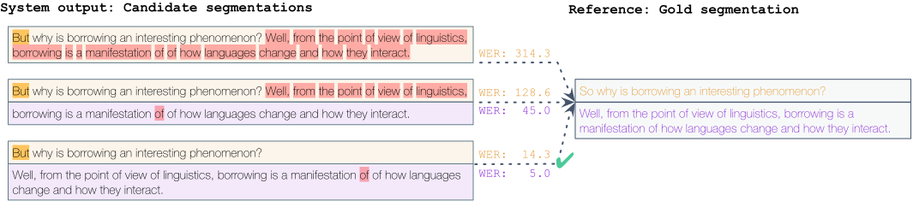

**Source:** *Evaluating the IWSLT2023 Speech Translation Tasks: Human Annotations, Automatic Metrics, and Segmentation* — [PDF](https://arxiv.org/pdf/2406.03881) · [arXiv](https://arxiv.org/abs/2406.03881)

# Evaluating the IWSLT2023 Speech Translation Tasks:   
Human Annotations, Automatic Metrics, and Segmentation

###### Abstract

Human evaluation is a critical component in machine translation system development and has received much attention in text translation research. However, little prior work exists on the topic of human evaluation for speech translation, which adds additional challenges such as noisy data and segmentation mismatches. We take first steps to fill this gap by conducting a comprehensive human evaluation of the results of several shared tasks from the last International Workshop on Spoken Language Translation (IWSLT 2023). We propose an effective evaluation strategy based on automatic resegmentation and direct assessment with segment context. Our analysis revealed that: 1) the proposed evaluation strategy is robust and scores well-correlated with other types of human judgements; 2) automatic metrics are usually, but not always, well-correlated with direct assessment scores; and 3) COMET as a slightly stronger automatic metric than chrF, despite the segmentation noise introduced by the resegmentation step systems. We release the collected human-annotated data in order to encourage further investigation.   
  
Keywords: Human evaluation, speech translation, evaluation metrics

Matthias Sperber1, Ondřej Bojar2, Barry Haddow3, Dávid Javorský,2  
---  
Xutai Ma4, Matteo Negri5, Jan Niehues6, Peter Polák2  
Elizabeth Salesky1,7, Katsuhito Sudoh8, Marco Turchi9  
1Apple, 2Charles U., 3U. Edinburgh, 4Meta, 5FBK, 6KIT, 7JHU, 8NAIST, 9Zoom  
sperber@apple.com, bojar@ufal.mff.cuni.cz, bhaddow@ed.ac.uk, javorsky@ufal.mff.cuni.cz,  
xutaima@meta.com, negri@fbk.eu, jan.niehues@kit.edu, polak@ufal.mff.cuni.cz  
esalesky@jhu.edu, sudoh@is.naist.jp, marco.turchi@zoom.us

 

Abstract content

## 1\. Introduction

Human evaluation plays a critical role in the development of translation systems and, although costly, it serves as a gold standard against which to calibrate automatic metrics.11 1 This is especially true for trainable metrics, which have recently started to outperform traditional metrics [Freitag et al. (2022)](https://arxiv.org/html/2406.03881#bib.bib10). Moreover, it is important when in doubt about whether certain types of system behaviors are being accurately captured by automatic metrics. This is particularly relevant when the output quality is high, and automatic metrics become less reliable. For the case of machine translation for text inputs (MT), a large body of prior research has investigated and improved procedures for manual evaluation, for example in the Conference on Machine Translation (WMT) series of shared tasks ([Kocmi et al., 2022](https://arxiv.org/html/2406.03881#bib.bib17)). Many of the popular MT metrics have been shown to have a high correlation with human evaluation results [Freitag et al. (2022)](https://arxiv.org/html/2406.03881#bib.bib10).

In this paper, we focus on evaluation in speech translation (ST), which introduces additional complicating factors, such as erroneous automatic segmentation, dealing with noisy inputs, conversational and disfluent language, and special downstream requirements, such as simultaneous translation, and subtitling/dubbing constraints. To our knowledge, little prior work has focused on meta-analysis of human evaluation for speech translation. Consequently, it remains unclear to what degree procedures for human and automatic evaluation from MT can be transferred to the ST scenario.

As a first step toward developing trusted human evaluation procedures for ST, and following the successful related efforts at WMT, we conducted a manual evaluation of several shared tasks from the International Workshop for Spoken Language Translation (IWSLT) 2023. Tasks include translation of presentations at the Conference of the Association of Computational Linguistics (ACL) and TED talks22 2 Talks on technology, entertainment, and design, available at [www.ted.com](https://www.ted.com). in several language pairs in offline, multilingual, and simultaneous translation conditions. In the offline and multilingual conditions, inputs are given as unsegmented long-form speech, requiring systems to apply automatic segmentation prior to translation.

The shared tasks used test sets that partially overlap between different task conditions, providing the opportunity for analysis across various conditions.

For conducting our human evaluation, we choose an approach that allows the comparison of systems despite potentially mismatching segmentation by re-segmenting system outputs to a common segmentation and using segment context. To minimize costs, a random subset of segments is chosen for evaluation.

Through extensive analysis, we shed light on the current state of ST evaluation protocols contributing in three ways. First, we confirm that our collected direct assessment (DA) scores are well-correlated with additionally collected annotations, namely Multidimensional Quality Metric (MQM) and continuous ratings, indicating that the proposed evaluation procedure is sound and reliable to be used in future work. Second, we show that the correlation between human evaluation and automatic metrics is often, but not always, high. We conclude that these metrics can generally be trusted, but that human evaluation should be continually run side-by-side for further verification.

Third, we show that COMET [Rei et al. (2020)](https://arxiv.org/html/2406.03881#bib.bib24) has higher correlation than other automatic metrics despite potential robustness issues due to noisy automatic segmentation. This shows promise in using trainable metrics like COMET for speech translation scenarios, although more detailed follow-up experiments is needed.

To the best of our knowledge, the released annotations would be the first publicly available annotations of their kind for speech rather than text translation, facilitating the comparison of evaluation methodology between modalities.33 3 Data is available in WMT format under <https://huggingface.co/datasets/IWSLT/da2023>.

## 2\. Task Description

Task | Offline | Multilingual | Simultaneous  
---|---|---|---  
TED | D |  | D  
ACL | D | D |

 Table 1: Domains used by the 3 shared tasks.

In this section, we provide a bird’s eye view of the IWSLT 2023 tasks considered in our study. Accordingly, we concentrate on the task conditions, the data used, and the automatic evaluation protocols.

### 2.1. Conditions

#### 2.1.1. Offline

The Offline Speech Translation Task aimed to explore automatic methods for translating spoken language in one language into written text in another language. This could be achieved through either cascaded solutions involving pipelined automatic speech recognition and machine translation (MT) systems as core components, or end-to-end approaches that directly translate the audio bypassing the intermediate transcription step. Recent results [Bentivogli et al. (2021)](https://arxiv.org/html/2406.03881#bib.bib6) have shown that the performance of end-to-end models is becoming comparable to that of cascade solutions, but the best-performing technology has yet to be identified.

In the 2023 edition, the Offline Speech Translation Task not only addressed the question of whether the cascade solution remains the prevailing technology but it also assessed the systems submitted in more intricate and demanding situations. These included multiple speakers, non-native speakers, different accents, varying recording quality, specialized terminology, controlled interaction with a second speaker, and spontaneous speech.

Submitted systems used a variety of approaches, experimenting with both constrained and unconstrained training data conditions as well as use of pretrained large language models.

#### 2.1.2. Multilingual

The Multilingual Task focused particularly on the capability to translate to a wide variety of target languages in a realistic use case: with long-form audio requiring segmentation, diverse speaker accents, and domain-specific terminology. The task used the full set of ten target languages from the ACL 60-60 evaluation sets,44 4 Arabic, Mandarin Chinese, Dutch, French, German, Japanese, Farsi, Portuguese, Russian, and Turkish. of which three are considered in this paper (see Section [2.2](https://arxiv.org/html/2406.03881#S2.SS2 "2.2. Test Data ‣ 2. Task Description ‣ Evaluating the IWSLT2023 Speech Translation Tasks: Human Annotations, Automatic Metrics, and Segmentation")). Teams were required to submit to all language pairs, though not restricted to multilingual modelling approaches, such that all approaches could be compared across all ten target languages. There were comparisons between both cascaded and end-to-end systems, a variety of pretrained models, as well as multilingual and single language pair finetuning.

#### 2.1.3. Simultaneous

Simultaneous translation, also known as real-time or online translation, is the task of generating translations incrementally given partial input only. It enables low-latency applications such as simultaneous interpretation in personal traveling and international conferences. In the 2023 edition, a submission qualified as a simultaneous system if the latency is no greater than average lagging [Ma et al. (2019)](https://arxiv.org/html/2406.03881#bib.bib19) of 2 seconds.

The organizers of the shared task proposed two tracks, speech-to-text and speech-to-speech, over three language pairs, English to German, Chinese and Japanese. The human evaluation is only conducted over speech-to-text systems.

### 2.2. Test Data

As shown in Table [1](https://arxiv.org/html/2406.03881#S2.T1 "Table 1 ‣ 2. Task Description ‣ Evaluating the IWSLT2023 Speech Translation Tasks: Human Annotations, Automatic Metrics, and Segmentation"), test data came from the TED domain (for offline and simultaneous tasks), and ACL domain (for offline and multilingual tasks), as detailed below. For the offline and multilingual task, this data was given as long-form speech, requiring systems to use automatic segmentation strategies. The simultaneous task provided input data according to the reference segmentation. For both datasets, our analysis concentrates on German, Japanese, and Mandarin Chinese as target language, and English as source language.

 Figure 1: To parallelize system outputs with reference translations, we re-segment hypotheses by minimizing the overall WER to the reference with mwerSegmenter, which supports many-to-many realignment.

#### 2.2.1. TED

For the TED scenario, the test sets are built starting from 42 talks that are not yet part of the en-de section of the current public release of the TED-derived MuST-C corpus [Cattoni et al. (2021)](https://arxiv.org/html/2406.03881#bib.bib8). From this material, talks that have been translated into Japanese and Chinese were selected to build the en-ja and en-zh test sets, which consist of 37 and 38 talks respectively.

There are two different types of target-language references used in the evaluation campaign. The first type is the original TED translations, which come in the form of subtitles. Because of TED’s subtitling guidelines,55 5 <https://www.ted.com/participate/translate/guidelines> these translations may contain compressed or omitted content, making them less literal compared to unconstrained translations. The second type is unconstrained translations, which were created from scratch by professionals, following typical translation guidelines. These translations are therefore exact, meaning they are literal and have proper punctuation.

#### 2.2.2. ACL

The second test data set is based on the ACL 60-60 evaluation sets released by [Salesky et al. (2023)](https://arxiv.org/html/2406.03881#bib.bib25), which are composed of technical presentations from ACL 2022 given in English by diverse speakers across different paper topics. The talks were manually sentence segmented, transcribed, and translated into ten target languages from the 60/60 initiative.66 6 [www.2022.aclweb.org/dispecialinitiative](https://www.2022.aclweb.org/dispecialinitiative)

The evaluation sets contain 1 hour of one-to-many parallel speech, transcripts, and translations per language pair.

The ACL test sets introduce additional challenges beyond those in the traditional TED setting, including the presence of non-native speakers with diverse accents, varying recording quality, and the strong presence of technical terminology.

## 3\. Evaluation

### 3.1. Resegmentation

To follow realistic use conditions, no reference segmentation was provided for the offline and multilingual tasks; rather, participants were required to process each talk as a whole. To this end, participants used different tools (either publicly available or proprietary) to automatically segment the audio for downstream processing.

Consequently, the segmentation in each submitted system can differ significantly from the reference segmentation. To parallelize outputs and references for evaluation, we re-segmented translation hypotheses following [Matusov et al. (2005)](https://arxiv.org/html/2406.03881#bib.bib21) by exploiting WER alignment to the reference translation with the tool mwerSegmenter.77 7 <https://www-i6.informatik.rwth-aachen.de/web/Software/mwerSegmenter.tar.gz> In this step, the hypotheses are monotonically re-segmented in order to minimize the global WER to the reference translation, with candidate boundaries determined by tokenization; in our case, word-level for German and character-level for Chinese and Japanese. An illustrative example from the ACL data is shown in [Figure 1](https://arxiv.org/html/2406.03881#S2.F1 "Figure 1 ‣ 2.2. Test Data ‣ 2. Task Description ‣ Evaluating the IWSLT2023 Speech Translation Tasks: Human Annotations, Automatic Metrics, and Segmentation"). All subsequent evaluation, both automatic and human, used the re-segmented hypotheses which are now parallel to the references.

### 3.2. Automatic Metrics

For automatic evaluation, the evaluation campaign focused on standard lexical and model-based machine translation evaluation metrics, namely BLEU [Papineni et al. (2002)](https://arxiv.org/html/2406.03881#bib.bib22), chrF [Popović (2015)](https://arxiv.org/html/2406.03881#bib.bib23) and COMET88 8 Unbabel/wmt22-comet-da [Rei et al. (2020)](https://arxiv.org/html/2406.03881#bib.bib24). For conciseness, here we focus on the last two, as BLEU has been shown to be less reliable than chrF [Freitag et al. (2022)](https://arxiv.org/html/2406.03881#bib.bib10). As is common practice in speech translation evaluation, automatic metrics are computed using the re-segmented hypotheses as described in Section [3.1](https://arxiv.org/html/2406.03881#S3.SS1 "3.1. Resegmentation ‣ 3. Evaluation ‣ Evaluating the IWSLT2023 Speech Translation Tasks: Human Annotations, Automatic Metrics, and Segmentation").

<table id="S3.F2.2" class="ltx_tabular ltx_guessed_headers ltx_align_middle">
<thead class="ltx_thead">
<tr id="S3.F2.2.1" class="ltx_tr">
<th id="S3.F2.2.1.1" class="ltx_td ltx_align_left ltx_th ltx_th_column ltx_th_row">Source text:</th>
<th id="S3.F2.2.1.2" class="ltx_td ltx_align_left ltx_th ltx_th_column">We assume the precision of quantities are known.</th></tr>
</thead>
<tbody class="ltx_tbody">
<tr id="S3.F2.2.2" class="ltx_tr">
<th id="S3.F2.2.2.1" class="ltx_td ltx_align_left ltx_th ltx_th_row ltx_border_t">Reference target text:</th>
<td id="S3.F2.2.2.2" class="ltx_td ltx_align_left ltx_border_t">
<table id="S3.F2.2.2.2.1" class="ltx_tabular ltx_align_middle">
<tr id="S3.F2.2.2.2.1.1" class="ltx_tr">
<td id="S3.F2.2.2.2.1.1.1" class="ltx_td ltx_nopad_r ltx_align_center">We  </td>
<td id="S3.F2.2.2.2.1.1.2" class="ltx_td ltx_nopad_r ltx_align_center">go</td>
<td id="S3.F2.2.2.2.1.1.3" class="ltx_td ltx_align_left" colspan="2">under assumption,</td>
<td id="S3.F2.2.2.2.1.1.4" class="ltx_td ltx_nopad_r ltx_align_center">that</td>
<td id="S3.F2.2.2.2.1.1.5" class="ltx_td ltx_nopad_r ltx_align_center">the</td>
<td id="S3.F2.2.2.2.1.1.6" class="ltx_td ltx_nopad_r ltx_align_center">precision</td>
<td id="S3.F2.2.2.2.1.1.7" class="ltx_td ltx_nopad_r ltx_align_center">of the</td>
<td id="S3.F2.2.2.2.1.1.8" class="ltx_td ltx_nopad_r ltx_align_center">sets</td>
<td id="S3.F2.2.2.2.1.1.9" class="ltx_td ltx_nopad_r ltx_align_center">known</td>
<td id="S3.F2.2.2.2.1.1.10" class="ltx_td ltx_nopad_r ltx_align_center">is.</td></tr>
<tr id="S3.F2.2.2.2.1.2" class="ltx_tr">
<td id="S3.F2.2.2.2.1.2.1" class="ltx_td ltx_nopad_r ltx_align_center">Wir</td>
<td id="S3.F2.2.2.2.1.2.2" class="ltx_td ltx_nopad_r ltx_align_center">gehen</td>
<td id="S3.F2.2.2.2.1.2.3" class="ltx_td ltx_nopad_r ltx_align_center">davon</td>
<td id="S3.F2.2.2.2.1.2.4" class="ltx_td ltx_nopad_r ltx_align_center">aus</td>
<td id="S3.F2.2.2.2.1.2.5" class="ltx_td ltx_nopad_r ltx_align_center">dass  </td>
<td id="S3.F2.2.2.2.1.2.6" class="ltx_td ltx_nopad_r ltx_align_center">die</td>
<td id="S3.F2.2.2.2.1.2.7" class="ltx_td ltx_nopad_r ltx_align_center">Genauigkeit</td>
<td id="S3.F2.2.2.2.1.2.8" class="ltx_td ltx_nopad_r ltx_align_center">der</td>
<td id="S3.F2.2.2.2.1.2.9" class="ltx_td ltx_nopad_r ltx_align_center">Mengen</td>
<td id="S3.F2.2.2.2.1.2.10" class="ltx_td ltx_nopad_r ltx_align_center">bekannt</td>
<td id="S3.F2.2.2.2.1.2.11" class="ltx_td ltx_nopad_r ltx_align_center">ist.</td></tr>
</table></td></tr>
<tr id="S3.F2.2.3" class="ltx_tr">
<th id="S3.F2.2.3.1" class="ltx_td ltx_align_left ltx_th ltx_th_row ltx_border_t">Reseg. sys. output:</th>
<td id="S3.F2.2.3.2" class="ltx_td ltx_align_left ltx_border_t">
<table id="S3.F2.2.3.2.1" class="ltx_tabular ltx_align_middle">
<tr id="S3.F2.2.3.2.1.1" class="ltx_tr">
<td id="S3.F2.2.3.2.1.1.1" class="ltx_td ltx_nopad_r ltx_align_center">we  </td>
<td id="S3.F2.2.3.2.1.1.2" class="ltx_td ltx_align_center">under assumption,</td>
<td id="S3.F2.2.3.2.1.1.3" class="ltx_td ltx_nopad_r ltx_align_center">that</td>
<td id="S3.F2.2.3.2.1.1.4" class="ltx_td ltx_nopad_r ltx_align_center">the</td>
<td id="S3.F2.2.3.2.1.1.5" class="ltx_td ltx_nopad_r ltx_align_center">precision</td>
<td id="S3.F2.2.3.2.1.1.6" class="ltx_td ltx_nopad_r ltx_align_center">of the</td>
<td id="S3.F2.2.3.2.1.1.7" class="ltx_td ltx_nopad_r ltx_align_center">sets</td>
<td id="S3.F2.2.3.2.1.1.8" class="ltx_td ltx_nopad_r ltx_align_center">known</td>
<td id="S3.F2.2.3.2.1.1.9" class="ltx_td ltx_nopad_r ltx_align_center">is,</td></tr>
<tr id="S3.F2.2.3.2.1.2" class="ltx_tr">
<td id="S3.F2.2.3.2.1.2.1" class="ltx_td ltx_nopad_r ltx_align_center">wir</td>
<td id="S3.F2.2.3.2.1.2.2" class="ltx_td ltx_align_center">davon aus,</td>
<td id="S3.F2.2.3.2.1.2.3" class="ltx_td ltx_nopad_r ltx_align_center">dass  </td>
<td id="S3.F2.2.3.2.1.2.4" class="ltx_td ltx_nopad_r ltx_align_center">die</td>
<td id="S3.F2.2.3.2.1.2.5" class="ltx_td ltx_nopad_r ltx_align_center">Präzision</td>
<td id="S3.F2.2.3.2.1.2.6" class="ltx_td ltx_nopad_r ltx_align_center">von</td>
<td id="S3.F2.2.3.2.1.2.7" class="ltx_td ltx_nopad_r ltx_align_center">Mengen</td>
<td id="S3.F2.2.3.2.1.2.8" class="ltx_td ltx_nopad_r ltx_align_center">bekannt</td>
<td id="S3.F2.2.3.2.1.2.9" class="ltx_td ltx_nopad_r ltx_align_center">ist,</td></tr>
</table></td></tr>
<tr id="S3.F2.2.4" class="ltx_tr">
<th id="S3.F2.2.4.1" class="ltx_td ltx_align_left ltx_th ltx_th_row ltx_border_t">Previous sys. output:</th>
<td id="S3.F2.2.4.2" class="ltx_td ltx_align_left ltx_border_t">
<table id="S3.F2.2.4.2.1" class="ltx_tabular ltx_align_middle">
<tr id="S3.F2.2.4.2.1.1" class="ltx_tr">
<td id="S3.F2.2.4.2.1.1.1" class="ltx_td ltx_nopad_r ltx_align_center">It  </td>
<td id="S3.F2.2.4.2.1.1.2" class="ltx_td ltx_nopad_r ltx_align_center">holds</td>
<td id="S3.F2.2.4.2.1.1.3" class="ltx_td ltx_nopad_r ltx_align_center">thus</td>
<td id="S3.F2.2.4.2.1.1.4" class="ltx_td ltx_nopad_r ltx_align_center">also</td>
<td id="S3.F2.2.4.2.1.1.5" class="ltx_td ltx_nopad_r ltx_align_center">certain</td>
<td id="S3.F2.2.4.2.1.1.6" class="ltx_td ltx_nopad_r ltx_align_center">assumptions.</td>
<td id="S3.F2.2.4.2.1.1.7" class="ltx_td ltx_nopad_r ltx_align_center">As</td>
<td id="S3.F2.2.4.2.1.1.8" class="ltx_td ltx_nopad_r ltx_align_center">in</td>
<td id="S3.F2.2.4.2.1.1.9" class="ltx_td ltx_nopad_r ltx_align_center">prior</td>
<td id="S3.F2.2.4.2.1.1.10" class="ltx_td ltx_nopad_r ltx_align_center">works</td>
<td id="S3.F2.2.4.2.1.1.11" class="ltx_td ltx_nopad_r ltx_align_center">go</td></tr>
<tr id="S3.F2.2.4.2.1.2" class="ltx_tr">
<td id="S3.F2.2.4.2.1.2.1" class="ltx_td ltx_nopad_r ltx_align_center">Es</td>
<td id="S3.F2.2.4.2.1.2.2" class="ltx_td ltx_nopad_r ltx_align_center">gelten</td>
<td id="S3.F2.2.4.2.1.2.3" class="ltx_td ltx_nopad_r ltx_align_center">also  </td>
<td id="S3.F2.2.4.2.1.2.4" class="ltx_td ltx_nopad_r ltx_align_center">auch</td>
<td id="S3.F2.2.4.2.1.2.5" class="ltx_td ltx_nopad_r ltx_align_center">bestimmte</td>
<td id="S3.F2.2.4.2.1.2.6" class="ltx_td ltx_nopad_r ltx_align_center">Annahmen.</td>
<td id="S3.F2.2.4.2.1.2.7" class="ltx_td ltx_nopad_r ltx_align_center">Wie</td>
<td id="S3.F2.2.4.2.1.2.8" class="ltx_td ltx_nopad_r ltx_align_center">in</td>
<td id="S3.F2.2.4.2.1.2.9" class="ltx_td ltx_nopad_r ltx_align_center">früheren</td>
<td id="S3.F2.2.4.2.1.2.10" class="ltx_td ltx_nopad_r ltx_align_center">Arbeiten</td>
<td id="S3.F2.2.4.2.1.2.11" class="ltx_td ltx_nopad_r ltx_align_center">gehen</td></tr>
</table></td></tr>
<tr id="S3.F2.2.5" class="ltx_tr">
<th id="S3.F2.2.5.1" class="ltx_td ltx_align_left ltx_th ltx_th_row ltx_border_t">Next system output:</th>
<td id="S3.F2.2.5.2" class="ltx_td ltx_align_left ltx_border_t">
<table id="S3.F2.2.5.2.1" class="ltx_tabular ltx_align_middle">
<tr id="S3.F2.2.5.2.1.1" class="ltx_tr">
<td id="S3.F2.2.5.2.1.1.1" class="ltx_td ltx_nopad_r ltx_align_center">and  </td>
<td id="S3.F2.2.5.2.1.1.2" class="ltx_td ltx_nopad_r ltx_align_center">consider</td>
<td id="S3.F2.2.5.2.1.1.3" class="ltx_td ltx_nopad_r ltx_align_center">only</td>
<td id="S3.F2.2.5.2.1.1.4" class="ltx_td ltx_nopad_r ltx_align_center">basic</td>
<td id="S3.F2.2.5.2.1.1.5" class="ltx_td ltx_nopad_r ltx_align_center">operators</td>
<td id="S3.F2.2.5.2.1.1.6" class="ltx_td ltx_nopad_r ltx_align_center">like</td>
<td id="S3.F2.2.5.2.1.1.7" class="ltx_td ltx_nopad_r ltx_align_center">additon,</td>
<td id="S3.F2.2.5.2.1.1.8" class="ltx_td ltx_nopad_r ltx_align_center">subtraction,</td>
<td id="S3.F2.2.5.2.1.1.9" class="ltx_td ltx_nopad_r ltx_align_center"><math id="S3.F2.m1" class="ltx_Math" alttext="\cdots" display="inline" intent=":literal"><semantics><mo mathsize="0.900em">⋯</mo><annotation encoding="application/x-tex">\cdots</annotation></semantics></math></td></tr>
<tr id="S3.F2.2.5.2.1.2" class="ltx_tr">
<td id="S3.F2.2.5.2.1.2.1" class="ltx_td ltx_nopad_r ltx_align_center">und</td>
<td id="S3.F2.2.5.2.1.2.2" class="ltx_td ltx_nopad_r ltx_align_center">betrachten</td>
<td id="S3.F2.2.5.2.1.2.3" class="ltx_td ltx_nopad_r ltx_align_center">nur  </td>
<td id="S3.F2.2.5.2.1.2.4" class="ltx_td ltx_nopad_r ltx_align_center">grundlegende</td>
<td id="S3.F2.2.5.2.1.2.5" class="ltx_td ltx_nopad_r ltx_align_center">Operatoren</td>
<td id="S3.F2.2.5.2.1.2.6" class="ltx_td ltx_nopad_r ltx_align_center">wie</td>
<td id="S3.F2.2.5.2.1.2.7" class="ltx_td ltx_nopad_r ltx_align_center">Addition,</td>
<td id="S3.F2.2.5.2.1.2.8" class="ltx_td ltx_nopad_r ltx_align_center">Subtraktion,</td>
<td id="S3.F2.2.5.2.1.2.9" class="ltx_td ltx_nopad_r ltx_align_center"><math id="S3.F2.m2" class="ltx_Math" alttext="\cdots" display="inline" intent=":literal"><semantics><mo mathsize="0.900em">⋯</mo><annotation encoding="application/x-tex">\cdots</annotation></semantics></math></td></tr>
</table></td></tr>
</tbody>
</table>

 Figure 2: Example for annotation of re-segmented English-German system outputs. Gloss is provided in italics. The human annotator, if looking only at the re-segmented system output of the current sentence, would find the main verb missing, the beginning of the sentence not capitalized, and the sentences ending in a comma instead of full stop, and penalize the sentence accordingly. As a remedy, we also present system outputs for adjacent segments to the annotator. The main verb (gehen) is located in the system output for the previous sentence, and by being presented with the context, the annotator will be able to see that this translation has no grammatical issues nor problems with casing or punctuation.

### 3.3. Human Evaluation

Conducting human evaluation is important for a number of reasons. Among others, prior work [Barrault et al. (2019)](https://arxiv.org/html/2406.03881#bib.bib5) has observed that for highly accurate translation systems, human evaluators often rank systems differently than automatic metrics, indicating that automatic metrics alone may not be reliable enough in many situations. Moreover, recent speech translation research places much focus on comparing two different modeling paradigms, i.e. direct vs. cascaded ST. This is reminiscent of an earlier situation in MT research, where automatic metrics, when used to compare different MT paradigms (rule-based, statistical, neural), were found to be less reliable than for comparing similar systems built under the same paradigm [Bojar et al. (2016)](https://arxiv.org/html/2406.03881#bib.bib7). Similarly, it could be conceivable that automatic metrics may suffer from systematic biases that would make comparison across ST modeling paradigms difficult. However, whether (and to what degree) these modeling paradigms lead to systematically different translations is currently not well understood.99 9 Some initial work exists, for instance [Bentivogli et al. (2021)](https://arxiv.org/html/2406.03881#bib.bib6) do not find significant differences in preference, while [Gaido et al. (2020)](https://arxiv.org/html/2406.03881#bib.bib12) investigate speaker gender awareness as a concept that only direct models can learn in theory, since cascaded models lose this information through reliance on the intermediate transcription. In light of this, we argue that more emphasis is needed on human evaluation for comparing ST paradigms. Beyond such considerations, setting up a gold procedure is important for a variety of reasons, including establishing or training better automatic metrics.

#### 3.3.1. Direct assessment

We conduct a source-based DA [Graham et al. (2013)](https://arxiv.org/html/2406.03881#bib.bib13); [Cettolo et al. (2017)](https://arxiv.org/html/2406.03881#bib.bib9); [Akhbardeh et al. (2021)](https://arxiv.org/html/2406.03881#bib.bib2), where annotators are shown both the source text and the translated target text.

For DA, we again make use of the automatic re-segmentation as outlined in §[3.1](https://arxiv.org/html/2406.03881#S3.SS1 "3.1. Resegmentation ‣ 3. Evaluation ‣ Evaluating the IWSLT2023 Speech Translation Tasks: Human Annotations, Automatic Metrics, and Segmentation"), which has several important benefits. First, it makes possible to choose only a subset of segments for manual annotation, which is often desirable for cost considerations while ensuring that the segmentation and choice of segments remain comparable across the evaluated systems. Second, it allows computing segment-level correlation with automatic metrics, thanks to consistent segmentation. Finally, it frees us from having to apply weighted averaging schemes when aggregating segment scores, in order to make up for the possibility of different systems using different segment granularity.

Figure [2](https://arxiv.org/html/2406.03881#S3.F2 "Figure 2 ‣ 3.2. Automatic Metrics ‣ 3. Evaluation ‣ Evaluating the IWSLT2023 Speech Translation Tasks: Human Annotations, Automatic Metrics, and Segmentation") shows an example of how DA based on resegmented system outputs looks in practice.

Note that the re-segmentation step described above may lead to cases where annotators are presented with segments of automatic translations that start or stop in the middle of a sentence (see example in Figure [2](https://arxiv.org/html/2406.03881#S3.F2 "Figure 2 ‣ 3.2. Automatic Metrics ‣ 3. Evaluation ‣ Evaluating the IWSLT2023 Speech Translation Tasks: Human Annotations, Automatic Metrics, and Segmentation")). Such apparent problems in the translation output may originate simply from the different segmentation but may be perfectly valid when considered in context. To avoid penalizing such situations, we provided translators not only with the source sentence and system translation but also with the system translation of the previous and following segments. The precise annotation instructions are given in the appendix. Providing more context to human annotators is additionally motivated by prior research demonstrating higher annotation quality by showing document context to annotators [Grundkiewicz et al. (2021)](https://arxiv.org/html/2406.03881#bib.bib14).

Assessments were performed on a continuous scale between 0 and 100. Neither video nor audio context was provided. Segments were shuffled and randomly assigned to annotators to avoid bias related to the presentation order. Annotations were conducted through a trusted vendor by a total of 77 professional translators (33 for English-German, 11 for English-Japanese, 33 for English-Chinese). Annotators were fluent in the source language and native in the target language.

DA scores were collected for all three considered language pairs, i.e. English-German, English-Japanese, and English-Chinese. For the TED domain, DA scores are collected over a subset of 1,000 randomly chosen segments. The same segments are chosen for all the systems.

Task | Language | Domain | Systems | Segments | Tokens  
---|---|---|---|---|---  
Offline | en-de | TED | \(7\) | \(7000\) | \(115633\)  
Multilingual | en-de | ACL | \(3\) | \(1248\) | \(22128\)  
Offline | en-de | ACL | \(7\) | \(2912\) | \(51632\)  
Simultaneous | en-de | TED | \(5\) | \(5000\) | \(82595\)  
Simultaneous | en-ja | TED | \(4\) | \(4000\) | \(66076\)  
Offline | en-ja | TED | \(5\) | \(5000\) | \(82595\)  
Offline | en-ja | ACL | \(5\) | \(2080\) | \(36880\)  
Multilingual | en-ja | ACL | \(3\) | \(1248\) | \(22128\)  
Offline | en-zh | TED | \(8\) | \(8000\) | \(132152\)  
Offline | en-zh | ACL | \(8\) | \(3328\) | \(59008\)  
Multilingual | en-zh | ACL | \(3\) | \(1248\) | \(22128\)  
Simultaneous | en-zh | TED | \(2\) | \(2000\) | \(33038\)

 Table 2: Data statistics for collected direct assessments: Number of systems, segments, and source side (reference transcript) tokens for each combination of task, language pair, and domain. 

<table id="S3.T3.2" class="ltx_tabular ltx_centering ltx_guessed_headers ltx_align_middle">
<thead class="ltx_thead">
<tr id="S3.T3.2.1" class="ltx_tr">
<th id="S3.T3.2.1.1" class="ltx_td ltx_align_left ltx_th ltx_th_column ltx_border_tt">Task</th>
<th id="S3.T3.2.1.2" class="ltx_td ltx_align_center ltx_th ltx_th_column ltx_border_tt">Language</th>
<th id="S3.T3.2.1.3" class="ltx_td ltx_align_center ltx_th ltx_th_column ltx_border_tt">Domain</th>
<th id="S3.T3.2.1.4" class="ltx_td ltx_align_center ltx_th ltx_th_column ltx_border_tt">Systems</th>
<th id="S3.T3.2.1.5" class="ltx_td ltx_align_center ltx_th ltx_th_column ltx_border_tt" colspan="2"><math id="S3.T3.m1" class="ltx_Math" alttext="\rho" display="inline" intent=":literal"><semantics><mi>ρ</mi><annotation encoding="application/x-tex">\rho</annotation></semantics></math></th>
<th id="S3.T3.2.1.6" class="ltx_td ltx_align_center ltx_th ltx_th_column ltx_border_tt" colspan="2"><math id="S3.T3.m2" class="ltx_Math" alttext="r" display="inline" intent=":literal"><semantics><mi>r</mi><annotation encoding="application/x-tex">r</annotation></semantics></math></th></tr>
</thead>
<tbody class="ltx_tbody">
<tr id="S3.T3.2.2" class="ltx_tr">
<td id="S3.T3.2.2.1" class="ltx_td ltx_align_left ltx_border_t">Offline</td>
<td id="S3.T3.2.2.2" class="ltx_td ltx_align_center ltx_border_t">en-de</td>
<td id="S3.T3.2.2.3" class="ltx_td ltx_align_center ltx_border_t">TED</td>
<td id="S3.T3.2.2.4" class="ltx_td ltx_align_center ltx_border_t"><math id="S3.T3.m3" class="ltx_Math" alttext="7" display="inline" intent=":literal"><semantics><mn>7</mn><annotation encoding="application/x-tex">7</annotation></semantics></math></td>
<td id="S3.T3.2.2.5" class="ltx_td ltx_align_right ltx_border_t"><math id="S3.T3.m4" class="ltx_Math" alttext="\mathbf{0.99}" display="inline" intent=":literal"><semantics><mn class="ltx_mathvariant_bold" mathvariant="bold">0.99</mn><annotation encoding="application/x-tex">\mathbf{0.99}</annotation></semantics></math></td>
<td id="S3.T3.2.2.6" class="ltx_td ltx_align_left ltx_border_t"><math id="S3.T3.m5" class="ltx_Math" alttext="(p{=}0.00)" display="inline" intent=":literal"><semantics><mrow><mo stretchy="false">(</mo><mrow><mi>p</mi><mo>=</mo><mn>0.00</mn></mrow><mo stretchy="false">)</mo></mrow><annotation encoding="application/x-tex">(p{=}0.00)</annotation></semantics></math></td>
<td id="S3.T3.2.2.7" class="ltx_td ltx_align_right ltx_border_t"><math id="S3.T3.m6" class="ltx_Math" alttext="0.71" display="inline" intent=":literal"><semantics><mn>0.71</mn><annotation encoding="application/x-tex">0.71</annotation></semantics></math></td>
<td id="S3.T3.2.2.8" class="ltx_td ltx_align_left ltx_border_t"><math id="S3.T3.m7" class="ltx_Math" alttext="(p{=}0.07)" display="inline" intent=":literal"><semantics><mrow><mo stretchy="false">(</mo><mrow><mi>p</mi><mo>=</mo><mn>0.07</mn></mrow><mo stretchy="false">)</mo></mrow><annotation encoding="application/x-tex">(p{=}0.07)</annotation></semantics></math></td></tr>
<tr id="S3.T3.2.3" class="ltx_tr">
<td id="S3.T3.2.3.1" class="ltx_td ltx_align_left">Multilingual</td>
<td id="S3.T3.2.3.2" class="ltx_td ltx_align_center">en-de</td>
<td id="S3.T3.2.3.3" class="ltx_td ltx_align_center">ACL</td>
<td id="S3.T3.2.3.4" class="ltx_td ltx_align_center"><math id="S3.T3.m8" class="ltx_Math" alttext="3" display="inline" intent=":literal"><semantics><mn>3</mn><annotation encoding="application/x-tex">3</annotation></semantics></math></td>
<td id="S3.T3.2.3.5" class="ltx_td ltx_align_right"><math id="S3.T3.m9" class="ltx_Math" alttext="0.98" display="inline" intent=":literal"><semantics><mn>0.98</mn><annotation encoding="application/x-tex">0.98</annotation></semantics></math></td>
<td id="S3.T3.2.3.6" class="ltx_td ltx_align_left"><math id="S3.T3.m10" class="ltx_Math" alttext="(p{=}0.12)" display="inline" intent=":literal"><semantics><mrow><mo stretchy="false">(</mo><mrow><mi>p</mi><mo>=</mo><mn>0.12</mn></mrow><mo stretchy="false">)</mo></mrow><annotation encoding="application/x-tex">(p{=}0.12)</annotation></semantics></math></td>
<td id="S3.T3.2.3.7" class="ltx_td ltx_align_right"><math id="S3.T3.m11" class="ltx_Math" alttext="\mathbf{1.00}" display="inline" intent=":literal"><semantics><mn class="ltx_mathvariant_bold" mathvariant="bold">1.00</mn><annotation encoding="application/x-tex">\mathbf{1.00}</annotation></semantics></math></td>
<td id="S3.T3.2.3.8" class="ltx_td ltx_align_left"><math id="S3.T3.m12" class="ltx_Math" alttext="(p{=}0.00)" display="inline" intent=":literal"><semantics><mrow><mo stretchy="false">(</mo><mrow><mi>p</mi><mo>=</mo><mn>0.00</mn></mrow><mo stretchy="false">)</mo></mrow><annotation encoding="application/x-tex">(p{=}0.00)</annotation></semantics></math></td></tr>
<tr id="S3.T3.2.4" class="ltx_tr">
<td id="S3.T3.2.4.1" class="ltx_td ltx_align_left">Offline</td>
<td id="S3.T3.2.4.2" class="ltx_td ltx_align_center">en-de</td>
<td id="S3.T3.2.4.3" class="ltx_td ltx_align_center">ACL</td>
<td id="S3.T3.2.4.4" class="ltx_td ltx_align_center"><math id="S3.T3.m13" class="ltx_Math" alttext="7" display="inline" intent=":literal"><semantics><mn>7</mn><annotation encoding="application/x-tex">7</annotation></semantics></math></td>
<td id="S3.T3.2.4.5" class="ltx_td ltx_align_right"><math id="S3.T3.m14" class="ltx_Math" alttext="\mathbf{0.94}" display="inline" intent=":literal"><semantics><mn class="ltx_mathvariant_bold" mathvariant="bold">0.94</mn><annotation encoding="application/x-tex">\mathbf{0.94}</annotation></semantics></math></td>
<td id="S3.T3.2.4.6" class="ltx_td ltx_align_left"><math id="S3.T3.m15" class="ltx_Math" alttext="(p{=}0.00)" display="inline" intent=":literal"><semantics><mrow><mo stretchy="false">(</mo><mrow><mi>p</mi><mo>=</mo><mn>0.00</mn></mrow><mo stretchy="false">)</mo></mrow><annotation encoding="application/x-tex">(p{=}0.00)</annotation></semantics></math></td>
<td id="S3.T3.2.4.7" class="ltx_td ltx_align_right"><math id="S3.T3.m16" class="ltx_Math" alttext="0.75" display="inline" intent=":literal"><semantics><mn>0.75</mn><annotation encoding="application/x-tex">0.75</annotation></semantics></math></td>
<td id="S3.T3.2.4.8" class="ltx_td ltx_align_left"><math id="S3.T3.m17" class="ltx_Math" alttext="(p{=}0.05)" display="inline" intent=":literal"><semantics><mrow><mo stretchy="false">(</mo><mrow><mi>p</mi><mo>=</mo><mn>0.05</mn></mrow><mo stretchy="false">)</mo></mrow><annotation encoding="application/x-tex">(p{=}0.05)</annotation></semantics></math></td></tr>
<tr id="S3.T3.2.5" class="ltx_tr">
<td id="S3.T3.2.5.1" class="ltx_td ltx_align_left">Simultaneous</td>
<td id="S3.T3.2.5.2" class="ltx_td ltx_align_center">en-de</td>
<td id="S3.T3.2.5.3" class="ltx_td ltx_align_center">TED</td>
<td id="S3.T3.2.5.4" class="ltx_td ltx_align_center"><math id="S3.T3.m18" class="ltx_Math" alttext="5" display="inline" intent=":literal"><semantics><mn>5</mn><annotation encoding="application/x-tex">5</annotation></semantics></math></td>
<td id="S3.T3.2.5.5" class="ltx_td ltx_align_right"><math id="S3.T3.m19" class="ltx_Math" alttext="0.75" display="inline" intent=":literal"><semantics><mn>0.75</mn><annotation encoding="application/x-tex">0.75</annotation></semantics></math></td>
<td id="S3.T3.2.5.6" class="ltx_td ltx_align_left"><math id="S3.T3.m20" class="ltx_Math" alttext="(p{=}0.15)" display="inline" intent=":literal"><semantics><mrow><mo stretchy="false">(</mo><mrow><mi>p</mi><mo>=</mo><mn>0.15</mn></mrow><mo stretchy="false">)</mo></mrow><annotation encoding="application/x-tex">(p{=}0.15)</annotation></semantics></math></td>
<td id="S3.T3.2.5.7" class="ltx_td ltx_align_right"><math id="S3.T3.m21" class="ltx_Math" alttext="0.50" display="inline" intent=":literal"><semantics><mn>0.50</mn><annotation encoding="application/x-tex">0.50</annotation></semantics></math></td>
<td id="S3.T3.2.5.8" class="ltx_td ltx_align_left"><math id="S3.T3.m22" class="ltx_Math" alttext="(p{=}0.39)" display="inline" intent=":literal"><semantics><mrow><mo stretchy="false">(</mo><mrow><mi>p</mi><mo>=</mo><mn>0.39</mn></mrow><mo stretchy="false">)</mo></mrow><annotation encoding="application/x-tex">(p{=}0.39)</annotation></semantics></math></td></tr>
<tr id="S3.T3.2.6" class="ltx_tr">
<td id="S3.T3.2.6.1" class="ltx_td ltx_align_left">Simultaneous</td>
<td id="S3.T3.2.6.2" class="ltx_td ltx_align_center">en-ja</td>
<td id="S3.T3.2.6.3" class="ltx_td ltx_align_center">TED</td>
<td id="S3.T3.2.6.4" class="ltx_td ltx_align_center"><math id="S3.T3.m23" class="ltx_Math" alttext="4" display="inline" intent=":literal"><semantics><mn>4</mn><annotation encoding="application/x-tex">4</annotation></semantics></math></td>
<td id="S3.T3.2.6.5" class="ltx_td ltx_align_right"><math id="S3.T3.m24" class="ltx_Math" alttext="\mathbf{0.99}" display="inline" intent=":literal"><semantics><mn class="ltx_mathvariant_bold" mathvariant="bold">0.99</mn><annotation encoding="application/x-tex">\mathbf{0.99}</annotation></semantics></math></td>
<td id="S3.T3.2.6.6" class="ltx_td ltx_align_left"><math id="S3.T3.m25" class="ltx_Math" alttext="(p{=}0.01)" display="inline" intent=":literal"><semantics><mrow><mo stretchy="false">(</mo><mrow><mi>p</mi><mo>=</mo><mn>0.01</mn></mrow><mo stretchy="false">)</mo></mrow><annotation encoding="application/x-tex">(p{=}0.01)</annotation></semantics></math></td>
<td id="S3.T3.2.6.7" class="ltx_td ltx_align_right"><math id="S3.T3.m26" class="ltx_Math" alttext="0.20" display="inline" intent=":literal"><semantics><mn>0.20</mn><annotation encoding="application/x-tex">0.20</annotation></semantics></math></td>
<td id="S3.T3.2.6.8" class="ltx_td ltx_align_left"><math id="S3.T3.m27" class="ltx_Math" alttext="(p{=}0.80)" display="inline" intent=":literal"><semantics><mrow><mo stretchy="false">(</mo><mrow><mi>p</mi><mo>=</mo><mn>0.80</mn></mrow><mo stretchy="false">)</mo></mrow><annotation encoding="application/x-tex">(p{=}0.80)</annotation></semantics></math></td></tr>
<tr id="S3.T3.2.7" class="ltx_tr">
<td id="S3.T3.2.7.1" class="ltx_td ltx_align_left">Offline</td>
<td id="S3.T3.2.7.2" class="ltx_td ltx_align_center">en-ja</td>
<td id="S3.T3.2.7.3" class="ltx_td ltx_align_center">TED</td>
<td id="S3.T3.2.7.4" class="ltx_td ltx_align_center"><math id="S3.T3.m28" class="ltx_Math" alttext="5" display="inline" intent=":literal"><semantics><mn>5</mn><annotation encoding="application/x-tex">5</annotation></semantics></math></td>
<td id="S3.T3.2.7.5" class="ltx_td ltx_align_right"><math id="S3.T3.m29" class="ltx_Math" alttext="\mathbf{0.99}" display="inline" intent=":literal"><semantics><mn class="ltx_mathvariant_bold" mathvariant="bold">0.99</mn><annotation encoding="application/x-tex">\mathbf{0.99}</annotation></semantics></math></td>
<td id="S3.T3.2.7.6" class="ltx_td ltx_align_left"><math id="S3.T3.m30" class="ltx_Math" alttext="(p{=}0.00)" display="inline" intent=":literal"><semantics><mrow><mo stretchy="false">(</mo><mrow><mi>p</mi><mo>=</mo><mn>0.00</mn></mrow><mo stretchy="false">)</mo></mrow><annotation encoding="application/x-tex">(p{=}0.00)</annotation></semantics></math></td>
<td id="S3.T3.2.7.7" class="ltx_td ltx_align_right"><math id="S3.T3.m31" class="ltx_Math" alttext="\mathbf{0.90}" display="inline" intent=":literal"><semantics><mn class="ltx_mathvariant_bold" mathvariant="bold">0.90</mn><annotation encoding="application/x-tex">\mathbf{0.90}</annotation></semantics></math></td>
<td id="S3.T3.2.7.8" class="ltx_td ltx_align_left"><math id="S3.T3.m32" class="ltx_Math" alttext="(p{=}0.04)" display="inline" intent=":literal"><semantics><mrow><mo stretchy="false">(</mo><mrow><mi>p</mi><mo>=</mo><mn>0.04</mn></mrow><mo stretchy="false">)</mo></mrow><annotation encoding="application/x-tex">(p{=}0.04)</annotation></semantics></math></td></tr>
<tr id="S3.T3.2.8" class="ltx_tr">
<td id="S3.T3.2.8.1" class="ltx_td ltx_align_left">Offline</td>
<td id="S3.T3.2.8.2" class="ltx_td ltx_align_center">en-ja</td>
<td id="S3.T3.2.8.3" class="ltx_td ltx_align_center">ACL</td>
<td id="S3.T3.2.8.4" class="ltx_td ltx_align_center"><math id="S3.T3.m33" class="ltx_Math" alttext="5" display="inline" intent=":literal"><semantics><mn>5</mn><annotation encoding="application/x-tex">5</annotation></semantics></math></td>
<td id="S3.T3.2.8.5" class="ltx_td ltx_align_right"><math id="S3.T3.m34" class="ltx_Math" alttext="\mathbf{0.99}" display="inline" intent=":literal"><semantics><mn class="ltx_mathvariant_bold" mathvariant="bold">0.99</mn><annotation encoding="application/x-tex">\mathbf{0.99}</annotation></semantics></math></td>
<td id="S3.T3.2.8.6" class="ltx_td ltx_align_left"><math id="S3.T3.m35" class="ltx_Math" alttext="(p{=}0.00)" display="inline" intent=":literal"><semantics><mrow><mo stretchy="false">(</mo><mrow><mi>p</mi><mo>=</mo><mn>0.00</mn></mrow><mo stretchy="false">)</mo></mrow><annotation encoding="application/x-tex">(p{=}0.00)</annotation></semantics></math></td>
<td id="S3.T3.2.8.7" class="ltx_td ltx_align_right"><math id="S3.T3.m36" class="ltx_Math" alttext="0.60" display="inline" intent=":literal"><semantics><mn>0.60</mn><annotation encoding="application/x-tex">0.60</annotation></semantics></math></td>
<td id="S3.T3.2.8.8" class="ltx_td ltx_align_left"><math id="S3.T3.m37" class="ltx_Math" alttext="(p{=}0.28)" display="inline" intent=":literal"><semantics><mrow><mo stretchy="false">(</mo><mrow><mi>p</mi><mo>=</mo><mn>0.28</mn></mrow><mo stretchy="false">)</mo></mrow><annotation encoding="application/x-tex">(p{=}0.28)</annotation></semantics></math></td></tr>
<tr id="S3.T3.2.9" class="ltx_tr">
<td id="S3.T3.2.9.1" class="ltx_td ltx_align_left">Multilingual</td>
<td id="S3.T3.2.9.2" class="ltx_td ltx_align_center">en-ja</td>
<td id="S3.T3.2.9.3" class="ltx_td ltx_align_center">ACL</td>
<td id="S3.T3.2.9.4" class="ltx_td ltx_align_center"><math id="S3.T3.m38" class="ltx_Math" alttext="3" display="inline" intent=":literal"><semantics><mn>3</mn><annotation encoding="application/x-tex">3</annotation></semantics></math></td>
<td id="S3.T3.2.9.5" class="ltx_td ltx_align_right"><math id="S3.T3.m39" class="ltx_Math" alttext="0.97" display="inline" intent=":literal"><semantics><mn>0.97</mn><annotation encoding="application/x-tex">0.97</annotation></semantics></math></td>
<td id="S3.T3.2.9.6" class="ltx_td ltx_align_left"><math id="S3.T3.m40" class="ltx_Math" alttext="(p{=}0.16)" display="inline" intent=":literal"><semantics><mrow><mo stretchy="false">(</mo><mrow><mi>p</mi><mo>=</mo><mn>0.16</mn></mrow><mo stretchy="false">)</mo></mrow><annotation encoding="application/x-tex">(p{=}0.16)</annotation></semantics></math></td>
<td id="S3.T3.2.9.7" class="ltx_td ltx_align_right"><math id="S3.T3.m41" class="ltx_Math" alttext="0.50" display="inline" intent=":literal"><semantics><mn>0.50</mn><annotation encoding="application/x-tex">0.50</annotation></semantics></math></td>
<td id="S3.T3.2.9.8" class="ltx_td ltx_align_left"><math id="S3.T3.m42" class="ltx_Math" alttext="(p{=}0.67)" display="inline" intent=":literal"><semantics><mrow><mo stretchy="false">(</mo><mrow><mi>p</mi><mo>=</mo><mn>0.67</mn></mrow><mo stretchy="false">)</mo></mrow><annotation encoding="application/x-tex">(p{=}0.67)</annotation></semantics></math></td></tr>
<tr id="S3.T3.2.10" class="ltx_tr">
<td id="S3.T3.2.10.1" class="ltx_td ltx_align_left">Offline</td>
<td id="S3.T3.2.10.2" class="ltx_td ltx_align_center">en-zh</td>
<td id="S3.T3.2.10.3" class="ltx_td ltx_align_center">TED</td>
<td id="S3.T3.2.10.4" class="ltx_td ltx_align_center"><math id="S3.T3.m43" class="ltx_Math" alttext="8" display="inline" intent=":literal"><semantics><mn>8</mn><annotation encoding="application/x-tex">8</annotation></semantics></math></td>
<td id="S3.T3.2.10.5" class="ltx_td ltx_align_right"><math id="S3.T3.m44" class="ltx_Math" alttext="\mathbf{0.96}" display="inline" intent=":literal"><semantics><mn class="ltx_mathvariant_bold" mathvariant="bold">0.96</mn><annotation encoding="application/x-tex">\mathbf{0.96}</annotation></semantics></math></td>
<td id="S3.T3.2.10.6" class="ltx_td ltx_align_left"><math id="S3.T3.m45" class="ltx_Math" alttext="(p{=}0.00)" display="inline" intent=":literal"><semantics><mrow><mo stretchy="false">(</mo><mrow><mi>p</mi><mo>=</mo><mn>0.00</mn></mrow><mo stretchy="false">)</mo></mrow><annotation encoding="application/x-tex">(p{=}0.00)</annotation></semantics></math></td>
<td id="S3.T3.2.10.7" class="ltx_td ltx_align_right"><math id="S3.T3.m46" class="ltx_Math" alttext="\mathbf{0.79}" display="inline" intent=":literal"><semantics><mn class="ltx_mathvariant_bold" mathvariant="bold">0.79</mn><annotation encoding="application/x-tex">\mathbf{0.79}</annotation></semantics></math></td>
<td id="S3.T3.2.10.8" class="ltx_td ltx_align_left"><math id="S3.T3.m47" class="ltx_Math" alttext="(p{=}0.02)" display="inline" intent=":literal"><semantics><mrow><mo stretchy="false">(</mo><mrow><mi>p</mi><mo>=</mo><mn>0.02</mn></mrow><mo stretchy="false">)</mo></mrow><annotation encoding="application/x-tex">(p{=}0.02)</annotation></semantics></math></td></tr>
<tr id="S3.T3.2.11" class="ltx_tr">
<td id="S3.T3.2.11.1" class="ltx_td ltx_align_left">Offline</td>
<td id="S3.T3.2.11.2" class="ltx_td ltx_align_center">en-zh</td>
<td id="S3.T3.2.11.3" class="ltx_td ltx_align_center">ACL</td>
<td id="S3.T3.2.11.4" class="ltx_td ltx_align_center"><math id="S3.T3.m48" class="ltx_Math" alttext="8" display="inline" intent=":literal"><semantics><mn>8</mn><annotation encoding="application/x-tex">8</annotation></semantics></math></td>
<td id="S3.T3.2.11.5" class="ltx_td ltx_align_right"><math id="S3.T3.m49" class="ltx_Math" alttext="\mathbf{0.98}" display="inline" intent=":literal"><semantics><mn class="ltx_mathvariant_bold" mathvariant="bold">0.98</mn><annotation encoding="application/x-tex">\mathbf{0.98}</annotation></semantics></math></td>
<td id="S3.T3.2.11.6" class="ltx_td ltx_align_left"><math id="S3.T3.m50" class="ltx_Math" alttext="(p{=}0.00)" display="inline" intent=":literal"><semantics><mrow><mo stretchy="false">(</mo><mrow><mi>p</mi><mo>=</mo><mn>0.00</mn></mrow><mo stretchy="false">)</mo></mrow><annotation encoding="application/x-tex">(p{=}0.00)</annotation></semantics></math></td>
<td id="S3.T3.2.11.7" class="ltx_td ltx_align_right"><math id="S3.T3.m51" class="ltx_Math" alttext="\mathbf{0.98}" display="inline" intent=":literal"><semantics><mn class="ltx_mathvariant_bold" mathvariant="bold">0.98</mn><annotation encoding="application/x-tex">\mathbf{0.98}</annotation></semantics></math></td>
<td id="S3.T3.2.11.8" class="ltx_td ltx_align_left"><math id="S3.T3.m52" class="ltx_Math" alttext="(p{=}0.00)" display="inline" intent=":literal"><semantics><mrow><mo stretchy="false">(</mo><mrow><mi>p</mi><mo>=</mo><mn>0.00</mn></mrow><mo stretchy="false">)</mo></mrow><annotation encoding="application/x-tex">(p{=}0.00)</annotation></semantics></math></td></tr>
<tr id="S3.T3.2.12" class="ltx_tr">
<td id="S3.T3.2.12.1" class="ltx_td ltx_align_left">Multilingual</td>
<td id="S3.T3.2.12.2" class="ltx_td ltx_align_center">en-zh</td>
<td id="S3.T3.2.12.3" class="ltx_td ltx_align_center">ACL</td>
<td id="S3.T3.2.12.4" class="ltx_td ltx_align_center"><math id="S3.T3.m53" class="ltx_Math" alttext="3" display="inline" intent=":literal"><semantics><mn>3</mn><annotation encoding="application/x-tex">3</annotation></semantics></math></td>
<td id="S3.T3.2.12.5" class="ltx_td ltx_align_right"><math id="S3.T3.m54" class="ltx_Math" alttext="\mathbf{1.00}" display="inline" intent=":literal"><semantics><mn class="ltx_mathvariant_bold" mathvariant="bold">1.00</mn><annotation encoding="application/x-tex">\mathbf{1.00}</annotation></semantics></math></td>
<td id="S3.T3.2.12.6" class="ltx_td ltx_align_left"><math id="S3.T3.m55" class="ltx_Math" alttext="(p{=}0.03)" display="inline" intent=":literal"><semantics><mrow><mo stretchy="false">(</mo><mrow><mi>p</mi><mo>=</mo><mn>0.03</mn></mrow><mo stretchy="false">)</mo></mrow><annotation encoding="application/x-tex">(p{=}0.03)</annotation></semantics></math></td>
<td id="S3.T3.2.12.7" class="ltx_td ltx_align_right"><math id="S3.T3.m56" class="ltx_Math" alttext="\mathbf{1.00}" display="inline" intent=":literal"><semantics><mn class="ltx_mathvariant_bold" mathvariant="bold">1.00</mn><annotation encoding="application/x-tex">\mathbf{1.00}</annotation></semantics></math></td>
<td id="S3.T3.2.12.8" class="ltx_td ltx_align_left"><math id="S3.T3.m57" class="ltx_Math" alttext="(p{=}0.00)" display="inline" intent=":literal"><semantics><mrow><mo stretchy="false">(</mo><mrow><mi>p</mi><mo>=</mo><mn>0.00</mn></mrow><mo stretchy="false">)</mo></mrow><annotation encoding="application/x-tex">(p{=}0.00)</annotation></semantics></math></td></tr>
<tr id="S3.T3.2.13" class="ltx_tr">
<td id="S3.T3.2.13.1" class="ltx_td ltx_align_left ltx_border_bb">Simultaneous</td>
<td id="S3.T3.2.13.2" class="ltx_td ltx_align_center ltx_border_bb">en-zh</td>
<td id="S3.T3.2.13.3" class="ltx_td ltx_align_center ltx_border_bb">TED</td>
<td id="S3.T3.2.13.4" class="ltx_td ltx_align_center ltx_border_bb"><math id="S3.T3.m58" class="ltx_Math" alttext="2" display="inline" intent=":literal"><semantics><mn>2</mn><annotation encoding="application/x-tex">2</annotation></semantics></math></td>
<td id="S3.T3.2.13.5" class="ltx_td ltx_align_right ltx_border_bb"><math id="S3.T3.m59" class="ltx_Math" alttext="\mathbf{1.00}" display="inline" intent=":literal"><semantics><mn class="ltx_mathvariant_bold" mathvariant="bold">1.00</mn><annotation encoding="application/x-tex">\mathbf{1.00}</annotation></semantics></math></td>
<td id="S3.T3.2.13.6" class="ltx_td ltx_align_left ltx_border_bb"><math id="S3.T3.m60" class="ltx_Math" alttext="(p{=}1.00)" display="inline" intent=":literal"><semantics><mrow><mo stretchy="false">(</mo><mrow><mi>p</mi><mo>=</mo><mn>1.00</mn></mrow><mo stretchy="false">)</mo></mrow><annotation encoding="application/x-tex">(p{=}1.00)</annotation></semantics></math></td>
<td id="S3.T3.2.13.7" class="ltx_td ltx_align_right ltx_border_bb"><math id="S3.T3.m61" class="ltx_Math" alttext="1.00" display="inline" intent=":literal"><semantics><mn>1.00</mn><annotation encoding="application/x-tex">1.00</annotation></semantics></math></td>
<td id="S3.T3.2.13.8" class="ltx_td ltx_align_left ltx_border_bb"><math id="S3.T3.m62" class="ltx_Math" alttext="(p{=}\text{n/a})" display="inline" intent=":literal"><semantics><mrow><mo stretchy="false">(</mo><mrow><mi>p</mi><mo>=</mo><mtext>n/a</mtext></mrow><mo stretchy="false">)</mo></mrow><annotation encoding="application/x-tex">(p{=}\text{n/a})</annotation></semantics></math></td></tr>
</tbody>
</table>

 Table 3: Pearson correlation (\(\rho\)) and Spearman correlation (\(r\)) of DA scores vs. chrF scores.

#### 3.3.2. MQM

As part of the evaluation campaign, a portion of the submissions were annotated using Multidimensional Quality Metrics ([Lommel et al., 2014](https://arxiv.org/html/2406.03881#bib.bib18), MQM;).

MQM has been used in the WMT shared task series in recent years [Freitag et al. (2021)](https://arxiv.org/html/2406.03881#bib.bib11) and is promising for detailed analyses of translation results. We include this data in our analysis in order to verify the quality of the collected DA scores. The MQM evaluation was focused only on English-to-Japanese simultaneous translation. See [Agarwal et al. (2023)](https://arxiv.org/html/2406.03881#bib.bib1) for more details.

#### 3.3.3. Continuous Rating

In addition, the IWSLT 2023 evaluation campaign also included

a human evaluation study using the _Continuous Rating_ method [Javorský et al. (2022)](https://arxiv.org/html/2406.03881#bib.bib15) for the English-to-German simultaneous translation within the TED domain. This evaluation method was selected as it has been specifically designed for the simultaneous translation regime. Again, we include this data in our analysis in order to verify the quality of the collected DA scores.

CR replicates the real-world translation scenario, in which the speaker receives incomplete translations while delivering the speech. Native German speakers fluent in English were assigned to listen to the source audio in English and continuously evaluate the quality of the German translation. The translation grew incrementally with respect to the timestamps corresponding to the source audio as the system generated each word. All systems followed the same reference segmentation of the source audio, but the human evaluation was on the talk level. For more details about the evaluation process, please refer to [Agarwal et al. (2023)](https://arxiv.org/html/2406.03881#bib.bib1) and [Anastasopoulos et al. (2022)](https://arxiv.org/html/2406.03881#bib.bib4).

## 4\. Main Results

<table id="S4.T4.2" class="ltx_tabular ltx_centering ltx_guessed_headers ltx_align_middle">
<tbody class="ltx_tbody">
<tr id="S4.T4.2.1" class="ltx_tr">
<td id="S4.T4.2.1.1" class="ltx_td ltx_border_tt"></td>
<th id="S4.T4.2.1.2" class="ltx_td ltx_th ltx_th_column ltx_border_tt"></th>
<th id="S4.T4.2.1.3" class="ltx_td ltx_th ltx_th_column ltx_border_tt"></th>
<th id="S4.T4.2.1.4" class="ltx_td ltx_th ltx_th_column ltx_border_tt" colspan="2"></th>
<th id="S4.T4.2.1.5" class="ltx_td ltx_th ltx_th_column ltx_border_tt" colspan="2"></th>
<th id="S4.T4.2.1.6" class="ltx_td ltx_align_center ltx_th ltx_th_column ltx_border_tt" colspan="2">Original TED refs.</th></tr>
<tr id="S4.T4.2.2" class="ltx_tr">
<th id="S4.T4.2.2.1" class="ltx_td ltx_align_left ltx_th ltx_th_column" style="padding-bottom: 5.0pt;">Task</th>
<th id="S4.T4.2.2.2" class="ltx_td ltx_align_center ltx_th ltx_th_column" style="padding-bottom: 5.0pt;">Lang.</th>
<th id="S4.T4.2.2.3" class="ltx_td ltx_align_center ltx_th ltx_th_column" style="padding-bottom: 5.0pt;">Dom.</th>
<th id="S4.T4.2.2.4" class="ltx_td ltx_align_center ltx_th ltx_th_column" style="padding-bottom: 5.0pt;"><math id="S4.T4.m1" class="ltx_math_unparsed" alttext="\rho_{\small{}_{\textit{DA}/\textsc{chrF}}}" display="inline" intent=":literal"><semantics><mrow><mi>ρ</mi><msub><mrow></mrow><msub><mrow></mrow><mrow><mtext class="ltx_mathvariant_italic" mathsize="1.280em">DA</mtext><mo maxsize="1.280em" minsize="1.280em" stretchy="true" symmetric="true">/</mo><mtext class="ltx_font_smallcaps" mathsize="1.280em">chrF</mtext></mrow></msub></msub></mrow><annotation encoding="application/x-tex">\rho_{\small{}_{\textit{DA}/\textsc{chrF}}}</annotation></semantics></math></th>
<th id="S4.T4.2.2.5" class="ltx_td ltx_align_center ltx_th ltx_th_column" style="padding-bottom: 5.0pt;"><math id="S4.T4.m2" class="ltx_math_unparsed" alttext="r_{\small{}_{\textit{DA}/\textsc{chrF}}}" display="inline" intent=":literal"><semantics><mrow><mi>r</mi><msub><mrow></mrow><msub><mrow></mrow><mrow><mtext class="ltx_mathvariant_italic" mathsize="1.280em">DA</mtext><mo maxsize="1.280em" minsize="1.280em" stretchy="true" symmetric="true">/</mo><mtext class="ltx_font_smallcaps" mathsize="1.280em">chrF</mtext></mrow></msub></msub></mrow><annotation encoding="application/x-tex">r_{\small{}_{\textit{DA}/\textsc{chrF}}}</annotation></semantics></math></th>
<th id="S4.T4.2.2.6" class="ltx_td ltx_align_center ltx_th ltx_th_column" style="padding-bottom: 5.0pt;"><math id="S4.T4.m3" class="ltx_math_unparsed" alttext="\rho_{\small{}_{\textit{COMET/DA}}}" display="inline" intent=":literal"><semantics><mrow><mi>ρ</mi><msub><mrow></mrow><msub><mrow></mrow><mtext class="ltx_mathvariant_italic" mathsize="1.280em">COMET/DA</mtext></msub></msub></mrow><annotation encoding="application/x-tex">\rho_{\small{}_{\textit{COMET/DA}}}</annotation></semantics></math></th>
<th id="S4.T4.2.2.7" class="ltx_td ltx_align_center ltx_th ltx_th_column" style="padding-bottom: 5.0pt;"><math id="S4.T4.m4" class="ltx_math_unparsed" alttext="r_{\small{}_{\textit{COMET/DA}}}" display="inline" intent=":literal"><semantics><mrow><mi>r</mi><msub><mrow></mrow><msub><mrow></mrow><mtext class="ltx_mathvariant_italic" mathsize="1.280em">COMET/DA</mtext></msub></msub></mrow><annotation encoding="application/x-tex">r_{\small{}_{\textit{COMET/DA}}}</annotation></semantics></math></th>
<th id="S4.T4.2.2.8" class="ltx_td ltx_align_center ltx_th ltx_th_column" style="padding-bottom: 5.0pt;"><math id="S4.T4.m5" class="ltx_math_unparsed" alttext="\rho_{\small{}_{\textit{DA}/\textsc{chrF}}}" display="inline" intent=":literal"><semantics><mrow><mi>ρ</mi><msub><mrow></mrow><msub><mrow></mrow><mrow><mtext class="ltx_mathvariant_italic" mathsize="1.280em">DA</mtext><mo maxsize="1.280em" minsize="1.280em" stretchy="true" symmetric="true">/</mo><mtext class="ltx_font_smallcaps" mathsize="1.280em">chrF</mtext></mrow></msub></msub></mrow><annotation encoding="application/x-tex">\rho_{\small{}_{\textit{DA}/\textsc{chrF}}}</annotation></semantics></math></th>
<th id="S4.T4.2.2.9" class="ltx_td ltx_align_center ltx_th ltx_th_column" style="padding-bottom: 5.0pt;"><math id="S4.T4.m6" class="ltx_math_unparsed" alttext="r_{\small{}_{\textit{DA}/\textsc{chrF}}}" display="inline" intent=":literal"><semantics><mrow><mi>r</mi><msub><mrow></mrow><msub><mrow></mrow><mrow><mtext class="ltx_mathvariant_italic" mathsize="1.280em">DA</mtext><mo maxsize="1.280em" minsize="1.280em" stretchy="true" symmetric="true">/</mo><mtext class="ltx_font_smallcaps" mathsize="1.280em">chrF</mtext></mrow></msub></msub></mrow><annotation encoding="application/x-tex">r_{\small{}_{\textit{DA}/\textsc{chrF}}}</annotation></semantics></math></th></tr>
<tr id="S4.T4.2.3" class="ltx_tr">
<td id="S4.T4.2.3.1" class="ltx_td ltx_align_left ltx_border_t">Offline</td>
<td id="S4.T4.2.3.2" class="ltx_td ltx_align_center ltx_border_t">en-de</td>
<td id="S4.T4.2.3.3" class="ltx_td ltx_align_center ltx_border_t">TED</td>
<td id="S4.T4.2.3.4" class="ltx_td ltx_align_center ltx_border_t"><math id="S4.T4.m7" class="ltx_Math" alttext="\mathbf{0.99}" display="inline" intent=":literal"><semantics><mn class="ltx_mathvariant_bold" mathvariant="bold">0.99</mn><annotation encoding="application/x-tex">\mathbf{0.99}</annotation></semantics></math></td>
<td id="S4.T4.2.3.5" class="ltx_td ltx_align_center ltx_border_t"><math id="S4.T4.m8" class="ltx_Math" alttext="0.71" display="inline" intent=":literal"><semantics><mn>0.71</mn><annotation encoding="application/x-tex">0.71</annotation></semantics></math></td>
<td id="S4.T4.2.3.6" class="ltx_td ltx_align_center ltx_border_t"><math id="S4.T4.m9" class="ltx_Math" alttext="\mathbf{0.99}" display="inline" intent=":literal"><semantics><mn class="ltx_mathvariant_bold" mathvariant="bold">0.99</mn><annotation encoding="application/x-tex">\mathbf{0.99}</annotation></semantics></math></td>
<td id="S4.T4.2.3.7" class="ltx_td ltx_align_center ltx_border_t"><math id="S4.T4.m10" class="ltx_Math" alttext="0.68" display="inline" intent=":literal"><semantics><mn>0.68</mn><annotation encoding="application/x-tex">0.68</annotation></semantics></math></td>
<td id="S4.T4.2.3.8" class="ltx_td ltx_align_center ltx_border_t"><math id="S4.T4.m11" class="ltx_Math" alttext="\mathbf{0.97}" display="inline" intent=":literal"><semantics><mn class="ltx_mathvariant_bold" mathvariant="bold">0.97</mn><annotation encoding="application/x-tex">\mathbf{0.97}</annotation></semantics></math></td>
<td id="S4.T4.2.3.9" class="ltx_td ltx_align_center ltx_border_t"><math id="S4.T4.m12" class="ltx_Math" alttext="0.61" display="inline" intent=":literal"><semantics><mn>0.61</mn><annotation encoding="application/x-tex">0.61</annotation></semantics></math></td></tr>
<tr id="S4.T4.2.4" class="ltx_tr">
<td id="S4.T4.2.4.1" class="ltx_td ltx_align_left">Multi</td>
<td id="S4.T4.2.4.2" class="ltx_td ltx_align_center">en-de</td>
<td id="S4.T4.2.4.3" class="ltx_td ltx_align_center">ACL</td>
<td id="S4.T4.2.4.4" class="ltx_td ltx_align_center"><math id="S4.T4.m13" class="ltx_Math" alttext="0.98" display="inline" intent=":literal"><semantics><mn>0.98</mn><annotation encoding="application/x-tex">0.98</annotation></semantics></math></td>
<td id="S4.T4.2.4.5" class="ltx_td ltx_align_center"><math id="S4.T4.m14" class="ltx_Math" alttext="\mathbf{1.00}" display="inline" intent=":literal"><semantics><mn class="ltx_mathvariant_bold" mathvariant="bold">1.00</mn><annotation encoding="application/x-tex">\mathbf{1.00}</annotation></semantics></math></td>
<td id="S4.T4.2.4.6" class="ltx_td ltx_align_center"><math id="S4.T4.m15" class="ltx_Math" alttext="\mathbf{1.00}" display="inline" intent=":literal"><semantics><mn class="ltx_mathvariant_bold" mathvariant="bold">1.00</mn><annotation encoding="application/x-tex">\mathbf{1.00}</annotation></semantics></math></td>
<td id="S4.T4.2.4.7" class="ltx_td ltx_align_center"><math id="S4.T4.m16" class="ltx_Math" alttext="\mathbf{1.00}" display="inline" intent=":literal"><semantics><mn class="ltx_mathvariant_bold" mathvariant="bold">1.00</mn><annotation encoding="application/x-tex">\mathbf{1.00}</annotation></semantics></math></td>
<td id="S4.T4.2.4.8" class="ltx_td ltx_align_center">–</td>
<td id="S4.T4.2.4.9" class="ltx_td ltx_align_center">–</td></tr>
<tr id="S4.T4.2.5" class="ltx_tr">
<td id="S4.T4.2.5.1" class="ltx_td ltx_align_left">Offline</td>
<td id="S4.T4.2.5.2" class="ltx_td ltx_align_center">en-de</td>
<td id="S4.T4.2.5.3" class="ltx_td ltx_align_center">ACL</td>
<td id="S4.T4.2.5.4" class="ltx_td ltx_align_center"><math id="S4.T4.m17" class="ltx_Math" alttext="\mathbf{0.94}" display="inline" intent=":literal"><semantics><mn class="ltx_mathvariant_bold" mathvariant="bold">0.94</mn><annotation encoding="application/x-tex">\mathbf{0.94}</annotation></semantics></math></td>
<td id="S4.T4.2.5.5" class="ltx_td ltx_align_center"><math id="S4.T4.m18" class="ltx_Math" alttext="\mathbf{0.75}" display="inline" intent=":literal"><semantics><mn class="ltx_mathvariant_bold" mathvariant="bold">0.75</mn><annotation encoding="application/x-tex">\mathbf{0.75}</annotation></semantics></math></td>
<td id="S4.T4.2.5.6" class="ltx_td ltx_align_center"><math id="S4.T4.m19" class="ltx_Math" alttext="\mathbf{0.99}" display="inline" intent=":literal"><semantics><mn class="ltx_mathvariant_bold" mathvariant="bold">0.99</mn><annotation encoding="application/x-tex">\mathbf{0.99}</annotation></semantics></math></td>
<td id="S4.T4.2.5.7" class="ltx_td ltx_align_center"><math id="S4.T4.m20" class="ltx_Math" alttext="\mathbf{0.89}" display="inline" intent=":literal"><semantics><mn class="ltx_mathvariant_bold" mathvariant="bold">0.89</mn><annotation encoding="application/x-tex">\mathbf{0.89}</annotation></semantics></math></td>
<td id="S4.T4.2.5.8" class="ltx_td ltx_align_center">–</td>
<td id="S4.T4.2.5.9" class="ltx_td ltx_align_center">–</td></tr>
<tr id="S4.T4.2.6" class="ltx_tr">
<td id="S4.T4.2.6.1" class="ltx_td ltx_align_left">Simul</td>
<td id="S4.T4.2.6.2" class="ltx_td ltx_align_center">en-de</td>
<td id="S4.T4.2.6.3" class="ltx_td ltx_align_center">TED</td>
<td id="S4.T4.2.6.4" class="ltx_td ltx_align_center"><math id="S4.T4.m21" class="ltx_Math" alttext="0.93" display="inline" intent=":literal"><semantics><mn>0.93</mn><annotation encoding="application/x-tex">0.93</annotation></semantics></math></td>
<td id="S4.T4.2.6.5" class="ltx_td ltx_align_center"><math id="S4.T4.m22" class="ltx_Math" alttext="0.60" display="inline" intent=":literal"><semantics><mn>0.60</mn><annotation encoding="application/x-tex">0.60</annotation></semantics></math></td>
<td id="S4.T4.2.6.6" class="ltx_td ltx_align_center"><math id="S4.T4.m23" class="ltx_Math" alttext="\mathbf{0.96}" display="inline" intent=":literal"><semantics><mn class="ltx_mathvariant_bold" mathvariant="bold">0.96</mn><annotation encoding="application/x-tex">\mathbf{0.96}</annotation></semantics></math></td>
<td id="S4.T4.2.6.7" class="ltx_td ltx_align_center"><math id="S4.T4.m24" class="ltx_Math" alttext="0.80" display="inline" intent=":literal"><semantics><mn>0.80</mn><annotation encoding="application/x-tex">0.80</annotation></semantics></math></td>
<td id="S4.T4.2.6.8" class="ltx_td ltx_align_center"><math id="S4.T4.m25" class="ltx_Math" alttext="\mathbf{0.97}" display="inline" intent=":literal"><semantics><mn class="ltx_mathvariant_bold" mathvariant="bold">0.97</mn><annotation encoding="application/x-tex">\mathbf{0.97}</annotation></semantics></math></td>
<td id="S4.T4.2.6.9" class="ltx_td ltx_align_center"><math id="S4.T4.m26" class="ltx_Math" alttext="0.80" display="inline" intent=":literal"><semantics><mn>0.80</mn><annotation encoding="application/x-tex">0.80</annotation></semantics></math></td></tr>
<tr id="S4.T4.2.7" class="ltx_tr">
<td id="S4.T4.2.7.1" class="ltx_td ltx_align_left">Simul</td>
<td id="S4.T4.2.7.2" class="ltx_td ltx_align_center">en-ja</td>
<td id="S4.T4.2.7.3" class="ltx_td ltx_align_center">TED</td>
<td id="S4.T4.2.7.4" class="ltx_td ltx_align_center"><math id="S4.T4.m27" class="ltx_Math" alttext="\mathbf{0.99}" display="inline" intent=":literal"><semantics><mn class="ltx_mathvariant_bold" mathvariant="bold">0.99</mn><annotation encoding="application/x-tex">\mathbf{0.99}</annotation></semantics></math></td>
<td id="S4.T4.2.7.5" class="ltx_td ltx_align_center"><math id="S4.T4.m28" class="ltx_Math" alttext="0.20" display="inline" intent=":literal"><semantics><mn>0.20</mn><annotation encoding="application/x-tex">0.20</annotation></semantics></math></td>
<td id="S4.T4.2.7.6" class="ltx_td ltx_align_center"><math id="S4.T4.m29" class="ltx_Math" alttext="\mathbf{1.00}" display="inline" intent=":literal"><semantics><mn class="ltx_mathvariant_bold" mathvariant="bold">1.00</mn><annotation encoding="application/x-tex">\mathbf{1.00}</annotation></semantics></math></td>
<td id="S4.T4.2.7.7" class="ltx_td ltx_align_center"><math id="S4.T4.m30" class="ltx_Math" alttext="\mathbf{1.00}" display="inline" intent=":literal"><semantics><mn class="ltx_mathvariant_bold" mathvariant="bold">1.00</mn><annotation encoding="application/x-tex">\mathbf{1.00}</annotation></semantics></math></td>
<td id="S4.T4.2.7.8" class="ltx_td ltx_align_center"><math id="S4.T4.m31" class="ltx_Math" alttext="\mathbf{0.99}" display="inline" intent=":literal"><semantics><mn class="ltx_mathvariant_bold" mathvariant="bold">0.99</mn><annotation encoding="application/x-tex">\mathbf{0.99}</annotation></semantics></math></td>
<td id="S4.T4.2.7.9" class="ltx_td ltx_align_center"><math id="S4.T4.m32" class="ltx_Math" alttext="0.20" display="inline" intent=":literal"><semantics><mn>0.20</mn><annotation encoding="application/x-tex">0.20</annotation></semantics></math></td></tr>
<tr id="S4.T4.2.8" class="ltx_tr">
<td id="S4.T4.2.8.1" class="ltx_td ltx_align_left">Offline</td>
<td id="S4.T4.2.8.2" class="ltx_td ltx_align_center">en-ja</td>
<td id="S4.T4.2.8.3" class="ltx_td ltx_align_center">TED</td>
<td id="S4.T4.2.8.4" class="ltx_td ltx_align_center"><math id="S4.T4.m33" class="ltx_Math" alttext="\mathbf{0.99}" display="inline" intent=":literal"><semantics><mn class="ltx_mathvariant_bold" mathvariant="bold">0.99</mn><annotation encoding="application/x-tex">\mathbf{0.99}</annotation></semantics></math></td>
<td id="S4.T4.2.8.5" class="ltx_td ltx_align_center"><math id="S4.T4.m34" class="ltx_Math" alttext="\mathbf{0.90}" display="inline" intent=":literal"><semantics><mn class="ltx_mathvariant_bold" mathvariant="bold">0.90</mn><annotation encoding="application/x-tex">\mathbf{0.90}</annotation></semantics></math></td>
<td id="S4.T4.2.8.6" class="ltx_td ltx_align_center"><math id="S4.T4.m35" class="ltx_Math" alttext="\mathbf{1.00}" display="inline" intent=":literal"><semantics><mn class="ltx_mathvariant_bold" mathvariant="bold">1.00</mn><annotation encoding="application/x-tex">\mathbf{1.00}</annotation></semantics></math></td>
<td id="S4.T4.2.8.7" class="ltx_td ltx_align_center"><math id="S4.T4.m36" class="ltx_Math" alttext="0.70" display="inline" intent=":literal"><semantics><mn>0.70</mn><annotation encoding="application/x-tex">0.70</annotation></semantics></math></td>
<td id="S4.T4.2.8.8" class="ltx_td ltx_align_center"><math id="S4.T4.m37" class="ltx_Math" alttext="\mathbf{0.99}" display="inline" intent=":literal"><semantics><mn class="ltx_mathvariant_bold" mathvariant="bold">0.99</mn><annotation encoding="application/x-tex">\mathbf{0.99}</annotation></semantics></math></td>
<td id="S4.T4.2.8.9" class="ltx_td ltx_align_center"><math id="S4.T4.m38" class="ltx_Math" alttext="\mathbf{0.90}" display="inline" intent=":literal"><semantics><mn class="ltx_mathvariant_bold" mathvariant="bold">0.90</mn><annotation encoding="application/x-tex">\mathbf{0.90}</annotation></semantics></math></td></tr>
<tr id="S4.T4.2.9" class="ltx_tr">
<td id="S4.T4.2.9.1" class="ltx_td ltx_align_left">Offline</td>
<td id="S4.T4.2.9.2" class="ltx_td ltx_align_center">en-ja</td>
<td id="S4.T4.2.9.3" class="ltx_td ltx_align_center">ACL</td>
<td id="S4.T4.2.9.4" class="ltx_td ltx_align_center"><math id="S4.T4.m39" class="ltx_Math" alttext="\mathbf{0.99}" display="inline" intent=":literal"><semantics><mn class="ltx_mathvariant_bold" mathvariant="bold">0.99</mn><annotation encoding="application/x-tex">\mathbf{0.99}</annotation></semantics></math></td>
<td id="S4.T4.2.9.5" class="ltx_td ltx_align_center"><math id="S4.T4.m40" class="ltx_Math" alttext="0.60" display="inline" intent=":literal"><semantics><mn>0.60</mn><annotation encoding="application/x-tex">0.60</annotation></semantics></math></td>
<td id="S4.T4.2.9.6" class="ltx_td ltx_align_center"><math id="S4.T4.m41" class="ltx_Math" alttext="\mathbf{1.00}" display="inline" intent=":literal"><semantics><mn class="ltx_mathvariant_bold" mathvariant="bold">1.00</mn><annotation encoding="application/x-tex">\mathbf{1.00}</annotation></semantics></math></td>
<td id="S4.T4.2.9.7" class="ltx_td ltx_align_center"><math id="S4.T4.m42" class="ltx_Math" alttext="0.70" display="inline" intent=":literal"><semantics><mn>0.70</mn><annotation encoding="application/x-tex">0.70</annotation></semantics></math></td>
<td id="S4.T4.2.9.8" class="ltx_td ltx_align_center">–</td>
<td id="S4.T4.2.9.9" class="ltx_td ltx_align_center">–</td></tr>
<tr id="S4.T4.2.10" class="ltx_tr">
<td id="S4.T4.2.10.1" class="ltx_td ltx_align_left">Multi</td>
<td id="S4.T4.2.10.2" class="ltx_td ltx_align_center">en-ja</td>
<td id="S4.T4.2.10.3" class="ltx_td ltx_align_center">ACL</td>
<td id="S4.T4.2.10.4" class="ltx_td ltx_align_center"><math id="S4.T4.m43" class="ltx_Math" alttext="0.97" display="inline" intent=":literal"><semantics><mn>0.97</mn><annotation encoding="application/x-tex">0.97</annotation></semantics></math></td>
<td id="S4.T4.2.10.5" class="ltx_td ltx_align_center"><math id="S4.T4.m44" class="ltx_Math" alttext="0.50" display="inline" intent=":literal"><semantics><mn>0.50</mn><annotation encoding="application/x-tex">0.50</annotation></semantics></math></td>
<td id="S4.T4.2.10.6" class="ltx_td ltx_align_center"><math id="S4.T4.m45" class="ltx_Math" alttext="\mathbf{1.00}" display="inline" intent=":literal"><semantics><mn class="ltx_mathvariant_bold" mathvariant="bold">1.00</mn><annotation encoding="application/x-tex">\mathbf{1.00}</annotation></semantics></math></td>
<td id="S4.T4.2.10.7" class="ltx_td ltx_align_center"><math id="S4.T4.m46" class="ltx_Math" alttext="\mathbf{1.00}" display="inline" intent=":literal"><semantics><mn class="ltx_mathvariant_bold" mathvariant="bold">1.00</mn><annotation encoding="application/x-tex">\mathbf{1.00}</annotation></semantics></math></td>
<td id="S4.T4.2.10.8" class="ltx_td ltx_align_center">–</td>
<td id="S4.T4.2.10.9" class="ltx_td ltx_align_center">–</td></tr>
<tr id="S4.T4.2.11" class="ltx_tr">
<td id="S4.T4.2.11.1" class="ltx_td ltx_align_left">Offline</td>
<td id="S4.T4.2.11.2" class="ltx_td ltx_align_center">en-zh</td>
<td id="S4.T4.2.11.3" class="ltx_td ltx_align_center">TED</td>
<td id="S4.T4.2.11.4" class="ltx_td ltx_align_center"><math id="S4.T4.m47" class="ltx_Math" alttext="\mathbf{0.97}" display="inline" intent=":literal"><semantics><mn class="ltx_mathvariant_bold" mathvariant="bold">0.97</mn><annotation encoding="application/x-tex">\mathbf{0.97}</annotation></semantics></math></td>
<td id="S4.T4.2.11.5" class="ltx_td ltx_align_center"><math id="S4.T4.m48" class="ltx_Math" alttext="\mathbf{0.89}" display="inline" intent=":literal"><semantics><mn class="ltx_mathvariant_bold" mathvariant="bold">0.89</mn><annotation encoding="application/x-tex">\mathbf{0.89}</annotation></semantics></math></td>
<td id="S4.T4.2.11.6" class="ltx_td ltx_align_center"><math id="S4.T4.m49" class="ltx_Math" alttext="\mathbf{1.00}" display="inline" intent=":literal"><semantics><mn class="ltx_mathvariant_bold" mathvariant="bold">1.00</mn><annotation encoding="application/x-tex">\mathbf{1.00}</annotation></semantics></math></td>
<td id="S4.T4.2.11.7" class="ltx_td ltx_align_center"><math id="S4.T4.m50" class="ltx_Math" alttext="\mathbf{0.96}" display="inline" intent=":literal"><semantics><mn class="ltx_mathvariant_bold" mathvariant="bold">0.96</mn><annotation encoding="application/x-tex">\mathbf{0.96}</annotation></semantics></math></td>
<td id="S4.T4.2.11.8" class="ltx_td ltx_align_center"><math id="S4.T4.m51" class="ltx_Math" alttext="\mathbf{0.98}" display="inline" intent=":literal"><semantics><mn class="ltx_mathvariant_bold" mathvariant="bold">0.98</mn><annotation encoding="application/x-tex">\mathbf{0.98}</annotation></semantics></math></td>
<td id="S4.T4.2.11.9" class="ltx_td ltx_align_center"><math id="S4.T4.m52" class="ltx_Math" alttext="\mathbf{0.89}" display="inline" intent=":literal"><semantics><mn class="ltx_mathvariant_bold" mathvariant="bold">0.89</mn><annotation encoding="application/x-tex">\mathbf{0.89}</annotation></semantics></math></td></tr>
<tr id="S4.T4.2.12" class="ltx_tr">
<td id="S4.T4.2.12.1" class="ltx_td ltx_align_left">Offline</td>
<td id="S4.T4.2.12.2" class="ltx_td ltx_align_center">en-zh</td>
<td id="S4.T4.2.12.3" class="ltx_td ltx_align_center">ACL</td>
<td id="S4.T4.2.12.4" class="ltx_td ltx_align_center"><math id="S4.T4.m53" class="ltx_Math" alttext="\mathbf{0.98}" display="inline" intent=":literal"><semantics><mn class="ltx_mathvariant_bold" mathvariant="bold">0.98</mn><annotation encoding="application/x-tex">\mathbf{0.98}</annotation></semantics></math></td>
<td id="S4.T4.2.12.5" class="ltx_td ltx_align_center"><math id="S4.T4.m54" class="ltx_Math" alttext="\mathbf{0.96}" display="inline" intent=":literal"><semantics><mn class="ltx_mathvariant_bold" mathvariant="bold">0.96</mn><annotation encoding="application/x-tex">\mathbf{0.96}</annotation></semantics></math></td>
<td id="S4.T4.2.12.6" class="ltx_td ltx_align_center"><math id="S4.T4.m55" class="ltx_Math" alttext="\mathbf{1.00}" display="inline" intent=":literal"><semantics><mn class="ltx_mathvariant_bold" mathvariant="bold">1.00</mn><annotation encoding="application/x-tex">\mathbf{1.00}</annotation></semantics></math></td>
<td id="S4.T4.2.12.7" class="ltx_td ltx_align_center"><math id="S4.T4.m56" class="ltx_Math" alttext="\mathbf{1.00}" display="inline" intent=":literal"><semantics><mn class="ltx_mathvariant_bold" mathvariant="bold">1.00</mn><annotation encoding="application/x-tex">\mathbf{1.00}</annotation></semantics></math></td>
<td id="S4.T4.2.12.8" class="ltx_td ltx_align_center">–</td>
<td id="S4.T4.2.12.9" class="ltx_td ltx_align_center">–</td></tr>
<tr id="S4.T4.2.13" class="ltx_tr">
<td id="S4.T4.2.13.1" class="ltx_td ltx_align_left">Multi</td>
<td id="S4.T4.2.13.2" class="ltx_td ltx_align_center">en-zh</td>
<td id="S4.T4.2.13.3" class="ltx_td ltx_align_center">ACL</td>
<td id="S4.T4.2.13.4" class="ltx_td ltx_align_center"><math id="S4.T4.m57" class="ltx_Math" alttext="\mathbf{1.00}" display="inline" intent=":literal"><semantics><mn class="ltx_mathvariant_bold" mathvariant="bold">1.00</mn><annotation encoding="application/x-tex">\mathbf{1.00}</annotation></semantics></math></td>
<td id="S4.T4.2.13.5" class="ltx_td ltx_align_center"><math id="S4.T4.m58" class="ltx_Math" alttext="\mathbf{1.00}" display="inline" intent=":literal"><semantics><mn class="ltx_mathvariant_bold" mathvariant="bold">1.00</mn><annotation encoding="application/x-tex">\mathbf{1.00}</annotation></semantics></math></td>
<td id="S4.T4.2.13.6" class="ltx_td ltx_align_center"><math id="S4.T4.m59" class="ltx_Math" alttext="0.99" display="inline" intent=":literal"><semantics><mn>0.99</mn><annotation encoding="application/x-tex">0.99</annotation></semantics></math></td>
<td id="S4.T4.2.13.7" class="ltx_td ltx_align_center"><math id="S4.T4.m60" class="ltx_Math" alttext="\mathbf{1.00}" display="inline" intent=":literal"><semantics><mn class="ltx_mathvariant_bold" mathvariant="bold">1.00</mn><annotation encoding="application/x-tex">\mathbf{1.00}</annotation></semantics></math></td>
<td id="S4.T4.2.13.8" class="ltx_td ltx_align_center">–</td>
<td id="S4.T4.2.13.9" class="ltx_td ltx_align_center">–</td></tr>
<tr id="S4.T4.2.14" class="ltx_tr">
<td id="S4.T4.2.14.1" class="ltx_td ltx_align_left ltx_border_bb">Simul</td>
<td id="S4.T4.2.14.2" class="ltx_td ltx_align_center ltx_border_bb">en-zh</td>
<td id="S4.T4.2.14.3" class="ltx_td ltx_align_center ltx_border_bb">TED</td>
<td id="S4.T4.2.14.4" class="ltx_td ltx_align_center ltx_border_bb"><math id="S4.T4.m61" class="ltx_Math" alttext="1.00" display="inline" intent=":literal"><semantics><mn>1.00</mn><annotation encoding="application/x-tex">1.00</annotation></semantics></math></td>
<td id="S4.T4.2.14.5" class="ltx_td ltx_align_center ltx_border_bb"><math id="S4.T4.m62" class="ltx_Math" alttext="1.00" display="inline" intent=":literal"><semantics><mn>1.00</mn><annotation encoding="application/x-tex">1.00</annotation></semantics></math></td>
<td id="S4.T4.2.14.6" class="ltx_td ltx_align_center ltx_border_bb"><math id="S4.T4.m63" class="ltx_Math" alttext="1.00" display="inline" intent=":literal"><semantics><mn>1.00</mn><annotation encoding="application/x-tex">1.00</annotation></semantics></math></td>
<td id="S4.T4.2.14.7" class="ltx_td ltx_align_center ltx_border_bb"><math id="S4.T4.m64" class="ltx_Math" alttext="1.00" display="inline" intent=":literal"><semantics><mn>1.00</mn><annotation encoding="application/x-tex">1.00</annotation></semantics></math></td>
<td id="S4.T4.2.14.8" class="ltx_td ltx_align_center ltx_border_bb"><math id="S4.T4.m65" class="ltx_Math" alttext="1.00" display="inline" intent=":literal"><semantics><mn>1.00</mn><annotation encoding="application/x-tex">1.00</annotation></semantics></math></td>
<td id="S4.T4.2.14.9" class="ltx_td ltx_align_center ltx_border_bb"><math id="S4.T4.m66" class="ltx_Math" alttext="1.00" display="inline" intent=":literal"><semantics><mn>1.00</mn><annotation encoding="application/x-tex">1.00</annotation></semantics></math></td></tr>
</tbody>
</table>

 Table 4: Comparison of COMET and chrF correlation with DA scores, respectively. In addition, the DA/chrF correlation based on the original TED references are given. 

Task | Language | Domain | Systems | \(\rho_{\small{}_{\textit{DA/MQM}}}\) | \(\rho_{\small{}_{\textsc{chrF}/\textit{MQM}}}\) | \(\rho_{\small{}_{\textsc{COMET}/\textit{MQM}}}\)  
---|---|---|---|---|---|---  
Simultaneous | en-ja | TED | \(4\) | \(-0.97\ (p{=}0.03)\) | \(-0.99\ (p{=}0.01)\) | \(-0.98\ (p{=}0.02)\)

 Table 5: System-level correlation of DA, chrF, and COMET against MQM for the 107 segments subset. 

Task | Language | Domain | Systems | \(\rho_{\textit{DA/CR}}\) | \(\rho_{\textsc{chrF}/\textit{CR}}\) | \(\rho_{\textit{COMET/CR}}\)  
---|---|---|---|---|---|---  
Simultaneous | en-de | TED | \(5\) | \(0.95\ (p{=}0.01)\) | \(0.75\ (p{=}0.15)\) | \(0.94\ (p{=}0.02)\)

 Table 6: System-level correlation of DA, chrF, and COMET against Continuous Rating for English-to-German simultaneous translation data.

In our meta-evaluation, we compare human evaluation results with those computed with automatic metrics. For the latter, we use the full evaluation set (416 sentences for the ACL domain, and around 2,000 for the TED domain depending on language pair), while DA on TED was restricted to 1,000 segments. Following [Agarwal et al. (2023)](https://arxiv.org/html/2406.03881#bib.bib1), we used the new, more natural TED references unless otherwise noted.

We rely on computing correlations as our main analysis tool. One challenge is that the number of data points (systems) per evaluated condition was between only 2 and 20, which on the lower end was sometimes too small to obtain statistically significant results. For a more robust analysis, we therefore present both Pearson linear correlation (denoted \(\rho\)) and Spearman rank correlation (denoted \(r\)). Intuitively, \(\rho\) captures a metric’s informativeness regarding the magnitude by which systems differ, while \(r\) measures its reliability for ranking of systems, both of which are generally of interest. All correlations are based on system-level scores. Statistically significant correlations at \(p{\leq}.05\) are shown in bold font throughout.

An overview of the systems under evaluation is provided by [Agarwal et al. (2023)](https://arxiv.org/html/2406.03881#bib.bib1). Detailed data size statistics are in Table [2](https://arxiv.org/html/2406.03881#S3.T2 "Table 2 ‣ 3.3.1. Direct assessment ‣ 3.3. Human Evaluation ‣ 3. Evaluation ‣ Evaluating the IWSLT2023 Speech Translation Tasks: Human Annotations, Automatic Metrics, and Segmentation").

### 4.1. DA and Automatic Metrics

Table [3](https://arxiv.org/html/2406.03881#S3.T3 "Table 3 ‣ 3.3.1. Direct assessment ‣ 3.3. Human Evaluation ‣ 3. Evaluation ‣ Evaluating the IWSLT2023 Speech Translation Tasks: Human Annotations, Automatic Metrics, and Segmentation") shows the correlation between chrF and DA scores. We observe generally high \(\rho\), while \(r\) tends to be lower in some cases. Note that no coefficients lower than 0.75 were statistically significant, suggesting an insufficient number of data points as the main reason for those very low correlation coefficients. The fact that results in many cases approach perfect correlation can be explained by observing that there was often a significant accuracy gap between the submitted systems [Agarwal et al. (2023)](https://arxiv.org/html/2406.03881#bib.bib1). We speculate as another contributing factor that speech translation quality has not yet reached the level where automatic metrics become increasingly unreliable. This is in contrast to machine translation, where it is often found that for top-performing systems, automatic metrics have a poor correlation with human-produced assessments ([Mathur et al., 2020](https://arxiv.org/html/2406.03881#bib.bib20)).

Table [4](https://arxiv.org/html/2406.03881#S4.T4 "Table 4 ‣ 4. Main Results ‣ Evaluating the IWSLT2023 Speech Translation Tasks: Human Annotations, Automatic Metrics, and Segmentation") shows, among others, the correlation between COMET and DA scores. As can be observed in columns 4–7, COMET scores yielded higher correlations than chrF for all cases where both sides had statistically significant correlation coefficients. This indicates that COMET is robust enough to be applied to the speech translation scenario which includes additional challenges such as noisy sentence segmentation. However, prior work ([Amrhein and Haddow, 2022](https://arxiv.org/html/2406.03881#bib.bib3), Appendix D1) casts some doubt on this conclusion, and a more thorough study of this issue is needed. Also, note that while the results show higher correlation for COMET scores with DA than chrF with DA, the magnitude of this improvement remains somewhat unclear, because chrF correlations are generally already so high that there is not much room for improvement. Further experiments are needed to better understand whether the extent to which trainable metrics such as COMET outperform string comparison based metrics such as chrF is comparable to the large gap observed in text translation [Freitag et al. (2022)](https://arxiv.org/html/2406.03881#bib.bib10).

To summarize: DA is highly correlated with both automatic metrics in most but not all cases for our data, and COMET is found to outperform chrF in the speech translation scenario.

### 4.2. MQM

The previous subsection investigates correlations between automatic metrics and human judgements in the form of DA scores, but we also wish to assess the soundness of the DA scores as a gold standard. While high correlation between DA and automatic metrics provides some positive indication, we now turn to MQM scores, available for portions of the English-Japanese data, as a more reliable means of verification of soundness of the DA scores. Table [5](https://arxiv.org/html/2406.03881#S4.T5 "Table 5 ‣ 4. Main Results ‣ Evaluating the IWSLT2023 Speech Translation Tasks: Human Annotations, Automatic Metrics, and Segmentation") shows correlations between the MQM score and other scores (DA, chrF, and COMET) at the system level. We observed clearly negative correlations1010 10 Note that an MQM score is a weighted sum of _error_ scores. with all the scores. This is consistent with the findings above, and also further corroborates the robustness of the collected DA scores.

### 4.3. Continuous Rating

Continuing in this spirit, Table [6](https://arxiv.org/html/2406.03881#S4.T6 "Table 6 ‣ 4. Main Results ‣ Evaluating the IWSLT2023 Speech Translation Tasks: Human Annotations, Automatic Metrics, and Segmentation") compares the correlation of the Continuous Rating (CR) evaluation with the new Direct Assessment evaluations, and the two automatic metrics chrF and COMET on English-to-German simultaneous translations. The correlation between CR and DA of 0.95 demonstrates the validity of the DA scores. The correlation of the automatic metric COMET with DA is 0.94, which is relatively close to the correlation of 0.96 between COMET and DA (see Table [4](https://arxiv.org/html/2406.03881#S4.T4 "Table 4 ‣ 4. Main Results ‣ Evaluating the IWSLT2023 Speech Translation Tasks: Human Annotations, Automatic Metrics, and Segmentation")). Interestingly, the automatic metric chrF seems to correlate with CR much less than chrF with DA (0.75 vs. 0.93).

To summarize: Comparison with both MQM and CR scores verifies the reliability of the DA scores, collected as described in Section [3.3.1](https://arxiv.org/html/2406.03881#S3.SS3.SSS1 "3.3.1. Direct assessment ‣ 3.3. Human Evaluation ‣ 3. Evaluation ‣ Evaluating the IWSLT2023 Speech Translation Tasks: Human Annotations, Automatic Metrics, and Segmentation").

## 5\. Further Analysis

### 5.1. New versus Old References

As indicated in Section [2.2.1](https://arxiv.org/html/2406.03881#S2.SS2.SSS1 "2.2.1. TED ‣ 2.2. Test Data ‣ 2. Task Description ‣ Evaluating the IWSLT2023 Speech Translation Tasks: Human Annotations, Automatic Metrics, and Segmentation"), TED data included two kinds of references: The original references in subtitle style, and new references that were created for more naturalness. We now turn to the question of whether creating these new references helped make automatic evaluation more reliable. To this end, Table [4](https://arxiv.org/html/2406.03881#S4.T4 "Table 4 ‣ 4. Main Results ‣ Evaluating the IWSLT2023 Speech Translation Tasks: Human Annotations, Automatic Metrics, and Segmentation") shows correlations for the original references (rows 8–9), addition to the new references (rows 4–5). We find that correlation coefficients do not differ much between the two references. This indicates that the subtitle-style references are of adequate quality in the context of our data set, and that the effort to create more natural references is perhaps questionable. However, we stress that the situation might change if systems get more accurate, or if there are more systems that are very close in terms of accuracy. In both of these cases having high-quality references is expected to be beneficial for reliable evaluation.

To summarize: In the context of our data, the original TED subtitles are equally suitable for evaluation as the new, natural TED references.

### 5.2. Cross-Condition Correlations

<table id="S5.T7.2" class="ltx_tabular ltx_centering ltx_guessed_headers ltx_align_middle">
<tbody class="ltx_tbody">
<tr id="S5.T7.2.1" class="ltx_tr">
<td id="S5.T7.2.1.1" class="ltx_td ltx_border_tt"></td>
<th id="S5.T7.2.1.2" class="ltx_td ltx_th ltx_th_column ltx_border_tt"></th>
<th id="S5.T7.2.1.3" class="ltx_td ltx_th ltx_th_column ltx_border_tt"></th>
<th id="S5.T7.2.1.4" class="ltx_td ltx_th ltx_th_column ltx_border_tt"></th>
<th id="S5.T7.2.1.5" class="ltx_td ltx_th ltx_th_column ltx_border_tt"></th>
<th id="S5.T7.2.1.6" class="ltx_td ltx_th ltx_th_column ltx_border_tt" colspan="2"></th>
<th id="S5.T7.2.1.7" class="ltx_td ltx_align_center ltx_th ltx_th_column ltx_border_tt" colspan="2">Original TED refs.</th></tr>
<tr id="S5.T7.2.2" class="ltx_tr">
<th id="S5.T7.2.2.1" class="ltx_td ltx_align_left ltx_th ltx_th_column">Task</th>
<th id="S5.T7.2.2.2" class="ltx_td ltx_align_center ltx_th ltx_th_column">Lang.</th>
<th id="S5.T7.2.2.3" class="ltx_td ltx_align_center ltx_th ltx_th_column">Dom.</th>
<th id="S5.T7.2.2.4" class="ltx_td ltx_align_center ltx_th ltx_th_column"><math id="S5.T7.m1" class="ltx_Math" alttext="\rho_{\textit{\small DA}/\textsc{\small chrF}}" display="inline" intent=":literal"><semantics><msub><mi>ρ</mi><mrow><mtext class="ltx_mathvariant_italic" mathsize="1.280em">DA</mtext><mo>/</mo><mtext class="ltx_font_smallcaps" mathsize="1.280em">chrF</mtext></mrow></msub><annotation encoding="application/x-tex">\rho_{\textit{\small DA}/\textsc{\small chrF}}</annotation></semantics></math></th>
<th id="S5.T7.2.2.5" class="ltx_td ltx_align_center ltx_th ltx_th_column"><math id="S5.T7.m2" class="ltx_Math" alttext="r_{\textit{\small DA}/\textsc{\small chrF}}" display="inline" intent=":literal"><semantics><msub><mi>r</mi><mrow><mtext class="ltx_mathvariant_italic" mathsize="1.280em">DA</mtext><mo>/</mo><mtext class="ltx_font_smallcaps" mathsize="1.280em">chrF</mtext></mrow></msub><annotation encoding="application/x-tex">r_{\textit{\small DA}/\textsc{\small chrF}}</annotation></semantics></math></th>
<th id="S5.T7.2.2.6" class="ltx_td ltx_align_center ltx_th ltx_th_column"><math id="S5.T7.m3" class="ltx_Math" alttext="\rho_{\textit{\small DA}/\textsc{\small COMET}}" display="inline" intent=":literal"><semantics><msub><mi>ρ</mi><mrow><mtext class="ltx_mathvariant_italic" mathsize="1.280em">DA</mtext><mo>/</mo><mtext class="ltx_font_smallcaps" mathsize="1.280em">COMET</mtext></mrow></msub><annotation encoding="application/x-tex">\rho_{\textit{\small DA}/\textsc{\small COMET}}</annotation></semantics></math></th>
<th id="S5.T7.2.2.7" class="ltx_td ltx_align_center ltx_th ltx_th_column"><math id="S5.T7.m4" class="ltx_Math" alttext="r_{\textit{\small DA}/\textsc{\small COMET}}" display="inline" intent=":literal"><semantics><msub><mi>r</mi><mrow><mtext class="ltx_mathvariant_italic" mathsize="1.280em">DA</mtext><mo>/</mo><mtext class="ltx_font_smallcaps" mathsize="1.280em">COMET</mtext></mrow></msub><annotation encoding="application/x-tex">r_{\textit{\small DA}/\textsc{\small COMET}}</annotation></semantics></math></th>
<th id="S5.T7.2.2.8" class="ltx_td ltx_align_center ltx_th ltx_th_column"><math id="S5.T7.m5" class="ltx_Math" alttext="\rho_{\textit{\small DA}/\textsc{\small chrF}}" display="inline" intent=":literal"><semantics><msub><mi>ρ</mi><mrow><mtext class="ltx_mathvariant_italic" mathsize="1.280em">DA</mtext><mo>/</mo><mtext class="ltx_font_smallcaps" mathsize="1.280em">chrF</mtext></mrow></msub><annotation encoding="application/x-tex">\rho_{\textit{\small DA}/\textsc{\small chrF}}</annotation></semantics></math></th>
<th id="S5.T7.2.2.9" class="ltx_td ltx_align_center ltx_th ltx_th_column"><math id="S5.T7.m6" class="ltx_Math" alttext="r_{\textit{\small DA}/\textsc{\small chrF}}" display="inline" intent=":literal"><semantics><msub><mi>r</mi><mrow><mtext class="ltx_mathvariant_italic" mathsize="1.280em">DA</mtext><mo>/</mo><mtext class="ltx_font_smallcaps" mathsize="1.280em">chrF</mtext></mrow></msub><annotation encoding="application/x-tex">r_{\textit{\small DA}/\textsc{\small chrF}}</annotation></semantics></math></th></tr>
<tr id="S5.T7.2.3" class="ltx_tr">
<td id="S5.T7.2.3.1" class="ltx_td ltx_align_left ltx_border_t">Offline</td>
<td id="S5.T7.2.3.2" class="ltx_td ltx_align_center ltx_border_t">en-de</td>
<td id="S5.T7.2.3.3" class="ltx_td ltx_align_center ltx_border_t">Avg</td>
<td id="S5.T7.2.3.4" class="ltx_td ltx_align_center ltx_border_t"><math id="S5.T7.m7" class="ltx_Math" alttext="\mathbf{0.98}" display="inline" intent=":literal"><semantics><mn class="ltx_mathvariant_bold" mathvariant="bold">0.98</mn><annotation encoding="application/x-tex">\mathbf{0.98}</annotation></semantics></math></td>
<td id="S5.T7.2.3.5" class="ltx_td ltx_align_center ltx_border_t"><math id="S5.T7.m8" class="ltx_Math" alttext="\mathbf{0.75}" display="inline" intent=":literal"><semantics><mn class="ltx_mathvariant_bold" mathvariant="bold">0.75</mn><annotation encoding="application/x-tex">\mathbf{0.75}</annotation></semantics></math></td>
<td id="S5.T7.2.3.6" class="ltx_td ltx_align_center ltx_border_t"><math id="S5.T7.m9" class="ltx_Math" alttext="\mathbf{0.99}" display="inline" intent=":literal"><semantics><mn class="ltx_mathvariant_bold" mathvariant="bold">0.99</mn><annotation encoding="application/x-tex">\mathbf{0.99}</annotation></semantics></math></td>
<td id="S5.T7.2.3.7" class="ltx_td ltx_align_center ltx_border_t"><math id="S5.T7.m10" class="ltx_Math" alttext="\mathbf{0.89}" display="inline" intent=":literal"><semantics><mn class="ltx_mathvariant_bold" mathvariant="bold">0.89</mn><annotation encoding="application/x-tex">\mathbf{0.89}</annotation></semantics></math></td>
<td id="S5.T7.2.3.8" class="ltx_td ltx_align_center ltx_border_t"><math id="S5.T7.m11" class="ltx_Math" alttext="\mathbf{0.99}" display="inline" intent=":literal"><semantics><mn class="ltx_mathvariant_bold" mathvariant="bold">0.99</mn><annotation encoding="application/x-tex">\mathbf{0.99}</annotation></semantics></math></td>
<td id="S5.T7.2.3.9" class="ltx_td ltx_align_center ltx_border_t"><math id="S5.T7.m12" class="ltx_Math" alttext="\mathbf{0.75}" display="inline" intent=":literal"><semantics><mn class="ltx_mathvariant_bold" mathvariant="bold">0.75</mn><annotation encoding="application/x-tex">\mathbf{0.75}</annotation></semantics></math></td></tr>
<tr id="S5.T7.2.4" class="ltx_tr">
<td id="S5.T7.2.4.1" class="ltx_td ltx_align_left">Offline</td>
<td id="S5.T7.2.4.2" class="ltx_td ltx_align_center">en-ja</td>
<td id="S5.T7.2.4.3" class="ltx_td ltx_align_center">Avg</td>
<td id="S5.T7.2.4.4" class="ltx_td ltx_align_center"><math id="S5.T7.m13" class="ltx_Math" alttext="\mathbf{0.99}" display="inline" intent=":literal"><semantics><mn class="ltx_mathvariant_bold" mathvariant="bold">0.99</mn><annotation encoding="application/x-tex">\mathbf{0.99}</annotation></semantics></math></td>
<td id="S5.T7.2.4.5" class="ltx_td ltx_align_center"><math id="S5.T7.m14" class="ltx_Math" alttext="0.70" display="inline" intent=":literal"><semantics><mn>0.70</mn><annotation encoding="application/x-tex">0.70</annotation></semantics></math></td>
<td id="S5.T7.2.4.6" class="ltx_td ltx_align_center"><math id="S5.T7.m15" class="ltx_Math" alttext="\mathbf{1.00}" display="inline" intent=":literal"><semantics><mn class="ltx_mathvariant_bold" mathvariant="bold">1.00</mn><annotation encoding="application/x-tex">\mathbf{1.00}</annotation></semantics></math></td>
<td id="S5.T7.2.4.7" class="ltx_td ltx_align_center"><math id="S5.T7.m16" class="ltx_Math" alttext="\mathbf{0.90}" display="inline" intent=":literal"><semantics><mn class="ltx_mathvariant_bold" mathvariant="bold">0.90</mn><annotation encoding="application/x-tex">\mathbf{0.90}</annotation></semantics></math></td>
<td id="S5.T7.2.4.8" class="ltx_td ltx_align_center"><math id="S5.T7.m17" class="ltx_Math" alttext="\mathbf{0.99}" display="inline" intent=":literal"><semantics><mn class="ltx_mathvariant_bold" mathvariant="bold">0.99</mn><annotation encoding="application/x-tex">\mathbf{0.99}</annotation></semantics></math></td>
<td id="S5.T7.2.4.9" class="ltx_td ltx_align_center"><math id="S5.T7.m18" class="ltx_Math" alttext="0.70" display="inline" intent=":literal"><semantics><mn>0.70</mn><annotation encoding="application/x-tex">0.70</annotation></semantics></math></td></tr>
<tr id="S5.T7.2.5" class="ltx_tr">
<td id="S5.T7.2.5.1" class="ltx_td ltx_align_left ltx_border_bb">Offline</td>
<td id="S5.T7.2.5.2" class="ltx_td ltx_align_center ltx_border_bb">en-zh</td>
<td id="S5.T7.2.5.3" class="ltx_td ltx_align_center ltx_border_bb">Avg</td>
<td id="S5.T7.2.5.4" class="ltx_td ltx_align_center ltx_border_bb"><math id="S5.T7.m19" class="ltx_Math" alttext="\mathbf{0.98}" display="inline" intent=":literal"><semantics><mn class="ltx_mathvariant_bold" mathvariant="bold">0.98</mn><annotation encoding="application/x-tex">\mathbf{0.98}</annotation></semantics></math></td>
<td id="S5.T7.2.5.5" class="ltx_td ltx_align_center ltx_border_bb"><math id="S5.T7.m20" class="ltx_Math" alttext="\mathbf{0.86}" display="inline" intent=":literal"><semantics><mn class="ltx_mathvariant_bold" mathvariant="bold">0.86</mn><annotation encoding="application/x-tex">\mathbf{0.86}</annotation></semantics></math></td>
<td id="S5.T7.2.5.6" class="ltx_td ltx_align_center ltx_border_bb"><math id="S5.T7.m21" class="ltx_Math" alttext="\mathbf{1.00}" display="inline" intent=":literal"><semantics><mn class="ltx_mathvariant_bold" mathvariant="bold">1.00</mn><annotation encoding="application/x-tex">\mathbf{1.00}</annotation></semantics></math></td>
<td id="S5.T7.2.5.7" class="ltx_td ltx_align_center ltx_border_bb"><math id="S5.T7.m22" class="ltx_Math" alttext="\mathbf{1.00}" display="inline" intent=":literal"><semantics><mn class="ltx_mathvariant_bold" mathvariant="bold">1.00</mn><annotation encoding="application/x-tex">\mathbf{1.00}</annotation></semantics></math></td>
<td id="S5.T7.2.5.8" class="ltx_td ltx_align_center ltx_border_bb"><math id="S5.T7.m23" class="ltx_Math" alttext="\mathbf{0.98}" display="inline" intent=":literal"><semantics><mn class="ltx_mathvariant_bold" mathvariant="bold">0.98</mn><annotation encoding="application/x-tex">\mathbf{0.98}</annotation></semantics></math></td>
<td id="S5.T7.2.5.9" class="ltx_td ltx_align_center ltx_border_bb"><math id="S5.T7.m24" class="ltx_Math" alttext="\mathbf{0.96}" display="inline" intent=":literal"><semantics><mn class="ltx_mathvariant_bold" mathvariant="bold">0.96</mn><annotation encoding="application/x-tex">\mathbf{0.96}</annotation></semantics></math></td></tr>
</tbody>
</table>

 Table 7: Correlation of DA and chrF after averaging scores from TED and ACL domains. 

<table id="S5.T8.2" class="ltx_tabular ltx_centering ltx_guessed_headers ltx_align_middle">
<tbody class="ltx_tbody">
<tr id="S5.T8.2.1" class="ltx_tr">
<td id="S5.T8.2.1.1" class="ltx_td ltx_border_tt"></td>
<th id="S5.T8.2.1.2" class="ltx_td ltx_th ltx_th_column ltx_border_tt"></th>
<th id="S5.T8.2.1.3" class="ltx_td ltx_th ltx_th_column ltx_border_tt"></th>
<th id="S5.T8.2.1.4" class="ltx_td ltx_th ltx_th_column ltx_border_tt"></th>
<th id="S5.T8.2.1.5" class="ltx_td ltx_th ltx_th_column ltx_border_tt"></th>
<th id="S5.T8.2.1.6" class="ltx_td ltx_th ltx_th_column ltx_border_tt" colspan="2"></th>
<th id="S5.T8.2.1.7" class="ltx_td ltx_align_center ltx_th ltx_th_column ltx_border_tt" colspan="2">Original TED references</th></tr>
<tr id="S5.T8.2.2" class="ltx_tr">
<th id="S5.T8.2.2.1" class="ltx_td ltx_align_left ltx_th ltx_th_column">Lang.</th>
<th id="S5.T8.2.2.2" class="ltx_td ltx_align_center ltx_th ltx_th_column">Dom.</th>
<th id="S5.T8.2.2.3" class="ltx_td ltx_align_center ltx_th ltx_th_column">Sys.</th>
<th id="S5.T8.2.2.4" class="ltx_td ltx_align_center ltx_th ltx_th_column"><math id="S5.T8.m1" class="ltx_Math" alttext="\rho_{\textit{\small DA}/\textsc{\small chrF}}" display="inline" intent=":literal"><semantics><msub><mi>ρ</mi><mrow><mtext class="ltx_mathvariant_italic" mathsize="1.280em">DA</mtext><mo>/</mo><mtext class="ltx_font_smallcaps" mathsize="1.280em">chrF</mtext></mrow></msub><annotation encoding="application/x-tex">\rho_{\textit{\small DA}/\textsc{\small chrF}}</annotation></semantics></math></th>
<th id="S5.T8.2.2.5" class="ltx_td ltx_align_center ltx_th ltx_th_column"><math id="S5.T8.m2" class="ltx_Math" alttext="r_{\textit{\small DA}/\textsc{\small chrF}}" display="inline" intent=":literal"><semantics><msub><mi>r</mi><mrow><mtext class="ltx_mathvariant_italic" mathsize="1.280em">DA</mtext><mo>/</mo><mtext class="ltx_font_smallcaps" mathsize="1.280em">chrF</mtext></mrow></msub><annotation encoding="application/x-tex">r_{\textit{\small DA}/\textsc{\small chrF}}</annotation></semantics></math></th>
<th id="S5.T8.2.2.6" class="ltx_td ltx_align_center ltx_th ltx_th_column"><math id="S5.T8.m3" class="ltx_Math" alttext="\rho_{\textit{\small DA}/\textsc{\small COMET}}" display="inline" intent=":literal"><semantics><msub><mi>ρ</mi><mrow><mtext class="ltx_mathvariant_italic" mathsize="1.280em">DA</mtext><mo>/</mo><mtext class="ltx_font_smallcaps" mathsize="1.280em">COMET</mtext></mrow></msub><annotation encoding="application/x-tex">\rho_{\textit{\small DA}/\textsc{\small COMET}}</annotation></semantics></math></th>
<th id="S5.T8.2.2.7" class="ltx_td ltx_align_center ltx_th ltx_th_column"><math id="S5.T8.m4" class="ltx_Math" alttext="r_{\textit{\small DA}/\textsc{\small COMET}}" display="inline" intent=":literal"><semantics><msub><mi>r</mi><mrow><mtext class="ltx_mathvariant_italic" mathsize="1.280em">DA</mtext><mo>/</mo><mtext class="ltx_font_smallcaps" mathsize="1.280em">COMET</mtext></mrow></msub><annotation encoding="application/x-tex">r_{\textit{\small DA}/\textsc{\small COMET}}</annotation></semantics></math></th>
<th id="S5.T8.2.2.8" class="ltx_td ltx_align_center ltx_th ltx_th_column"><math id="S5.T8.m5" class="ltx_Math" alttext="\rho_{\textit{\small DA}/\textsc{\small chrF}}" display="inline" intent=":literal"><semantics><msub><mi>ρ</mi><mrow><mtext class="ltx_mathvariant_italic" mathsize="1.280em">DA</mtext><mo>/</mo><mtext class="ltx_font_smallcaps" mathsize="1.280em">chrF</mtext></mrow></msub><annotation encoding="application/x-tex">\rho_{\textit{\small DA}/\textsc{\small chrF}}</annotation></semantics></math></th>
<th id="S5.T8.2.2.9" class="ltx_td ltx_align_center ltx_th ltx_th_column"><math id="S5.T8.m6" class="ltx_Math" alttext="r_{\textit{\small DA}/\textsc{\small chrF}}" display="inline" intent=":literal"><semantics><msub><mi>r</mi><mrow><mtext class="ltx_mathvariant_italic" mathsize="1.280em">DA</mtext><mo>/</mo><mtext class="ltx_font_smallcaps" mathsize="1.280em">chrF</mtext></mrow></msub><annotation encoding="application/x-tex">r_{\textit{\small DA}/\textsc{\small chrF}}</annotation></semantics></math></th></tr>
<tr id="S5.T8.2.3" class="ltx_tr">
<td id="S5.T8.2.3.1" class="ltx_td ltx_align_left ltx_border_t">en-de</td>
<td id="S5.T8.2.3.2" class="ltx_td ltx_align_center ltx_border_t">TED</td>
<td id="S5.T8.2.3.3" class="ltx_td ltx_align_center ltx_border_t"><math id="S5.T8.m7" class="ltx_Math" alttext="11" display="inline" intent=":literal"><semantics><mn>11</mn><annotation encoding="application/x-tex">11</annotation></semantics></math></td>
<td id="S5.T8.2.3.4" class="ltx_td ltx_align_center ltx_border_t"><math id="S5.T8.m8" class="ltx_Math" alttext="\mathbf{0.97}" display="inline" intent=":literal"><semantics><mn class="ltx_mathvariant_bold" mathvariant="bold">0.97</mn><annotation encoding="application/x-tex">\mathbf{0.97}</annotation></semantics></math></td>
<td id="S5.T8.2.3.5" class="ltx_td ltx_align_center ltx_border_t"><math id="S5.T8.m9" class="ltx_Math" alttext="\mathbf{0.88}" display="inline" intent=":literal"><semantics><mn class="ltx_mathvariant_bold" mathvariant="bold">0.88</mn><annotation encoding="application/x-tex">\mathbf{0.88}</annotation></semantics></math></td>
<td id="S5.T8.2.3.6" class="ltx_td ltx_align_center ltx_border_t"><math id="S5.T8.m10" class="ltx_Math" alttext="\mathbf{0.97}" display="inline" intent=":literal"><semantics><mn class="ltx_mathvariant_bold" mathvariant="bold">0.97</mn><annotation encoding="application/x-tex">\mathbf{0.97}</annotation></semantics></math></td>
<td id="S5.T8.2.3.7" class="ltx_td ltx_align_center ltx_border_t"><math id="S5.T8.m11" class="ltx_Math" alttext="\mathbf{0.85}" display="inline" intent=":literal"><semantics><mn class="ltx_mathvariant_bold" mathvariant="bold">0.85</mn><annotation encoding="application/x-tex">\mathbf{0.85}</annotation></semantics></math></td>
<td id="S5.T8.2.3.8" class="ltx_td ltx_align_center ltx_border_t"><math id="S5.T8.m12" class="ltx_Math" alttext="\mathbf{0.96}" display="inline" intent=":literal"><semantics><mn class="ltx_mathvariant_bold" mathvariant="bold">0.96</mn><annotation encoding="application/x-tex">\mathbf{0.96}</annotation></semantics></math></td>
<td id="S5.T8.2.3.9" class="ltx_td ltx_align_center ltx_border_t"><math id="S5.T8.m13" class="ltx_Math" alttext="\mathbf{0.86}" display="inline" intent=":literal"><semantics><mn class="ltx_mathvariant_bold" mathvariant="bold">0.86</mn><annotation encoding="application/x-tex">\mathbf{0.86}</annotation></semantics></math></td></tr>
<tr id="S5.T8.2.4" class="ltx_tr">
<td id="S5.T8.2.4.1" class="ltx_td ltx_align_left">en-de</td>
<td id="S5.T8.2.4.2" class="ltx_td ltx_align_center">ACL</td>
<td id="S5.T8.2.4.3" class="ltx_td ltx_align_center"><math id="S5.T8.m14" class="ltx_Math" alttext="10" display="inline" intent=":literal"><semantics><mn>10</mn><annotation encoding="application/x-tex">10</annotation></semantics></math></td>
<td id="S5.T8.2.4.4" class="ltx_td ltx_align_center"><math id="S5.T8.m15" class="ltx_Math" alttext="\mathbf{0.92}" display="inline" intent=":literal"><semantics><mn class="ltx_mathvariant_bold" mathvariant="bold">0.92</mn><annotation encoding="application/x-tex">\mathbf{0.92}</annotation></semantics></math></td>
<td id="S5.T8.2.4.5" class="ltx_td ltx_align_center"><math id="S5.T8.m16" class="ltx_Math" alttext="\mathbf{0.70}" display="inline" intent=":literal"><semantics><mn class="ltx_mathvariant_bold" mathvariant="bold">0.70</mn><annotation encoding="application/x-tex">\mathbf{0.70}</annotation></semantics></math></td>
<td id="S5.T8.2.4.6" class="ltx_td ltx_align_center"><math id="S5.T8.m17" class="ltx_Math" alttext="\mathbf{0.98}" display="inline" intent=":literal"><semantics><mn class="ltx_mathvariant_bold" mathvariant="bold">0.98</mn><annotation encoding="application/x-tex">\mathbf{0.98}</annotation></semantics></math></td>
<td id="S5.T8.2.4.7" class="ltx_td ltx_align_center"><math id="S5.T8.m18" class="ltx_Math" alttext="\mathbf{0.88}" display="inline" intent=":literal"><semantics><mn class="ltx_mathvariant_bold" mathvariant="bold">0.88</mn><annotation encoding="application/x-tex">\mathbf{0.88}</annotation></semantics></math></td>
<td id="S5.T8.2.4.8" class="ltx_td ltx_align_center">–</td>
<td id="S5.T8.2.4.9" class="ltx_td ltx_align_center">–</td></tr>
<tr id="S5.T8.2.5" class="ltx_tr">
<td id="S5.T8.2.5.1" class="ltx_td ltx_align_left">en-ja</td>
<td id="S5.T8.2.5.2" class="ltx_td ltx_align_center">TED</td>
<td id="S5.T8.2.5.3" class="ltx_td ltx_align_center"><math id="S5.T8.m19" class="ltx_Math" alttext="9" display="inline" intent=":literal"><semantics><mn>9</mn><annotation encoding="application/x-tex">9</annotation></semantics></math></td>
<td id="S5.T8.2.5.4" class="ltx_td ltx_align_center"><math id="S5.T8.m20" class="ltx_Math" alttext="\mathbf{0.96}" display="inline" intent=":literal"><semantics><mn class="ltx_mathvariant_bold" mathvariant="bold">0.96</mn><annotation encoding="application/x-tex">\mathbf{0.96}</annotation></semantics></math></td>
<td id="S5.T8.2.5.5" class="ltx_td ltx_align_center"><math id="S5.T8.m21" class="ltx_Math" alttext="\mathbf{0.75}" display="inline" intent=":literal"><semantics><mn class="ltx_mathvariant_bold" mathvariant="bold">0.75</mn><annotation encoding="application/x-tex">\mathbf{0.75}</annotation></semantics></math></td>
<td id="S5.T8.2.5.6" class="ltx_td ltx_align_center"><math id="S5.T8.m22" class="ltx_Math" alttext="\mathbf{0.97}" display="inline" intent=":literal"><semantics><mn class="ltx_mathvariant_bold" mathvariant="bold">0.97</mn><annotation encoding="application/x-tex">\mathbf{0.97}</annotation></semantics></math></td>
<td id="S5.T8.2.5.7" class="ltx_td ltx_align_center"><math id="S5.T8.m23" class="ltx_Math" alttext="0.57" display="inline" intent=":literal"><semantics><mn>0.57</mn><annotation encoding="application/x-tex">0.57</annotation></semantics></math></td>
<td id="S5.T8.2.5.8" class="ltx_td ltx_align_center"><math id="S5.T8.m24" class="ltx_Math" alttext="\mathbf{0.96}" display="inline" intent=":literal"><semantics><mn class="ltx_mathvariant_bold" mathvariant="bold">0.96</mn><annotation encoding="application/x-tex">\mathbf{0.96}</annotation></semantics></math></td>
<td id="S5.T8.2.5.9" class="ltx_td ltx_align_center"><math id="S5.T8.m25" class="ltx_Math" alttext="\mathbf{0.75}" display="inline" intent=":literal"><semantics><mn class="ltx_mathvariant_bold" mathvariant="bold">0.75</mn><annotation encoding="application/x-tex">\mathbf{0.75}</annotation></semantics></math></td></tr>
<tr id="S5.T8.2.6" class="ltx_tr">
<td id="S5.T8.2.6.1" class="ltx_td ltx_align_left">en-ja</td>
<td id="S5.T8.2.6.2" class="ltx_td ltx_align_center">ACL</td>
<td id="S5.T8.2.6.3" class="ltx_td ltx_align_center"><math id="S5.T8.m26" class="ltx_Math" alttext="8" display="inline" intent=":literal"><semantics><mn>8</mn><annotation encoding="application/x-tex">8</annotation></semantics></math></td>
<td id="S5.T8.2.6.4" class="ltx_td ltx_align_center"><math id="S5.T8.m27" class="ltx_Math" alttext="\mathbf{0.93}" display="inline" intent=":literal"><semantics><mn class="ltx_mathvariant_bold" mathvariant="bold">0.93</mn><annotation encoding="application/x-tex">\mathbf{0.93}</annotation></semantics></math></td>
<td id="S5.T8.2.6.5" class="ltx_td ltx_align_center"><math id="S5.T8.m28" class="ltx_Math" alttext="0.55" display="inline" intent=":literal"><semantics><mn>0.55</mn><annotation encoding="application/x-tex">0.55</annotation></semantics></math></td>
<td id="S5.T8.2.6.6" class="ltx_td ltx_align_center"><math id="S5.T8.m29" class="ltx_Math" alttext="\mathbf{0.99}" display="inline" intent=":literal"><semantics><mn class="ltx_mathvariant_bold" mathvariant="bold">0.99</mn><annotation encoding="application/x-tex">\mathbf{0.99}</annotation></semantics></math></td>
<td id="S5.T8.2.6.7" class="ltx_td ltx_align_center"><math id="S5.T8.m30" class="ltx_Math" alttext="\mathbf{0.86}" display="inline" intent=":literal"><semantics><mn class="ltx_mathvariant_bold" mathvariant="bold">0.86</mn><annotation encoding="application/x-tex">\mathbf{0.86}</annotation></semantics></math></td>
<td id="S5.T8.2.6.8" class="ltx_td ltx_align_center">–</td>
<td id="S5.T8.2.6.9" class="ltx_td ltx_align_center">–</td></tr>
<tr id="S5.T8.2.7" class="ltx_tr">
<td id="S5.T8.2.7.1" class="ltx_td ltx_align_left">en-zh</td>
<td id="S5.T8.2.7.2" class="ltx_td ltx_align_center">TED</td>
<td id="S5.T8.2.7.3" class="ltx_td ltx_align_center"><math id="S5.T8.m31" class="ltx_Math" alttext="9" display="inline" intent=":literal"><semantics><mn>9</mn><annotation encoding="application/x-tex">9</annotation></semantics></math></td>
<td id="S5.T8.2.7.4" class="ltx_td ltx_align_center"><math id="S5.T8.m32" class="ltx_Math" alttext="\mathbf{0.91}" display="inline" intent=":literal"><semantics><mn class="ltx_mathvariant_bold" mathvariant="bold">0.91</mn><annotation encoding="application/x-tex">\mathbf{0.91}</annotation></semantics></math></td>
<td id="S5.T8.2.7.5" class="ltx_td ltx_align_center"><math id="S5.T8.m33" class="ltx_Math" alttext="\mathbf{0.83}" display="inline" intent=":literal"><semantics><mn class="ltx_mathvariant_bold" mathvariant="bold">0.83</mn><annotation encoding="application/x-tex">\mathbf{0.83}</annotation></semantics></math></td>
<td id="S5.T8.2.7.6" class="ltx_td ltx_align_center"><math id="S5.T8.m34" class="ltx_Math" alttext="\mathbf{0.99}" display="inline" intent=":literal"><semantics><mn class="ltx_mathvariant_bold" mathvariant="bold">0.99</mn><annotation encoding="application/x-tex">\mathbf{0.99}</annotation></semantics></math></td>
<td id="S5.T8.2.7.7" class="ltx_td ltx_align_center"><math id="S5.T8.m35" class="ltx_Math" alttext="\mathbf{0.93}" display="inline" intent=":literal"><semantics><mn class="ltx_mathvariant_bold" mathvariant="bold">0.93</mn><annotation encoding="application/x-tex">\mathbf{0.93}</annotation></semantics></math></td>
<td id="S5.T8.2.7.8" class="ltx_td ltx_align_center"><math id="S5.T8.m36" class="ltx_Math" alttext="\mathbf{0.91}" display="inline" intent=":literal"><semantics><mn class="ltx_mathvariant_bold" mathvariant="bold">0.91</mn><annotation encoding="application/x-tex">\mathbf{0.91}</annotation></semantics></math></td>
<td id="S5.T8.2.7.9" class="ltx_td ltx_align_center"><math id="S5.T8.m37" class="ltx_Math" alttext="\mathbf{0.75}" display="inline" intent=":literal"><semantics><mn class="ltx_mathvariant_bold" mathvariant="bold">0.75</mn><annotation encoding="application/x-tex">\mathbf{0.75}</annotation></semantics></math></td></tr>
<tr id="S5.T8.2.8" class="ltx_tr">
<td id="S5.T8.2.8.1" class="ltx_td ltx_align_left ltx_border_bb">en-zh</td>
<td id="S5.T8.2.8.2" class="ltx_td ltx_align_center ltx_border_bb">ACL</td>
<td id="S5.T8.2.8.3" class="ltx_td ltx_align_center ltx_border_bb"><math id="S5.T8.m38" class="ltx_Math" alttext="10" display="inline" intent=":literal"><semantics><mn>10</mn><annotation encoding="application/x-tex">10</annotation></semantics></math></td>
<td id="S5.T8.2.8.4" class="ltx_td ltx_align_center ltx_border_bb"><math id="S5.T8.m39" class="ltx_Math" alttext="\mathbf{0.97}" display="inline" intent=":literal"><semantics><mn class="ltx_mathvariant_bold" mathvariant="bold">0.97</mn><annotation encoding="application/x-tex">\mathbf{0.97}</annotation></semantics></math></td>
<td id="S5.T8.2.8.5" class="ltx_td ltx_align_center ltx_border_bb"><math id="S5.T8.m40" class="ltx_Math" alttext="\mathbf{0.98}" display="inline" intent=":literal"><semantics><mn class="ltx_mathvariant_bold" mathvariant="bold">0.98</mn><annotation encoding="application/x-tex">\mathbf{0.98}</annotation></semantics></math></td>
<td id="S5.T8.2.8.6" class="ltx_td ltx_align_center ltx_border_bb"><math id="S5.T8.m41" class="ltx_Math" alttext="\mathbf{0.99}" display="inline" intent=":literal"><semantics><mn class="ltx_mathvariant_bold" mathvariant="bold">0.99</mn><annotation encoding="application/x-tex">\mathbf{0.99}</annotation></semantics></math></td>
<td id="S5.T8.2.8.7" class="ltx_td ltx_align_center ltx_border_bb"><math id="S5.T8.m42" class="ltx_Math" alttext="\mathbf{1.00}" display="inline" intent=":literal"><semantics><mn class="ltx_mathvariant_bold" mathvariant="bold">1.00</mn><annotation encoding="application/x-tex">\mathbf{1.00}</annotation></semantics></math></td>
<td id="S5.T8.2.8.8" class="ltx_td ltx_align_center ltx_border_bb">–</td>
<td id="S5.T8.2.8.9" class="ltx_td ltx_align_center ltx_border_bb">–</td></tr>
</tbody>
</table>

 Table 8: Correlations of DA and chrF on original/new references, computed over systems across task types (offline+simultaneous for TED, offline+multilingual for ACL). 

<table id="S5.T9.2" class="ltx_tabular ltx_centering ltx_guessed_headers ltx_align_middle">
<thead class="ltx_thead">
<tr id="S5.T9.2.1" class="ltx_tr">
<th id="S5.T9.2.1.1" class="ltx_td ltx_th ltx_th_row ltx_border_tt"></th>
<th id="S5.T9.2.1.2" class="ltx_td ltx_th ltx_th_column ltx_th_row ltx_border_tt"></th>
<th id="S5.T9.2.1.3" class="ltx_td ltx_th ltx_th_column ltx_border_tt"></th>
<th id="S5.T9.2.1.4" class="ltx_td ltx_th ltx_th_column ltx_border_tt"></th>
<th id="S5.T9.2.1.5" class="ltx_td ltx_th ltx_th_column ltx_border_tt" colspan="2"></th>
<th id="S5.T9.2.1.6" class="ltx_td ltx_align_center ltx_th ltx_th_column ltx_border_tt" colspan="2">Original TED refs.</th></tr>
<tr id="S5.T9.2.2" class="ltx_tr">
<th id="S5.T9.2.2.1" class="ltx_td ltx_align_left ltx_th ltx_th_column ltx_th_row" style="padding-bottom: 5.0pt;">Task</th>
<th id="S5.T9.2.2.2" class="ltx_td ltx_align_center ltx_th ltx_th_column ltx_th_row" style="padding-bottom: 5.0pt;">Language</th>
<th id="S5.T9.2.2.3" class="ltx_td ltx_align_center ltx_th ltx_th_column" style="padding-bottom: 5.0pt;"><math id="S5.T9.m1" class="ltx_math_unparsed" alttext="\rho_{\small{}_{\textit{DA}/\textsc{chrF}}}" display="inline" intent=":literal"><semantics><mrow><mi>ρ</mi><msub><mrow></mrow><msub><mrow></mrow><mrow><mtext class="ltx_mathvariant_italic" mathsize="1.280em">DA</mtext><mo maxsize="1.280em" minsize="1.280em" stretchy="true" symmetric="true">/</mo><mtext class="ltx_font_smallcaps" mathsize="1.280em">chrF</mtext></mrow></msub></msub></mrow><annotation encoding="application/x-tex">\rho_{\small{}_{\textit{DA}/\textsc{chrF}}}</annotation></semantics></math></th>
<th id="S5.T9.2.2.4" class="ltx_td ltx_align_center ltx_th ltx_th_column" style="padding-bottom: 5.0pt;"><math id="S5.T9.m2" class="ltx_math_unparsed" alttext="r_{\small{}_{\textit{DA}/\textsc{chrF}}}" display="inline" intent=":literal"><semantics><mrow><mi>r</mi><msub><mrow></mrow><msub><mrow></mrow><mrow><mtext class="ltx_mathvariant_italic" mathsize="1.280em">DA</mtext><mo maxsize="1.280em" minsize="1.280em" stretchy="true" symmetric="true">/</mo><mtext class="ltx_font_smallcaps" mathsize="1.280em">chrF</mtext></mrow></msub></msub></mrow><annotation encoding="application/x-tex">r_{\small{}_{\textit{DA}/\textsc{chrF}}}</annotation></semantics></math></th>
<th id="S5.T9.2.2.5" class="ltx_td ltx_align_center ltx_th ltx_th_column" style="padding-bottom: 5.0pt;"><math id="S5.T9.m3" class="ltx_math_unparsed" alttext="\rho_{\small{}_{\textit{DA}/\textsc{COMET}}}" display="inline" intent=":literal"><semantics><mrow><mi>ρ</mi><msub><mrow></mrow><msub><mrow></mrow><mrow><mtext class="ltx_mathvariant_italic" mathsize="1.280em">DA</mtext><mo maxsize="1.280em" minsize="1.280em" stretchy="true" symmetric="true">/</mo><mtext class="ltx_font_smallcaps" mathsize="1.280em">COMET</mtext></mrow></msub></msub></mrow><annotation encoding="application/x-tex">\rho_{\small{}_{\textit{DA}/\textsc{COMET}}}</annotation></semantics></math></th>
<th id="S5.T9.2.2.6" class="ltx_td ltx_align_center ltx_th ltx_th_column" style="padding-bottom: 5.0pt;"><math id="S5.T9.m4" class="ltx_math_unparsed" alttext="r_{\small{}_{\textit{DA}/\textsc{COMET}}}" display="inline" intent=":literal"><semantics><mrow><mi>r</mi><msub><mrow></mrow><msub><mrow></mrow><mrow><mtext class="ltx_mathvariant_italic" mathsize="1.280em">DA</mtext><mo maxsize="1.280em" minsize="1.280em" stretchy="true" symmetric="true">/</mo><mtext class="ltx_font_smallcaps" mathsize="1.280em">COMET</mtext></mrow></msub></msub></mrow><annotation encoding="application/x-tex">r_{\small{}_{\textit{DA}/\textsc{COMET}}}</annotation></semantics></math></th>
<th id="S5.T9.2.2.7" class="ltx_td ltx_align_center ltx_th ltx_th_column" style="padding-bottom: 5.0pt;"><math id="S5.T9.m5" class="ltx_math_unparsed" alttext="\rho_{\small{}_{\textit{DA}/\textsc{chrF}}}" display="inline" intent=":literal"><semantics><mrow><mi>ρ</mi><msub><mrow></mrow><msub><mrow></mrow><mrow><mtext class="ltx_mathvariant_italic" mathsize="1.280em">DA</mtext><mo maxsize="1.280em" minsize="1.280em" stretchy="true" symmetric="true">/</mo><mtext class="ltx_font_smallcaps" mathsize="1.280em">chrF</mtext></mrow></msub></msub></mrow><annotation encoding="application/x-tex">\rho_{\small{}_{\textit{DA}/\textsc{chrF}}}</annotation></semantics></math></th>
<th id="S5.T9.2.2.8" class="ltx_td ltx_align_center ltx_th ltx_th_column" style="padding-bottom: 5.0pt;"><math id="S5.T9.m6" class="ltx_math_unparsed" alttext="r_{\small{}_{\textit{DA}/\textsc{chrF}}}" display="inline" intent=":literal"><semantics><mrow><mi>r</mi><msub><mrow></mrow><msub><mrow></mrow><mrow><mtext class="ltx_mathvariant_italic" mathsize="1.280em">DA</mtext><mo maxsize="1.280em" minsize="1.280em" stretchy="true" symmetric="true">/</mo><mtext class="ltx_font_smallcaps" mathsize="1.280em">chrF</mtext></mrow></msub></msub></mrow><annotation encoding="application/x-tex">r_{\small{}_{\textit{DA}/\textsc{chrF}}}</annotation></semantics></math></th></tr>
</thead>
<tbody class="ltx_tbody">
<tr id="S5.T9.2.3" class="ltx_tr">
<th id="S5.T9.2.3.1" class="ltx_td ltx_align_left ltx_th ltx_th_row ltx_border_t">Offline</th>
<th id="S5.T9.2.3.2" class="ltx_td ltx_align_center ltx_th ltx_th_row ltx_border_t">en-de</th>
<td id="S5.T9.2.3.3" class="ltx_td ltx_align_center ltx_border_t"><math id="S5.T9.m7" class="ltx_Math" alttext="\mathbf{0.74}" display="inline" intent=":literal"><semantics><mn class="ltx_mathvariant_bold" mathvariant="bold">0.74</mn><annotation encoding="application/x-tex">\mathbf{0.74}</annotation></semantics></math></td>
<td id="S5.T9.2.3.4" class="ltx_td ltx_align_center ltx_border_t"><math id="S5.T9.m8" class="ltx_Math" alttext="\mathbf{0.53}" display="inline" intent=":literal"><semantics><mn class="ltx_mathvariant_bold" mathvariant="bold">0.53</mn><annotation encoding="application/x-tex">\mathbf{0.53}</annotation></semantics></math></td>
<td id="S5.T9.2.3.5" class="ltx_td ltx_align_center ltx_border_t"><math id="S5.T9.m9" class="ltx_Math" alttext="-0.30" display="inline" intent=":literal"><semantics><mrow><mo>−</mo><mn>0.30</mn></mrow><annotation encoding="application/x-tex">-0.30</annotation></semantics></math></td>
<td id="S5.T9.2.3.6" class="ltx_td ltx_align_center ltx_border_t"><math id="S5.T9.m10" class="ltx_Math" alttext="-0.01" display="inline" intent=":literal"><semantics><mrow><mo>−</mo><mn>0.01</mn></mrow><annotation encoding="application/x-tex">-0.01</annotation></semantics></math></td>
<td id="S5.T9.2.3.7" class="ltx_td ltx_align_center ltx_border_t"><math id="S5.T9.m11" class="ltx_Math" alttext="\mathbf{0.66}" display="inline" intent=":literal"><semantics><mn class="ltx_mathvariant_bold" mathvariant="bold">0.66</mn><annotation encoding="application/x-tex">\mathbf{0.66}</annotation></semantics></math></td>
<td id="S5.T9.2.3.8" class="ltx_td ltx_align_center ltx_border_t"><math id="S5.T9.m12" class="ltx_Math" alttext="0.31" display="inline" intent=":literal"><semantics><mn>0.31</mn><annotation encoding="application/x-tex">0.31</annotation></semantics></math></td></tr>
<tr id="S5.T9.2.4" class="ltx_tr">
<th id="S5.T9.2.4.1" class="ltx_td ltx_align_left ltx_th ltx_th_row">Offline</th>
<th id="S5.T9.2.4.2" class="ltx_td ltx_align_center ltx_th ltx_th_row">en-ja</th>
<td id="S5.T9.2.4.3" class="ltx_td ltx_align_center"><math id="S5.T9.m13" class="ltx_Math" alttext="\mathbf{0.76}" display="inline" intent=":literal"><semantics><mn class="ltx_mathvariant_bold" mathvariant="bold">0.76</mn><annotation encoding="application/x-tex">\mathbf{0.76}</annotation></semantics></math></td>
<td id="S5.T9.2.4.4" class="ltx_td ltx_align_center"><math id="S5.T9.m14" class="ltx_Math" alttext="\mathbf{0.64}" display="inline" intent=":literal"><semantics><mn class="ltx_mathvariant_bold" mathvariant="bold">0.64</mn><annotation encoding="application/x-tex">\mathbf{0.64}</annotation></semantics></math></td>
<td id="S5.T9.2.4.5" class="ltx_td ltx_align_center"><math id="S5.T9.m15" class="ltx_Math" alttext="~~~0.00" display="inline" intent=":literal"><semantics><mn>0.00</mn><annotation encoding="application/x-tex">~~~0.00</annotation></semantics></math></td>
<td id="S5.T9.2.4.6" class="ltx_td ltx_align_center"><math id="S5.T9.m16" class="ltx_Math" alttext="~~~0.39" display="inline" intent=":literal"><semantics><mn>0.39</mn><annotation encoding="application/x-tex">~~~0.39</annotation></semantics></math></td>
<td id="S5.T9.2.4.7" class="ltx_td ltx_align_center"><math id="S5.T9.m17" class="ltx_Math" alttext="\mathbf{0.84}" display="inline" intent=":literal"><semantics><mn class="ltx_mathvariant_bold" mathvariant="bold">0.84</mn><annotation encoding="application/x-tex">\mathbf{0.84}</annotation></semantics></math></td>
<td id="S5.T9.2.4.8" class="ltx_td ltx_align_center"><math id="S5.T9.m18" class="ltx_Math" alttext="\mathbf{0.64}" display="inline" intent=":literal"><semantics><mn class="ltx_mathvariant_bold" mathvariant="bold">0.64</mn><annotation encoding="application/x-tex">\mathbf{0.64}</annotation></semantics></math></td></tr>
<tr id="S5.T9.2.5" class="ltx_tr">
<th id="S5.T9.2.5.1" class="ltx_td ltx_align_left ltx_th ltx_th_row ltx_border_bb">Offline</th>
<th id="S5.T9.2.5.2" class="ltx_td ltx_align_center ltx_th ltx_th_row ltx_border_bb">en-zh</th>
<td id="S5.T9.2.5.3" class="ltx_td ltx_align_center ltx_border_bb"><math id="S5.T9.m19" class="ltx_Math" alttext="\mathbf{0.90}" display="inline" intent=":literal"><semantics><mn class="ltx_mathvariant_bold" mathvariant="bold">0.90</mn><annotation encoding="application/x-tex">\mathbf{0.90}</annotation></semantics></math></td>
<td id="S5.T9.2.5.4" class="ltx_td ltx_align_center ltx_border_bb"><math id="S5.T9.m20" class="ltx_Math" alttext="\mathbf{0.74}" display="inline" intent=":literal"><semantics><mn class="ltx_mathvariant_bold" mathvariant="bold">0.74</mn><annotation encoding="application/x-tex">\mathbf{0.74}</annotation></semantics></math></td>
<td id="S5.T9.2.5.5" class="ltx_td ltx_align_center ltx_border_bb"><math id="S5.T9.m21" class="ltx_Math" alttext="-0.36" display="inline" intent=":literal"><semantics><mrow><mo>−</mo><mn>0.36</mn></mrow><annotation encoding="application/x-tex">-0.36</annotation></semantics></math></td>
<td id="S5.T9.2.5.6" class="ltx_td ltx_align_center ltx_border_bb"><math id="S5.T9.m22" class="ltx_Math" alttext="-0.03" display="inline" intent=":literal"><semantics><mrow><mo>−</mo><mn>0.03</mn></mrow><annotation encoding="application/x-tex">-0.03</annotation></semantics></math></td>
<td id="S5.T9.2.5.7" class="ltx_td ltx_align_center ltx_border_bb"><math id="S5.T9.m23" class="ltx_Math" alttext="0.34" display="inline" intent=":literal"><semantics><mn>0.34</mn><annotation encoding="application/x-tex">0.34</annotation></semantics></math></td>
<td id="S5.T9.2.5.8" class="ltx_td ltx_align_center ltx_border_bb"><math id="S5.T9.m24" class="ltx_Math" alttext="0.20" display="inline" intent=":literal"><semantics><mn>0.20</mn><annotation encoding="application/x-tex">0.20</annotation></semantics></math></td></tr>
</tbody>
</table>

 Table 9: Correlation of DA scores and automatic metrics, computed over systems across both data domains. We show only the offline task, the only task that includes both domains. 

<table id="S5.T10.2" class="ltx_tabular ltx_centering ltx_guessed_headers ltx_align_middle">
<tbody class="ltx_tbody">
<tr id="S5.T10.2.1" class="ltx_tr">
<td id="S5.T10.2.1.1" class="ltx_td ltx_border_tt"></td>
<th id="S5.T10.2.1.2" class="ltx_td ltx_th ltx_th_column ltx_border_tt"></th>
<th id="S5.T10.2.1.3" class="ltx_td ltx_th ltx_th_column ltx_border_tt"></th>
<th id="S5.T10.2.1.4" class="ltx_td ltx_th ltx_th_column ltx_border_tt"></th>
<th id="S5.T10.2.1.5" class="ltx_td ltx_th ltx_th_column ltx_border_tt" colspan="2"></th>
<th id="S5.T10.2.1.6" class="ltx_td ltx_align_center ltx_th ltx_th_column ltx_border_tt" colspan="2">Original TED refs.</th></tr>
<tr id="S5.T10.2.2" class="ltx_tr">
<th id="S5.T10.2.2.1" class="ltx_td ltx_align_left ltx_th ltx_th_column" style="padding-bottom: 5.0pt;">Task</th>
<th id="S5.T10.2.2.2" class="ltx_td ltx_align_center ltx_th ltx_th_column" style="padding-bottom: 5.0pt;">Domain</th>
<th id="S5.T10.2.2.3" class="ltx_td ltx_align_center ltx_th ltx_th_column" style="padding-bottom: 5.0pt;"><math id="S5.T10.m1" class="ltx_math_unparsed" alttext="\rho_{\small{}_{\textit{DA}/\textsc{chrF}}}" display="inline" intent=":literal"><semantics><mrow><mi>ρ</mi><msub><mrow></mrow><msub><mrow></mrow><mrow><mtext class="ltx_mathvariant_italic" mathsize="1.280em">DA</mtext><mo maxsize="1.280em" minsize="1.280em" stretchy="true" symmetric="true">/</mo><mtext class="ltx_font_smallcaps" mathsize="1.280em">chrF</mtext></mrow></msub></msub></mrow><annotation encoding="application/x-tex">\rho_{\small{}_{\textit{DA}/\textsc{chrF}}}</annotation></semantics></math></th>
<th id="S5.T10.2.2.4" class="ltx_td ltx_align_center ltx_th ltx_th_column" style="padding-bottom: 5.0pt;"><math id="S5.T10.m2" class="ltx_math_unparsed" alttext="r_{\small{}_{\textit{DA}/\textsc{chrF}}}" display="inline" intent=":literal"><semantics><mrow><mi>r</mi><msub><mrow></mrow><msub><mrow></mrow><mrow><mtext class="ltx_mathvariant_italic" mathsize="1.280em">DA</mtext><mo maxsize="1.280em" minsize="1.280em" stretchy="true" symmetric="true">/</mo><mtext class="ltx_font_smallcaps" mathsize="1.280em">chrF</mtext></mrow></msub></msub></mrow><annotation encoding="application/x-tex">r_{\small{}_{\textit{DA}/\textsc{chrF}}}</annotation></semantics></math></th>
<th id="S5.T10.2.2.5" class="ltx_td ltx_align_center ltx_th ltx_th_column" style="padding-bottom: 5.0pt;"><math id="S5.T10.m3" class="ltx_math_unparsed" alttext="\rho_{\small{}_{\textit{DA}/\textsc{COMET}}}" display="inline" intent=":literal"><semantics><mrow><mi>ρ</mi><msub><mrow></mrow><msub><mrow></mrow><mrow><mtext class="ltx_mathvariant_italic" mathsize="1.280em">DA</mtext><mo maxsize="1.280em" minsize="1.280em" stretchy="true" symmetric="true">/</mo><mtext class="ltx_font_smallcaps" mathsize="1.280em">COMET</mtext></mrow></msub></msub></mrow><annotation encoding="application/x-tex">\rho_{\small{}_{\textit{DA}/\textsc{COMET}}}</annotation></semantics></math></th>
<th id="S5.T10.2.2.6" class="ltx_td ltx_align_center ltx_th ltx_th_column" style="padding-bottom: 5.0pt;"><math id="S5.T10.m4" class="ltx_math_unparsed" alttext="r_{\small{}_{\textit{DA}/\textsc{COMET}}}" display="inline" intent=":literal"><semantics><mrow><mi>r</mi><msub><mrow></mrow><msub><mrow></mrow><mrow><mtext class="ltx_mathvariant_italic" mathsize="1.280em">DA</mtext><mo maxsize="1.280em" minsize="1.280em" stretchy="true" symmetric="true">/</mo><mtext class="ltx_font_smallcaps" mathsize="1.280em">COMET</mtext></mrow></msub></msub></mrow><annotation encoding="application/x-tex">r_{\small{}_{\textit{DA}/\textsc{COMET}}}</annotation></semantics></math></th>
<th id="S5.T10.2.2.7" class="ltx_td ltx_align_center ltx_th ltx_th_column" style="padding-bottom: 5.0pt;"><math id="S5.T10.m5" class="ltx_math_unparsed" alttext="\rho_{\small{}_{\textit{DA}/\textsc{chrF}}}" display="inline" intent=":literal"><semantics><mrow><mi>ρ</mi><msub><mrow></mrow><msub><mrow></mrow><mrow><mtext class="ltx_mathvariant_italic" mathsize="1.280em">DA</mtext><mo maxsize="1.280em" minsize="1.280em" stretchy="true" symmetric="true">/</mo><mtext class="ltx_font_smallcaps" mathsize="1.280em">chrF</mtext></mrow></msub></msub></mrow><annotation encoding="application/x-tex">\rho_{\small{}_{\textit{DA}/\textsc{chrF}}}</annotation></semantics></math></th>
<th id="S5.T10.2.2.8" class="ltx_td ltx_align_center ltx_th ltx_th_column" style="padding-bottom: 5.0pt;"><math id="S5.T10.m6" class="ltx_math_unparsed" alttext="r_{\small{}_{\textit{DA}/\textsc{chrF}}}" display="inline" intent=":literal"><semantics><mrow><mi>r</mi><msub><mrow></mrow><msub><mrow></mrow><mrow><mtext class="ltx_mathvariant_italic" mathsize="1.280em">DA</mtext><mo maxsize="1.280em" minsize="1.280em" stretchy="true" symmetric="true">/</mo><mtext class="ltx_font_smallcaps" mathsize="1.280em">chrF</mtext></mrow></msub></msub></mrow><annotation encoding="application/x-tex">r_{\small{}_{\textit{DA}/\textsc{chrF}}}</annotation></semantics></math></th></tr>
<tr id="S5.T10.2.3" class="ltx_tr">
<td id="S5.T10.2.3.1" class="ltx_td ltx_align_left ltx_border_t">Offline</td>
<td id="S5.T10.2.3.2" class="ltx_td ltx_align_center ltx_border_t">TED</td>
<td id="S5.T10.2.3.3" class="ltx_td ltx_align_center ltx_border_t"><math id="S5.T10.m7" class="ltx_Math" alttext="\mathbf{0.87}" display="inline" intent=":literal"><semantics><mn class="ltx_mathvariant_bold" mathvariant="bold">0.87</mn><annotation encoding="application/x-tex">\mathbf{0.87}</annotation></semantics></math></td>
<td id="S5.T10.2.3.4" class="ltx_td ltx_align_center ltx_border_t"><math id="S5.T10.m8" class="ltx_Math" alttext="\mathbf{0.94}" display="inline" intent=":literal"><semantics><mn class="ltx_mathvariant_bold" mathvariant="bold">0.94</mn><annotation encoding="application/x-tex">\mathbf{0.94}</annotation></semantics></math></td>
<td id="S5.T10.2.3.5" class="ltx_td ltx_align_center ltx_border_t"><math id="S5.T10.m9" class="ltx_Math" alttext="\mathbf{0.70}" display="inline" intent=":literal"><semantics><mn class="ltx_mathvariant_bold" mathvariant="bold">0.70</mn><annotation encoding="application/x-tex">\mathbf{0.70}</annotation></semantics></math></td>
<td id="S5.T10.2.3.6" class="ltx_td ltx_align_center ltx_border_t"><math id="S5.T10.m10" class="ltx_Math" alttext="\mathbf{0.52}" display="inline" intent=":literal"><semantics><mn class="ltx_mathvariant_bold" mathvariant="bold">0.52</mn><annotation encoding="application/x-tex">\mathbf{0.52}</annotation></semantics></math></td>
<td id="S5.T10.2.3.7" class="ltx_td ltx_align_center ltx_border_t"><math id="S5.T10.m11" class="ltx_Math" alttext="\mathbf{0.67}" display="inline" intent=":literal"><semantics><mn class="ltx_mathvariant_bold" mathvariant="bold">0.67</mn><annotation encoding="application/x-tex">\mathbf{0.67}</annotation></semantics></math></td>
<td id="S5.T10.2.3.8" class="ltx_td ltx_align_center ltx_border_t"><math id="S5.T10.m12" class="ltx_Math" alttext="\mathbf{0.67}" display="inline" intent=":literal"><semantics><mn class="ltx_mathvariant_bold" mathvariant="bold">0.67</mn><annotation encoding="application/x-tex">\mathbf{0.67}</annotation></semantics></math></td></tr>
<tr id="S5.T10.2.4" class="ltx_tr">
<td id="S5.T10.2.4.1" class="ltx_td ltx_align_left">Multi</td>
<td id="S5.T10.2.4.2" class="ltx_td ltx_align_center">ACL</td>
<td id="S5.T10.2.4.3" class="ltx_td ltx_align_center"><math id="S5.T10.m13" class="ltx_Math" alttext="\mathbf{0.67}" display="inline" intent=":literal"><semantics><mn class="ltx_mathvariant_bold" mathvariant="bold">0.67</mn><annotation encoding="application/x-tex">\mathbf{0.67}</annotation></semantics></math></td>
<td id="S5.T10.2.4.4" class="ltx_td ltx_align_center"><math id="S5.T10.m14" class="ltx_Math" alttext="0.60" display="inline" intent=":literal"><semantics><mn>0.60</mn><annotation encoding="application/x-tex">0.60</annotation></semantics></math></td>
<td id="S5.T10.2.4.5" class="ltx_td ltx_align_center"><math id="S5.T10.m15" class="ltx_Math" alttext="0.58" display="inline" intent=":literal"><semantics><mn>0.58</mn><annotation encoding="application/x-tex">0.58</annotation></semantics></math></td>
<td id="S5.T10.2.4.6" class="ltx_td ltx_align_center"><math id="S5.T10.m16" class="ltx_Math" alttext="0.49" display="inline" intent=":literal"><semantics><mn>0.49</mn><annotation encoding="application/x-tex">0.49</annotation></semantics></math></td>
<td id="S5.T10.2.4.7" class="ltx_td ltx_align_center">–</td>
<td id="S5.T10.2.4.8" class="ltx_td ltx_align_center">–</td></tr>
<tr id="S5.T10.2.5" class="ltx_tr">
<td id="S5.T10.2.5.1" class="ltx_td ltx_align_left">Offline</td>
<td id="S5.T10.2.5.2" class="ltx_td ltx_align_center">ACL</td>
<td id="S5.T10.2.5.3" class="ltx_td ltx_align_center"><math id="S5.T10.m17" class="ltx_Math" alttext="\mathbf{0.78}" display="inline" intent=":literal"><semantics><mn class="ltx_mathvariant_bold" mathvariant="bold">0.78</mn><annotation encoding="application/x-tex">\mathbf{0.78}</annotation></semantics></math></td>
<td id="S5.T10.2.5.4" class="ltx_td ltx_align_center"><math id="S5.T10.m18" class="ltx_Math" alttext="\mathbf{0.78}" display="inline" intent=":literal"><semantics><mn class="ltx_mathvariant_bold" mathvariant="bold">0.78</mn><annotation encoding="application/x-tex">\mathbf{0.78}</annotation></semantics></math></td>
<td id="S5.T10.2.5.5" class="ltx_td ltx_align_center"><math id="S5.T10.m19" class="ltx_Math" alttext="\mathbf{0.65}" display="inline" intent=":literal"><semantics><mn class="ltx_mathvariant_bold" mathvariant="bold">0.65</mn><annotation encoding="application/x-tex">\mathbf{0.65}</annotation></semantics></math></td>
<td id="S5.T10.2.5.6" class="ltx_td ltx_align_center"><math id="S5.T10.m20" class="ltx_Math" alttext="\mathbf{0.45}" display="inline" intent=":literal"><semantics><mn class="ltx_mathvariant_bold" mathvariant="bold">0.45</mn><annotation encoding="application/x-tex">\mathbf{0.45}</annotation></semantics></math></td>
<td id="S5.T10.2.5.7" class="ltx_td ltx_align_center">–</td>
<td id="S5.T10.2.5.8" class="ltx_td ltx_align_center">–</td></tr>
<tr id="S5.T10.2.6" class="ltx_tr">
<td id="S5.T10.2.6.1" class="ltx_td ltx_align_left ltx_border_bb">Simul</td>
<td id="S5.T10.2.6.2" class="ltx_td ltx_align_center ltx_border_bb">TED</td>
<td id="S5.T10.2.6.3" class="ltx_td ltx_align_center ltx_border_bb"><math id="S5.T10.m21" class="ltx_Math" alttext="\mathbf{0.88}" display="inline" intent=":literal"><semantics><mn class="ltx_mathvariant_bold" mathvariant="bold">0.88</mn><annotation encoding="application/x-tex">\mathbf{0.88}</annotation></semantics></math></td>
<td id="S5.T10.2.6.4" class="ltx_td ltx_align_center ltx_border_bb"><math id="S5.T10.m22" class="ltx_Math" alttext="\mathbf{0.93}" display="inline" intent=":literal"><semantics><mn class="ltx_mathvariant_bold" mathvariant="bold">0.93</mn><annotation encoding="application/x-tex">\mathbf{0.93}</annotation></semantics></math></td>
<td id="S5.T10.2.6.5" class="ltx_td ltx_align_center ltx_border_bb"><math id="S5.T10.m23" class="ltx_Math" alttext="\mathbf{0.69}" display="inline" intent=":literal"><semantics><mn class="ltx_mathvariant_bold" mathvariant="bold">0.69</mn><annotation encoding="application/x-tex">\mathbf{0.69}</annotation></semantics></math></td>
<td id="S5.T10.2.6.6" class="ltx_td ltx_align_center ltx_border_bb"><math id="S5.T10.m24" class="ltx_Math" alttext="0.01" display="inline" intent=":literal"><semantics><mn>0.01</mn><annotation encoding="application/x-tex">0.01</annotation></semantics></math></td>
<td id="S5.T10.2.6.7" class="ltx_td ltx_align_center ltx_border_bb"><math id="S5.T10.m25" class="ltx_Math" alttext="\mathbf{0.79}" display="inline" intent=":literal"><semantics><mn class="ltx_mathvariant_bold" mathvariant="bold">0.79</mn><annotation encoding="application/x-tex">\mathbf{0.79}</annotation></semantics></math></td>
<td id="S5.T10.2.6.8" class="ltx_td ltx_align_center ltx_border_bb"><math id="S5.T10.m26" class="ltx_Math" alttext="\mathbf{0.82}" display="inline" intent=":literal"><semantics><mn class="ltx_mathvariant_bold" mathvariant="bold">0.82</mn><annotation encoding="application/x-tex">\mathbf{0.82}</annotation></semantics></math></td></tr>
</tbody>
</table>

 Table 10: Correlation of DA scores and chrF, computed over systems across all three language pairs.

The overlap between conditions such as task, domain, and languages in our data provides an opportunity to study the feasibility of cross-condition comparisons.

First, we combine domains by using the average chrF score between ACL and TED test sets for the offline task. Such a comparison could be conducted to rank systems with regards to their cross-domain translation ability. It also provides an additional perspective to verify observations made in earlier sections. To this end, we observe in Table [7](https://arxiv.org/html/2406.03881#S5.T7 "Table 7 ‣ 5.2. Cross-Condition Correlations ‣ 5. Further Analysis ‣ Evaluating the IWSLT2023 Speech Translation Tasks: Human Annotations, Automatic Metrics, and Segmentation") that differences between original and new TED references exist but are minor, confirming the conclusions from Section [5.1](https://arxiv.org/html/2406.03881#S5.SS1 "5.1. New versus Old References ‣ 5. Further Analysis ‣ Evaluating the IWSLT2023 Speech Translation Tasks: Human Annotations, Automatic Metrics, and Segmentation"). The Table also confirms COMET to be better correlated with human judgments than chrF, similar to findings in Section [4.1](https://arxiv.org/html/2406.03881#S4.SS1 "4.1. DA and Automatic Metrics ‣ 4. Main Results ‣ Evaluating the IWSLT2023 Speech Translation Tasks: Human Annotations, Automatic Metrics, and Segmentation").

Another question we might pose is whether automatic metrics can be compared across different conditions. In speech translation, especially the case of comparing across task types (offline, multilingual, simultaneous) is of practical relevance, e.g. where one might wish to judge how well a given offline system is perceived by users in comparison to a given simultaneous system. Practitioners might also wish to compare systems across domains or even languages, for example if through experience a threshold on an automatic metric has been determined above which user experience is satisfactory, and one wonders whether the same threshold can be applied to a different domain or target language. Factors that would hinder such a comparison include any phenomenon that systematically biases an automatic score in comparison to human judgement, such as morphological complexity (when comparing across target languages), translation artifacts introduced by simultaneous translation systems (when comparing task types), or peculiarities of the domain that have an overly strong or weak influence on the metric. While researchers often refrain from such comparisons due to potential issues along these lines, our data, due to its overlapping nature, provides some opportunity to investigate the validity of such comparisons.

We conduct this analysis by simply computing the correlation between DA and automatic metric jointly across systems from the different conditions. First, we observe that jointly considering systems from different task conditions (offline, multilingual, simultaneous) yields high correlations (Table [8](https://arxiv.org/html/2406.03881#S5.T8 "Table 8 ‣ 5.2. Cross-Condition Correlations ‣ 5. Further Analysis ‣ Evaluating the IWSLT2023 Speech Translation Tasks: Human Annotations, Automatic Metrics, and Segmentation")). As discussed, this is desirable in speech translation with its multitude of task types.

Next, doing the same analysis across domains (Table [9](https://arxiv.org/html/2406.03881#S5.T9 "Table 9 ‣ 5.2. Cross-Condition Correlations ‣ 5. Further Analysis ‣ Evaluating the IWSLT2023 Speech Translation Tasks: Human Annotations, Automatic Metrics, and Segmentation")) and target languages (Table [10](https://arxiv.org/html/2406.03881#S5.T10 "Table 10 ‣ 5.2. Cross-Condition Correlations ‣ 5. Further Analysis ‣ Evaluating the IWSLT2023 Speech Translation Tasks: Human Annotations, Automatic Metrics, and Segmentation")) reveals some interesting findings: Correlations in rows 3–4 (chrF with new TED references) are significantly lower in comparison but still strongly positive, indicating that these comparisons, with some care, can be informative. In contrast, chrF against subtitle references, and COMET, are more poorly correlated. This indicates that more accurate TED references are of value under such challenging conditions, and that COMET is more brittle than chrF.

To summarize: We find further evidence for observations from previous sections, and that it is safe to compare systems across the common speech translation task types such as offline and simultaneous systems.

## 6\. Conclusion

We have presented a first step towards establishing human evaluation practices in speech translation. Our approach includes direct assessment based on automatically segmented inputs. Comparison with MQM and CR shows the robustness of our approach. Correlations with automatic metrics are generally high, and (in line with findings in text translation) COMET is observed to slightly outperform chrF, but more experiments are needed to corroborate these findings.

Future work may investigate whether evaluation in which human annotators are presented with audio segments rather than text segments could be a feasible improvement.

## 7\. Bibliographical References

## 

  * Agarwal et al. (2023) Milind Agarwal, Sweta Agrawal, Antonios Anastasopoulos, Luisa Bentivogli, Ondřej Bojar, Claudia Borg, Marine Carpuat, Roldano Cattoni, Mauro Cettolo, Mingda Chen, William Chen, Khalid Choukri, Alexandra Chronopoulou, Anna Currey, Thierry Declerck, Qianqian Dong, Kevin Duh, Yannick Estève, Marcello Federico, Souhir Gahbiche, Barry Haddow, Benjamin Hsu, Phu Mon Htut, Hirofumi Inaguma, Dávid Javorský, John Judge, Yasumasa Kano, Tom Ko, Rishu Kumar, Pengwei Li, Xutai Ma, Prashant Mathur, Evgeny Matusov, Paul McNamee, John P. McCrae, Kenton Murray, Maria Nadejde, Satoshi Nakamura, Matteo Negri, Ha Nguyen, Jan Niehues, Xing Niu, Atul Kr. Ojha, John E. Ortega, Proyag Pal, Juan Pino, Lonneke van der Plas, Peter Polák, Elijah Rippeth, Elizabeth Salesky, Jiatong Shi, Matthias Sperber, Sebastian Stüker, Katsuhito Sudoh, Yun Tang, Brian Thompson, Kevin Tran, Marco Turchi, Alex Waibel, Mingxuan Wang, Shinji Watanabe, and Rodolfo Zevallos. 2023\.  [Findings of the IWSLT 2023 Evaluation Campaign](https://doi.org/10.18653/v1/2023.iwslt-1.1).  In _Proceedings of the 20th International Conference on Spoken Language Translation (IWSLT 2023)_ , pages 1–61, Toronto, Canada (in-person and online). Association for Computational Linguistics. 
  * Akhbardeh et al. (2021) Farhad Akhbardeh, Arkady Arkhangorodsky, Magdalena Biesialska, Ondřej Bojar, Rajen Chatterjee, Vishrav Chaudhary, Marta R. Costa-jussa, Cristina España-Bonet, Angela Fan, Christian Federmann, Markus Freitag, Yvette Graham, Roman Grundkiewicz, Barry Haddow, Leonie Harter, Kenneth Heafield, Christopher Homan, Matthias Huck, Kwabena Amponsah-Kaakyire, Jungo Kasai, Daniel Khashabi, Kevin Knight, Tom Kocmi, Philipp Koehn, Nicholas Lourie, Christof Monz, Makoto Morishita, Masaaki Nagata, Ajay Nagesh, Toshiaki Nakazawa, Matteo Negri, Santanu Pal, Allahsera Auguste Tapo, Marco Turchi, Valentin Vydrin, and Marcos Zampieri. 2021.  [Findings of the 2021 conference on machine translation (WMT21)](https://aclanthology.org/2021.wmt-1.1).  In _Proceedings of the Sixth Conference on Machine Translation_ , pages 1–88, Online. Association for Computational Linguistics. 
  * Amrhein and Haddow (2022) Chantal Amrhein and Barry Haddow. 2022.  [Don’t discard fixed-window audio segmentation in speech-to-text translation](https://aclanthology.org/2022.wmt-1.13).  In _Proceedings of the Seventh Conference on Machine Translation (WMT)_ , pages 203–219, Abu Dhabi, United Arab Emirates (Hybrid). Association for Computational Linguistics. 
  * Anastasopoulos et al. (2022) Antonios Anastasopoulos, Loïc Barrault, Luisa Bentivogli, Marcely Zanon Boito, Ondřej Bojar, Roldano Cattoni, Anna Currey, Georgiana Dinu, Kevin Duh, Maha Elbayad, Clara Emmanuel, Yannick Estève, Marcello Federico, Christian Federmann, Souhir Gahbiche, Hongyu Gong, Roman Grundkiewicz, Barry Haddow, Benjamin Hsu, Dávid Javorský, Vĕra Kloudová, Surafel Lakew, Xutai Ma, Prashant Mathur, Paul McNamee, Kenton Murray, Maria Nǎdejde, Satoshi Nakamura, Matteo Negri, Jan Niehues, Xing Niu, John Ortega, Juan Pino, Elizabeth Salesky, Jiatong Shi, Matthias Sperber, Sebastian Stüker, Katsuhito Sudoh, Marco Turchi, Yogesh Virkar, Alexander Waibel, Changhan Wang, and Shinji Watanabe. 2022.  [Findings of the IWSLT 2022 evaluation campaign](https://doi.org/10.18653/v1/2022.iwslt-1.10).  In _Proceedings of the 19th International Conference on Spoken Language Translation (IWSLT 2022)_ , pages 98–157, Dublin, Ireland (in-person and online). Association for Computational Linguistics. 
  * Barrault et al. (2019) Loïc Barrault, Ondřej Bojar, Marta R. Costa-jussà, Christian Federmann, Mark Fishel, Yvette Graham, Barry Haddow, Matthias Huck, Philipp Koehn, Shervin Malmasi, Christof Monz, Mathias Müller, Santanu Pal, Matt Post, and Marcos Zampieri. 2019.  [Findings of the 2019 conference on machine translation (WMT19)](https://doi.org/10.18653/v1/W19-5301).  In _Proceedings of the Fourth Conference on Machine Translation (Volume 2: Shared Task Papers, Day 1)_ , pages 1–61, Florence, Italy. Association for Computational Linguistics. 
  * Bentivogli et al. (2021) Luisa Bentivogli, Mauro Cettolo, Marco Gaido, Alina Karakanta, Alberto Martinelli, Matteo Negri, and Marco Turchi. 2021.  [Cascade versus direct speech translation: Do the differences still make a difference?](https://doi.org/10.18653/v1/2021.acl-long.224) In _Proceedings of the 59th Annual Meeting of the Association for Computational Linguistics and the 11th International Joint Conference on Natural Language Processing (Volume 1: Long Papers)_ , pages 2873–2887, Online. Association for Computational Linguistics. 
  * Bojar et al. (2016) Ondřej Bojar, Rajen Chatterjee, Christian Federmann, Yvette Graham, Barry Haddow, Matthias Huck, Antonio Jimeno Yepes, Philipp Koehn, Varvara Logacheva, Christof Monz, Matteo Negri, Aurélie Névéol, Mariana Neves, Martin Popel, Matt Post, Raphael Rubino, Carolina Scarton, Lucia Specia, Marco Turchi, Karin Verspoor, and Marcos Zampieri. 2016.  [Findings of the 2016 conference on machine translation](https://doi.org/10.18653/v1/W16-2301).  In _Proceedings of the First Conference on Machine Translation: Volume 2, Shared Task Papers_ , pages 131–198, Berlin, Germany. Association for Computational Linguistics. 
  * Cattoni et al. (2021) Roldano Cattoni, Mattia Antonino Di Gangi, Luisa Bentivogli, Matteo Negri, and Marco Turchi. 2021.  [Must-c: A multilingual corpus for end-to-end speech translation](https://doi.org/https://doi.org/10.1016/j.csl.2020.101155).  _Computer Speech & Language_, 66:101155. 
  * Cettolo et al. (2017) Mauro Cettolo, Marcello Federico, Luisa Bentivogli, Jan Niehues, Sebastian Stüker, K. Sudoh, K. Yoshino, and Christian Federmann. 2017.  Overview of the IWSLT 2017 Evaluation Campaign.  In _Proceedings of the 14th International Workshop on Spoken Language Translation (IWSLT 2017)_ , pages 2–14, Tokyo, Japan. 
  * Freitag et al. (2022) Markus Freitag, Ricardo Rei, Nitika Mathur, Chi-kiu Lo, Craig Stewart, Eleftherios Avramidis, Tom Kocmi, George Foster, Alon Lavie, and André F. T. Martins. 2022.  [Results of WMT22 metrics shared task: Stop using BLEU – neural metrics are better and more robust](https://aclanthology.org/2022.wmt-1.2).  In _Proceedings of the Seventh Conference on Machine Translation (WMT)_ , pages 46–68, Abu Dhabi, United Arab Emirates (Hybrid). Association for Computational Linguistics. 
  * Freitag et al. (2021) Markus Freitag, Ricardo Rei, Nitika Mathur, Chi-kiu Lo, Craig Stewart, George Foster, Alon Lavie, and Ondřej Bojar. 2021.  [Results of the WMT21 metrics shared task: Evaluating metrics with expert-based human evaluations on TED and news domain](https://aclanthology.org/2021.wmt-1.73).  In _Proceedings of the Sixth Conference on Machine Translation_ , pages 733–774, Online. Association for Computational Linguistics. 
  * Gaido et al. (2020) Marco Gaido, Beatrice Savoldi, Luisa Bentivogli, Matteo Negri, and Marco Turchi. 2020.  [Breeding gender-aware direct speech translation systems](https://doi.org/10.18653/v1/2020.coling-main.350).  In _Proceedings of the 28th International Conference on Computational Linguistics_ , pages 3951–3964, Barcelona, Spain (Online). International Committee on Computational Linguistics. 
  * Graham et al. (2013) Yvette Graham, Timothy Baldwin, Alistair Moffat, and Justin Zobel. 2013.  [Continuous measurement scales in human evaluation of machine translation](https://aclanthology.org/W13-2305).  In _Proceedings of the 7th Linguistic Annotation Workshop and Interoperability with Discourse_ , pages 33–41, Sofia, Bulgaria. Association for Computational Linguistics. 
  * Grundkiewicz et al. (2021) Roman Grundkiewicz, Marcin Junczys-Dowmunt, Christian Federmann, and Tom Kocmi. 2021\.  [On user interfaces for large-scale document-level human evaluation of machine translation outputs](https://aclanthology.org/2021.humeval-1.11).  In _Proceedings of the Workshop on Human Evaluation of NLP Systems (HumEval)_ , pages 97–106, Online. Association for Computational Linguistics. 
  * Javorský et al. (2022) Dávid Javorský, Dominik Macháček, and Ondřej Bojar. 2022\.  [Continuous rating as reliable human evaluation of simultaneous speech translation](https://aclanthology.org/2022.wmt-1.9).  In _Proceedings of the Seventh Conference on Machine Translation (WMT)_ , pages 154–164, Abu Dhabi, United Arab Emirates (Hybrid). Association for Computational Linguistics. 
  * JTF (2018) Japan Translation Federation JTF. 2018.  [JTF Translation Quality Evaluation Guidelines, 1st Edition (in Japanese)](https://www.jtf.jp/pdf/jtf_translation_quality_guidelines_v1.pdf). 
  * Kocmi et al. (2022) Tom Kocmi, Rachel Bawden, Ondřej Bojar, Anton Dvorkovich, Christian Federmann, Mark Fishel, Thamme Gowda, Yvette Graham, Roman Grundkiewicz, Barry Haddow, Rebecca Knowles, Philipp Koehn, Christof Monz, Makoto Morishita, Masaaki Nagata, Toshiaki Nakazawa, Michal Novák, Martin Popel, and Maja Popović. 2022.  [Findings of the 2022 conference on machine translation (WMT22)](https://aclanthology.org/2022.wmt-1.1).  In _Proceedings of the Seventh Conference on Machine Translation (WMT)_ , pages 1–45, Abu Dhabi, United Arab Emirates (Hybrid). Association for Computational Linguistics. 
  * Lommel et al. (2014) Arle Lommel, Hans Uszkoreit, and Aljoscha Burchardt. 2014.  Multidimensional Quality Metrics (MQM): A Framework for Declaring and DescribingTranslation Quality Metrics.  _Revista Tradumàtica: tecnologies de la traducció_ , 12:455–463. 
  * Ma et al. (2019) Mingbo Ma, Liang Huang, Hao Xiong, Renjie Zheng, Kaibo Liu, Baigong Zheng, Chuanqiang Zhang, Zhongjun He, Hairong Liu, Xing Li, Hua Wu, and Haifeng Wang. 2019.  [STACL: Simultaneous translation with implicit anticipation and controllable latency using prefix-to-prefix framework](https://doi.org/10.18653/v1/P19-1289).  In _Proceedings of the 57th Annual Meeting of the Association for Computational Linguistics_ , pages 3025–3036, Florence, Italy. Association for Computational Linguistics. 
  * Mathur et al. (2020) Nitika Mathur, Timothy Baldwin, and Trevor Cohn. 2020.  [Tangled up in BLEU: Reevaluating the evaluation of automatic machine translation evaluation metrics](https://doi.org/10.18653/v1/2020.acl-main.448).  In _Proceedings of the 58th Annual Meeting of the Association for Computational Linguistics_ , pages 4984–4997, Online. Association for Computational Linguistics. 
  * Matusov et al. (2005) Evgeny Matusov, Gregor Leusch, Oliver Bender, and Hermann Ney. 2005.  [Evaluating machine translation output with automatic sentence segmentation](https://aclanthology.org/2005.iwslt-1.19).  In _Proceedings of the Second International Workshop on Spoken Language Translation_ , Pittsburgh, Pennsylvania, USA. 
  * Papineni et al. (2002) Kishore Papineni, Salim Roukos, Todd Ward, and Wei-Jing Zhu. 2002.  [Bleu: a method for automatic evaluation of machine translation](https://doi.org/10.3115/1073083.1073135).  In _Proceedings of the 40th Annual Meeting of the Association for Computational Linguistics_ , pages 311–318, Philadelphia, Pennsylvania, USA. Association for Computational Linguistics. 
  * Popović (2015) Maja Popović. 2015.  [chrF: character n-gram F-score for automatic MT evaluation](https://doi.org/10.18653/v1/W15-3049).  In _Proceedings of the Tenth Workshop on Statistical Machine Translation_ , pages 392–395, Lisbon, Portugal. Association for Computational Linguistics. 
  * Rei et al. (2020) Ricardo Rei, Craig Stewart, Ana C Farinha, and Alon Lavie. 2020.  [COMET: A neural framework for MT evaluation](https://doi.org/10.18653/v1/2020.emnlp-main.213).  In _Proceedings of the 2020 Conference on Empirical Methods in Natural Language Processing (EMNLP)_ , pages 2685–2702, Online. Association for Computational Linguistics. 
  * Salesky et al. (2023) Elizabeth Salesky, Kareem Darwish, Mohamed Al-Badrashiny, Mona Diab, and Jan Niehues. 2023.  [Evaluating multilingual speech translation under realistic conditions with resegmentation and terminology](https://doi.org/10.18653/v1/2023.iwslt-1.2).  In _Proceedings of the 20th International Conference on Spoken Language Translation (IWSLT 2023)_ , pages 62–78, Toronto, Canada (in-person and online). Association for Computational Linguistics. 

## Appendix A Appendix: Annotator instructions

in order to minimize the impact of segmentation issues during direct assessment (DA), the following instructions were given to human annotators:   

Sentence boundary errors are expected and should not be factored in when judging translation quality. This is when the translation appears to be missing or adding extra words but the source was segmented at a different place. To this end, we have included the translations for the previous and next sentences also. If the source and translation are only different because of sentence boundary issues, do not let this affect your scoring judgment.

*
